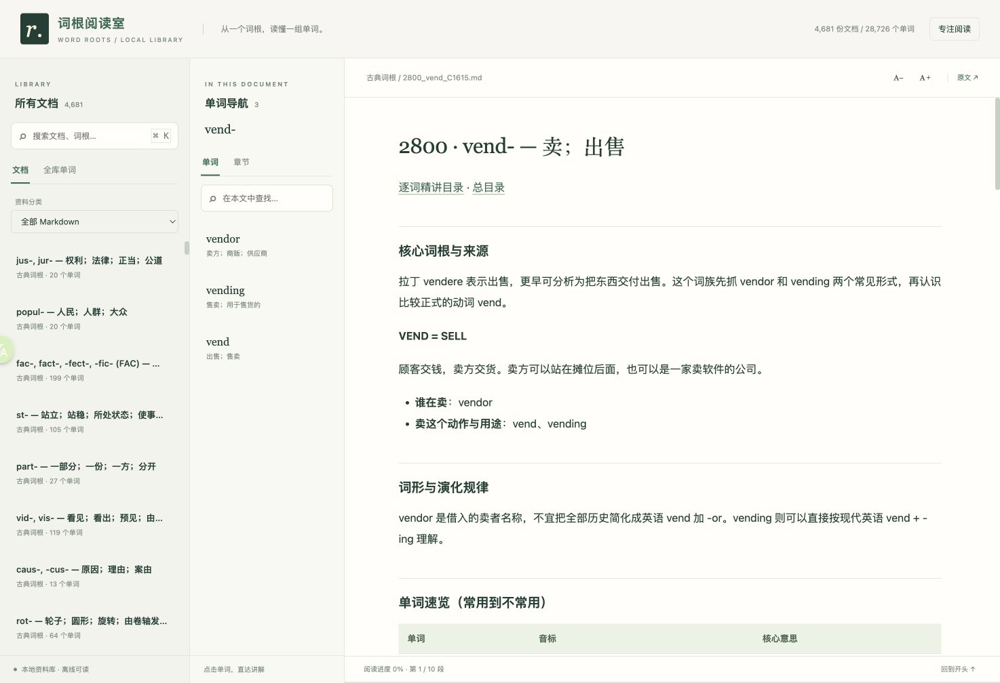

# 词根阅读室 · Word Roots

英语词根、词基与词缀 Markdown 资料库，附本地浏览器阅读器。收录 4,612 个构词条目；已完成 1,313 个页面的逐词精讲，其余仍为资料整理版。



## 功能

- 三栏阅读：文档列表 → 单词／章节导航 → Markdown 正文。
- 搜索文档、单词和中文释义，点击跳转到讲解。
- TanStack Virtual 虚拟滚动、正文分页与有限缓存，适合长文档。
- 支持图片、表格、手机布局、字体调整和专注阅读；依赖随项目提供，可离线阅读本地内容。

## 启动

需要 Python 3.9+，在项目根目录执行，无须安装额外依赖：

```sh
python3 server/server.py
```

打开 [http://127.0.0.1:8765](http://127.0.0.1:8765)。首次启动自动建立索引；修改 Markdown 后重启服务并刷新页面。更多说明见 [阅读器 README](server/README.md)。

## 未完成

- **内容**：继续重写剩余精讲页；补齐部分音标、释义与例句，核对词源和词族关系。
- **配图**：部分单词缺少演化图，当前暂停新增图片，使用文字演化链；见 [待补图清单](英语词根资料库/待补图清单.md)。
- **阅读器**：尚无正文全文搜索、文件变更自动更新索引；目前搜索范围为文档标题／路径、单词及释义。

本库不代表全部英语词根已穷尽。实际范围与缺项见 [覆盖说明](英语词根资料库/覆盖与缺项.md)。

## 目录与来源

- [`英语词根资料库/`](英语词根资料库/README.md)：Markdown、图片、索引与来源数据。
- [`server/`](server/)：HTML 阅读器与 Python 本地服务。
- `content/`、`scripts/`：精讲内容源文件与整理脚本。

资料包含第三方词典内容和 AI 编写的学习讲解、例句，使用或转载前请查看 [来源与许可](英语词根资料库/来源与许可.md)；阅读器第三方组件许可证位于 `server/vendor/`。
