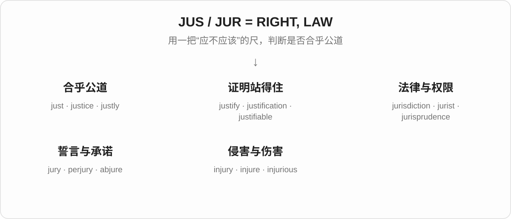
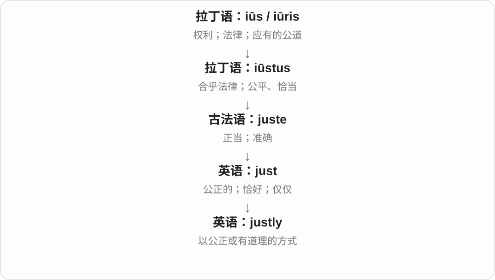
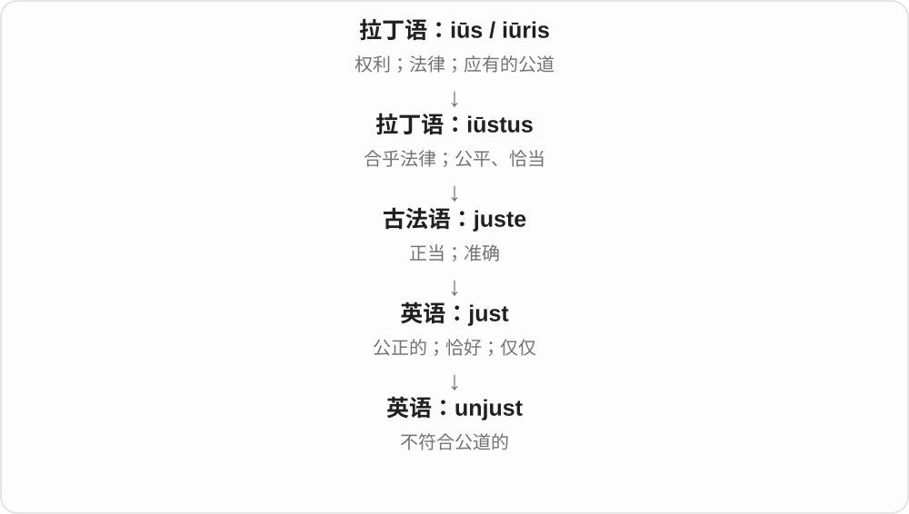
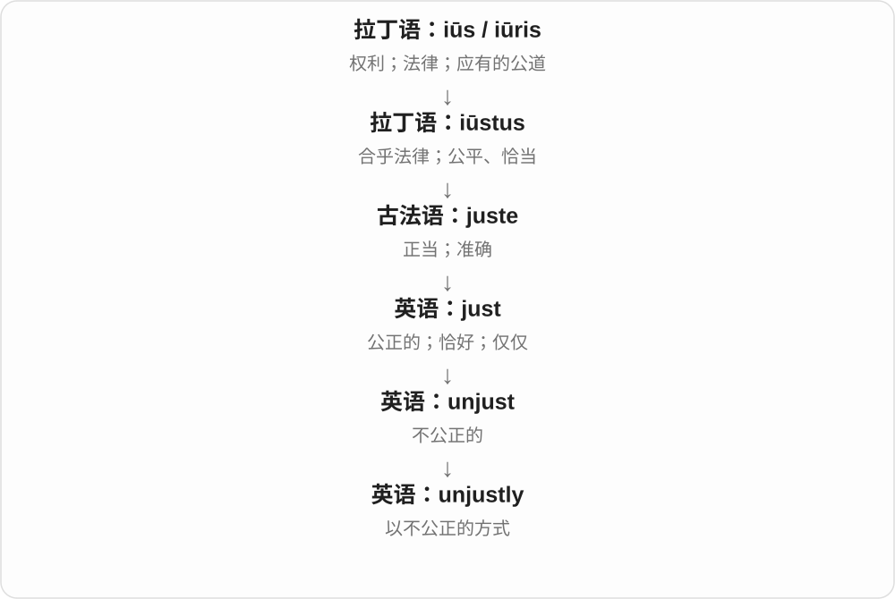
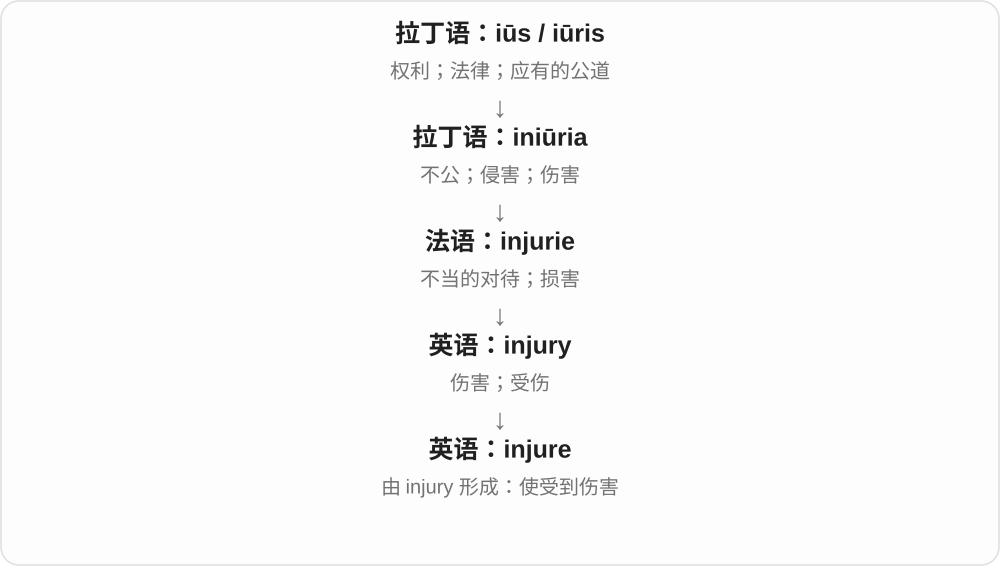
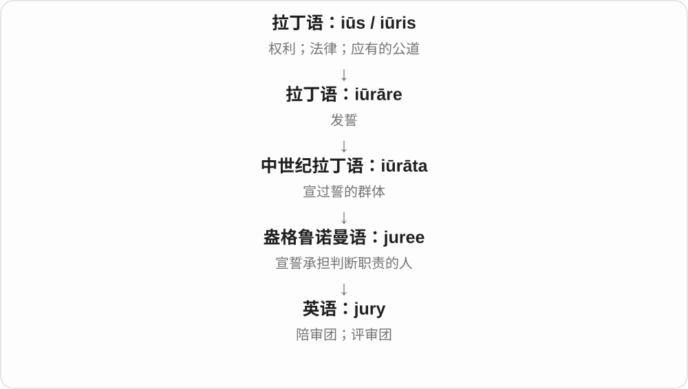

# 0019 · jus-, jur- — 权利；法律；正当；公道

[逐词精讲目录](../00_逐词精讲目录.md) · [总目录](../00_总目录_按常用程度.md)

## 核心词根与来源

**jus-、jur-** 追溯到拉丁语 **iūs**“权利、法律、公道”。先想一把判断“这件事该不该做”的尺：合乎这把尺，可以是 just；拿出理由让它站得住，是 justify；做了侵害他人的事，则通向 injury。另一支通过“发誓保证”形成 jury、perjury。

## 词形与演化规律

拉丁语 **iūs** 在不同语法形式中有 **iūr-**，如 iūris；英语拼写常用 j，所以看到 jus-、jur-。**iūstus**“公正、合适”形成 just 这一支，**iūrāre**“宣誓”形成 jury、abjure 等。这是拉丁语历史词形的关系，不是英语里遇到 s 就能随意换成 r。

## 单词速览（按词族由简到繁）

同一基础词的相关扩展放在一起，先读基础形式，再读扩展；各组之间优先读常用的。具体词源关系见各词讲解。

| 单词 | 音标 | 核心意思 |
|---|---|---|
| [just](#w-1) | /dʒʌst/ | 公正的；恰好；仅仅；刚刚 |
| [justify](#w-5) | /ˈdʒʌstɪfaɪ/ | 证明合理；为……提供充分理由 |
| [justification](#w-7) | /ˌdʒʌstɪfɪˈkeɪʃən/ | 正当理由；证明合理的说明 |
| [justifiable](#w-13) | /ˈdʒʌstɪfaɪəbəl/ | 有正当理由的；说得过去的 |
| [justly](#w-15) | /ˈdʒʌstli/ | 公正地；有充分理由地 |
| [unjust](#w-9) | /ʌnˈdʒʌst/ | 不公正的；不合理的 |
| [unjustly](#w-14) | /ʌnˈdʒʌstli/ | 不公正地；冤枉地 |
| [justice](#w-2) | /ˈdʒʌstɪs/ | 正义；公道；司法 |
| [injustice](#w-8) | /ɪnˈdʒʌstɪs/ | 不公；不公正的待遇 |
| [injure](#w-11) | 英 /ˈɪndʒə/；美 /ˈɪndʒər/ | 使受伤；损害 |
| [injury](#w-3) | 英 /ˈɪndʒəri/；美 /ˈɪndʒəri/ | 伤害；损伤 |
| [injurious](#w-17) | 英 /ɪnˈdʒʊəriəs/；美 /ɪnˈdʒʊriəs/ | 有害的；造成损害的 |
| [jury](#w-4) | 英 /ˈdʒʊəri/；美 /ˈdʒʊri/ | 陪审团；评审团 |
| [jurisdiction](#w-6) | 英 /ˌdʒʊərɪsˈdɪkʃən/；美 /ˌdʒʊrɪsˈdɪkʃən/ | 管辖权；管辖范围 |
| [perjury](#w-10) | 英 /ˈpɜːdʒəri/；美 /ˈpɝːdʒəri/ | 伪证；宣誓后故意说假话 |
| [jurisprudence](#w-12) | 英 /ˌdʒʊərɪsˈpruːdəns/；美 /ˌdʒʊrɪsˈpruːdəns/ | 法学；法理学 |
| [jurist](#w-16) | 英 /ˈdʒʊərɪst/；美 /ˈdʒʊrɪst/ | 法学家；法律专家 |
| [juridical](#w-18) | /dʒʊˈrɪdɪkəl/ | 法律上的；法理上的 |
| [abjure](#w-19) | 英 /əbˈdʒʊə/；美 /əbˈdʒʊr/ | 郑重放弃；宣誓摒弃 |
| [objurgate](#w-20) | 英 /ˈɒbdʒəɡeɪt/；美 /ˈɑːbdʒərɡeɪt/ | 严厉斥责 |

## 逐词讲解

### 1. just — 公正的；恰好；仅仅；刚刚

**音标**：/dʒʌst/

**先抓住这个画面**

先想一杆摆正的秤：不偏不倚，是 just“公正”。再想一个东西正好落在该落的位置，就有“恰好”；范围卡得很紧，又能表示“仅仅、刚刚”。

**怎么拆**

追溯到拉丁语 iūstus，与 iūs“权利、公道”有关。现代 just 已是完整词，不必再切字母。

**怎么变成今天的意思**

“合乎标准”可以描述道德，也可以描述位置、数量和时间的准确。副词义从“正好”继续发展出“只有这么多”和“离现在只有一点时间”。理解具体句子时，别把所有 just 都译成“公正”。

**常见搭配与例句**

a just decision（公正的决定）；just right（刚刚好）；just one（仅一个）；have just done（刚做完）。

> They wanted a just solution that treated both sides fairly.

他们希望找到一个公平对待双方的解决办法。

> I have just one question, and you may have just answered it.

我只有一个问题，而你可能刚刚已经回答了。

**别混淆**

just 作副词通常不是 justly 的简写。justly 常是“公正地、理所应当地”，just 更常是“恰好、仅仅、刚刚”。

### 2. justify — 证明合理；为……提供充分理由

**音标**：/ˈdʒʌstɪfaɪ/

**先抓住这个画面**

别人问“凭什么这样做”，你拿出能让这件事站得住脚的理由，就是 justify。它不一定是狡辩，也可能是真正说明一项决定为什么值得。

**怎么拆**

历史上是 iūstus（正当）+ 表示“使、做成”的 -ficāre。现代可用 just + -ify 记成“让它显得或被证明是正当的”。

**怎么变成今天的意思**

词从“使正当”发展到“证明有道理”。所以 justify the cost 不是解释花了多少钱，而是说明这些钱为什么花得值。

**常见搭配与例句**

justify a decision；justify the cost；justify doing something；justify something to someone。

> The time saved may justify the extra cost.

节省下来的时间也许足以证明这笔额外开支是值得的。

> How do you justify leaving the team without notice?

你怎样为不打招呼就离开团队这件事辩解？

**别混淆**

explain 只要求把原因讲清楚；justify 要进一步说明“这样做有正当或足够的理由”。

### 3. justification — 正当理由；证明合理的说明

**音标**：/ˌdʒʌstɪfɪˈkeɪʃən/

**先抓住这个画面**

如果 justify 是“把理由摆出来”，justification 就是摆出来的那套理由，或者证明合理这件事本身。

**怎么拆**

与 justify 同属拉丁语 iūstificāre 词族，经 iūstificātiō、法语进入英语。现代可把 -ification 看成与 -ify 对应的名词形式。

**怎么变成今天的意思**

名词化后，理由可以被要求、提供和质疑：provide a justification、question the justification。它不保证理由正确，只说明这些理由被用来支持某项行为。

**常见搭配与例句**

justification for…；without justification；provide a clear justification。

> The manager asked for a clear justification for the purchase.

经理要求清楚说明这次采购的正当理由。

> There is no justification for treating people that way.

没有任何正当理由可以那样对待别人。

**别混淆**

reason 可以只是原因，justification 强调足以支持、准许或辩护的理由。

### 4. justifiable — 有正当理由的；说得过去的

**音标**：/ˈdʒʌstɪfaɪəbəl/

**先抓住这个画面**

justifiable 不是说“大家已经同意”，而是说“这件事有理由能讲通”。你可以不同意某项选择，同时承认它并非毫无道理。

**怎么拆**

现代可拆为 justify + -able“能够被证明合理的”；英语实际借入的是中古法语 justifiable。

**怎么变成今天的意思**

-able 把“证明合理”的动作变成可评价的性质。justifiable anger 是有理由的愤怒，不等于这种愤怒导致的任何行为都可以被接受。

**常见搭配与例句**

a justifiable concern；justifiable anger；financially justifiable（从开支角度说得通的）。

> Her concern about the missing data was entirely justifiable.

她对数据缺失的担忧完全有道理。

> The expense is justifiable if it prevents larger losses.

如果能避免更大的损失，这笔开支就是合理的。

**别混淆**

justified 常说某件事已经有充分依据；justifiable 强调它能够找到合理依据。

### 5. justly — 公正地；有充分理由地

**音标**：/ˈdʒʌstli/

**先抓住这个画面**

justly 说的是“这么做有公道、这么评价有道理”。例如 justly proud：确实做得好，所以有理由骄傲。

**怎么拆**

just（公正、合理）+ -ly（构成副词）。这里保留的是 just 的“正当”一支。

**怎么变成今天的意思**

形容词说一个结果公不公正，副词则修饰怎样对待人、怎样评价事物。它也能表示评价名副其实，如 justly famous“当之无愧地有名”。

**常见搭配与例句**

treat people justly；be justly proud of…；be justly praised。

> Everyone deserves to be treated justly.

每个人都应受到公正对待。

> The team is justly proud of what it achieved.

这个团队完全有理由为自己的成果感到自豪。

**别混淆**

I just left 是“我刚走”；I acted justly 是“我做得公正”。不能因为都是副词就互换。

### 6. unjust — 不公正的；不合理的

**音标**：/ʌnˈdʒʌst/

**先抓住这个画面**

有人付出了却得不到应有回报，或者无辜的人受到处罚，你会觉得“这不公平”——unjust 就是在作这种判断。

**怎么拆**

un-（不）+ just（公正的）。否定的是公平和正当，不是 just 的“刚刚”。

**怎么变成今天的意思**

这是英语里清楚的否定构词。它不仅说结果让人不开心，还认为结果违反了应有的公平。

**常见搭配与例句**

an unjust decision；unjust treatment；an unjust accusation（不公正的指责）。

> She refused to accept what she saw as an unjust punishment.

她拒绝接受她认为不公正的惩罚。

> The report exposed an unjust system of rewards.

报告揭露了一套不公平的奖励制度。

**别混淆**

unjust 强调不公平，unpleasant 只表示不愉快。一个公平但令人失望的决定，不一定 unjust。

### 7. unjustly — 不公正地；冤枉地

**音标**：/ʌnˈdʒʌstli/

**先抓住这个画面**

unjustly 常落在一个人的遭遇上：他被责怪、处罚或排除，但这种对待不公平。中文有时直接说“被冤枉了”。

**怎么拆**

unjust + -ly；也能看成 un- + justly。两种现代拆法都把“公正地”变成相反意思。

**怎么变成今天的意思**

加 -ly 后，不是泛泛讨论“不公”，而是说明某个动作做得不公：unjustly blamed，就是不公平地把责任推给某人。

**常见搭配与例句**

be unjustly accused；be unjustly treated；unjustly blamed for…（因……被冤枉责怪）。

> He felt that he had been unjustly blamed for the delay.

他觉得延误的责任被不公正地推到了自己身上。

> The article tells the story of a worker who was unjustly dismissed.

这篇文章讲述了一名遭到不公正解雇的工人的故事。

**别混淆**

wrongly 也可表示事实判断有误；unjustly 额外强调这种错误或对待不公正。

### 8. justice — 正义；公道；司法

**音标**：/ˈdʒʌstɪs/

**先抓住这个画面**

justice 是让人得到应得的对待：被伤害的人得到公道，犯错的人承担相应后果。它既可指这种原则，也可指实现它的司法体系。

**怎么拆**

经法语来自拉丁语 iūstitia，与 iūstus“公正的”同族。可以把 just 与 justice 配对记，但不是把 ice 当作现代英语后缀硬拼。

**怎么变成今天的意思**

just 说“这件事公平”，justice 把公平变成可以追求和维护的东西。“伸张正义”和“司法部门”之所以共用一个词，是因为制度被期待用来实现公道。

**常见搭配与例句**

seek justice（寻求公道）；social justice（社会正义）；the justice system（司法体系）；do someone justice（公正评价某人）。

> The family continued to seek justice for their son.

这个家庭继续为儿子寻求公道。

> This photograph does not do the mountains justice.

这张照片没能充分展现这些山的美。

**别混淆**

justice 不等于 revenge“报复”：前者要求合乎公道，后者侧重让对方也受苦。

### 9. injustice — 不公；不公正的待遇

**音标**：/ɪnˈdʒʌstɪs/

**先抓住这个画面**

有人明明应该得到公平对待，却被偏袒、欺负或剥夺机会，这种“公道没有到位”的情况就是 injustice。

**怎么拆**

in-（不）+ justice（正义）。英语经法语接收这个拉丁词族的词；现代拆法也很清楚。

**怎么变成今天的意思**

这里的 in- 是否定，不是“在里面”。justice 指公道，injustice 指公道被破坏；可泛指不公，也可说 an injustice，指一件具体的不公之事。

**常见搭配与例句**

fight injustice（反抗不公）；a sense of injustice（受到不公对待的感觉）；an injustice to someone。

> She spoke out against the injustice of the decision.

她公开反对这个决定的不公之处。

> Blaming him alone would be an injustice.

只责怪他一个人是不公平的。

**别混淆**

injustice 强调不公平；misfortune 是不幸。天灾可能是不幸，但谈 injustice 往往涉及待遇、制度或人的行为。

### 10. injure — 使受伤；损害

**音标**：英 /ˈɪndʒə/；美 /ˈɪndʒər/

**先抓住这个画面**

injure 把注意力放在“让身体或某种利益受到损伤”这个动作。它通常比 hurt 更正式，也更突出实际损伤。

**怎么拆**

英语从 injury 反向造出动词 injure：不是先有 injure 再简单加 y。更远来源仍是 in- + iūs 的词族。

**怎么变成今天的意思**

这是逆构词：把已经存在的名词理解成有一个动词词干，再形成动词。词形关系看起来熟悉，真正的先后顺序却可能与你直觉相反。

**常见搭配与例句**

injure one’s back；be seriously injured；injure someone’s reputation（损害某人名誉，较正式）。

> He injured his shoulder while moving a heavy desk.

他搬动一张沉重的桌子时伤了肩膀。

> No passengers were injured in the incident.

这起事件中没有乘客受伤。

**别混淆**

hurt 可说身体疼痛，也常说 hurt someone’s feelings“伤感情”；injure 更常强调身体、名誉或利益受到实际损伤。

### 11. injury — 伤害；损伤

**音标**：英 /ˈɪndʒəri/；美 /ˈɪndʒəri/

**先抓住这个画面**

injury 的旧画面是“对一个人做了不该做的事”；到了日常英语里，最常落到身体受到损伤，如脚踝扭伤、膝盖受伤。

**怎么拆**

in-（不）+ iūs / iūris（权利、公道）形成拉丁语 iniūria。这里 in- 不是“进入身体里面”。

**怎么变成今天的意思**

从“不公、侵犯”到“造成的伤害”，再到常见的身体损伤，词义变得更具体。词源谈的是历史联系，不表示现代 injury 都由别人故意造成。

**常见搭配与例句**

suffer an injury；a knee injury；avoid injury；recover from an injury。

> A knee injury kept her out of the final.

膝伤使她无法参加决赛。

> Fortunately, everyone escaped serious injury.

幸运的是，所有人都没有受到重伤。

**别混淆**

injury 是伤害或损伤的总称；wound 更常指皮肤或组织破开的创伤。拉伤可以是 injury，却不一定有 wound。

### 12. injurious — 有害的；造成损害的

**音标**：英 /ɪnˈdʒʊəriəs/；美 /ɪnˈdʒʊriəs/

**先抓住这个画面**

injurious 形容会给健康、利益或名声带来损害的东西。它比 harmful 更正式，常见于文章和专业讨论。

**怎么拆**

属于 injury 的历史词族，经拉丁语 iniūriōsus、法语进入英语；现代可与 injury + -ous 联系记忆。

**怎么变成今天的意思**

injury 指已经造成的伤害，injurious 则评价某种行为或条件会不会伤害人。常跟 to，交代谁或什么受到影响。

**常见搭配与例句**

injurious to health；injurious to someone’s reputation；an injurious effect。

> The report describes conditions that are injurious to workers’ health.

报告描述了对工人健康有害的工作条件。

> False rumors can be injurious to a person’s reputation.

虚假传闻可能损害一个人的名誉。

**别混淆**

injured 是受了伤的；injurious 是会造成伤害的。一个是受影响的一方，一个是造成影响的一方。

### 13. jury — 陪审团；评审团

**音标**：英 /ˈdʒʊəri/；美 /ˈdʒʊri/

**先抓住这个画面**

想象一群人先郑重承诺，再一起听证据、作判断：这就是 jury 的历史画面。现代也可指比赛中负责评选的那一组人。

**怎么拆**

来自与拉丁语 iūrāre“发誓”有关的形式，经法语 jurée 进入英语。词尾 y 不表示“很多人”，整个词才指这个群体。

**怎么变成今天的意思**

这条词义线的重点不是“懂法律”，而是“宣誓履行判断职责”。因此 jurist 是法律专家，jury 则是共同作出判断的一组人。

**常见搭配与例句**

serve on a jury（担任陪审员）；a jury member；the jury’s verdict（陪审团的裁决）。

> The jury listened carefully to the witness.

陪审团认真听取了证人的陈述。

> An international jury selected the winning film.

一个国际评审团选出了获奖影片。

**别混淆**

这里的 jury 与旧式表达中表示“临时凑合装配”的 jury 不能按同一来源解释。单个陪审员是 juror，不是 a jury。

### 14. jurisdiction — 管辖权；管辖范围

**音标**：英 /ˌdʒʊərɪsˈdɪkʃən/；美 /ˌdʒʊrɪsˈdɪkʃən/

**先抓住这个画面**

想象一道权限边界：边界内的事，这个法院或机构有权处理；边界外的事，不归它管。这就是 jurisdiction。

**怎么拆**

拉丁语 iūris（法律的）+ dictiō（说、宣布），合起来联系到“宣布、实施法律的权力”。

**怎么变成今天的意思**

“有权说法律上的结论”延伸成“有权管这件事”。因此它既能指权力，也能指权力覆盖的地区或领域。

**常见搭配与例句**

have jurisdiction over…；within / outside one’s jurisdiction；under the jurisdiction of… 。

> The court said the dispute was outside its jurisdiction.

法院表示，这场争议不在其管辖范围内。

> The park falls under the jurisdiction of the local council.

这座公园归当地议会管辖。

**别混淆**

jurisdiction 不是普通的 geographical area“地区”：它关心的是谁有权管，而不只是地图上的位置。

### 15. perjury — 伪证；宣誓后故意说假话

**音标**：英 /ˈpɜːdʒəri/；美 /ˈpɝːdʒəri/

**先抓住这个画面**

普通说谎是 lie；已经郑重发誓要说真话，却又故意说假话，才是 perjury 的核心画面。

**怎么拆**

来自拉丁语 periūrāre“作伪誓”，其中 iūrāre 是“发誓”。per- 的作用要放在这个历史词里理解，不能一概译成“每一个”。

**怎么变成今天的意思**

词义把“话不真实”和“背弃誓言”叠在一起，所以比一般的谎言更具体、更严肃。现代法律中的详细适用条件随制度不同而不同，学习时先抓住这一层。

**常见搭配与例句**

commit perjury（作伪证）；a perjury charge（伪证指控）；lie under oath（宣誓后说谎）。

> The witness was accused of perjury after changing his account.

那名证人改变说法后，被指控作伪证。

> The novel turns on a case of deliberate perjury.

这部小说的关键是一宗故意作伪证的案件。

**别混淆**

jury 是宣誓参与判断的一组人；perjury 是违背说真话的誓言。词形有关，角色完全不同。

### 16. jurisprudence — 法学；法理学

**音标**：英 /ˌdʒʊərɪsˈpruːdəns/；美 /ˌdʒʊrɪsˈpruːdəns/

**先抓住这个画面**

不是只问“哪条规则怎么写”，而是进一步问“法律是什么、为什么这样判断、应该怎样理解法律”。这种对法律的系统研究就是 jurisprudence。

**怎么拆**

拉丁语 iūris（法律的）+ prūdentia（知识、判断力）。合起来是“关于法律的知识和判断”。

**怎么变成今天的意思**

juris- 把研究对象限定为法律，后半部分强调有知识地判断。现代它常出现在法律理论和法学讨论里，语气明显比 law 更学术。

**常见搭配与例句**

study jurisprudence；a course in jurisprudence；a school of jurisprudence（法学流派）。

> Her course in jurisprudence explores the relationship between law and morality.

她的法理学课程探讨法律与道德的关系。

> The book introduced me to several schools of jurisprudence.

这本书让我了解了几个法学流派。

**别混淆**

jurisprudence 是法律知识或理论；jurisdiction 是某个机构能管哪些事。别因为都以 juris- 开头而混用。

### 17. jurist — 法学家；法律专家

**音标**：英 /ˈdʒʊərɪst/；美 /ˈdʒʊrɪst/

**先抓住这个画面**

jurist 是长期研究法律、对法律有专业见解的人。语境不同，也可能用来称有学术声望的法官。

**怎么拆**

jur-（法律）+ 人物词尾 -ist；经法语 juriste 进入英语。这种拆法能帮助认出“研究法律的人”。

**怎么变成今天的意思**

从法律本身转向专门掌握法律知识的人。它强调专业认识，不只是“在法庭里出现的人”。

**常见搭配与例句**

a distinguished jurist（杰出的法学家）；a constitutional jurist（宪法学者）。

> The lecture was given by a respected jurist.

这场讲座由一位受人尊敬的法学家主讲。

> Several jurists criticized the reasoning behind the judgment.

几位法律学者批评了这项判决背后的推理。

**别混淆**

juror 是陪审员；jurist 是法律专家。lawyer 更常指为当事人提供法律服务的律师。

### 18. juridical — 法律上的；法理上的

**音标**：/dʒʊˈrɪdɪkəl/

**先抓住这个画面**

juridical 常用于讨论一件事在法律上算什么、具有什么身份或效力。它是书面词，普通聊天里通常用 legal 更自然。

**怎么拆**

可从 juridic + -al 理解，也有直接承接拉丁语 iūridicālis 的分析；jur- 关联法律，后半部分关联“说、判定”。

**怎么变成今天的意思**

这个词把视角固定在法律制度上。例如 juridical status 关心一个实体被法律怎样认定，不是它看起来是什么。

**常见搭配与例句**

juridical status（法律地位）；a juridical concept（法律概念）；a juridical person（法律上的人）。

> The article examines the juridical status of the organization.

这篇文章考察了该组织的法律地位。

> The debate raised difficult juridical questions.

这场争论提出了棘手的法律问题。

**别混淆**

juridical 泛指法律和法理；judicial 更常指法院、法官或审判活动。

### 19. abjure — 郑重放弃；宣誓摒弃

**音标**：英 /əbˈdʒʊə/；美 /əbˈdʒʊr/

**先抓住这个画面**

abjure 像当众划清界限：“我郑重声明，再也不认同它、也不再做它。”比 casually stop“随便停下”有分量。

**怎么拆**

ab-（离开）+ iūrāre（发誓）。历史构词就是“用誓言与某事分开”。

**怎么变成今天的意思**

具体的誓言后来可以弱化，但庄重、彻底拒绝的语气仍在。它常用于信念、暴力、旧习或效忠关系，日常谈戒零食通常不必用这么重的词。

**常见搭配与例句**

abjure violence（宣布摒弃暴力）；abjure a belief（郑重放弃一种信念）。

> The group publicly abjured violence.

这个团体公开宣布摒弃暴力。

> In the memoir, she describes why she abjured her former beliefs.

她在回忆录中解释了自己为何郑重放弃从前的信念。

**别混淆**

abjure 是自己郑重放弃；adjure 则是郑重恳求或要求别人做某事。

### 20. objurgate — 严厉斥责

**音标**：英 /ˈɒbdʒəɡeɪt/；美 /ˈɑːbdʒərɡeɪt/

**先抓住这个画面**

把它想成一番又重又狠的责骂：不只是指出哪里错了，而是用强烈的话把人或做法痛斥一顿。这个词很书面、较少见。

**怎么拆**

ob- + 拉丁语 iūrgāre“争吵、责骂”；后者联系到 iūs“法律”与 agere“做、办理”，历史上有诉讼争辩的背景。不是 ob + jury。

**怎么变成今天的意思**

从争辩和指责进入责骂这一边，现代的重点已经是语言的猛烈程度。记忆时想到“像严厉质问一样痛斥”，即可，不必把每次责骂都理解成打官司。

**常见搭配与例句**

objurgate someone for something；objurgate a practice（痛斥一种做法）。

> The columnist objurgated the officials for wasting public money.

那位专栏作家痛斥官员浪费公款。

> In the story, the captain objurgates a sailor for abandoning his post.

故事中，船长严厉斥责一名擅离岗位的水手。

**别混淆**

日常说 scold、rebuke 更自然；objurgate 常显得正式、文学化，甚至有意夸张。

## 这一组要分清什么

**justice 与 just**：justice 关心公道和司法；just 除了公正，还有恰好、仅仅、刚刚等常用义，不能逢 just 就译成正义。

**injury 与 injure**：injury 较早，英语从它反向形成 injure；现代词形看起来简单，不代表历史顺序也是“动词加后缀”。

**jury** 的陪审团、评审团义和宣誓有关；表示临时装配的另一支 jury 不按这个词源解释。

## 串起来练习

**She tried to justify the decision, but others called it an injustice.**

她想拿出理由说明这个决定合理，其他人却认为这是一件不公的事。justify 是“让理由站得住”，injustice 是“事情没有按公道来”。
