# 0035 · fac-, fact-, -fect-, -fic- (FAC) — 做；制造；使成为

[逐词精讲目录](../00_逐词精讲目录.md) · [总目录](../00_总目录_按常用程度.md)

## 核心词根与来源

先想一双正在做事的手：它能造出物件，也能促成结果。拉丁语 facere 的核心就是做、制造。fact 是做成的事，effect 是做出的结果，perfect 是把事做到完整。加上不同前缀以后，同一个动作会朝不同方向发展。法语又把不少词形磨得很不一样，所以 fashion、feat、profit 里不一定还看得出 fac。

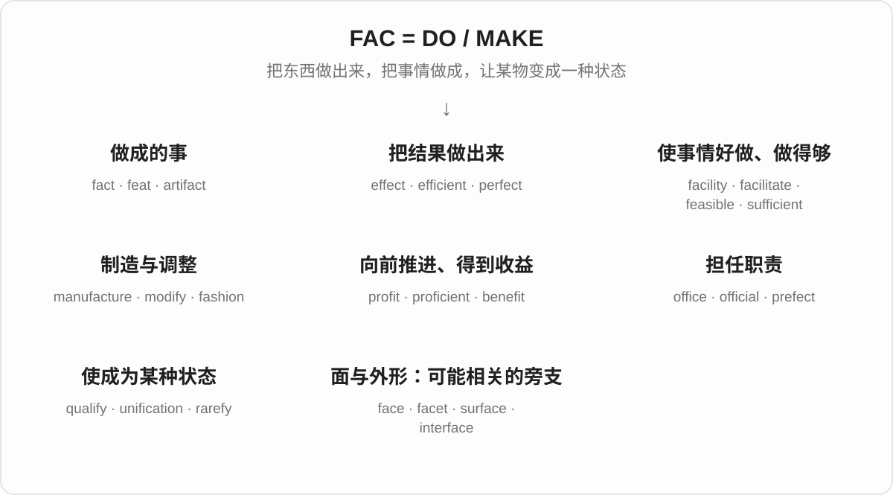

## 词形与演化规律

fac- 常接近 facere 的原形；fact- 常接近分词 factus“做成的”；-fic- 常见于拉丁语复合动词，-fect- 与这些动词的分词词干相关。英语的 -fy、-fication 也能延续“使成为”的功能。这些是历史词形关系，不能任意替换字母。face、facial、surface 这一支直接来自拉丁语 faciēs“样子、面”；faciēs 与 facere 的更深关系通常被认为可能相关，仍不画成确定的祖先链。

## 单词速览（常用到不常用）

| 单词 | 音标 | 核心意思 |
|---|---|---|
| [face](#w-1) | /ˈfeɪ̯s/ | 脸；表面；面对 |
| [fact](#w-2) | /fækt/ | 事实 |
| [office](#w-3) | /ˈɒf.ɪs/ | 办公室；职务 |
| [perfect](#w-4) | 形容词 /ˈpɜːfɪkt/；动词 /pəˈfekt/ | 完美的；使完善 |
| [official](#w-5) | /əˈfɪʃəl/ | 官方的；官员 |
| [effect](#w-6) | /ɪˈfɛkt/ | 影响；效果；促成 |
| [facebook](#w-7) | /ˈfeɪsˌbʊk/ | 脸书；通过 Facebook 联系 |
| [effective](#w-8) | /ɪˈfɛktɪv/ | 有效的；生效的 |
| [surface](#w-9) | /ˈsɜː.fɪs/ | 表面；浮出；显露 |
| [benefit](#w-10) | /ˈbɛn.ɪ.fɪt/ | 好处；受益；有益于 |
| [fashion](#w-11) | /ˈfæʃ.ən/ | 时尚；样式；制作 |
| [feature](#w-12) | /ˈfiː.t͡ʃəː/ | 特点；特色；特别展示 |
| [profit](#w-13) | /ˈpɹɒfɪt/ | 利润；获益 |
| [factor](#w-14) | /ˈfæk.tə/ | 因素；因数 |
| [scientific](#w-15) | /ˌsaɪ.ənˈtɪf.ɪk/ | 科学的；合乎科学方法的 |
| [facility](#w-16) | /fəˈsɪlɪti/ | 设施；场所；熟练能力 |
| [affect](#w-17) | 动词 /əˈfekt/；名词 /ˈæfekt/ | 影响；使感动；装出 |
| [factory](#w-18) | /ˈfæk.tə.ɹi/ | 工厂 |
| [officially](#w-19) | /əˈfɪʃ.(ə.)li/ | 正式地；官方地 |
| [defeat](#w-20) | /dɪˈfiːt/ | 击败；失败 |
| [effectively](#w-21) | /ɪˈfɛktɪvli/ | 有效地；实际上 |
| [faced](#w-22) | /feɪst/ | 面对了；面临……的 |
| [featured](#w-23) | /ˈfiːt͡ʃə(ɹ)d/ | 被重点展示的；作为特色的 |
| [efficient](#w-24) | /ɪˈfɪʃənt/ | 效率高的 |
| [efficiency](#w-25) | /ɪˈfɪʃ.ən.si/ | 效率 |
| [difficulty](#w-26) | /ˈdɪfɪkəlti/ | 困难；费力 |
| [sufficient](#w-27) | /səˈfɪʃənt/ | 足够的 |
| [affair](#w-28) | /əˈfɛə/ | 事情；事务；婚外情 |
| [sacrifice](#w-29) | /ˈsæk.ɹɪ.faɪs/ | 牺牲；献祭 |
| [modified](#w-30) | /ˈmɒdɪfaɪd/ | 修改过的；改良的 |
| [manufacturer](#w-31) | /ˌmænjʊˈfæktʃəɹə/ | 制造商 |
| [interface](#w-32) | /ˈɪntəfeɪs/ | 界面；交接处；连接互动 |
| [facial](#w-33) | /ˈfeɪ.ʃəl/ | 面部的；面部护理 |
| [effectiveness](#w-34) | /ɪˈfɛk.tɪv.nɪs/ | 有效性；实际成效 |
| [profitable](#w-35) | /ˈpɹɒf.ɪ.tə.bl̩/ | 有利润的；有收获的 |
| [facilitate](#w-36) | /fəˈsɪlɪteɪt/ | 促进；使更容易 |
| [feat](#w-37) | /fiːt/ | 壮举；技艺高超的成就 |
| [perfection](#w-38) | /pɚˈfɛk.ʃən/ | 完美；完善 |
| [manufacture](#w-39) | /ˌmænjuˈfækt͡ʃɚ/ | 制造；编造 |
| [qualification](#w-40) | /ˌkwɒlɪfɪˈkeɪʃən/ | 资格；资历；限定条件 |
| [nonprofit](#w-41) | /ˌnɒnˈprɒfɪt/ | 非营利的；非营利组织 |
| [sufficiently](#w-42) | /səˈfɪʃəntli/ | 足够地 |
| [efficiently](#w-43) | /ɪˈfɪʃəntli/ | 有效率地 |
| [faction](#w-44) | /ˈfæk.ʃən/ | 派别；派系 |
| [modify](#w-45) | /ˈmɒd.ɪ.faɪ/ | 修改；调整 |
| [insufficient](#w-46) | /ɪnsəˈfɪʃənt/ | 不足的 |
| [feasible](#w-47) | /ˈfiː.zɪ.bəl/ | 可行的 |
| [defect](#w-48) | 名词 /ˈdiːfekt/；动词 /dɪˈfekt/ | 缺陷；叛离 |
| [efficacy](#w-49) | /ˈɛf.ɪ.kə.si/ | 效力；功效 |
| [ineffective](#w-50) | /ˌɪn.ɪˈfɛk.tɪv/ | 无效的；不起作用的 |
| [unofficial](#w-51) | /ʌn.əˈfɪʃ.əl/ | 非官方的；未正式认可的 |
| [fashionable](#w-52) | /ˈfæʃənəbl̩/ | 流行的；时髦的 |
| [fiat](#w-53) | /ˈfaɪæt/ | 命令；法令 |
| [factual](#w-54) | /ˈfæk.tj(ʊ)əl/ | 符合事实的；事实性的 |
| [prolific](#w-55) | /pɹəˈlɪf.ɪk/ | 多产的；大量产生的 |
| [superficial](#w-56) | /ˌsuːpəˈfɪʃəl/ | 表面的；肤浅的 |
| [profitability](#w-57) | /ˌpɹɒf.ɪ.təˈbɪl.ɪ.ti/ | 盈利能力；获利程度 |
| [inefficient](#w-58) | /ˌɪn.ɪˈfɪʃ.ənt/ | 效率低的 |
| [suffice](#w-59) | /səˈfaɪs/ | 足够；够用 |
| [amplifier](#w-60) | /ˈæm.plə.faɪ.ə/ | 放大器 |
| [scientifically](#w-61) | /ˌsaɪ.ənˈtɪfɪkli/ | 科学地；从科学角度 |
| [proficiency](#w-62) | /pɹəˈfɪʃənsi/ | 熟练程度；精通 |
| [artifact](#w-63) | /ˈɑːtɪfækt/ | 人工制品；非真实的显示现象 |
| [counterfeit](#w-64) | /ˈkaʊn.tɚˌfɪt/ | 伪造的；伪造品；仿造 |
| [infect](#w-65) | /ɪnˈfɛkt/ | 使感染；感染他人情绪 |
| [unification](#w-66) | /ˌjuːnɪfɪˈkeɪʃn̩/ | 统一；合并为一体 |
| [forfeit](#w-67) | /ˈfɔː.fɪt/ | 丧失；被没收；罚则 |
| [proficient](#w-68) | /pɹəˈfɪʃ.ənt/ | 熟练的 |
| [facet](#w-69) | /ˈfæs.ɪt/ | 小平面；方面 |
| [prefecture](#w-70) | /ˈpɹiːfɛkt͡ʃə/ | 行政区；长官辖区 |
| [amplify](#w-71) | /ˈæm.plə.faɪ/ | 放大；增强；详述 |
| [disqualification](#w-72) | /dɪsˌkwɒlɪfɪˈkeɪʃən/ | 取消资格；使不合资格的条件 |
| [benefactor](#w-73) | /ˈbɛnəˌfæktəː/ | 恩人；捐助者 |
| [prefect](#w-74) | /ˈpɹiːfɛkt/ | 行政长官；学生督导 |
| [reunification](#w-75) | /ˌriːjuːnɪfɪˈkeɪʃən/ | 重新统一 |
| [sufficiency](#w-76) | /səˈfɪʃənsi/ | 充足；足够的程度 |
| [faceless](#w-77) | /ˈfeɪsləs/ | 身份模糊的；没有鲜明个性的 |
| [facsimile](#w-78) | /fækˈsɪm.ə.li/ | 传真；精确复制品 |
| [edifice](#w-79) | /ˈɛd.ɪ.fɪs/ | 宏伟建筑；庞大体系 |
| [facelift](#w-80) | /ˈfeɪsˌlɪft/ | 拉皮手术；外观翻新 |
| [facilitation](#w-81) | /fəˌsɪlɪˈteɪʃən/ | 促进；引导过程 |
| [unprofitable](#w-82) | /ʌnˈpɹɒf.ɪ.təbl̩/ | 不盈利的；没有收获的 |
| [facilitator](#w-83) | /fəˈsɪlɪteɪtə/ | 引导者；促成者 |
| [superficially](#w-84) | /ˌsuːpəˈfɪʃəli/ | 从表面看；浅浅地 |
| [inefficiency](#w-85) | /ˌɪnɪˈfɪʃənsi/ | 低效率；浪费环节 |
| [modifier](#w-86) | /ˈmɒdɪfaɪə/ | 修饰语；调整者；改性剂 |
| [perfectionist](#w-87) | /pɚˈfɛk.ʃənɪst/ | 完美主义者 |
| [subsurface](#w-88) | /ˌsʌbˈsɜːfɪs/ | 地表下的；表层以下 |
| [blackface](#w-89) | /ˈblækˌfeɪs/ | 涂黑脸的种族化扮演 |
| [effecting](#w-90) | /ɪˈfektɪŋ/ | 正在促成；实现着 |
| [typeface](#w-91) | /ˈtaɪpˌfeɪs/ | 字体设计；字样体系 |
| [ineffectual](#w-92) | /ˌɪnɪˈfɛkt͡ʃuəl/ | 不起作用的；软弱无力的 |
| [scarface](#w-93) | /ˈskɑːfeɪs/ | 疤面人；脸上有明显伤疤的人 |
| [factually](#w-94) | /ˈfæktʃuəli/ | 在事实方面；符合事实地 |
| [trifecta](#w-95) | /tɹaɪˈfɛktə/ | 依次猜中前三；三项成功 |
| [multifaceted](#w-96) | /ˌmʌl.tiˈfæ.sə.tɪd/ | 多面的；多层次的 |
| [disaffected](#w-97) | /dɪsəˈfɛktɪd/ | 不满而疏离的 |
| [unscientific](#w-98) | /ˌʌnsaɪənˈtɪfɪk/ | 不科学的 |
| [insufficiency](#w-99) | /ɪnsəˈfɪʃənsi/ | 不足；功能不全 |
| [profitably](#w-100) | /ˈpɹɒf.ɪ.tə.bli/ | 有利润地；有收获地 |
| [officiate](#w-101) | /əˈfɪ.ʃi.eɪt/ | 主持仪式；担任裁判 |
| [factional](#w-102) | /ˈfæk.ʃən.əl/ | 派系的；派系引起的 |
| [resurface](#w-103) | /ɹiːˈsɜːfɪs/ | 重新出现；重铺表面 |
| [effector](#w-104) | /ɪˈfek.tə/ | 效应器；执行作用的成分 |
| [facile](#w-105) | /ˈfæs.aɪl/ | 轻率简单的；轻巧流畅的 |
| [artifice](#w-106) | /ˈɑː(ɹ)tɪfɪs/ | 花招；人为技巧 |
| [perfectionism](#w-107) | /pəˈfɛk.ʃ(ə).nɪ.z(ə)m/ | 完美主义 |
| [efficacious](#w-108) | /ˌɛf.ɪˈkeɪ.ʃəs/ | 有效验的；能奏效的 |
| [fashionista](#w-109) | /ˌfæ.ʃəˈnɪ.stə/ | 时尚达人；热衷时尚的人 |
| [facepalm](#w-110) | /ˈfeɪsˌpɑː(l)m/ | 扶额捂脸；因无语而扶额 |
| [factorial](#w-111) | /fækˈtɔːɹi.əl/ | 阶乘；阶乘的 |
| [unfeasible](#w-112) | /ʌnˈfiː.zə.bəl/ | 不可行的 |
| [confection](#w-113) | /kənˈfɛkʃən/ | 甜食；精心拼制的东西 |
| [feckless](#w-114) | /ˈfɛkləs/ | 无能又不负责任的 |
| [parfait](#w-115) | /ˈpɑːfeɪ/ | 帕菲甜点；分层或冷冻甜品 |
| [featureless](#w-116) | /ˈfi.t͡ʃɚ.ləs/ | 没有明显特征的 |
| [prefectural](#w-117) | /prɪˈfektʃərəl/ | 行政区的；长官辖区的 |
| [maxillofacial](#w-118) | /mækˌsɪləʊˈfeɪʃəl/ | 颌面部的 |
| [featurette](#w-119) | /ˌfiːtʃəˈret/ | 短片；幕后特辑 |
| [effectual](#w-120) | /iˈfɛkt͡ʃuəl/ | 奏效的；能达成目的的 |
| [benefice](#w-121) | /ˈbɛnɪfɪs/ | 有俸圣职；带收入的教会职位 |
| [counterfactual](#w-122) | /ˌkaʊntɚˈfæktʃuəl/ | 反事实的；与事实相反的假设 |
| [craniofacial](#w-123) | /kɹeɪ.nɪ.əˈfeɪ.ʃəl/ | 颅面部的 |
| [fuckface](#w-124) | /ˈfʌkˌfeɪs/ | 粗俗辱骂语；可恶的家伙 |
| [affectation](#w-125) | /ˌæf.ɛkˈteɪ.ʃən/ | 矫揉造作；装出来的姿态 |
| [factionalism](#w-126) | /ˈfækʃənəlɪzəm/ | 派系斗争；结派倾向 |
| [refectory](#w-127) | /ɹɪˈfɛkt(ə)ɹi/ | 公共食堂；修道院餐厅 |
| [officialdom](#w-128) | /əˈfɪ.ʃəl.dəm/ | 官员群体；官僚机构 |
| [infeasible](#w-129) | /ɪnˈfiːzəbəl/ | 不可行的 |
| [boldface](#w-130) | /ˈbəʊldfeɪs/ | 粗体；用粗体印 |
| [factbook](#w-131) | /ˈfæktbʊk/ | 资料手册；事实汇编 |
| [cofactor](#w-132) | /ˈkəʊˌfæktə/ | 共同因素；辅助因子；余因子 |
| [surfeit](#w-133) | /ˈsɜː.fɪt/ | 过量；过度享用；使厌腻 |
| [feasibly](#w-134) | /ˈfiːzɪb(ə)li/ | 在可行的范围内；切实可行地 |
| [officiant](#w-135) | /əˈfɪʃi.ənt/ | 仪式主持人 |
| [transfection](#w-136) | /tɹænzˈfɛkʃən/ | 转染 |
| [superficiality](#w-137) | /ˌsuː.pə.fɪʃ.iˈæl.ɪ.ti/ | 肤浅；表面性 |
| [factoid](#w-138) | /ˈfæk.tɔɪd/ | 以讹传讹的说法；小知识 |
| [gigafactory](#w-139) | /ˈɡɪɡəˌfæktəri/ | 超大型工厂 |
| [confectioner](#w-140) | /kənˈfekʃənə/ | 糖果师；甜食商 |
| [officious](#w-141) | /əˈfɪʃəs/ | 爱管闲事的；过分殷勤的 |
| [facially](#w-142) | /ˈfeɪʃəli/ | 在面部上；从表面看 |
| [prolifically](#w-143) | /prəˈlɪfɪkli/ | 多产地；大量地 |
| [pseudoscientific](#w-144) | /ˌsuː.dəʊ̯ˌsaɪ̯.ənˈtɪf.ɪk/ | 伪科学的 |
| [multifactorial](#w-145) | /ˌmʌltifækˈtɔːriəl/ | 多因素造成的 |
| [profiteer](#w-146) | /ˌpɹɒfɪˈtɪə(ɹ)/ | 牟取暴利者；牟取暴利 |
| [effectually](#w-147) | /ɪˈfɛktʃuəli/ | 有效地；切实奏效地 |
| [perfective](#w-148) | /pə(ɹ)ˈfɛktɪv/ | 完成体的；整体看待事件的 |
| [olfaction](#w-149) | /oʊlˈfækʃən/ | 嗅觉 |
| [effectuate](#w-150) | /ɪˈfektʃueɪt/ | 使实现；实施 |
| [factotum](#w-151) | /fækˈtəʊ.təm/ | 杂务总管；多面手 |
| [surficial](#w-152) | /səːˈfɪʃəl/ | 地表的；表层的 |
| [perfecta](#w-153) | /pəˈfɛktə/ | 按顺序猜中前两名的投注 |
| [pluperfect](#w-154) | /pluːˈpɜː.fɪkt/ | 过去完成时；过去完成的 |
| [effectivity](#w-155) | /əˈfek.tɪv.ə.t̬i/ | 有效性；适用范围信息 |
| [factitious](#w-156) | /fækˈtɪʃəs/ | 人为造成的；虚假的 |
| [interoffice](#w-157) | /ˌɪntərˈɒfɪs/ | 办公室之间的 |
| [refashion](#w-158) | /ˌriːˈfæʃən/ | 重新塑造；改制 |
| [prequalification](#w-159) | /ˌpriːkwɒlɪfɪˈkeɪʃən/ | 资格预审；事先资格认定 |
| [facilitative](#w-160) | /fəˈsɪlɪteɪtɪv/ | 起促进作用的 |
| [perfector](#w-161) | /pəˈfektə/ | 完善者；使臻完善的人或物 |
| [factious](#w-162) | /ˈfækʃəs/ | 闹派系的；挑起内讧的 |
| [effectuation](#w-163) | /ɪˌfektʃuˈeɪʃən/ | 落实；使生效的过程 |
| [refection](#w-164) | /ɹɪˈfɛkʃən/ | 饮食补给；点心；恢复体力 |
| [remanufacture](#w-165) | /ˌriːmænjuˈfæktʃə/ | 再制造 |
| [perfectibility](#w-166) | /pəˌfektəˈbɪləti/ | 可完善性；不断改进的可能性 |
| [reinfect](#w-167) | /ˌriːɪnˈfekt/ | 再次感染 |
| [perfectible](#w-168) | /pəˈfektəbəl/ | 可以完善的 |
| [profiterole](#w-169) | /pɹəˈfɪtəɹoʊl/ | 奶油泡芙 |
| [nonofficial](#w-170) | /ˌnɒnəˈfɪʃəl/ | 非官方的 |
| [uniface](#w-171) | /ˈjuːnɪfeɪs/ | 单面加工石器 |
| [disaffect](#w-172) | /dɪsəˈfɛkt/ | 使不满；使失去支持 |
| [effectible](#w-173) | /ɪˈfektəbəl/ | 可以实现的 |
| [effection](#w-174) | /ɪˈfekʃən/ | 创作；实施；做成 |
| [effectuality](#w-175) | /ɪˌfektʃuˈæləti/ | 有效性；奏效状态 |
| [efficacity](#w-176) | /ˌefɪˈkæsɪti/ | 效力；功效 |
| [enface](#w-177) | /ɪnˈfeɪs/ | 在正面书写；作切面正观的 |
| [enfacement](#w-178) | /ɪnˈfeɪsmənt/ | 正面加注；正面加注的文字 |
| [faciend](#w-179) | /ˈfæsɪˌend/ | 被乘数（旧称） |
| [facient](#w-180) | /ˈfeɪʃənt/ | 行动者；乘数（旧术语） |
| [facilitatory](#w-181) | /fəˌsɪlɪˈteɪtəri/ | 起促进作用的 |
| [facinorous](#w-182) | /fəˈsɪnəɹəs/ | 极邪恶的；罪恶深重的 |
| [factionary](#w-183) | /ˈfækʃənəri/ | 派系成员；派系性的（罕见） |
| [factorable](#w-184) | /ˈfæktərəbəl/ | 可因式分解的 |
| [inofficious](#w-185) | /ˌɪnəˈfɪʃəs/ | 不尽职责的；违背本分的（旧词） |
| [malefaction](#w-186) | /ˌmæləˈfækʃən/ | 恶行；犯罪行为 |
| [officiary](#w-187) | /əˈfɪʃɪəri/ | 公务的；职务相关的（罕见） |
| [omnificence](#w-188) | /ɑːmˈnɪfəsəns/ | 创造万物的能力 |
| [omnificent](#w-189) | /ɑːmˈnɪfəsənt/ | 创造万物的；创造力无限的 |
| [quasiperfect](#w-190) | /ˌkweɪzaɪˈpɜːfɪkt/ | 近乎完美的 |
| [rarefy](#w-191) | /ˈɹɛəɹəˌfaɪ/ | 使稀薄；变稀薄 |
| [refactorable](#w-192) | /ˌriːˈfæktərəbəl/ | 可重构的 |
| [refect](#w-193) | /rɪˈfekt/ | 使恢复体力；以食物休整（旧词） |
| [semelfactive](#w-194) | /ˌsɛməlˈfæktɪv/ | 单次瞬间动作的；单次体的 |
| [suboffice](#w-195) | /ˈsʌbˌɒfɪs/ | 分办事处；下属办公室 |
| [subprefect](#w-196) | /ˌsʌbˈpriːfekt/ | 副行政长官；次级辖区长官 |
| [trifacial](#w-197) | /traɪˈfeɪʃəl/ | 三叉神经的；三叉神经（旧称） |
| [unifacial](#w-198) | /ˌjuːnɪˈfeɪʃəl/ | 单面的；仅一面加工的 |
| [unifactorial](#w-199) | /ˌjuːnɪfækˈtɔːriəl/ | 单因素的 |

## 逐词讲解

### 1. face — 脸；表面；面对

**音标**：/ˈfeɪ̯s/

**先抓住这个画面**

想象你转过身，把脸朝向一个人。face 可以是这张脸，也可以是物体朝外的一面；作动词，就是把自己放到问题面前。

**怎么拆**

整体借自法语，不拆成 fa + ce。拉丁语 faciēs 与 facere 可能有更深联系，但不能画成已确定的父子关系。

**怎么变成今天的意思**

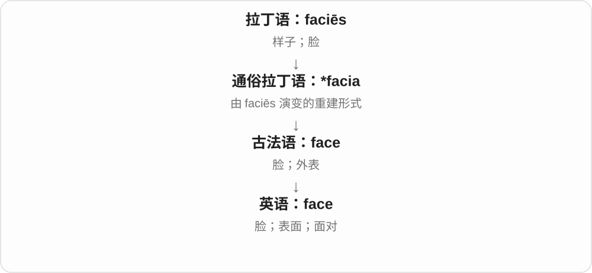

由人的外貌扩展到钟面、山崖面；再从朝向某物发展出面对困难。face the facts 就是承认事实已经摆在眼前。

**常见搭配与例句**

face a problem；the face of a clock；save face（保全面子）。

> Her face lit up when she saw the puppy.

看到小狗时，她脸上露出了喜色。

> We need to face the problem together.

我们得一起面对这个问题。

**别混淆**

face 作“面对”时直接接对象；be faced with 才需要 with。

### 2. fact — 事实

**音标**：/fækt/

**先抓住这个画面**

fact 像桌上已经摆出来的一块证据：你可以不喜欢它，但不能仅凭喜好把它改掉。

**怎么拆**

历史上的 factum 是 facere 的相关名词，原意为做成的事；现代 fact 不再拆分。

**怎么变成今天的意思**

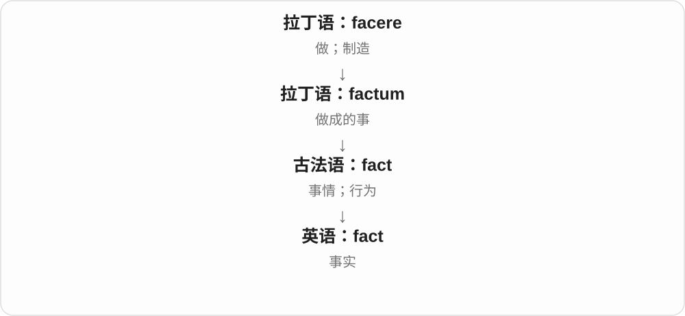

意义从做过的事转向实际发生或真实存在的事。日常说 fact 强调真假，而非一个人是否觉得有道理。

**常见搭配与例句**

a proven fact；in fact（事实上）；the fact that…（……这一事实）。

> The date is a fact, but the motive is still unclear.

日期是确定的事实，但动机仍不清楚。

> In fact, the smaller room is warmer.

实际上，较小的房间更暖和。

**别混淆**

opinion 是看法，fact 是可查证的事实；听起来很肯定的话也未必就是 fact。

### 3. office — 办公室；职务

**音标**：/ˈɒf.ɪs/

**先抓住这个画面**

先想一个人被分配的工作，再想他每天做这份工作的地方：office 把职责和办公地点连在了一起。

**怎么拆**

拉丁语 officium 由 opificium 缩短而来，含 opus 一支的“工作”和 facere“做”；不能拆成 off + ice。

**怎么变成今天的意思**

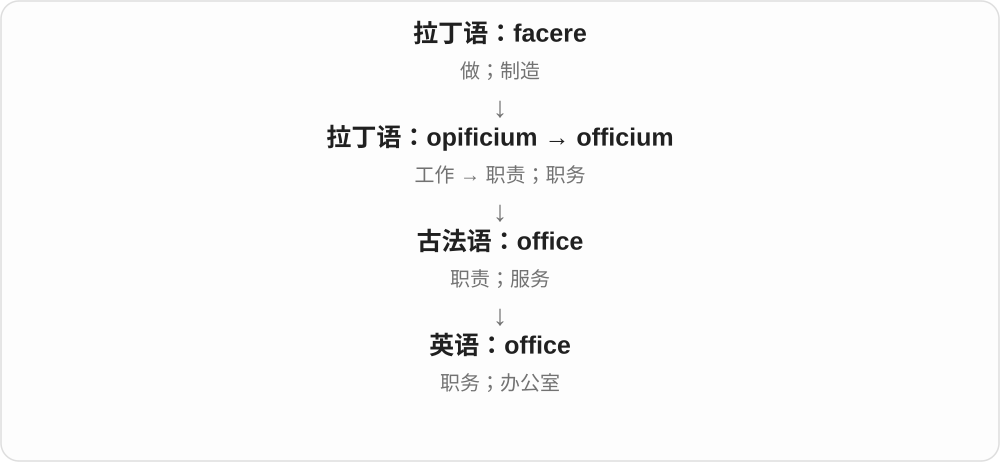

早期中心是职责、服务与职位，办公场所是后来的常见意思。take office 是开始任职，不是走进一间屋子。

**常见搭配与例句**

an office worker；hold office（任职）；take office（就任）。

> I left my notebook at the office.

我把笔记本落在办公室了。

> The new mayor takes office next week.

新市长下周就任。

**别混淆**

office 是办公室或职位；company 是公司，不能一概互换。

### 4. perfect — 完美的；使完善

**音标**：形容词 /ˈpɜːfɪkt/；动词 /pəˈfekt/

**先抓住这个画面**

一幅拼图最后一块也放好了，这就是 perfect 的原始画面。现代可指毫无缺点，也可说某物恰好合适。

**怎么拆**

per- 表“彻底”，facere 在复合词中为 -ficere；perfectus 是 perficere 的分词。形容词与动词重音不同。

**怎么变成今天的意思**

做到底、完成 → 完整无缺 → 完美。动词 perfect 则是继续打磨，把已有的东西改得更好。

**常见搭配与例句**

perfect for…；a perfect example；perfect a technique。

> This quiet corner is perfect for reading.

这个安静角落很适合读书。

> She spent years perfecting her technique.

她花了多年完善自己的技法。

**别混淆**

perfect 常是强烈评价；complete 只保证完整，未必好到没有缺点。

### 5. official — 官方的；官员

**音标**：/əˈfɪʃəl/

**先抓住这个画面**

盖了主管机构的章、能代表机构立场的消息，是 official；受委派行使职责的人，也可以叫 an official。

**怎么拆**

来自拉丁语 officialis，经法语传入；可与 office + -ial 对照理解。

**怎么变成今天的意思**

office 是职务，official 强调与职务及授权相连。因此 official explanation 是官方解释，并不自动保证解释完全正确。

**常见搭配与例句**

an official statement；a government official；the official website。

> We are waiting for an official announcement.

我们在等正式的官方公告。

> A local official answered the residents’ questions.

一位地方官员回答了居民的问题。

**别混淆**

formal 强调形式郑重；official 强调机构授权。正式聚餐不一定是官方活动。

### 6. effect — 影响；效果；促成

**音标**：/ɪˈfɛkt/

**先抓住这个画面**

石子落水，水面荡起波纹：effect 是已经产生的变化。作动词时，它表示把这种变化真正做出来。

**怎么拆**

ex- 表“向外”，与 facere 形成 efficere，分词 effectus 带来 effect。

**怎么变成今天的意思**

“做出结果”成为名词的效果、作用；动词 effect 常接 change、reform 等，意思是使之实现。

**常见搭配与例句**

have an effect on…；take effect（生效）；effect a change（促成改变）。

> The new rule had little effect on traffic.

新规定对交通几乎没什么影响。

> The team hopes to effect lasting change.

团队希望促成持久的改变。

**别混淆**

affect 常是影响的动作；effect 常是产生的结果。动词 effect 比 affect 多一层“使它发生”。

### 7. facebook — 脸书；通过 Facebook 联系

**音标**：/ˈfeɪsˌbʊk/

**先抓住这个画面**

这个名字最直观的画面，是一本照片配姓名的学生名册。社交网站的名字沿用了这种让人认脸、认人的册子。

**怎么拆**

face + book，属于英语合成。平台专名写 Facebook；小写 facebook 也可作与平台活动有关的动词。

**怎么变成今天的意思**

face 的“面孔”加 book 的“册子”，原本是字面组合，后来成为社交平台的名字；这不是拉丁语直接造出的网络词。

**常见搭配与例句**

a Facebook group；on Facebook；Facebook someone（口语，通过平台联系某人）。

> Our class has a private Facebook group.

我们班有一个私密的 Facebook 群组。

> The old student facebook helped us put names to faces.

那本旧学生人像名册帮我们把姓名和面孔对上了。

**别混淆**

book 在这里最初是名册，不是“预订”；正式写作保持商标的大写。

### 8. effective — 有效的；生效的

**音标**：/ɪˈfɛktɪv/

**先抓住这个画面**

门打不开，换把钥匙就打开了：新办法 effective，因为它确实达到想要的结果。

**怎么拆**

effect 一支 + -ive；历史对应拉丁语 effectivus，表示产生作用的。

**怎么变成今天的意思**

从“做出的效果”转为“有这种效果”。日期语境中 effective 则强调规定已开始起作用。

**常见搭配与例句**

an effective method；effective from Monday；effective against…。

> A short break can be an effective way to regain focus.

短暂休息能有效帮助人重新集中注意力。

> The change is effective from 1 June.

这项变更从六月一日起生效。

**别混淆**

efficient 看花费是否少，effective 看目标是否达成；费时的办法也可能有效。

### 9. surface — 表面；浮出；显露

**音标**：/ˈsɜː.fɪs/

**先抓住这个画面**

想一片湖：你首先看到的是水面。surface 是外面能接触到的那一层，也可表示东西终于冒到这一层。

**怎么拆**

法语 sur-（上方）+ face（面），组合后借入英语。

**怎么变成今天的意思**

空间里的外层扩展成表面现象；消息或问题从隐藏状态变得可见，也叫 surface。

**常见搭配与例句**

on the surface；a smooth surface；new evidence surfaces。

> Wipe the surface with a soft cloth.

用软布擦拭表面。

> New details surfaced during the interview.

采访期间出现了新的细节。

**别混淆**

surface 是具体表面；appearance 强调看起来的样子，未必是一层物质。

### 10. benefit — 好处；受益；有益于

**音标**：/ˈbɛn.ɪ.fɪt/

**先抓住这个画面**

有人替你撑伞，你实际少淋了雨：得到的这个好处就是 benefit。它关心对谁有帮助。

**怎么拆**

古法语 bienfaire“做好事”与 bienfait／benfet“好处”传入英语，后来的拼写受拉丁语 bene- 影响；faire 的祖先是 facere。

**怎么变成今天的意思**

从给予别人的善行，转向由此得到的好处。福利待遇也叫 benefits，因为它们是工作报酬之外给人的保障。

**常见搭配与例句**

benefit from…；benefit someone；health benefits。

> Students benefit from clear feedback.

学生能从清晰的反馈中受益。

> The main benefit is that we save time.

主要好处是我们节省了时间。

**别混淆**

profit 常指收益尤其利润；benefit 可是健康、便利等无法直接折成钱的好处。

### 11. fashion — 时尚；样式；制作

**音标**：/ˈfæʃ.ən/

**先抓住这个画面**

木匠把木头做成椅子是一种 fashioning；许多人都喜欢同一种穿衣样式，这种流行样式就是 fashion。

**怎么拆**

源自 factio“制作”，经法语 façon 变形；现代不能把 fash 当作独立词根。

**怎么变成今天的意思**

制作 → 做成的样子 → 一种样式 → 某时期流行的样式。动词仍保留动手塑造的意思。

**常见搭配与例句**

in fashion；go out of fashion；fashion something from wood。

> Bright colours are back in fashion.

鲜亮的颜色又流行起来了。

> He fashioned a small boat from a piece of bark.

他用一片树皮做了一只小船。

**别混淆**

style 可以是个人长期风格；fashion 通常更受时代流行影响。

### 12. feature — 特点；特色；特别展示

**音标**：/ˈfiː.t͡ʃəː/

**先抓住这个画面**

拿一张脸来看，眼睛、鼻子是 features；换成一款产品，最让人认出它的功能也叫 features。

**怎么拆**

来自 factura“形成、制作”，经古法语 faiture；不是 feat + -ure 的现代拼接。

**怎么变成今天的意思**

身体形成的样子 → 可辨认的部位 → 事物的显著特点。作动词就是把某人或某物放在突出位置。

**常见搭配与例句**

a key feature；facial features；a film featuring…。

> The camera’s best feature is its simple design.

这台相机最好的特点是设计简单。

> The exhibition features work by local artists.

展览重点展出本地艺术家的作品。

**别混淆**

feature 是具体特点或突出的内容；benefit 是这些特点给用户带来的好处。

### 13. profit — 利润；获益

**音标**：/ˈpɹɒfɪt/

**先抓住这个画面**

收进来的钱减去相关成本，剩下的才是 profit。更宽泛地说，从一件事中得到进步或好处，也能用它。

**怎么拆**

pro-（向前）+ facere → proficere“前进、获益”；经 profectus 与古法语 profit 传入。

**怎么变成今天的意思**

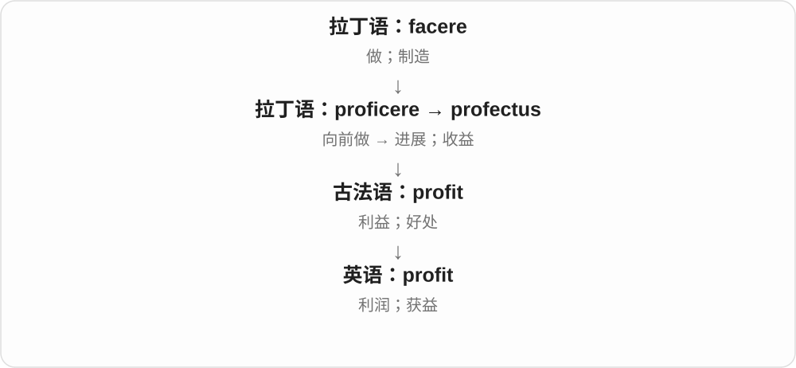

先是往前走、取得进展，再落到实际的收益。现代商业语境突出净赚的部分，不是所有进账。

**常见搭配与例句**

make a profit；profit from experience；profit margin。

> The shop made a small profit last year.

这家店去年赚了一点利润。

> We can all profit from her experience.

我们都能从她的经验中获益。

**别混淆**

revenue 是收入，profit 是扣除成本后的利润；这两个数字不能混用。

### 14. factor — 因素；因数

**音标**：/ˈfæk.tə/

**先抓住这个画面**

把结果想成一道成品，factor 是参与把它做出来的一项条件。数学里二乘三得六，二和三就是六的因数。

**怎么拆**

factor 原是拉丁语“做事者”，来自 facere + 表示执行者的 -tor。

**怎么变成今天的意思**

做事的人 → 能造成结果的力量或条件 → 因素。数学义同样保留“参与组成结果”的关系。

**常见搭配与例句**

a major factor；a factor in…；a factor of six。

> Cost was a major factor in our decision.

成本是我们作决定时的重要因素。

> Three is a factor of twelve.

三是十二的一个因数。

**别混淆**

cause 强调因果作用；factor 可只是许多相关条件之一，不宜一看到它就认定唯一原因。

### 15. scientific — 科学的；合乎科学方法的

**音标**：/ˌsaɪ.ənˈtɪf.ɪk/

**先抓住这个画面**

scientific 的重点是按证据和方法办事：提出问题、检验说法，让别人也能核查。不是文字越难懂就越科学。

**怎么拆**

scient- 来自 scientia“知识”，-fic 来自制作、产生一支；历史 scientificus 本有产生知识的意思。

**怎么变成今天的意思**

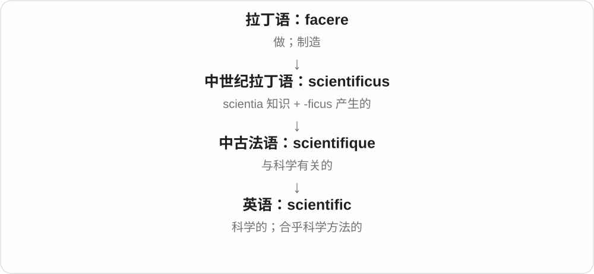

产生知识的 → 与科学有关的。现代的 scientific evidence 指按科学方法得到的证据，不是任何听起来专业的说法。

**常见搭配与例句**

scientific research；scientific evidence；a scientific approach。

> The claim needs scientific evidence.

这个说法需要科学证据。

> They took a scientific approach to the problem.

他们用科学的方法处理这个问题。

**别混淆**

technical 表技术性的；scientific 更关注科学知识和研究方法。

### 16. facility — 设施；场所；熟练能力

**音标**：/fəˈsɪlɪti/

**先抓住这个画面**

游泳池让你能游泳，实验室让你能做实验：这些让事情办得成的条件，就可以是 facilities。

**怎么拆**

facere → facilis“容易做的”→ facilitas；经法语借入。不是简单的 fac + ability。

**怎么变成今天的意思**

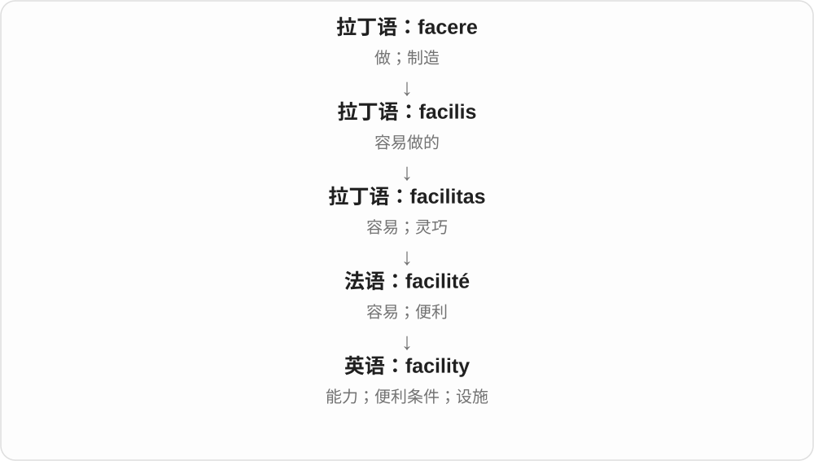

容易做某事 → 做事灵巧 → 便于做事的条件、设备和场所。a facility for languages 则仍说学语言很顺手。

**常见搭配与例句**

sports facilities；a research facility；a facility for languages。

> The school has excellent sports facilities.

学校有很好的运动设施。

> She has a remarkable facility for languages.

她学语言特别得心应手。

**别混淆**

equipment 侧重器材；facility 可包含建筑、设备和整套服务条件。

### 17. affect — 影响；使感动；装出

**音标**：动词 /əˈfekt/；名词 /ˈæfekt/

**先抓住这个画面**

风吹到水面，水面随之改变：affect 说的是外来的东西对对象起作用。它不一定把对象完全改变。

**怎么拆**

ad-（朝向）+ facere 形成 afficere。影响义联系 affectus“受作用形成的状态”；装出姿态义另经 affectare、法语 affecter 发展，不能混成一条直线。

**怎么变成今天的意思**

主图画的是影响这一支：外来作用改变对象或触动情绪。另一支 affectare 原有刻意追求、模仿的意思，经法语发展出装出姿态的用法。两支历史上有交织；名词 affect 则是心理学中的情感表现。

**常见搭配与例句**

affect the result；deeply affected；affect an accent。

> Lack of sleep can affect your concentration.

睡眠不足会影响注意力。

> She was deeply affected by his kindness.

他的善意使她深受感动。

**别混淆**

通常用 affect 作动词、effect 作名词；affect 的“装作”义更正式，也常带批评。

### 18. factory — 工厂

**音标**：/ˈfæk.tə.ɹi/

**先抓住这个画面**

想象原料一端进去，成品另一端出来。今天 factory 是生产的地方，但早期它也指商人的办事处或贸易站。

**怎么拆**

与 factor“办事者、代理人”这一支相连；词形也受表示制作的拉丁语 fact- 及相关词影响。具体形成过程有不同分析，不能只按 fac + tory 硬拆。

**怎么变成今天的意思**

代理商办事、经营的场所后来与制造业联系起来，现代中心转为工厂。词源中的做事比今天的机器生产更宽。

**常见搭配与例句**

a car factory；factory workers；a factory building。

> The factory produces bicycle parts.

这家工厂生产自行车零件。

> Her grandfather worked in a textile factory.

她祖父曾在纺织厂工作。

**别混淆**

plant 可指整套工业厂区，也可指大型设备；factory 通常直接让人想到制造产品的工厂。

### 19. officially — 正式地；官方地

**音标**：/əˈfɪʃ.(ə.)li/

**先抓住这个画面**

口头传闻已经有了，现在主管机构公开确认：这时事情 officially 成立。

**怎么拆**

official + -ly，把官方认可这一性质变成描述动作或状态的方式。

**怎么变成今天的意思**

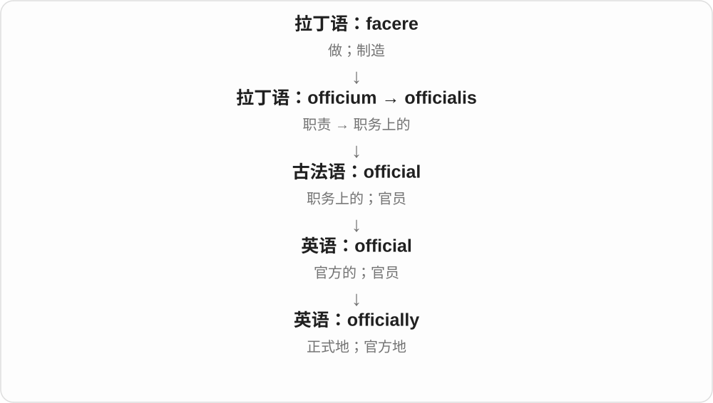

official 关心谁有权宣布，officially 说明事情在正式认可的层面是什么状态；不一定等于现实中已经完全到位。

**常见搭配与例句**

officially open；officially announced；officially recognized。

> The library officially opened on Monday.

图书馆星期一正式开放。

> The result has not been officially confirmed.

结果尚未得到官方确认。

**别混淆**

publicly 只是公开地；officially 还含正式授权或确认。

### 20. defeat — 击败；失败

**音标**：/dɪˈfiːt/

**先抓住这个画面**

对手本来要完成自己的计划，你把它打断、瓦解了：这就是 defeat 的画面。

**怎么拆**

古法语 desfaire 是“拆掉、使落空”，由否定、逆转成分加 faire“做”构成；英语借用相关形式。

**怎么变成今天的意思**

从使事情不能完成，发展到挫败目的和击败对手。名词 defeat 说一次败局，动词直接接被击败的人或计划。

**常见搭配与例句**

defeat an opponent；suffer a defeat；defeat the purpose。

> Our team defeated the champions.

我们队击败了冠军队。

> Adding more steps would defeat the purpose of simplifying the process.

再加步骤就违背了简化流程的目的。

**别混淆**

beat 更口语；win 接比赛或奖项，通常不直接说 win a person。

### 21. effectively — 有效地；实际上

**音标**：/ɪˈfɛktɪvli/

**先抓住这个画面**

一个办法真正起了作用，是 effectively；某事名义上没结束，实际已经结束，也能说 effectively over。

**怎么拆**

effective + -ly。副词一支评价效果，另一支说实际效果等同于某种情况。

**怎么变成今天的意思**

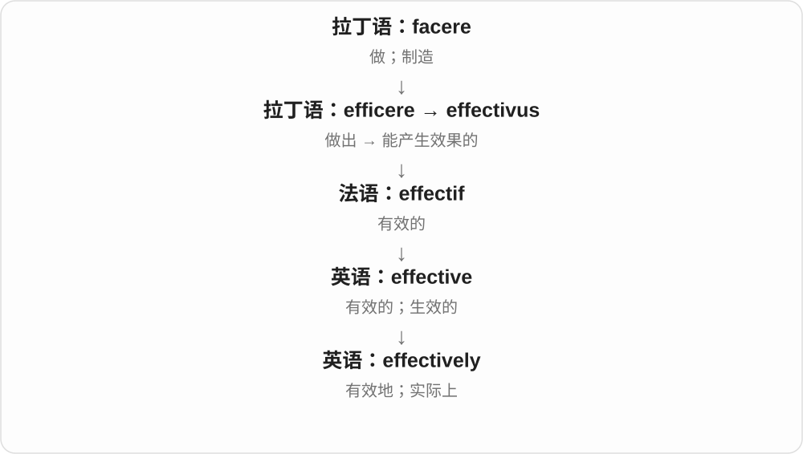

第二个意思可理解为“从造成的结果看”。它不必表示有人公开宣布，而是结果已经如此。

**常见搭配与例句**

communicate effectively；effectively impossible；effectively closed。

> The team communicated effectively under pressure.

团队在压力下仍然沟通得很有效。

> The road was effectively closed by the fallen tree.

倒下的树实际上把道路封死了。

**别混淆**

efficiently 强调少浪费；effectively 强调奏效或实际结果，别把两个副词都只译成高效。

### 22. faced — 面对了；面临……的

**音标**：/feɪst/

**先抓住这个画面**

问题已经站到你面前，你需要接住它。faced 可以叙述过去面对了什么，也常出现在 be faced with 里。

**怎么拆**

face + -ed；词尾读 /t/。这是英语动词变化，也可形成描述处境的分词结构。

**怎么变成今天的意思**

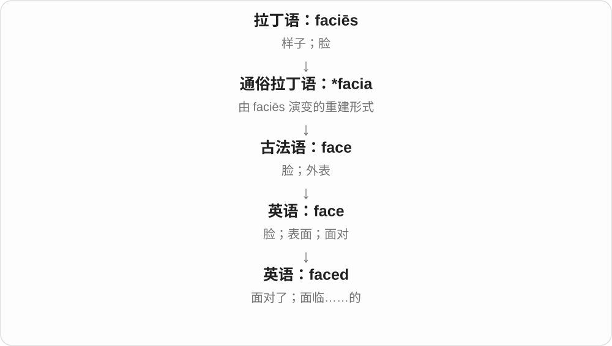

从把脸朝向对象到面对处境，-ed 只改变时间或语法状态，并没有产生一个新的古代词根。

**常见搭配与例句**

faced a choice；be faced with a challenge。

> We faced several delays last week.

我们上周遇到了几次延误。

> Faced with two options, she chose the simpler one.

面对两个选项，她选了较简单的那个。

**别混淆**

She faced a problem 与 She was faced with a problem 都可以；不要拼成 was faced a problem。

### 23. featured — 被重点展示的；作为特色的

**音标**：/ˈfiːt͡ʃə(ɹ)d/

**先抓住这个画面**

杂志里给某个人留了醒目的位置，这个人就是 featured。它比“出现过”多一层特别挑出来展示。

**怎么拆**

feature + -ed，是过去式、过去分词，也可作形容词。

**怎么变成今天的意思**

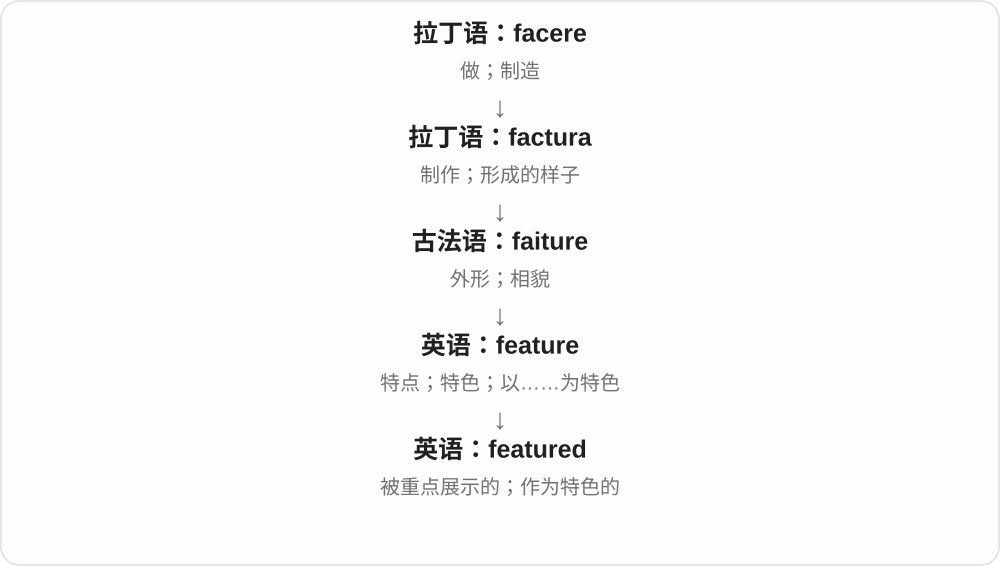

feature 作动词表示重点呈现，featured 转向被呈现的对象；featured artist 指受重点介绍的艺术家。

**常见搭配与例句**

a featured artist；featured in a magazine；featured on the homepage。

> Her photographs were featured in a travel magazine.

她的照片在一本旅游杂志上得到重点展示。

> Tonight’s featured speaker is a marine biologist.

今晚重点邀请的演讲者是一位海洋生物学家。

**别混淆**

included 只保证在里面；featured 往往说明被突出安排。

### 24. efficient — 效率高的

**音标**：/ɪˈfɪʃənt/

**先抓住这个画面**

同样洗好一堆衣服，一台机器用更少的水和电：它更 efficient。画面是用较少投入把事情做好。

**怎么拆**

ex- + facere 形成 efficere，efficiens 本指产生作用的；英语后来突出投入与产出的关系。

**怎么变成今天的意思**

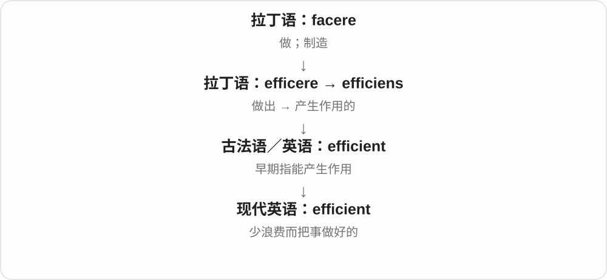

从能产生结果，收窄为不白费力气、时间和资源。它可以说人、机器，也可以说整个流程。

**常见搭配与例句**

an efficient system；efficient use of energy；highly efficient。

> This route is the most efficient way to deliver the parcels.

这条路线配送包裹最省时省力。

> The new heater is more energy efficient.

新取暖器更节能。

**别混淆**

effective 是达到目标，efficient 是达到目标时少浪费；两个维度可以分别评价。

### 25. efficiency — 效率

**音标**：/ɪˈfɪʃ.ən.si/

**先抓住这个画面**

efficiency 像一笔投入产出账：用了多少时间、精力和资源，换来多少有效成果。

**怎么拆**

英语借入拉丁语 efficientia；现代可与 efficient 对照，-ent 形容词常对应 -ency 名词。

**怎么变成今天的意思**

形容一台机器 efficient，是评价它；谈 its efficiency，则把这种表现变成可比较的指标。

**常见搭配与例句**

improve efficiency；energy efficiency；operational efficiency。

> Better scheduling improved the team’s efficiency.

更好的排期提高了团队效率。

> The label shows the machine’s energy efficiency.

标签标明了机器的能源效率。

**别混淆**

speed 只看快慢；efficiency 还看成本和浪费，快但返工多未必有效率。

### 26. difficulty — 困难；费力

**音标**：/ˈdɪfɪkəlti/

**先抓住这个画面**

一扇门能开，但很沉，要费劲推：difficulty 是事情做起来不轻松的地方或程度。

**怎么拆**

拉丁语 dis- + facilis“容易”形成 difficilis，再有 difficultas；经法语 difficulté 进入英语。

**怎么变成今天的意思**

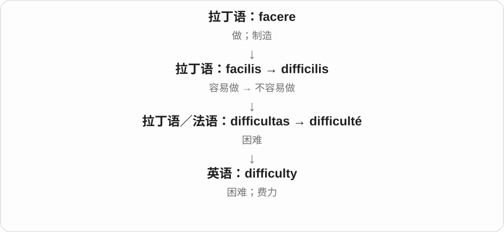

这里保留的是“好不好做”的轴线。英语 difficult 与 difficulty 紧密相关，但不能把现代后缀分析当成整个历史顺序。

**常见搭配与例句**

have difficulty doing…；with difficulty；financial difficulties。

> I had difficulty finding the entrance.

我费了些劲才找到入口。

> They discussed the financial difficulties openly.

他们坦率讨论了经济上的困难。

**别混淆**

problem 是需要处理的问题；difficulty 强调处理时费劲，也可指某个难处。

### 27. sufficient — 足够的

**音标**：/səˈfɪʃənt/

**先抓住这个画面**

给四个人盛汤，锅里的量刚好能让大家吃饱：sufficient 就是够达到眼前需要。

**怎么拆**

来自 sufficere 的分词 sufficiens；sub- 与 facere 结合后的词义是供给、足以应付。

**怎么变成今天的意思**

重点是越过“够不够”的门槛，而不是越多越好。充分条件的 sufficient 也强调满足它即可保证结论。

**常见搭配与例句**

sufficient time；sufficient for…；sufficient to do…。

> We have sufficient time to check the figures.

我们有足够时间核对数字。

> One example is not sufficient to prove the claim.

一个例子不足以证明这个说法。

**别混淆**

enough 更日常，sufficient 更正式；abundant 则是大量、充裕，超过只是够用。

### 28. affair — 事情；事务；婚外情

**音标**：/əˈfɛə/

**先抓住这个画面**

先把 affair 想成摆在手头要处理的一件事；public affairs 就是公众共同关心的事务。

**怎么拆**

来自法语 à faire，字面是“要做的”；faire 追溯到 facere。

**怎么变成今天的意思**

从待办事到任何事情；感情义由爱情方面的事情发展而来，现代常指不正当或婚外关系。不是所有 affair 都是丑闻。

**常见搭配与例句**

foreign affairs；a private affair；have an affair。

> The committee handles student affairs.

委员会处理学生事务。

> The novel follows the consequences of an affair.

这部小说讲述一段婚外情引发的后果。

**别混淆**

event 强调发生的事件；affair 可泛指一件复杂事情，也有特定感情义。

### 29. sacrifice — 牺牲；献祭

**音标**：/ˈsæk.ɹɪ.faɪs/

**先抓住这个画面**

你把自己珍惜的东西交出去，为了保住更重要的东西：现代 sacrifice 常是这个取舍画面。

**怎么拆**

sacer／sacrum（神圣）+ facere（做），形成 sacrificium，经过法语传入。

**怎么变成今天的意思**

早期是把东西献为神圣祭品，后来扩展到为了他人或目标舍弃利益。并非任何损失都带主动取舍。

**常见搭配与例句**

make a sacrifice；sacrifice time for…；at the sacrifice of…。

> She sacrificed a weekend to help her friend move.

她拿出一个周末帮朋友搬家。

> The museum explains the role of sacrifice in ancient rituals.

博物馆解释了献祭在古代仪式中的作用。

**别混淆**

loss 只是损失；sacrifice 常有“为了什么而放弃”的关系。

### 30. modified — 修改过的；改良的

**音标**：/ˈmɒdɪfaɪd/

**先抓住这个画面**

同一辆车换了座椅、调了设置，它还是那辆车，但已是 modified：原物保留，某些部分调整了。

**怎么拆**

modify + -ed，y 变 i，词尾读 /d/；可作过去式、分词或形容词。

**怎么变成今天的意思**

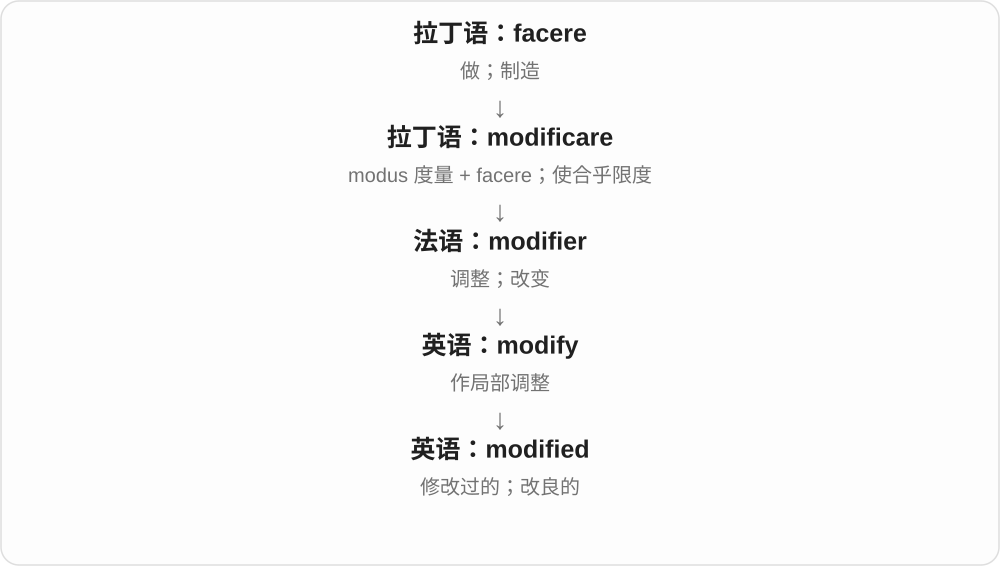

modify 的“调整限度、样式”加上完成状态，指改变已经发生。modified 不保证更好，只保证与原版本不同。

**常见搭配与例句**

a modified version；modified equipment；slightly modified。

> We tested a modified version of the design.

我们测试了设计的修改版。

> The bike was modified to fit a shorter rider.

自行车经过调整，以适合身材较矮的骑手。

**别混淆**

improved 明说变好；modified 只说改动，改好改坏要看效果。

### 31. manufacturer — 制造商

**音标**：/ˌmænjʊˈfæktʃəɹə/

**先抓住这个画面**

商店把商品卖给你，manufacturer 则负责把商品生产出来。它通常是企业，也可以泛指制造者。

**怎么拆**

manufacture + -er；末尾 e 保留后接 r，形成表示执行者的名词。

**怎么变成今天的意思**

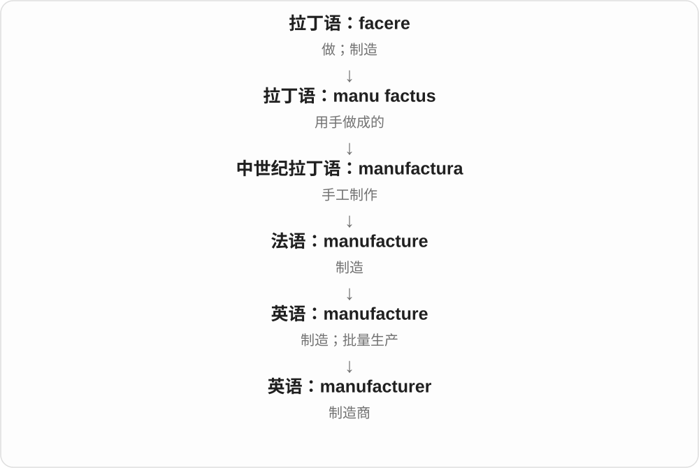

原来用手做的动作发展为工业制造，-er 把焦点转到承担制造工作的主体。词长，但可以抓住 manufacture 与人、机构的关系。

**常见搭配与例句**

a car manufacturer；the original manufacturer；manufacturer’s instructions。

> Contact the manufacturer for a replacement part.

联系制造商获取替换零件。

> Several manufacturers use the same component.

几家制造商都使用同一种零件。

**别混淆**

seller 是卖方，manufacturer 是生产方；同一家公司可兼任两者。

### 32. interface — 界面；交接处；连接互动

**音标**：/ˈɪntəfeɪs/

**先抓住这个画面**

两个系统像两间相邻房间，interface 是它们交换东西的那道门。屏幕界面是你与软件交流的入口。

**怎么拆**

inter-（在……之间）+ face（面），英语合成。

**怎么变成今天的意思**

由两种物质的接触面，扩展到人机界面和系统之间的连接规则。作动词时指与另一部分接通或配合。

**常见搭配与例句**

user interface；interface with a system；the interface between…。

> The new interface makes the settings easier to find.

新界面让设置更容易找。

> This device can interface with older equipment.

这台设备能与旧设备连接使用。

**别混淆**

surface 是单个对象的表面；interface 强调两方在这里接触。

### 33. facial — 面部的；面部护理

**音标**：/ˈfeɪ.ʃəl/

**先抓住这个画面**

把镜头推近一张脸：facial 说的就是这块区域。作名词时，a facial 是一次面部美容护理。

**怎么拆**

拉丁语 faciēs“脸”一支形成 facialis，再经法语 facial 传入；现代可与 face + -ial 联系理解。

**怎么变成今天的意思**

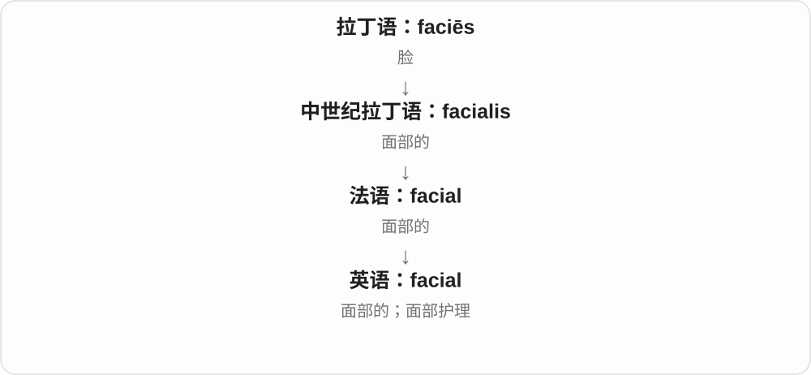

脸的外形义没有远离，-ial 把它变成描述部位的形容词。名词护理义则省略了 treatment 一类中心词。

**常见搭配与例句**

facial expression；facial recognition；have a facial。

> Her facial expression changed when she heard the news.

听到消息时，她的面部表情变了。

> She booked a facial at the salon.

她在美容院预约了一次面部护理。

**别混淆**

facial 描述脸部；face 作名词可指别的表面，因此不能处处互换。

### 34. effectiveness — 有效性；实际成效

**音标**：/ɪˈfɛk.tɪv.nɪs/

**先抓住这个画面**

不是问宣传得多好，而是问事情到底改善了多少：这就是 effectiveness 所关心的。

**怎么拆**

effective + -ness，把有效这一性质变成名词。

**怎么变成今天的意思**

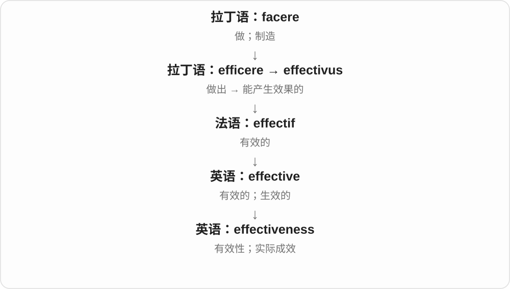

从一个效果转为评价整套方法能否达到目标。很多语境关心真实条件下能否奏效，而非只看漂亮的理论。

**常见搭配与例句**

measure effectiveness；the effectiveness of a policy；cost effectiveness。

> We measured the effectiveness of the training.

我们衡量了培训的实际效果。

> Its effectiveness depends on how it is used.

它是否有效取决于怎样使用。

**别混淆**

efficiency 看资源利用；effectiveness 看目标实现。部分研究中 efficacy 更侧重受控条件下的效力。

### 35. profitable — 有利润的；有收获的

**音标**：/ˈpɹɒf.ɪ.tə.bl̩/

**先抓住这个画面**

一项生意赚回的钱超过成本，就是 profitable；一次讨论让你学到东西，也可以是有收获的。

**怎么拆**

古法语 profitable 借入英语；现代可以直接看出 profit + -able，表示能带来收益的。

**怎么变成今天的意思**

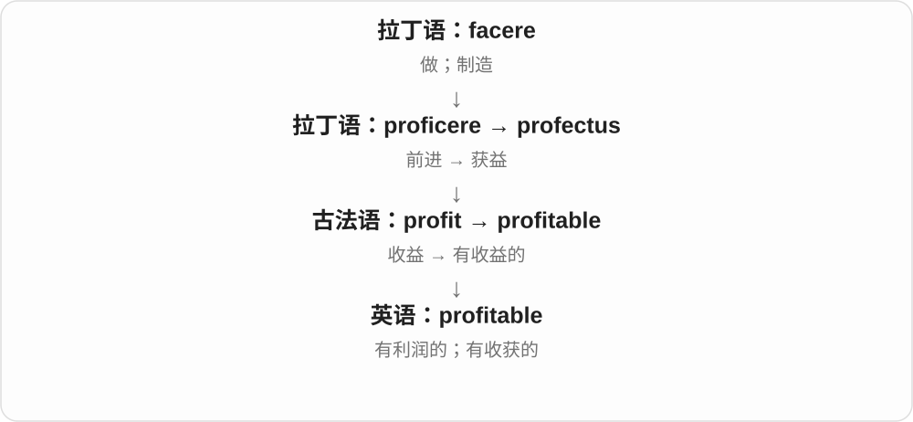

收益可以是钱，也可以是知识与经验。说 profitable business 通常直指赚钱，说 profitable discussion 则较正式地指有所得。

**常见搭配与例句**

a profitable business；a profitable discussion；become profitable。

> The business became profitable in its third year.

这家企业第三年开始盈利。

> We had a profitable discussion about the design.

我们就设计进行了一次很有收获的讨论。

**别混淆**

popular 是受欢迎；profitable 是有收益。很热闹的店也可能赔钱。

### 36. facilitate — 促进；使更容易

**音标**：/fəˈsɪlɪteɪt/

**先抓住这个画面**

两个人隔着一道沟，你搭一块木板，让他们容易走过去：facilitate 就是替事情扫清障碍。

**怎么拆**

facilis“容易做”一支，经法语 faciliter 传入；现代可把 -ate 看作动词形式。

**怎么变成今天的意思**

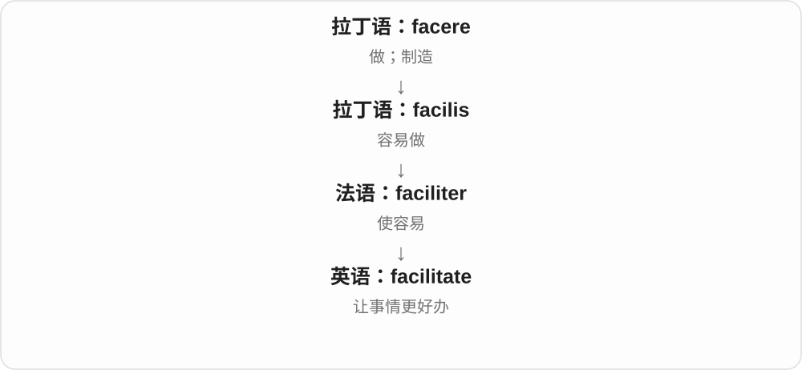

核心是使过程顺畅，不保证替别人把事情全做完。主持讨论时，facilitate 是帮助大家交流与推进。

**常见搭配与例句**

facilitate communication；facilitate learning；facilitate a discussion。

> Clear signs facilitate movement through the building.

清楚的标识让人在楼内更容易通行。

> She facilitated the discussion without choosing sides.

她帮助推进讨论，没有偏向任何一方。

**别混淆**

enable 强调让原本不能做的事成为可能；facilitate 更强调让它好做一些。

### 37. feat — 壮举；技艺高超的成就

**音标**：/fiːt/

**先抓住这个画面**

一件普通任务完成了不一定是 feat；完成后让人感叹“这可真不容易”，才常用这个词。

**怎么拆**

与 fact 同出拉丁语 factum，经古法语 fait／fet 变化而来。现代不能把 feat 当作 feature 的缩写来分析本义。

**怎么变成今天的意思**

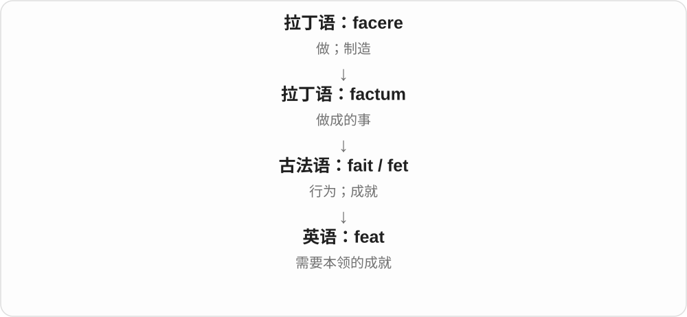

同样是做成的事情，fact 走向真假，feat 走向难度和本领，因此是值得赞叹的完成。

**常见搭配与例句**

an impressive feat；a feat of engineering；no mean feat。

> Building the bridge was a remarkable feat of engineering.

建成这座桥是一项非凡的工程成就。

> Finishing the race was no small feat.

跑完这场比赛可不是件容易的事。

**别混淆**

achievement 广泛指成就；feat 特别强调难度。音乐名单里的 feat. 常是 featuring 的缩写，是另一用法。

### 38. perfection — 完美；完善

**音标**：/pɚˈfɛk.ʃən/

**先抓住这个画面**

把镜头里的每个细节都调到理想位置，追求的那个毫无缺口的状态就是 perfection。

**怎么拆**

perfect 一支的名词；拉丁语 perfectio 经法语 perfection 进入英语。

**怎么变成今天的意思**

完成的概念升高成理想标准。to perfection 常表示做得恰到好处，不一定是哲学上绝对没有缺陷。

**常见搭配与例句**

strive for perfection；cooked to perfection；the pursuit of perfection。

> The bread was baked to perfection.

面包烤得恰到好处。

> She values progress more than perfection.

比起完美，她更看重进步。

**别混淆**

improvement 是变好，perfection 是完美状态；追求后者有时会妨碍完成前者。

### 39. manufacture — 制造；编造

**音标**：/ˌmænjuˈfækt͡ʃɚ/

**先抓住这个画面**

一批原料按照步骤变成同样规格的产品，就是 manufacture。它也可批评人把借口或证据“加工”出来。

**怎么拆**

manu（用手）+ factus（做成的），经中世纪拉丁语和法语进入英语。

**怎么变成今天的意思**

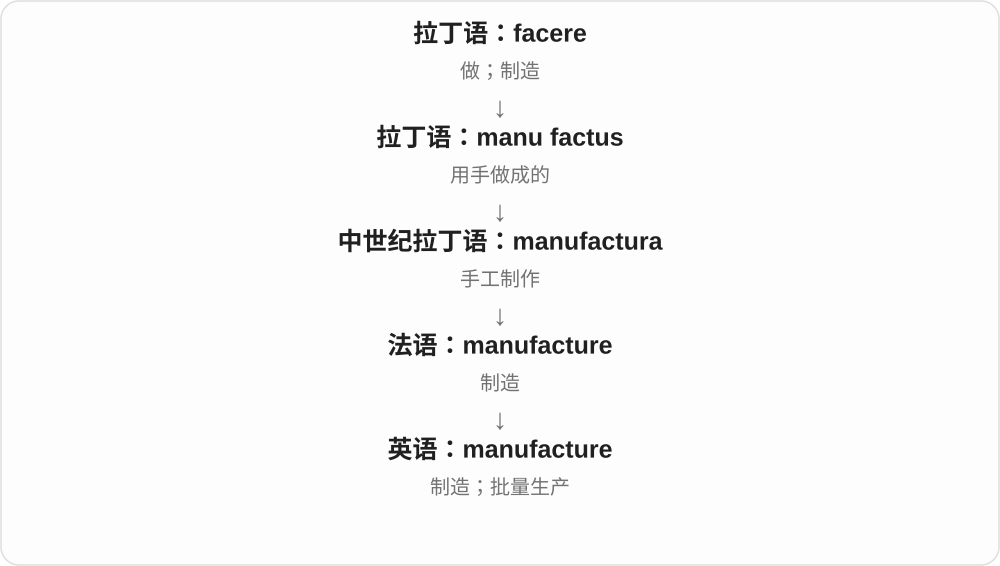

起点是手工制作，工业化后扩展为大规模生产。比喻义把不真实的信息也看作人为做出来的东西。

**常见搭配与例句**

manufacture goods；manufacturing costs；manufacture an excuse。

> The company manufactures kitchen equipment.

这家公司生产厨房设备。

> He manufactured an excuse for missing the meeting.

他编了个借口解释为什么没参会。

**别混淆**

make 很通用；manufacture 常带有生产流程、规模或人为加工感。

### 40. qualification — 资格；资历；限定条件

**音标**：/ˌkwɒlɪfɪˈkeɪʃən/

**先抓住这个画面**

门口写着进入要求，你满足了，就有 qualification；一句话后面加“但只在这些条件下”，也是给它加 qualification。

**怎么拆**

qualis（什么性质）+ facere → qualificare，再形成 qualificatio，经法语 qualification 借入。现代英语中，qualify 与 qualification 形成动词、名词的形态对应。

**怎么变成今天的意思**

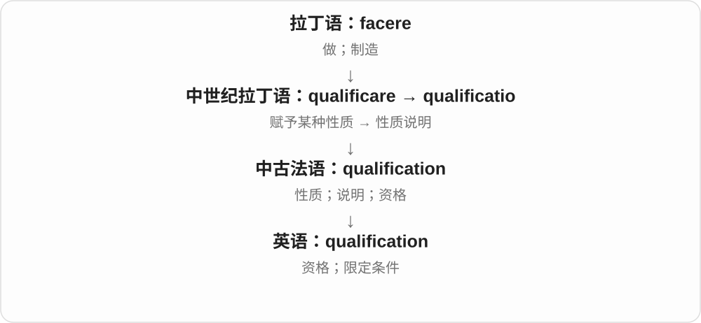

某种性质使人符合要求，便有资格、证书义；给说法加性质说明，则成为保留和限制。两个义项都在说明适用到什么程度。

**常见搭配与例句**

professional qualifications；meet the qualifications；without qualification。

> What qualifications are required for this position?

这个职位要求具备哪些资格？

> I agree with your proposal, with one qualification.

我赞成你的提议，但有一个保留条件。

**别混淆**

qualification 不只指学历；certificate 是证明文件，qualification 可指实际资历或条件。

### 41. nonprofit — 非营利的；非营利组织

**音标**：/ˌnɒnˈprɒfɪt/

**先抓住这个画面**

组织可以收钱、付工资、留下结余，但主要目的和分配规则不以给所有者赚利润为中心，这就是 nonprofit 的基本方向。

**怎么拆**

non-（非）+ profit，英语构词；作名词时指这种组织。

**怎么变成今天的意思**

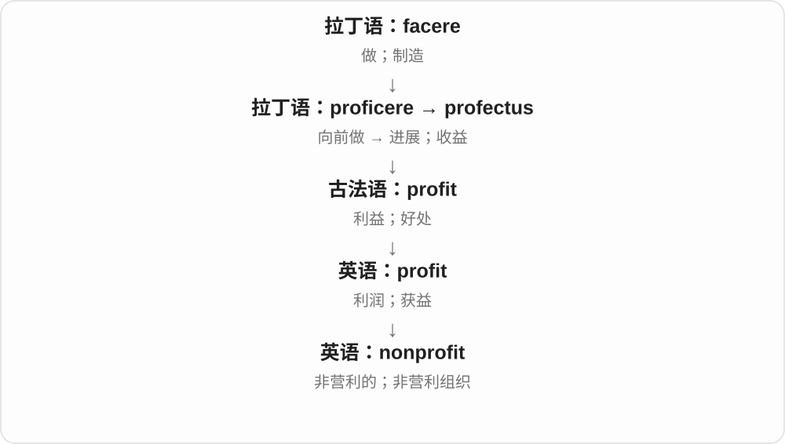

否定的是营利取向，不是宣称账面永远没有结余。理解具体组织时，还要看其所在地的组织制度。

**常见搭配与例句**

a nonprofit organization；work for a nonprofit。

> She works for a nonprofit that supports local libraries.

她在一家支持本地图书馆的非营利组织工作。

> The nonprofit uses its surplus to expand the programme.

这家非营利组织用结余扩大项目。

**别混淆**

nonprofit 不等于免费，也不等于完全靠志愿者；charity 通常进一步强调慈善目的。

### 42. sufficiently — 足够地

**音标**：/səˈfɪʃəntli/

**先抓住这个画面**

门至少要打开到能让箱子通过；sufficiently 评价的就是是否到了那个够用的程度。

**怎么拆**

sufficient + -ly，副词修饰形容词、动词等。

**怎么变成今天的意思**

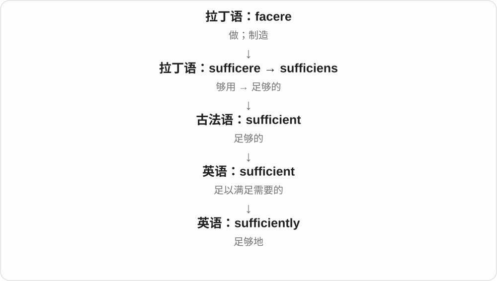

sufficient 是足够，sufficiently 把它用在某个程度上。sufficiently clear to understand 就是清楚到足以理解。

**常见搭配与例句**

sufficiently large；sufficiently prepared；sufficiently clear to…。

> The instructions are sufficiently clear for beginners.

这些说明够清楚，初学者也能看懂。

> The room was not sufficiently warm.

房间不够暖和。

**别混淆**

very 只说程度高；sufficiently 还暗含为某个目的已经够用。

### 43. efficiently — 有效率地

**音标**：/ɪˈfɪʃəntli/

**先抓住这个画面**

把事情安排顺，不来回跑、不重复填表：这样做事就是 efficiently。

**怎么拆**

efficient + -ly，表示以少浪费资源的方式做事。

**怎么变成今天的意思**

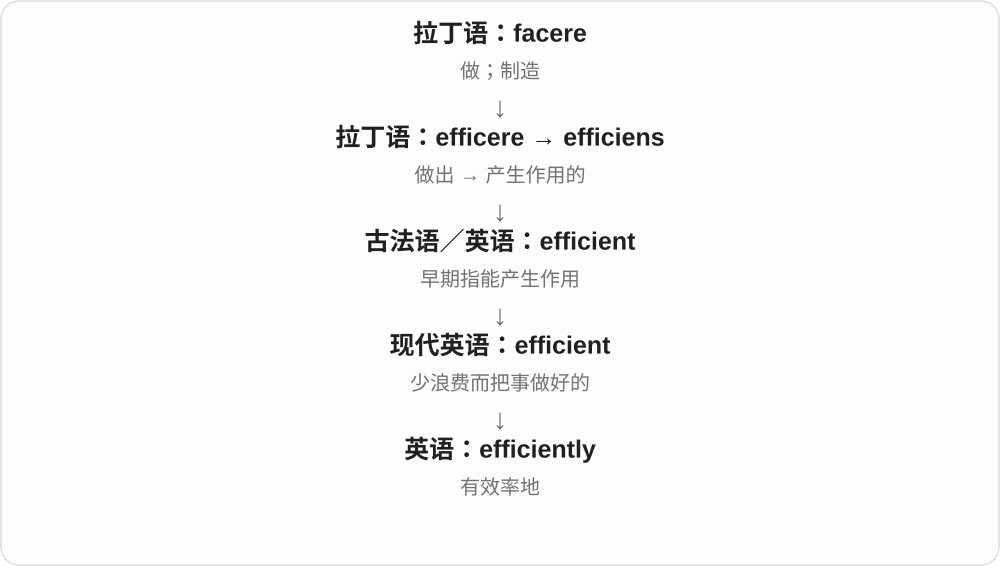

名词 efficiency 谈效率这项性质，副词 efficiently 则落到具体怎么做。要看投入和有效产出，不能仅用忙碌程度判断。

**常见搭配与例句**

work efficiently；use resources efficiently；run efficiently。

> The software sorts the files efficiently.

这个软件能高效整理文件。

> We need to use the available space more efficiently.

我们需要更有效地利用现有空间。

**别混淆**

quickly 强调快，efficiently 强调少浪费；快做错后重做可能并不高效。

### 44. faction — 派别；派系

**音标**：/ˈfæk.ʃən/

**先抓住这个画面**

一个大团体里，一群人总围着同一个主张一起行动，他们就可能形成一个 faction。

**怎么拆**

来自拉丁语 factio，和 facere“做、行动”相连，经法语进入英语。

**怎么变成今天的意思**

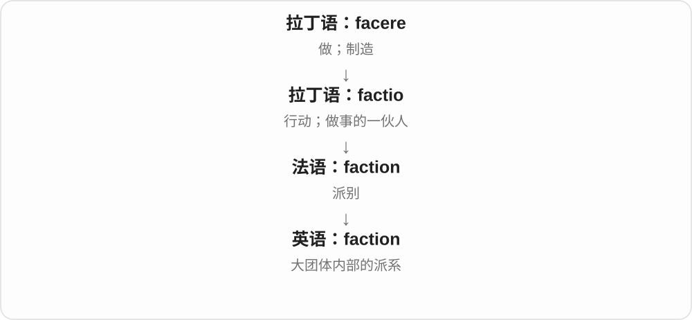

共同做事的一伙人发展为有共同利益或立场的派别。现代常暗示团体内部的分歧，不只是中性的分组。

**常见搭配与例句**

a political faction；rival factions；a faction within the party。

> A small faction opposed the agreement.

一个小派系反对这项协议。

> The movement split into rival factions.

这场运动分裂成了相互竞争的派别。

**别混淆**

group 很中性；faction 常带内部结派、彼此争执的意味。

### 45. modify — 修改；调整

**音标**：/ˈmɒd.ɪ.faɪ/

**先抓住这个画面**

衣服大了，你收一点腰；计划不合适，你改几处。这种保留主体、调整局部的动作是 modify。

**怎么拆**

modus（度量、限度）+ facere 形成 modificare，经法语 modifier 传入。

**怎么变成今天的意思**

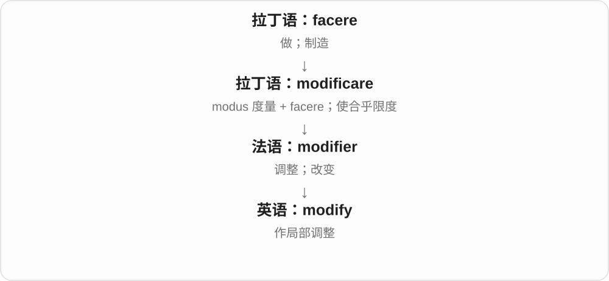

原来是给事物定限度、调节，后来广泛表示改变形式或内容。语法里的 modify 则指一个词给另一个词增添说明。

**常见搭配与例句**

modify a plan；modify behaviour；an adjective modifies a noun。

> We need to modify the plan slightly.

我们需要稍微修改计划。

> In this phrase, the adjective modifies the noun.

在这个短语中，形容词修饰名词。

**别混淆**

replace 是换掉，modify 通常仍保留原对象的核心；alter 的改动范围更宽。

### 46. insufficient — 不足的

**音标**：/ɪnsəˈfɪʃənt/

**先抓住这个画面**

想煮四人份的饭，米只够两人：insufficient 说现有数量或条件还没越过需要的门槛。

**怎么拆**

历史上来自拉丁语 insufficiens，经法语传入；现代可清楚看出 in-（不）+ sufficient。

**怎么变成今天的意思**

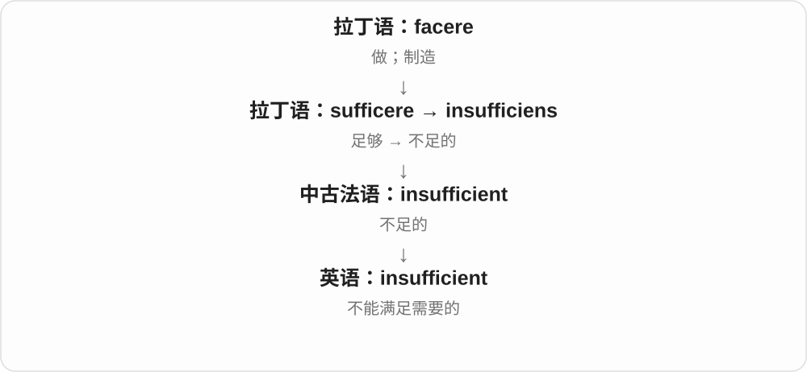

否定的是够用状态。它可以说钱不够、证据不足，也能说通风不充分，不必都是能数出的东西。

**常见搭配与例句**

insufficient evidence；insufficient funds；insufficient to do…。

> There was insufficient evidence to support the claim.

支持这个说法的证据不足。

> The room has insufficient ventilation.

这个房间通风不足。

**别混淆**

little 是量少；insufficient 是相对需求不够，量大也可能仍然不足。

### 47. feasible — 可行的

**音标**：/ˈfiː.zɪ.bəl/

**先抓住这个画面**

地图上能画一座桥，不等于手里的预算、材料和时间能建成。feasible 问的是现实条件下做不做得到。

**怎么拆**

古法语 faire“做”+ 表可做的成分，形成 faisable／fesable；英语借为 feasible。

**怎么变成今天的意思**

从能够做发展为实际可实施。它通常隐含已经考虑条件，不只是逻辑上没有矛盾。

**常见搭配与例句**

a feasible plan；technically feasible；financially feasible。

> The design is attractive, but is it feasible?

这个设计很吸引人，但实际可行吗？

> A smaller pilot project may be financially feasible.

较小的试点项目在资金上也许可行。

**别混淆**

possible 范围更宽；feasible 往往要经得起现实资源和操作条件的检验。

### 48. defect — 缺陷；叛离

**音标**：名词 /ˈdiːfekt/；动词 /dɪˈfekt/

**先抓住这个画面**

一把伞缺了一根关键支撑杆，这个影响正常功能的不足是 defect；人从原来的阵营离开，则是动词 defect。

**怎么拆**

de- + facere → deficere“缺少、衰竭、离弃”，其分词 defectus 给出名词和动词这一支。

**怎么变成今天的意思**

一支说东西欠缺了应有部分，另一支说成员离开所属一方。动词重音在后，名词重音在前。

**常见搭配与例句**

a manufacturing defect；defect from a party；defect to the other side。

> The inspection revealed a defect in the frame.

检查发现框架有一处缺陷。

> Several members defected to a rival party.

几位成员转投了对立政党。

**别混淆**

fault 可泛指错误或责任；defect 常突出对象自身的结构、质量缺陷。

### 49. efficacy — 效力；功效

**音标**：/ˈɛf.ɪ.kə.si/

**先抓住这个画面**

给一种办法设定明确目标，再检验它能否做到：efficacy 关心它实现这个目标的能力。

**怎么拆**

efficere“做出结果”→ efficax“有效的”→ efficacia，经古法语 efficace 传入。

**怎么变成今天的意思**

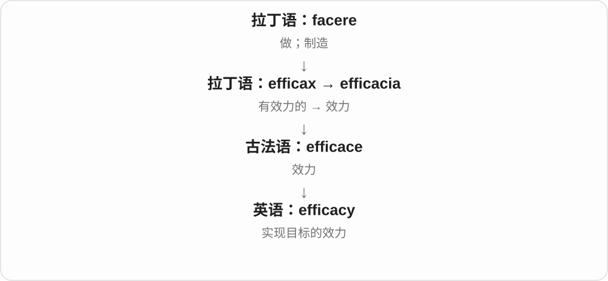

它是较正式的有效性名词，常见于研究、治疗和干预评价。画面不是“听着可信”，而是结果能不能达到预定标准。

**常见搭配与例句**

test efficacy；the efficacy of a treatment；demonstrate efficacy。

> The study tested the efficacy of the training method.

这项研究检验了这种训练方法的效力。

> More evidence is needed to establish its efficacy.

还需要更多证据来确定它是否奏效。

**别混淆**

研究中 efficacy 常指受控条件下的效力，effectiveness 常看实际条件表现；普通用法中两者也有重叠。

### 50. ineffective — 无效的；不起作用的

**音标**：/ˌɪn.ɪˈfɛk.tɪv/

**先抓住这个画面**

按了按钮，门还是纹丝不动：这个办法 ineffective，因为想要的变化没出现。

**怎么拆**

in-（不）+ effective，否定的是产生预期效果。

**怎么变成今天的意思**

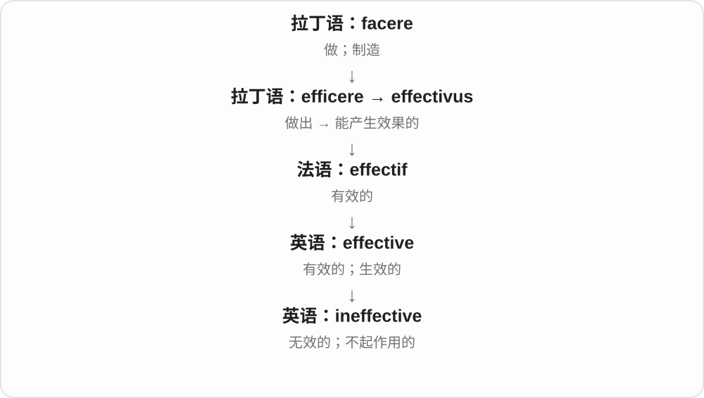

它可以表示完全不起作用，也可指效果弱到达不到目的；具体程度要看语境。

**常见搭配与例句**

an ineffective method；ineffective at doing…；prove ineffective。

> The old warning signs were ineffective.

旧警示牌没起到应有的作用。

> The repair proved ineffective, and the leak returned.

这次维修没有奏效，后来又漏水了。

**别混淆**

inefficient 可能做成了但浪费大；ineffective 是目标没实现或效果不够。

### 51. unofficial — 非官方的；未正式认可的

**音标**：/ʌn.əˈfɪʃ.əl/

**先抓住这个画面**

同事私下告诉你一个时间，但负责人还没有正式发布：这是 unofficial information。

**怎么拆**

un- + official，否定官方授权或正式地位。

**怎么变成今天的意思**

消息可能是真的，只是还不是机构正式说法；比赛中的 unofficial record 也可能因为条件不合规则而未获承认。

**常见搭配与例句**

an unofficial visit；unofficial results；an unofficial spokesman。

> We heard the unofficial results that evening.

我们那天晚上听到了非正式结果。

> The visit was unofficial and privately arranged.

这次访问属于私人安排的非官方活动。

**别混淆**

unofficial 不自动等于 false；它说明授权或认可状态，不直接判真假。

### 52. fashionable — 流行的；时髦的

**音标**：/ˈfæʃənəbl̩/

**先抓住这个画面**

橱窗、街头和社交圈里都常见某种样式，人们觉得它跟得上潮流，它就是 fashionable。

**怎么拆**

fashion + -able，表示合乎当前风尚的。

**怎么变成今天的意思**

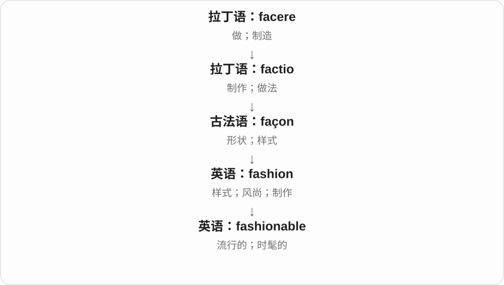

fashion 是流行样式，形容词把人、衣物或活动放进这种流行之中。也能形容时下受欢迎的观点。

**常见搭配与例句**

fashionable clothes；a fashionable neighbourhood；become fashionable。

> Wide trousers became fashionable again.

宽松长裤又流行起来了。

> It is fashionable to discuss simplicity, but harder to practise it.

谈论简单生活很流行，真正做到却更难。

**别混淆**

stylish 强调有风格、好看；fashionable 强调当下流行，两者并不总一致。

### 53. fiat — 命令；法令

**音标**：/ˈfaɪæt/

**先抓住这个画面**

想象主管一句“就这样办”，事情凭权威拍板成立。fiat 保留了这种命令即行动的语感。

**怎么拆**

拉丁语 fīat 是“让它被做成”，来自 fio，它补充充当 facere 的被动形式；不要拆成 fi + at。

**怎么变成今天的意思**

祈使式的“让其成为如此”被当作名词使用。常见 by fiat 说靠命令决定，语气有时带批评。

**常见搭配与例句**

by fiat；an administrative fiat；fiat money。

> The timetable was changed by administrative fiat.

时间表由行政命令直接改动了。

> The essay questions whether creativity can be produced by fiat.

文章质疑能否靠命令制造创造力。

**别混淆**

order 是普通命令；fiat 更突出权威单方面拍板。fiat money 是法定货币，不是“免费钱”。

### 54. factual — 符合事实的；事实性的

**音标**：/ˈfæk.tj(ʊ)əl/

**先抓住这个画面**

把猜测和夸张擦掉，只留下查得到的内容：factual 描述的就是这种紧贴事实的材料。

**怎么拆**

fact + -ual，构成表示与事实有关的形容词。

**怎么变成今天的意思**

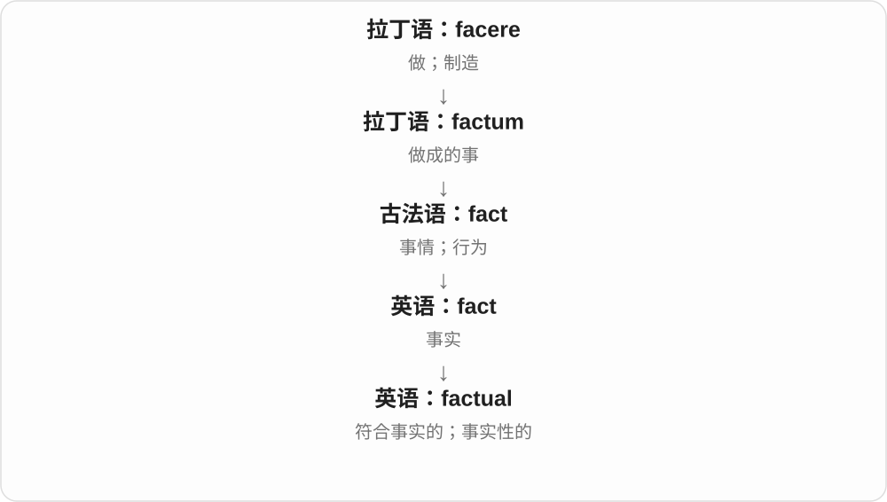

fact 是一件事实，factual 评价叙述是否以事实为内容。a factual error 是事实层面的错误，不是文笔不好。

**常见搭配与例句**

factual information；factual accuracy；a factual error。

> Please check the report for factual errors.

请检查报告有没有事实错误。

> Her account was brief and factual.

她的叙述简短，以事实为主。

**别混淆**

true 可评价一个判断为真；factual 还可说明文本的类型或内容侧重事实。

### 55. prolific — 多产的；大量产生的

**音标**：/pɹəˈlɪf.ɪk/

**先抓住这个画面**

一棵树不断结出果实，一位作家接连写出作品，都可以用 prolific 来抓住“产出多”这个画面。

**怎么拆**

拉丁语 proles（后代）+ -ficus（产生的），经法语 prolifique 传来；这里 pro- 不是单独的“赞成”。

**怎么变成今天的意思**

原来围绕繁殖后代，后来扩大到作品、进球和其他成果。它评价数量丰富，不自动保证每个成果都好。

**常见搭配与例句**

a prolific writer；a prolific scorer；prolific output。

> She is a prolific writer of children’s books.

她是一位多产的儿童文学作家。

> The plant is a prolific producer of seeds.

这种植物能结出大量种子。

**别混淆**

productive 较通用，也强调有效产出；prolific 更醒目地说数量多。

### 56. superficial — 表面的；肤浅的

**音标**：/ˌsuːpəˈfɪʃəl/

**先抓住这个画面**

用手摸过桌面，却没有看抽屉里有什么：superficial 就是停在外层，没有深入。

**怎么拆**

super-（上方）+ faciēs（面）形成 superficies，再形成 superficialis。

**怎么变成今天的意思**

身体表层的轻微划伤可中性地说 superficial；评价理解和分析时，则常批评只看外观。

**常见搭配与例句**

a superficial scratch；superficial knowledge；a superficial resemblance。

> The scratch is superficial.

这道划痕只在表层。

> Their explanation was too superficial to be useful.

他们的解释太肤浅，帮不上忙。

**别混淆**

shallow 原指浅，也可说思想浅；superficial 更强调只碰到外表这一层。

### 57. profitability — 盈利能力；获利程度

**音标**：/ˌpɹɒf.ɪ.təˈbɪl.ɪ.ti/

**先抓住这个画面**

不是看某一次收了多少钱，而是看一门生意能不能持续留下利润：这叫 profitability。

**怎么拆**

profitable + -ity，-able 对应 -ability，形成性质名词。

**怎么变成今天的意思**

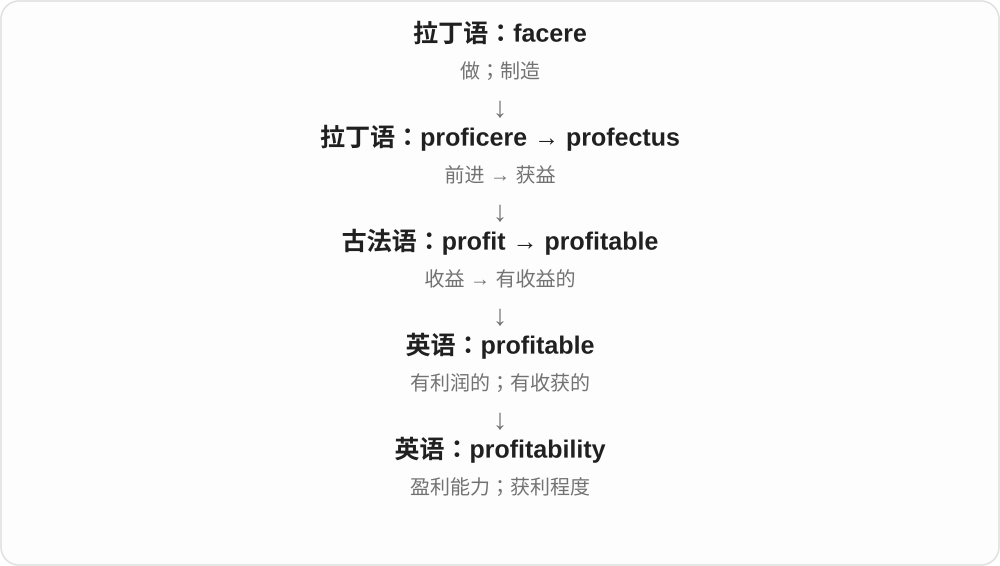

profit 是具体利润，profitability 是赚钱的能力或水平。收入增长与盈利能力提升可能并不同步。

**常见搭配与例句**

improve profitability；long-term profitability；profitability analysis。

> Higher transport costs reduced profitability.

运输成本上升降低了盈利能力。

> The team reviewed the profitability of each product.

团队评估了每种产品的获利情况。

**别混淆**

revenue growth 是收入增加；profitability 仍要考虑成本，不能只看销量。

### 58. inefficient — 效率低的

**音标**：/ˌɪn.ɪˈfɪʃ.ənt/

**先抓住这个画面**

东西最后做出来了，却走了许多冤枉路、耗了太多材料：inefficient 说的就是这种浪费。

**怎么拆**

in-（不）+ efficient，否定高效而不必否定完成了事情。

**怎么变成今天的意思**

焦点在过程和资源利用。一台旧机器能正常工作，仍可因为耗能过多而 inefficient。

**常见搭配与例句**

an inefficient process；inefficient use of resources。

> The old system is slow and inefficient.

旧系统又慢又低效。

> Sending every file separately is inefficient.

把每个文件分别发送很费事。

**别混淆**

ineffective 是没奏效；inefficient 常是奏效了但花费不合理。

### 59. suffice — 足够；够用

**音标**：/səˈfaɪs/

**先抓住这个画面**

要垫稳桌脚，一片纸板就够了，不必搬来整块木板：这时可以说 one piece will suffice。

**怎么拆**

来自 sufficere，经古法语 souffire 传入，和 sufficient 同源；现代不拆成 suf + fice。

**怎么变成今天的意思**

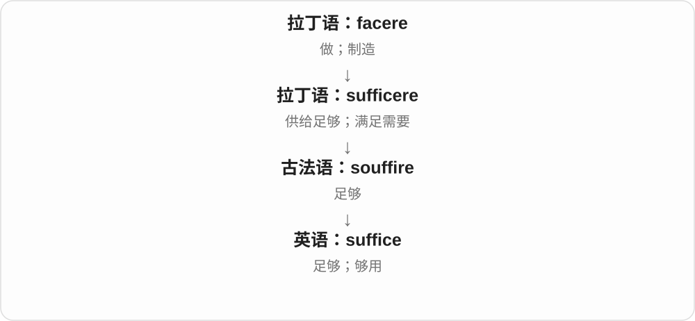

它把“足够”直接变成动词，因此 one example suffices 本身就是完整谓语，不再加 is。

**常见搭配与例句**

suffice for…；suffice to do…；Suffice it to say…（只需说……）。

> A short email will suffice.

一封简短邮件就够了。

> These notes should suffice for our discussion.

这些笔记应该足够供我们讨论。

**别混淆**

be enough 更口语；suffice 较简洁正式，常用于说明最低够用条件。

### 60. amplifier — 放大器

**音标**：/ˈæm.plə.faɪ.ə/

**先抓住这个画面**

一段很弱的信号进来，变成足以推动扬声器的信号出去：amplifier 负责把作用放大。

**怎么拆**

amplify + -er，y 变 i；-er 表示执行放大功能的人或设备。

**怎么变成今天的意思**

amplus 是大，amplify 是使变大，amplifier 就是做这件事的工具。比喻时也可指让信息影响扩大的渠道。

**常见搭配与例句**

a guitar amplifier；an audio amplifier；signal amplifier。

> He connected the guitar to an amplifier.

他把吉他接到放大器上。

> A noisy amplifier can spoil an otherwise clear recording.

有噪声的放大器会破坏原本清晰的录音效果。

**别混淆**

speaker 把电信号变成声音；amplifier 放大信号，两者常配合但功能不同。

### 61. scientifically — 科学地；从科学角度

**音标**：/ˌsaɪ.ənˈtɪfɪkli/

**先抓住这个画面**

不是凭印象说“应该是这样”，而是按可检验的方法去查证，这就是 scientifically。

**怎么拆**

scientific + -ally；形容词以 -ic 结尾，这里副词采用 -ically 的写法。

**怎么变成今天的意思**

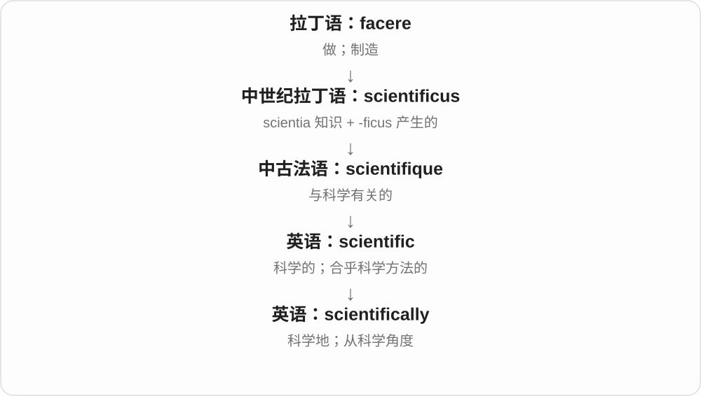

它可以评价检验的方法，也可限定讨论角度。scientifically interesting 是科学研究上值得关注，不一定日常用途大。

**常见搭配与例句**

scientifically tested；scientifically valid；scientifically plausible。

> The claim has not been scientifically tested.

这个说法还没有经过科学检验。

> The discovery is scientifically important.

这项发现具有科学上的重要意义。

**别混淆**

systematically 只是有系统地；方法有条理不必然已经具备科学证据。

### 62. proficiency — 熟练程度；精通

**音标**：/pɹəˈfɪʃənsi/

**先抓住这个画面**

从看说明书一步步做，到能稳稳当当地独立完成：这种达到的熟练水平就是 proficiency。

**怎么拆**

由 proficient 构成性质名词；词族追溯到 proficere“向前做、取得进展”。

**怎么变成今天的意思**

学习不断向前推进，形成某项技能的扎实能力。proficiency 强调能用出来，而不是只知道术语。

**常见搭配与例句**

language proficiency；proficiency in English；demonstrate proficiency。

> The test measures proficiency in written English.

这项考试衡量英语写作熟练程度。

> Her proficiency improved with daily practice.

每天练习使她越来越熟练。

**别混淆**

knowledge 是知识；proficiency 强调运用技能时的熟练度。

### 63. artifact — 人工制品；非真实的显示现象

**音标**：/ˈɑːtɪfækt/

**先抓住这个画面**

挖出一块被人磨制过的石头，它是 artifact，因为它带着人为制作的痕迹。图像里加工产生的假影也用这个词。

**怎么拆**

拉丁语 arte（凭技艺）+ factum（做成的东西），英语据此形成；英式也写 artefact。

**怎么变成今天的意思**

由人造物延伸到技术处理人为带出的现象，例如压缩照片时多出来的色块。不是照片原来就有那些块。

**常见搭配与例句**

an ancient artifact；compression artifacts；a measurement artifact。

> The museum displays pottery and other ancient artifacts.

博物馆展出陶器及其他古代人工制品。

> The bright ring is an artifact of image processing.

那圈亮环是图像处理造成的假象。

**别混淆**

fossil 是化石，未必有人参与；artifact 通常包含人工制作或过程影响。

### 64. counterfeit — 伪造的；伪造品；仿造

**音标**：/ˈkaʊn.tɚˌfɪt/

**先抓住这个画面**

看起来像真钞，却是为了让人误认而做的假钞：counterfeit 强调冒充真货。

**怎么拆**

古法语 contrefaire“仿做”由 contre- 加 faire 构成，分词 contrefait 传入英语。

**怎么变成今天的意思**

原来侧重模仿制作，后来中心转为意图被当成真品的伪造。名词、形容词和动词都可用。

**常见搭配与例句**

counterfeit money；counterfeit goods；a convincing counterfeit。

> The shop discovered a counterfeit banknote.

店里发现了一张假钞。

> The watch looked real, but it was a counterfeit.

这块表看起来像真品，其实是假货。

**别混淆**

replica 是复制品，可以公开说明身份；counterfeit 通常包含冒充和欺骗。

### 65. infect — 使感染；感染他人情绪

**音标**：/ɪnˈfɛkt/

**先抓住这个画面**

一滴颜色进入清水，慢慢染开：infect 的早期画面就是染入、沾染，后来常用于病原体传播。

**怎么拆**

in-（进入）+ facere 形成 inficere，分词 infectus 经法语等途径传入。

**怎么变成今天的意思**

染入东西 → 使受到污染 → 使感染。情绪用法借同一种扩散画面，但 enthusiasm 的感染可以是好事。

**常见搭配与例句**

infect someone with…；infected tissue；infectious enthusiasm。

> The virus can infect several plant species.

这种病毒能感染几种植物。

> Her enthusiasm infected the whole team.

她的热情感染了整个团队。

**别混淆**

affect 是宽泛影响；infect 常涉及病原体或情绪的传播。

### 66. unification — 统一；合并为一体

**音标**：/ˌjuːnɪfɪˈkeɪʃn̩/

**先抓住这个画面**

几条分开的路线终于接到同一张网络里，几个分开的部分形成一个整体：这叫 unification。

**怎么拆**

uni-（一）+ -fy（使成为，来自 facere）形成 unify，可对应 -fication 名词；历史也可能借自法语或意大利语相关形式。

**怎么变成今天的意思**

核心是从多个单位走向一个整体；可能是国家、制度、标准，也可能是理论解释。

**常见搭配与例句**

national unification；the unification of standards。

> The unification of the ticketing systems took a year.

统一票务系统花了一年时间。

> The book examines the country’s unification.

这本书考察了这个国家的统一过程。

**别混淆**

unity 是统一或团结的状态；unification 更强调达到该状态的过程。

### 67. forfeit — 丧失；被没收；罚则

**音标**：/ˈfɔː.fɪt/

**先抓住这个画面**

你原本有资格拿到奖品，但违反规则后资格被收走：这就是 forfeit 的典型画面。

**怎么拆**

古法语 forfaire 中 for- 来自 foris“在外”，faire 是做；原本指越出规则、犯错。

**怎么变成今天的意思**

从越轨行为，转向它带来的惩罚与丧失。现代也可说因选择放弃某项利益，不一定由法院处理。

**常见搭配与例句**

forfeit a deposit；forfeit the right to…；win by forfeit。

> Late withdrawal may mean forfeiting the entry fee.

报名后太晚退出可能会损失报名费。

> The team forfeited the match after failing to arrive.

球队没有到场，被判弃权。

**别混淆**

lose 很宽泛；forfeit 常交代因违规、失约或特定选择而失去。

### 68. proficient — 熟练的

**音标**：/pɹəˈfɪʃ.ənt/

**先抓住这个画面**

你不再每一步都需要别人提醒，能准确完成任务，便可以说 proficient。它不是必须达到世界顶尖。

**怎么拆**

拉丁语 proficere“向前推进”的现在分词 proficiens 进入英语；与 profit 是同源旁支。

**怎么变成今天的意思**

进步到能够胜任的水平，现代中心是技能熟练。不是因为一个人赚了 profit，才在历史上产生 proficient。

**常见搭配与例句**

proficient in English；proficient at coding；highly proficient。

> She is proficient in three languages.

她能熟练使用三种语言。

> He became proficient at repairing bicycles.

他逐渐熟练掌握了修自行车的技能。

**别混淆**

expert 通常比 proficient 更强，强调专家级深度；competent 强调够格胜任。

### 69. facet — 小平面；方面

**音标**：/ˈfæs.ɪt/

**先抓住这个画面**

钻石有很多切磨的小面，每转一个角度就看到另一个面。facet 把这个画面借给复杂事物的不同方面。

**怎么拆**

法语 face + 指小成分 -ette → facette，借入英语为 facet。

**怎么变成今天的意思**

物体表面上的一个小面，延伸为问题中的一个侧面。它提醒你，看到一面不等于看到了全部。

**常见搭配与例句**

a facet of life；every facet of a problem；a cut facet。

> The course explores different facets of city life.

这门课探讨城市生活的不同方面。

> Light reflected from each facet of the stone.

光从宝石的每个切面反射出来。

**别混淆**

aspect 更通用；facet 常把复杂整体想成有许多相互关联的小面。

### 70. prefecture — 行政区；长官辖区

**音标**：/ˈpɹiːfɛkt͡ʃə/

**先抓住这个画面**

一位 prefect 负责某片区域，这片辖区以及相关机构就可以叫 prefecture。

**怎么拆**

拉丁语 praefectus 一支形成 praefectura，经法语 préfecture 借入；现代可联系 prefect + -ure。

**怎么变成今天的意思**

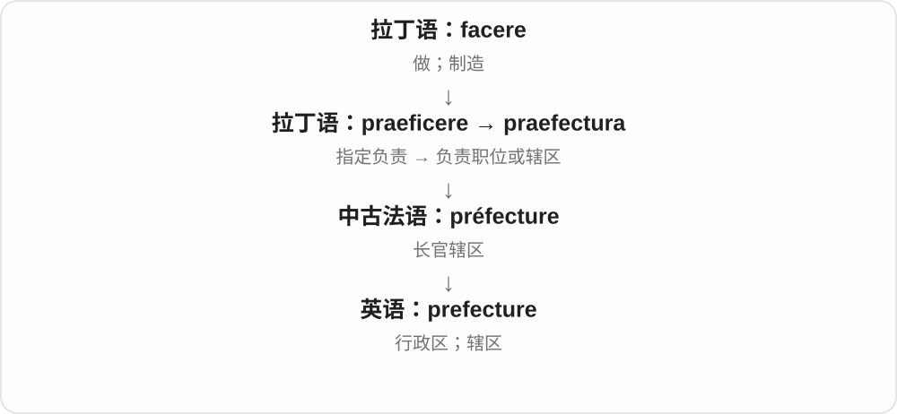

人被放在前面负责，随后该职位的管辖范围也有了名称。现代常见于日本行政区等名称，具体层级依国家制度而定。

**常见搭配与例句**

a prefectural government；a Japanese prefecture；the prefecture office。

> The museum is funded by the prefecture.

这家博物馆由当地行政区出资支持。

> They travelled across several prefectures.

他们途经了几个县级行政区。

**别混淆**

prefecture 不能机械等于所有国家的“省”；翻译要看该地的行政制度。

### 71. amplify — 放大；增强；详述

**音标**：/ˈæm.plə.faɪ/

**先抓住这个画面**

把旋钮转大，原本微弱的信号变强；把一个观点讲得更充分，也像让它的影响扩大。

**怎么拆**

amplus（大的）+ facere，通过 amplificare、法语 amplifier 传入英语。

**怎么变成今天的意思**

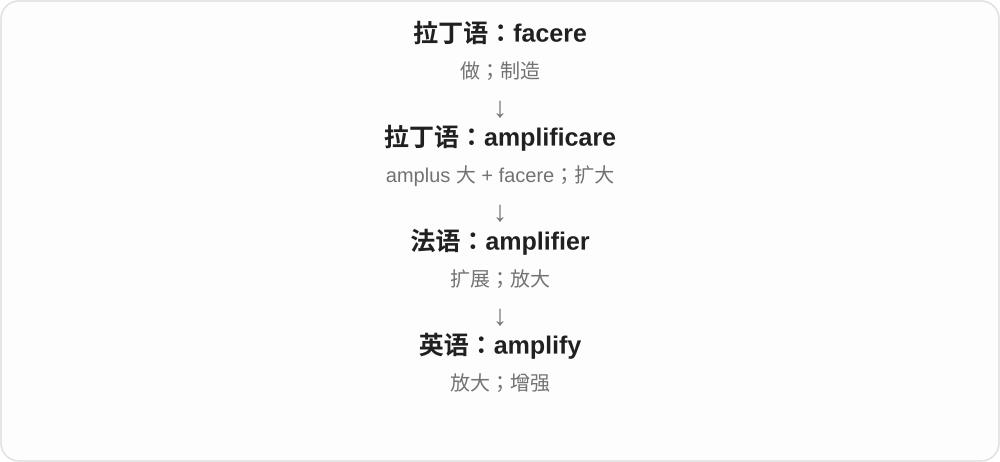

做得更大 → 放大声音或信号 → 增强影响、展开说明。放大的内容可以是有用信息，也可以是原有噪声。

**常见搭配与例句**

amplify a signal；amplify a message；amplify a point。

> The microphone amplifies her voice.

麦克风把她的声音放大了。

> Social media can amplify a small misunderstanding.

社交媒体可能放大一个小误会。

**别混淆**

increase 很通用；amplify 常有原本已有某种信号或作用，再把它加强的感觉。

### 72. disqualification — 取消资格；使不合资格的条件

**音标**：/dɪsˌkwɒlɪfɪˈkeɪʃən/

**先抓住这个画面**

运动员原本站在起跑线上，却因违规被请出赛场：这个资格被拿走的结果叫 disqualification。

**怎么拆**

dis-（否定、取消）+ qualification，也可从 disqualify 对应到名词。

**怎么变成今天的意思**

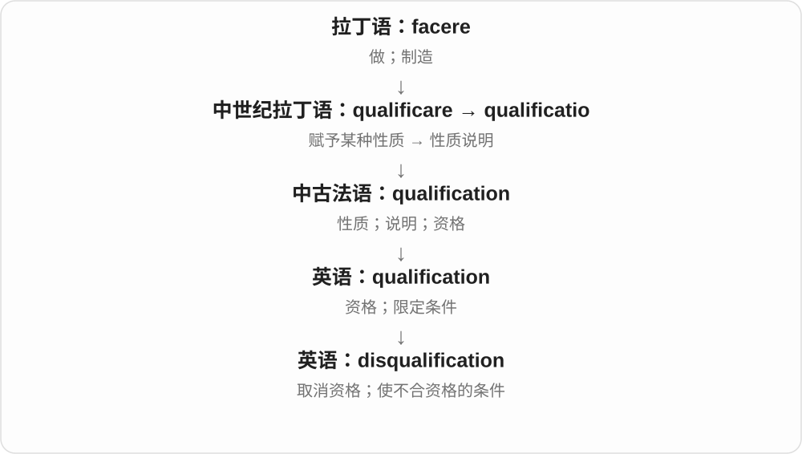

qualification 是达到门槛，disqualification 是因某个条件或行为不能继续享有资格。通常需要说明具体规则。

**常见搭配与例句**

disqualification from a race；grounds for disqualification。

> The false start led to his disqualification.

抢跑导致他被取消资格。

> Missing the deadline may be grounds for disqualification.

错过截止日期可能成为取消资格的理由。

**别混淆**

elimination 可能只是正常淘汰；disqualification 通常涉及资格条件或违规。

### 73. benefactor — 恩人；捐助者

**音标**：/ˈbɛnəˌfæktəː/

**先抓住这个画面**

有人拿出钱或资源，帮一所学校真正办成事，这位施以帮助的人就是 benefactor。

**怎么拆**

bene（好）+ factor（做事者），来自拉丁语 benefactor。

**怎么变成今天的意思**

对别人做有益的事，词义落到给予帮助的人；现代尤其常指资助机构、艺术或公益的人。

**常见搭配与例句**

a generous benefactor；an anonymous benefactor。

> An anonymous benefactor paid for the new roof.

一位匿名捐助者支付了新屋顶的费用。

> The library thanked its benefactors.

图书馆向捐助者表示感谢。

**别混淆**

beneficiary 是得到好处的人；benefactor 是给予好处的人，方向相反。

### 74. prefect — 行政长官；学生督导

**音标**：/ˈpɹiːfɛkt/

**先抓住这个画面**

把一个人放到前面，叫他负责维持秩序或管理一块事务，这就是 prefect 的原始画面。

**怎么拆**

prae-（在前）+ facere → praeficere“使负责”，分词 praefectus 成为职位名。

**怎么变成今天的意思**

被指定在前面负责的人 → 官员、长官。英国等学校里的 prefect 则是承担管理职责的学生。

**常见搭配与例句**

a school prefect；a police prefect；the Roman prefect。

> A school prefect showed the visitors around.

一位学生督导带来访者参观学校。

> The prefect was responsible for maintaining order.

这位长官负责维持秩序。

**别混淆**

prefect 是具体制度中的职称，不能直接替代所有 manager；和 perfect 只是字母相近。

### 75. reunification — 重新统一

**音标**：/ˌriːjuːnɪfɪˈkeɪʃən/

**先抓住这个画面**

原本是一体，后来分开，现在又接到一起：reunification 比 unification 多了“恢复”的背景。

**怎么拆**

re-（再次）+ unification。

**怎么变成今天的意思**

统一的动作再发生一次，可以谈政治实体，也可谈家庭成员重新共同生活；并非所有第一次合并都适合加 re-。

**常见搭配与例句**

national reunification；family reunification。

> The exhibition traces the path to national reunification.

展览梳理了走向国家重新统一的过程。

> The programme supports family reunification.

这个项目帮助家庭重新团聚。

**别混淆**

reunion 可以只是短暂相聚；reunification 往往指重新组成或恢复一个整体。

### 76. sufficiency — 充足；足够的程度

**音标**：/səˈfɪʃənsi/

**先抓住这个画面**

不必堆成山，只要满足需要就行。sufficiency 谈的是这种够用状态或数量。

**怎么拆**

sufficient 对应名词 -ency，与 sufficere 一支相连。

**怎么变成今天的意思**

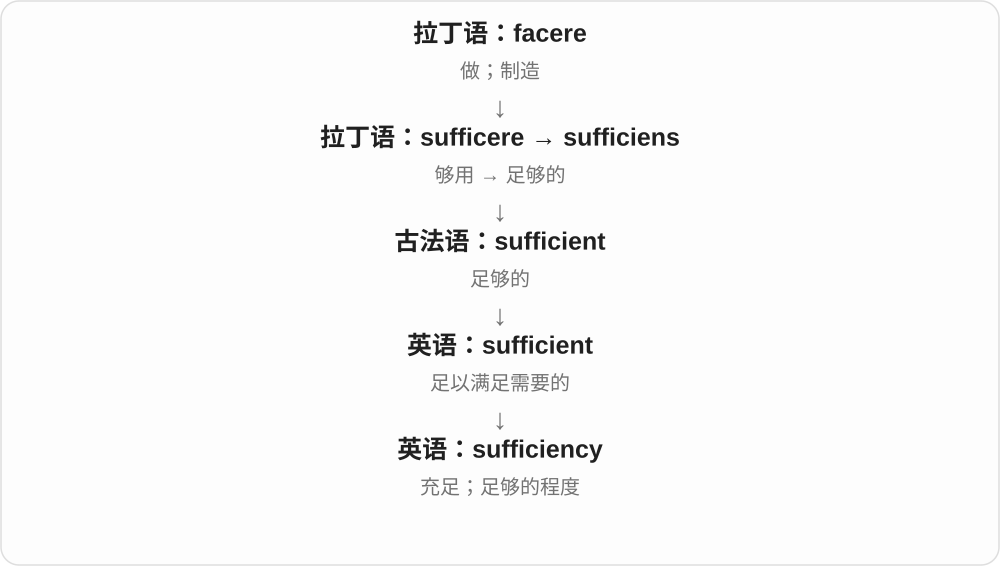

把“这些够了”变成“这些的充足性”，便能讨论数量、理由或证据是否足够。常见于较正式的文本。

**常见搭配与例句**

the sufficiency of evidence；a sufficiency of food。

> The review questioned the sufficiency of the evidence.

审查质疑证据是否充分。

> The supplies provided a sufficiency of food for the journey.

这些补给为旅程提供了足够食物。

**别混淆**

abundance 是丰富有余；sufficiency 只承诺够，不承诺很多。

### 77. faceless — 身份模糊的；没有鲜明个性的

**音标**：/ˈfeɪsləs/

**先抓住这个画面**

隔着一层层表格，你只看见机构规则，看不见具体负责人：faceless 常用来描绘这种匿名、疏离的感觉。

**怎么拆**

face + -less（没有），英语派生。

**怎么变成今天的意思**

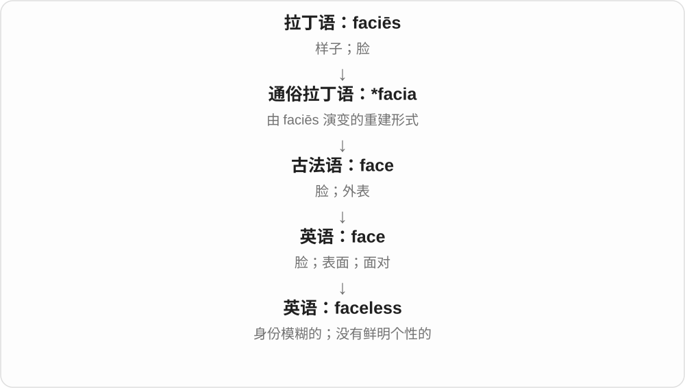

没有脸的字面意象扩展为没有可辨认身份、没有个人温度。一般不是说某个人真的没有五官。

**常见搭配与例句**

a faceless bureaucracy；faceless officials；a faceless crowd。

> She felt trapped in a faceless bureaucracy.

她觉得自己困在一个看不见具体负责人的官僚体系里。

> The film gives a voice to people who are often treated as a faceless crowd.

电影让那些常被视作模糊人群的人发出了自己的声音。

**别混淆**

anonymous 侧重姓名未知；faceless 往往还带冷漠、缺乏个性的感受。

### 78. facsimile — 传真；精确复制品

**音标**：/fækˈsɪm.ə.li/

**先抓住这个画面**

把旧手稿连字迹、排版、污点都尽量原样重现，是 facsimile；传真技术也用这种复制意象命名。

**怎么拆**

拉丁语 fac（做，facere 的命令形式）+ simile（相似的东西），字面“做一个相似品”。

**怎么变成今天的意思**

指令式短语变成复制品名称，随后用于远程传送文件图像。fax 是 facsimile 的缩短形式。

**常见搭配与例句**

a facsimile edition；a facsimile of the manuscript；facsimile transmission。

> The library displayed a facsimile of the original letter.

图书馆展出原信的精确复制品。

> A facsimile edition preserves the old page layout.

影印版保留了旧版页面布局。

**别混淆**

copy 很宽泛；facsimile 更强调外观忠实再现，未必只是内容相同。

### 79. edifice — 宏伟建筑；庞大体系

**音标**：/ˈɛd.ɪ.fɪs/

**先抓住这个画面**

看到一座结构复杂、气势很大的建筑，可以叫它 edifice；一整套相互支撑的理论也能像楼一样搭起来。

**怎么拆**

aedes（房屋）+ facere → aedificare“建造”，其名词 aedificium 经法语传入。

**怎么变成今天的意思**

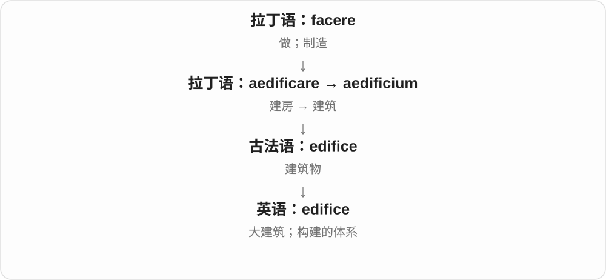

做出房屋 → 建筑；抽象义借“多部分搭成整体”的结构感。它比普通 building 更庄重。

**常见搭配与例句**

a grand edifice；the edifice of a theory。

> A stone edifice dominated the square.

一座石制大建筑矗立在广场上。

> One false assumption weakened the whole theoretical edifice.

一个错误假设削弱了整个理论体系。

**别混淆**

building 中性通用；edifice 常突出规模、复杂结构或修辞气势。

### 80. facelift — 拉皮手术；外观翻新

**音标**：/ˈfeɪsˌlɪft/

**先抓住这个画面**

把建筑外墙重新粉刷，招牌换新，整个地方看起来精神了，这种外观改造可叫 facelift。

**怎么拆**

face + lift，字面“把脸提起来”；先与面部整形相关，再作比喻。

**怎么变成今天的意思**

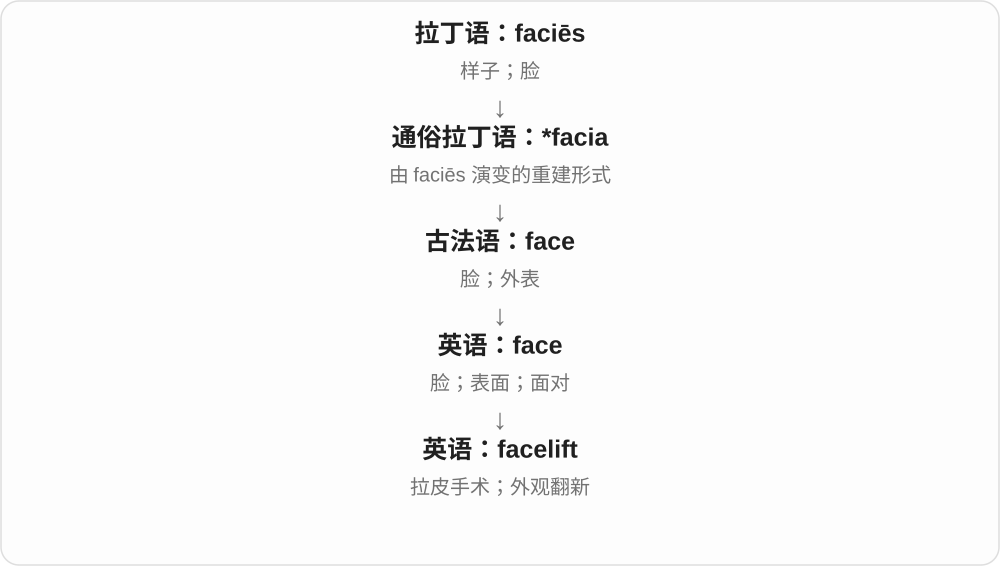

脸部皮肤提拉的名称扩展为让旧物外观更新。比喻义常暗示外表改善，内部结构未必大改。

**常见搭配与例句**

give something a facelift；a major facelift；have a facelift。

> The station received a much-needed facelift.

车站进行了急需的外观翻新。

> The article explains what a facelift involves.

文章介绍了拉皮手术涉及哪些内容。

**别混淆**

renovation 可深入修缮；facelift 更突出看得见的外观变化。

### 81. facilitation — 促进；引导过程

**音标**：/fəˌsɪlɪˈteɪʃən/

**先抓住这个画面**

讨论卡住时，有人把问题理清，让每个人都说得上话，这个帮助事情顺畅推进的过程叫 facilitation。

**怎么拆**

facilitate + -ion，对应使某事更容易的过程。

**怎么变成今天的意思**

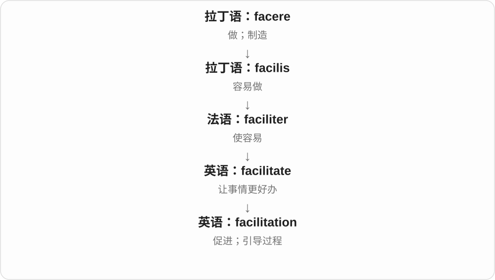

动词是做帮助推进的动作，名词则让这种工作本身成为讨论对象。重点在创造条件、协调过程。

**常见搭配与例句**

group facilitation；trade facilitation；facilitation skills。

> Good facilitation kept the discussion focused.

良好的引导使讨论始终围绕主题。

> The course teaches basic facilitation skills.

这门课程教授基本的讨论引导技巧。

**别混淆**

instruction 偏向直接讲授；facilitation 更常帮助参与者自己思考、协作。

### 82. unprofitable — 不盈利的；没有收获的

**音标**：/ʌnˈpɹɒf.ɪ.təbl̩/

**先抓住这个画面**

忙了一整年，收入还不够成本，这门生意就是 unprofitable；反复争执毫无所得，也可这样说。

**怎么拆**

un- + profitable，否定产生利润或好处。

**怎么变成今天的意思**

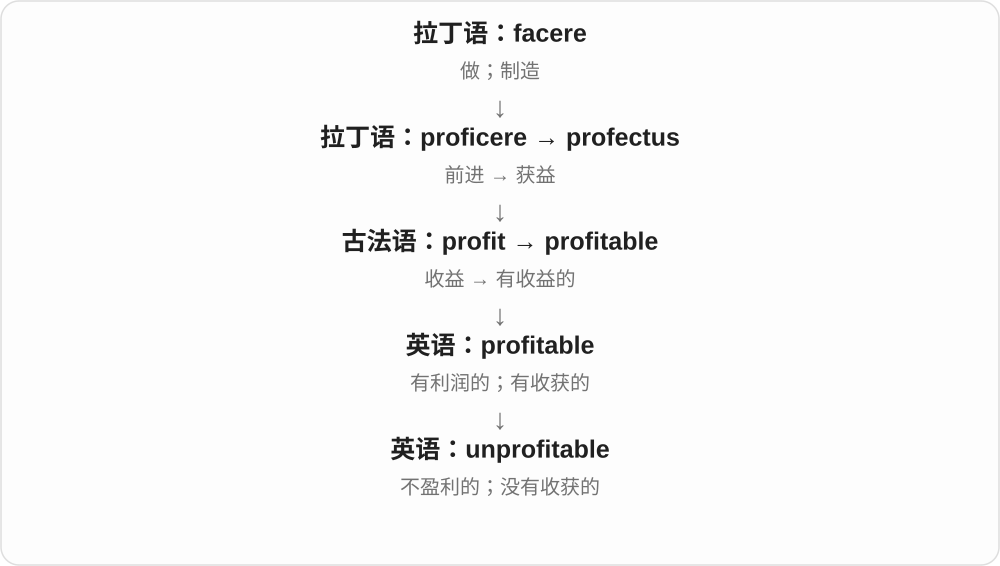

不是说没有收入，而是收入没有留下利润。抽象用法则把时间和精力视作投入，结果却没什么收获。

**常见搭配与例句**

an unprofitable business；an unprofitable discussion。

> The company closed two unprofitable shops.

公司关闭了两家不盈利的门店。

> We abandoned the unprofitable argument and returned to the task.

我们停止了无益的争论，回到任务上。

**别混淆**

expensive 是花费高；unprofitable 是算上投入后没有获利，两者有联系但不同。

### 83. facilitator — 引导者；促成者

**音标**：/fəˈsɪlɪteɪtə/

**先抓住这个画面**

会议里有个人不抢着定答案，而是帮助大家听清彼此、推进决定，他常是 facilitator。

**怎么拆**

facilitate + -or，-or 指执行这种作用的人。

**怎么变成今天的意思**

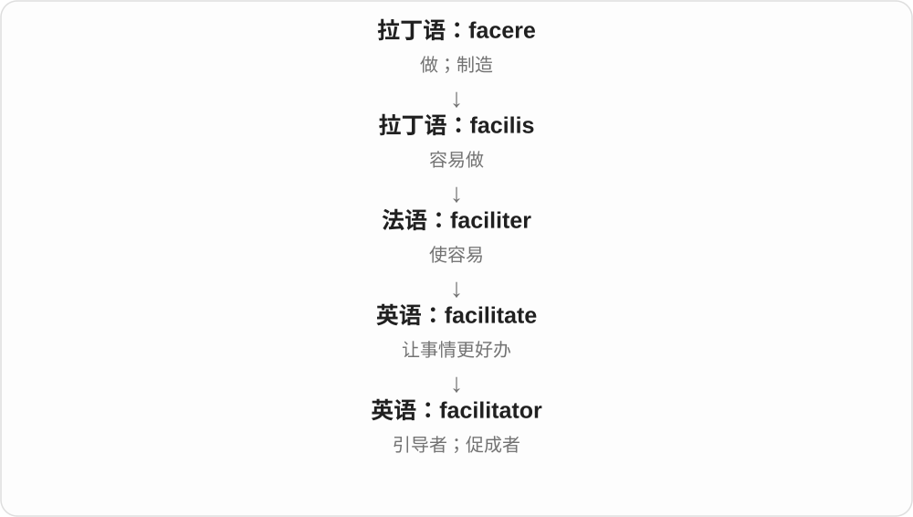

让事情好办的动作落到角色上；也可指帮助合作、交易或学习顺利进行的人。具体权限由场景决定。

**常见搭配与例句**

a workshop facilitator；an independent facilitator。

> The facilitator invited quieter participants to speak.

引导者邀请较沉默的参与者发言。

> We hired a facilitator for the planning workshop.

我们为规划研讨会请了一位引导者。

**别混淆**

leader 可以决定方向；facilitator 通常更强调帮助过程，不一定拥有最终决定权。

### 84. superficially — 从表面看；浅浅地

**音标**：/ˌsuːpəˈfɪʃəli/

**先抓住这个画面**

只瞟一眼，两件东西很像；仔细看，差别很多。superficially 常提醒你：相似只停留在第一眼。

**怎么拆**

superficial + -ly，描述在表层或不深入地。

**怎么变成今天的意思**

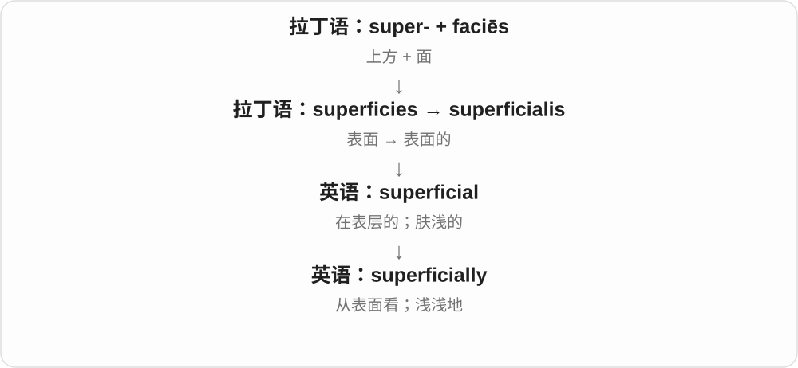

字面可说浅层受伤，抽象可说粗略检查、表面相似。副词常为后面更深入的判断留出空间。

**常见搭配与例句**

superficially similar；examine superficially；superficially attractive。

> The two plans are superficially similar.

这两个计划表面上相似。

> He had read the report only superficially.

他只是粗略看过报告。

**别混淆**

briefly 是时间短；superficially 是深度浅，长时间谈话也可能一直很肤浅。

### 85. inefficiency — 低效率；浪费环节

**音标**：/ˌɪnɪˈfɪʃənsi/

**先抓住这个画面**

同一份材料来回送五次、每次都重复登记，这些不必要的消耗就是 inefficiency 的具体模样。

**怎么拆**

in- + efficiency，也可从 inefficient 对应名词 -ency。

**怎么变成今天的意思**

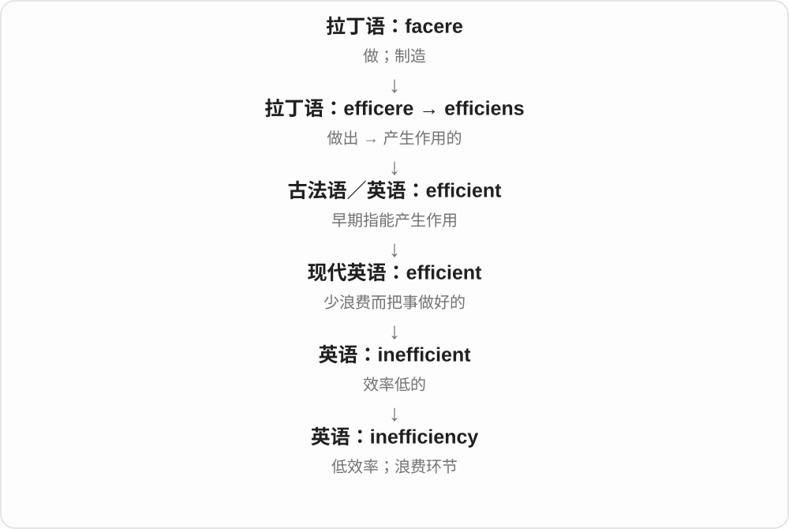

它既指整体低效状态，也可用复数 inefficiencies 指流程中一个个浪费点。不是泛泛地说结果不好。

**常见搭配与例句**

reduce inefficiency；identify inefficiencies；administrative inefficiency。

> The review found several inefficiencies in the ordering process.

评估发现订购流程中有几处低效环节。

> Repeated data entry is a major source of inefficiency.

重复录入数据是效率低下的重要原因。

**别混淆**

failure 是失败；inefficiency 可以发生在最终完成了任务的过程中。

### 86. modifier — 修饰语；调整者；改性剂

**音标**：/ˈmɒdɪfaɪə/

**先抓住这个画面**

在 red car 中，red 像给 car 加上一张说明标签；语法里这样的成分就是 modifier。

**怎么拆**

modify + -er，y 变 i，表示进行修改、调节或修饰的东西。

**怎么变成今天的意思**

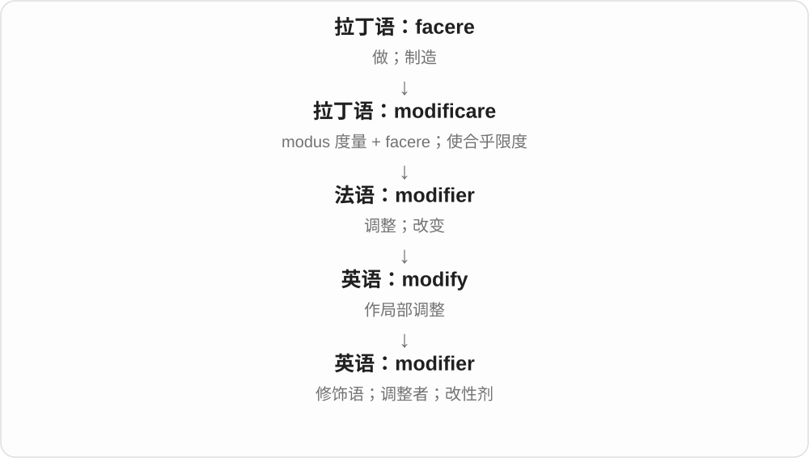

modify 的调整义用于材料可指改性剂；在语法中则指缩小、说明另一个词的意思。

**常见搭配与例句**

a noun modifier；a misplaced modifier；a chemical modifier。

> In “a quiet room”, “quiet” is a modifier.

在 a quiet room 中，quiet 是修饰语。

> Moving the modifier changed the meaning of the sentence.

改变修饰语的位置后，句子的意思变了。

**别混淆**

modifier 是功能名称，不等于单一词性；形容词、副词或短语都可能承担修饰作用。

### 87. perfectionist — 完美主义者

**音标**：/pɚˈfɛk.ʃənɪst/

**先抓住这个画面**

已经够用的东西，他仍能发现一点偏差并反复重做：perfectionist 很难满足于“这样就可以了”。

**怎么拆**

perfection + -ist，指坚持或追求这种标准的人。

**怎么变成今天的意思**

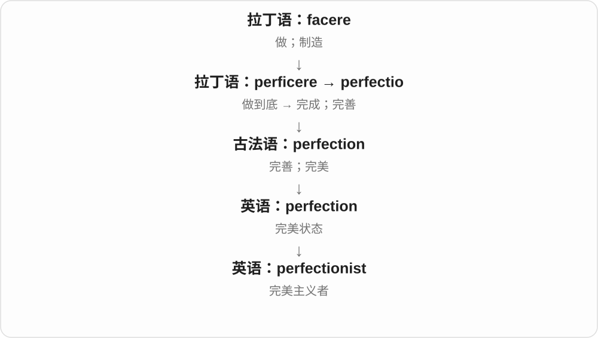

完美从状态变成个人习惯与要求。它可以带来细致，也可能让交付变慢，词本身依语境可褒可贬。

**常见搭配与例句**

a perfectionist at work；a demanding perfectionist。

> As a perfectionist, she checked every detail twice.

她是个完美主义者，每个细节都检查两遍。

> The deadline forced the perfectionist to accept a good enough draft.

截止日期迫使这位完美主义者接受一份已经够好的草稿。

**别混淆**

careful 是认真谨慎；perfectionist 对无缺点的要求通常更强。

### 88. subsurface — 地表下的；表层以下

**音标**：/ˌsʌbˈsɜːfɪs/

**先抓住这个画面**

把地面掀开一层，下面的土、岩石和水都属于 subsurface 范围。

**怎么拆**

sub-（在下面）+ surface，英语构词。

**怎么变成今天的意思**

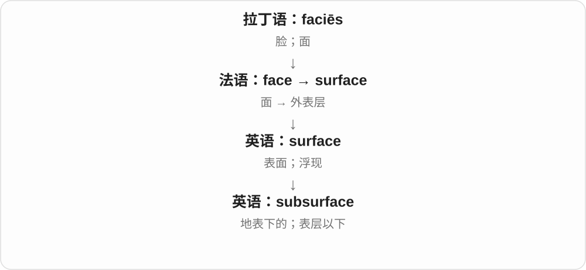

surface 定出外层位置，sub- 把视线移到其下；可以谈地表，也可谈其他材料的表层下面。

**常见搭配与例句**

subsurface water；subsurface layers；subsurface damage。

> The survey examined subsurface rock layers.

勘测检查了地表下的岩层。

> The surface looked intact, but subsurface damage remained.

表面看似完好，但表层以下仍有损伤。

**别混淆**

underground 常说地下位置；subsurface 更突出相对于某一表层的位置。

### 89. blackface — 涂黑脸的种族化扮演

**音标**：/ˈblækˌfeɪs/

**先抓住这个画面**

这个词常指非黑人表演者涂黑脸部、模仿黑人的表演传统，尤其关联种族刻板印象与贬损。

**怎么拆**

black + face，是英语合成；不是所有黑色面部化妆在任何情境下都具有同一历史含义。

**怎么变成今天的意思**

字面黑脸在特定演出传统中形成固定文化含义。理解影视和社会讨论时，要连同其历史背景看，不能只按颜色翻译。

**常见搭配与例句**

blackface performance；the history of blackface。

> The documentary examines the history of blackface in entertainment.

纪录片考察了娱乐业中涂黑脸表演的历史。

> The theatre removed the scene because it used blackface.

剧院因该场景使用涂黑脸表演而将其删除。

**别混淆**

black face 是普通的两个词组合；blackface 作为固定词通常指上述表演做法。

### 90. effecting — 正在促成；实现着

**音标**：/ɪˈfektɪŋ/

**先抓住这个画面**

纸上的计划终于变成实际变化：effecting 说的是正在把变化做出来。

**怎么拆**

effect（使发生）+ -ing；这里是动词 effect 的变化形式，不是 affect 的拼写变体。

**怎么变成今天的意思**

effect 作动词较正式，常接 change、reform 等。少见旧用法也可把 effecting 当形容词说有促成作用的，日常先掌握动词。

**常见搭配与例句**

effecting change；effecting repairs；effecting a transition。

> The team is effecting changes across the organisation.

团队正在整个组织内推动改变落地。

> They discussed ways of effecting a smooth transition.

他们讨论了怎样实现平稳过渡。

**别混淆**

affecting change 是影响变化过程；effecting change 是促成变化发生。

### 91. typeface — 字体设计；字样体系

**音标**：/ˈtaɪpˌfeɪs/

**先抓住这个画面**

把一套字母放在一起看，它们的笔画粗细、衬线和比例有同一家族的风格，这套设计是 typeface。

**怎么拆**

type（印刷字模、字）+ face（正面），最初联系印刷字模呈现字形的那一面。

**怎么变成今天的意思**

金属字模的印刷面带出字符样貌，后来指整套字形设计。数字环境保留了这个名称。

**常见搭配与例句**

a serif typeface；choose a typeface；a readable typeface。

> The designer chose a simple typeface for the signs.

设计师为标牌选择了一套简洁字体。

> This typeface remains readable at small sizes.

这套字体在小字号下仍然容易辨认。

**别混淆**

严格区分时 typeface 是设计，font 是其具体字体实例或文件；日常两词常混用。

### 92. ineffectual — 不起作用的；软弱无力的

**音标**：/ˌɪnɪˈfɛkt͡ʃuəl/

**先抓住这个画面**

有人站出来要管事，结果话没人听、局面没变化，这种无力感很适合用 ineffectual。

**怎么拆**

in-（不）+ effectual，否定达到效果。

**怎么变成今天的意思**

与 ineffective 很近，但描述人、抗议或领导时常突出使不上劲、未能改变局面。

**常见搭配与例句**

an ineffectual leader；ineffectual protests；an ineffectual attempt。

> His attempts to calm the crowd were ineffectual.

他安抚人群的努力没有奏效。

> The committee was dismissed as ineffectual.

这个委员会被批评为无所作为。

**别混淆**

ineffective 常中性评价方法；ineffectual 描述人时更容易带批评和无能感。

### 93. scarface — 疤面人；脸上有明显伤疤的人

**音标**：/ˈskɑːfeɪs/

**先抓住这个画面**

看到一张带明显伤疤的脸，用 scarface 指那个人，是把外貌特征直接变成了人的标签。

**怎么拆**

scar（伤疤）+ face（脸），英语合成；也常作人物绰号或作品标题。

**怎么变成今天的意思**

由脸部特征转指整个人。这种称呼可能带不尊重或嘲弄，阅读中认识它即可，不宜随便拿来叫人。

**常见搭配与例句**

a character nicknamed Scarface；the nickname “Scarface”。

> The fictional pirate was known as Scarface.

这个虚构海盗被称为“疤面人”。

> The novel explains how the character acquired the nickname Scarface.

小说解释了这个角色为什么得到“疤面人”的绰号。

**别混淆**

a scar on his face 只是描述事实；scarface 直接给人贴标签，语气不同。

### 94. factually — 在事实方面；符合事实地

**音标**：/ˈfæktʃuəli/

**先抓住这个画面**

一篇文章文笔很好，也可能把日期写错。factually 专门切到事实这条检查轴线上。

**怎么拆**

factual + -ly，形成副词。

**怎么变成今天的意思**

它常修饰 correct、wrong、accurate，说明评价的不是态度或风格，而是内容与实际是否相符。

**常见搭配与例句**

factually correct；factually inaccurate；factually based。

> The paragraph is clear but factually wrong.

这段文字很清楚，但事实有误。

> We want a factually accurate account of the event.

我们想要一份事实准确的事件叙述。

**别混淆**

logically correct 是推理关系没错；factually correct 是所述情况真实，两项都需要检查。

### 95. trifecta — 依次猜中前三；三项成功

**音标**：/tɹaɪˈfɛktə/

**先抓住这个画面**

三项期待的结果一次都到手，口语里就会说 a trifecta。它原来是赛马中按顺序猜中前三名的投注。

**怎么拆**

tri-（三）+ perfecta 的缩短部分；perfecta 是猜中前两名及顺序的名称。

**怎么变成今天的意思**

从三个结果都对上，扩大为三种成就、优点或结果一起出现。引申义不一定涉及赌博。

**常见搭配与例句**

a winning trifecta；a trifecta of awards。

> The restaurant offers a trifecta of good food, fair prices, and friendly service.

这家餐厅兼有好吃、价格合理和服务友善三项优点。

> The exhibition explains how a trifecta differs from a simple win bet.

展览解释了猜中前三名顺序与只猜赢家的投注有何不同。

**别混淆**

three 只是数量；trifecta 往往带三项齐全、组合奏效的意味。

### 96. multifaceted — 多面的；多层次的

**音标**：/ˌmʌl.tiˈfæ.sə.tɪd/

**先抓住这个画面**

像一颗有许多切面的宝石，同一件事从不同方向看会露出不同内容，便是 multifaceted。

**怎么拆**

multi-（多）+ facet（小面）+ -ed（具有……的）。

**怎么变成今天的意思**

具体的许多切面被借来形容人的才能、问题的结构或计划的内容。重点是多个方面，而非单纯数量大。

**常见搭配与例句**

a multifaceted problem；a multifaceted approach；a multifaceted career。

> Housing is a multifaceted problem.

住房是一个涉及多方面的问题。

> The exhibition reveals her multifaceted talent.

展览展现了她多方面的才华。

**别混淆**

complicated 是复杂；multifaceted 强调包含若干不同方面，未必混乱难懂。

### 97. disaffected — 不满而疏离的

**音标**：/dɪsəˈfɛktɪd/

**先抓住这个画面**

一个人原本支持团队，后来觉得被忽视，心慢慢离开了组织：这就是 disaffected 的感觉。

**怎么拆**

dis-（离开、否定）+ affected；affect 的感情倾向一支在这里被否定。

**怎么变成今天的意思**

不只是心情不好，而是对所属组织、领导或社会失去认同。常用于成员、选民和年轻群体。

**常见搭配与例句**

disaffected voters；disaffected members；politically disaffected。

> The party tried to reconnect with disaffected voters.

该党试图重新联系心怀不满的选民。

> Several disaffected members left the club.

几位不满的成员离开了俱乐部。

**别混淆**

dissatisfied 泛指不满意；disaffected 还常含忠诚、支持或归属感减弱。

### 98. unscientific — 不科学的

**音标**：/ˌʌnsaɪənˈtɪfɪk/

**先抓住这个画面**

只问三个朋友就下结论说“所有人都这样”，这种方法没有足够依据，可以说 unscientific。

**怎么拆**

un-（不）+ scientific。

**怎么变成今天的意思**

否定的是科学性，可能因为设计粗糙、推断不当或缺乏检验；不一定是蓄意骗术。

**常见搭配与例句**

an unscientific survey；an unscientific assumption。

> The sample was too small and the method unscientific.

样本太小，方法也不科学。

> Calling the exercise unscientific does not make every observation worthless.

说这项练习不科学，并不等于每条观察都毫无价值。

**别混淆**

pseudoscientific 常指打着科学外衣；unscientific 只说明不符合科学方法。

### 99. insufficiency — 不足；功能不全

**音标**：/ɪnsəˈfɪʃənsi/

**先抓住这个画面**

水箱里的水供不上需要，是数量不足；某个器官完成不了应有工作，医学里也用 insufficiency。

**怎么拆**

in- + sufficiency，或由 insufficient 对应性质名词。

**怎么变成今天的意思**

词把“够不够用”变成可讨论的状态。医学搭配中的功能不全是特定术语，不能仅按日常缺少某物理解。

**常见搭配与例句**

an insufficiency of evidence；resource insufficiency；renal insufficiency。

> The report noted an insufficiency of reliable data.

报告指出可靠数据不足。

> The glossary explains the term “renal insufficiency”.

术语表解释了“肾功能不全”一词。

**别混淆**

deficiency 常突出缺少某成分；insufficiency 强调达不到需求或应有功能。

### 100. profitably — 有利润地；有收获地

**音标**：/ˈpɹɒf.ɪ.tə.bli/

**先抓住这个画面**

同样花一个小时，有人空转，有人学会一项技能；后一种时间可说 spent profitably。

**怎么拆**

profitable + -ly，词尾 -le 变为 -ly。

**怎么变成今天的意思**

副词既能谈经营有没有利润，也能谈活动值不值得投入。要根据对象判断收益是钱还是其他好处。

**常见搭配与例句**

operate profitably；spend time profitably；use profitably。

> The café has operated profitably for years.

这家咖啡馆多年来一直盈利经营。

> The waiting time can be used profitably for reading.

等候时间可以有收获地用来读书。

**别混淆**

profitably 不等于 quickly；慢慢完成的阅读也可能很有收获。

### 101. officiate — 主持仪式；担任裁判

**音标**：/əˈfɪ.ʃi.eɪt/

**先抓住这个画面**

婚礼需要有资格的人主持，比赛需要裁判依规则执掌现场：这类正式履行职务的动作是 officiate。

**怎么拆**

来自 officium“职务”一支，经中世纪拉丁语 officiare 等形式；现代可联系 office + -ate。

**怎么变成今天的意思**

office 的职责义保留在动词中，不是“在办公室办公”。它常用于仪式、宗教活动与体育比赛。

**常见搭配与例句**

officiate at a wedding；officiate a match；officiate as referee。

> A family friend will officiate at the wedding.

一位家庭朋友将主持婚礼。

> She has officiated at international matches.

她曾在国际比赛中执裁。

**别混淆**

host 可是普通活动主持或招待；officiate 通常带正式职权或仪式职责。

### 102. factional — 派系的；派系引起的

**音标**：/ˈfæk.ʃən.əl/

**先抓住这个画面**

一次争论围绕“我们这一派要什么、他们那一派要什么”展开，就带有 factional 色彩。

**怎么拆**

faction + -al，表示与内部派别有关。

**怎么变成今天的意思**

派系这个群体名词变成修饰语，用来描述忠诚、斗争和利益分配。常见于政治和组织内部讨论。

**常见搭配与例句**

factional disputes；factional interests；factional loyalty。

> Factional disputes delayed the decision.

派系争执延误了决定。

> She tried to rise above factional interests.

她试图超越派系利益。

**别混淆**

political 范围很广；factional 更特指一个大团体内部结成的派别关系。

### 103. resurface — 重新出现；重铺表面

**音标**：/ɹiːˈsɜːfɪs/

**先抓住这个画面**

沉下去的东西再次浮出来，是 resurface；给旧路重新铺一层面，也是 resurface。

**怎么拆**

re-（再）+ surface；前者是再次浮现，后者是重新做表层。

**怎么变成今天的意思**

同一个词有两种直观结构：再次来到表面，或让表面重新成形。句子对象能帮你判断。

**常见搭配与例句**

old memories resurface；resurface a road；resurface after years。

> Old doubts resurfaced during the discussion.

讨论中，旧有的疑虑又冒了出来。

> The council plans to resurface the road.

市政部门计划重铺这条路的路面。

**别混淆**

reappear 只说再次出现；resurface 常带曾经埋藏、消失或被搁置的感觉。

### 104. effector — 效应器；执行作用的成分

**音标**：/ɪˈfek.tə/

**先抓住这个画面**

系统收到信号后，总得有东西真正动起来：肌肉收缩、腺体分泌，执行动作的一端就是 effector。

**怎么拆**

借自拉丁语 effector“完成者”，根在 efficere“做出结果”；现代也可按 effect + -or 理解。

**怎么变成今天的意思**

从做出结果的人，专业化为生物和工程系统中的执行部件。它不是检测信号的一端，而是把响应落实的一端。

**常见搭配与例句**

an effector muscle；an effector molecule；an end effector。

> The muscle acts as an effector in the reflex.

这块肌肉在该反射中充当效应器。

> The robot’s end effector grips the object.

机器人的末端执行器夹住物体。

**别混淆**

receptor 负责接收，effector 负责执行；同一系统中两者常相互配合。

### 105. facile — 轻率简单的；轻巧流畅的

**音标**：/ˈfæs.aɪl/

**先抓住这个画面**

复杂问题被一句“努力就好了”轻轻带过，这种过分省事的回答常被批评为 facile。

**怎么拆**

直接联系拉丁语 facilis“容易做的”，经法语或拉丁语传入英语。

**怎么变成今天的意思**

容易完成可赞扬技巧流畅，也可批评思考太轻松、没有触到难点。现代评论中负面的轻率义很常见。

**常见搭配与例句**

a facile answer；a facile comparison；facile wit。

> The article offers a facile solution to a complex problem.

文章给复杂问题提供了一个过于轻率的解决方案。

> His facile wit entertained the room.

他信手拈来的机智逗乐了满屋的人。

**别混淆**

easy 通常中性；facile 形容解释或判断时常暗示简单得不负责任。

### 106. artifice — 花招；人为技巧

**音标**：/ˈɑː(ɹ)tɪfɪs/

**先抓住这个画面**

舞台机关让你以为演员突然消失了，这里面运用了 artifice；它可以是高明技巧，也可以是骗人的花招。

**怎么拆**

ars／artis（技艺）+ facere，拉丁语 artificium 经法语传入。

**怎么变成今天的意思**

从巧手制作，转向人为设计的手段。比 artifact 更容易关心怎样巧妙营造效果，而不是一件实际器物。

**常见搭配与例句**

literary artifice；a clever artifice；without artifice。

> The scene relies on theatrical artifice.

这个场景依靠舞台技巧营造效果。

> Her writing feels direct and free of artifice.

她的文字直接自然，没有刻意雕琢的感觉。

**别混淆**

artifact 是人工制品；artifice 是营造效果的技巧，常带不自然或欺骗意味。

### 107. perfectionism — 完美主义

**音标**：/pəˈfɛk.ʃ(ə).nɪ.z(ə)m/

**先抓住这个画面**

做完后还不断觉得不够好，哪怕一点小瑕疵都很难接受，这种持续的高标准倾向是 perfectionism。

**怎么拆**

perfection + -ism，形成一种观念、倾向或习惯的名称。

**怎么变成今天的意思**

词谈的是对标准的态度，不是已经达到完美。它可能促使细致工作，也可能使人迟迟不愿交稿。

**常见搭配与例句**

unhealthy perfectionism；perfectionism at work；struggle with perfectionism。

> Perfectionism kept him from finishing the draft.

完美主义让他迟迟写不完草稿。

> She is learning to balance care with perfectionism.

她正学习把认真做好与苛求完美区分开。

**别混淆**

excellence 是出色质量；perfectionism 是对无缺点的要求，二者不能画等号。

### 108. efficacious — 有效验的；能奏效的

**音标**：/ˌɛf.ɪˈkeɪ.ʃəs/

**先抓住这个画面**

一种方法对明确的问题确实管用，较正式地可以说 efficacious。画面是对准目标后真正见效。

**怎么拆**

拉丁语 efficax“有效力的”一支形成英语 efficacious，与 efficacy 紧密对应。

**怎么变成今天的意思**

强调实现预期结果的效力，常见于学术或严肃书面语。它本身不提供证据，仍要看上下文如何验证。

**常见搭配与例句**

an efficacious method；efficacious in doing…；prove efficacious。

> The method proved efficacious in reducing errors.

这种方法被证明确能减少错误。

> The researchers sought a simpler but equally efficacious approach.

研究人员寻找一种更简单却同样有效的方法。

**别混淆**

effective 更日常、更宽泛；efficacious 较正式，常突出针对特定目的的效力。

### 109. fashionista — 时尚达人；热衷时尚的人

**音标**：/ˌfæ.ʃəˈnɪ.stə/

**先抓住这个画面**

新品刚发布，她就知道设计、搭配和趋势，这类热衷时尚的人常被叫 fashionista。

**怎么拆**

fashion + 借自意大利语、西班牙语等的 -ista（某类人），现代英语构词。

**怎么变成今天的意思**

fashion 从流行样式变成兴趣与身份，后缀把这类人单独叫出来。口吻可以亲切、赞赏，也可以略带调侃。

**常见搭配与例句**

a local fashionista；fashionistas at the show。

> Fashionistas gathered outside the show.

时尚达人聚集在秀场外。

> You do not have to be a fashionista to enjoy good clothes.

不必是时尚达人，也可以享受好衣服。

**别混淆**

fashion designer 是设计师职业；fashionista 不一定从事设计工作。

### 110. facepalm — 扶额捂脸；因无语而扶额

**音标**：/ˈfeɪsˌpɑː(l)m/

**先抓住这个画面**

看到一个明显到离谱的错误，你把手掌贴到脸上，仿佛不忍再看：这就是 facepalm。

**怎么拆**

face（脸）+ palm（手掌），英语合成名词，也可作动词。

**怎么变成今天的意思**

由身体动作发展为网络交流里的反应标签。常表达懊恼、难堪或“这也行”的无奈，不只是脸部疼痛。

**常见搭配与例句**

a facepalm moment；make someone facepalm。

> Forgetting my own password was a facepalm moment.

忘了自己的密码，真让我想扶额。

> She facepalmed when she saw the obvious mistake.

看到那个明显错误时，她无语地捂住了脸。

**别混淆**

embarrassment 是感受；facepalm 是表达感受的动作或网络反应。

### 111. factorial — 阶乘；阶乘的

**音标**：/fækˈtɔːɹi.əl/

**先抓住这个画面**

从五开始往下，把五、四、三、二、一全部乘起来，得到的就是 five factorial，写作 5!。

**怎么拆**

factor + -ial，和因数、相乘有关；数学中固定为阶乘术语。

**怎么变成今天的意思**

把一串整数作乘法因子连接起来，形成特殊运算名称。非负整数阶乘里约定 0! = 1。

**常见搭配与例句**

five factorial；factorial notation；a factorial expression。

> Five factorial equals one hundred and twenty.

五的阶乘等于一百二十。

> The exclamation mark denotes a factorial here.

这里的感叹号表示阶乘。

**别混淆**

factor 是因数，factorial 是阶乘，后缀改变后不是“比较大的因数”。

### 112. unfeasible — 不可行的

**音标**：/ʌnˈfiː.zə.bəl/

**先抓住这个画面**

方案看着不错，但预算或材料让它没法落地，就可以说 unfeasible。

**怎么拆**

un-（不）+ feasible。

**怎么变成今天的意思**

否定的是实际可实施性，并不是说这个想法在逻辑上完全无法想象。它和 infeasible 意思很接近。

**常见搭配与例句**

an unfeasible plan；economically unfeasible。

> The original schedule proved unfeasible.

原定时间表被证明无法实施。

> Moving the entire archive in one day is unfeasible.

一天内搬完整个档案库不可行。

**别混淆**

infeasible 更常见于技术和正式文本；两者都说实际难以实施。

### 113. confection — 甜食；精心拼制的东西

**音标**：/kənˈfɛkʃən/

**先抓住这个画面**

糖、奶油、面粉经过调配和加工，变成精致的小点心：confection 的画面是“准备制作出来的一件东西”。

**怎么拆**

con-（一起）+ facere → conficere“制成、准备”，经 confectio 与法语传来。

**怎么变成今天的意思**

原来可泛指配制的东西，后来常指甜食。比喻义可说服装、故事等精心做成却未必厚重的作品。

**常见搭配与例句**

a chocolate confection；sugary confections；an elaborate confection。

> The shop sells delicate chocolate confections.

这家店出售精致的巧克力甜食。

> The film is a cheerful confection of songs and romance.

这部电影把歌曲与爱情编成了一出轻快的作品。

**别混淆**

candy 多指糖果；confection 可涵盖更复杂的甜点，语气也更精致。

### 114. feckless — 无能又不负责任的

**音标**：/ˈfɛkləs/

**先抓住这个画面**

事情需要人负责，他却漫不经心、做不出成果：feckless 往往把无力和不可靠放在一起批评。

**怎么拆**

苏格兰语 feck 是 effect 的缩短形式，+ -less（缺乏），不是一个脏话的变体。

**怎么变成今天的意思**

没有力量、没有实效，发展成做事无能或缺少责任心。它是明显的负面评价，不能轻易用在普通失误上。

**常见搭配与例句**

a feckless leader；feckless behaviour。

> The novel portrays a feckless heir who wastes the family fortune.

小说描写了一位挥霍家产、不负责任的继承人。

> Her feckless approach left everyone else to finish the work.

她不负责任的做法让其他人不得不收尾。

**别混淆**

helpless 是无助，未必应受责备；feckless 常责备人没有担当。

### 115. parfait — 帕菲甜点；分层或冷冻甜品

**音标**：/ˈpɑːfeɪ/

**先抓住这个画面**

甜点被取名为“完美”，后来这个赞美词就成了甜点名称，这就是 parfait 与 perfect 的关系。

**怎么拆**

直接借自法语 parfait“完美的”；与英语 perfect 同源，但经过不同借入形式。

**怎么变成今天的意思**

同一拉丁祖先在法语中变成 parfait，英语又把这个词作为食品名借来。法式常为冷冻甜品，美式也常指分层的水果、奶油或酸奶甜品。

**常见搭配与例句**

a fruit parfait；a yoghurt parfait；a frozen parfait。

> She layered yoghurt and berries to make a parfait.

她把酸奶和浆果分层装好，做成一杯帕菲。

> The menu includes a frozen chocolate parfait.

菜单上有一款冷冻巧克力帕菲。

**别混淆**

parfait 不必等于冰激凌；具体样式随地区与食谱不同。

### 116. featureless — 没有明显特征的

**音标**：/ˈfi.t͡ʃɚ.ləs/

**先抓住这个画面**

一片平地延伸到天边，没有树、房子或路标让你认方向，它就显得 featureless。

**怎么拆**

feature + -less（没有）。

**怎么变成今天的意思**

没有明显 feature，不是说对象不存在，而是缺少让人分辨、记住或定位的细节。

**常见搭配与例句**

a featureless landscape；a featureless wall；a featureless plain。

> A featureless plain stretched to the horizon.

一片毫无明显地标的平原延伸到地平线。

> The room had smooth, featureless walls.

房间里的墙壁平整光滑，没有任何装饰或显著特征。

**别混淆**

plain 可是朴素；featureless 更强调没有可区分的特征，有时带单调感。

### 117. prefectural — 行政区的；长官辖区的

**音标**：/prɪˈfektʃərəl/

**先抓住这个画面**

一项活动由某个 prefecture 组织，便可用 prefectural 描述它的归属层级。

**怎么拆**

prefecture + -al，形成与该辖区或机构有关的形容词。

**怎么变成今天的意思**

不是新的一类官员，而是修饰政府、图书馆、选举等事物。翻译时按当地制度采用县、府等名称。

**常见搭配与例句**

a prefectural government；a prefectural library；prefectural elections。

> The prefectural library holds a large local history collection.

县立图书馆收藏了大量地方史资料。

> The project received prefectural funding.

这个项目获得了县级行政区的资金支持。

**别混淆**

municipal 通常是城市层级；prefectural 是 prefecture 层级，不能只按“大或小”替换。

### 118. maxillofacial — 颌面部的

**音标**：/mækˌsɪləʊˈfeɪʃəl/

**先抓住这个画面**

把范围从脸的皮肤推进到上下颌与面部结构，牙科和外科里常用 maxillofacial 标出这片区域。

**怎么拆**

maxillo- 来自拉丁语 maxilla（颌骨）+ facial（面部的）。

**怎么变成今天的意思**

两个解剖部位合在一个专业形容词中，重点是所在区域，不是某一种特定疾病或手术。

**常见搭配与例句**

maxillofacial surgery；a maxillofacial specialist；maxillofacial anatomy。

> The course introduces maxillofacial anatomy.

这门课程介绍颌面部解剖。

> She was referred to a maxillofacial specialist.

她被转诊给颌面专科医生。

**别混淆**

dental 侧重牙齿；maxillofacial 范围更涉及颌骨和面部结构。

### 119. featurette — 短片；幕后特辑

**音标**：/ˌfiːtʃəˈret/

**先抓住这个画面**

一部长片旁边附上一段介绍拍摄过程的小影片，这种较短的专题影像常叫 featurette。

**怎么拆**

feature + -ette（小的、较短的），英语派生。

**怎么变成今天的意思**

feature 可以指故事长片，指小后缀把规模缩小。现代影碟和宣传资料里常见幕后特辑用法。

**常见搭配与例句**

a behind-the-scenes featurette；a short featurette。

> The disc includes a featurette about the costumes.

光盘附有一段介绍服装设计的短片。

> We watched a short featurette on how the film was made.

我们看了一段介绍电影拍摄过程的短片。

**别混淆**

trailer 主要是预告、宣传剪辑；featurette 常多讲背景、拍摄过程或专题内容。

### 120. effectual — 奏效的；能达成目的的

**音标**：/iˈfɛkt͡ʃuəl/

**先抓住这个画面**

一个动作看着不大，却真的让局面改变了，就是 effectual。它把目光放在实际起作用。

**怎么拆**

历史上来自拉丁语 effectualis，经古法语 effectuel 传入；现代可联系 effect + -ual。

**怎么变成今天的意思**

与 effective 同样围绕效果。effectual 更书面，常见于措施、办法、努力是否足以解决问题。

**常见搭配与例句**

an effectual remedy；effectual action；an effectual means。

> The simple barrier proved an effectual means of keeping animals out.

这道简单屏障有效阻止了动物进入。

> They needed effectual action, not another promise.

他们需要真正奏效的行动，而不是又一个承诺。

**别混淆**

effective 更常用；effectual 往往带“足以达到目的”的语气，不是效率高的意思。

### 121. benefice — 有俸圣职；带收入的教会职位

**音标**：/ˈbɛnɪfɪs/

**先抓住这个画面**

一项宗教职务连着相应收入来源，担任者可凭此维持生活，这种历史制度中的职位叫 benefice。

**怎么拆**

bene（好）+ facere 一支形成 beneficium“恩惠”，经法语 benefice 借入。

**怎么变成今天的意思**

原本广义的恩惠逐渐成为特定制度中授予的职务与收入。它与 benefit 同源，但现代使用范围窄得多。

**常见搭配与例句**

hold a benefice；a vacant benefice；an ecclesiastical benefice。

> The historian traced the income attached to the benefice.

历史学家考察了该圣职附带的收入。

> The benefice remained vacant for several months.

这个有俸圣职空缺了几个月。

**别混淆**

benefit 是一般好处；benefice 是历史、宗教制度词，不能用来代替员工福利。

### 122. counterfactual — 反事实的；与事实相反的假设

**音标**：/ˌkaʊntɚˈfæktʃuəl/

**先抓住这个画面**

已经下雨了，你却问“如果今天没下雨，我们会怎样”：这是把事实换掉后考察另一条可能路线。

**怎么拆**

counter-（与……相反）+ factual（事实的）。

**怎么变成今天的意思**

它常用于推理、历史讨论和条件句，不意味着说话者在撒谎，而是明确进入假设。

**常见搭配与例句**

a counterfactual scenario；counterfactual reasoning；a counterfactual conditional。

> The essay explores a counterfactual history without that invention.

文章探讨了假如没有那项发明的另一种历史。

> “If I had left earlier” introduces a counterfactual situation.

If I had left earlier 引出了一个与实际不同的假设情境。

**别混淆**

false claim 把假的说成真；counterfactual 通常公开承认这是与事实不符的设想。

### 123. craniofacial — 颅面部的

**音标**：/kɹeɪ.nɪ.əˈfeɪ.ʃəl/

**先抓住这个画面**

把头颅与面部作为一整套结构来观察，craniofacial 就是在标明这个范围。

**怎么拆**

cranio- 来自希腊语 kranion（颅骨）+ facial（面部的），属于医学复合构词。

**怎么变成今天的意思**

它把两个解剖区域连在一起，常用来描述发育、结构、差异或专科。这个词本身不说明轻重或具体诊断。

**常见搭配与例句**

craniofacial development；craniofacial anatomy；a craniofacial team。

> The lecture covered craniofacial development.

讲座介绍了颅面部发育。

> The hospital has a specialist craniofacial team.

医院设有颅面专科团队。

**别混淆**

maxillofacial 着重颌骨与面部；craniofacial 把头颅也明确纳入范围。

### 124. fuckface — 粗俗辱骂语；可恶的家伙

**音标**：/ˈfʌkˌfeɪs/

**先抓住这个画面**

这是把脏话与 face 拼在一起的辱骂，作用是攻击对方，不是描述一张脸的具体样貌。

**怎么拆**

fuck + face，现代英语粗俗合成词；face 在这里借身体部位指整个人。

**怎么变成今天的意思**

这类构词靠情绪和冒犯性起作用，不能从字面推成正常的外貌词。适合读懂对白，不适合当普通称呼使用。

**常见搭配与例句**

出现在粗俗对白、争吵或带挑衅意味的称呼中。

> The editor removed “fuckface” from the dialogue.

编辑从对白中删掉了 fuckface 这个骂人词。

> He apologised for using the insult “fuckface”.

他为使用 fuckface 这一侮辱性称呼道了歉。

**别混淆**

fool 可以是较轻的批评；fuckface 的冒犯程度高得多，也没有必要的具体描述信息。

### 125. affectation — 矫揉造作；装出来的姿态

**音标**：/ˌæf.ɛkˈteɪ.ʃən/

**先抓住这个画面**

本来不那样说话，却故意捏着腔调显得高雅，这种不自然的表演就是 affectation。

**怎么拆**

来自拉丁语 affectare“刻意追求、假装”的名词 affectatio，经法语传入；可与 affect + -ation 联系。

**怎么变成今天的意思**

affect 有“故作某种样子”的分支，名词便指这种行为或具体习惯。它不等于 affection 的关爱。

**常见搭配与例句**

an affectation of sophistication；without affectation。

> His accent sounded like an affectation.

他的口音听起来像故意装出来的。

> She spoke with warmth and without affectation.

她说话亲切自然，毫不做作。

**别混淆**

affection 是感情、喜爱；affectation 是装腔作势，拼写只差一点，意思差很多。

### 126. factionalism — 派系斗争；结派倾向

**音标**：/ˈfækʃənəlɪzəm/

**先抓住这个画面**

大家先问“这是哪一派的主意”，再决定支不支持，整个组织被派别分割，这种状态叫 factionalism。

**怎么拆**

factional + -ism，表示派系观念、行为或盛行状态。

**怎么变成今天的意思**

faction 是某一派，factionalism 是派别利益左右组织的整体倾向。常含批评，强调合作被内部争斗拖住。

**常见搭配与例句**

internal factionalism；political factionalism；reduce factionalism。

> Factionalism weakened the organisation.

派系斗争削弱了这个组织。

> The new leader promised to reduce internal factionalism.

新领导承诺减少内部派系争斗。

**别混淆**

diversity 是多样性；factionalism 强调结派对立，并不等于大家持有不同观点。

### 127. refectory — 公共食堂；修道院餐厅

**音标**：/ɹɪˈfɛkt(ə)ɹi/

**先抓住这个画面**

劳累的人坐下来吃一顿饭，恢复力气：refectory 的历史画面是让人补充、恢复的地方。

**怎么拆**

re-（重新）+ facere → reficere“恢复”，相关名词 refectorium 指用餐处。

**怎么变成今天的意思**

把吃饭理解为恢复人的力量，场所名就不难记。现代尤其用于修道院、学校等共同用餐的厅堂。

**常见搭配与例句**

a monastery refectory；the college refectory。

> The monks ate together in the refectory.

修士们在公共餐厅一起用餐。

> The old refectory is now used for lectures.

旧食堂如今用作讲堂。

**别混淆**

canteen 是更日常的食堂；refectory 更有传统机构或历史建筑的语感。

### 128. officialdom — 官员群体；官僚机构

**音标**：/əˈfɪ.ʃəl.dəm/

**先抓住这个画面**

不是某一个窗口的人，而是整套官员、手续和制度，人们可概括叫 officialdom。

**怎么拆**

official + -dom，-dom 可形成领域或群体的名称。

**怎么变成今天的意思**

单个 official 扩展为整体行政群体。这个词常带疏离感或批评，尤其谈手续繁复时。

**常见搭配与例句**

deal with officialdom；the world of officialdom。

> She spent weeks dealing with officialdom over the permit.

为办理许可证，她花了数周与官僚机构打交道。

> The novel gently mocks officialdom.

小说温和地讽刺了官场。

**别混淆**

government 可以中性指政府；officialdom 更突出官员群体及办事风格。

### 129. infeasible — 不可行的

**音标**：/ɪnˈfiːzəbəl/

**先抓住这个画面**

你能描述一个计划，却找不到足够时间、资金或技术去实施，它就是 infeasible。

**怎么拆**

in-（不）+ feasible，与 unfeasible 意义接近。

**怎么变成今天的意思**

它常用于评估方案，把想象中的可能和现实可执行分开。条件改变后，同一方案可能又变得可行。

**常见搭配与例句**

technically infeasible；an infeasible schedule；financially infeasible。

> Building the tunnel was financially infeasible.

修建这条隧道在资金上不可行。

> The proposed deadline makes the plan infeasible.

提议的截止日期让计划无法执行。

**别混淆**

impossible 可是绝对不可能；infeasible 往往是受当前约束而做不到。

### 130. boldface — 粗体；用粗体印

**音标**：/ˈbəʊldfeɪs/

**先抓住这个画面**

一行字中有几个词笔画特别粗，像声音突然加重，那就是 boldface。

**怎么拆**

bold（粗、醒目）+ face（字的面貌），印刷领域的英语合成。

**怎么变成今天的意思**

face 可指字模和字形的外观，bold 描述笔画重量。作动词就是将内容设为粗体。

**常见搭配与例句**

in boldface；boldface type；boldface a heading。

> The key terms appear in boldface.

关键词以粗体显示。

> Please boldface the section headings.

请把各节标题设为粗体。

**别混淆**

bold 通常可直接说粗体；boldface 更明确指出印刷字样，不是“脸皮厚”。

### 131. factbook — 资料手册；事实汇编

**音标**：/ˈfæktbʊk/

**先抓住这个画面**

把一个国家、机构或主题的基本数据集中放进一本册子，它就像随手查底数的 factbook。

**怎么拆**

fact + book，英语合成，强调书中汇总事实性信息。

**怎么变成今天的意思**

fact 为内容，book 为载体。名字表示编写目的，并不保证数据永不过时，阅读时仍要看版本与统计口径。

**常见搭配与例句**

a national factbook；a university factbook；an annual factbook。

> The university publishes an annual factbook.

大学每年出版一本基本资料汇编。

> I checked the population figures in the factbook.

我在资料手册里查了人口数字。

**别混淆**

textbook 用于系统教学；factbook 更偏向快速查阅事实和数据。

### 132. cofactor — 共同因素；辅助因子；余因子

**音标**：/ˈkəʊˌfæktə/

**先抓住这个画面**

有些工作单靠主角做不成，还需要旁边的配合者；生化里的 cofactor 就是帮助某些酶工作的成分。

**怎么拆**

co-（共同）+ factor（促成结果的因素）。

**怎么变成今天的意思**

共同参与形成结果的画面适合一般和生化义。数学中 cofactor 则是矩阵“带符号的子式”，要按专门定义理解。

**常见搭配与例句**

an enzyme cofactor；a metal cofactor；a matrix cofactor。

> The enzyme requires a metal ion as a cofactor.

这种酶需要一个金属离子作为辅助因子。

> We calculated the cofactor of the matrix entry.

我们计算了该矩阵元素的余因子。

**别混淆**

cofactor 不一定是酶本身；数学里的 cofactor 也不能直接按日常“协助因素”计算。

### 133. surfeit — 过量；过度享用；使厌腻

**音标**：/ˈsɜː.fɪt/

**先抓住这个画面**

甜点吃到再看一口都腻了：surfeit 不只是多，而是多到超过舒服或有用的程度。

**怎么拆**

法语 sur-（过度）+ faire（做）形成 surfaire，相关形式 surfeit 进入英语。

**怎么变成今天的意思**

做得过头发展为吃喝过度，也可说信息、选择或赞美多到令人厌烦。常带负面的饱和感。

**常见搭配与例句**

a surfeit of information；a surfeit of choice；be surfeited with…。

> A surfeit of choices made the decision harder.

选择过多让决定更难做。

> The audience was surfeited with special effects.

过多的特效让观众感到厌腻。

**别混淆**

abundance 可赞美丰富；surfeit 通常已经超出需要，甚至造成负担。

### 134. feasibly — 在可行的范围内；切实可行地

**音标**：/ˈfiːzɪb(ə)li/

**先抓住这个画面**

把时间、工具和预算都摆在桌上，再问最多能做到哪一步，这时可以用 feasibly。

**怎么拆**

feasible + -ly，词尾 -le 变为 -ly。

**怎么变成今天的意思**

副词常和 can、could 放在一起，衡量实际操作可能性。它比较正式，日常也可以用 realistically。

**常见搭配与例句**

can feasibly do…；could feasibly finish；feasibly achievable。

> How many samples can we feasibly examine in a day?

我们一天实际能检查多少份样本？

> The repair could feasibly be completed by Friday.

按实际条件，这项维修周五前有望完成。

**别混淆**

possibly 很宽；feasibly 更关注条件允许怎样做。

### 135. officiant — 仪式主持人

**音标**：/əˈfɪʃi.ənt/

**先抓住这个画面**

在婚礼或宗教仪式中，负责按规定主持流程、说正式用语的人，就是 officiant。

**怎么拆**

中世纪拉丁语 officiare“履行职责”形成 officians“履职者”，英语借入；与 officiate 是同源近亲。

**怎么变成今天的意思**

office 的职责义具体落到仪式角色。是否必须是宗教人士或具备某种资格，取决于仪式和当地制度。

**常见搭配与例句**

a wedding officiant；the ceremony’s officiant。

> The officiant asked the couple to exchange vows.

仪式主持人请新人互相宣誓。

> They met with the officiant before the ceremony.

他们在仪式前与主持人见了面。

**别混淆**

host 可以只是主持活动气氛；officiant 负责正式仪式职能。

### 136. transfection — 转染

**音标**：/tɹænzˈfɛkʃən/

**先抓住这个画面**

把核酸送进细胞，让细胞接收到新的遗传材料，这种实验操作通常叫 transfection。

**怎么拆**

trans-（转移、越过）与 infection 混合形成的现代术语；不是拉丁语里原有的完整单词。

**怎么变成今天的意思**

词形借用了感染的进入画面，但现代转染不必是病原体造成疾病。它是实验方法名称，具体方法另有区分。

**常见搭配与例句**

cell transfection；transfection efficiency；a transfection experiment。

> The researchers measured transfection efficiency.

研究人员测量了转染效率。

> The paper compares two transfection methods.

论文比较了两种转染方法。

**别混淆**

infection 常指感染过程；transfection 在现代实验用语中通常强调人为导入核酸。

### 137. superficiality — 肤浅；表面性

**音标**：/ˌsuː.pə.fɪʃ.iˈæl.ɪ.ti/

**先抓住这个画面**

讨论看似热闹，却一直没触到问题的原因，这种只在外层打转的特点就是 superficiality。

**怎么拆**

superficial + -ity，形成性质名词。

**怎么变成今天的意思**

形容词说分析肤浅，名词就能讨论它的肤浅造成什么后果。也可用复数表示表面细节，但常见中心义是缺乏深度。

**常见搭配与例句**

the superficiality of an analysis；avoid superficiality。

> The review criticised the superficiality of the argument.

评论批评了这套论证的肤浅。

> Clarity should not be confused with superficiality.

清晰易懂不该被误认为肤浅。

**别混淆**

simplicity 是简单明了；superficiality 是深度不足，讲得简单也可以很深刻。

### 138. factoid — 以讹传讹的说法；小知识

**音标**：/ˈfæk.tɔɪd/

**先抓住这个画面**

一条话被反复传播，大家慢慢当真了，这是 factoid 的原始用法；后来它也被用来指有趣的小知识。

**怎么拆**

fact + -oid（像……的东西），诺曼·梅勒于二十世纪提出这一用法。

**怎么变成今天的意思**

最初强调看起来像事实，后来部分使用者把它理解成小事实。两个意思并存，不能见到这个词就断定真假。

**常见搭配与例句**

a widely repeated factoid；an interesting factoid。

> The supposed statistic was a factoid repeated without checking.

那个所谓统计数字只是未经核查便被反复传播的说法。

> The guide shares a few amusing factoids about the building.

导游讲了几个关于这栋建筑的有趣小知识。

**别混淆**

fact 是事实；factoid 可能指伪事实，也可能是小知识，必须看上下文。

### 139. gigafactory — 超大型工厂

**音标**：/ˈɡɪɡəˌfæktəri/

**先抓住这个画面**

把制造规模放大到庞大的厂区和生产线，尤其在电池制造报道里，常会看到 gigafactory。

**怎么拆**

giga- 原是表示十亿倍的前缀，+ factory；现代产业语境借它突出巨大规模。

**怎么变成今天的意思**

这里的 giga 不保证厂里有十亿台机器或统一规定的产能，名称常与大规模电池生产及相关宣传语境相连。

**常见搭配与例句**

a battery gigafactory；build a gigafactory。

> The report describes a planned battery gigafactory.

报告介绍了一座规划中的超大型电池工厂。

> The gigafactory will require extensive power and transport infrastructure.

这座超大型工厂需要大规模供电和运输基础设施。

**别混淆**

factory 是通用工厂；gigafactory 强调巨大规模，是较新的产业用词。

### 140. confectioner — 糖果师；甜食商

**音标**：/kənˈfekʃənə/

**先抓住这个画面**

把糖、巧克力和馅料变成精致甜食的人，或专门经营这些甜食的商家，叫 confectioner。

**怎么拆**

confection + -er，表示制作或经营这种产品的人。

**怎么变成今天的意思**

词从产品转到相关职业，可能侧重制作，也可能侧重售卖。看到 confectioner’s，常省略 shop，指甜食店。

**常见搭配与例句**

a skilled confectioner；a local confectioner；a confectioner’s shop。

> The confectioner shaped the chocolate by hand.

糖果师手工给巧克力塑形。

> We bought a small box from the local confectioner.

我们从本地甜食店买了一小盒点心。

**别混淆**

baker 主要做烘焙食品；confectioner 更侧重糖果、巧克力等甜食，领域可能交叉。

### 141. officious — 爱管闲事的；过分殷勤的

**音标**：/əˈfɪʃəs/

**先抓住这个画面**

你还没求助，对方就替你作主、指挥你怎么做；这份热心越界了，就显得 officious。

**怎么拆**

来自拉丁语 officiosus，原与 officium“职责、服务”相关；不是 official 的加强版。

**怎么变成今天的意思**

尽职责、愿帮忙的正面意义，后来发展出过度殷勤、插手不该管的事这一负面中心。

**常见搭配与例句**

an officious clerk；officious interference；an officious manner。

> An officious neighbour kept telling us how to arrange our garden.

一位爱管闲事的邻居不停指点我们怎么布置花园。

> His help felt officious rather than welcome.

他的帮助让人感觉是越界干涉，而非受欢迎的帮忙。

**别混淆**

official 是正式授权；officious 是越界管事，一个普通人也能很 officious。

### 142. facially — 在面部上；从表面看

**音标**：/ˈfeɪʃəli/

**先抓住这个画面**

比较两个人时，可以只看脸；评价一条规定时，也可只看文本表面。facially 把注意范围限定在“面”上。

**怎么拆**

facial + -ly。日常相关义是面部，法律书面语另有从外观或文本本身看的用法。

**怎么变成今天的意思**

身体外貌义保留在相似等描述中；正式语境的 on its face 观念则指不借助实际应用细节的表面判断。

**常见搭配与例句**

facially similar；facially neutral；facially apparent。

> The twins are facially similar but have different voices.

这对双胞胎面容相似，但声音不同。

> The rule appears facially neutral.

从条文表面看，这项规则似乎是中性的。

**别混淆**

superficially 常暗示不够深入；facially 在专业文本中可中性地限定审查范围。

### 143. prolifically — 多产地；大量地

**音标**：/prəˈlɪfɪkli/

**先抓住这个画面**

作品一篇接一篇，花一茬接一茬，prolifically 描述这种不断产生许多成果的状态。

**怎么拆**

prolific + -ally，-ic 后通常形成 -ically 副词。

**怎么变成今天的意思**

从形容一个作者多产，转成描述他写作产量很高。数量是焦点，不能自动推成作品质量优秀。

**常见搭配与例句**

write prolifically；flower prolifically；publish prolifically。

> She wrote prolifically throughout her career.

她整个职业生涯都写作多产。

> The roses flowered prolifically that summer.

那个夏天，玫瑰开得十分繁盛。

**别混淆**

frequently 强调次数频繁；prolifically 强调产物多，两者可能同时发生。

### 144. pseudoscientific — 伪科学的

**音标**：/ˌsuː.dəʊ̯ˌsaɪ̯.ənˈtɪf.ɪk/

**先抓住这个画面**

外表有专业术语和图表，核心说法却经不起相应检验，这种披着科学外衣的内容可以称为 pseudoscientific。

**怎么拆**

pseudo-（假的、貌似的）+ scientific。

**怎么变成今天的意思**

重点在科学外观与实际方法不相符，不是仅仅你不同意它。使用这个词应指向具体方法或证据问题。

**常见搭配与例句**

pseudoscientific claims；a pseudoscientific explanation。

> The article exposes pseudoscientific claims made with impressive jargon.

文章揭示了用唬人术语包装的伪科学说法。

> A graph alone does not make a pseudoscientific argument scientific.

光有一张图表，不能让伪科学论证变成科学论证。

**别混淆**

unscientific 只说不符合科学方法；pseudoscientific 常进一步说它冒用科学面貌。

### 145. multifactorial — 多因素造成的

**音标**：/ˌmʌltifækˈtɔːriəl/

**先抓住这个画面**

一个结果像多人合力推出来的车：环境、习惯、条件都参与其中，便可说 multifactorial。

**怎么拆**

multi-（多）+ factor（因素）+ -ial。

**怎么变成今天的意思**

与数学 factorial“阶乘”外观相近，但这里按多个 factor 来理解，常用于解释复杂成因。

**常见搭配与例句**

a multifactorial problem；multifactorial causes；multifactorial analysis。

> Employee turnover is a multifactorial problem.

员工流动是一个受多种因素影响的问题。

> The report takes a multifactorial approach to the decline.

报告从多种因素出发分析下降趋势。

**别混淆**

multifaceted 说多个方面；multifactorial 更明确说多个影响因素或原因。

### 146. profiteer — 牟取暴利者；牟取暴利

**音标**：/ˌpɹɒfɪˈtɪə(ɹ)/

**先抓住这个画面**

别人遇到紧缺或困难，有人趁机抬价狠赚一笔，profiteer 通常就是这样带批评地使用。

**怎么拆**

profit + -eer，后缀形成从事某种活动的人；整词有贬义。

**怎么变成今天的意思**

普通 profit 可以中性地表示赚钱，profiteer 则常含利用战争、紧缺或他人困境获利的指责。

**常见搭配与例句**

a war profiteer；profiteer from shortages；accuse someone of profiteering。

> The novel follows a profiteer during a period of shortages.

小说追踪了一位在物资紧缺时期牟取暴利的人。

> Residents accused the seller of profiteering from the crisis.

居民指责卖家利用危机牟取暴利。

**别混淆**

entrepreneur 是创业者；profiteer 批评获利方式，不能把所有赚钱者都这样称呼。

### 147. effectually — 有效地；切实奏效地

**音标**：/ɪˈfɛktʃuəli/

**先抓住这个画面**

一道简单的门闩真正挡住了门，就可以说 it worked effectually，强调结果确实实现。

**怎么拆**

effectual + -ly，形成副词。

**怎么变成今天的意思**

与 effectively 的有效义接近，但更书面、较少见。别自动套用 effectively 的“实际上等于”那一用法。

**常见搭配与例句**

prevent effectually；effectually block；deal effectually with…。

> The barrier effectually blocked the entrance.

屏障有效堵住了入口。

> The new arrangement dealt effectually with the recurring problem.

新安排切实解决了这个反复出现的问题。

**别混淆**

effectively 更常用；effectually 多保留明确产生效果的语气。

### 148. perfective — 完成体的；整体看待事件的

**音标**：/pə(ɹ)ˈfɛktɪv/

**先抓住这个画面**

像从远处拍一张完整照片，把一次事件当作一个整体来讲，语法里这叫 perfective aspect。

**怎么拆**

perfect + -ive，借完整、完成的观念形成语法术语。

**怎么变成今天的意思**

完成体通常不展开事件内部过程。它是观察事件的方式，不等于事情一定发生在过去，也不是形容句子写得完美。

**常见搭配与例句**

perfective aspect；a perfective verb；a perfective form。

> The perfective presents the event as a whole.

完成体把事件作为一个整体呈现。

> The lesson contrasts perfective and imperfective forms.

这节课比较完成体和未完成体形式。

**别混淆**

perfect tense 常涉及先前事件与参照点的关系；perfective aspect 强调整体视角，不能简单混为一谈。

### 149. olfaction — 嗅觉

**音标**：/oʊlˈfækʃən/

**先抓住这个画面**

花香进入鼻腔，被感知成一种气味；olfaction 是给这个闻到气味的感觉系统起的正式名称。

**怎么拆**

拉丁语 olere（有气味）+ facere 形成 olfacere“闻到”，经 olfactus 与法语 olfaction 传入。

**怎么变成今天的意思**

facere 的做、作用在复合词里参与形成感官动作；不要把词机械译成制造气味，现代中心是检测和感知气味。

**常见搭配与例句**

the sense of olfaction；olfaction research；human olfaction。

> The lecture explores the link between olfaction and memory.

讲座探讨嗅觉与记忆的联系。

> The experiment tested the participants’ olfaction.

实验测试了参与者的嗅觉。

**别混淆**

odour 是气味本身；olfaction 是感知气味的能力或过程。

### 150. effectuate — 使实现；实施

**音标**：/ɪˈfektʃueɪt/

**先抓住这个画面**

决定已经写在纸上，下一步把它变成现实，正式文件里可以说 effectuate。

**怎么拆**

来自拉丁语 effectuare，基于 effectus“结果”；英语也可联系 effect + -uate。

**怎么变成今天的意思**

把结果落实成动作，常用于协议、政策或制度变更。它比日常 make happen 更正式。

**常见搭配与例句**

effectuate a change；effectuate an agreement；effectuate a transfer。

> The committee proposed steps to effectuate the agreement.

委员会提出了落实协议的步骤。

> A signature alone will not effectuate the change.

仅有签名还不足以使变更实际实现。

**别混淆**

effect 作动词也能表示实现；effectuate 更长更正式，普通写作不必为显专业而刻意使用。

### 151. factotum — 杂务总管；多面手

**音标**：/fækˈtəʊ.təm/

**先抓住这个画面**

小机构里有个人修电脑、接电话、订用品、处理突发事，样样都找他，他就是 factotum。

**怎么拆**

中世纪拉丁语 fac totum，fac 是“做”，totum 是“全部”，字面“所有事都做”。

**怎么变成今天的意思**

原本指统揽事务或做各种工作的角色，后来常用于身兼多职的助手。语气可赞其能干，也可强调杂务多。

**常见搭配与例句**

a general factotum；the office factotum。

> He served as the small theatre’s factotum.

他在这家小剧院里负责各种大小事务。

> As the office factotum, she handled everything from bookings to repairs.

作为办公室的杂务总管，她从预订到维修什么都管。

**别混淆**

specialist 专攻一项；factotum 承担各种事务，不保证每项都是专家水平。

### 152. surficial — 地表的；表层的

**音标**：/səːˈfɪʃəl/

**先抓住这个画面**

地质图只标出地面上覆盖的泥沙和沉积物，这些浅表材料可以叫 surficial materials。

**怎么拆**

由 superficial 一类词形受 surface 影响调整而来，是较专门的表层形容词。

**怎么变成今天的意思**

它把具体物理表层义保留下来，常用于地质、材料等专业说明，一般不拿来批评人的思想。

**常见搭配与例句**

surficial deposits；surficial geology；surficial layers。

> The map shows surficial deposits across the valley.

地图显示山谷各处的地表沉积物。

> The study focused on surficial changes after the flood.

研究关注洪水之后的地表变化。

**别混淆**

superficial 可说肤浅；surficial 通常中性地说位于表层。

### 153. perfecta — 按顺序猜中前两名的投注

**音标**：/pəˈfɛktə/

**先抓住这个画面**

两匹马都猜对还不够，先后次序也要对：这就是赛马里的 perfecta。

**怎么拆**

借自美洲西班牙语相关说法，perfecta 是“完美的”的阴性形式，与 perfect 同源。

**怎么变成今天的意思**

名字借完美表达两项都准确命中。它是特定竞猜名称，在不同地区常与 exacta 对应。

**常见搭配与例句**

a perfecta bet；the perfecta payout。

> The guide defines a perfecta as predicting the first two finishers in order.

指南将 perfecta 定义为按顺序预测前两名。

> The museum display includes an old perfecta ticket.

博物馆展柜里有一张旧的 perfecta 投注票。

**别混淆**

trifecta 要按序猜中前三；perfecta 指前两，不能只因 tri 是三就把其余含义省掉。

### 154. pluperfect — 过去完成时；过去完成的

**音标**：/pluːˈpɜː.fɪkt/

**先抓住这个画面**

先把时间拨到昨天，再看昨天之前已经发生的事，这层“过去的过去”就是 pluperfect 的典型用途。

**怎么拆**

来自 plusquamperfect 的缩短形式，拉丁语 plus quam perfectum 字面“超过完成的”。

**怎么变成今天的意思**

名字里的更进一步是相对另一个过去参照点更早。英语通常对应 had + 过去分词。

**常见搭配与例句**

the pluperfect tense；a pluperfect form。

> “She had left” is a pluperfect form.

She had left 是过去完成时形式。

> The pluperfect shows that the action happened before another past event.

过去完成时表明动作发生在另一件过去的事情之前。

**别混淆**

present perfect 联系现在，pluperfect／past perfect 联系过去的参照点。

### 155. effectivity — 有效性；适用范围信息

**音标**：/əˈfek.tɪv.ə.t̬i/

**先抓住这个画面**

技术手册写“这条规定只适用于这批设备”，其中划定适用对象的信息，就可能标为 effectivity。

**怎么拆**

effective + -ity，形成性质或技术名词。

**怎么变成今天的意思**

一般义接近 effectiveness，但较少用；技术文档中可特指某项信息适用于哪些型号、批次或时间。

**常见搭配与例句**

effectivity date；effectivity information；product effectivity。

> Check the effectivity information before using the procedure.

使用操作规程前，请检查它的适用范围。

> The revision changes the effectivity date.

这次修订更改了生效日期。

**别混淆**

effectiveness 常评价效果好不好；技术 effectivity 常回答对谁、从何时有效。

### 156. factitious — 人为造成的；虚假的

**音标**：/fækˈtɪʃəs/

**先抓住这个画面**

本来没有那种气氛，却刻意安排掌声把它造出来，这种人工制造感可用 factitious 表达。

**怎么拆**

来自拉丁语 facticius／factitius“人做出来的”，根在 facere。

**怎么变成今天的意思**

做出来本可中性，现代书面用法常与自然、真实相对。专业复合词另有特定含义，不能只凭这个词自行下结论。

**常见搭配与例句**

factitious enthusiasm；factitious distinctions；a factitious demand。

> The critic dismissed the excitement as factitious.

评论者认为这种兴奋是人为营造出来的。

> The argument rests on a factitious distinction.

这套论证依赖一个人为硬划出来的区别。

**别混淆**

factual 是事实性的，factitious 是人为造出的；fictitious 则直接强调虚构、不存在。

### 157. interoffice — 办公室之间的

**音标**：/ˌɪntərˈɒfɪs/

**先抓住这个画面**

文件从总部一个部门送到另一个部门，或从一个办事处送到另一个办事处，可以说 interoffice。

**怎么拆**

inter-（在……之间）+ office。

**怎么变成今天的意思**

不是房间内部的事务，而是多个办公单位之间的联系、流转或活动。语境决定 office 指房间、部门还是分支。

**常见搭配与例句**

interoffice mail；interoffice communication；an interoffice memo。

> The memo arrived through interoffice mail.

备忘录通过内部跨办公室邮递送到了。

> The new system improves interoffice communication.

新系统改善了各办公室之间的沟通。

**别混淆**

intraoffice 更偏一个办公室内部；interoffice 强调跨办公室。

### 158. refashion — 重新塑造；改制

**音标**：/ˌriːˈfæʃən/

**先抓住这个画面**

旧外套经过裁剪变成新背心，原材料还在，样式已经重新做过，这就是 refashion。

**怎么拆**

re-（重新）+ fashion（制作、塑造），这里用的是 fashion 的动词义。

**怎么变成今天的意思**

原有物被再次塑造，也可比喻重新塑造身份、形象或叙事。不是单指某种潮流又流行。

**常见搭配与例句**

refashion something into…；refashion an image。

> She refashioned the old coat into a waistcoat.

她把旧外套改成了背心。

> The museum refashioned its displays around new themes.

博物馆围绕新主题重新布置了展陈。

**别混淆**

recycle 强调再利用资源；refashion 强调重做形状或形式。

### 159. prequalification — 资格预审；事先资格认定

**音标**：/ˌpriːkwɒlɪfɪˈkeɪʃən/

**先抓住这个画面**

正式竞选或投标前，先检查报名者是否达到基本条件，这一道前置筛选就是 prequalification。

**怎么拆**

pre-（在前）+ qualification（资格认定）。

**怎么变成今天的意思**

它只说明先过了一道门，不代表最终获选、成交或审批完成。商业和采购语境常见。

**常见搭配与例句**

a prequalification process；prequalification criteria；supplier prequalification。

> Only firms that pass prequalification may submit bids.

只有通过资格预审的公司才能投标。

> The checklist explains the prequalification criteria.

清单说明了资格预审标准。

**别混淆**

approval 可是最终批准；prequalification 通常只是前期资格筛选。

### 160. facilitative — 起促进作用的

**音标**：/fəˈsɪlɪteɪtɪv/

**先抓住这个画面**

老师不直接给答案，而是提供提示、材料和空间，帮学生自己走下去，这种作用是 facilitative。

**怎么拆**

facilitate + -ive，形成说明促进作用的形容词。

**怎么变成今天的意思**

动词是促成动作，形容词则评价某种角色、环境或做法是否帮助推进。多见于教育和组织研究。

**常见搭配与例句**

a facilitative role；a facilitative approach；facilitative leadership。

> The teacher adopted a facilitative role in the discussion.

老师在讨论中主要起引导促进作用。

> Clear rules can create a facilitative learning environment.

清楚的规则能营造有助于学习的环境。

**别混淆**

directive 强调直接指示；facilitative 更侧重为他人的行动提供条件。

### 161. perfector — 完善者；使臻完善的人或物

**音标**：/pəˈfektə/

**先抓住这个画面**

已有一个能用的作品，某个人把最后的不足补好，他便是较少见用词中的 perfector。

**怎么拆**

perfect（使完善）+ -or，表示做完善工作的人或东西。

**怎么变成今天的意思**

重点是让事物达到更完善的状态，不是自称完美的人。词较少见，常带书面、修辞或特定技术色彩。

**常见搭配与例句**

the perfector of a technique；a mechanical perfector。

> The essay calls her the perfector of the technique.

文章称她是完善这项技法的人。

> He was remembered as a patient perfector of other people’s ideas.

人们记得他善于耐心完善别人的想法。

**别混淆**

perfectionist 是追求完美的性格角色；perfector 指实际进行完善的主体。

### 162. factious — 闹派系的；挑起内讧的

**音标**：/ˈfækʃəs/

**先抓住这个画面**

一个团体本可一起办事，却不断有人拉小圈子互相拆台，这种制造分裂的倾向叫 factious。

**怎么拆**

来自拉丁语 factiosus，基于 factio“派别”，不是 fact + -ious“事实很多”。

**怎么变成今天的意思**

比 factional 多一层不和、分裂和争斗的评价。它描述人、言论或行动怎样破坏共同合作。

**常见搭配与例句**

factious disputes；a factious group；factious behaviour。

> Factious quarrels prevented the group from acting together.

派系争吵让这群人无法共同行动。

> The speech was criticised as factious.

这次演讲被批评为挑动内部分裂。

**别混淆**

factional 可中性说明与派系有关；factious 通常明确贬低其引发争端。

### 163. effectuation — 落实；使生效的过程

**音标**：/ɪˌfektʃuˈeɪʃən/

**先抓住这个画面**

协议从签字走到实际执行，这段把纸上内容变成现实的过程可以叫 effectuation。

**怎么拆**

effectuate + -ion，动作名词。

**怎么变成今天的意思**

它较正式，常用于制度、协议和行政事务。创业研究也把 effectuation 用作一种特定决策思路的名称，不能只凭普通词义概括该理论。

**常见搭配与例句**

effectuation of an agreement；steps toward effectuation。

> The report outlines steps for the effectuation of the agreement.

报告列出了落实协议的步骤。

> Further approval is needed before effectuation.

实际实施之前还需要进一步批准。

**别混淆**

implementation 更常用来表示执行；effectuation 特别强调把预期结果做成现实。

### 164. refection — 饮食补给；点心；恢复体力

**音标**：/ɹɪˈfɛkʃən/

**先抓住这个画面**

走累了坐下吃点东西，身体慢慢恢复，这个补充体力的过程和那顿饮食，旧式英语可叫 refection。

**怎么拆**

拉丁语 reficere“重新恢复”→ refectio，经法语传入。

**怎么变成今天的意思**

恢复人的力量常通过休息和进食，所以词义落到食物、用餐和恢复。如今较罕见，读历史或文学时更可能遇到。

**常见搭配与例句**

a light refection；pause for refection。

> The travellers paused for a simple refection.

旅人们停下来吃了点简单食物。

> The diary mentions an evening refection in the hall.

日记提到大家晚上在大厅里用了些点心。

**别混淆**

refreshment 是常见说法；refection 带旧式、文学或特定宗教语境色彩。

### 165. remanufacture — 再制造

**音标**：/ˌriːmænjuˈfæktʃə/

**先抓住这个画面**

把用过的机器拆开，检查、更换和加工零件，再装成符合相应要求的产品，这种完整流程叫 remanufacture。

**怎么拆**

re-（再）+ manufacture（制造）。

**怎么变成今天的意思**

重做制造流程的对象常是旧设备或旧部件。它比只修一个坏点更系统，但具体标准要看行业和产品说明。

**常见搭配与例句**

remanufacture engines；remanufactured parts；a remanufacturing process。

> The company remanufactures used engines.

这家公司对旧发动机进行再制造。

> Some components can be remanufactured several times.

有些部件可以多次再制造。

**别混淆**

repair 只保证修复问题；remanufacture 通常涉及拆检、恢复和重新装配的一整套流程。

### 166. perfectibility — 可完善性；不断改进的可能性

**音标**：/pəˌfektəˈbɪləti/

**先抓住这个画面**

一个系统还不完美，但它能被持续修正；讨论这种可改进到更完善的性质，就是 perfectibility。

**怎么拆**

perfectible + -ity，-ible 对应 -ibility。

**怎么变成今天的意思**

词把一种可能性变成抽象概念。哲学中谈人的 perfectibility，往往是在讨论人能否通过学习和制度改进。

**常见搭配与例句**

human perfectibility；belief in perfectibility。

> The philosopher wrote about human perfectibility.

这位哲学家讨论了人的可完善性。

> The design assumes the perfectibility of the system through feedback.

这个设计假定系统可以借助反馈持续完善。

**别混淆**

perfection 是已经达到的完美状态；perfectibility 是能被完善的可能性，不保证已经实现。

### 167. reinfect — 再次感染

**音标**：/ˌriːɪnˈfekt/

**先抓住这个画面**

感染过去后又发生一次，或已经处理的对象重新受到感染，这时用 reinfect。

**怎么拆**

re-（再次）+ infect。

**怎么变成今天的意思**

re- 增加重复发生这一层意思，不能仅凭词推断是同一种病原、同一来源或同一种机制。

**常见搭配与例句**

be reinfected；reinfect a host；reinfected tissue。

> The study asked whether recovered plants could be reinfected.

研究考察了恢复后的植物能否再次被感染。

> The untreated source reinfected the cleaned system.

未经处理的源头使清理过的系统再次受到感染。

**别混淆**

relapse 是原有问题复发；reinfection 通常强调新的感染事件，具体区分依语境。

### 168. perfectible — 可以完善的

**音标**：/pəˈfektəbəl/

**先抓住这个画面**

草稿有问题，但修改后能更好；perfectible 描述的是对象具有被完善的可能性。

**怎么拆**

perfect（使完善）+ -ible（可以被……的），与拉丁语相关构词一脉相承。

**怎么变成今天的意思**

不要读成已经 perfect。它常出现在哲学和正式论述中，强调人或制度仍可通过努力改进。

**常见搭配与例句**

a perfectible system；human beings as perfectible。

> The institution is imperfect but perfectible.

这个机构并不完美，但可以完善。

> She regarded the method as perfectible through practice.

她认为这种方法可以通过实践不断完善。

**别混淆**

perfect 是完美，perfectible 是可以完善；前者是状态，后者是潜力。

### 169. profiterole — 奶油泡芙

**音标**：/pɹəˈfɪtəɹoʊl/

**先抓住这个画面**

想一只小小的空心泡芙，里面填奶油，外面可能淋巧克力，这就是甜点语境里的 profiterole。

**怎么拆**

直接借自法语 profiterole。它通常被联系到 profit“好处、小收益”的指小形式，但更早的命名细节并不完全确定。

**怎么变成今天的意思**

可以把一口小甜点联想到一份小享受来记，但不要把这个联想当成已确证的完整命名故事。英文词形保留了法语外观。

**常见搭配与例句**

chocolate profiteroles；cream-filled profiteroles。

> We shared a plate of chocolate profiteroles.

我们分吃了一盘巧克力泡芙。

> Each profiterole was filled with vanilla cream.

每个小泡芙里都填了香草奶油。

**别混淆**

éclair 通常是长条泡芙；profiterole 通常较小、近圆形，二者都可用泡芙面糊制作。

### 170. nonofficial — 非官方的

**音标**：/ˌnɒnəˈfɪʃəl/

**先抓住这个画面**

一份资料由独立研究者整理，没有代表主管机构发言，这份资料可以是 nonofficial。

**怎么拆**

non-（非）+ official，表示不属于官方身份或渠道。

**怎么变成今天的意思**

它主要作分类标签：来源有没有官方身份。通常比 unofficial 更少见，但并不天然等于不可信。

**常见搭配与例句**

nonofficial sources；a nonofficial representative。

> The archive also contains nonofficial correspondence.

档案还收有非官方通信。

> The report distinguishes official from nonofficial sources.

报告区分了官方来源与非官方来源。

**别混淆**

unofficial 更常用，也可表示正式结果尚未公布；nonofficial 更直接区分官方与非官方类别。

### 171. uniface — 单面加工石器

**音标**：/ˈjuːnɪfeɪs/

**先抓住这个画面**

一片石头只在一面打制出刃，另一面基本保留原状，考古学里可叫它 uniface。

**怎么拆**

uni-（一）+ face（面），英语专业合成词。

**怎么变成今天的意思**

不是泛指只有一张脸的人，而是特定石器分类。face 在这里指石料的一个表面。

**常见搭配与例句**

a flint uniface；a uniface scraper。

> The excavation uncovered a flint uniface.

发掘发现了一件燧石单面加工石器。

> The diagram compares a uniface with a biface.

图示比较了单面加工石器与双面加工石器。

**别混淆**

biface 通常两面加工；uniface 强调主要只加工一面。

### 172. disaffect — 使不满；使失去支持

**音标**：/dɪsəˈfɛkt/

**先抓住这个画面**

一个组织反复忽视成员意见，会把原本支持的人推远；这种让人疏离、失去认同的动作叫 disaffect。

**怎么拆**

dis-（使离开、否定）+ affect 的感情倾向义。

**怎么变成今天的意思**

它较少单独用，常见的是 disaffected“心怀不满的”。变化不只在情绪，也在与组织或领导的关系。

**常见搭配与例句**

disaffect members；disaffect supporters。

> Repeated broken promises can disaffect loyal supporters.

反复失信会使忠实支持者离心。

> The policy disaffected many younger members.

这项政策使许多年轻成员心生不满。

**别混淆**

disappoint 是使失望；disaffect 更容易导致支持、忠诚或归属感减弱。

### 173. effectible — 可以实现的

**音标**：/ɪˈfektəbəl/

**先抓住这个画面**

一项改变并非空想，条件具备时能真的做成，罕见书面词 effectible 可以表达这一点。

**怎么拆**

effect（使实现）+ -ible（可以被……的）。

**怎么变成今天的意思**

它强调结果能够被促成，意思接近 achievable。现代使用频率低，主要为阅读旧书或正式文本而认识。

**常见搭配与例句**

an effectible change；effectible by practical means。

> The writer regarded the reform as effectible.

作者认为这项改革能够实现。

> Only changes effectible with the available resources were considered.

只考虑了能用现有资源实现的改变。

**别混淆**

effective 是实际有效的；effectible 是可以被做成的，尚未说明已经发生。

### 174. effection — 创作；实施；做成

**音标**：/ɪˈfekʃən/

**先抓住这个画面**

把一个想法真正做出来，这个“做成”的过程在罕见旧式用法中可叫 effection。

**怎么拆**

来自拉丁语 effectio“做成、创造”，属于 efficere／effectus 一支。

**怎么变成今天的意思**

它保留动作本身，比常见 effect 的结果义更偏过程。现代通常会改用 creation、execution 或 realization，视对象而定。

**常见搭配与例句**

the effection of a design；an act of effection。

> The old treatise discusses the effection of a design.

那部旧论著讨论了如何把设计做成。

> The author uses “effection” to mean an act of creation.

作者用 effection 表示一次创造行为。

**别混淆**

affection 是喜爱；effection 是极少见的做成、创作，不能因拼写相近而混读。

### 175. effectuality — 有效性；奏效状态

**音标**：/ɪˌfektʃuˈæləti/

**先抓住这个画面**

措施是否真的能把问题解决，可以作为一种性质来谈；effectuality 就是这种奏效的性质。

**怎么拆**

effectual + -ity，形成抽象名词。

**怎么变成今天的意思**

它和 effectiveness 意义很近，但罕见得多。阅读时抓住 effectual 已经足够，不必再想象新的词义分支。

**常见搭配与例句**

the effectuality of a measure；practical effectuality。

> The essay questions the effectuality of the proposed measure.

文章质疑拟议措施是否能奏效。

> By “effectuality”, the writer means the power to produce a result.

作者用 effectuality 指产生结果的能力。

**别混淆**

effectuality 是少见名词；日常和多数专业写作更常用 effectiveness。

### 176. efficacity — 效力；功效

**音标**：/ˌefɪˈkæsɪti/

**先抓住这个画面**

一个办法有没有真正起作用的本领，旧式或罕见书面语中也可用 efficacity 表达。

**怎么拆**

借自法语 efficacité，同样追溯到拉丁语 efficacia；是 efficacy 的少见近义形式。

**怎么变成今天的意思**

和 efficacy 是同一词源方向的不同英语形式，不需要另编一套解释。重点仍是达到目标的能力。

**常见搭配与例句**

the efficacity of a method；被动阅读中较常见于旧文本。

> The old paper discusses the efficacity of the method.

这篇旧论文讨论了该方法的效力。

> A modern editor might replace “efficacity” with “efficacy”.

现代编辑可能会把 efficacity 改成 efficacy。

**别混淆**

efficacy 是现代更常用的写法；efficacity 不表示程度更高。

### 177. enface — 在正面书写；作切面正观的

**音标**：/ɪnˈfeɪs/

**先抓住这个画面**

把票据翻到正面，在那里写上一行说明，这个专门动作可用 enface 表达。

**怎么拆**

en-（使在……上）+ face（面）；动词由英语成分组合，另有组织切片领域的专业形容词用法。

**怎么变成今天的意思**

动词把文字放到票据等的正面；专业形容词可描述沿目标区域表面切出的组织切片，重点仍是面向该表面。

**常见搭配与例句**

enface a bill；an enface section。

> The clerk enfaced the bill with a reference number.

职员在票据正面写上了编号。

> The manual describes how to prepare an enface section.

手册介绍了如何制作平行于目标表面的组织切片。

**别混淆**

endorse 历史上与背面有关，现代用途更广；enface 的动作具体指定正面，且很少见。

### 178. enfacement — 正面加注；正面加注的文字

**音标**：/ɪnˈfeɪsmənt/

**先抓住这个画面**

票据正面后来添上的日期、编号或说明，可以从动作或结果两方面叫 enfacement。

**怎么拆**

enface + -ment，形成动作和结果名词。

**怎么变成今天的意思**

由在哪里加注的动作，变成可以检查的标注或处理步骤。它是少见的文书、票据用词，不是一般化妆。

**常见搭配与例句**

an enfacement on a bill；the date of enfacement。

> The enfacement records the date of approval.

正面加注记下了批准日期。

> The archivist examined the enfacement on the bill.

档案员检查了票据正面的加注。

**别混淆**

annotation 是任何注释；enfacement 特指写印在正面的加注。

### 179. faciend — 被乘数（旧称）

**音标**：/ˈfæsɪˌend/

**先抓住这个画面**

在旧式乘法命名里，某个数是等待被拿来乘的对象，这个“被操作的数”叫 faciend。

**怎么拆**

来自拉丁语 faciendus 的中性形式，意为应当被做的；属于 facere 的动形容词形式。

**怎么变成今天的意思**

把要处理的对象引申为被乘的数，是历史数学术语。现代通常直接说 multiplicand，不需用罕词讲普通乘法。

**常见搭配与例句**

faciend and multiplier；只在旧数学资料中偶见。

> The old textbook calls the multiplicand the faciend.

这本旧教材把被乘数叫作 faciend。

> In the glossary, “faciend” is labelled an obsolete mathematical term.

词汇表把 faciend 标为过时数学术语。

**别混淆**

facient 偏主动做事者；faciend 偏等待被操作的一方。现代术语以 multiplicand 最清楚。

### 180. facient — 行动者；乘数（旧术语）

**音标**：/ˈfeɪʃənt/

**先抓住这个画面**

把动作关系分成“谁在做”和“什么被做”，facient 站在主动执行的一侧。

**怎么拆**

来自拉丁语 faciens／facientis，是 facere 的现在分词“正在做的”。

**怎么变成今天的意思**

普通行动者义已经过时；旧数学中可指乘数，也有特定代数语境中的变量义。阅读时要服从具体学科定义。

**常见搭配与例句**

a facient in older terminology；旧文献用语。

> The glossary defines a facient as a doer or agent.

词汇表把 facient 解释为行动者或施事者。

> The historical text uses “facient” for the multiplier.

这篇历史文本用 facient 指乘数。

**别混淆**

faciend 是被乘数旧称；facient 可指乘数，两者分别保留被动与主动的构词画面。

### 181. facilitatory — 起促进作用的

**音标**：/fəˌsɪlɪˈteɪtəri/

**先抓住这个画面**

本来迟疑的反应，因为一个提示更容易发生；这种促进作用在研究语言里可叫 facilitatory。

**怎么拆**

facilitate + -ory，形成表示相关作用的形容词。

**怎么变成今天的意思**

常见于心理、生理或学习研究，修饰 effect、influence 等。它谈促进关系，不是说所有结果都更好。

**常见搭配与例句**

a facilitatory effect；a facilitatory influence。

> The experiment found a facilitatory effect of the visual cue.

实验发现视觉提示起到了促进作用。

> The paper compares facilitatory and inhibitory influences.

论文比较了促进作用与抑制作用。

**别混淆**

inhibitory 是抑制的；facilitatory 是促进的。facilitative 在一般教育组织语境更常见。

### 182. facinorous — 极邪恶的；罪恶深重的

**音标**：/fəˈsɪnəɹəs/

**先抓住这个画面**

这是旧式文字里给严重恶行加上的强烈评价，像郑重地说“此行径恶劣至极”。

**怎么拆**

拉丁语 facinus 原指行为，也指恶行；facinorosus 由此形容作恶严重，借入英语。

**怎么变成今天的意思**

普通的做事一支，在 facinus 中走向坏事，再形成强烈负面形容词。不能用来描述小失误或一般不讨喜。

**常见搭配与例句**

a facinorous act；a facinorous villain；多见于旧文学。

> The chronicler condemned the act as facinorous.

编年史作者谴责那一行为罪恶深重。

> The old tale describes a facinorous villain.

这个旧故事描写了一位恶贯满盈的反派。

**别混淆**

wicked 是较常见的邪恶；facinorous 是少见、庄重且强烈的说法。

### 183. factionary — 派系成员；派系性的（罕见）

**音标**：/ˈfækʃənəri/

**先抓住这个画面**

把一个人看作某一派的积极参与者，旧式英语里可出现 factionary 这个名称。

**怎么拆**

来自拉丁语 factionarius 等形式，与 factio“集团、派别”有关；不是 factory 的拼写变体。

**怎么变成今天的意思**

古代集团和竞赛组织的用法后来关联政治派别。如今很罕见，阅读时以所在时代的语境判断名词或形容词。

**常见搭配与例句**

a factionary；factionary interests；旧式文本用法。

> The pamphlet attacks him as a factionary.

小册子把他作为派系分子加以攻击。

> The old glossary explains the word “factionary”.

这本旧词汇表解释了 factionary 一词。

**别混淆**

partisan 是较常见的派系支持者；factionary 不能因字形近而译成工厂人员。

### 184. factorable — 可因式分解的

**音标**：/ˈfæktərəbəl/

**先抓住这个画面**

一个式子看着是一整块，能把它写成几个因式相乘，就叫 factorable。

**怎么拆**

factor（把……分解为因式）+ -able（可以被……的）。

**怎么变成今天的意思**

关键是允许使用什么数或表达式；在整数范围不能分解的式子，换一个范围可能可以分解。

**常见搭配与例句**

factorable over the integers；a factorable polynomial。

> The polynomial is factorable over the integers.

这个多项式可以在整数范围内因式分解。

> We checked whether the expression was factorable.

我们检查了这个表达式能否因式分解。

**别混淆**

factor 是因式，factorable 说能否分解；必须注意题目规定的数域。

### 185. inofficious — 不尽职责的；违背本分的（旧词）

**音标**：/ˌɪnəˈfɪʃəs/

**先抓住这个画面**

本来负有应尽责任，却不愿理会，旧式正式英语可以说 inofficious。

**怎么拆**

来自拉丁语 inofficiosus，in- 否定 officiosus 原有的尽职、服务义。

**怎么变成今天的意思**

它保留 officious 较早的职责义，不是简单把现代“爱管闲事”否定。旧法律文本还可谈遗嘱违反应尽义务。

**常见搭配与例句**

inofficious conduct；an inofficious testament；旧式词。

> The old commentary describes the heir’s conduct as inofficious.

旧评注称这位继承人的行为不尽本分。

> The legal history discusses inofficious testaments.

这部法律史讨论了违背自然义务的遗嘱。

**别混淆**

unofficial 是非官方；inofficious 是旧义中的不尽职，两词不可互换。

### 186. malefaction — 恶行；犯罪行为

**音标**：/ˌmæləˈfækʃən/

**先抓住这个画面**

同样是“做一件事”，bene- 把它带向好事，male- 则把它带向坏事；malefaction 就是做下的恶行。

**怎么拆**

male（坏地）+ facere，形成拉丁语 malefactio“坏事”，英语借入。

**怎么变成今天的意思**

行为本身被加上坏的方向。这个词正式且少见，常见于文学、历史或抽象道德讨论。

**常见搭配与例句**

a grave malefaction；acts of malefaction。

> The chronicle records several malefactions by the ruler.

编年史记录了统治者的几桩恶行。

> The story asks whether one good deed can erase a malefaction.

故事追问一件善举能否抹去一桩恶行。

**别混淆**

misdeed 是更常见的坏事；malefaction 更庄重，不能仅凭词就判定具体法律罪名。

### 187. officiary — 公务的；职务相关的（罕见）

**音标**：/əˈfɪʃɪəri/

**先抓住这个画面**

某件事是随着职位而来的，旧式书面表达可用 officiary 来描述。

**怎么拆**

与 office／拉丁语 officium 一支相连，末尾 -ary 构成相关形容词。

**怎么变成今天的意思**

形容词的中心接近 official，但如今少用。历史苏格兰材料中，名词还可指大地产里的一个管理分区，要另外看上下文。

**常见搭配与例句**

officiary duties；an officiary function；旧式用法。

> The document lists his officiary duties.

文件列出了他的职务职责。

> The historian explains the estate’s division into officiaries.

历史学家解释了该地产如何划分成管理分区。

**别混淆**

official 是现代通常选择；officiary 的历史地产分区义不能只按“官员”翻译。

### 188. omnificence — 创造万物的能力

**音标**：/ɑːmˈnɪfəsəns/

**先抓住这个画面**

想象一切事物都能由某种力量造出来，神学或文学里可把这种无限创造力叫 omnificence。

**怎么拆**

omnificent 对应的性质名词，omni- 是一切，-fic- 来自制作、创造。

**怎么变成今天的意思**

它把“什么都能造”的性质名词化，通常是哲学、神学或文学措辞，不是普通人作品多的评价。

**常见搭配与例句**

divine omnificence；the idea of omnificence。

> The poem celebrates divine omnificence.

诗歌赞颂神圣的无限创造力。

> The essay distinguishes omnificence from omniscience.

文章区分了创造万物的能力与全知。

**别混淆**

omnipotence 是全能，omniscience 是全知，omnificence 特别落在创造这一点。

### 189. omnificent — 创造万物的；创造力无限的

**音标**：/ɑːmˈnɪfəsənt/

**先抓住这个画面**

不是只擅长某一种手艺，而是被描绘成能造出一切，才是 omnificent 的夸大或神学画面。

**怎么拆**

omni-（一切）+ -ficent（做、创造的，联系 facere 一支）。

**怎么变成今天的意思**

词整体少见，通常用于神、创造力量或文学夸饰。它不等同于一个高产的作者，而是把创造范围推到全部。

**常见搭配与例句**

an omnificent creator；omnificent power。

> The hymn addresses an omnificent creator.

赞美诗向一位创造万物的造物者致意。

> The poet imagines an omnificent power behind nature.

诗人想象自然背后有一种创造万物的力量。

**别混淆**

prolific 是产出多；omnificent 强调创造范围无限，语气远强得多。

### 190. quasiperfect — 近乎完美的

**音标**：/ˌkweɪzaɪˈpɜːfɪkt/

**先抓住这个画面**

一件东西拥有大部分理想特点，却仍有一点不到位，可用较少见的 quasiperfect 来描述。

**怎么拆**

quasi-（近似、准）+ perfect。

**怎么变成今天的意思**

quasi- 把绝对的完美往回拉一格。专业领域可能另有精确定义，普通解释不能代替那些定义。

**常见搭配与例句**

a quasiperfect arrangement；quasiperfect symmetry。

> The author describes the arrangement as quasiperfect.

作者把这种安排形容为近乎完美。

> The pattern shows quasiperfect symmetry.

图案呈现出近乎完美的对称。

**别混淆**

nearly perfect 更日常；quasiperfect 更像正式标签，也不自动等于数学上的某个特定术语。

### 191. rarefy — 使稀薄；变稀薄

**音标**：/ˈɹɛəɹəˌfaɪ/

**先抓住这个画面**

一团气体散到更大的空间，同样多的东西分得更开，就变得稀薄，这个变化叫 rarefy。

**怎么拆**

拉丁 rarus（稀疏、薄）+ facere（使、做）→ rarefacere，经法语 rarefier 或中世纪拉丁 rarificare 进入英语；现代可联系 rare 与 -fy。

**怎么变成今天的意思**

**拉丁语：rarus + facere → rarefacere**  
稀疏 + 使、做 → 使稀薄

↓

**法语 rarefier／中世纪拉丁语 rarificare → 英语 rarefy**  
降低密度；变得稀薄

这里的 rare 主要是稀疏、密度低，不是“珍贵稀有”。比喻用法还可把话题说得越来越抽象精细。

**常见搭配与例句**

rarefy the air；rarefied air；a rarefied atmosphere。

> The expanding gas rarefies as its volume increases.

气体体积增加时会变得稀薄。

> The essay’s language becomes increasingly rarefied.

文章的语言变得越来越抽象高深。

**别混淆**

purify 是去杂质；rarefy 是降低密度或使稀薄，不等于变得更纯。

### 192. refactorable — 可重构的

**音标**：/ˌriːˈfæktərəbəl/

**先抓住这个画面**

软件还能正常做原来的事，但内部结构可以整理得更清楚；能进行这种整理的代码可说 refactorable。

**怎么拆**

re- + factor → refactor，再加 -able；软件语境的 refactor 借分解、重新组织的观念。

**怎么变成今天的意思**

词较专门，通常涉及保留外部行为的内部改进。不是只要把代码全部重写，就自动算重构。

**常见搭配与例句**

refactorable code；easily refactorable modules。

> Small modules tend to be more easily refactorable.

小模块往往更容易重构。

> The tests make the old code more safely refactorable.

这些测试让旧代码更便于安全地重构。

**别混淆**

rewritable 是能重写；refactorable 更强调在保持应有行为的前提下调整内部结构。

### 193. refect — 使恢复体力；以食物休整（旧词）

**音标**：/rɪˈfekt/

**先抓住这个画面**

吃完东西、休息片刻，人重新有劲了，旧式动词 refect 描述这种恢复。

**怎么拆**

来自拉丁语 reficere 及其分词 refectus；re-（重新）+ facere。

**怎么变成今天的意思**

广义的重新做、修复，落到身体便是恢复力量。现代通常说 refresh 或 restore，refect 主要用于读旧文献。

**常见搭配与例句**

refect oneself；refect weary travellers；旧式表达。

> The travellers stopped to refect themselves.

旅人们停下来用些食物、恢复体力。

> The old text says that food and rest refect the weary.

旧文写道，食物和休息使疲惫者恢复。

**别混淆**

reflect 是反射或思考；refect 没有中间的 l，中心是恢复。

### 194. semelfactive — 单次瞬间动作的；单次体的

**音标**：/ˌsɛməlˈfæktɪv/

**先抓住这个画面**

咳一声、敲一下门，把动作切成一个短促的小点，这就是 semelfactive 常描述的事件类型。

**怎么拆**

新拉丁语 semel（一次）+ factum（事件）+ -ive 对应成分，进入语言学英语。

**怎么变成今天的意思**

词不是在说过去只发生过一次，而是把动作看成一次短促事件；它可以置于过去、现在或将来的语境。

**常见搭配与例句**

a semelfactive verb；semelfactive aspect；a semelfactive reading。

> A single cough is a typical semelfactive event.

咳一声是典型的单次瞬间事件。

> The suffix gives the verb a semelfactive reading.

这个后缀使动词获得单次动作的理解。

**别混淆**

iterative 强调反复，semelfactive 抓住一个短促动作；不同语言的形式标记会不同。

### 195. suboffice — 分办事处；下属办公室

**音标**：/ˈsʌbˌɒfɪs/

**先抓住这个画面**

总办公室之外，还有一个负责局部事务的小办事处，这种下属单位可叫 suboffice。

**怎么拆**

sub-（下属、次级）+ office。

**怎么变成今天的意思**

sub- 描述组织层级，不是地下室里的办公室。具体规模与权限由机构决定，词本身只给出从属关系。

**常见搭配与例句**

a regional suboffice；open a suboffice。

> The agency opened a suboffice in the coastal town.

机构在沿海小镇开设了一个分办事处。

> The suboffice reports to the regional headquarters.

这个下属办事处向地区总部汇报。

**别混淆**

branch office 是更常见的分支办公室说法；suboffice 更直接强调下属地位。

### 196. subprefect — 副行政长官；次级辖区长官

**音标**：/ˌsʌbˈpriːfekt/

**先抓住这个画面**

prefect 之下再有人负责一部分地区或事务，这个从属职位可叫 subprefect。

**怎么拆**

sub-（下级）+ prefect；也与法语 sous-préfet 的职位名称对应。

**怎么变成今天的意思**

词说明层级关系，不保证每个国家都只是同一位长官的私人副手；有些制度中他负责次级辖区。

**常见搭配与例句**

a district subprefect；the subprefect’s office。

> The subprefect met with local representatives.

这位次级辖区长官会见了地方代表。

> The report was sent to the subprefect’s office.

报告送到了副行政长官办公室。

**别混淆**

deputy 泛指副职；subprefect 是特定行政制度中的职称，翻译应结合国家。

### 197. trifacial — 三叉神经的；三叉神经（旧称）

**音标**：/traɪˈfeɪʃəl/

**先抓住这个画面**

脸部有一条分成三大支的神经，旧医学名称 trifacial 用“三”和“脸”来提示这层关系。

**怎么拆**

tri-（三）+ facial（面部的），医学组合。

**怎么变成今天的意思**

这里不是说人长三张脸，而是与面部及三支结构有关的旧解剖名称。现代通常用 trigeminal。

**常见搭配与例句**

the trifacial nerve；trifacial distribution；旧解剖用语。

> The old diagram labels the trigeminal nerve as the trifacial nerve.

旧图把三叉神经标作 trifacial nerve。

> The glossary explains that “trifacial” is an older anatomical term.

词汇表解释说 trifacial 是较旧的解剖术语。

**别混淆**

trigeminal 是现代更常见的标准名称；trifacial 多用于识读历史资料。

### 198. unifacial — 单面的；仅一面加工的

**音标**：/ˌjuːnɪˈfeɪʃəl/

**先抓住这个画面**

一件石器只在一个表面打出加工痕迹，就可以说 unifacial；它是在描述面的数量和加工位置。

**怎么拆**

uni-（一）+ facial（面的），英语专业构词。

**怎么变成今天的意思**

facial 在此从脸扩展到物体的面。考古里常用于石器，其他专业文本也可按单面这一核心理解。

**常见搭配与例句**

a unifacial tool；unifacial flaking；unifacial working。

> The tool shows unifacial flaking.

这件工具显示出单面打制的痕迹。

> The catalogue separates unifacial and bifacial tools.

目录把单面与双面加工工具分开列出。

**别混淆**

uniface 常是石器名词；unifacial 是形容词。bifacial 则涉及两面。

### 199. unifactorial — 单因素的

**音标**：/ˌjuːnɪfækˈtɔːriəl/

**先抓住这个画面**

把复杂情况简化成只考察一个因素，或把解释建立在一个因素上，可以叫 unifactorial。

**怎么拆**

uni-（一）+ factor（因素）+ -ial，专业形容词。

**怎么变成今天的意思**

它说明模型、分析或解释中的因素数量，不等于结论必然简单正确；现实是否真只有一个因素仍要另外判断。

**常见搭配与例句**

a unifactorial model；a unifactorial analysis。

> The study began with a unifactorial model.

研究从一个单因素模型开始。

> A unifactorial explanation may overlook important influences.

单因素解释可能忽略重要影响。

**别混淆**

multifactorial 涉及多个因素；unifactorial 只涉及一个，不是阶乘运算的“单倍”。

## 这一组要分清什么

不要把相似字母当作血缘证明。fake 的词源未定，不能作为已确证的 facere 后代；scientism 由 scient- + -ism 构成，不能因为 scientific 含 -fic- 就把 scientism 也算进来。face 一支的面部、表层演化可以确认，但它与 facere 的更深关联需保留不确定性。profiterole 与 profit 的联系也不宜编成毫无疑问的命名故事。fact、factual 是事实一支，factitious 强调人为造成，factious 则是派系纷争。

## 串起来练习

The factory modified its process to improve efficiency, but the change was not yet profitable. 工厂调整了流程来提高效率，但这项改变暂时还没有带来利润。把这句话想成一次完整动作：制造 → 调整 → 少浪费 → 获得收益。
