# 0042 · st- — 站立；站稳；所处状态；使事物成立

[逐词精讲目录](../00_逐词精讲目录.md) · [总目录](../00_总目录_按常用程度.md)

## 核心词根与来源

**先想一个人把脚站稳。** 拉丁语 stāre 表示站立、停留；status 是所处的状态，statuere 是把东西设立起来。于是站得住是 stable，站在某处形成 station，分开站出 distance，挡在前面成了 obstacle。这个词族很大，但并不是看到 st 就能认亲；下面把直接借词、现代派生和有争议的旁支分别说明。

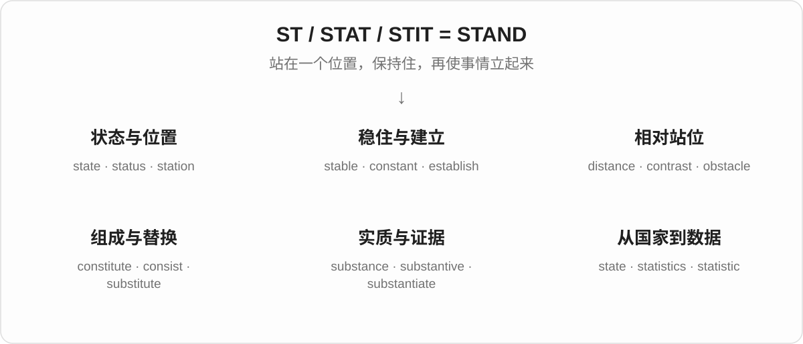

## 词形与演化规律

st-、stat-、stit- 是相关历史词形在不同构词环境中留下的样子，不是可以随意互换的拼写。sistere“使站定”与 stāre 有关，出现在 consist 等词里。state、estate、status 是同源词的不同借入路线；stable 的“稳定”与“马厩”也各有自己的来源词。stay、staunch 更深的来路有不同解释，不能拿它们作为最清楚的规则例子。

## 单词速览（常用到不常用）

| 单词                        | 音标                                                                       | 核心意思                           |
| --------------------------- | -------------------------------------------------------------------------- | ---------------------------------- |
| [state](#w-1)               | /steɪt/                                                                    | 状态；国家、州；陈述               |
| [stay](#w-2)                | /steɪ/                                                                     | 停留；保持；暂住；暂停执行         |
| [station](#w-3)             | /ˈsteɪʃən/                                                                 | 车站；台站；岗位；驻扎             |
| [statement](#w-4)           | /ˈsteɪtmənt/                                                               | 声明；陈述；账单、对账单           |
| [status](#w-5)              | /ˈsteɪtəs/（美式也读 /ˈstætəs/）                                           | 身份；地位；状态                   |
| [distance](#w-6)            | /ˈdɪstəns/                                                                 | 距离；疏离；使保持距离             |
| [estate](#w-7)              | /ɪˈsteɪt/                                                                  | 地产；庄园；遗产；住宅区           |
| [statistics](#w-8)          | /stəˈtɪstɪks/                                                              | 统计学；统计资料                   |
| [instance](#w-9)            | /ˈɪnstəns/                                                                 | 事例；一次具体发生；实例           |
| [constitution](#w-10)       | 英 /ˌkɒnstɪˈtjuːʃən/；美 /ˌkɑːnstɪˈtuːʃən/                                 | 宪法；组成、构造；体质             |
| [arrest](#w-11)             | /əˈrest/                                                                   | 逮捕；阻止；使停住                 |
| [constant](#w-12)           | 英 /ˈkɒnstənt/；美 /ˈkɑːnstənt/                                            | 持续的；恒定的；常量               |
| [constantly](#w-13)         | 英 /ˈkɒnstəntli/；美 /ˈkɑːnstəntli/                                        | 不断地；经常反复地                 |
| [stable](#w-14)             | /ˈsteɪbəl/                                                                 | 稳定的；马厩                       |
| [contrast](#w-15)           | 名词：英 /ˈkɒntrɑːst/、美 /ˈkɑːntræst/；动词常读 /kənˈtrɑːst/、/kənˈtræst/ | 对比；明显差异；对照               |
| [establish](#w-16)          | /ɪˈstæblɪʃ/                                                                | 建立；确立；查明                   |
| [establishment](#w-17)      | /ɪˈstæblɪʃmənt/                                                            | 建立；机构、店铺；既有权势集团     |
| [instant](#w-18)            | /ˈɪnstənt/                                                                 | 瞬间；立即的；速成、即食的         |
| [substantial](#w-19)        | /səbˈstænʃəl/                                                              | 相当大的；实质性的；结实的         |
| [stability](#w-20)          | /stəˈbɪləti/                                                               | 稳定性；稳固                       |
| [instantly](#w-21)          | /ˈɪnstəntli/                                                               | 立即；立刻                         |
| [substance](#w-22)          | /ˈsʌbstəns/                                                                | 物质；实质；有分量的内容           |
| [distant](#w-23)            | /ˈdɪstənt/                                                                 | 遥远的；疏远的；关系远的           |
| [substitute](#w-24)         | 英 /ˈsʌbstɪtjuːt/；美 /ˈsʌbstɪtuːt/                                        | 替代；替代品；替补                 |
| [statistical](#w-25)        | /stəˈtɪstɪkəl/                                                             | 统计的；与统计分析有关的           |
| [statue](#w-26)             | 英 /ˈstætʃuː/；美 /ˈstætʃuː/                                               | 雕像；塑像                         |
| [stance](#w-27)             | 英 /stɑːns/；美 /stæns/                                                    | 站姿；立场                         |
| [interstate](#w-28)         | 英 /ˌɪntəˈsteɪt/；美 /ˈɪntərˌsteɪt/                                        | 州际的；州际公路                   |
| [substantially](#w-29)      | /səbˈstænʃəli/                                                             | 大幅地；在很大程度上；基本上       |
| [consist](#w-30)            | /kənˈsɪst/                                                                 | 由……组成；在于                     |
| [unstable](#w-31)           | /ʌnˈsteɪbəl/                                                               | 不稳定的；容易失衡的               |
| [constitute](#w-32)         | 英 /ˈkɒnstɪtjuːt/；美 /ˈkɑːnstɪtuːt/                                       | 组成；构成；设立                   |
| [constable](#w-33)          | 英 /ˈkʌnstəbəl/；美 /ˈkɑːnstəbəl/                                          | 警员；治安官                       |
| [obstacle](#w-34)           | 英 /ˈɒbstəkəl/；美 /ˈɑːbstəkəl/                                            | 障碍；阻碍                         |
| [instability](#w-35)        | /ˌɪnstəˈbɪləti/                                                            | 不稳定；动荡                       |
| [circumstance](#w-36)       | 英 /ˈsɜːkəmstəns/；美 /ˈsɜːrkəmstæns/                                      | 情况；环境；条件                   |
| [statewide](#w-37)          | /ˈsteɪtwaɪd/                                                               | 全州的；在全州范围内               |
| [stationary](#w-38)         | 英 /ˈsteɪʃənəri/；美 /ˈsteɪʃəneri/                                         | 静止的；固定不动的                 |
| [contrasting](#w-39)        | 英 /kənˈtrɑːstɪŋ/；美 /kənˈtræstɪŋ/                                        | 形成对比的；截然不同的             |
| [stabilize](#w-40)          | /ˈsteɪbəlaɪz/                                                              | 使稳定；稳定下来                   |
| [statesman](#w-41)          | /ˈsteɪtsmən/                                                               | 政治家；善于处理国家事务的人       |
| [statistic](#w-42)          | /stəˈtɪstɪk/                                                               | 一项统计数字；统计量               |
| [substantive](#w-43)        | /ˈsʌbstəntɪv/                                                              | 实质性的；有实际内容的；名词       |
| [stamina](#w-44)            | /ˈstæmɪnə/                                                                 | 耐力；持久力                       |
| [upstate](#w-45)            | /ˈʌpsteɪt/；副词也读 /ʌpˈsteɪt/                                            | 州北部的；往州内偏北地区           |
| [stabilization](#w-46)      | /ˌsteɪbəlaɪˈzeɪʃən/                                                        | 稳定过程；使稳定的措施             |
| [distal](#w-47)             | /ˈdɪstəl/                                                                  | 远端的；远离起点的                 |
| [extant](#w-48)             | /ɪkˈstænt/，也读 /ˈekstənt/                                                | 现存的；尚存的                     |
| [contrasted](#w-49)         | 英 /kənˈtrɑːstɪd/；美 /kənˈtræstɪd/                                        | 被对照的；相对照的                 |
| [superstition](#w-50)       | 英 /ˌsuːpəˈstɪʃən/；美 /ˌsuːpərˈstɪʃən/                                    | 迷信；无根据的吉凶信念             |
| [staunch](#w-51)            | 英 /stɔːntʃ/；美 /stɔːntʃ/                                                 | 坚定的；忠实的；止住流出           |
| [circumstantial](#w-52)     | 英 /ˌsɜːkəmˈstænʃəl/；美 /ˌsɜːrkəmˈstænʃəl/                                | 间接的；与情况有关的；详述细节的   |
| [superstitious](#w-53)      | 英 /ˌsuːpəˈstɪʃəs/；美 /ˌsuːpərˈstɪʃəs/                                    | 迷信的；出于迷信的                 |
| [stately](#w-54)            | /ˈsteɪtli/                                                                 | 庄严的；气派的；从容端庄的         |
| [statehood](#w-55)          | /ˈsteɪthʊd/                                                                | 建州地位；国家地位                 |
| [workstation](#w-56)        | 英 /ˈwɜːksteɪʃən/；美 /ˈwɜːrkˌsteɪʃən/                                     | 工作位；工作站电脑                 |
| [stanza](#w-57)             | /ˈstænzə/                                                                  | 诗节                               |
| [constabulary](#w-58)       | 英 /kənˈstæbjələri/；美 /kənˈstæbjəleri/                                   | 警察队伍；警务的                   |
| [substation](#w-59)         | /ˈsʌbsteɪʃən/                                                              | 变电站；分站                       |
| [presto](#w-60)             | 英 /ˈprestəʊ/；美 /ˈprestoʊ/                                               | 急板；迅速地；瞧，变好了           |
| [statistician](#w-61)       | /ˌstætɪˈstɪʃən/                                                            | 统计学家；统计专业人员             |
| [stateless](#w-62)          | /ˈsteɪtləs/                                                                | 无国籍的；不保存会话状态的         |
| [stateside](#w-63)          | /ˈsteɪtsaɪd/                                                               | 在美国本土的；回美国本土           |
| [substantiate](#w-64)       | /səbˈstænʃieɪt/                                                            | 证实；为……提供依据                 |
| [reestablish](#w-65)        | /ˌriːɪˈstæblɪʃ/                                                            | 重新建立；恢复                     |
| [distantly](#w-66)          | /ˈdɪstəntli/                                                               | 远远地；疏远地；间接地             |
| [overstate](#w-67)          | 英 /ˌəʊvəˈsteɪt/；美 /ˌoʊvərˈsteɪt/                                        | 夸大；言过其实                     |
| [constitutive](#w-68)       | 英 /ˈkɒnstɪtjuːtɪv/；美 /kənˈstɪtʃətɪv/                                    | 构成性的；组成事物本质的           |
| [statist](#w-69)            | /ˈsteɪtɪst/                                                                | 国家干预主义者；国家干预主义的     |
| [restate](#w-70)            | /ˌriːˈsteɪt/                                                               | 重申；换一种说法再陈述             |
| [constancy](#w-71)          | 英 /ˈkɒnstənsi/；美 /ˈkɑːnstənsi/                                          | 恒定；坚定；忠贞                   |
| [equidistant](#w-72)        | /ˌiːkwɪˈdɪstənt/                                                           | 等距的；距离相等的                 |
| [geostationary](#w-73)      | 英 /ˌdʒiːəʊˈsteɪʃənəri/；美 /ˌdʒiːoʊˈsteɪʃəneri/                           | 相对地面静止的；地球静止轨道的     |
| [reconstitute](#w-74)       | 英 /ˌriːˈkɒnstɪtjuːt/；美 /ˌriːˈkɑːnstɪtuːt/                               | 重新组成；复原；加水调回           |
| [stateroom](#w-75)          | 英 /ˈsteɪtruːm/；美 /ˈsteɪtˌruːm/                                          | 客轮客舱；豪华包厢                 |
| [substantively](#w-76)      | /ˈsʌbstəntɪvli/                                                            | 在实质内容上；实质性地             |
| [downstate](#w-77)          | /ˈdaʊnsteɪt/                                                               | 州南部的；州内偏南地区             |
| [understate](#w-78)         | 英 /ˌʌndəˈsteɪt/；美 /ˌʌndərˈsteɪt/                                        | 轻描淡写；少报、低估地陈述         |
| [statecraft](#w-79)         | 英 /ˈsteɪtkrɑːft/；美 /ˈsteɪtkræft/                                        | 治国之术；处理国家事务的技巧       |
| [intrastate](#w-80)         | 英 /ˌɪntrəˈsteɪt/；美 /ˌɪntrəˈsteɪt/                                       | 州内的                             |
| [statuesque](#w-81)         | 英 /ˌstætʃuˈesk/；美 /ˌstætʃuˈesk/                                         | 雕像般优美的；高挑端庄的           |
| [disestablishment](#w-82)   | /ˌdɪsɪˈstæblɪʃmənt/                                                        | 取消官方地位；废除国教地位         |
| [statism](#w-83)            | /ˈsteɪtɪzəm/                                                               | 国家干预主义；国家主义             |
| [substantiation](#w-84)     | /səbˌstænʃiˈeɪʃən/                                                         | 证实；佐证；证实过程               |
| [transubstantiation](#w-85) | /ˌtrænzəbˌstænʃiˈeɪʃən/                                                    | 化质；圣餐实体转变说               |
| [instate](#w-86)            | /ɪnˈsteɪt/                                                                 | 使就职；安置于某个地位             |
| [stater](#w-87)             | 英 /ˈsteɪtə/；美 /ˈsteɪtər/                                                | 陈述者；斯塔特古币                 |
| [inconstant](#w-88)         | 英 /ɪnˈkɒnstənt/；美 /ɪnˈkɑːnstənt/                                        | 易变的；反复无常的                 |
| [contrastive](#w-89)        | 英 /kənˈtrɑːstɪv/；美 /kənˈtræstɪv/                                        | 对比性的；具有区别作用的           |
| [instantiation](#w-90)      | /ɪnˌstænʃiˈeɪʃən/                                                          | 实例化；具体体现                   |
| [stamen](#w-91)             | /ˈsteɪmən/                                                                 | 雄蕊                               |
| [tristate](#w-92)           | /ˈtraɪsteɪt/                                                               | 三州的；三态的                     |
| [stanchion](#w-93)          | 英 /ˈstænʃən/；美 /ˈstænʃən/                                               | 直立支柱；栏柱                     |
| [bistable](#w-94)           | /baɪˈsteɪbəl/                                                              | 双稳态的                           |
| [arrestee](#w-95)           | /əˌresˈtiː/                                                                | 被捕者                             |
| [inconstancy](#w-96)        | 英 /ɪnˈkɒnstənsi/；美 /ɪnˈkɑːnstənsi/                                      | 无常；反复不定；不忠               |
| [superstation](#w-97)       | 英 /ˈsuːpəsteɪʃən/；美 /ˈsuːpərˌsteɪʃən/                                   | 通过有线或卫星广泛转播的地方电视台 |
| [substate](#w-98)           | /ˈsʌbsteɪt/                                                                | 子状态；低于国家层级的政治单位     |
| [substantiality](#w-99)     | /səbˌstænʃiˈæləti/                                                         | 实在性；坚实程度；分量             |
| [equidistance](#w-100)      | /ˌiːkwɪˈdɪstəns/                                                           | 等距；距离相等                     |
| [bistability](#w-101)       | /ˌbaɪstəˈbɪləti/                                                           | 双稳态性                           |
| [consubstantiation](#w-102) | 英 /ˌkɒnsəbˌstænʃiˈeɪʃən/；美 /ˌkɑːnsəbˌstænʃiˈeɪʃən/                      | 圣餐同质共存说                     |
| [arrestant](#w-103)         | /əˈrestənt/                                                                | 阻止反应的物质；使昆虫停留的化学物 |
| [bistate](#w-104)           | /ˈbaɪsteɪt/                                                                | 涉及两个州的；双状态的             |
| [transubstantiate](#w-105)  | /ˌtrænzəbˈstænʃieɪt/                                                       | 使实体转变；使化质                 |

## 逐词讲解

### 1. state — 状态；国家、州；陈述

**音标**：/steɪt/

**先抓住这个画面**

先给事物拍一张“此刻是什么样”的照片：房间的状态、人的处境，都可以用 state。政治中，它又表示有组织的国家或州。

**怎么拆**

整词经法语、拉丁语传入，核心来自 status“所处的状态”。不能拆成英语 s + tate。

**怎么变成今天的意思**

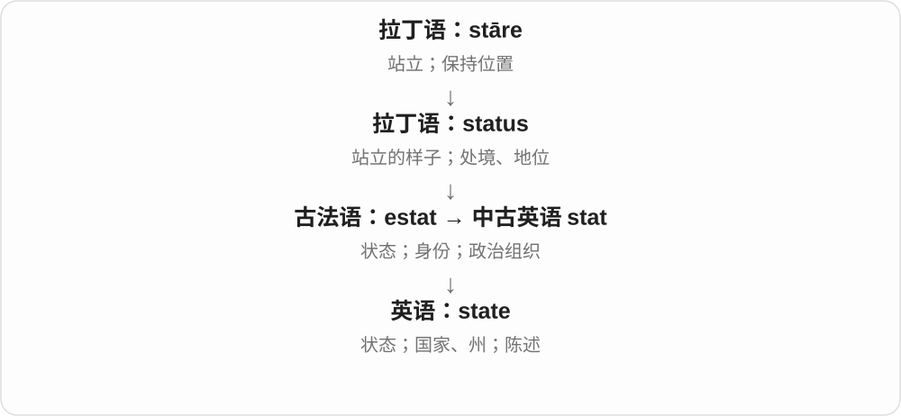

从“站成什么样”到“处于什么状态”，再到社会的组织形态。动词 state 是把情况明确说出来，语气通常比 say 正式。

**常见搭配与例句**

in a good state；a member state；state clearly；state that…。

> The house was in a poor state when we bought it.

我们买下这栋房子时，它的状况很差。

> Please state your reason for applying.

请说明你的申请理由。

**别混淆**

state 常说当前状况；status 更常问身份、级别或进度类别。state a reason 是陈述理由，不是建立国家。

### 2. stay — 停留；保持；暂住；暂停执行

**音标**：/steɪ/

**先抓住这个画面**

原本可以走开或改变，现在仍留在这个位置或状态：stay here、stay calm 都沿着“保持住”理解。

**怎么拆**

历史涉及法语表示停留与支撑的相关词形。词典对日常 stay 是否直接来自拉丁 stāre 的路线有不同处理，不能把所有义项压成一条确定链。

**怎么变成今天的意思**

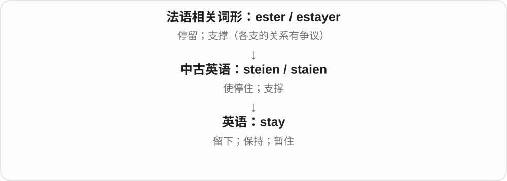

学习时先抓“继续留在原处或原状态”。支撑物、船桅支索等名词还涉及日耳曼语来源，不是都由日常“住几天”变来。

**常见搭配与例句**

stay at home；stay calm；stay with friends；a short stay。

> We stayed with friends for the weekend.

我们周末住在朋友家。

> Please stay calm while we find a solution.

在我们寻找解决办法时，请保持冷静。

**别混淆**

stay 常是暂住或保持状态；live 强调居住、生活。stay calm 不需要加 to be。

### 3. station — 车站；台站；岗位；驻扎

**音标**：/ˈsteɪʃən/

**先抓住这个画面**

人或设备被安排在一个固定地点，承担某种任务：火车停靠、警察执勤、广播发射，都能形成 station。

**怎么拆**

来自拉丁语 statiō“站立、岗位”，经盎格鲁诺曼语和中古英语传入。

**怎么变成今天的意思**

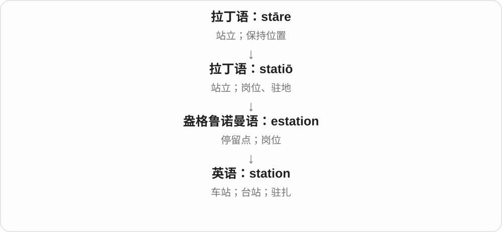

“停在某处”发展为停靠点与工作地点。动词 station 是把人或设备安排在某处守候，不只是让他站着。

**常见搭配与例句**

a railway station；a police station；a radio station；be stationed at…。

> We agreed to meet outside the station.

我们约好在车站外见面。

> Two guards were stationed at the entrance.

入口处安排了两名守卫。

**别混淆**

stop 可以只是沿途一站；station 往往强调有明确用途的地点、机构或设施。

### 4. statement — 声明；陈述；账单、对账单

**音标**：/ˈsteɪtmənt/

**先抓住这个画面**

把要表达的内容正式摆出来，形成一段可以引用、核对的话，就是 statement。银行把账目列出来，也叫 statement。

**怎么拆**

state（陈述）+ -ment（行为或结果）。

**怎么变成今天的意思**

它从“说清楚一件事”扩展到书面的正式记录。衣着作 statement 时，是通过外观表达鲜明态度，不一定说出一句话。

**常见搭配与例句**

issue a statement；a witness statement；a bank statement；make a statement。

> The company issued a statement about the delay.

公司就延误发表了一份声明。

> I checked the charge against my bank statement.

我对照银行对账单核查了这笔收费。

**别混淆**

sentence 是语法上的一句话；statement 是一次陈述或所表达的内容，可能长达几段。

### 5. status — 身份；地位；状态

**音标**：/ˈsteɪtəs/（美式也读 /ˈstætəs/）

**先抓住这个画面**

status 像名单里给你标的一格：学生还是职员，订单已发货还是待处理，社会上处于什么地位。

**怎么拆**

直接借入拉丁语 status；与 state、estate 是不同路线进入英语的同源词。

**怎么变成今天的意思**

位置不一定是脚下的地点，也可以是制度中的位置。婚姻身份、申请进度、社会地位都沿着这条抽象方向理解。

**常见搭配与例句**

social status；marital status；check the status of an order。

> You can check the status of your application online.

你可以在线查看申请进度。

> We should treat people fairly regardless of social status.

不论社会地位如何，我们都应公平待人。

**别混淆**

status 不总是“高地位”。low status、pending status 都是在说明所处的类别或位置。

### 6. distance — 距离；疏离；使保持距离

**音标**：/ˈdɪstəns/

**先抓住这个画面**

两个人分开站，中间留下的间隔就是 distance；心理上不亲近，也像隔着一段看不见的路。

**怎么拆**

拉丁语 dis-（分开）+ stāre（站）→ distantia，经过法语进入英语。

**怎么变成今天的意思**

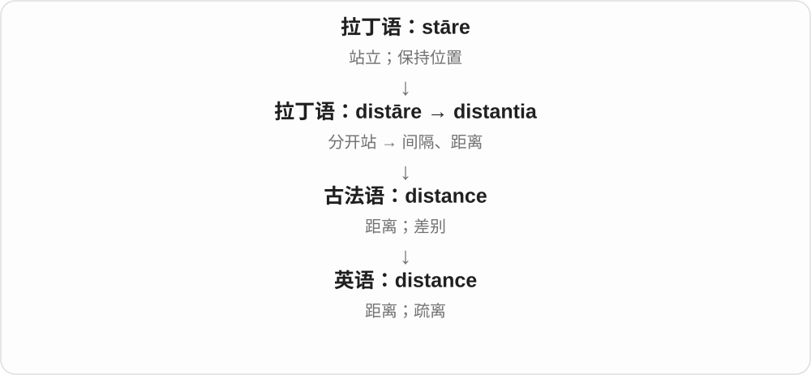

空间间隔扩展到时间、情感和社会关系。distance yourself from… 是把自己与某事划开，不一定真的走远。

**常见搭配与例句**

in the distance；keep your distance；distance yourself from…。

> We could see mountains in the distance.

我们能看见远处的群山。

> She distanced herself from the proposal.

她与这项提议划清了界限。

**别混淆**

distance 是间隔或保持间隔的动作；distant 是“遥远的”形容词。

### 7. estate — 地产；庄园；遗产；住宅区

**音标**：/ɪˈsteɪt/

**先抓住这个画面**

estate 常让人看到一整片归属某个人或用途的土地房屋，或者一个人去世后留下的财产整体。

**怎么拆**

经古法语 estat 来自拉丁语 status，与 state 同源；词首 e 是历史词形的一部分。

**怎么变成今天的意思**

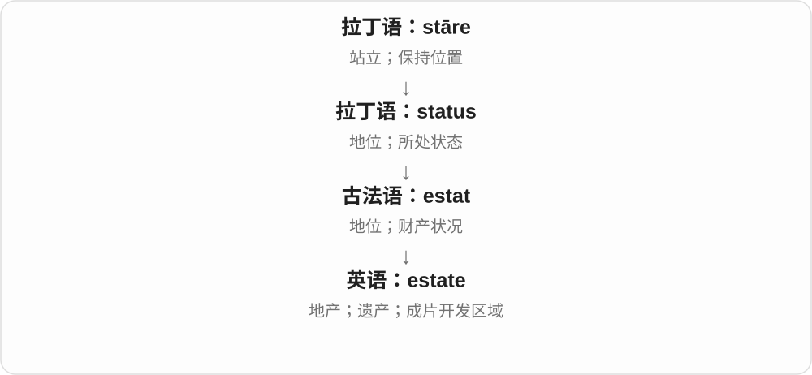

从一个人的身份与财产状况，发展为支撑这种地位的地产和财产。real estate 专指土地房产；the estate 可指遗产整体。

**常见搭配与例句**

a country estate；real estate；a housing estate；manage an estate。

> The family sold part of the estate to pay for repairs.

这家人为支付修缮费用卖掉了部分地产。

> She grew up on a housing estate near the river.

她在河边的一片住宅区长大。

**别混淆**

estate 不是每一件个人物品的名称。property 范围更广；a housing estate 是一片住宅区，不必是豪华庄园。

### 8. statistics — 统计学；统计资料

**音标**：/stəˈtɪstɪks/

**先抓住这个画面**

把零散观察收集起来，整理、比较，再判断它们说明什么，statistics 可以指这门方法，也可以指整理出的数据。

**怎么拆**

经德语 Statistik 等学术用法而来，更早关联国家事务与拉丁语 status，不是因为数据“静止不动”。

**怎么变成今天的意思**

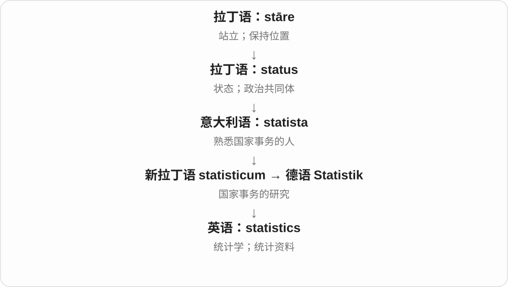

最初围绕国家和社会状况的资料研究，后来扩展到各种领域。说学科时通常配单数谓语；说多项数据时配复数谓语。

**常见搭配与例句**

study statistics；official statistics；statistics on population。

> Statistics is part of the course.

统计学是这门课程的一部分。

> The statistics show a steady increase in cycling.

统计数据显示骑自行车的人数稳步增加。

**别混淆**

Statistics is useful 指学科；The statistics are surprising 指那些数据。不要把词尾 s 一律当普通复数。

### 9. instance — 事例；一次具体发生；实例

**音标**：/ˈɪnstəns/

**先抓住这个画面**

大类里拿出眼前这个具体情况，叫 an instance。抽象规则落到某一次真实出现，也就是一个实例。

**怎么拆**

经法语来自拉丁语 īnstantia，与 īnstāre“逼近、坚持提出”有关；不是 instant 直接加 -ce。

**怎么变成今天的意思**

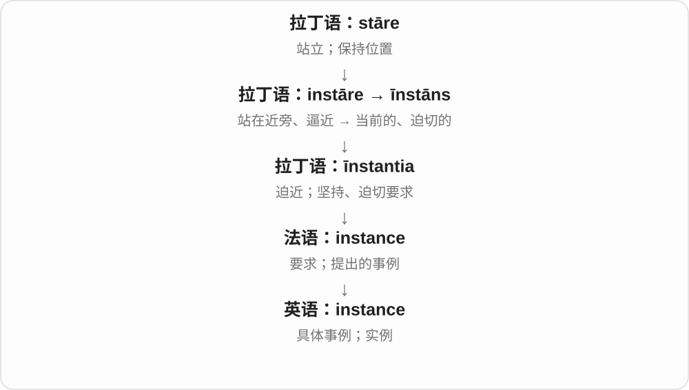

早期的迫切要求、提出的论点或事例，逐渐转向现代的具体例子。这里有历史语义变化，不能单凭“站在里面”猜出全部意思。

**常见搭配与例句**

for instance；an instance of…；in this instance；a database instance。

> Some birds, for instance owls, hunt at night.

有些鸟，比如猫头鹰，在夜间捕猎。

> This is one instance of a much wider problem.

这只是一个更广泛问题的具体事例。

**别混淆**

example 常是为说明而挑出的例子；instance 更强调某类情况的一次具体出现。

### 10. constitution — 宪法；组成、构造；体质

**音标**：英 /ˌkɒnstɪˈtjuːʃən/；美 /ˌkɑːnstɪˈtuːʃən/

**先抓住这个画面**

把一个整体“怎样组织起来”写成基本安排：国家有宪法，身体有自身的体质，材料也有其构成。

**怎么拆**

来自拉丁语 cōnstitūtiō，经古法语进入；和 constitute 对应，但不是最初在英语里简单加 -ion 造出的。

**怎么变成今天的意思**

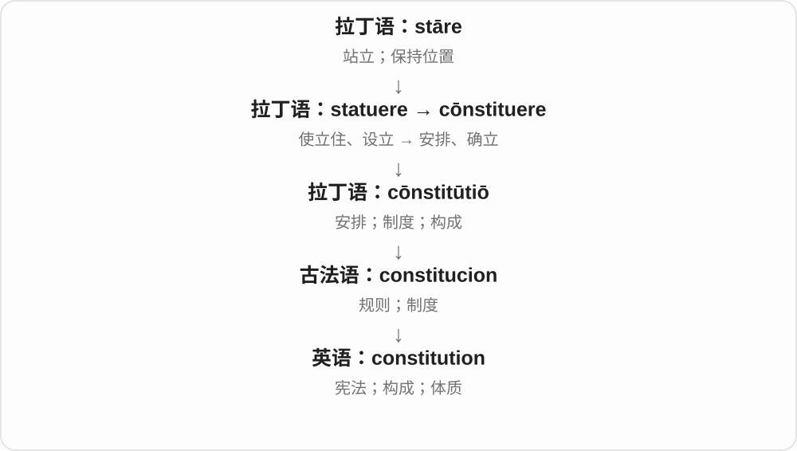

规则规定国家怎样构成和运作，身体的构成体现为体质。三个义项都围绕“一个整体的基本组织方式”。

**常见搭配与例句**

a written constitution；a strong constitution；the constitution of a substance。

> The constitution sets out the main powers of government.

宪法规定了政府的主要权力。

> She has a strong constitution and rarely misses a day of work.

她体质好，很少因身体原因缺勤。

**别混淆**

constitution 是基本组织或基本法；institution 是机构或制度。the constitution 常按语境特指某部宪法。

### 11. arrest — 逮捕；阻止；使停住

**音标**：/əˈrest/

**先抓住这个画面**

一个继续前进的过程被按下暂停键：人被警方扣住，发展被阻止，注意力被抓住，都能用 arrest。

**怎么拆**

经古法语 arester 来自通俗拉丁语 *arrestāre，含 ad- 与 restāre“留下、停住”；更深处是 stāre。

**怎么变成今天的意思**

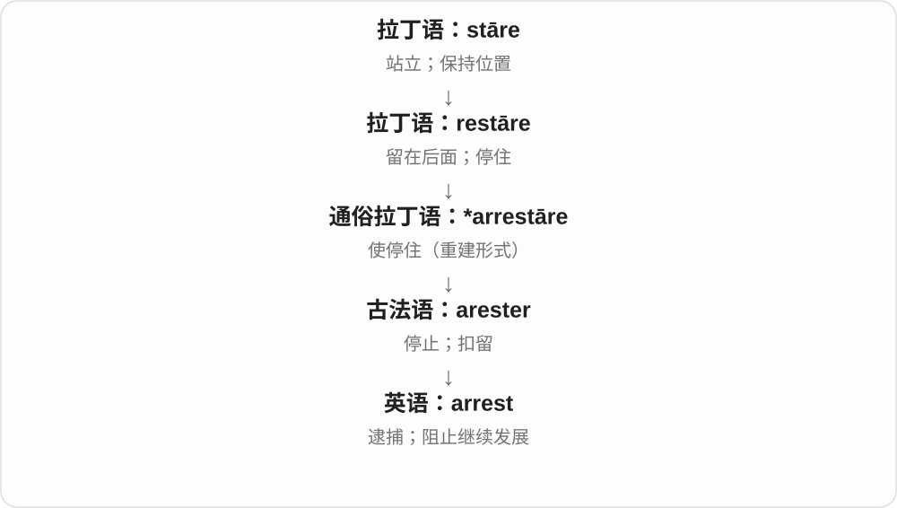

逮捕义是“使人停住、扣留”的专业化。arrest the decline 则是阻止下滑继续，不涉及抓人。

**常见搭配与例句**

arrest someone；be under arrest；arrest the decline；arrest attention。

> Police arrested a suspect near the station.

警方在车站附近逮捕了一名嫌疑人。

> The repairs helped arrest the building’s deterioration.

修缮有助于阻止建筑进一步损坏。

**别混淆**

arrest 是逮捕，不等于已定罪。stop 最普通；arrest 用于发展过程时更正式。

### 12. constant — 持续的；恒定的；常量

**音标**：英 /ˈkɒnstənt/；美 /ˈkɑːnstənt/

**先抓住这个画面**

一根线一直在那里，或一个数始终不变：constant 可以强调持续存在，也可以强调数值恒定。

**怎么拆**

来自拉丁语 cōnstāns，相关动词 cōnstāre 是“站稳、保持一致”，经法语传入。

**怎么变成今天的意思**

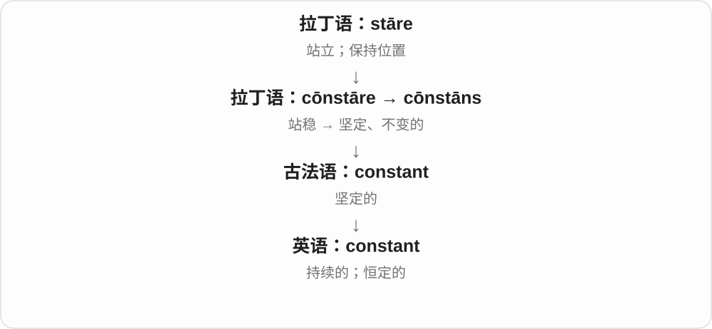

“站得住”变为不轻易变化。constant noise 是持续的噪声，不要求每秒音量完全相同；a constant temperature 则强调温度不变。

**常见搭配与例句**

constant pressure；constant support；a mathematical constant。

> The machine keeps the temperature constant.

机器让温度保持恒定。

> She has been a constant source of support.

她一直给予支持。

**别混淆**

continuous 主要说没有中断；constant 还常说不变或频繁反复。具体含义由搭配决定。

### 13. constantly — 不断地；经常反复地

**音标**：英 /ˈkɒnstəntli/；美 /ˈkɑːnstəntli/

**先抓住这个画面**

事情一轮接一轮，几乎没停过；说话者把这种持续或频繁的感觉说成 constantly。

**怎么拆**

constant + -ly，把持续、不变的性质转为副词。

**怎么变成今天的意思**

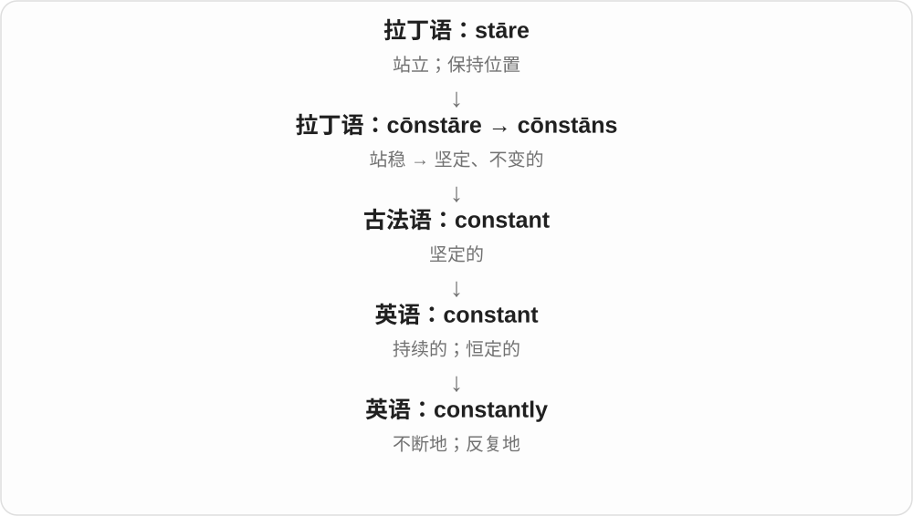

日常使用常带强调，未必按字面说每一秒都发生。He constantly complains 强调抱怨太频繁。

**常见搭配与例句**

constantly changing；constantly check；constantly complain。

> The weather was constantly changing during the trip.

旅途中天气不断变化。

> He constantly checks his phone during dinner.

他吃晚饭时总在看手机。

**别混淆**

always 可以表示规律性地每次如此；constantly 更突出持续或令人感觉反复不停。

### 14. stable — 稳定的；马厩

**音标**：/ˈsteɪbəl/

**先抓住这个画面**

轻推一下也不会倒，遇到小变化也不容易失控，就是 stable。作名词时，它又是一处让马安置下来的马厩。

**怎么拆**

形容词来自拉丁语 stabilis“稳固的”；马厩义来自 stabulum“牲畜停留处”。两支都与站立、停留有关，但不能互相画成祖先。

**怎么变成今天的意思**

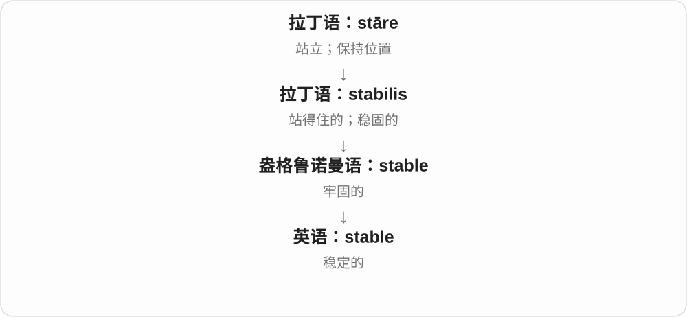

“站得住”扩展到价格、关系、系统等的稳定。名词那一支强调停留的地点；同样的拼写隐藏了两条借入路线。

**常见搭配与例句**

a stable price；a stable relationship；keep horses in a stable。

> The table is stable even on the uneven floor.

即使地板不平，这张桌子也很稳。

> The horses returned to the stable before dark.

天黑前，马回到了马厩。

**别混淆**

stable 不等于完全不变，而是没有剧烈或失控的变化。stable 作马厩名词时可以加复数 -s。

### 15. contrast — 对比；明显差异；对照

**音标**：名词：英 /ˈkɒntrɑːst/、美 /ˈkɑːntræst/；动词常读 /kənˈtrɑːst/、/kənˈtræst/

**先抓住这个画面**

把黑色和白色并排放，差别一下就跳出来。contrast 看的是并置后显出的不同。

**怎么拆**

拉丁语 contrā（对面）+ stāre（站）→ contrāstāre，经法语 contraster 进入。

**怎么变成今天的意思**

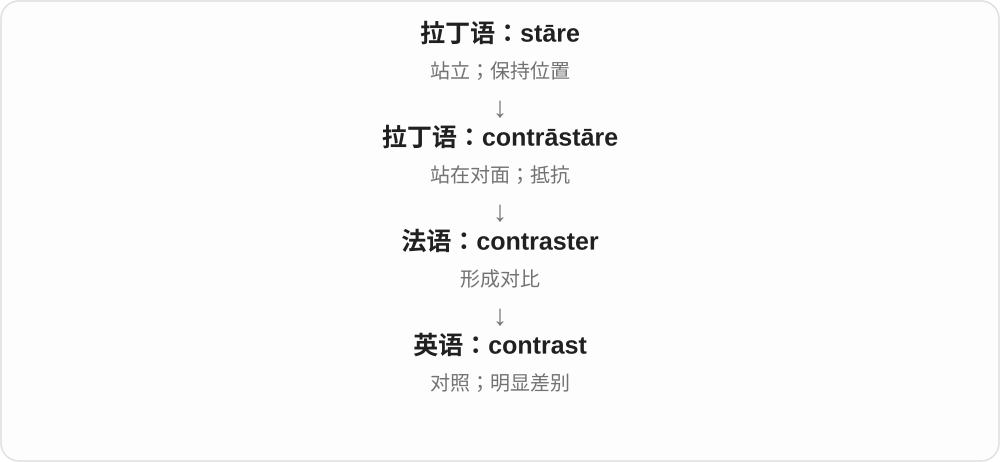

从站在对面、抵抗，转向表现彼此差异。照片中的 contrast 是明暗或色彩差别；文章中则可以对照两种观点。

**常见搭配与例句**

in contrast；a sharp contrast；contrast A with B。

> The red door creates a striking contrast with the white wall.

红门与白墙形成鲜明对比。

> The essay contrasts village life with city life.

这篇文章对照了乡村生活和城市生活。

**别混淆**

compare 可以找相同和不同；contrast 重点找不同。名词通常前重音，动词通常后重音。

### 16. establish — 建立；确立；查明

**音标**：/ɪˈstæblɪʃ/

**先抓住这个画面**

把事情从“还没有、还不稳”推进到“已经立起来、站得住”：建立学校，确立规则，证明事实，都有这个味道。

**怎么拆**

来自拉丁语 stabilīre“使稳固”，经古法语 establir 的词干 establiss- 进入英语。

**怎么变成今天的意思**

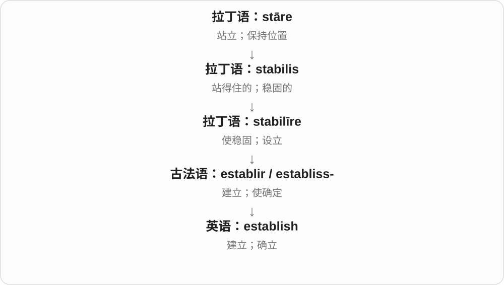

实体被建立，关系被确立，事实被证据固定下来。establish that… 常是查明并确定某件事，而不是仅提出一种猜想。

**常见搭配与例句**

establish a company；establish contact；establish the facts；establish that…。

> They established a small school in the village.

他们在村里创办了一所小学校。

> The tests established that the material was safe to use.

测试确定这种材料可以安全使用。

**别混淆**

found 强调创立；establish 还可强调让制度、声誉或事实站稳。

### 17. establishment — 建立；机构、店铺；既有权势集团

**音标**：/ɪˈstæblɪʃmənt/

**先抓住这个画面**

事情被建立起来，是 establishment；已经立起来并持续运作的机构，也可这样叫。the establishment 则指掌握既有权力的人与机构。

**怎么拆**

经古法语 establissement 进入英语，历史上对应 establir 的名词；现代可看出 establish + -ment 的形式关系。

**怎么变成今天的意思**

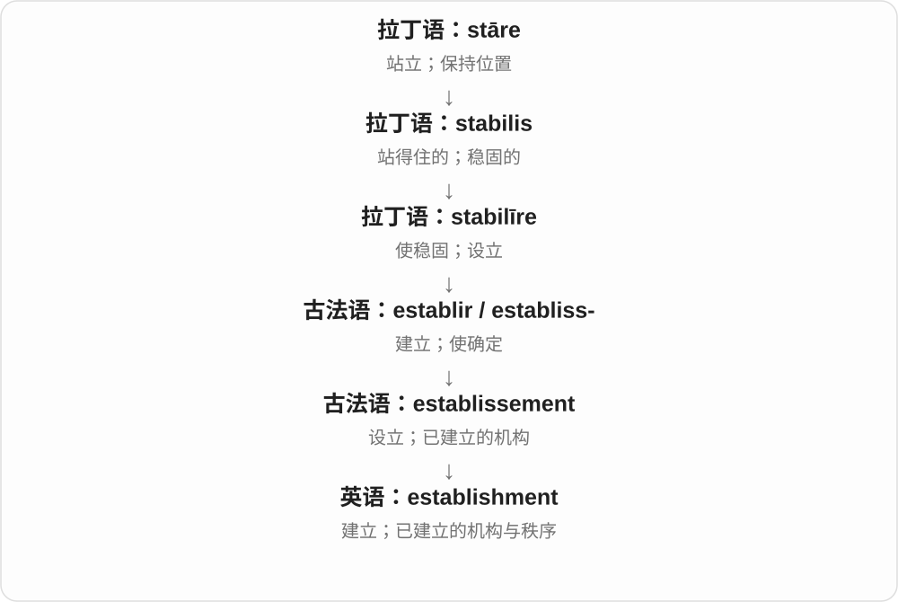

从过程转向结果，再到稳居社会重要位置的体系。a business establishment 常只是营业场所，不自动带政治意味。

**常见搭配与例句**

the establishment of…；a commercial establishment；the political establishment。

> The establishment of the library took several years.

建立这座图书馆花了好几年。

> The café is a small family establishment.

这家咖啡馆是一家小型家庭经营店铺。

**别混淆**

establishment 有三个常见层次：建立过程、具体机构、既有权势集团。冠词和上下文帮助判断。

### 18. instant — 瞬间；立即的；速成、即食的

**音标**：/ˈɪnstənt/

**先抓住这个画面**

一件事就在眼前发生，几乎不用等：instant 把时间压到“现在这一刻”。

**怎么拆**

来自拉丁语 īnstāns“站在近旁、当前的、迫切的”，经法语进入。

**怎么变成今天的意思**

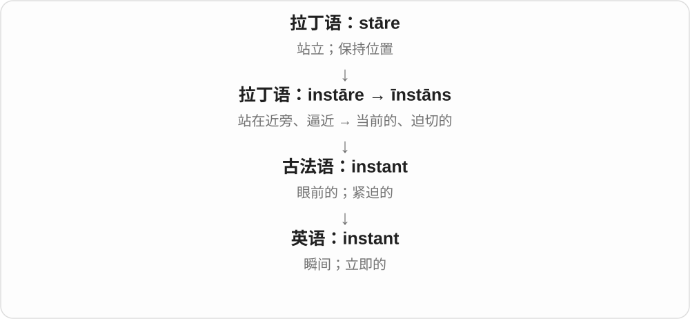

从迫近眼前发展为当前的一刻，再到立即发生。instant coffee 是很快能冲好的咖啡，并不是没有生产过程。

**常见搭配与例句**

an instant reply；instant coffee；in an instant；the instant…。

> She recognized him in an instant.

她一眼就认出了他。

> The message received an instant reply.

这条消息立即得到了回复。

**别混淆**

instant 作名词是一瞬间，作形容词是立即的。instance 是事例，多一个 ce，含义不同。

### 19. substantial — 相当大的；实质性的；结实的

**音标**：/səbˈstænʃəl/

**先抓住这个画面**

不是一点点、空架子，而是数量可观或摸得着分量：substantial 可以说钱多、进展大，也能说结构结实。

**怎么拆**

由拉丁语 substantiālis 经法语传入，基础是 substantia“实质”。

**怎么变成今天的意思**

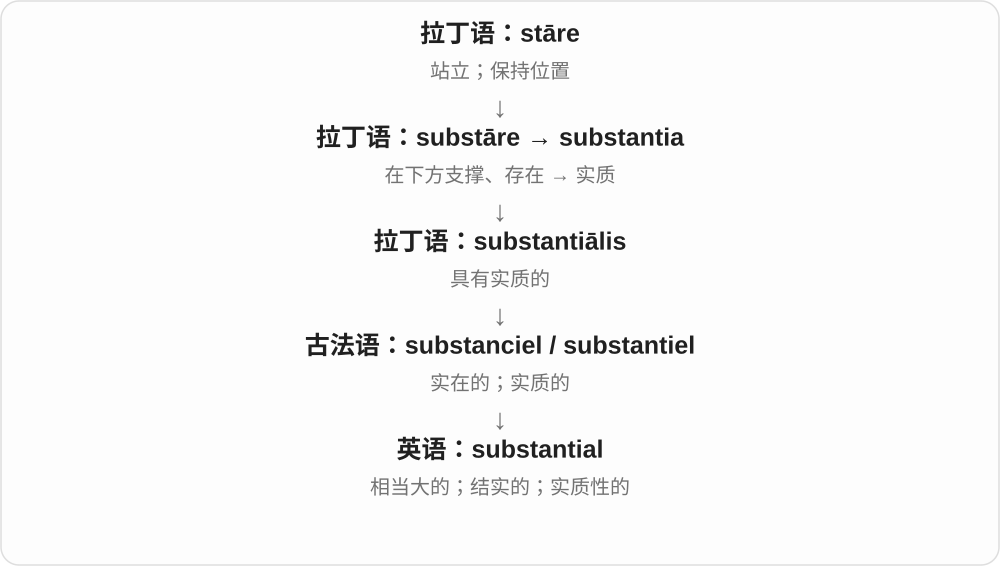

从“有实质”转向“有足够分量”，所以大量、重要、坚实等义项能连起来。它不必表示占一半以上。

**常见搭配与例句**

a substantial increase；substantial evidence；a substantial meal。

> The changes led to a substantial reduction in waste.

这些改变显著减少了浪费。

> We had a substantial breakfast before the hike.

徒步前，我们吃了一顿丰盛的早餐。

**别混淆**

substantial 常说分量或规模；substantive 常说是否触及实质问题。a substantial meal 是吃得饱的一餐。

### 20. stability — 稳定性；稳固

**音标**：/stəˈbɪləti/

**先抓住这个画面**

观察一个系统能否经受扰动而不乱掉，谈的就是它的 stability。

**怎么拆**

来自拉丁语 stabilitās，经法语进入；现代可对照 stable 与 -ity 的名词关系。

**怎么变成今天的意思**

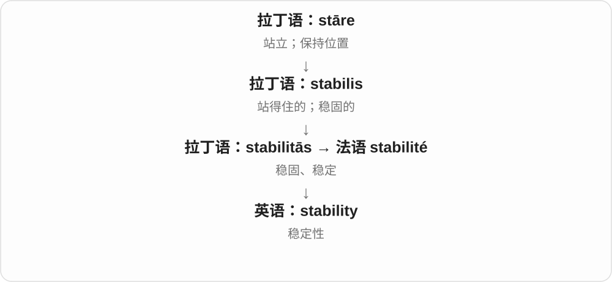

把“稳”从一个形容词变成可以讨论的性质。financial stability、emotional stability 都是在看变化是否可控，并不要求永远没有波动。

**常见搭配与例句**

political stability；financial stability；improve stability。

> The wider base improves the chair’s stability.

更宽的底座提高了椅子的稳定性。

> The team needs continuity and stability.

团队需要连续性和稳定性。

**别混淆**

balance 是平衡关系；stability 是这种状态能否维持。一个东西暂时平衡，也可能非常不稳定。

### 21. instantly — 立即；立刻

**音标**：/ˈɪnstəntli/

**先抓住这个画面**

按钮一按，结果就出来，动作之间几乎没有可察觉的等待，这就是 instantly。

**怎么拆**

instant + -ly。

**怎么变成今天的意思**

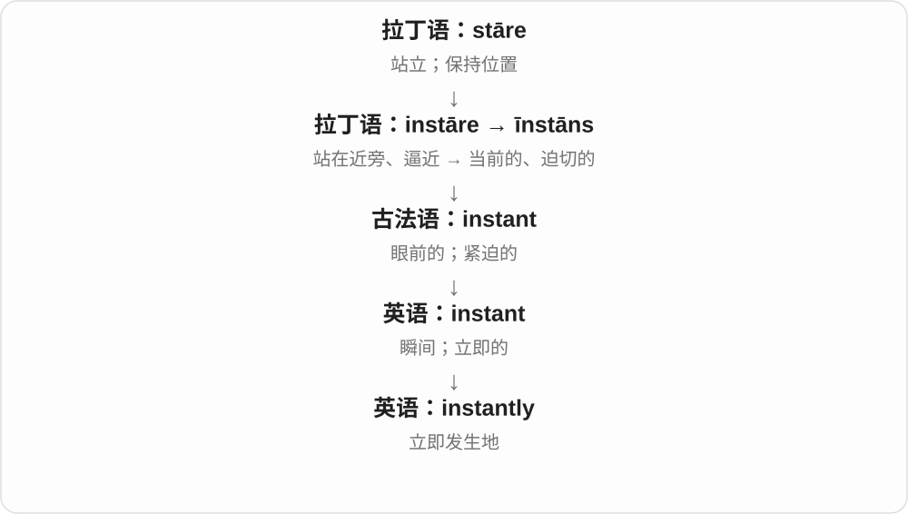

它描述反应或变化发生得非常快。日常表达中可带夸张，不需要按物理学理解为零时间。

**常见搭配与例句**

instantly recognize；instantly understand；respond instantly。

> I recognized her voice instantly.

我立刻认出了她的声音。

> The screen lit up instantly.

屏幕立刻亮了起来。

**别混淆**

instant 是形容词或名词，instantly 是副词：an instant change，change instantly。

### 22. substance — 物质；实质；有分量的内容

**音标**：/ˈsʌbstəns/

**先抓住这个画面**

先把包装拿掉，看看里面真正有什么：可摸到的材料是 substance，言论里实际说了什么也是 substance。

**怎么拆**

拉丁语 sub-（在下）+ stāre（站）→ substantia“实质、实体”，经法语进入。

**怎么变成今天的意思**

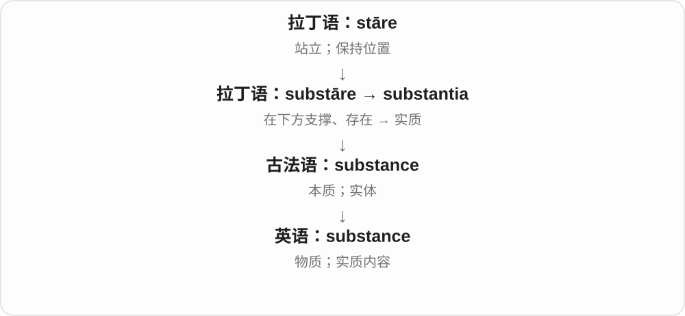

“支撑在下面、实际存在”发展出实体与本质的概念。a speech without substance 是听着漂亮，却没有实在内容。

**常见搭配与例句**

a chemical substance；the substance of an argument；a person of substance。

> The label identifies the substance inside the bottle.

标签注明了瓶内的物质。

> Her presentation had style but little substance.

她的演示形式漂亮，却缺少实质内容。

**别混淆**

material 更常说材料用途；substance 更常把某种物质作为整体，或强调话语中的实质。

### 23. distant — 遥远的；疏远的；关系远的

**音标**：/ˈdɪstənt/

**先抓住这个画面**

东西离你很远，或一个人虽然就在旁边，却不愿亲近，都可以说 distant。

**怎么拆**

来自拉丁语 distāns“分开站着的”，经古法语传入。

**怎么变成今天的意思**

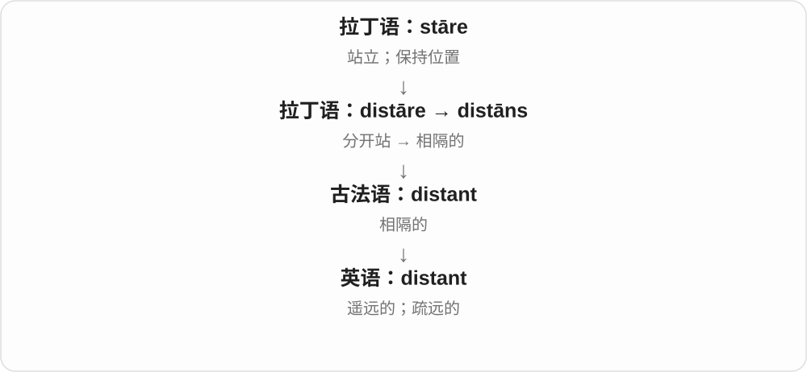

空间距离被借来表达情感距离。a distant relative 是亲缘关系远，不是住得远。

**常见搭配与例句**

a distant village；a distant memory；a distant relative；seem distant。

> They lived in a distant mountain village.

他们住在一个偏远的山村。

> He seemed distant and distracted throughout dinner.

整个晚餐过程中，他显得疏离又心不在焉。

**别混淆**

far 常作副词或表语；distant 直接修饰名词很自然。cold 更强调冷淡态度，distant 也可能只是心不在焉。

### 24. substitute — 替代；替代品；替补

**音标**：英 /ˈsʌbstɪtjuːt/；美 /ˈsʌbstɪtuːt/

**先抓住这个画面**

原来的位置空出来，让另一个东西顶上去，这就是 substitute 的核心动作。

**怎么拆**

拉丁语 sub-（在下面、接替）+ statuere（设立）→ substituere，分词 substitūtus 传入英语。

**怎么变成今天的意思**

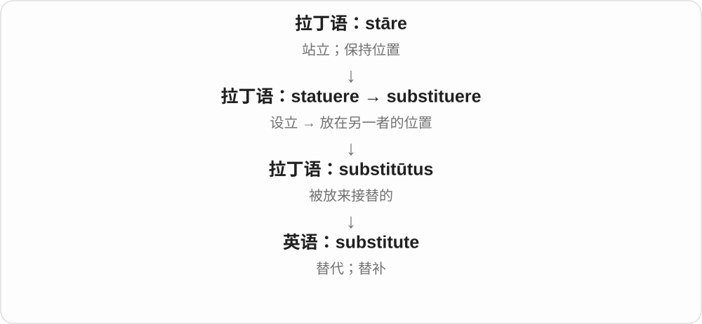

它强调位置或功能的接替。substitute A for B 通常表示用 A 替换 B，记成“A 上，B 下”比较稳。

**常见搭配与例句**

a substitute for…；substitute A for B；a substitute teacher。

> You can substitute yogurt for cream in this recipe.

这道食谱可以用酸奶代替奶油。

> The substitute scored within five minutes.

替补上场不到五分钟就得分了。

**别混淆**

replace B with A 与 substitute A for B 词序不同。替代品承担类似功能，不代表两者完全等同。

### 25. statistical — 统计的；与统计分析有关的

**音标**：/stəˈtɪstɪkəl/

**先抓住这个画面**

用数据的分布、数量和比较来研究问题，相关的方法或结果就是 statistical。

**怎么拆**

与 statistics 对应，加 -al 构成形容词；现代可见 statistic + -al 的形式关系，但不据此倒置历史顺序。

**怎么变成今天的意思**

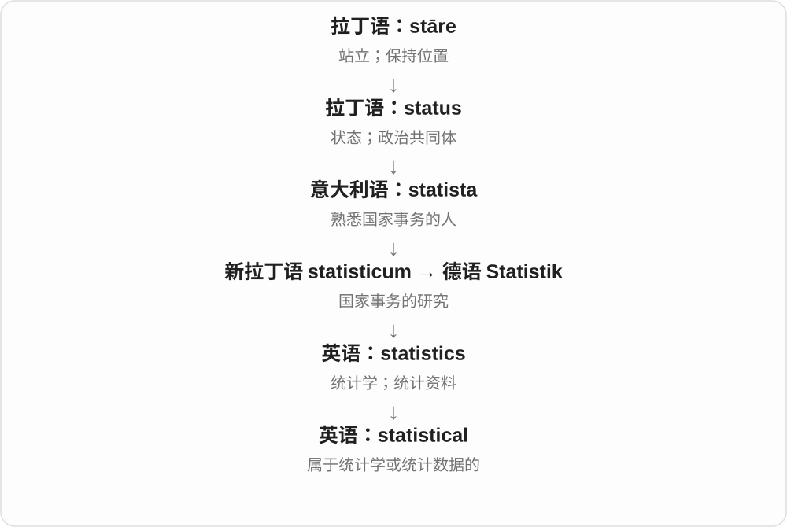

它可以修饰分析、证据、模型等。statistical significance 是一种特定统计判断，不自动等于现实影响很大。

**常见搭配与例句**

statistical analysis；statistical evidence；a statistical model。

> The report includes a statistical analysis of travel patterns.

报告包含对出行模式的统计分析。

> We need more than a statistical difference to explain the cause.

要解释原因，仅有统计差异还不够。

**别混淆**

statistical 不是 static“静态的”。statistical evidence 来自数据分析，仍可能需要解释背景。

### 26. statue — 雕像；塑像

**音标**：英 /ˈstætʃuː/；美 /ˈstætʃuː/

**先抓住这个画面**

把人物或动物塑成立体形象，摆在那里供人观看或纪念，便是一座 statue。

**怎么拆**

来自拉丁语 statua，相关动词 statuere 是“竖立、设立”；经古法语进入。

**怎么变成今天的意思**

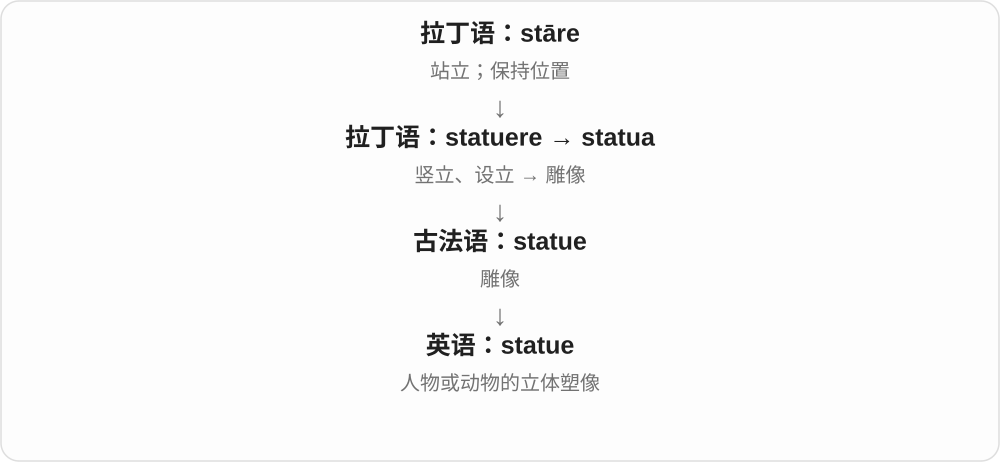

从设立、竖起的动作到被立起来的像。现代 statue 可以坐着、躺着，词源并不要求造型必须站立。

**常见搭配与例句**

a bronze statue；a statue of…；erect a statue。

> A bronze statue stands in the square.

广场上立着一座青铜雕像。

> The artist made a small statue of a sleeping cat.

艺术家做了一座睡猫小雕像。

**别混淆**

statue 是具体塑像；sculpture 范围更广，可包括抽象雕塑。statute 是法令，别漏看最后的 t。

### 27. stance — 站姿；立场

**音标**：英 /stɑːns/；美 /stæns/

**先抓住这个画面**

身体怎样站稳，是 stance；面对一个问题，你“站在哪个位置”，就成了态度和立场。

**怎么拆**

与拉丁语 stāns“站着的”、通俗拉丁语 *stantia“停留处”有关，经法语相关形式传入。

**怎么变成今天的意思**

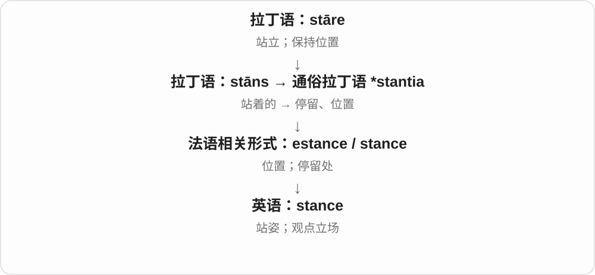

实际站姿很容易成为心理位置的比喻。a firm stance 可以同时让人联想到身体站稳和态度明确。

**常见搭配与例句**

a relaxed stance；take a stance on…；a firm stance against…。

> The coach corrected my stance before the next shot.

教练在下一次击球前纠正了我的站姿。

> What is your stance on the proposal?

你对这个提议持什么立场？

**别混淆**

position 也可指立场；stance 往往更突出明确表态。posture 更侧重身体姿态，也可能暗示做样子的态度。

### 28. interstate — 州际的；州际公路

**音标**：英 /ˌɪntəˈsteɪt/；美 /ˈɪntərˌsteɪt/

**先抓住这个画面**

路线跨过州界，把不同州连起来，就是 interstate；在美国，an interstate 常直接指州际公路。

**怎么拆**

inter-（在……之间）+ state（州）。公路名词义由 interstate highway 省略而来。

**怎么变成今天的意思**

这里 state 取“州”的意思，不是“状态”。同一个前缀也可用于国家之间，但日常 interstate 多见于联邦国家的州际事务。

**常见搭配与例句**

interstate travel；interstate commerce；take the interstate。

> The bus company runs interstate services.

这家公交公司经营跨州线路。

> We left the interstate and took a quieter road.

我们驶离州际公路，换了一条更安静的道路。

**别混淆**

interstate 是跨州；intrastate 是州内。international 才明确说国际之间。

### 29. substantially — 大幅地；在很大程度上；基本上

**音标**：/səbˈstænʃəli/

**先抓住这个画面**

变化不是一点点，而是有明显分量，可以说 substantially；它也能说“主要部分基本如此”。

**怎么拆**

substantial + -ly。

**怎么变成今天的意思**

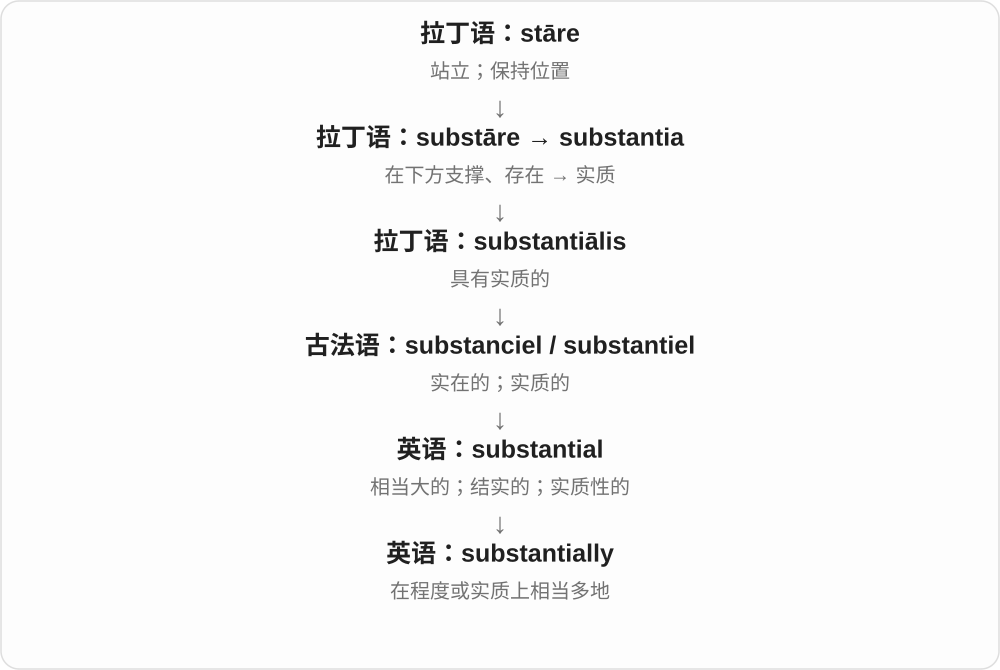

substantially cheaper 是便宜很多；substantially complete 是主要部分已完成。两个用法都围绕“大部分或大幅度”，并非绝对。

**常见搭配与例句**

substantially lower；substantially improve；substantially complete。

> The new design uses substantially less water.

新设计的用水量大幅减少。

> The renovation is substantially complete.

翻新工程已基本完成。

**别混淆**

substantially 不总等于 completely。说工作 substantially complete，通常仍可能有收尾工作。

### 30. consist — 由……组成；在于

**音标**：/kənˈsɪst/

**先抓住这个画面**

看一个整体里面“站着哪些部分”，用 consist of；看它的本质落在哪里，用 consist in。

**怎么拆**

经法语来自拉丁语 cōnsistere，con-（一起）+ sistere（使站立、站定）。

**怎么变成今天的意思**

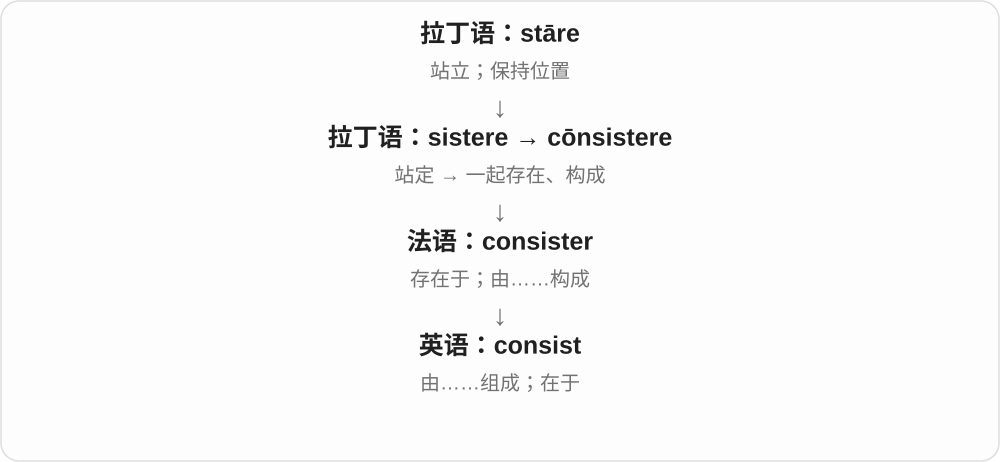

组合义像各部分共同立成整体，但这是帮助理解的画面。现代最实用的结构是整体作主语，后面接 consist of。

**常见搭配与例句**

consist of three parts；consist mainly of…；consist in doing…。

> The kit consists of a camera and two lenses.

这套设备由一台相机和两个镜头组成。

> Her strength consists in making difficult ideas clear.

她的长处在于能把难懂的想法讲清楚。

**别混淆**

consist of 通常不用被动：写 The team consists of five people，不写 is consisted of。

### 31. unstable — 不稳定的；容易失衡的

**音标**：/ʌnˈsteɪbəl/

**先抓住这个画面**

看起来暂时立着，稍微一碰就可能倒，或者情况随时可能变，这种状态是 unstable。

**怎么拆**

un-（不）+ stable（稳定的）。

**怎么变成今天的意思**

否定的是“站得住、维持得住”。可用于家具、天气、系统等；形容人时容易带贬义，宜说明具体行为或状态。

**常见搭配与例句**

an unstable ladder；unstable conditions；an unstable connection。

> Do not put the glass on that unstable shelf.

别把玻璃杯放在那个不稳的架子上。

> The connection became unstable during the storm.

暴风雨期间，连接变得不稳定。

**别混淆**

unstable 比 simply changing 更强调难以维持或变化难预测，不是每个变化中的东西都 unstable。

### 32. constitute — 组成；构成；设立

**音标**：英 /ˈkɒnstɪtjuːt/；美 /ˈkɑːnstɪtuːt/

**先抓住这个画面**

把这些部分放在一起，就组成一个整体；或者这些行为已经够得上某种情况，可以用 constitute。

**怎么拆**

拉丁语 con-（共同）+ statuere（设立）构成 cōnstituere，相关分词 cōnstitūtus 进入英语。

**怎么变成今天的意思**

原来是把东西安排、设立起来，后来也指“这些东西就是整体的构成”。constitute a problem 是已经算作问题，不是制造一件问题物品。

**常见搭配与例句**

constitute a majority；constitute evidence；constitute a committee。

> Women constitute more than half of the class.

女生占这个班人数的一半以上。

> These delays constitute a serious problem.

这些延误构成了一个严重问题。

**别混淆**

compose 主要说组成；constitute 还常用于正式判断“构成、算得上”。不要把它与 substitute“替代”混淆。

### 33. constable — 警员；治安官

**音标**：英 /ˈkʌnstəbəl/；美 /ˈkɑːnstəbəl/

**先抓住这个画面**

今天常见的是负责治安的警员；词的祖先却是一位管理马厩事务的官员，职位名称随制度一起变了。

**怎么拆**

拉丁语 comes stabulī“马厩官员”→ 古法语 conestable。后半 stabulum 与站立、牲畜停留处有关。

**怎么变成今天的意思**

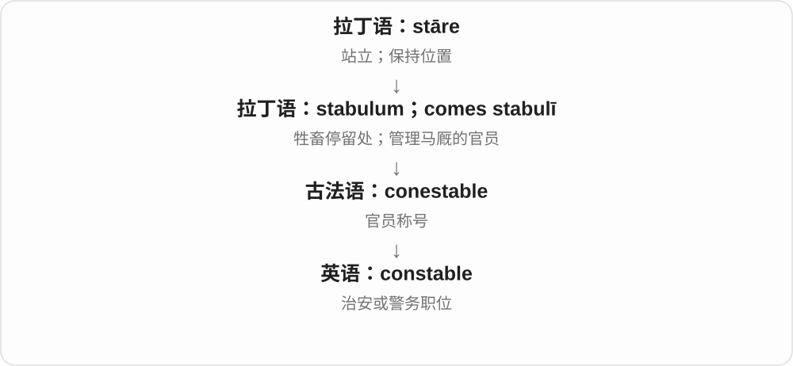

宫廷马匹关系到军事运输，相关官职后来发展出不同军事、治安职责。现代具体权限随地区不同，不能只按词源判断。

**常见搭配与例句**

a police constable；the local constable；a chief constable。

> A constable directed traffic outside the school.

一名警员在学校外指挥交通。

> The local constable spoke to the shopkeeper.

当地治安官与店主谈了话。

**别混淆**

constable 不是“稳定的人”。它是历史官职演变出的称谓，不能拆成 con + stable 来猜现代职业。

### 34. obstacle — 障碍；阻碍

**音标**：英 /ˈɒbstəkəl/；美 /ˈɑːbstəkəl/

**先抓住这个画面**

你想往前走，前面却立着一个东西；换成缺钱、缺时间或制度限制，也一样是 obstacle。

**怎么拆**

拉丁语 ob-（在前面、对着）+ stāre（站）相关的 obstāculum，经法语进入。

**怎么变成今天的意思**

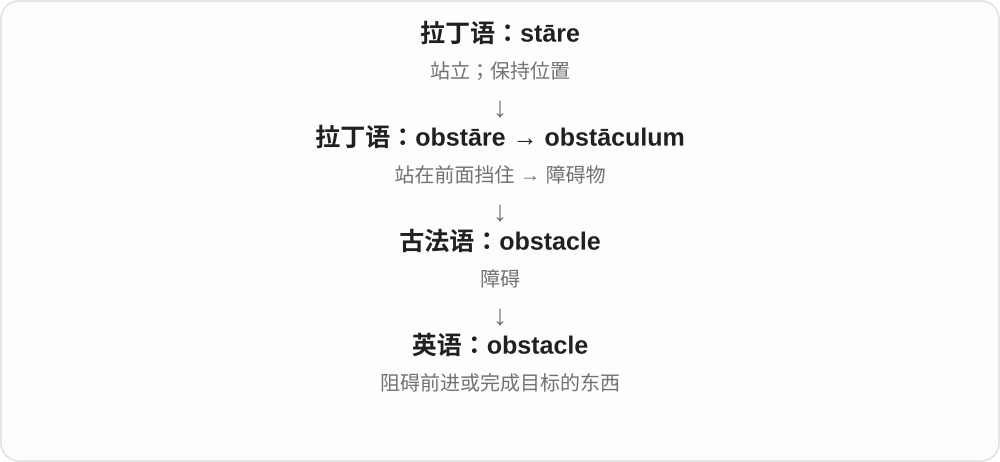

从实际挡路物自然扩展到抽象困难。词源帮你看到“挡在前面”，不要求障碍一定是人为设置的。

**常见搭配与例句**

an obstacle to…；overcome an obstacle；remove an obstacle。

> A fallen tree was the only obstacle on the path.

路上唯一的障碍是一棵倒树。

> Lack of time is the biggest obstacle to finishing the project.

时间不足是完成项目的最大障碍。

**别混淆**

challenge 是需要应对的挑战，可能有积极意味；obstacle 强调挡住进展。

### 35. instability — 不稳定；动荡

**音标**：/ˌɪnstəˈbɪləti/

**先抓住这个画面**

价格忽高忽低、系统时好时坏，稳定状态维持不住，这个问题整体叫 instability。

**怎么拆**

经法语来自拉丁语 instabilitās；in- 是否定，后部对应稳定性。

**怎么变成今天的意思**

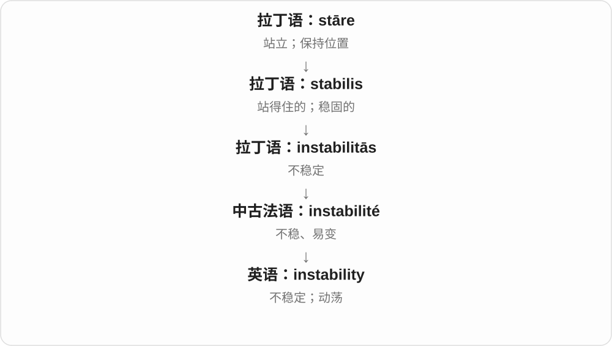

它常把一系列波动看作一种持续特征。具体是物理失稳还是社会动荡，要看前后的名词。

**常见搭配与例句**

political instability；economic instability；system instability。

> Loose bolts caused instability in the frame.

螺栓松动使框架变得不稳。

> The report describes a period of economic instability.

报告描述了一段经济不稳定时期。

**别混淆**

instability 是名词；unstable 是形容词。不能说 the system is instability，应说 is unstable。

### 36. circumstance — 情况；环境；条件

**音标**：英 /ˈsɜːkəmstəns/；美 /ˈsɜːrkəmstæns/

**先抓住这个画面**

一个人做决定时，收入、时间、天气、身边的人都围着他。这些“围在周围”的条件就是 circumstances。

**怎么拆**

拉丁语 circum-（周围）+ stāre（站）→ circumstantia，经法语进入。

**怎么变成今天的意思**

周围站着的东西被抽象成周围条件。常用复数 circumstances；单数 a circumstance 可以指某一个具体情况。

**常见搭配与例句**

under the circumstances；in difficult circumstances；beyond our control。

> Under the circumstances, postponing the trip was sensible.

在这种情况下，推迟旅行是明智的。

> Her circumstances changed after she moved to the city.

搬到城市后，她的生活境况改变了。

**别混淆**

circumstances 是事情发生的条件；situation 是整体局面。under no circumstances 表示任何情况下都不。

### 37. statewide — 全州的；在全州范围内

**音标**：/ˈsteɪtwaɪd/

**先抓住这个画面**

把地图上一个州涂满：措施或活动覆盖的是这整个州，就是 statewide。

**怎么拆**

state（州）+ -wide（遍及整个范围）。

**怎么变成今天的意思**

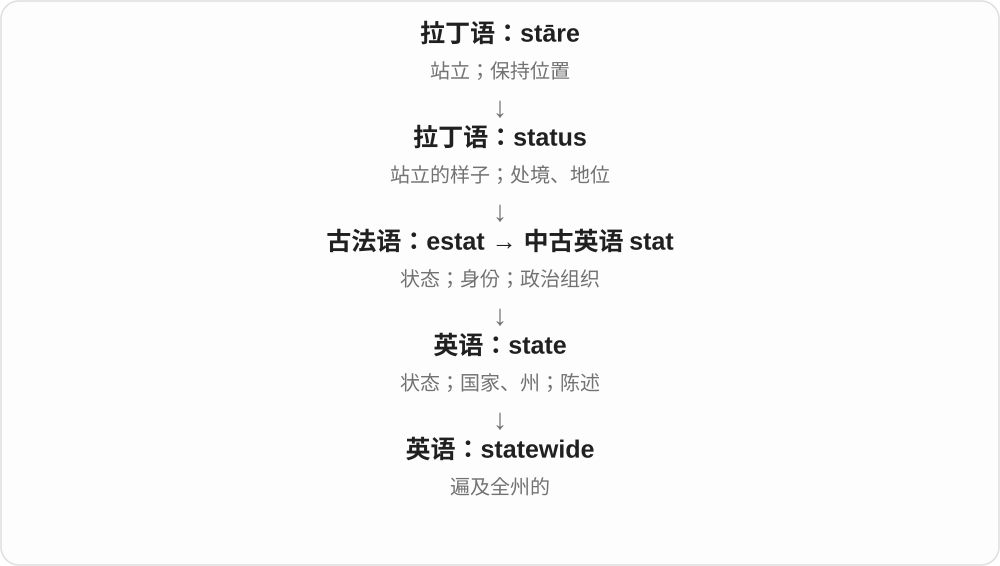

-wide 把覆盖范围铺开。statewide survey 不保证每个人都参加，而是调查设计或实施范围遍及全州。

**常见搭配与例句**

a statewide survey；a statewide campaign；operate statewide。

> The library network launched a statewide reading program.

这个图书馆网络启动了一项全州阅读活动。

> The new service will be available statewide.

这项新服务将在全州提供。

**别混淆**

statewide 说覆盖范围；interstate 说跨越州界。跨州服务不一定覆盖每个州的全部地区。

### 38. stationary — 静止的；固定不动的

**音标**：英 /ˈsteɪʃənəri/；美 /ˈsteɪʃəneri/

**先抓住这个画面**

镜头在拍，车却没移动；东西待在原来的位置，这时可以说 stationary。

**怎么拆**

来自拉丁语 statiōnārius，与 statiō“岗位、驻地”有关，不是现代英语 station + arbitrary 的缩写。

**怎么变成今天的意思**

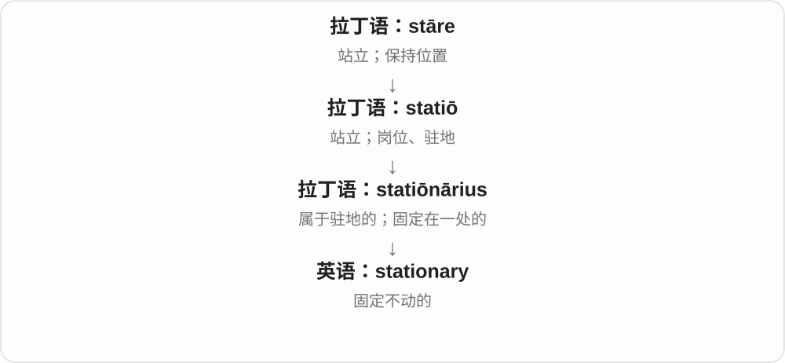

原来的岗位、驻地意象保留为“位置不变”。它可用于车辆、物体或统计模型，但不一定说内部完全没有活动。

**常见搭配与例句**

a stationary vehicle；remain stationary；a stationary bicycle。

> The train remained stationary for ten minutes.

火车原地停了十分钟。

> She exercises on a stationary bicycle at home.

她在家骑健身车锻炼。

**别混淆**

stationary 是静止的；stationery 是文具。a stationary bike 可以让人踩踏运动，但车本身不往前走。

### 39. contrasting — 形成对比的；截然不同的

**音标**：英 /kənˈtrɑːstɪŋ/；美 /kənˈtræstɪŋ/

**先抓住这个画面**

两个元素同时出现，差别很醒目，就可以说 contrasting colors、contrasting views。

**怎么拆**

contrast + -ing；这里常作形容词，表示正在形成对比关系。

**怎么变成今天的意思**

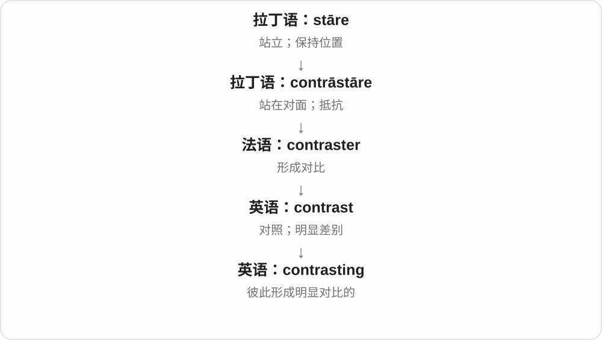

重点在两者之间的关系，不只是单独说某个东西特殊。搭配常把两种方案、色彩或性格并列。

**常见搭配与例句**

contrasting colors；contrasting styles；two contrasting views。

> The room uses contrasting colors to define separate areas.

房间用对比色划分不同区域。

> The speakers offered contrasting views of the problem.

几位发言者对问题提出了明显不同的看法。

**别混淆**

different 只说不同；contrasting 往往让人想到并排看时差异很明显。

### 40. stabilize — 使稳定；稳定下来

**音标**：/ˈsteɪbəlaɪz/

**先抓住这个画面**

原来晃来晃去、上下乱跳，现在逐渐控制住了，这个过程就是 stabilize。

**怎么拆**

stable 的词干 stabil- + -ize（使成为）。英式也常写 stabilise。

**怎么变成今天的意思**

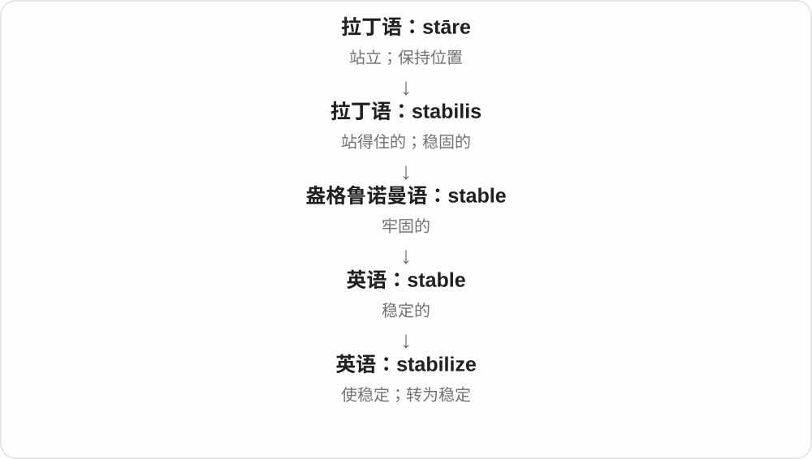

可以说人采取措施让它稳定，也可以说它自己稳定下来。它描述变化方向，不保证永久稳定。

**常见搭配与例句**

stabilize prices；stabilize the image；the situation stabilizes。

> The tripod helps stabilize the camera.

三脚架有助于稳住相机。

> After several weeks, the water level stabilized.

几周后，水位稳定了下来。

**别混淆**

stable 是已有的状态；stabilize 是进入或促成这个状态。

### 41. statesman — 政治家；善于处理国家事务的人

**音标**：/ˈsteɪtsmən/

**先抓住这个画面**

statesman 通常不只是“从政的人”，还带有眼光、经验和处理公共事务能力受到认可的意味。

**怎么拆**

state + 连接的 -s- + man，词形受到法语 homme d’État“国家事务之人”的影响。

**怎么变成今天的意思**

国家事务把 state 与从事者连接起来。现代评价一个人是否称得上 statesman，往往包含敬意；也可用 stateswoman 或更中性的表达。

**常见搭配与例句**

an elder statesman；an experienced statesman；a respected statesman。

> He was remembered as a statesman who sought compromise.

人们记得他是一位寻求妥协的政治家。

> The retired leader became an elder statesman in the party.

这位退休领导人成了党内德高望重的政治元老。

**别混淆**

politician 是职业或角色描述；statesman 通常带正面评价，但并不保证此人实际表现一定好。

### 42. statistic — 一项统计数字；统计量

**音标**：/stəˈtɪstɪk/

**先抓住这个画面**

把很多人的情况压缩成一个数，比如平均年龄或百分比，这个具体数字可以是 a statistic。

**怎么拆**

从 statistics 逆构而来：较早的学科或数据总称被看成带复数结尾，形成 singular statistic。

**怎么变成今天的意思**

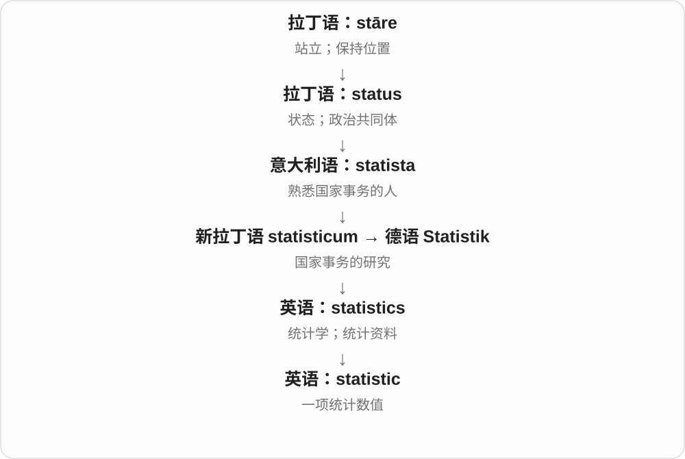

它不是最初由 static“静态的”加后缀造出。专业统计量是从样本数据计算的量；普通报道中也泛指统计数字。

**常见搭配与例句**

a surprising statistic；a summary statistic；a sample statistic。

> One statistic stood out: half the visitors came by train.

有一项数字很突出：一半游客是坐火车来的。

> The median is a useful summary statistic.

中位数是一项有用的汇总统计量。

**别混淆**

statistics 可以是学科或多项数据；a statistic 是单项数值。不要只看一个数字就忽略它的口径。

### 43. substantive — 实质性的；有实际内容的；名词

**音标**：/ˈsʌbstəntɪv/

**先抓住这个画面**

会议终于从座位怎么排转向真正要解决的问题，这时讨论有了 substantive content。

**怎么拆**

经法语 substantif 来自晚期拉丁语 substantīvus，关联 substantia“实质、独立存在的东西”。

**怎么变成今天的意思**

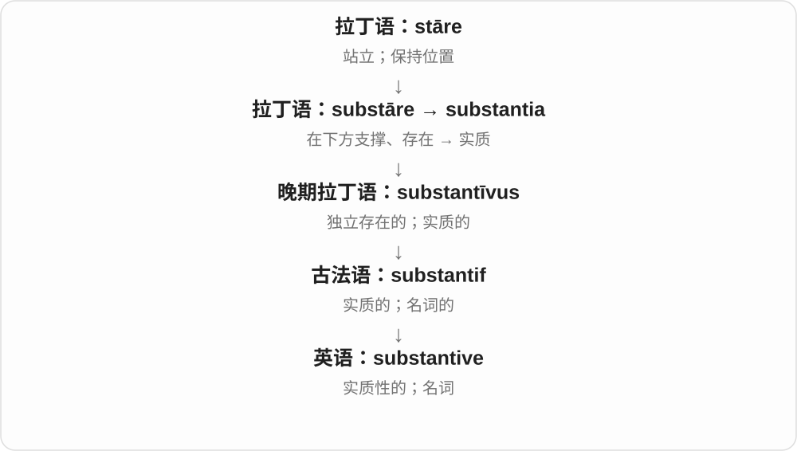

现代常强调内容本身，而非程序和形式。传统语法中的 substantive 则指名词或具有名词功能的词，像把对象当作独立实体。

**常见搭配与例句**

substantive issues；a substantive change；substantive discussion。

> The meeting produced no substantive agreement.

会议没有达成实质性协议。

> The editor made substantive changes to the argument.

编辑对论证作了涉及实质内容的修改。

**别混淆**

substantive 是涉及实质；substantial 是分量大、数量可观。一个小改动也可能是 substantive。

### 44. stamina — 耐力；持久力

**音标**：/ˈstæmɪnə/

**先抓住这个画面**

不是一瞬间能使多大力，而是时间拉长以后还能不能撑下去；长跑、长时间专注都需要 stamina。

**怎么拆**

来自拉丁语 stāmina，是 stāmen“线、经线”的复数。现代英语已把它发展成通常不可数的耐力名词。

**怎么变成今天的意思**

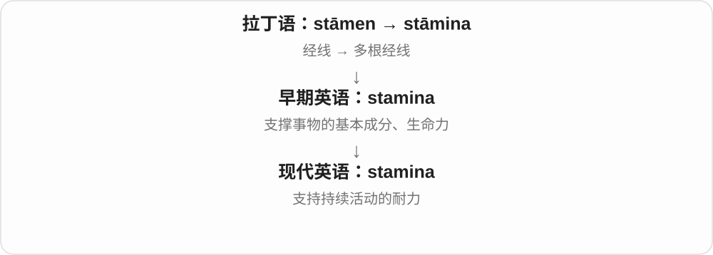

经线是布的支撑，早期又借来谈维持生命和体力的基本力量，最终凝结为耐力。这里不是说现代人真的由线组成。

**常见搭配与例句**

build stamina；physical stamina；mental stamina；lack stamina。

> Swimming has helped me build stamina.

游泳帮助我增强了耐力。

> The long rehearsal tested everyone’s stamina.

漫长的排练考验了每个人的持久力。

**别混淆**

strength 是力量；stamina 是持续的能力。爆发力强的人不一定耐力好。

### 45. upstate — 州北部的；往州内偏北地区

**音标**：/ˈʌpsteɪt/；副词也读 /ʌpˈsteɪt/

**先抓住这个画面**

从州内主要沿海或南部城市向北、向内陆走，所说的那片地区常叫 upstate。纽约语境尤其常见。

**怎么拆**

up（向北、向内陆）+ state（州）。

**怎么变成今天的意思**

地图通常把北方放在上方，于是 up 带出方向。它不是全国统一的行政区名，具体范围由当地习惯决定。

**常见搭配与例句**

upstate New York；an upstate town；move upstate。

> They moved to a small town in upstate New York.

他们搬到了纽约州北部的一座小镇。

> We drove upstate for the weekend.

我们开车到州北部过周末。

**别混淆**

upstate 不等于美国北部，更不表示更高级的州。它是相对于某个州内参照点的地区说法。

### 46. stabilization — 稳定过程；使稳定的措施

**音标**：/ˌsteɪbəlaɪˈzeɪʃən/

**先抓住这个画面**

把晃动压下去、把波动控制住的过程，作为一个整体来谈，就是 stabilization。

**怎么拆**

stabilize + -ation，去掉结尾 e 后形成名词；英式也写 stabilisation。

**怎么变成今天的意思**

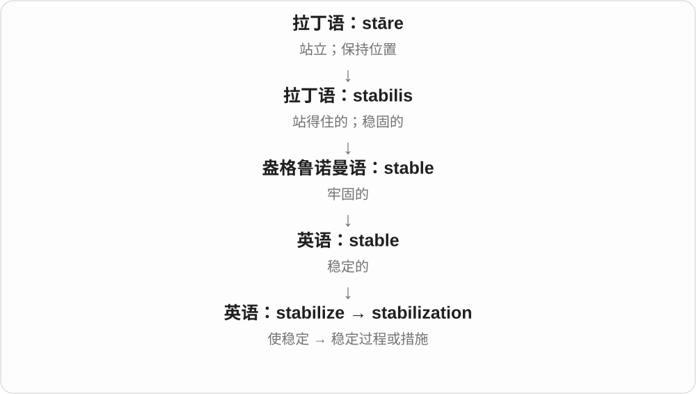

它强调从不稳走向较稳的行动或变化。图像稳定、电压稳定、边坡加固都可按具体对象使用。

**常见搭配与例句**

image stabilization；voltage stabilization；soil stabilization。

> The camera includes image stabilization.

这台相机具有图像稳定功能。

> The project includes stabilization of the riverbank.

这个项目包括河岸加固工程。

**别混淆**

stability 是稳定性，stabilization 是取得稳定的过程；有措施不等于结果已完全稳定。

### 47. distal — 远端的；远离起点的

**音标**：/ˈdɪstəl/

**先抓住这个画面**

沿着一条结构往外走，离起点或身体中心更远的一端，叫 distal。

**怎么拆**

由 distant 的词干取 dist- 加 -al，属于近代专业构词。

**怎么变成今天的意思**

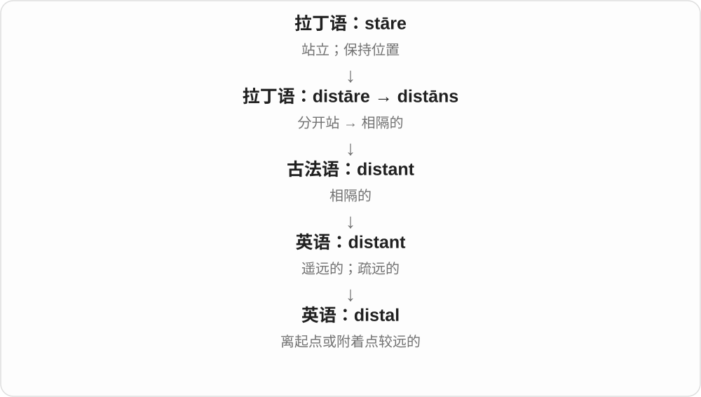

解剖学常拿它与 proximal“近端的”配对。远近要相对于指定的起点判断，不是看哪一部分离观察者更远。

**常见搭配与例句**

a distal end；the distal part of a limb；distal to…。

> The diagram labels the distal end of the bone.

图中标出了骨的远端。

> The fingers are distal to the wrist.

手指位于手腕的远端。

**别混淆**

distal 是相对位置术语，不等于普通的 very far。手指相对手腕更远端，但仍属于同一条肢体。

### 48. extant — 现存的；尚存的

**音标**：/ɪkˈstænt/，也读 /ˈekstənt/

**先抓住这个画面**

很多旧书、作品已经失传，这一件却还在，能看到或查到，它就是 extant。

**怎么拆**

拉丁语 ex-（向外）+ stāre（站）→ extāns“显露、仍存在的”。

**怎么变成今天的意思**

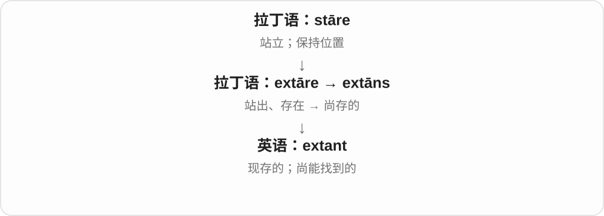

现代通常用于旧文献、作品、遗迹或物种，强调经过时间仍存在。不是说它刚刚被创造出来。

**常见搭配与例句**

an extant manuscript；the earliest extant copy；extant species。

> This is the earliest extant copy of the poem.

这是这首诗目前尚存最早的抄本。

> Only three letters from that period are extant.

那个时期只留下三封现存书信。

**别混淆**

extant 是仍然存在；extinct 是灭绝。existing 更通用，extant 常带历史保存意味。

### 49. contrasted — 被对照的；相对照的

**音标**：英 /kənˈtrɑːstɪd/；美 /kənˈtræstɪd/

**先抓住这个画面**

两种情况已经被拿来比较差别，句子就可能用 contrasted；它常出现在被动结构里。

**怎么拆**

contrast + -ed，既是过去式、过去分词，也能作描述性修饰语。

**怎么变成今天的意思**

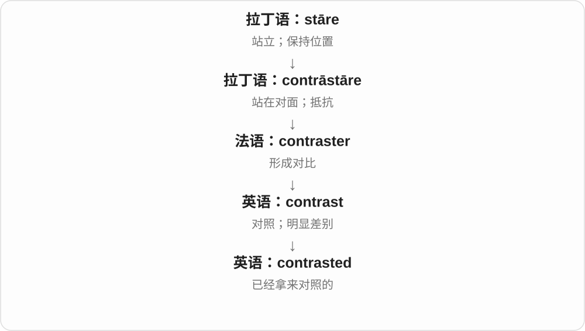

as contrasted with… 意思是“与……对照而言”。学习时把整个结构记住，比孤立背一个形容词释义更实用。

**常见搭配与例句**

be contrasted with…；as contrasted with…；sharply contrasted。

> The results were contrasted with those of the earlier study.

这些结果与早先研究的结果作了对照。

> The chapter discusses spoken language as contrasted with written language.

这一章把口语与书面语对照起来讨论。

**别混淆**

contrasting 常主动描述两者形成差异；contrasted 更突出有人把它们拿来对照。

### 50. superstition — 迷信；无根据的吉凶信念

**音标**：英 /ˌsuːpəˈstɪʃən/；美 /ˌsuːpərˈstɪʃən/

**先抓住这个画面**

把某个数字、动作或物品与好运坏运硬连起来，却拿不出可靠根据，这类信念常叫 superstition。

**怎么拆**

经法语来自拉丁语 superstitio，形式与 super-（在上、越过）+ stāre 有关；从“站在上面、存留”到迷信的具体义变没有公认的唯一解释。

**怎么变成今天的意思**

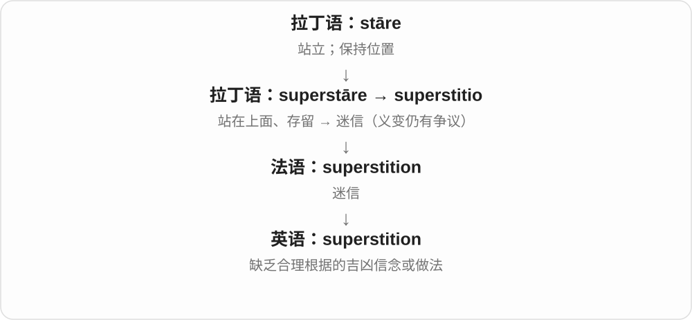

可以记住词形中的“站”，但别编成“站在神上面所以迷信”等故事。现代用法抓住不合理的吉凶因果联想，更容易实际理解。

**常见搭配与例句**

a common superstition；out of superstition；superstition about numbers。

> She dismissed the idea that the number brings bad luck as superstition.

她认为那个数字会带来厄运的说法只是迷信。

> The book records local superstitions about the sea.

这本书记载了当地与大海有关的迷信。

**别混淆**

tradition 是传统，不必包含超自然因果；superstition 通常带说话者认为根据不足的评价。

举头三尺有神明，我是这么理解的，神就在那里站着。

### 51. staunch — 坚定的；忠实的；止住流出

**音标**：英 /stɔːntʃ/；美 /stɔːntʃ/

**先抓住这个画面**

压力来了还站在同一边，像不漏水的结构一样可靠，staunch 常这样形容支持者。

**怎么拆**

形容词经古法语 estanche“牢固、不漏水的”而来；更早可能与 stāns“站着的”有关，也有另一来源解释。

**怎么变成今天的意思**

从结构牢固转向态度坚定，是清楚的语义联系。词首 sta- 与“站”可能相关，但更深来源不宜说死。作动词还可表示止住血或其他流出。

**常见搭配与例句**

a staunch supporter；a staunch ally；staunch the flow。

> She remained a staunch supporter of the library.

她始终坚定地支持这家图书馆。

> The barrier helped staunch the flow of water.

屏障帮助止住了水流。

**别混淆**

stanch 常作“止住流出”的动词拼写，staunch 常作“坚定的”形容词；两种拼写在部分用法有重叠。

### 52. circumstantial — 间接的；与情况有关的；详述细节的

**音标**：英 /ˌsɜːkəmˈstænʃəl/；美 /ˌsɜːrkəmˈstænʃəl/

**先抓住这个画面**

没有直接拍到事情发生，却能从时间、物品和其他周边事实推断，这类证据常叫 circumstantial evidence。

**怎么拆**

拉丁语 circumstantia 的基础加形容词后缀；现代可对照 circumstance + -ial。

**怎么变成今天的意思**

重点在由周边情况作推断，不是亲眼直接看见。正式旧用法也可指把具体情节讲得很详细。

**常见搭配与例句**

circumstantial evidence；a circumstantial account；purely circumstantial。

> The detective assembled several pieces of circumstantial evidence.

侦探收集了几项间接证据。

> The connection remained circumstantial rather than directly observed.

这种联系仍是根据周边情况推断出来的，没有被直接观察到。

**别混淆**

circumstantial evidence 不等于无效证据，也不自动等于充分证据；词本身只说明间接推断的类型。

### 53. superstitious — 迷信的；出于迷信的

**音标**：英 /ˌsuːpəˈstɪʃəs/；美 /ˌsuːpərˈstɪʃəs/

**先抓住这个画面**

一个人因某种“会带来坏运”的说法而不敢做事，可以说他 superstitious；那种举动也可这样描述。

**怎么拆**

古法语 superstitieux 来自拉丁语 superstitiōsus，与 superstitio“迷信”对应。

**怎么变成今天的意思**

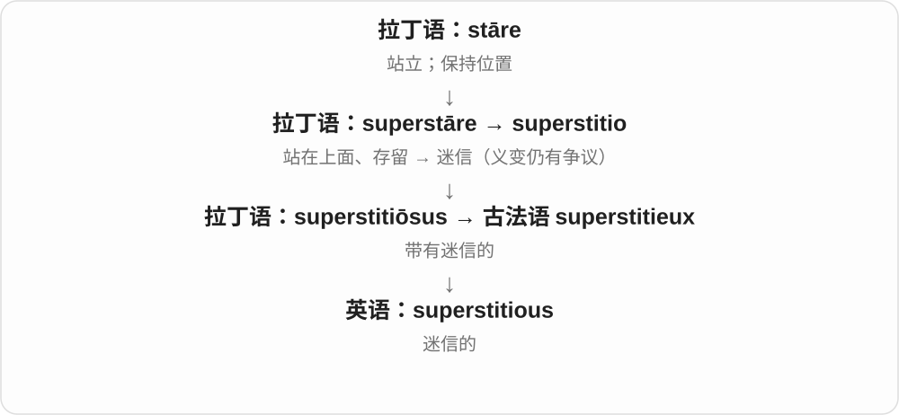

形容人时说他的信念倾向，形容行为时说行为受这类信念驱动。与 superstition 共享词源争议，不另造确定的字面故事。

**常见搭配与例句**

be superstitious about…；a superstitious belief；a superstitious habit。

> He is superstitious about wearing his lucky shirt before a match.

他迷信赛前穿那件幸运衬衫能带来好运。

> The story describes a superstitious fear of the old house.

故事描写了对那栋老房子出于迷信的恐惧。

**别混淆**

suspicious 是怀疑的；superstitious 是迷信的。两者既不同源，也不是同一种心理状态。

### 54. stately — 庄严的；气派的；从容端庄的

**音标**：/ˈsteɪtli/

**先抓住这个画面**

想一座高大而比例优雅的老宅，或一场缓慢、庄重的仪式：不靠喧闹，却显得有气度。

**怎么拆**

state 在旧用法中可指身份、排场，-ly 在这里主要构成形容词。

**怎么变成今天的意思**

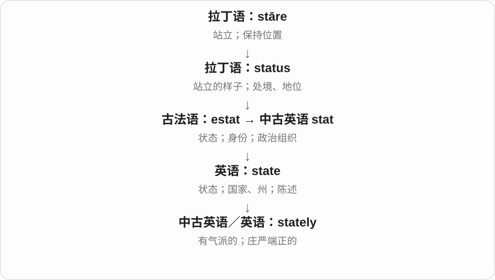

身份和排场的意味保留下来，转为建筑、举止、节奏给人的庄重印象。不是“处于某种状态地”的机械翻译。

**常见搭配与例句**

a stately home；a stately procession；stately trees。

> A row of stately trees lined the entrance.

入口两侧排列着一排高大优美的树。

> The dancers moved at a stately pace.

舞者以端庄从容的节奏移动。

**别混淆**

stately 常是形容词，不能见到 -ly 就当副词。static 是静态的，与气派无关。

### 55. statehood — 建州地位；国家地位

**音标**：/ˈsteɪthʊd/

**先抓住这个画面**

一个地区被承认为一个州，或被承认为一个国家，这种正式身份叫 statehood。

**怎么拆**

state（州、国家）+ -hood（身份、状态）。

**怎么变成今天的意思**

不是疆域里有多少土地，而是政治组织获得怎样的身份。含义取决于讨论的是联邦里的州，还是国际层面的国家。

**常见搭配与例句**

achieve statehood；a campaign for statehood；the question of statehood。

> The museum describes the territory’s path to statehood.

博物馆介绍了这片领土成为一个州的过程。

> The debate focused on the meaning of statehood.

讨论集中在国家地位的含义上。

**别混淆**

statehood 是地位；independence 是独立。成为某联邦的一州与成为独立国家不是同一件事。

### 56. workstation — 工作位；工作站电脑

**音标**：英 /ˈwɜːksteɪʃən/；美 /ˈwɜːrkˌsteɪʃən/

**先抓住这个画面**

给一个人配置好桌面、工具和设备，让他在这里完成工作，这个位置就是 workstation。也可指专业用途的计算机。

**怎么拆**

work（工作）+ station（固定工作点）。

**怎么变成今天的意思**

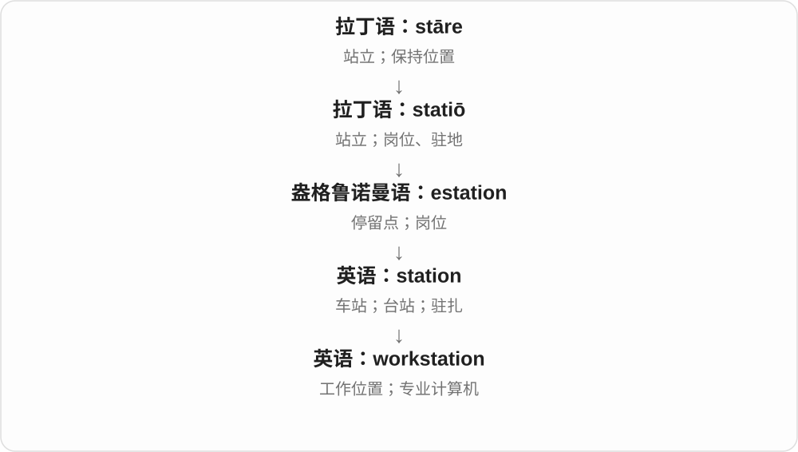

从物理工作点延伸到执行工作的电脑系统。并非每次出现都指高性能电脑，办公室布局中的 workstation 常只是工位。

**常见搭配与例句**

an ergonomic workstation；a graphics workstation；set up a workstation。

> Each workstation has an adjustable desk.

每个工位都配有可调节的桌子。

> The designer uses a powerful workstation for rendering.

设计师用一台性能强的工作站电脑进行渲染。

**别混淆**

workplace 是工作的场所，范围可以很大；workstation 更具体，通常是一个人的设备或位置。

### 57. stanza — 诗节

**音标**：/ˈstænzə/

**先抓住这个画面**

一首诗不是一整堵文字墙，而是分成一组组诗行；每一组就像一个小房间，叫 stanza。

**怎么拆**

借自意大利语 stanza“房间、停留处、诗节”，更早与 *stantia 和 stāre 有关。

**怎么变成今天的意思**

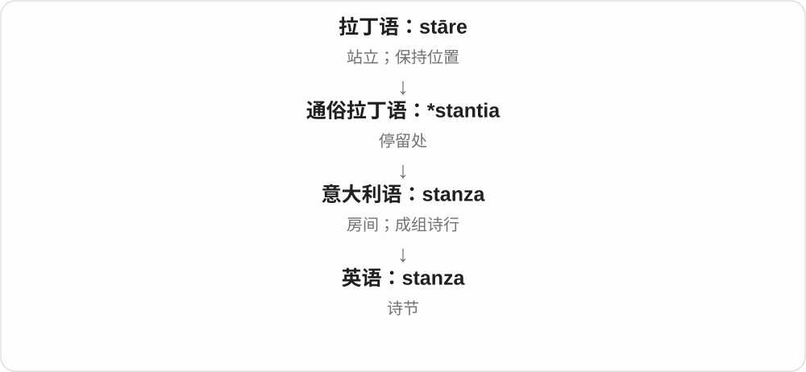

“小房间”是很好用的形象比喻：每节容纳一组诗行，组成较大的诗。不是说每种诗节都必须四行或押相同的韵。

**常见搭配与例句**

a four-line stanza（四行诗节）；the final stanza；stanza structure。

> The poem has five stanzas of four lines each.

这首诗有五节，每节四行。

> The final stanza changes the mood of the poem.

最后一节改变了整首诗的气氛。

**别混淆**

line 是一行诗，stanza 是一组诗行。verse 有多个义项，有时与 stanza 接近，但不能在所有场景替换。

### 58. constabulary — 警察队伍；警务的

**音标**：英 /kənˈstæbjələri/；美 /kənˈstæbjəleri/

**先抓住这个画面**

把一个地区的警员作为整支队伍来称呼，可以说 the constabulary；形容词用法则表示警务相关。

**怎么拆**

来自与 constable 对应的中古拉丁语 conestabularia 等形式；更早是 comes stabulī 的官职线。

**怎么变成今天的意思**

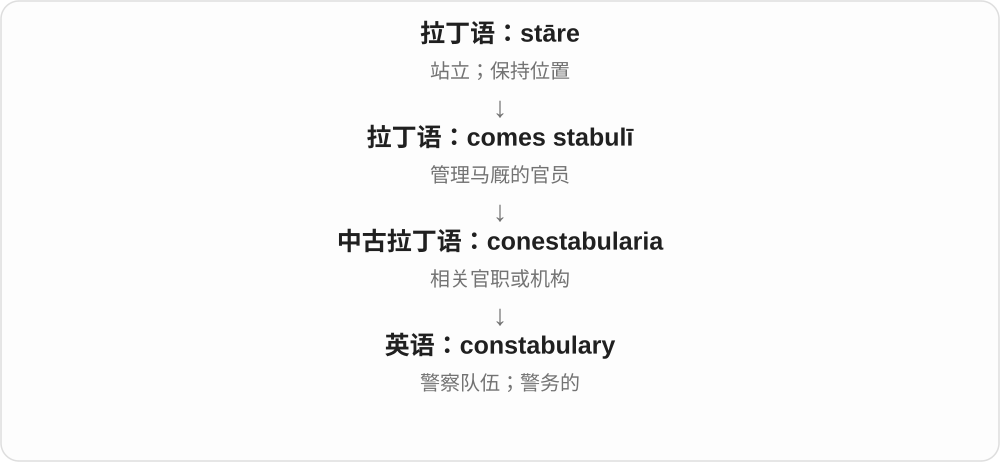

官员称号转向整套警务组织。这个词常见于正式机构名称和较正式的叙述，不是普通口语里最常用的 police。

**常见搭配与例句**

the local constabulary；a county constabulary；constabulary duties。

> The local constabulary issued a brief statement.

当地警方发表了一份简短声明。

> The archive contains records of the county constabulary.

档案馆保存着该郡警察机构的记录。

**别混淆**

constable 是个人职位；constabulary 常指组织或整体警力。

### 59. substation — 变电站；分站

**音标**：/ˈsʌbsteɪʃən/

**先抓住这个画面**

主网络下面分布着一些处理电力或提供服务的节点，它们是 substation；现代最常让人想到变电站。

**怎么拆**

sub-（次级、分支）+ station（台站）。

**怎么变成今天的意思**

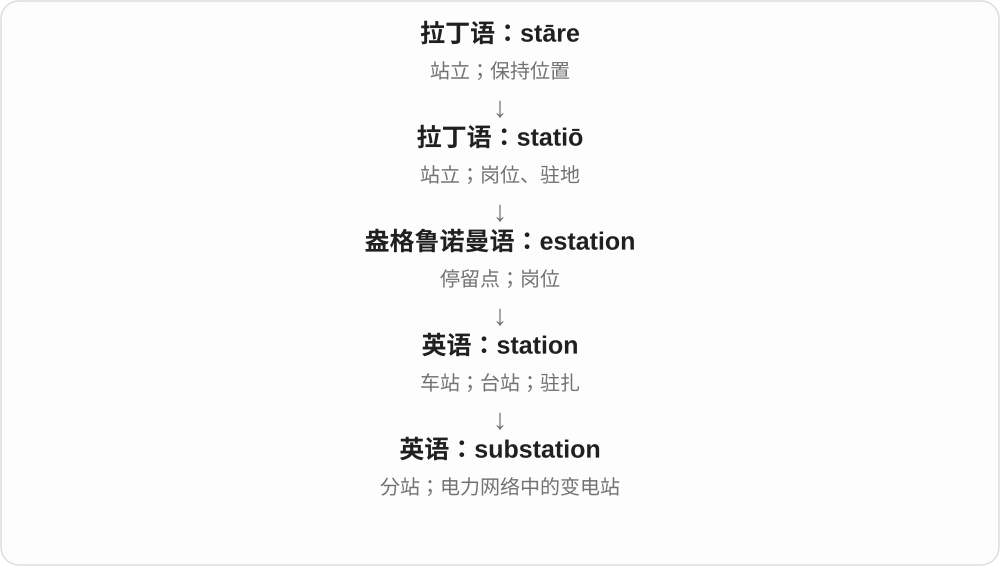

前缀表明它属于更大网络，并不表示一定建在地下。电力语境中的设施用于电压转换、开关控制等。

**常见搭配与例句**

an electrical substation；a distribution substation；a police substation。

> The new substation will serve the growing neighborhood.

新的变电站将为不断扩大的社区供电服务。

> A small police substation opened near the market.

市场附近设立了一个小型警务分站。

**别混淆**

power station 通常是发电站；substation 通常处理和分配电力，不以发电为主要职能。

### 60. presto — 急板；迅速地；瞧，变好了

**音标**：英 /ˈprestəʊ/；美 /ˈprestoʊ/

**先抓住这个画面**

乐谱上看到 presto，演奏速度要很快；魔术式表达里的 presto! 则像中文“变！好了！”

**怎么拆**

借自意大利语 presto“快、迅速”，更早来自拉丁语 praestō“在旁等候、准备好”，与 prae- + stāre 有关。

**怎么变成今天的意思**

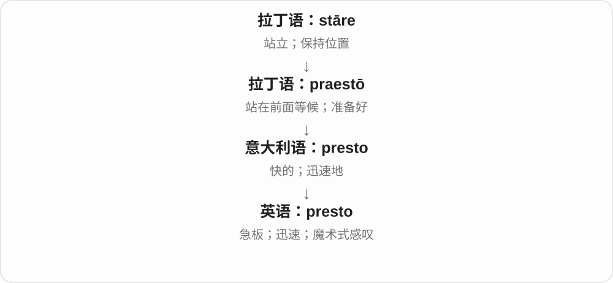

准备就绪能立即行动，后来发展为快速。音乐借入保留了速度指示，感叹用法则强调变化立刻出现。

**常见搭配与例句**

play presto；a presto movement；and presto…。

> The final movement is marked presto.

最后一个乐章标注为急板。

> Add the final piece, and presto, the puzzle is complete.

加上最后一块，瞧，拼图完成了。

**别混淆**

presto 是速度标记，不等于 louder“更响”。快慢与音量是两回事。

### 61. statistician — 统计学家；统计专业人员

**音标**：/ˌstætɪˈstɪʃən/

**先抓住这个画面**

不只是会把数字相加，而是会设计数据收集、选择分析方法、判断结果是否可靠的人。

**怎么拆**

来自 statistic 的词干与 -ian（专业人员），属于 statistics 词族。

**怎么变成今天的意思**

学科名转为职业名称，重点在处理数据中的变动和不确定性。不同岗位具体工作会不同。

**常见搭配与例句**

consult a statistician；a professional statistician；a team of statisticians。

> A statistician helped us design the survey.

一位统计专业人员帮助我们设计调查。

> The statistician checked how missing data affected the results.

统计学家检查了缺失数据对结果的影响。

**别混淆**

statistician 是人，statistics 是学科或数据；statist 是强调国家作用的政治立场词。

### 62. stateless — 无国籍的；不保存会话状态的

**音标**：/ˈsteɪtləs/

**先抓住这个画面**

对人而言，是没有任何国家承认其为国民；对程序而言，是处理一次请求时不依赖保存下来的会话状态。

**怎么拆**

state + -less（没有）。两种用法分别选取 state 的“国家”和“状态”义。

**怎么变成今天的意思**

词形相同，应用领域不同。技术中的 stateless 不是世界里完全没有数据，而是特定组件或交互不维持所讨论的状态。

**常见搭配与例句**

a stateless person；stateless people；a stateless service。

> The article describes the difficulties faced by stateless people.

文章介绍了无国籍人士面临的困难。

> Each request can be handled by a different stateless server.

每次请求都可以由不同的无状态服务器处理。

**别混淆**

stateless 不等于 homeless。没有国籍和没有住处是两种不同处境。

### 63. stateside — 在美国本土的；回美国本土

**音标**：/ˈsteɪtsaɪd/

**先抓住这个画面**

说话人把海外与美国这一边作对照：人在美国本土，或回到美国本土，可以说 stateside。

**怎么拆**

states 指 the United States，接 -side“这一边”。

**怎么变成今天的意思**

常见于军旅或海外生活语境，也可用于普通旅行。它不是“某个州的一侧”，而是已经固定下来的美国指称。

**常见搭配与例句**

back stateside；return stateside；a stateside assignment。

> After two years abroad, she was happy to be back stateside.

在海外生活两年后，她很高兴回到美国本土。

> He accepted a stateside assignment.

他接受了一项在美国本土的工作安排。

**别混淆**

stateside 带口语或特定语境色彩；in the United States 更中性。它不等于在任意州内。

### 64. substantiate — 证实；为……提供依据

**音标**：/səbˈstænʃieɪt/

**先抓住这个画面**

一句话原来悬在空中，现在拿出记录、样本或事实给它垫上地基，让它站得住。

**怎么拆**

来自中古拉丁语 substantiāre“赋予实质”的相关词形；现代可联系 substance + 动词化形式。

**怎么变成今天的意思**

从赋予实体或实质，发展到给说法实在的证据。不是声音说得更大，而是支持材料真正到位。

**常见搭配与例句**

substantiate a claim；substantiate an allegation；evidence to substantiate…。

> The report provides no data to substantiate the claim.

报告没有提供数据来支持这一说法。

> She kept the receipts to substantiate her expenses.

她保留收据，以便证明这些支出。

**别混淆**

assert 是提出说法；substantiate 是给说法提供证据。两者不能互相代替。

### 65. reestablish — 重新建立；恢复

**音标**：/ˌriːɪˈstæblɪʃ/

**先抓住这个画面**

原来有的联系或秩序中断了，现在再把它立起来，就是 reestablish。

**怎么拆**

re-（再次）+ establish（建立）。

**怎么变成今天的意思**

强调重建或恢复，不要求完全回到原来的细节。常用于联系、控制、信任等曾存在的东西。

**常见搭配与例句**

reestablish contact；reestablish trust；reestablish control。

> We finally reestablished contact with the research team.

我们终于重新联系上了研究团队。

> It took months to reestablish trust.

恢复信任花了几个月。

**别混淆**

establish 可以从零开始；reestablish 暗示此前有过相关基础。

### 66. distantly — 远远地；疏远地；间接地

**音标**：/ˈdɪstəntli/

**先抓住这个画面**

关系或感觉只从很远处连过来，联系不近、不紧，这种方式可用 distantly。

**怎么拆**

distant + -ly。

**怎么变成今天的意思**

最实用的搭配是 distantly related“远亲关系或较远同源”。也可描述声音从远处传来、态度不亲热。

**常见搭配与例句**

distantly related；distantly familiar；smile distantly。

> The two families are distantly related.

这两个家庭有较远的亲缘关系。

> She smiled distantly and returned to her reading.

她疏淡地笑了一下，继续读书。

**别混淆**

distantly related 不表示完全无关，而是关系较远。remotely 有时更强调程度极小。

### 67. overstate — 夸大；言过其实

**音标**：英 /ˌəʊvəˈsteɪt/；美 /ˌoʊvərˈsteɪt/

**先抓住这个画面**

真实影响只有这么大，话却把它画得更大，便是 overstate。

**怎么拆**

over-（超过）+ state（陈述）。

**怎么变成今天的意思**

夸大的可以是规模、价值、把握程度等。cannot overstate the importance of… 是强调“再怎么强调其重要性也不为过”。

**常见搭配与例句**

overstate the risk；overstate the case；cannot overstate the importance。

> The headline overstated the size of the increase.

标题夸大了增长幅度。

> It is hard to overstate how much her advice helped me.

她的建议对我帮助之大，怎么说都不为过。

**别混淆**

overstate 不一定故意撒谎；也可能只是判断太强。exaggerate 范围相近，使用更广。

### 68. constitutive — 构成性的；组成事物本质的

**音标**：英 /ˈkɒnstɪtjuːtɪv/；美 /kənˈstɪtʃətɪv/

**先抓住这个画面**

不是外面加上的装饰，而是少了它，这个整体就不再是原来那种东西：这种要素可以叫 constitutive。

**怎么拆**

constitute（构成）+ -ive（具有该作用的）。

**怎么变成今天的意思**

常用于哲学、社会理论与专业科学，强调某要素如何使整体成立。生物学里的持续表达等专门义要另看学科定义。

**常见搭配与例句**

constitutive of…；a constitutive element；constitutive rules。

> Trust is constitutive of this kind of cooperation.

信任是这类合作得以成立的组成要素。

> The essay identifies three constitutive elements of the institution.

文章指出了该制度的三个基本构成要素。

**别混淆**

constitutive 强调形成整体的作用；constitutional 常指宪法、体质等相关性质。

### 69. statist — 国家干预主义者；国家干预主义的

**音标**：/ˈsteɪtɪst/

**先抓住这个画面**

如果一种政治主张倾向让国家广泛安排经济或社会事务，可以用 statist 描述这种立场或支持者。

**怎么拆**

state（国家）+ -ist（主张者；具有某种立场的）。

**怎么变成今天的意思**

国家在这里成为政治观念的中心。具体介入程度随作者而异，因此看见这个标签还要看对方实际主张。

**常见搭配与例句**

a statist approach；statist policies；a committed statist。

> The essay criticizes a strongly statist approach to planning.

文章批评了一种高度依赖国家干预的规划方式。

> He described himself as a moderate statist.

他称自己是温和的国家干预主义者。

**别混淆**

statist 不是 statistician“统计学家”。前者谈国家角色，后者研究数据。

### 70. restate — 重申；换一种说法再陈述

**音标**：/ˌriːˈsteɪt/

**先抓住这个画面**

一件事已经说过，再把重点说清楚一次，或者用新的句子重新表达，就是 restate。

**怎么拆**

re-（再次）+ state（陈述）。

**怎么变成今天的意思**

重点是内容被重新说出，不要求逐字重复。课堂上 restate a question 常是换种表达确保大家理解。

**常见搭配与例句**

restate a position；restate the question；restate something in simpler terms。

> Could you restate the question in simpler terms?

你能用更简单的话再说一遍问题吗？

> The manager restated the team’s main goal.

经理重申了团队的主要目标。

**别混淆**

repeat 可以原话复述；restate 常允许重新组织语言。它不表示推翻原说法。

### 71. constancy — 恒定；坚定；忠贞

**音标**：英 /ˈkɒnstənsi/；美 /ˈkɑːnstənsi/

**先抓住这个画面**

时间过去、环境变了，一件事或一份感情依旧守得住，这种稳定可靠的品质叫 constancy。

**怎么拆**

借自拉丁语 cōnstantia，与 cōnstāns“坚定、不变的”同族。

**怎么变成今天的意思**

既可谈测量结果的不变，也可谈人的忠诚。人的 constancy 常带赞许，强调长期守住原先的态度。

**常见搭配与例句**

constancy of temperature；constancy in friendship；the constancy of…。

> The experiment depends on the constancy of the temperature.

实验依赖温度保持恒定。

> She admired his constancy in friendship.

她欣赏他对朋友始终如一。

**别混淆**

consistency 强调前后相符或表现可靠；constancy 更突出时间推移中仍不改变。

### 72. equidistant — 等距的；距离相等的

**音标**：/ˌiːkwɪˈdɪstənt/

**先抓住这个画面**

从同一个点量出去，到两个目标的距离一样长，这个点便与两者 equidistant。

**怎么拆**

经法语来自晚期拉丁语 aequidistāns；aequī-（相等）+ distāns（相隔）。

**怎么变成今天的意思**

它比较的是距离，不是方向或位置相同。圆周上各点与圆心等距，但彼此位置当然不同。

**常见搭配与例句**

equidistant from A and B；equidistant points；equidistant intervals。

> The hotel is equidistant from the two stations.

这家酒店到两个车站的距离相等。

> Every point on the circle is equidistant from its center.

圆上的每一点到圆心的距离都相等。

**别混淆**

equal 是一般的相等；equidistant 专门说距离相等。

### 73. geostationary — 相对地面静止的；地球静止轨道的

**音标**：英 /ˌdʒiːəʊˈsteɪʃənəri/；美 /ˌdʒiːoʊˈsteɪʃəneri/

**先抓住这个画面**

从地面抬头看，卫星仿佛总停在同一个方向。它实际在运行，只是与地球自转配合得恰好。

**怎么拆**

geo-（地球）+ stationary（相对不动的）。

**怎么变成今天的意思**

这是相对于观察者的静止。严格的地球静止轨道是与地球同向、周期匹配的赤道上空圆轨道，不是卫星停止运动。

**常见搭配与例句**

a geostationary satellite；geostationary orbit。

> The antenna points toward a geostationary satellite.

天线朝向一颗地球静止轨道卫星。

> A geostationary satellite appears fixed in the sky.

地球静止轨道卫星看起来固定在天空中。

**别混淆**

geosynchronous 只要求周期与地球自转一致；geostationary 还要求从地面看位置固定。

### 74. reconstitute — 重新组成；复原；加水调回

**音标**：英 /ˌriːˈkɒnstɪtjuːt/；美 /ˌriːˈkɑːnstɪtuːt/

**先抓住这个画面**

把拆散的部分重新凑成整体，或给粉末加水恢复原来的液体形态，就是 reconstitute。

**怎么拆**

re-（重新）+ constitute（组成）。

**怎么变成今天的意思**

可用于组织重组，也可用于食品等复原过程。“恢复”不保证每个细节与最初完全相同。

**常见搭配与例句**

reconstitute a committee；reconstitute powdered milk；reconstituted juice。

> Add water to reconstitute the dried soup.

加水把干汤料调成汤。

> The committee was reconstituted with three new members.

委员会重新组成，加入了三名新成员。

**别混淆**

reconstruct 常突出重建结构；reconstitute 强调把成分或成员重新组成可用整体。

### 75. stateroom — 客轮客舱；豪华包厢

**音标**：英 /ˈsteɪtruːm/；美 /ˈsteɪtˌruːm/

**先抓住这个画面**

在客轮上，你可以关门休息的私人客舱常叫 stateroom。这个名字保留了较体面、正式房间的历史意味。

**怎么拆**

state（排场、地位）+ room（房间）。

**怎么变成今天的意思**

从较讲究的房间发展为船上客舱称呼。现代旅游宣传会把普通客舱也称作 stateroom，不能仅凭词名判断它很豪华。

**常见搭配与例句**

a balcony stateroom；an interior stateroom；book a stateroom。

> Our stateroom had a small balcony overlooking the sea.

我们的客舱有个面朝大海的小阳台。

> They booked an interior stateroom to reduce the cost.

他们预订了内舱房来降低费用。

**别混淆**

cabin 是更通用的舱室；stateroom 常指供乘客住宿的私人舱房，不是船上的公共大厅。

### 76. substantively — 在实质内容上；实质性地

**音标**：/ˈsʌbstəntɪvli/

**先抓住这个画面**

先不管格式、措辞，看真正内容有没有变化，substantively 把注意力拉到这个层面。

**怎么拆**

substantive + -ly。

**怎么变成今天的意思**

用于讨论两个方案、观点或文本究竟是否真正不同。它并不自动表示数量上改变很多。

**常见搭配与例句**

substantively different；respond substantively；substantively similar。

> The two versions are substantively the same.

这两个版本在实质内容上相同。

> She responded substantively to each criticism.

她对每一条批评都作出了有实质内容的回应。

**别混淆**

substantially 常说程度大；substantively 常说从内容、本质上看。拼写近，侧重点不同。

### 77. downstate — 州南部的；州内偏南地区

**音标**：/ˈdaʊnsteɪt/

**先抓住这个画面**

downstate 就像在州地图上往下看，常指相对于北部或内陆地区的南部地带。

**怎么拆**

down（向南、向较低纬度）+ state（州）。

**怎么变成今天的意思**

与 upstate 相对，但两者的实际边界随州和说话习惯而变。纽约语境可涉及纽约市及附近地区，不能机械按地图中线划分。

**常见搭配与例句**

downstate residents；a downstate office；travel downstate。

> The organization opened a downstate office.

该组织在州南部开设了办事处。

> Several downstate schools joined the project.

州南部的几所学校加入了这个项目。

**别混淆**

它描述地区，不表示地区衰落或“低等”。down 在这里主要提供地理方向。

### 78. understate — 轻描淡写；少报、低估地陈述

**音标**：英 /ˌʌndəˈsteɪt/；美 /ˌʌndərˈsteɪt/

**先抓住这个画面**

事情很严重，却只说“有点麻烦”；把实际程度往小里说，就是 understate。

**怎么拆**

under-（低于）+ state（陈述）。

**怎么变成今天的意思**

它可以是委婉风格，也可以使记录低于实际数量。词本身描述表达效果，是否故意要看语境。

**常见搭配与例句**

understate the problem；understate the cost；an understated description。

> Calling the repair difficult would understate the problem.

只说修理起来困难，还是把问题说轻了。

> The initial estimate understated the total cost.

最初的估算把总成本报低了。

**别混淆**

underestimate 是估计偏低；understate 是说出来或记录的程度偏低。心里知道很严重也可能故意轻描淡写。

### 79. statecraft — 治国之术；处理国家事务的技巧

**音标**：英 /ˈsteɪtkrɑːft/；美 /ˈsteɪtkræft/

**先抓住这个画面**

把国家事务当作需要判断、协调和经验的手艺，statecraft 指的就是这套本领。

**怎么拆**

state（国家）+ craft（技艺）。

**怎么变成今天的意思**

craft 在这里不是工艺品，而是熟练做事的技术。谈判、结盟、政策安排都可能是 statecraft 的组成部分。

**常见搭配与例句**

the art of statecraft；diplomacy and statecraft；a lesson in statecraft。

> The biography examines her approach to statecraft.

这部传记研究了她处理国家事务的方法。

> Diplomacy is an important part of statecraft.

外交是治国之术的重要部分。

**别混淆**

statecraft 偏实践判断与技巧；political science 是研究政治的学科。

### 80. intrastate — 州内的

**音标**：英 /ˌɪntrəˈsteɪt/；美 /ˌɪntrəˈsteɪt/

**先抓住这个画面**

路线从州内一个地方到另一个地方，始终没越过州界，这类活动就是 intrastate。

**怎么拆**

intra-（在……内部）+ state（州）。

**怎么变成今天的意思**

它限定活动范围。物流、交通和行政讨论中常用这个词来区分州内与跨州事务。

**常见搭配与例句**

intrastate travel；intrastate transport；an intrastate route。

> The company operates several intrastate bus routes.

该公司经营几条州内公交线路。

> The report separates interstate travel from intrastate travel.

报告把跨州出行与州内出行分开统计。

**别混淆**

intra- 是内部；inter- 是之间。intrastate 和 interstate 只差一小段，范围却不同。

### 81. statuesque — 雕像般优美的；高挑端庄的

**音标**：英 /ˌstætʃuˈesk/；美 /ˌstætʃuˈesk/

**先抓住这个画面**

一个人高挑、姿态优雅，像精心雕出的像一样引人注目，可以形容为 statuesque。

**怎么拆**

借自法语 statuesque；形式上是 statue + -esque（像……的）。

**怎么变成今天的意思**

这是外形和姿态的比喻，不表示人真的僵住不动。经常用于人物描写，带审美评价。

**常见搭配与例句**

a statuesque figure；a statuesque dancer；statuesque elegance。

> The statuesque dancer held the final pose.

这位高挑优雅的舞者保持着最后的姿势。

> The portrait emphasizes her statuesque elegance.

这幅肖像突出了她雕像般的端庄优美。

**别混淆**

statuary 指雕像或雕像艺术；statuesque 是形容外观的词。tall 只说身高，不包含优美气质。

### 82. disestablishment — 取消官方地位；废除国教地位

**音标**：/ˌdɪsɪˈstæblɪʃmənt/

**先抓住这个画面**

一个机构原本享有正式确立的特殊地位，现在把这种地位撤去，叫 disestablishment。宗教史中常指取消国教地位。

**怎么拆**

dis-（取消、解除）+ establishment（建立、正式地位）；对应 disestablish 的名词。

**怎么变成今天的意思**

它可以取消制度上的身份，却不一定让机构本身消失。教会失去国教地位后仍可能继续活动。

**常见搭配与例句**

church disestablishment；the disestablishment of a church。

> The chapter discusses the disestablishment of the church.

这一章讨论了取消该教会国教地位的过程。

> Disestablishment changed the institution’s legal relationship with the state.

取消官方地位改变了该机构与国家的法律关系。

**别混淆**

disestablishment 不等于 demolition“拆毁建筑”，也不等于全面禁止某种信仰。

### 83. statism — 国家干预主义；国家主义

**音标**：/ˈsteɪtɪzəm/

**先抓住这个画面**

statism 把国家放在很重要的位置，主张它对社会或经济发挥广泛作用。

**怎么拆**

state + -ism（思想、制度倾向）。

**怎么变成今天的意思**

-ism 把“支持国家发挥较大作用”变成一个思想名称。它不是所有国家存在这一事实，也不能单凭名称判断具体政策。

**常见搭配与例句**

a debate about statism；economic statism；critics of statism。

> The course compares liberalism, socialism, and statism.

这门课比较自由主义、社会主义与国家主义。

> Her essay questions the limits of economic statism.

她的文章探讨国家经济干预的边界。

**别混淆**

nationalism 更强调民族或国家认同、利益；statism 更强调国家机构的权力和作用。

### 84. substantiation — 证实；佐证；证实过程

**音标**：/səbˌstænʃiˈeɪʃən/

**先抓住这个画面**

支持一个说法的证据到底有没有补上、补得够不够，所谈的过程或材料可以叫 substantiation。

**怎么拆**

来自拉丁语 substantiātiō，现代与 substantiate + -ion 对应；不是仅凭形式断定先在英语里造出。

**怎么变成今天的意思**

它可指提供证明的行为，也可侧重支撑性材料。formal substantiation 比随口保证更要求能核对的依据。

**常见搭配与例句**

provide substantiation；require substantiation；without substantiation。

> The allegation lacked independent substantiation.

这项指控缺少独立佐证。

> The editor requested further substantiation of the figures.

编辑要求为这些数字提供进一步依据。

**别混淆**

statement 是说出来的内容；substantiation 是支撑它的依据或证明过程。

### 85. transubstantiation — 化质；圣餐实体转变说

**音标**：/ˌtrænzəbˌstænʃiˈeɪʃən/

**先抓住这个画面**

不是只换一个外观，而是认为事物的实体或本质转变了；这个词最常出现在天主教圣餐教义的说明中。

**怎么拆**

借自中古拉丁语 transubstantiātiō；trans-（转到另一边）+ substantia（实体、本质）相关构词。

**怎么变成今天的意思**

在该教义中，饼酒的外观保留，实体被认为转为基督的身体与血。这是在解释一个信仰概念，不是在报告可见的物理形状变化。

**常见搭配与例句**

a doctrine of transubstantiation；belief in transubstantiation。

> The chapter introduces the doctrine of transubstantiation.

这一章介绍了圣餐化质说。

> The discussion focused on what substance means in transubstantiation.

讨论集中在化质说中实体一词的含义。

**别混淆**

不要把它缩成普通 transformation。术语中的 substance 与 appearance 的区别，是理解该教义的关键。

### 86. instate — 使就职；安置于某个地位

**音标**：/ɪnˈsteɪt/

**先抓住这个画面**

把一个人正式放进某个岗位或身份里，是 instate；这个词比常见的 appoint 更少用。

**怎么拆**

in-（进入）+ state（地位、状态）。

**怎么变成今天的意思**

从位置转为职务身份。常用搭配把人放在 as 后的角色上，而不是说一句话的 state。

**常见搭配与例句**

instate someone as…；instate a new leader；be formally instated。

> The board voted to instate her as chair.

董事会投票决定让她担任主席。

> The new director was formally instated on Monday.

新主任在周一正式就职。

**别混淆**

reinstate 是恢复原来的职位或资格；instate 本身没有“恢复”的 re-。

### 87. stater — 陈述者；斯塔特古币

**音标**：英 /ˈsteɪtə/；美 /ˈsteɪtər/

**先抓住这个画面**

如果来自 state，stater 就是作出陈述的人；但古币书里的 stater 是另一条希腊词源，不能当成“国家货币”的缩写。

**怎么拆**

state + -er 产生“陈述者”。古币义则来自希腊语 statēr，经拉丁语传入，原与称量有关。

**怎么变成今天的意思**

本页图只画 state 的人物派生义。更常见于历史文献的古币义是同形词，希腊词与“站立、称量”有更远联系，但不是英语 state 加 -er。

**常见搭配与例句**

a stater of facts（少见）；a gold stater（古金币）；a silver stater（古银币）。

> The narrator presents himself as a plain stater of facts.

叙述者把自己描写成一个只讲事实的人。

> The museum displayed a gold stater from the ancient world.

博物馆展出了一枚古代斯塔特金币。

**别混淆**

stater 不是 statesman。阅读钱币收藏材料时优先考虑古币义，阅读一般陈述时则看是否是临时派生用法。

### 88. inconstant — 易变的；反复无常的

**音标**：英 /ɪnˈkɒnstənt/；美 /ɪnˈkɑːnstənt/

**先抓住这个画面**

今天一个态度，明天又转向另一边，难以指望它保持不变，这就是 inconstant。

**怎么拆**

来自拉丁语 incōnstāns，经法语传入；in- 否定 cōnstāns“坚定的”。

**怎么变成今天的意思**

它既可形容风向、运气，也可批评人的感情或忠诚改变得太快。语气比 simply variable 更带评价。

**常见搭配与例句**

inconstant affection；inconstant weather；an inconstant friend。

> The sailors had to deal with inconstant winds.

水手们不得不应对变化无常的风。

> The novel portrays him as an inconstant lover.

小说把他描写成一个感情反复无常的人。

**别混淆**

inconstant 不是“不停的”，后者常用 constant 或 incessant；这里 in- 表示否定稳定。

### 89. contrastive — 对比性的；具有区别作用的

**音标**：英 /kənˈtrɑːstɪv/；美 /kənˈtræstɪv/

**先抓住这个画面**

专门把两个系统并排来看差别，或某个差别能区分意义，这种作用可叫 contrastive。

**怎么拆**

contrast + -ive，表示具有对比或区别作用。

**怎么变成今天的意思**

语言学常用它描述两种语言的比较，以及能区分意义的特征。机器学习的 contrastive learning 则借用比较差异来学习表示。

**常见搭配与例句**

contrastive analysis；contrastive stress；contrastive learning。

> The course includes a contrastive analysis of English and Chinese.

课程包括英语和汉语的对比分析。

> Contrastive stress can change which part of a sentence is emphasized.

对比重音可以改变句子强调的部分。

**别混淆**

contrasting 是普通的“形成对比的”；contrastive 常是研究方法或技术特征的描述。

### 90. instantiation — 实例化；具体体现

**音标**：/ɪnˌstænʃiˈeɪʃən/

**先抓住这个画面**

有一张设计图，现在按它做出一个实际对象；从抽象类型到具体个体，这一步叫 instantiation。

**怎么拆**

instance → instantiate（形成实例）+ -ion（过程），是现代英语构词。

**怎么变成今天的意思**

软件中常指按类创建对象；哲学中也可说普遍性质在具体事物中的体现。不要把它缩成任何“初始化”操作。

**常见搭配与例句**

class instantiation；an instantiation of a concept；object instantiation。

> The example shows the instantiation of a new object.

这个例子展示了一个新对象的实例化。

> The sculpture is a concrete instantiation of the artist’s idea.

这座雕塑是艺术家构想的具体体现。

**别混淆**

initialization 是设置初始状态；instantiation 是产生具体实例。程序里两者经常相伴，却不是同义词。

### 91. stamen — 雄蕊

**音标**：/ˈsteɪmən/

**先抓住这个画面**

花里细长的花丝顶着花药，花药产生花粉；这套结构叫 stamen。外形很容易让人联想到一根细线。

**怎么拆**

来自拉丁语 stāmen“经线、线”，经植物学拉丁语用法进入；它与“站立”有更早的词源联系。

**怎么变成今天的意思**

从线状结构转为植物器官的名称，比“站着的东西就是雄蕊”更贴近实际。常规英语复数是 stamens。

**常见搭配与例句**

a flower’s stamen；the stamens of a lily；anther and filament。

> The student identified the anther at the tip of the stamen.

学生辨认出了雄蕊顶端的花药。

> The lily has several clearly visible stamens.

这朵百合有几枚清楚可见的雄蕊。

**别混淆**

stamen 是雄蕊；pistil 是雌蕊。stamina 在现代英语中通常表示耐力，不能拿来随意代替 stamens。

### 92. tristate — 三州的；三态的

**音标**：/ˈtraɪsteɪt/

**先抓住这个画面**

把三个州视作一组，或让电子输出具有三种工作状态，tristate 用 tri- 点出“三个”。

**怎么拆**

tri-（三）+ state（州、状态）。

**怎么变成今天的意思**

技术中的三态输出通常涉及高、低以及高阻状态；地理中的 tristate area 则是三个州相接或相关的地区，须按当地理解。

**常见搭配与例句**

a tristate area；a tristate buffer；tristate logic。

> The service operates across the tristate area.

这项服务覆盖三州地区。

> The diagram includes a tristate buffer on the output line.

图中在输出线路上画有一个三态缓冲器。

**别混淆**

tristate 与 triangle“几何三角形”没有必然关系。三态输出中的高阻也不是简单的第三个电压数值。

### 93. stanchion — 直立支柱；栏柱

**音标**：英 /ˈstænʃən/；美 /ˈstænʃən/

**先抓住这个画面**

像排队隔离带两端的立柱，或者托住结构的竖杆：重点是一根站直、起支撑或隔挡作用的柱。

**怎么拆**

经古法语 estanchon、estance“支撑物”而来，更早关联拉丁语 stāns“站着的”。

**怎么变成今天的意思**

具体应用可在建筑、车辆或牲畜设施里变化，但竖直支撑这个画面很稳定。

**常见搭配与例句**

a steel stanchion；a queue stanchion；supporting stanchions。

> A rope hung between two metal stanchions.

一条绳索挂在两根金属栏柱之间。

> The roof is supported by steel stanchions.

屋顶由钢制立柱支撑。

**别混淆**

pillar 常让人想到更粗大的建筑柱；stanchion 常是实用的杆状支撑或隔离柱。

### 94. bistable — 双稳态的

**音标**：/baɪˈsteɪbəl/

**先抓住这个画面**

像拨动后能稳稳停在两边的开关：有两个都能维持的状态，外部作用使它从一个跳到另一个。

**怎么拆**

bi-（二）+ stable（稳定的）。

**怎么变成今天的意思**

关键不只是“两个”，还包括“两个都稳定”。电子电路和机械结构都可能具有这种性质。

**常见搭配与例句**

a bistable circuit；a bistable switch；a bistable mechanism。

> The diagram shows a bistable circuit used to store one bit.

图中展示了用于存储一位信息的双稳态电路。

> The mechanism snaps between two bistable positions.

这个机构在两个稳定位置之间跳转。

**别混淆**

binary 只强调二进制或两类；bistable 说明动力或物理系统的两个状态能够稳定维持。

### 95. arrestee — 被捕者

**音标**：/əˌresˈtiː/

**先抓住这个画面**

arrest 的动作落在谁身上，谁就是 arrestee。词尾 -ee 把焦点放在接受动作的人。

**怎么拆**

arrest（逮捕）+ -ee（受事者）。

**怎么变成今天的意思**

这是正式的程序性称呼，通常见于记录和报道。只说明被捕这一状态，不说明有罪。

**常见搭配与例句**

an arrestee；the arrestee’s belongings；identify the arrestee。

> The arrestee’s belongings were listed in the record.

记录列出了被捕者的随身物品。

> The report did not identify the arrestee by name.

报道没有公开被捕者的姓名。

**别混淆**

arresting officer 是实施逮捕的警员；arrestee 是被捕者。convict 则涉及定罪，不能混用。

### 96. inconstancy — 无常；反复不定；不忠

**音标**：英 /ɪnˈkɒnstənsi/；美 /ɪnˈkɑːnstənsi/

**先抓住这个画面**

一个人或环境总在改变立场，无法长期依靠，这种“守不住原样”的性质是 inconstancy。

**怎么拆**

in-（不）+ constancy（恒定、忠贞），也对应 inconstant 的名词。

**怎么变成今天的意思**

把具体的反复行为归纳成一种特性。诗歌与文学评论里常说感情、命运、天气的无常。

**常见搭配与例句**

inconstancy of affection；the inconstancy of fortune。

> The poem reflects on the inconstancy of fortune.

这首诗思考命运的无常。

> Her complaint was about his inconstancy, not his absence.

她抱怨的是他反复无常，而不是他不在身边。

**别混淆**

instability 常指系统或局势不稳；inconstancy 更容易强调态度、感情或表现的变化无常。

### 97. superstation — 通过有线或卫星广泛转播的地方电视台

**音标**：英 /ˈsuːpəsteɪʃən/；美 /ˈsuːpərˌsteɪʃən/

**先抓住这个画面**

本来面向本地播出的电视台，信号又被送到远处许多地区，这类电视台曾常被称为 superstation。

**怎么拆**

super-（超出通常范围）+ station（广播电视台）。

**怎么变成今天的意思**

这里 super 强调覆盖范围，不是评价节目特别优秀。这个称呼与美国有线、卫星电视的发展背景关系密切。

**常见搭配与例句**

a cable superstation；a regional superstation；carry a superstation。

> The local channel later became a cable superstation.

这个地方频道后来成了一家通过有线网络广泛转播的超级电视台。

> Viewers in distant cities could receive the superstation.

远方城市的观众也能接收到这家电视台的信号。

**别混淆**

superstation 不等于任何全国电视网，也不是“超级火车站”。先根据电视传播语境理解。

### 98. substate — 子状态；低于国家层级的政治单位

**音标**：/ˈsʌbsteɪt/

**先抓住这个画面**

把一个大状态继续细分，得到的内部状态可叫 substate；政治讨论中也可指国家下面的层级。

**怎么拆**

sub-（下面、次一级）+ state（状态或国家）。

**怎么变成今天的意思**

这是由具体专业语境决定含义的词。软件图中的 substate 和政治地理中的 substate 不是同一种对象，只共享“下一级”。

**常见搭配与例句**

a substate of the system；substate actors；substate governance。

> The diagram divides the active state into three substates.

图中把活动状态分成三个子状态。

> The study examines cooperation among substate actors.

这项研究考察国家以下层级行动者之间的合作。

**别混淆**

substate 不是 substation“变电站”。前者分层级，后者是 station 的一种设施。

### 99. substantiality — 实在性；坚实程度；分量

**音标**：/səbˌstænʃiˈæləti/

**先抓住这个画面**

讨论一个东西是否真正有实体、有厚度、有分量，谈的就是 substantiality。

**怎么拆**

对应 substantial + -ity，也与拉丁语 substantiālitās 相连，是少见的抽象名词。

**怎么变成今天的意思**

常见于哲学、艺术或正式评论，日常表达可按意思说 solidity、importance 等，不必为了复杂而使用它。

**常见搭配与例句**

the substantiality of matter；a sense of substantiality。

> The heavy timber gives the room a sense of substantiality.

厚重的木材让房间显得坚实有分量。

> The essay questions the substantiality of the apparent object.

文章质疑这个表面上存在的对象是否具有实在性。

**别混淆**

substance 指物质或实质本身；substantiality 是有这种实在分量的性质。

### 100. equidistance — 等距；距离相等

**音标**：/ˌiːkwɪˈdɪstəns/

**先抓住这个画面**

把“到几个目标一样远”这件事作为一个性质来讨论，就是 equidistance。

**怎么拆**

equi-（相等）+ distance（距离）。

**怎么变成今天的意思**

这个名词比 equidistant 少见，多用于几何、地图或边界论述。它不是一个新的长度单位。

**常见搭配与例句**

equidistance from two points；the principle of equidistance。

> The construction preserves equidistance from the two centers.

这个作图保持了到两个中心距离相等。

> The lesson introduces equidistance with a simple diagram.

这堂课用一张简单图引入了等距的概念。

**别混淆**

equidistance 是名词；equidistant 是形容词。说 a point is equidistant，不说 is equidistance。

### 101. bistability — 双稳态性

**音标**：/ˌbaɪstəˈbɪləti/

**先抓住这个画面**

一个系统可以稳定地待在两种状态中的任意一种，这种本领或性质叫 bistability。

**怎么拆**

bi-（二）+ stability（稳定性）；也可联系 bistable 的名词形式。

**怎么变成今天的意思**

它是性质名词，不是开关本身。研究者会问参数变化如何产生或消除这种双稳态。

**常见搭配与例句**

optical bistability；mechanical bistability；exhibit bistability。

> The experiment demonstrates bistability in the device.

实验展示了这个装置的双稳态性。

> Changing the spring can remove the mechanism’s bistability.

改变弹簧可以消除该机构的双稳态性。

**别混淆**

bistable 描述系统；bistability 指性质。两个可能状态若都不稳，并不构成双稳态。

### 102. consubstantiation — 圣餐同质共存说

**音标**：英 /ˌkɒnsəbˌstænʃiˈeɪʃən/；美 /ˌkɑːnsəbˌstænʃiˈeɪʃən/

**先抓住这个画面**

这个神学术语关心“共同存在”：圣餐中，饼酒的实体与基督身体、血的实体被认为同时存在。

**怎么拆**

中古或新拉丁语 consubstantiātiō，con-（共同）+ 与 substantia（实体、本质）相关的构词形式。

**怎么变成今天的意思**

这里 substance 用的是神学、哲学意义的实体，不是普通厨房材料。这个术语在不同教派的接受程度不同，不能当成所有基督徒共同采用的标签。

**常见搭配与例句**

a doctrine of consubstantiation；the term consubstantiation。

> The lecture compared consubstantiation with transubstantiation.

讲座比较了圣餐同质共存说与化质说。

> The author explains why the term consubstantiation is contested.

作者解释了为什么同质共存说这个术语存在争议。

**别混淆**

con- 强调共同存在；transubstantiation 强调实体转变。两者不能简单翻成同一个“变化”。

### 103. arrestant — 阻止反应的物质；使昆虫停留的化学物

**音标**：/əˈrestənt/

**先抓住这个画面**

不是把虫子吸引过来，而是让已经来到这里的虫子慢下来、不愿离开；这种作用的物质可叫 arrestant。

**怎么拆**

arrest（使停止）+ -ant（产生该作用的物质）。

**怎么变成今天的意思**

化学语境可指阻止反应的物质；昆虫学语境常指使移动减慢或产生聚集的化学物。重点仍是把活动“留住”。

**常见搭配与例句**

a chemical arrestant；an insect arrestant；act as an arrestant。

> The researchers tested whether the compound acted as an arrestant.

研究人员测试了这种化合物是否能使昆虫停留。

> The paper distinguishes an arrestant from an attractant.

论文区分了停留剂与引诱剂。

**别混淆**

attractant 使昆虫趋向某处；arrestant 使其停留或减慢移动。它们可能同时作用，但概念不同。

### 104. bistate — 涉及两个州的；双状态的

**音标**：/ˈbaɪsteɪt/

**先抓住这个画面**

一个项目由两个州合作，或者一个装置只有两种状态，都可以用 bistate 描述。

**怎么拆**

bi-（二）+ state（州或状态）。

**怎么变成今天的意思**

同一个组合在行政和技术领域使用不同的 state 义。要看后面的名词是 authority、project，还是 device、system。

**常见搭配与例句**

a bistate agency；a bistate project；a bistate device。

> A bistate agency manages the bridge.

一个两州联合机构管理这座桥。

> The model treats the switch as a bistate device.

这个模型把开关视为双状态装置。

**别混淆**

bistate 只说明两个州或两种状态；bistable 进一步要求两种状态都稳定。

### 105. transubstantiate — 使实体转变；使化质

**音标**：/ˌtrænzəbˈstænʃieɪt/

**先抓住这个画面**

用一个动词说“把本质或实体变成另一种”，就是 transubstantiate；这是很正式、很少见的词。

**怎么拆**

来自中古拉丁语 transubstantiāre 的分词 transubstantiātus；不要硬说成现代 tran- 加 substantiate“证明”。

**怎么变成今天的意思**

早期主要是神学用法，后来也能在文学中比喻彻底转化。这里没有“证明穿过去”的意思，substantiate 的现代证明义不能机械套入。

**常见搭配与例句**

transubstantiate A into B；be transubstantiated。

> The theologian explains what it means for the elements to be transubstantiated.

这位神学家解释了圣餐材料发生化质是什么意思。

> In the poem, memory seems to transubstantiate pain into beauty.

在这首诗中，记忆仿佛把痛苦彻底转化成了美。

**别混淆**

substantiate 常表示证实；transubstantiate 常表示实体转化。两者的现代常用义差别很大。

## 这一组要分清什么

**state / status / estate**：当前状态或国家；身份地位或进度类别；地产、遗产。它们有同源联系，现代使用分工不同。

**instant / instance**：立刻发生或一瞬间；某类事情的一次具体出现。

**substantial / substantive / substantiate**：分量可观；涉及实质内容；拿证据使说法站得住。

**stationary / stationery**：静止的；文具。

**statistics / statistic / statistician**：统计学或数据；一项统计量；从事统计的人。学科名称在先，单项 statistic 是后来的逆构形式。

## 串起来练习

The team **established** a **stable** process, kept a **constant** record, and used **statistics** to **substantiate** its claims.

团队建立了一套稳定流程，持续保留记录，并用统计资料为自己的说法提供依据。

连起来记：先把流程立住 → establish；让它维持住 → stable；记录持续不断 → constant；让证据给说法垫上地基 → substantiate。
