# 0043 · part- — 一部分；一份；一方；分开

[逐词精讲目录](../00_逐词精讲目录.md) · [总目录](../00_总目录_按常用程度.md)

## 核心词根与来源

**part-** 来自拉丁语 **pars**“一部分”，相关形式里出现 part-。一份东西是 part，拿到自己的一份参与是 participate，站在某一方是 partisan，切出的独立空间是 apartment 或 compartment。抓住“一份、一方”，比死背“部分”更容易串起来。

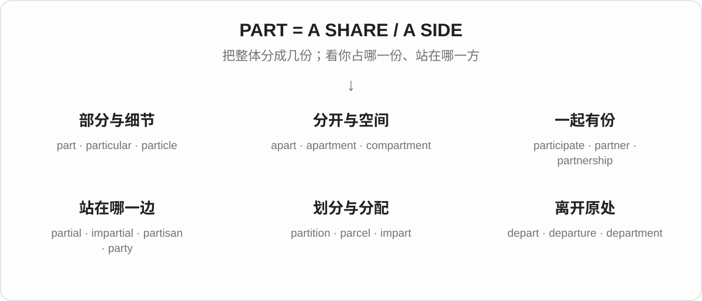

## 词形与演化规律

**particula** 是“小部分”，留下 particle；它的法语支线还留下 parcel。**partīre** 是“分开、分配”，留下 depart、partition、party。**particip-** 还含与 capere“拿取”有关的成分。partner 则经过法语与中古英语音形变化，不是任意把 -ner 当后缀。

## 单词速览（常用到不常用）

| 单词 | 音标 | 核心意思 |
|---|---|---|
| [part](#w-1) | 英 /pɑːt/；美 /pɑːrt/ | 部分；角色；份额；分开 |
| [party](#w-2) | 英 /ˈpɑːti/；美 /ˈpɑːrti/ | 聚会；政党；一方；一群人 |
| [department](#w-3) | 英 /dɪˈpɑːtmənt/；美 /dɪˈpɑːrtmənt/ | 部门；系；分区 |
| [particular](#w-4) | 英 /pəˈtɪkjələ/；美 /pərˈtɪkjələr/ | 特定的；特别的；讲究的 |
| [particularly](#w-5) | 英 /pəˈtɪkjələli/；美 /pərˈtɪkjələrli/ | 尤其；特别；格外 |
| [partner](#w-6) | 英 /ˈpɑːtnə/；美 /ˈpɑːrtnər/ | 伙伴；合伙人；伴侣 |
| [apart](#w-7) | 英 /əˈpɑːt/；美 /əˈpɑːrt/ | 分开；相隔；除去 |
| [apartment](#w-8) | 英 /əˈpɑːtmənt/；美 /əˈpɑːrtmənt/ | 公寓；一套独立住宅 |
| [partnership](#w-9) | 英 /ˈpɑːtnəʃɪp/；美 /ˈpɑːrtnərʃɪp/ | 合作关系；合伙关系 |
| [participate](#w-10) | 英 /pɑːˈtɪsɪpeɪt/；美 /pɑːrˈtɪsəpeɪt/ | 参与；参加 |
| [participation](#w-11) | 英 /pɑːˌtɪsɪˈpeɪʃən/；美 /pɑːrˌtɪsəˈpeɪʃən/ | 参与；参加行为 |
| [departure](#w-12) | 英 /dɪˈpɑːtʃə/；美 /dɪˈpɑːrtʃər/ | 出发；离开；不同于以往的做法 |
| [partially](#w-13) | 英 /ˈpɑːʃəli/；美 /ˈpɑːrʃəli/ | 部分地；不完全地 |
| [partial](#w-14) | 英 /ˈpɑːʃəl/；美 /ˈpɑːrʃəl/ | 部分的；偏袒的；偏爱的 |
| [particle](#w-15) | 英 /ˈpɑːtɪkəl/；美 /ˈpɑːrtəkəl/ | 微粒；粒子；语法小品词 |
| [partisan](#w-16) | 英 /ˌpɑːtɪˈzæn/；美 /ˈpɑːrtəzən/ | 党派性的；坚定拥护者；游击队员 |
| [participant](#w-17) | 英 /pɑːˈtɪsɪpənt/；美 /pɑːrˈtɪsəpənt/ | 参与者；参加者 |
| [depart](#w-18) | 英 /dɪˈpɑːt/；美 /dɪˈpɑːrt/ | 离开；出发；偏离 |
| [parcel](#w-19) | 英 /ˈpɑːsəl/；美 /ˈpɑːrsəl/ | 包裹；一块土地；分配 |
| [partition](#w-20) | 英 /pɑːˈtɪʃən/；美 /pɑːrˈtɪʃən/ | 分隔；隔板；分区 |
| [compartment](#w-21) | 英 /kəmˈpɑːtmənt/；美 /kəmˈpɑːrtmənt/ | 隔间；分格；舱室 |
| [impartial](#w-22) | 英 /ɪmˈpɑːʃəl/；美 /ɪmˈpɑːrʃəl/ | 公正的；不偏袒任何一方的 |
| [participatory](#w-23) | 英 /pɑːˈtɪsɪpətəri/；美 /pɑːrˈtɪsəpətɔːri/ | 鼓励共同参与的；参与式的 |
| [impart](#w-24) | 英 /ɪmˈpɑːt/；美 /ɪmˈpɑːrt/ | 传授；告知；赋予某种特性 |
| [nanoparticle](#w-25) | 英 /ˈnænəʊˌpɑːtɪkəl/；美 /ˈnænoʊˌpɑːrtəkəl/ | 纳米颗粒 |
| [impartially](#w-26) | 英 /ɪmˈpɑːʃəli/；美 /ɪmˈpɑːrʃəli/ | 公正地；不偏袒地 |
| [bipartite](#w-27) | 英 /baɪˈpɑːtaɪt/；美 /baɪˈpɑːrtaɪt/ | 分成两部分的；由两方组成的 |

## 逐词讲解

### 1. part — 部分；角色；份额；分开

**音标**：英 /pɑːt/；美 /pɑːrt/

**先抓住这个画面**

把完整东西划出一块，这一块就是 part。放到合作中，它可以是你负责的那一块；放到戏里，就是你承担的角色。

**怎么拆**

名词经法语等途径来自拉丁语 pars，变化形式里出现 part-。动词“分开”经古法语 partir 传入，属于同一词族。

**怎么变成今天的意思**

“整体里的一份”能连接机器零件、工作职责和表演角色。动词则从“分成几份”转向分开、分别，不能每次都只译成“部分”。

**常见搭配与例句**

part of the plan；take part in；play a part；part with something。

> Everyone has a part to play in the project.

项目中每个人都有自己的职责。

> We parted at the station and went home separately.

我们在车站分别，各自回家。

**别混淆**

a part 是一部分；apart 是分开。I am a part of the team 表示属于团队，不能写成 apart。

### 2. party — 聚会；政党；一方；一群人

**音标**：英 /ˈpɑːti/；美 /ˈpɑːrti/

**先抓住这个画面**

先想“归在同一边的一群人”：一起庆祝是一场 party，持共同政治主张可以组成一个 party，协议中的一边也是 a party。

**怎么拆**

古法语 partie 是 partir“分开”的相关形式，用作名词指一部分、一方；更早来自拉丁语 partīre。

**怎么变成今天的意思**

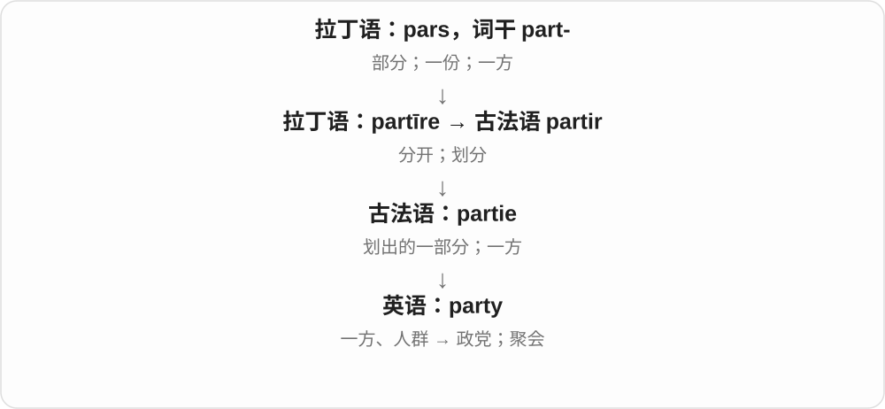

“一方”先连接群体身份，再发展出一起活动或娱乐的聚会义。理解时要看政治、合同还是社交场景。

**常见搭配与例句**

a birthday party；a political party；both parties；a party of six。

> We are having a small party on Friday.

我们周五要办一个小聚会。

> Both parties agreed to change the schedule.

双方同意修改日程。

**别混淆**

party of six 是六人一行，不一定在办派对。third party 通常是另一个相关方，不是第三场聚会。

### 3. department — 部门；系；分区

**音标**：英 /dɪˈpɑːtmənt/；美 /dɪˈpɑːrtmənt/

**先抓住这个画面**

把一个大机构的工作切成几块，每块有自己的职责：财务一块、销售一块，这些就是 departments。

**怎么拆**

英语借自法语 département，源头是 départir“分开、分配”的词族。可联系 depart，但不是“出发的地方”。

**怎么变成今天的意思**

词义从分配或划分走向被划出来负责某类事务的单位。百货商店的一类商品区，也可以叫 department。

**常见搭配与例句**

the finance department；a university department；a department store。

> Please send the invoice to the finance department.

请把发票寄给财务部。

> She teaches in the history department.

她在历史系任教。

**别混淆**

department 看组织内部的职能部分；company 是公司整体。一个 department 不一定是独立公司。

### 4. particular — 特定的；特别的；讲究的

**音标**：英 /pəˈtɪkjələ/；美 /pərˈtɪkjələr/

**先抓住这个画面**

从一堆东西里用手指点出“就这个”，这是 particular 的核心画面。一个人只接受自己选中的细节，就显得很讲究。

**怎么拆**

来自拉丁语 particulāris，再经法语进入英语；particula 是“小部分”。不是英语 particle 先变成形容词才传遍欧洲。

**怎么变成今天的意思**

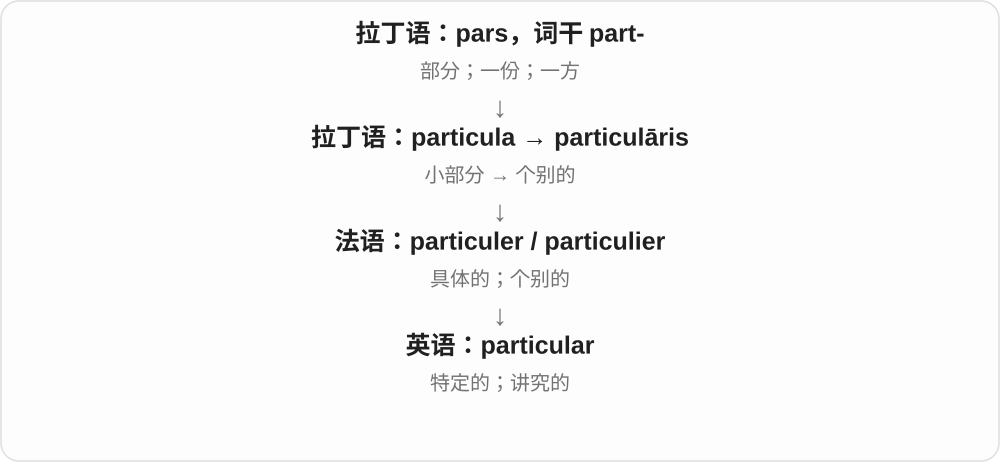

从一般整体转向某一个具体部分，得到“特定的”。be particular about 把注意力放在很细的要求上，因此可表示挑剔或讲究。

**常见搭配与例句**

a particular problem；in particular；be particular about food。

> Is there a particular reason you chose this seat?

你选这个座位有什么具体原因吗？

> She is particular about the quality of her coffee.

她对咖啡的品质很讲究。

**别混淆**

particular 常强调具体选定的对象；special 更常强调不同寻常、受特殊对待。a particular day 未必是特别重要的一天。

### 5. particularly — 尤其；特别；格外

**音标**：英 /pəˈtɪkjələli/；美 /pərˈtɪkjələrli/

**先抓住这个画面**

把聚光灯从一大群对象移到其中一个：尤其值得提的，就是 particularly 后面那一项。

**怎么拆**

particular + -ly，形容词变副词。

**怎么变成今天的意思**

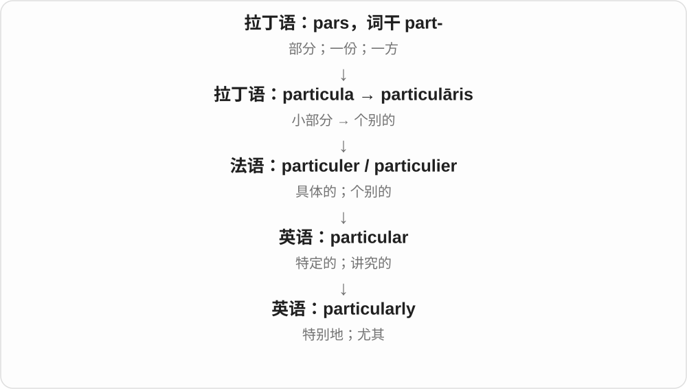

它可以挑出特别相关的对象，也可以加强程度。not particularly interested 通常是“不怎么感兴趣”，语气比直接说讨厌温和。

**常见搭配与例句**

particularly useful；particularly when；not particularly。

> The map is particularly useful when you travel alone.

独自旅行时，这张地图尤其有用。

> I am not particularly fond of sweet drinks.

我不怎么喜欢甜饮料。

**别混淆**

particularly 多用于突出程度或某一项；in particular 是短语，可放在名词后单独强调它。

### 6. partner — 伙伴；合伙人；伴侣

**音标**：英 /ˈpɑːtnə/；美 /ˈpɑːrtnər/

**先抓住这个画面**

事情不是你一个人做，另一个人也在其中占一份、承担一份；你们是 partners。

**怎么拆**

来自古法语表示“共同有份的人”的词，经中古英语 parcener 等形式，受 part 影响变成 partner。不要硬拆成 part + ner。

**怎么变成今天的意思**

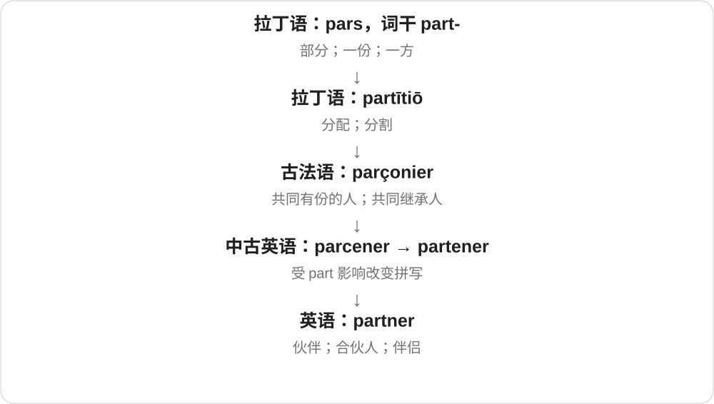

“共同有份”连接了商业合作、双人活动和亲密关系。partner 不自带婚姻状态或性别，要看具体语境。

**常见搭配与例句**

a business partner；a dance partner；partner with another organization。

> She started the company with a business partner.

她和一位合伙人创办了这家公司。

> Please choose a partner for the speaking exercise.

请选一位搭档做口语练习。

**别混淆**

friend 说友谊；partner 说共同参与或共同生活的关系。商业合伙人未必是私人好友。

### 7. apart — 分开；相隔；除去

**音标**：英 /əˈpɑːt/；美 /əˈpɑːrt/

**先抓住这个画面**

原本挨着的东西被放到两边，中间出现了距离。距离可以是空间，也可以是时间或观点。

**怎么拆**

来自盎格鲁诺曼语 a part，更早是拉丁语 ad partem“到一边”。现在作为一个词使用。

**怎么变成今天的意思**

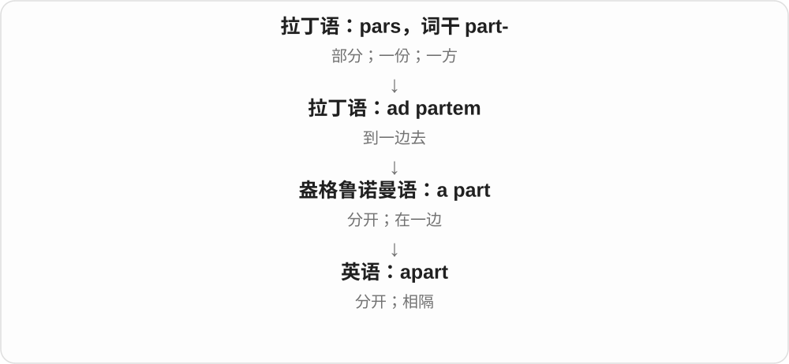

物体分开可以是 take apart；两人分开居住是 live apart。apart from 像先把某项放在一边，再谈剩余情况，可表“除……外”。

**常见搭配与例句**

fall apart；take apart；miles apart；apart from。

> The two villages are five kilometres apart.

这两个村庄相距五公里。

> She took the clock apart to see how it worked.

她把钟拆开，看看它是怎样运作的。

**别混淆**

apart 是一个副词；a part 是冠词加名词。两人 stand apart 是分开站，不是站成“一个部分”。

### 8. apartment — 公寓；一套独立住宅

**音标**：英 /əˈpɑːtmənt/；美 /əˈpɑːrtmənt/

**先抓住这个画面**

想象一栋楼被分成几套可以分别居住的空间，其中一套就是 apartment。重点是划出独立使用的一部分。

**怎么拆**

英语借自法语 appartement，前面有意大利语 appartamento 等“分开、独立空间”词形。apart + -ment 可以帮助认形，但不是英语现场造出的全过程。

**怎么变成今天的意思**

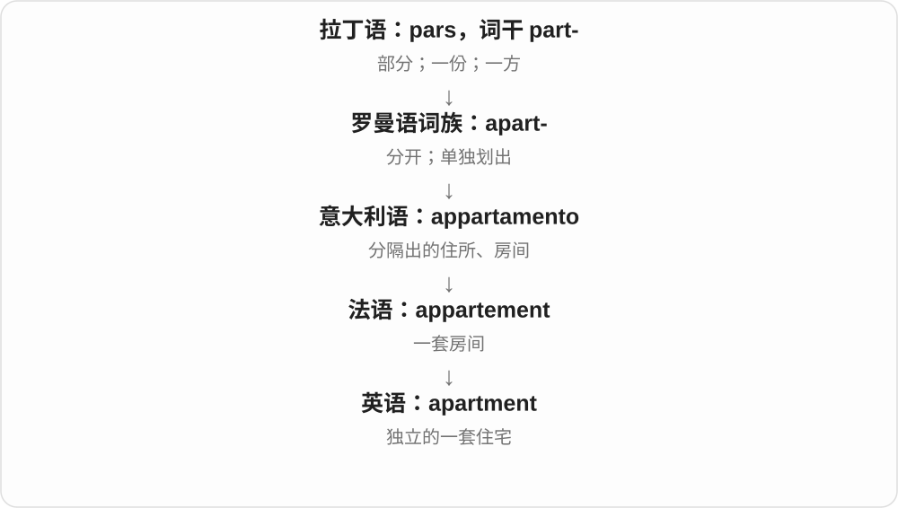

从“划开来的一部分”变成供一个住户使用的一套房间。现代美式英语常用 apartment，英式日常常说 flat。

**常见搭配与例句**

rent an apartment；an apartment building；a studio apartment。

> They rent a small apartment near the station.

他们在车站附近租了一套小公寓。

> Our apartment has two bedrooms and a balcony.

我们的公寓有两间卧室和一个阳台。

**别混淆**

apartment 是楼中的一套住宅；building 是整栋建筑。不能因为中文叫“公寓楼”就把整楼一律称为 an apartment。

### 9. partnership — 合作关系；合伙关系

**音标**：英 /ˈpɑːtnəʃɪp/；美 /ˈpɑːrtnərʃɪp/

**先抓住这个画面**

partner 是一起承担的人；partnership 是把这些人连接起来、让合作持续运转的关系。

**怎么拆**

partner + -ship，-ship 表示身份、状态或关系。

**怎么变成今天的意思**

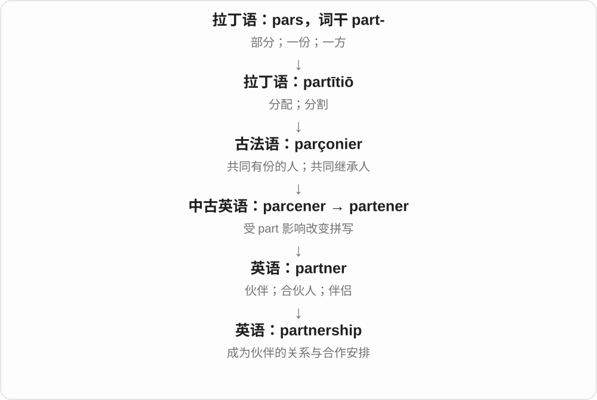

它可以指正式商业合伙，也可以泛指学校、团队等之间的合作。是否构成某种法律组织，要看上下文，单凭这个词不能决定。

**常见搭配与例句**

form a partnership；work in partnership with；a long partnership。

> The school formed a partnership with a local museum.

学校与当地一家博物馆建立了合作关系。

> Their partnership has lasted more than ten years.

他们的合作关系已经持续十多年。

**别混淆**

partnership 是合作关系；participation 是参与行为。参加一次活动，并不一定建立长期 partnership。

### 10. participate — 参与；参加

**音标**：英 /pɑːˈtɪsɪpeɪt/；美 /pɑːrˈtɪsəpeɪt/

**先抓住这个画面**

一件事正在进行，你把自己的一份行动放进去，不只是站在旁边看。

**怎么拆**

拉丁语 pars“一份”与 capere“拿取”的相关成分构成 particeps“有份参与的人”，再有 participāre。英语借入相关形式。

**怎么变成今天的意思**

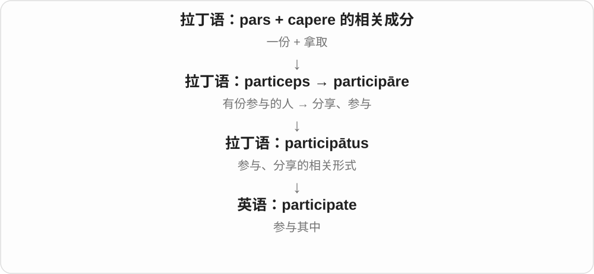

“拿到自己的一份”发展成共同参与或分享。现代 participate in 不要求你主办活动，只要求你实际加入其中。

**常见搭配与例句**

participate in a discussion；participate actively；participate fully。

> Every student is encouraged to participate in the discussion.

我们鼓励每位学生参与讨论。

> She participated in the race for the first time.

她第一次参加了这场比赛。

**别混淆**

attend 只说明到场；participate 强调有参与行为。你可以 attend a meeting，却一直不 participate in the discussion。

### 11. participation — 参与；参加行为

**音标**：英 /pɑːˌtɪsɪˈpeɪʃən/；美 /pɑːrˌtɪsəˈpeɪʃən/

**先抓住这个画面**

participation 看的是“有没有加入、加入了多少”，不是数参加的人叫什么。

**怎么拆**

来自晚期拉丁语 participātiō，经法语进入英语；现代词形与 participate + -ion 对应。

**怎么变成今天的意思**

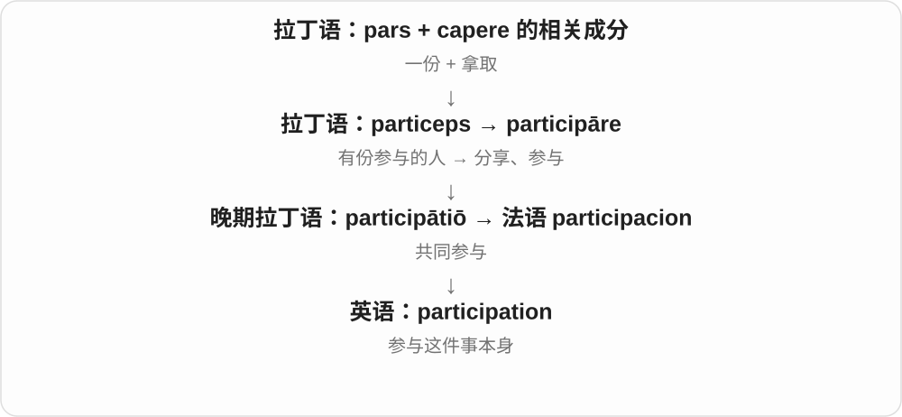

动词描述某人参与，名词把参与当作可以鼓励、统计或评价的事情。active participation 强调真正投入。

**常见搭配与例句**

public participation；participation in；encourage participation。

> The design process encourages public participation.

这个设计流程鼓励公众参与。

> Participation in the survey is voluntary.

是否参加调查由个人自愿决定。

**别混淆**

participant 是一个人，可数；participation 通常指参与行为，不说 three participations 来表示三名参与者。

### 12. departure — 出发；离开；不同于以往的做法

**音标**：英 /dɪˈpɑːtʃə/；美 /dɪˈpɑːrtʃər/

**先抓住这个画面**

depart 是离开的动作；departure 把这个动作当成一个事件，可以写进时刻表，也可以被推迟。

**怎么拆**

经古法语 deporteure 传入；现代能看出 depart 与名词词尾 -ure 的对应。

**怎么变成今天的意思**

在机场常见 departures，指离港航班。a departure from tradition 则不是人走了，而是做法与传统拉开距离。

**常见搭配与例句**

departure time；the departure lounge；a departure from tradition。

> Our departure was delayed by heavy snow.

大雪使我们的出发时间推迟了。

> The new menu is a departure from the restaurant’s usual style.

新菜单与这家餐厅以往的风格很不一样。

**别混淆**

departure 与 arrival 是出发与到达；department 则是部门，多了 -ment，意思也完全不同。

### 13. partially — 部分地；不完全地

**音标**：英 /ˈpɑːʃəli/；美 /ˈpɑːrʃəli/

**先抓住这个画面**

进度条走了一段，还没有走满：partially 说明完成或适用的范围只有一部分。

**怎么拆**

partial + -ly，变成描述动作或状态的副词。

**怎么变成今天的意思**

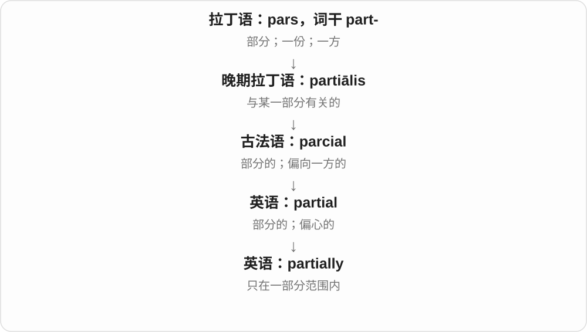

partially open 可以是门只开了一点；partially true 是说法有一部分是真的。它本身不告诉你具体百分比。

**常见搭配与例句**

partially completed；partially responsible；partially open。

> The entrance was partially blocked by fallen branches.

入口有一部分被掉落的树枝挡住了。

> Your answer is partially correct.

你的答案有一部分是对的。

**别混淆**

partly 与 partially 常能互换；谈门、盖子等只开一部分时 partially 很自然。不要把它默认理解成“偏心地”。

### 14. partial — 部分的；偏袒的；偏爱的

**音标**：英 /ˈpɑːʃəl/；美 /ˈpɑːrʃəl/

**先抓住这个画面**

先看两幅图：只填好半张表，是“部分完成”；只站在争论的一边，是“有偏向”。两者都只落在整体的一部分。

**怎么拆**

拉丁语 partiālis“与部分有关的”经古法语 parcial 传入。part- 是部分，-al 是相关的。

**怎么变成今天的意思**

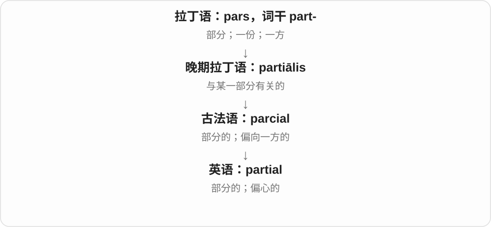

partial refund 只退一部分。a partial judge 偏袒一方。be partial to 则常带轻松语气，表示特别喜欢某种东西。

**常见搭配与例句**

a partial refund；partial success；be partial to chocolate。

> The company offered a partial refund.

公司提出退还部分款项。

> I am rather partial to dark chocolate.

我挺偏爱黑巧克力。

**别混淆**

partial 不一定负面：partial recovery 只是恢复了一部分。说人判断 partial 才通常指不公正。

### 15. particle — 微粒；粒子；语法小品词

**音标**：英 /ˈpɑːtɪkəl/；美 /ˈpɑːrtəkəl/

**先抓住这个画面**

把一大块东西继续分小，眼前只剩下一粒。这是 particle 最容易抓住的画面。

**怎么拆**

可以按词源记成 part（部分）+ -icle（表示“小”的后缀）：一小部分 → 微粒。-icle 对应拉丁语的指小词尾 -icula；“指小”就是把原来的东西说小一点。历史上先有拉丁语 pars（词干 part-）的指小形式 particula“小部分”，再经法语及拉丁语来源进入英语，并不是英语里临时把 part 和 -icle 拼起来。

**怎么变成今天的意思**

物理和日常语境指很小的单位，未必都肉眼可见。语法里的 particle 则是一类短小、通常不变化的词，如某些短语动词中的 up。

**常见搭配与例句**

dust particles；a particle of sand；particle physics。

> Tiny particles of dust floated in the sunlight.

细小的尘粒在阳光里飘浮。

> The filter traps particles that are too small to see.

这个滤网能截住肉眼看不见的微粒。

**别混淆**

particle 不等于 atom：粒子范围很广，尘粒远大于一个原子；物理学中还可指电子等。

### 16. partisan — 党派性的；坚定拥护者；游击队员

**音标**：英 /ˌpɑːtɪˈzæn/；美 /ˈpɑːrtəzən/

**先抓住这个画面**

当一群人分成几方，partisan 是明确站在某一边、替这一边说话或行动的人。

**怎么拆**

经法语 partisan 来自意大利语 partigiano，基础 parte 是“一方、部分”。并非 part + 一个现代英语后缀 isan。

**怎么变成今天的意思**

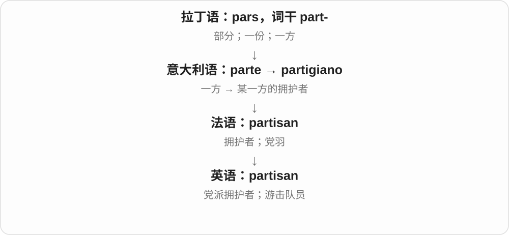

形容观点或争论时，常指党派立场很明显。游击队员义来自武装群体的用法；不是每个 partisan 都在进行武装行动。

**常见搭配与例句**

partisan politics；a partisan argument；partisan fighters。

> The debate became increasingly partisan.

这场辩论越来越被党派立场主导。

> Local partisans operated in the mountains during the war.

战争期间，当地游击队员在山里活动。

**别混淆**

supporter 只是支持者；partisan 更突出选边，形容分析时常暗含不够公正。bipartisan 则是两党合作。

### 17. participant — 参与者；参加者

**音标**：英 /pɑːˈtɪsɪpənt/；美 /pɑːrˈtɪsəpənt/

**先抓住这个画面**

活动名单上真正加入这件事的人，就是 participant；他可能是选手、讨论者，也可能是研究中的参加者。

**怎么拆**

从拉丁语 participāns“正在参与的”经法语 participant 传入；现代可与 participate 的词干及 -ant 联系。

**怎么变成今天的意思**

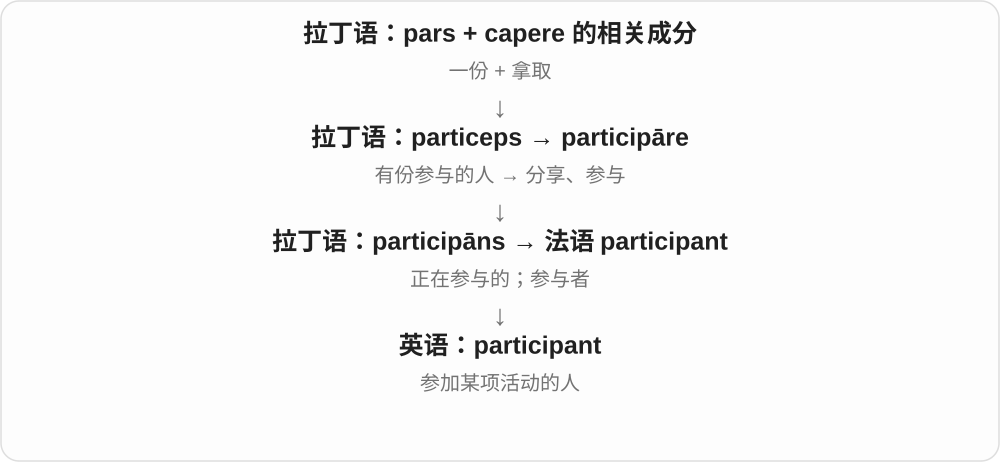

这里把“参与”这个动作转成人的身份。它没有自带获胜、专业或领导地位，只说明是这项活动的一员。

**常见搭配与例句**

a study participant；an active participant；participants in a workshop。

> Each participant received a copy of the schedule.

每位参加者都拿到了一份日程表。

> The study included eighty adult participants.

这项研究有八十名成年参与者。

**别混淆**

spectator 是看的人；participant 是参与的人。研究参加者也不一定是病人，不能见到 participant 就译成患者。

### 18. depart — 离开；出发；偏离

**音标**：英 /dɪˈpɑːt/；美 /dɪˈpɑːrt/

**先抓住这个画面**

你与原来的地方或路线分开了：人离开车站，做法离开惯例，都能用 depart。

**怎么拆**

拉丁语 dē-（离开）+ partīre（分开），经古法语 departir 进入英语。

**怎么变成今天的意思**

早期“分开”的动作后来集中到离开某地。depart from tradition 是从原有做法中分出一条新路。

**常见搭配与例句**

depart from a station；depart for London；depart from the usual practice。

> The train departs for Oxford at nine.

火车九点出发去牛津。

> This design departs from our usual style.

这个设计与我们平常的风格不同。

**别混淆**

depart for 后面是目的地；depart from 后面是出发处或被偏离的标准。depart 比 leave 常更正式。

### 19. parcel — 包裹；一块土地；分配

**音标**：英 /ˈpɑːsəl/；美 /ˈpɑːrsəl/

**先抓住这个画面**

从大批东西中分出一份，再包成独立一件，就是 parcel 的画面；土地也能划成一块块。

**怎么拆**

拉丁语 particula“小部分”经 particella、古法语 parcelle 传入，词形逐步缩短。它与 particle 是不同路线留下的亲戚。

**怎么变成今天的意思**

从一份货物发展为包好的包裹；a parcel of land 则保留“划出的一块”。parcel out 是把整体分份给人。

**常见搭配与例句**

send a parcel；a parcel of land；parcel out the work。

> A parcel arrived for you this morning.

今天早上有一个寄给你的包裹到了。

> They bought a small parcel of land beside the river.

他们在河边买了一小块地。

**别混淆**

parcel 在英式英语里常是邮寄包裹；美式常用 package。parcel 的土地义不是“包着的土地”。

### 20. partition — 分隔；隔板；分区

**音标**：英 /pɑːˈtɪʃən/；美 /pɑːrˈtɪʃən/

**先抓住这个画面**

在一整块空间里画线或竖墙，把它变成彼此分开的几部分。partition 可指划分行为，也可指那道隔板。

**怎么拆**

拉丁语 partīre“分开”产生 partitio“划分”，经法语传入。现代 part + -ition 只是帮助识别词族。

**怎么变成今天的意思**

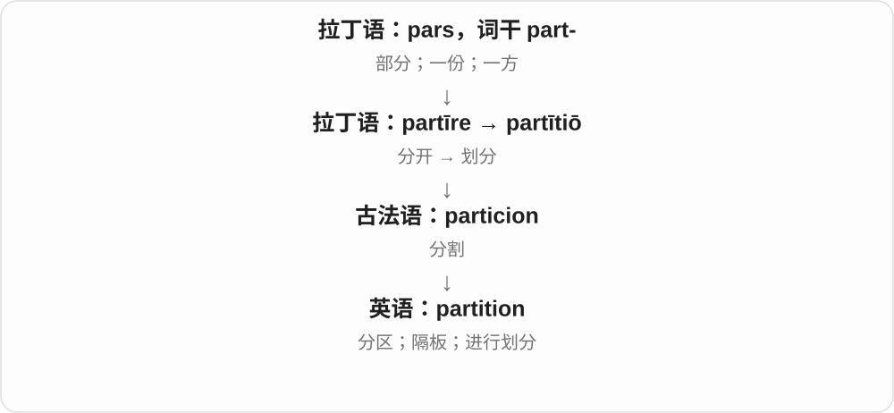

从空间分隔扩展到磁盘等逻辑空间。disk partition 是划出的存储区域，不需要真实木板。

**常见搭配与例句**

a glass partition；partition a room；a disk partition。

> A glass partition separates the office from the meeting room.

一道玻璃隔断把办公室和会议室分开。

> The technician created a separate partition for the backup files.

技术人员为备份文件建立了单独的分区。

**别混淆**

partition 强调边界或划分；part 只是其中一部分，未必有明确隔开它的屏障。

### 21. compartment — 隔间；分格；舱室

**音标**：英 /kəmˈpɑːtmənt/；美 /kəmˈpɑːrtmənt/

**先抓住这个画面**

打开一个多格盒子，其中一个独立的小空间，就是 compartment。火车、行李包、机器里也有这样的分隔空间。

**怎么拆**

晚期拉丁语 compartīrī“分配、分隔”经意大利语 compartimento、法语 compartiment 进入英语。com- 与 partīrī 组合。

**怎么变成今天的意思**

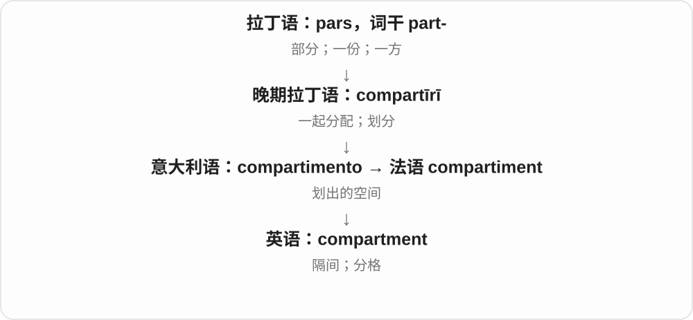

它从“划分”转向划出的空间本身。一个 bag 可以有 several compartments，而不是几个独立的包。

**常见搭配与例句**

a storage compartment；a train compartment；the glove compartment。

> Keep your passport in the inner compartment of the bag.

把护照放在包的内层分格里。

> Smoke was coming from the engine compartment.

发动机舱里正冒出烟。

**别混淆**

partition 常是隔板或划分动作；compartment 是隔开后得到的空间。

### 22. impartial — 公正的；不偏袒任何一方的

**音标**：英 /ɪmˈpɑːʃəl/；美 /ɪmˈpɑːrʃəl/

**先抓住这个画面**

裁判站在中间，按同一套规则看两边，没有提前把天平压向某一方。

**怎么拆**

im- 是否定前缀 in- 在 p 前的形式，加 partial“偏向一方的”。

**怎么变成今天的意思**

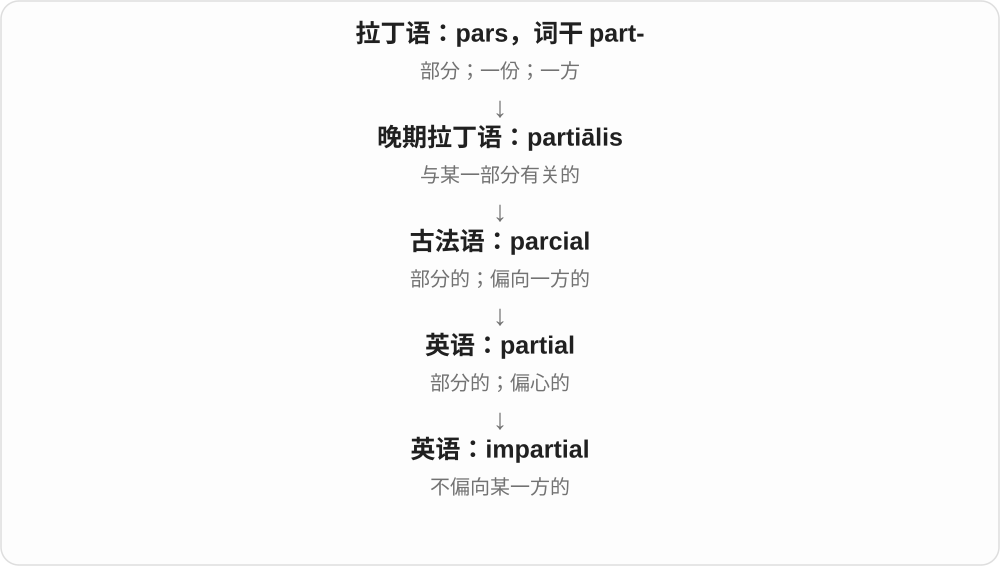

这里否定的是偏袒义，不是“部分”的数量义。所以 impartial 不能用来表示一张完整的表格。

**常见搭配与例句**

an impartial judge；impartial advice；remain impartial。

> We need an impartial assessment of both proposals.

我们需要对两份方案作出公正评价。

> The referee remained impartial throughout the match.

裁判在整场比赛中都保持公正。

**别混淆**

neutral 常说不加入任何阵营；impartial 强调评判和对待是否公平。裁判必须作出判断，仍可以 impartial。

### 23. participatory — 鼓励共同参与的；参与式的

**音标**：英 /pɑːˈtɪsɪpətəri/；美 /pɑːrˈtɪsəpətɔːri/

**先抓住这个画面**

规则不把大家只当观众，而是留出位置，让他们一起讨论、决定或制作。

**怎么拆**

participate 的词干 + -ory，表示具有参与性质。

**怎么变成今天的意思**

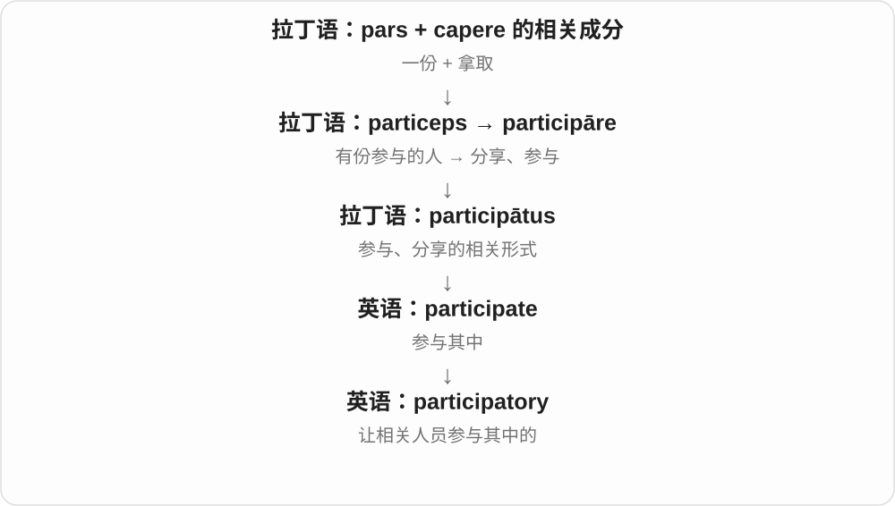

它通常形容一种方法、制度或活动安排。participatory design 要让实际使用者加入设计过程。

**常见搭配与例句**

participatory design；a participatory approach；participatory democracy。

> The team used a participatory approach to redesign the park.

团队让相关居民共同参与公园改造。

> The workshop includes several participatory activities.

工作坊安排了几项需要大家动手参与的活动。

**别混淆**

participating 描述某个主体正在参与；participatory 描述活动或制度把参与放在重要位置。

### 24. impart — 传授；告知；赋予某种特性

**音标**：英 /ɪmˈpɑːt/；美 /ɪmˈpɑːrt/

**先抓住这个画面**

把自己拥有的一份知识分享出去，或让某个东西获得一种味道、颜色，这就是 impart。

**怎么拆**

晚期拉丁语 im-（向内）+ partīre（分配）形成 impartīre，经法语进入英语。

**怎么变成今天的意思**

“分给一份”走向知识与性质的传递。impart flavour to soup 像把某种风味带进汤里，不是把汤分开。

**常见搭配与例句**

impart knowledge；impart information to someone；impart flavour to food。

> The teacher tried to impart a love of reading to her students.

老师努力让学生们爱上阅读。

> The herbs impart a fresh flavour to the soup.

这些香草给汤增添了清新的味道。

**别混淆**

impart 较正式；tell 更日常。impartial 虽然开头相像，却是 im- 否定 partial，不是 impart 的形容词。

### 25. nanoparticle — 纳米颗粒

**音标**：英 /ˈnænəʊˌpɑːtɪkəl/；美 /ˈnænoʊˌpɑːrtəkəl/

**先抓住这个画面**

particle 已经很小，nano- 再把尺度拉到纳米层面：这种颗粒要用远比普通眼光更细的尺度来看。

**怎么拆**

nano-（纳米尺度）+ particle（颗粒），是现代科学组合词。

**怎么变成今天的意思**

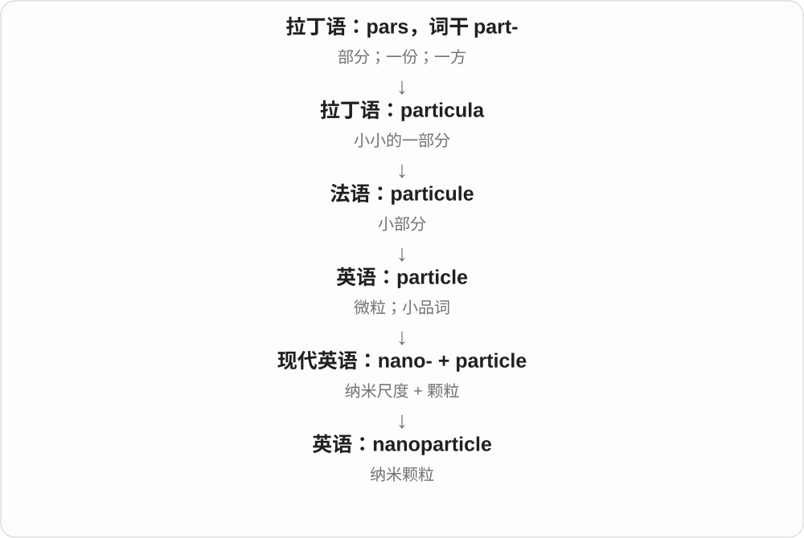

nano- 在单位中表示十亿分之一；nanoparticle 描述纳米尺度颗粒，并不意味着每一颗直径都恰好一纳米。

**常见搭配与例句**

metal nanoparticles；a nanoparticle coating；nanoparticle size。

> The researchers measured the size of each nanoparticle.

研究人员测量了每个纳米颗粒的大小。

> The coating contains silver nanoparticles.

这种涂层含有银纳米颗粒。

**别混淆**

nanoparticle 是大小类别，不是固定材料；金、碳等不同材料都可能制成纳米颗粒。

### 26. impartially — 公正地；不偏袒地

**音标**：英 /ɪmˈpɑːʃəli/；美 /ɪmˈpɑːrʃəli/

**先抓住这个画面**

不是只口头宣布自己公平，而是实际处理时给各方同样的尺子。

**怎么拆**

impartial + -ly，描述判断、调查、处理如何进行。

**怎么变成今天的意思**

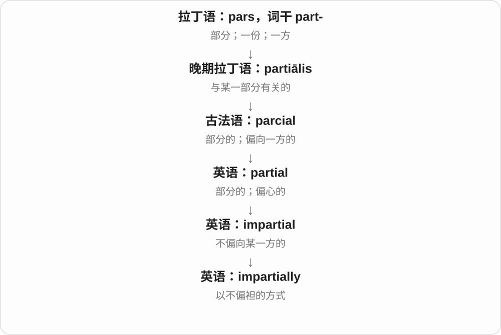

常修饰 assess、judge、investigate。它说明方法公正，不保证最后所有人得到相同结果。

**常见搭配与例句**

judge impartially；act impartially；investigate impartially。

> All applications will be assessed impartially.

所有申请都会受到公正评估。

> She listened impartially to both sides of the dispute.

她不偏不倚地听取了争议双方的陈述。

**别混淆**

equally 强调数量或待遇相同；impartially 强调没有偏私。按同样标准评判可能得出不同分数。

### 27. bipartite — 分成两部分的；由两方组成的

**音标**：英 /baɪˈpɑːtaɪt/；美 /baɪˈpɑːrtaɪt/

**先抓住这个画面**

把整体分成两块，或让两个不同部分共同组成它：bi- 直接告诉你数量是二。

**怎么拆**

来自拉丁语 bipartītus“分成两部分的”：bi-（二）+ partīre 的相关形式。

**怎么变成今天的意思**

可描述结构、协议或数学中的二部图。核心是“两部分”，不自动等于两个政党。

**常见搭配与例句**

a bipartite agreement；a bipartite structure；a bipartite graph。

> The document has a bipartite structure: principles and procedures.

这份文件分为两部分：原则和流程。

> The two organizations signed a bipartite agreement.

这两个组织签署了一份双方协议。

**别混淆**

bipartisan 专说两党参与或合作；bipartite 可说任何两部分，不限政治。

## 这一组要分清什么

**partial / impartial**：偏向一方 / 不偏袒；impartial 并不表示“全部的”。

**apart / a part**：分开 / 一个部分，空格会改变意思。

**departure / department**：一个是离开或出发，另一个是划分出的部门。它们保留了“分开”的不同去向。

**participate / attend**：真正参与 / 到场。光到场不一定有参与讨论。

## 串起来练习

**Each participant took part in the discussion, while an impartial moderator listened to every side.**

每位参与者都加入讨论，公正的主持人听取各方意见。participant 是有份参与的人，take part 是参与，impartial 是不偏向一方。
