# 0050 · vid-, vis- — 看见；看出；预见；由观看发展出的判断与照顾

[逐词精讲目录](../00_逐词精讲目录.md) · [总目录](../00_总目录_按常用程度.md)

## 核心词根与来源

**vid-/vis- 最好抓住一个动作：把某件事放进视野。** 拉丁语 vidēre 是“看”，vīsus 是同族的分词或名词形态，所以英语里既见 vid-，也见 vis-。看的对象不只在眼前：可以回头看成为 review，可以提前看、替未来作安排成为 provide，也可以在心中看见未来成为 vision。

## 词形与演化规律

**vid- 与 vis- 是历史词形变化，不是任意换字母。** 法语还把这支变成 voir、vue 一类形态，所以 view、survey、envy、advice 看起来不像 vid，却有真实的历史联系。prōvidēns 又缩合为 prūdēns，留下 prudent。不要只凭字母认亲，也不要把同族英语词一律画成相互派生：provide 与 provision、revise 与 revision 常走各自的借入路线。

## 单词速览（常用到不常用）

| 单词 | 音标 | 核心意思 |
|---|---|---|
| [video](#w-1) | 英 /ˈvɪdiəʊ/；美 /ˈvɪdioʊ/ | 视频；录像；录制视频 |
| [view](#w-2) | /vjuː/ | 景色；视野；观点；查看 |
| [provide](#w-3) | /prəˈvaɪd/ | 提供；供养；作出规定 |
| [evidence](#w-4) | /ˈevɪdəns/ | 证据；迹象；显示、证明 |
| [review](#w-5) | /rɪˈvjuː/ | 审查；回顾；复习；评论 |
| [visit](#w-6) | /ˈvɪzɪt/ | 拜访；参观；访问 |
| [advice](#w-7) | /ədˈvaɪs/ | 建议；忠告 |
| [interview](#w-8) | 英 /ˈɪntəvjuː/；美 /ˈɪntərvjuː/ | 面试；采访；访谈 |
| [television](#w-9) | /ˈtelɪvɪʒən/ | 电视；电视节目；电视机 |
| [survey](#w-10) | 英 名词 /ˈsɜːveɪ/，动词 /səˈveɪ/；美 名词 /ˈsɜːrveɪ/，动词 /sərˈveɪ/ | 调查；测量；全面查看 |
| [vision](#w-11) | /ˈvɪʒən/ | 视力；景象；愿景；远见 |
| [visual](#w-12) | /ˈvɪʒuəl/ | 视觉的；图像的；视觉材料 |
| [visible](#w-13) | /ˈvɪzəbəl/ | 看得见的；明显的 |
| [advisory](#w-14) | 英 /ədˈvaɪzəri/；美 /ədˈvaɪzəri/ | 咨询的；提供建议的；公告、提示 |
| [provision](#w-15) | /prəˈvɪʒən/ | 提供；准备；条款；供应品 |
| [visa](#w-16) | /ˈviːzə/ | 签证 |
| [overview](#w-17) | 英 /ˈəʊvəvjuː/；美 /ˈoʊvərvjuː/ | 概览；总体介绍 |
| [provider](#w-18) | 英 /prəˈvaɪdə/；美 /prəˈvaɪdər/ | 提供者；服务商；供养者 |
| [advise](#w-19) | /ədˈvaɪz/ | 建议；劝告；告知 |
| [invisible](#w-20) | /ɪnˈvɪzəbəl/ | 看不见的；不被注意的 |
| [advisor](#w-21) | 英 /ədˈvaɪzə/；美 /ədˈvaɪzər/ | 顾问；指导者 |
| [visitor](#w-22) | 英 /ˈvɪzɪtə/；美 /ˈvɪzɪtər/ | 访客；游客；访问者 |
| [evident](#w-23) | /ˈevɪdənt/ | 明显的；清楚可见的 |
| [preview](#w-24) | /ˈpriːvjuː/ | 预览；预告；提前观看 |
| [supervisor](#w-25) | 英 /ˈsuːpəvaɪzə/；美 /ˈsuːpərvaɪzər/ | 主管；监督者；指导教师 |
| [adviser](#w-26) | 英 /ədˈvaɪzə/；美 /ədˈvaɪzər/ | 顾问；建议者 |
| [supervision](#w-27) | 英 /ˌsuːpəˈvɪʒən/；美 /ˌsuːpərˈvɪʒən/ | 监督；指导；看护 |
| [envy](#w-28) | /ˈenvi/ | 羡慕；嫉妒 |
| [revision](#w-29) | /rɪˈvɪʒən/ | 修订；修改稿；复习 |
| [providence](#w-30) | 英 /ˈprɒvɪdəns/；美 /ˈprɑːvɪdəns/ | 天意；上天的照顾；远见 |
| [visibility](#w-31) | /ˌvɪzəˈbɪləti/ | 能见度；可见性；受关注程度 |
| [viewer](#w-32) | 英 /ˈvjuːə/；美 /ˈvjuːər/ | 观看者；观众；查看程序 |
| [vista](#w-33) | /ˈvɪstə/ | 远景；开阔景色；前景 |
| [visually](#w-34) | /ˈvɪʒuəli/ | 在视觉上；通过观看 |
| [provisional](#w-35) | /prəˈvɪʒənəl/ | 暂定的；临时的；有待确认的 |
| [viewpoint](#w-36) | /ˈvjuːpɔɪnt/ | 观点；观察角度；观景点 |
| [evidently](#w-37) | /ˈevɪdəntli/ | 显然；据现有迹象看来 |
| [interviewer](#w-38) | 英 /ˈɪntəvjuːə/；美 /ˈɪntərvjuːər/ | 面试官；采访者 |
| [revise](#w-39) | /rɪˈvaɪz/ | 修改；修订；复习 |
| [reviewer](#w-40) | 英 /rɪˈvjuːə/；美 /rɪˈvjuːər/ | 评论者；评审者；审稿人 |
| [visionary](#w-41) | 英 /ˈvɪʒənəri/；美 /ˈvɪʒəneri/ | 有远见的；富于想象的；有远见的人 |
| [prudent](#w-42) | /ˈpruːdənt/ | 审慎的；明智稳妥的 |
| [visibly](#w-43) | /ˈvɪzəbli/ | 明显看得出地 |
| [revisit](#w-44) | /ˌriːˈvɪzɪt/ | 重游；再次探访；重新考虑 |
| [surveyor](#w-45) | 英 /səˈveɪə/；美 /sərˈveɪər/ | 测量员；勘察员；房屋查验人员 |
| [visitation](#w-46) | /ˌvɪzɪˈteɪʃən/ | 正式访问；探视；降临、侵袭 |
| [surveying](#w-47) | 英 /səˈveɪɪŋ/；美 /sərˈveɪɪŋ/ | 测量工作；勘测；正在调查 |
| [supervise](#w-48) | 英 /ˈsuːpəvaɪz/；美 /ˈsuːpərvaɪz/ | 监督；指导；负责照看 |
| [supervisory](#w-49) | 英 /ˌsuːpəˈvaɪzəri/；美 /ˌsuːpərˈvaɪzəri/ | 监督的；管理的 |
| [visualization](#w-50) | 英 /ˌvɪʒuəlaɪˈzeɪʃən/；美 /ˌvɪʒuələˈzeɪʃən/ | 可视化；在脑中形成画面 |
| [visualize](#w-51) | /ˈvɪʒuəlaɪz/ | 想象出画面；使可视化 |
| [advisable](#w-52) | /ədˈvaɪzəbəl/ | 可取的；明智的；值得建议的 |
| [worldview](#w-53) | 英 /ˈwɜːldvjuː/；美 /ˈwɜːrldvjuː/ | 世界观 |
| [envious](#w-54) | /ˈenviəs/ | 羡慕的；嫉妒的 |
| [envision](#w-55) | /ɪnˈvɪʒən/ | 设想；展望 |
| [viewership](#w-56) | 英 /ˈvjuːəʃɪp/；美 /ˈvjuːərʃɪp/ | 观众群；观众人数 |
| [improvisation](#w-57) | 英 /ˌɪmprəvaɪˈzeɪʃən/；美 /ɪmˌprɑːvəˈzeɪʃən/ | 即兴创作；临场应变；临时凑成的办法 |
| [prudence](#w-58) | /ˈpruːdəns/ | 审慎；稳妥的判断 |
| [prudential](#w-59) | /pruːˈdenʃəl/ | 审慎的；出于稳妥考虑的 |
| [videotape](#w-60) | 英 /ˈvɪdiəʊteɪp/；美 /ˈvɪdioʊteɪp/ | 录像带；用录像带录制 |
| [improvise](#w-61) | /ˈɪmprəvaɪz/ | 即兴创作；临时应变 |
| [visor](#w-62) | 英 /ˈvaɪzə/；美 /ˈvaɪzər/ | 面罩；帽舌；遮阳板 |
| [invisibility](#w-63) | /ɪnˌvɪzəˈbɪləti/ | 不可见性；隐形；被忽略的状态 |
| [audiovisual](#w-64) | 英 /ˌɔːdiəʊˈvɪʒuəl/；美 /ˌɑːdioʊˈvɪʒuəl/ | 视听的；同时涉及声音与画面的 |
| [revisionist](#w-65) | /rɪˈvɪʒənɪst/ | 重新解释既有观点的人；修正主义的 |
| [unsupervised](#w-66) | 英 /ˌʌnˈsuːpəvaɪzd/；美 /ˌʌnˈsuːpərvaɪzd/ | 无人监督的；无指导的 |
| [enviable](#w-67) | /ˈenviəbəl/ | 令人羡慕的 |
| [purview](#w-68) | 英 /ˈpɜːvjuː/；美 /ˈpɜːrvjuː/ | 职责范围；考虑范围 |
| [provisionally](#w-69) | /prəˈvɪʒənəli/ | 暂定地；有待确认地 |
| [visage](#w-70) | /ˈvɪzɪdʒ/ | 面容；脸 |
| [rearview](#w-71) | 英 /ˈrɪəvjuː/；美 /ˈrɪrvjuː/ | 后视的；向后看的视野 |
| [envisage](#w-72) | 英 /ɪnˈvɪzɪdʒ/；美 /enˈvɪzɪdʒ/ | 设想；预计 |
| [interviewee](#w-73) | 英 /ˌɪntəvjuːˈiː/；美 /ˌɪntərvjuːˈiː/ | 受访者；参加面试的人 |
| [lakeview](#w-74) | /ˈleɪkvjuː/ | 湖景；能看见湖的 |
| [voyeur](#w-75) | 英 /vɔɪˈjɜː/；美 /vɔɪˈjɜːr/ | 窥视者；窥探他人隐私的人 |
| [provident](#w-76) | 英 /ˈprɒvɪdənt/；美 /ˈprɑːvɪdənt/ | 有远虑的；为将来作打算的 |
| [clairvoyant](#w-77) | 英 /ˌkleəˈvɔɪənt/；美 /ˌklerˈvɔɪənt/ | 声称有超常感知能力的人；有此能力的 |
| [proviso](#w-78) | 英 /prəˈvaɪzəʊ/；美 /prəˈvaɪzoʊ/ | 附带条件；限制性条款 |
| [revisionism](#w-79) | /rɪˈvɪʒənɪzəm/ | 对既有理论或历史解释的修正；修正主义 |
| [viewable](#w-80) | /ˈvjuːəbəl/ | 可观看的；可查看的 |
| [evidentiary](#w-81) | 英 /ˌevɪˈdenʃəri/；美 /ˌevɪˈdenʃieri/ | 证据的；与举证有关的 |
| [viewfinder](#w-82) | 英 /ˈvjuːfaɪndə/；美 /ˈvjuːfaɪndər/ | 取景器 |
| [purveyor](#w-83) | 英 /pəˈveɪə/；美 /pərˈveɪər/ | 供应商；提供者；传播者 |
| [visualise](#w-84) | /ˈvɪʒuəlaɪz/ | 想象出画面；使可视化 |
| [improvisational](#w-85) | 英 /ˌɪmprəvaɪˈzeɪʃənəl/；美 /ɪmˌprɑːvəˈzeɪʃənəl/ | 即兴的；重视临场发挥的 |
| [clairvoyance](#w-86) | 英 /kleəˈvɔɪəns/；美 /klerˈvɔɪəns/ | 超常感知；千里眼式洞察 |
| [voyeurism](#w-87) | 英 /ˈvɔɪərɪzəm/；美 /ˈvɔɪərɪzəm/ | 窥视行为；窥私欲 |
| [advisement](#w-88) | /ədˈvaɪzmənt/ | 考虑；斟酌；建议 |
| [imprudent](#w-89) | /ɪmˈpruːdənt/ | 不审慎的；欠考虑的 |
| [prudently](#w-90) | /ˈpruːdəntli/ | 审慎地；稳妥地 |
| [evidential](#w-91) | /ˌevɪˈdenʃəl/ | 证据性的；表明信息来源的 |
| [invisibly](#w-92) | /ɪnˈvɪzəbli/ | 看不见地；不露痕迹地 |
| [unenviable](#w-93) | /ʌnˈenviəbəl/ | 令人不羡慕的；棘手的；难堪的 |
| [voyeuristic](#w-94) | 英 /ˌvɔɪəˈrɪstɪk/；美 /ˌvɔɪəˈrɪstɪk/ | 窥私的；满足窥探欲的 |
| [inadvisable](#w-95) | /ˌɪnədˈvaɪzəbəl/ | 不明智的；不宜采取的 |
| [viewport](#w-96) | 英 /ˈvjuːpɔːt/；美 /ˈvjuːpɔːrt/ | 观察窗；视口；可见区域 |
| [reviewable](#w-97) | /rɪˈvjuːəbəl/ | 可审查的；可复核的 |
| [invidious](#w-98) | /ɪnˈvɪdiəs/ | 招致怨恨的；令人难堪的；不公正的 |
| [imprudence](#w-99) | /ɪmˈpruːdəns/ | 欠考虑；不审慎的行为 |
| [purvey](#w-100) | 英 /pəˈveɪ/；美 /pərˈveɪ/ | 供应；提供；传播 |
| [visuality](#w-101) | /ˌvɪʒuˈæləti/ | 视觉性；视觉呈现；外观 |
| [improvident](#w-102) | 英 /ɪmˈprɒvɪdənt/；美 /ɪmˈprɑːvɪdənt/ | 没有远虑的；不为将来准备的 |
| [purveyance](#w-103) | 英 /pəˈveɪəns/；美 /pərˈveɪəns/ | 供应；筹办物资；旧时王室征购制度 |
| [revisionary](#w-104) | 英 /rɪˈvɪʒənəri/；美 /rɪˈvɪʒəneri/ | 修订性的；重新审视既有说法的 |
| [videlicet](#w-105) | /vɪˈdelɪset/ | 即；也就是说 |
| [evidentiality](#w-106) | /ˌevɪˌdenʃiˈæləti/ | 传信性；信息来源的语言标记 |
| [improvidence](#w-107) | 英 /ɪmˈprɒvɪdəns/；美 /ɪmˈprɑːvɪdəns/ | 缺乏远虑；不作储备 |
| [provisory](#w-108) | /prəˈvaɪzəri/ | 附带条件的；暂时的 |
| [counterview](#w-109) | 英 /ˈkaʊntəvjuː/；美 /ˈkaʊntərvjuː/ | 相反观点；对照看法 |
| [envisagement](#w-110) | /ɪnˈvɪzɪdʒmənt/ | 设想；构想 |
| [inevident](#w-111) | /ɪnˈevɪdənt/ | 不明显的；难以看出的 |
| [nonevidentiary](#w-112) | 英 /ˌnɒnevɪˈdenʃəri/；美 /ˌnɑːnevɪˈdenʃieri/ | 非证据性的；不涉及举证的 |
| [nonsupervisory](#w-113) | 英 /ˌnɒnsuːpəˈvaɪzəri/；美 /ˌnɑːnsuːpərˈvaɪzəri/ | 不承担监督职责的；非管理岗位的 |
| [nonvisual](#w-114) | 英 /ˌnɒnˈvɪʒuəl/；美 /ˌnɑːnˈvɪʒuəl/ | 非视觉的；不依赖观看的 |
| [previse](#w-115) | /prɪˈvaɪz/ | 预见；预先告知 |
| [provisionality](#w-116) | /prəˌvɪʒəˈnæləti/ | 暂定性；临时性 |
| [reviewal](#w-117) | /rɪˈvjuːəl/ | 审查；复看；回顾 |
| [revisal](#w-118) | /rɪˈvaɪzəl/ | 修订；修订过程 |
| [surview](#w-119) | 英 /ˈsɜːvjuː/；美 /ˈsɜːrvjuː/ | 统览；察看（旧词） |

## 逐词讲解

### 1. video — 视频；录像；录制视频

**音标**：英 /ˈvɪdiəʊ/；美 /ˈvɪdioʊ/

**先抓住这个画面**

video 是能播放的画面：用手机拍下跑动的小狗，再播放给别人看，就是一段 video。

**怎么拆**

现代术语借拉丁语 vidēre 词族的形态，仿照 audio 命名；不是古代已经有了录像。

**怎么变成今天的意思**

从看见的通道，发展为传输、录制和播放图像的技术及内容。作动词还可以表示录下来。

**常见搭配与例句**

watch a video；a video call；video a performance。

> I sent her a short video of the puppy.

我给她发了一段小狗的短视频。

> Could you video the final performance?

你能把最后的演出录下来吗？

**别混淆**

film 可指电影或胶片；video 常指录像或电子视频，不要求是完整电影。

### 2. view — 景色；视野；观点；查看

**音标**：/vjuː/

**先抓住这个画面**

view 是“站在这个位置，你看见了什么”。位置可以在窗前，也可以是你看问题的立场。

**怎么拆**

经古法语 veue“看见的景象”传入；更早是 vidēre。英语中不再拆成 v + iew。

**怎么变成今天的意思**

眼前所见成为景色，心里怎样看成为观点。动词 view 常是有意识地查看或看待。

**常见搭配与例句**

a sea view；in my view；view something as…；come into view。

> The room has a wonderful view of the river.

房间里能看到漂亮的河景。

> I view the mistake as a chance to learn.

我把这个错误看作一次学习机会。

**别混淆**

opinion 主要是意见；view 还包含景色和视野。look 是看的动作，view 常突出所见或立场。

### 3. provide — 提供；供养；作出规定

**音标**：/prəˈvaɪd/

**先抓住这个画面**

provide 先想“看见别人将要需要什么，然后把东西备好”。今天重点落在把所需东西提供出来。

**怎么拆**

拉丁语 prō-（向前）+ vidēre（看），组成 prōvidēre；英语借入整词。

**怎么变成今天的意思**

从提前看、预作安排，走向供应和照顾需要。provide for 还可指供养；文件 provide that 表示规定。

**常见搭配与例句**

provide someone with something；provide something for someone；provide for a family。

> The library provides students with quiet study spaces.

图书馆为学生提供安静的自习空间。

> He works hard to provide for his family.

他努力工作来养家。

**别混淆**

offer 是提出愿意给；provide 通常说实际提供或具备供应能力。provided that 作“只要”时整体理解。

### 4. evidence — 证据；迹象；显示、证明

**音标**：/ˈevɪdəns/

**先抓住这个画面**

evidence 是让一句话不只停留在嘴上的材料：照片、记录、足迹都可能帮你判断发生了什么。

**怎么拆**

来自拉丁语 ēvidentia“清楚、证明”，与 evident 同族；不是英语 evident 简单换尾的历史全过程。

**怎么变成今天的意思**

“事情变得看得清”转为“让事情看得清的依据”。证据可以支持某种判断，并不必然等于最终证明。

**常见搭配与例句**

evidence of…；evidence that…；gather evidence；a piece of evidence。

> The footprints were evidence that someone had entered the garden.

这些脚印表明有人进过花园。

> We need more evidence before drawing a conclusion.

下结论前，我们需要更多证据。

**别混淆**

通常不可数，说 some evidence 或 a piece of evidence。proof 更强调足以证实；evidence 可能仍不充分。

### 5. review — 审查；回顾；复习；评论

**音标**：/rɪˈvjuː/

**先抓住这个画面**

review 像把看过、做过或经历过的东西再摆到眼前，看看哪里好、哪里还要改。

**怎么拆**

历史上经法语 reveue 传入；现代可用 re-（再）+ view（看）帮助理解。

**怎么变成今天的意思**

再次查看可以为了检查，也可以为了总结评价。书评、影评就是看完后形成的 review。

**常见搭配与例句**

review a plan；write a review；under review；review for an exam。

> Please review the figures before sending the report.

发报告前，请再核对一下这些数字。

> Her review made me want to read the novel.

她的书评让我想读那本小说。

**别混淆**

review 不一定改动内容；revise 强调修改，英式英语里也表示复习。

### 6. visit — 拜访；参观；访问

**音标**：/ˈvɪzɪt/

**先抓住这个画面**

visit 是专门去看看某个人、某个地方；打开网站，也是在数字空间里去一趟。

**怎么拆**

经法语 visiter，来自拉丁语 vīsitāre，属于 vidēre“看”的反复或加强形式。

**怎么变成今天的意思**

从前去看望发展出拜访和参观。现代 visit a place 直接接地点，不必加 to；名词 a visit to 则用 to。

**常见搭配与例句**

visit a friend；visit a museum；pay a visit to…；a website visit。

> We visited our grandparents on Sunday.

我们星期天去看望了祖父母。

> Thousands of people visit the website every day.

每天有数千人访问这个网站。

**别混淆**

visit 常有目的地去看；stay 强调留下多久。一次 visit 可以很短，也可以住一阵。

### 7. advice — 建议；忠告

**音标**：/ədˈvaɪs/

**先抓住这个画面**

advice 可以想成别人把“在我看来你可以这样做”递给你，帮你作决定。

**怎么拆**

古法语 a vis“依所见”重新组合成 avis；英语后来加上 d。不能按 ad + vice“恶习”拆。

**怎么变成今天的意思**

自己的看法被拿来指导别人，成为建议。词尾 /s/ 是名词 advice 的标记，动词 advise 读 /z/。

**常见搭配与例句**

give advice；ask for advice；follow advice；a piece of advice。

> Your advice helped me choose a course.

你的建议帮我选定了课程。

> Can I ask for a piece of advice?

我能请教一个建议吗？

**别混淆**

普通“建议”义不可数：some advice，不说 an advice。suggestion 可数。

### 8. interview — 面试；采访；访谈

**音标**：英 /ˈɪntəvjuː/；美 /ˈɪntərvjuː/

**先抓住这个画面**

interview 是一方有准备地提问，另一方回答，让彼此或读者更了解这个人或这件事。

**怎么拆**

来自法语 entreveue“会面”，含“相互”与“看”。现代可以对应 inter- + view。

**怎么变成今天的意思**

相见发展成有明确目的的问答会面，求职时是面试，新闻工作中是采访。它也可远程进行。

**常见搭配与例句**

a job interview；interview a witness；an interview with an author。

> I have a job interview on Friday.

我星期五有一场求职面试。

> The journalist interviewed three local residents.

记者采访了三位当地居民。

**别混淆**

conversation 是一般交谈；interview 通常有较明确的提问者、回答者和主题。

### 9. television — 电视；电视节目；电视机

**音标**：/ˈtelɪvɪʒən/

**先抓住这个画面**

television 的画面是“远处发生的事，被送到眼前来”。它既指技术和媒体，也能指那台设备。

**怎么拆**

tele-（远，希腊语成分）+ vision（视觉，拉丁语词族）；现代跨语言组合，受法语 télévision 影响。

**怎么变成今天的意思**

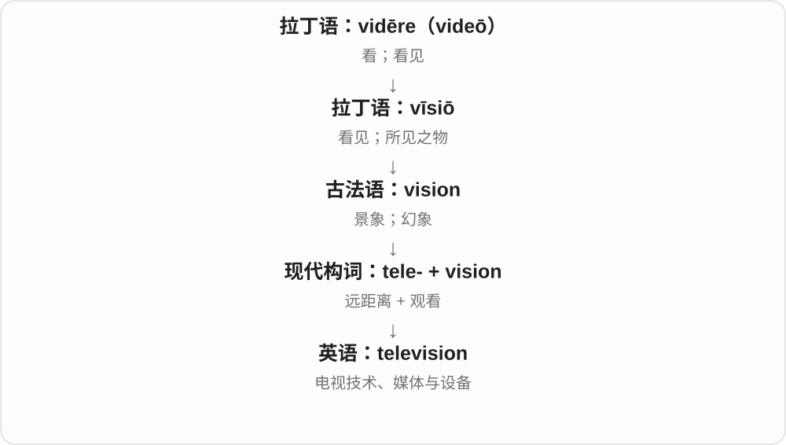

远距离传送活动图像形成电视。英语中 watch television 常指看电视节目，不特指盯着电视机外壳。

**常见搭配与例句**

watch television；on television；a television programme；a television set。

> We watched the match on television.

我们在电视上看了比赛。

> The hotel room has a small television.

酒店房间里有一台小电视。

**别混淆**

a television 是一台设备；television 不带冠词时常指媒介或节目活动。

### 10. survey — 调查；测量；全面查看

**音标**：英 名词 /ˈsɜːveɪ/，动词 /səˈveɪ/；美 名词 /ˈsɜːrveɪ/，动词 /sərˈveɪ/

**先抓住这个画面**

survey 像站高一点，把一片地方或一群人的情况看个全貌：可以问人，也可以测土地。

**怎么拆**

古法语 sur-（在上）+ veoir（看）；与 supervise 同源，但现代意思各有侧重。

**怎么变成今天的意思**

统览带来概况调查；仔细察看土地又带来测量义。名词常前重音，动词常后重音。

**常见搭配与例句**

conduct a survey；a customer survey；survey the land；survey the scene。

> The survey asked residents about public transport.

调查询问了居民对公共交通的看法。

> She paused to survey the room before choosing a seat.

她停下来环顾房间，然后选了座位。

**别混淆**

survey 往往收集一个范围的情况；experiment 则通过安排条件检验问题，不能简单互换。

### 11. vision — 视力；景象；愿景；远见

**音标**：/ˈvɪʒən/

**先抓住这个画面**

vision 是你能看见的画面，也可以是脑中清楚看见、还没实现的未来。

**怎么拆**

来自拉丁语 vīsiō“看见、所见之物”，经法语传入；vis- 与 vid- 是同一历史词族的形态。

**怎么变成今天的意思**

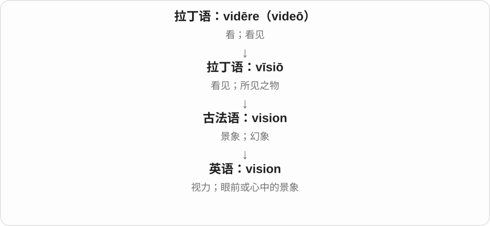

眼睛的观看形成视力；心里的图景形成想象、愿景。早期还包含梦境、幻象，不能把所有 vision 都译成宏大理想。

**常见搭配与例句**

clear vision；blurred vision；a vision of the future；share a vision。

> These glasses improve my distance vision.

这副眼镜改善了我看远处的视力。

> She has a clear vision of what the school could become.

她对这所学校未来能成为什么样有清楚的设想。

**别混淆**

eyesight 主要是生理视力；vision 还包括未来蓝图和想象中的景象。

### 12. visual — 视觉的；图像的；视觉材料

**音标**：/ˈvɪʒuəl/

**先抓住这个画面**

visual 把信息交给眼睛：一张图、一个颜色变化或一段画面，比口头说更容易看懂。

**怎么拆**

来自拉丁语 vīsuālis，与 vīsus“看、视觉”有关；经法语及拉丁语传入。

**怎么变成今天的意思**

它说明接收或呈现信息的通道，不直接判断东西是否看得清。复数 visuals 常指演示用的图像材料。

**常见搭配与例句**

visual information；visual effects；visual aids；strong visuals。

> The teacher used visual aids to explain the process.

老师用图示来解释这个过程。

> The film combines music with striking visuals.

影片把音乐与醒目的画面结合起来。

**别混淆**

visual 是视觉方面的；visible 是能被看见的。visual memory 是视觉记忆，不是“可见的记忆”。

### 13. visible — 看得见的；明显的

**音标**：/ˈvɪzəbəl/

**先抓住这个画面**

visible 先问一件事：它有没有进入你的视线？山在雾后还在，但未必 visible。

**怎么拆**

晚期拉丁语 vīsibilis 经法语传入；vis-（看）与表示可能性的 -ible 对应。

**怎么变成今天的意思**

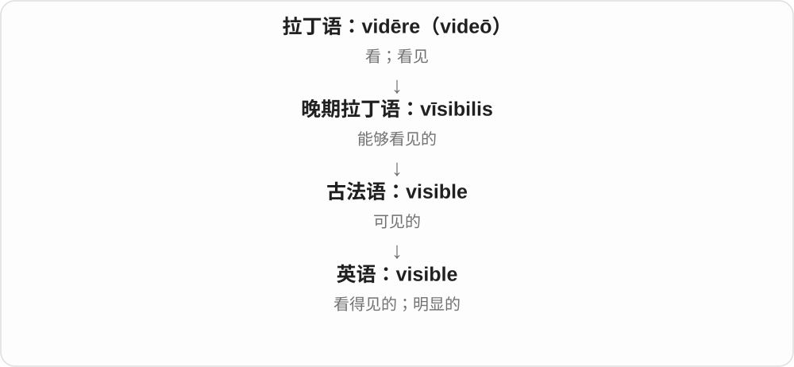

从眼睛能够看见，也扩展为效果、变化等明显可察。visible support 是公开能看出来的支持。

**常见搭配与例句**

visible from…；clearly visible；visible signs；a visible improvement。

> The island is visible from the beach.

从海滩能看见那座岛。

> There has been a visible improvement in her confidence.

她的自信明显增强了。

**别混淆**

visible 不等于清楚可辨：远处的东西可见，但细节未必 clear。

### 14. advisory — 咨询的；提供建议的；公告、提示

**音标**：英 /ədˈvaɪzəri/；美 /ədˈvaɪzəri/

**先抓住这个画面**

advisory 像旁边有人给你提供意见，但是否执行还要看谁有决定权；名词还可以是一则提醒。

**怎么拆**

advise + -ory，表示与建议、告知有关。

**怎么变成今天的意思**

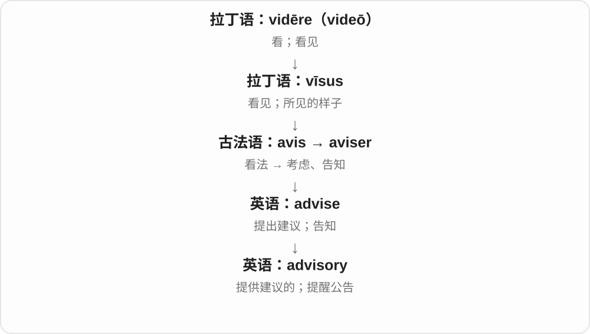

an advisory role 主要提供意见；a travel advisory 则是有关出行情况的正式提示。

**常见搭配与例句**

an advisory committee；an advisory role；a travel advisory。

> She serves in an advisory role on the project.

她在项目中担任顾问角色。

> The university issued an advisory about the road closure.

大学发布了有关道路封闭的提示。

**别混淆**

advisory 意见通常与命令有区别，但具体公告的作用仍要看内容，不能只凭这个词断言没有约束。

### 15. provision — 提供；准备；条款；供应品

**音标**：/prəˈvɪʒən/

**先抓住这个画面**

provision 的共同画面是“把可能用到的东西或安排提前放好”。可以备食物，也可以在文件里预先规定。

**怎么拆**

来自拉丁语 prōvīsiō，经法语传入；与 provide 同源，不能把英语 provide 画成这个借词的祖先。

**怎么变成今天的意思**

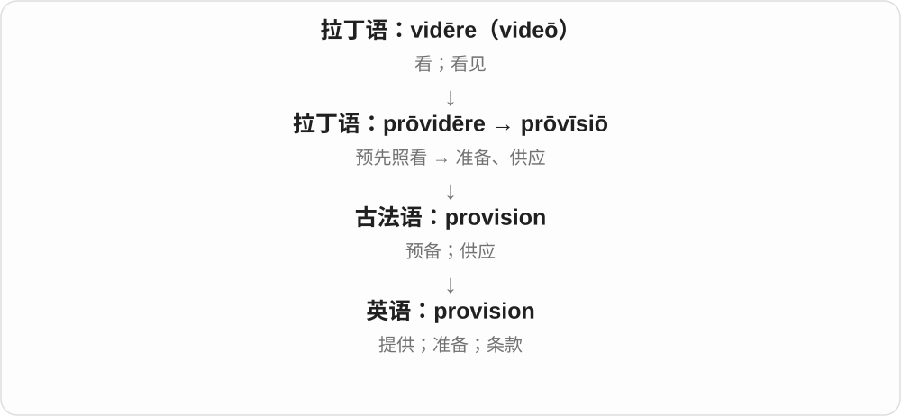

准备落实为供应；为特定情况作出的安排成为条款。复数 provisions 常是食物和必需品。

**常见搭配与例句**

the provision of services；make provision for…；a provision in the agreement；food provisions。

> The agreement includes a provision for future repairs.

协议中包含日后维修的条款。

> We packed enough provisions for three days.

我们装好了够三天用的食物和必需品。

**别混淆**

provision 是安排、供应或条款；permission 是许可。两者都可能出现在文件里，意思不同。

### 16. visa — 签证

**音标**：/ˈviːzə/

**先抓住这个画面**

visa 可以想成证件上的“已查阅并给予相应许可”的签注。今天它是特定入境、停留等许可文件。

**怎么拆**

法语 visa 来自拉丁语 charta vīsa“已被看过的文书”；vīsa 是 vidēre 的分词形态。

**怎么变成今天的意思**

“文书被查看过”发展成正式签注的名称。实际许可范围取决于签证种类，词源本身不说明具体规则。

**常见搭配与例句**

apply for a visa；a student visa；a visa application。

> She applied for a student visa.

她申请了学生签证。

> He checked the expiry date on his visa.

他查看了签证上的到期日。

**别混淆**

passport 证明持有者身份等信息；visa 是另一类许可。持有护照不等于已持有所有签证。

### 17. overview — 概览；总体介绍

**音标**：英 /ˈəʊvəvjuː/；美 /ˈoʊvərvjuː/

**先抓住这个画面**

overview 像先摊开整张地图，知道有哪些区域，再决定往哪儿细看。

**怎么拆**

over-（整体地、从上面）+ view（看）。

**怎么变成今天的意思**

它让读者先建立整体结构，通常不把每个细节都讲完。overview of a subject 是这个主题的全貌介绍。

**常见搭配与例句**

give an overview；a brief overview；an overview of the project。

> The first chapter gives an overview of the topic.

第一章概述了这个主题。

> Could you give us a brief overview of the plan?

你能简要介绍一下计划的全貌吗？

**别混淆**

summary 压缩已有内容；overview 强调范围和结构。两者可能重叠，但关注点不同。

### 18. provider — 提供者；服务商；供养者

**音标**：英 /prəˈvaɪdə/；美 /prəˈvaɪdər/

**先抓住这个画面**

provider 是站在供应一端的人或组织：把网络、服务、生活所需等提供给别人。

**怎么拆**

provide + -er，表示做出提供行为的一方。

**怎么变成今天的意思**

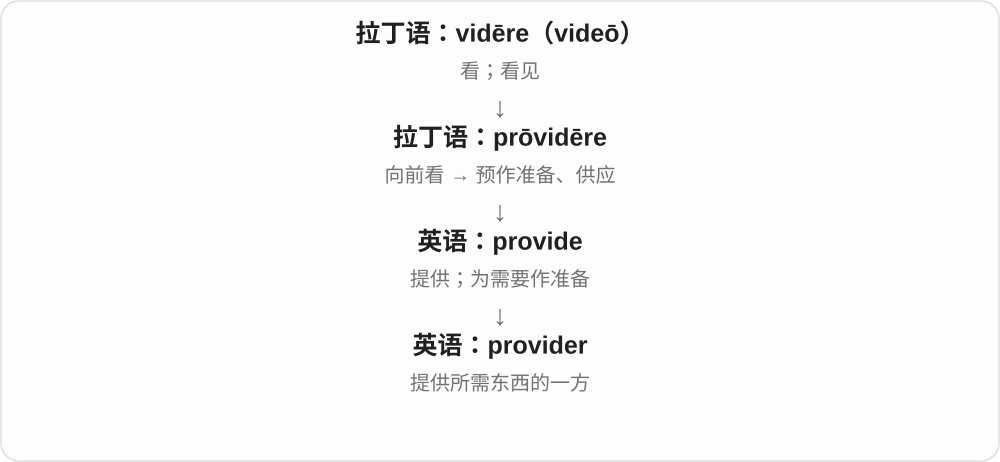

它可以是商业机构，也可以是家庭中承担供养的人；具体提供什么由前面的修饰词说明。

**常见搭配与例句**

a service provider；an internet provider；the main provider for a family。

> We changed our internet provider last month.

我们上个月换了网络服务商。

> For years, she was the main provider for the family.

多年来，她是家里的主要经济支柱。

**别混淆**

supplier 常突出货物供应；provider 特别常用于服务，也能用于生活供养。

### 19. advise — 建议；劝告；告知

**音标**：/ədˈvaɪz/

**先抓住这个画面**

advise 是把自己的判断告诉对方，帮助对方决定下一步怎么做。正式通知中也可能只是告知信息。

**怎么拆**

经古法语 aviser 传入，连接 avis“看法”；它与 advice 同族，词尾发 /z/。

**怎么变成今天的意思**

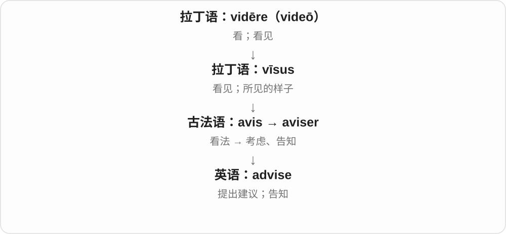

“在我看来”从意见发展成提出建议的动作；商务书信中的 advise someone of something 则偏正式告知。

**常见搭配与例句**

advise someone to do…；advise against doing…；advise someone of a change。

> She advised me to leave a little earlier.

她建议我早一点出发。

> Please advise us of any changes to the schedule.

日程如有变化，请通知我们。

**别混淆**

advise 是动词，advice 是名词。说 advise me 或 give me advice，不说 advice me。

### 20. invisible — 看不见的；不被注意的

**音标**：/ɪnˈvɪzəbəl/

**先抓住这个画面**

invisible 像透明墙后的东西：它可能确实存在，却没有出现在你的视线或注意力里。

**怎么拆**

历史上来自拉丁语 invīsibilis，经法语传入；现代对应 in-（不）+ visible。

**怎么变成今天的意思**

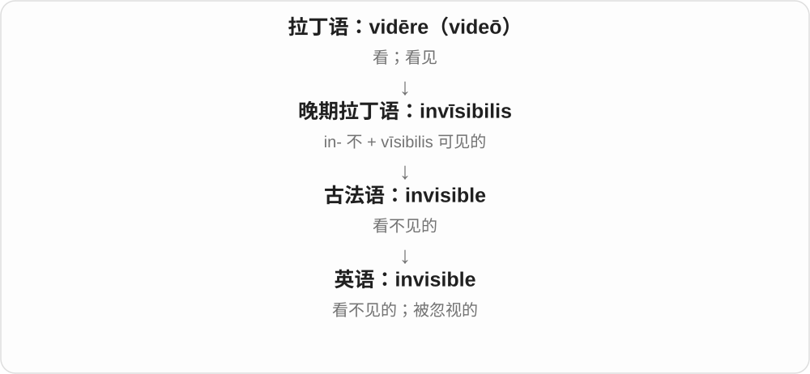

既可以说肉眼看不见，也可形容劳动、群体等没有受到关注。后者并不是物理隐身。

**常见搭配与例句**

invisible to the naked eye；an invisible barrier；feel invisible。

> Some particles are invisible to the naked eye.

有些颗粒肉眼看不见。

> She felt invisible during the discussion.

讨论时，她觉得没人注意到自己。

**别混淆**

hidden 是被藏起来；invisible 是看不见。微小颗粒不一定被谁藏了起来。

### 21. advisor — 顾问；指导者

**音标**：英 /ədˈvaɪzə/；美 /ədˈvaɪzər/

**先抓住这个画面**

advisor 是可以帮你看清选项、给出专业意见的人，而不是替你活出全部决定的人。

**怎么拆**

advise + -or；与 adviser 是同一词的不同常用拼写。

**怎么变成今天的意思**

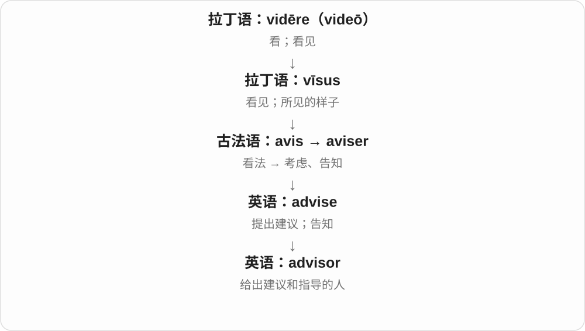

常见于职业或机构职位名称。学业 advisor 会帮助选课或规划学习，具体职责依场景而定。

**常见搭配与例句**

an academic advisor；a financial advisor；ask an advisor。

> My academic advisor helped me choose my classes.

我的学业顾问帮我选了课程。

> She works as an advisor to the museum.

她担任博物馆顾问。

**别混淆**

advisor 与 adviser 通常没有稳定的意义区别，采用机构或文本统一的拼写即可。

### 22. visitor — 访客；游客；访问者

**音标**：英 /ˈvɪzɪtə/；美 /ˈvɪzɪtər/

**先抓住这个画面**

visitor 是来到某处看看、停留一段时间的人；在网站上则是访问页面的用户。

**怎么拆**

既有英语 visit + -er 的发展，也受法语访客名称影响；现代对应 visit + -or。

**怎么变成今天的意思**

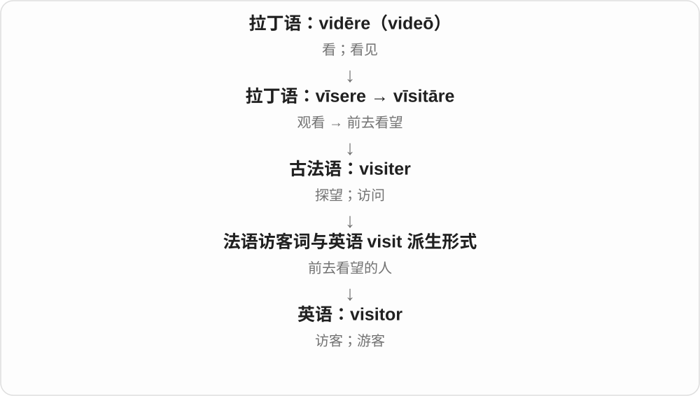

重点是这次到访的身份，不一定是朋友，也不必远道旅行。visitor centre 是为来访者服务的中心。

**常见搭配与例句**

a visitor to the city；website visitors；a visitor centre。

> Visitors must sign in at reception.

访客必须在前台登记。

> The museum welcomed its millionth visitor.

博物馆迎来了第一百万位参观者。

**别混淆**

guest 常强调受邀请或接受招待；visitor 只需到访，未必受邀。

### 23. evident — 明显的；清楚可见的

**音标**：/ˈevɪdənt/

**先抓住这个画面**

evident 是线索已经摆得很清楚，让人容易看出某个情况，而不是靠猜。

**怎么拆**

ē-（向外、显露）+ vidēns（看），在拉丁语形成 ēvidēns；经法语借入。

**怎么变成今天的意思**

从显露可见，引申为道理、感受或结果清楚可判断。It is evident that… 后面说看得出的事实。

**常见搭配与例句**

evident from…；evident in…；it is evident that…；clearly evident。

> Her relief was evident in her smile.

从她的笑容能明显看出她松了口气。

> It was evident that the plan needed more work.

很明显，这个计划还需要完善。

**别混淆**

evident 强调容易看出；evidence 是可用来判断的证据材料，词性不同。

### 24. preview — 预览；预告；提前观看

**音标**：/ˈpriːvjuː/

**先抓住这个画面**

preview 是正式打开、发布或看完整内容之前，先看一眼。

**怎么拆**

pre-（预先）+ view（看）。

**怎么变成今天的意思**

电影 preview 展示提前放出的内容，文件 preview 帮你检查打开或输出后的样子。通常还不是最终完整体验。

**常见搭配与例句**

preview a document；a film preview；print preview；a preview of… 。

> Use print preview to check the page layout.

用打印预览检查页面排版。

> We saw a preview of the new exhibition.

我们提前看了新展览的部分内容。

**别混淆**

review 是看过之后检查或评价；preview 是正式进行之前先看。

### 25. supervisor — 主管；监督者；指导教师

**音标**：英 /ˈsuːpəvaɪzə/；美 /ˈsuːpərvaɪzər/

**先抓住这个画面**

supervisor 像站在工作现场能掌握整体的人：检查进展，也指导别人把事情做好。

**怎么拆**

来自拉丁语 supervīsor，与 supervidēre“监督”有关；现代对应 supervise + -or。

**怎么变成今天的意思**

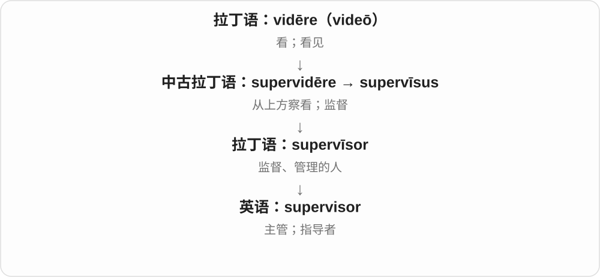

“在上方看”变成承担监督责任的角色。研究生 supervisor 常指指导研究的人，不只负责盯着纪律。

**常见搭配与例句**

a shift supervisor；a research supervisor；report to a supervisor。

> Ask your supervisor before changing the schedule.

调整日程前，先问一下主管。

> My research supervisor suggested a different approach.

我的研究导师建议采用另一种方法。

**别混淆**

supervisor 通常监督具体人员或工作；manager 的管理范围可能更广，实际职位因机构而异。

### 26. adviser — 顾问；建议者

**音标**：英 /ədˈvaɪzə/；美 /ədˈvaɪzər/

**先抓住这个画面**

adviser 是帮你作判断的人：先了解情况，再提出建议，不一定拥有最后决定权。

**怎么拆**

advise 去掉词尾 e 加 -er；advisor 是另一种常见拼写。

**怎么变成今天的意思**

在 careers adviser 中是职业规划顾问；在政府等机构中可指某领域的咨询人员。

**常见搭配与例句**

a careers adviser；a senior adviser；an adviser on education。

> The careers adviser helped him prepare for the interview.

职业顾问帮他准备面试。

> She became an adviser on education policy.

她成了教育政策顾问。

**别混淆**

adviser 和 advisor 通常同义；advisory 则多是形容词，表示提供咨询的。

### 27. supervision — 监督；指导；看护

**音标**：英 /ˌsuːpəˈvɪʒən/；美 /ˌsuːpərˈvɪʒən/

**先抓住这个画面**

supervision 是有人负责留意过程，必要时指点、纠正或照看，而不是只在结束时看结果。

**怎么拆**

来自中古拉丁语 supervīsiō；与 supervise 同源，是独立借入的名词。

**怎么变成今天的意思**

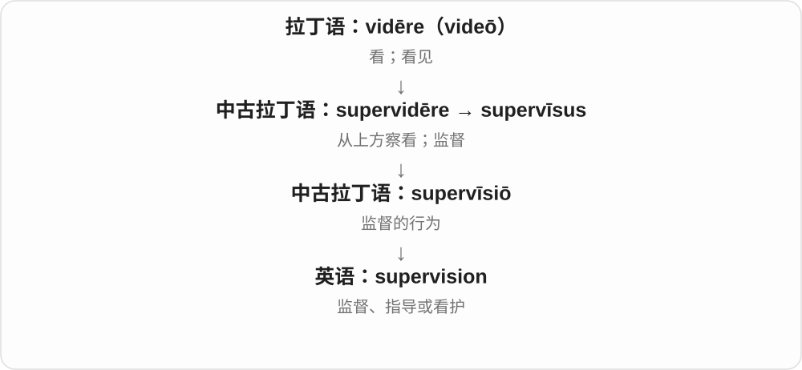

它突出持续承担责任。under supervision 表示有人看护或指导；需要多少干预取决于任务。

**常见搭配与例句**

under supervision；close supervision；adult supervision；without supervision。

> The students used the equipment under supervision.

学生们在指导下使用设备。

> Young children need adult supervision near water.

幼儿在水边需要成人看护。

**别混淆**

supervision 是监督过程；supervisor 是承担这项工作的人。

### 28. envy — 羡慕；嫉妒

**音标**：/ˈenvi/

**先抓住这个画面**

envy 的画面是盯着别人拥有的东西，心里想“我也想有”；语气可能只是羡慕，也可能带不满。

**怎么拆**

来自拉丁语 invidia，源于 invidēre“带恶意地看”，经法语 envie 传入。这里 in- 不是“不”。

**怎么变成今天的意思**

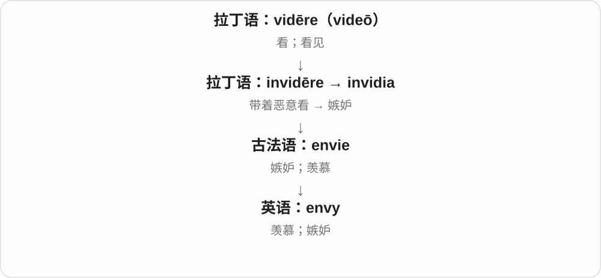

早期偏向恶意的目光，现代也能温和地说 I envy your free time，表示羡慕对方的时间。

**常见搭配与例句**

envy someone；envy someone something；be green with envy；the envy of… 。

> I envy your ability to stay calm.

我很羡慕你保持冷静的能力。

> His success filled her with envy.

他的成功让她心生嫉妒。

**别混淆**

envy 常想得到别人所有的东西；jealousy 也常担心自己珍视的关系被夺走，日常用法有重叠。

### 29. revision — 修订；修改稿；复习

**音标**：/rɪˈvɪʒən/

**先抓住这个画面**

revision 是重新看过后作出的改动；英式学习语境中，也指把学过的内容再过一遍。

**怎么拆**

经法语 révision 来自拉丁语 revīsiō“再次审看”；与 revise 是同族旁支。

**怎么变成今天的意思**

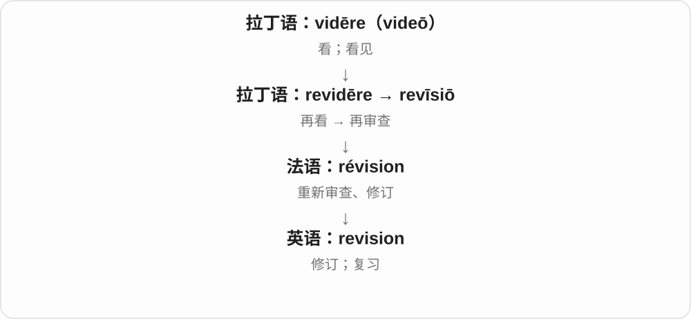

再次审看可以为了改善文字，也可以为了巩固知识。a revision 常是一项改动或新版，revision 不可数时常指过程。

**常见搭配与例句**

a revision to the plan；major revisions；exam revision；revision notes。

> The editor requested several revisions to the article.

编辑要求对文章作几处修改。

> I spent the evening doing revision for the exam.

我花了一晚上复习考试内容。

**别混淆**

revision 可以只改局部；rewriting 通常更突出重新写。复习义主要见于英式英语。

### 30. providence — 天意；上天的照顾；远见

**音标**：英 /ˈprɒvɪdəns/；美 /ˈprɑːvɪdəns/

**先抓住这个画面**

providence 常把人生中的安排看成有一种更高力量在照顾；普通旧义则是为未来作周到打算。

**怎么拆**

由拉丁语 prōvidentia“远见、预先照顾”，经法语传入。

**怎么变成今天的意思**

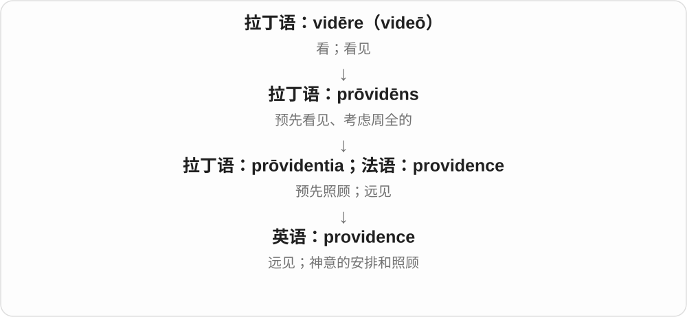

人能预先安排，宗教观念中神也被认为预知并照顾万事，因此产生神意义。这里是在说明词的信仰用法。

**常见搭配与例句**

divine providence；trust in providence；an act of providence。

> She saw their chance meeting as an act of providence.

她把他们的偶遇看作天意的安排。

> The poem expresses trust in divine providence.

这首诗表达了对上天照顾的信赖。

**别混淆**

providence 不是普通 provider“供应者”；宗教语境中往往是不可数的抽象观念。

### 31. visibility — 能见度；可见性；受关注程度

**音标**：/ˌvɪzəˈbɪləti/

**先抓住这个画面**

visibility 像一个“看得到多少”的旋钮：雾大时调低，站到公众面前时又提高。

**怎么拆**

经法语 visibilité，来自晚期拉丁语 vīsibilitās；现代对应 visible + -ity。

**怎么变成今天的意思**

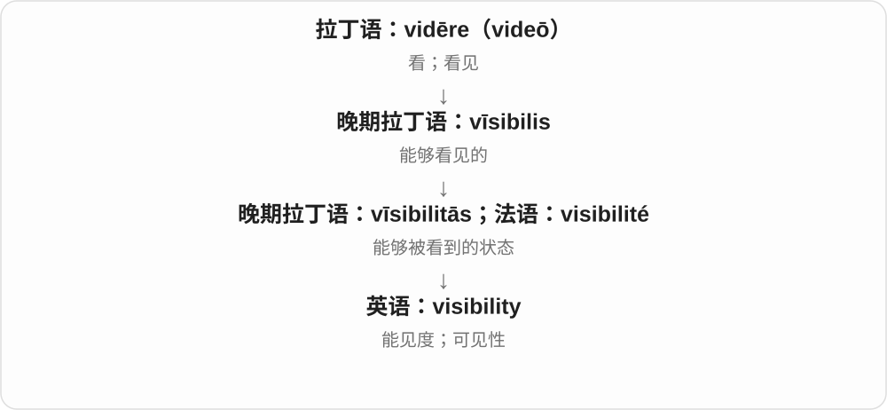

既描述天气条件下能看多远，也描述某个人或问题有多容易被公众注意。

**常见搭配与例句**

poor visibility；high visibility；increase visibility；visibility of a problem。

> Fog reduced visibility on the road.

雾降低了道路上的能见度。

> The campaign increased the visibility of local artists.

这次活动提高了当地艺术家的知名度。

**别混淆**

visibility 是可见程度；vision 是视力或愿景。visibility 差不一定是你的眼睛出了问题。

### 32. viewer — 观看者；观众；查看程序

**音标**：英 /ˈvjuːə/；美 /ˈvjuːər/

**先抓住这个画面**

viewer 是正在看内容的一方，也可以是让你打开图像、文件来看的软件。

**怎么拆**

view + -er，指实施查看的人或工具。

**怎么变成今天的意思**

电视 viewers 是观众；image viewer 是图像查看器。后者不一定能编辑图像。

**常见搭配与例句**

television viewers；a regular viewer；an image viewer。

> The programme attracted millions of viewers.

这个节目吸引了数百万观众。

> Open the file in an image viewer.

用图像查看器打开这个文件。

**别混淆**

audience 可以指听众、读者等整体受众；viewer 明确强调观看。

### 33. vista — 远景；开阔景色；前景

**音标**：/ˈvɪstə/

**先抓住这个画面**

vista 像道路、山谷或窗框打开后，向远处延展的一幅宽阔画面。

**怎么拆**

借自意大利语 vista“视野”，经 vedere 回到拉丁语 vidēre。

**怎么变成今天的意思**

辽阔视野也被用来比喻突然展开的可能性，new vistas 就是新的发展天地。

**常见搭配与例句**

a mountain vista；a panoramic vista；open up new vistas。

> The path opened onto a beautiful mountain vista.

小路尽头展开了一片美丽的山间远景。

> The discovery opened up new vistas for research.

这个发现为研究开辟了新的前景。

**别混淆**

view 是普通的景色、视野；vista 通常更有纵深、开阔感，语气也较有描写性。

### 34. visually — 在视觉上；通过观看

**音标**：/ˈvɪʒuəli/

**先抓住这个画面**

visually 是把判断交给眼睛：外观怎样，或是否靠看就能辨认。

**怎么拆**

visual + -ly，把“视觉的”变成“在视觉方面”。

**怎么变成今天的意思**

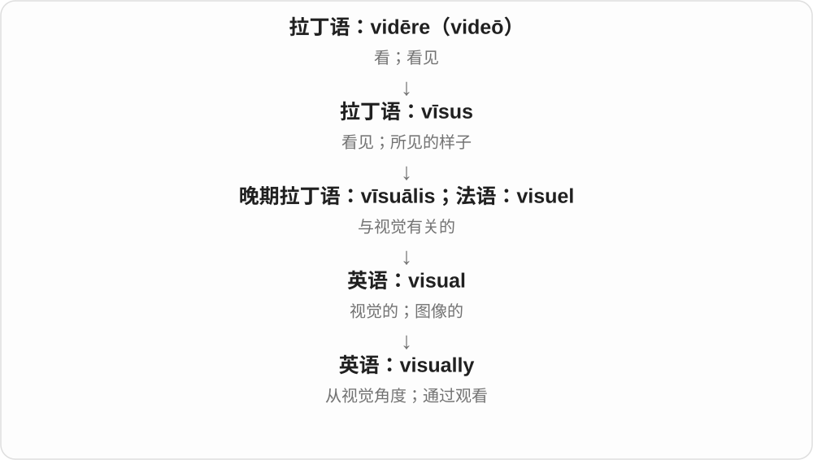

visually attractive 评价外观；check visually 说明检查的方式是看，而非称重或测量。

**常见搭配与例句**

visually appealing；visually inspect；visually impaired。

> The two versions are visually similar.

这两个版本在外观上很相似。

> She checked the parts visually before measuring them.

她先目视检查零件，再进行测量。

**别混淆**

visually 不等于 visibly：前者是从视觉方面，后者是明显看得出来。

### 35. provisional — 暂定的；临时的；有待确认的

**音标**：/prəˈvɪʒənəl/

**先抓住这个画面**

provisional 像在计划上用铅笔先写一个答案：目前先这样，但还有可能改。

**怎么拆**

provision + -al，并有相关法语形式影响；在“预先安排”上形成暂定义。

**怎么变成今天的意思**

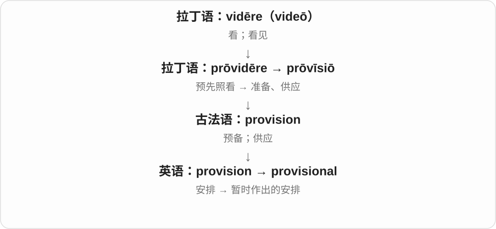

不是所有安排都永久有效，暂为应付当前需要而作的安排，就可以是 provisional。

**常见搭配与例句**

a provisional agreement；a provisional date；provisional results。

> We set a provisional date for the meeting.

我们给会议定了一个暂定日期。

> The results are provisional until all checks are complete.

全部核查完成前，结果仍是暂定的。

**别混淆**

temporary 主要表示时间有限；provisional 还常强调尚未最终确认。

### 36. viewpoint — 观点；观察角度；观景点

**音标**：/ˈvjuːpɔɪnt/

**先抓住这个画面**

viewpoint 是你站着看东西的那个点：换个位置，看到的风景和理解可能就变了。

**怎么拆**

view（看法、视野）+ point（点、位置）。point 经古法语 point / pointe 来自拉丁 punctum / puncta，远接 pungere“刺”：刺出的点，逐渐也指位置。

**怎么变成今天的意思**

具体位置是观景点，抽象位置是考虑事情时采取的立场。

**常见搭配与例句**

from my viewpoint；a different viewpoint；a scenic viewpoint。

> Try to understand the issue from her viewpoint.

试着从她的角度理解这个问题。

> We stopped at a viewpoint above the valley.

我们在山谷上方的观景点停了下来。

**别混淆**

viewpoint 强调看问题的角度；fact 是事情本身，不能把所有事实差异都归为观点不同。

### 37. evidently — 显然；据现有迹象看来

**音标**：/ˈevɪdəntli/

**先抓住这个画面**

evidently 像说“从眼前这些线索看，事情大概就是这样”。说话人可能是推断，不是亲眼见证全过程。

**怎么拆**

evident + -ly。

**怎么变成今天的意思**

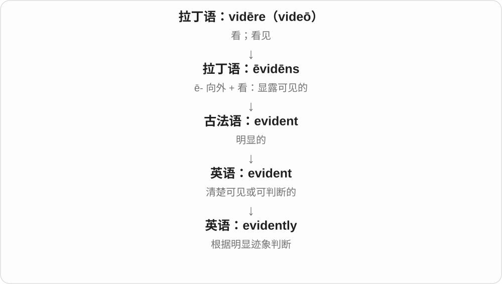

它能加强“明显”的语气，也能标出从迹象所得的结论。具体确定程度要结合上下文。

**常见搭配与例句**

evidently pleased；evidently unaware；evidently, … 。

> He was evidently pleased with the result.

显然，他对结果很满意。

> The lights are off; evidently, everyone has gone home.

灯都关了，看来大家已经回家了。

**别混淆**

evidently 与 apparently 都可引入判断；不要把用了 evidently 的句子自动当成已有最终证明。

### 38. interviewer — 面试官；采访者

**音标**：英 /ˈɪntəvjuːə/；美 /ˈɪntərvjuːər/

**先抓住这个画面**

interviewer 是问问题的一方，把话题带向需要了解的内容。

**怎么拆**

interview + -er，表示主持问答的人。

**怎么变成今天的意思**

求职场景是面试官，节目场景是采访者；同一个词跟随活动变化。

**常见搭配与例句**

an experienced interviewer；the interviewer’s question；a panel of interviewers。

> The interviewer asked about my previous experience.

面试官问起我以前的经历。

> A good interviewer leaves room for detailed answers.

好的采访者会给对方充分回答的空间。

**别混淆**

interviewer 问，interviewee 接受采访或面试。两者的后缀标明角色方向。

### 39. revise — 修改；修订；复习

**音标**：/rɪˈvaɪz/

**先抓住这个画面**

revise 像拿起铅笔重新看一遍稿子，边看边改；英式英语里还可以是考前重看知识。

**怎么拆**

经法语 réviser，来自拉丁语反复“再看”的词形。现代可联系 re-（再）与 vis-（看）。

**怎么变成今天的意思**

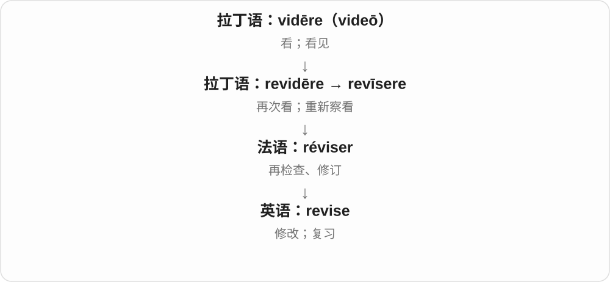

“再看”发展成以改进为目的的重新检查；英国学习语境把重温知识也叫 revise。

**常见搭配与例句**

revise a draft；revise an estimate；revise for an exam。

> We revised the plan after hearing your suggestions.

听取你的建议后，我们修改了计划。

> She is revising for her biology exam.

她正在复习生物考试。

**别混淆**

revise the plan 通常含修改；review the plan 可以只是审查，尚未改动。

### 40. reviewer — 评论者；评审者；审稿人

**音标**：英 /rɪˈvjuːə/；美 /rɪˈvjuːər/

**先抓住这个画面**

reviewer 是看完作品或材料后给出评价的人：指出价值，也指出需要改进的地方。

**怎么拆**

review + -er。

**怎么变成今天的意思**

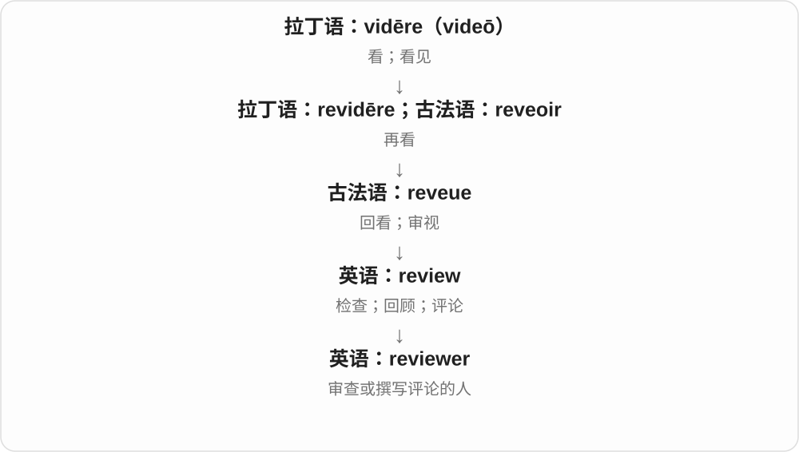

书评人评价读物，论文 reviewer 评审稿件；购物网站上的评价者也可以叫 reviewer。

**常见搭配与例句**

a book reviewer；a peer reviewer；an anonymous reviewer。

> The reviewer praised the novel’s dialogue.

书评人称赞了小说中的对话。

> An anonymous reviewer suggested a clearer explanation.

一位匿名审稿人建议把解释写得更清楚。

**别混淆**

reviewer 侧重审看评价；editor 还可能负责选稿、修改和出版流程。

### 41. visionary — 有远见的；富于想象的；有远见的人

**音标**：英 /ˈvɪʒənəri/；美 /ˈvɪʒəneri/

**先抓住这个画面**

visionary 是能在别人还没看见时，把一种未来图景想清楚的人；有时也暗示过于理想化。

**怎么拆**

vision + -ary，表示拥有或体现某种愿景。

**怎么变成今天的意思**

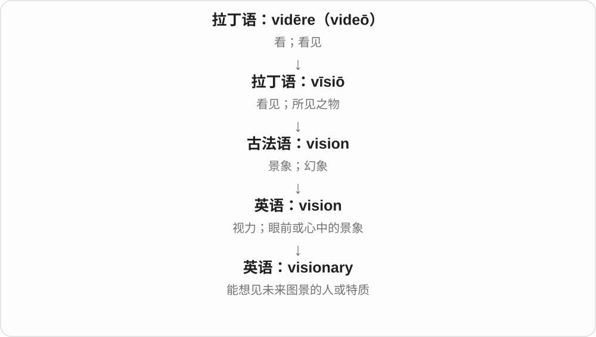

vision 从心中图景发展出愿景，visionary 则描述创造这种图景的能力或人物。褒贬取决于是否赞赏其构想。

**常见搭配与例句**

a visionary leader；a visionary idea；an architectural visionary。

> Her visionary plan transformed the old factory into a park.

她富有远见的计划把旧工厂改成了公园。

> Some dismissed him as a visionary with unrealistic dreams.

有些人把他看作满怀不切实际梦想的空想家。

**别混淆**

practical 强调能落实；visionary 强调有远景。一个方案可以兼具两者，也可能只有想象。

### 42. prudent — 审慎的；明智稳妥的

**音标**：/ˈpruːdənt/

**先抓住这个画面**

prudent 像先朝路前方看一眼，想到可能的后果，再决定怎么走。

**怎么拆**

拉丁语 prōvidēns 缩合成 prūdēns，经法语传入；它与 provident 同源，不来自 prude。

**怎么变成今天的意思**

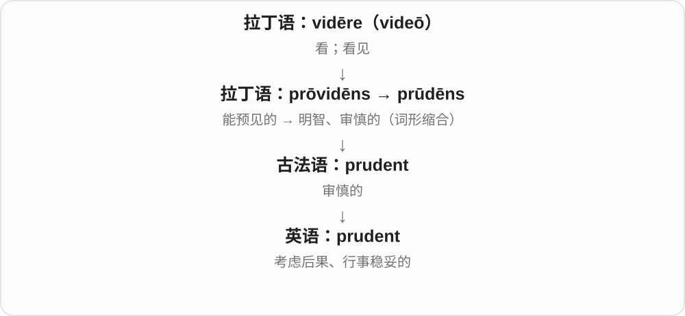

提前看见变成提前考虑风险和需要。谨慎不是永远不行动，而是行动前有判断。

**常见搭配与例句**

a prudent decision；prudent to do…；prudent planning。

> It would be prudent to keep a copy of the file.

保留一份文件副本会比较稳妥。

> She made a prudent choice after considering the costs.

考虑成本后，她作出了审慎的选择。

**别混淆**

careful 可只是细心；prudent 更强调长远后果与判断。prude 是拘谨守旧的人，不能混作同词。

### 43. visibly — 明显看得出地

**音标**：/ˈvɪzəbli/

**先抓住这个画面**

visibly 是变化已经写在脸上或摆在眼前，不需要对方开口说明也能看出来。

**怎么拆**

visible 的 -le 改为 -ly，形成副词。

**怎么变成今天的意思**

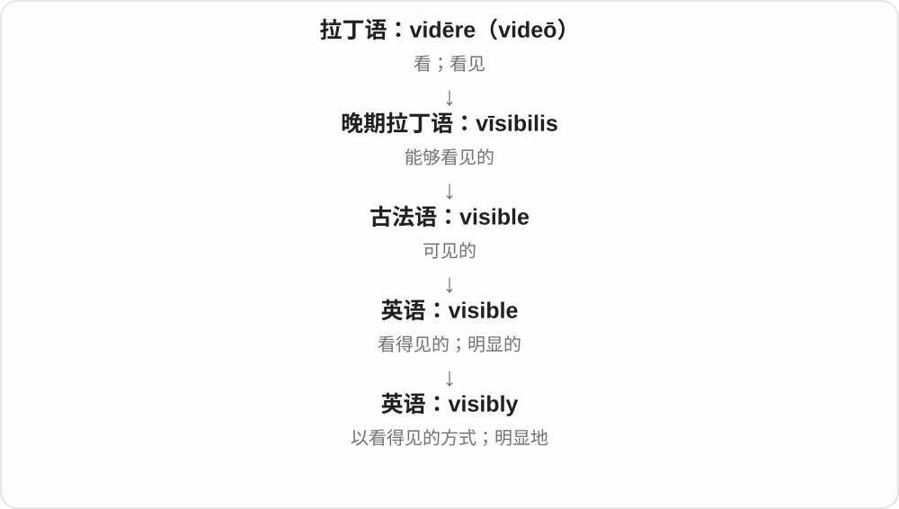

常搭配 upset、shaken、relieved，说明情绪有可见表现；不保证知道情绪的全部原因。

**常见搭配与例句**

visibly upset；visibly relieved；visibly different。

> She was visibly relieved when the train arrived.

火车到站时，她明显松了一口气。

> The paint became visibly darker as it dried.

油漆干燥时，颜色明显变深了。

**别混淆**

visibly upset 是明显难过；visually striking 是视觉上醒目，两个副词各管一件事。

### 44. revisit — 重游；再次探访；重新考虑

**音标**：/ˌriːˈvɪzɪt/

**先抓住这个画面**

revisit 是再去一趟，也可以把已经讨论过的问题重新拿回来看看。

**怎么拆**

经法语 revisiter 与拉丁语 revīsitāre 相连；现代可分析 re- + visit。

**怎么变成今天的意思**

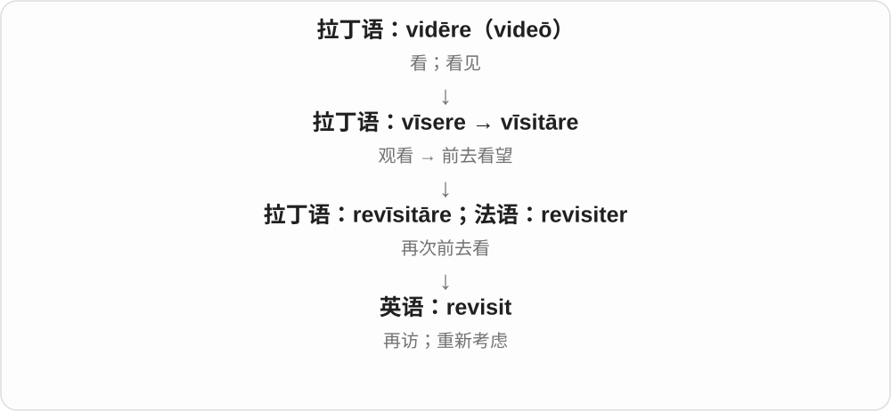

访问对象从地方扩展到问题、观点和记忆。revisit a decision 不一定已经推翻决定，只是重新考虑。

**常见搭配与例句**

revisit a place；revisit an issue；revisit a decision。

> We revisited the village where we first met.

我们重游了初次相遇的村庄。

> Let’s revisit this question after we have more information.

等信息更多时，我们再讨论这个问题。

**别混淆**

revisit 是重新回到对象；revise 则常意味着作出修改。

### 45. surveyor — 测量员；勘察员；房屋查验人员

**音标**：英 /səˈveɪə/；美 /sərˈveɪər/

**先抓住这个画面**

surveyor 带着专业工具看土地或建筑，把“看上去怎样”转成位置、尺寸、状况等可靠信息。

**怎么拆**

经法语 sorveor、盎格鲁诺曼语 surveour 传入；现代对应 survey + -or。

**怎么变成今天的意思**

survey 的仔细察看、测量义发展成职业名称；不同修饰词限定土地、建筑等工作。

**常见搭配与例句**

a land surveyor；a building surveyor；a surveyor’s report。

> The surveyor marked the boundary of the property.

测量员标出了地块边界。

> We asked a surveyor to inspect the old house.

我们请房屋查验人员检查了那座老房子。

**别混淆**

surveyor 不只是做问卷的人；此词常用于专业测量、勘察或建筑查验。

### 46. visitation — 正式访问；探视；降临、侵袭

**音标**：/ˌvɪzɪˈteɪʃən/

**先抓住这个画面**

visitation 比普通 visit 更正式：可能是按制度安排的探视，也可能是故事里神秘力量或灾祸突然降临。

**怎么拆**

拉丁语 vīsitātiō 经法语、盎格鲁诺曼语传入；不是英语 visit 才创造出的名词。

**怎么变成今天的意思**

visit 的看望义发展出制度化探视；“某物来访”的比喻又用于灾难或超自然故事。

**常见搭配与例句**

visitation hours；family visitation；a visitation of illness。

> The notice lists the centre’s visitation hours.

通知列出了该中心的探视时间。

> The tale describes a mysterious visitation at midnight.

故事描写了午夜的一次神秘来访。

**别混淆**

普通去朋友家一般用 visit。visitation 常带正式、制度或文学语气。

### 47. surveying — 测量工作；勘测；正在调查

**音标**：英 /səˈveɪɪŋ/；美 /sərˈveɪɪŋ/

**先抓住这个画面**

surveying 常是把地面和建筑的位置、距离、高度测出来，再变成图纸或数据。

**怎么拆**

survey + -ing，可作动作形式，也可指测量这门工作。

**怎么变成今天的意思**

作专业名词时常指土地、工程测量；在 is surveying residents 中则仍是调查居民的动词形式。

**常见搭配与例句**

land surveying；surveying equipment；a surveying course。

> She is studying land surveying.

她在学习土地测量。

> The team is surveying residents about the new bus route.

团队正在调查居民对新公交线路的看法。

**别混淆**

survey 是一次调查或测量；surveying 可指整项活动或专业领域。

### 48. supervise — 监督；指导；负责照看

**音标**：英 /ˈsuːpəvaɪz/；美 /ˈsuːpərvaɪz/

**先抓住这个画面**

supervise 不是随便看一眼，而是对过程负有责任：留意是否正确，必要时指导或干预。

**怎么拆**

super-（在上）+ vidēre（看）在中古拉丁语形成 supervidēre；英语由其分词形式借入。

**怎么变成今天的意思**

“从上面看”发展为掌握、指导工作。位置是帮助理解的意象，现实中不必真的站在高处。

**常见搭配与例句**

supervise a team；supervise children；supervise construction。

> She supervises a team of six researchers.

她负责指导一个六人研究团队。

> An adult must supervise the children during the activity.

活动期间必须有成人照看孩子们。

**别混淆**

watch 可以只是观看；supervise 通常还包含管理或看护责任。

### 49. supervisory — 监督的；管理的

**音标**：英 /ˌsuːpəˈvaɪzəri/；美 /ˌsuːpərˈvaɪzəri/

**先抓住这个画面**

supervisory 说明岗位或任务含有看管、指导别人的责任，不只是完成自己的那一份。

**怎么拆**

supervise + -ory，变成描述监督职责的形容词。

**怎么变成今天的意思**

它经常与 role、position、responsibility 连用，把工作性质说清楚。

**常见搭配与例句**

a supervisory role；supervisory duties；supervisory experience。

> She moved into a supervisory position last year.

她去年转到了管理岗位。

> The job requires some supervisory experience.

这个职位要求有一定的管理经验。

**别混淆**

supervisory 是职责性质；supervised 是处在别人监督之下，方向相反。

### 50. visualization — 可视化；在脑中形成画面

**音标**：英 /ˌvɪʒuəlaɪˈzeɪʃən/；美 /ˌvɪʒuələˈzeɪʃən/

**先抓住这个画面**

visualization 是把数字、关系或想象变成一幅能看懂的图景，让你不必只盯着抽象符号。

**怎么拆**

visualize + -ation，表示形成图像的过程或结果。

**怎么变成今天的意思**

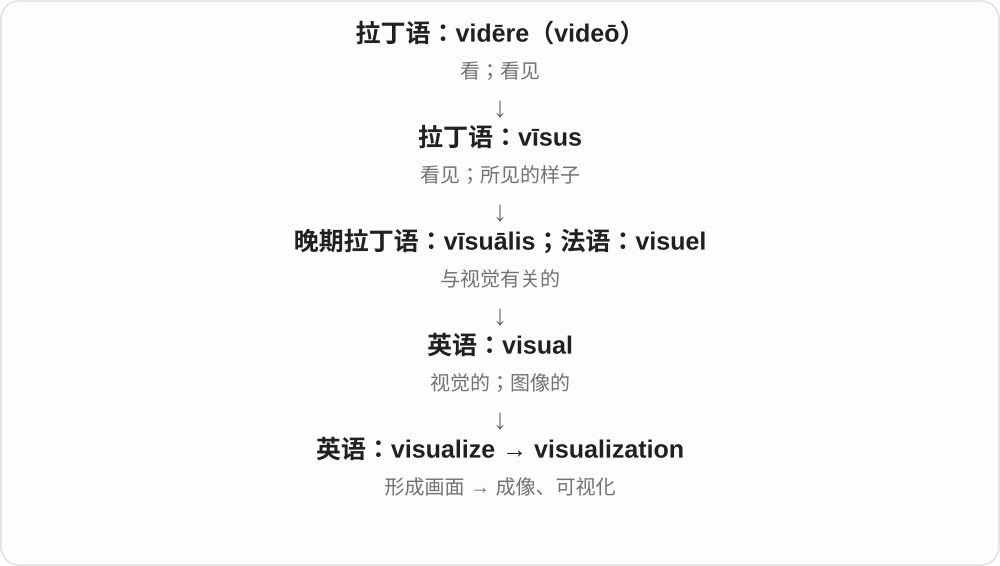

既可指数据图，也可指在心里排演一个场景。图形有助于理解，但仍要看它如何选取和呈现信息。

**常见搭配与例句**

data visualization；a visualization of the process；mental visualization。

> The visualization makes the seasonal pattern easy to see.

这幅可视化图让季节性规律一目了然。

> She used visualization to rehearse the performance in her mind.

她用想象画面的方式在脑中排练演出。

**别混淆**

visualization 强调把内容转成图像；illustration 也能是装饰或具体插图，范围不完全相同。

### 51. visualize — 想象出画面；使可视化

**音标**：/ˈvɪʒuəlaɪz/

**先抓住这个画面**

visualize 是把没有摆在眼前的东西变成画面：可以在脑中想，也可以画成图让别人看。

**怎么拆**

visual + -ize，表示使成为可用视觉把握的形式。

**怎么变成今天的意思**

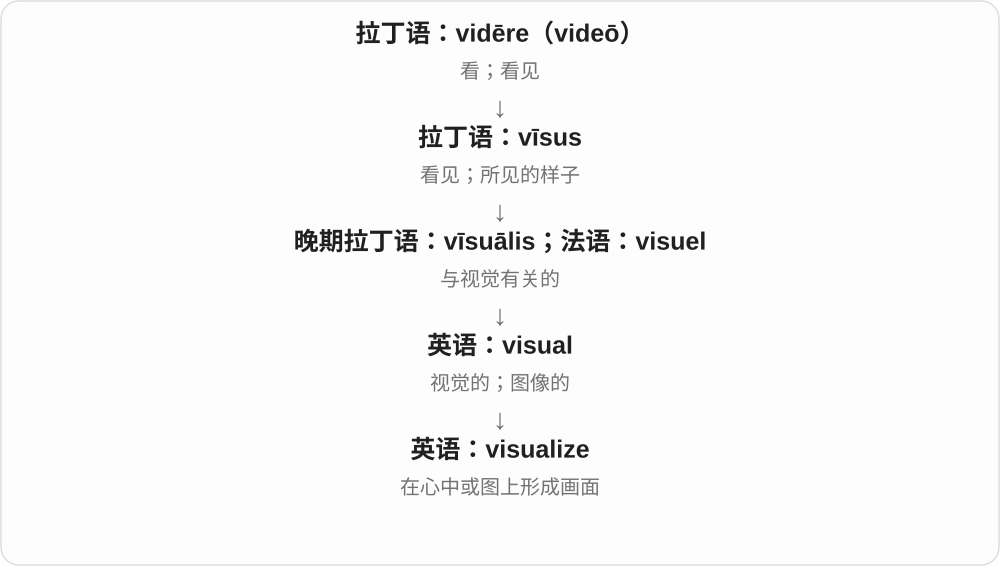

既能 visualize a room 想象房间，也能 visualize data 把数据画出来。两种用法都抓住成像。

**常见搭配与例句**

visualize success；visualize a scene；visualize data。

> Try to visualize the room before choosing the furniture.

挑家具前，试着在脑中想象房间的样子。

> The chart helps us visualize the changes over time.

这张图帮助我们直观看出随时间发生的变化。

**别混淆**

imagine 可涉及声音、感受等；visualize 特别强调图像。visualise 是常见英式拼写。

### 52. advisable — 可取的；明智的；值得建议的

**音标**：/ədˈvaɪzəbəl/

**先抓住这个画面**

advisable 是你问“这样做妥不妥”时，别人会点头建议的做法。

**怎么拆**

advise + -able，字面是可以建议采用的。

**怎么变成今天的意思**

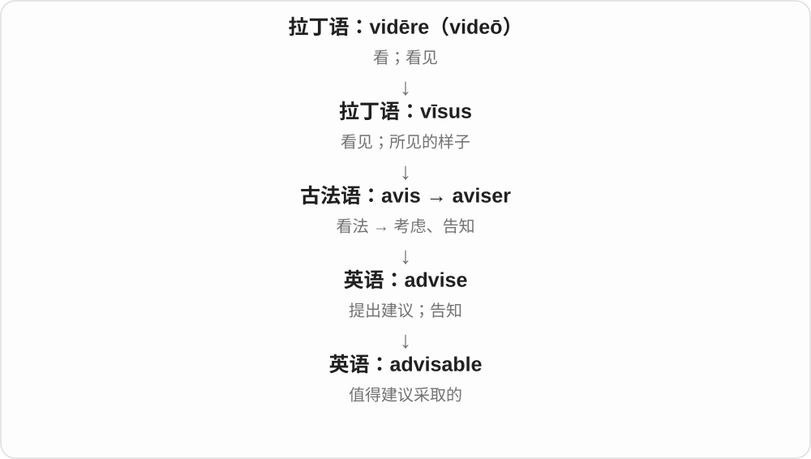

它评价行动是否稳妥，并不是说某人“很听劝”。常用 It is advisable to… 给出较正式建议。

**常见搭配与例句**

advisable to do…；highly advisable；not advisable。

> It is advisable to save your work frequently.

经常保存工作内容是明智的。

> A warm jacket is advisable for the evening walk.

晚上散步最好带件暖和的外套。

**别混淆**

advisable 描述做法；advisory 描述提供建议的角色或机构。

### 53. worldview — 世界观

**音标**：英 /ˈwɜːldvjuː/；美 /ˈwɜːrldvjuː/

**先抓住这个画面**

worldview 像一副长期戴着的眼镜：你认为世界怎样运转、什么值得重视，都通过它来理解。

**怎么拆**

world + view，是对德语 Weltanschauung 的意译式组合。

**怎么变成今天的意思**

它不只是一条意见，而是互相联系的一组基本认识，影响对许多事情的判断。

**常见搭配与例句**

shape someone’s worldview；a scientific worldview；different worldviews。

> Travel changed her worldview.

旅行改变了她的世界观。

> The novel brings two very different worldviews into conflict.

小说让两种很不相同的世界观发生冲突。

**别混淆**

opinion 可以是对一件小事的看法；worldview 是更整体、更基础的认识框架。

### 54. envious — 羡慕的；嫉妒的

**音标**：/ˈenviəs/

**先抓住这个画面**

envious 是看着别人有的东西，心里生出“真想换成我”的感觉。

**怎么拆**

拉丁语 invidiōsus 经法语 envieus 进入英语；与 envy 相连，也与 invidious 同源。

**怎么变成今天的意思**

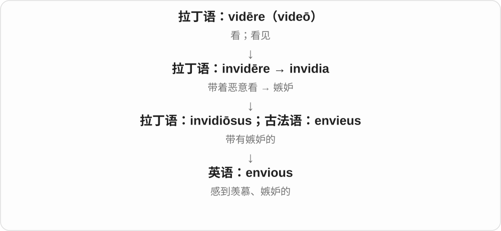

它形容产生羡慕的人或目光。是否带恶意要看上下文，日常中可以只是轻微羡慕。

**常见搭配与例句**

envious of someone；an envious glance；feel envious。

> I was envious of her flexible schedule.

我羡慕她灵活的工作安排。

> He gave the new bicycle an envious glance.

他羡慕地看了一眼那辆新自行车。

**别混淆**

envious 是自己羡慕别人；enviable 是让别人羡慕的。

### 55. envision — 设想；展望

**音标**：/ɪnˈvɪʒən/

**先抓住这个画面**

envision 是在心里把一个尚未出现的场景看出来：你设想它将怎样运作、会是什么样。

**怎么拆**

en- + vision，把愿景或图景变成形成图景的动作。

**怎么变成今天的意思**

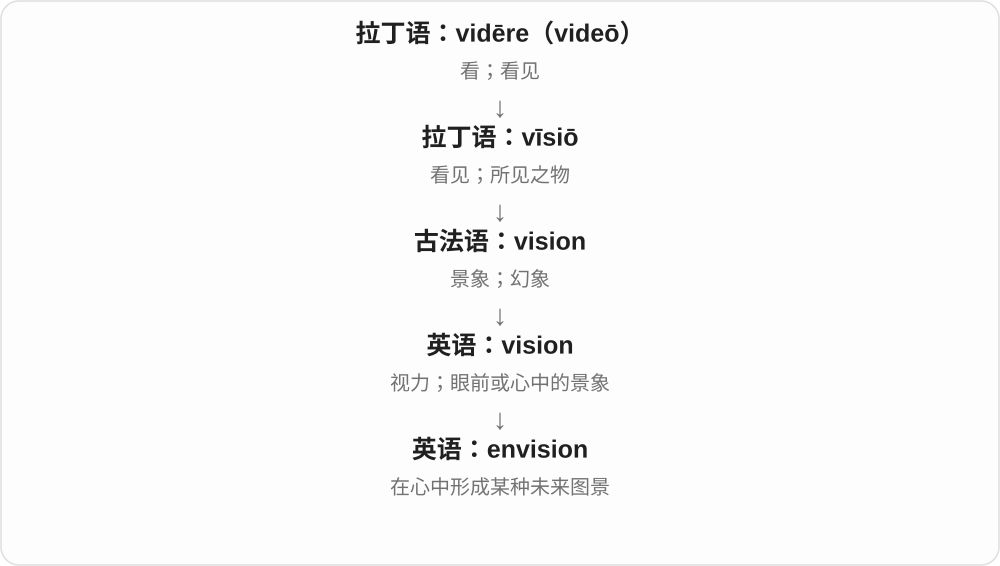

经常用于未来计划，也可以是一般想象。表达的是构想，不能自动等于预测会成真。

**常见搭配与例句**

envision a future；envision doing…；envision something as… 。

> We envision a city with more trees and fewer cars.

我们设想一座树更多、汽车更少的城市。

> I cannot envision him giving up so easily.

我想象不出他会这么轻易放弃。

**别混淆**

envision 与 envisage 很接近；predict 则更明确是在预测实际会发生什么。

### 56. viewership — 观众群；观众人数

**音标**：英 /ˈvjuːəʃɪp/；美 /ˈvjuːərʃɪp/

**先抓住这个画面**

viewership 像把所有看这个节目的人放到一起，既可以谈这群人，也可以谈他们有多少。

**怎么拆**

viewer + -ship，形成表示群体或总体情况的名词。

**怎么变成今天的意思**

媒体常用它比较节目受欢迎程度。具体数据是人数、家庭数还是某段时间的观看规模，要看统计口径。

**常见搭配与例句**

television viewership；a rise in viewership；attract a large viewership。

> The programme’s viewership grew during its second season.

这个节目第二季的观众规模扩大了。

> The channel hopes to attract a younger viewership.

这个频道希望吸引更年轻的观众群。

**别混淆**

views 是播放或查看次数；viewership 关注观众群和规模，不能随便把次数当人数。

### 57. improvisation — 即兴创作；临场应变；临时凑成的办法

**音标**：英 /ˌɪmprəvaɪˈzeɪʃən/；美 /ɪmˌprɑːvəˈzeɪʃən/

**先抓住这个画面**

improvisation 是没有现成脚本时，边做边想出下一步；爵士乐独奏和临时搭雨棚都可能如此。

**怎么拆**

借自法语 improvisation；与 improvise 同族，现代对应 improvise + -ation。

**怎么变成今天的意思**

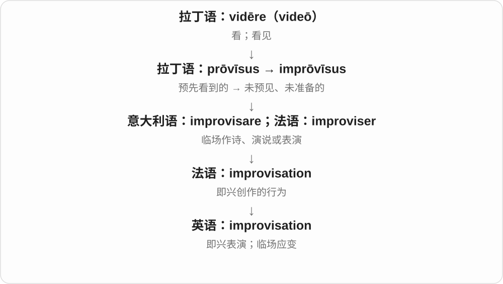

未提前准备的状态，发展出现场创造的活动。即兴可以依赖很强的经验和训练，并不等于胡来。

**常见搭配与例句**

musical improvisation；a piece of improvisation；room for improvisation。

> The performance included several minutes of improvisation.

表演中有几分钟的即兴发挥。

> With no proper tools, the repair required some improvisation.

没有合适的工具，这次修理需要临时想办法。

**别混淆**

improvisation 强调当场产生；preparation 是事先准备。优秀即兴常建立在长期准备上。

### 58. prudence — 审慎；稳妥的判断

**音标**：/ˈpruːdəns/

**先抓住这个画面**

prudence 是先把后果放到眼前，再决定行动的习惯；不是一味胆小，而是知道怎样留余地。

**怎么拆**

来自拉丁语 prūdentia，经法语传入，与 prudent 同族。

**怎么变成今天的意思**

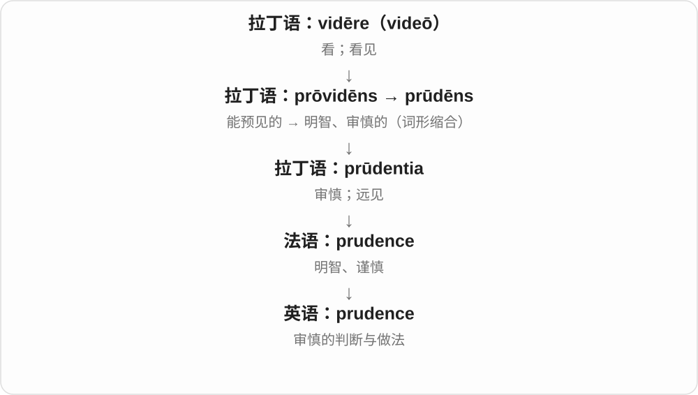

远见转为审慎判断这一品质。常在谈安排、用钱或重大决定时出现。

**常见搭配与例句**

exercise prudence；financial prudence；a matter of prudence。

> Prudence suggested that we leave some extra time.

稳妥起见，我们最好多留一些时间。

> Her prudence helped the project stay within budget.

她的审慎安排使项目没有超出预算。

**别混淆**

caution 强调小心危险；prudence 更包含周全、长远而合适的判断。

### 59. prudential — 审慎的；出于稳妥考虑的

**音标**：/pruːˈdenʃəl/

**先抓住这个画面**

prudential 常把“谨慎”放在制度或决策层面：不是只看眼前方便，还要防止以后出问题。

**怎么拆**

由拉丁语 prūdentia“审慎”与形容词后缀相连；现代联系 prudence 理解。

**怎么变成今天的意思**

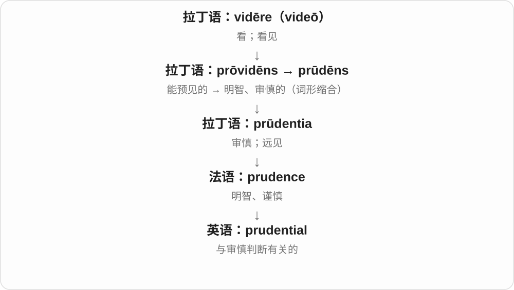

日常形容人明智多用 prudent；prudential 更常用于正式理由、管理原则和风险安排。

**常见搭配与例句**

prudential reasons；prudential considerations；prudential oversight。

> They delayed the move for prudential reasons.

出于稳妥考虑，他们推迟了搬迁。

> The report separates moral arguments from prudential considerations.

报告把道德理由与利弊上的审慎考虑分开讨论。

**别混淆**

prudent 是常用的审慎；prudential 语气更制度化，不表示“保诚”以外只有某个公司名。

### 60. videotape — 录像带；用录像带录制

**音标**：英 /ˈvɪdiəʊteɪp/；美 /ˈvɪdioʊteɪp/

**先抓住这个画面**

videotape 是把活动画面存进磁带，也可以指这盘磁带里的录像。

**怎么拆**

video + tape（磁带），现代英语组合。

**怎么变成今天的意思**

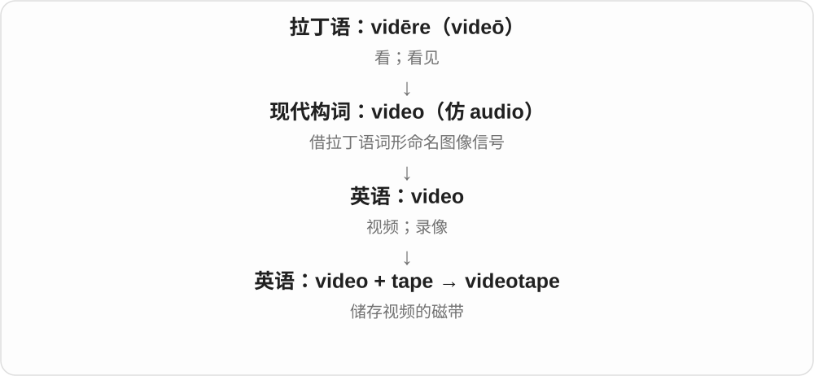

实体录像带曾是常见载体；今天数字录像常直接说 video。动词仍可见于保留旧习惯的表达。

**常见搭配与例句**

an old videotape；record on videotape；videotape a ceremony。

> We found a videotape of the school play.

我们找到了一盘学校话剧的录像带。

> My uncle videotaped the ceremony.

我叔叔录下了那场仪式。

**别混淆**

audiotape 只记录声音；videotape 记录图像，通常也带声音。

### 61. improvise — 即兴创作；临时应变

**音标**：/ˈɪmprəvaɪz/

**先抓住这个画面**

improvise 是计划突然用不上时，抓住手边材料和已有经验，现场想办法继续。

**怎么拆**

远源是拉丁语 im-（不）+ prōvīsus（预先看见的）；经意大利语和法语相关表演动词进入英语。

**怎么变成今天的意思**

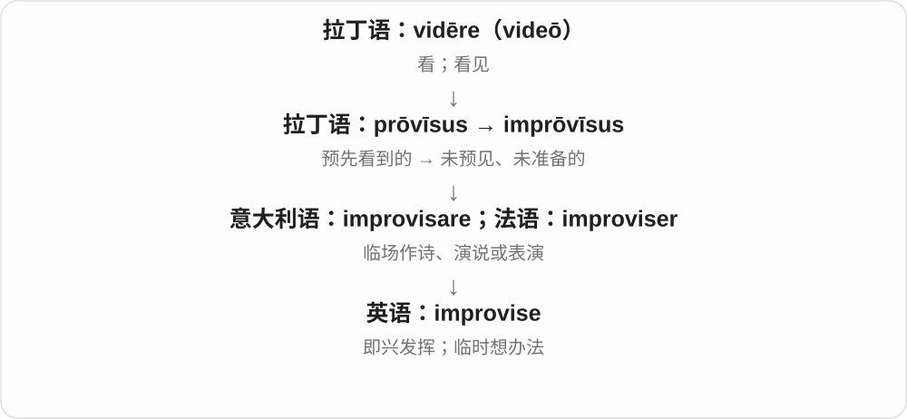

没预先准备好，便在现场创造；既可说音乐表演，也能说临时用箱子当桌子。

**常见搭配与例句**

improvise a melody；improvise a shelter；learn to improvise。

> The pianist improvised a melody while we waited.

我们等候时，钢琴师即兴弹了一段旋律。

> We improvised a table from two boxes and a board.

我们用两个箱子和一块木板临时搭了张桌子。

**别混淆**

improvise 不等于 improve“改进”；前者临场创造，后者让已有东西变好。

### 62. visor — 面罩；帽舌；遮阳板

**音标**：英 /ˈvaɪzə/；美 /ˈvaɪzər/

**先抓住这个画面**

visor 是放在脸或眼睛前方的防护、遮光部分：头盔面罩、帽檐和汽车遮阳板都能用这个词。

**怎么拆**

经法语 visiere“头盔面罩”，连接 vis“面容”和拉丁语 vīsus。不是英语 vis + 表人的 -or。

**怎么变成今天的意思**

从头盔前的护脸部分，扩展到挡在眼前遮光的结构。能透视的面罩和不透明帽舌都属于这种用途。

**常见搭配与例句**

a helmet visor；a sun visor；lower the visor。

> She lowered the visor on her helmet.

她把头盔的面罩放了下来。

> He pulled down the sun visor to block the glare.

他放下遮阳板挡住刺眼的光。

**别混淆**

visor 不等于整个 helmet；它通常只是其中面部或眼睛前方的部分。

### 63. invisibility — 不可见性；隐形；被忽略的状态

**音标**：/ɪnˌvɪzəˈbɪləti/

**先抓住这个画面**

invisibility 是“存在却看不到”的状态，故事里可以是隐身，现实讨论里也可能是没有得到关注。

**怎么拆**

来自拉丁语 invīsibilitās，经法语传入；现代对应 invisible 与 -ity。

**怎么变成今天的意思**

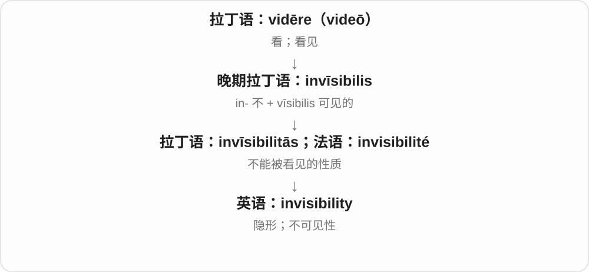

把 invisible 的性质单独拿出来谈，就得到这个抽象名词。社会意义中的隐形是比喻。

**常见搭配与例句**

a cloak of invisibility；social invisibility；the invisibility of unpaid work。

> The story gives the hero the power of invisibility.

故事赋予主人公隐身能力。

> The essay discusses the invisibility of unpaid care work.

文章讨论了无偿照护劳动被忽略的现象。

**别混淆**

invisibility 是状态；invisible 是形容词，不能说 an invisibility person。

### 64. audiovisual — 视听的；同时涉及声音与画面的

**音标**：英 /ˌɔːdiəʊˈvɪʒuəl/；美 /ˌɑːdioʊˈvɪʒuəl/

**先抓住这个画面**

audiovisual 把耳朵和眼睛一起用上：有声音，也有图像，比如带讲解的演示视频。

**怎么拆**

audio-（听、声音）+ visual（视觉的）。两个成分分别点明接收信息的通道。

**怎么变成今天的意思**

它可形容内容，也可形容录制、播放这类内容的设备。不能因为词里有两个感官，就理解成所有感官都参与。

**常见搭配与例句**

audiovisual equipment；audiovisual materials；an audiovisual presentation；audiovisual aids。

> The classroom has modern audiovisual equipment.

这间教室配有现代视听设备。

> The museum uses audiovisual displays to explain the excavation.

博物馆用视听展示来介绍这次发掘。

**别混淆**

audio 只强调声音；visual 只强调视觉；audiovisual 把两者结合。multimedia 的范围还可以更广。

### 65. revisionist — 重新解释既有观点的人；修正主义的

**音标**：/rɪˈvɪʒənɪst/

**先抓住这个画面**

revisionist 是拿出新解释，要求重新看待某套旧说法的人；可能是在认真纠错，也可能带有争议。

**怎么拆**

revision + -ist，表示主张或进行修订的一方；也可作形容词。

**怎么变成今天的意思**

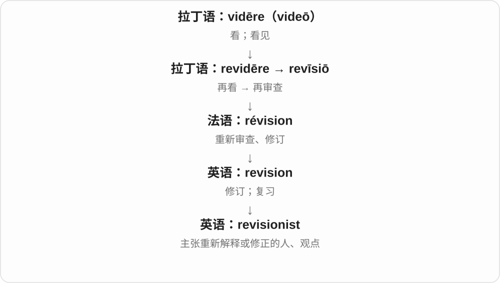

常用于历史、理论或政治思想的争论。这个词本身不能代替对证据和论证的检查。

**常见搭配与例句**

a revisionist historian；a revisionist account；revisionist ideas。

> The historian offered a revisionist account of the conflict.

这位历史学家重新解释了那场冲突。

> Critics challenged the revisionist argument with new evidence.

批评者用新证据质疑了那种重新解释的论点。

**别混淆**

revisionist 不自动等于造假者，也不自动等于发现真相的人；褒贬和准确性都要看具体工作。

### 66. unsupervised — 无人监督的；无指导的

**音标**：英 /ˌʌnˈsuːpəvaɪzd/；美 /ˌʌnˈsuːpərvaɪzd/

**先抓住这个画面**

unsupervised 是现场没有专人盯着并指导，可以独立进行，也可能表示缺少应有照看。

**怎么拆**

un-（不、没有）+ supervised（受监督的）。

**怎么变成今天的意思**

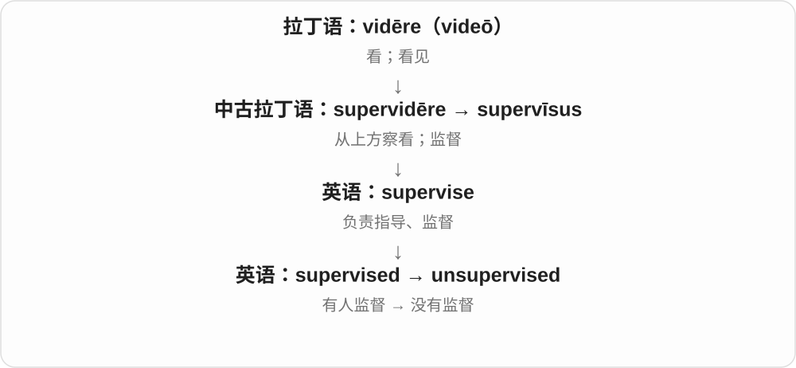

普通用法描述监督条件；技术中的 unsupervised learning 则专指学习时不依赖给定目标标签，不是完全没有人参与。

**常见搭配与例句**

leave someone unsupervised；unsupervised access；unsupervised work。

> The equipment must not be left running unsupervised.

设备运转时不得无人看管。

> After training, she was allowed to work unsupervised.

培训之后，她获准独立工作，无需监督。

**别混淆**

nonsupervisory 是不负责监督别人；unsupervised 是自己没有受到监督。

### 67. enviable — 令人羡慕的

**音标**：/ˈenviəbəl/

**先抓住这个画面**

enviable 是别人看了会想“我也希望有”的好处，比如自由的时间、稳定的表现或好口碑。

**怎么拆**

envy 去 y 加 -iable，对应 envy + -able。

**怎么变成今天的意思**

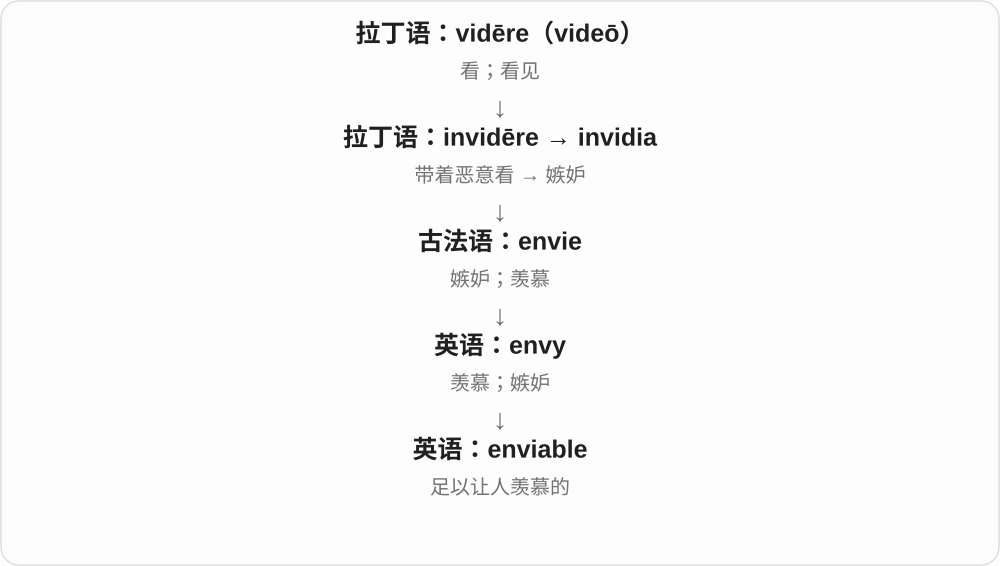

这里形容引起羡慕的条件，通常是赞赏；不是说拥有者自己正在嫉妒。

**常见搭配与例句**

an enviable reputation；an enviable position；an enviable record。

> The school has an enviable reputation for music.

这所学校在音乐方面的声誉令人羡慕。

> She has the enviable freedom to choose her own hours.

她有可以自行安排工作时间的自由，令人羡慕。

**别混淆**

enviable 令人羡慕，envious 感到羡慕；主客方向不同。

### 68. purview — 职责范围；考虑范围

**音标**：英 /ˈpɜːvjuː/；美 /ˈpɜːrvjuː/

**先抓住这个画面**

purview 像给责任画的一圈边界：圈内是这件事归谁管、这次讨论准备谈到哪儿。

**怎么拆**

来自法语法律措辞 purveu“已经规定”；最终连接 prōvidēre。现代拼写受 view 影响，不是 pure + view。

**怎么变成今天的意思**

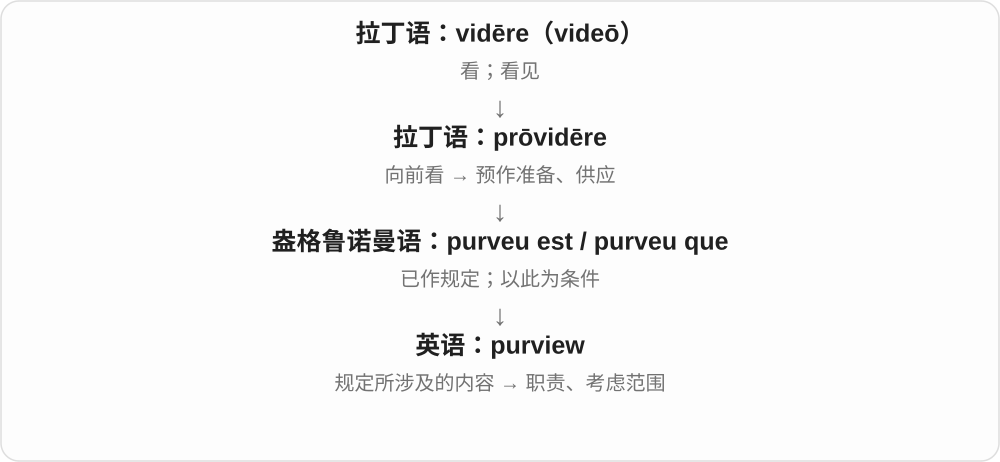

从文书规定所覆盖的内容，转为机构权限或讨论范围。用“视野范围”记忆方便，但只是近似联想。

**常见搭配与例句**

within the purview of…；outside someone’s purview；fall under the purview of… 。

> This question falls outside the committee’s purview.

这个问题不在委员会的职责范围内。

> The review brings online services within its purview.

这次审查把线上服务也纳入了范围。

**别混淆**

purview 强调职权或讨论边界；view 是观点或景色，不能直接互换。

### 69. provisionally — 暂定地；有待确认地

**音标**：/prəˈvɪʒənəli/

**先抓住这个画面**

provisionally 就是说“先这样记下或同意，最后还要确认”。

**怎么拆**

provisional + -ly。

**怎么变成今天的意思**

常修饰 agree、accept、schedule，说明动作已经有初步结果，但尚未锁定。

**常见搭配与例句**

provisionally agree；provisionally accept；provisionally scheduled。

> We provisionally agreed to meet next Thursday.

我们暂定下星期四见面。

> The event is provisionally scheduled for June.

活动暂定在六月举行。

**别混淆**

finally 表示最终；provisionally 明确留有后续确认或修改的余地。

### 70. visage — 面容；脸

**音标**：/ˈvɪzɪdʒ/

**先抓住这个画面**

visage 常像小说镜头停在一个人的脸上，让你看见神情、气色或岁月留下的痕迹。

**怎么拆**

经法语 visage，远源是拉丁语 vīsus“外观、所见”；俗拉丁语中间形式常写作重建的 *vīsāticum。

**怎么变成今天的意思**

“看见的样子”集中到最能代表人的脸。今天比 face 更书面，常用于人物描写。

**常见搭配与例句**

a stern visage；a familiar visage；a weathered visage。

> A smile softened his stern visage.

一个微笑使他严肃的面容柔和下来。

> The portrait captures her thoughtful visage.

肖像画捕捉到了她沉思的面容。

**别混淆**

face 是日常用词；visage 带文学色彩，普通说洗脸一般不用它。

### 71. rearview — 后视的；向后看的视野

**音标**：英 /ˈrɪəvjuː/；美 /ˈrɪrvjuː/

**先抓住这个画面**

rearview 让你看见身后，最熟悉的搭配是汽车里那块向后照的镜子。

**怎么拆**

rear（后方）+ view（视野）。

**怎么变成今天的意思**

常作定语修饰 mirror 或 camera。它只说明方向，不表示重新检查以前的决定。

**常见搭配与例句**

a rearview mirror；a rearview camera；rearview visibility。

> She checked the rearview mirror before slowing down.

减速前，她看了看后视镜。

> The rearview camera showed a bicycle behind the car.

后视摄像头显示车后有一辆自行车。

**别混淆**

rearview 向后看位置；review 是再看、审查，不是 rearview 的缩写。

### 72. envisage — 设想；预计

**音标**：英 /ɪnˈvɪzɪdʒ/；美 /enˈvɪzɪdʒ/

**先抓住这个画面**

envisage 是把某种未来情况在脑中摆出一个样子，看看它可能怎样发生。

**怎么拆**

法语 en- + visage 形成 envisager，原来有正视、看着脸的含义；英语借入后常指设想。

**怎么变成今天的意思**

从面对眼前的样子，转到面对心里设想的情景。可以设想结果，也可以预计某种需要。

**常见搭配与例句**

envisage doing…；envisage something as…；envisage a future。

> We envisage completing the work by autumn.

我们预计在秋天前完成工作。

> She envisaged the empty building as a community centre.

她设想把这栋空楼变成社区中心。

**别混淆**

envisage 与 envision 很接近，前者在英式英语中常见；不等于已经作出承诺。

### 73. interviewee — 受访者；参加面试的人

**音标**：英 /ˌɪntəvjuːˈiː/；美 /ˌɪntərvjuːˈiː/

**先抓住这个画面**

interviewee 是坐在回答问题那一边的人，可能是求职者，也可能是新闻受访者。

**怎么拆**

interview + -ee；-ee 常标出接受某种动作的人，重音落在末尾。

**怎么变成今天的意思**

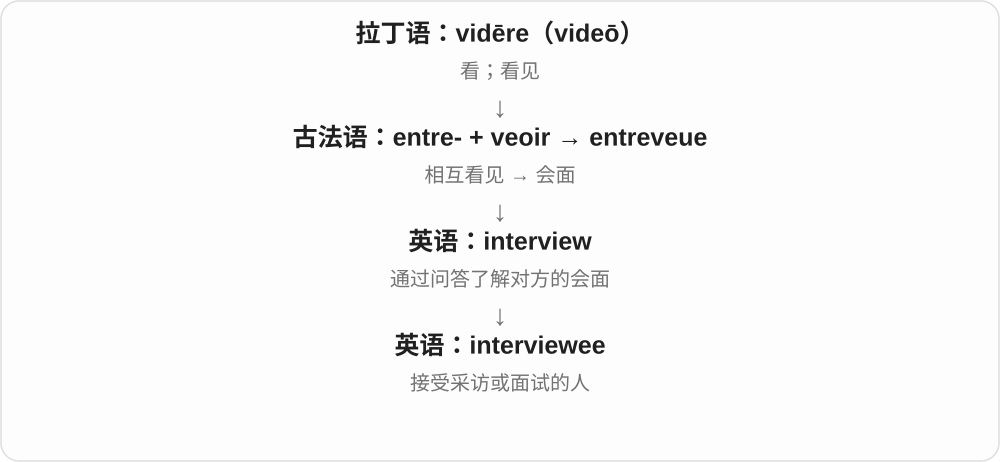

后缀把相同会面中的角色区分开。不是凡参加面试的人都一定是将被录用的人。

**常见搭配与例句**

an interviewee’s response；select interviewees；an interviewee for a documentary。

> Each interviewee was asked the same opening question.

每位受访者都被问了同一个开场问题。

> The interviewee paused before describing her experience.

受访者停顿了一下，然后描述自己的经历。

**别混淆**

interviewee 回答，interviewer 提问；别仅因都有 interview 就混用。

### 74. lakeview — 湖景；能看见湖的

**音标**：/ˈleɪkvjuː/

**先抓住这个画面**

lakeview 是窗外或观景位置望得到湖的那种视野，常出现在住宿和房产描述里。

**怎么拆**

lake（湖）+ view（景色），可连写；也常见分开写的 lake view。

**怎么变成今天的意思**

它说的是视线能到湖面，并不保证房屋紧贴湖岸。大写 Lakeview 也可能是地名。

**常见搭配与例句**

a lakeview room；a lakeview property；a lakeview balcony。

> We booked a lakeview room for the weekend.

我们为周末订了一间湖景房。

> The lakeview balcony was her favourite part of the house.

能看到湖的阳台是她最喜欢的房屋部分。

**别混淆**

lakeview 是能看湖；lakefront 是临湖岸。广告中的两种位置条件可能很不同。

### 75. voyeur — 窥视者；窥探他人隐私的人

**音标**：英 /vɔɪˈjɜː/；美 /vɔɪˈjɜːr/

**先抓住这个画面**

voyeur 不是普通旁观者，而是从窥看别人私密生活中获得满足的人；也可批评旁观他人痛苦的心态。

**怎么拆**

借自法语 voyeur“看的人”，来自 voir，远源为 vidēre。

**怎么变成今天的意思**

原本的看被特化成带有窥私意味的观看，常带贬义。具体语境可偏性意味，也可比喻隐私猎奇。

**常见搭配与例句**

a voyeur；act like a voyeur；a passive voyeur。

> The film makes the audience feel uncomfortably like voyeurs.

这部电影让观众不舒服地觉得自己像在窥探别人。

> The novel criticizes the voyeur who treats private grief as entertainment.

小说批评了把私人悲痛当娱乐的窥探者。

**别混淆**

viewer 是中性的观看者；voyeur 暗含对隐私的窥探，不适合随便称普通观众。

### 76. provident — 有远虑的；为将来作打算的

**音标**：英 /ˈprɒvɪdənt/；美 /ˈprɑːvɪdənt/

**先抓住这个画面**

provident 像秋天就把冬天要用的粮食备好，关心的是以后需要时有没有准备。

**怎么拆**

来自拉丁语 prōvidēns“预先看到的”，与 prudent 同源，但词形没有缩短那么多。

**怎么变成今天的意思**

远见落到生活安排，常指节制开销、储备或预留资源。语气较书面。

**常见搭配与例句**

a provident person；provident planning；a provident household。

> A provident family keeps some supplies for emergencies.

有远虑的家庭会为紧急情况备些物资。

> Her provident planning left us enough time for delays.

她周到的提前安排给可能的延误留足了时间。

**别混淆**

prudent 泛指判断审慎；provident 更突出为将来的需要作准备。

### 77. clairvoyant — 声称有超常感知能力的人；有此能力的

**音标**：英 /ˌkleəˈvɔɪənt/；美 /ˌklerˈvɔɪənt/

**先抓住这个画面**

clairvoyant 在故事或信仰语境里，像是看见普通眼睛无法看到的事，包括远处或未来的事情。

**怎么拆**

法语 clair（清楚）+ voyant（看着的），后者来自 voir。

**怎么变成今天的意思**

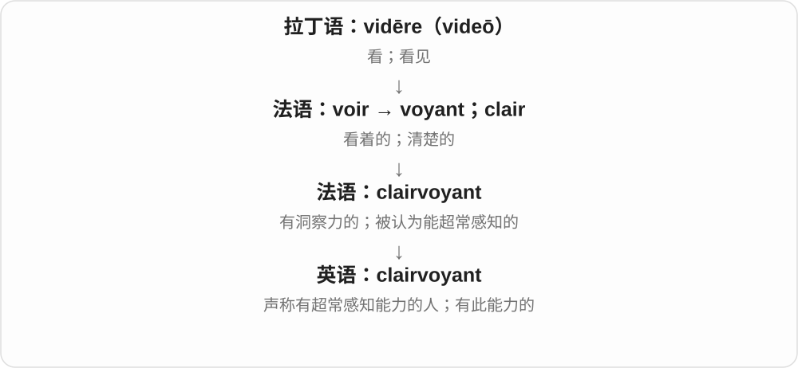

“看得清”发展出超出普通感官的感知含义。这个词描述一种声称或角色设定，本身不证明能力真实。

**常见搭配与例句**

a clairvoyant；clairvoyant powers；a supposedly clairvoyant figure。

> The story features a clairvoyant who predicts the storm.

故事中有个能预见暴风雨的通灵者。

> He claimed to have clairvoyant powers.

他声称自己有超常感知能力。

**别混淆**

clairvoyant 不是“视力特别好”的日常说法；keen eyesight 才是敏锐视力。

### 78. proviso — 附带条件；限制性条款

**音标**：英 /prəˈvaɪzəʊ/；美 /prəˈvaɪzoʊ/

**先抓住这个画面**

proviso 像一句“可以，不过有一个条件”，给前面的同意加上一道边界。

**怎么拆**

来自拉丁语 prōvīsō“在已作规定的情况下”，是 prōvidēre 的分词形式用法。

**怎么变成今天的意思**

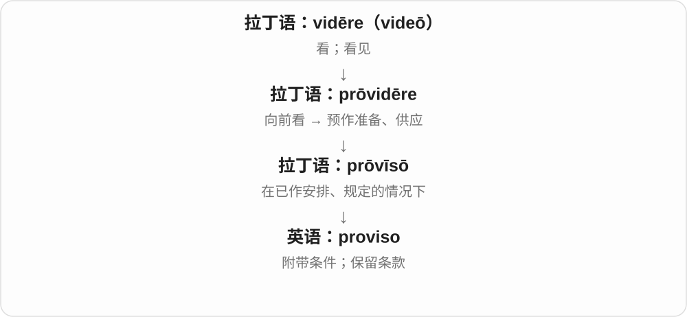

法律和正式文书中的条件表达进入一般语言，常用 with the proviso that… 。

**常见搭配与例句**

with the proviso that…；one important proviso；subject to a proviso。

> You may borrow the camera, with the proviso that you return it tomorrow.

你可以借相机，但条件是明天归还。

> She accepted the offer with one proviso.

她接受了提议，但附加了一个条件。

**别混淆**

proviso 是附加条件；provision 范围更大，可以是一般条款、供应或安排。

### 79. revisionism — 对既有理论或历史解释的修正；修正主义

**音标**：/rɪˈvɪʒənɪzəm/

**先抓住这个画面**

revisionism 是把既有解释重新打开，试图改写其中一部分或整个框架的立场与做法。

**怎么拆**

revision + -ism，构成学说、倾向或实践的名称。

**怎么变成今天的意思**

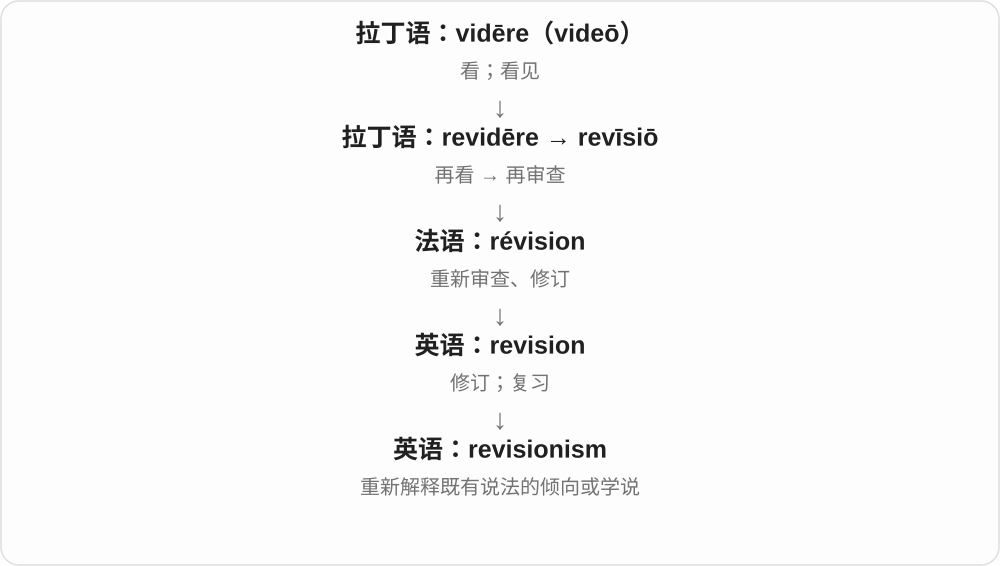

它有特定政治史用法，也可广义用于重新解释历史。评价时要看是否有证据，不能仅凭标签判断。

**常见搭配与例句**

historical revisionism；accusations of revisionism；debates over revisionism。

> The seminar examined debates about historical revisionism.

研讨课研究了有关历史重新解释的争论。

> The review asks whether the book’s revisionism is supported by evidence.

书评追问这本书对旧观点的修正是否有证据支持。

**别混淆**

revision 是一次具体修订；revisionism 常是更成体系的立场或倾向。

### 80. viewable — 可观看的；可查看的

**音标**：/ˈvjuːəbəl/

**先抓住这个画面**

viewable 表示内容能打开、展示给人看，像文件已经放在可以访问的页面上。

**怎么拆**

view + -able，表示能够被查看。

**怎么变成今天的意思**

常见于数字内容的访问与显示。能查看不代表有权编辑或下载。

**常见搭配与例句**

viewable online；viewable by members；viewable on a phone。

> The photographs are viewable online.

这些照片可以在线查看。

> The file is viewable but cannot be edited.

这个文件可以查看，但不能编辑。

**别混淆**

visible 是看得见；viewable 常关心是否能访问、播放或查看内容。

### 81. evidentiary — 证据的；与举证有关的

**音标**：英 /ˌevɪˈdenʃəri/；美 /ˌevɪˈdenʃieri/

**先抓住这个画面**

evidentiary 是给材料或程序贴上“关于证据”的标签，常用在正式调查和法律讨论中。

**怎么拆**

拉丁语 ēvidentia“证据、清楚”与 -ary 对应；不把它当成 evident 的普通“明显”义。

**怎么变成今天的意思**

指向证据的性质、价值或处理程序，并不表示某份材料已经足够证明所有事情。

**常见搭配与例句**

evidentiary value；an evidentiary hearing；evidentiary material。

> The report discusses the evidentiary value of the photograph.

报告讨论了这张照片的证据价值。

> The hearing focused on evidentiary questions.

听证集中讨论了证据方面的问题。

**别混淆**

evident 是明显的；evidentiary 是关于证据的。evidentiary rules 不是“明显的规则”。

### 82. viewfinder — 取景器

**音标**：英 /ˈvjuːfaɪndə/；美 /ˈvjuːfaɪndər/

**先抓住这个画面**

viewfinder 是拍照时让你先看清“这张照片会装进什么”的小窗口或显示装置。

**怎么拆**

view（画面、视野）+ finder（帮助寻找、确定的东西）。

**怎么变成今天的意思**

通过它安排主体的位置与边界，再决定什么时候按快门。它可以是光学的，也可以是电子的。

**常见搭配与例句**

look through the viewfinder；an electronic viewfinder；frame a shot in the viewfinder。

> She looked through the viewfinder and adjusted the frame.

她透过取景器看了看，调整了构图。

> The electronic viewfinder displays the exposure settings.

电子取景器会显示曝光设置。

**别混淆**

viewfinder 用于取景；lens 是镜头。它们在某些相机系统中有关联，但不是同一部件名称。

### 83. purveyor — 供应商；提供者；传播者

**音标**：英 /pəˈveɪə/；美 /pərˈveɪər/

**先抓住这个画面**

purveyor 是不断把某类东西送到人们面前的一方：可以供应食品，也可以传播消息和观念。

**怎么拆**

经法语 purveour 等形式，来自“提供、预备”的 porveoir；现代可联系 purvey + -or。

**怎么变成今天的意思**

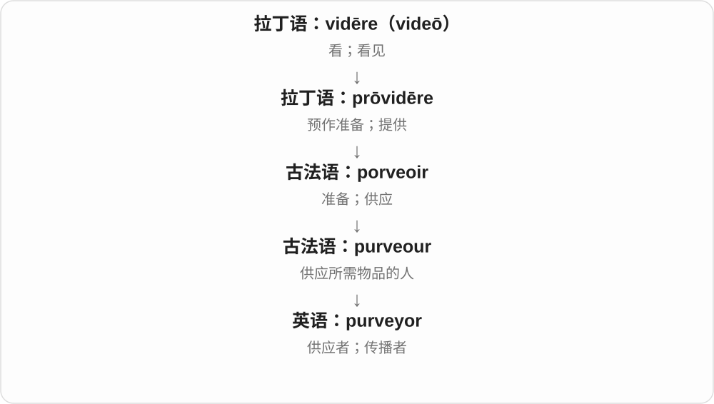

早期提供生活必需品的角色，发展为较书面的供应者；搭配 misinformation 时含批评意味。

**常见搭配与例句**

a purveyor of fine food；a purveyor of news；a purveyor of misinformation。

> The shop is a purveyor of local cheeses.

这家店供应当地奶酪。

> The article criticizes purveyors of false rumours.

文章批评了传播虚假传闻的人。

**别混淆**

supplier 很通用；purveyor 更书面，有时用于商家宣传或批评传播者。

### 84. visualise — 想象出画面；使可视化

**音标**：/ˈvɪʒuəlaɪz/

**先抓住这个画面**

visualise 就是让东西在脑中或图表上有一个能看见的样子，与 visualize 做的是同一件事。

**怎么拆**

visual + -ise；-ise 是 -ize 的常见拼写变体。

**怎么变成今天的意思**

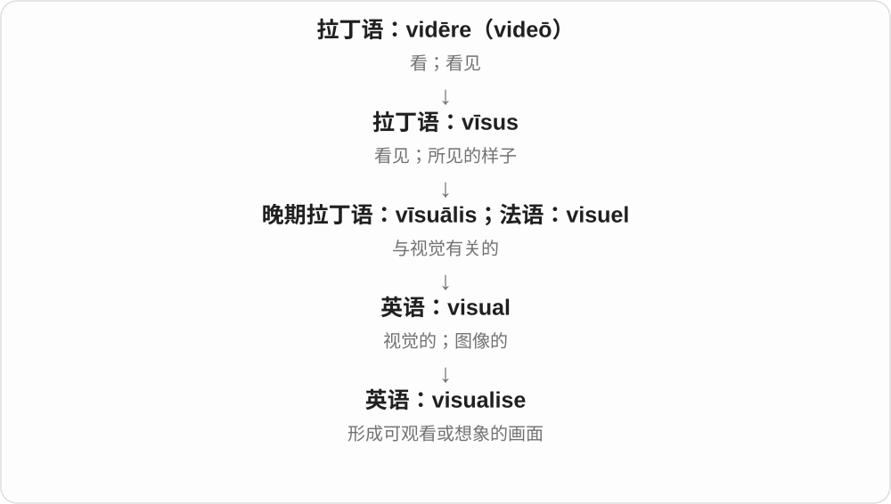

拼写差别不改变词义。英式文本常见 visualise，英式英语也会用 visualize。

**常见搭配与例句**

visualise a scene；visualise the result；visualise data。

> Close your eyes and visualise a quiet beach.

闭上眼睛，想象一片安静的海滩。

> This diagram helps readers visualise the flow of water.

这张图帮助读者直观看出水的流向。

**别混淆**

visualise 和 visualize 通常只差拼写惯例；同一篇文章保持一致更清楚。

### 85. improvisational — 即兴的；重视临场发挥的

**音标**：英 /ˌɪmprəvaɪˈzeɪʃənəl/；美 /ɪmˌprɑːvəˈzeɪʃənəl/

**先抓住这个画面**

improvisational 说明表演或工作留有当场创造的空间，下一步会回应现场正在发生的事。

**怎么拆**

improvisation + -al，把即兴创作变成性质描述。

**怎么变成今天的意思**

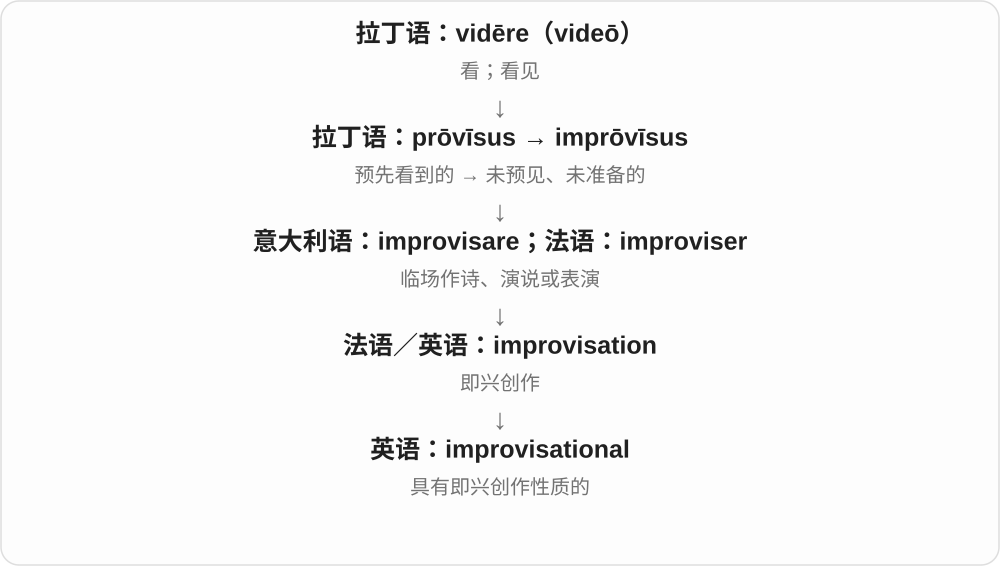

它描述一种方式或风格。即兴表演也可以有规则、主题和训练，并非毫无结构。

**常见搭配与例句**

improvisational theatre；improvisational skills；an improvisational style。

> The workshop teaches improvisational theatre.

这个工作坊教授即兴戏剧。

> Her improvisational skills helped when the script changed.

剧本变化时，她的即兴能力派上了用场。

**别混淆**

improvised 常指某次临时做成的东西；improvisational 常描述长期风格、能力或方法。

### 86. clairvoyance — 超常感知；千里眼式洞察

**音标**：英 /kleəˈvɔɪəns/；美 /klerˈvɔɪəns/

**先抓住这个画面**

clairvoyance 是被声称能获知普通感官没有提供的信息的能力，常见于神秘故事或相关信仰。

**怎么拆**

借自法语 clairvoyance；连接 clair“清楚”与 voir“看”的词族。

**怎么变成今天的意思**

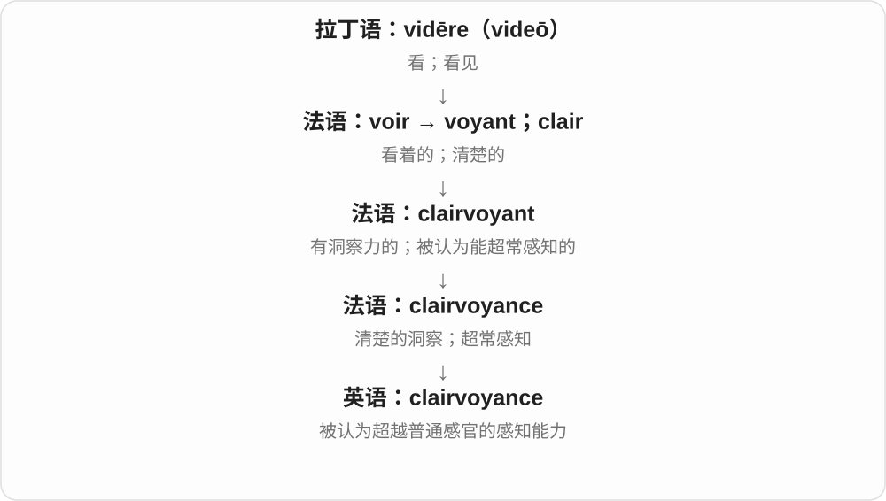

从清楚看见引申到超常知道。这里的词义不为相关能力提供证据，也不等于一般视力。

**常见搭配与例句**

claims of clairvoyance；a gift of clairvoyance；belief in clairvoyance。

> The novel treats clairvoyance as a rare gift.

小说把超常感知写成一种罕见天赋。

> The experiment was designed to test claims of clairvoyance.

这项实验是为检验有关超常感知的声称而设计的。

**别混淆**

clairvoyance 是能力名称，clairvoyant 可指声称拥有它的人或相应形容词。

### 87. voyeurism — 窥视行为；窥私欲

**音标**：英 /ˈvɔɪərɪzəm/；美 /ˈvɔɪərɪzəm/

**先抓住这个画面**

voyeurism 把窥看别人私密生活当成满足或娱乐；媒体讨论中也会用它批评消费他人隐私。

**怎么拆**

voyeur + -ism，表示相应行为或倾向。

**怎么变成今天的意思**

从具体的窥视者，变成对这种观看方式的概括。词义常含贬义，不能把普通好奇都等同于它。

**常见搭配与例句**

media voyeurism；an accusation of voyeurism；encourage voyeurism。

> The critic accused the programme of encouraging voyeurism.

评论者指责节目助长窥私欲。

> The film examines the uneasy link between watching and voyeurism.

影片探讨了观看与窥私之间令人不安的联系。

**别混淆**

curiosity 是广泛的好奇；voyeurism 更明确牵涉私密观看，且可能具有性意味。

### 88. advisement — 考虑；斟酌；建议

**音标**：/ədˈvaɪzmənt/

**先抓住这个画面**

advisement 最常见的画面是把建议先收下，认真想一想，还没有马上答应。

**怎么拆**

经法语 avisement 传入，来自 aviser“考虑、告知”；现代对应 advise + -ment。

**怎么变成今天的意思**

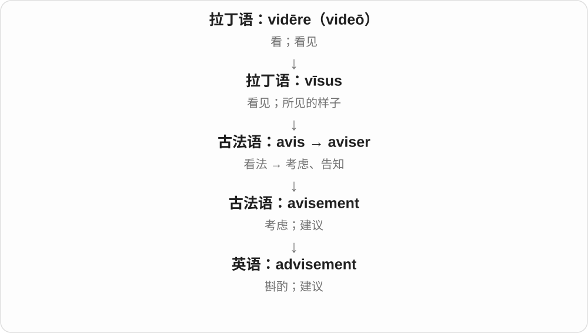

现代尤其见于 take something under advisement，意思是纳入考虑，不等于采纳。

**常见搭配与例句**

take something under advisement；under advisement。

> We will take your proposal under advisement.

我们会认真考虑你的提案。

> The committee kept the matter under advisement.

委员会继续审慎考虑这件事。

**别混淆**

take advice 可表示听从建议；take it under advisement 只是承诺考虑。

### 89. imprudent — 不审慎的；欠考虑的

**音标**：/ɪmˈpruːdənt/

**先抓住这个画面**

imprudent 像没有看前面有没有坑就迈出大步：问题在于没充分想到后果。

**怎么拆**

拉丁语 im-（不）+ prūdēns，经法语 imprudent 传入。

**怎么变成今天的意思**

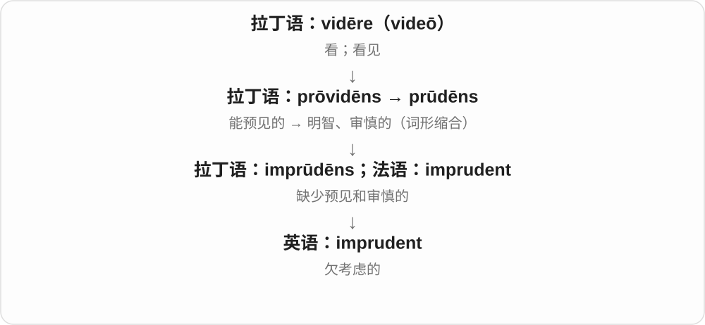

它批评判断或行动不够稳妥，不一定说人有恶意。常评价一个具体决定。

**常见搭配与例句**

an imprudent decision；imprudent to do…；financially imprudent。

> It would be imprudent to leave without checking the weather.

不看天气就出发会很欠考虑。

> He regretted his imprudent remarks.

他后悔自己说了欠考虑的话。

**别混淆**

imprudent 是欠考虑；improvident 更具体地指不为将来准备。

### 90. prudently — 审慎地；稳妥地

**音标**：/ˈpruːdəntli/

**先抓住这个画面**

prudently 让你看到行动前留了心：多检查一次、预留一点资源，都是为了后面更稳妥。

**怎么拆**

prudent + -ly。

**怎么变成今天的意思**

它描述做事方式，常可译成稳妥起见或谨慎地。强调明智安排，而非动作缓慢。

**常见搭配与例句**

act prudently；manage prudently；spend prudently。

> She prudently saved a copy before editing the document.

她稳妥地先存了一份副本，再编辑文档。

> The team used its limited resources prudently.

团队审慎使用了有限的资源。

**别混淆**

slowly 只是速度慢；prudently 是判断周全，行动也可以很迅速。

### 91. evidential — 证据性的；表明信息来源的

**音标**：/ˌevɪˈdenʃəl/

**先抓住这个画面**

evidential 通常说“这东西能不能作为依据”；在语言学里，还指说话者怎样标明自己是看见、听说还是推断。

**怎么拆**

来自中古拉丁语 ēvidentiālis，连接 ēvidentia“证据、显明”。

**怎么变成今天的意思**

证据不仅可以是法庭材料，也可以是说话人得知信息的渠道，于是有语言学的专门用法。

**常见搭配与例句**

evidential support；evidential value；an evidential marker。

> The claim has little evidential support.

这个说法缺少证据支持。

> An evidential marker can show that the speaker heard the news from someone else.

传信标记可以表明说话人是从别人那里听到消息的。

**别混淆**

evidentiary 常见于正式证据程序；evidential 也很常用于语言学，不只是另一种拼写。

### 92. invisibly — 看不见地；不露痕迹地

**音标**：/ɪnˈvɪzəbli/

**先抓住这个画面**

invisibly 像后台默默运作的齿轮：过程在发生，观察者却看不到它。

**怎么拆**

invisible 变为副词 invisibly，词尾 -le 对应 -ly。

**怎么变成今天的意思**

既可描述实际难以察觉的物理变化，也可说技术、劳动在幕后进行。

**常见搭配与例句**

work invisibly；move invisibly；almost invisibly。

> The software saves changes invisibly in the background.

软件在后台自动保存修改，用户看不到这个过程。

> Moisture spread almost invisibly beneath the paint.

湿气在漆面下面几乎不露痕迹地扩散。

**别混淆**

secretly 强调故意保密；invisibly 只说明不被看见，不一定有人刻意隐瞒。

### 93. unenviable — 令人不羡慕的；棘手的；难堪的

**音标**：/ʌnˈenviəbəl/

**先抓住这个画面**

unenviable 常是“这个差事可没人想接”：要处理麻烦，或处在两难位置。

**怎么拆**

un-（不）+ enviable（令人羡慕的）。

**怎么变成今天的意思**

字面是否定羡慕，实际常委婉地说处境艰难，而不是冷淡地说没什么特别。

**常见搭配与例句**

an unenviable task；an unenviable position；an unenviable choice。

> She had the unenviable task of announcing the delay.

她不得不承担宣布延期这个棘手任务。

> The mistake left him in an unenviable position.

这个错误让他陷入难堪的处境。

**别混淆**

envious 是人的羡慕情绪；unenviable 评价某种处境不理想。

### 94. voyeuristic — 窥私的；满足窥探欲的

**音标**：英 /ˌvɔɪəˈrɪstɪk/；美 /ˌvɔɪəˈrɪstɪk/

**先抓住这个画面**

voyeuristic 把镜头对准别人本不想公开的生活，让观看带上窥探的味道。

**怎么拆**

voyeur + -istic，表示具有窥视者式的特点。

**怎么变成今天的意思**

常用于评价报道、影像或兴趣，指出其中消费隐私的倾向，通常带批评色彩。

**常见搭配与例句**

voyeuristic curiosity；a voyeuristic camera angle；voyeuristic entertainment。

> She criticized the report’s voyeuristic focus on private grief.

她批评报道带着窥私心态盯着别人的私人悲痛。

> The director avoids voyeuristic shots of the family.

导演避免用窥私式镜头拍摄这个家庭。

**别混淆**

observational 可以是中性观察；voyeuristic 则凸显窥私意味。

### 95. inadvisable — 不明智的；不宜采取的

**音标**：/ˌɪnədˈvaɪzəbəl/

**先抓住这个画面**

inadvisable 是考虑过后会劝你“最好别这样做”的选择。

**怎么拆**

in-（不）+ advisable（值得建议的）。

**怎么变成今天的意思**

它否定行动的明智程度，常是建议语气，不必然表示被规则禁止。

**常见搭配与例句**

inadvisable to do…；highly inadvisable；consider something inadvisable。

> It is inadvisable to change every setting at once.

不宜一次把所有设置都改掉。

> They considered a late departure inadvisable.

他们认为太晚出发并不稳妥。

**别混淆**

inadvisable 是不推荐；forbidden 是被禁止，约束强度不同。

### 96. viewport — 观察窗；视口；可见区域

**音标**：英 /ˈvjuːpɔːt/；美 /ˈvjuːpɔːrt/

**先抓住这个画面**

viewport 像框在眼前的一扇窗口：内容可能很大，但你此刻只能通过这个框看到其中一部分。

**怎么拆**

view（观看）+ port（开口、窗口）。

**怎么变成今天的意思**

实体装置可以有观察窗；屏幕、网页或三维软件中则指用于显示内容的区域。

**常见搭配与例句**

a browser viewport；viewport size；a viewport into the chamber。

> The layout changes when the viewport becomes narrower.

视口变窄时，布局会发生变化。

> We watched the experiment through a small viewport.

我们通过一个小观察窗观看实验。

**别混淆**

screen 是整个屏幕；viewport 是特定内容显示的可见区域，不一定占满屏幕。

### 97. reviewable — 可审查的；可复核的

**音标**：/rɪˈvjuːəbəl/

**先抓住这个画面**

reviewable 表示决定或材料还能拿出来重新看、重新评价，并非永远定死。

**怎么拆**

review + -able。

**怎么变成今天的意思**

用于正式流程时，说明某种决定在规定条件下能被重新审视；一般也可说文件便于审看。

**常见搭配与例句**

a reviewable decision；a reviewable process；easily reviewable changes。

> The policy states that the decision is reviewable.

政策说明这一决定可以复核。

> Small changes make the document more easily reviewable.

把修改控制在小范围内，会让文档更容易审查。

**别混淆**

reviewable 不等于会被改变；重新审查以后也可能维持原决定。

### 98. invidious — 招致怨恨的；令人难堪的；不公正的

**音标**：/ɪnˈvɪdiəs/

**先抓住这个画面**

invidious 常像被迫在两个人中偏向一个：无论怎么选，都容易惹来不满或显得不公平。

**怎么拆**

直接借自拉丁语 invidiōsus，与 envy 的拉丁祖先相连；不是 in- + 英语 video。

**怎么变成今天的意思**

它与 envious 同源，但现代通常不只是说某个人嫉妒，而是评价比较、差别待遇或尴尬位置。

**常见搭配与例句**

an invidious comparison；an invidious position；invidious distinctions。

> It would be invidious to compare the two children.

把这两个孩子作比较，会让人难堪，也容易显得不公平。

> The decision put her in an invidious position.

这个决定使她陷入容易招人不满的两难位置。

**别混淆**

envious 描述羡慕或嫉妒的心情；invidious 常描述容易造成怨恨和不公的做法或处境。

### 99. imprudence — 欠考虑；不审慎的行为

**音标**：/ɪmˈpruːdəns/

**先抓住这个画面**

imprudence 是没把后果想清楚就行动的那一面，比如匆忙答应自己做不到的事。

**怎么拆**

来自拉丁语 imprūdentia，经法语传入；现代可联系 im- + prudence。

**怎么变成今天的意思**

把 imprudent 的性质作为问题来谈；也能指某一件欠考虑的事，语气较正式。

**常见搭配与例句**

an act of imprudence；financial imprudence；regret one’s imprudence。

> He regretted the imprudence of making that promise.

他后悔自己欠考虑地作出了承诺。

> A moment of imprudence created weeks of extra work.

一时欠考虑，造成了好几周的额外工作。

**别混淆**

imprudence 是判断欠周全；ignorance 是不知道。人知道事实，也可能仍然行动草率。

### 100. purvey — 供应；提供；传播

**音标**：英 /pəˈveɪ/；美 /pərˈveɪ/

**先抓住这个画面**

purvey 是持续把一类东西供给别人，常带一点正式或旧式商业口吻。

**怎么拆**

古法语 porveoir 来自 prōvidēre；与 provide 是同一拉丁来源走出的不同英语词形。

**怎么变成今天的意思**

为需求作准备，发展成供应；对象也能从食品变为消息、观点等。

**常见搭配与例句**

purvey food；purvey goods；purvey information。

> The small shop purveys bread and local cheese.

这家小店供应面包和本地奶酪。

> The website purveys rumours as if they were facts.

这个网站把传闻当作事实来传播。

**别混淆**

provide 更日常通用；purvey 常用于较书面地谈商品供应或信息传播。

### 101. visuality — 视觉性；视觉呈现；外观

**音标**：/ˌvɪʒuˈæləti/

**先抓住这个画面**

visuality 把“我们如何看、内容如何被看见”当成一个整体来讨论，常见于艺术和文化研究。

**怎么拆**

与拉丁语 visuālitās 相连，现代对应 visual + -ity。

**怎么变成今天的意思**

它不是日常的视力检查用词。艺术论述常借它讨论图像、观看方式与外观的作用。

**常见搭配与例句**

the visuality of a work；modern visuality；visuality and culture。

> The essay explores the visuality of silent cinema.

文章探讨了默片的视觉表现。

> The exhibition draws attention to the visuality of everyday objects.

展览让人注意日常物品的视觉呈现。

**别混淆**

visibility 多问能不能看见、受不受注意；visuality 更常讨论视觉呈现本身。

### 102. improvident — 没有远虑的；不为将来准备的

**音标**：英 /ɪmˈprɒvɪdənt/；美 /ɪmˈprɑːvɪdənt/

**先抓住这个画面**

improvident 像把今天能用的全用掉，却没想明天还需要什么。

**怎么拆**

拉丁语 improvidēns 含 in-（不）与 prōvidēns（预先看到）；现代对应 im- + provident。

**怎么变成今天的意思**

它特别容易用于资源和生活安排，但重点是不考虑将来，并不等于贫穷。

**常见搭配与例句**

improvident spending；an improvident decision；an improvident habit。

> His improvident spending left nothing for repairs.

他花钱没有远虑，结果没留下维修的钱。

> It was improvident to use all the supplies on the first day.

第一天就用完所有物资，是没有考虑长远需要。

**别混淆**

improvident 是缺少打算；poor 是贫穷。资源少的人也可以十分 provident。

### 103. purveyance — 供应；筹办物资；旧时王室征购制度

**音标**：英 /pəˈveɪəns/；美 /pərˈveɪəns/

**先抓住这个画面**

purveyance 是把需要的物资筹集起来供给某人；历史书中还会专指英国王室的一种征购特权。

**怎么拆**

经盎格鲁诺曼语 purveaunce 进入英语，与 purvey 的法语祖先同族。

**怎么变成今天的意思**

普通义是供应活动；历史专义涉及为王室按估定价格取得物资。不要把这一旧制度套到现代普通采购。

**常见搭配与例句**

the purveyance of supplies；royal purveyance；the history of purveyance。

> The steward organized the purveyance of food for the journey.

管事安排了旅途食品的筹供。

> The chapter examines royal purveyance in medieval England.

这一章研究中世纪英格兰的王室征购制度。

**别混淆**

purveyance 偏旧式或历史用语；现代一般供应工作常用 supply 或 provision。

### 104. revisionary — 修订性的；重新审视既有说法的

**音标**：英 /rɪˈvɪʒənəri/；美 /rɪˈvɪʒəneri/

**先抓住这个画面**

revisionary 是不把旧版本照单全收，而是带着重新调整、重新解释的方向去处理。

**怎么拆**

revision + -ary。

**怎么变成今天的意思**

常见于较学术的文章，描述对理论、解读或既有文本的改写性质。

**常见搭配与例句**

a revisionary account；a revisionary reading；a revisionary approach。

> The book offers a revisionary account of the movement.

这本书重新解释了那场运动。

> Her revisionary reading challenges the usual interpretation.

她的重新解读挑战了通常的解释。

**别混淆**

revisionary 描述修订性质；revisionist 有时指特定思潮或重解历史的立场，含义依语境而定。

### 105. videlicet — 即；也就是说

**音标**：/vɪˈdelɪset/

**先抓住这个画面**

videlicet 像在较老或正式的文字里停一下，接着把前面说的对象具体点名。

**怎么拆**

来自拉丁语 vidēlicet，是 vidēre licet“可以看见”的缩合；常缩写 viz.。

**怎么变成今天的意思**

从“可以看见是这样”成为引出具体说明的连接副词。现代普通文章用 namely 更自然。

**常见搭配与例句**

videlicet, …；常见缩写 viz.。

> Two items were missing, videlicet, the key and the map.

少了两样东西，即钥匙和地图。

> The note names one obstacle, videlicet, the lack of time.

便条指出了一个障碍，即时间不足。

**别混淆**

viz. 用来具体说明“即”；e.g. 是“例如”，后面未必列出全部项目。

### 106. evidentiality — 传信性；信息来源的语言标记

**音标**：/ˌevɪˌdenʃiˈæləti/

**先抓住这个画面**

evidentiality 关注一句话背后的“你怎么知道”：亲眼看到、听别人说，还是根据线索推出来。

**怎么拆**

evidential + -ity，把与信息依据有关的性质变成语言学术语。

**怎么变成今天的意思**

有些语言用专门语法形式区分亲见、传闻、推断等。它首先说明来源，不等于给陈述自动判定真假。

**常见搭配与例句**

grammatical evidentiality；a system of evidentiality；evidentiality markers。

> The course examines how languages express evidentiality.

这门课研究语言怎样表达信息来源。

> Evidentiality can distinguish a witnessed event from a reported one.

传信标记可以区分亲眼见到的事件和听说的事件。

**别混淆**

certainty 是确定程度；evidentiality 主要是信息来源，两者可有关联但不能混为一谈。

### 107. improvidence — 缺乏远虑；不作储备

**音标**：英 /ɪmˈprɒvɪdəns/；美 /ɪmˈprɑːvɪdəns/

**先抓住这个画面**

improvidence 是只安排眼前、不顾以后需要的习惯，像出门带够去程的钱，却没想回程。

**怎么拆**

im-（不）+ providence（预先打算、远见）；这里否定普通远见义，不是在否定天意。

**怎么变成今天的意思**

常见于较书面地评价花费或筹划。重点是未作准备，而不是遭遇困难就一定该受责备。

**常见搭配与例句**

financial improvidence；a habit of improvidence；suffer from improvidence。

> The story contrasts her careful planning with his improvidence.

故事对比了她的精心规划和他的缺乏远虑。

> Their improvidence left the expedition short of supplies.

他们未作长远准备，导致探险队物资不足。

**别混淆**

imprudence 泛指不审慎；improvidence 更集中于没有为将来安排资源。

### 108. provisory — 附带条件的；暂时的

**音标**：/prəˈvaɪzəri/

**先抓住这个画面**

provisory 常表示“先作这个安排，但要带着条件或等最终确定”，语气较少见、较正式。

**怎么拆**

来自中古拉丁语 prōvīsōrius，连接 prōvidēre 的分词词干；与 proviso、provisional 同族。

**怎么变成今天的意思**

可以强调含有限制条件，也可近似 provisional“暂定”。具体侧重点由名词和上下文判断。

**常见搭配与例句**

a provisory arrangement；a provisory clause；a provisory agreement。

> They reached a provisory agreement pending further talks.

他们达成了临时协议，等待进一步会谈。

> The document includes a provisory clause limiting its duration.

文件包含一项限制有效期的附条件条款。

**别混淆**

provisory 的元音是 /aɪ/；provisional 通常 /ɪ/。日常说暂定，用 provisional 更常见。

### 109. counterview — 相反观点；对照看法

**音标**：英 /ˈkaʊntəvjuː/；美 /ˈkaʊntərvjuː/

**先抓住这个画面**

counterview 是有人往一个方向解释时，你从另一边提出的看法，让讨论有对照。

**怎么拆**

counter-（相反、相对）+ view（观点）。

**怎么变成今天的意思**

主要在较书面的讨论中指反面观点；旧用法也有对面相向、以对比相衬的意思。

**常见搭配与例句**

present a counterview；offer a counterview；a counterview to… 。

> The final chapter presents a counterview to the author’s argument.

最后一章提出了与作者论点相对的看法。

> She offered a counterview based on the same evidence.

她依据同样的证据提出了另一种相反的解释。

**别混淆**

counterview 不必完全否认对方每句话，可能只是提出另一种解释；日常说 opposing view 更常见。

### 110. envisagement — 设想；构想

**音标**：/ɪnˈvɪzɪdʒmənt/

**先抓住这个画面**

envisagement 是把未来的样子先放进脑中这一动作或结果，是 envisage 的较少见名词。

**怎么拆**

envisage + -ment。

**怎么变成今天的意思**

常出现在较抽象的论述中。它没有增加神秘含义，只是把“设想”变成能单独谈论的名词。

**常见搭配与例句**

an envisagement of the future；the envisagement of a plan。

> The essay offers an envisagement of a quieter city.

文章构想了一座更安静的城市。

> Her envisagement of the project changed after the discussion.

讨论后，她对项目的设想发生了变化。

**别混淆**

envisioning 或 vision 在许多现代语境更自然；envisagement 认识即可，不必为了高级而频繁使用。

### 111. inevident — 不明显的；难以看出的

**音标**：/ɪnˈevɪdənt/

**先抓住这个画面**

inevident 说某个联系或原因没有摆明在眼前，得花力气才能看出来，是少见书面词。

**怎么拆**

来自晚期拉丁语 inevidēns，含 in-（不）+ ēvidēns（明显的）；现代对应 in- + evident。

**怎么变成今天的意思**

它是否定显明程度，不表示事情不存在。普通英语通常直接说 not evident 或 unclear。

**常见搭配与例句**

an inevident connection；remain inevident；inevident causes。

> The connection remained inevident to the reader.

读者仍看不出其中的联系。

> The essay explores causes that are initially inevident.

文章探讨了起初并不明显的原因。

**别混淆**

inevident 是不明显；irrelevant 是不相关。看不出关系，不等于已经证明没有关系。

### 112. nonevidentiary — 非证据性的；不涉及举证的

**音标**：英 /ˌnɒnevɪˈdenʃəri/；美 /ˌnɑːnevɪˈdenʃieri/

**先抓住这个画面**

nonevidentiary 像把资料分成两摞时贴的标签：这一摞不作为证据，或这一步不处理举证。

**怎么拆**

non-（非）+ evidentiary（证据的）。

**怎么变成今天的意思**

它可以描述材料的用途，也可描述程序性质；并不自动说内容虚假或毫无帮助。

**常见搭配与例句**

nonevidentiary material；a nonevidentiary discussion；nonevidentiary information。

> The appendix contains nonevidentiary background material.

附录包含不作证据使用的背景材料。

> The meeting was limited to nonevidentiary procedural questions.

会议仅讨论不涉及举证的程序问题。

**别混淆**

nonevidentiary 是证据角色的否定；false 才是虚假的。真实资料也可能不作为证据使用。

### 113. nonsupervisory — 不承担监督职责的；非管理岗位的

**音标**：英 /ˌnɒnsuːpəˈvaɪzəri/；美 /ˌnɑːnsuːpərˈvaɪzəri/

**先抓住这个画面**

nonsupervisory 指工作的重点是完成自己的任务，不承担监督别人工作的职责。

**怎么拆**

non-（非）+ supervisory（监督的）。

**怎么变成今天的意思**

常用于人员或岗位分类。它不评价能力高低，也不表示工作不受任何监督。

**常见搭配与例句**

nonsupervisory employees；a nonsupervisory role；nonsupervisory duties。

> The training is open to nonsupervisory employees.

培训面向不承担管理职责的员工。

> He preferred a nonsupervisory role focused on design.

他更喜欢专注设计、无需管理他人的岗位。

**别混淆**

nonsupervisory 是不管别人；unsupervised 是没有别人监督自己，两者方向不同。

### 114. nonvisual — 非视觉的；不依赖观看的

**音标**：英 /ˌnɒnˈvɪʒuəl/；美 /ˌnɑːnˈvɪʒuəl/

**先抓住这个画面**

nonvisual 把眼睛这条通道暂时拿开，改用声音、触觉或其他方式获取信息。

**怎么拆**

non-（非）+ visual（视觉的）。

**怎么变成今天的意思**

它描述信息或方法不依靠视觉，不是在说某个人完全看不见。

**常见搭配与例句**

nonvisual information；nonvisual cues；nonvisual navigation。

> The app provides nonvisual cues through sound.

应用通过声音提供非视觉提示。

> Touch offers a nonvisual way to explore the sculpture.

触摸提供了一种无需观看也能了解雕塑的方式。

**别混淆**

invisible 是看不见；nonvisual 是不靠视觉。一声提示音属于 nonvisual 信息。

### 115. previse — 预见；预先告知

**音标**：/prɪˈvaɪz/

**先抓住这个画面**

previse 是在事情真正来到之前先看见趋势，或把即将发生的事提前告诉别人，是少见词。

**怎么拆**

拉丁语 prae-（在前）+ vidēre，形成 praevidēre；英语词形连接其分词 praevisus。

**怎么变成今天的意思**

与 preview 都有提前看的意象，但 previse 用于预见或提醒，不是打开预览窗口。

**常见搭配与例句**

previse a difficulty；previse someone of… 。

> Few could previse the difficulties that lay ahead.

很少有人能预见前面的困难。

> The letter prevised them of a possible delay.

信中提前告知他们可能会延误。

**别混淆**

现代普通表达多用 foresee 或 warn in advance；不要把 previse 当常用软件按钮名。

### 116. provisionality — 暂定性；临时性

**音标**：/prəˌvɪʒəˈnæləti/

**先抓住这个画面**

provisionality 是在结论旁边留着一个铅笔标记：目前接受，但新情况出现时愿意再改。

**怎么拆**

provisional + -ity，后缀使重音移到后面的音节。

**怎么变成今天的意思**

常在学术讨论中说明知识、解释或安排仍可修正；不是简单说它只持续几分钟。

**常见搭配与例句**

the provisionality of a conclusion；acknowledge provisionality。

> The author acknowledges the provisionality of her conclusions.

作者承认自己的结论仍属暂定。

> The arrangement’s provisionality made long-term planning difficult.

安排的暂定性质使长期规划变得困难。

**别混淆**

temporariness 强调存在时间短；provisionality 常强调尚未最后定论。

### 117. reviewal — 审查；复看；回顾

**音标**：/rɪˈvjuːəl/

**先抓住这个画面**

reviewal 就是把材料再看一遍、重新评估这件事，是 review 的较少见名词形式。

**怎么拆**

review + -al；这里 -al 构成动作名词，不是通常的形容词后缀用法。

**怎么变成今天的意思**

它与名词 review 基本重合，偏书面或旧式。学习时认得即可，日常通常用 review。

**常见搭配与例句**

a reviewal of the evidence；careful reviewal；after reviewal。

> The proposal was returned for further reviewal.

提案被退回进一步审查。

> A careful reviewal of the notes revealed the mistake.

仔细复看笔记后，发现了那个错误。

**别混淆**

reviewal 只是审看，不保证修改；revisal 更贴近修订。

### 118. revisal — 修订；修订过程

**音标**：/rɪˈvaɪzəl/

**先抓住这个画面**

revisal 像把旧稿翻出来，在原有内容上重新改过，是 revision 的少见近义词。

**怎么拆**

revise + -al，构成修订动作的名词。

**怎么变成今天的意思**

和 reviewal 不同，它更贴近 revise 的修改义。现代普通文本多使用 revision。

**常见搭配与例句**

a revisal of the text；a thorough revisal；undergo revisal。

> The manuscript required a thorough revisal.

这份手稿需要全面修订。

> The editor completed a revisal of the final chapter.

编辑完成了最后一章的修订。

**别混淆**

revisal 读 /aɪ/；revision 读 /ɪ/。意思接近，但后者远更常用。

### 119. surview — 统览；察看（旧词）

**音标**：英 /ˈsɜːvjuː/；美 /ˈsɜːrvjuː/

**先抓住这个画面**

surview 像从高处把一片地方尽收眼底，是与 survey 相近的旧式词形。

**怎么拆**

中古英语 survewe 来自古法语 surveoir；sur- 表上方，veoir 表看。

**怎么变成今天的意思**

这个形式没有像 survey 那样留在日常英语中。以下例句特意采用旧式叙述语气，帮助读旧文。

**常见搭配与例句**

a surview of the land；a general surview（旧式表达）。

> From the tower, he took a surview of the valley.

他从塔上统览了山谷。

> The account begins with a general surview of the country.

这份记述先对该国作了总体概览。

**别混淆**

现代通常选 survey 或 overview；surview 不应当作这些词的新潮拼写。

## 这一组要分清什么

**visible / visual / vision**：visible 问能否被看见；visual 说明属于视觉；vision 可以是视力，也可以是未来图景。

**preview / review / revise / revisit**：先看预览、再看评价、重新修改、再次回到某处或问题；它们有相通画面，具体动作却不同。

**provide / prudent / improvise**：提前看见需要，于是准备并提供；考虑后果，于是审慎；没事先准备，便要临场创造。这个联系有真实词源基础，但每个现代词的意思仍要看使用场景。

**advice / advise**：前者是不可数名词，末尾 /s/；后者是动词，末尾 /z/。d 是历史上后来进入拼写的，不能按现代字母硬拆成 ad + vice。

**envy / envious / enviable / invidious**：envy 是羡慕或嫉妒；envious 是有这种心情；enviable 是令人羡慕；invidious 更常是招怨、显得不公或让人两难。

**visor / supervisor**：visor 的面罩义经过法语“脸、面容”支线；supervisor 的监督者义来自“从上方察看”。supervisor 不能按现代英语理解成 super + 帽檐。

## 串起来练习

想象准备一次展览：**We reviewed the plan, visualized the rooms, and provided visitors with a preview.**

我们重新审看计划，在脑中想象展厅，并让参观者提前看了一眼。reviewed 是再看，visualized 是脑中成像，provided 是预先安排并提供，visitors 是前来观看的人，preview 是提前看。试着再用 evidence、advice 和 supervision 各说一句，注意它们分别是依据、建议与监督。
