# 0051 · caus-, -cus- — 原因；理由；案由

[逐词精讲目录](../00_逐词精讲目录.md) · [总目录](../00_总目录_按常用程度.md)

## 核心词根与来源

拉丁语 **causa** 同时有“原因、理由”和“案由、诉讼中的事由”等意思。把它想成一个问题：**这件事为什么发生，或者凭什么要把责任归给某人？** cause 一支解释原因，accuse 一支提出指控，excuse 一支把责怪解除。更早的来源并不确定，不强补故事。

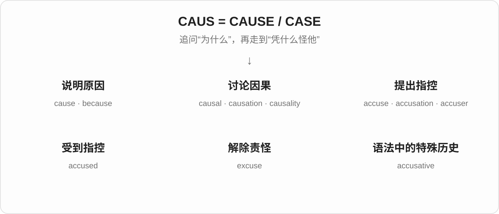

## 词形与演化规律

**caus- 与 -cus- 的联系发生在拉丁语阶段。** causa 在 accūsāre、excūsāre 等复合词中呈现 cūs-。accuse 的 ac- 来自 ad- 的同化；excuse 的 ex- 表示移出、解除。不要归纳成英语单词里的 au 可以任意改成 u。

## 单词速览（按词族由简到繁）

同一基础词的相关扩展放在一起，先读基础形式，再读扩展；各组之间优先读常用的。具体词源关系见各词讲解。

| 单词 | 音标 | 核心意思 |
|---|---|---|
| [because](#w-1) | 英 /bɪˈkɒz/；美 /bɪˈkʌz/ | 因为 |
| [cause](#w-2) | /kɔːz/ | 原因；引起；值得支持的主张或事业 |
| [causal](#w-7) | /ˈkɔːzəl/ | 因果的；涉及原因的 |
| [causality](#w-10) | /kɔːˈzæləti/ | 因果关系；因果性 |
| [causally](#w-13) | /ˈkɔːzəli/ | 在因果关系上；由因果作用连接地 |
| [causation](#w-8) | /kɔːˈzeɪʃən/ | 造成结果的过程；因果关系 |
| [excuse](#w-3) | 名词 /ɪkˈskjuːs/；动词 /ɪkˈskjuːz/ | 借口；为……开脱；原谅；准许免做 |
| [accuse](#w-5) | /əˈkjuːz/ | 指责；指控 |
| [accused](#w-4) | /əˈkjuːzd/ | 被指控的；被告；accuse 的过去式和过去分词 |
| [accusation](#w-6) | /ˌækjʊˈzeɪʃən/ | 指控；指责 |
| [accuser](#w-9) | 英 /əˈkjuːzə/；美 /əˈkjuːzər/ | 指控者；指责他人的人 |
| [accusative](#w-12) | /əˈkjuːzətɪv/ | 宾格的；宾格 |
| [causative](#w-11) | /ˈkɔːzətɪv/ | 引起结果的；使役的 |

## 逐词讲解

### 1. because — 因为

**音标**：英 /bɪˈkɒz/；美 /bɪˈkʌz/

**先抓住这个画面**

because 像在两个信息之间放上一块“原因在这里”的路牌：先说发生了什么，再告诉你为什么。

**怎么拆**

源于中古英语 bi cause，字面是“出于这个原因”。bi 与 by 同源；不要按今天的 be + cause 理解成“成为原因”。

**怎么变成今天的意思**

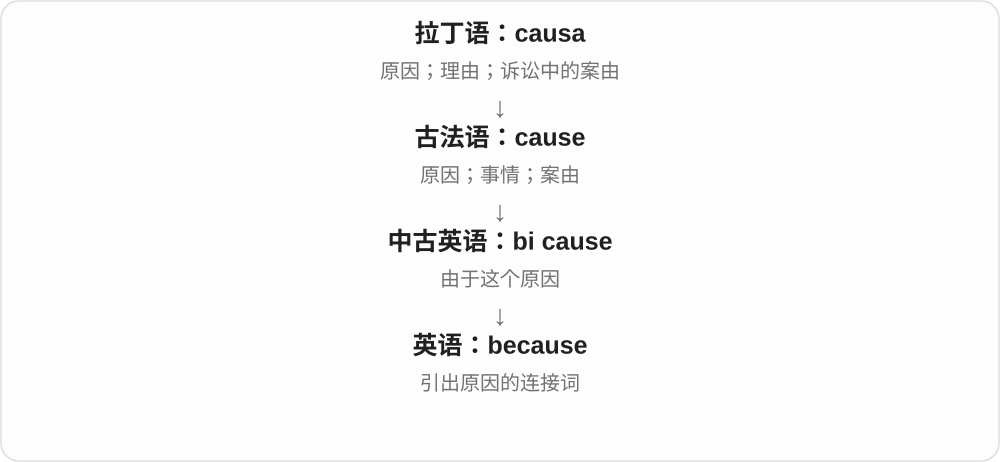

原本是两个词组成的说法，后来合成一个词，专门连接原因。because 后面通常跟完整小句；because of 后面通常跟名词或名词短语。

**常见搭配与例句**

because it rained（因为下雨了）；because of the rain（因为这场雨）；not because… but because…（不是因为……而是因为……）。

> I took the stairs because the lift was broken.

电梯坏了，所以我走了楼梯。

> The match was canceled because of the heavy rain.

比赛因为大雨取消了。

**别混淆**

because 直接回答“为什么”；so 通常引出结果。“Because it rained, we stayed home.” 已有 because，不必再加 so。

### 2. cause — 原因；引起；值得支持的主张或事业

**音标**：/kɔːz/

**先抓住这个画面**

cause 是推动事情发生的那一头：一根倒下的电线可能是停电的 cause。用作动词，就是“让某个结果发生”。

**怎么拆**

来自拉丁语 causa，经法语进入英语。它早就兼有“原因、理由、案件”等意思，不需要拆成更小的英语零件。

**怎么变成今天的意思**

“原因”回答事情为什么发生；“事业、主张”指让人愿意行动和支持的目标，如 a good cause。后者连着旧时“某一方主张、要为之辩护的事”的用法，不能把每个 cause 都译成原因。

**常见搭配与例句**

the cause of a problem（问题的原因）；cause damage（造成损坏）；cause someone to do something（使某人做某事）；support a good cause（支持公益事业或有意义的目标）。

> A loose wire caused the lights to go out.

一根松动的电线导致灯全灭了。

> We sold homemade cakes to raise money for a good cause.

我们卖自制蛋糕，为公益事业筹款。

**别混淆**

cause 常指造成结果的因素；reason 也可指人给出的解释或行动理由。effect 是已经产生的结果。

### 3. causal — 因果的；涉及原因的

**音标**：/ˈkɔːzəl/

**先抓住这个画面**

causal 要说的是“A 让 B 发生”，像两块多米诺骨牌之间确实存在推动关系。只是一起出现，还不够叫 causal。

**怎么拆**

来自拉丁语 causālis，由 causa 加形容词结尾形成。现代可用 cause + -al 帮助理解“与原因有关的”。

**怎么变成今天的意思**

cause 是原因这个东西；causal 是用来描述关系、解释或因素的形容词。a causal link 就是一个因素对另一个结果有影响，而非两个数字恰好一起升降。

**常见搭配与例句**

a causal link（因果联系）；a causal relationship（因果关系）；a causal explanation（说明为什么发生的解释）。

> The study found a causal link between the two events.

这项研究发现了两个事件之间的因果联系。

> We need a causal explanation, not just a list of events.

我们需要解释事情为什么发生，而不只是列出事件。

**别混淆**

causal 是因果的；casual 是随意的、休闲的。causal /ˈkɔːzəl/ 与 casual /ˈkæʒuəl/ 的拼写和发音都不同。

### 4. causality — 因果关系；因果性

**音标**：/kɔːˈzæləti/

**先抓住这个画面**

causality 把“A 为什么会带来 B”作为一种关系来讨论。它常出现在研究、哲学和推理中，问的是事情之间有没有真正的因果联系。

**怎么拆**

causal + -ity；-ity 把形容词变成性质名词。这里采用有记录的英语派生分析，不把推测出的拉丁词形当作必经祖先。

**怎么变成今天的意思**

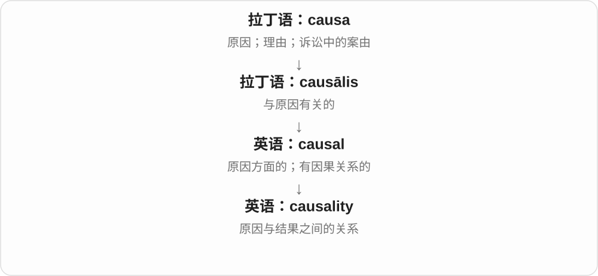

cause 指某个原因，causality 指“原因和结果能怎样联系起来”这件事。读到 direction of causality，要想的是 A 导致 B，还是 B 导致 A。

**常见搭配与例句**

the direction of causality（因果关系的方向）；establish causality（确定因果关系）；questions of causality（关于因果的问题）。

> The data do not show the direction of causality.

这些数据没有显示因果关系的方向。

> The seminar focused on causality in social research.

这场研讨会重点讨论社会研究中的因果关系。

**别混淆**

causality 与 causation 很多语境里可以重叠。前者常谈因果关系或原则，后者常谈产生结果的过程；不用把它们背成绝对互斥的概念。

### 5. causally — 在因果关系上；由因果作用连接地

**音标**：/ˈkɔːzəli/

**先抓住这个画面**

causally 是给“相关、连接、解释”等词加上限定：说的联系是一个影响另一个，而不只是同时出现。

**怎么拆**

causal + -ly，变成副词。可以把 causally linked 拆成“以因果关系 + 连着”。

**怎么变成今天的意思**

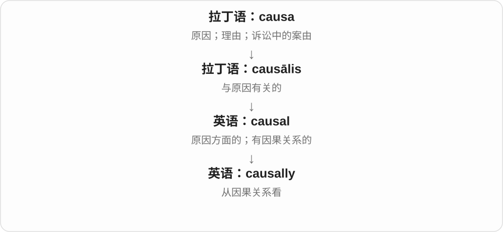

The events are causally linked 表示两个事件有因果联系。这个词常帮助研究者明确自己讨论的是哪一种关系，也提醒读者留意证据是否支持这种说法。

**常见搭配与例句**

causally linked（有因果联系的）；causally related（因果相关的）；causally independent（在因果上独立的）。

> The two failures may be causally linked.

这两次故障可能有因果联系。

> Two events can occur together without being causally related.

两个事件可以同时发生，却没有因果关系。

**别混淆**

causally 与 casually 只差几个字母却相差很远：casually dressed 是穿着随意；causally linked 是有因果联系。

### 6. causation — 造成结果的过程；因果关系

**音标**：/kɔːˈzeɪʃən/

**先抓住这个画面**

causation 关注“到底是什么让它发生了”。想象你看到一排倒下的骨牌，接着追查第一下推动从哪里来。

**怎么拆**

cause 与名词后缀 -ation 相结合，把“引起”变成可讨论的过程或关系。

**怎么变成今天的意思**

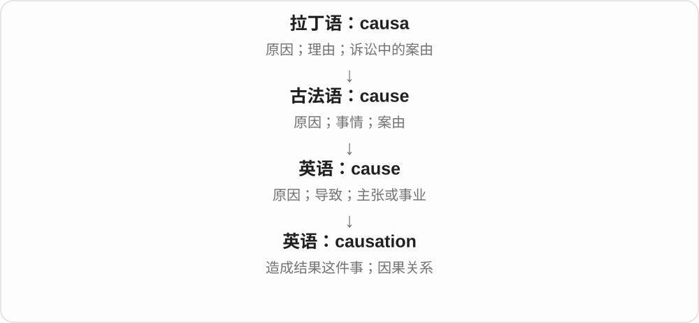

这个词把注意力放在原因怎样产生结果。Correlation does not imply causation 说的是：两个现象一起变化，仍可能受第三个因素影响，不能光凭相伴出现就认定一个造成另一个。

**常见搭配与例句**

establish causation（证明因果关系）；evidence of causation（因果关系的证据）；correlation and causation（相关与因果）。

> The pattern suggests a connection but does not establish causation.

这种规律说明可能有关联，但还不能证明因果关系。

> The experiment was designed to investigate causation.

这项实验旨在研究因果关系。

**别混淆**

correlation 是“变化有联系”；causation 是“一个对另一个产生作用”。两者可以同时存在，却不是同一件事。

### 7. excuse — 借口；为……开脱；原谅；准许免做

**音标**：名词 /ɪkˈskjuːs/；动词 /ɪkˈskjuːz/

**先抓住这个画面**

excuse 的画面是：一件事本来要怪在你头上，现在有人给出理由，把这份责怪移开。这个理由可能充分，也可能只是推托。

**怎么拆**

历史上是拉丁语 ex-（移出）+ causa（指控、案由）组成 excūsāre。经法语 escuser 进入英语。今天不要把 ex- 看成“前任”的 ex。

**怎么变成今天的意思**

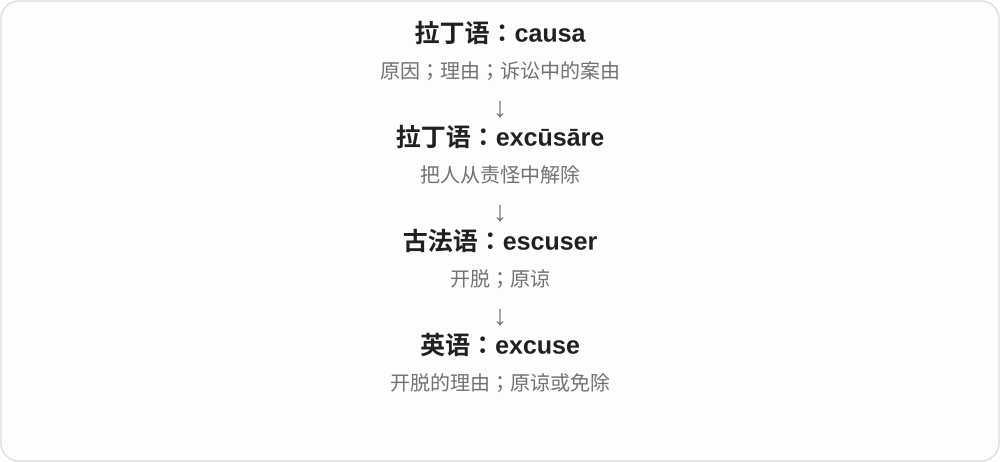

名词 an excuse 是用来解释、开脱的理由；动词 excuse 是原谅某人的行为，或允许他不参加某事。Excuse me 常是打扰别人前的一句礼貌招呼。动词最后是 /z/，名词最后是 /s/。

**常见搭配与例句**

make an excuse（找借口）；excuse someone for being late（原谅某人迟到）；be excused from class（获准不参加课程）；Excuse me（劳驾；不好意思）。

> He made an excuse and left before the meeting ended.

他找了个借口，在会议结束前离开了。

> Please excuse me for interrupting.

请原谅我打断一下。

**别混淆**

explanation 只说明事情怎么回事；excuse 往往还想减轻责怪。That explains it, but does not excuse it 表示“解释得通，却不能因此免责”。

### 8. accuse — 指责；指控

**音标**：/əˈkjuːz/

**先抓住这个画面**

accuse 像把一支写着“这件坏事是你干的”的箭头指向某人。日常争执和正式指控都能用，重点是明确把过错归给某人。

**怎么拆**

拉丁语 ad-（朝向）+ causa（案由、指控）形成 accūsāre；ad- 的 d 在 c 前同化为 c。caus- 在这个拉丁复合词中成为 cūs-，不是英语里可以随便套用的变换规则。

**怎么变成今天的意思**

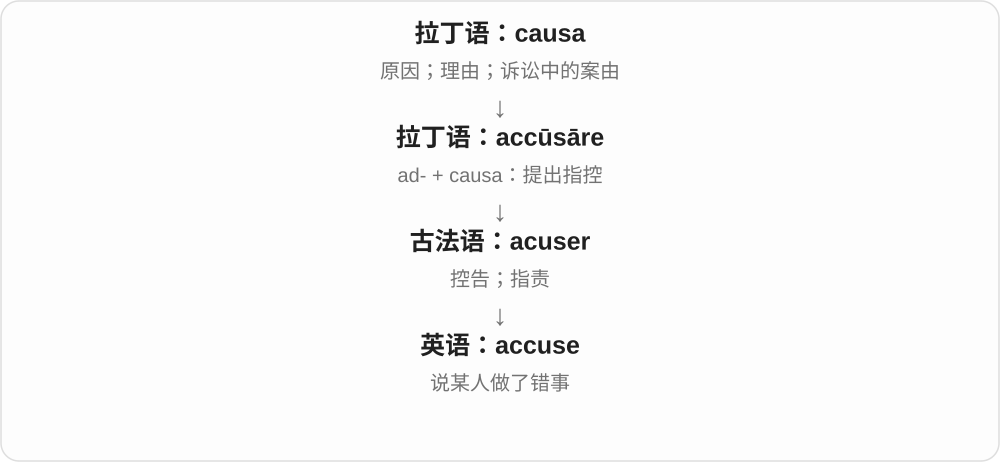

从“对某人提出案由”到“说某人做错了事”，意义联系很直接。今天 accuse 常用 accuse someone of something；of 后也能放 doing。

**常见搭配与例句**

accuse someone of lying（指责某人撒谎）；accuse someone of theft（指控某人盗窃）；falsely accuse（诬告；错误指责）。

> He accused me of hiding the keys.

他指责我把钥匙藏了起来。

> Do not accuse her without checking the facts.

没有核实事实，就别指责她。

**别混淆**

blame someone for something 常是把责任归给某人；accuse someone of something 更突出“声称他做了某件错事”。两者的介词也不同。

### 9. accused — 被指控的；被告；accuse 的过去式和过去分词

**音标**：/əˈkjuːzd/

**先抓住这个画面**

accused 把镜头转向受到指控的一方：有人说他做了错事。仅凭这个词，还不能知道这件事最后是否被证实。

**怎么拆**

accuse + -ed；词尾已有 e，只加 d。过去分词可用来描述状态；the accused 可以指被告。

**怎么变成今天的意思**

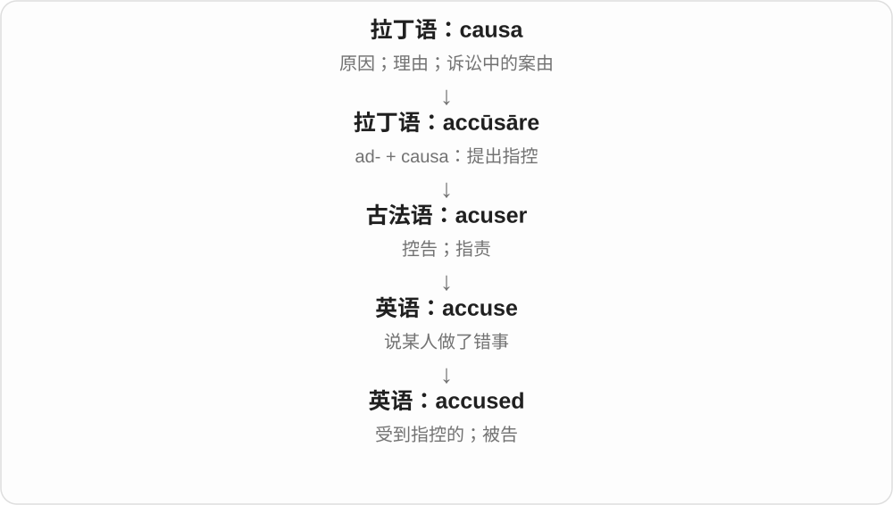

accuse 是提出指控的动作，be accused of 是承受指控。the accused 把形容词形式用作名词，指那位或那些被指控者；单复数要看语境。

**常见搭配与例句**

be accused of theft（被指控盗窃）；the accused person（受到指控的人）；the accused（被告）。

> She was accused of copying another student’s work.

她被指控抄袭了另一名学生的作业。

> The accused denied taking the money.

被告否认拿了那笔钱。

**别混淆**

accused 只说有人提出指控；convicted 说已经被裁定有罪。阅读新闻时，这个差别很关键。

### 10. accusation — 指控；指责

**音标**：/ˌækjʊˈzeɪʃən/

**先抓住这个画面**

accusation 是那句具体的“你做了坏事”的说法。它把 accuse 的动作装进一个名词，方便说“提出、否认、回应这项指控”。

**怎么拆**

现代可对照 accuse 与 -ation 理解；历史上英语借用了法语 acusacion，后者来自拉丁语 accūsātiō，属于 accūsāre 的动作名词。

**怎么变成今天的意思**

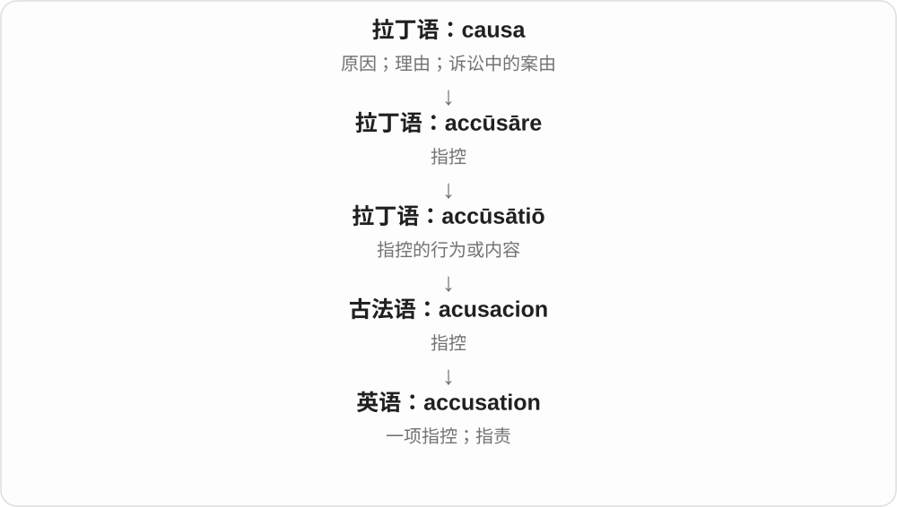

accusation 可以是一项具体说法，也可指指责的行为。语气比单纯的 comment 或 criticism 更重，因为它通常涉及某人做错了什么。

**常见搭配与例句**

make an accusation（提出指控）；deny an accusation（否认指控）；an accusation of fraud（欺诈指控）；an accusation against someone（针对某人的指控）。

> She denied the accusation that she had changed the records.

她否认了自己修改记录的指控。

> His accusation took everyone in the room by surprise.

他的指责让房间里的所有人都很意外。

**别混淆**

criticism 可以只是“你的方法不够好”；accusation 往往是“你做了不该做的事”。提出 accusation 不等于已经证明它。

### 11. accuser — 指控者；指责他人的人

**音标**：英 /əˈkjuːzə/；美 /əˈkjuːzər/

**先抓住这个画面**

accuser 是提出那句“是你干的”的人。把场景中的两个人分开：accuser 提出指控，the accused 接受指控。

**怎么拆**

现代看是 accuse + -er；历史上也有古法语 accusour 传入的路线，追溯到拉丁语 accūsātor。

**怎么变成今天的意思**

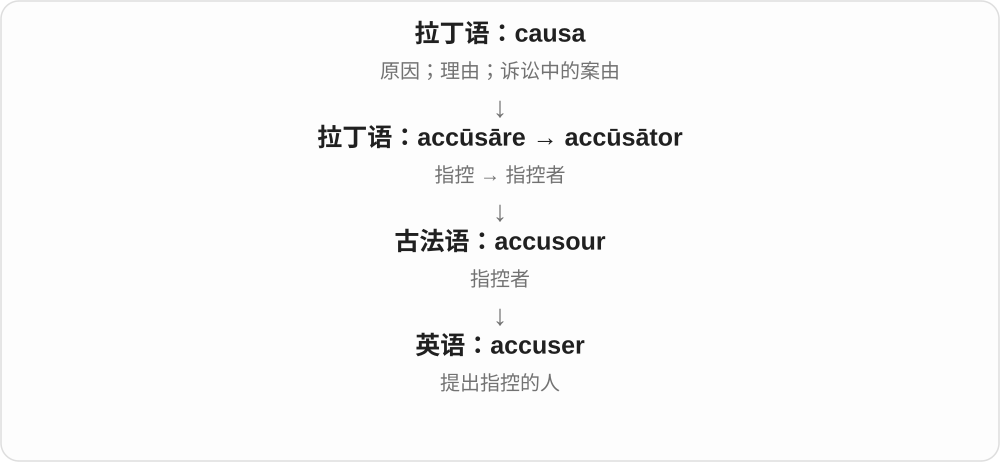

-er 帮你记住“做动作的人”，但不必假装整词直到现代英语才造出来。accuser 只说明他提出了指控，不能据此判断他一定说真话或一定说假话。

**常见搭配与例句**

face one’s accuser（面对指控自己的人）；identify the accuser（确认指控者是谁）；an anonymous accuser（匿名指控者）。

> She asked her accuser to explain exactly what had happened.

她要求指控她的人具体说明发生了什么。

> The report did not name the accuser.

这份报告没有公布指控者的姓名。

**别混淆**

accuser 是提出指控的一方；witness 是证人。某个人可能两种身份都有，也可能只有其中一种。

### 12. accusative — 宾格的；宾格

**音标**：/əˈkjuːzətɪv/

**先抓住这个画面**

accusative 是语法中的“宾格”。初学时可以把它想成给动作承受对象贴上的标签，如“我看见他”里的“他”；具体规则仍取决于语言。

**怎么拆**

借自法语 accusatif 或拉丁语 accūsātīvus。它的确和 accūsāre“指控”有关，但这个语法名称牵涉古代对希腊术语的误解，不能靠“被指控的人”解释宾格。

**怎么变成今天的意思**

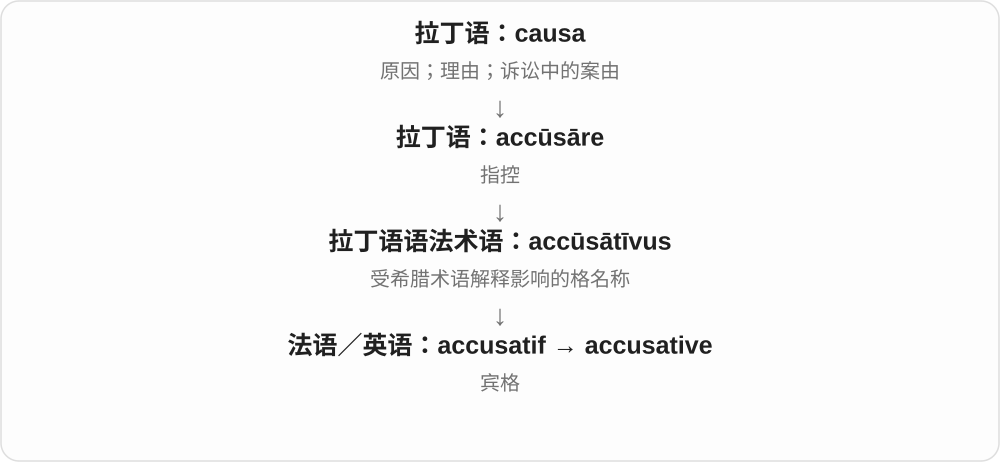

希腊术语原本与“受作用、由某事造成”相关，拉丁传统却把相关词理解成“指控”，名称由此保留下来。学习用途比这个名字重要：宾格常标记直接宾语；某些语言还用它表示运动方向等。

**常见搭配与例句**

the accusative case（宾格）；an accusative noun（宾格形式的名词）；take the accusative（要求后接宾格）。

> In Latin, the direct object is often in the accusative case.

在拉丁语中，直接宾语常用宾格。

> The teacher asked us to identify the accusative noun.

老师让我们找出那个使用宾格的名词。

**别混淆**

accusation 是指控；accusative 是语法术语。nominative 常用于主语，accusative 常用于直接宾语，但别把这个概括当成所有语言的全部规则。

### 13. causative — 引起结果的；使役的

**音标**：/ˈkɔːzətɪv/

**先抓住这个画面**

causative 指“能让某件事发生”的。放到语法里，就是句子中有人让另一个人做事，例如 make someone laugh。

**怎么拆**

来自法语 causatif，追溯到拉丁语 causātīvus，与 causa 相连。-ative 在这里构成形容词，不等于一个独立的英语单词。

**怎么变成今天的意思**

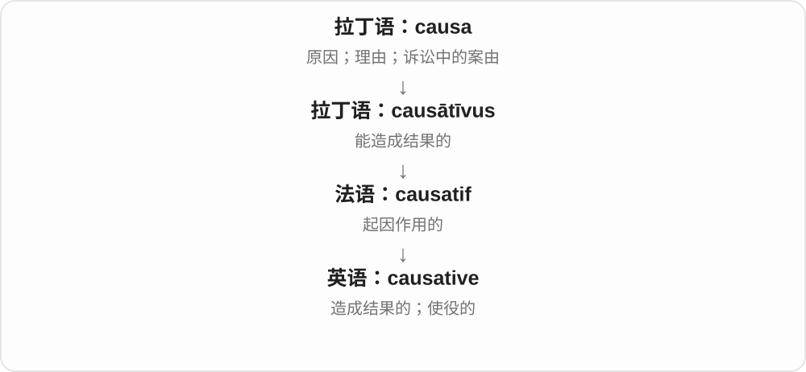

日常理解可以抓住“让……发生”。a causative factor 是促成某个结果的因素；a causative verb 用语言表达“使、让、叫某人做某事”。

**常见搭配与例句**

a causative factor（致因因素）；a causative verb（使役动词）；a causative construction（使役结构）。

> The report identifies several causative factors.

报告指出了几个造成这一结果的因素。

> In “The joke made us laugh,” made is a causative verb.

在“The joke made us laugh”中，made 是使役动词。

**别混淆**

causal 多描述因果关系；causative 更突出产生作用的一方或表达“使”的结构。二者在“致因”语境中也有重叠。

## 这一组要分清什么

**原因与借口不一样。** cause 是促成事情的因素；excuse 是用来解释或减轻责怪的理由，有时充分，有时只是推托。

**指控与证实不一样。** accuser 提出 accusation，the accused 受到指控；这些词本身都没有宣布谁已经被证实有罪。

**accusative 不能靠故事硬背。** 它的“宾格”名称牵涉古代语法术语的翻译，不能说“宾格就是被指控的人”。

## 串起来练习

看清角色：**The accuser made an accusation, but the accused said there was another cause.**

指控者提出了指控，但被指控者说另有原因。accuser 是提出说法的人，accusation 是说法本身，accused 是受到指控的人，cause 是造成事情的因素。
