# 0055 · rot- — 轮子；圆形；旋转；由卷轴发展的词族

[逐词精讲目录](../00_逐词精讲目录.md) · [总目录](../00_总目录_按常用程度.md)

## 核心词根与来源

**先看见一个轮子，再看它怎样把意义带出去。** 拉丁语 **rota** 是轮子，**rotāre** 是让它转，**rotundus** 是圆的。英语里 rotate、rotation 保留了转动，round 则经过法语，变得不太像原词。

另一条路更有意思：纸卷起来像小圆筒，**rotulus** 成了卷轴、登记卷。演员的台词卷发展成 **role**“角色”；名字写进登记卷，发展成 **enroll**“报名”；拿另一卷账目来核对，发展成 **control**“控制、监督”。这些词不能只看现代字母猜，历史上的实物把它们连了起来。

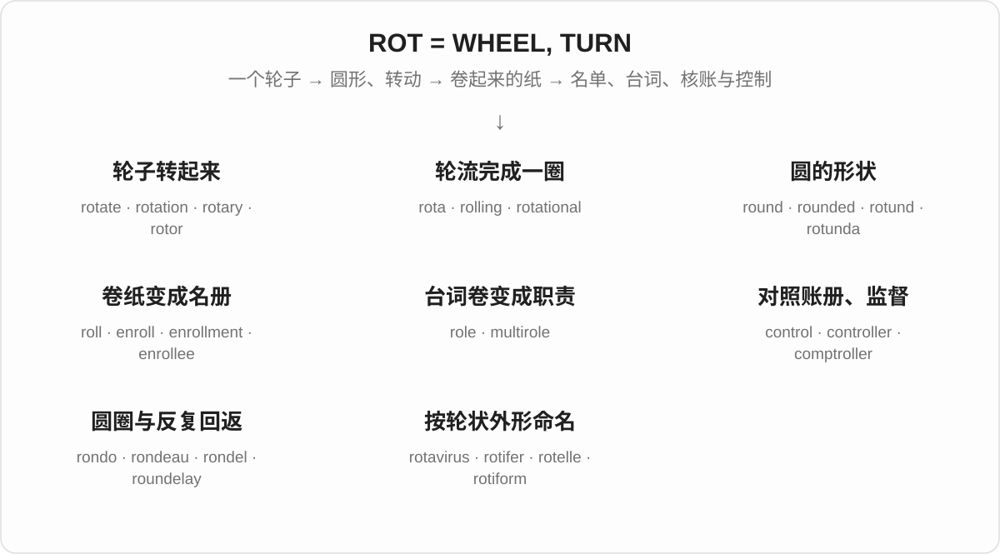

## 词形与演化规律

**rot- / round / roll / role 是同族中的不同路线，不是任意换字母。** round 经法语发生了较大变化；rotund 又从拉丁语借入。role 与 roll 读音一样，但 role 的角色义经过法语戏剧用法发展。

**现代拆分与传入历史分开看。** rotation、controller、enrollment 等有自己的拉丁语、法语来源，不能全画成由现代英语 rotate、control、enroll 才造出的词。enrol / enroll、enrolment / enrollment 是拼写变体。

**看见 rot 不一定就是这一族。** rot“腐烂”属于另一条日耳曼来源；routine 来自 route 的道路词族，也不能因为开头相近就当作轮子。round 旧时的“低声说话”义同样另有来源。

## 单词速览（常用到不常用）

| 单词 | 音标 | 核心意思 |
|---|---|---|
| [around](#w-1) | /əˈraʊnd/ | 围绕；在周围；到处；大约 |
| [control](#w-2) | 英 /kənˈtrəʊl/；美 /kənˈtroʊl/ | 控制；管理；克制；控制装置 |
| [role](#w-3) | 英 /rəʊl/；美 /roʊl/ | 角色；职责；作用 |
| [round](#w-4) | /raʊnd/ | 圆的；围绕；绕行；一轮；把数取整 |
| [roll](#w-5) | 英 /rəʊl/；美 /roʊl/ | 滚动；卷起；一卷；小面包；名册 |
| [controlled](#w-6) | 英 /kənˈtrəʊld/；美 /kənˈtroʊld/ | 受控制的；克制的；有对照设置的 |
| [rolling](#w-7) | 英 /ˈrəʊlɪŋ/；美 /ˈroʊlɪŋ/ | 滚动的；起伏的；连续更新的 |
| [controller](#w-8) | 英 /kənˈtrəʊlə/；美 /kənˈtroʊlər/ | 控制器；控制者；财务主管 |
| [rotation](#w-9) | 英 /rəʊˈteɪʃən/；美 /roʊˈteɪʃən/ | 旋转；转一圈；轮换 |
| [roller](#w-10) | 英 /ˈrəʊlə/；美 /ˈroʊlər/ | 滚轮；滚筒；滚刷；卷发筒 |
| [rounded](#w-11) | /ˈraʊndɪd/ | 圆润的；边角磨圆的；全面的；经舍入的 |
| [enrollment](#w-12) | 英 /ɪnˈrəʊlmənt/；美 /ɪnˈroʊlmənt/ | 注册；入学；注册人数 |
| [rotary](#w-13) | 英 /ˈrəʊtəri/；美 /ˈroʊtəri/ | 旋转式的；转动的；环形交叉路口（部分美式用法） |
| [rotate](#w-14) | 英 /rəʊˈteɪt/；美 /ˈroʊteɪt/ | 旋转；使转动；轮换 |
| [rodeo](#w-15) | 英 /ˈrəʊdiəʊ/；美 /ˈroʊdioʊ/，也 /roʊˈdeɪoʊ/ | 牛仔竞技；牛仔竞技表演 |
| [enroll](#w-16) | 英 /ɪnˈrəʊl/；美 /ɪnˈroʊl/ 或 /enˈroʊl/ | 报名；注册；招收；把名字列入名册 |
| [rotor](#w-17) | 英 /ˈrəʊtə/；美 /ˈroʊtər/ | 转子；旋翼 |
| [roulette](#w-18) | /ruːˈlet/ | 轮盘赌；小滚轮刻纹工具 |
| [roundabout](#w-19) | /ˈraʊndəbaʊt/ | 环形交叉路口；迂回的；绕弯的 |
| [roundup](#w-20) | /ˈraʊndʌp/ | 汇总；综述；把牲畜等赶拢的活动 |
| [rotational](#w-21) | 英 /rəʊˈteɪʃənəl/；美 /roʊˈteɪʃənəl/ | 旋转的；与转动有关的；轮换的 |
| [uncontrolled](#w-22) | 英 /ˌʌnkənˈtrəʊld/；美 /ˌʌnkənˈtroʊld/ | 未受控制的；失控的；无对照设置的 |
| [uncontrollable](#w-23) | 英 /ˌʌnkənˈtrəʊləbəl/；美 /ˌʌnkənˈtroʊləbəl/ | 无法控制的；难以抑制的 |
| [enrolment](#w-24) | 英 /ɪnˈrəʊlmənt/；美 /ɪnˈroʊlmənt/ | 注册；入学；注册人数，enrollment 的英式常见拼法 |
| [comptroller](#w-25) | 常读同 controller：英 /kənˈtrəʊlə/、美 /kənˈtroʊlər/；也读 /kəmˈtroʊlər/、/kəmpˈtroʊlər/ | 财务总监；主计长；审计主管 |
| [rondo](#w-26) | 英 /ˈrɒndəʊ/；美 /ˈrɑːndoʊ/ | 回旋曲；回旋曲式 |
| [uncontrollably](#w-27) | 英 /ˌʌnkənˈtrəʊləbli/；美 /ˌʌnkənˈtroʊləbli/ | 无法控制地；不由自主地 |
| [controllable](#w-28) | 英 /kənˈtrəʊləbəl/；美 /kənˈtroʊləbəl/ | 可控制的；能调节的 |
| [rotunda](#w-29) | 英 /rəʊˈtʌndə/；美 /roʊˈtʌndə/ | 圆形大厅；圆形建筑 |
| [rota](#w-30) | 英 /ˈrəʊtə/；美 /ˈroʊtə/ | 轮值表；排班表（主要英式） |
| [enrol](#w-31) | 英 /ɪnˈrəʊl/；美 /ɪnˈroʊl/ | 报名；注册，enroll 的英式常见拼法 |
| [rotator](#w-32) | 英 /rəʊˈteɪtə/；美 /ˈroʊˌteɪtər/ | 旋转装置；使部位旋转的肌肉 |
| [roundly](#w-33) | /ˈraʊndli/ | 严厉地；彻底地；断然地 |
| [arrondissement](#w-34) | 英 /əˈrɒndɪsmənt/；美 /əˈrɑːndɪsmənt/ | 法国等地的行政区；巴黎等城市的分区 |
| [microcontroller](#w-35) | 英 /ˈmaɪkrəʊkənˌtrəʊlə/；美 /ˈmaɪkroʊkənˌtroʊlər/ | 微控制器；单片机 |
| [rotund](#w-36) | 英 /rəʊˈtʌnd/；美 /roʊˈtʌnd/ | 圆胖的；圆形的；声音浑厚的 |
| [rotavirus](#w-37) | 英 /ˈrəʊtəˌvaɪrəs/；美 /ˈroʊtəˌvaɪrəs/ | 轮状病毒 |
| [unroll](#w-38) | 英 /ʌnˈrəʊl/；美 /ʌnˈroʊl/ | 展开卷着的东西；铺开 |
| [rotatable](#w-39) | 英 /rəʊˈteɪtəbəl/；美 /ˈroʊteɪtəbəl/ | 可旋转的；可以转动的 |
| [roundness](#w-40) | /ˈraʊndnəs/ | 圆度；圆润的性质 |
| [rondeau](#w-41) | 英 /ˈrɒndəʊ/；美 /ˈrɑːndoʊ/ | 回环诗；回旋歌、相关乐曲形式 |
| [roundel](#w-42) | /ˈraʊndəl/ | 圆形图案；圆形徽标；圆形物 |
| [enrollee](#w-43) | 美 /ˌenroʊˈliː/，也 /enˈroʊliː/ | 注册者；报名参加者 |
| [multirole](#w-44) | 英 /ˌmʌltiˈrəʊl/；美 /ˌmʌltiˈroʊl/ | 多用途的；能承担多种角色的 |
| [roundelay](#w-45) | 英 /ˈraʊndɪleɪ/；美 /ˈraʊndəleɪ/ | 带反复叠句的歌或诗；圆圈舞 |
| [rondel](#w-46) | 英 /ˈrɒndəl/；美 /ˈrɑːndəl/，也 /rɑːnˈdel/ | 回环诗体；圆形物；圆盘护手匕首 |
| [rotatory](#w-47) | 英 /ˈrəʊtətəri/ 或 /rəʊˈteɪtəri/；美 /ˈroʊtəˌtɔːri/ | 旋转的；使旋转的；轮流的 |
| [rotifer](#w-48) | 英 /ˈrəʊtɪfə/；美 /ˈroʊtɪfər/ | 轮虫 |
| [decontrol](#w-49) | 英 /ˌdiːkənˈtrəʊl/；美 /ˌdiːkənˈtroʊl/ | 解除管制；放开控制 |
| [irrotational](#w-50) | 英 /ɪˌrəʊˈteɪʃənəl/；美 /ɪˌroʊˈteɪʃənəl/ | 无旋的；不发生局部旋转的 |
| [rowel](#w-51) | /ˈraʊəl/ | 马刺上的小齿轮；刺激、鞭策（较少用） |
| [rotundity](#w-52) | 英 /rəʊˈtʌndəti/；美 /roʊˈtʌndəti/ | 圆形、圆胖的性质；声音或措辞的浑圆感 |
| [rondelle](#w-53) | 英 /rɒnˈdel/；美 /rɑːnˈdel/ | 小圆片；圆盘状饰物；圆环珠 |
| [circumrotation](#w-54) | 英 /ˌsɜːkəmrəʊˈteɪʃən/；美 /ˌsɜːrkəmroʊˈteɪʃən/ | 绕轴旋转；回转（少用） |
| [contrarotation](#w-55) | 英 /ˌkɒntrərəʊˈteɪʃən/；美 /ˌkɑːntrəroʊˈteɪʃən/ | 反向旋转；对转 |
| [redondilla](#w-56) | 美 /ˌreɪdoʊnˈdiːljə/ | 西班牙四行诗节形式 |
| [reenroll](#w-57) | 英 /ˌriːɪnˈrəʊl/；美 /ˌriːɪnˈroʊl/ | 重新注册；再次报名 |
| [rotelle](#w-58) | 英 /rəʊˈteleɪ/；美 /roʊˈteleɪ/ | 车轮形意大利面 |
| [rotiferous](#w-59) | 英 /rəʊˈtɪfərəs/；美 /roʊˈtɪfərəs/ | 有轮虫的；与轮虫有关的 |
| [rotiform](#w-60) | 英 /ˈrəʊtɪfɔːm/；美 /ˈroʊtɪfɔːrm/ | 轮状的；花冠轮形的 |
| [rotula](#w-61) | 英 /ˈrɒtjʊlə/；美 /ˈrɑːtʃələ/ | 髌骨的旧称；海胆咀嚼器中的特定骨片 |
| [rotundifolious](#w-62) | 英 /rəʊˌtʌndɪˈfəʊliəs/；美 /roʊˌtʌndɪˈfoʊliəs/ | 圆叶的（植物学旧式用词） |
| [roundlet](#w-63) | /ˈraʊndlɪt/ | 小圆片；小圆形物 |
| [semiround](#w-64) | /ˌsemiˈraʊnd/ | 半圆的；呈半圆形的 |

## 逐词讲解

### 1. around — 围绕；在周围；到处；大约

**音标**：/əˈraʊnd/

**先抓住这个画面**

around 先画一个圈：围着中心走，位置在周边；把精确数字放在圈中央，附近的一小片范围又能表示大约。

**怎么拆**

中古英语 a-（在、于）+ round，round 是经法语借来的“圆、圆圈”；前面的 a- 不是否定前缀。

**怎么变成今天的意思**

walk around the lake 是绕湖走；look around 是四处看看；around six 是六点左右或大约六个，要看后面说什么。

**常见搭配与例句**

around the corner；look around；around ten minutes；have friends around。

> We walked around the lake after lunch.

午饭后我们绕湖散步。

> The journey takes around twenty minutes.

路程大约需要二十分钟。

> Is anyone around to help me move this table?

附近有人能帮我搬一下这张桌子吗？

**别混淆**

about 也能说大约；around 还很突出围绕、周边和四处移动。

### 2. control — 控制；管理；克制；控制装置

**音标**：英 /kənˈtrəʊl/；美 /kənˈtroʊl/

**先抓住这个画面**

control 最有意思的老画面是两卷账本摆在一起核对：先查对不对，后来变成监督事情按要求运行。

**怎么拆**

历史上是 contra-（对照）+ rotulus（登记卷），经法语动词进入英语；现代不能按 con- + trol 硬拆。

**怎么变成今天的意思**

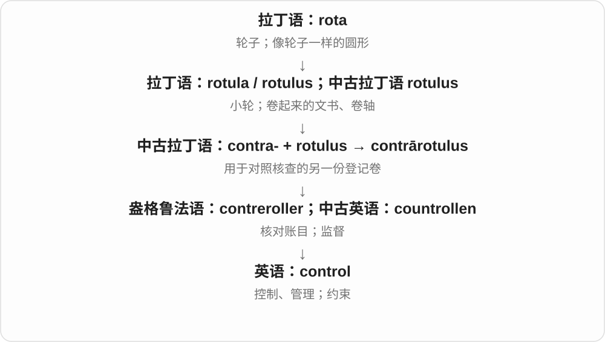

现在既说掌握方向，也说限制程度。under control 是情况可控；out of control 是控制不住；实验中的 control 提供比较基准。

**常见搭配与例句**

control the temperature；lose control；under control；a control group。

> This dial controls the temperature.

这个旋钮控制温度。

> She took a deep breath to control her anger.

她深吸一口气，克制怒火。

> The experiment included a control group.

实验设置了一个对照组。

**别混淆**

manage 偏组织和处理；control 更强调影响、决定或限制事情怎样发生。

### 3. role — 角色；职责；作用

**音标**：英 /rəʊl/；美 /roʊl/

**先抓住这个画面**

role 原先联系演员拿在手里的台词卷：卷子写着你该说什么、做什么，于是转指你扮演的角色。

**怎么拆**

经法语 rôle 来自中古拉丁语 rotulus“卷轴”；同源的 roll 更早进入英语，role 是另一条借入路线。

**怎么变成今天的意思**

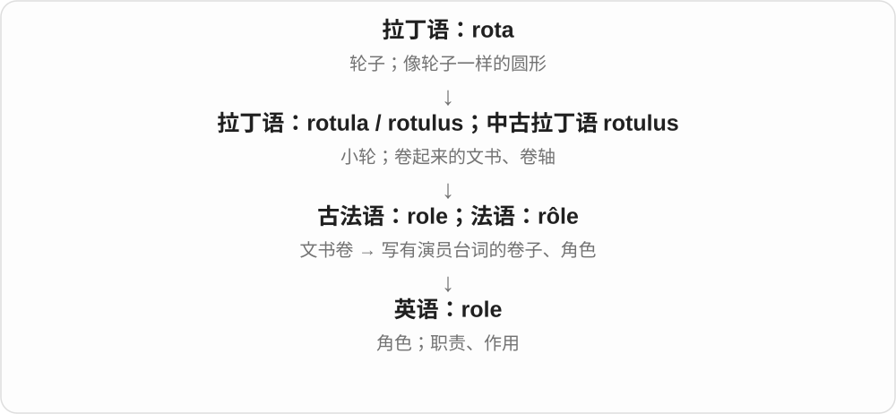

从舞台人物扩展到团队职责、事物作用。play a role in 不一定是演戏，可以说睡眠对学习有作用。

**常见搭配与例句**

play a role in；a leading role；the role of a teacher。

> She plays the leading role in the new production.

她在这部新剧中担任主角。

> Clear communication plays an important role in teamwork.

清楚沟通在团队合作中起重要作用。

**别混淆**

job 是工作职位或任务；role 是在某个关系、过程里承担的职责或作用。

### 4. round — 圆的；围绕；绕行；一轮；把数取整

**音标**：/raʊnd/

**先抓住这个画面**

round 先想一个圆：形状没有尖角，路绕着走，事情做完一圈，又能叫一轮。

**怎么拆**

来自法语 ront / roünt，远源为拉丁语 rotundus“圆的”。旧时“低声说话”的同形 round 则来自古英语 rūnian，与圆无关。

**怎么变成今天的意思**

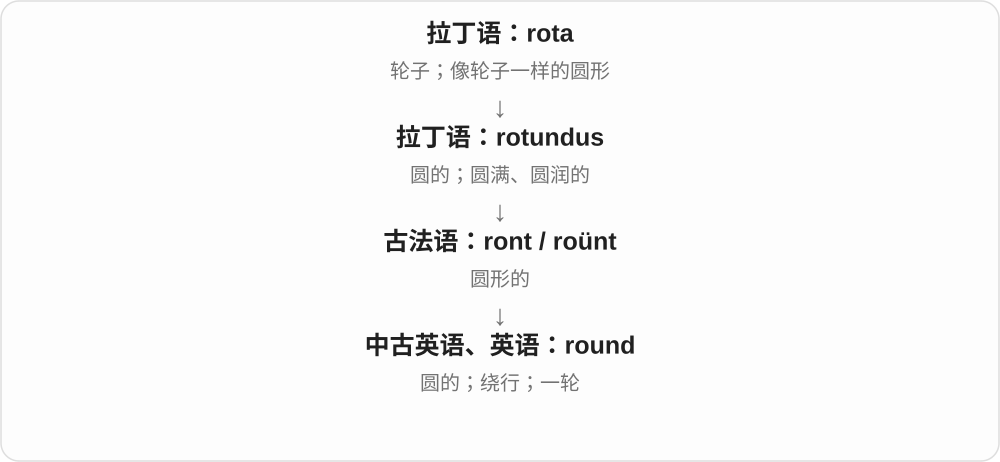

a round table 是圆桌；a round of questions 是一轮提问；round a number 是按指定精度取整，可能向上也可能向下。

**常见搭配与例句**

round the corner；a round table；a round of applause；round to the nearest ten。

> We sat around a round table.

我们围坐在圆桌旁。

> There will be another round of interviews next week.

下周还有一轮面试。

> Round 47 to the nearest ten.

把 47 四舍五入到最接近的整十数。

**别混淆**

round 是日常圆、围绕、一轮；circular 更常正式描述圆形或环形路径。

### 5. roll — 滚动；卷起；一卷；小面包；名册

**音标**：英 /rəʊl/；美 /roʊl/

**先抓住这个画面**

roll 像轮子沿地面转着走，也像纸一层层绕成圆筒；记录写在卷轴上，又能发展成名册。

**怎么拆**

动词经法语 roler 接拉丁 rotulāre；名册、卷轴名词经法语 rolle 接中古拉丁 rotulus，两支都远连 rota。

**怎么变成今天的意思**

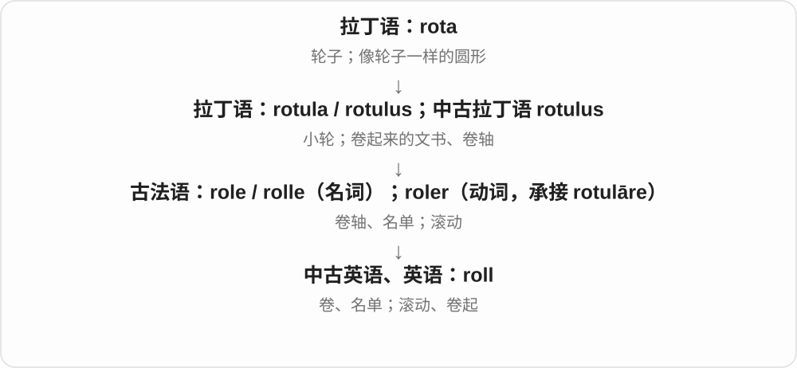

a roll of paper 是一卷纸；call the roll 是点名。a bread roll 通常是一个小面包，不要求今天还做成明显螺旋。

**常见搭配与例句**

roll down the hill；roll up a map；a roll of tape；call the roll。

> The ball rolled under the sofa.

球滚到了沙发下面。

> She rolled up the map and put it in her bag.

她把地图卷好，放进包里。

> The teacher called the roll before the trip.

出发前，老师点了名。

**别混淆**

rotate 只说明绕轴转；roll 常有沿表面滚动或把柔软东西卷起来的意思。

### 6. controlled — 受控制的；克制的；有对照设置的

**音标**：英 /kənˈtrəʊld/；美 /kənˈtroʊld/

**先抓住这个画面**

controlled 像把过程放进规定范围：温度保持稳定，动作收得住，实验则按设计设置控制条件。

**怎么拆**

control + -ed，双写 l 后加词尾；由过去分词形成形容词。

**怎么变成今天的意思**

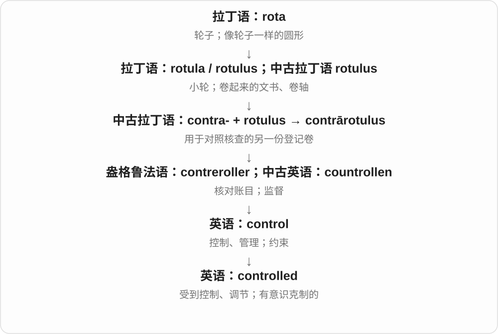

a controlled voice 是语气克制；controlled conditions 是受控条件；controlled experiment 里的控制也涉及比较设计，不是“科学家想要什么结果就得到什么”。

**常见搭配与例句**

controlled conditions；a controlled experiment；a controlled response。

> The samples were kept under controlled conditions.

样品保存在受控条件下。

> She answered in a calm, controlled voice.

她用平静克制的语气回答。

**别混淆**

controllable 是能控制；controlled 是已经受控或按控制条件实施。

### 7. rolling — 滚动的；起伏的；连续更新的

**音标**：英 /ˈrəʊlɪŋ/；美 /ˈroʊlɪŋ/

**先抓住这个画面**

rolling 像一圈接一圈往前推：球在滚，山丘的轮廓起伏相接，计划也可以随着时间不断向前更新。

**怎么拆**

roll + -ing，由动作形式发展出多种形容词用法。

**怎么变成今天的意思**

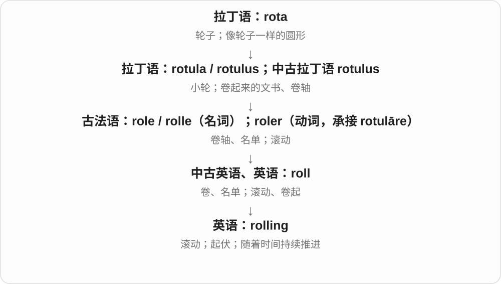

rolling hills 是连绵起伏的丘陵；rolling updates 或 rolling review 强调分批、持续推进，不是一次全部完成。

**常见搭配与例句**

rolling hills；a rolling programme；a rolling average；rolling updates。

> The road crossed a landscape of rolling hills.

道路穿过一片连绵起伏的丘陵。

> Applications are reviewed on a rolling basis.

申请会持续分批审查。

**别混淆**

fixed plan 是固定计划；rolling plan 随时间推进而定期更新，词义重点在连续向前。

### 8. controller — 控制器；控制者；财务主管

**音标**：英 /kənˈtrəʊlə/；美 /kənˈtroʊlər/

**先抓住这个画面**

controller 是那个发出指令、调节运行的人或装置：游戏手柄控制人物，财务主管检查账目。

**怎么拆**

历史经盎格鲁法语 contrerolleour 借入，早指检查账目者；现代可以看成 control + -er，但这个职业名不是现代英语临时拼出的。

**怎么变成今天的意思**

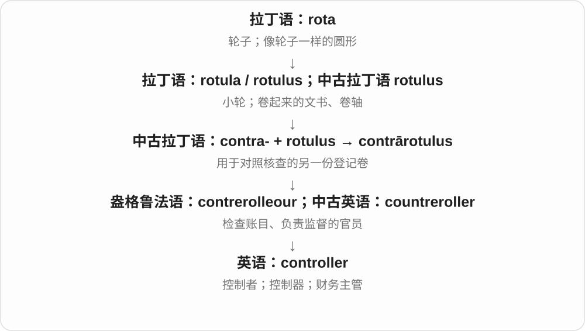

控制器是功能名称，不规定具体外形。公司里的 controller 常是财务岗位，不是负责公司所有事情的总经理。

**常见搭配与例句**

a game controller；an air traffic controller；a financial controller。

> The controller lets you adjust the motor speed.

这个控制器能让你调节电机转速。

> The financial controller reviewed the accounts.

财务主管检查了账目。

**别混淆**

control 可指控制行为或按钮等装置；controller 明确把注意力放在实施控制的人、设备或模块。

### 9. rotation — 旋转；转一圈；轮换

**音标**：英 /rəʊˈteɪʃən/；美 /roʊˈteɪʃən/

**先抓住这个画面**

rotation 像轮子绕轴转一圈；把岗位、作物或任务依次换一遍，也是在走完一个循环。

**怎么拆**

直接借拉丁语 rotātiō，来自 rotāre“转动”；现代与 rotate 对应，但名词有自己的借入历史。

**怎么变成今天的意思**

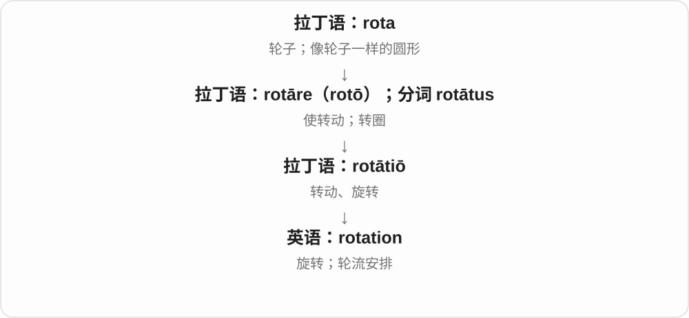

地球自转、机器旋转是物理运动；job rotation 是岗位轮换。重点可以是一圈动作，也可以是重复的轮换安排。

**常见搭配与例句**

the rotation of the Earth；crop rotation；job rotation；in rotation。

> The diagram shows the direction of rotation.

图示标出了旋转方向。

> The nurses work different shifts in rotation.

护士按轮换安排值不同班次。

**别混淆**

rotation 通常说绕自身轴转；orbit 说围绕另一个对象沿轨道运行，具体科学用法仍看语境。

### 10. roller — 滚轮；滚筒；滚刷；卷发筒

**音标**：英 /ˈrəʊlə/；美 /ˈroʊlər/

**先抓住这个画面**

roller 是用滚动来完成工作的东西：圆筒滚过墙面涂漆，滚过地面压平，或让纸张顺着机器前进。

**怎么拆**

roll + -er，中古英语已有 rollere 形式。

**怎么变成今天的意思**

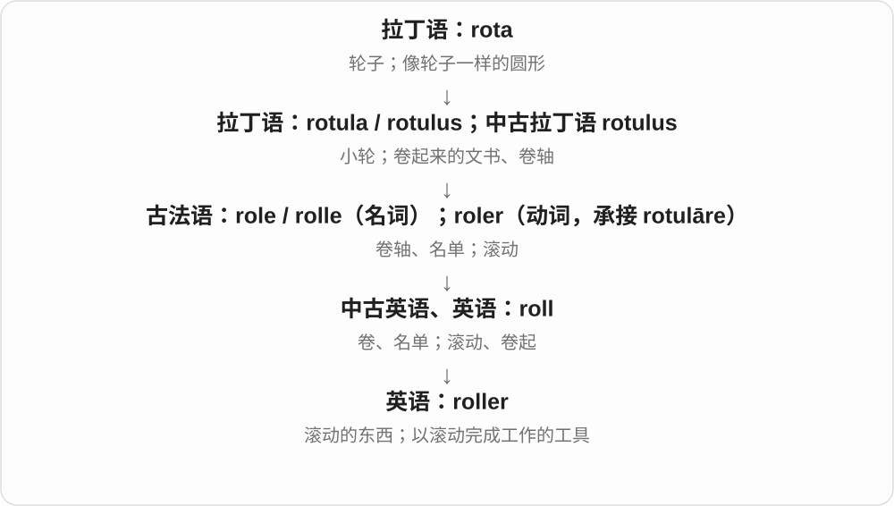

意思很依赖对象。paint roller 是滚刷；hair rollers 是卷发筒；机器里的 rollers 是滚筒或滚轮。

**常见搭配与例句**

a paint roller；hair rollers；a conveyor roller。

> Use a roller to paint the large wall.

用滚刷给这面大墙刷漆。

> The paper passes between two rubber rollers.

纸张从两个橡胶滚筒之间通过。

**别混淆**

wheel 多强调轮子支撑移动；roller 常强调圆筒或滚轮与表面接触、压过或带动物料。

### 11. rounded — 圆润的；边角磨圆的；全面的；经舍入的

**音标**：/ˈraʊndɪd/

**先抓住这个画面**

rounded 像尖角被磨去、轮廓变得平滑；描述人的发展时，则像各个方向都顾到了，没有明显缺口。

**怎么拆**

round + -ed，由动词“使圆、取整”的分词形成形容词。

**怎么变成今天的意思**

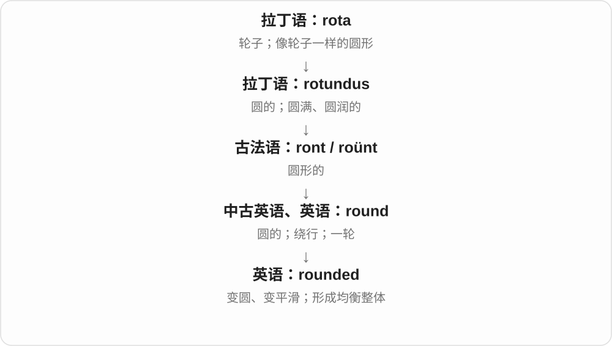

rounded edges 是圆滑边缘；a rounded education 是较全面的教育；a rounded figure 还可能是经过舍入的数字。

**常见搭配与例句**

rounded edges；a rounded shape；a rounded education；a rounded estimate。

> The table has rounded corners.

这张桌子的边角经过了磨圆处理。

> The course aims to give students a rounded education.

课程希望给学生较全面的教育。

**别混淆**

round 可以直接描述圆形；rounded 往往强调圆滑、圆润或经过处理，不一定是正圆。

### 12. enrollment — 注册；入学；注册人数

**音标**：英 /ɪnˈrəʊlmənt/；美 /ɪnˈroʊlmənt/

**先抓住这个画面**

enrollment 像名字已经登记进学校或课程名册；也可以把册子上的人数合起来谈。

**怎么拆**

借自中古法语 enrollement，与 enroller 同族；现代可联系 enroll + -ment。英式也常写 enrolment。

**怎么变成今天的意思**

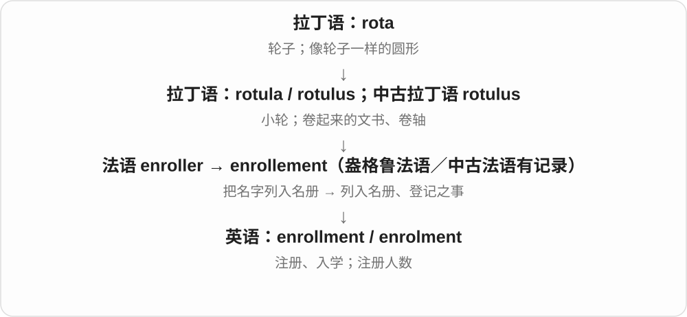

既可说登记这件事，也可说在读、参加人数。enrollment increased 通常是人数增加，不能译成办理登记这个动作变多。

**常见搭配与例句**

course enrollment；student enrollment；an enrollment form。

> Enrollment for the evening course opens on Monday.

晚间课程从星期一开始接受报名。

> Student enrollment rose this year.

今年的学生注册人数增加了。

**别混淆**

admission 是获准进入；enrollment 是正式注册加入。获得录取后，通常还要完成注册。

### 13. rotary — 旋转式的；转动的；环形交叉路口（部分美式用法）

**音标**：英 /ˈrəʊtəri/；美 /ˈroʊtəri/

**先抓住这个画面**

rotary 像一台靠转圈完成工作的机器：刀片转动、旋钮转动，工作方式本身是旋转。

**怎么拆**

来自中古拉丁语 rotārius“轮子的、与轮有关的”，远源 rota；不是所有形式都先经英语 rotate 再造。

**怎么变成今天的意思**

形容词常修饰机械。部分美国地区把环形路口叫 a rotary；首字母大写的 Rotary 还可能指扶轮社组织。

**常见搭配与例句**

a rotary engine；a rotary switch；a rotary mower。

> The machine uses a rotary blade to cut the material.

机器用旋转刀片切割材料。

> Turn the rotary switch to select a setting.

转动旋转开关来选择档位。

**别混淆**

rotary 描述设备通过旋转工作；rotational 更泛指与旋转有关的性质、运动。

### 14. rotate — 旋转；使转动；轮换

**音标**：英 /rəʊˈteɪt/；美 /ˈroʊteɪt/

**先抓住这个画面**

rotate 像让物体围着一根看得见或看不见的轴转；让几个人轮流做同一任务，也能借这个画面理解。

**怎么拆**

借自拉丁 rotātus，来自 rotāre“转动”，后者由 rota“轮子”形成。

**怎么变成今天的意思**

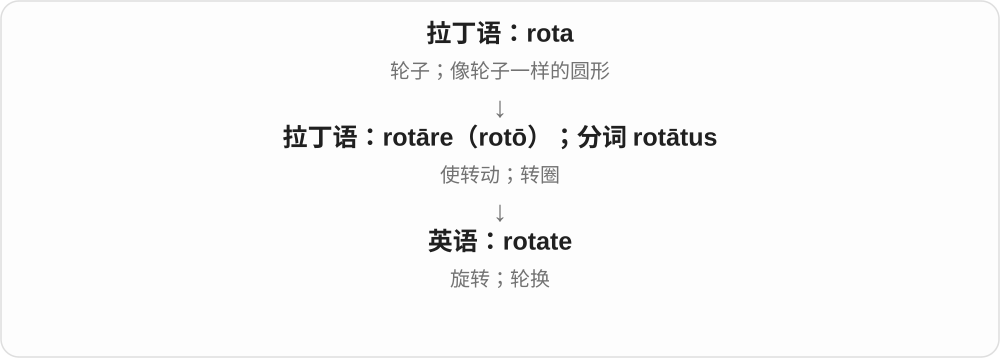

物体自己转和让物体转都能用。rotate duties 强调依次互换职责，不是永远让同一个人承担。

**常见搭配与例句**

rotate clockwise；rotate the image；rotate responsibilities。

> Rotate the image ninety degrees clockwise.

把图像顺时针旋转九十度。

> We rotate the responsibility for taking notes.

我们轮流负责记录。

**别混淆**

spin 常突出快速旋转；rotate 不要求速度快，也常用于精确角度或轮换安排。

### 15. rodeo — 牛仔竞技；牛仔竞技表演

**音标**：英 /ˈrəʊdiəʊ/；美 /ˈroʊdioʊ/，也 /roʊˈdeɪoʊ/

**先抓住这个画面**

rodeo 的老场景是把散开的牛群围拢起来；与骑乘、套索有关的牧场技能后来成为竞技表演。

**怎么拆**

借自西班牙语 rodeo，来自 rodear“围住、绕行”；这支与 rueda、拉丁 rota“轮”相连。

**怎么变成今天的意思**

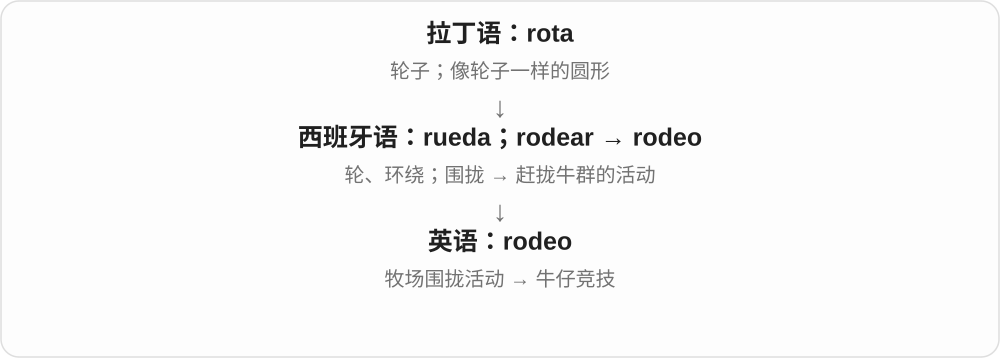

它是包含多种项目的活动名称，不等同于任何一次骑马。日常 this is not my first rodeo 是“这事我不是头一回干”。

**常见搭配与例句**

a rodeo event；a rodeo rider；not my first rodeo。

> The town holds a rodeo every summer.

这个镇每年夏天都会举办牛仔竞技活动。

> Don’t worry about the presentation; this isn’t my first rodeo.

别担心演示，这种事我不是头一次做。

**别混淆**

horse race 是赛马；rodeo 还涉及套索、骑乘牛马等不同牧场技能项目。

### 16. enroll — 报名；注册；招收；把名字列入名册

**音标**：英 /ɪnˈrəʊl/；美 /ɪnˈroʊl/ 或 /enˈroʊl/

**先抓住这个画面**

enroll 像把名字写进一份正式名单：从想参加，变成已登记的成员或学生。

**怎么拆**

经盎格鲁法语 enroller 传入，en-（进入）+ rolle（名册、登记卷）；现代可拆 en- + roll。

**怎么变成今天的意思**

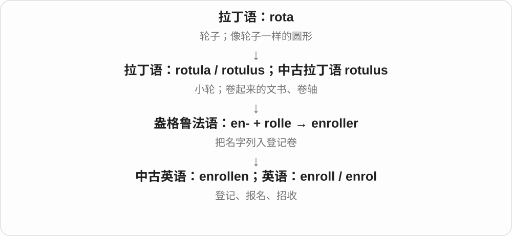

自己报名可说 enroll in a course；机构招收学生是 enroll students。英式常写 enrol，但 enrolled、enrolling 都通常保留双 l。

**常见搭配与例句**

enroll in a course；enroll at a college；enroll a child in school。

> I enrolled in a beginner’s photography course.

我报名参加了一门摄影入门课。

> The programme enrolled thirty students this term.

这个项目本学期招收了三十名学生。

**别混淆**

apply 是提出申请；enroll 是注册加入，申请后未必已经入选或注册。

### 17. rotor — 转子；旋翼

**音标**：英 /ˈrəʊtə/；美 /ˈroʊtər/

**先抓住这个画面**

rotor 是机器里实际转动的那一部分：电机内部的转子，或直升机上方不断旋转的旋翼。

**怎么拆**

由 rotator 不规则缩短而来，早见于数学命名，后来用于旋转机械；不是独立拉丁动词。

**怎么变成今天的意思**

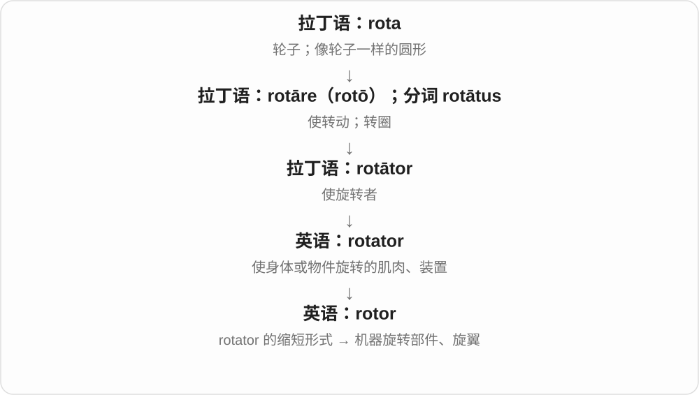

与固定不动的 stator“定子”对照，最容易理解电机里的意思。直升机 rotor 指整套旋翼系统，不只是其中一片叶片。

**常见搭配与例句**

a motor rotor；a helicopter rotor；rotor blades。

> The motor’s rotor turns inside the stationary housing.

电机的转子在固定外壳内转动。

> The helicopter’s main rotor began to turn.

直升机的主旋翼开始转动。

**别混淆**

blade 是叶片；rotor 是旋转部件或组件。一个 rotor 可以带多片 blades。

### 18. roulette — 轮盘赌；小滚轮刻纹工具

**音标**：/ruːˈlet/

**先抓住这个画面**

roulette 的名字就是“小轮子”：游戏里轮盘转、小球落位；雕刻里也有带小齿的滚轮工具。

**怎么拆**

借自法语 roulette，是 roue“轮子”的小称，远源拉丁 rota。

**怎么变成今天的意思**

最常见的是赌场游戏名。比喻用法强调结果难以掌控、带碰运气性质；不是说只要有圆盘就叫 roulette。

**常见搭配与例句**

a roulette wheel；a roulette table；play roulette。

> The film shows a crowded roulette table.

电影里出现了一张挤满人的轮盘赌桌。

> The engraver used a roulette to make a row of tiny marks.

雕刻师用滚轮刻纹工具做出了一排细小痕迹。

**别混淆**

lottery 是抽签或号码开奖类彩票；roulette 的具体机制是旋转轮盘和小球落点。

### 19. roundabout — 环形交叉路口；迂回的；绕弯的

**音标**：/ˈraʊndəbaʊt/

**先抓住这个画面**

roundabout 像本来可以直接到达，却绕着走了一段；道路上是绕中央岛行驶，表达上则是绕弯说。

**怎么拆**

round + about，两个表示周围、绕行的成分组成固定词。

**怎么变成今天的意思**

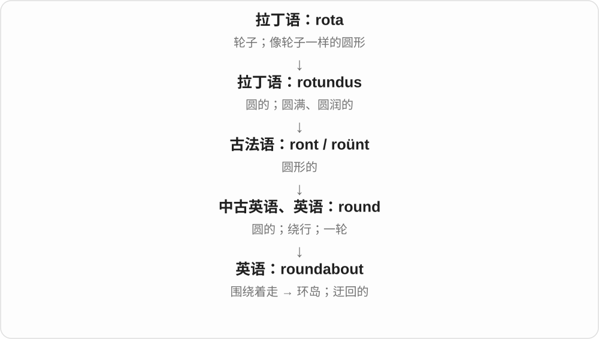

名词在英式英语中常是道路环岛；形容词可说绕路或表达不直接。英国也可用它指游乐场旋转设施。

**常见搭配与例句**

at the roundabout；a roundabout route；in a roundabout way。

> Take the second exit at the roundabout.

到环岛后从第二个出口驶出。

> He answered the question in a roundabout way.

他绕着弯回答了问题。

**别混淆**

detour 常是因障碍等改走的路线；roundabout 作形容词只说迂回，不一定说明为什么。

### 20. roundup — 汇总；综述；把牲畜等赶拢的活动

**音标**：/ˈraʊndʌp/

**先抓住这个画面**

roundup 像把四散的牛赶到一起，也像把散落在各处的新闻收拢，做成一份简明汇总。

**怎么拆**

从动词短语 round up 形成名词，round 在这里有围拢的意思。

**怎么变成今天的意思**

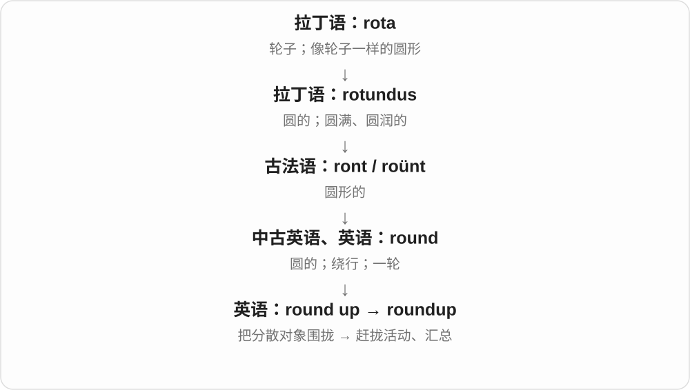

news roundup 是新闻综述；cattle roundup 是围拢牲畜。作名词通常写在一起，动词短语仍写 round up。

**常见搭配与例句**

a weekly roundup；a news roundup；a cattle roundup。

> The newsletter includes a weekly roundup of local events.

通讯包含每周本地活动汇总。

> The ranchers prepared for the spring cattle roundup.

牧场主们为春季集中赶拢牛群作准备。

**别混淆**

summary 可概括一份材料；roundup 常把一段时间或多个地方的相关信息汇集起来。

### 21. rotational — 旋转的；与转动有关的；轮换的

**音标**：英 /rəʊˈteɪʃənəl/；美 /roʊˈteɪʃənəl/

**先抓住这个画面**

rotational 把视线放到“怎样转、转得怎样”上，也可说工作安排怎样轮流进行。

**怎么拆**

rotation + -al。

**怎么变成今天的意思**

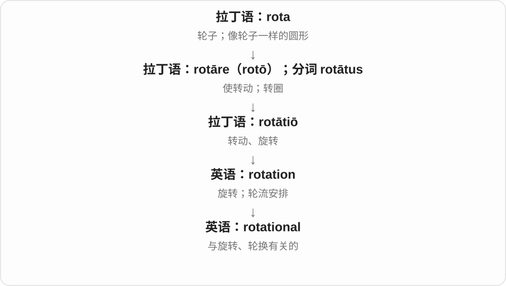

可用于角速度、对称性、岗位安排。流体中的 rotational 还可专指存在涡量，不能只凭水流路线弯不弯判断。

**常见搭配与例句**

rotational motion；rotational symmetry；rotational speed；a rotational programme。

> The experiment measures rotational speed.

实验测量旋转速度。

> The company offers a rotational training programme.

公司提供轮岗培训项目。

**别混淆**

rotary 多形容按旋转方式工作的机械；rotational 更适合说明运动、性质和安排。

### 22. uncontrolled — 未受控制的；失控的；无对照设置的

**音标**：英 /ˌʌnkənˈtrəʊld/；美 /ˌʌnkənˈtroʊld/

**先抓住这个画面**

uncontrolled 像原来的限制没有起作用，火势、情绪或扩张开始自行发展。

**怎么拆**

un-（未、不）+ controlled。

**怎么变成今天的意思**

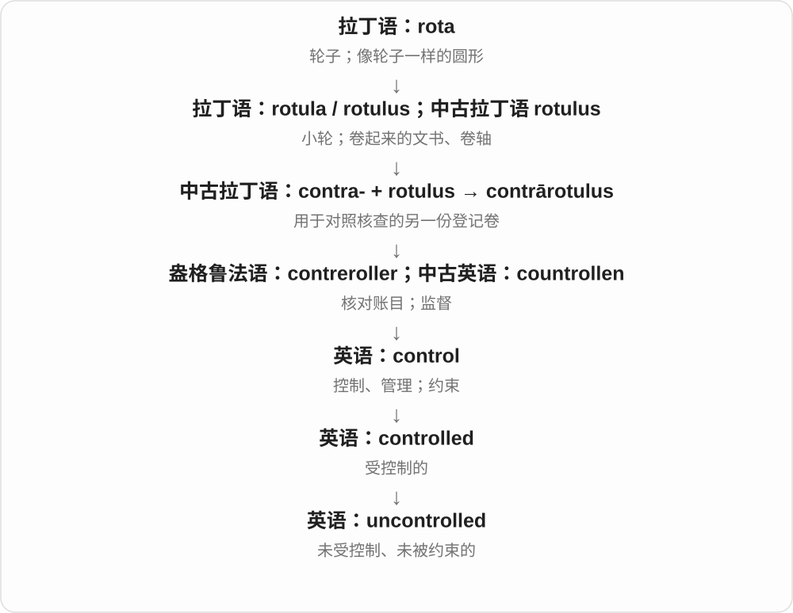

uncontrolled growth 是增长未受到约束；研究中的 uncontrolled study 可能是没有对照组，不是研究现场一片混乱。

**常见搭配与例句**

uncontrolled growth；uncontrolled laughter；an uncontrolled study。

> Uncontrolled growth put pressure on the town’s services.

无序增长给小镇的公共服务带来了压力。

> The room erupted in uncontrolled laughter.

屋里突然爆发出止不住的笑声。

**别混淆**

uncontrolled 说实际没有控制；uncontrollable 说难以或无法控制，后者更强调能力限制。

### 23. uncontrollable — 无法控制的；难以抑制的

**音标**：英 /ˌʌnkənˈtrəʊləbəl/；美 /ˌʌnkənˈtroʊləbəl/

**先抓住这个画面**

uncontrollable 像你想把闸门关上，力量却压不住；也可以是笑、哭等反应一时停不下来。

**怎么拆**

un-（不）+ controllable（可控制的）。

**怎么变成今天的意思**

可指客观上超出能力的因素，也可夸张描述强烈情绪。不是一看到 un- 就表示本来无人负责。

**常见搭配与例句**

uncontrollable laughter；an uncontrollable urge；uncontrollable factors。

> The story sent us into uncontrollable laughter.

那个故事让我们笑得停不下来。

> The plan accounts for several uncontrollable external factors.

计划考虑了几个无法控制的外部因素。

**别混淆**

uncontrolled 是没有受控的状态；uncontrollable 是不能或很难把它控制住。

### 24. enrolment — 注册；入学；注册人数，enrollment 的英式常见拼法

**音标**：英 /ɪnˈrəʊlmənt/；美 /ɪnˈroʊlmənt/

**先抓住这个画面**

enrolment 指名字列入名单这件事，也可以把已经登记的学生人数作为一个整体来谈。

**怎么拆**

与 enrollment 是同词的拼写变体，上接法语 enrollement；现代可联系 enrol + -ment。

**怎么变成今天的意思**

填写 enrolment form 是办理注册；enrolment figures 是注册人数数据。语境决定是过程还是数量。

**常见搭配与例句**

an enrolment form；enrolment figures；complete enrolment。

> Please complete the enrolment form in black ink.

请用黑色墨水填写注册表。

> The school published its annual enrolment figures.

学校公布了年度注册人数。

**别混淆**

enrolment 与 enrollment 无需分别背成两个词义；registration 是更广泛的登记名称。

### 25. comptroller — 财务总监；主计长；审计主管

**音标**：常读同 controller：英 /kənˈtrəʊlə/、美 /kənˈtroʊlər/；也读 /kəmˈtroʊlər/、/kəmpˈtroʊlər/

**先抓住这个画面**

comptroller 可以想成专门盯住账目的 controller。拼写里多出的 mp，与人们把它联想到“账目”有关。

**怎么拆**

由中古英语 controller 的旧拼法改写而来，受法语 compte“账目”的民间词源联想影响；不是原本真的拆成 compt + roller。

**怎么变成今天的意思**

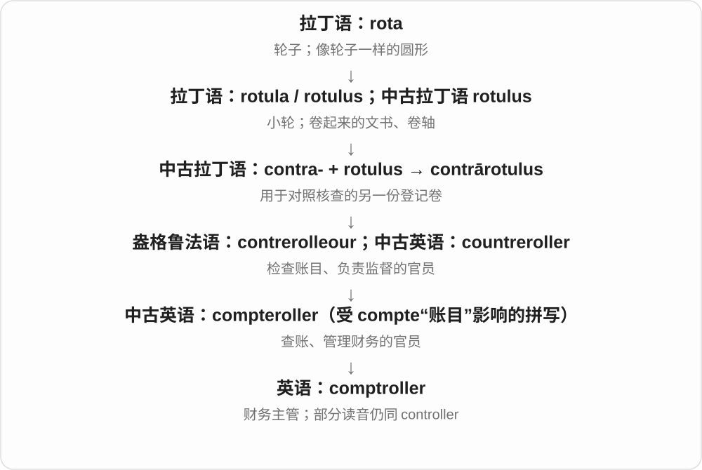

常见于政府、公共机构或企业的财务职衔。读音既有保留 controller 的，也有按字母读出 m 或 mp 的，不必强行只承认一种。

**常见搭配与例句**

the city comptroller；a corporate comptroller；the comptroller’s office。

> The city comptroller released the annual financial report.

市财务主管发布了年度财务报告。

> The comptroller reviewed the department’s spending records.

主计长审查了该部门的支出记录。

**别混淆**

controller 可泛指控制器或控制者；comptroller 主要限定在财务、审计职衔。

### 26. rondo — 回旋曲；回旋曲式

**音标**：英 /ˈrɒndəʊ/；美 /ˈrɑːndoʊ/

**先抓住这个画面**

rondo 像走出家门绕一段路又回家：主旋律反复回来，中间穿插不同段落。

**怎么拆**

借自意大利语 rondò，而意大利语借自法语 rondeau；不是英语 round 再加一个 o。

**怎么变成今天的意思**

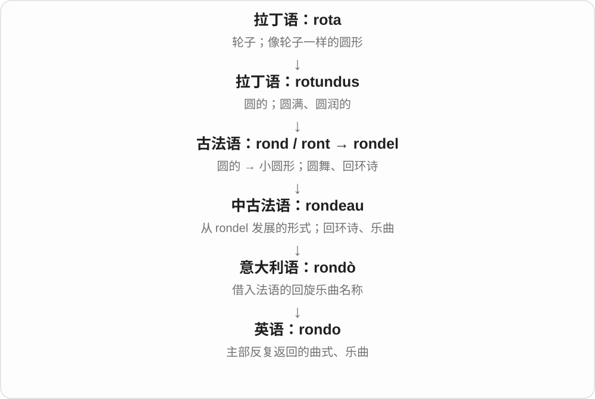

可用 A–B–A–C–A 先抓直观结构，但真实作品不只这一种安排。主部返回通常还会有变化。

**常见搭配与例句**

rondo form；a rondo finale；the main theme of the rondo。

> The final movement is a lively rondo.

最后一个乐章是一首活泼的回旋曲。

> Listen for the main theme each time it returns in the rondo.

听回旋曲时，留意主旋律每次重新出现。

**别混淆**

variation 围绕主题不断变奏；rondo 的显著线索是主部在不同插部之间再次回来。

### 27. uncontrollably — 无法控制地；不由自主地

**音标**：英 /ˌʌnkənˈtrəʊləbli/；美 /ˌʌnkənˈtroʊləbli/

**先抓住这个画面**

uncontrollably 形容动作已经冲过意志能管住的范围：明明想停，还是一直笑、哭或发抖。

**怎么拆**

uncontrollable + -ly；-able 词尾在副词里呈 -ably。

**怎么变成今天的意思**

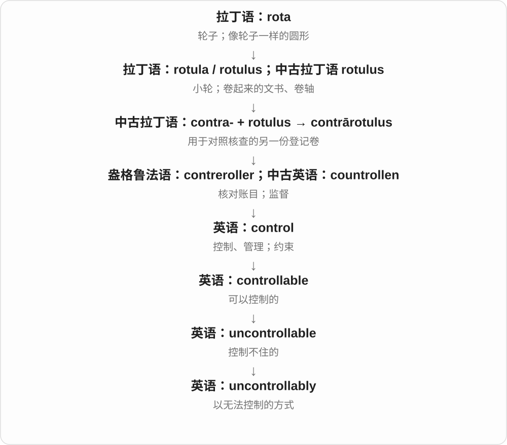

常修饰 laugh、cry、shake 等。它强调压不住，不一定意味着做的人完全没有意识。

**常见搭配与例句**

laugh uncontrollably；cry uncontrollably；shake uncontrollably。

> He began laughing uncontrollably at the mistake.

看到那个错误，他开始笑得停不下来。

> Her hands were shaking uncontrollably.

她的双手不由自主地抖个不停。

**别混淆**

deliberately 是有意地；uncontrollably 强调无法抑制，描述行为受控制的程度。

### 28. controllable — 可控制的；能调节的

**音标**：英 /kənˈtrəʊləbəl/；美 /kənˈtroʊləbəl/

**先抓住这个画面**

controllable 像一个有有效旋钮的过程：你采取行动，能把方向或程度调到想要的范围。

**怎么拆**

control + -able，末尾 l 双写后加后缀。

**怎么变成今天的意思**

说明有控制的可能，不保证现在已经控制得好。计划中常区分可控制因素和外部条件。

**常见搭配与例句**

controllable factors；a controllable process；easily controllable。

> The brightness is fully controllable from the panel.

亮度可以通过面板完全调节。

> We focused on the factors that were controllable.

我们把注意力放在能够控制的因素上。

**别混淆**

controlled 是已经受控；controllable 是有能力控制，讲的是可能性。

### 29. rotunda — 圆形大厅；圆形建筑

**音标**：英 /rəʊˈtʌndə/；美 /roʊˈtʌndə/

**先抓住这个画面**

rotunda 像你站在一个圆形空间中央，四周墙面环绕着你，上方常罩着圆顶。

**怎么拆**

来自意大利语 rotonda，联系拉丁 rotunda，即 rotundus“圆的”的阴性形式；不是英语 rotund 后加 -a 才形成。

**怎么变成今天的意思**

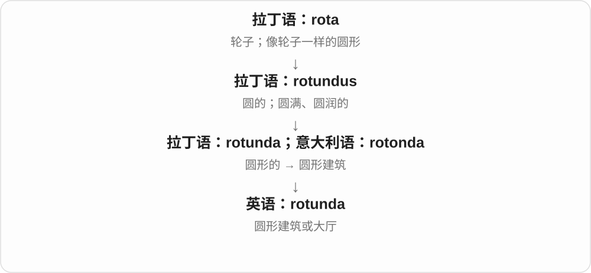

建筑义常见于博物馆、公共建筑。关键是平面或空间呈圆形，圆顶很常见，但不是仅凭有圆顶就能判断。

**常见搭配与例句**

the central rotunda；a domed rotunda；enter the rotunda。

> Visitors gathered in the museum’s central rotunda.

参观者聚集在博物馆中央的圆形大厅。

> Light entered the rotunda through an opening above.

光从上方的开口照进圆形大厅。

**别混淆**

dome 是圆顶；rotunda 是圆形建筑或空间，一个是顶部结构，一个是整体空间。

### 30. rota — 轮值表；排班表（主要英式）

**音标**：英 /ˈrəʊtə/；美 /ˈroʊtə/

**先抓住这个画面**

rota 像把几个人排成一圈，今天轮到你，明天轮到我，再把这个顺序写成表。

**怎么拆**

直接借自拉丁 rota“轮子”，在英语中用于轮流承担任务的安排。

**怎么变成今天的意思**

通常不仅列出姓名，还说明谁在什么时间承担哪项任务。它不要求表格在纸上画成圆形。

**常见搭配与例句**

a duty rota；a cleaning rota；be on the rota。

> My name is on the cleaning rota for Friday.

清洁轮值表上安排我星期五负责。

> The manager updated next week’s rota.

经理更新了下周的排班表。

**别混淆**

timetable 泛指时间安排；rota 尤其强调一组人之间的轮值、分工。

### 31. enrol — 报名；注册，enroll 的英式常见拼法

**音标**：英 /ɪnˈrəʊl/；美 /ɪnˈroʊl/

**先抓住这个画面**

enrol 与 enroll 做的是同一件事：把名字登记进学校、课程或计划的名单。

**怎么拆**

与 enroll 是拼写变体，来自盎格鲁法语 enroller；历史链不是英语 enrol 从 enroll 删一个 l 后才首次出现。

**怎么变成今天的意思**

英式常用 enrol，过去式 enrolled、进行式 enrolling 通常仍双写 l。不要因为字母数不同就以为一个指报名、另一个指录取。

**常见搭配与例句**

enrol on a course；enrol at college；enrol a child。

> You can enrol online before Friday.

你可以在星期五前在线报名。

> She plans to enrol on a writing course.

她打算报名参加一门写作课程。

**别混淆**

enrol / enroll 主要是拼写习惯差异；意义和核心用法相同。

### 32. rotator — 旋转装置；使部位旋转的肌肉

**音标**：英 /rəʊˈteɪtə/；美 /ˈroʊˌteɪtər/

**先抓住这个画面**

rotator 是负责把东西转起来的那一部分：机器里的转动装置，或让关节转动的肌肉。

**怎么拆**

借自拉丁 rotātor，由 rotāre 与作用者后缀 -tor 构成；现代可联系 rotate + -or，但应与实际借入历史分开。

**怎么变成今天的意思**

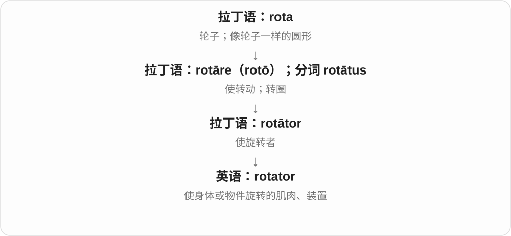

医学搭配 rotator cuff 是肩袖这个整体名称，不是一个叫 cuff 的小轮子。机械语境则常指转动物体的装置。

**常见搭配与例句**

a sample rotator；a rotator muscle；the rotator cuff。

> The sample rotator turns the tubes slowly.

样品旋转器缓慢转动试管。

> The diagram labels a rotator muscle of the shoulder.

图中标出了一块使肩部旋转的肌肉。

**别混淆**

rotor 常指机器中旋转的部件；rotator 更泛指使物件或身体部位发生旋转的装置、肌肉。

### 33. roundly — 严厉地；彻底地；断然地

**音标**：/ˈraʊndli/

**先抓住这个画面**

roundly 在常见搭配里不是“绕圈地”，而像评价从各方面压下来，力度很足、毫不含糊。

**怎么拆**

round + -ly；由 round 的完整、充分等旧用法发展出彻底、强烈的副词义。

**怎么变成今天的意思**

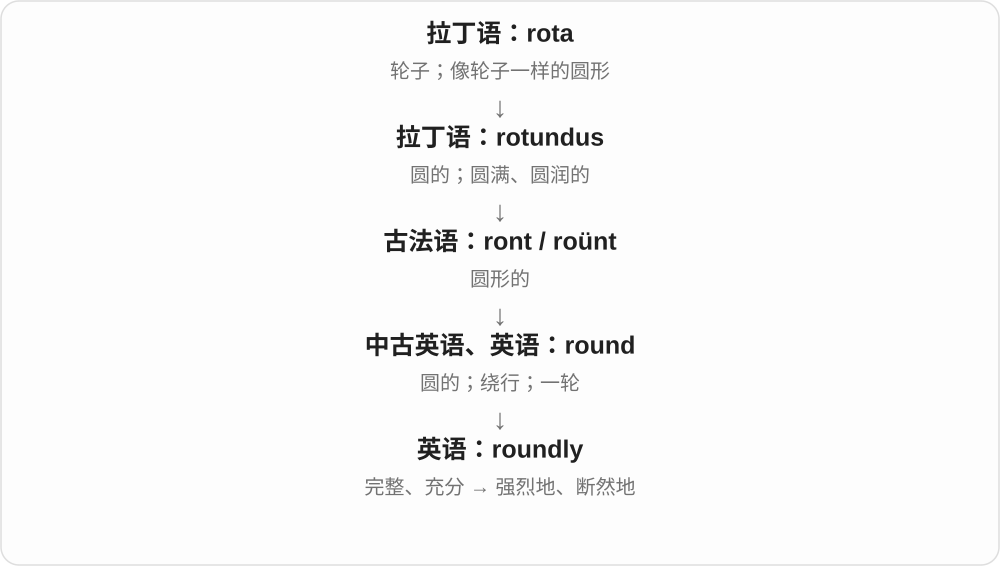

roundly criticized 是受到严厉批评；roundly defeated 是被彻底击败。很多时候可理解为 thoroughly 或 strongly。

**常见搭配与例句**

roundly criticize；roundly condemn；roundly reject；roundly defeat。

> The proposal was roundly criticized by the committee.

该提案遭到委员会的严厉批评。

> Their team was roundly defeated in the final.

他们队在决赛中遭到惨败。

**别混淆**

roundabout 是绕弯、迂回；roundly 在这些搭配里反而明确、强烈，不能靠共享 round 就译成同一种语气。

### 34. arrondissement — 法国等地的行政区；巴黎等城市的分区

**音标**：英 /əˈrɒndɪsmənt/；美 /əˈrɑːndɪsmənt/

**先抓住这个画面**

arrondissement 可以先想成地图上划出的一片管理区域；在巴黎旅行时，它常是地址里告诉你所在分区的词。

**怎么拆**

借自法语 arrondissement，来自 arrondir“使圆、使完整”，联系 rond“圆的”及拉丁 rotundus。

**怎么变成今天的意思**

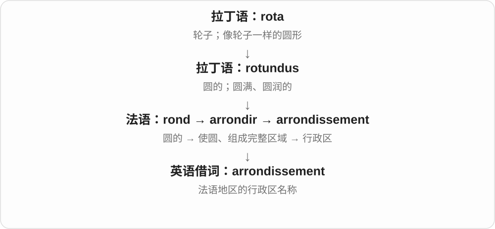

并不表示每个行政区真是圆形。不同地区的 arrondissement 层级不同，不要统一等同于某一种中国行政级别。

**常见搭配与例句**

the fifth arrondissement；a Paris arrondissement；an arrondissement office。

> Our hotel is in the fifth arrondissement of Paris.

我们的酒店在巴黎第五区。

> The guide includes a map of each arrondissement.

指南附有各行政区的地图。

**别混淆**

district 是宽泛的区；arrondissement 保留特定地区的行政名称。

### 35. microcontroller — 微控制器；单片机

**音标**：英 /ˈmaɪkrəʊkənˌtrəʊlə/；美 /ˈmaɪkroʊkənˌtroʊlər/

**先抓住这个画面**

microcontroller 像嵌在设备里的一颗小指挥脑：读取按钮或传感器的信息，再按程序让灯、电机等工作。

**怎么拆**

micro-（微小）+ controller，是现代技术构词。

**怎么变成今天的意思**

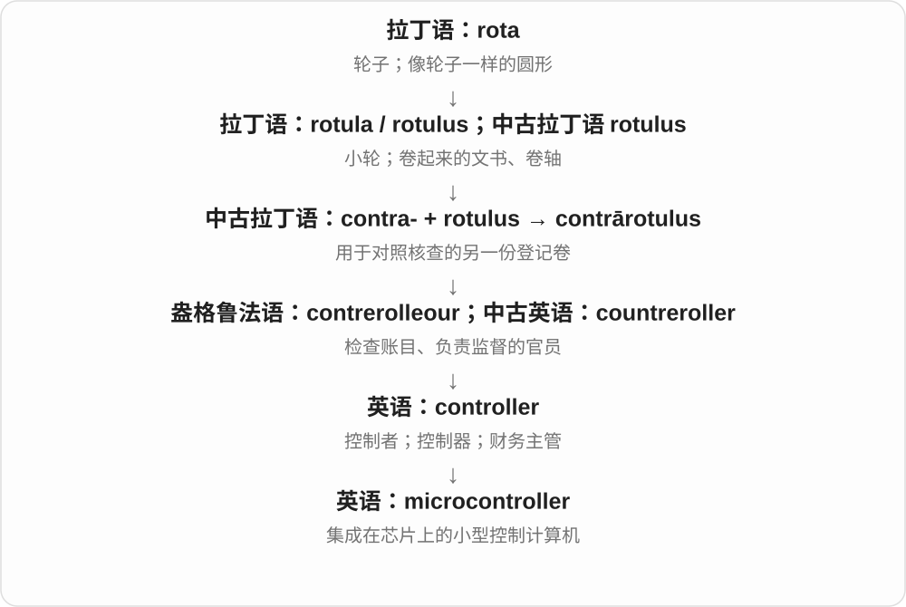

常把处理器、存储器和输入输出功能集成在一片芯片上。它能运行控制程序，不能只当成缩小的游戏手柄。

**常见搭配与例句**

program a microcontroller；a microcontroller board；a microcontroller-based device。

> The microcontroller reads the sensor every second.

微控制器每秒读取一次传感器。

> We programmed the microcontroller to switch on the light at dusk.

我们给微控制器编程，让它在黄昏时打开灯。

**别混淆**

microprocessor 侧重处理器；microcontroller 通常还集成控制应用所需的存储器、外设接口。

### 36. rotund — 圆胖的；圆形的；声音浑厚的

**音标**：英 /rəʊˈtʌnd/；美 /roʊˈtʌnd/

**先抓住这个画面**

rotund 让人想到饱满、向外鼓出的圆形；形容声音时，则是听起来浑厚、圆润。

**怎么拆**

直接借自拉丁 rotundus“圆的”，与经法语变化后进入英语的 round 是同源不同借入。

**怎么变成今天的意思**

描写人物体形时有明显形象色彩，适合文学描述，不是中性的身材数据。声音义要结合 voice、tones 等词判断。

**常见搭配与例句**

a rotund figure；a rotund man；rotund tones。

> The illustration shows a rotund character in a tiny hat.

插图画了一个戴小帽子的圆胖人物。

> The speaker delivered the speech in rotund tones.

演讲者用浑厚圆润的嗓音发表讲话。

**别混淆**

round 最普通，适用物体形状；rotund 较书面，常突出身体圆胖或声音饱满。

### 37. rotavirus — 轮状病毒

**音标**：英 /ˈrəʊtəˌvaɪrəs/；美 /ˈroʊtəˌvaɪrəs/

**先抓住这个画面**

rotavirus 的“轮”是显微镜下的外形：病毒颗粒看起来像一个小轮子，于是得了这个名称。

**怎么拆**

拉丁 rota（轮）+ virus；研究者在 1974 年依据电子显微镜观察提出这个名称。

**怎么变成今天的意思**

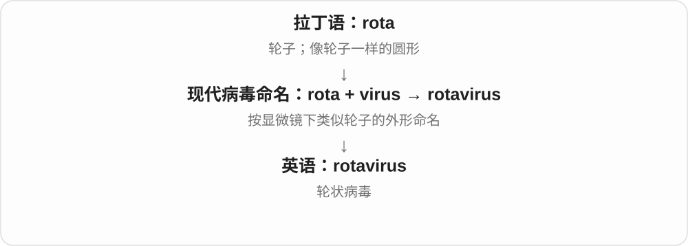

它可导致胃肠道感染，婴幼儿尤其容易出现明显腹泻、呕吐。“轮”描述命名外观，不代表病毒靠像轮子一样滚动传播。

**常见搭配与例句**

rotavirus infection；a rotavirus vaccine；test for rotavirus。

> The laboratory tested the sample for rotavirus.

实验室检测了样本中是否有轮状病毒。

> The textbook explains the wheel-like appearance of rotavirus.

教材解释了轮状病毒类似车轮的外观。

**别混淆**

virus 是病毒这一大类；rotavirus 是其中一类具体病毒，不能用来代指所有腹泻原因。

### 38. unroll — 展开卷着的东西；铺开

**音标**：英 /ʌnˈrəʊl/；美 /ʌnˈroʊl/

**先抓住这个画面**

unroll 像把卷成筒的地图慢慢摊平，原来藏在里面的内容一段段露出来。

**怎么拆**

un-（解除原动作）+ roll。这里的 un- 是反向操作，不只是形容词里的“不”。

**怎么变成今天的意思**

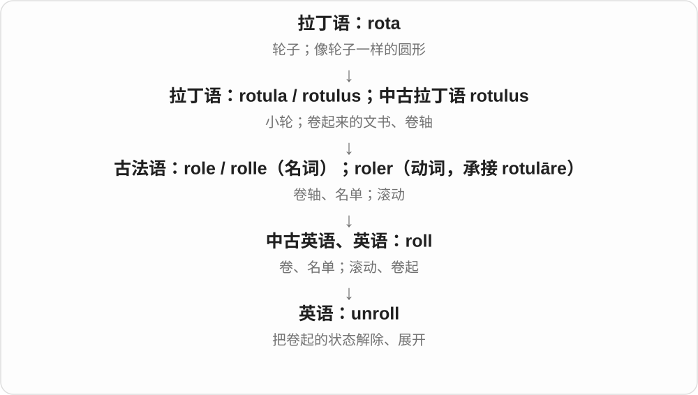

可以主动把东西展开，也可以说卷物自行展开。比喻中也能写事情逐步展现。

**常见搭配与例句**

unroll a map；unroll a carpet；unroll a sheet of paper。

> They unrolled the carpet in the empty room.

他们在空房间里展开了地毯。

> She unrolled the poster carefully.

她小心地把海报展开。

**别混淆**

unfold 常是打开折叠；unroll 是打开卷起的状态。折痕和卷曲是不同形状。

### 39. rotatable — 可旋转的；可以转动的

**音标**：英 /rəʊˈteɪtəbəl/；美 /ˈroʊteɪtəbəl/

**先抓住这个画面**

rotatable 像一个屏幕支架，允许你把屏幕转向另一边；它说能不能转，不是现在正在转。

**怎么拆**

rotate + -able，去掉结尾 e 后加后缀。

**怎么变成今天的意思**

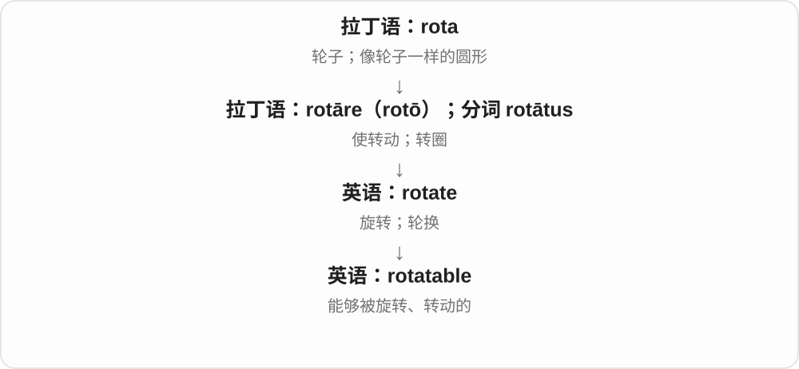

常形容安装件、镜头、屏幕和关节等。可能只能转一定角度，不自动表示能无限转圈。

**常见搭配与例句**

a rotatable screen；a rotatable mount；freely rotatable。

> The lamp has a rotatable head.

这盏灯的灯头可以转动。

> A rotatable mount makes the screen easier to adjust.

可旋转支架让屏幕更容易调整。

**别混淆**

rotating 是正在旋转或以旋转运作；rotatable 是具有可旋转能力。

### 40. roundness — 圆度；圆润的性质

**音标**：/ˈraʊndnəs/

**先抓住这个画面**

roundness 是问“它到底有多圆、圆得怎么样”：可以看轮廓，也能形容声音的圆润感。

**怎么拆**

round + -ness，中古英语已有 roundnesse。

**怎么变成今天的意思**

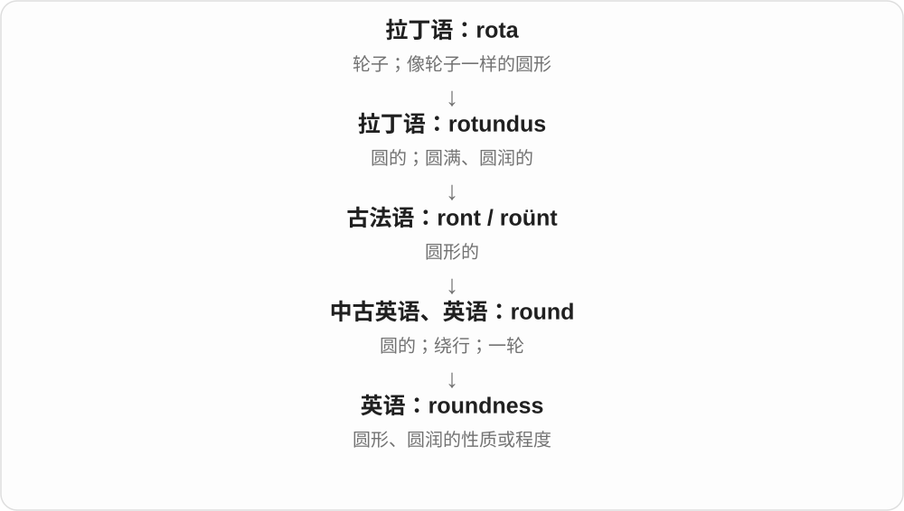

工程里的圆度要按具体测量定义判断；日常只是形状或感官描述。不是简单看周长大不大。

**常见搭配与例句**

the roundness of a pebble；measure roundness；roundness of tone。

> The potter checked the roundness of the bowl.

陶艺师检查了碗的圆度。

> The singer’s tone had warmth and roundness.

歌手的声音温暖而圆润。

**别混淆**

size 是大小；roundness 是圆的程度。很小的东西也可能非常圆。

### 41. rondeau — 回环诗；回旋歌、相关乐曲形式

**音标**：英 /ˈrɒndəʊ/；美 /ˈrɑːndoʊ/

**先抓住这个画面**

rondeau 像一句话唱过或说过之后，隔一段又回来；诗句的回返，让整首作品有绕回原处的感觉。

**怎么拆**

来自中古法语 rondeau，承接古法语 rondel“小圆、回环歌”，远源为 rotundus“圆的”。

**怎么变成今天的意思**

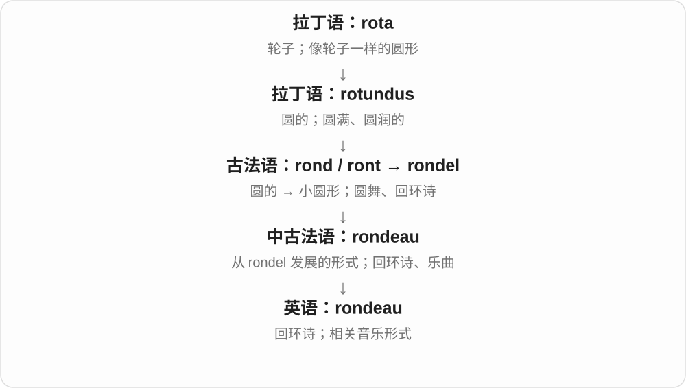

诗体的常见现代形式共十五行，包括两次短叠句，用两个韵部。音乐史上也有不同的 rondeau 形式，不能把所有时代都套成一个固定模板。

**常见搭配与例句**

write a rondeau；the refrain of a rondeau；a French rondeau。

> The poet repeats the opening phrase in the rondeau’s refrain.

诗人在回环诗的叠句中重复了开头的短语。

> The class compared a rondeau with a sonnet.

课堂上比较了回环诗与十四行诗。

**别混淆**

rondo 常指后来经意大利语定名的音乐曲式；rondeau 更常保留法国诗歌、音乐史中的名称。

### 42. roundel — 圆形图案；圆形徽标；圆形物

**音标**：/ˈraʊndəl/

**先抓住这个画面**

roundel 像把一个标志装进小圆盘：飞机上的圆形识别徽记、窗户里的圆形装饰都能这样叫。

**怎么拆**

来自中古英语 roundel，借自古法语 rondel，是 rond“圆的”的小称；不是现代英语 round 加 -el 才造出。

**怎么变成今天的意思**

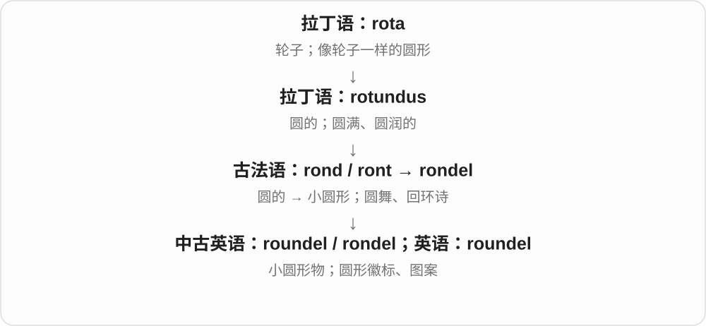

常见于纹章、飞机标识、建筑装饰。诗歌里还可指相关短诗形式，需要按题材辨认。

**常见搭配与例句**

an aircraft roundel；a stained-glass roundel；a decorative roundel。

> A painted roundel identifies the aircraft’s nationality.

一个绘制的圆形徽标表明了飞机的国别。

> The window contains a small roundel of coloured glass.

窗户里嵌着一小块圆形彩色玻璃装饰。

**别混淆**

circle 强调几何圆；roundel 通常是具体圆形物、图案或标识。

### 43. enrollee — 注册者；报名参加者

**音标**：美 /ˌenroʊˈliː/，也 /enˈroʊliː/

**先抓住这个画面**

enrollee 是名单上已经登记进去的那个人，不是还在考虑要不要报名的人。

**怎么拆**

enroll + -ee，-ee 标出被登记、加入项目的人。

**怎么变成今天的意思**

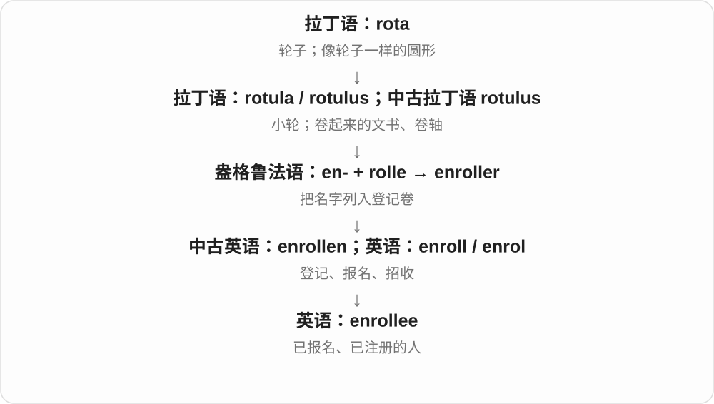

学校、课程、服务计划都能有 enrollees。它着重登记身份，不表示已经完成课程或实际每天出席。

**常见搭配与例句**

new enrollees；a programme enrollee；the number of enrollees。

> Each enrollee received a welcome email.

每位注册者都收到了一封欢迎邮件。

> The course has forty new enrollees.

这门课有四十名新报名学员。

**别混淆**

applicant 是申请者；enrollee 已注册加入。graduate 则通常已完成相应学习。

### 44. multirole — 多用途的；能承担多种角色的

**音标**：英 /ˌmʌltiˈrəʊl/；美 /ˌmʌltiˈroʊl/

**先抓住这个画面**

multirole 像一套装备不只接一种任务，可以在不同工作角色之间切换。

**怎么拆**

multi-（多个）+ role（角色、功能）。

**怎么变成今天的意思**

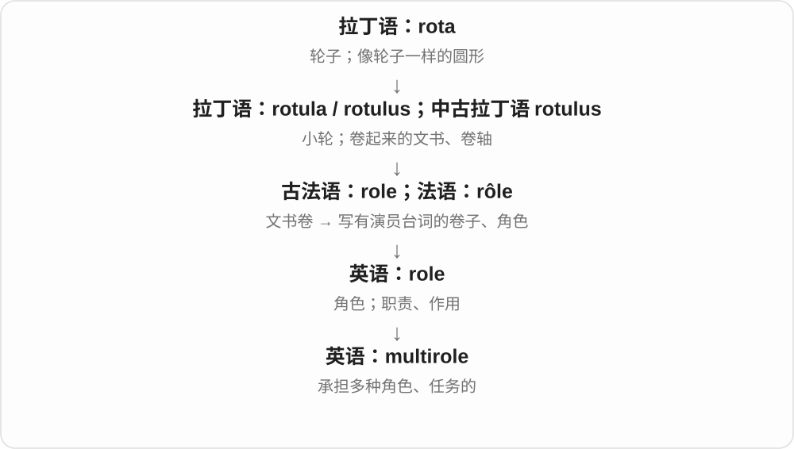

常用于航空器、装备或组织设计。多用途不意味着每项能力都同样突出，仍要看具体安排。

**常见搭配与例句**

a multirole aircraft；a multirole platform；multirole capability。

> The aircraft was designed as a multirole platform.

这款飞机被设计成可承担多种任务的平台。

> The new system offers greater multirole capability.

新系统具备更强的多用途能力。

**别混淆**

multitasking 强调同时处理多件事；multirole 强调能承担多种角色，不一定同时执行。

### 45. roundelay — 带反复叠句的歌或诗；圆圈舞

**音标**：英 /ˈraʊndɪleɪ/；美 /ˈraʊndəleɪ/

**先抓住这个画面**

roundelay 像大家围成圈唱歌，一段唱完，熟悉的叠句又回来了。

**怎么拆**

来自中古法语 rondelet，古法语 rondel 的小称；英语词尾受 lay“歌”或 virelay 的影响而改变。

**怎么变成今天的意思**

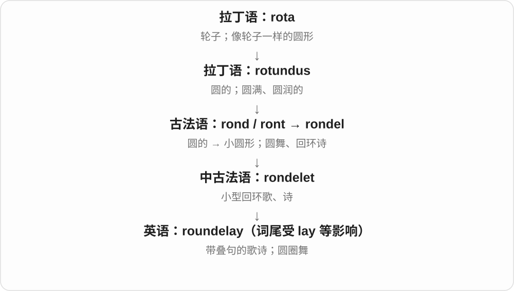

这是文学或音乐史用词，强调重复回返的效果；不要求日常每首有副歌的流行歌都叫 roundelay。

**常见搭配与例句**

sing a roundelay；a cheerful roundelay；the repeated line of a roundelay。

> The singers ended the evening with a cheerful roundelay.

歌手们用一首欢快的回环歌结束了当晚演出。

> A repeated line gives the poem the feel of a roundelay.

一个反复出现的句子让这首诗带有回环歌的感觉。

**别混淆**

chorus 通常是歌曲的副歌部分或合唱；roundelay 可以指带反复叠句的整首歌诗。

### 46. rondel — 回环诗体；圆形物；圆盘护手匕首

**音标**：英 /ˈrɒndəl/；美 /ˈrɑːndəl/，也 /rɑːnˈdel/

**先抓住这个画面**

rondel 的“小圆”可以落在物体形状上，也可以落在诗句回返的结构上。

**怎么拆**

经中古英语借入古法语 rondel，来自 rond“圆的”的小称。

**怎么变成今天的意思**

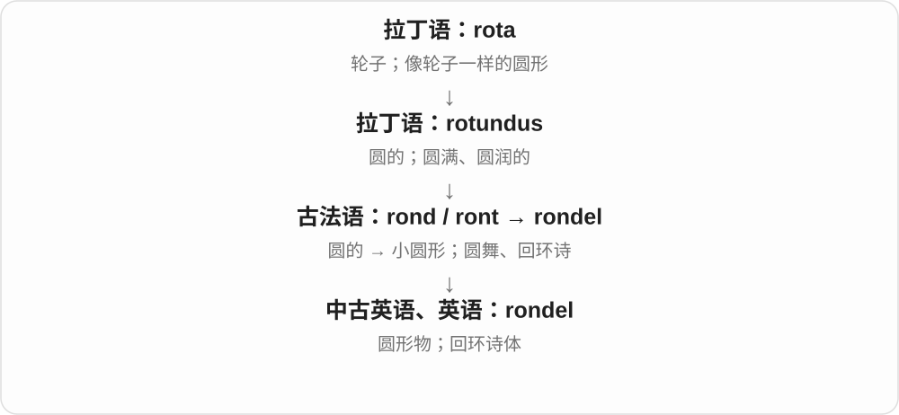

诗体通常用两个韵部和反复出现的诗行，有十三或十四行等变体。rondel dagger 则因圆盘状护手、柄头而得名，不能翻成诗歌匕首。

**常见搭配与例句**

a medieval rondel；a rondel dagger；the refrain of a rondel。

> The student wrote a rondel with two repeating lines.

学生写了一首有两行反复出现的回环诗。

> The museum displays a rondel dagger with a circular guard.

博物馆展示了一把带圆盘状护手的 rondel 匕首。

**别混淆**

rondelle 更常用作小圆形饰物名；rondel 更常见于诗体及某些历史器物名称，实际义项会重叠。

### 47. rotatory — 旋转的；使旋转的；轮流的

**音标**：英 /ˈrəʊtətəri/ 或 /rəʊˈteɪtəri/；美 /ˈroʊtəˌtɔːri/

**先抓住这个画面**

rotatory 像物体沿轴持续转动，也可描述一种依次轮到不同成员的安排。

**怎么拆**

借自新拉丁语 rotātōrius，联系拉丁 rotāre 的 rotāt- 词干；现代可联系旋转词族及 -ory 形式。

**怎么变成今天的意思**

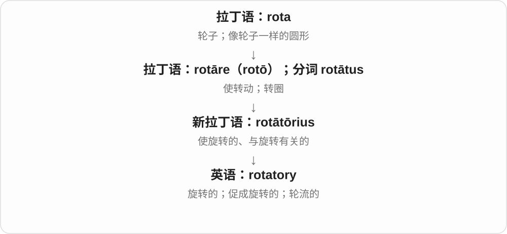

常见于较正式的技术文字。optical rotatory power 说使偏振方向旋转的能力，并不是材料像车轮一样整体转起来。

**常见搭配与例句**

rotatory motion；rotatory movement；rotatory power。

> The mechanism converts a straight movement into rotatory motion.

这个机构把直线运动转换成旋转运动。

> The report compares the rotatory movements of the two parts.

报告比较了两个部件的旋转运动。

**别混淆**

rotary 更常用于日常机械名称；rotatory 较常见于科学、旧式技术表述。

### 48. rotifer — 轮虫

**音标**：英 /ˈrəʊtɪfə/；美 /ˈroʊtɪfər/

**先抓住这个画面**

rotifer 是微小水生动物，头部纤毛协调摆动时像小轮子在转；名字因此像在说“带轮子的动物”。

**怎么拆**

拉丁 rota（轮）+ -fer（承载），英语名称受意大利语 rotifero 影响。

**怎么变成今天的意思**

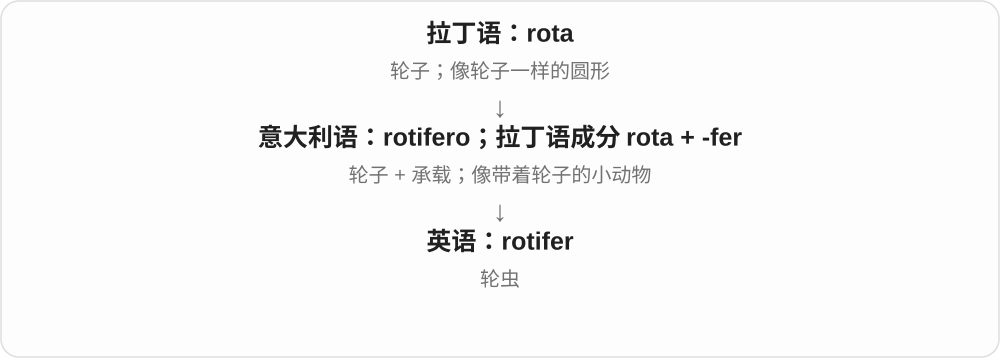

轮状外观来自纤毛运动，不是身体长了一个真正的机械轮。轮虫是多细胞动物，不能因为小就当成细菌。

**常见搭配与例句**

a freshwater rotifer；observe rotifers；a rotifer population。

> We observed a rotifer in a drop of pond water.

我们在一滴池塘水中观察到一只轮虫。

> The rotifer’s moving cilia created a wheel-like effect.

轮虫摆动的纤毛形成了类似转轮的视觉效果。

**别混淆**

rotavirus 是病毒；rotifer 是动物。共同的 rot- 只说明命名都借用了轮子的意象。

### 49. decontrol — 解除管制；放开控制

**音标**：英 /ˌdiːkənˈtrəʊl/；美 /ˌdiːkənˈtroʊl/

**先抓住这个画面**

decontrol 像把原先限定价格或数量的调节规则撤掉，让它不再按那套管制运行。

**怎么拆**

de-（去除、解除）+ control。

**怎么变成今天的意思**

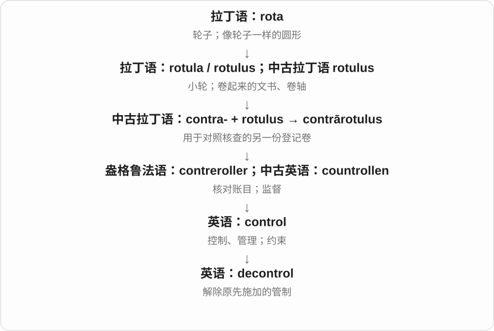

常用于政策和经济史文字，可以作动词或名词。它强调有意取消控制，而不是机器突然失灵。

**常见搭配与例句**

decontrol prices；price decontrol；a plan to decontrol。

> The proposal would decontrol the price of the product.

该提案拟解除对这种产品价格的管制。

> The report examines the effects of decontrol.

报告研究了解除管制的影响。

**别混淆**

lose control 是失去控制能力；decontrol 是主动解除已有管制。

### 50. irrotational — 无旋的；不发生局部旋转的

**音标**：英 /ɪˌrəʊˈteɪʃənəl/；美 /ɪˌroʊˈteɪʃənəl/

**先抓住这个画面**

irrotational 在流体里要看一小块流体有没有局部自转，不能只看它的行进路线是不是弯的。

**怎么拆**

ir- 是 in-（不）在 r 前的形式，接 rotational。

**怎么变成今天的意思**

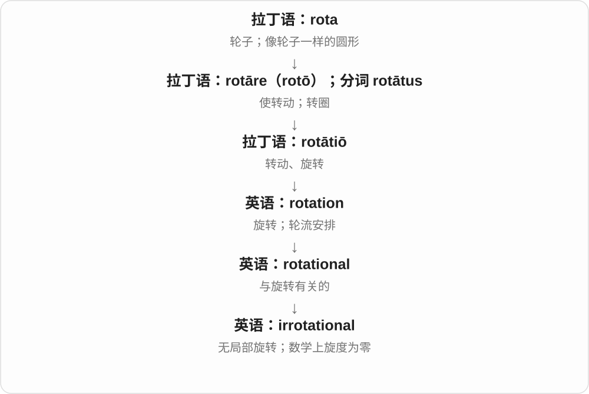

向量分析中的明确条件是旋度为零；流体中即涡量为零。粒子轨迹仍可能弯曲，因此“绕着走”和“局部自转”要分开。

**常见搭配与例句**

irrotational flow；an irrotational velocity field；assume irrotational motion。

> The model assumes that the flow is irrotational.

模型假定流动是无旋的。

> An irrotational velocity field has zero curl.

无旋速度场的旋度为零。

**别混淆**

incompressible 是不可压缩；irrotational 是无旋。这是两种条件，互不等同。

### 51. rowel — 马刺上的小齿轮；刺激、鞭策（较少用）

**音标**：/ˈraʊəl/

**先抓住这个画面**

rowel 是马刺末端那个带尖齿、能够转动的小圆轮，外形直接保留了词根的轮子。

**怎么拆**

经法语 roel / roele 来自晚期拉丁 rotella，是 rota“轮”的小称。

**怎么变成今天的意思**

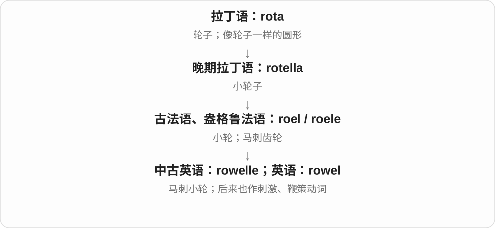

最常在历史器物、马术或文学里见到。动词的比喻义把刺痛感转成令人难受的推动或刺激。

**常见搭配与例句**

the rowel of a spur；a rowelled spur；rowel someone’s conscience（文学）。

> The antique spur has a small steel rowel.

这件古董马刺上有一个小钢齿轮。

> The curator pointed out the worn teeth on the rowel.

策展人指出了马刺小轮上磨损的尖齿。

**别混淆**

spur 可指整件马刺，也可说促使；rowel 原先特指其中带齿的小轮。

### 52. rotundity — 圆形、圆胖的性质；声音或措辞的浑圆感

**音标**：英 /rəʊˈtʌndəti/；美 /roʊˈtʌndəti/

**先抓住这个画面**

rotundity 把“圆鼓鼓、饱满”的样子当成一种性质来谈，也能写声音听起来饱满。

**怎么拆**

借自拉丁 rotunditās，由 rotundus 形成；现代对应 rotund + -ity，但不是现代英语形容词先创造了全部历史。

**怎么变成今天的意思**

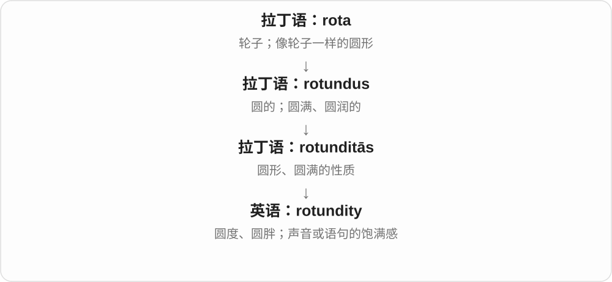

多见于文学、艺术评论和正式描述。说人的 rotundity 通常是在描写体形，不能当成一般的健康结论。

**常见搭配与例句**

the rotundity of a figure；rotundity of tone；a pleasing rotundity。

> The sculptor emphasized the rotundity of the figure.

雕塑家突出了人物圆润饱满的体形。

> The critic admired the rotundity of the singer’s tone.

评论者欣赏歌手声音的浑圆饱满。

**别混淆**

roundness 是更普通的圆度、圆形性质；rotundity 较书面，还能涉及体形和语言风格。

### 53. rondelle — 小圆片；圆盘状饰物；圆环珠

**音标**：英 /rɒnˈdel/；美 /rɑːnˈdel/

**先抓住这个画面**

rondelle 像项链里一枚扁扁的小圆片或圆环，也可泛指小圆形物件。

**怎么拆**

借自法语 rondelle，联系 rond“圆的”和小称形式；远源拉丁 rotundus。

**怎么变成今天的意思**

珠宝、工艺语境里较容易遇到；也有其他行业的专门用法。不要仅因与 rondel 相近就把每处都译成诗体。

**常见搭配与例句**

a silver rondelle；rondelle beads；a decorative rondelle。

> A silver rondelle separates the two blue beads.

一枚银色圆片隔开了两颗蓝珠。

> The bracelet is decorated with small rondelles.

手镯上装饰着一些小圆形饰片。

**别混淆**

bead 是珠子这一大类；rondelle 常突出扁圆盘或环状形状。

### 54. circumrotation — 绕轴旋转；回转（少用）

**音标**：英 /ˌsɜːkəmrəʊˈteɪʃən/；美 /ˌsɜːrkəmroʊˈteɪʃən/

**先抓住这个画面**

circumrotation 像一个部件围着轴完整转动，circum- 把“绕着周围”这层意思说得更明显。

**怎么拆**

circum-（周围、绕着）+ rotation。

**怎么变成今天的意思**

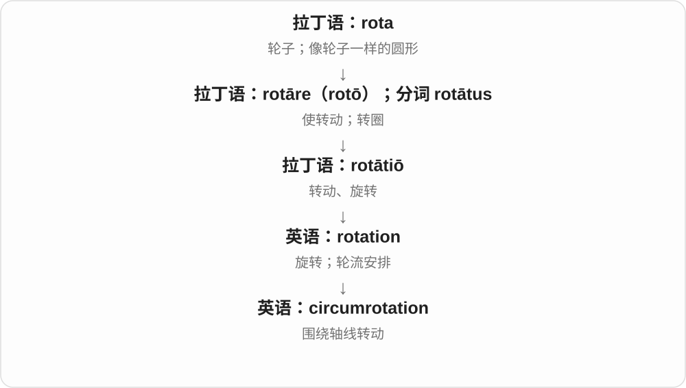

是较少见的技术或旧式用词，很多现代语境直接用 rotation 就够。它不自动表示一边自转一边公转。

**常见搭配与例句**

circumrotation about an axis；the circumrotation of a part。

> The old manual describes the circumrotation of the wheel.

旧手册描述了轮子绕轴旋转的过程。

> The diagram marks the axis of circumrotation.

图中标出了回转轴线。

**别混淆**

rotation 更常用；circumrotation 显式强调环绕的转动，不能另外硬加一种未说明的运动方式。

### 55. contrarotation — 反向旋转；对转

**音标**：英 /ˌkɒntrərəʊˈteɪʃən/；美 /ˌkɑːntrəroʊˈteɪʃən/

**先抓住这个画面**

contrarotation 像两组螺旋桨从同一观察方向看，一个顺时针，一个逆时针转。

**怎么拆**

contra-（相反）+ rotation。

**怎么变成今天的意思**

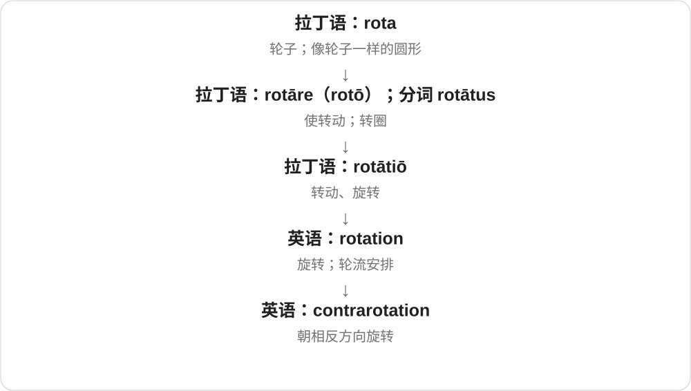

航空技术中常用于同一轴线附近的成对反向旋转部件。一般义只是反向转动，不自动说明动力由几台发动机提供。

**常见搭配与例句**

propeller contrarotation；a contrarotation system；opposite directions of rotation。

> The animation demonstrates contrarotation of the two propellers.

动画演示了两组螺旋桨的反向旋转。

> The design uses contrarotation to balance the opposing effects.

这种设计利用对转来平衡相反方向的作用。

**别混淆**

rotation 可以只有一个物体；contrarotation 强调相对、相反的旋转方向。

### 56. redondilla — 西班牙四行诗节形式

**音标**：美 /ˌreɪdoʊnˈdiːljə/

**先抓住这个画面**

redondilla 可以先抓四行诗的回环押韵：第一行与第四行相接，第二行与第三行相接，常排成 abba。

**怎么拆**

借西班牙语 redondilla，是 redonda 的小称；redondo“圆的”来自拉丁 rotundus。

**怎么变成今天的意思**

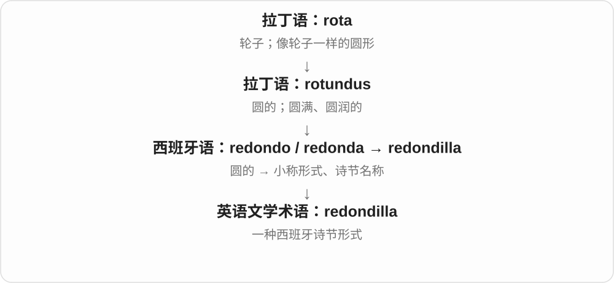

典型形式每行八个音节，常用 abba 韵式；历史上这个名称也有较宽用法。它是按西班牙诗律讨论的术语，不是英语四行诗的通称。

**常见搭配与例句**

a Spanish redondilla；the rhyme scheme of a redondilla。

> The class identified the abba rhyme scheme of the redondilla.

课堂上辨认出了这首 redondilla 的 abba 韵式。

> The poet wrote a redondilla with eight syllables in each line.

诗人写了一个每行八音节的 redondilla 诗节。

**别混淆**

quatrain 泛指四行诗节；redondilla 有特定语言传统、音节和押韵安排。

### 57. reenroll — 重新注册；再次报名

**音标**：英 /ˌriːɪnˈrəʊl/；美 /ˌriːɪnˈroʊl/

**先抓住这个画面**

reenroll 像名字以前在名单上，现在为新一期课程或恢复参加而再登记一次。

**怎么拆**

re-（再次）+ enroll；也可见 reenrol 拼法。

**怎么变成今天的意思**

可能是每年需要重新办理，也可能是离开后回来，词本身不说明上次为什么结束。

**常见搭配与例句**

reenroll in a course；reenroll for the next term；reenroll a student。

> She decided to reenroll in the evening class.

她决定重新报名参加晚间课程。

> Returning students must reenroll before the deadline.

返校学生必须在截止日期前重新注册。

**别混淆**

renew 是续订、续期的宽泛说法；reenroll 明确涉及重新登记到课程、机构或计划。

### 58. rotelle — 车轮形意大利面

**音标**：英 /rəʊˈteleɪ/；美 /roʊˈteleɪ/

**先抓住这个画面**

rotelle 就像把小车轮缩成一口能吃下的面：中间的辐条和外圈让轮子形状一眼可见。

**怎么拆**

借意大利语 rotelle，是 rotella“小轮子”的复数；与拉丁 rota“轮子”同族。

**怎么变成今天的意思**

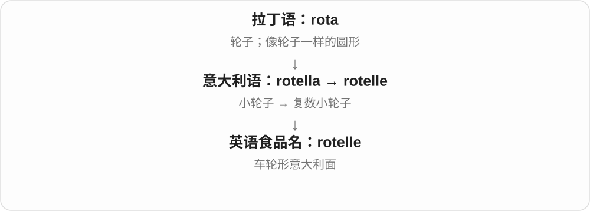

英语里常把它当面食名称使用。名字说明形状，不说明固定配哪种酱或属于哪一种菜谱。

**常见搭配与例句**

rotelle pasta；a bowl of rotelle；cook the rotelle。

> She served rotelle with tomato sauce.

她端上了配番茄酱的车轮形意大利面。

> The children liked the little wheels of rotelle.

孩子们喜欢 rotelle 面的小轮子形状。

**别混淆**

rigatoni 是带纹路的管形面；rotelle 是轮形面，形状不同。

### 59. rotiferous — 有轮虫的；与轮虫有关的

**音标**：英 /rəʊˈtɪfərəs/；美 /roʊˈtɪfərəs/

**先抓住这个画面**

rotiferous 把注意力引到水样里的轮虫：这片水域、这份样品有轮虫，或所谈内容与它们有关。

**怎么拆**

rotifer + -ous；词根中的轮子已经通过 rotifer 具体指向轮虫，不能只按“有车轮的”理解现代生物用法。

**怎么变成今天的意思**

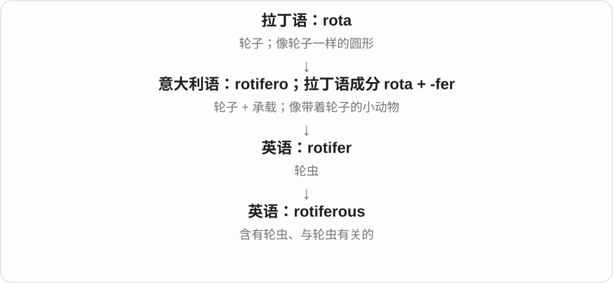

是少见生物描述词。旧资料还可能强调轮状器官，现代读到 water、sample 等搭配时应先想到轮虫。

**常见搭配与例句**

rotiferous water；a rotiferous sample；a rotiferous habitat。

> The researcher collected a rotiferous sample from the pond.

研究者从池塘采集了一份含轮虫的水样。

> The paper compares two rotiferous habitats.

论文比较了两处有轮虫分布的栖息环境。

**别混淆**

rotary 描述机械转动；rotiferous 通常与轮虫联系，不是任意会旋转的东西。

### 60. rotiform — 轮状的；花冠轮形的

**音标**：英 /ˈrəʊtɪfɔːm/；美 /ˈroʊtɪfɔːrm/

**先抓住这个画面**

rotiform 像轮子的中心向四周展开：植物的花冠平展出去，就能从形状上这样描述。

**怎么拆**

借自新拉丁 rotiformis，rota（轮）+ -iformis（形状）；现代对应 rot- + -iform。

**怎么变成今天的意思**

植物学里常说花冠管很短、上部向外展开。它说外形，并不表示花会旋转。

**常见搭配与例句**

a rotiform corolla；rotiform flowers；a rotiform structure。

> The botanical description notes a rotiform corolla.

植物描述指出其花冠呈轮形。

> The drawing shows the petals spreading into a rotiform outline.

图画显示花瓣向外展开，形成轮状轮廓。

**别混淆**

rotary 说转动功能；rotiform 说像轮子的形状。

### 61. rotula — 髌骨的旧称；海胆咀嚼器中的特定骨片

**音标**：英 /ˈrɒtjʊlə/；美 /ˈrɑːtʃələ/

**先抓住这个画面**

rotula 的字面是“小轮子”，旧解剖名称把膝前那块小骨头想成小圆盘；海胆解剖中也借它命名特定骨片。

**怎么拆**

拉丁 rotula 是 rota 的小称；髌骨义经中古拉丁语借入，海胆义属于新拉丁科学命名。

**怎么变成今天的意思**

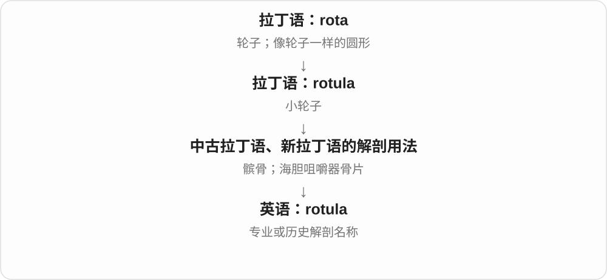

人体语境里现代更常用 patella 或 kneecap。海胆的 rotula 则是另一种结构，不表示海胆长有人类膝盖。

**常见搭配与例句**

the rotula of the knee（旧）；a rotula in the sea urchin’s jaw apparatus。

> The old anatomy text calls the kneecap the rotula.

旧解剖教材把髌骨称为 rotula。

> The illustration labels a rotula in the sea urchin’s feeding apparatus.

插图标出了海胆摄食器中的一块 rotula 骨片。

**别混淆**

rotula 与 patella 在旧人体解剖义可相对照；换到海胆语境就不能照搬膝盖骨。

### 62. rotundifolious — 圆叶的（植物学旧式用词）

**音标**：英 /rəʊˌtʌndɪˈfəʊliəs/；美 /roʊˌtʌndɪˈfoʊliəs/

**先抓住这个画面**

rotundifolious 看的是叶片轮廓：叶子长得比较圆，不是枝条或果实圆。

**怎么拆**

拉丁 rotundus（圆的）+ folium（叶），形成 rotundifolius 等拉丁形式；英语采用 -folious 的形容词形式。

**怎么变成今天的意思**

这个长词把两个画面拼得很直接。现代普通描述说 round-leaved 更方便；读老植物书时能认出即可。

**常见搭配与例句**

a rotundifolious plant；rotundifolious species；rotundifolious foliage。

> The old catalogue describes the plant as rotundifolious.

旧目录把这种植物描述为圆叶的。

> The drawing helps identify the rotundifolious specimen.

图画有助于辨认这株圆叶标本。

**别混淆**

rotund 泛指圆、圆胖；rotundifolious 把范围精确限定为叶片形状。

### 63. roundlet — 小圆片；小圆形物

**音标**：/ˈraʊndlɪt/

**先抓住这个画面**

roundlet 像装饰图案中的一个小圆盘，重点是形状圆、体积小。

**怎么拆**

来自中古英语 roundelet，借自中古法语 rondelet，联系 rondel“小圆形”；不是只凭现代英语 round + -let 推出历史。

**怎么变成今天的意思**

这是较少用的词，常见于旧式描述、纹章或器物研究。读到时可先定位具体是哪一枚圆形物。

**常见搭配与例句**

a small roundlet；a decorative roundlet；roundlets on a shield。

> A red roundlet appears in the centre of the shield.

盾牌中央有一个红色小圆纹。

> The border is decorated with a row of tiny roundlets.

边框用一排小圆片装饰。

**别混淆**

roundel 与它意思接近且更常见；roundlet 更突出小圆形这一旧式称呼。

### 64. semiround — 半圆的；呈半圆形的

**音标**：/ˌsemiˈraʊnd/

**先抓住这个画面**

semiround 像把一枚圆形沿中间分开，留下半个圆的轮廓。

**怎么拆**

semi-（一半）+ round。

**怎么变成今天的意思**

较少用，常描述器物外形。别把它理解成“转了半圈”这个动作；这里通常是形状形容词。

**常见搭配与例句**

a semiround opening；a semiround shape；a semiround moulding。

> The design includes a semiround opening above the door.

设计在门上方安排了一个半圆形开口。

> The craftsman added a semiround strip along the edge.

工匠沿边缘加了一条半圆形饰条。

**别混淆**

semicircular 是更常用、更明确的半圆形；semiround 与它接近，风格和领域有所不同。

## 这一组要分清什么

**rotate / roll / revolve**：rotate 重点是绕轴旋转；roll 常是沿表面滚动或把东西卷起；revolve 也可说围绕某中心转动。球可以原地 rotate，也可以沿地板 roll。

**role / roll**：role 是角色、职责、作用；roll 是滚动、卷物或名册。两词同音且同源，现代用法已经分开。

**control / controller / controllable / controlled**：control 是控制；controller 是控制者、控制器；controllable 是能够控制；controlled 是已经受控。uncontrolled 与 uncontrollable 分别否定实际受控状态和可控制能力。

**round / rotund / rotunda**：round 最普通，圆桌、围绕、一轮都可用；rotund 较书面，常描写圆胖或声音圆润；rotunda 是圆形大厅或建筑。

**enroll / enrollment / enrollee**：enroll 报名；enrollment 注册这件事或人数；enrollee 是注册者。enrol 和 enrolment 是常见英式拼写。

**rotational / irrotational**：普通语境谈转动；流体数学里要看局部旋度、涡量。路线弯曲并不自动表示有局部自转。

## 串起来练习

把一张纸卷起来，再摊开想象三种内容：写名字，是 **a roll of names**；写演员台词，连接到 **a role**；与另一份账目核对，连接到 **control**。

再把日常场景串起来：**The names are on the roll, everyone has a role, and the duties rotate each week.** 名字都在名册上，每个人都有职责，任务每周轮换。这样记住的不是一串相似字母，而是从轮子、纸卷到组织工作的几条具体路线。
