# 0063 · port- — 携带；门；港口（分支辨析）

[逐词精讲目录](../00_逐词精讲目录.md) · [总目录](../00_总目录_按常用程度.md)

## 核心词根与来源

这一页的 port- 是同形词族合页，需要先分清三条拉丁来源。**portāre 是携带**，所以有 transport、support、report；**porta 是门**，所以有 portal；**portus 是港口**，形成英语 port 的港口义。它们在更深层的词源上有联系，但英语单词的直接来路不同，不能互相替换。

## 词形与演化规律

**携带可以是实物，也可以是信息、责任和含义。** re- + portāre 把信息带回来，成为 report；sub- + portāre 从下面承担，成为 support；importāre“带入、传达”一支还发展出 important。sub- 在 p 前变成 sup-，in- 在 p 前变成 im-，是历史上的辅音同化。portal 则从 porta 走“门、入口”路线。

## 单词速览（按词族由简到繁）

同一基础词的相关扩展放在一起，先读基础形式，再读扩展；各组之间优先读常用的。具体词源关系见各词讲解。

| 单词 | 音标 | 核心意思 |
|---|---|---|
| [support](#w-1) | 英 /səˈpɔːt/；美 /səˈpɔːrt/ | 支撑；支持；帮助维持 |
| [supporting](#w-5) | 英 /səˈpɔːtɪŋ/；美 /səˈpɔːrtɪŋ/ | 支撑的；辅助的；support 的分词形式 |
| [supporter](#w-15) | 英 /səˈpɔːtə/；美 /səˈpɔːrtər/ | 支持者；拥护者；球迷 |
| [supportive](#w-16) | 英 /səˈpɔːtɪv/；美 /səˈpɔːrtɪv/ | 给予支持的；鼓励人的 |
| [port](#w-4) | 英 /pɔːt/；美 /pɔːrt/ | 港口；端口；左舷；移植；波特酒 |
| [portal](#w-17) | 英 /ˈpɔːtəl/；美 /ˈpɔːrtəl/ | 大门；入口；门户网站 |
| [porter](#w-18) | 英 /ˈpɔːtə/；美 /ˈpɔːrtər/ | 搬运工；行李员；门卫 |
| [portable](#w-19) | 英 /ˈpɔːtəbəl/；美 /ˈpɔːrtəbəl/ | 便携的；可移植的 |
| [portability](#w-30) | 英 /ˌpɔːtəˈbɪləti/；美 /ˌpɔːrtəˈbɪləti/ | 便携性；可移植性；可转移性 |
| [portly](#w-34) | 英 /ˈpɔːtli/；美 /ˈpɔːrtli/ | 身材圆胖的；体态丰腴的 |
| [report](#w-3) | 英 /rɪˈpɔːt/；美 /rɪˈpɔːrt/ | 报告；报道；汇报；报告书 |
| [reporting](#w-9) | 英 /rɪˈpɔːtɪŋ/；美 /rɪˈpɔːrtɪŋ/ | 报道；汇报；报告工作 |
| [reporter](#w-10) | 英 /rɪˈpɔːtə/；美 /rɪˈpɔːrtər/ | 记者；报道者；记录员 |
| [reportable](#w-33) | 英 /rɪˈpɔːtəbəl/；美 /rɪˈpɔːrtəbəl/ | 应报告的；可报告的 |
| [transport](#w-6) | 动词 英 /trænsˈpɔːt/、美 /trænsˈpɔːrt/；名词 英 /ˈtrænspɔːt/、美 /ˈtrænspɔːrt/ | 运输；运送；交通运输 |
| [transportation](#w-7) | 英 /ˌtrænspɔːˈteɪʃən/；美 /ˌtrænspərˈteɪʃən/ | 运输；交通运输系统或方式 |
| [transporting](#w-20) | 英 /trænsˈpɔːtɪŋ/；美 /trænsˈpɔːrtɪŋ/ | 运送；transport 的现在分词或动名词 |
| [transporter](#w-24) | 英 /trænsˈpɔːtə/；美 /trænsˈpɔːrtər/ | 运输者；运输车辆；转运体 |
| [transportable](#w-35) | 英 /trænsˈpɔːtəbəl/；美 /trænsˈpɔːrtəbəl/ | 可运输的；可迁移的 |
| [import](#w-13) | 动词 英 /ɪmˈpɔːt/、美 /ɪmˈpɔːrt/；名词 英 /ˈɪmpɔːt/、美 /ˈɪmpɔːrt/ | 进口；导入；进口商品；意义 |
| [important](#w-2) | 英 /ɪmˈpɔːtənt/；美 /ɪmˈpɔːrtənt/ | 重要的；影响大的 |
| [importance](#w-8) | 英 /ɪmˈpɔːtəns/；美 /ɪmˈpɔːrtəns/ | 重要性；分量；意义 |
| [importantly](#w-14) | 英 /ɪmˈpɔːtəntli/；美 /ɪmˈpɔːrtəntli/ | 重要的是；更重要地；自命不凡地 |
| [importer](#w-27) | 英 /ɪmˈpɔːtə/；美 /ɪmˈpɔːrtər/ | 进口商；进口国；导入工具 |
| [importation](#w-28) | 英 /ˌɪmpɔːˈteɪʃən/；美 /ˌɪmpɔːrˈteɪʃən/ | 进口；引入过程 |
| [deport](#w-25) | 英 /dɪˈpɔːt/；美 /dɪˈpɔːrt/ | 驱逐出境 |
| [deportation](#w-21) | 英 /ˌdiːpɔːˈteɪʃən/；美 /ˌdiːpɔːrˈteɪʃən/ | 驱逐出境；强制遣送 |
| [deportment](#w-37) | 英 /dɪˈpɔːtmənt/；美 /dɪˈpɔːrtmənt/ | 举止；仪态 |
| [export](#w-11) | 动词 英 /ɪkˈspɔːt/、美 /ɪkˈspɔːrt/；名词 英 /ˈekspɔːt/、美 /ˈekspɔːrt/ | 出口；导出；出口商品 |
| [exporter](#w-22) | 英 /ɪkˈspɔːtə/；美 /ɪkˈspɔːrtər/ | 出口商；出口国；导出工具 |
| [exportation](#w-36) | 英 /ˌekspɔːˈteɪʃən/；美 /ˌekspɔːrˈteɪʃən/ | 出口；输出过程 |
| [portfolio](#w-12) | 英 /pɔːtˈfəʊliəʊ/；美 /pɔːrtˈfoʊlioʊ/ | 作品集；投资组合；一组职责或业务 |
| [purport](#w-32) | 动词 英 /pəˈpɔːt/、美 /pərˈpɔːrt/；名词 英 /ˈpɜːpɔːt/、美 /ˈpɝːpɔːrt/ | 声称；意在；主旨、大意 |
| [purported](#w-23) | 英 /pəˈpɔːtɪd/；美 /pərˈpɔːrtɪd/ | 据称的；所谓的 |
| [rapport](#w-26) | 英 /ræˈpɔː/；美 /ræˈpɔːr/ | 融洽关系；相互理解的默契 |
| [portage](#w-29) | 英 /ˈpɔːtɪdʒ/；美 /ˈpɔːrtɪdʒ/；也读 /pɔːrˈtɑːʒ/ | 陆上搬运船只及行李；搬运路线 |
| [reportage](#w-31) | 英 /ˌrepɔːˈtɑːʒ/；美 /rɪˈpɔːrtɪdʒ/ | 新闻报道；报道作品；纪实报道 |
| [comportment](#w-38) | 英 /kəmˈpɔːtmənt/；美 /kəmˈpɔːrtmənt/ | 举止；行为表现 |

## 逐词讲解

### 1. support — 支撑；支持；帮助维持

**音标**：英 /səˈpɔːt/；美 /səˈpɔːrt/

**先抓住这个画面**

support 像从下面托住一件东西，让它不倒、不掉下来。可以托住屋顶，也可以用钱、鼓励或证据托住一个人、一件事。

**怎么拆**

拉丁语 sub-（下面）+ portāre（承担），形成 supportāre；b 在 p 前同化为 p。

**怎么变成今天的意思**

从物理支撑扩展到生活帮助、立场支持和论证支持。support a claim 是用证据使说法站得住；support a family 是承担家庭生活需要。

**常见搭配与例句**

support a family（养家）；support a proposal（支持提案）；support a claim（为说法提供依据）；emotional support（情感支持）。

> These columns support the roof.

这些柱子支撑着屋顶。

> The evidence does not support his explanation.

这些证据不能支持他的解释。

**别混淆**

support 可以持续托住对方；help 泛指提供帮助。支持一项主张也不必等于同意提出者的一切观点。

### 2. supporting — 支撑的；辅助的；support 的分词形式

**音标**：英 /səˈpɔːtɪŋ/；美 /səˈpɔːrtɪŋ/

**先抓住这个画面**

supporting 是在旁边或下面帮主体站住的。证据支持论点，配角帮助故事展开，横梁支撑建筑。

**怎么拆**

support + -ing，既可表示正在支持，也可作形容词描述辅助作用。

**怎么变成今天的意思**

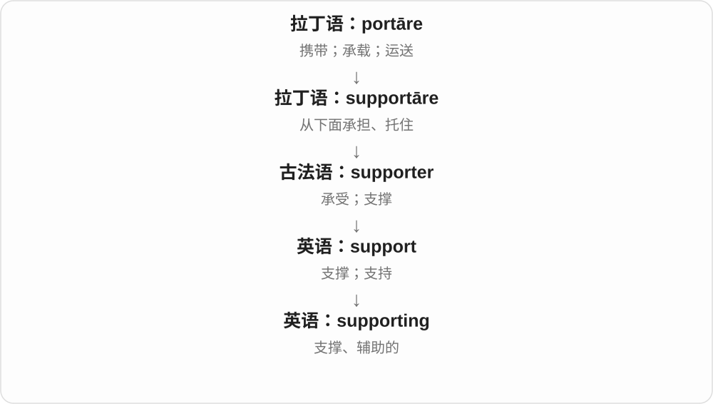

supporting actor 的“支持”是戏剧角色分工，不是这位演员私下赞同谁。supporting documents 则是为申请或说法提供依据的文件。

**常见搭配与例句**

supporting evidence（佐证）；supporting documents（证明材料）；a supporting role（配角；辅助角色）。

> Please attach the supporting documents to your application.

请把证明材料附在申请后。

> He played a supporting role in the film.

他在电影中饰演配角。

**别混淆**

supporting 说明某人或物在结构中的辅助角色；supportive 常强调人的态度令人感到被支持。

### 3. supporter — 支持者；拥护者；球迷

**音标**：英 /səˈpɔːtə/；美 /səˈpɔːrtər/

**先抓住这个画面**

supporter 是在一个人、团队或主张后面出力的人。可能投票、捐款、声援，也可能每周去看球队比赛。

**怎么拆**

support + -er；中古英语已经有 supporter、supportour 等形式。

**怎么变成今天的意思**

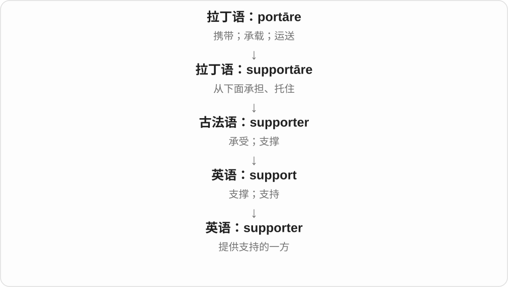

支撑从物理动作变成站在某人一边。a supporter of the plan 是赞同、支持这个计划的人，不要求他一定参与具体执行。

**常见搭配与例句**

a strong supporter（坚定支持者）；supporters of the proposal（提案支持者）；football supporters（足球迷）。

> She is a strong supporter of public libraries.

她坚定支持公共图书馆。

> The supporters cheered as the team entered the field.

球队进场时，球迷们欢呼起来。

**别混淆**

supporter 是支持的一方；participant 是参加者。参加过活动不必支持其全部观点。

### 4. supportive — 给予支持的；鼓励人的

**音标**：英 /səˈpɔːtɪv/；美 /səˈpɔːrtɪv/

**先抓住这个画面**

supportive 常形容一种让人站得稳的态度：你遇到困难时，对方愿意听、鼓励，并在需要时帮一把。

**怎么拆**

support + -ive，构成描述性质或态度的形容词。

**怎么变成今天的意思**

supportive parents 不只是口头同意，更能让孩子感到有人在支持自己。也可描述有帮助的环境或支持某计划的立场。

**常见搭配与例句**

a supportive friend（支持你的朋友）；a supportive environment（给予支持的环境）；be supportive of…（支持……）。

> Her friends were supportive during a difficult year.

在艰难的一年里，朋友们一直支持她。

> The manager was supportive of the new proposal.

经理对新提案持支持态度。

**别混淆**

supportive 侧重态度和作用；supporting 常直接表示辅助角色或具体支撑材料，如 supporting evidence。

### 5. port — 港口；端口；左舷；移植；波特酒

**音标**：英 /pɔːt/；美 /pɔːrt/

**先抓住这个画面**

port 的常见义不能全塞进“搬运”一条线：船停靠的港口、设备的接口、软件移植，字一样，进入英语的路线却不同。

**怎么拆**

港口义来自拉丁语 portus；门、开口这一支来自 porta；携带义连着 portāre。软件“移植”的直接词源有不同解释，不能只凭搬运画面定论。葡萄酒义来自城市 Porto 的名字。

**怎么变成今天的意思**

图画港口这一支。端口沿着“门、开口”理解；port a program 可以想成把程序“搬到”另一平台。后一画面是助记：词典对其直接来源有不同解释，也有联系硬件接口的分析。左舷义通常联系旧船靠泊的一侧，具体可能牵涉港口或船侧开口，不能直接归为“左边携带”。

**常见搭配与例句**

a busy port（繁忙港口）；a USB port（USB 接口）；the port side（左舷）；port software to a new platform（把软件移植到新平台）。

> The ship reached the port before sunrise.

船在日出前抵达港口。

> The team ported the game to a new platform.

团队把游戏移植到了一个新平台。

**别混淆**

港口、门和携带在更远词源上可能有关联，但不能画成 portāre → portus → porta 的直线。右舷是 starboard。

### 6. portal — 大门；入口；门户网站

**音标**：英 /ˈpɔːtəl/；美 /ˈpɔːrtəl/

**先抓住这个画面**

portal 像一个进入某个空间的门口：建筑入口、故事里的异世界入口，或网上集中进入多项服务的页面。

**怎么拆**

来自拉丁语 porta“门”，经中世纪拉丁语 portāle 和法语 portal 进入英语。这一条不是 portāre“携带”的直接后代。

**怎么变成今天的意思**

实体的门被借来比喻进入信息空间。student portal 通常把课程、成绩、缴费等入口放在同一个位置。

**常见搭配与例句**

a student portal（学生门户）；an online portal（在线门户）；a portal to another world（通往另一个世界的入口）。

> Students can view their results through the online portal.

学生可以通过在线门户查看成绩。

> The painting shows a figure standing before a stone portal.

画中一个人站在石砌大门前。

**别混淆**

portal 是较大的进入点；port 在技术语境可指接口或端口。两个都能用“入口”记，但不能因此把所有含 port 的词解释成门。

### 7. porter — 搬运工；行李员；门卫

**音标**：英 /ˈpɔːtə/；美 /ˈpɔːrtər/

**先抓住这个画面**

porter 有两个人物画面：帮你扛行李的人，和在门口负责接待、看守的人。今天字形相同，历史上却是两条词源。

**怎么拆**

搬运工来自拉丁语 portātor，由 portāre“携带”形成；门卫来自 portārius，根是 porta“门”。

**怎么变成今天的意思**

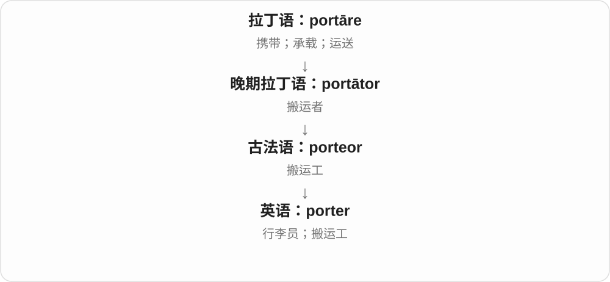

图画搬运这一支。门卫一支是 porta → portārius → 法语 portier → porter。酒店、车站、医院或学院里，具体职责依场景而变。

**常见搭配与例句**

a hotel porter（酒店行李员）；a hospital porter（医院运送人员）；the college porter（学院门房人员）。

> The porter carried our bags to the room.

行李员把我们的包送到房间。

> The college porter checked the visitor’s name.

学院门房核对了访客姓名。

**别混淆**

porter 不总是搬行李的人。看见 porter’s lodge，通常是门房。另有“波特黑啤”义，其名称通常联系搬运工，但“因为他们特别爱喝”这一具体故事缺少同时代直接证据。

### 8. portable — 便携的；可移植的

**音标**：英 /ˈpɔːtəbəl/；美 /ˈpɔːrtəbəl/

**先抓住这个画面**

portable 就是能方便带走的：不是固定在墙上、地上，而是可以随人换地方使用。

**怎么拆**

拉丁语 portāre（携带）+ 表示可能性的 -bilis，形成 portābilis；现代可用 port- + -able 帮助理解。

**怎么变成今天的意思**

实物可以随身携带，软件也可以“搬”到别的环境继续使用，所以 portable code 是可移植代码。便携不自动等于无线或不用电。

**常见搭配与例句**

a portable speaker（便携音箱）；a portable charger（移动电源）；portable software（可移植或便携软件）。

> She bought a portable lamp for camping.

她买了一盏露营用的便携灯。

> The library was designed to keep the code portable.

这个程序库在设计时考虑了代码的可移植性。

**别混淆**

portable 强调方便携带；transportable 只保证可以运输，可能需要卡车。mobile 更强调移动性或移动使用。

### 9. portability — 便携性；可移植性；可转移性

**音标**：英 /ˌpɔːtəˈbɪləti/；美 /ˌpɔːrtəˈbɪləti/

**先抓住这个画面**

portability 问的是“换个地方还能不能带着走、继续用”。设备看重量体积，软件看换环境后能否运行。

**怎么拆**

portable + -ity，-able 变成对应的 -ability 形式，构成性质名词。

**怎么变成今天的意思**

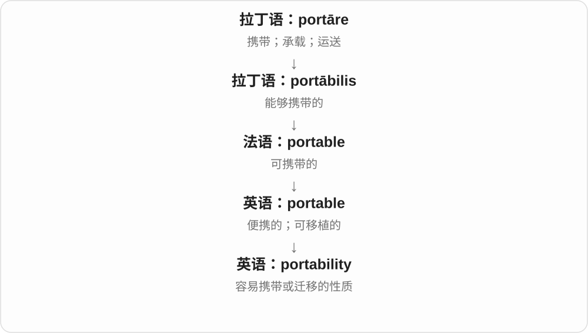

同一个性质可用于实物和信息。data portability 关注数据能否转到别处；number portability 指电话号码换服务商时能否转移保留。

**常见搭配与例句**

improve portability（提高便携性或可移植性）；software portability（软件可移植性）；data portability（数据可携性）。

> The smaller battery improves the device’s portability.

更小的电池提高了设备的便携性。

> The team tested the software’s portability across operating systems.

团队测试了软件跨操作系统的可移植性。

**别混淆**

portability 说便于迁移；compatibility 说能否与某环境或对象配合。支持多个环境有帮助，但两个词不是同义。

### 10. portly — 身材圆胖的；体态丰腴的

**音标**：英 /ˈpɔːtli/；美 /ˈpɔːrtli/

**先抓住这个画面**

portly 常描写体形较圆、较胖的人，尤其容易出现在人物外貌描写里。它带一点旧式、较委婉的语气。

**怎么拆**

来自旧义 port“仪态、举止”+ -ly；这个 port 由法语 porter“携带”发展而来，与港口无关。

**怎么变成今天的意思**

从有派头、体态庄重的描述，发展到体形较丰厚的意思。今天重点通常在外形，不能按词源直接译成“举止优雅”。

**常见搭配与例句**

a portly gentleman（一位身材圆胖的先生）；a portly figure（圆胖的身影）。

> A portly gentleman stood beside the fireplace.

一位身材圆胖的先生站在壁炉旁。

> The illustrator gave the character a portly figure and a bright coat.

插画师把这个人物画得身材圆胖，穿着鲜亮外套。

**别混淆**

portly 谈身材；portable 谈便携。portly 不是某种健康诊断，也不精确说明体重。

### 11. report — 报告；报道；汇报；报告书

**音标**：英 /rɪˈpɔːt/；美 /rɪˈpɔːrt/

**先抓住这个画面**

report 像从现场回来，把看到、听到、查到的情况带给别人。现代可以是口头汇报、新闻报道或一份书面报告。

**怎么拆**

拉丁语 re-（往回）+ portāre（携带），经法语 reporter 进入英语。

**怎么变成今天的意思**

被带回来的东西从实物变成信息。report a problem 是把问题告知相关的人；report to a manager 也可表示在组织上向某位经理负责。

**常见搭配与例句**

write a report（写报告）；report a problem（报告问题）；report on an event（报道事件）；report to someone（向某人汇报或负责）。

> Please report any problems to the front desk.

遇到问题请告知前台。

> The report summarizes the team’s findings.

报告概述了团队的调查结果。

**别混淆**

report 重在传达情况，不保证说法已经核实。It is reported that… 是“据报道”，不是直接等于“已经证实”。

### 12. reporting — 报道；汇报；报告工作

**音标**：英 /rɪˈpɔːtɪŋ/；美 /rɪˈpɔːrtɪŋ/

**先抓住这个画面**

reporting 是把信息收集、组织后持续带给别人。它可以是新闻工作，也可以是单位里的进度、财务或数据报告。

**怎么拆**

report + -ing，把报告动作作为活动或过程来谈。

**怎么变成今天的意思**

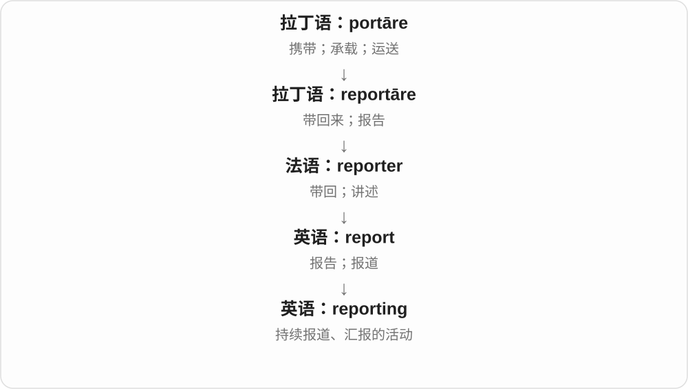

report 是一篇报告或一次动作；reporting 可以评价整套工作，如 accurate reporting。组织中的 reporting line 指向谁汇报的关系。

**常见搭配与例句**

news reporting（新闻报道）；accurate reporting（准确报道）；progress reporting（进度汇报）；a reporting line（汇报关系）。

> Her reporting brought attention to the neglected issue.

她的报道让那个被忽视的问题受到关注。

> The new tool simplifies monthly reporting.

新工具简化了每月汇报工作。

**别混淆**

reporting 关注传达事实；commentary 常加入解释和评价。实际文章可能兼有两者，阅读时留意区分。

### 13. reporter — 记者；报道者；记录员

**音标**：英 /rɪˈpɔːtə/；美 /rɪˈpɔːrtər/

**先抓住这个画面**

reporter 是把现场信息带给公众或相关人的那个人。记者去采访、核查，再把事情说清楚。

**怎么拆**

现代对应 report + -er；历史上也有法语 reporteur 进入中古英语 reportour 的路线。

**怎么变成今天的意思**

新闻记者是最常见用法，但 court reporter 可指法庭记录人员，工作重点是记录庭审内容。角色须看前面的修饰词。

**常见搭配与例句**

a news reporter（新闻记者）；a local reporter（地方记者）；a court reporter（法庭记录员）。

> The reporter interviewed residents near the station.

记者采访了车站附近的居民。

> A court reporter recorded the testimony.

法庭记录员记录了证词。

**别混淆**

reporter 侧重采访、报道或记录；editor 侧重编辑和审稿。一位 journalist 可能承担多种新闻工作。

### 14. reportable — 应报告的；可报告的

**音标**：英 /rɪˈpɔːtəbəl/；美 /rɪˈpɔːrtəbəl/

**先抓住这个画面**

reportable 给某件事贴上一个标签：“这件事需要报上去”或“可以作为报告内容”。具体是哪一种，要看规则和语境。

**怎么拆**

report + -able，表示可被报告；在制度用语中常进一步表示应当报告。

**怎么变成今天的意思**

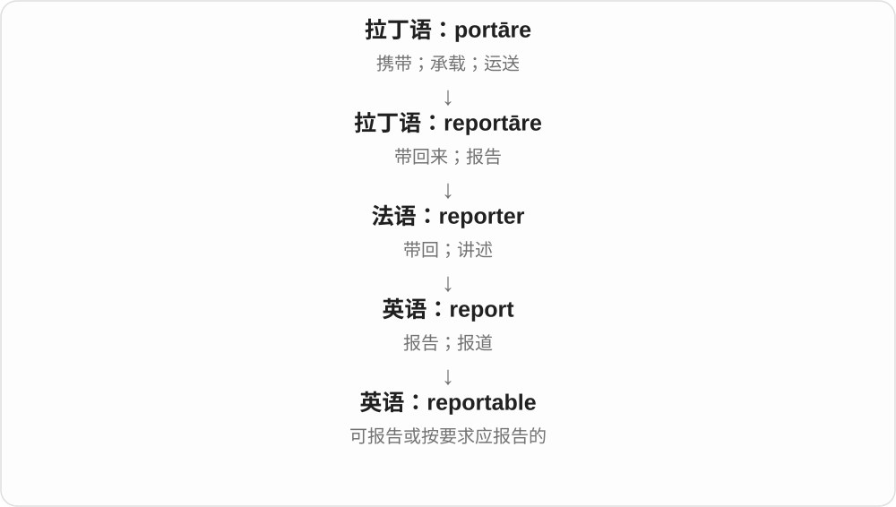

reportable incident 通常指符合某种报告条件的事件。后缀 -able 不总只表达纯粹能力，在特定搭配里也可承载制度要求。

**常见搭配与例句**

a reportable incident（须报告的事件）；reportable data（可报告的数据）；reportable income（按相关规则需申报的收入）。

> The handbook explains which incidents are reportable.

手册说明了哪些事件需要报告。

> The study produced no reportable results at that stage.

研究在那个阶段还没有可报告的结果。

**别混淆**

reportable 是是否需要或能够报告；reported 是已经报告。看到 reportable，不能推断通知已经发出。

### 15. transport — 运输；运送；交通运输

**音标**：动词 英 /trænsˈpɔːt/、美 /trænsˈpɔːrt/；名词 英 /ˈtrænspɔːt/、美 /ˈtrænspɔːrt/

**先抓住这个画面**

transport 是把人或东西从这里搬到那里，像把一箱货物带过一段距离。

**怎么拆**

拉丁语 trāns-（跨过、到另一边）+ portāre（运送），经法语进入英语。

**怎么变成今天的意思**

可以用车、船、飞机或管线等运送；重点是改变位置。文学里音乐也能 transport someone，把人的感受带到仿佛另一个世界。

**常见搭配与例句**

transport goods（运输货物）；public transport（公共交通，英式常见）；transport something from A to B（从 A 运到 B）。

> The trucks transport vegetables to the city.

这些卡车把蔬菜运往城市。

> We used public transport throughout the trip.

整个旅程中我们都使用公共交通。

**别混淆**

动词重音在后，名词重音在前。transfer 强调转移位置或归属，transport 更突出运送过程。

### 16. transportation — 运输；交通运输系统或方式

**音标**：英 /ˌtrænspɔːˈteɪʃən/；美 /ˌtrænspərˈteɪʃən/

**先抓住这个画面**

transportation 把运送人和货物这件事整体拿出来说，可以指一次运输，也可以指一座城市的交通系统。

**怎么拆**

transport + -ation，形成表示过程的名词。

**怎么变成今天的意思**

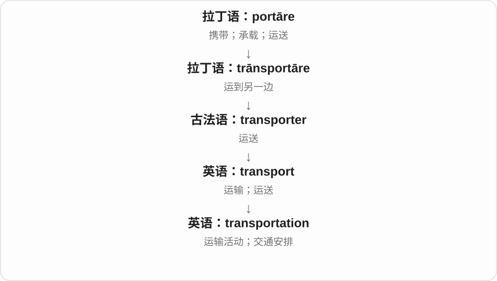

在美式英语中，public transportation 很常见；英式常用 public transport。历史语境还可能指把犯人运往殖民地的流放制度。

**常见搭配与例句**

public transportation（公共交通）；transportation costs（运输费用）；a means of transportation（交通方式）。

> The ticket includes transportation to the museum.

票价包含前往博物馆的交通费用。

> Reliable public transportation makes commuting easier.

可靠的公共交通让通勤更方便。

**别混淆**

transportation 不是特指旅游。旅游包含目的和活动，transportation 只是把人从一处送到另一处。

### 17. transporting — 运送；transport 的现在分词或动名词

**音标**：英 /trænsˈpɔːtɪŋ/；美 /trænsˈpɔːrtɪŋ/

**先抓住这个画面**

transporting 把镜头放在“正在把东西从一处送到另一处”这个动作上，也能把整个动作作为话题。

**怎么拆**

transport + -ing，是英语动词的常规变化。

**怎么变成今天的意思**

They are transporting… 说正在运送；Transporting goods is costly 把运货这件事放到主语位置。它不是一个与 transport 无关的新词根。

**常见搭配与例句**

transporting goods（运输货物）；the cost of transporting…（运送……的成本）。

> They are transporting the equipment by rail.

他们正在通过铁路运送设备。

> Transporting fresh food requires careful planning.

运输生鲜食品需要周密安排。

**别混淆**

transporting 是动作形式；transporter 是运输者或运输车辆；transportation 是较正式的运输过程名词。

### 18. transporter — 运输者；运输车辆；转运体

**音标**：英 /trænsˈpɔːtə/；美 /trænsˈpɔːrtər/

**先抓住这个画面**

transporter 是负责把东西搬过去的人、车或结构。想象一辆装着多辆汽车的大卡车，就是 car transporter。

**怎么拆**

transport + -er，表示执行运输的一方。

**怎么变成今天的意思**

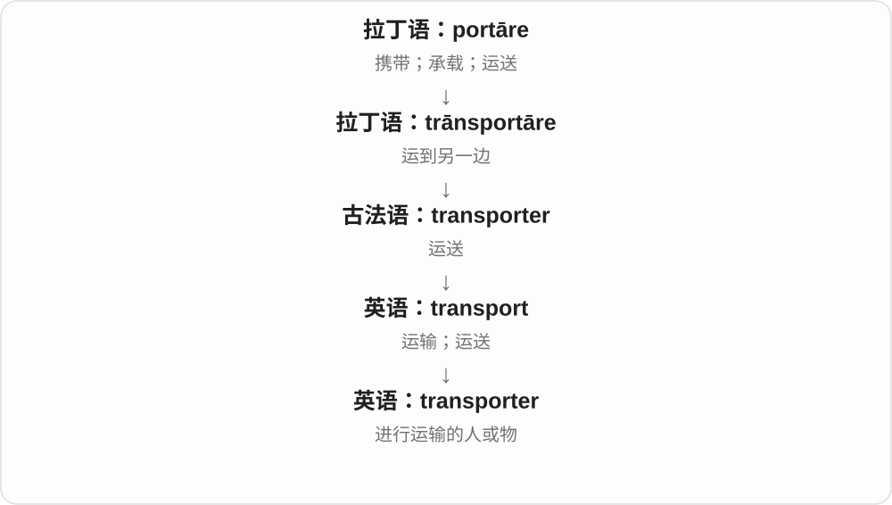

同一个角色词能进入不同领域：道路上是运输车辆，生物学里可指把物质跨膜转运的蛋白。对象不同，核心都是转运。

**常见搭配与例句**

a car transporter（汽车运输车）；a heavy equipment transporter（重型设备运输车）；a membrane transporter（膜转运体）。

> The transporter carried six new cars to the dealership.

运输车把六辆新车运到经销店。

> The diagram shows a transporter moving molecules across a membrane.

图中显示一个转运体把分子运过膜。

**别混淆**

transport 是动作或运输活动；transporter 是执行它的东西。不能把交通系统整体都译成 transporter。

### 19. transportable — 可运输的；可迁移的

**音标**：英 /trænsˈpɔːtəbəl/；美 /trænsˈpɔːrtəbəl/

**先抓住这个画面**

transportable 只说“有办法运走”。一间组合式房屋能被卡车拉走，也可以是 transportable，虽然没人能把它塞进背包。

**怎么拆**

transport + -able，表示可以被运输。

**怎么变成今天的意思**

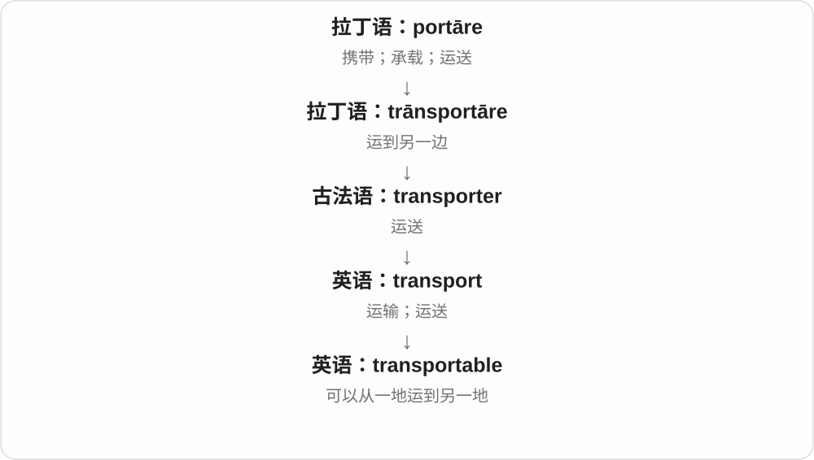

比起 portable，它常允许更大的体积和更复杂的运输方式。重点在能移动到另一个地点，不在日常携带是否轻松。

**常见搭配与例句**

a transportable unit（可运输单元）；transportable equipment（可运输设备）；a transportable building（可搬迁建筑）。

> The exhibition is packed into transportable units.

展览被装成可运输的单元。

> The laboratory was designed to be transportable by truck.

这间实验室被设计成可以用卡车运走。

**别混淆**

portable 通常暗示方便带着用；transportable 可以需要起重机、车辆或拆装。

### 20. import — 进口；导入；进口商品；意义

**音标**：动词 英 /ɪmˈpɔːt/、美 /ɪmˈpɔːrt/；名词 英 /ˈɪmpɔːt/、美 /ˈɪmpɔːrt/

**先抓住这个画面**

import 是把外面的东西带进来：国外商品进来，外部数据进入软件。正式用法还可指某句话或事情“带来的意义”。

**怎么拆**

拉丁语 in-（向内）+ portāre（携带），n 在 p 前同化成 m。

**怎么变成今天的意思**

进口与导入保留空间方向；the import of his words 则问他的话意味着什么。这条“承载意义”的线也通向 important。

**常见搭配与例句**

import goods（进口商品）；import data（导入数据）；an import from…（从……进口的商品）；the full import of…（……的完整含义）。

> The country imports most of its coffee.

这个国家的大部分咖啡依靠进口。

> She did not immediately grasp the import of his words.

她没有立刻领会他话中的含义。

**别混淆**

import 向内，export 向外。作名词谈“意义”时较正式，不能每次看到 import 都翻成进口。

### 21. important — 重要的；影响大的

**音标**：英 /ɪmˈpɔːtənt/；美 /ɪmˈpɔːrtənt/

**先抓住这个画面**

important 是一件事有分量：它会影响结果，或者对某个人有特殊价值，不能轻易忽略。

**怎么拆**

连着拉丁语 importāre“带入、传达”，中世纪拉丁语 importāns 发展出“关系重大”的意思。不是“进口的东西都重要”。

**怎么变成今天的意思**

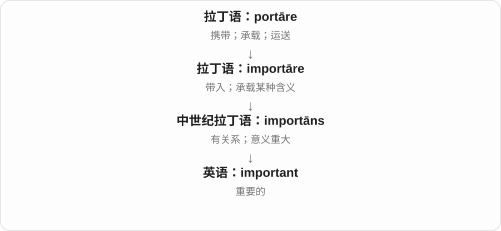

从承载意义、带来后果，走向值得重视。用“有分量”帮助理解很直观，但 important 本身不要求东西真的很重。

**常见搭配与例句**

an important decision（重要决定）；be important to someone（对某人很重要）；It is important to…（做……很重要）。

> This decision is important to everyone on the team.

这个决定对团队每个人都很重要。

> It is important to read the instructions carefully.

仔细阅读说明很重要。

**别混淆**

important 是重要；urgent 是急迫。重要的事未必今天必须做，急事也未必影响最大。

### 22. importance — 重要性；分量；意义

**音标**：英 /ɪmˈpɔːtəns/；美 /ɪmˈpɔːrtəns/

**先抓住这个画面**

importance 把“这件事有多值得在意”变成一个可以讨论的概念。它谈的不是东西有多大，而是影响或价值有多大。

**怎么拆**

来自法语 importance 或中世纪拉丁语 importantia，与 important 同族；现代把 -ant / -ance 的形容词、名词关系一起记。

**怎么变成今天的意思**

the importance of practice 是练习为什么值得重视。attach importance to 是把某件事放在较高位置，也就是重视它。

**常见搭配与例句**

the importance of…（……的重要性）；attach importance to…（重视……）；of great importance（非常重要）。

> The experience taught her the importance of preparation.

这段经历让她明白了准备的重要性。

> They attach great importance to clear communication.

他们非常重视清楚的沟通。

**别混淆**

importance 是名词，important 是形容词。This is important 与 This is of importance 意思相近，后者较正式。

### 23. importantly — 重要的是；更重要地；自命不凡地

**音标**：英 /ɪmˈpɔːtəntli/；美 /ɪmˈpɔːrtəntli/

**先抓住这个画面**

importantly 常像在下一句话前画一道重点：“请注意，接下来这一点很要紧。”most importantly 则把最关键的一点抬出来。

**怎么拆**

important + -ly，构成副词。

**怎么变成今天的意思**

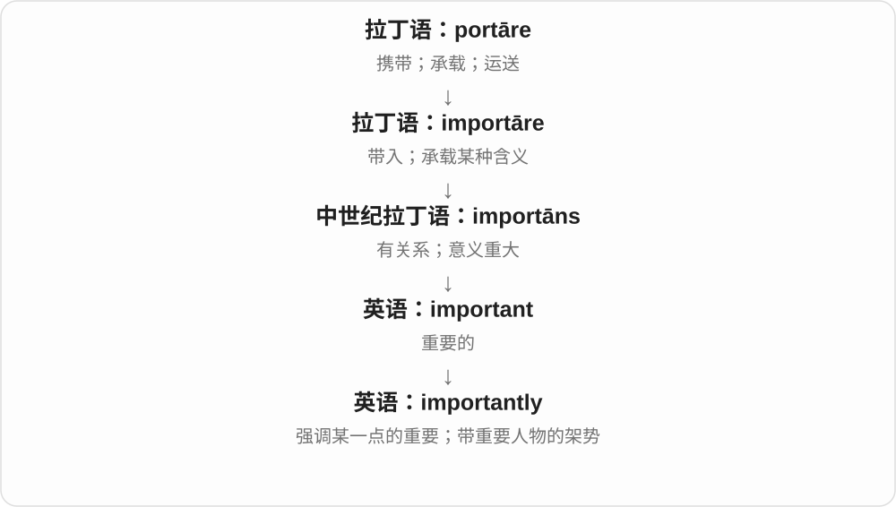

常见用法是修饰整句话，说明后面信息的重要性。另一种较少见的方式副词用法形容人摆出一副自以为了不起的样子。

**常见搭配与例句**

more importantly（更重要的是）；most importantly（最重要的是）；speak importantly（故作重要地说，较少见）。

> The plan is affordable and, more importantly, practical.

这个方案成本可承担，更重要的是切实可行。

> Most importantly, everyone understood the next step.

最重要的是，每个人都明白下一步该做什么。

**别混淆**

important 修饰名词或作表语；importantly 常评说整句话。不是在所有 important 后面随便加 ly 都能得到自然表达。

### 24. importer — 进口商；进口国；导入工具

**音标**：英 /ɪmˈpɔːtə/；美 /ɪmˈpɔːrtər/

**先抓住这个画面**

importer 是从外面把商品买进来的一方。对比装货向外卖的 exporter，importer 站在接收、买入的这一端。

**怎么拆**

import + -er，表示实施进口、导入的一方。

**怎么变成今天的意思**

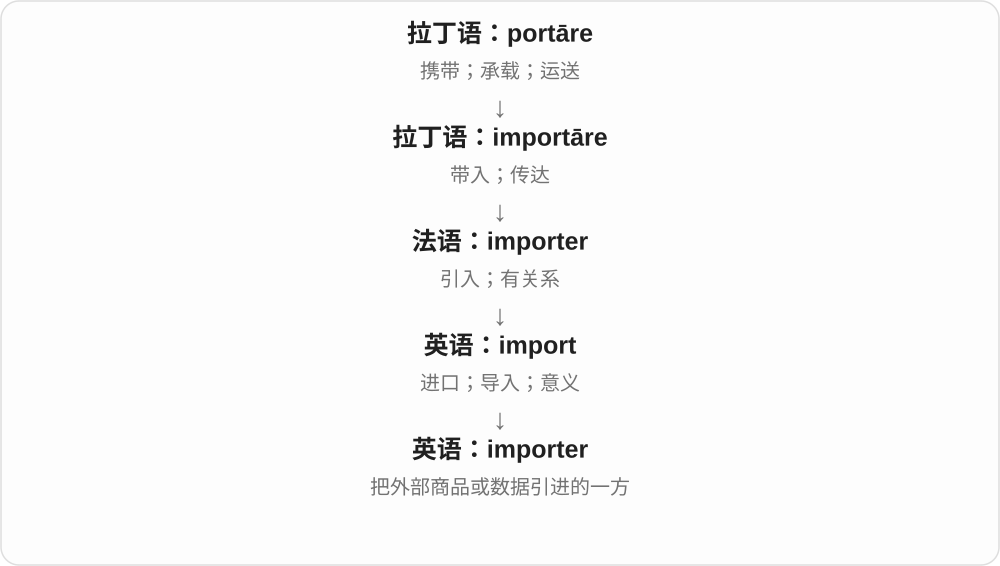

公司、国家都可能是 importer；技术语境中的 file importer 则是把外部文件读进来的工具。

**常见搭配与例句**

a coffee importer（咖啡进口商）；a major importer of energy（能源进口大国）；a file importer（文件导入工具）。

> The importer supplies coffee to local shops.

这家进口商向当地商店供应咖啡。

> The country is a major importer of energy.

这个国家是能源进口大国。

**别混淆**

importer 从国外买入，不一定就是最终消费者；它也可能继续把商品卖给零售商。

### 25. importation — 进口；引入过程

**音标**：英 /ˌɪmpɔːˈteɪʃən/；美 /ˌɪmpɔːrˈteɪʃən/

**先抓住这个画面**

importation 把“从外面带进来”作为正式过程来讲。可以是商品进口，也可比喻引入外来的做法或观念。

**怎么拆**

import + -ation，构成动作过程名词。

**怎么变成今天的意思**

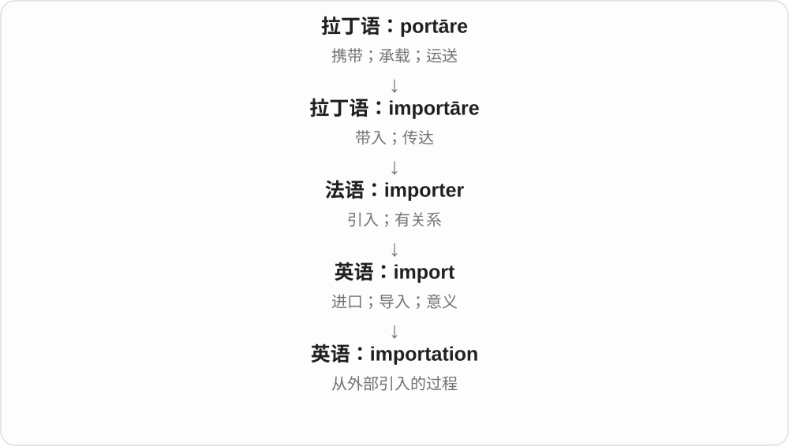

常出现在较正式的制度、贸易或历史文字中。它通常谈引入行为，具体进口商品常用 imports。

**常见搭配与例句**

the importation of goods（货物进口）；the importation of new ideas（新思想的引入）。

> The museum studies the importation of ceramics during that period.

博物馆研究那个时期陶瓷的进口情况。

> The essay discusses the importation of foreign ideas.

文章讨论了外来观念的引入。

**别混淆**

importation 向内，exportation 向外。普通日常表达里 import 常更简洁。

### 26. deport — 驱逐出境

**音标**：英 /dɪˈpɔːt/；美 /dɪˈpɔːrt/

**先抓住这个画面**

deport 是当局把某人强制送离国家。它不是“帮他搬家”，而是带有强制性的遣离。

**怎么拆**

拉丁语 dē-（离开）+ portāre（运送）形成 dēportāre，经法语 déporter 进入英语。

**怎么变成今天的意思**

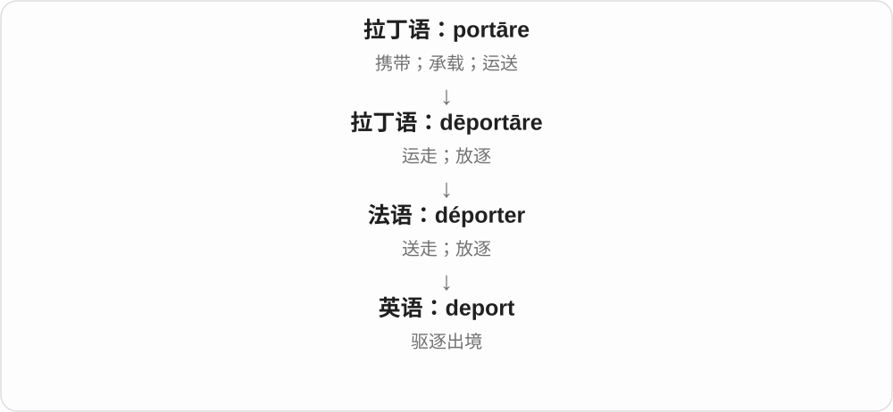

词源是运走、送离，现代常用于驱逐出境。较旧的 deport oneself“举止表现”属于另一个用法，deportment 保留了它。

**常见搭配与例句**

deport someone to…（把某人遣送到……）；be deported from…（从……被驱逐出境）。

> The report states that he was deported the following year.

报告称，他在次年被驱逐出境。

> The film follows a woman who fears being deported.

影片讲述一名担心被驱逐出境的女性的经历。

**别混淆**

deport 是官方强制遣离；emigrate 是移居国外。句子中的行为主体和是否自愿很不同。

### 27. deportation — 驱逐出境；强制遣送

**音标**：英 /ˌdiːpɔːˈteɪʃən/；美 /ˌdiːpɔːrˈteɪʃən/

**先抓住这个画面**

deportation 是由当局把一个人强制送离某个国家的过程。词源中的“运走”在这里变成了制度性行动。

**怎么拆**

来自法语 déportation，与 deport 相连；现代可看成 deport + -ation。

**怎么变成今天的意思**

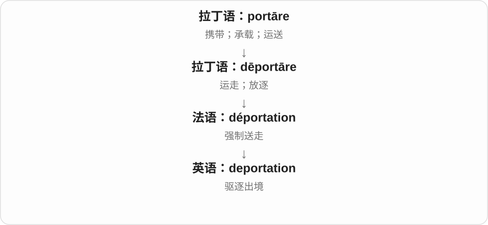

它描述强制离境，不是普通旅行安排。不同语境涉及的具体制度不同，理解单词时先抓住谁在强制把谁送走。

**常见搭配与例句**

face deportation（面临驱逐出境）；a deportation order（驱逐出境令）；deportation proceedings（驱逐出境程序）。

> The report describes the family’s experience of deportation.

报告描述了这家人被驱逐出境的经历。

> The newspaper reported that a deportation order had been issued.

报纸报道说，已发出一份驱逐出境令。

**别混淆**

deportation 是被强制遣离；departure 只是离开。不要把一个中性的出发词读成强制行动。

### 28. deportment — 举止；仪态

**音标**：英 /dɪˈpɔːtmənt/；美 /dɪˈpɔːrtmənt/

**先抓住这个画面**

deportment 是一个人怎样站、走、坐、与人相处所呈现的仪态。它像“怎样带着自己的身体和身份出现”。

**怎么拆**

来自法语 deportement，与旧动词 deport“表现、举止”相连；这条用法最终也连着 portāre。

**怎么变成今天的意思**

今天多用于较正式或传统的举止教育场景。它没有“驱逐出境”的意思，不能按现代 deport 最常见的义项硬推整个名词。

**常见搭配与例句**

good deportment（良好仪态）；lessons in deportment（仪态课程）；calm deportment（从容的举止）。

> The academy once offered lessons in deportment.

这所学校曾开设仪态课程。

> Her confident deportment made a strong first impression.

她自信的举止给人留下了深刻的第一印象。

**别混淆**

deportment 是举止，deportation 是驱逐出境。后缀不同，也保留了同一历史词族中的不同用法。

### 29. export — 出口；导出；出口商品

**音标**：动词 英 /ɪkˈspɔːt/、美 /ɪkˈspɔːrt/；名词 英 /ˈekspɔːt/、美 /ˈekspɔːrt/

**先抓住这个画面**

export 是把东西向外带：把本国商品卖到国外，或把软件里的数据另存到外部文件。

**怎么拆**

拉丁语 ex-（向外）+ portāre（运送），形成 exportāre。

**怎么变成今天的意思**

贸易中“向外”通常以国家或地区为边界；软件中则以某个应用或文件格式为边界。

**常见搭配与例句**

export goods（出口商品）；export to…（向……出口）；export a file（导出文件）；agricultural exports（农产品出口）。

> The company exports furniture to several countries.

这家公司向几个国家出口家具。

> You can export the chart as an image.

你可以把图表导出成图片。

**别混淆**

export 向外，import 向内。名词通常重音在前，动词通常在后。

### 30. exporter — 出口商；出口国；导出工具

**音标**：英 /ɪkˈspɔːtə/；美 /ɪkˈspɔːrtər/

**先抓住这个画面**

exporter 是把商品向外卖的一方。它可以是一家公司，也可以是以某类商品出口著称的国家。

**怎么拆**

export + -er，表示实施出口的人、企业或其他主体。

**怎么变成今天的意思**

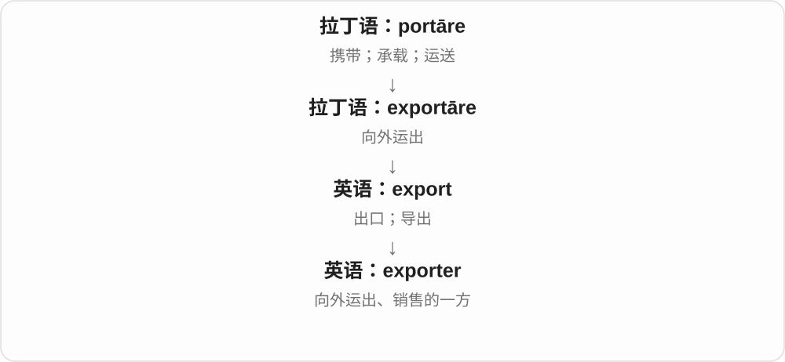

新闻里的 a major exporter of wheat 指小麦出口大国或大供应商，要看主语。技术语境还可能指负责导出数据的工具。

**常见搭配与例句**

a leading exporter（主要出口商或出口国）；an exporter of tea（茶叶出口商）；a data exporter（数据导出工具）。

> The country is a major exporter of wheat.

这个国家是小麦出口大国。

> The exporter ships furniture to overseas retailers.

这家出口商把家具运给海外零售商。

**别混淆**

exporter 向外供应；importer 从外部买入。同一家公司也可以同时扮演两种角色。

### 31. exportation — 出口；输出过程

**音标**：英 /ˌekspɔːˈteɪʃən/；美 /ˌekspɔːrˈteɪʃən/

**先抓住这个画面**

exportation 把“把东西运出境”作为一项过程来说。它比日常的 export 更正式，常见于制度、历史或行业文字。

**怎么拆**

export + -ation，形成动作过程名词。

**怎么变成今天的意思**

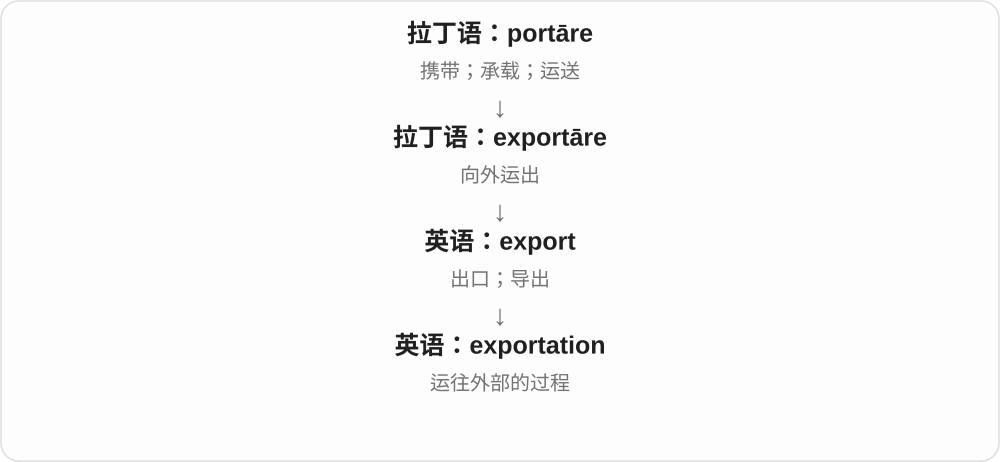

重点是运出的行为，通常不指一件具体出口商品。若说一国的出口商品或出口额，常用 exports。

**常见搭配与例句**

the exportation of goods（货物出口）；exportation to overseas markets（出口海外市场）。

> The report traces the exportation of wool during that period.

报告追溯了那个时期羊毛出口的情况。

> The goods were prepared for exportation.

这些货物已准备好出口。

**别混淆**

exportation 是出口过程；an export 可以是某项出口商品。一般句子里 export 往往更简洁自然。

### 32. portfolio — 作品集；投资组合；一组职责或业务

**音标**：英 /pɔːtˈfəʊliəʊ/；美 /pɔːrtˈfoʊlioʊ/

**先抓住这个画面**

portfolio 最初像一个装纸张的夹子：把你的作品装在里面带给别人看。后来“夹子里的整套东西”比夹子本身更重要。

**怎么拆**

来自意大利语 portafoglio，porta- 与“携带”有关，foglio 是纸张、页，追溯到拉丁语 folium。

**怎么变成今天的意思**

设计师 portfolio 展示作品；投资 portfolio 是一组持有资产；业务 portfolio 是某机构掌握的一组业务。共同点是被放在一起管理、展示的一整套。

**常见搭配与例句**

a design portfolio（设计作品集）；an investment portfolio（投资组合）；a portfolio of projects（一组项目）。

> She included three recent projects in her portfolio.

她在作品集中放入了三个近期项目。

> The company manages a portfolio of publishing businesses.

这家公司管理着一组出版业务。

**别混淆**

portfolio 常让人看到实际作品或持有内容；résumé 简要列经历与资历。两者可以一起提交，作用不同。

### 33. purport — 声称；意在；主旨、大意

**音标**：动词 英 /pəˈpɔːt/、美 /pərˈpɔːrt/；名词 英 /ˈpɜːpɔːt/、美 /ˈpɝːpɔːrt/

**先抓住这个画面**

purport 作动词常是“它声称自己是什么”，说话者保留态度。作名词则是文字背后实际传达的大意。

**怎么拆**

经古法语 porporter / purporter“传达、包含”进入英语，后半来自 porter“携带”；前半追溯到表示向前的 pro-。

**怎么变成今天的意思**

“带出某种意思”可以指文本的主旨，也可以指某个东西所声称的性质。purport to be authentic 表示声称是真品，尚未替它背书。

**常见搭配与例句**

purport to be…（声称是……）；purport to show…（声称显示……）；the purport of a letter（信的大意）。

> The document purports to be an original agreement.

这份文件声称是协议原件。

> I understood the general purport of her message.

我明白了她那条消息的大意。

**别混淆**

purport 比 claim 更正式，常带保留或怀疑。名词重音在前，动词在后。

### 34. purported — 据称的；所谓的

**音标**：英 /pəˈpɔːtɪd/；美 /pərˈpɔːrtɪd/

**先抓住这个画面**

purported 像在一个标签上加一句：“这是别人声称的，还不能直接当成事实。”例如 purported benefits 是声称存在的好处。

**怎么拆**

purport + -ed，过去分词用作形容词。它沿着“传达、声称”这一支发展。

**怎么变成今天的意思**

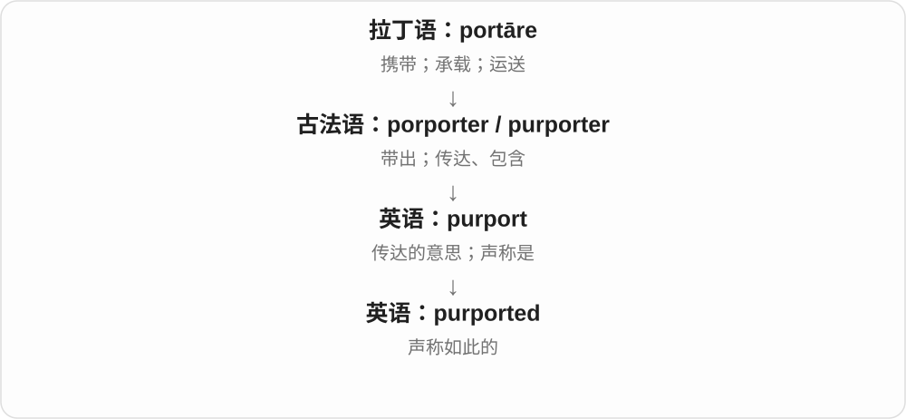

这个词让作者与说法保持距离，常带怀疑，但没有直接断言说法一定是假的。

**常见搭配与例句**

purported benefits（据称的好处）；a purported expert（所谓专家）；the purported author（被指称为作者的人）。

> The article examines the product’s purported benefits.

文章考察了这款产品据称具有的好处。

> The purported author denied writing the letter.

被指称为作者的人否认写过那封信。

**别混淆**

purported 是有待核实的声称；proven 是已经证明的。false 则直接判断为假，态度更明确。

### 35. rapport — 融洽关系；相互理解的默契

**音标**：英 /ræˈpɔː/；美 /ræˈpɔːr/

**先抓住这个画面**

rapport 就是两个人说话接得住、相处不别扭的感觉。即使刚认识，也可能很快建立起这种信任和默契。

**怎么拆**

借自法语 rapport，与 rapporter“带回、关联”相连；后者含 re- 和 apporter“带来”，最终连到 portāre。

**怎么变成今天的意思**

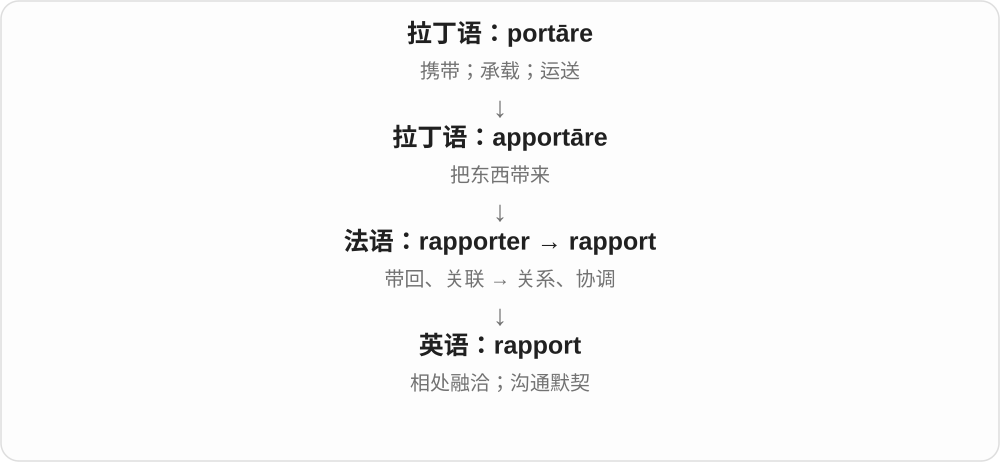

从关系、协调发展为人际融洽。可以用“交流来回顺畅”帮助记忆，但不能把它硬讲成两个现代英语词 report 的拼合。末尾 t 通常不发音。

**常见搭配与例句**

build rapport with someone（与某人建立融洽关系）；establish a good rapport（建立良好默契）。

> The teacher quickly built a rapport with the class.

老师很快就与全班建立了融洽关系。

> A few simple questions helped establish rapport.

几个简单的问题帮助建立了沟通默契。

**别混淆**

rapport 是互动中的融洽感；friendship 是友谊关系。一次采访中也能建立 rapport，不必已经是朋友。

### 36. portage — 陆上搬运船只及行李；搬运路线

**音标**：英 /ˈpɔːtɪdʒ/；美 /ˈpɔːrtɪdʒ/；也读 /pɔːrˈtɑːʒ/

**先抓住这个画面**

portage 的画面很具体：划船到了瀑布或两片水域之间，得把船搬上岸，扛过一段陆地再下水。

**怎么拆**

来自法语 portage，连着 porter“携带”，更早有拉丁语 portāre 和相关名词 portāticum。-age 在这里形成活动名词。

**怎么变成今天的意思**

这是普通“搬运”在水上旅行场景中的专门化。它也可指供搬运通过的那段路线，并能作动词“把船搬过陆地”。

**常见搭配与例句**

a short portage（短距离陆上搬运）；a portage trail（搬船路径）；portage a canoe（把独木舟搬过陆地）。

> The route includes a short portage between two lakes.

这条路线包含一段在两座湖之间搬船过陆地的路程。

> We had to portage the canoe around the rapids.

我们得把独木舟搬上岸，绕过急流。

**别混淆**

transport 泛指运输；portage 在现代户外语境中特别容易联系搬船越过陆地。它不是“港口的年龄”。

### 37. reportage — 新闻报道；报道作品；纪实报道

**音标**：英 /ˌrepɔːˈtɑːʒ/；美 /rɪˈpɔːrtɪdʒ/

**先抓住这个画面**

reportage 常让人想到记者到现场观察，把人物、场景和事实写成有细节的报道。它比普通 report 更有新闻或纪实作品的味道。

**怎么拆**

借自法语 reportage，与法语的报道、记者词族相连；更远处仍是 portāre“携带”和 reportāre“带回信息”。

**怎么变成今天的意思**

可以泛指报道工作，也可谈某种报道作品。法语式读音常把重音放在末尾，英语中也有接近 reporting 词族的另一读法。

**常见搭配与例句**

war reportage（战地报道）；literary reportage（文学性纪实报道）；firsthand reportage（现场亲历报道）。

> The book combines historical research with vivid reportage.

这本书把历史研究与生动的纪实报道结合起来。

> Her reportage captures the daily life of the town.

她的报道呈现了小镇的日常生活。

**别混淆**

report 是通用的报告；reportage 更常属于新闻和纪实表达，通常不可数。

### 38. comportment — 举止；行为表现

**音标**：英 /kəmˈpɔːtmənt/；美 /kəmˈpɔːrtmənt/

**先抓住这个画面**

comportment 是一个人“把自己呈现出来”的方式：站姿、谈吐、待人态度合在一起，形成举止给人的感觉。

**怎么拆**

来自法语 comportement，与 comporter“表现、举止”相连；再追溯到拉丁语 comportāre“带到一起”，com- + portāre。

**怎么变成今天的意思**

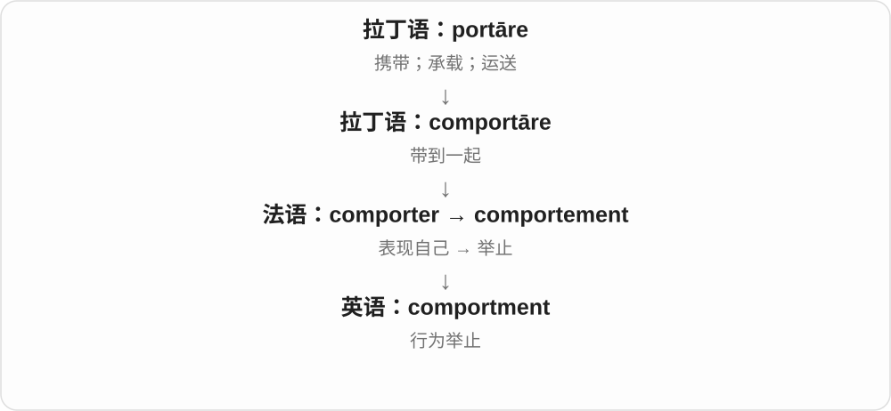

可以用 carry oneself“举止表现”帮助理解这里的“携带自己”，但不要把这个联想当作每一步语义变化都有详细记录的故事。

**常见搭配与例句**

dignified comportment（庄重的举止）；professional comportment（职业场合的得体表现）。

> Her calm comportment helped ease the tension.

她冷静的举止帮助缓和了紧张气氛。

> The course emphasizes professional comportment during interviews.

课程强调面试时的职业举止。

**别混淆**

comportment 比 behavior 更正式，较强调外在举止和风度。character 更关心一个人的品格。

## 这一组要分清什么

**import 与 export**：以所在国家、应用或系统为参照，前者向内带，后者向外带。名词通常重音在前，动词常在后。

**porter 也有两条路线。** 搬运工来自 portātor“携带者”；门卫来自 portārius“守门者”。这两个词后来碰成了相同的英语拼写。

**portable 与 transportable**：便携通常强调方便随人携带；可运输的东西可能仍需卡车或起重机。

**important 不是“进口货更贵所以重要”。** 它连着 importāre 的“传达意义、关系重大”一支。用“有分量”记忆可以，编一段商品贸易故事当词源则不可以。

**port 的软件移植义要保留来源分歧。** “把程序搬过去”很直观，但不能据此断定唯一词源；有词典把它联系到硬件接口。接口本身沿门、开口支理解。葡萄酒名 port 来自 Porto 城市名。

## 串起来练习

把三支放进同一场景：**At the port, a porter carried the portable equipment while a reporter opened the news portal.**

在港口，一位搬运工搬着便携设备，一名记者打开新闻门户。port 是港口支；porter、portable、reporter 是携带支；portal 是门的支线。看见相同字母后，再确认它究竟走哪条路。
