# 0064 · spec-, -spic-, spect- — 看；观察；由外观发展出的种类与特征

[逐词精讲目录](../00_逐词精讲目录.md) · [总目录](../00_总目录_按常用程度.md)

## 核心词根与来源

先想一个最普通的动作：**把眼睛转向一个对象，留意它是什么样。** 拉丁语 specere（词典形式 speciō）就是这一族的起点。把目光投向对象、仔细查看，形成 inspect“检查”；把观察转向自己的思想，形成 introspection“内省”；朝前望着等，变成 expect“预料、期待”；把自己往高处放、向下看别人，变成 despise“鄙视”。这些画面帮助抓住意义，真正的借入路线仍要分别看每个词。

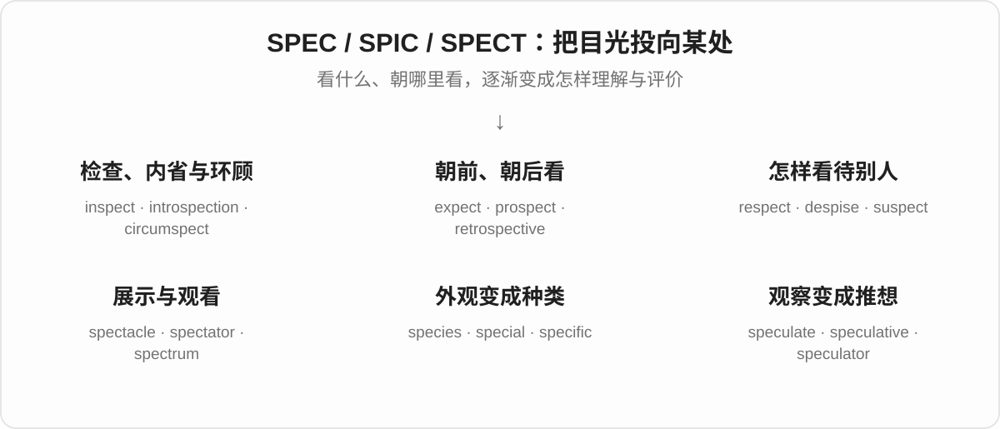

## 词形与演化规律

**spec-、spic-、spect- 是历史词干变化，不是三个互不相干的词根。** 复合词里常见 -spic-，而分词、名词以及 spectāre“反复观看”一支常见 spect-。还有一大支从 speciēs“看见的外观”走向“种类”：species、special、specific 由此展开。spice 也与 species 同源，但中间经过“某类货品、香料”的意义变化，不能跳过这段历史。

## 单词速览（按词族由简到繁）

同一基础词的相关扩展放在一起，先读基础形式，再读扩展；各组之间优先读常用的。具体词源关系见各词讲解。

| 单词 | 音标 | 核心意思 |
|---|---|---|
| [special](#w-1) | /ˈspeʃəl/ | 特别的；专门的 |
| [specialist](#w-13) | /ˈspeʃəlɪst/ | 专家；专科人员；专业的 |
| [specially](#w-22) | /ˈspeʃəli/ | 专门地；特地 |
| [specialize](#w-46) | /ˈspeʃəlaɪz/ | 专门从事；专攻 |
| [specialism](#w-79) | /ˈspeʃəlɪzəm/ | 专业领域；专门研究 |
| [especial](#w-64) | /ɪˈspeʃəl/ | 特别的；格外的 |
| [especially](#w-2) | /ɪˈspeʃəli/ | 尤其；特别是 |
| [respect](#w-3) | /rɪˈspekt/ | 尊重；顾及；方面 |
| [respective](#w-16) | /rɪˈspektɪv/ | 各自的；分别对应的 |
| [respectively](#w-11) | /rɪˈspektɪvli/ | 分别；依照前述顺序对应地 |
| [irrespective](#w-44) | /ˌɪrɪˈspektɪv/ | 不考虑……的；不受……影响的 |
| [respectful](#w-32) | /rɪˈspektfəl/ | 尊重人的；恭敬的 |
| [respectable](#w-31) | /rɪˈspektəbəl/ | 体面的；值得尊重的；相当不错的 |
| [respectability](#w-60) | /rɪˌspektəˈbɪləti/ | 体面；受人尊重的名声 |
| [respectably](#w-80) | /rɪˈspektəbli/ | 体面地；相当不错地 |
| [disrespectable](#w-105) | /ˌdɪsrɪˈspektəbəl/ | 不体面的；不值得尊重的（少见） |
| [respectant](#w-112) | /rɪˈspektənt/ | 相向而视的；回看的（纹章或古雅用语） |
| [disrespect](#w-33) | /ˌdɪsrɪˈspekt/ | 不尊重；失礼；不敬 |
| [specific](#w-4) | /spəˈsɪfɪk/ | 具体的；特定的；某类独有的 |
| [specifically](#w-8) | /spəˈsɪfɪkli/ | 具体地；明确地；专门地 |
| [specification](#w-29) | /ˌspesɪfɪˈkeɪʃən/ | 规格；明确要求；详细说明 |
| [specificity](#w-49) | /ˌspesɪˈfɪsəti/ | 具体程度；专一性；特异性 |
| [bispecificity](#w-100) | /ˌbaɪspesɪˈfɪsəti/ | 双特异性 |
| [nonspecific](#w-73) | 英 /ˌnɒnspəˈsɪfɪk/；美 /ˌnɑːnspəˈsɪfɪk/ | 不具体的；非特异性的 |
| [interspecific](#w-82) | 英 /ˌɪntəspəˈsɪfɪk/；美 /ˌɪntərspəˈsɪfɪk/ | 种间的；不同物种之间的 |
| [conspecific](#w-85) | 英 /ˌkɒnspəˈsɪfɪk/；美 /ˌkɑːnspəˈsɪfɪk/ | 同种的；同一物种的个体 |
| [conspecificity](#w-102) | 英 /ˌkɒnspesɪˈfɪsəti/；美 /ˌkɑːnspesɪˈfɪsəti/ | 同种性；属于同一物种 |
| [intraspecific](#w-86) | 英 /ˌɪntrəspəˈsɪfɪk/；美 /ˌɪntrəspəˈsɪfɪk/ | 种内的 |
| [infraspecific](#w-92) | /ˌɪnfrəspəˈsɪfɪk/ | 种下的；物种以下分类层级的 |
| [bispecific](#w-94) | /ˌbaɪspəˈsɪfɪk/ | 双特异性的 |
| [trispecific](#w-120) | /ˌtraɪspəˈsɪfɪk/ | 三特异性的；涉及三个物种的 |
| [unispecific](#w-121) | /ˌjuːnɪspəˈsɪfɪk/ | 仅含一个物种的；单种的 |
| [multispecific](#w-108) | /ˌmʌltispəˈsɪfɪk/ | 涉及多个物种的；多特异性的 |
| [multispecificity](#w-109) | /ˌmʌltispesɪˈfɪsəti/ | 多特异性；涉及多种特定对象的性质 |
| [expect](#w-5) | /ɪkˈspekt/ | 预料；期待；要求 |
| [expectation](#w-23) | /ˌekspekˈteɪʃən/ | 预期；期待；期望要求 |
| [expectant](#w-56) | /ɪkˈspektənt/ | 期待的；怀孕的；即将为人父母的 |
| [expectancy](#w-39) | /ɪkˈspektənsi/ | 期待；预期 |
| [expectantly](#w-78) | /ɪkˈspektəntli/ | 满怀期待地 |
| [despise](#w-38) | /dɪˈspaɪz/ | 鄙视；看不起 |
| [despite](#w-6) | /dɪˈspaɪt/ | 尽管；即使有…… |
| [spite](#w-21) | /spaɪt/ | 恶意；故意使人难受 |
| [respite](#w-50) | 英 /ˈrespaɪt/；美 /ˈrespɪt/ | 喘息；暂时缓解；缓期 |
| [despicable](#w-42) | /dɪˈspɪkəbəl/，亦 /ˈdespɪkəbəl/ | 卑鄙的；令人鄙视的 |
| [species](#w-7) | /ˈspiːʃiːz/ | 物种；种类 |
| [speciation](#w-66) | /ˌspiːʃiˈeɪʃən/，亦 /ˌspiːsiˈeɪʃən/ | 物种形成；物种分化 |
| [subspecies](#w-57) | /ˈsʌbspiːʃiːz/ | 亚种 |
| [interspecies](#w-76) | 英 /ˌɪntəˈspiːʃiːz/；美 /ˌɪntərˈspiːʃiːz/ | 物种之间的；种间的 |
| [intraspecies](#w-96) | 英 /ˌɪntrəˈspiːʃiːz/；美 /ˌɪntrəˈspiːʃiːz/ | 同一物种内部的 |
| [perspective](#w-9) | 英 /pəˈspektɪv/；美 /pərˈspektɪv/ | 视角；看法；透视法 |
| [suspect](#w-10) | 动词 /səˈspekt/；名词、形容词 /ˈsʌspekt/ | 怀疑；嫌疑人；可疑的 |
| [suspicious](#w-19) | /səˈspɪʃəs/ | 怀疑的；可疑的 |
| [suspiciously](#w-52) | /səˈspɪʃəsli/ | 怀疑地；可疑地；出奇地 |
| [suspicion](#w-25) | /səˈspɪʃən/ | 怀疑；嫌疑 |
| [aspect](#w-12) | /ˈæspekt/ | 方面；外观；朝向；语法中的体 |
| [spectrum](#w-14) | /ˈspektrəm/ | 光谱；范围；一系列不同情况 |
| [spectral](#w-43) | /ˈspektrəl/ | 光谱的；幽灵般的 |
| [multispectral](#w-84) | /ˌmʌltiˈspektrəl/ | 多光谱的 |
| [inspect](#w-34) | /ɪnˈspekt/ | 仔细检查；检验 |
| [inspector](#w-15) | 英 /ɪnˈspektə/；美 /ɪnˈspektər/ | 检查员；督察 |
| [inspectorate](#w-62) | 英 /ɪnˈspektərət/；美 /ɪnˈspektərət/ | 检查机构；监察部门 |
| [inspection](#w-17) | /ɪnˈspekʃən/ | 检查；检验 |
| [reinspect](#w-111) | /ˌriːɪnˈspekt/ | 重新检查；复检 |
| [prospect](#w-18) | 名词英 /ˈprɒspekt/、美 /ˈprɑːspekt/；动词英亦读 /prəˈspekt/ | 前景；可能性；勘探 |
| [prospective](#w-27) | 英 /prəˈspektɪv/；美 /prəˈspektɪv/ | 未来可能成为的；预期的 |
| [prospectively](#w-74) | 英 /prəˈspektɪvli/；美 /prəˈspektɪvli/ | 面向未来地；前瞻性地 |
| [prospectus](#w-48) | /prəˈspektəs/ | 招生简章；项目介绍书；招股说明书 |
| [prospector](#w-65) | 英 /prəˈspektə/；美 /ˈprɑːspektər/ | 勘探者；探矿者 |
| [spectacle](#w-35) | /ˈspektəkəl/ | 引人注目的场面；眼镜（spectacles） |
| [spectacular](#w-20) | 英 /spekˈtækjʊlə/；美 /spekˈtækjələr/ | 壮观的；惊人的；引人注目的 |
| [spectacularly](#w-53) | 英 /spekˈtækjʊləli/；美 /spekˈtækjələrli/ | 惊人地；壮观地 |
| [spectacularity](#w-114) | 英 /spekˌtækjʊˈlærəti/；美 /spekˌtækjəˈlærəti/ | 壮观程度；引人惊叹的效果 |
| [unspectacular](#w-81) | 英 /ˌʌnspekˈtækjʊlə/；美 /ˌʌnspekˈtækjələr/ | 不惊人的；平淡的 |
| [speculate](#w-41) | 英 /ˈspekjʊleɪt/；美 /ˈspekjəleɪt/ | 推测；猜想；投机 |
| [speculation](#w-24) | /ˌspekjəˈleɪʃən/ | 推测；猜测；投机 |
| [speculative](#w-37) | 英 /ˈspekjələtɪv/；美亦 /ˈspekjəleɪtɪv/ | 推测性的；思辨的；投机性的 |
| [speculatively](#w-83) | 英 /ˈspekjələtɪvli/；美亦 /ˈspekjəleɪtɪvli/ | 推测地；带有投机性地 |
| [speculator](#w-71) | 英 /ˈspekjʊleɪtə/；美 /ˈspekjəleɪtər/ | 投机者；推测者 |
| [speculatory](#w-118) | 英 /ˈspekjʊlətəri/；美 /ˈspekjələtɔːri/ | 推测的；瞭望的；投机的（少见） |
| [spice](#w-26) | /spaɪs/ | 香料；增添趣味 |
| [spicy](#w-28) | /ˈspaɪsi/ | 加有香料的；辛辣的；刺激有趣的 |
| [spicer](#w-54) | 英 /ˈspaɪsə/；美 /ˈspaɪsər/ | 香料商；添加香料或趣味的人或物 |
| [allspice](#w-75) | 英 /ˈɔːlspaɪs/；美 /ˈɔːlspaɪs/ | 多香果；牙买加胡椒 |
| [specimen](#w-30) | /ˈspesɪmɪn/ | 样本；标本；实例 |
| [spectator](#w-36) | 英 /spekˈteɪtə/；美 /ˈspekteɪtər/ | 观众；旁观者 |
| [spectatorial](#w-117) | 英 /spektəˈtɔːriəl/；美 /spektəˈtɔːriəl/ | 观众的；关于观看者的 |
| [retrospection](#w-87) | 英 /ˌretrəˈspekʃən/；美 /ˌretroʊˈspekʃən/ | 回顾；追忆 |
| [retrospective](#w-40) | 英 /ˌretrəˈspektɪv/；美 /ˌretroʊˈspektɪv/ | 回顾的；追溯的；回顾展 |
| [retrospectively](#w-61) | 英 /ˌretrəˈspektɪvli/；美 /ˌretroʊˈspektɪvli/ | 回顾地；追溯地 |
| [conspicuous](#w-45) | /kənˈspɪkjuəs/ | 显眼的；引人注意的 |
| [conspicuously](#w-59) | /kənˈspɪkjuəsli/ | 显眼地；明显地 |
| [inconspicuous](#w-63) | /ˌɪnkənˈspɪkjuəs/ | 不显眼的；不引人注意的 |
| [spectre](#w-47) | 英 /ˈspektə/；美 /ˈspektər/ | 幽灵；可怕而挥之不去的威胁 |
| [auspice](#w-93) | 英 /ˈɔːspɪs/；美 /ˈɔːspɪs/ | 征兆；支持；庇护 |
| [auspicious](#w-51) | 英 /ɔːˈspɪʃəs/；美 /ɔˈspɪʃəs/ | 预示顺利的；吉利的；有利的 |
| [inauspicious](#w-72) | 英 /ˌɪnɔːˈspɪʃəs/；美 /ˌɪnɔˈspɪʃəs/ | 不吉利的；预示不顺的 |
| [auspicate](#w-98) | 英 /ˈɔːspɪkeɪt/；美 /ˈɔːspɪkeɪt/ | 以祈求吉利的仪式开办；为……揭幕 |
| [introspection](#w-55) | /ˌɪntrəˈspekʃən/ | 内省；自我审视 |
| [introspective](#w-58) | /ˌɪntrəˈspektɪv/ | 内省的；常审视自己内心的 |
| [speculum](#w-67) | 英 /ˈspekjʊləm/；美 /ˈspekjələm/ | 窥器；镜面；反射镜 |
| [circumspect](#w-68) | 英 /ˈsɜːkəmspekt/；美 /ˈsɜːrkəmspekt/ | 谨慎周全的 |
| [circumspection](#w-88) | 英 /ˌsɜːkəmˈspekʃən/；美 /ˌsɜːrkəmˈspekʃən/ | 谨慎；周全考虑 |
| [circumspective](#w-101) | 英 /ˌsɜːkəmˈspektɪv/；美 /ˌsɜːrkəmˈspektɪv/ | 环顾的；周全谨慎的 |
| [incircumspect](#w-106) | 英 /ˌɪnˈsɜːkəmspekt/；美 /ˌɪnˈsɜːrkəmspekt/ | 不谨慎的；考虑不周的（少见） |
| [specious](#w-69) | /ˈspiːʃəs/ | 似是而非的；表面有理的 |
| [speciosity](#w-113) | 英 /ˌspiːʃiˈɒsəti/；美 /ˌspiːʃiˈɑːsəti/ | 似是而非；虚有其表；物种丰富性（另一专业用法） |
| [specie](#w-70) | /ˈspiːʃiː/ | 硬币货币；金银铸币 |
| [specular](#w-77) | 英 /ˈspekjʊlə/；美 /ˈspekjələr/ | 镜面的；像镜子反射的 |
| [perspicacious](#w-89) | 英 /ˌpɜːspɪˈkeɪʃəs/；美 /ˌpɜːrspɪˈkeɪʃəs/ | 洞察敏锐的；有眼力的 |
| [aspectual](#w-90) | /æˈspektʃuəl/ | 方面的；语法体的 |
| [biaspectual](#w-99) | /ˌbaɪæˈspektʃuəl/ | 双体的；可兼表完成体与未完成体的 |
| [conspectus](#w-91) | /kənˈspektəs/ | 概览；综览 |
| [perspicuous](#w-95) | 英 /pəˈspɪkjuəs/；美 /pərˈspɪkjuəs/ | 表达清楚的；明白易懂的 |
| [perspicuity](#w-97) | 英 /ˌpɜːspɪˈkjuːəti/；美 /ˌpɜːrspɪˈkjuːəti/ | 清晰；明白易懂 |
| [despection](#w-103) | /dɪˈspekʃən/ | 轻视；蔑视（罕用旧词） |
| [despiciency](#w-104) | /dɪˈspɪʃənsi/（按传统英语构词读法） | 鄙视；向下看待（已废旧词） |
| [inspeximus](#w-107) | /ɪnˈspeksɪməs/ | 确认先前授予权利的特许状 |
| [prospicience](#w-110) | /prəˈspɪʃəns/，亦 /prəˈspɪʃiəns/ | 远见；预见（罕用） |
| [spectant](#w-115) | /ˈspektənt/ | 向前看的；注视的（罕用纹章词） |
| [spectation](#w-116) | /spekˈteɪʃən/ | 观看；观察（罕用） |
| [transpicuous](#w-119) | /trænˈspɪkjuəs/，亦 /trænzˈspɪkjuəs/ | 透明易见的；明晰易懂的（罕用） |

## 逐词讲解

### 1. special — 特别的；专门的

**音标**：/ˈspeʃəl/

**先抓住这个画面**

把一堆普通东西放在一起，special 是被单独挑出来的那一个：有特别意义，或为某个用途专门准备。

**怎么拆**

来自 speciēs“种类”一支，经 speciālis 和法语传入；不是把现代英语拆成 spec + ial 后就能直接得到“看”。

**怎么变成今天的意思**

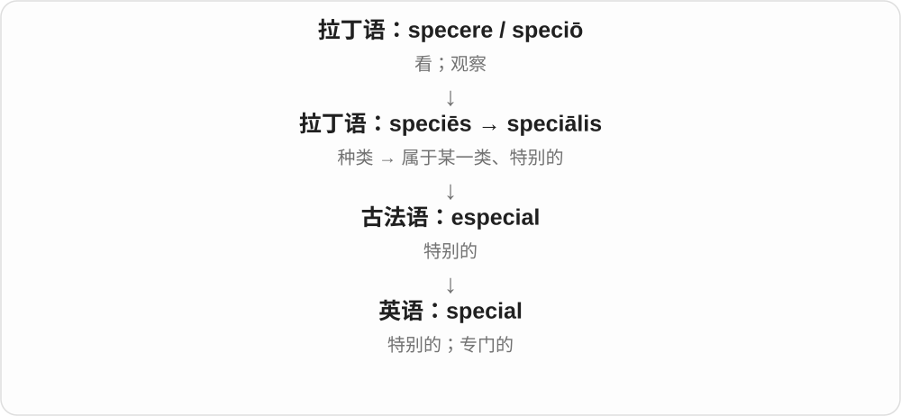

从“属于某一类”走向区别于一般情况。a special friend 强调特殊意义，a special tool 则强调专门用途。

**常见搭配与例句**

a special occasion；special treatment；something special。

> This photograph is special to me.

这张照片对我有特别的意义。

> We need a special tool to open the case.

打开这个盒子需要专门的工具。

**别混淆**

special 不一定贵或罕见；普通的小礼物也可能对你很特别。

### 2. specialist — 专家；专科人员；专业的

**音标**：/ˈspeʃəlɪst/

**先抓住这个画面**

specialist 把大部分功夫花在一个细分领域，像把一条路走得特别深的人。

**怎么拆**

借自法语 spécialiste；字形上可理解为 special + -ist“从事者”。

**怎么变成今天的意思**

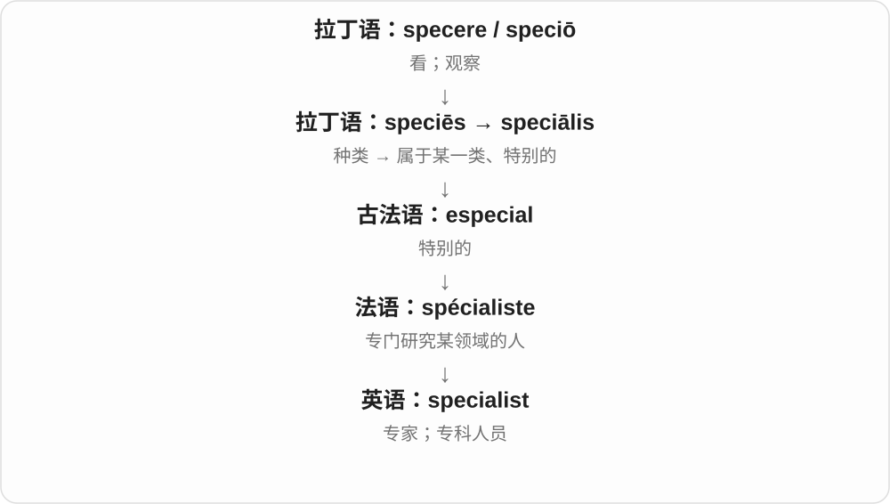

“专门的”变成专门从事某项工作的人。也可修饰知识、设备，说明它们服务于专业领域。

**常见搭配与例句**

a specialist in history；specialist knowledge；a medical specialist。

> She is a specialist in medieval art.

她是中世纪艺术方面的专家。

> The repair requires specialist equipment.

这项维修需要专业设备。

**别混淆**

generalist 范围广，specialist 专注于细分领域；专注并不意味着其他方面什么都不懂。

### 3. specially — 专门地；特地

**音标**：/ˈspeʃəli/

**先抓住这个画面**

specially 像在礼物上贴一张纸条：“这是特地为你准备的。”重点在专门安排。

**怎么拆**

special + -ly，副词形成方式在中古英语已出现。

**怎么变成今天的意思**

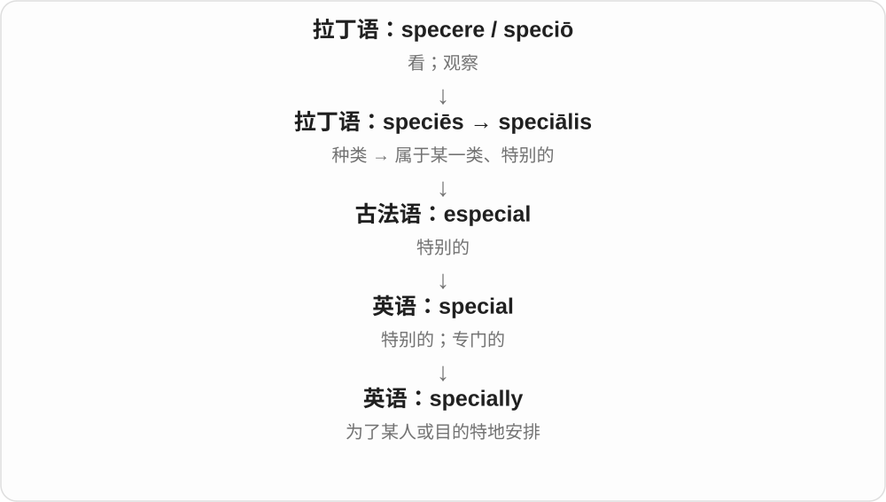

常与 designed、made、trained 等搭配，说明不是随手拿来，而是针对某用途。

**常见搭配与例句**

specially designed；specially trained；made specially for。

> The shoes were specially made for the performance.

这双鞋是专为演出制作的。

> She came specially to see you.

她是特地来看你的。

**别混淆**

强调“尤其”通常用 especially；强调“特地做”通常用 specially。

### 4. specialize — 专门从事；专攻

**音标**：/ˈspeʃəlaɪz/

**先抓住这个画面**

specialize 像从一棵大树选一条枝干继续深挖：领域变窄，知识和服务变深。

**怎么拆**

special + -ize，构成“使专门化、专门从事”的动词；英式也拼 specialise。

**怎么变成今天的意思**

人可以专攻某学科，商店可以专营某类商品。常接 in，后面说明专注的领域。

**常见搭配与例句**

specialize in medicine；specialize in repairs；highly specialized。

> The shop specializes in old maps.

这家店专卖旧地图。

> She plans to specialize in environmental law.

她计划专攻环境法。

**别混淆**

know something 是有所了解；specialize in 通常意味着持续专门从事。

### 5. specialism — 专业领域；专门研究

**音标**：/ˈspeʃəlɪzəm/

**先抓住这个画面**

specialism 是一个人深耕的那块小田：在很大的学科中，他最熟悉其中这一片。

**怎么拆**

special + -ism，表示专门化的方向或做法。

**怎么变成今天的意思**

常见于英式教育、职业介绍。可指一项专长，也可讨论研究分工越来越细的现象。

**常见搭配与例句**

an academic specialism；develop a specialism；a narrow specialism。

> Her specialism is the history of printing.

她的专业领域是印刷史。

> Students can develop a specialism in their final year.

学生可以在最后一年形成自己的专业方向。

**别混淆**

specialist 是专家本人；specialism 是其专门领域或专门化。

### 6. especial — 特别的；格外的

**音标**：/ɪˈspeʃəl/

**先抓住这个画面**

especial 与 special 很接近，像给某件事额外加一份重视；语气较正式，日常不如 special 常见。

**怎么拆**

来自古法语 especial、拉丁语 speciālis；它保留开头的 e，而 special 丢掉了这一部分。

**怎么变成今天的意思**

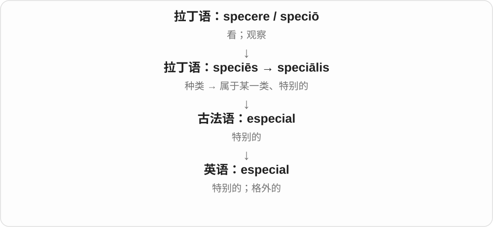

今日常见于 of especial interest、for your especial benefit 这类强调表达。它不是 special 的比较级。

**常见搭配与例句**

of especial importance；of especial interest；an especial concern。

> The discovery is of especial interest to local historians.

这个发现令当地历史学家格外感兴趣。

> She took especial care with the final chapter.

她对最后一章格外用心。

**别混淆**

especial 较正式；special 更通用。especially 则是非常常见的副词。

### 7. especially — 尤其；特别是

**音标**：/ɪˈspeʃəli/

**先抓住这个画面**

especially 像在已有的一组东西里，用荧光笔圈出最值得强调的一项。

**怎么拆**

especial + -ly；especial 和 special 都来自法语 especial。

**怎么变成今天的意思**

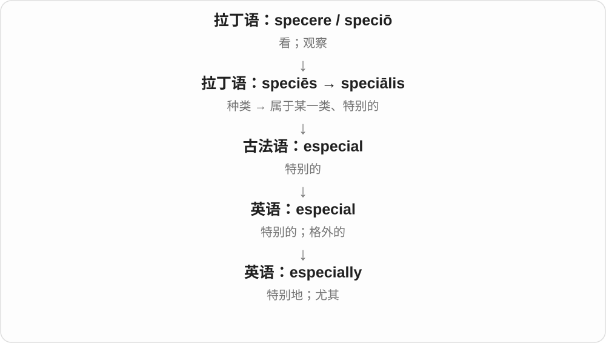

它常从总体转向重点：喜欢水果，尤其喜欢桃子。也可加强程度，如 especially difficult。

**常见搭配与例句**

especially when…；especially important；especially for children。

> I enjoy walking, especially in the early morning.

我喜欢散步，尤其喜欢清晨散步。

> The last question was especially difficult.

最后一道题特别难。

**别混淆**

especially 常突出“尤其”；specially 更常强调“特地为了某目的”。两者有重叠。

### 8. respect — 尊重；顾及；方面

**音标**：/rɪˈspekt/

**先抓住这个画面**

respect 像认真把别人放进自己的视线：承认他的价值，也顾及他的意愿、界限和权利。

**怎么拆**

拉丁语 re-（回）+ specere（看）形成 respicere；名词 respect 经法语传入，动词由名词发展。

**怎么变成今天的意思**

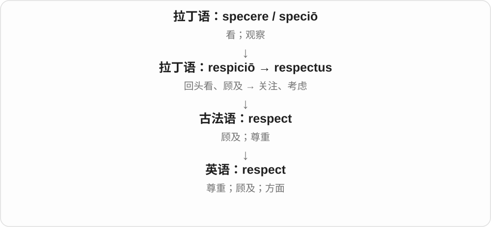

“回头看、留意”发展为顾及、重视。in this respect 里的 respect 则是“所关注的这一点”，不是尊敬。

**常见搭配与例句**

respect someone’s privacy；have respect for；in many respects。

> Please respect her decision to leave early.

请尊重她提前离开的决定。

> The two designs are similar in several respects.

这两种设计在几个方面很相似。

**别混淆**

respect 不要求你赞同对方。你可以尊重一个人，同时不同意他的判断。

### 9. respective — 各自的；分别对应的

**音标**：/rɪˈspektɪv/

**先抓住这个画面**

respective 像把东西放回各自的格子：你的职责归你，我的职责归我。

**怎么拆**

来自中世纪拉丁语 respectivus，连着 respectus“关系、顾及”；现代可看出 respect + -ive。

**怎么变成今天的意思**

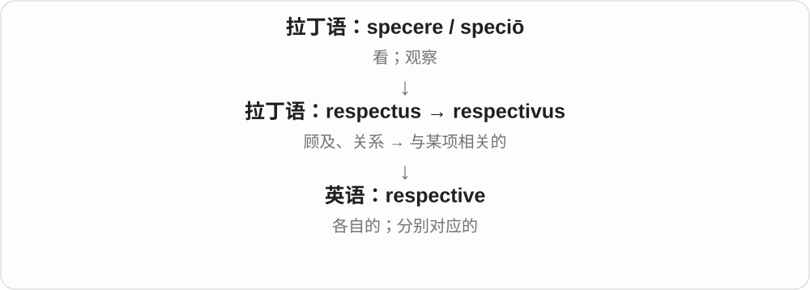

它保留“分别涉及某对象”的关系义，而不是尊敬义。their respective homes 就是每个人自己的家。

**常见搭配与例句**

our respective roles；their respective countries；the respective owners。

> The students returned to their respective classrooms.

学生们回到了各自的教室。

> We agreed on our respective responsibilities.

我们就各自的职责达成了一致。

**别混淆**

respective 不等于 respectful。respective roles 是各自职责，respectful behavior 才是尊重人的举止。

### 10. respectively — 分别；依照前述顺序对应地

**音标**：/rɪˈspektɪvli/

**先抓住这个画面**

respectively 像把两排名字连线：第一个对第一个，第二个对第二个，不交叉。

**怎么拆**

respective + -ly；来自“分别关联各自对象”的意义。

**怎么变成今天的意思**

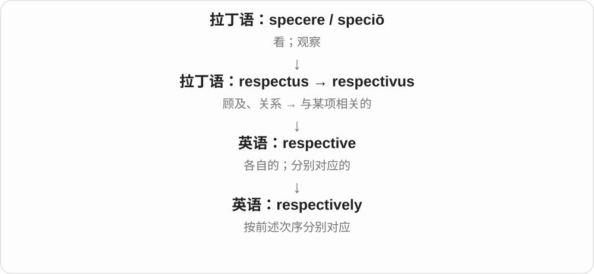

A and B are 10 and 12, respectively 表示 A 是10、B 是12。它是在说明配对规则，不是在说彼此尊重。

**常见搭配与例句**

first and second, respectively；aged eight and ten, respectively。

> Mia and Leo are eight and ten, respectively.

米娅和利奥分别是八岁和十岁。

> The red and blue lines show cost and revenue, respectively.

红线和蓝线分别表示成本和收入。

**别混淆**

respectfully 是恭敬地；respectively 是分别对应；respectably 是体面地或相当好地。

### 11. irrespective — 不考虑……的；不受……影响的

**音标**：/ˌɪrɪˈspektɪv/

**先抓住这个画面**

irrespective of 像先把某个条件放到一边：无论那个条件怎样，这个决定都一样。

**怎么拆**

否定前缀 in- 在 r 前成为 ir-，接 respective“与……相关的”。

**怎么变成今天的意思**

最常见结构是 irrespective of，整体相当于 regardless of。它通常说适用范围，而不是评价谁无礼。

**常见搭配与例句**

irrespective of age；irrespective of the outcome。

> The service is available irrespective of age.

这项服务不分年龄，均可使用。

> We will continue irrespective of the result.

无论结果如何，我们都会继续。

**别混淆**

irrespective 不是 disrespectful：不考虑某条件，与不尊重别人是两件事。

### 12. respectful — 尊重人的；恭敬的

**音标**：/rɪˈspektfəl/

**先抓住这个画面**

respectful 描述你的态度：认真听别人说话，不随意踩过别人的边界。

**怎么拆**

respect + -ful，把“尊重”变成表现出这种态度的形容词。

**怎么变成今天的意思**

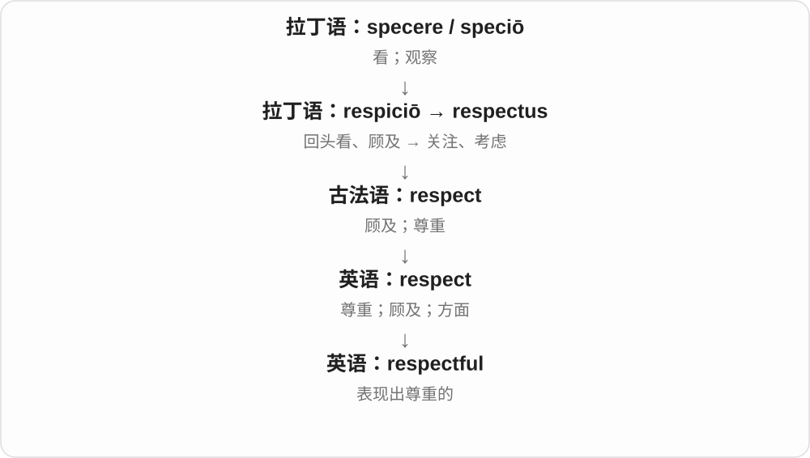

可以尊重地表达反对，也可以保持适当距离；它不是要求卑微服从。

**常见搭配与例句**

a respectful tone；be respectful of；a respectful distance。

> Please use a respectful tone during the discussion.

讨论时请保持尊重人的语气。

> They remained respectful of each other’s opinions.

他们仍尊重彼此的意见。

**别混淆**

respectful 是态度，respectable 是值得尊重或体面；respective 是各自的。

### 13. respectable — 体面的；值得尊重的；相当不错的

**音标**：/rɪˈspektəbəl/

**先抓住这个画面**

respectable 像达到大家认为过得去、拿得出手的标准：可以形容名声，也能形容成绩或数量。

**怎么拆**

respect + -able，表示可以受到尊重、认可的。

**怎么变成今天的意思**

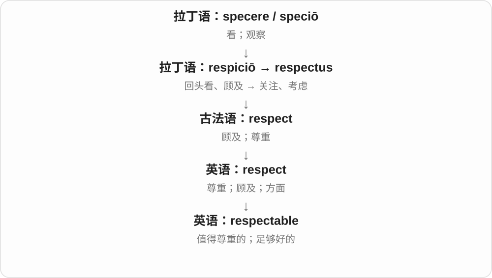

社会评价义强调体面、可信；a respectable score 则只说分数相当不错，不是在评价道德。

**常见搭配与例句**

a respectable profession；a respectable result；a respectable amount。

> She built a respectable career in engineering.

她在工程领域建立了体面的事业。

> The team achieved a respectable score.

球队取得了相当不错的分数。

**别混淆**

respectable 说别人值得尊重；respectful 说一个人表现出尊重。

### 14. respectability — 体面；受人尊重的名声

**音标**：/rɪˌspektəˈbɪləti/

**先抓住这个画面**

respectability 像一个人在社区里积累的“看起来正派、可靠”的社会形象。

**怎么拆**

respectable + -ity，词尾 -able 对应 -ability，构成性质名词。

**怎么变成今天的意思**

常讨论社会评价和外在名声；小说里也常揭示表面体面与实际行为之间的距离。

**常见搭配与例句**

an air of respectability；social respectability；a veneer of respectability。

> The office gave the small business an air of respectability.

这间办公室让小企业显得更体面可信。

> The novel questions the town’s idea of respectability.

小说质疑了小镇对“体面”的理解。

**别混淆**

respectability 是受认可的形象或状态，不等于一个人实际上必然诚实。

### 15. respectably — 体面地；相当不错地

**音标**：/rɪˈspektəbli/

**先抓住这个画面**

respectably 常像给成绩打一个稳稳的认可：“不是最耀眼，但做得不错，拿得出手。”

**怎么拆**

respectable + -ly，词尾 -able 变为 -ably。

**怎么变成今天的意思**

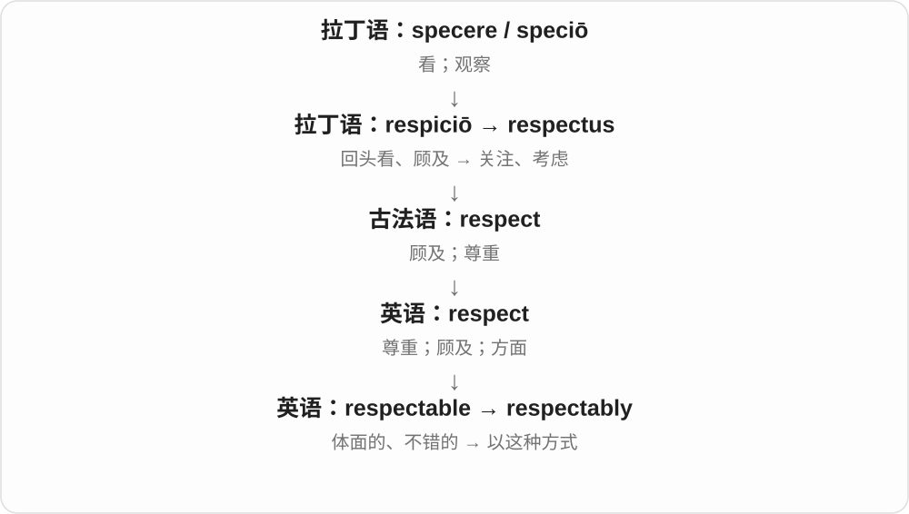

形容生活或穿着时是体面地；形容表现、销量时是相当好地。

**常见搭配与例句**

perform respectably；sell respectably；dress respectably。

> The small team performed respectably in the tournament.

这支小队在锦标赛中表现相当不错。

> The book sold respectably in its first year.

这本书第一年的销量还不错。

**别混淆**

respectfully 是有礼貌地；respectably 是体面地或表现不错地。

### 16. disrespectable — 不体面的；不值得尊重的（少见）

**音标**：/ˌdɪsrɪˈspektəbəl/

**先抓住这个画面**

disrespectable 把一个人的名声或行为放到“拿不出手、得不到认可”的一边。

**怎么拆**

dis-（不）+ respectable（值得尊重的）。

**怎么变成今天的意思**

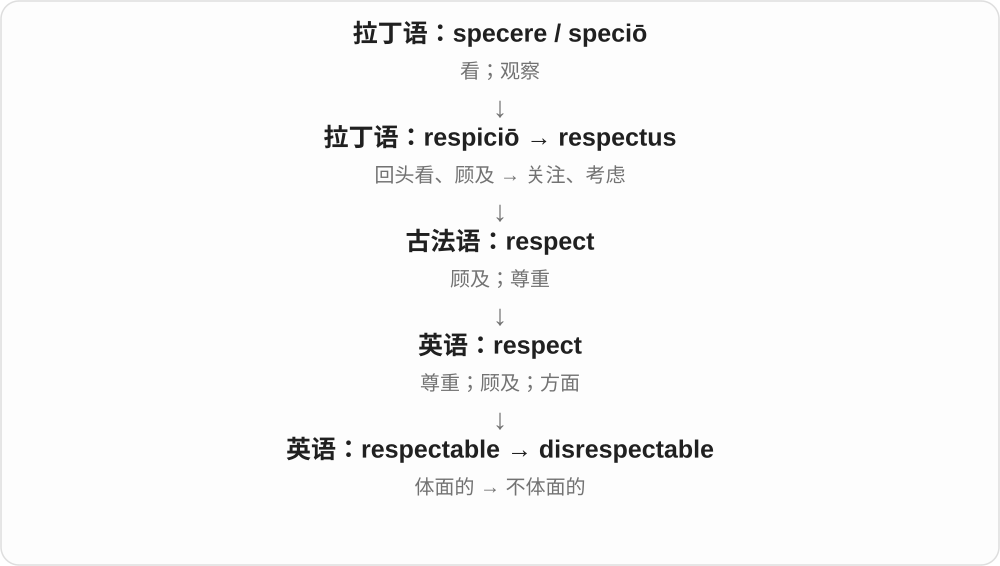

这个词不常用，保留的是被评价为不体面这一方向，不是主动对别人无礼。

**常见搭配与例句**

a disrespectable character；disrespectable conduct；较少见。

> The novel portrays him as a thoroughly disrespectable character.

小说把他写成一个毫不体面的人物。

> The scandal exposed the club’s disrespectable conduct.

丑闻暴露了俱乐部不体面的行为。

**别混淆**

disrespectful 是对别人不敬；disrespectable 是自己不值得尊重或不体面。

### 17. respectant — 相向而视的；回看的（纹章或古雅用语）

**音标**：/rɪˈspektənt/

**先抓住这个画面**

respectant 在纹章里像盾牌上的两只动物面对面，彼此朝向对方。

**怎么拆**

与法语 respecter 的分词 respectant 有关，也可按 respect + -ant 理解；保留了“看向”的旧义。

**怎么变成今天的意思**

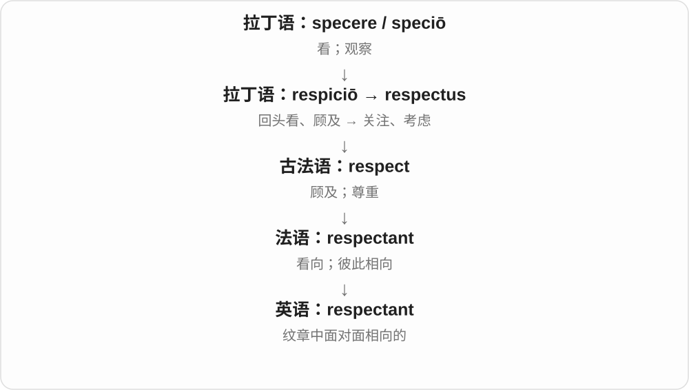

这里回到真实的视线方向，不是在说两只动物很有礼貌。文献中也有向后看的用法。

**常见搭配与例句**

two lions respectant；animals respectant；纹章描述。

> The shield shows two lions respectant.

盾徽上画着两只相向而视的狮子。

> The catalogue describes the animals as respectant.

目录将这些动物图案描述为相向而视。

**别混淆**

respectful 描述尊重态度；respectant 在此描述图案朝向。

### 18. disrespect — 不尊重；失礼；不敬

**音标**：/ˌdɪsrɪˈspekt/

**先抓住这个画面**

disrespect 像把别人的感受、身份或边界随手拨到一边，表现得不当回事。

**怎么拆**

dis-（否定、反面）+ respect。

**怎么变成今天的意思**

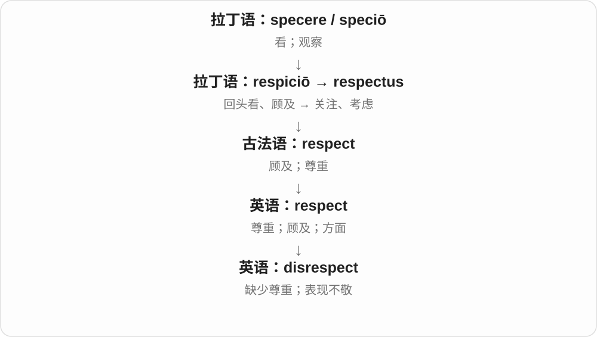

可作不可数名词，也可作动词。判断是否失礼需要语境，不是所有反对意见都叫 disrespect。

**常见搭配与例句**

show disrespect for；no disrespect intended；disrespect someone。

> Interrupting her repeatedly showed disrespect.

一再打断她显得很不尊重人。

> You can disagree without showing disrespect.

你可以表示不同意见，同时保持尊重。

**别混淆**

disagreement 是不同意，disrespect 是不尊重；两者可以分开。

### 19. specific — 具体的；特定的；某类独有的

**音标**：/spəˈsɪfɪk/

**先抓住这个画面**

specific 像把镜头拉近：不再泛泛说“某个问题”，而是明确是哪一个、什么细节。

**怎么拆**

speciēs（种类）+ -ficus 构成拉丁语 specificus，经法语借入；现代通常整体识别。

**怎么变成今天的意思**

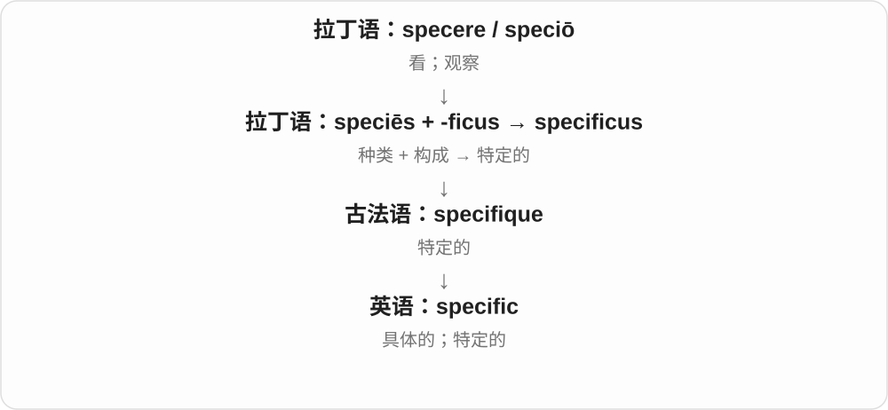

先与某一类的特征有关，再表示明确限定、具体指向。specific to 表示某事只属于或特别关联某对象。

**常见搭配与例句**

a specific example；be specific about；specific to this region。

> Can you give me a specific example?

你能给我一个具体例子吗？

> This problem is specific to the older model.

这个问题只出现在较旧的型号上。

**别混淆**

special 强调特殊；specific 强调明确指向。a specific date 是确定的日期，不一定是特殊节日。

### 20. specifically — 具体地；明确地；专门地

**音标**：/spəˈsɪfɪkli/

**先抓住这个画面**

specifically 把范围缩到一个明确目标，像补一句“我说的就是这一项”。

**怎么拆**

specific + -ally，形成副词。

**怎么变成今天的意思**

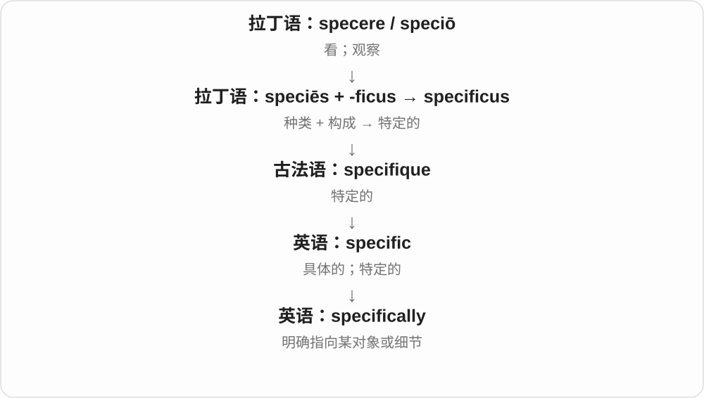

可用来把刚才的话说得更细，也可说明某东西是为明确用途设计。

**常见搭配与例句**

more specifically；specifically mention；designed specifically for。

> The report specifically mentions water quality.

报告明确提到了水质。

> This course was designed specifically for beginners.

这门课是专为初学者设计的。

**别混淆**

generally 泛泛地说，specifically 落到具体对象。它并不只是程度更强的 especially。

### 21. specification — 规格；明确要求；详细说明

**音标**：/ˌspesɪfɪˈkeɪʃən/

**先抓住这个画面**

specification 像做东西前写好的尺寸清单：要多大、能做什么、达到什么要求，都说清楚。

**怎么拆**

经法语来自中世纪拉丁语 specificātiō；与“明确指定”相关，现代常缩写为 spec。

**怎么变成今天的意思**

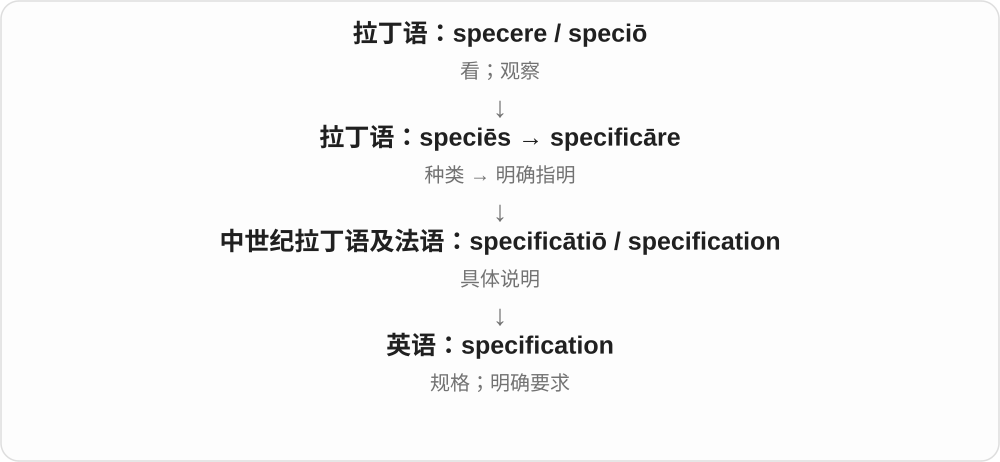

它把泛泛目标变成可以核对的细节。复数 specifications 常是一整套技术参数或要求。

**常见搭配与例句**

meet the specifications；technical specifications；a design specification。

> The parts must meet the customer’s specifications.

零件必须符合客户的规格要求。

> Check the technical specifications before comparing the models.

比较型号前，先查看技术参数。

**别混淆**

description 只需描述东西，specification 常规定它必须是什么样。

### 22. specificity — 具体程度；专一性；特异性

**音标**：/ˌspesɪˈfɪsəti/

**先抓住这个画面**

specificity 像瞄准镜有多准：表达是否点到具体细节，或一种反应是否只对某些目标发生。

**怎么拆**

specific + -ity，变成表示性质的名词，重音移到 -ficity 中的 fi。

**怎么变成今天的意思**

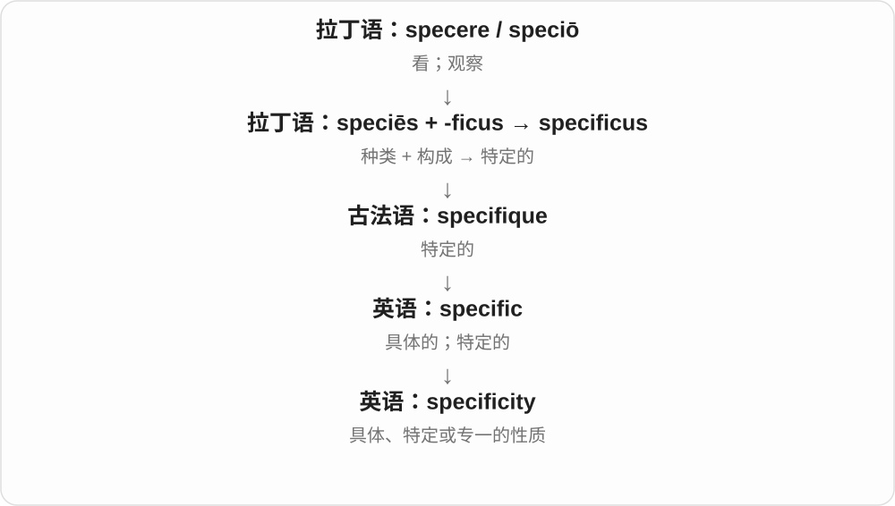

写作中谈明确细节；生物化学中谈识别对象的选择性。诊断检测中还有专门统计定义，不能只凭一般词义解释数字。

**常见搭配与例句**

lack of specificity；binding specificity；the specificity of a description。

> The instructions lack specificity.

这些说明不够具体。

> The study compared the binding specificity of two proteins.

研究比较了两种蛋白质的结合特异性。

**别混淆**

sensitivity 常关心能否察觉；specificity 常关心是否对准某类对象，技术场景须看具体定义。

### 23. bispecificity — 双特异性

**音标**：/ˌbaɪspesɪˈfɪsəti/

**先抓住这个画面**

bispecificity 说的是“一件东西能分别认准两种目标”这一性质，而不是给那件东西取名字。

**怎么拆**

bi-（二）+ specificity（特异性）。

**怎么变成今天的意思**

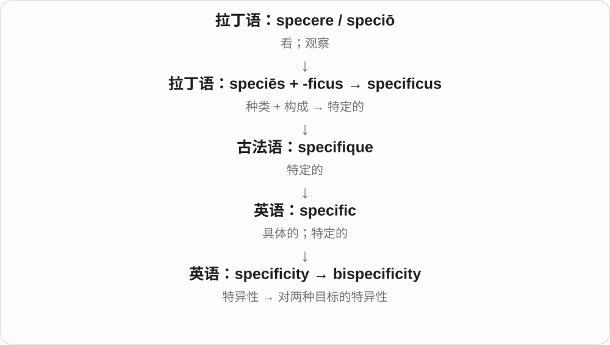

研究中常用于分子识别或结合。读者应追问是哪两个目标，词本身并没有说出它们。

**常见搭配与例句**

bispecificity of binding；demonstrate bispecificity。

> The experiment examined the molecule’s bispecificity.

实验考察了这个分子的双特异性。

> The diagram explains how bispecificity differs from simple bivalency.

图示说明了双特异性与单纯二价结构的差别。

**别混淆**

bispecific 是形容词；bispecificity 是这种双重识别性质的名词。

### 24. nonspecific — 不具体的；非特异性的

**音标**：英 /ˌnɒnspəˈsɪfɪk/；美 /ˌnɑːnspəˈsɪfɪk/

**先抓住这个画面**

nonspecific 像一个范围很大的提示，告诉你有些情况，却没有明确指向唯一对象或原因。

**怎么拆**

non-（非、不）+ specific。

**怎么变成今天的意思**

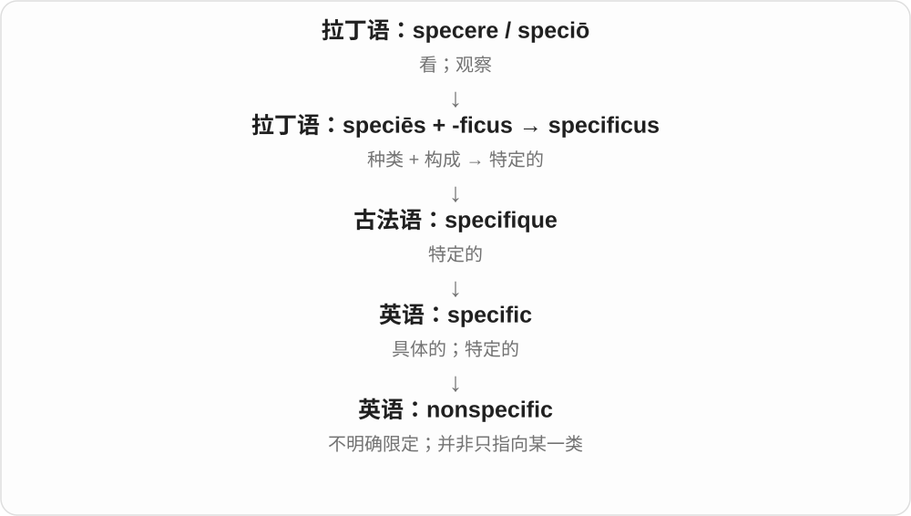

可说措辞含糊，也可用于科学中表示一种现象与多种条件都有关。不能把它一律理解成完全无用。

**常见搭配与例句**

nonspecific language；a nonspecific response；nonspecific symptoms。

> The instructions were too nonspecific to be useful.

这些说明太笼统，难以使用。

> The report describes a nonspecific response to stress.

报告描述了一种对压力的非特异性反应。

**别混淆**

unspecified 是没有指明；nonspecific 是本身不够具体或不专一。

### 25. interspecific — 种间的；不同物种之间的

**音标**：英 /ˌɪntəspəˈsɪfɪk/；美 /ˌɪntərspəˈsɪfɪk/

**先抓住这个画面**

interspecific 像两支来自不同物种的队伍争同一份资源，或以别的方式发生联系。

**怎么拆**

inter-（之间）+ specific；这里 specific 保留 species“物种”的技术义。

**怎么变成今天的意思**

与 interspecies 意义接近，常见于生态、生物学术语。不要把 specific 只翻成“具体的”。

**常见搭配与例句**

interspecific competition；interspecific differences；interspecific hybrids。

> The ecologist studied interspecific competition for food.

生态学家研究了不同物种之间的食物竞争。

> The paper compares interspecific differences in behaviour.

论文比较了物种之间的行为差异。

**别混淆**

intraspecific 是种内的；interspecific 是种间的。

### 26. conspecific — 同种的；同一物种的个体

**音标**：英 /ˌkɒnspəˈsɪfɪk/；美 /ˌkɑːnspəˈsɪfɪk/

**先抓住这个画面**

conspecific 把两个个体放进同一个物种抽屉：它们属于同一种生物。

**怎么拆**

con-（共同）+ specific（物种的）。

**怎么变成今天的意思**

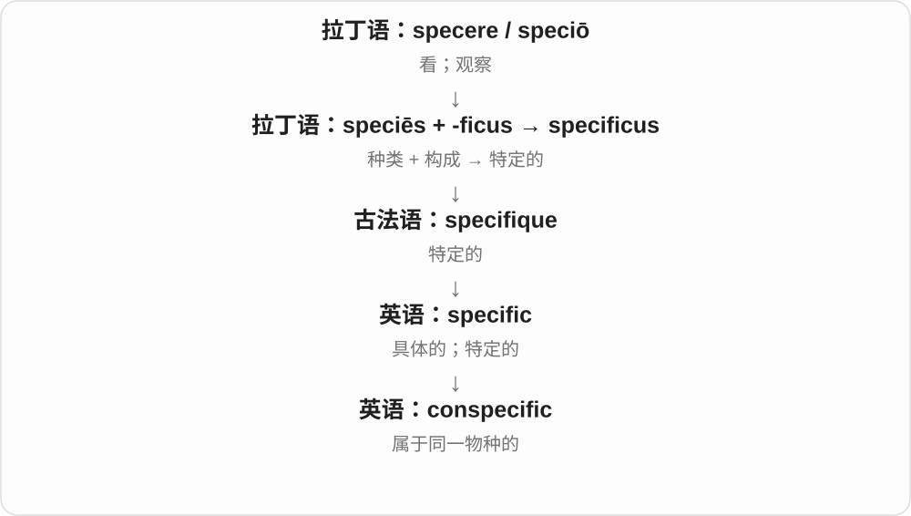

可作形容词，也可作名词指同种个体。不表示外观、年龄和行为都完全相同。

**常见搭配与例句**

conspecific individuals；conspecific calls；recognize conspecifics。

> The bird responded to calls from conspecifics.

这只鸟对同种鸟类的叫声作出了反应。

> The two populations may be conspecific.

这两个种群可能属于同一物种。

**别混淆**

conspecific 说明分类关系；similar 只说明相像，相像的个体可能来自不同物种。

### 27. conspecificity — 同种性；属于同一物种

**音标**：英 /ˌkɒnspesɪˈfɪsəti/；美 /ˌkɑːnspesɪˈfɪsəti/

**先抓住这个画面**

conspecificity 是研究者在问：“这两个看起来有差异的群体，究竟是不是同一个物种？”

**怎么拆**

conspecific + -ity，把同种这一关系变成名词。

**怎么变成今天的意思**

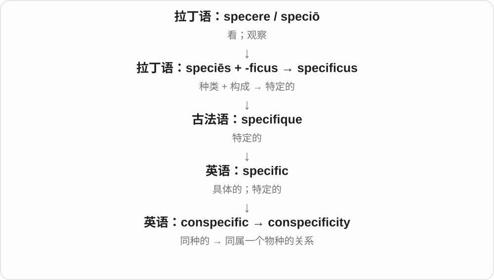

它描述分类判断，不等于所有个体一模一样。证据可来自形态、遗传和其他研究。

**常见搭配与例句**

evidence of conspecificity；establish conspecificity；question conspecificity。

> The genetic evidence supports the populations’ conspecificity.

遗传证据支持这些种群属于同一物种。

> The authors questioned the conspecificity of the two forms.

作者质疑这两种形态是否属于同一物种。

**别混淆**

similarity 是相似性；conspecificity 是同一物种关系，不能仅凭相像下结论。

### 28. intraspecific — 种内的

**音标**：英 /ˌɪntrəspəˈsɪfɪk/；美 /ˌɪntrəspəˈsɪfɪk/

**先抓住这个画面**

intraspecific 是把观察范围收进一个物种内部，看看同种个体之间的差异或关系。

**怎么拆**

intra-（内部）+ specific（物种的）。

**怎么变成今天的意思**

竞争、变化、交流都可能发生在同一物种内；这个词只划定范围，不说明关系好坏。

**常见搭配与例句**

intraspecific variation；intraspecific competition；intraspecific communication。

> The study measures intraspecific variation in leaf size.

研究测量同一物种内部叶片大小的差异。

> Limited space can increase intraspecific competition.

空间有限可能加剧种内竞争。

**别混淆**

intra- 内部，inter- 之间；少一个 r 前后的位置变化，就换了观察范围。

### 29. infraspecific — 种下的；物种以下分类层级的

**音标**：/ˌɪnfrəspəˈsɪfɪk/

**先抓住这个画面**

infraspecific 像把分类表放大到物种下面，继续看亚种、变种等更细的层级。

**怎么拆**

infra-（低于、在下）+ specific（物种的）。

**怎么变成今天的意思**

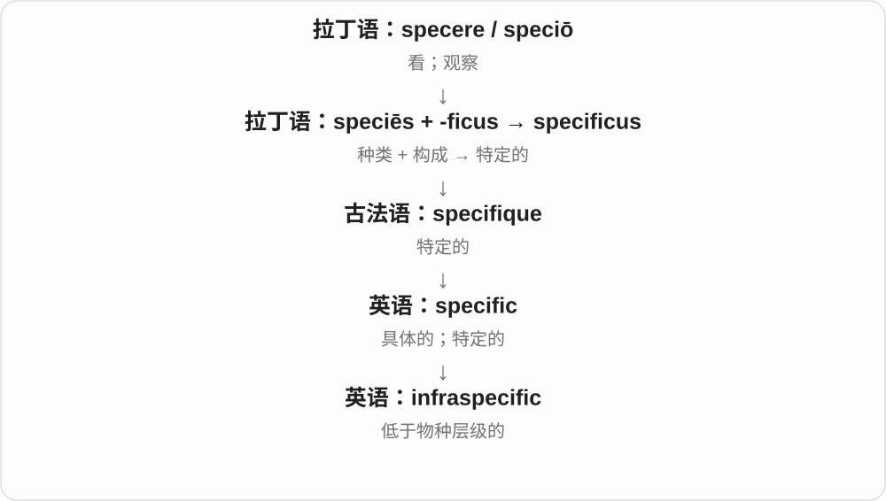

这是分类层级的上下关系，不表示这种生物更原始、更差或更小。

**常见搭配与例句**

infraspecific taxa；infraspecific variation；infraspecific classification。

> The catalogue includes several infraspecific taxa.

目录列出了几个种下分类单元。

> The botanist revised the infraspecific classification.

植物学家修订了种下分类。

**别混淆**

intraspecific 是同一物种内部；infraspecific 强调低于物种这一分类等级。

### 30. bispecific — 双特异性的

**音标**：/ˌbaɪspəˈsɪfɪk/

**先抓住这个画面**

bispecific 像一件工具有两个不同的识别端，能分别对准两种目标。

**怎么拆**

bi-（二）+ specific（针对某对象的）。

**怎么变成今天的意思**

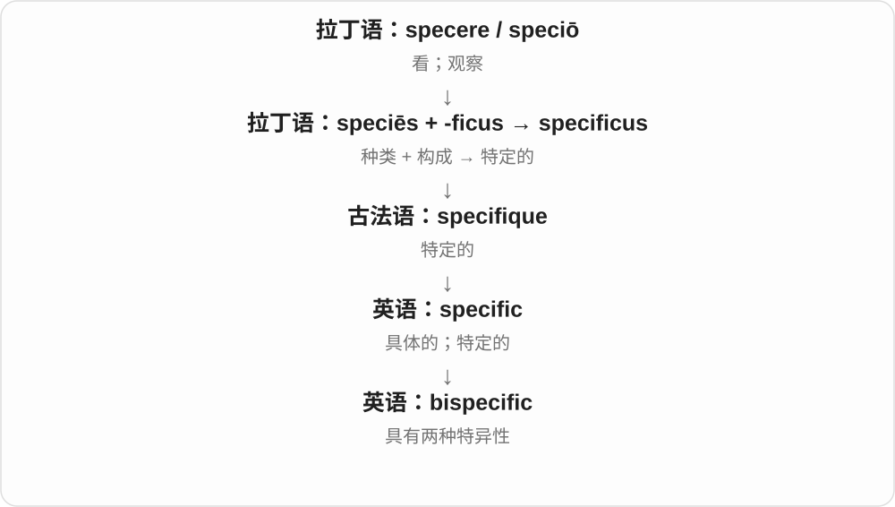

常见于抗体研究，强调识别两个不同目标。这个词本身不说明具体作用、效果或安全性。

**常见搭配与例句**

a bispecific antibody；a bispecific molecule；bispecific binding。

> The paper describes a bispecific antibody with two binding targets.

论文描述了一种具有两个结合目标的双特异性抗体。

> The diagram shows the two arms of the bispecific molecule.

图中展示了这个双特异性分子的两端。

**别混淆**

bivalent 说结合位点数，bispecific 说识别目标种类；两个位点可以识别同一种目标。

### 31. trispecific — 三特异性的；涉及三个物种的

**音标**：/ˌtraɪspəˈsɪfɪk/

**先抓住这个画面**

trispecific 把目标数量定在三个：在分子研究中可指三种识别目标，在生物学中也可指三个物种。

**怎么拆**

tri-（三）+ specific。

**怎么变成今天的意思**

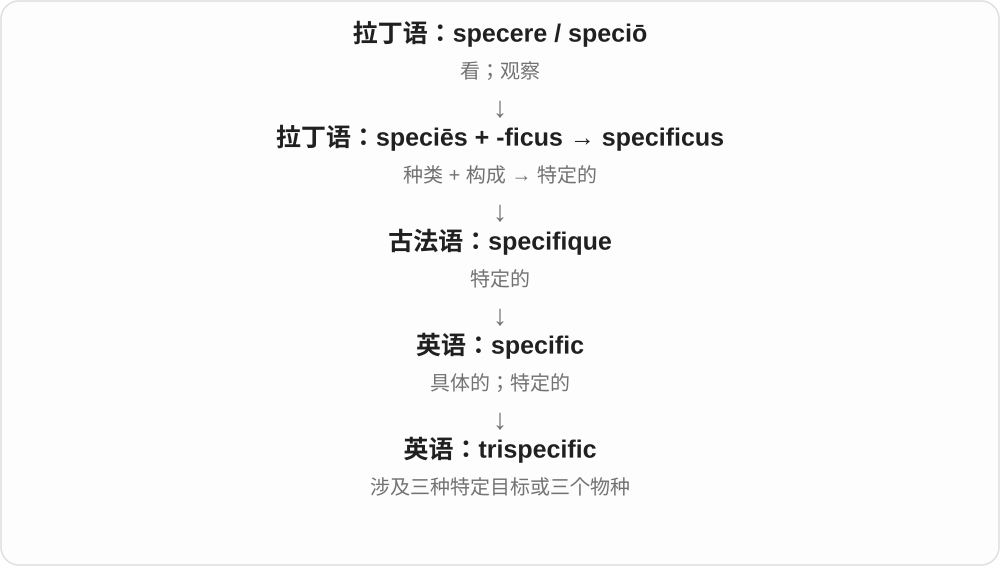

同一个构词可进入不同专业。先辨别是在谈分子识别还是物种组合，再确定“这三个”指什么。

**常见搭配与例句**

a trispecific antibody；a trispecific hybrid；trispecific binding。

> The diagram shows a trispecific molecule with three targets.

图中展示了具有三个目标的三特异性分子。

> The paper describes a trispecific plant hybrid.

论文描述了一种涉及三个物种的植物杂交体。

**别混淆**

bispecific 是两个目标；trispecific 是三个；不能把数量与效果强弱直接等同。

### 32. unispecific — 仅含一个物种的；单种的

**音标**：/ˌjuːnɪspəˈsɪfɪk/

**先抓住这个画面**

unispecific 像一个分类盒里只装一种生物，虽有很多个体，种类仍只有一个。

**怎么拆**

uni-（一）+ specific；这里 specific 取“物种”的技术义。

**怎么变成今天的意思**

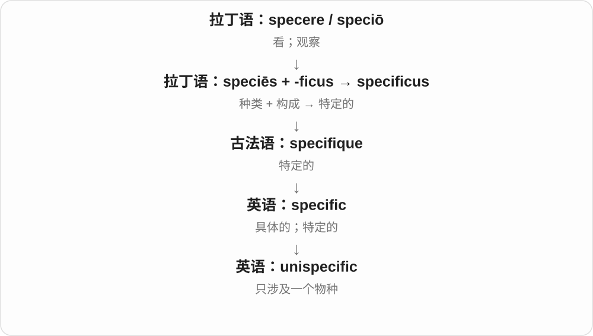

常用于分类或群落描述。数量“一”说的是物种数，不是个体数。

**常见搭配与例句**

a unispecific genus；a unispecific stand；a unispecific group。

> The author treats the genus as unispecific.

作者把这个属视为只含一个物种的属。

> The plot contained a nearly unispecific stand of trees.

样地中的林分几乎只有一个树种。

**别混淆**

unicellular 是单细胞；unispecific 是单一物种，两个“一”数的对象不同。

### 33. multispecific — 涉及多个物种的；多特异性的

**音标**：/ˌmʌltispəˈsɪfɪk/

**先抓住这个画面**

multispecific 的“多个”要看场景：生态研究里是多物种，分子识别里是多种目标。

**怎么拆**

multi-（多个）+ specific，后者既可表示物种相关，也可表示针对某目标的。

**怎么变成今天的意思**

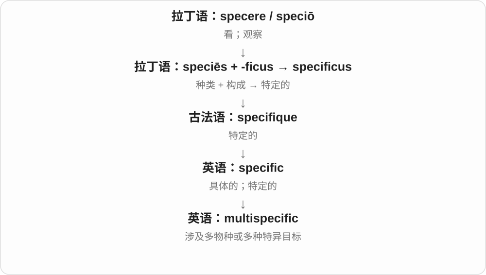

不能只看前缀就猜是哪一种“多”。先看它修饰 community 还是 molecule 等名词。

**常见搭配与例句**

a multispecific community；a multispecific interaction；multispecific binding。

> The ecologist described a multispecific community.

生态学家描述了一个多物种群落。

> The study examines multispecific interactions in the forest.

研究考察森林中的多物种相互作用。

**别混淆**

multispectral 是多光谱；multispecific 是多物种或多特异性，后半部分不同。

### 34. multispecificity — 多特异性；涉及多种特定对象的性质

**音标**：/ˌmʌltispesɪˈfɪsəti/

**先抓住这个画面**

multispecificity 像一套识别能力同时对准好几类目标，谈的是这种性质本身。

**怎么拆**

multi-（多个）+ specificity（特异性），对应 multispecific 的名词性质。

**怎么变成今天的意思**

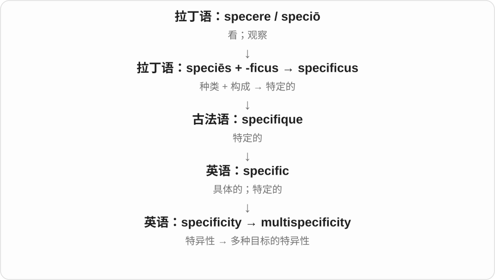

常见于专业研究。要理解论文里的实际含义，需看作者列出的目标或对象。

**常见搭配与例句**

multispecificity of binding；assess multispecificity。

> The researchers assessed the molecule’s multispecificity.

研究人员评估了这个分子的多特异性。

> The review discusses the advantages and limits of multispecificity.

综述讨论了多特异性的优点和局限。

**别混淆**

bispecificity 限定为两种；multispecificity 表示多种，不在词本身给出精确数量。

### 35. expect — 预料；期待；要求

**音标**：/ɪkˈspekt/

**先抓住这个画面**

expect 像站在门口等一件你认为会发生的事：可能是好消息，也可能是麻烦。

**怎么拆**

来自 ex-（向外）+ spectāre（观看）形成的 exspectāre，原有向外望着等的意思。

**怎么变成今天的意思**

重点是“认为会来、会发生”。说 I expect you to help 还可能是在表达你应当帮忙，而不是预测天气般的猜测。

**常见搭配与例句**

expect to do；expect someone to do；as expected。

> We expect the train to arrive at six.

我们预计火车六点到。

> I expect everyone to arrive on time.

我要求大家准时到。

**别混淆**

hope 是希望；expect 是预料。你可能希望晴天，却预料会下雨。

### 36. expectation — 预期；期待；期望要求

**音标**：/ˌekspekˈteɪʃən/

**先抓住这个画面**

expectation 是你事先在脑中画好的结果：事情应该会怎样，别人应该做到什么程度。

**怎么拆**

来自拉丁语 exspectātiō，经中古法语传入；expect + -ation 是现代可见的对应。

**怎么变成今天的意思**

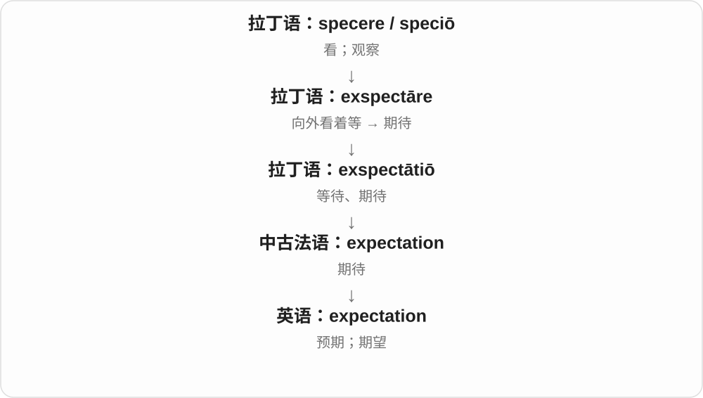

现实可以符合、超过或低于这个预先画出的标准。复数 expectations 常谈一个人或群体对结果的要求。

**常见搭配与例句**

meet expectations；exceed expectations；against expectations。

> The results exceeded our expectations.

结果超出了我们的预期。

> We need to make our expectations clear.

我们需要把期望说清楚。

**别混淆**

expectation 不等于 certainty：很高的预期也可能落空。

### 37. expectant — 期待的；怀孕的；即将为人父母的

**音标**：/ɪkˈspektənt/

**先抓住这个画面**

expectant 像一个人看着门，脸上写着“快来了吧”；也用来温和地描述等待孩子出生。

**怎么拆**

经古法语来自拉丁语 exspectāns“正在等待的”，是 exspectāre 的分词。

**怎么变成今天的意思**

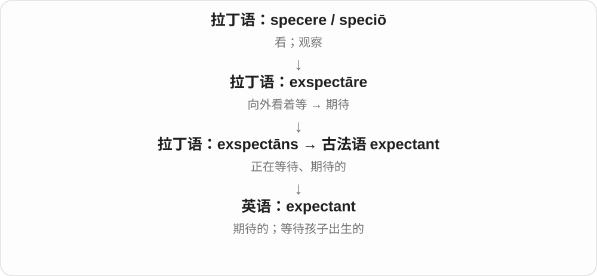

期待义可写表情和人群；expectant mother 是孕妇，expectant parents 则指即将迎来孩子的父母。

**常见搭配与例句**

an expectant look；an expectant crowd；expectant parents。

> The children watched with expectant faces.

孩子们满脸期待地看着。

> The class welcomes expectant parents.

这门课欢迎准父母参加。

**别混淆**

expecting 可用在 be expecting a baby；expectant 常直接修饰 parent、mother 等名词。

### 38. expectancy — 期待；预期

**音标**：/ɪkˈspektənsi/

**先抓住这个画面**

expectancy 像大家看着舞台、等帷幕拉开的那种心情；也可表示根据资料作出的预期。

**怎么拆**

与 expect + -ancy 或 expectant + -cy 对应，构成状态名词。

**怎么变成今天的意思**

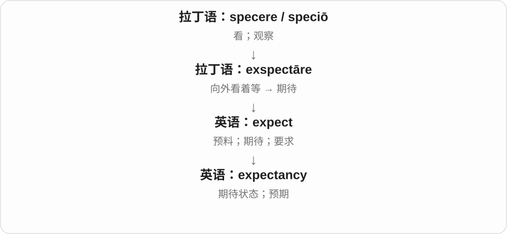

life expectancy 是某种统计条件下的预期寿命，不是对一个人寿命的保证。日常语境则常指期待气氛。

**常见搭配与例句**

a sense of expectancy；life expectancy；in an atmosphere of expectancy。

> A sense of expectancy filled the room.

房间里充满了期待的气氛。

> The chart compares life expectancy across several decades.

图表比较了几十年间的预期寿命。

**别混淆**

expectation 常有具体期待内容；expectancy 更常突出等待的状态，或固定统计表达。

### 39. expectantly — 满怀期待地

**音标**：/ɪkˈspektəntli/

**先抓住这个画面**

expectantly 像把话说完后停下来望着对方，等一个答案或好消息。

**怎么拆**

expectant + -ly。

**怎么变成今天的意思**

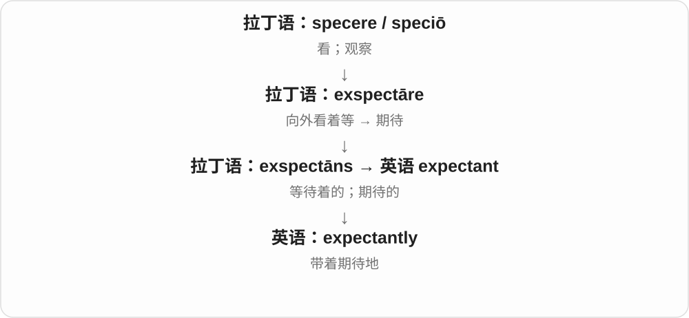

这个副词常把期待写在看、等、倾听等动作上。它不说明期待的事后来有没有发生。

**常见搭配与例句**

wait expectantly；look expectantly at；watch expectantly。

> The children looked at her expectantly.

孩子们满怀期待地望着她。

> We waited expectantly for the announcement.

我们满怀期待地等着宣布消息。

**别混淆**

eagerly 强调热切；expectantly 更突出正在等待某个回应或结果。

### 40. despise — 鄙视；看不起

**音标**：/dɪˈspaɪz/

**先抓住这个画面**

despise 像从态度上把对方放低，觉得他或他的行为不值得尊重。

**怎么拆**

de-（向下）+ specere（看）形成拉丁语 dēspicere，经古法语借入。

**怎么变成今天的意思**

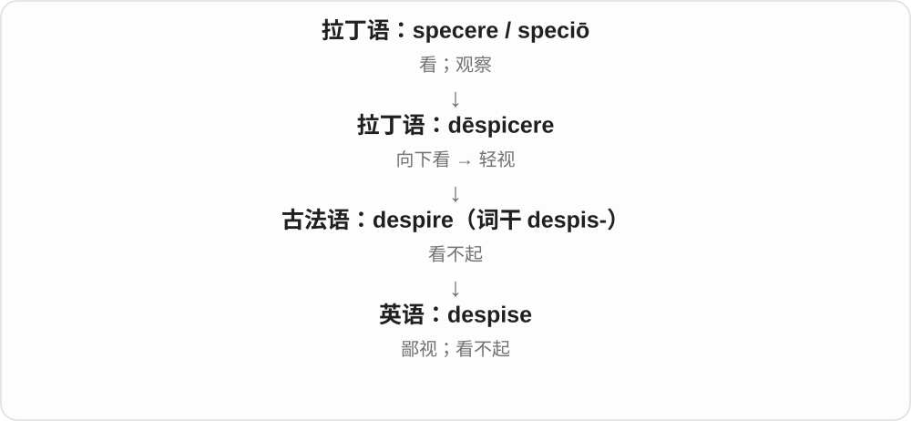

空间上的“往下看”转向评价上的“看低”。这比 simply dislike 更强，常带道德判断或轻蔑。

**常见搭配与例句**

despise cruelty；despise someone for；secretly despise。

> She despises cruelty to animals.

她鄙视虐待动物的行为。

> He despised himself for breaking the promise.

他因违背承诺而鄙视自己。

**别混淆**

dislike 可以只是口味不合；despise 往往包含轻蔑，语气强得多。

### 41. despite — 尽管；即使有……

**音标**：/dɪˈspaɪt/

**先抓住这个画面**

despite 像一块路障确实在那儿，但事情仍越过它发生了：有困难，结果却没有被挡住。

**怎么拆**

来自表示轻视的 despit；旧短语 in despite of 逐渐简化成介词 despite。

**怎么变成今天的意思**

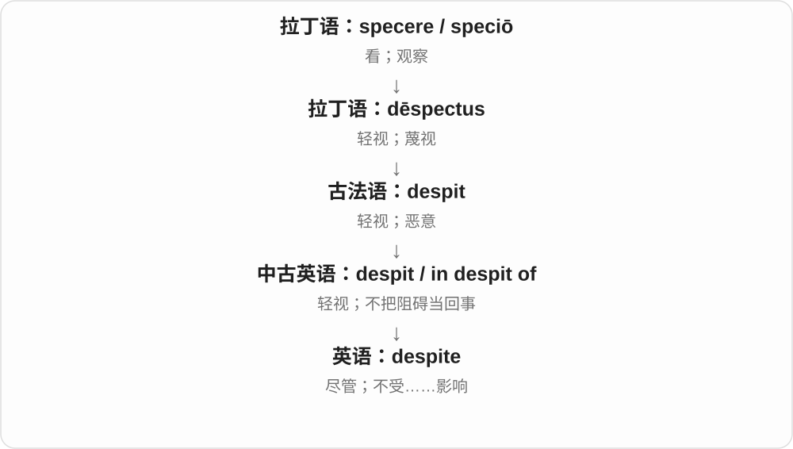

历史上的“不把某事放在眼里”变成现代的“不受某条件阻止”。现在通常没有蔑视谁的语气。

**常见搭配与例句**

despite the rain；despite being tired；despite the fact that…。

> We went out despite the rain.

尽管下雨，我们还是出门了。

> She finished the work despite feeling tired.

她虽然很累，还是完成了工作。

**别混淆**

despite 后接名词或 -ing，不直接接完整从句；although 后则可以接从句。

### 42. spite — 恶意；故意使人难受

**音标**：/spaɪt/

**先抓住这个画面**

spite 像明知这样会让对方不高兴，却偏要这样做；动作可能很小，心思却是冲着人去的。

**怎么拆**

中古英语把 despit 缩短成 spit，成为今天的 spite；despit 也产生了 despite。

**怎么变成今天的意思**

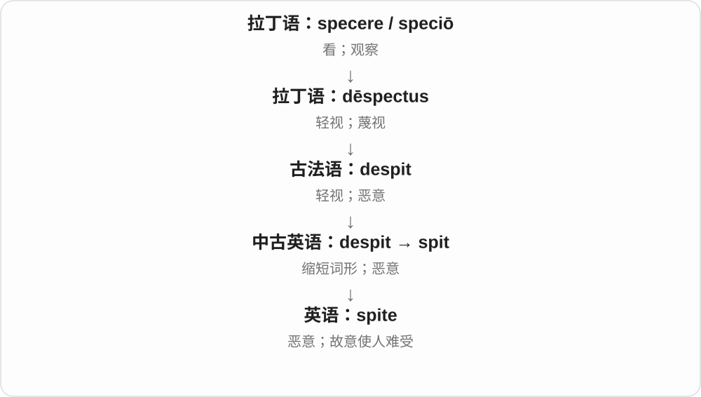

由轻视、恶意发展为故意使人为难。out of spite 强调动机；in spite of 则已成为“尽管”的固定结构。

**常见搭配与例句**

out of spite；do something to spite someone；in spite of。

> He hid the keys out of spite.

他出于恶意把钥匙藏了起来。

> She succeeded in spite of the difficulties.

尽管困难重重，她还是成功了。

**别混淆**

anger 是生气，spite 是带有使对方受挫的恶意；生气的人不一定会故意报复。

### 43. respite — 喘息；暂时缓解；缓期

**音标**：英 /ˈrespaɪt/；美 /ˈrespɪt/

**先抓住这个画面**

respite 像一直下着雨，中间终于停了一小会儿；压力未必消失，但你能暂时喘口气。

**怎么拆**

经古法语 respit“休息、延缓”来自拉丁语 respectus；和 respect 同源，却走向另一种意义。

**怎么变成今天的意思**

从顾及、考虑走向宽限、暂缓，再成为从困难中获得的一小段休息。重点在暂时，不是彻底解决。

**常见搭配与例句**

a brief respite；respite from the heat；without respite。

> The cool evening brought a respite from the heat.

凉爽的夜晚让酷热暂时缓解。

> We worked all morning without respite.

我们一上午工作个不停，没有喘息。

**别混淆**

relief 是缓解，respite 更突出有限的一段间歇。

### 44. despicable — 卑鄙的；令人鄙视的

**音标**：/dɪˈspɪkəbəl/，亦 /ˈdespɪkəbəl/

**先抓住这个画面**

despicable 常用于严重伤害别人、令人觉得卑劣的行为，评价很重。

**怎么拆**

借自晚期拉丁语 dēspicābilis，与 dēspicere“鄙视”有关；字面是值得被鄙视的。

**怎么变成今天的意思**

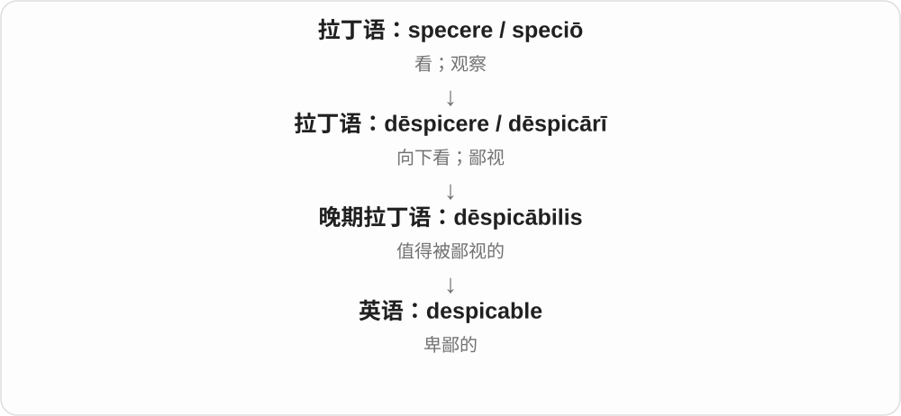

它把评价放在行为或人身上：不是说这个人很会鄙视别人，而是说他招来鄙视。

**常见搭配与例句**

a despicable act；despicable behavior；a despicable lie。

> Stealing from vulnerable people is despicable.

偷走弱势者的东西是卑鄙的。

> The character commits a despicable act of betrayal.

这个角色做出了卑鄙的背叛行为。

**别混淆**

despising 是正在鄙视；despicable 是令人鄙视。日常小失误不宜轻易用这个重词。

### 45. species — 物种；种类

**音标**：/ˈspiːʃiːz/

**先抓住这个画面**

species 像给生命世界分门别类时的一层抽屉：猫科很大，而某个具体物种是其中更明确的一类。

**怎么拆**

借自拉丁语 speciēs“外观、种类”，来自 speciō“看”；不是 spec + ies 这样的现代英语拼接。

**怎么变成今天的意思**

从能看见的形态走向类型，后来成为生物分类术语。物种判定不只凭长得像，现代还有遗传等多种依据。

**常见搭配与例句**

an endangered species；several species of bird；a chemical species。

> This forest is home to several rare species.

这片森林是几种稀有物种的家园。

> The two birds belong to different species.

这两只鸟属于不同物种。

**别混淆**

species 单复数同形：one species、two species。不能把 specie 当它的单数。

### 46. speciation — 物种形成；物种分化

**音标**：/ˌspiːʃiˈeɪʃən/，亦 /ˌspiːsiˈeɪʃən/

**先抓住这个画面**

speciation 像原本相连的种群逐渐分开发展，最后形成可以区分的新物种。

**怎么拆**

speciate（形成物种）+ -ion；词基来自 species。

**怎么变成今天的意思**

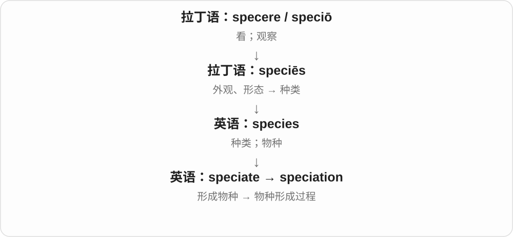

说的是过程，不是某一种动物的名字。化学中也可指一个元素存在于哪些化学形态，语境不同。

**常见搭配与例句**

speciation events；the process of speciation；chemical speciation。

> Geographic isolation can contribute to speciation.

地理隔离可能促成物种形成。

> The lecture explains different patterns of speciation.

讲座解释了物种形成的不同模式。

**别混淆**

species 是物种，speciation 是形成或分化过程；specialization 是专门化。

### 47. subspecies — 亚种

**音标**：/ˈsʌbspiːʃiːz/

**先抓住这个画面**

subspecies 像在“物种”这一层抽屉里，再分出有稳定差异的小格子。

**怎么拆**

sub-（在下一级）+ species（物种）。

**怎么变成今天的意思**

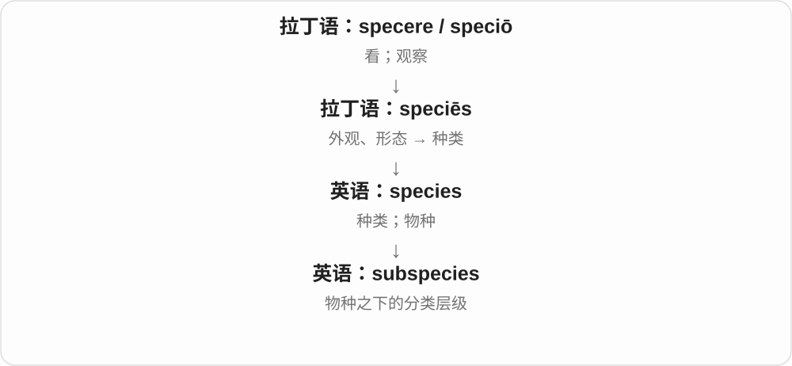

它是分类术语，不是指地位低劣的生物。不同群体何时认定为亚种，需要具体研究。

**常见搭配与例句**

a distinct subspecies；two subspecies；subspecies classification。

> The island population is classified as a subspecies.

岛上的这个种群被归为一个亚种。

> The book compares the markings of two subspecies.

这本书比较了两个亚种的斑纹。

**别混淆**

subspecies 比 species 低一级；不是所有地方性差异都自动构成亚种。

### 48. interspecies — 物种之间的；种间的

**音标**：英 /ˌɪntəˈspiːʃiːz/；美 /ˌɪntərˈspiːʃiːz/

**先抓住这个画面**

interspecies 把线连在不同物种之间，比如花与授粉昆虫的相互作用。

**怎么拆**

inter-（在……之间）+ species。

**怎么变成今天的意思**

它只说明关系两端属于不同物种，不限定这关系是合作、竞争还是其他形式。

**常见搭配与例句**

interspecies communication；interspecies interactions；interspecies competition。

> The study examines interspecies communication.

这项研究考察不同物种之间的交流。

> The habitat supports many interspecies interactions.

这个栖息地存在许多种间相互作用。

**别混淆**

intraspecies 是同一物种内部，interspecies 是不同物种之间。

### 49. intraspecies — 同一物种内部的

**音标**：英 /ˌɪntrəˈspiːʃiːz/；美 /ˌɪntrəˈspiːʃiːz/

**先抓住这个画面**

intraspecies 只把镜头放在同一种生物内部，比较其中个体或群体。

**怎么拆**

intra-（内部）+ species。

**怎么变成今天的意思**

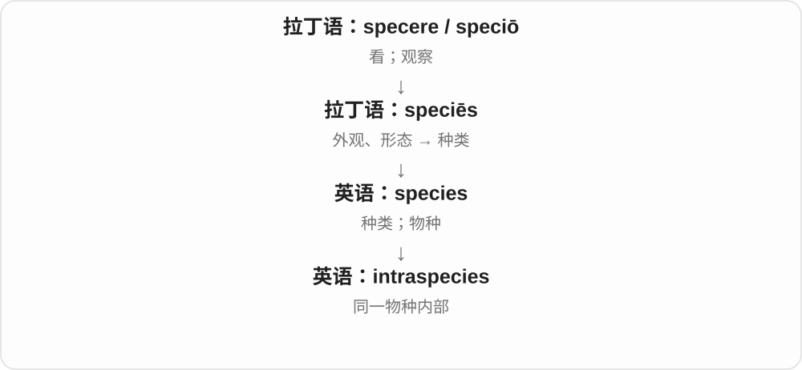

与 intraspecific 基本同义；它说明边界设在物种内，并不表示只有一个个体。

**常见搭配与例句**

intraspecies variation；intraspecies competition；intraspecies differences。

> The project examines intraspecies differences in size.

项目考察同一物种内部的大小差异。

> The lecture discusses intraspecies communication.

讲座讨论同一物种内部的交流。

**别混淆**

interspecies 跨物种；intraspecies 在物种内部。

### 50. perspective — 视角；看法；透视法

**音标**：英 /pəˈspektɪv/；美 /pərˈspektɪv/

**先抓住这个画面**

同一座山，从山脚和山顶看会不一样；perspective 就是你站在哪里、怎样看整件事。

**怎么拆**

来自 per-（穿过、彻底）+ specere，经过拉丁语“视觉的”以及法语光学、透视术语传入。

**怎么变成今天的意思**

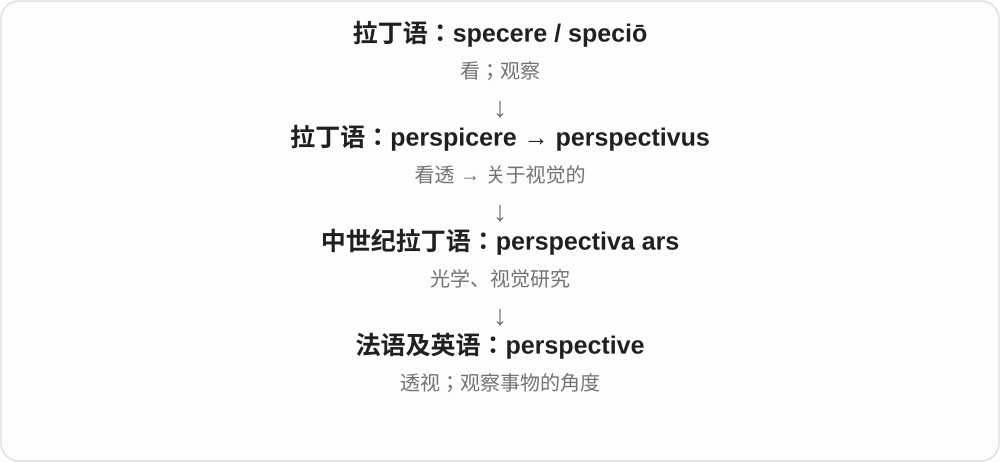

绘画里，它把远近空间画出来；讨论问题时，它把人的位置、经历和关注点带进来。keep things in perspective 是把局部放回整体衡量。

**常见搭配与例句**

from my perspective；a fresh perspective；put something in perspective。

> Try to see the issue from her perspective.

试着从她的角度看这个问题。

> The artist used perspective to create a sense of depth.

画家用透视法营造纵深感。

**别混淆**

prospective 是“未来可能的”，perspective 是“视角”；两个词的字母次序不能颠倒。

### 51. suspect — 怀疑；嫌疑人；可疑的

**音标**：动词 /səˈspekt/；名词、形容词 /ˈsʌspekt/

**先抓住这个画面**

suspect 是脑中亮起一盏小警灯：“可能是这样，但我还没有充分证据。”

**怎么拆**

经法语来自拉丁语 suspectus，连着 sub- + specere。古代“向上看”和猜疑相连，现代不能机械译成“在下面看”。

**怎么变成今天的意思**

动词可怀疑出了问题，也能表示推测：I suspect she is right。名词 suspect 是被怀疑的人，并不等于已证实犯事的人。

**常见搭配与例句**

suspect that…；suspect someone of doing；a suspect package。

> I suspect that the battery is empty.

我怀疑电池没电了。

> The police questioned a suspect.

警方询问了一名嫌疑人。

**别混淆**

suspect 与 guilty 不同：有嫌疑不是有罪。动词重音在后，名词通常在前。

### 52. suspicious — 怀疑的；可疑的

**音标**：/səˈspɪʃəs/

**先抓住这个画面**

suspicious 有两边：你心里起疑，或某件东西让别人起疑。看主语是谁就容易分清。

**怎么拆**

来自拉丁语 suspīciōsus，经法语传入，属于 suspicion 的词族。

**怎么变成今天的意思**

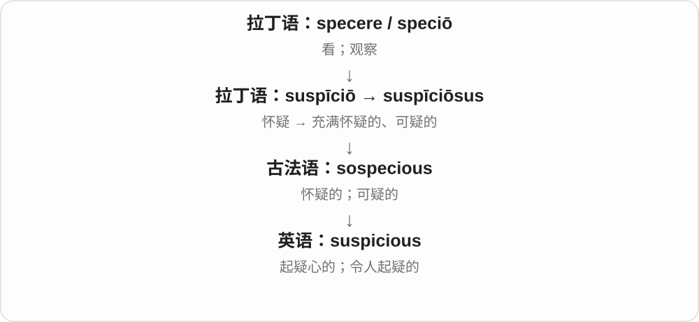

be suspicious of someone 描述观察者的态度；a suspicious package 描述引发怀疑的物品。都不代表坏事已经得到证实。

**常见搭配与例句**

be suspicious of；suspicious behavior；look suspicious。

> She became suspicious of his sudden interest.

他突然表现出兴趣，让她起了疑心。

> The guard noticed a suspicious package.

保安注意到一个可疑包裹。

**别混淆**

suspecting 不能普遍代替 suspicious；表示多疑或警惕的态度，用 suspicious 更自然。

### 53. suspiciously — 怀疑地；可疑地；出奇地

**音标**：/səˈspɪʃəsli/

**先抓住这个画面**

suspiciously 可以是眯着眼打量别人，也可以是某个细节异常得让人想问为什么。

**怎么拆**

suspicious + -ly，修饰动作或形容程度。

**怎么变成今天的意思**

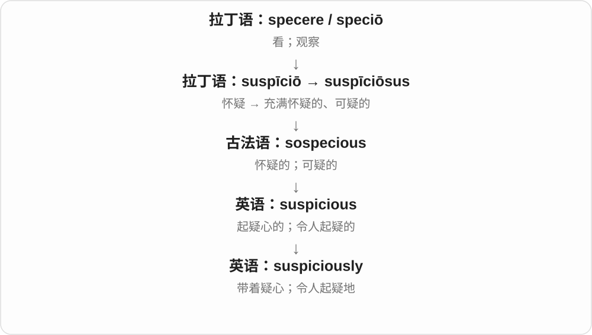

look suspiciously at 描述观察者的态度；suspiciously cheap 描述价格低得让人担心有隐情。

**常见搭配与例句**

look suspiciously at；suspiciously quiet；suspiciously similar。

> The guard looked at the bag suspiciously.

保安怀疑地看着那个包。

> The two essays were suspiciously similar.

这两篇文章相似得让人生疑。

**别混淆**

suspiciously 不是 simply strangely；它通常加上一层“这可能有问题”的感觉。

### 54. suspicion — 怀疑；嫌疑

**音标**：/səˈspɪʃən/

**先抓住这个画面**

suspicion 像一个还没有坐实的问号：“这里是不是有问题？”

**怎么拆**

来自拉丁语 suspīciō；英语也受盎格鲁诺曼语相关形式影响。与 suspect 同族，但不是简单加 -ion 的现代造词。

**怎么变成今天的意思**

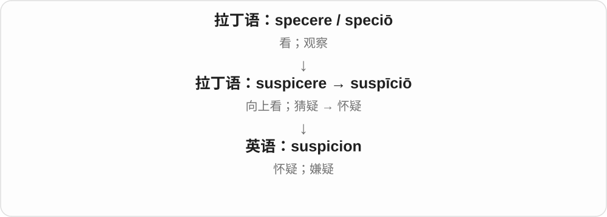

它可指怀疑的心理，也可指某人处于被怀疑的状态。a suspicion of 还可表示一点点迹象或隐约感觉。

**常见搭配与例句**

arouse suspicion；under suspicion；have a suspicion that。

> The unusual payment aroused suspicion.

这笔不寻常的付款引起了怀疑。

> I have a suspicion that we have met before.

我隐约觉得我们以前见过。

**别混淆**

suspicion 与 proof 的距离很大。疑心可以促使检查，却不能自动作为结论。

### 55. aspect — 方面；外观；朝向；语法中的体

**音标**：/ˈæspekt/

**先抓住这个画面**

aspect 像转动一件物品，每次看见它的一个面；谈复杂事情时，就是其中某个需要单独看的方面。

**怎么拆**

ad-（朝向）+ specere 形成 aspicere，再有名词 aspectus“观看、样子”，英语借用这个名词。

**怎么变成今天的意思**

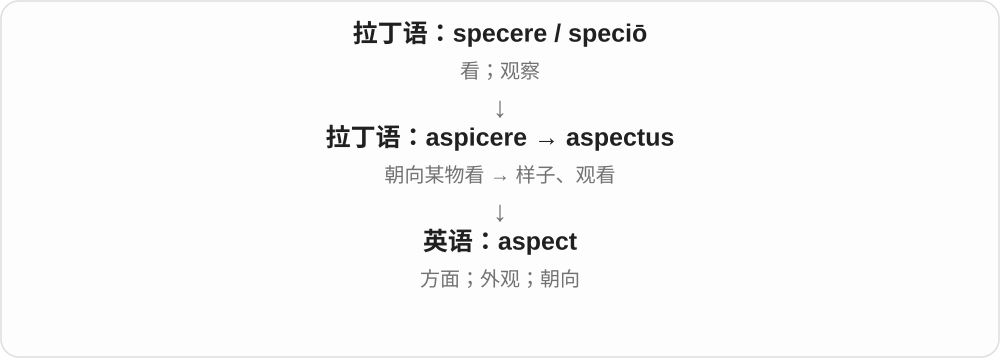

“看到的样子”能表示外观，也能表示观察角度下的一个方面。语法 aspect 则看动作怎样展开，如正在进行或已经完成。

**常见搭配与例句**

an important aspect of；every aspect；a southern aspect。

> We discussed the practical aspects of the plan.

我们讨论了计划在实际操作方面的问题。

> The room has a sunny southern aspect.

这个房间朝南，阳光充足。

**别混淆**

aspect 常是整体的一面；perspective 是观察者的视角。换视角可能注意到不同方面。

### 56. spectrum — 光谱；范围；一系列不同情况

**音标**：/ˈspektrəm/

**先抓住这个画面**

spectrum 先想一束白光被展开成不同颜色，再想某个领域里从这一端到另一端的多种情况。

**怎么拆**

来自拉丁语 spectrum“影像、显现”，最终与 specere“看”同源；不是 spect + rum。

**怎么变成今天的意思**

光谱义把不同波长展开；比喻义则把观点、能力或问题按连续范围看。并非每个 spectrum 都只有简单的一条高低线。

**常见搭配与例句**

the visible spectrum；a broad spectrum of views；across the spectrum。

> A prism separates light into a spectrum of colours.

棱镜把光分成一系列光谱颜色。

> The survey included a broad spectrum of opinions.

调查涵盖了各种不同观点。

**别混淆**

range 也可表示范围；spectrum 更突出范围内有多种位置、类型或变化。

### 57. spectral — 光谱的；幽灵般的

**音标**：/ˈspektrəl/

**先抓住这个画面**

spectral 有两个画面：实验仪器上的光谱，或小说里模糊飘忽的幽灵身影。

**怎么拆**

幽灵义由 spectre + -al 形成；光谱义对应 spectrum。两词更早都来自拉丁语 spectrum“影像”。

**怎么变成今天的意思**

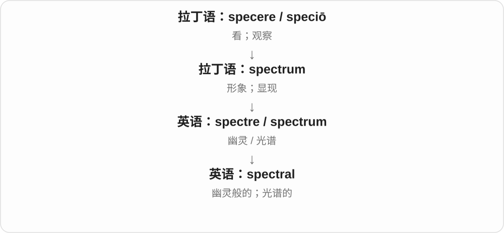

文学和科学保留了不同分支。spectral lines 是光谱线，spectral figure 则可能是幽灵般的人影。

**常见搭配与例句**

spectral analysis；spectral lines；a spectral figure。

> The scientist examined the spectral lines.

科学家检查了光谱线。

> A spectral figure appeared in the mist.

雾中出现了一个幽灵般的人影。

**别混淆**

spectral 不等于 spectacular：前者是光谱或幽灵的，后者是壮观的。

### 58. multispectral — 多光谱的

**音标**：/ˌmʌltiˈspektrəl/

**先抓住这个画面**

multispectral 像给相机换上几副不同的“颜色眼镜”，分别记录多个波段的信息。

**怎么拆**

multi-（多个）+ spectral（光谱的）。

**怎么变成今天的意思**

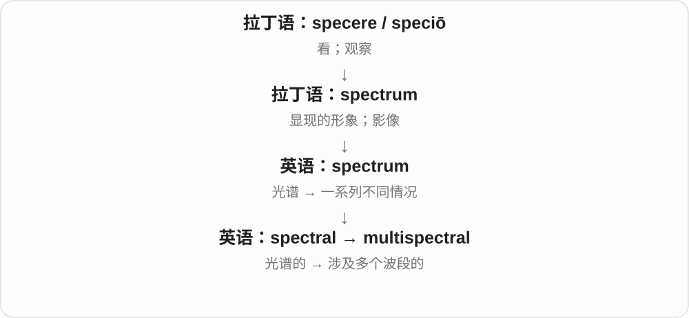

常见于遥感、成像。图像可能包含人眼看不见的波段，不只是把普通照片染成多种颜色。

**常见搭配与例句**

multispectral imaging；a multispectral sensor；multispectral data。

> The satellite carries a multispectral sensor.

卫星携带了一台多光谱传感器。

> Multispectral images revealed differences in the vegetation.

多光谱图像显示了植被之间的差异。

**别混淆**

multicoloured 只是多颜色；multispectral 强调测量或使用多个光谱波段。

### 59. inspect — 仔细检查；检验

**音标**：/ɪnˈspekt/

**先抓住这个画面**

inspect 像把东西翻过来、凑近看，专门找细节、缺陷或不符合要求的地方。

**怎么拆**

in-（向里）+ specere（看）形成拉丁语 inspicere，英语采用其 inspect- 词干。

**怎么变成今天的意思**

“看进去”的画面帮助理解仔细检查，但不要求真的打开物体内部；查看文件也可以 inspect。

**常见搭配与例句**

inspect the damage；inspect a building；inspect closely。

> Please inspect the parcel for damage.

请检查包裹是否有损坏。

> The engineer inspected the bridge after the storm.

暴风雨后，工程师检查了桥梁。

**别混淆**

look at 只是看；inspect 带着检查目的，更细致。

### 60. inspector — 检查员；督察

**音标**：英 /ɪnˈspektə/；美 /ɪnˈspektər/

**先抓住这个画面**

inspector 是拿着标准去现场看细节的人：哪里合格，哪里需要修改，都要逐项检查。

**怎么拆**

借自拉丁语 īnspector，来自 īnspicere“检查”。inspect + -or 是便于理解的对应，不代表最初在英语中造词。

**怎么变成今天的意思**

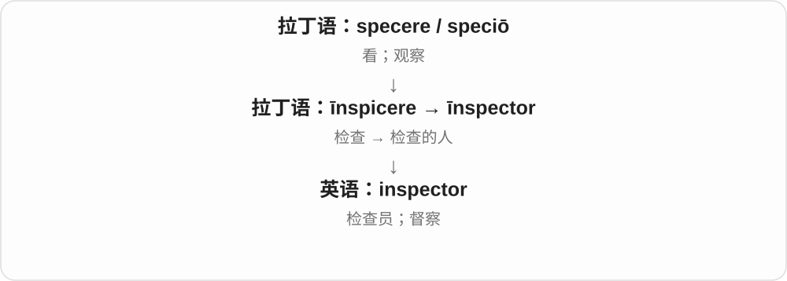

从察看的人发展成正式职位名称。警务中的 inspector 也可能是职级，具体职责随地区而变。

**常见搭配与例句**

a building inspector；a safety inspector；a police inspector。

> The inspector checked the emergency exits.

检查员检查了紧急出口。

> A building inspector visited the site yesterday.

建筑检查员昨天到现场检查。

**别混淆**

inspector 负责检查；spectator 只是观看者。两者都“看”，但任务不同。

### 61. inspectorate — 检查机构；监察部门

**音标**：英 /ɪnˈspektərət/；美 /ɪnˈspektərət/

**先抓住这个画面**

inspectorate 像把分散的检查员组织成一个部门，负责一整片领域的监督检查。

**怎么拆**

inspector + -ate；这里的 -ate 表示职位、机构或人员整体。

**怎么变成今天的意思**

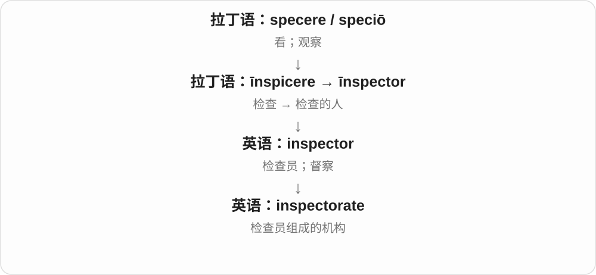

不是一次检查，也不是某一个检查员；常见于教育、劳动或安全监督部门名称。

**常见搭配与例句**

a school inspectorate；the inspectorate’s report；an independent inspectorate。

> The inspectorate published its annual report.

检查机构发布了年度报告。

> The school received a visit from the inspectorate.

学校接受了督查部门的访问检查。

**别混淆**

inspector 是人，inspection 是检查行为，inspectorate 是机构或部门。

### 62. inspection — 检查；检验

**音标**：/ɪnˈspekʃən/

**先抓住这个画面**

inspection 是把“看一眼”升级成有目标的查看，可能要找问题、核对状态或确认标准。

**怎么拆**

经法语来自拉丁语 īnspectiō；与 inspect 对应，但名词有自己的借入路径。

**怎么变成今天的意思**

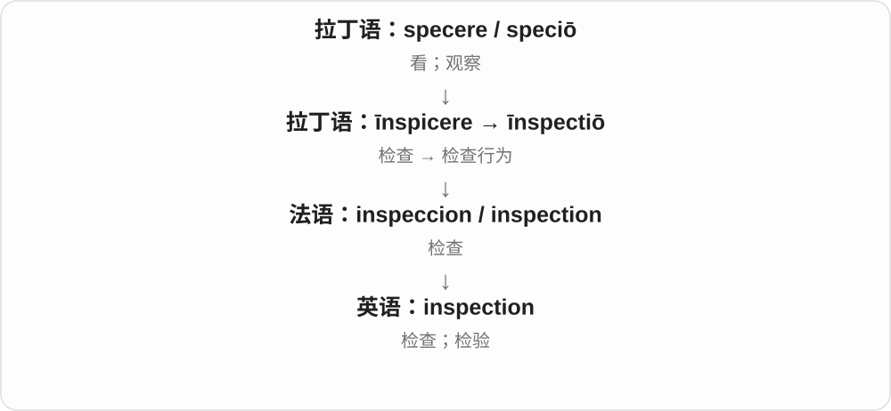

close inspection 是仔细检查；on inspection 表示实际看过之后。它可以很正式，也可以只是认真查看某件东西。

**常见搭配与例句**

carry out an inspection；pass inspection；on closer inspection。

> The bridge is closed for inspection.

这座桥因检查而关闭。

> On closer inspection, we found a small crack.

仔细检查后，我们发现了一条细裂缝。

**别混淆**

inspection 不必做实验；test 更常通过操作或测量看反应。二者可能一起进行。

### 63. reinspect — 重新检查；复检

**音标**：/ˌriːɪnˈspekt/

**先抓住这个画面**

reinspect 是第一次看过之后再检查一遍，可能因为问题已修好，也可能想确认没漏掉什么。

**怎么拆**

re-（再次）+ inspect。

**怎么变成今天的意思**

re- 只表示重复，不保证第二次结果与第一次相同，也不等于重新修理。

**常见搭配与例句**

reinspect the building；reinspect after repairs；reinspect the records。

> The engineer will reinspect the roof after the repairs.

维修后，工程师会重新检查屋顶。

> We decided to reinspect the records for errors.

我们决定重新检查记录中是否有错误。

**别混淆**

repair 是修复，reinspect 是再检查；修好后常需要复检。

### 64. prospect — 前景；可能性；勘探

**音标**：名词英 /ˈprɒspekt/、美 /ˈprɑːspekt/；动词英亦读 /prəˈspekt/

**先抓住这个画面**

prospect 是把目光放到前面的路上：那里可能有什么机会，也可能有什么让人担心的事。

**怎么拆**

pro-（向前）+ specere 形成 prospicere，再有 prospectus“视野、前景”；动词由英语名词发展。

**怎么变成今天的意思**

从眼前展开的景色变成将来的可能局面。矿产勘探义则是到一个地区寻找未来可能开采的资源。

**常见搭配与例句**

job prospects；the prospect of doing；prospect for gold。

> The course improved her job prospects.

这门课改善了她的就业前景。

> They went into the hills to prospect for gold.

他们到山里勘探金矿。

**别混淆**

prospect 是可能性或前景，promise 还可含承诺。前景好并不等于有人保证结果。

### 65. prospective — 未来可能成为的；预期的

**音标**：英 /prəˈspektɪv/；美 /prəˈspektɪv/

**先抓住这个画面**

prospective 像给一个身份留出空位：他还不是顾客、学生或雇主，但将来可能是。

**怎么拆**

经法语 prospectif 来自拉丁语 prospectivus，属于“向前看”的词族。

**怎么变成今天的意思**

prospective buyer 是潜在买家，不表示交易已完成。研究里的 prospective 则从现在向前跟踪将来的情况。

**常见搭配与例句**

prospective customers；prospective students；a prospective study。

> The school held an event for prospective students.

学校为有意申请的学生举办了活动。

> We showed the apartment to a prospective buyer.

我们带一位潜在买家看了公寓。

**别混淆**

perspective 是视角；prospective 是朝未来看的、可能成为的。

### 66. prospectively — 面向未来地；前瞻性地

**音标**：英 /prəˈspektɪvli/；美 /prəˈspektɪvli/

**先抓住这个画面**

prospectively 像今天先设好观察方案，再往前跟踪接下来发生的事。

**怎么拆**

prospective + -ly。

**怎么变成今天的意思**

常见于研究和正式安排，强调从当前时点向前展开，而非事后回头整理。

**常见搭配与例句**

collect data prospectively；follow prospectively；apply prospectively。

> The team collected the data prospectively.

团队按前瞻方式收集了数据。

> The new rule will apply prospectively.

新规则将从今后开始适用。

**别混淆**

prospectively 向未来，retrospectively 回看过去；两者不直接代表质量高低。

### 67. prospectus — 招生简章；项目介绍书；招股说明书

**音标**：/prəˈspektəs/

**先抓住这个画面**

prospectus 像把未来要提供的东西摊成一本说明书，帮助有意加入的人了解计划。

**怎么拆**

从法语 prospectus 借入，法语保留拉丁语 prospectus“前景、展望”的形式。

**怎么变成今天的意思**

大学、出版计划和证券发行都有这类正式文件。共同点是给可能参与的人提供信息，不是随手画的风景图。

**常见搭配与例句**

a university prospectus；read the prospectus；an investment prospectus。

> The university prospectus lists the available courses.

大学招生简章列出了开设的课程。

> The prospectus describes the proposed publication.

项目介绍书说明了拟出版的作品。

**别混淆**

prospect 是前景；prospectus 是描述机会或安排的文件。文件本身不保证成功。

### 68. prospector — 勘探者；探矿者

**音标**：英 /prəˈspektə/；美 /ˈprɑːspektər/

**先抓住这个画面**

prospector 像带着工具走进山地，寻找地面下哪里可能有值得开采的矿产。

**怎么拆**

prospect 的勘探动词义 + -or，表示做这件事的人。

**怎么变成今天的意思**

先观察一个地区的可能性，再去探查资源；它不表示已经找到矿，更不一定拥有矿场。

**常见搭配与例句**

a gold prospector；mineral prospectors；a prospector’s camp。

> The prospector found traces of gold in the stream.

探矿者在溪流中发现了金的痕迹。

> The museum displays tools used by early prospectors.

博物馆展示了早期探矿者使用的工具。

**别混淆**

miner 通常参与采矿；prospector 重点是找矿。

### 69. spectacle — 引人注目的场面；眼镜（spectacles）

**音标**：/ˈspektəkəl/

**先抓住这个画面**

spectacle 是让人忍不住观看的一幕：盛大、奇特，或因为太失态而吸引目光。

**怎么拆**

经法语来自拉丁语 spectāculum“供观看的东西”，基础是 spectāre“观看”。

**怎么变成今天的意思**

大场面义直连“供观看”；复数 spectacles 在较传统用法中表示眼镜。make a spectacle of yourself 是失态得让大家围观。

**常见搭配与例句**

a magnificent spectacle；a public spectacle；a pair of spectacles。

> The fireworks created a magnificent spectacle.

烟火形成了壮观的景象。

> He put on his spectacles to read the letter.

他戴上眼镜读那封信。

**别混淆**

spectacle 是被观看的场面；spectator 是观看的人。

### 70. spectacular — 壮观的；惊人的；引人注目的

**音标**：英 /spekˈtækjʊlə/；美 /spekˈtækjələr/

**先抓住这个画面**

spectacular 像让人停下来张大眼睛的场面，也可形容结果好得或坏得惊人。

**怎么拆**

由拉丁语 spectāculum“供观看的场面”这一词干与形容词后缀构成，和 spectacle 相连。

**怎么变成今天的意思**

从视觉上的盛大场面扩展到显著的成功或失败。spectacular failure 并不在赞美失败很漂亮。

**常见搭配与例句**

a spectacular view；spectacular success；a spectacular failure。

> The balcony offers a spectacular view of the bay.

阳台可以看到壮观的海湾景色。

> The experiment ended in a spectacular failure.

实验以一次惊人的失败告终。

**别混淆**

spectacular 强调惹眼、惊人；excellent 只强调质量优秀，未必有戏剧性。

### 71. spectacularly — 惊人地；壮观地

**音标**：英 /spekˈtækjʊləli/；美 /spekˈtækjələrli/

**先抓住这个画面**

spectacularly 把变化或结果放大到让人很难忽视：赢得惊人，失败得也可能惊人。

**怎么拆**

spectacular + -ly。

**怎么变成今天的意思**

它常加强成功、失败、变化的程度，不保证是正面评价。

**常见搭配与例句**

spectacularly successful；fail spectacularly；spectacularly beautiful。

> The plan failed spectacularly.

这个计划失败得非常惨。

> The mountains were spectacularly beautiful at sunrise.

日出时群山美得令人惊叹。

**别混淆**

spectacularly 与 carefully 不同：一个讲效果是否惊人，一个讲做得是否仔细。

### 72. spectacularity — 壮观程度；引人惊叹的效果

**音标**：英 /spekˌtækjʊˈlærəti/；美 /spekˌtækjəˈlærəti/

**先抓住这个画面**

spectacularity 把“让观众惊叹”本身当成一个可讨论的特征：场面到底有多抢眼。

**怎么拆**

spectacular + -ity，构成性质名词。

**怎么变成今天的意思**

常用于艺术、电影、表演评论，远比 spectacular 少见。可以讨论视觉效果，却不保证作品内容深刻。

**常见搭配与例句**

visual spectacularity；the spectacularity of a performance。

> The film relies heavily on visual spectacularity.

这部电影很大程度上依赖视觉上的壮观效果。

> The critic admired the production’s spectacularity but questioned its depth.

评论者赞赏制作的壮观效果，但质疑其深度。

**别混淆**

spectacle 是场面；spectacularity 是场面的壮观性质或程度。

### 73. unspectacular — 不惊人的；平淡的

**音标**：英 /ˌʌnspekˈtækjʊlə/；美 /ˌʌnspekˈtækjələr/

**先抓住这个画面**

unspectacular 像一场没有精彩镜头但完成任务的比赛：没让人惊呼，却未必不好。

**怎么拆**

un-（不）+ spectacular。

**怎么变成今天的意思**

常搭配 solid、steady，强调成果扎实但不耀眼。否定的是戏剧性，不一定否定价值。

**常见搭配与例句**

solid but unspectacular；an unspectacular performance；steady, unspectacular growth。

> The results were solid but unspectacular.

结果扎实，但不惊艳。

> He built a steady, unspectacular career.

他的事业发展稳健，没有大起大落的亮眼场面。

**别混淆**

unsuccessful 是不成功；unspectacular 只是没有惊人效果。

### 74. speculate — 推测；猜想；投机

**音标**：英 /ˈspekjʊleɪt/；美 /ˈspekjəleɪt/

**先抓住这个画面**

speculate 是看到一些线索后，先在脑中试着补全未知部分；尚未知道，就先设想。

**怎么拆**

来自拉丁语 speculārī“观察、察看”的分词词干 speculāt-；更早连着瞭望处 specula。

**怎么变成今天的意思**

从仔细观察走向思考、推想。金融语境的投机，则是凭对未来价格的判断承担风险。

**常见搭配与例句**

speculate about；speculate that；speculate in land。

> We can only speculate about why the meeting was cancelled.

我们只能猜测会议为什么取消。

> The novel follows a man who speculates in land.

这部小说写了一个从事土地投机的人。

**别混淆**

推测时用 speculate，确认时用 confirm。不能因说得有条理就把前者当成后者。

### 75. speculation — 推测；猜测；投机

**音标**：/ˌspekjəˈleɪʃən/

**先抓住这个画面**

speculation 是信息还不够时，大脑先试着拼出一幅图；在交易里，则是押注未来价格变化。

**怎么拆**

经法语来自拉丁语 speculātiō，与 speculārī“观察、思考”有关；不是名词必定从现代 speculate 造出。

**怎么变成今天的意思**

推测义强调尚未得到充分证实；投机义强调根据未来判断承担风险求利。共同点是面对还未确定的情况作判断。

**常见搭配与例句**

speculation about；fuel speculation；financial speculation。

> Her absence led to speculation about her plans.

她的缺席引发了人们对她计划的猜测。

> The historian studies land speculation in the nineteenth century.

这位历史学家研究十九世纪的土地投机。

**别混淆**

speculation 是猜测，evidence 是证据；报道说 amid speculation，不等于已确认。

### 76. speculative — 推测性的；思辨的；投机性的

**音标**：英 /ˈspekjələtɪv/；美亦 /ˈspekjəleɪtɪv/

**先抓住这个画面**

speculative 像在证据还没有铺满的地方搭了一座临时桥：可以尝试想象，但还不能当成稳固结论。

**怎么拆**

经法语或直接来自晚期拉丁语 speculātīvus，连着“观察、思考”的 speculārī。

**怎么变成今天的意思**

可说一个解释基于推测，也可描述为未来价格变化承担风险的交易；文学中还用于包含想象世界的作品。

**常见搭配与例句**

a speculative explanation；speculative fiction；speculative investment。

> The explanation remains highly speculative.

这个解释仍然有很强的推测性。

> She enjoys speculative fiction about future societies.

她喜欢描写未来社会的想象类小说。

**别混淆**

speculative 不自动等于荒谬，只说明推测、想象或风险较大，证据程度要另看。

### 77. speculatively — 推测地；带有投机性地

**音标**：英 /ˈspekjələtɪvli/；美亦 /ˈspekjəleɪtɪvli/

**先抓住这个画面**

speculatively 像边看线索边试探着想：“会不会是这样？”语气尚未落定。

**怎么拆**

speculative + -ly。

**怎么变成今天的意思**

可修饰讨论或目光，也可说明买入资产是为了将来的价格变化。

**常见搭配与例句**

speak speculatively；look speculatively at；buy speculatively。

> She looked speculatively at the empty building.

她若有所思地打量那栋空楼，想着它可能的用途。

> The land was bought speculatively.

那块土地是为投机获利而买下的。

**别混淆**

confidently 描述自信程度；speculatively 描述推测性质。人也可能很自信地猜错。

### 78. speculator — 投机者；推测者

**音标**：英 /ˈspekjʊleɪtə/；美 /ˈspekjəleɪtər/

**先抓住这个画面**

speculator 是押注某种未来走向的人；常见画面是买下资产，希望以后价格变化带来利润。

**怎么拆**

历史上来自拉丁语 speculātor“观察者、侦察者”；现代若干义也直接对应 speculate + -or。

**怎么变成今天的意思**

从察看、推想未来转到依据未来判断交易。它描述一种活动角色，不自动说明交易违法。

**常见搭配与例句**

a property speculator；currency speculators；a financial speculator。

> The story follows a speculator during a property boom.

故事写了一名投机者在房地产繁荣时期的经历。

> Speculators bought land near the proposed railway.

投机者买下了规划铁路附近的土地。

**别混淆**

investor 范围更广；speculator 常突出对价格变化的押注与风险。

### 79. speculatory — 推测的；瞭望的；投机的（少见）

**音标**：英 /ˈspekjʊlətəri/；美 /ˈspekjələtɔːri/

**先抓住这个画面**

speculatory 像站在观察点上察看，也可转成在脑中推想尚不确定的事情。

**怎么拆**

来自拉丁语 speculātōrius“侦察者的、观察者的”，属于 speculārī 一族。

**怎么变成今天的意思**

老用法可直接形容用于观察的地点；现代偶见的推测、投机义多可以用 speculative 替换。

**常见搭配与例句**

speculatory reasoning；a speculatory account；古义 speculatory height。

> The essay offers a speculatory account of the missing years.

文章对那段缺乏记录的岁月提出了推测性解释。

> The old tower occupied a speculatory height above the valley.

那座古塔占据了山谷上方一处便于瞭望的高地。

**别混淆**

speculatory 较少见；speculative 才是现代常用的“推测性的”。

### 80. spice — 香料；增添趣味

**音标**：/spaɪs/

**先抓住这个画面**

spice 像往一锅味道平淡的食物里加一点香气；比喻时，就是给平淡生活增加刺激和趣味。

**怎么拆**

经古法语 espice 来自晚期拉丁语 speciēs“货品、香料”，更早是“种类”；和 species 是不同路径传入的同源词。

**怎么变成今天的意思**

从某类货品缩窄到香料，并不是因为“看起来特别”就直接变成香料。现代 spice up 是让食物或活动更有味道。

**常见搭配与例句**

herbs and spices；a pinch of spice；spice up a story。

> Add a little spice to the soup.

往汤里加一点香料。

> A surprising detail can spice up a story.

一个出人意料的细节能让故事更有趣。

**别混淆**

spice 不一定辣：肉桂、丁香也是香料。hot 更直接指辣得刺激口腔。

### 81. spicy — 加有香料的；辛辣的；刺激有趣的

**音标**：/ˈspaɪsi/

**先抓住这个画面**

spicy 可以是嘴里感到辣，也可以是香料气味丰富；要结合食物和说话习惯判断。

**怎么拆**

spice 去掉词尾 e，加 -y，形成描述性质的形容词。

**怎么变成今天的意思**

香料义在日常饮食中常转向“辣”。形容报道、故事时，还可能指内容刺激、带点大胆意味。

**常见搭配与例句**

spicy food；a spicy sauce；a spicy aroma。

> The sauce is too spicy for me.

这个酱对我来说太辣了。

> The tea has a warm, spicy aroma.

这杯茶有温暖浓郁的香料气息。

**别混淆**

spicy 和 hot 都可指辣；hot 还可单纯指温度高。spicy 不说明食物刚出锅。

### 82. spicer — 香料商；添加香料或趣味的人或物

**音标**：英 /ˈspaɪsə/；美 /ˈspaɪsər/

**先抓住这个画面**

spicer 在旧时代可指香料商；按现代构词也可理解为给东西添味的一方。

**怎么拆**

旧职业名经古法语 espicier 来自拉丁语 speciārius；英语里又可按 spice + -er 理解添加者。

**怎么变成今天的意思**

同一词形保留职业历史，也能按动作形成较少见的用途。现代普通表达说 spice seller 更直白。

**常见搭配与例句**

a medieval spicer；a spicer’s shop；a spicer of stories（给故事添趣的人）。

> The historian found a record of a medieval spicer.

历史学家找到了一位中世纪香料商的记录。

> The old street once contained a spicer’s shop.

这条老街从前有一家香料店。

**别混淆**

小写 spicer 是普通名词；Spicer 还可作姓氏，不能把每次出现都理解为香料商。

### 83. allspice — 多香果；牙买加胡椒

**音标**：英 /ˈɔːlspaɪs/；美 /ˈɔːlspaɪs/

**先抓住这个画面**

allspice 是一种植物的果实做成的香料，闻起来让人联想到好几种香料混在一起。

**怎么拆**

all + spice，名字来自它被认为兼有多种香料的香气；并不是实际把所有香料混合。

**怎么变成今天的意思**

这是名称带来的联想：一种原料，有几种熟悉的香气。不要按字面去配一碗混合香料。

**常见搭配与例句**

ground allspice；allspice berries；a pinch of allspice。

> Add a pinch of ground allspice to the filling.

往馅料里加一小撮多香果粉。

> The recipe uses whole allspice berries.

这个食谱使用整粒多香果。

**别混淆**

allspice 是单一香料；mixed spice 是混合香料。

### 84. specimen — 样本；标本；实例

**音标**：/ˈspesɪmɪn/

**先抓住这个画面**

specimen 像从一大片对象中拿出一个放到灯下，让人据此观察、研究或展示某种特征。

**怎么拆**

来自拉丁语 specimen“标志、例子”，与 speciō“观察”有关；不要拆成英语 spec + men“男人”。

**怎么变成今天的意思**

可以是自然历史馆里的标本，也可以是研究采集的一份材料。重点是它作为观察对象的作用。

**常见搭配与例句**

a plant specimen；collect a specimen；a fine specimen of。

> The museum displays a large insect specimen.

博物馆展示了一件大型昆虫标本。

> Each specimen was labelled before analysis.

每份样本都在分析前贴好了标签。

**别混淆**

sample 范围更广，可指试用品或统计样本；specimen 常强调可观察、研究的具体个体或材料。

### 85. spectator — 观众；旁观者

**音标**：英 /spekˈteɪtə/；美 /ˈspekteɪtər/

**先抓住这个画面**

spectator 站在场边看事情发生，尤其常见于体育比赛：参与观看，但不下场比赛。

**怎么拆**

借自拉丁语 spectātor，来自 spectāre“观看”加表示人的后缀；不是英语 spectator 从 speculation 来。

**怎么变成今天的意思**

这个词突出看现场活动的人。比喻为 spectator，也可表示对事情只有观看、没有参与。

**常见搭配与例句**

a crowd of spectators；spectator sport；remain a spectator。

> Thousands of spectators watched the race.

数千名观众观看了比赛。

> She refused to remain a spectator in the debate.

她不愿在辩论中一直当旁观者。

**别混淆**

audience 常是节目或表达的受众；spectators 常是观看比赛、事件的人，两者有重叠。

### 86. spectatorial — 观众的；关于观看者的

**音标**：英 /spektəˈtɔːriəl/；美 /spektəˈtɔːriəl/

**先抓住这个画面**

spectatorial 像把问题从舞台转到座位上：“观众在看什么？他们怎样理解？”

**怎么拆**

spectator + -ial，词形出现 -orial，用来修饰观看者的活动、位置或体验。

**怎么变成今天的意思**

常见于影视、戏剧和艺术研究。它关注观看这一端，不直接说明演出壮不壮观。

**常见搭配与例句**

spectatorial experience；a spectatorial position；spectatorial pleasure。

> The article examines the spectatorial experience of silent cinema.

文章考察了观看无声电影的观众体验。

> The camera places us in a distant spectatorial position.

摄影机让我们处在一种疏远的观看位置。

**别混淆**

spectacular 是壮观的；spectatorial 是有关观众的。

### 87. retrospection — 回顾；追忆

**音标**：英 /ˌretrəˈspekʃən/；美 /ˌretroʊˈspekʃən/

**先抓住这个画面**

retrospection 像翻旧相册，不只看照片，也重新想当时发生了什么。

**怎么拆**

retro-（向后）+ spect-（看）+ -ion，与拉丁语 retrōspicere“回看”相连。

**怎么变成今天的意思**

它是较正式的名词，强调回顾这一过程。回顾可能带来新理解，也可能受到后来经验影响。

**常见搭配与例句**

a moment of retrospection；personal retrospection；in retrospection。

> Retirement gave her time for retrospection.

退休让她有时间回顾人生。

> The memoir combines retrospection with careful research.

这部回忆录把个人回顾与细致研究结合起来。

**别混淆**

日常说“回头看”常用 in retrospect；retrospection 更像在谈回顾活动本身。

### 88. retrospective — 回顾的；追溯的；回顾展

**音标**：英 /ˌretrəˈspektɪv/；美 /ˌretroʊˈspektɪv/

**先抓住这个画面**

retrospective 像把镜头转向身后的路，重新看已经发生的事或一个人多年来的作品。

**怎么拆**

retro-（向后）与 spect-（看）相连；英语 retrospective 与 retrospect + -ive 对应。

**怎么变成今天的意思**

展览中可作名词，汇集艺术家不同时期作品。研究中表示利用已发生的资料回头分析。

**常见搭配与例句**

a retrospective exhibition；a retrospective study；a career retrospective。

> The gallery held a retrospective of her paintings.

画廊举办了她的绘画回顾展。

> The report offers a retrospective view of the project.

报告回顾了整个项目。

**别混淆**

prospective 朝未来看；retrospective 回头看。回顾不等于事先就已知道结果。

### 89. retrospectively — 回顾地；追溯地

**音标**：英 /ˌretrəˈspektɪvli/；美 /ˌretroʊˈspektɪvli/

**先抓住这个画面**

retrospectively 是事后再回头看，或把某项变化的适用时间往过去推。

**怎么拆**

retrospective + -ly。

**怎么变成今天的意思**

研究语境常指分析已有记录；制度语境可能指追溯适用。两种用途都把目光指向过去。

**常见搭配与例句**

analyze retrospectively；review retrospectively；apply retrospectively。

> The researchers analyzed the records retrospectively.

研究人员回顾性地分析了已有记录。

> The change was applied retrospectively to earlier entries.

这项修改追溯应用到了先前的条目。

**别混淆**

prospectively 从现在向未来；retrospectively 从现在回看过去。

### 90. conspicuous — 显眼的；引人注意的

**音标**：/kənˈspɪkjuəs/

**先抓住这个画面**

conspicuous 像一群灰衣人中站着一个穿亮红衣的人，眼睛很难绕过他。

**怎么拆**

来自拉丁语 conspicuus，由 cōnspicere“注意到”发展；con- 在这里有加强作用。

**怎么变成今天的意思**

可因颜色、举止、位置而显眼，也可因本该出现却缺席而显眼：conspicuous by its absence。

**常见搭配与例句**

a conspicuous sign；conspicuous consumption；conspicuous by its absence。

> Her yellow coat was conspicuous in the crowd.

她的黄色外套在人群中很显眼。

> The report was conspicuous by its absence from the meeting.

会议上偏偏没有那份报告，这一点很引人注意。

**别混淆**

visible 是能看见；conspicuous 是特别容易引起注意。

### 91. conspicuously — 显眼地；明显地

**音标**：/kənˈspɪkjuəsli/

**先抓住这个画面**

conspicuously 表示一个细节突出得让人注意到，甚至它的缺席也会变得突出。

**怎么拆**

conspicuous + -ly。

**怎么变成今天的意思**

conspicuously absent 是“缺席得很明显”，不是说你真的看见一个空人影。

**常见搭配与例句**

conspicuously absent；conspicuously different；conspicuously displayed。

> The warning was conspicuously displayed near the door.

警告标语醒目地张贴在门边。

> Her name was conspicuously absent from the list.

名单上偏偏没有她的名字，这很引人注意。

**别混淆**

quietly 说明安静；conspicuously 说明惹眼。有人不说话，也可能因为反常而显眼。

### 92. inconspicuous — 不显眼的；不引人注意的

**音标**：/ˌɪnkənˈspɪkjuəs/

**先抓住这个画面**

inconspicuous 像把亮色外套换成灰色，融入背景，让别人不容易注意到。

**怎么拆**

借自晚期拉丁语 incōnspicuus；字形上是 in-（不）+ conspicuous。

**怎么变成今天的意思**

不显眼不等于看不见；一块小标牌就在墙上，但可能容易被忽略。

**常见搭配与例句**

an inconspicuous entrance；remain inconspicuous；inconspicuous clothing。

> The café has an inconspicuous entrance.

这家咖啡馆的入口不太显眼。

> He tried to remain inconspicuous at the back of the room.

他待在房间后面，尽量不引人注意。

**别混淆**

invisible 是不可见；inconspicuous 是存在且能看见，但不突出。

### 93. spectre — 幽灵；可怕而挥之不去的威胁

**音标**：英 /ˈspektə/；美 /ˈspektər/

**先抓住这个画面**

spectre 像一道还没真正碰到你、却一直笼罩着你的阴影：可以是鬼影，也可以是失业等担忧。

**怎么拆**

经法语 spectre 来自拉丁语 spectrum“形象、显现”；美式通常拼 specter。

**怎么变成今天的意思**

显现的影像走向幽灵，再比喻令人恐惧的可能性。the spectre of failure 不说失败已发生。

**常见搭配与例句**

a ghostly spectre；the spectre of unemployment；raise the spectre of。

> The tale begins with a spectre in an empty house.

故事开头是一座空屋里出现了幽灵。

> The spectre of unemployment worried the workers.

失业的阴影让工人们担忧。

**别混淆**

spectator 是观众，spectre 是幽灵；spectrum 通常是光谱或范围。

### 94. auspice — 征兆；支持；庇护

**音标**：英 /ˈɔːspɪs/；美 /ˈɔːspɪs/

**先抓住这个画面**

auspice 早先是看鸟判断的兆头；现代最常见的画面是某组织在背后支持、主持一项活动。

**怎么拆**

拉丁语 avis（鸟）+ specere（看）形成 auspex“观鸟占卜者”，再有 auspicium，经法语借入。

**怎么变成今天的意思**

由占卜的权威和主持，发展为赞助、庇护的含义。现代多用复数 auspices，尤其 under the auspices of。

**常见搭配与例句**

under the auspices of；favourable auspices。

> The exhibition was held under the auspices of the museum.

展览在博物馆的支持下举办。

> The workshop ran under the auspices of a local association.

研讨班由一个地方协会支持开展。

**别混淆**

auspices 指支持、主持关系；auspicious 才是“好兆头的”形容词。

### 95. auspicious — 预示顺利的；吉利的；有利的

**音标**：英 /ɔːˈspɪʃəs/；美 /ɔˈspɪʃəs/

**先抓住这个画面**

auspicious 像刚出发就遇到顺风，让人觉得这会是个好开头。

**怎么拆**

与 auspice + -ious 对应；远源是 avis“鸟”+ specere“看”，古罗马人观察鸟来判断兆头。

**怎么变成今天的意思**

历史上与占卜相连，现代通常只是说开端、时机或条件令人看好，不必真的相信占卜。

**常见搭配与例句**

an auspicious start；an auspicious occasion；an auspicious sign。

> The team made an auspicious start to the season.

球队在赛季开始时取得了好兆头般的佳绩。

> The clear weather seemed an auspicious sign.

晴朗的天气似乎是个好兆头。

**别混淆**

auspicious 是好兆头；suspicious 是可疑，虽然字形相近，意义完全不同。

### 96. inauspicious — 不吉利的；预示不顺的

**音标**：英 /ˌɪnɔːˈspɪʃəs/；美 /ˌɪnɔˈspɪʃəs/

**先抓住这个画面**

inauspicious 像出发就遇到车坏、天黑，让人觉得开头不太顺。

**怎么拆**

in-（不）+ auspicious（有好兆头的）。

**怎么变成今天的意思**

现代常评价开始或时机，不一定涉及迷信，也不代表后来一定失败。

**常见搭配与例句**

an inauspicious start；an inauspicious beginning。

> The broken projector made for an inauspicious start.

投影仪坏了，让开场显得不太顺。

> Despite an inauspicious beginning, the event went well.

虽然开头不顺，活动后来进行得很好。

**别混淆**

unlucky 可直接说倒霉；inauspicious 更常说某情况让人不看好接下来的发展。

### 97. auspicate — 以祈求吉利的仪式开办；为……揭幕

**音标**：英 /ˈɔːspɪkeɪt/；美 /ˈɔːspɪkeɪt/

**先抓住这个画面**

auspicate 像正式启程前举行一个求好兆头的仪式，希望事情顺利开展。

**怎么拆**

来自拉丁语 auspicātus，属于 auspicārī“观兆、开始”的词族，远源仍是“看鸟”。

**怎么变成今天的意思**

这是少见、偏古雅的动词。它保留了重大行动前看兆头、举行仪式的历史联系。

**常见搭配与例句**

auspicate an undertaking；auspicate a festival；古雅用法。

> The elders gathered to auspicate the new undertaking.

长者们聚在一起，以祈求吉利的仪式开启新事业。

> A solemn ceremony auspicated the festival.

一个庄重的仪式为节庆揭开了序幕。

**别混淆**

现代一般说 inaugurate 或 mark the opening；auspicate 更突出求吉开端。

### 98. introspection — 内省；自我审视

**音标**：/ˌɪntrəˈspekʃən/

**先抓住这个画面**

introspection 是把观察的镜头转向自己：“我为什么这样想？刚才真正感到的是什么？”

**怎么拆**

intro-（向内）+ specere（看）形成拉丁语 intrōspicere，再有名词 intrōspectiō。

**怎么变成今天的意思**

外部检查变成对自己思想、情绪和动机的审视。它能帮助理解自己，但并不保证主观判断总准确。

**常见搭配与例句**

a period of introspection；deep introspection；self-examination and introspection。

> The failure led to a period of introspection.

这次失败让她经历了一段自我反思。

> Writing a diary gives him time for introspection.

写日记给了他审视自己内心的时间。

**别混淆**

introspection 关注内心；inspection 通常检查外部对象或记录。

### 99. introspective — 内省的；常审视自己内心的

**音标**：/ˌɪntrəˈspektɪv/

**先抓住这个画面**

introspective 的人或文字常往里看：留意自己的想法、情绪和纠结怎样变化。

**怎么拆**

intro-（向内）+ spect-（看）+ -ive，属于“向内看”的词族。

**怎么变成今天的意思**

可以形容性格、日记、小说或音乐气质，不自动意味着害羞或不合群。

**常见搭配与例句**

an introspective person；an introspective mood；introspective writing。

> Her journal is thoughtful and introspective.

她的日记很有思考，也充满自我审视。

> The quiet journey put him in an introspective mood.

安静的旅程让他开始反观自己的内心。

**别混淆**

introverted 说社交、能量倾向；introspective 说是否经常反观内心。

### 100. speculum — 窥器；镜面；反射镜

**音标**：英 /ˈspekjʊləm/；美 /ˈspekjələm/

**先抓住这个画面**

speculum 的核心是帮助“看进去或看清楚”的器物：古义是镜子，医疗中是便于观察腔道的器械。

**怎么拆**

借自拉丁语 speculum“镜子”，来自 specere“看”；整体是器物名称。

**怎么变成今天的意思**

不同专业保留了不同器具义。阅读时看它出现在光学史还是医学描述里，不要都译成镜子。

**常见搭配与例句**

a metal speculum；a medical speculum；speculum metal。

> The display includes a polished metal speculum.

展品包括一面抛光金属反射镜。

> The textbook illustrates the design of a medical speculum.

教材图示了一种医疗窥器的结构。

**别混淆**

speculum 是器物；specimen 是样本，拼写相似但作用不同。

### 101. circumspect — 谨慎周全的

**音标**：英 /ˈsɜːkəmspekt/；美 /ˈsɜːrkəmspekt/

**先抓住这个画面**

circumspect 像过马路前先看看左右，再迈步：先把周围情况看清楚，避免冒失。

**怎么拆**

circum-（周围）+ specere（看）形成 circumspicere；英语来自其分词 circumspectus“考虑周全的”。

**怎么变成今天的意思**

空间上的四处看变成做决定前考虑各种因素。它是有意识的谨慎，不只是因为害怕而不行动。

**常见搭配与例句**

be circumspect about；a circumspect approach；remain circumspect。

> She was circumspect about making promises.

她对作出承诺很谨慎。

> A more circumspect approach would have avoided the confusion.

如果考虑得更周全，本可以避免这场混乱。

**别混淆**

careful 范围广；circumspect 更突出考虑周围情况和潜在后果。

### 102. circumspection — 谨慎；周全考虑

**音标**：英 /ˌsɜːkəmˈspekʃən/；美 /ˌsɜːrkəmˈspekʃən/

**先抓住这个画面**

circumspection 是行动前环顾四周的那份谨慎：既看眼前收益，也看潜在麻烦。

**怎么拆**

来自法语或拉丁语 circumspectiō，属于 circum-“周围”+ specere“看”一族。

**怎么变成今天的意思**

circumspect 描述人或做法，circumspection 把这种谨慎作为一种品质或态度来谈。

**常见搭配与例句**

with circumspection；exercise circumspection；a need for circumspection。

> The negotiators proceeded with circumspection.

谈判者谨慎周全地推进讨论。

> The uncertain evidence called for circumspection.

证据尚不明确，需要审慎判断。

**别混淆**

caution 可以只是避免危险；circumspection 更突出把相关情况想周全。

### 103. circumspective — 环顾的；周全谨慎的

**音标**：英 /ˌsɜːkəmˈspektɪv/；美 /ˌsɜːrkəmˈspektɪv/

**先抓住这个画面**

circumspective 像做事时一直留意周边情境，不只盯着眼前一小点。

**怎么拆**

与 circumspection + -ive 对应，更早属于 circum- + specere“环顾”的词族。

**怎么变成今天的意思**

这是比 circumspect 更少见的形容词。哲学文字中也可强调置身情境、留意周遭的理解方式。

**常见搭配与例句**

a circumspective approach；circumspective attention。

> The essay recommends a circumspective approach to change.

文章建议以周全谨慎的方式面对变化。

> Her circumspective attention caught several overlooked details.

她对周围情况的留意发现了几个被忽略的细节。

**别混淆**

普通“谨慎周全”优先用 circumspect；circumspective 常见于较专门、较古雅文字。

### 104. incircumspect — 不谨慎的；考虑不周的（少见）

**音标**：英 /ˌɪnˈsɜːkəmspekt/；美 /ˌɪnˈsɜːrkəmspekt/

**先抓住这个画面**

incircumspect 像还没看看周围有什么，就先往前迈了一大步。

**怎么拆**

in-（不）+ circumspect（考虑周全的）。

**怎么变成今天的意思**

否定的是那份周全观察与谨慎。现代日常更常说 careless、incautious。

**常见搭配与例句**

an incircumspect remark；an incircumspect decision。

> An incircumspect remark damaged the negotiations.

一句考虑不周的话损害了谈判。

> The narrator regrets his incircumspect decision.

叙述者后悔自己作出了欠考虑的决定。

**别混淆**

impulsive 强调一时冲动；incircumspect 强调没顾及有关情况，两者可同时出现。

### 105. specious — 似是而非的；表面有理的

**音标**：/ˈspiːʃəs/

**先抓住这个画面**

specious 像一个包装精美的空盒子：听起来顺、看起来有道理，仔细检查却不成立。

**怎么拆**

经法语来自拉丁语 speciōsus“好看的”，源于 speciēs“外观”。

**怎么变成今天的意思**

早期强调好看的外表，后来突出外表与实质脱节。常用于论证、理由和借口。

**常见搭配与例句**

a specious argument；specious reasoning；a specious excuse。

> The claim rests on a specious argument.

这个说法建立在似是而非的论证上。

> She quickly exposed his specious excuse.

她很快揭穿了他那表面说得通的借口。

**别混淆**

plausible 是看似合理，未必错误；specious 通常已在批评它实际上站不住脚。

### 106. speciosity — 似是而非；虚有其表；物种丰富性（另一专业用法）

**音标**：英 /ˌspiːʃiˈɒsəti/；美 /ˌspiːʃiˈɑːsəti/

**先抓住这个画面**

speciosity 常指一层好看的外壳：理由听起来漂亮，却经不起细查。

**怎么拆**

这一义来自拉丁语 speciōsitās“美观”，与 specious 同族；物种丰富义则是现代 speciose + -ity 的另一路造词。

**怎么变成今天的意思**

常用理解沿“外表好看”走；在生物分类文章中遇到物种丰富义，要改接 species → speciose 一支，不能解释成群落“虚伪”。

**常见搭配与例句**

the speciosity of an argument；apparent speciosity；分类学中可谈 species richness。

> The critic exposed the speciosity of the argument.

评论者揭示了这个论证的似是而非。

> Elegant wording concealed the proposal’s speciosity.

优美的措辞掩盖了提议虚有其表的问题。

**别混淆**

speciosity 不是 specificity“具体性、特异性”；拼写很近但着眼点不同。

### 107. specie — 硬币货币；金银铸币

**音标**：/ˈspiːʃiː/

**先抓住这个画面**

specie 让人想到保险柜里真正的金银硬币，常见于货币史里与纸钞、信用相对的讨论。

**怎么拆**

源于拉丁短语 in speciē；speciē 是 speciēs 的一个格形式，英语后来借指铸币。

**怎么变成今天的意思**

货币义强调有金属实体的硬币。这是历史经济词，不要因为少了一个 s 就把它当 species 的单数。

**常见搭配与例句**

payment in specie；specie reserves；specie payments。

> The bank held part of its reserves in specie.

这家银行把部分储备以金银铸币形式保存。

> The chapter discusses the suspension of specie payments.

这一章讨论了停止用金银铸币兑付的情况。

**别混淆**

one species 才是一个物种；specie 常为不可数的铸币货币。

### 108. specular — 镜面的；像镜子反射的

**音标**：英 /ˈspekjʊlə/；美 /ˈspekjələr/

**先抓住这个画面**

specular 像一束光打到平滑镜面，朝有规律的方向反射，而不是四处散开。

**怎么拆**

来自拉丁语 speculāris，与 speculum“镜子”有关；部分后期用法经法语传入。

**怎么变成今天的意思**

常见于光学和图像制作。specular highlight 是表面反射形成的亮点，不是物体本来被涂成白色。

**常见搭配与例句**

specular reflection；specular highlights；a specular surface。

> The polished surface produces specular reflections.

抛光表面产生镜面反射。

> The artist softened the specular highlights on the vase.

美术师减弱了花瓶上的镜面高光。

**别混淆**

diffuse reflection 向多方向散射；specular reflection 更接近镜子式反射。

### 109. perspicacious — 洞察敏锐的；有眼力的

**音标**：英 /ˌpɜːspɪˈkeɪʃəs/；美 /ˌpɜːrspɪˈkeɪʃəs/

**先抓住这个画面**

perspicacious 像别人只看到包装，你却看出隐藏的关键关系：脑子的眼睛很敏锐。

**怎么拆**

拉丁语 perspicax 的词干 perspicāc- + -ious；远处是 per- + specere“看透”。

**怎么变成今天的意思**

现在主要夸理解力和判断力，不是说眼镜度数低。可以形容人，也可以形容一段看得很透的分析。

**常见搭配与例句**

a perspicacious observer；a perspicacious analysis；a perspicacious comment。

> A perspicacious reader noticed the hidden contradiction.

一位眼光敏锐的读者注意到了隐藏的矛盾。

> Her perspicacious analysis changed our understanding.

她洞察深入的分析改变了我们的理解。

**别混淆**

perspicacious 是看得透；perspicuous 是说得清。聪明的读者和清楚的文字不要混。

### 110. aspectual — 方面的；语法体的

**音标**：/æˈspektʃuəl/

**先抓住这个画面**

aspectual 在语法里像给动作换镜头：把它看作正在展开、已经完成，或某种重复过程。

**怎么拆**

借自新拉丁语 aspectuālis，由 aspectus + -ālis 组成；现代对应 aspect + -ual。

**怎么变成今天的意思**

常见于语言学。语法体关心动作如何展开，不能简单等同于动作发生在过去还是未来。

**常见搭配与例句**

aspectual distinctions；aspectual meaning；an aspectual marker。

> The language marks aspectual distinctions on the verb.

这门语言在动词上标示体的区别。

> The article explains the aspectual meaning of the construction.

文章解释了这个结构所表达的体意义。

**别混淆**

aspectual 涉及体；temporal 涉及时间。两者相关，但不是同一层信息。

### 111. biaspectual — 双体的；可兼表完成体与未完成体的

**音标**：/ˌbaɪæˈspektʃuəl/

**先抓住这个画面**

biaspectual 像同一个动词可以换两种观察镜头：把动作看作完整整体，也可看作展开中的过程。

**怎么拆**

bi-（二）+ aspectual（语法体的）。

**怎么变成今天的意思**

是语言学术语，常讨论某些语言的动词。不是说一个词有两个时态，也不保证两个意思完全相同。

**常见搭配与例句**

a biaspectual verb；biaspectual usage。

> The dictionary marks this verb as biaspectual.

词典将这个动词标为双体动词。

> Context helps determine the reading of a biaspectual verb.

语境有助于确定双体动词应怎样理解。

**别混淆**

aspect 是体，tense 是时态；biaspectual 不能直接翻成“两种时态”。

### 112. conspectus — 概览；综览

**音标**：/kənˈspektəs/

**先抓住这个画面**

conspectus 像站到高处，把整个领域的主要部分同时收入眼底。

**怎么拆**

借自拉丁语 cōnspectus“观看、全景”，连着 con- + specere。

**怎么变成今天的意思**

是较正式的书面词，常见于学术书名、章节或文献整理。它通常比零散摘要更讲究全局组织。

**常见搭配与例句**

a conspectus of research；a historical conspectus；provide a conspectus。

> The chapter provides a conspectus of recent research.

这一章提供了近期研究的概览。

> She prepared a conspectus of the archive’s holdings.

她整理了一份档案馆馆藏概览。

**别混淆**

overview 是通用说法，conspectus 更学术、较少见。

### 113. perspicuous — 表达清楚的；明白易懂的

**音标**：英 /pəˈspɪkjuəs/；美 /pərˈspɪkjuəs/

**先抓住这个画面**

perspicuous 像擦干净一块玻璃，读者可以直接看清你要表达的意思。

**怎么拆**

借自拉丁语 perspicuus“透明、清楚的”，来自 perspicere“看透”。

**怎么变成今天的意思**

今天主要用于语言、表达或论证清晰。是较正式的赞语，普通说 clear 就够用。

**常见搭配与例句**

a perspicuous explanation；perspicuous prose；a perspicuous account。

> She gave a perspicuous explanation of the method.

她把这个方法解释得清楚明白。

> The book is praised for its perspicuous prose.

这本书因文笔明晰而受到称赞。

**别混淆**

perspicuous 是表达易懂；perspicacious 是观察、理解敏锐。

### 114. perspicuity — 清晰；明白易懂

**音标**：英 /ˌpɜːspɪˈkjuːəti/；美 /ˌpɜːrspɪˈkjuːəti/

**先抓住这个画面**

perspicuity 是一句话让人读完就看清意思的那种透明感。

**怎么拆**

借自晚期拉丁语 perspicuitās，由 perspicuus“清楚的”而来；现代对应 perspicuous 与 -ity。

**怎么变成今天的意思**

多用于讨论文风、解释和论证。强调读者能清楚理解，而不是作者显得高深。

**常见搭配与例句**

clarity and perspicuity；the perspicuity of an argument。

> The editor valued perspicuity over ornate language.

编辑更重视清晰明白，而不是华丽辞藻。

> The diagram improves the perspicuity of the explanation.

这张图让解释更容易看懂。

**别混淆**

perspicacity 是敏锐洞察力；perspicuity 是表达清晰。

### 115. despection — 轻视；蔑视（罕用旧词）

**音标**：/dɪˈspekʃən/

**先抓住这个画面**

despection 就像从态度上往下看别人，觉得对方不值得认真对待。

**怎么拆**

来自拉丁语 dēspectiō，与 dēspicere“向下看、鄙视”同族。

**怎么变成今天的意思**

这个旧名词把“看低”作为一种态度来讲。现代一般用 contempt 或 disdain。

**常见搭配与例句**

with despection；an expression of despection；用于阅读旧文，以下例句模拟旧文语气。

> He regarded the proposal with despection.

他以轻蔑的态度看待这个提议。

> Her answer betrayed a quiet despection.

她的回答流露出不动声色的蔑视。

**别混淆**

despection 不是 deception“欺骗”；字母 s 和 c 的位置会改变词族。

### 116. despiciency — 鄙视；向下看待（已废旧词）

**音标**：/dɪˈspɪʃənsi/（按传统英语构词读法）

**先抓住这个画面**

despiciency 是旧书里给“看不起别人”起的一个名词，画面仍然是把对方放低。

**怎么拆**

来自拉丁语 despicientia，基础是 despiciens“向下看、轻视着的”。

**怎么变成今天的意思**

它说的是鄙视的动作或态度，不是“值得被鄙视的程度”。后者更接近 despicability。

**常见搭配与例句**

an air of despiciency；with despiciency；只需在旧文中认得。

> He answered with a tone of despiciency.

他用一种鄙视的语气回答。

> The narrator condemns the nobleman’s despiciency toward the poor.

叙述者谴责那位贵族对穷人的鄙视。

**别混淆**

despiciency 已废，用现代英文表达通常选择 contempt；不要把它当 despicability 的随意替换。

### 117. inspeximus — 确认先前授予权利的特许状

**音标**：/ɪnˈspeksɪməs/

**先抓住这个画面**

inspeximus 像一份新文件说：“我们已经看过旧文件，现确认其中的授予。”

**怎么拆**

直接借用拉丁语 īnspeximus“我们已经检查过”，是 īnspicere 的第一人称复数完成时。

**怎么变成今天的意思**

文书开头常用这个拉丁词，后来整个文件便以它命名。它属于历史档案术语，不是一般的检查报告。

**常见搭配与例句**

an inspeximus charter；a royal inspeximus。

> The archive preserves an inspeximus of the earlier grant.

档案馆保存着一份确认先前授予的特许状。

> The historian compared the inspeximus with the original charter.

历史学家将确认特许状与原始特许状进行了比较。

**别混淆**

inspection 是检查行为；inspeximus 指特定历史文书类型，不能混用。

### 118. prospicience — 远见；预见（罕用）

**音标**：/prəˈspɪʃəns/，亦 /prəˈspɪʃiəns/

**先抓住这个画面**

prospicience 像站在路口，提前看到别人还没想到的后续局面。

**怎么拆**

借自拉丁语 prospicientia，来自 prospiciens“向前看的”；pro- 是向前，spic- 是看。

**怎么变成今天的意思**

是罕见的正式词，意思接近 foresight。这里的“看见未来”通常是判断和预见，不必理解为超自然能力。

**常见搭配与例句**

political prospicience；a lack of prospicience；阅读词汇。

> Her prospicience saved the project from a later crisis.

她的远见使项目免于后来的一场危机。

> The essay praises the planner’s prospicience.

文章赞扬了规划者的远见。

**别混淆**

prosperity 是繁荣；prospicience 是远见。日常通常用 foresight。

### 119. spectant — 向前看的；注视的（罕用纹章词）

**音标**：/ˈspektənt/

**先抓住这个画面**

spectant 在纹章描述里给眼睛标出方向：动物朝前看、保持注视姿态。

**怎么拆**

来自拉丁语 spectāns“正在看的”，是 spectāre 的现在分词。

**怎么变成今天的意思**

它保留“看”的直观义，主要在旧文或纹章术语中遇到。不同纹章资料对具体姿态的表述可能更细。

**常见搭配与例句**

a spectant animal；a lion spectant；纹章描述。

> The drawing depicts a lion spectant.

图画描绘了一只向前注视的狮子。

> The old description calls the animal spectant.

旧说明把这只动物的姿态称为向前注视。

**别混淆**

spectant 是形容朝向或姿态；spectator 是观看的人。

### 120. spectation — 观看；观察（罕用）

**音标**：/spekˈteɪʃən/

**先抓住这个画面**

spectation 就是把眼睛放在场面上观看这一活动，只是词形比 watching 古雅得多。

**怎么拆**

来自拉丁语 spectātiō，基础是 spectāre“观看”。

**怎么变成今天的意思**

旧用法也涉及外观或所见的样子；现代遇到它多在艺术、表演或学术论述中。

**常见搭配与例句**

passive spectation；the act of spectation；较少见。

> The essay contrasts participation with passive spectation.

文章比较了参与和被动观看。

> The performance challenges the audience’s habits of spectation.

这场表演挑战了观众的观看习惯。

**别混淆**

spectation 是观看；expectation 是期待，后者多了 ex- 的等待支线。

### 121. transpicuous — 透明易见的；明晰易懂的（罕用）

**音标**：/trænˈspɪkjuəs/，亦 /trænzˈspɪkjuəs/

**先抓住这个画面**

transpicuous 像一块可以看穿的玻璃，也像一段没有绕弯、意思一眼看懂的表达。

**怎么拆**

借自拉丁语 trānspicuus“透明的”，trans- 是穿过，spic- 属于看。

**怎么变成今天的意思**

这是一种罕见的正式表达。现代写作中，透明常用 transparent，表达清楚常用 clear。

**常见搭配与例句**

a transpicuous argument；transpicuous language；阅读词汇。

> The writer aimed at a transpicuous style.

作者追求一种清晰易懂的文风。

> The diagram made the arrangement transpicuous.

图示让这种安排一目了然。

**别混淆**

perspicuous 与它的明晰义接近；transpicuous 更少见，不必为了显得高级主动替换 clear。

## 这一组要分清什么

**respectful / respectable / respective**：尊重人的态度 / 值得尊重或体面的 / 各自的。respectively 则把两列事物按顺序一一对应。

**perspective / prospective / retrospective**：观察视角 / 面向未来可能发生的 / 回看过去的。per-、pro-、retro- 改变的不是装饰，而是这束目光的方向。

**species / specie / spice**：物种（单复数同形）/ 金银铸币 / 香料。它们有历史联系，却已是不同单词，不可随意互换。

**specious / perspicuous / perspicacious**：表面有理却站不住脚 / 说得清楚 / 看得透彻。别被相近拼写误导。

**技术词里 specific 不总是“具体”。** interspecific、intraspecific 谈物种关系；bispecific 谈针对两种对象的特异性。先辨认讨论的领域，再拆前缀。

## 串起来练习

用一句话把几条支线连起来：**A respectful inspector examined the spectacular display from a different perspective.**

一位态度尊重人的检查员，从另一个角度检查了那个壮观的展示。respectful 是如何对待人，inspector 是带着任务查看的人，spectacular 是引人惊叹的场面，perspective 是观察位置。它们都与“看”相连，却各自走到了不同的用法。
