# 0069 · ut-, us- — 使用；用处；由反复使用形成的习惯

[逐词精讲目录](../00_逐词精讲目录.md) · [总目录](../00_总目录_按常用程度.md)

## 核心词根与来源

**ut-、us-** 来自拉丁语 **ūtī**“使用”和相关形式 **ūsus**“使用、习惯”。核心画面是“把东西拿来完成一件事”。一条路走向 useful、utility“有用”；另一条路是经常这样用，形成 usual、usually“惯常”。

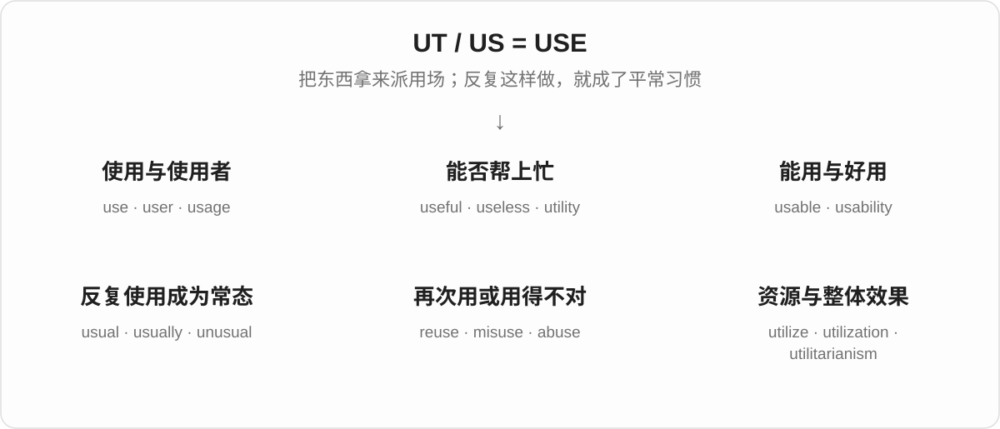

## 词形与演化规律

拉丁语词典常列 **ūtor**，不定式是 **ūtī**；相关形式 **ūsus** 出现 s。**ūtilis**“有用的”留下 util- 这一支。它们是历史词形关系，不是英语拼写里可随意互换的字母。use、reuse、misuse、abuse 都要留意名词 /s/ 与动词 /z/ 的差别。

## 单词速览（按词族由简到繁）

同一基础词的相关扩展放在一起，先读基础形式，再读扩展；各组之间优先读常用的。具体词源关系见各词讲解。

| 单词 | 音标 | 核心意思 |
|---|---|---|
| [use](#w-1) | 名词 /juːs/；动词 /juːz/ | 使用；用途；用处 |
| [useful](#w-3) | /ˈjuːsfəl/ | 有用的；能帮上忙的 |
| [usefulness](#w-18) | /ˈjuːsfəlnəs/ | 用处；有用程度 |
| [user](#w-4) | 英 /ˈjuːzə/；美 /ˈjuːzər/ | 使用者；用户 |
| [useless](#w-10) | /ˈjuːsləs/ | 没有用的；派不上用场的 |
| [uselessness](#w-23) | /ˈjuːsləsnəs/ | 无用；徒劳无益 |
| [usable](#w-15) | /ˈjuːzəbəl/ | 能用的；可使用的 |
| [usability](#w-20) | /ˌjuːzəˈbɪləti/ | 易用性；可用性 |
| [abuse](#w-5) | 名词 /əˈbjuːs/；动词 /əˈbjuːz/ | 滥用；虐待；辱骂 |
| [abusive](#w-11) | 常读 /əˈbjuːsɪv/；美语也读 /əˈbjuːzɪv/ | 辱骂的；虐待的；滥用的 |
| [misuse](#w-14) | 名词 /ˌmɪsˈjuːs/；动词 /ˌmɪsˈjuːz/ | 误用；不当使用 |
| [reuse](#w-17) | 名词 /ˌriːˈjuːs/；动词 /ˌriːˈjuːz/ | 再次使用；重复利用 |
| [disuse](#w-21) | 名词 /dɪsˈjuːs/ | 不用；停用；废弃状态 |
| [usual](#w-6) | /ˈjuːʒuəl/ | 平常的；惯常的 |
| [usually](#w-2) | /ˈjuːʒuəli/ | 通常；大多数时候 |
| [unusual](#w-7) | /ʌnˈjuːʒuəl/ | 不寻常的；少见的 |
| [unusually](#w-12) | /ʌnˈjuːʒuəli/ | 异乎寻常地；比平时更…… |
| [utility](#w-8) | /juːˈtɪləti/ | 实用性；公用服务；工具程序 |
| [utilitarian](#w-19) | 英 /juːˌtɪlɪˈteəriən/；美 /juːˌtɪləˈteriən/ | 讲求实用的；功利主义的 |
| [utilitarianism](#w-22) | 英 /juːˌtɪlɪˈteəriənɪzəm/；美 /juːˌtɪləˈteriənɪzəm/ | 功利主义 |
| [usage](#w-9) | /ˈjuːsɪdʒ/；也读 /ˈjuːzɪdʒ/ | 用法；使用情况；用量 |
| [utilize](#w-13) | 英 /ˈjuːtɪlaɪz/；美 /ˈjuːtəlaɪz/ | 利用；使派上用场 |
| [utilization](#w-16) | 英 /ˌjuːtɪlaɪˈzeɪʃən/；美 /ˌjuːtələˈzeɪʃən/ | 利用；使用情况；利用程度 |

## 逐词讲解

### 1. use — 使用；用途；用处

**音标**：名词 /juːs/；动词 /juːz/

**先抓住这个画面**

use 的画面很简单：手里有个东西，把它拿来完成一件事。东西可以是钥匙，也可以是时间、方法或一句话。

**怎么拆**

来自拉丁语 ūtī 的词族。名词经 ūsus、古法语 us 传入；动词经古法语 user，背后有据 ūsus 形成的拉丁语动词。现代 use 本身不必再切。

**怎么变成今天的意思**

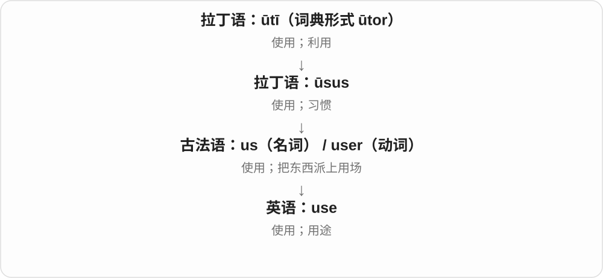

动词说“拿来做事”，名词既可说使用这个动作，也可说用途。put something to good use 就是让它真正帮上忙；be of no use 则是派不上用场。

**常见搭配与例句**

use A to do B；make use of…；the use of…；be of use。used to do 说过去常做；be used to doing 说已经习惯，两者结构不同。

> We used an old box to store the cables.

我们拿一个旧盒子来装电线。

> This tool has several uses, including opening paint cans.

这个工具有几种用途，包括打开油漆罐。

**别混淆**

名词 use 结尾 /s/，动词 /z/。use 可以很中性；use someone 若没有说明合作背景，常有“利用别人”的负面意味。

### 2. useful — 有用的；能帮上忙的

**音标**：/ˈjuːsfəl/

**先抓住这个画面**

useful 的重点是“对眼前这件事有帮助”。一张简单的纸条，只要能让你少走弯路，就很 useful。

**怎么拆**

use + -ful。-ful 在这里形成“有这种作用或性质”的形容词，不是说东西被“使用”装满了。

**怎么变成今天的意思**

use 作为名词有“用处”的意思，useful 就是有用处。它评价的是对象与需要之间的关系：对修车有用，不表示对做饭也有用。

**常见搭配与例句**

useful for doing something；useful to someone；a useful tip；come in useful（派上用场）。

> This map is useful for finding the smaller streets.

这张地图对寻找小街巷很有帮助。

> Your notes came in useful when I missed the class.

我缺课时，你的笔记帮了大忙。

**别混淆**

useful 是能帮忙；usable 是还能用。一个 usable 的旧工具能正常操作，却未必对当前任务 useful。

### 3. usefulness — 用处；有用程度

**音标**：/ˈjuːsfəlnəs/

**先抓住这个画面**

usefulness 问的是：它到底帮上了多大忙？注意力从“这个东西”转到“这个东西的用处”。

**怎么拆**

useful + -ness；-ness 把形容词变成表示性质的名词。

**怎么变成今天的意思**

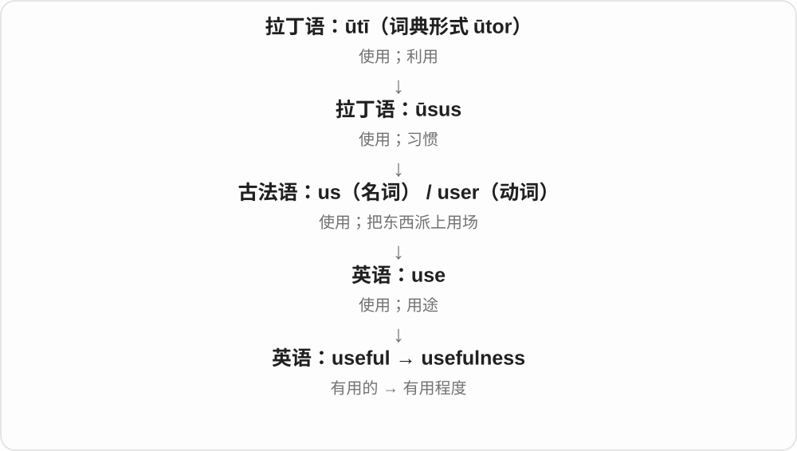

一份报告可能写得很漂亮，但如果不能帮人判断或行动，usefulness 就有限。这个词让我们直接讨论实际帮助。

**常见搭配与例句**

the usefulness of…；question its usefulness；limited usefulness；outlive its usefulness（已不再有用）。

> The usefulness of the guide depends on how often it is updated.

这份指南有没有用，取决于它更新得是否及时。

> The team questioned the usefulness of another long meeting.

团队怀疑再开一次长会能有多大帮助。

**别混淆**

usefulness 不等于使用次数。一个很少用到的急救工具，仍可能在需要时极有用处。

### 4. user — 使用者；用户

**音标**：英 /ˈjuːzə/；美 /ˈjuːzər/

**先抓住这个画面**

user 把焦点转到正在用某个东西的人。设计一个按钮时，user 关心的是自己能否顺利完成操作。

**怎么拆**

use + -er；-er 在这里表示做这个动作的人。来自英语自身的派生，use 的动词 /z/ 保留下来。

**怎么变成今天的意思**

从工具使用者到软件用户，核心没变。user 描述的是使用关系，未必是购买关系：付钱的人和实际操作的人可能不同。

**常见搭配与例句**

a new user；a regular user；user feedback；a user account。

> New users can try the service for a week.

新用户可以试用这项服务一周。

> We watched a user struggle to find the save button.

我们看到一位用户费了不少劲才找到保存按钮。

**别混淆**

user 是使用者；customer 是顾客。单独称某人 a user，在特定人际语境还可能指“总是利用别人的人”，语气负面。

### 5. useless — 没有用的；派不上用场的

**音标**：/ˈjuːsləs/

**先抓住这个画面**

useless 是“拿它来办这件事，帮不上忙”。手机没电时，很多功能就暂时派不上用场。

**怎么拆**

use + -less；-less 表示缺少。这里缺少的是实际用处。

**怎么变成今天的意思**

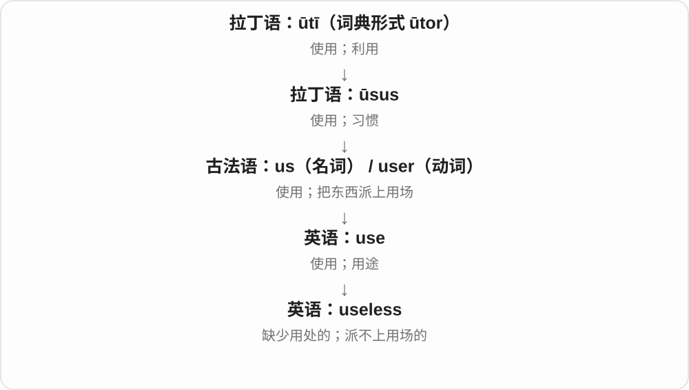

它可以说东西没有作用，也可以说某项努力改变不了结果。This key is useless 可能只是钥匙打不开眼前这把锁，不一定完全坏了。

**常见搭配与例句**

useless for…；useless at doing…；It is useless to argue（争下去没有用）。

> Without the password, the file was useless to us.

没有密码，这个文件对我们来说派不上用场。

> It is useless to blame each other now; we need a solution.

现在互相责怪没有用，我们需要一个解决办法。

**别混淆**

useless 比 not very useful 强得多。用它直接评价人往往很伤人；说“某方法在这个任务中没用”则更具体。

### 6. uselessness — 无用；徒劳无益

**音标**：/ˈjuːsləsnəs/

**先抓住这个画面**

uselessness 把“怎么做都帮不上忙”的感觉或状况单独拿出来说。

**怎么拆**

useless + -ness；表示“没有用”这种性质或状态。

**怎么变成今天的意思**

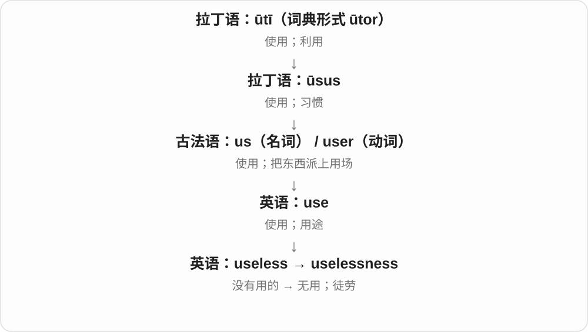

它既可评价一个办法，也可描述一个人觉得自己帮不上忙的感受。a feeling of uselessness 说的是人的感受，不能据此断言这个人没有价值。

**常见搭配与例句**

the uselessness of…；a sense / feeling of uselessness；recognize the uselessness of an approach。

> The experiment showed the uselessness of that shortcut.

实验表明，那条捷径根本帮不上忙。

> Joining the volunteer group eased his feeling of uselessness.

加入志愿者团队后，他那种觉得自己帮不上忙的感受减轻了。

**别混淆**

uselessness 是没能产生所需帮助；failure 常指某一次没达到目标。失败的尝试仍可能留下有用的经验。

### 7. usable — 能用的；可使用的

**音标**：/ˈjuːzəbəl/

**先抓住这个画面**

usable 是过了“能不能拿来用”这一关：旧椅子虽然不好看，但只要能安全坐，就仍然 usable。

**怎么拆**

来自古法语 usable，基础是 user“使用”。现代英语里也容易看成 use + -able“可以被使用的”。

**怎么变成今天的意思**

它不保证东西最漂亮、最省力或最适合你，只说明还有实际使用的可能。软件语境里也常包含“操作起来能用得顺”的要求。

**常见搭配与例句**

still usable；a usable version；make something usable；usable space。

> The screen is cracked, but the phone is still usable.

屏幕裂了，不过手机还能用。

> We need a usable draft by Friday, even if it is not perfect.

我们周五前需要一份能用的草稿，即使它还不完美。

**别混淆**

usable 说能不能用；useful 说有没有帮助。一个功能能点开，不等于它值得使用。

### 8. usability — 易用性；可用性

**音标**：/ˌjuːzəˈbɪləti/

**先抓住这个画面**

usability 看的是“人用起来顺不顺”：按钮找不找得到，步骤好不好懂，犯错后能不能补救。

**怎么拆**

usable + -ity；-able 在这类性质名词中对应 -ability。不是“使用的超能力”。

**怎么变成今天的意思**

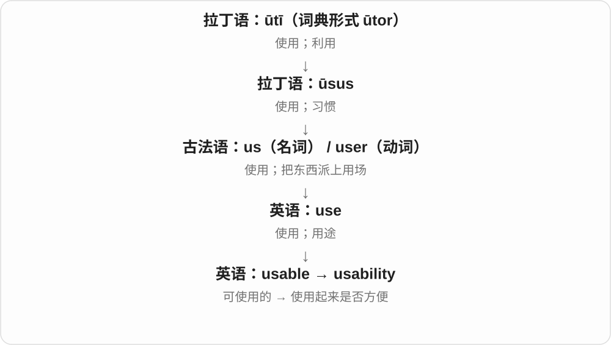

一般意义上是可使用的程度；在产品设计里，重点常落到用户完成任务是否有效、顺手。东西有很多功能，usability 仍然可能很差。

**常见搭配与例句**

usability testing；improve usability；a usability problem；website usability。

> The team tested the usability of the booking form.

团队测试了预约表单是否容易使用。

> Clearer labels greatly improved the app’s usability.

更清楚的标签大大改善了这个应用的易用性。

**别混淆**

usability 问好不好用；utility 问能不能满足某种需要。没有你需要的功能，再容易操作也解决不了你的问题。

### 9. abuse — 滥用；虐待；辱骂

**音标**：名词 /əˈbjuːs/；动词 /əˈbjuːz/

**先抓住这个画面**

abuse 常有“把使用变成伤害”的感觉：权力被拿来欺压人，信任被拿来谋私，或者一个人受到持续的恶劣对待。

**怎么拆**

拉丁语 ab- + ūtī，形成 abūtī，相关形式是 abūsus；再经法语传入。ab- 在这里不能机械译成现代英语里某个固定动作。

**怎么变成今天的意思**

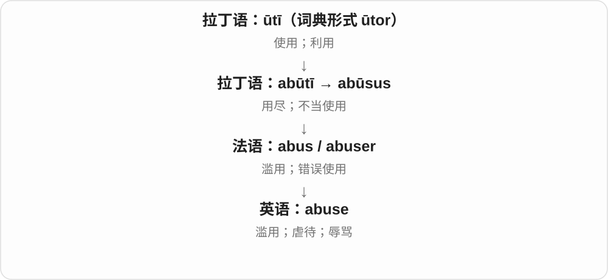

这支历史上有用尽、不当使用等意思。在现代英语里，它既可指滥用权力或资源，也可指身体、心理上的虐待，以及攻击人的辱骂。

**常见搭配与例句**

abuse power；abuse someone’s trust；verbal abuse；child abuse；suffer abuse。

> The manager abused his authority to silence complaints.

经理滥用职权，压制投诉。

> The referee faced a stream of verbal abuse from the crowd.

裁判遭到观众接连不断的辱骂。

**别混淆**

名词 abuse 结尾 /s/，动词 /z/。criticism 可以是针对问题的批评；abuse 往往带有人身攻击或伤害，不只是意见尖锐。

### 10. abusive — 辱骂的；虐待的；滥用的

**音标**：常读 /əˈbjuːsɪv/；美语也读 /əˈbjuːzɪv/

**先抓住这个画面**

abusive 形容某种言语或行为会伤人、压人，而不只是态度不够客气。

**怎么拆**

经法语 abusif，追溯到拉丁语 abūsīvus。现代可与 abuse + -ive 对照；常见读音用 /s/，另有美语 /z/ 变体。

**怎么变成今天的意思**

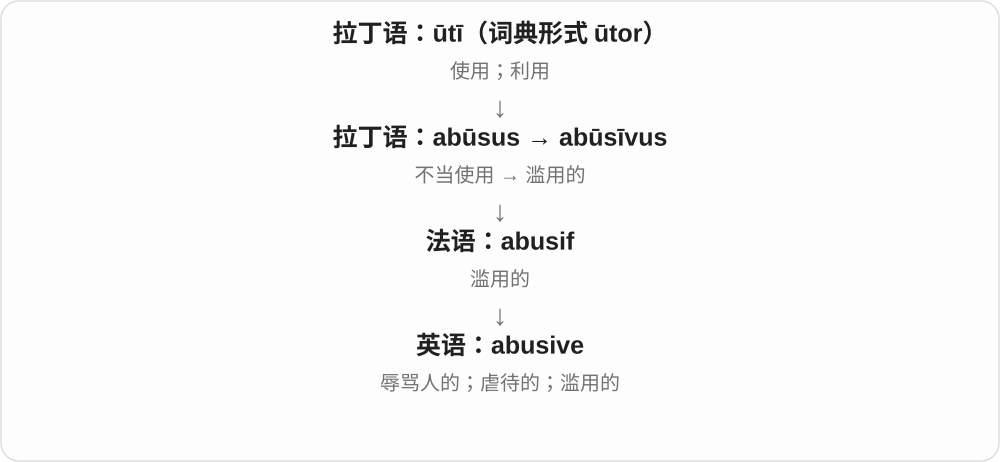

abuse 是伤害性的行为或言语；abusive 则用来描述它的性质。an abusive relationship 说一段关系中存在虐待或控制，语气比“经常吵架”重。

**常见搭配与例句**

abusive language；abusive behavior；an abusive partner；an abusive use of power。

> The moderator removed the abusive comments.

管理员删除了那些辱骂性的评论。

> She left an abusive relationship and moved in with her sister.

她离开了一段存在虐待的关系，搬去和姐姐同住。

**别混淆**

rude 是没礼貌；abusive 常涉及辱骂、虐待或严重恶劣的对待。不要把所有不愉快的对话都说成 abusive。

### 11. misuse — 误用；不当使用

**音标**：名词 /ˌmɪsˈjuːs/；动词 /ˌmɪsˈjuːz/

**先抓住这个画面**

misuse 是“用是用了，但方法或用途不对”：药没按要求使用，或者把别人的信任拿去做不该做的事。

**怎么拆**

mis-（错误地、不当地）+ use。名词与动词分别以 /s/ 和 /z/ 结尾。

**怎么变成今天的意思**

错误可以来自不了解，也可以来自故意滥用。这个词先指出“用法不对”，是否恶意要由上下文说明。

**常见搭配与例句**

misuse a word；misuse personal information；the misuse of funds；prevent misuse。

> I had been misusing that word for years.

那个词我误用了好多年。

> The report raised concerns about the misuse of personal data.

报告提出了对个人数据遭到不当使用的担忧。

**别混淆**

misuse 可以是操作或理解错误；abuse 常更突出严重滥用、伤害或侵犯。两词有重叠，不能机械分成无意与故意。

### 12. reuse — 再次使用；重复利用

**音标**：名词 /ˌriːˈjuːs/；动词 /ˌriːˈjuːz/

**先抓住这个画面**

reuse 是把已经用过的东西再拿来用：玻璃瓶洗净后装米，不用先把它变成另一种原材料。

**怎么拆**

re-（再）+ use。名词保留 /s/，动词保留 /z/。

**怎么变成今天的意思**

前缀只改变使用的次数，不要求第二次用途和第一次相同。旧纸箱继续装货，或改成猫窝，都可以是 reuse。

**常见搭配与例句**

reuse a container；reuse code；for reuse；the reuse of materials。

> We reuse glass jars to store rice and beans.

我们把用过的玻璃罐再拿来装米和豆子。

> The boxes were collected for reuse.

这些箱子被收集起来，以便再次使用。

**别混淆**

reuse 是让现成的东西继续派用场；recycle 通常涉及回收处理，让材料重新进入生产或使用循环。

### 13. disuse — 不用；停用；废弃状态

**音标**：名词 /dɪsˈjuːs/

**先抓住这个画面**

disuse 的画面是：一件东西曾经常用，后来没人再碰，慢慢闲了下来。

**怎么拆**

与古法语 desuser“停止使用”相连，现代可理解为 dis- + use。这里主要学习名词，不要用动词 use 的 /z/ 来读。

**怎么变成今天的意思**

它常描述一段持续不用的状态。道路荒废、旧词退出日常语言、设施逐渐闲置，都可以 fall into disuse。

**常见搭配与例句**

fall into disuse；through disuse；years of disuse；bring something back into use。

> The old footbridge fell into disuse after the new road opened.

新公路通车后，那座旧人行桥逐渐没人用了。

> Many of these expressions have fallen into disuse.

这些表达中有不少已经不再使用了。

**别混淆**

disuse 说没人用了；damage 说东西受损。长期不用可能导致损坏，但两个意思并不相同。

### 14. usual — 平常的；惯常的

**音标**：/ˈjuːʒuəl/

**先抓住这个画面**

usual 是你已经熟悉的那一套：每天走的路线、常点的饮料、一般到家的时间。

**怎么拆**

历史上经古法语 usuel，来自拉丁语 ūsuālis；其基础是 ūsus“使用、习惯”。不能直接按现代拼写切成 use + 一个随意的 -ual。

**怎么变成今天的意思**

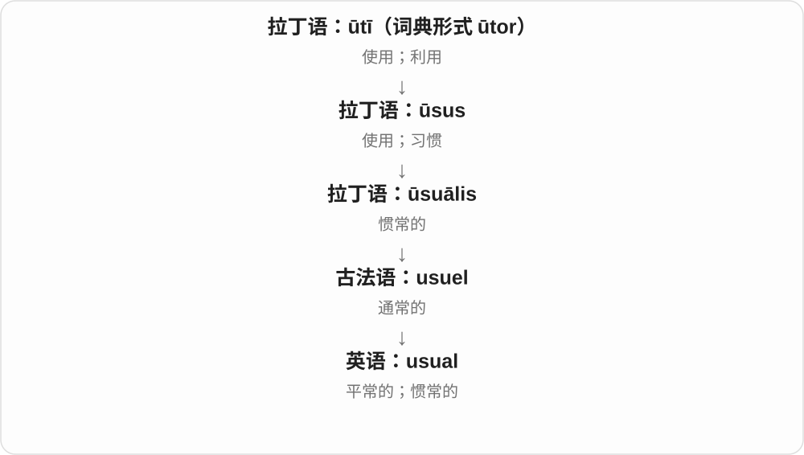

某种做法用得多，就成了习惯；习惯再变成你心中的“平常情况”。因此 the usual order 是平常点的那份，不是在评价它是否普通或差。

**常见搭配与例句**

as usual（和平常一样）；the usual time；my usual route；than usual（比平时）。

> We met at our usual café.

我们在平常去的那家咖啡馆见面。

> The train was more crowded than usual.

这趟列车比平时更拥挤。

**别混淆**

usual 强调与平时一样；normal 强调在正常范围内。某人的 usual bedtime 很晚，也可能不符合他想要的健康作息。

### 15. usually — 通常；大多数时候

**音标**：/ˈjuːʒuəli/

**先抓住这个画面**

usually 像在回看一排日子：多数格子里发生的都是同一件事，但允许有例外。

**怎么拆**

usual + -ly。-ly 把“惯常的”变成“通常怎样发生”的副词。

**怎么变成今天的意思**

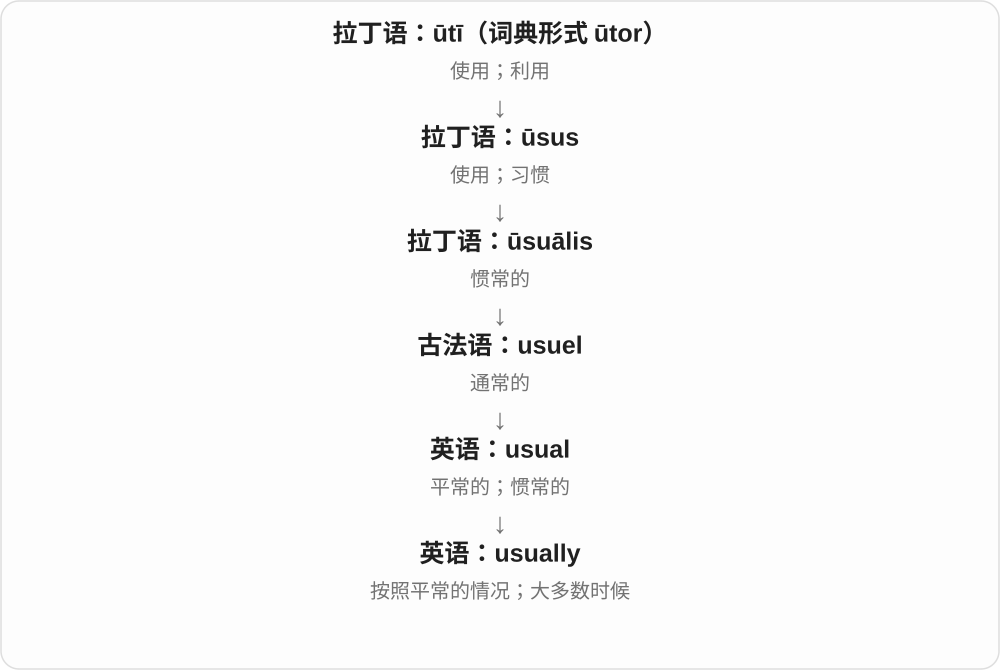

反复使用形成习惯，习惯又成为通常的做法。usually 不承诺次次如此；它告诉对方，按平时经验可以这样预期。

**常见搭配与例句**

usually 放实义动词前：usually walk；放 be 后：is usually quiet。

> I usually walk to work, but today I took the bus.

我通常步行上班，但今天坐了公交。

> The library is usually quiet in the morning.

图书馆早上通常很安静。

**别混淆**

always 是总是；usually 是大多数时候；sometimes 是有时。I usually walk 不表示今天一定步行。

### 16. unusual — 不寻常的；少见的

**音标**：/ʌnˈjuːʒuəl/

**先抓住这个画面**

unusual 就是从平常那一排东西里明显跳出来：这个时间很少下雪，今天却下了。

**怎么拆**

un-（否定）+ usual。否定的是“惯常”，不直接否定好坏。

**怎么变成今天的意思**

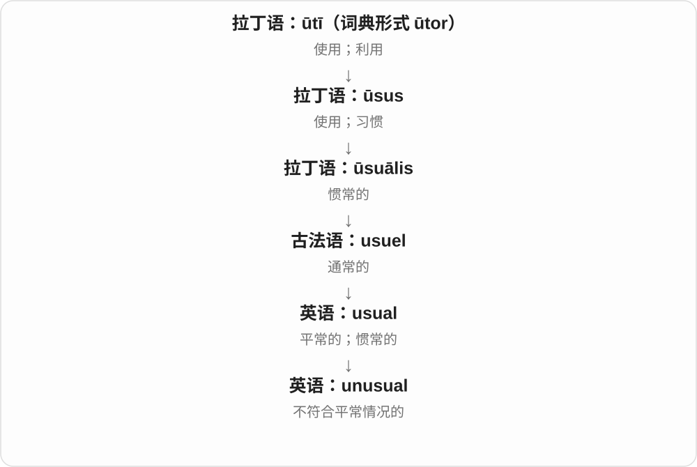

usual 是熟悉的常态；un- 把它翻转成少见。一个 unusual idea 可以很精彩，也可以不切实际，要看后面的评价。

**常见搭配与例句**

an unusual experience；It is unusual for someone to do…；nothing unusual。

> It is unusual to see snow here in April.

四月在这里看到雪很少见。

> She suggested an unusual but practical solution.

她提出了一个少见却实用的解决办法。

**别混淆**

unusual 是少见；strange 常多一层奇怪、不熟悉或让人困惑的感觉。少见的好事不必令人不安。

### 17. unusually — 异乎寻常地；比平时更……

**音标**：/ʌnˈjuːʒuəli/

**先抓住这个画面**

unusually 常拿今天和日常作比较：今天格外安静，或者他这一次出奇地耐心。

**怎么拆**

unusual + -ly；把“不寻常的”变成修饰程度、状态或行为的副词。

**怎么变成今天的意思**

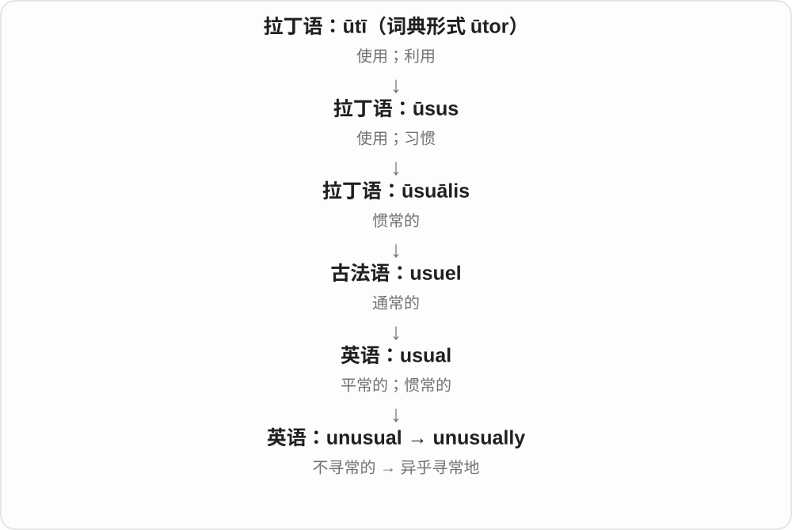

它经常不是说“这件事很少发生”，而是说某个程度超过常态。unusually warm 是“比平时暖得多”，不是“不经常暖和”。

**常见搭配与例句**

unusually quiet；unusually high；unusually early；an unusually good result。

> The streets were unusually quiet that morning.

那天早晨街道格外安静。

> She arrived unusually early for the meeting.

那次开会她来得比平时早得多。

**别混淆**

usually 说通常的频率；unusually 常突出偏离常态的程度。unusually busy 不是 usually busy 的简单频率反义。

### 18. utility — 实用性；公用服务；工具程序

**音标**：/juːˈtɪləti/

**先抓住这个画面**

utility 先问“它能帮人做什么”。日常的水电服务和电脑上的小工具，都因提供实际用途而使用这个词。

**怎么拆**

经法语 utilite，来自拉丁语 ūtilitās；其形容词基础 ūtilis“有用的”属于 ūtī“使用”的词族。

**怎么变成今天的意思**

它的基本线索是用处或实用价值。复数 utilities 常指水、电、燃气等服务；电脑里的 utility 常指完成维护或处理任务的小程序。

**常见搭配与例句**

practical utility；public utilities；pay for utilities；a backup utility。

> The rent includes water, but other utilities cost extra.

房租包含水费，但其他公用服务费用另算。

> This small utility helps you remove duplicate files.

这个小工具可以帮你删除重复文件。

**别混淆**

utility 在日常文章里可以谈实用性；经济学中有“效用”的专门意义。utility 不等于 usability，后者更关注操作是否顺手。

### 19. utilitarian — 讲求实用的；功利主义的

**音标**：英 /juːˌtɪlɪˈteəriən/；美 /juːˌtɪləˈteriən/

**先抓住这个画面**

日常的 utilitarian 可以想成结实的工作台：重点是好干活，装饰很少。哲学中的意思则是根据行为带来的总体后果评价对错。

**怎么拆**

以 utility 为基础，加表示相关人物或倾向的 -arian 形成；历史上与边沁、密尔讨论的功利主义相连。

**怎么变成今天的意思**

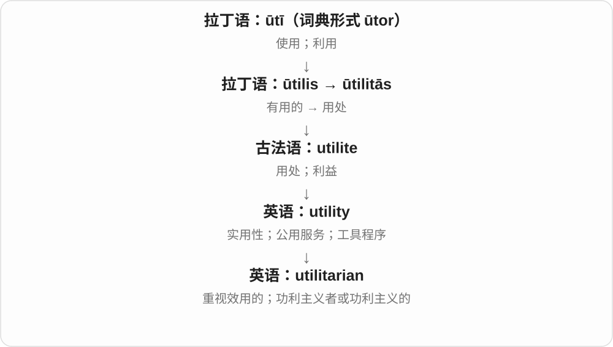

共同线索是 usefulness 或 utility。谈建筑、家具时常指朴素实用；谈伦理时重视整体幸福、痛苦和利益后果，不能直接译成“只顾自己得利”。

**常见搭配与例句**

a utilitarian design；utilitarian furniture；a utilitarian argument；a utilitarian philosopher。

> The room had plain, utilitarian furniture.

房间里的家具朴素而实用。

> She offered a utilitarian argument for reducing unnecessary suffering.

她从减少整体痛苦的功利主义角度提出了论证。

**别混淆**

functional 常说功能合用；utilitarian 还容易让人想到装饰少、以用途为先。哲学义与日常贬义的“势利”并不等同。

### 20. utilitarianism — 功利主义

**音标**：英 /juːˌtɪlɪˈteəriənɪzəm/；美 /juːˌtɪləˈteriənɪzəm/

**先抓住这个画面**

utilitarianism 可以先想成把受影响的人都放进画面：这个选择会给大家带来多少好处、多少痛苦，再据此评价。

**怎么拆**

utilitarian + -ism；-ism 在这里表示一套思想或理论。

**怎么变成今天的意思**

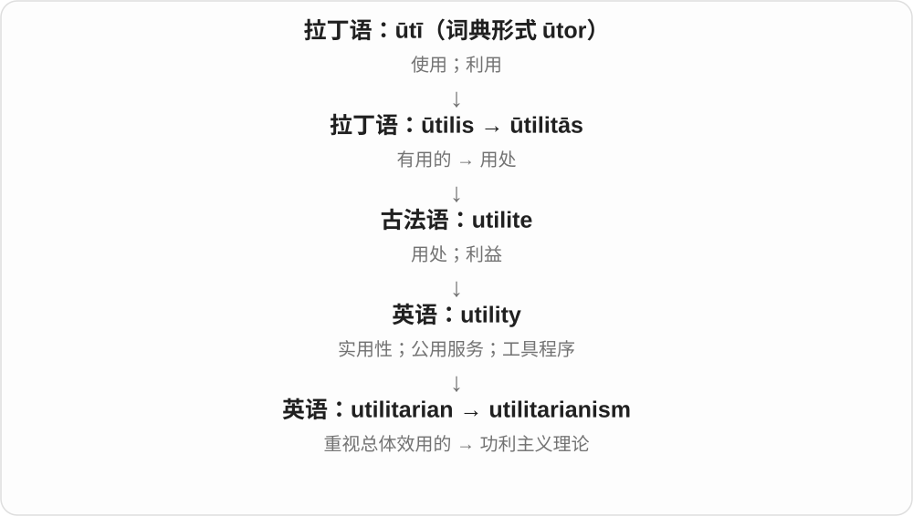

它把 utility 这条线推进到伦理判断。不同流派对幸福、利益、规则如何计算并不完全一致，但核心都重视行为或规则的总体后果。

**常见搭配与例句**

a theory of utilitarianism；debates about utilitarianism；rule utilitarianism（规则功利主义）。

> The class discussed whether utilitarianism gives enough weight to individual rights.

课堂讨论了功利主义是否足够重视个人权利。

> Her essay compares utilitarianism with an approach based on duties.

她的文章比较了功利主义和以义务为基础的观点。

**别混淆**

utilitarianism 不是“谁对我有用就利用谁”。它通常要求考虑所有受影响者，而不只看行动者自己的利益。

### 21. usage — 用法；使用情况；用量

**音标**：/ˈjuːsɪdʒ/；也读 /ˈjuːzɪdʒ/

**先抓住这个画面**

usage 常把镜头从一次“用”拉远：大家平时怎样用，或者一段时间总共用了多少。

**怎么拆**

经法语 usage 传入，属于 user“使用”的词族。现代可用 use + -age 帮助理解，但这不是英语最初造出整词的过程。

**怎么变成今天的意思**

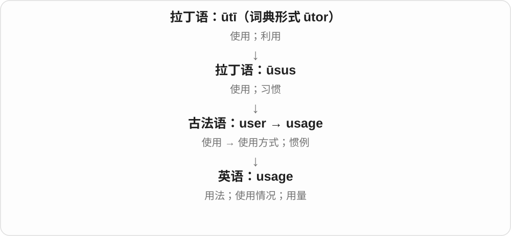

在语言里，它关心人们实际怎么说，如 word usage；在水、电、数据等语境里，它常指消耗或使用量。两义都围绕持续的使用情况。

**常见搭配与例句**

English usage；common usage；water usage；data usage；monitor usage。

> The teacher explained the difference in usage between the two words.

老师解释了这两个词在用法上的区别。

> The app lets you check your monthly data usage.

这个应用可以让你查看每月的数据用量。

**别混淆**

use 很宽泛；usage 更适合谈用法习惯或用量。“我用这把钥匙”通常直接说 use，不必换成 usage。

### 22. utilize — 利用；使派上用场

**音标**：英 /ˈjuːtɪlaɪz/；美 /ˈjuːtəlaɪz/

**先抓住这个画面**

utilize 常把目光放在已有资源上：空着的房间、闲置的设备、已经收集的数据，怎样让它们发挥作用。

**怎么拆**

经法语 utiliser，与意大利语 utilizzare 相连；更远来自拉丁语 ūtilis“有用的”。现代可识别 util- 与动词后缀 -ize。

**怎么变成今天的意思**

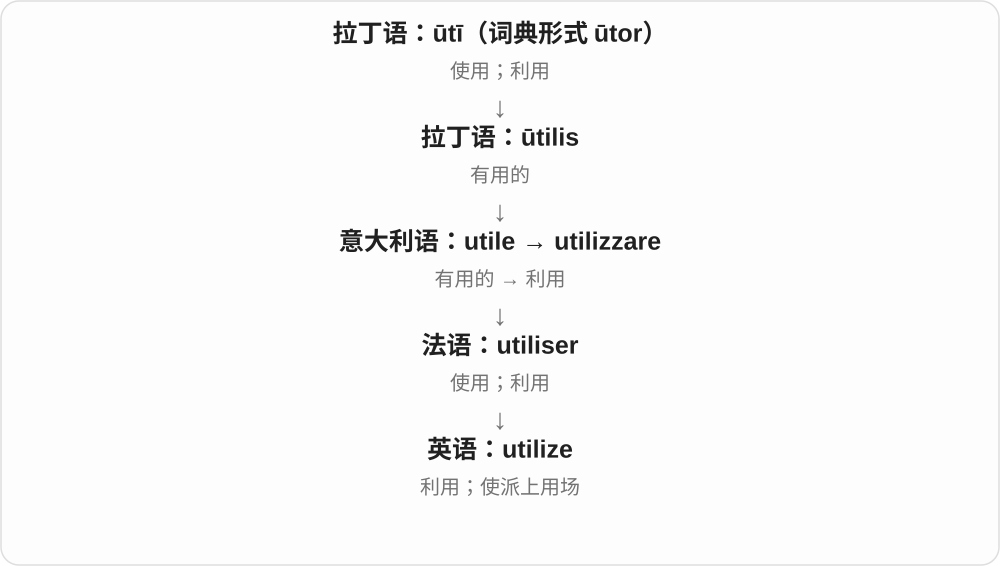

从“有用”形成“使之用于某事”的动词。它常见于正式说明，适合讨论资源利用，但并不强制表示新用途或特别聪明的用法。

**常见搭配与例句**

utilize available resources；utilize space；utilize data；fully utilize。

> The school utilized an empty classroom as a music room.

学校把一间空教室利用起来，改作音乐室。

> The new design utilizes the available space more efficiently.

新设计更有效地利用了现有空间。

**别混淆**

utilize 与 use 大量重叠。日常说 use a spoon 就足够，不需要为了显得正式而处处换成 utilize。

### 23. utilization — 利用；使用情况；利用程度

**音标**：英 /ˌjuːtɪlaɪˈzeɪʃən/；美 /ˌjuːtələˈzeɪʃən/

**先抓住这个画面**

utilization 常出现在“资源有没有用起来、用了多少”的讨论中。比如十台机器只有三台开着，就可以谈设备利用情况。

**怎么拆**

utilize + -ation，把“利用”的动作变成名词；也与法语 utilisation 对应。

**怎么变成今天的意思**

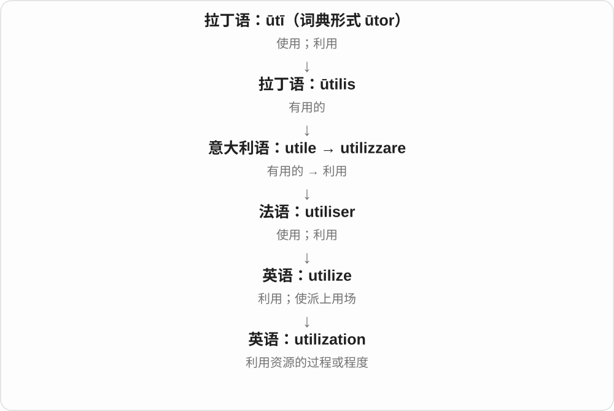

重心从“谁用了什么”转成“整体利用得怎样”。因此它很适合和 capacity、resource、equipment 一起讨论，但具体指标仍要看语境。

**常见搭配与例句**

resource utilization；capacity utilization；equipment utilization；improve utilization。

> The dashboard shows server utilization throughout the day.

这个面板显示服务器全天的使用情况。

> Sharing the workshop improved the utilization of its equipment.

共享这间工坊提高了设备的利用程度。

**别混淆**

utilization 是利用情况；efficiency 是投入与产出之间的效率。机器一直开着，利用率很高，也可能因为浪费能源而效率不高。

## 这一组要分清什么

**useful / usable / usability**：能帮上忙 / 能用 / 用起来顺不顺。三个问题接近，却不相同。

**misuse / abuse**：misuse 可以是用错；abuse 常突出严重滥用或伤害。两者有重叠，不能简单按无意与故意划开。

**utilitarianism** 的哲学义关心受影响者的整体利益与痛苦，不是“只看谁对我有用”。

## 串起来练习

**The old laptop is still usable, but it is no longer useful for my work.**

这台旧笔记本还能用，却已经帮不了我完成现在的工作。usable 过了“能运行”这一关，useful 还要看它是否满足具体需要。
