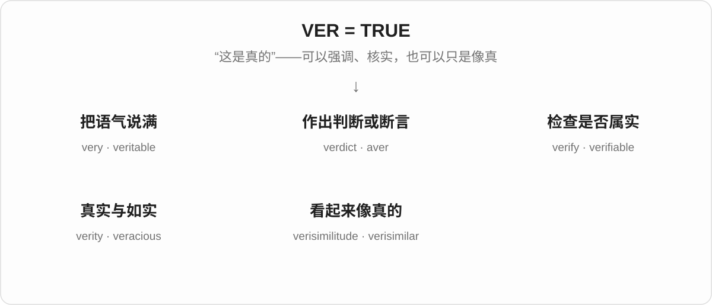
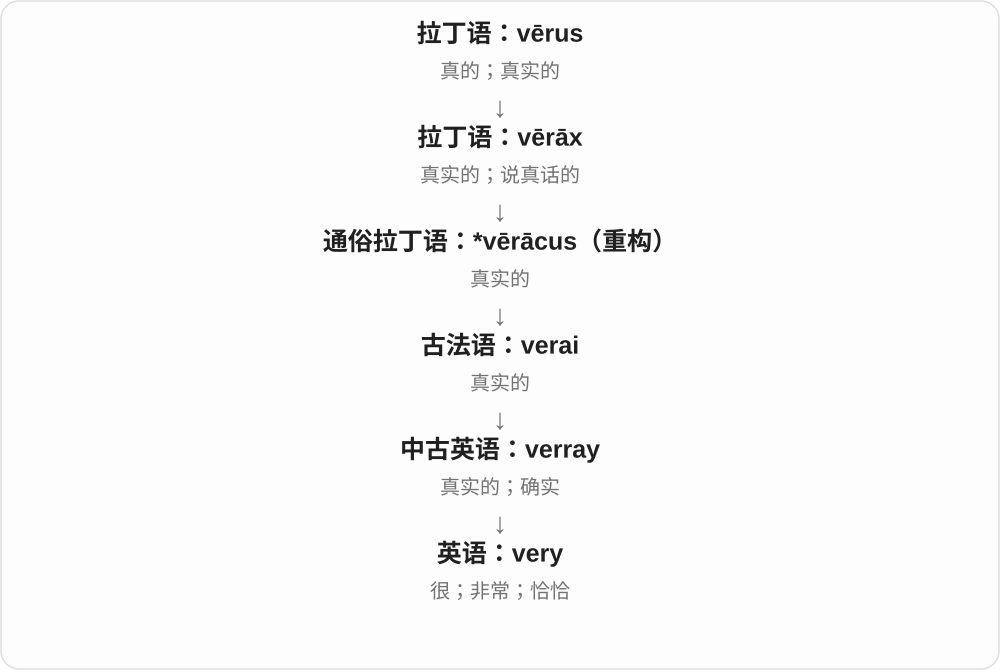
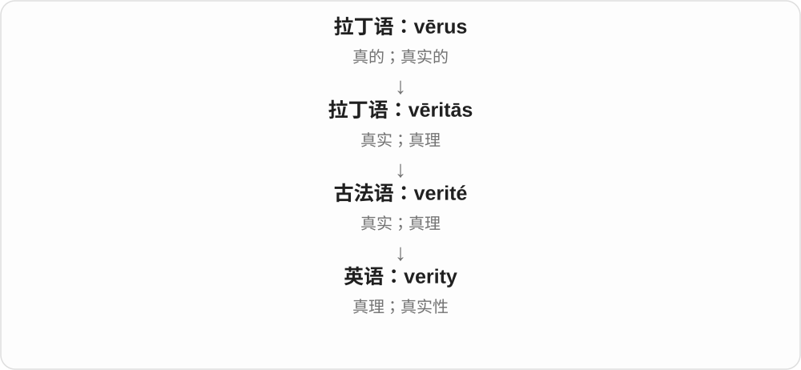
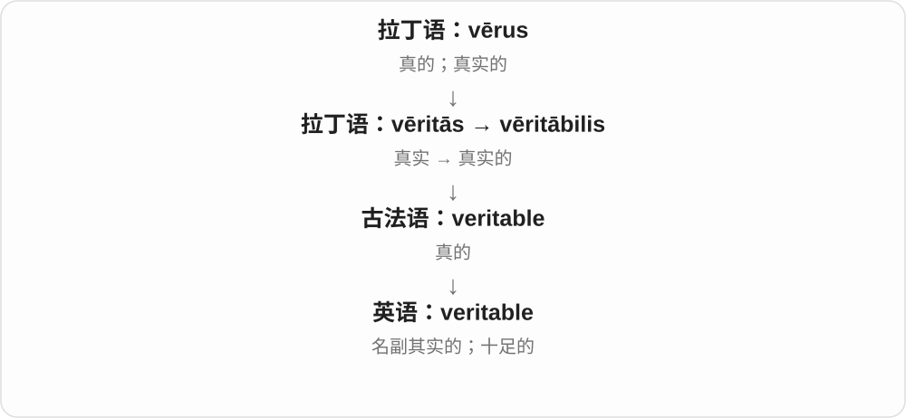
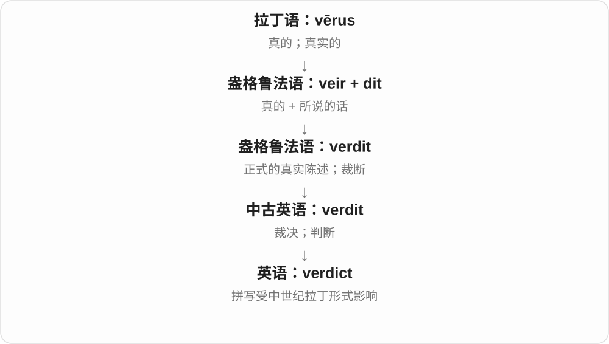
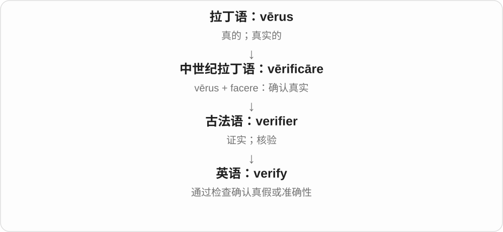
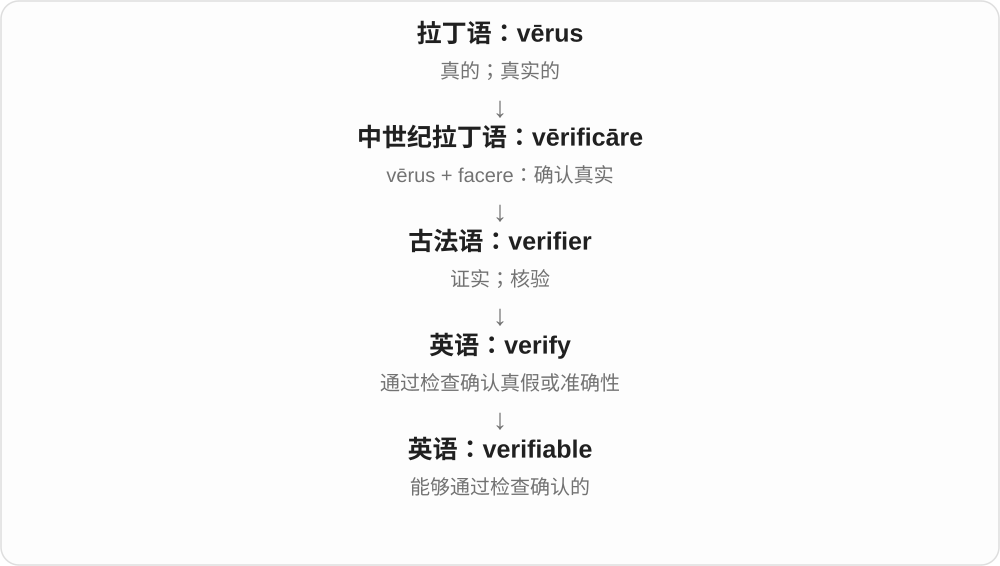
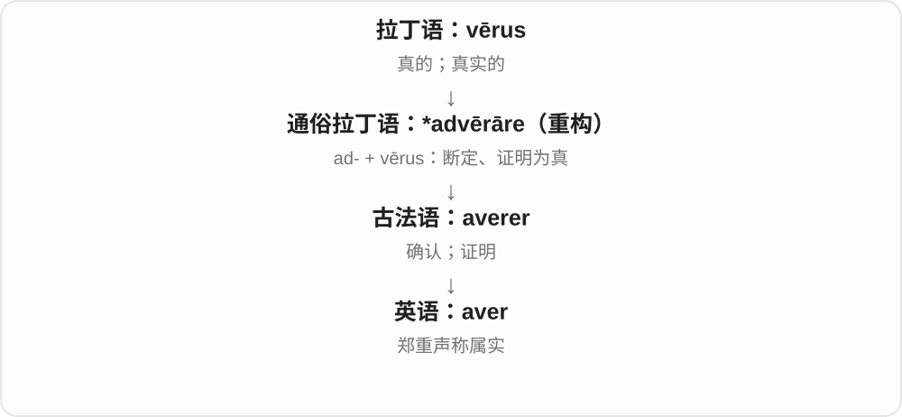

# 0076 · ver- — 真实；确实

[逐词精讲目录](../00_逐词精讲目录.md) · [总目录](../00_总目录_按常用程度.md)

## 核心词根与来源

拉丁语 **vērus** 就是“真的、真实的”。这一族最值得抓住三个区别：**verify 是查明真假，aver 是声称属实，verisimilitude 是让人觉得像真的。** 常见的 very 也从“真实、确实”发展出了“很、非常”的加强语气用法。

## 词形与演化规律

**ver-、veri-、verac- 是相关词形。** vēritās 给出“真实、真理”这一名词支线；vērāx 及词干 vērāc- 表示“真实、说真话的”；vērī 是词形变化后的“真实的”。verdict 的后半连着“说”，verify 的 -fy 连着“做、使”。这里只把有历史关系的词放在一起，不凭开头三个字母认亲。

## 单词速览（按词族由简到繁）

同一基础词的相关扩展放在一起，先读基础形式，再读扩展；各组之间优先读常用的。具体词源关系见各词讲解。

| 单词 | 音标 | 核心意思 |
|---|---|---|
| [very](#w-1) | /ˈveri/ | 很；非常；恰恰的；正是的 |
| [verity](#w-6) | /ˈverəti/ | 真理；真实；确实的事 |
| [veritable](#w-4) | /ˈverɪtəbəl/ | 名副其实的；十足的 |
| [verdict](#w-2) | 英 /ˈvɜːdɪkt/；美 /ˈvɝːdɪkt/ | 裁决；最终判断或评价 |
| [verify](#w-3) | /ˈverɪfaɪ/ | 核实；验证 |
| [verifiable](#w-5) | /ˌverɪˈfaɪəbəl/ | 可核实的；可验证的 |
| [aver](#w-7) | 英 /əˈvɜː/；美 /əˈvɝː/ | 郑重断言；坚称 |
| [verisimilitude](#w-8) | /ˌverɪsɪˈmɪlɪtjuːd/ | 逼真感；像真的一样的程度 |
| [veracious](#w-9) | /vəˈreɪʃəs/ | 诚实的；如实的 |
| [verisimilar](#w-10) | 英 /ˌverɪˈsɪmələ/；美 /ˌverɪˈsɪmələr/ | 貌似真实的；逼真的 |

## 逐词讲解

### 1. very — 很；非常；恰恰的；正是的

**音标**：/ˈveri/

**先抓住这个画面**

very 最常见的作用，是把程度往上推：cold 是冷，very cold 是很冷。它还有一种“就是这个”的强调，如 the very person。

**怎么拆**

追溯到拉丁语 vērus“真实的”，经 vērāx、后期拉丁语变化和古法语 verai 进入英语。今天 very 是一个整体，不能拆成 ver + 普通副词后缀 -ly。

**怎么变成今天的意思**

英语里先有“真实、确实”，再发展出加强语气的作用，后来常用来加强程度。可以借中文“真冷啊”联想“很冷”，这只是帮助理解同类变化。the very person 则保留了“正是那个人”的强调。

**常见搭配与例句**

very useful（很有用）；very carefully（非常仔细地）；the very beginning（最开始）；the very same thing（完全同一件事）。

> The instructions are very clear.

这些说明非常清楚。

> You are the very person I wanted to see.

你正是我想见的人。

**别混淆**

very 通常修饰可分程度的形容词或副词；不能直接说 very like it 表示“很喜欢”，要说 like it very much。

### 2. verity — 真理；真实；确实的事

**音标**：/ˈverəti/

**先抓住这个画面**

verity 把“真”当成一个可以讨论的东西。读到 eternal verities，可以理解成“人们认为一直成立的基本道理”。

**怎么拆**

来自法语 verité，追溯到拉丁语 vēritās，由 vērus“真的”构成表示性质的名词。不能按 very + ty 当作现代英语随手拼出的词。

**怎么变成今天的意思**

这个词比 truth 更书面、更有文学或哲学色彩。复数 verities 常指被视为稳定真理的道理；单数也可指真实性或一项真理。

**常见搭配与例句**

eternal verities（永恒真理）；basic verities（基本道理）；the verity of a statement（陈述的真实性，书面用法）。

> The novel questions the supposed eternal verities of its age.

这部小说质疑了那个时代所谓的永恒真理。

> She returned to one simple verity: every choice has a cost.

她重新想到一个简单的道理：每个选择都有代价。

**别混淆**

truth 是通用的“真相、真实、真理”；verity 较少见。日常问事情真假，用 Is that true? 通常比围绕 verity 造句自然。

### 3. veritable — 名副其实的；十足的

**音标**：/ˈverɪtəbəl/

**先抓住这个画面**

veritable 常是在说“简直就是个……”。一个小房间塞满书，你可以叫它 a veritable library，强调它像一座真正的图书馆。

**怎么拆**

经法语 veritable 传入，与拉丁语 vērus、vēritās“真、真实”同族。可用 verity + -able 观察词形关系，但它不是“能够核实的”那个 verifiable。

**怎么变成今天的意思**

从“真的”发展为强调“这个称呼一点也不过分”。现代常修饰带比喻味的名词：a veritable mountain of papers 就是文件多得像座山，不是在证明那是一座地质意义上的山。

**常见搭配与例句**

a veritable feast（简直是一场盛宴）；a veritable treasure trove（名副其实的宝库）；a veritable mountain of…（堆积如山的……）。

> Her tiny kitchen became a veritable bakery before the festival.

节日前，她的小厨房简直成了一间面包房。

> The archive is a veritable treasure trove for historians.

这座档案馆对历史学家来说是名副其实的宝库。

**别混淆**

veritable 强调“称得上、简直就是”；verifiable 强调“能查证”。前者带修辞色彩，后者谈核实条件。

### 4. verdict — 裁决；最终判断或评价

**音标**：英 /ˈvɜːdɪkt/；美 /ˈvɝːdɪkt/

**先抓住这个画面**

verdict 是听完、看完、考虑过后给出的结论。法庭里是裁决；日常问“What’s your verdict?”，就是问“你最后觉得怎么样？”

**怎么拆**

来自盎格鲁法语 verdit，里面 veir 表示“真的”，dit 表示“所说的话”。两个部分分别连到拉丁语 vērus 和 dīcere。后来英语拼写受拉丁形式影响，出现 verdict 的 c。

**怎么变成今天的意思**

“被正式说出的结论”帮助你理解现代用法，但 verdict 不保证结论客观上永远正确。词源里的“真”说的是词如何形成；今天它命名的是一种判断结果。

**常见搭配与例句**

reach a verdict（作出裁决）；return a verdict（宣布裁决）；a guilty verdict（有罪裁决）；the final verdict（最终结论）。

> The jury reached a verdict after several hours.

陪审团经过几个小时后作出了裁决。

> You have tried the new café—what is your verdict?

你去过那家新咖啡馆了——最后觉得怎么样？

**别混淆**

verdict 是对问题作出的判断；sentence 在刑事语境中常指判处的刑罚。日常 verdict 也可以是对餐厅、电影或产品的评价。

### 5. verify — 核实；验证

**音标**：/ˈverɪfaɪ/

**先抓住这个画面**

verify 像拿着一条说法去对账：看记录、查证据、做检查，确认它是不是真的、准不准确。

**怎么拆**

拉丁语 vērus（真的）+ facere（做、使）形成中世纪拉丁语 vērificāre，经法语传入。现代 -fy 常带“使成为”的意思。

**怎么变成今天的意思**

词源可以帮助记成“使真相得到确认”，不是“把假事变成真事”。verify an address 是核对地址；verify a claim 是检查某种说法有没有依据。

**常见搭配与例句**

verify someone’s identity（核实身份）；verify the details（核对细节）；verify that…（核实……）；verify a claim（核实说法）。

> Please verify the address before sending the package.

寄出包裹前，请核实地址。

> We could not verify his account of the incident.

我们无法核实他对那件事的描述。

**别混淆**

check 是广义的检查；verify 更强调检查后的真实性或准确性确认。声称 something is true，并不等于已经 verified it。

### 6. verifiable — 可核实的；可验证的

**音标**：/ˌverɪˈfaɪəbəl/

**先抓住这个画面**

verifiable 表示一条说法留有可以检查的抓手：记录、证据或方法都在，别人能够去核实。

**怎么拆**

verify + -able；y 改为 i，表示“能够被验证的”。注意核实动作的核心仍是 verify，不是 very。

**怎么变成今天的意思**

verifiable 说的是“有办法查”，不等于已经查过，更不等于查过后一定为真。a verifiable claim 比没有任何检查办法的说法更容易接受审查。

**常见搭配与例句**

verifiable facts（可核实的事实）；a verifiable claim（可查证的说法）；independently verifiable（可独立核实的）。

> The article should rely on verifiable facts.

这篇文章应以可核实的事实为依据。

> Her explanation includes several independently verifiable details.

她的解释包含几个可以独立核实的细节。

**别混淆**

verifiable 是“可以核实”；verified 是“已经核实”。把能力和完成状态分开，就不容易读错。

### 7. aver — 郑重断言；坚称

**音标**：英 /əˈvɜː/；美 /əˈvɝː/

**先抓住这个画面**

aver 是把一句话说得很肯定，像当着别人的面明确表态：“我说的就是事实。”它描述说话的态度，不替他说法的真假担保。

**怎么拆**

经古法语 averer 进入英语，追溯到与 ad- 和 vērus“真实”组成的后期拉丁动词。这个家族从“确认真实”发展出“断言属实”。

**怎么变成今天的意思**

今天 aver 多见于正式文字，常接 that 从句。它早先和证明、确认相连，后来重点落在明确声称。一个人可以 aver something，却没有提供足够证据。

**常见搭配与例句**

aver that…（断言……）；averred（过去式，双写 r）；averring（现在分词，双写 r）。

> He averred that he had never seen the document before.

他坚称自己从未见过那份文件。

> The witness averred that the door had been locked.

证人郑重表示，那扇门当时是锁着的。

**别混淆**

aver 是坚称；verify 是核实。写得或说得坚定，不等于经过检查。这个动词也与古旧名词 aver“财产、牲畜”的来源不同。

### 8. verisimilitude — 逼真感；像真的一样的程度

**音标**：/ˌverɪsɪˈmɪlɪtjuːd/

**先抓住这个画面**

verisimilitude 是读小说或看电影时那种“这地方、这人、这反应都像真的”的感觉。故事可以完全虚构，却有很强的逼真感。

**怎么拆**

来自拉丁语 vērī similitūdō：vērī 是“真实”的所属形式，similitūdō 是“相似”。经法语进入英语，字面就是“与真实相似”。

**怎么变成今天的意思**

关键在于 similarity，而不在于是否真的发生过。人物说话有犹豫、屋里有磨损、历史细节前后一致，都可能让虚构世界更可信。

**常见搭配与例句**

add verisimilitude（增加逼真感）；give a story verisimilitude（使故事显得真实）；a sense of verisimilitude（逼真的感觉）。

> The worn furniture gives the film a sense of verisimilitude.

磨损的家具让这部电影有了一种逼真感。

> Small details add verisimilitude to her fictional town.

细小的细节让她虚构的小镇显得更真实。

**别混淆**

truth 关心事实是真是假；verisimilitude 关心表现像不像真。realism 范围更广，也可指一种艺术风格或现实态度。

### 9. veracious — 诚实的；如实的

**音标**：/vəˈreɪʃəs/

**先抓住这个画面**

veracious 形容人，就像说“这个人讲事实，不添油加醋”；形容描述，则是“这份讲述忠于实际情况”。

**怎么拆**

来自拉丁语 vērāx“说真话的”，其词干含 vērāc-，再形成英语形容词。ver- 与真实相关，-acious 这一整段不能理解成现代动词。

**怎么变成今天的意思**

这是比 truthful 更书面的词。a veracious account 重点在叙述可靠、没有编造，而不在它是否生动好看。

**常见搭配与例句**

a veracious account（如实的叙述）；a veracious witness（说真话的证人）；a veracious reporter（报道属实的记者）。

> The diary offers a veracious account of life in the village.

这本日记如实记录了村里的生活。

> She was known as a careful and veracious reporter.

她以报道谨慎、属实而闻名。

**别混淆**

veracious 是诚实的；voracious 是贪吃的，也可形容求知欲强。a voracious reader 是读书很多的人，不能因此推断他说话是否 veracious。

### 10. verisimilar — 貌似真实的；逼真的

**音标**：英 /ˌverɪˈsɪmələ/；美 /ˌverɪˈsɪmələr/

**先抓住这个画面**

verisimilar 说的是“看起来能是真的”。它常用于评论故事或描写：不要求事情实际发生，只要求人物和情节让人信得过。

**怎么拆**

来自拉丁语 vērī similis，vērī 是“真实的”，similis 是“相似的”。它与 verisimilitude 同源，分别是形容词和名词。

**怎么变成今天的意思**

这个词少见，适合认读。verisimilar characters 就是言行像真实人物的角色；某段虚构细节可以很 verisimilar，同时仍然是编出来的。

**常见搭配与例句**

a verisimilar account（貌似真实的叙述）；verisimilar characters（逼真的人物）；a verisimilar fictional world（逼真的虚构世界）。

> The writer creates verisimilar characters with ordinary worries.

作家用普通人的烦恼塑造出逼真的人物。

> The story is invented, but its setting is verisimilar.

故事是编的，但它的背景描写很逼真。

**别混淆**

veracious 强调如实；verisimilar 强调像真。日常更常用 plausible 表示“听起来有可能”，用 realistic 表示“很逼真”。

## 这一组要分清什么

**veritable 与 verifiable**：a veritable library 是“简直是一座图书馆”；verifiable information 是“有办法核实的信息”。

**veracious 与 verisimilar**：前者重在“符合事实”，后者重在“显得真实”。虚构人物可以 verisimilar，却不能因此把其经历当作真实记录。

**very 不只有“非常”。** the very person 是“正是那个人”；这种强调更容易让你看到它与“确实、真实”的联系。

## 串起来练习

试着分辨：**The story is very convincing, but we still need to verify the details.**

故事很有说服力，但我们仍需要核实细节。“听起来像真”可以产生 verisimilitude；经过检查确认，才是 verify 所表达的动作。
