# 0077 · cur- — 照料；用心关注；由免于担忧发展出安全与确信

[逐词精讲目录](../00_逐词精讲目录.md) · [总目录](../00_总目录_按常用程度.md)

## 核心词根与来源

**先想有人把一件事放在心上，愿意照看、料理。** 拉丁语 cūra 是关心、照料，也可以是忧虑；cūrāre 是照管、处理。照顾病人形成 cure，照看藏品的人是 curator，认真处理到位得到 accurate。另一条很有用的路线是 sēcūrus：不用再操心 → 安全、放心 → secure 和 sure。

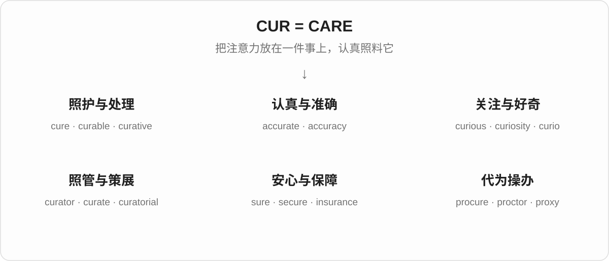

## 词形与演化规律

cur- 是照料这一族，别和 curr- / curs-“跑”混为一谈。secure 中 sē- 表示离开、没有，sure 是经过法语变化后的同源形式。pro- 在 procure 中带出代为办理；manicure、pedicure 分别说明照料手和脚。curate 的牧师名词与策展动词各有来路，读音也不同。scour 的清洗义与本族可能相关，搜寻义还有另一来源，图中作了区分。

## 单词速览（按词族由简到繁）

同一基础词的相关扩展放在一起，先读基础形式，再读扩展；各组之间优先读常用的。具体词源关系见各词讲解。

| 单词 | 音标 | 核心意思 |
|---|---|---|
| [sure](#w-1) | 英 /ʃɔː/、/ʃʊə/；美 /ʃʊr/ | 确信的；确定的；当然 |
| [surely](#w-7) | 英 /ˈʃɔːli/；美 /ˈʃʊrli/ | 想必；肯定；稳妥地 |
| [surety](#w-36) | 英 /ˈʃʊərəti/；美 /ˈʃʊrəti/ | 担保；保证人 |
| [unsure](#w-15) | 英 /ˌʌnˈʃɔː/；美 /ˌʌnˈʃʊr/ | 不确定的；没把握的 |
| [insure](#w-23) | 英 /ɪnˈʃɔː/；美 /ɪnˈʃʊr/ | 为……投保；承保 |
| [insurance](#w-3) | 英 /ɪnˈʃɔːrəns/；美 /ɪnˈʃʊrəns/ | 保险；防范措施 |
| [reinsurance](#w-35) | 英 /ˌriːɪnˈʃɔːrəns/；美 /ˌriːɪnˈʃʊrəns/ | 再保险；分保 |
| [coinsurance](#w-46) | 英 /ˌkəʊɪnˈʃɔːrəns/；美 /ˌkoʊɪnˈʃʊrəns/ | 共同保险；按比例共担费用 |
| [insurer](#w-22) | 英 /ɪnˈʃɔːrə/；美 /ɪnˈʃʊrər/ | 保险公司；承保人 |
| [insurable](#w-47) | 英 /ɪnˈʃɔːrəbəl/；美 /ɪnˈʃʊrəbəl/ | 可保的；可以承保的 |
| [insurability](#w-52) | 英 /ɪnˌʃɔːrəˈbɪləti/；美 /ɪnˌʃʊrəˈbɪləti/ | 可保性；承保资格 |
| [reinsure](#w-56) | 英 /ˌriːɪnˈʃɔː/；美 /ˌriːɪnˈʃʊr/ | 再保险；分保 |
| [secure](#w-5) | 英 /sɪˈkjʊə/；美 /sɪˈkjʊr/ | 安全的；牢固的；固定；获得 |
| [security](#w-2) | 英 /sɪˈkjʊərəti/；美 /sɪˈkjʊrəti/ | 安全；保障；保安；担保 |
| [cybersecurity](#w-24) | 英 /ˌsaɪbəsɪˈkjʊərəti/；美 /ˌsaɪbərsɪˈkjʊrəti/ | 网络安全；数字系统安全 |
| [biosecurity](#w-45) | 英 /ˌbaɪəʊsɪˈkjʊərəti/；美 /ˌbaɪoʊsɪˈkjʊrəti/ | 生物安全防护 |
| [securely](#w-26) | 英 /sɪˈkjʊəli/；美 /sɪˈkjʊrli/ | 牢固地；安全地 |
| [insecure](#w-17) | 英 /ˌɪnsɪˈkjʊə/；美 /ˌɪnsɪˈkjʊr/ | 不安全的；不牢靠的；缺乏自信的 |
| [insecurity](#w-20) | 英 /ˌɪnsɪˈkjʊərəti/；美 /ˌɪnsɪˈkjʊrəti/ | 不安全感；不稳定、缺乏保障 |
| [unsecure](#w-48) | 英 /ˌʌnsɪˈkjʊə/；美 /ˌʌnsɪˈkjʊr/ | 未固定的；不安全的；松开固定 |
| [ensure](#w-4) | 英 /ɪnˈʃɔː/；美 /ɪnˈʃʊr/ | 确保；保证实现 |
| [accurate](#w-6) | /ˈækjərət/ | 准确的；精确无误的 |
| [accuracy](#w-10) | /ˈækjərəsi/ | 准确性；准确度 |
| [inaccuracy](#w-37) | /ɪnˈækjərəsi/ | 不准确；错误之处 |
| [accurately](#w-12) | /ˈækjərətli/ | 准确地；如实地 |
| [inaccurate](#w-19) | /ɪnˈækjərət/ | 不准确的；与事实不符的 |
| [inaccurately](#w-42) | /ɪnˈækjərətli/ | 不准确地；错误地 |
| [cure](#w-9) | 英 /kjʊə/；美 /kjʊr/ | 治愈；疗法；解决办法；使材料固化或食品腌制 |
| [curious](#w-8) | 英 /ˈkjʊəriəs/；美 /ˈkjʊriəs/ | 好奇的；奇特的 |
| [curiosity](#w-13) | 英 /ˌkjʊəriˈɒsəti/；美 /ˌkjʊriˈɑːsəti/ | 好奇心；稀奇事物 |
| [curiously](#w-29) | 英 /ˈkjʊəriəsli/；美 /ˈkjʊriəsli/ | 好奇地；奇怪的是 |
| [curate](#w-31) | 动词 /kjʊˈreɪt/；名词 /ˈkjʊərət/ | 策划展览；精选整理；助理牧师 |
| [curator](#w-21) | 英 /kjʊəˈreɪtə/；美 /kjʊˈreɪtər/ | 馆藏管理人；策展人 |
| [curatorial](#w-43) | 英 /ˌkjʊərəˈtɔːriəl/；美 /ˌkjʊrəˈtɔːriəl/ | 策展的；馆藏管理的 |
| [curative](#w-40) | 英 /ˈkjʊərətɪv/；美 /ˈkjʊrətɪv/ | 治疗性的；以治愈为目的的 |
| [curacy](#w-49) | 英 /ˈkjʊərəsi/；美 /ˈkjʊrəsi/ | 助理牧师职位；牧师任期 |
| [incurable](#w-32) | 英 /ɪnˈkjʊərəbəl/；美 /ɪnˈkjʊrəbəl/ | 无法治愈的；改不了的 |
| [curable](#w-39) | 英 /ˈkjʊərəbəl/；美 /ˈkjʊrəbəl/ | 可以治愈的；可解决的 |
| [curability](#w-58) | 英 /ˌkjʊərəˈbɪləti/；美 /ˌkjʊrəˈbɪləti/ | 可治愈性 |
| [curette](#w-53) | /kjʊˈret/ | 刮匙；用刮匙处理 |
| [assure](#w-11) | 英 /əˈʃɔː/；美 /əˈʃʊr/ | 向……保证；使放心 |
| [assurance](#w-14) | 英 /əˈʃɔːrəns/；美 /əˈʃʊrəns/ | 保证；自信；保险 |
| [reassurance](#w-27) | 英 /ˌriːəˈʃɔːrəns/；美 /ˌriːəˈʃʊrəns/ | 安慰；使安心的话或举动 |
| [reassure](#w-25) | 英 /ˌriːəˈʃɔː/；美 /ˌriːəˈʃʊr/ | 使安心；打消疑虑 |
| [proxy](#w-16) | 英 /ˈprɒksi/；美 /ˈprɑːksi/ | 代理人；代理权；替代指标；代理服务器 |
| [procure](#w-30) | 英 /prəˈkjʊə/；美 /prəˈkjʊr/ | 设法取得；采购 |
| [procurement](#w-18) | 英 /prəˈkjʊəmənt/；美 /prəˈkjʊrmənt/ | 采购；取得物资的过程 |
| [procurator](#w-41) | 英 /ˌprɒkjəˈreɪtə/；美 /ˈprɑːkjəˌreɪtər/ | 代理人；检察官；古罗马财务或行政官 |
| [procuration](#w-54) | 英 /ˌprɒkjəˈreɪʃən/；美 /ˌprɑːkjəˈreɪʃən/ | 代理管理；代理授权；取得 |
| [procurable](#w-55) | 英 /prəˈkjʊərəbəl/；美 /prəˈkjʊrəbəl/ | 可取得的；能采购到的 |
| [procuracy](#w-62) | 英 /ˈprɒkjərəsi/；美 /ˈprɑːkjərəsi/ | 代理官职位；检察机关 |
| [proctor](#w-28) | 英 /ˈprɒktə/；美 /ˈprɑːktər/ | 监考员；学监；监考 |
| [proctorage](#w-60) | 英 /ˈprɒktərɪdʒ/；美 /ˈprɑːktərɪdʒ/ | 学监或代理人的监督职责（旧词） |
| [proctorial](#w-61) | 英 /prɒkˈtɔːriəl/；美 /prɑːkˈtɔːriəl/ | 学监的；监考或监督职务的 |
| [manicure](#w-33) | 英 /ˈmænɪkjʊə/；美 /ˈmænɪkjʊr/ | 修甲；手部指甲护理 |
| [scour](#w-34) | 英 /ˈskaʊə/；美 /ˈskaʊr/ | 用力擦洗；冲刷；四处搜寻 |
| [scourage](#w-63) | /ˈskaʊrɪdʒ/（按 scour + -age 读） | 冲洗后的污水；侦察（罕用旧义） |
| [pedicure](#w-38) | 英 /ˈpedɪkjʊə/；美 /ˈpedɪkjʊr/ | 足部护理；修脚趾甲 |
| [curio](#w-44) | 英 /ˈkjʊəriəʊ/；美 /ˈkjʊrioʊ/ | 古玩；小奇物；珍奇物件 |
| [sinecure](#w-50) | 英 /ˈsaɪnɪkjʊə/；美 /ˈsaɪnəkjʊr/ | 有俸禄的闲职；轻松肥缺 |
| [sinecural](#w-64) | /ˌsaɪnɪˈkjʊərəl/ | 闲职性质的；与有俸闲职有关的 |
| [curettage](#w-51) | 英 /kjʊəˈretɪdʒ/；美 /ˌkjʊrəˈtɑːʒ/ | 刮除术；刮取操作 |
| [assecure](#w-57) | /ˌæsɪˈkjʊə/（旧词） | 使安全；使确定；保证 |
| [pococurante](#w-59) | 英 /ˌpəʊkəʊkjʊəˈrænti/；美 /ˌpoʊkoʊkjuːˈrɑːnti/ | 漠不关心的；满不在乎的人 |

## 逐词讲解

### 1. sure — 确信的；确定的；当然

**音标**：英 /ʃɔː/、/ʃʊə/；美 /ʃʊr/

**先抓住这个画面**

心里那块悬着的石头放下了，对事情有把握，便是 sure。回答请求时的 Sure. 则是爽快地说“当然可以”。

**怎么拆**

经古法语 seür 来自拉丁语 sēcūrus，sē-（离开、没有）+ cūra（忧虑）；与 secure 同源。

**怎么变成今天的意思**

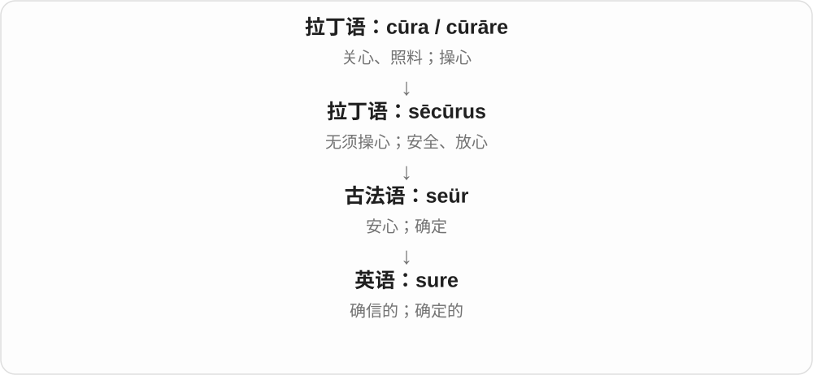

从无需担忧到心里确定。be sure of 是对某事有把握；make sure 是主动确认，让结果靠得住。

**常见搭配与例句**

be sure of…；be sure that…；make sure；Sure, I can help.。

> I am sure I left the keys on the table.

我确信把钥匙放在桌上了。

> Make sure the door is closed before you leave.

离开前确认门已经关好。

**别混淆**

sure 描述确信；certain 语气常更正式。for sure 是确定地，不是表示目的的“为了确定”。

### 2. surely — 想必；肯定；稳妥地

**音标**：英 /ˈʃɔːli/；美 /ˈʃʊrli/

**先抓住这个画面**

说 Surely you remember 时，像在说“你应该记得吧”：带有自己的把握，也往往期待对方认同。

**怎么拆**

sure + -ly。

**怎么变成今天的意思**

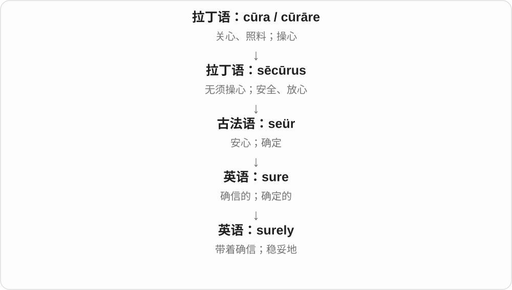

句首的 surely 常是有把握的推断或反问，不等于已经拿到绝对证据。slowly but surely 则说进度慢却稳。

**常见搭配与例句**

Surely you…；will surely…；slowly but surely。

> Surely there is a simpler way to do this.

想必有更简单的办法吧。

> Slowly but surely, the garden began to recover.

虽然慢，但花园确实在逐渐恢复。

**别混淆**

Sure. 可直接答应请求；Surely. 通常不能直接替代这种口语回应。

### 3. surety — 担保；保证人

**音标**：英 /ˈʃʊərəti/；美 /ˈʃʊrəti/

**先抓住这个画面**

如果原本应履行的人没做到，另一个人承诺接上责任，这种担保或保证人可以叫 surety。

**怎么拆**

经古法语 seurté 来自拉丁语 sēcūritās；与 security 是沿不同路线传入的同源词。

**怎么变成今天的意思**

从使人放心的保障，具体化为承担保证责任的人或安排。通常是正式法律、金融用语，而不是随便表示“我很确定”。

**常见搭配与例句**

act as surety；stand surety for…；a surety bond。

> The agreement named a separate surety.

协议另行指定了一名保证人。

> The textbook explains the role of a surety in a hypothetical contract.

教材通过一份假设合同解释保证人的角色。

**别混淆**

surety 可指保证人，security 常可指担保物或保障；具体责任必须看实际文件，词形不能替代条款。

### 4. unsure — 不确定的；没把握的

**音标**：英 /ˌʌnˈʃɔː/；美 /ˌʌnˈʃʊr/

**先抓住这个画面**

两种可能都摆在眼前，自己还不能肯定是哪一种，就是 unsure。

**怎么拆**

un-（不）+ sure（确定的）。

**怎么变成今天的意思**

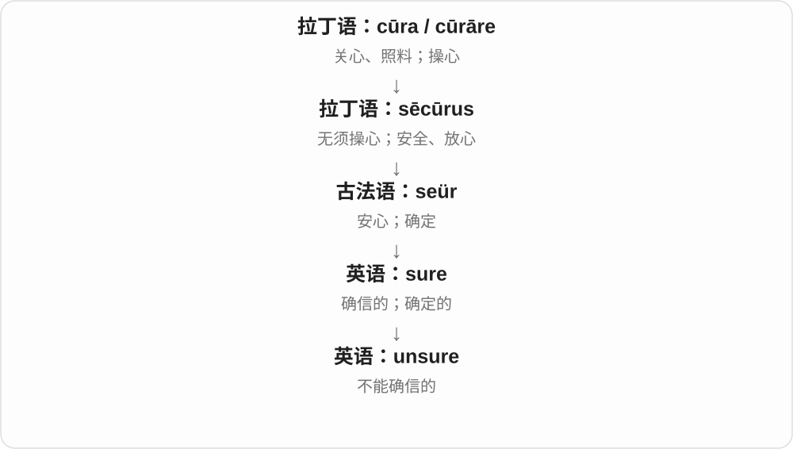

可以是不知道事实，也可以是对自己能力缺乏把握。后面常接 whether、what、how 等说明不确定的内容。

**常见搭配与例句**

be unsure about…；be unsure whether…；feel unsure of yourself。

> I am unsure whether the shop is open today.

我不确定商店今天是否营业。

> She felt unsure of herself during the first meeting.

第一次开会时，她感到有些没自信。

**别混淆**

unsure 不必意味着危险；unsafe 才是“不安全”。不清楚路线也可以 unsure。

### 5. insure — 为……投保；承保

**音标**：英 /ɪnˈʃɔː/；美 /ɪnˈʃʊr/

**先抓住这个画面**

先交保费，把约定范围内的损失风险交由保险安排分担，这时用 insure。

**怎么拆**

原是 ensure 的历史变体，后来逐渐专门用于提供保险保障。

**怎么变成今天的意思**

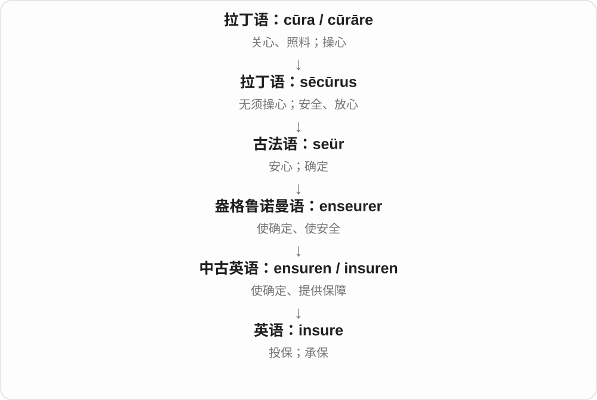

它从“使有保障”收窄到保险义。美式英语中也可表示 ensure 的确保义，但写作时区分有助于清楚表达。

**常见搭配与例句**

insure a house；insure against loss；be insured for…。

> They insured the house against fire.

他们为房屋投保了火灾险。

> The policy insures the equipment during transport.

这份保单为运输中的设备提供保险保障。

**别混淆**

insure 常涉及保单和损失；ensure 强调确保结果。保险不代表任何损失都自动获赔，含义仍按约定。

### 6. insurance — 保险；防范措施

**音标**：英 /ɪnˈʃɔːrəns/；美 /ɪnˈʃʊrəns/

**先抓住这个画面**

把可能发生的大损失，换成提前支付、按约定提供保障的安排，就是 insurance。也可比喻备用的防范措施。

**怎么拆**

由较早 ensurance 等形式发展而来，现代形式对应 insure + -ance。

**怎么变成今天的意思**

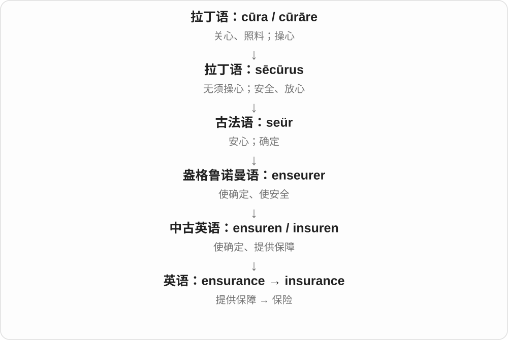

这个词把“让人有保障”固定在保险制度上。take a spare key as insurance 则比喻留个后手，并没有真正买保单。

**常见搭配与例句**

travel insurance；an insurance policy；insurance against…。

> The ticket price does not include travel insurance.

票价不包含旅行保险。

> I kept a backup copy as insurance against losing the file.

我保留了一份备份，以防文件丢失。

**别混淆**

insurance 是保障安排；premium 是保费；insurer 是承保方。三个词不是同一件事。

### 7. reinsurance — 再保险；分保

**音标**：英 /ˌriːɪnˈʃɔːrəns/；美 /ˌriːɪnˈʃʊrəns/

**先抓住这个画面**

可以把 reinsurance 看成“保险公司的保险”：原承保方把约定的风险交给其他保险机构分担。

**怎么拆**

re-（再次）+ insurance（保险）。

**怎么变成今天的意思**

这个比喻帮助理解层次，但具体再保险合同有自身规则，不等于复制个人保单。它是行业专业名词。

**常见搭配与例句**

a reinsurance agreement；reinsurance coverage；the reinsurance market。

> The insurer entered into a reinsurance agreement.

这家保险公司签订了一份再保险协议。

> The course introduces the role of reinsurance in risk sharing.

课程介绍了再保险在风险分担中的作用。

**别混淆**

coinsurance 是共担或共同保险安排；reinsurance 是原承保方把风险再分出去，层次不同。

### 8. coinsurance — 共同保险；按比例共担费用

**音标**：英 /ˌkəʊɪnˈʃɔːrəns/；美 /ˌkoʊɪnˈʃʊrəns/

**先抓住这个画面**

费用或风险不是由一方全包，而是按某种安排共同承担，coinsurance 的 co- 就强调“共同”。

**怎么拆**

co-（共同）+ insurance（保险）。

**怎么变成今天的意思**

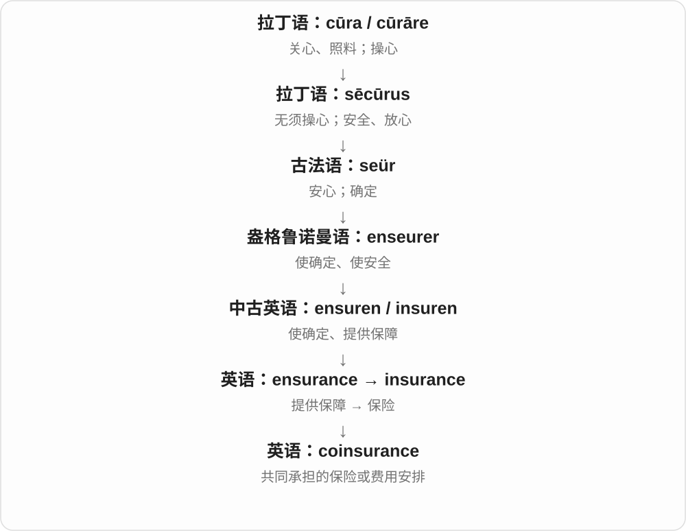

美国医疗保险语境常指被保险人按比例承担约定费用；其他保险语境可指多方共同承保等。要看具体制度与合同。

**常见搭配与例句**

a coinsurance rate；a coinsurance clause；coinsurance payments。

> The guide explains the plan’s coinsurance rate.

指南解释了该计划的费用共担比例。

> The two policies use different coinsurance arrangements.

这两份保单采用不同的共同承担安排。

**别混淆**

copayment 常是固定金额，coinsurance 常是比例；不能忽略保单语境，把两者一律译成一样的费用。

### 9. insurer — 保险公司；承保人

**音标**：英 /ɪnˈʃɔːrə/；美 /ɪnˈʃʊrər/

**先抓住这个画面**

在保险关系里，承诺按约定承担赔付责任的一方是 insurer，通常是一家保险公司。

**怎么拆**

insure + -er（执行该业务的人或机构）。

**怎么变成今天的意思**

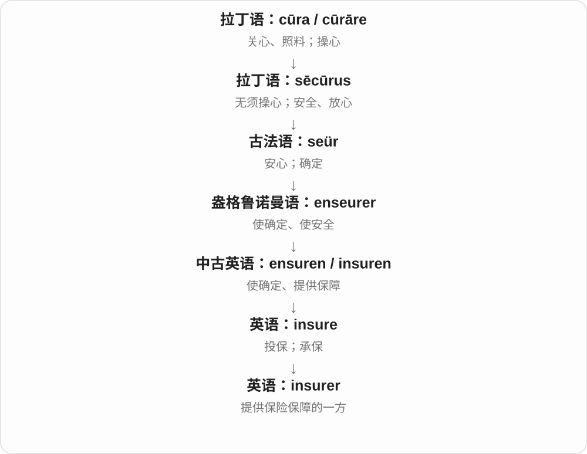

后缀把投保或承保的动作连接到业务主体。这里不是买保险的人，而是承担保险责任的那一边。

**常见搭配与例句**

an insurer；contact your insurer；the insurer’s decision。

> She contacted the insurer to update her address.

她联系保险公司更新地址。

> The insurer requested copies of the documents.

承保方要求提供文件副本。

**别混淆**

insured 是被保险人或受保的；insurer 是承保方。只差结尾，角色相反。

### 10. insurable — 可保的；可以承保的

**音标**：英 /ɪnˈʃɔːrəbəl/；美 /ɪnˈʃʊrəbəl/

**先抓住这个画面**

某类风险符合保险安排的条件，能够被承保，可说它 insurable。

**怎么拆**

insure + -able（可以被……的），去掉末尾 e。

**怎么变成今天的意思**

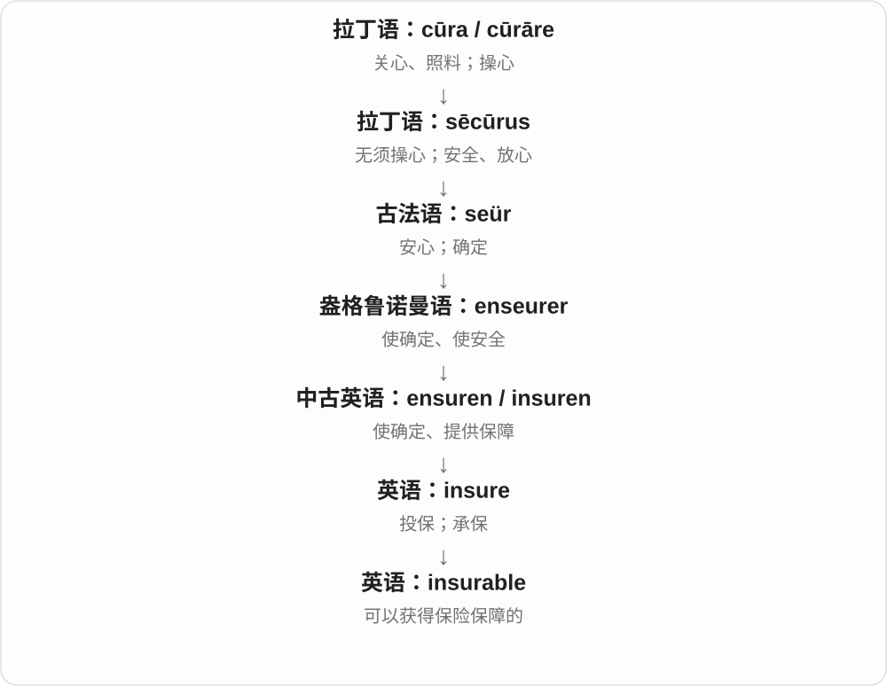

它说的是可被保险处理的资格或特征，并不等于已经买好保险，也不等于任何机构都愿意承保。

**常见搭配与例句**

an insurable risk；an insurable interest；be insurable。

> The textbook distinguishes insurable risks from other uncertainties.

教材把可保风险与其他不确定性区分开来。

> The broker asked whether the item was insurable.

经纪人询问这件物品是否可以承保。

**别混淆**

insured 是已投保或受保障；insurable 是具备可保性。

### 11. insurability — 可保性；承保资格

**音标**：英 /ɪnˌʃɔːrəˈbɪləti/；美 /ɪnˌʃʊrəˈbɪləti/

**先抓住这个画面**

从“可以承保吗”转为讨论“可被承保的程度或条件”，就会用 insurability。

**怎么拆**

insure + -ability，或对照 insurable 的名词形式。

**怎么变成今天的意思**

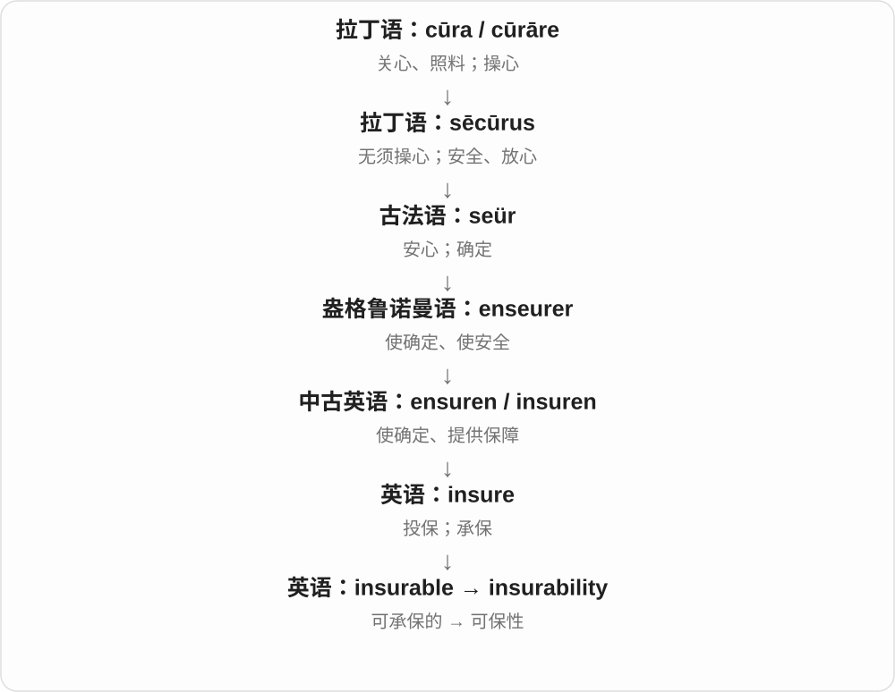

这个抽象名词常出现在风险评估和保险讨论里；它并不单凭词义规定具体条件，条件由实际制度和产品决定。

**常见搭配与例句**

assess insurability；evidence of insurability；affect insurability。

> The application asks for information relevant to insurability.

申请表要求填写与可保资格相关的信息。

> The seminar examined the insurability of emerging risks.

研讨会讨论了新兴风险的可保性。

**别混淆**

insurability 是资格或性质；insurance coverage 是已经约定的保障范围。

### 12. reinsure — 再保险；分保

**音标**：英 /ˌriːɪnˈʃɔː/；美 /ˌriːɪnˈʃʊr/

**先抓住这个画面**

保险公司已经接下风险，再把其中一部分交给另一家保险机构分担，这叫 reinsure。

**怎么拆**

re-（再次）+ insure（提供保险）。

**怎么变成今天的意思**

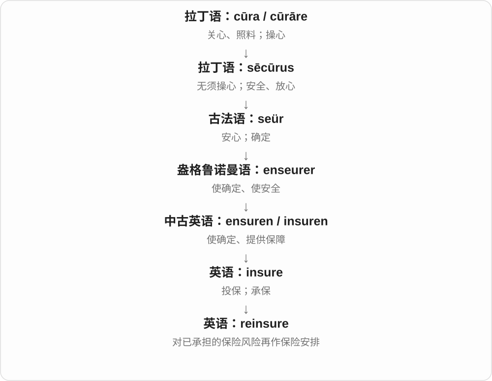

常见专业义是保险机构之间的风险分担，不是同一个人重复买两份完全相同的保险这么简单。

**常见搭配与例句**

reinsure a risk；reinsure part of a portfolio。

> The company chose to reinsure part of the risk.

公司选择把部分风险进行分保。

> The textbook explains why insurers reinsure large exposures.

教材解释了保险公司为什么会对较大的风险敞口安排再保险。

**别混淆**

renew insurance 是续保；reinsure 通常是再保险安排，两者不要混译。

### 13. secure — 安全的；牢固的；固定；获得

**音标**：英 /sɪˈkjʊə/；美 /sɪˈkjʊr/

**先抓住这个画面**

东西不会轻易掉、人不会轻易受损、结果不会轻易丢失，这些“靠得住”的状态都能用 secure。

**怎么拆**

借自拉丁语 sēcūrus：sē-（没有、离开）+ cūra（忧虑）。与经法语变短的 sure 同源。

**怎么变成今天的意思**

从不用担心发展出安全、稳固。动词 secure 可是把物件固定住，也可是设法获得职位、许可等，使其落定。

**常见搭配与例句**

a secure connection；secure the door；secure a job；feel secure。

> Make sure the ladder is secure before climbing.

攀爬前确认梯子稳固。

> She secured a place on the training course.

她获得了培训课程的一个名额。

**别混淆**

safe 更普通地表示没有危险；secure 常强调有保护、不会松动或被夺走。

### 14. security — 安全；保障；保安；担保

**音标**：英 /sɪˈkjʊərəti/；美 /sɪˈkjʊrəti/

**先抓住这个画面**

有保护措施，有稳定依靠，心里不用一直担心，这种状态和保障可以叫 security。

**怎么拆**

经法语 securité 来自拉丁语 sēcūritās，与 sēcūrus“无忧、安全的”对应。

**怎么变成今天的意思**

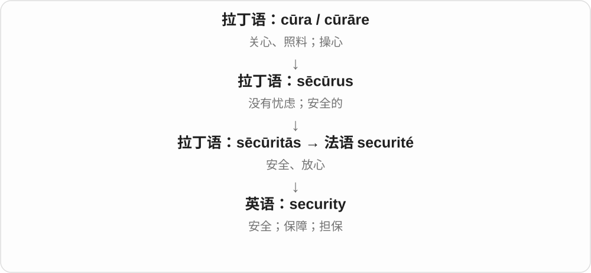

从安心状态扩展到保护措施、保安人员和担保。复数 securities 在金融语境另指证券，不能按普通复数译成几份安全。

**常见搭配与例句**

airport security；job security；security measures；financial security。

> Passengers must pass through security before boarding.

乘客登机前必须通过安检。

> A permanent contract gave her greater job security.

长期合同让她的工作更有保障。

**别混淆**

safety 多关注免受事故、伤害；security 常涉及防止侵入、失去或攻击。两者范围有重叠。

### 15. cybersecurity — 网络安全；数字系统安全

**音标**：英 /ˌsaɪbəsɪˈkjʊərəti/；美 /ˌsaɪbərsɪˈkjʊrəti/

**先抓住这个画面**

给联网设备、软件和数据加上保护，让它们不轻易被偷看、篡改或破坏，这个领域叫 cybersecurity。

**怎么拆**

cyber-（计算机、网络相关）+ security（安全防护）。

**怎么变成今天的意思**

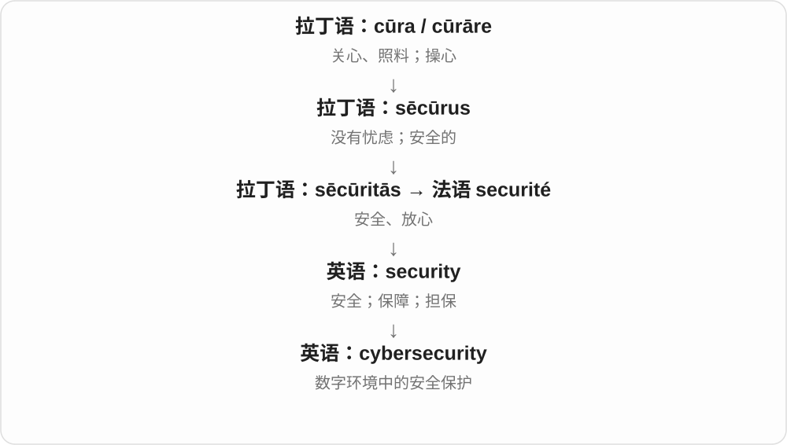

它涉及技术、流程和人的操作习惯，并不是安装一个程序就结束。词根里的“安心”在这里变成对数字系统的保护目标。

**常见搭配与例句**

cybersecurity training；a cybersecurity team；cybersecurity risks。

> The company provides cybersecurity training for new employees.

公司为新员工提供网络安全培训。

> The incident prompted a review of cybersecurity practices.

这次事件促使人们重新审查网络安全做法。

**别混淆**

privacy 关注个人信息的使用与控制；cybersecurity 关注系统和信息的保护。两者相关但不完全相同。

### 16. biosecurity — 生物安全防护

**音标**：英 /ˌbaɪəʊsɪˈkjʊərəti/；美 /ˌbaɪoʊsɪˈkjʊrəti/

**先抓住这个画面**

防止病原体进入农场或在设施之间传播，或防止有害生物材料被滥用，相关保护叫 biosecurity。

**怎么拆**

bio-（生命、生物）+ security（安全防护）。

**怎么变成今天的意思**

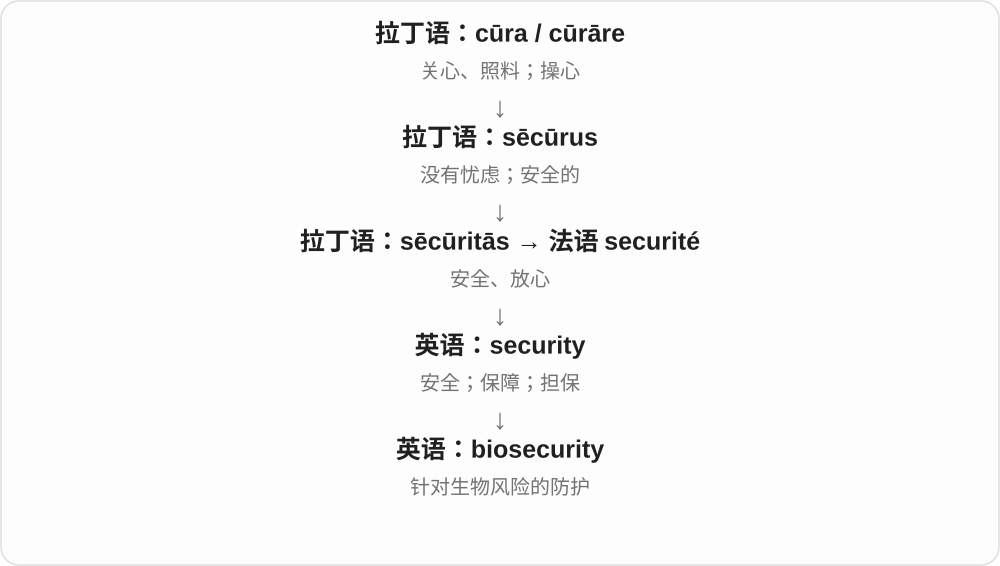

不同领域的使用范围略有差别，农牧业常强调阻断引入和传播，实验室语境还可能强调防止丢失或滥用。

**常见搭配与例句**

biosecurity measures；farm biosecurity；a biosecurity plan。

> Visitors must follow the farm’s biosecurity rules.

访客必须遵守农场的生物安全防护规定。

> The training explains the difference between biosafety and biosecurity.

培训解释了生物安全操作与生物安全防护之间的区别。

**别混淆**

biosafety 常强调防止意外暴露或释放；biosecurity 常关注进入、传播和有意滥用等防护，两者存在重叠。

### 17. securely — 牢固地；安全地

**音标**：英 /sɪˈkjʊəli/；美 /sɪˈkjʊrli/

**先抓住这个画面**

绳子扎得不会松，文件存放得不容易被人拿走，securely 描述这种可靠的方式。

**怎么拆**

secure + -ly。

**怎么变成今天的意思**

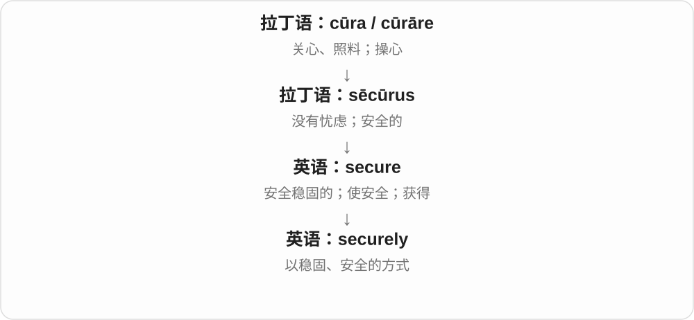

既可谈物理固定，也可谈信息保存。它说明保护方式，不能只靠写上这个副词就证明某项技术绝对安全。

**常见搭配与例句**

fasten securely；store securely；securely attached。

> The lid must be fastened securely.

盖子必须扣牢。

> The records are stored securely.

这些记录得到安全保存。

**别混淆**

firmly 强调紧、牢；securely 还可强调避免丢失、进入或损坏。

### 18. insecure — 不安全的；不牢靠的；缺乏自信的

**音标**：英 /ˌɪnsɪˈkjʊə/；美 /ˌɪnsɪˈkjʊr/

**先抓住这个画面**

外在保护不稳，或心里一直担心自己不够好，都可以是 insecure。

**怎么拆**

in-（不）+ secure；也与中古拉丁语 insēcūrus 对应。

**怎么变成今天的意思**

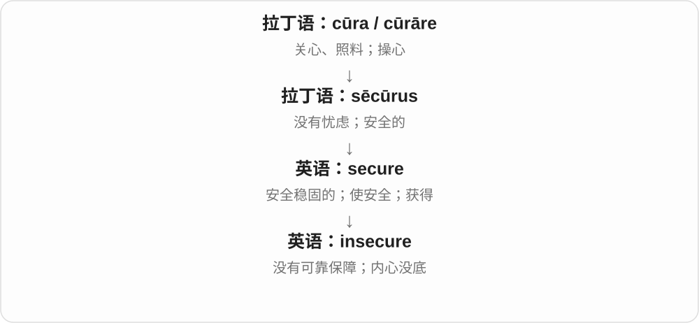

一个是实际环境缺少保障，一个是人的安全感不足。两者相关，但心理不安并不证明外部真的危险。

**常见搭配与例句**

an insecure job；feel insecure；insecure about your abilities。

> She felt insecure about speaking in front of the class.

她对在全班面前发言缺乏信心。

> The temporary job left him in an insecure position.

临时工作使他的处境缺少保障。

**别混淆**

unsure 是对某件事不确定；insecure 常涉及更深的保障或自我价值感。

### 19. insecurity — 不安全感；不稳定、缺乏保障

**音标**：英 /ˌɪnsɪˈkjʊərəti/；美 /ˌɪnsɪˈkjʊrəti/

**先抓住这个画面**

心里反复问“会不会失去、我够不够好”，这种不踏实是 insecurity；实际的食物或工作保障不足也可这样说。

**怎么拆**

来自中古拉丁语 insēcūritās；现代与 insecure + -ity 对应。

**怎么变成今天的意思**

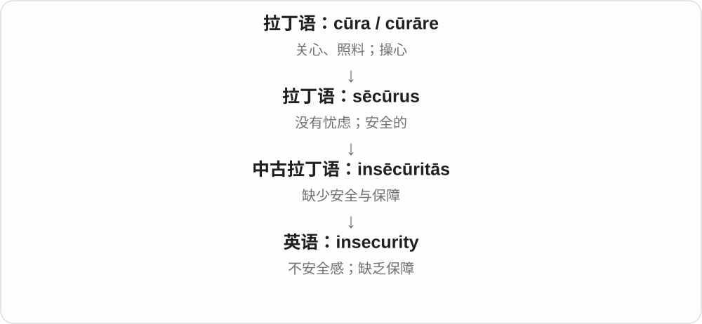

可指外部处境，也可指个人内心。复数 insecurities 常指几种具体的不自信或担忧。

**常见搭配与例句**

job insecurity；food insecurity；personal insecurities。

> Frequent moves increased the children’s sense of insecurity.

频繁搬家加重了孩子们的不安全感。

> The report examines food insecurity in rural communities.

报告研究了农村社区的食物保障不足问题。

**别混淆**

insecurity 不只是 timid“胆小”。勇于行动的人也可能有不安全感。

### 20. unsecure — 未固定的；不安全的；松开固定

**音标**：英 /ˌʌnsɪˈkjʊə/；美 /ˌʌnsɪˈkjʊr/

**先抓住这个画面**

锁没扣住、物件没有绑牢，可以用 unsecure；作动词则是把原先的固定解除。

**怎么拆**

形容词 un- 是否定；动词 un- 是反向动作。都接 secure，但语法不同。

**怎么变成今天的意思**

现代一般更常用 insecure、unsecured 或具体的 unfasten。读到它时，要先看是在描述状态，还是命令松开。

**常见搭配与例句**

an unsecure door；unsecure a latch；unsecure the load。

> The inspection found an unsecure latch.

检查发现一个没有扣牢的门闩。

> They unsecured the load before lifting it away.

他们先解开货物的固定装置，再把它吊走。

**别混淆**

insecure 可形容缺乏自信的人；unsecure 很少这样用于心理。别把词形近似当成所有用法相同。

### 21. ensure — 确保；保证实现

**音标**：英 /ɪnˈʃɔː/；美 /ɪnˈʃʊr/

**先抓住这个画面**

不是只说一句“放心”，而是把条件安排好，让目标能实现，ensure 强调结果。

**怎么拆**

经盎格鲁诺曼语 enseurer 而来，含使成为的 en- 与 seür“确定、安全的”。

**怎么变成今天的意思**

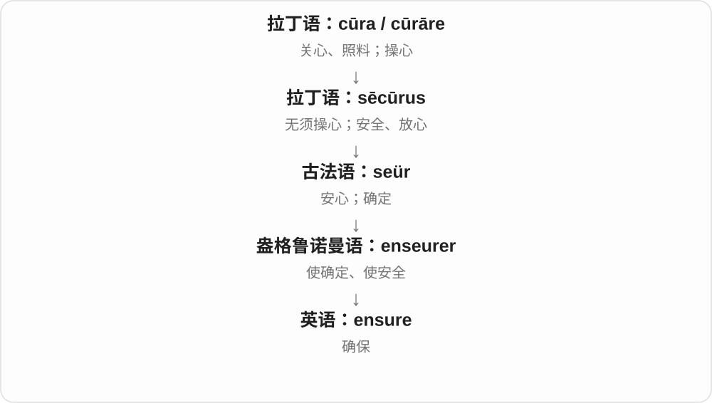

从使事情确定、安全，到现代的确保。常用 ensure that…；直接接人时，通常还要说明给他保障了什么。

**常见搭配与例句**

ensure that…；ensure safety；ensure access to…。

> Leave early to ensure that you arrive on time.

早点出发，以确保按时到达。

> The checklist helps ensure consistent quality.

这份检查表有助于保证质量一致。

**别混淆**

assure someone 是向某个人保证；ensure something 是确保一件事；insure 常用于保险。

### 22. accurate — 准确的；精确无误的

**音标**：/ˈækjərət/

**先抓住这个画面**

地图画的位置、记录写的数字，和实际能对得上，就是 accurate。

**怎么拆**

来自拉丁语 accūrātus“认真处理好的”，ad- 在 c 前同化为 ac-，后接 cūrāre“照料、用心处理”。

**怎么变成今天的意思**

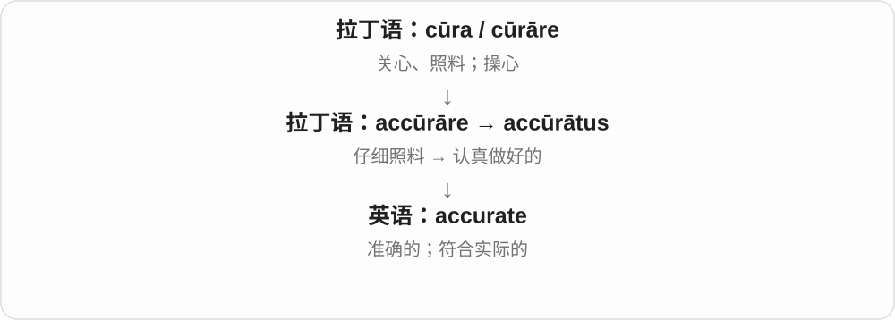

仔细做事容易做得正确，词义于是从认真细致转向结果准确。它评价的是与事实或目标符合，不是仅看小数点很多。

**常见搭配与例句**

accurate information；an accurate description；accurate measurements。

> The map gives an accurate picture of the coastline.

这张地图准确地描绘了海岸线。

> We need accurate figures before making a decision.

作决定前，我们需要准确的数字。

**别混淆**

precise 强调细致、精密或重复一致；accurate 强调对得准。测量数值很细，也可能整体偏离真实值。

### 23. accuracy — 准确性；准确度

**音标**：/ˈækjərəsi/

**先抓住这个画面**

不是问说得多漂亮，而是问结果与真实值、原文或目标差多少，这个质量叫 accuracy。

**怎么拆**

accurate + -cy；词尾调整后形成 accuracy。

**怎么变成今天的意思**

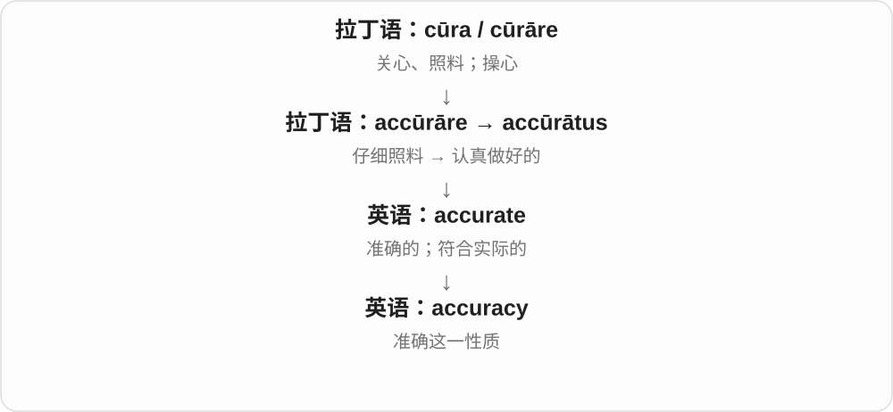

它把具体“准不准”变成可比较的指标。翻译、射击、记录、测量都能谈 accuracy，但衡量方式不同。

**常见搭配与例句**

check for accuracy；improve accuracy；the accuracy of a report。

> The editor checked the names for accuracy.

编辑核查了姓名是否准确。

> Practice improved the accuracy of her throws.

练习提高了她投掷的准确度。

**别混淆**

accuracy 不等于 detail“细节多”。内容很详细，仍可能处处不准。

### 24. inaccuracy — 不准确；错误之处

**音标**：/ɪnˈækjərəsi/

**先抓住这个画面**

数据没有对准实际，这种问题整体叫 inaccuracy；一处具体错误也可以是 an inaccuracy。

**怎么拆**

in-（不）+ accuracy（准确性）。

**怎么变成今天的意思**

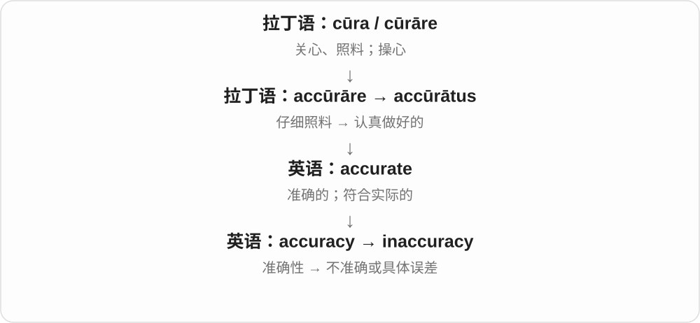

既可不可数地谈质量，也可数出若干处错误。a few inaccuracies 是几处内容不准，不必意味着整篇完全无用。

**常见搭配与例句**

correct an inaccuracy；factual inaccuracies；measurement inaccuracy。

> The author corrected several inaccuracies in the second edition.

作者在第二版中纠正了几处错误。

> The test revealed a small inaccuracy in the sensor.

测试发现传感器存在一个小误差。

**别混淆**

error 范围广，操作错误也算；inaccuracy 更强调内容或测量与真实情况不符。

### 25. accurately — 准确地；如实地

**音标**：/ˈækjərətli/

**先抓住这个画面**

把原来的内容传过去时不走样，或者把目标判断得很准，便是在做事时 accurately。

**怎么拆**

accurate + -ly。

**怎么变成今天的意思**

常描述记录、测量、预测、翻译等动作。它强调结果匹配，不只是态度认真。

**常见搭配与例句**

measure accurately；report accurately；predict accurately。

> Please record the temperature accurately.

请准确记录温度。

> The subtitle accurately conveys the speaker’s meaning.

字幕准确传达了说话者的意思。

**别混淆**

carefully 是认真小心地做；accurately 是做出来准确。认真能帮助准确，却不能保证准确。

### 26. inaccurate — 不准确的；与事实不符的

**音标**：/ɪnˈækjərət/

**先抓住这个画面**

说法看起来像那么回事，但对照原始资料发现位置、数字或细节对不上，就是 inaccurate。

**怎么拆**

in-（不）+ accurate（准确的）。

**怎么变成今天的意思**

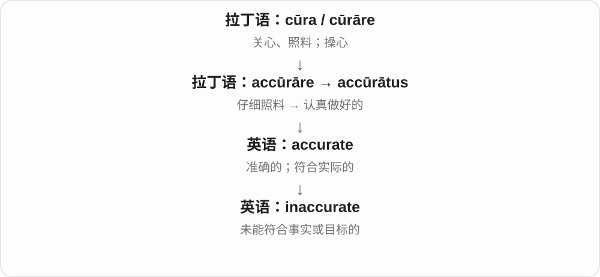

可以是部分出错，也可以整体偏差。它并不自动表示说话者故意欺骗。

**常见搭配与例句**

inaccurate information；an inaccurate estimate；factually inaccurate。

> The article contains an inaccurate date.

文章里有一个日期不准确。

> The old map is inaccurate in several places.

这张旧地图有几处画得不准确。

**别混淆**

false 常直接说内容不实；inaccurate 也可表示不够精确、局部有误，范围需看语境。

### 27. inaccurately — 不准确地；错误地

**音标**：/ɪnˈækjərətli/

**先抓住这个画面**

传话、测量或描述时发生了偏差，inaccurately 说明动作所得结果没有对准事实。

**怎么拆**

inaccurate + -ly，也可看出 in- 对 accurately 的否定。

**怎么变成今天的意思**

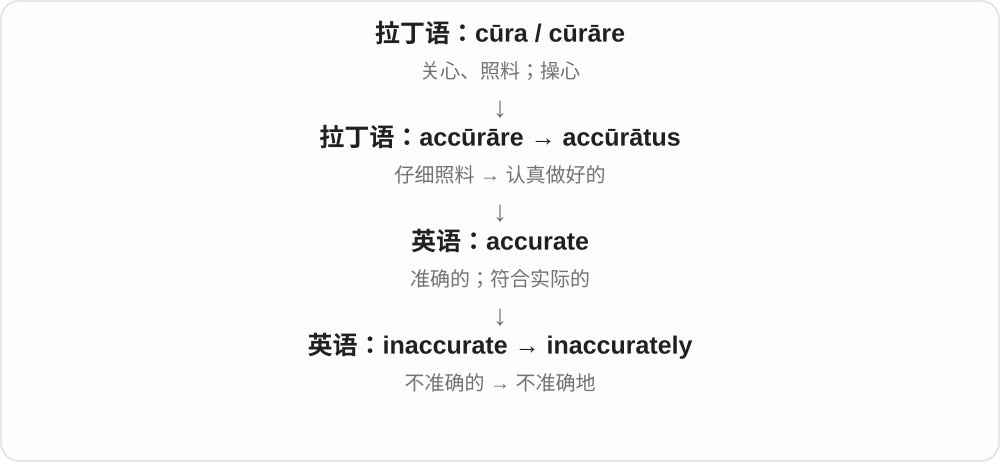

它用来修饰动词，不是给某个人永久贴上不可靠的标签。

**常见搭配与例句**

report inaccurately；describe inaccurately；measure inaccurately。

> The location was inaccurately marked on the map.

地图把这个位置标错了。

> The article inaccurately described her as the founder.

文章不准确地把她称为创始人。

**别混淆**

incorrectly 更广泛地说做错；inaccurately 特别适合描述信息、数值或判断的偏差。

### 28. cure — 治愈；疗法；解决办法；使材料固化或食品腌制

**音标**：英 /kjʊə/；美 /kjʊr/

**先抓住这个画面**

照料一件出了问题的东西，使它恢复到可用、正常的状态，这是 cure 最好记的画面。

**怎么拆**

名词经古法语 cure 来自拉丁语 cūra“照料、医治”；动词经 curer 来自 cūrāre。

**怎么变成今天的意思**

医治义发展为消除问题；食品、材料中的 cure 则是通过处理使其达到保存或使用状态。这些专业用法不等于把材料“治病”。

**常见搭配与例句**

a cure for…；cure a disease；cure a problem；cured meat；cure concrete。

> Researchers are still looking for a cure for the condition.

研究人员仍在寻找治愈这种疾病的方法。

> The coating needs time to cure before it can be used.

这种涂层需要一段时间固化后才能使用。

**别混淆**

cure 强调治好；treat 是治疗，未必治好。heal 常说伤口愈合或身体恢复。

### 29. curious — 好奇的；奇特的

**音标**：英 /ˈkjʊəriəs/；美 /ˈkjʊriəs/

**先抓住这个画面**

注意力被一件事勾住，忍不住想弄清楚，是 curious；那件让人忍不住多看一眼的怪事，也可以 curious。

**怎么拆**

拉丁语 cūriōsus 与 cūra“用心、关切”有关，经古法语 curius 进入。

**怎么变成今天的意思**

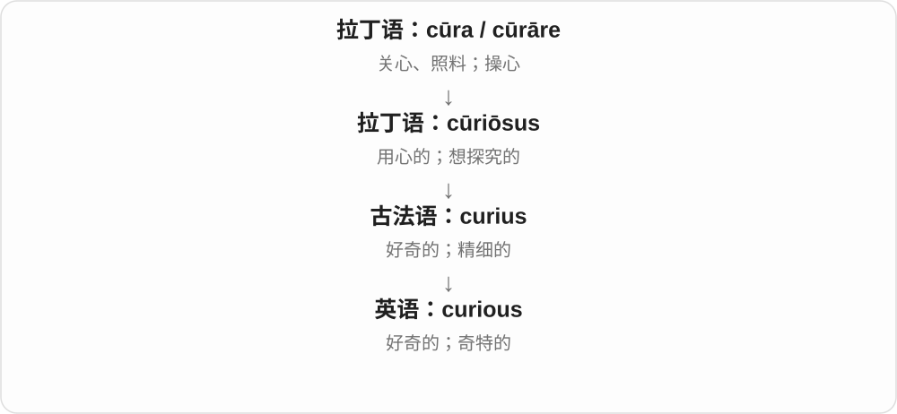

对事情用心关注发展为想知道；再转向能引人探究的奇特事物。人的好奇与物的古怪，是同一词的两种观察角度。

**常见搭配与例句**

be curious about…；curious to know…；a curious coincidence。

> I am curious about how the machine works.

我很好奇这台机器怎样运作。

> There was a curious smell in the room.

房间里有一股奇怪的气味。

**别混淆**

curious about 是想了解；nosy 常批评爱打听隐私。a curious noise 是奇怪的声音，不是声音在好奇。

### 30. curiosity — 好奇心；稀奇事物

**音标**：英 /ˌkjʊəriˈɒsəti/；美 /ˌkjʊriˈɑːsəti/

**先抓住这个画面**

心里那个“为什么、怎么回事”的小钩子，是 curiosity；能钩住这种兴趣的奇物，也可叫 a curiosity。

**怎么拆**

来自拉丁语 cūriōsitās，经盎格鲁诺曼语 curiouseté 等形式传入；现代对应 curious 与 -ity 的关系。

**怎么变成今天的意思**

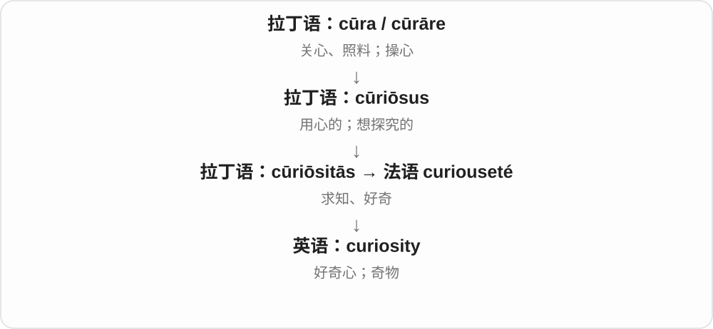

抽象的求知心转向引起好奇的对象。out of curiosity 是出于好奇，不代表已经决定采取进一步行动。

**常见搭配与例句**

out of curiosity；arouse curiosity；satisfy your curiosity；a historical curiosity。

> Out of curiosity, I opened the old notebook.

出于好奇，我打开了那本旧笔记本。

> The device is now a historical curiosity.

这个装置如今已是一件历史奇物。

**别混淆**

interest 是广义兴趣；curiosity 更强调想知道未知内容。curiosity 可不可数，也可指一件奇物。

### 31. curiously — 好奇地；奇怪的是

**音标**：英 /ˈkjʊəriəsli/；美 /ˈkjʊriəsli/

**先抓住这个画面**

孩子探头想看清楚，是 looking curiously；叙述者发现反常之处，则会说 Curiously,…。

**怎么拆**

curious + -ly，两种主要义项都可以带到副词中。

**怎么变成今天的意思**

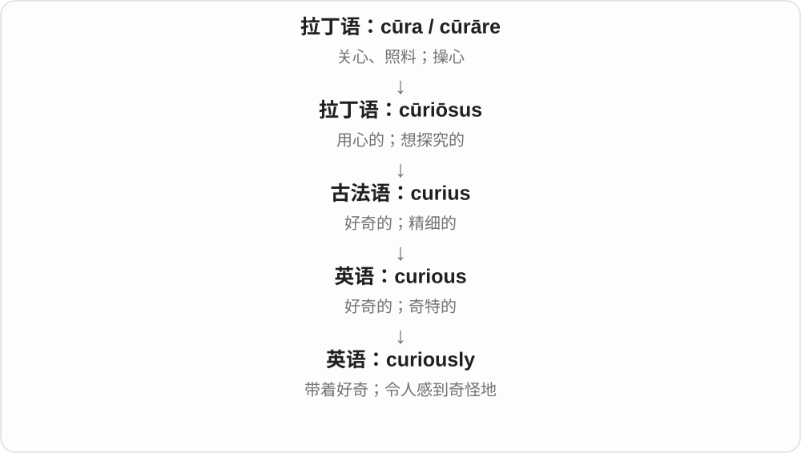

句中修饰动作时常表示好奇的态度，句首评论整件事时常表示“奇怪的是”。位置和语境能帮助判断。

**常见搭配与例句**

look curiously at…；curiously enough；curiously similar。

> The child looked curiously at the telescope.

孩子好奇地看着望远镜。

> Curiously, both letters arrived on the same day.

奇怪的是，两封信在同一天到了。

**别混淆**

curiously 不总是“好奇地”。Curiously, nobody complained 是奇怪的是没人抱怨。

### 32. curate — 策划展览；精选整理；助理牧师

**音标**：动词 /kjʊˈreɪt/；名词 /ˈkjʊərət/

**先抓住这个画面**

动词 curate 像为观众认真挑出一组东西，再安排观看顺序。名词 a curate 则是教会中负责照顾教区事务的牧师职位。

**怎么拆**

动词是从 curator 逆构出来的；名词独立借自教会拉丁语 cūrātus。两种词性不能画成一条从牧师到策展的直线。

**怎么变成今天的意思**

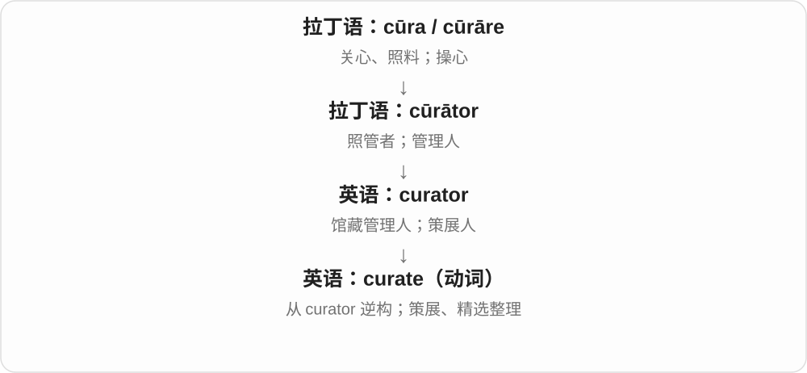

动词保留照管、挑选的责任感。名词在英国教会语境常指助理牧师，重音也不同；不是策展人的另一个常规称呼。

**常见搭配与例句**

curate an exhibition；curate a collection；a parish curate。

> She curated an exhibition of local photography.

她策划了一场本地摄影展。

> The young curate helped organize the parish event.

这位年轻助理牧师协助组织了教区活动。

**别混淆**

curate 不只是 collect“收集”：它往往还包括筛选和组织。名词 curate 与 curator 的职业意义不同。

### 33. curator — 馆藏管理人；策展人

**音标**：英 /kjʊəˈreɪtə/；美 /kjʊˈreɪtər/

**先抓住这个画面**

不是把物品随便摆出来，而是有人负责挑选、研究、照管，再安排怎样展示给观众，这个人常是 curator。

**怎么拆**

借自拉丁语 cūrātor“照管者、管理人”，来自 cūrāre。

**怎么变成今天的意思**

古代的广义管理者，在现代常落实到博物馆、展览与收藏。数字内容也借用这个词，强调有判断的选择和组织。

**常见搭配与例句**

a museum curator；an exhibition curator；a curator of photographs。

> The curator selected photographs that showed the city’s changing streets.

策展人挑选了反映城市街道变化的照片。

> A curator explained how the fragile objects are stored.

馆藏管理人解释了这些易损物件如何保存。

**别混淆**

collector 是收藏者，curator 是照管、研究和组织藏品或展览的人；一个人可以兼任两种角色。

### 34. curatorial — 策展的；馆藏管理的

**音标**：英 /ˌkjʊərəˈtɔːriəl/；美 /ˌkjʊrəˈtɔːriəl/

**先抓住这个画面**

展品怎么选、故事怎么讲、藏品怎么照管，这些专业判断属于 curatorial work。

**怎么拆**

curator + -ial，形成“与馆藏管理或策展有关的”形容词。

**怎么变成今天的意思**

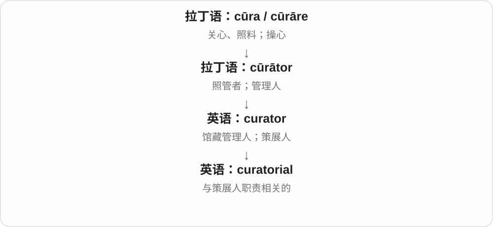

它可描述团队、决策和实践。不是展览里每一件搬运或售票工作都自动叫 curatorial。

**常见搭配与例句**

a curatorial team；curatorial decisions；curatorial practice。

> The curatorial team chose a chronological arrangement.

策展团队选择按时间顺序布展。

> The archive records the curator’s early curatorial decisions.

档案记录了这位策展人早期的策展决策。

**别混淆**

curatorial 侧重藏品与展示内容的专业管理；administrative 更一般地指行政事务。

### 35. curative — 治疗性的；以治愈为目的的

**音标**：英 /ˈkjʊərətɪv/；美 /ˈkjʊrətɪv/

**先抓住这个画面**

措施的目标是把已经出现的问题治好，curative 就把这个方向点出来。

**怎么拆**

借自中古法语 curatif，更早属于拉丁语 cūrāre 的照料、医治词族。

**怎么变成今天的意思**

常与 preventive“预防性的”对照。词本身说明目标或性质，并不替某种具体疗法保证效果。

**常见搭配与例句**

curative treatment；curative intent；curative measures。

> The course compares preventive and curative approaches.

课程比较预防性与治疗性方法。

> The plan described the treatment as curative in intent.

计划将该治疗描述为以治愈为目的。

**别混淆**

preventive 是防止问题出现；curative 是针对已经出现的问题求治愈。

### 36. curacy — 助理牧师职位；牧师任期

**音标**：英 /ˈkjʊərəsi/；美 /ˈkjʊrəsi/

**先抓住这个画面**

一个人担任 curate 的职位或那段任职经历，叫 curacy。它说岗位，不说展览。

**怎么拆**

curate（牧师）取 cur- 加 -acy（职位、状态）；不是 curatorial 的缩写。

**怎么变成今天的意思**

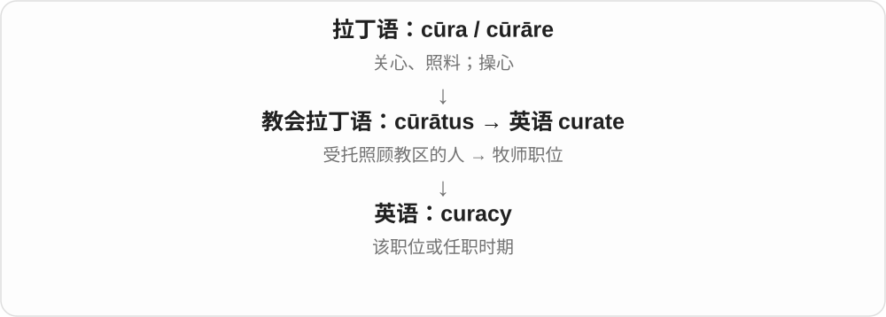

这里 cūra 的照料是对教区居民的宗教关怀。这个词通常在教会历史、人物传记和职位介绍中遇见。

**常见搭配与例句**

serve a curacy；a parish curacy；during his curacy。

> He served his curacy in a small rural parish.

他在一个小型乡村教区担任助理牧师。

> The biography describes her first curacy.

传记介绍了她第一次担任助理牧师的经历。

**别混淆**

curacy 与 curatorship 不同：前者是牧师职位，后者是策展或馆藏管理职位。

### 37. incurable — 无法治愈的；改不了的

**音标**：英 /ɪnˈkjʊərəbəl/；美 /ɪnˈkjʊrəbəl/

**先抓住这个画面**

找不到能彻底消除问题的办法，是 incurable；说 an incurable optimist 则半开玩笑地说这个人乐观得改不了。

**怎么拆**

经古法语 incurable 来自晚期拉丁语 incurābilis，in- 否定“可治愈”。

**怎么变成今天的意思**

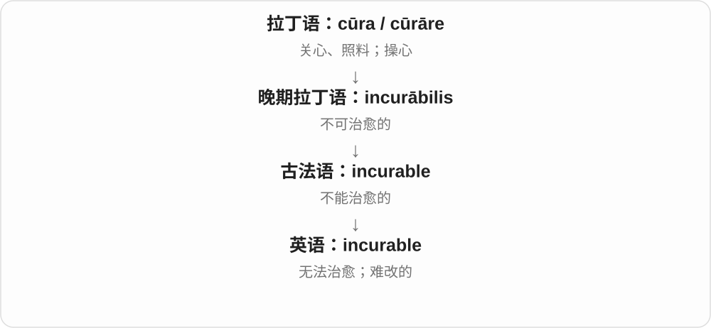

字面义谈治疗能力的边界；比喻义谈顽固的习性。不可治愈并不等于无法治疗、缓解或提供支持。

**常见搭配与例句**

an incurable condition；an incurable romantic；an incurable optimist。

> The novel’s hero is an incurable romantic.

小说的主人公是个改不了的浪漫主义者。

> The passage explains the difference between an incurable condition and an untreatable one.

这段文字解释了不可治愈与无法治疗的区别。

**别混淆**

incurable 与 untreatable 不完全等同；前者说无法治愈，后者说无法治疗。

### 38. curable — 可以治愈的；可解决的

**音标**：英 /ˈkjʊərəbəl/；美 /ˈkjʊrəbəl/

**先抓住这个画面**

问题不是只能一直忍受，而是有可能被治好或纠正，可以形容为 curable。

**怎么拆**

经古法语 curable 传入；现代可分析 cure + -able。

**怎么变成今天的意思**

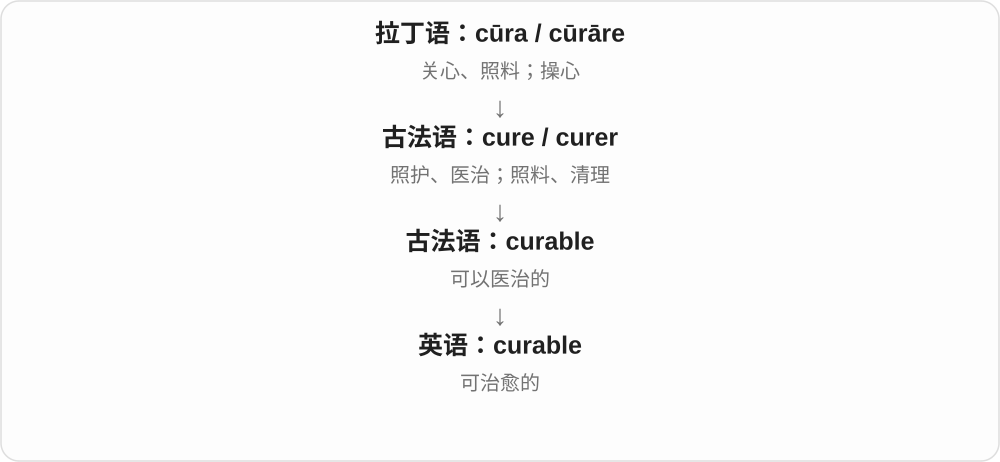

它表达可治愈的性质，不保证某个人在任何条件下都一定恢复。比喻用法也可谈能改正的缺点。

**常见搭配与例句**

a curable disease；a curable condition；a curable defect。

> The article distinguishes curable illnesses from manageable ones.

文章区分了可治愈的疾病与可控制的疾病。

> The engineer regarded the flaw as curable.

工程师认为这个缺陷可以修正。

**别混淆**

curable 是可治愈；treatable 是可治疗或可控制。能接受治疗不一定等于能彻底治愈。

### 39. curability — 可治愈性

**音标**：英 /ˌkjʊərəˈbɪləti/；美 /ˌkjʊrəˈbɪləti/

**先抓住这个画面**

把“这种病能不能治好”作为一个性质来研究，所谈的就是 curability。

**怎么拆**

cure + -ability；也可对照 curable 的名词形式。

**怎么变成今天的意思**

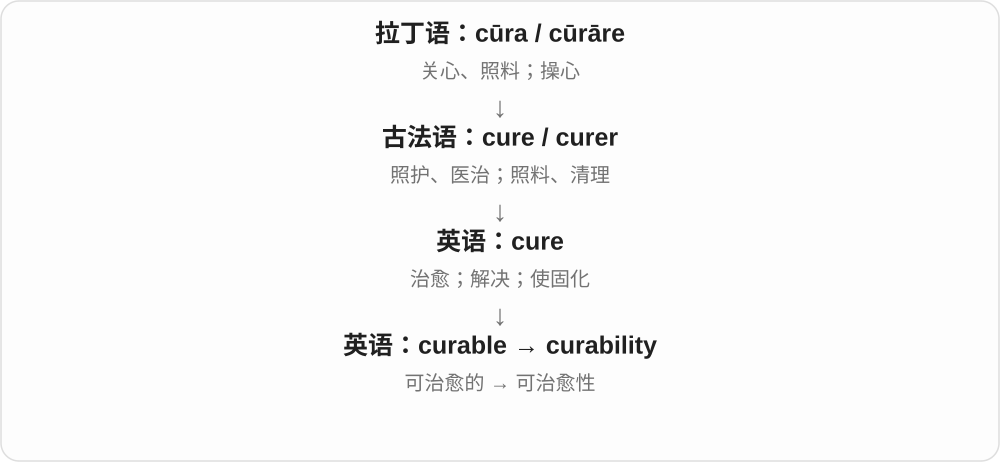

这是较专业的抽象名词，讨论时需结合具体疾病和条件。它不是一份对个体结果的保证。

**常见搭配与例句**

assess curability；the curability of a disease；evidence of curability。

> The review discusses the curability of several conditions.

综述讨论了几种疾病的可治愈性。

> The lecturer separated questions of severity from questions of curability.

讲师把严重程度问题与可治愈性问题分开讨论。

**别混淆**

curability 讨论治好的可能；severity 讨论病情严重程度，二者不是同一个尺度。

### 40. curette — 刮匙；用刮匙处理

**音标**：/kjʊˈret/

**先抓住这个画面**

一种带有小勺形或环形工作端的器械，用来刮取或清除组织等材料，叫 curette。

**怎么拆**

借自法语 curette，与 curer“清理、刮净”相关；更早是 cūrāre 的照管、处理词族。

**怎么变成今天的意思**

词源重点是清理工具，不是英语 cure“治愈”后随意加一个尾巴。器械具体形状和用途依专业而定。

**常见搭配与例句**

a surgical curette；a dental curette；a curette handle。

> The diagram labels the handle and tip of the curette.

图中标出了刮匙的柄和工作端。

> The dental student learned the names of several curettes.

这名牙科学生学习了几种刮匙的名称。

**别混淆**

curette 是器械；curettage 是使用这类器械进行刮除的操作名称。

### 41. assure — 向……保证；使放心

**音标**：英 /əˈʃɔː/；美 /əˈʃʊr/

**先抓住这个画面**

对方心里没底，你用确定的话告诉他可以放心，assure 通常把这个“人”放在后面。

**怎么拆**

古法语 asseürer 来自 ad- 与 sēcūrus“安全、放心的”相关构词。

**怎么变成今天的意思**

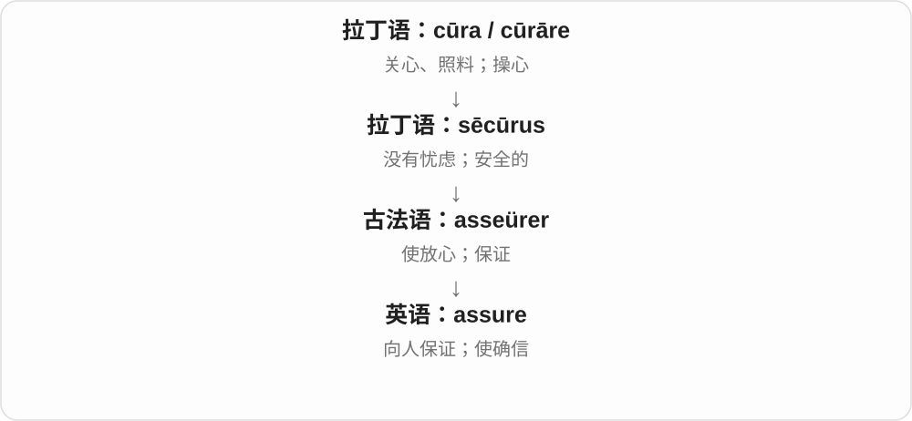

核心是使人确信。I assure you 是郑重告诉你，不表示说话本身就能让所有结果自动实现。

**常见搭配与例句**

assure someone that…；assure someone of…；I can assure you…。

> She assured me that the documents were ready.

她向我保证文件已经准备好。

> The team assured us of its continued support.

团队向我们保证会继续提供支持。

**别混淆**

assure 常接人；ensure 常接事情或 that 从句。不要把 assure of 的 of 误写成 for。

### 42. assurance — 保证；自信；保险

**音标**：英 /əˈʃɔːrəns/；美 /əˈʃʊrəns/

**先抓住这个画面**

别人给你一个可以放心的承诺，是 assurance；一个人说话沉着、有把握，也表现出 assurance。

**怎么拆**

经古法语 asseürance 传入，与 asseürer“使放心”对应；现代可看出 assure + -ance 的关系。

**怎么变成今天的意思**

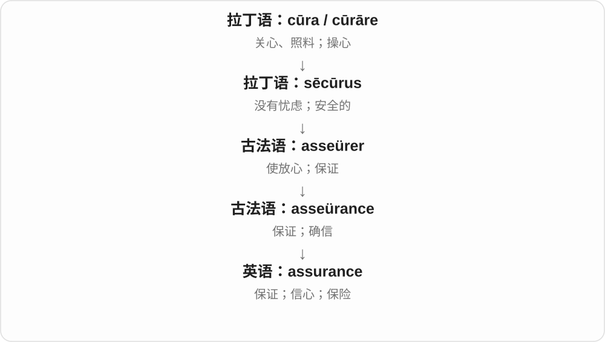

从使人放心的行为转为保证内容，也转为本人内在的信心。某些英式保险名称保留 assurance，如 life assurance。

**常见搭配与例句**

give an assurance；quality assurance；speak with assurance。

> We received assurances that the work would be finished soon.

我们得到保证，工作很快会完成。

> She answered the questions with quiet assurance.

她沉着自信地回答了问题。

**别混淆**

assurance 可以是信心，不一定是保险。assurances 常指若干承诺或保证。

### 43. reassurance — 安慰；使安心的话或举动

**音标**：英 /ˌriːəˈʃɔːrəns/；美 /ˌriːəˈʃʊrəns/

**先抓住这个画面**

心里没底时想听一句“我们会陪着你”，需要的这种安心感或安抚，就是 reassurance。

**怎么拆**

re-（再次、恢复）+ assurance（保证、信心）。

**怎么变成今天的意思**

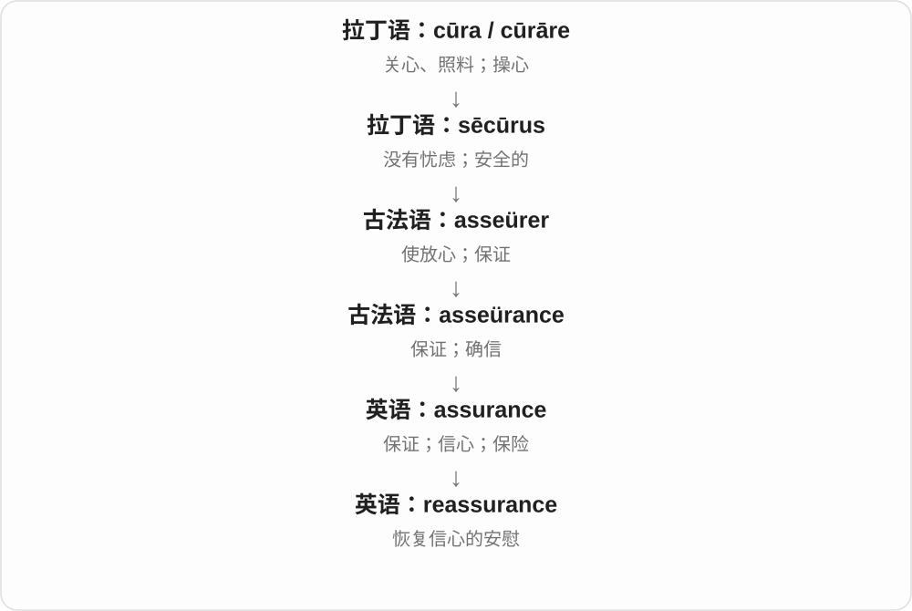

可指安抚行为，也可指产生安抚作用的内容。不是每一次 reassurance 都是对结果的正式保证。

**常见搭配与例句**

need reassurance；offer reassurance；a word of reassurance。

> The child needed a little reassurance before entering the room.

孩子进房间前需要一点安慰。

> Her calm voice was a source of reassurance.

她平静的声音让人安心。

**别混淆**

reassurance 常关心情绪上的安心；guarantee 更可能是明确的责任或结果承诺。

### 44. reassure — 使安心；打消疑虑

**音标**：英 /ˌriːəˈʃɔː/；美 /ˌriːəˈʃʊr/

**先抓住这个画面**

对方原本担心，你解释情况或给予支持，让他的心重新安定下来，就是 reassure。

**怎么拆**

经古法语 rasseürer 而来，re-（再次）+ asseürer（使确信）；现代对应 re- + assure。

**怎么变成今天的意思**

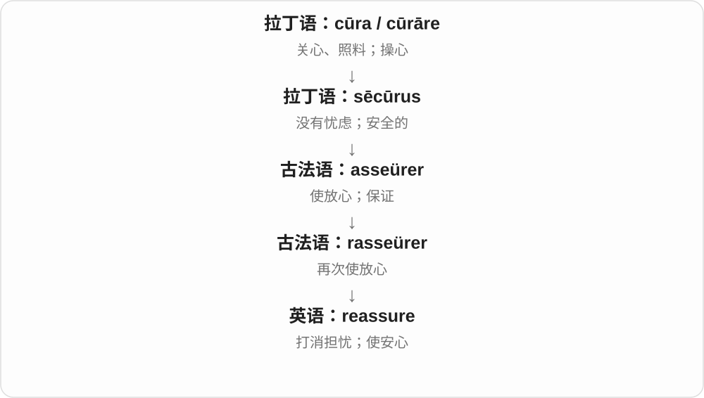

re- 带出恢复信心，但不要求之前已经保证过一次。看见熟悉的人、听见好消息也可以让人安心。

**常见搭配与例句**

reassure someone that…；reassure someone about…；a reassuring smile。

> The teacher reassured the nervous student.

老师安慰了那位紧张的学生。

> The clear explanation reassured us about the plan.

清楚的解释让我们对这个计划放了心。

**别混淆**

assure 偏郑重保证事实；reassure 更突出减轻担忧，动作可以不只靠说话。

### 45. proxy — 代理人；代理权；替代指标；代理服务器

**音标**：英 /ˈprɒksi/；美 /ˈprɑːksi/

**先抓住这个画面**

你不能直接到场，就让别人替你；不能直接测某件事，就拿一个相关指标替它。这种“代为出面”是 proxy。

**怎么拆**

中古英语 procuracie 经缩短形成 procucie、proxy，更早来自代办事务的 prōcūrātiō 词族。

**怎么变成今天的意思**

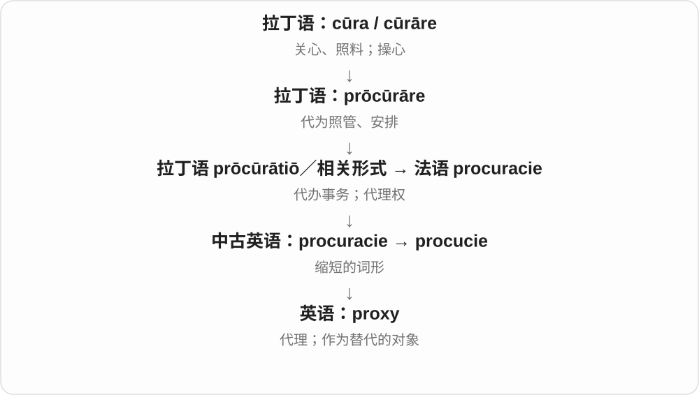

人与权限的代理关系扩展到数据指标和网络中转。收入可作某种情况的 proxy，但替代指标与真实目标仍可能有偏差。

**常见搭配与例句**

vote by proxy；a proxy for…；a proxy server。

> She voted by proxy because she was abroad.

她当时在国外，因此委托代理人投票。

> The study used travel time as a proxy for accessibility.

研究用出行时间作为衡量可达性的替代指标。

**别混淆**

proxy 强调代替某个对象发挥作用；representative 更通常指代表者。指标作为 proxy 不意味着完全等同于目标。

### 46. procure — 设法取得；采购

**音标**：英 /prəˈkjʊə/；美 /prəˈkjʊr/

**先抓住这个画面**

需要某样东西，就去找渠道、安排手续，把它弄到手；procure 比 get 更显得经过一番办理。

**怎么拆**

拉丁语 prō-（代为、为……）+ cūrāre（照管）→ prōcūrāre，经法语进入。

**怎么变成今天的意思**

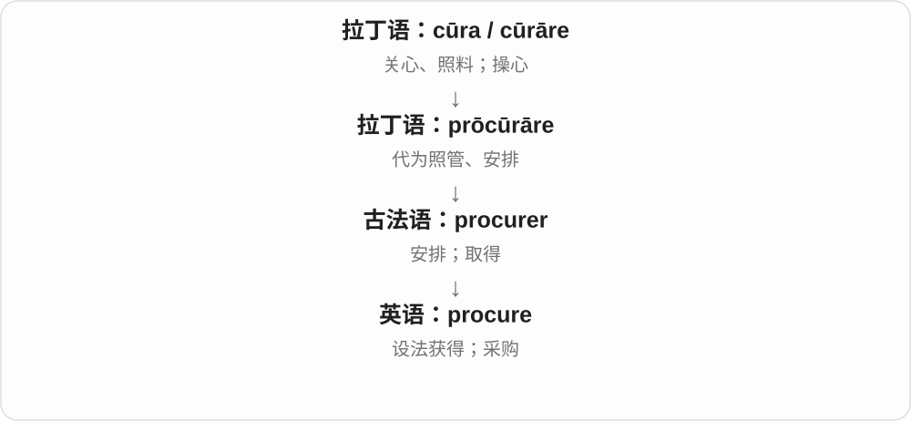

从为某事操办，到安排取得所需之物。正式采购是常见用法；特定语境也可指为他人拉皮条，要靠宾语判断。

**常见搭配与例句**

procure supplies；procure equipment；procure something from…。

> The team procured the equipment from a local supplier.

团队从本地供应商那里采购了设备。

> She managed to procure a copy of the rare book.

她设法弄到了一本稀有书的副本。

**别混淆**

get 最普通；procure 常强调通过安排或努力取得，日常买杯咖啡通常不用它。

### 47. procurement — 采购；取得物资的过程

**音标**：英 /prəˈkjʊəmənt/；美 /prəˈkjʊrmənt/

**先抓住这个画面**

机构不是随手买一件东西，而是确定需求、找供应、安排购买；这一整套取得所需物资的工作叫 procurement。

**怎么拆**

经古法语 procurement 进入英语，与 procurer“安排、取得”相连；现代形式对应 procure + -ment。

**怎么变成今天的意思**

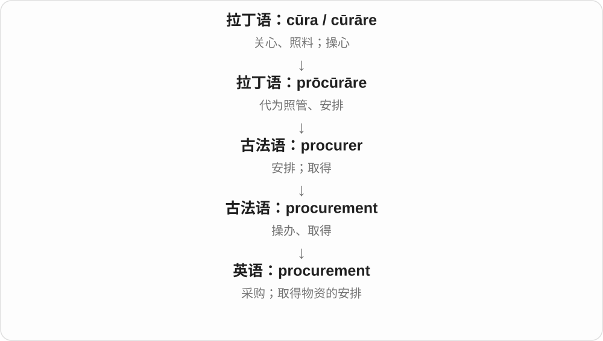

它常用于组织或公共部门，包含取得货物和服务的过程。也可借指负责这项工作的部门。

**常见搭配与例句**

a procurement team；procurement of equipment；a procurement process。

> The procurement team compared three suppliers.

采购团队比较了三家供应商。

> The project was delayed by problems with equipment procurement.

设备采购问题使项目延误了。

**别混淆**

purchasing 常聚焦购买，procurement 常涵盖需求、供应商选择和安排等更完整流程；具体机构用法会有重叠。

### 48. procurator — 代理人；检察官；古罗马财务或行政官

**音标**：英 /ˌprɒkjəˈreɪtə/；美 /ˈprɑːkjəˌreɪtər/

**先抓住这个画面**

有人受托代别人照管事务，procurator 的历史核心就是这位办理人；不同制度把它用作不同官职。

**怎么拆**

拉丁语 prōcūrātor“管理、代理的人”，经法语与中古英语传入。

**怎么变成今天的意思**

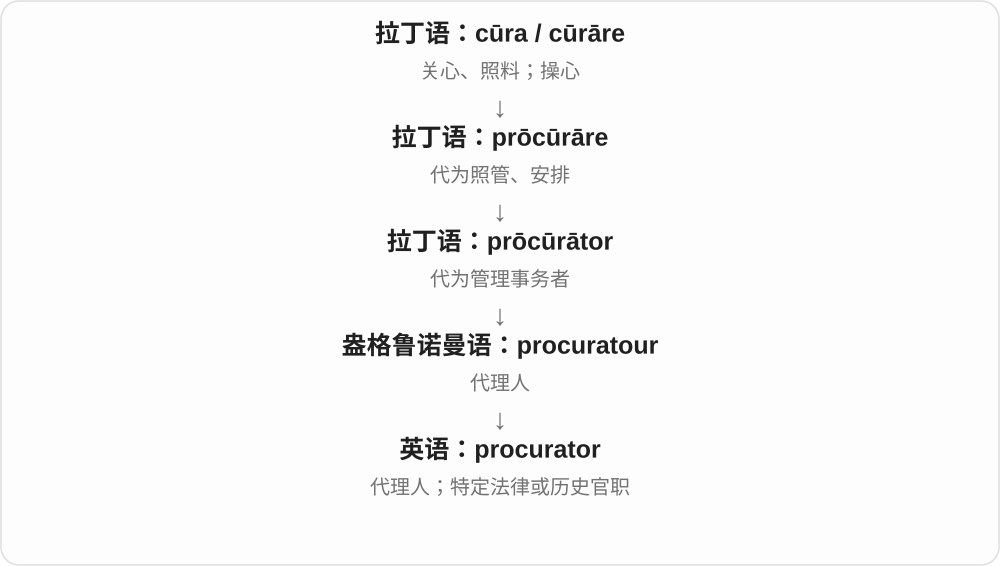

古罗马可指管理税务等的官员，某些现代制度中译作检察官。不能把不同国家、时期的职责都视为完全一样。

**常见搭配与例句**

a Roman procurator；a public procurator；act as procurator。

> The historian described the duties of a Roman procurator.

历史学家介绍了古罗马行省财务官的职责。

> The text uses procurator as the title of a legal official.

文本用 procurator 作为一种司法官员的称号。

**别混淆**

proctor 是同源词缩短后的形式，但现代常指监考员；procurator 不适合随意替换所有 lawyer。

### 49. procuration — 代理管理；代理授权；取得

**音标**：英 /ˌprɒkjəˈreɪʃən/；美 /ˌprɑːkjəˈreɪʃən/

**先抓住这个画面**

人不能亲自办理，就授予别人替自己处理事务的权力，procuration 可以指这种代理安排。

**怎么拆**

来自拉丁语 prōcūrātiō，经法语传入；现代可见 procure + -ation 的关系。

**怎么变成今天的意思**

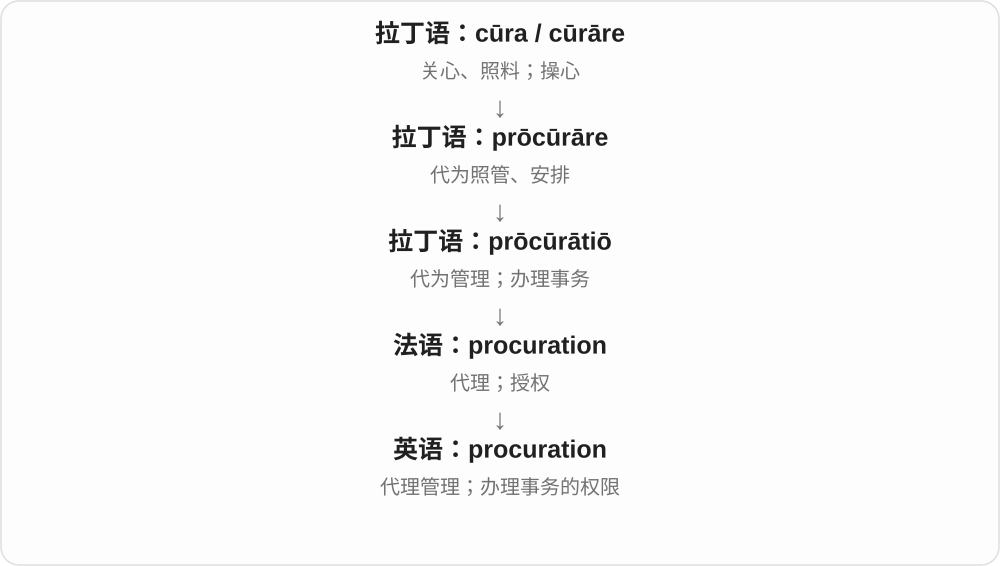

它可指代办的行为、权限或授权文书，也保留较一般的取得义。是正式或历史用语，不能仅按结尾理解为采购单。

**常见搭配与例句**

by procuration；a letter of procuration；powers of procuration。

> The document authorized him to act by procuration.

文件授权他以代理身份行事。

> The archive preserves a letter of procuration.

档案馆保存着一封代理授权书。

**别混淆**

procurement 现代多说采购；procuration 更容易出现在代理、授权的正式语境。

### 50. procurable — 可取得的；能采购到的

**音标**：英 /prəˈkjʊərəbəl/；美 /prəˈkjʊrəbəl/

**先抓住这个画面**

东西不是完全找不到，只要通过相应渠道就能弄到，可以说 procurable。

**怎么拆**

procure + -able，去掉结尾 e。

**怎么变成今天的意思**

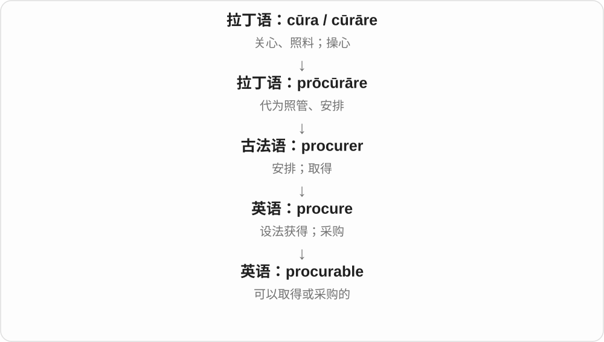

这是较正式、少见的表达。常强调有没有渠道或条件取得，不一定强调现货就在眼前。

**常见搭配与例句**

readily procurable；locally procurable；procurable from…。

> The replacement parts are readily procurable.

这些替换零件很容易买到。

> The materials must be procurable from local suppliers.

这些材料必须能从本地供应商处采购到。

**别混淆**

available 更常用、更宽泛；procurable 特别强调可以设法获得。

### 51. procuracy — 代理官职位；检察机关

**音标**：英 /ˈprɒkjərəsi/；美 /ˈprɑːkjərəsi/

**先抓住这个画面**

procurator 所担任的职位，或由这类官员组成的机关，可以称 procuracy。

**怎么拆**

经盎格鲁诺曼语 procuracie 来自拉丁语相关官职词形；与 proxy 是同源异形词。

**怎么变成今天的意思**

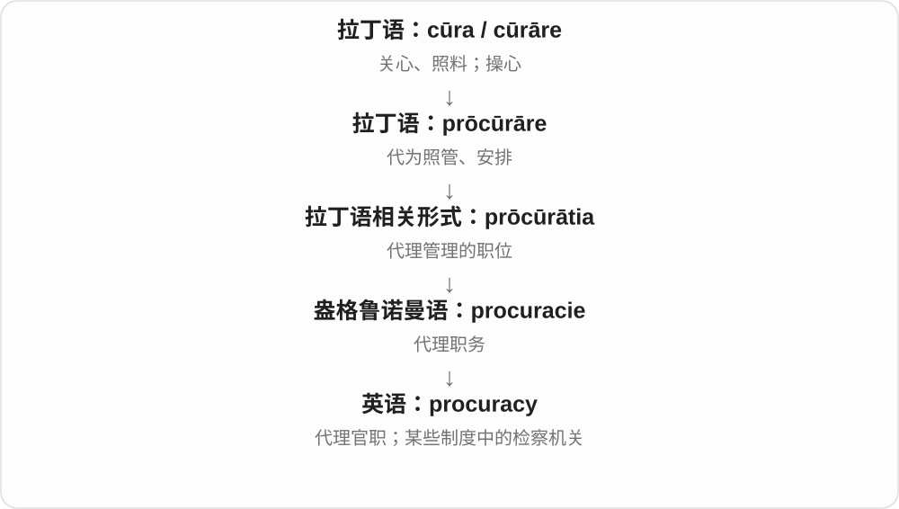

从个人办理事务扩展到制度性的岗位或机构。现代讨论某些司法制度时，它常对应检察机关，但名称不能替代具体职权说明。

**常见搭配与例句**

a regional procuracy；the office of the procuracy；a procuracy official。

> The chapter describes the structure of the procuracy.

这一章介绍了检察机关的组织结构。

> The records trace the history of the procuracy in that region.

这些记录追溯了该地区代理官职的历史。

**别混淆**

procurator 是官员或代理人；procuracy 是职位、机构。proxy 是更常见的代理或替代者。

### 52. proctor — 监考员；学监；监考

**音标**：英 /ˈprɒktə/；美 /ˈprɑːktər/

**先抓住这个画面**

考试现场有人发卷、看时间、维护秩序，在美式英语里，这个人通常叫 proctor。

**怎么拆**

从中古英语 procuratour 缩短为 procatour、procutour，来源与 procurator 相同。

**怎么变成今天的意思**

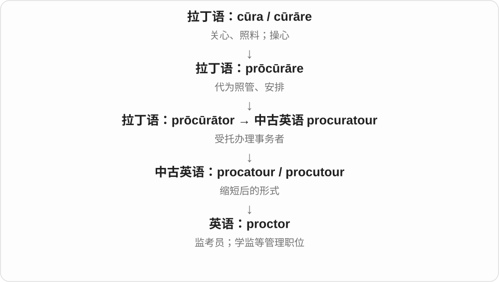

代人管理事务的官员称号，在大学制度中发展出具体管理职责。现代美国监考义很常见，英国一些学校的 proctor 则是学监职位。

**常见搭配与例句**

an exam proctor；proctor an exam；a university proctor。

> The proctor asked everyone to put their phones away.

监考员要求大家收起手机。

> She volunteered to proctor the morning exam.

她自愿为上午的考试监考。

**别混淆**

英式监考员常叫 invigilator。不要只按同源关系把 proctor 译成任何语境的检察官。

### 53. proctorage — 学监或代理人的监督职责（旧词）

**音标**：英 /ˈprɒktərɪdʒ/；美 /ˈprɑːktərɪdʒ/

**先抓住这个画面**

把 proctor 的管理、监督工作整体当作一项职务来称呼，就是 proctorage。这个词如今很少使用。

**怎么拆**

proctor + -age，构成与职位、活动有关的名词。

**怎么变成今天的意思**

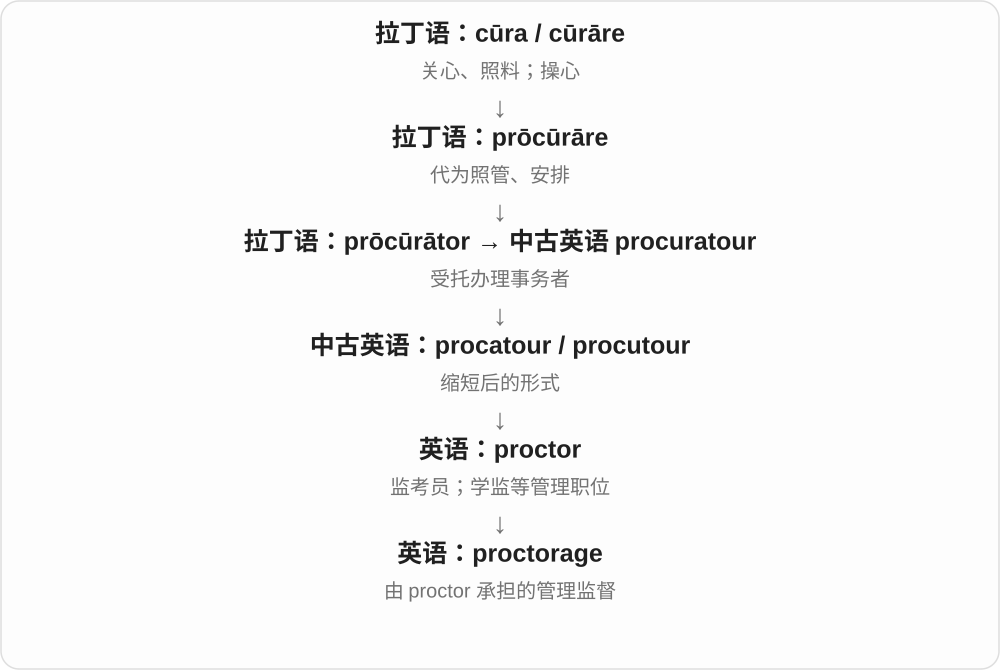

旧文中可能涉及代理人管理或大学监督。现代一般直接说 duties、supervision 或 office of the proctor。

**常见搭配与例句**

duties of proctorage；under proctorage（旧式）。

> The old charter describes the duties of proctorage.

这份旧章程描述了学监的监督职责。

> The historian explains how proctorage operated at the college.

历史学家解释了该学院的学监管理如何运作。

**别混淆**

proctorage 不是 storage“储存”。不要把相似结尾当成同一词根。

### 54. proctorial — 学监的；监考或监督职务的

**音标**：英 /prɒkˈtɔːriəl/；美 /prɑːkˈtɔːriəl/

**先抓住这个画面**

与 proctor 的监督职责有关的规则、权力或事务，就可用 proctorial 修饰。

**怎么拆**

proctor + -ial，重音随派生转到后部。

**怎么变成今天的意思**

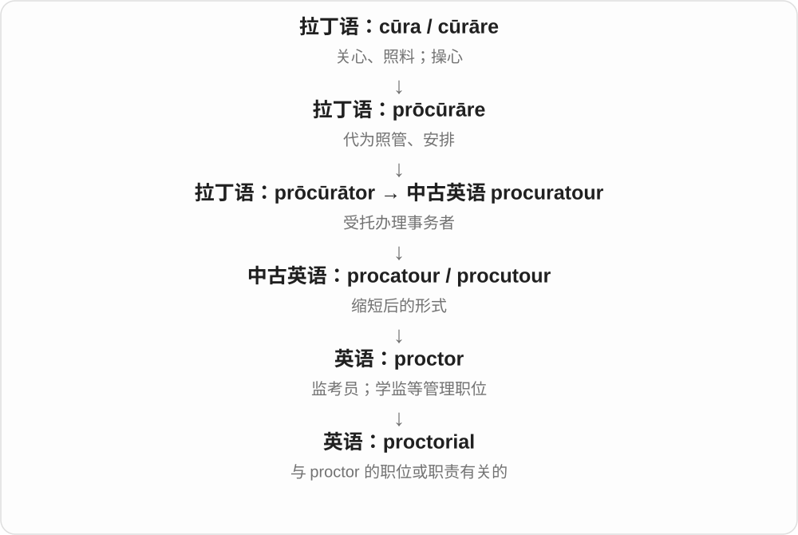

主要见于大学制度和正式管理文件。具体是学生纪律还是考试监督，要看该机构对 proctor 的定义。

**常见搭配与例句**

proctorial duties；proctorial authority；a proctorial office。

> The handbook lists the university’s proctorial duties.

手册列出了大学学监的职责。

> The dispute concerned the limits of proctorial authority.

争议涉及学监权限的边界。

**别混淆**

proctorial 不是 prosecutorial“检察官的”。两者拼写相近，职业职能却可能差很远。

### 55. manicure — 修甲；手部指甲护理

**音标**：英 /ˈmænɪkjʊə/；美 /ˈmænɪkjʊr/

**先抓住这个画面**

把手部指甲修整干净、整理形状，常还包括上色，这种护理叫 manicure。

**怎么拆**

经法语 manucure，由拉丁语 manus（手）与 cūra（照料）组成。

**怎么变成今天的意思**

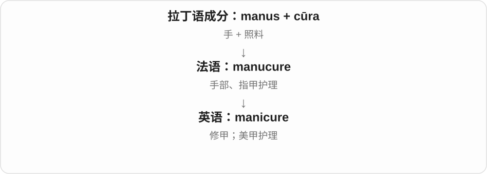

名字直接点出护理部位。现代还可作动词，表示给手指甲做护理；manicured lawn 则借来形容草坪修剪得精细。

**常见搭配与例句**

get a manicure；a manicure kit；manicured nails。

> She booked a manicure before the wedding.

她在婚礼前预约了美甲护理。

> The kit contains the basic tools for a manicure.

套装里包含修甲的基本工具。

**别混淆**

manicure 护理手部指甲；pedicure 护理脚部。nail polish 只是指甲油，不是整个护理过程。

### 56. scour — 用力擦洗；冲刷；四处搜寻

**音标**：英 /ˈskaʊə/；美 /ˈskaʊr/

**先抓住这个画面**

清洗时来回用力擦，是 scour；寻找时把一片地方翻遍，也叫 scour。但这两个常见义不宜硬画成一条确定词源。

**怎么拆**

清洗义大概经荷兰语或法语追溯到拉丁语 excūrāre“彻底照管、清理”；搜寻义另有北欧语来源解释，后来两支互相影响。

**怎么变成今天的意思**

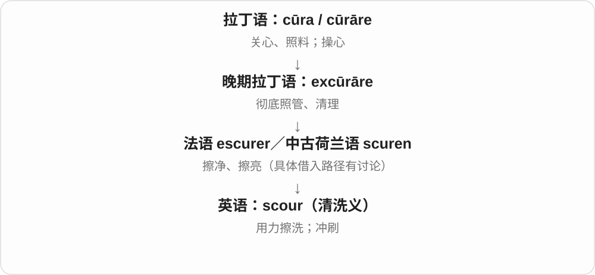

本页图画清洗一支。现代理解搜寻义时，可以用“像刷地一样把区域扫遍”作记忆图景，但这不等于证明搜寻义历史上就是从擦洗直接产生。

**常见搭配与例句**

scour a pan；scour the area for…；water scours the riverbed。

> She scoured the burnt pan until it was clean.

她用力擦洗烧焦的锅，直到洗干净。

> We scoured the house for the missing keys.

我们把屋子翻了个遍，寻找丢失的钥匙。

**别混淆**

scrub 强调用力刷洗；scour 除擦洗还常说彻底搜寻。scourge“祸害、鞭笞”不是这个词。

### 57. scourage — 冲洗后的污水；侦察（罕用旧义）

**音标**：/ˈskaʊrɪdʒ/（按 scour + -age 读）

**先抓住这个画面**

清理时把脏东西冲下来，留下的废水，在罕见旧用法里可叫 scourage；另有与搜寻一支相关的侦察义。

**怎么拆**

scour + -age。要先判断使用的是清洗还是搜寻义，不能把两支都强行归到 cūra。

**怎么变成今天的意思**

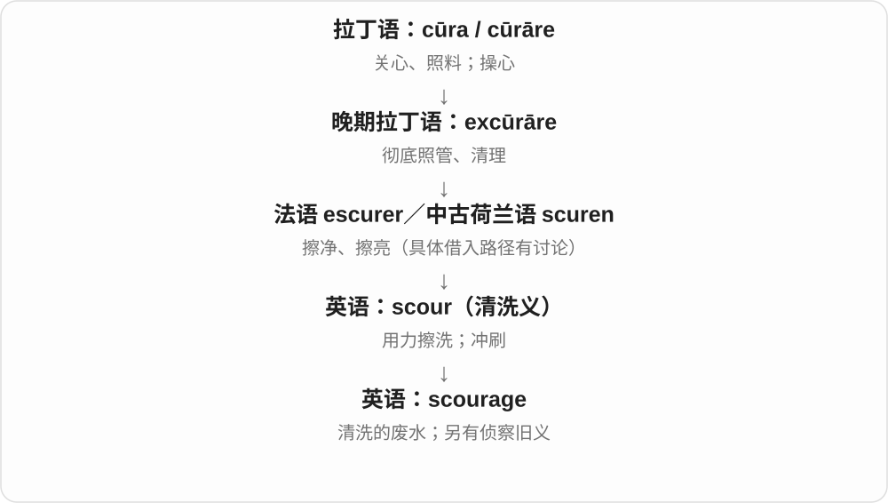

本页与词根相关的是清洗废水义。这个词极少见，现代通常直接说 wash water、wastewater 或 scouting，按实际意思选词。

**常见搭配与例句**

scourage from washing（旧式）；scourage of an area（侦察旧义）。

> The old manual calls the dirty wash water scourage.

这本旧手册把清洗后的脏水称为 scourage。

> The glossary lists scouting as another old meaning of scourage.

词汇表把侦察列为 scourage 的另一个旧义。

**别混淆**

scourage 不是 scourge“灾祸”。网络上把这两个词混写的解释不少，读旧文本时要核对拼写。

### 58. pedicure — 足部护理；修脚趾甲

**音标**：英 /ˈpedɪkjʊə/；美 /ˈpedɪkjʊr/

**先抓住这个画面**

把护理对象从手换成脚，整理脚趾甲和足部外观，就是 pedicure。

**怎么拆**

借自法语 pédicure；拉丁语 pēs、ped-（脚）+ cūra（照料）。

**怎么变成今天的意思**

构词把部位与动作组合起来。通常指美容护理服务，并不能据此把任何医学足病治疗都叫 pedicure。

**常见搭配与例句**

get a pedicure；a pedicure appointment；a pedicure chair。

> She chose a simple pedicure without colored polish.

她选择了不涂彩色甲油的简单足部护理。

> The salon offers both manicures and pedicures.

这家美容店同时提供手部美甲和足部护理。

**别混淆**

podiatry 是足病专业领域；pedicure 常是足部美容护理。两者不等同。

### 59. curio — 古玩；小奇物；珍奇物件

**音标**：英 /ˈkjʊəriəʊ/；美 /ˈkjʊrioʊ/

**先抓住这个画面**

逛旧货店时看到一件小巧又特别、让人想拿起来端详的东西，可以叫 curio。

**怎么拆**

由 curiosity“奇物”截短而来；不是独立的拉丁语词根直接变成物品名称。

**怎么变成今天的意思**

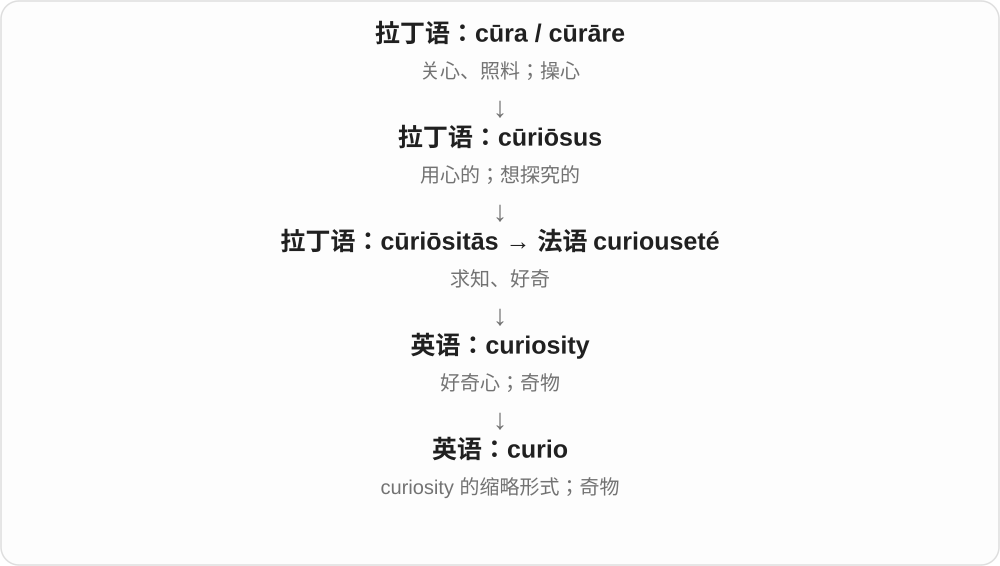

好奇的对象变成专门的收藏小物名称。它不保证年代很久，也不保证价格昂贵。

**常见搭配与例句**

a curio shop；a cabinet of curios；an antique curio。

> The shelf was crowded with curios from her travels.

架子上摆满了她旅行带回来的小奇物。

> We spent an hour browsing a tiny curio shop.

我们在一家小古玩店逛了一个小时。

**别混淆**

antique 强调年代与收藏性质；curio 强调有趣、奇特。纪念小物也可能只是 curio。

### 60. sinecure — 有俸禄的闲职；轻松肥缺

**音标**：英 /ˈsaɪnɪkjʊə/；美 /ˈsaɪnəkjʊr/

**先抓住这个画面**

工资照领，实际要操心、要做的事却很少，这种职位叫 sinecure，通常带批评意味。

**怎么拆**

教会拉丁语 sine cūrā“无照管职责”，是 beneficium sine cūrā 的缩略；sine 是“没有”，不是英语 sin。

**怎么变成今天的意思**

原来特指不需承担照顾教民职责的圣职收益，后来泛指待遇好而责任轻的工作。

**常见搭配与例句**

a lucrative sinecure；regard a post as a sinecure；no sinecure。

> Critics described the position as a well-paid sinecure.

批评者把这个职位称为高薪闲职。

> Running the archive is no sinecure.

管理档案馆可不是一份轻松闲差。

**别混淆**

a job is no sinecure 表示这份工作并不轻松。sinecure 不是普通的休假或退休。

### 61. sinecural — 闲职性质的；与有俸闲职有关的

**音标**：/ˌsaɪnɪˈkjʊərəl/

**先抓住这个画面**

一个职位名义上有职责，实际工作却很少，可以用这个罕见形容词指出它的闲职性质。

**怎么拆**

sinecure + -al，词尾 e 去掉；对应“与 sinecure 有关的”。

**怎么变成今天的意思**

这是正式、罕见的评论用词。现代通常直接说 a sinecure 或 a largely ceremonial post，具体是否批评要看语境。

**常见搭配与例句**

a sinecural office；sinecural appointments；a sinecural position。

> The essay criticizes sinecural appointments in the old administration.

文章批评旧行政体系中的闲职任命。

> He argued that the office had become largely sinecural.

他认为这个职位已经基本变成了有俸闲职。

**别混淆**

ceremonial 说礼仪性，不必等于没有价值；sinecural 更容易强调责任轻、拿报酬。

### 62. curettage — 刮除术；刮取操作

**音标**：英 /kjʊəˈretɪdʒ/；美 /ˌkjʊrəˈtɑːʒ/

**先抓住这个画面**

用刮匙清除或取出组织等材料，这个操作名称叫 curettage；它不是器械本身。

**怎么拆**

借自法语 curettage，curette 词族加表示行为的 -age。

**怎么变成今天的意思**

这个词出现在不同医学专业中，不能仅凭名称判断具体部位、目的或适应情形。这里只需记住“工具动作变成操作名”。

**常见搭配与例句**

a curettage procedure；a description of curettage；surgical curettage。

> The leaflet explains the purpose of curettage.

说明页解释了刮除术的目的。

> The textbook includes a diagram of the instruments used in curettage.

教材包含了刮除术所用器械的示意图。

**别混淆**

curettage 不是所有手术的统称，也不是 cure“治愈”的同义词。名称描述操作，不保证结果。

### 63. assecure — 使安全；使确定；保证

**音标**：/ˌæsɪˈkjʊə/（旧词）

**先抓住这个画面**

在旧英语文章中，作者用 assecure 表示让某事安全、确定；现代通常直接说 secure 或 assure。

**怎么拆**

借自晚期拉丁语 assecurāre，与 ad- + sēcūrus 的构词有关，是 assure 的同源异形词。

**怎么变成今天的意思**

字形保留了更多拉丁语痕迹，而 assure 经过法语变化后更短。不要误当成现代 assure 的拼写错误，更不要在日常邮件里刻意使用。

**常见搭配与例句**

assecure a right；assecure a position（旧式表达）。

> The old text uses assecure to mean make safe.

这篇旧文用 assecure 表示使安全。

> In this passage, the ruler seeks to assecure his position.

在这一段中，统治者试图稳固自己的地位。

**别混淆**

assure 是现代常用词，assecure 已过时。相同的历史来源不代表今天可自由替换。

### 64. pococurante — 漠不关心的；满不在乎的人

**音标**：英 /ˌpəʊkəʊkjʊəˈrænti/；美 /ˌpoʊkoʊkjuːˈrɑːnti/

**先抓住这个画面**

别人觉得重要或精彩，他却淡淡地说“就这样吧”，懒得关心。这种冷淡的姿态可以叫 pococurante。

**怎么拆**

意大利语 poco（少）+ curante（关心的），经伏尔泰《老实人》中人物 Pococurante 的名字传播到英语。

**怎么变成今天的意思**

人物名字把态度直接写了出来，后来成为形容词和普通名词。它是文学色彩浓的罕词，日常通常用 indifferent 或 unconcerned。

**常见搭配与例句**

a pococurante attitude；a pococurante observer。

> The critic adopted a pococurante attitude toward the fashionable exhibition.

这位评论家对那场时髦展览采取了满不在乎的态度。

> The novel portrays him as a cultivated pococurante.

小说把他描写成一个有修养却漠然的人。

**别混淆**

calm 是平静，不必是不关心；pococurante 强调投入和关切很少。

## 这一组要分清什么

**assure / ensure / insure**：向人保证；确保事情实现；提供保险。

**cure / treat / heal**：治好；治疗；愈合、恢复。可治疗不一定等于可治愈。

**curious / curiosity / curio**：好奇的或奇特的；好奇心或奇物；小型珍奇物件。

**curator / curate**：馆藏管理人、策展人；curate 作动词是策展，作名词却是牧师职位。

**secure / sure / sinecure**：安全牢靠；心里确信；有报酬而少有实际职责的职位。同根的“免于操心”走出了不同方向。

## 串起来练习

The **curator** was **curious** about the object, checked the record for **accuracy**, and **ensured** that it was stored **securely**.

馆藏管理人对这件物品很好奇，核查记录是否准确，并确保它得到安全保存。

连起来记：照管东西的人 → curator；注意力被吸引、想知道 → curious；用心核对得准确 → accuracy；安排好让人放心 → ensure、securely。
