# 0078 · pot- — 能力、力量、掌控；潜力与可能性

[逐词精讲目录](../00_逐词精讲目录.md) · [总目录](../00_总目录_按常用程度.md)

## 核心词根与来源

先想象**你手里有一个能让事情发生的按钮**。拉丁语 potis 表示有能力、有支配力，posse 表示能够；它的分词 potens 留下了 potent-。**power** 是已经可以使用的力量或权力，**potential** 是还没有充分发挥的能力，**possible** 则说事情存在实现空间。**possess** 走向拥有、掌控：东西受你控制，强烈的情绪也可以反过来控制你。这几个词外形差异很大，历史上却能联系起来。

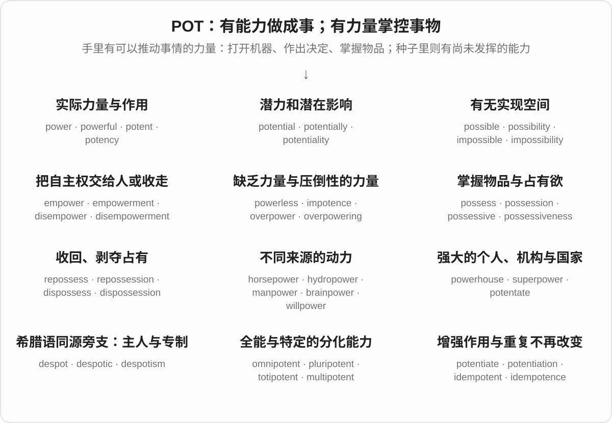

## 词形与演化规律

**pot- / potent- / poss-** 是拉丁词形变化和后续借词路线留下的不同外形，不是把英语字母随意换来换去。**power** 经法语传来，外形变化尤其明显；**potent、potential、possible、possession** 各有自己的借入链。**possess** 中还关联 sedere“坐”，可把“坐稳并掌握”当作记忆画面，别误拆成 pose。**despot** 是希腊语“主人”这一同源旁支，经别的路线进入英语，不能画成拉丁 potent 的后代。**powertrain、brainpower、empower** 等是在英语内部继续构词。星号标出的早期形式表示语言学重构，画面联想不冒充历史故事。

## 单词速览（按词族由简到繁）

同一基础词的相关扩展放在一起，先读基础形式，再读扩展；各组之间优先读常用的。具体词源关系见各词讲解。

| 单词 | 音标 | 核心意思 |
|---|---|---|
| [power](#w-1) | 英 /ˈpaʊə/；美 /ˈpaʊər/ | 能力；权力；电力、动力；功率；幂；为……供能 |
| [powerful](#w-4) | 英 /ˈpaʊəfəl/；美 /ˈpaʊərfəl/ | 强大的；有影响力的；效果强烈的 |
| [powerfully](#w-24) | 英 /ˈpaʊəfəli/；美 /ˈpaʊərfəli/ | 有力地；强烈地；深刻地 |
| [powerless](#w-17) | 英 /ˈpaʊələs/；美 /ˈpaʊərləs/ | 无力的；无权的；无能为力的 |
| [powerlessness](#w-40) | 英 /ˈpaʊələsnəs/；美 /ˈpaʊərləsnəs/ | 无力感；无权力的状态 |
| [powerhouse](#w-19) | 英 /ˈpaʊəhaʊs/；美 /ˈpaʊərhaʊs/ | 发电厂房；实力强大的机构、地区或人物 |
| [powerlifting](#w-34) | 英 /ˈpaʊəˌlɪftɪŋ/；美 /ˈpaʊərˌlɪftɪŋ/ | 力量举 |
| [powerball](#w-35) | 按构词的参考读法：英 /ˈpaʊəbɔːl/；美 /ˈpaʊərbɔːl/ | 特定语境中的混合毒品俗称；大写 Powerball 为彩票名称 |
| [powertrain](#w-37) | 英 /ˈpaʊətreɪn/；美 /ˈpaʊərtreɪn/ | 车辆动力系统；动力传动总成 |
| [powerboat](#w-50) | 英 /ˈpaʊəbəʊt/；美 /ˈpaʊərboʊt/ | 机动艇；动力艇 |
| [powerlifter](#w-52) | 英 /ˈpaʊəˌlɪftə/；美 /ˈpaʊərˌlɪftər/ | 力量举运动员；力量举练习者 |
| [powerbomb](#w-54) | 按构词的参考读法：英 /ˈpaʊəbɒm/；美 /ˈpaʊərbɑːm/ | 职业摔角中的“炸弹摔”；使出这种摔技 |
| [empower](#w-15) | 英 /ɪmˈpaʊə/；美 /ɪmˈpaʊər/ | 授权；使有能力或信心采取行动 |
| [empowered](#w-13) | 英 /ɪmˈpaʊəd/；美 /ɪmˈpaʊərd/ | 获授权的；有能力自主行动的 |
| [empowerment](#w-14) | 英 /ɪmˈpaʊəmənt/；美 /ɪmˈpaʊərmənt/ | 授权；自主能力的增强；赋权 |
| [disempower](#w-61) | 英 /ˌdɪsɪmˈpaʊə/；美 /ˌdɪsemˈpaʊər/ | 剥夺权力；削弱自主行动能力 |
| [disempowerment](#w-60) | 英 /ˌdɪsɪmˈpaʊəmənt/；美 /ˌdɪsemˈpaʊərmənt/ | 权力被削弱；自主能力丧失 |
| [horsepower](#w-16) | 英 /ˈhɔːsˌpaʊə/；美 /ˈhɔːrsˌpaʊər/ | 马力；功率单位 |
| [manpower](#w-18) | 英 /ˈmænˌpaʊə/；美 /ˈmænˌpaʊər/ | 人力；可调配的劳动力 |
| [firepower](#w-20) | 英 /ˈfaɪəˌpaʊə/；美 /ˈfaɪərˌpaʊər/ | 火力；可用于竞争或解决问题的强大资源 |
| [superpower](#w-22) | 英 /ˈsuːpəˌpaʊə/；美 /ˈsuːpərˌpaʊər/ | 超级大国；超能力；特别突出的本领 |
| [willpower](#w-25) | 英 /ˈwɪlˌpaʊə/；美 /ˈwɪlˌpaʊər/ | 意志力；自制力 |
| [hydropower](#w-31) | 英 /ˈhaɪdrəʊˌpaʊə/；美 /ˈhaɪdroʊˌpaʊər/ | 水力；水力发电 |
| [overpower](#w-33) | 英 /ˌəʊvəˈpaʊə/；美 /ˌoʊvərˈpaʊər/ | 制服；压倒；使难以承受 |
| [overpowering](#w-28) | 英 /ˌəʊvəˈpaʊərɪŋ/；美 /ˌoʊvərˈpaʊərɪŋ/ | 强烈得难以承受的；压倒性的 |
| [overpoweringly](#w-64) | 英 /ˌəʊvəˈpaʊərɪŋli/；美 /ˌoʊvərˈpaʊərɪŋli/ | 强烈得压倒一切地；令人难以承受地 |
| [brainpower](#w-45) | 英 /ˈbreɪnˌpaʊə/；美 /ˈbreɪnˌpaʊər/ | 脑力；智力；集体智慧 |
| [airpower](#w-46) | 英 /ˈeəˌpaʊə/；美 /ˈerˌpaʊər/ | 空中力量；航空作战能力 |
| [possible](#w-2) | 英 /ˈpɒsəbəl/；美 /ˈpɑːsəbəl/ | 可能的；办得到的；可考虑的 |
| [possibly](#w-6) | 英 /ˈpɒsəbli/；美 /ˈpɑːsəbli/ | 也许；可能；究竟、到底；尽可能 |
| [possibility](#w-7) | 英 /ˌpɒsəˈbɪləti/；美 /ˌpɑːsəˈbɪləti/ | 可能性；可能的选择或情况 |
| [impossible](#w-5) | 英 /ɪmˈpɒsəbəl/；美 /ɪmˈpɑːsəbəl/ | 不可能的；难以忍受或应付的 |
| [impossibility](#w-26) | 英 /ɪmˌpɒsəˈbɪləti/；美 /ɪmˌpɑːsəˈbɪləti/ | 不可能；不可能的事 |
| [impossibly](#w-29) | 英 /ɪmˈpɒsəbli/；美 /ɪmˈpɑːsəbli/ | 难以置信地；令人觉得不可能地；极其 |
| [potent](#w-12) | 英 /ˈpəʊtənt/；美 /ˈpoʊtənt/ | 强有力的；效力强的；影响大的 |
| [potential](#w-3) | /pəˈtenʃəl/ | 潜在的；可能成为的；潜力；势 |
| [potentially](#w-8) | /pəˈtenʃəli/ | 有可能地；潜在地 |
| [potentiality](#w-49) | /pəˌtenʃiˈæləti/ | 潜能；潜在可能性；发展空间 |
| [potency](#w-21) | 英 /ˈpəʊtənsi/；美 /ˈpoʊtənsi/ | 效力；作用强度；潜能 |
| [potentate](#w-56) | 英 /ˈpəʊtənteɪt/；美 /ˈpoʊtənteɪt/ | 君主；有巨大权势的人 |
| [potentiate](#w-57) | /pəˈtenʃieɪt/ | 增强效力；使作用更强 |
| [potentiation](#w-53) | 英 /pəʊˌtenʃiˈeɪʃən/；美 /pəˌtenʃiˈeɪʃən/ | 作用增强；增效；神经联系的增强 |
| [impotent](#w-27) | /ˈɪmpətənt/ | 无能为力的；无效力的；旧医学用语：勃起功能有障碍的 |
| [impotence](#w-30) | /ˈɪmpətəns/ | 无力；无能为力；旧称：勃起功能障碍 |
| [impotently](#w-59) | /ˈɪmpətəntli/ | 无能为力地；徒劳地 |
| [pluripotent](#w-43) | 英 /ˌplʊərɪˈpəʊtənt/；美 /ˌplʊrɪˈpoʊtənt/ | 多能的；能分化成身体各类细胞的 |
| [multipotent](#w-62) | 英 /ˌmʌltiˈpəʊtənt/；美 /mʌlˈtɪpətənt/ | 多向分化的；能形成有限几类细胞的 |
| [possess](#w-10) | /pəˈzes/ | 拥有；具有；占据、控制 |
| [possession](#w-9) | /pəˈzeʃən/ | 占有、持有；财物；球权；被附身的状态 |
| [possessed](#w-11) | /pəˈzest/ | 被控制的；着了魔似的；具有的 |
| [possessive](#w-23) | /pəˈzesɪv/ | 占有欲强的；所有格的；所有格形式 |
| [possessiveness](#w-51) | /pəˈzesɪvnəs/ | 占有欲；独占、控制的倾向 |
| [possessively](#w-63) | /pəˈzesɪvli/ | 带占有欲地；不愿与人分享地 |
| [possessor](#w-38) | 英 /pəˈzesə/；美 /pəˈzesər/ | 持有者；拥有者；具有某种品质的人 |
| [repossess](#w-48) | /ˌriːpəˈzes/ | 收回占有；收回未按约付款的财物 |
| [repossession](#w-44) | /ˌriːpəˈzeʃən/ | 收回占有；因欠款等被收回财物 |
| [dispossess](#w-55) | /ˌdɪspəˈzes/ | 剥夺财产或土地；使失去占有；夺走球权 |
| [dispossession](#w-47) | /ˌdɪspəˈzeʃən/ | 剥夺占有；土地或财产被夺走 |
| [omnipotent](#w-32) | 英 /ɒmˈnɪpətənt/；美 /ɑːmˈnɪpətənt/ | 全能的；仿佛无所不能的 |
| [omnipotence](#w-41) | 英 /ɒmˈnɪpətəns/；美 /ɑːmˈnɪpətəns/ | 全能；无限的力量或权力 |
| [despot](#w-36) | 英 /ˈdespɒt/；美 /ˈdespət/ | 专制统治者；独断专行的人；历史称号 |
| [despotic](#w-39) | 英 /deˈspɒtɪk/；美 /deˈspɑːtɪk/ | 专制的；专横的 |
| [despotism](#w-42) | /ˈdespətɪzəm/ | 专制统治；专横作风 |
| [idempotent](#w-58) | 英 /ˌɪdəmˈpəʊtənt/；美 /ˈaɪdəmˌpoʊtənt/ | 幂等的；重复操作不额外改变结果的 |
| [idempotence](#w-66) | 英 /ˌɪdemˈpəʊtəns/；美 /ˈaɪdəmˌpoʊtəns/ | 幂等性 |
| [totipotent](#w-65) | 英 /təʊˈtɪpətənt/；美 /toʊˈtɪpətənt/ | 全能的；有形成完整个体潜能的 |

## 逐词讲解

### 1. power — 能力；权力；电力、动力；功率；幂；为……供能

**音标**：英 /ˈpaʊə/；美 /ˈpaʊər/

**先抓住这个画面**

power 的共同画面是“让事情动起来、按某个方向发生的力量”：人能作决定，发动机能带动车，电能点亮灯。

**怎么拆**

经法语来自表示“能够”的通俗拉丁语 *potere，与拉丁 potis、posse 同族；英语动词 power 后来由名词转用。不能按现代拼写硬拆出 pot。

**怎么变成今天的意思**

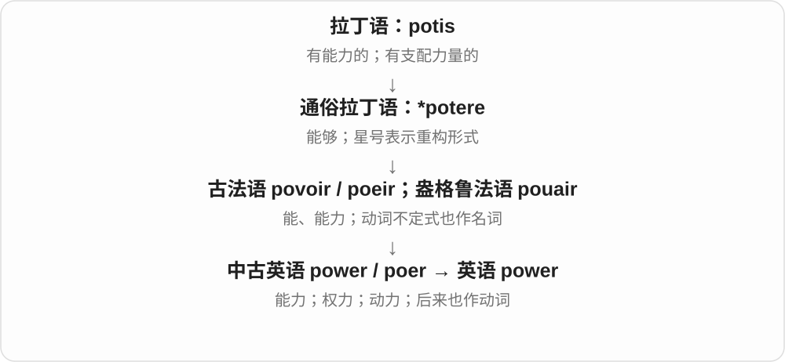

the power to decide 是决定权或决定能力，a power cut 是停电。物理学中 power 是能量转移或做功的快慢，即功率；数学里的 a power 则是幂。power a device 是给设备供能。

**常见搭配与例句**

the power to do；in power；power supply；power consumption；to the power of two。

> The solar panels power the lights in the garden.

太阳能板给花园里的灯供电。

> The committee has the power to reject the proposal.

委员会有权否决这项提议。

> Two to the power of three is eight.

二的三次方是八。

**别混淆**

power 可以指能力、权力或功率；energy 是能量，电池储存多少能量与它能多快输出能量是不同问题。

### 2. powerful — 强大的；有影响力的；效果强烈的

**音标**：英 /ˈpaʊəfəl/；美 /ˈpaʊərfəl/

**先抓住这个画面**

powerful 是力量足以推动局面：可以是推动车的马力，也可以是让人久久忘不了的一句话。

**怎么拆**

中古英语已有 pouerful 等形式，由当时的 power 加 -ful；现代仍可直接按 power + -ful 理解。

**怎么变成今天的意思**

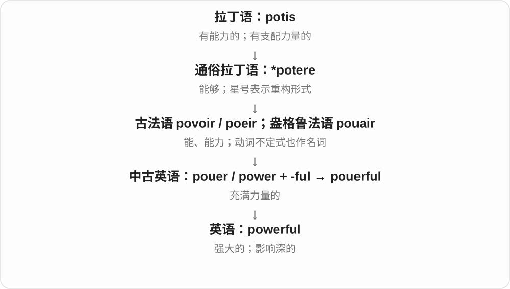

a powerful engine 有强劲动力；a powerful speech 能打动人或改变想法。它不只说身体强壮，也能评价证据、情绪、机构和工具。

**常见搭配与例句**

a powerful engine；a powerful argument；a powerful influence on。

> The small boat has a surprisingly powerful engine.

这艘小船的发动机动力强得出人意料。

> Her final sentence had a powerful effect on the audience.

她最后一句话给听众带来了强烈触动。

**别混淆**

strong 更宽泛、更日常；powerful 常让人想到力量已经足以造成明显影响。

### 3. powerfully — 有力地；强烈地；深刻地

**音标**：英 /ˈpaʊəfəli/；美 /ˈpaʊərfəli/

**先抓住这个画面**

powerfully 描写力量是怎样表现出来的：一脚踢得有力，一段回忆也能强烈牵动人。

**怎么拆**

powerful + -ly，表示方式或程度。

**怎么变成今天的意思**

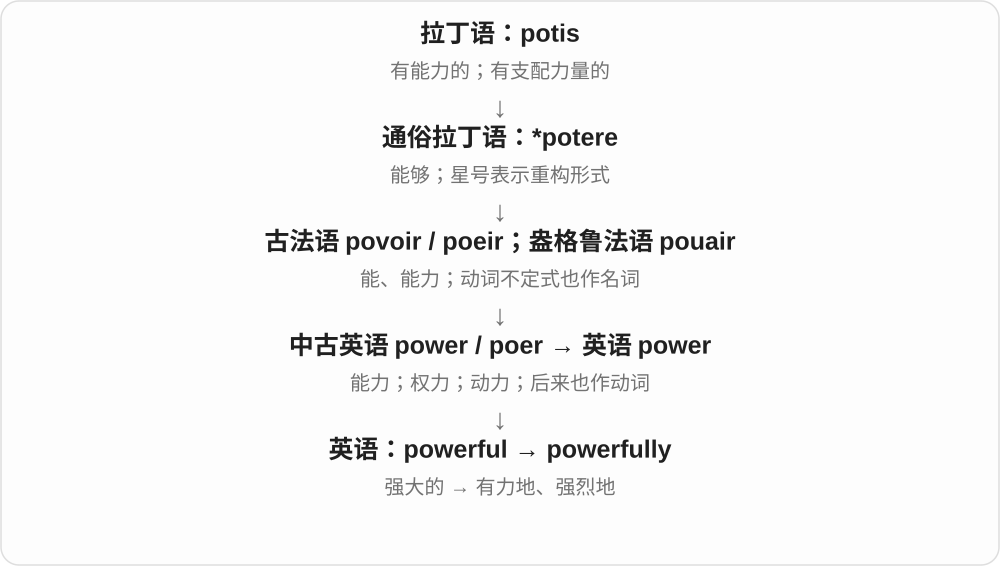

argue powerfully 是论证很有说服力；be powerfully affected 是受到强烈影响。它不要求声音大，轻声讲述也可能 powerfully convey an emotion。

**常见搭配与例句**

argue powerfully；powerfully express；be powerfully affected。

> She argued powerfully for keeping the public library open.

她有力地论证了让公共图书馆继续开放的必要性。

> The smell powerfully reminded him of home.

这个气味强烈地勾起了他的乡愁。

**别混淆**

loudly 说音量大；powerfully 说力量或影响强，二者并不等同。

### 4. powerless — 无力的；无权的；无能为力的

**音标**：英 /ˈpaʊələs/；美 /ˈpaʊərləs/

**先抓住这个画面**

powerless 是看见问题，却没有能改变它的按钮、力量或权限。

**怎么拆**

中古英语 powerles 等形式由 power 加 -less 构成，表示缺乏力量。

**怎么变成今天的意思**

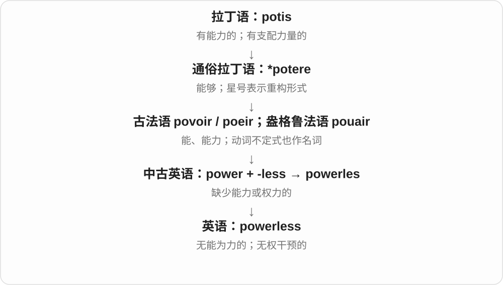

最常见 powerless to do something：想阻止、帮助或改变，却办不到。它描述特定处境，不必是在评价这个人总体没用。

**常见搭配与例句**

feel powerless；be powerless to prevent；powerless against。

> We were powerless to stop the storm from damaging the roof.

我们无法阻止暴风雨损坏屋顶。

> Without access to the account, she felt powerless.

没有账户访问权限，她觉得无能为力。

**别混淆**

helpless 常带需要别人帮助的感觉；powerless 更突出自己缺乏改变事情的力量或权限。

### 5. powerlessness — 无力感；无权力的状态

**音标**：英 /ˈpaʊələsnəs/；美 /ˈpaʊərləsnəs/

**先抓住这个画面**

powerlessness 是“事情影响着我，我却无法影响它”的处境或感受。

**怎么拆**

powerless + -ness，把无力的状态变成名词。

**怎么变成今天的意思**

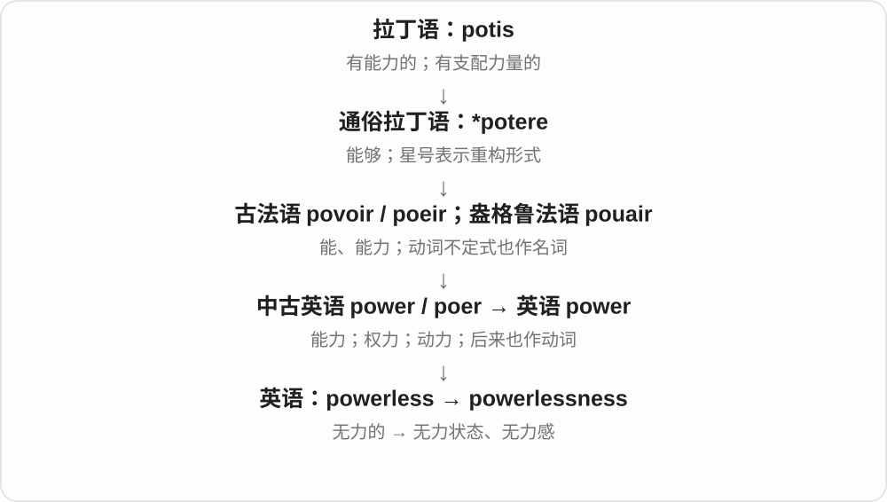

a sense of powerlessness 常用于面对疾病、复杂制度或无法控制的变化。既可以谈真实缺少权力，也可以谈主观感觉。

**常见搭配与例句**

a sense of powerlessness；feelings of powerlessness；political powerlessness。

> The long silence from the office increased her sense of powerlessness.

办公室迟迟没有回复，让她更觉得无能为力。

> The novel explores the powerlessness of people facing an unfair system.

小说探讨了人们面对不公制度时的无力处境。

**别混淆**

weakness 可以是体力、能力或某个缺点；powerlessness 专注于没有掌控或改变事情的力量。

### 6. powerhouse — 发电厂房；实力强大的机构、地区或人物

**音标**：英 /ˈpaʊəhaʊs/；美 /ˈpaʊərhaʊs/

**先抓住这个画面**

powerhouse 原是集中产生动力的地方，后来也像一台源源不断输出成果的发动机。

**怎么拆**

power + house 的英语复合词，从发电设施、动力厂房发展出强大人才或机构的比喻义。

**怎么变成今天的意思**

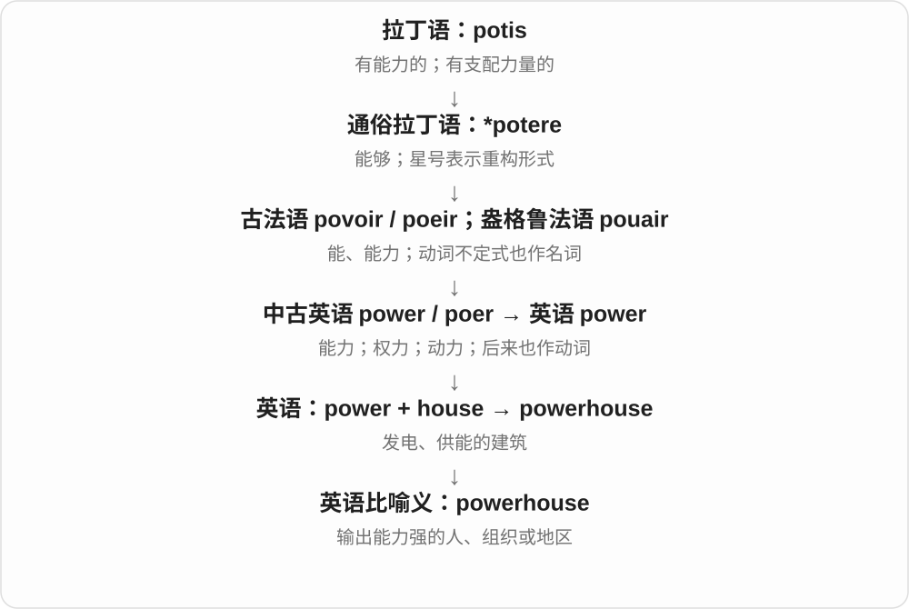

an industrial powerhouse 是工业实力强大的地区；an intellectual powerhouse 可指头脑出众的人或人才密集的机构。不是普通住宅里电力充足。

**常见搭配与例句**

an economic powerhouse；an industrial powerhouse；an intellectual powerhouse。

> The region became an industrial powerhouse.

这个地区发展成了工业重镇。

> Her small research group is a powerhouse of new ideas.

她的小型研究团队不断产出新点子，实力很强。

**别混淆**

power station 通常指真正的发电设施；powerhouse 在新闻评论里经常是强大生产力或影响力的比喻。

### 7. powerlifting — 力量举

**音标**：英 /ˈpaʊəˌlɪftɪŋ/；美 /ˈpaʊərˌlɪftɪŋ/

**先抓住这个画面**

powerlifting 把力量放到三个明确项目上比较：深蹲、卧推和硬拉。

**怎么拆**

power 力量 + lifting 举起，英语复合词，后来成为特定运动项目名称。

**怎么变成今天的意思**

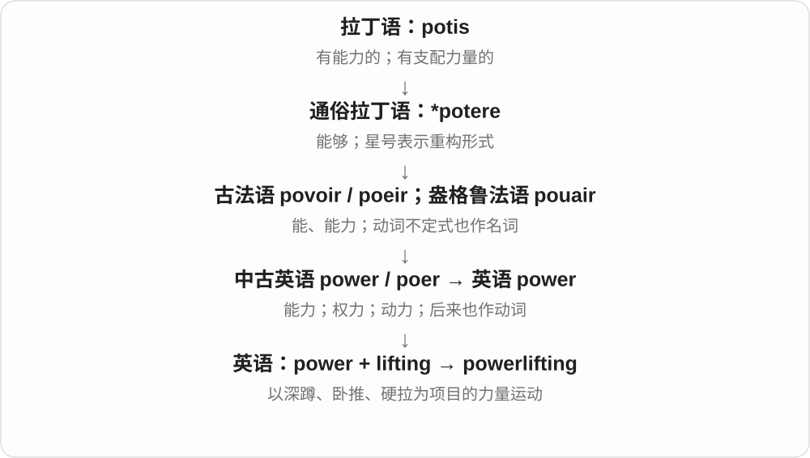

它不是所有“举重物运动”的随意统称。标准力量举围绕三个项目；通常所说奥运举重则是抓举和挺举，动作与竞赛规则不同。

**常见搭配与例句**

a powerlifting competition；powerlifting training；competitive powerlifting。

> She entered her first powerlifting competition last year.

她去年第一次参加力量举比赛。

> Powerlifting includes the squat, bench press and deadlift.

力量举包括深蹲、卧推和硬拉。

**别混淆**

powerlifting 是力量举；Olympic weightlifting 是奥运举重；bodybuilding 则主要评价体形和肌肉展示。

### 8. powerball — 特定语境中的混合毒品俗称；大写 Powerball 为彩票名称

**音标**：按构词的参考读法：英 /ˈpaʊəbɔːl/；美 /ˈpaʊərbɔːl/

**先抓住这个画面**

powerball 的拼写看着很普通，实际要先认语境：大写的品牌名与小写的俚语不能混成一个意思。

**怎么拆**

power + ball 的英语组合。小写俚语词见词典；大写 Powerball 是专有名称，两种用法不能凭词形相同就编成彼此演变。

**怎么变成今天的意思**

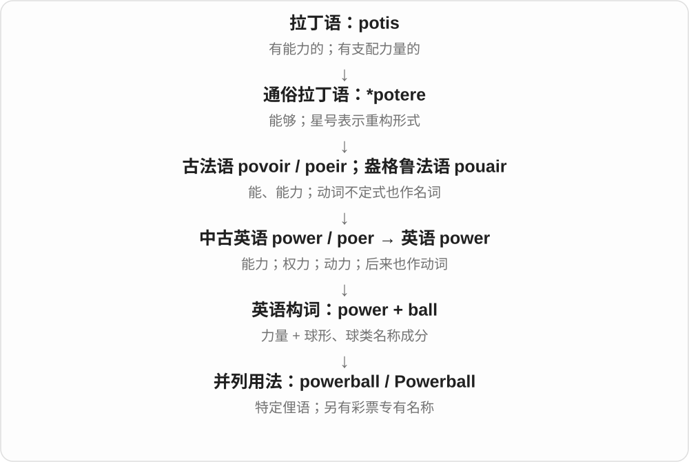

小写 powerball 在部分俚语资料中是混合毒品的名称，与 speedball 相近；新闻里大写 Powerball 多指美国起源的彩票。理解词义时只靠“力量球”的字面翻译不够。这里的读法按两个常见成分组合供参考。

**常见搭配与例句**

a Powerball drawing；the Powerball jackpot；powerball as a slang term。

> The newspaper reported the latest Powerball results.

报纸报道了最新的 Powerball 开奖结果。

> The glossary lists powerball as a slang term for a drug mixture.

这份术语表把 powerball 列为一种混合毒品的俚语名称。

**别混淆**

专有名词 Powerball 要留意大写；小写 powerball 的俚语义不是普通的 ball“球”。不要把两种语境互套。

### 9. powertrain — 车辆动力系统；动力传动总成

**音标**：英 /ˈpaʊətreɪn/；美 /ˈpaʊərtreɪn/

**先抓住这个画面**

powertrain 是从“产生动力”到“把动力送到车轮”的一整条配合链。

**怎么拆**

power 动力 + train 一系列相连部件；train 在这里不是列车，而是一组依次配合的机构。

**怎么变成今天的意思**

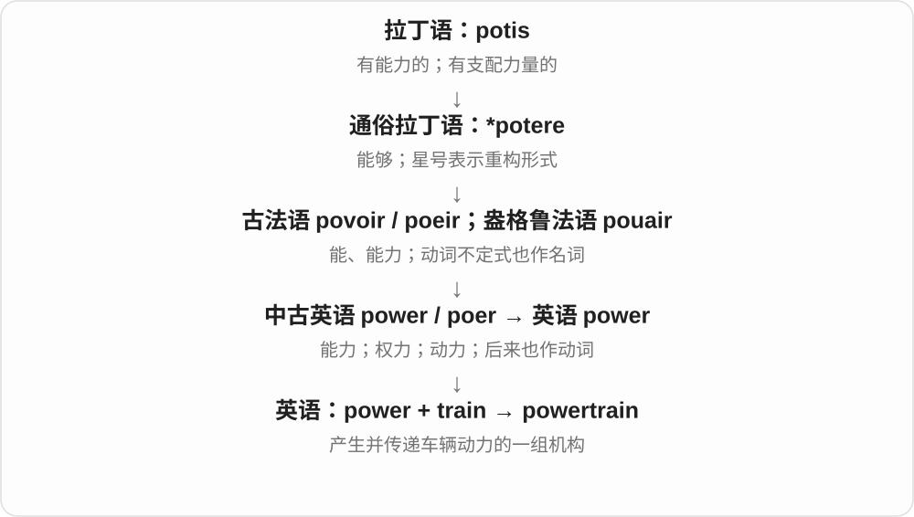

可包括发动机或电动机，以及把动力传给驱动轮的相关部件。不同工程或保修资料的具体边界可能不同，要按文中定义理解。

**常见搭配与例句**

an electric powertrain；powertrain components；a powertrain warranty。

> The engineers redesigned the powertrain for the electric model.

工程师为电动车型重新设计了动力系统。

> The warranty covers several major powertrain components.

保修涵盖了动力总成中的几个主要部件。

**别混淆**

engine 是发动机本身；powertrain 是更大的动力系统。drivetrain 通常侧重传递动力的部分，常不包含发动机。

### 10. powerboat — 机动艇；动力艇

**音标**：英 /ˈpaʊəbəʊt/；美 /ˈpaʊərboʊt/

**先抓住这个画面**

powerboat 是靠发动机或电动机推动的船，画面重点在“自身带动力”。

**怎么拆**

power 动力 + boat 船，英语复合词。

**怎么变成今天的意思**

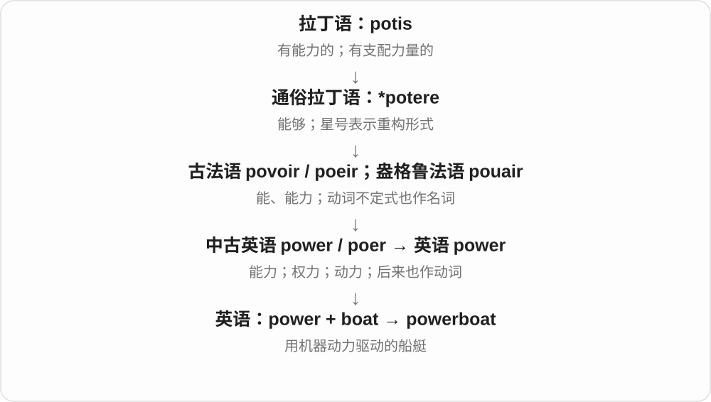

常指较小的机动船或快艇，但这个词本身不保证航速特别快。动力也不必限定某一种燃料。

**常见搭配与例句**

a powerboat race；a small powerboat；powerboat racing。

> A powerboat crossed the lake before sunset.

日落前，一艘机动艇驶过湖面。

> The harbor has separate spaces for sailboats and powerboats.

港口为帆船和机动艇划分了不同的停泊区。

**别混淆**

sailboat 主要靠风帆；powerboat 主要靠机器动力。speedboat 特别突出速度。

### 11. powerlifter — 力量举运动员；力量举练习者

**音标**：英 /ˈpaʊəˌlɪftə/；美 /ˈpaʊərˌlɪftər/

**先抓住这个画面**

powerlifter 是把深蹲、卧推和硬拉当作主要竞技项目的人。

**怎么拆**

power + lifter，lifter 是 lift + -er；与运动名称 powerlifting 配套，构词上表示从事力量举的人。

**怎么变成今天的意思**

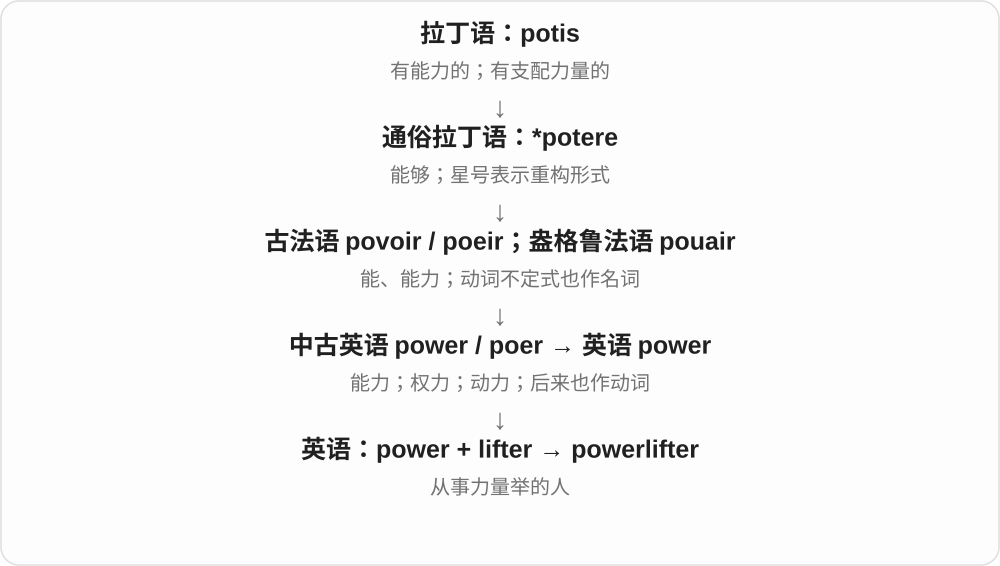

不必是职业选手才可叫 powerlifter，业余训练和参赛者也可。这个名称强调运动项目，并不只评价看上去是否肌肉发达。

**常见搭配与例句**

a competitive powerlifter；an amateur powerlifter；an experienced powerlifter。

> The amateur powerlifter trains at a local club.

这位业余力量举运动员在本地俱乐部训练。

> The interview focused on how the powerlifter prepared for competition.

访谈主要谈这位力量举运动员如何备赛。

**别混淆**

bodybuilder 练健美，powerlifter 练力量举；两者训练可能交叉，但比赛目标不同。

### 12. powerbomb — 职业摔角中的“炸弹摔”；使出这种摔技

**音标**：按构词的参考读法：英 /ˈpaʊəbɒm/；美 /ˈpaʊərbɑːm/

**先抓住这个画面**

powerbomb 是摔角招式的名称，bomb 用爆发、撞击的画面给动作增加冲击感。

**怎么拆**

power 力量 + bomb 炸弹，英语复合词；这里 bomb 是动作命名中的比喻，不涉及真正炸弹。

**怎么变成今天的意思**

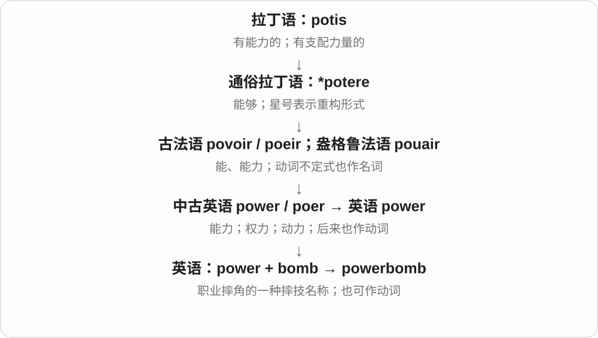

它指把对手举起后，使其背部朝下落向垫面的职业摔角动作。学习时认出赛事解说中的招式即可，词义本身不等于所有猛摔。

**常见搭配与例句**

perform a powerbomb；a powerbomb attempt；counter a powerbomb。

> The commentator called the move a powerbomb.

解说员把这个动作称为炸弹摔。

> The replay showed the wrestler countering a powerbomb.

回放显示这名摔角手化解了对手的炸弹摔。

**别混淆**

bomb 单独通常是炸弹或轰炸；powerbomb 是特定摔角术语。名词和动词都沿用同一名称。

### 13. empower — 授权；使有能力或信心采取行动

**音标**：英 /ɪmˈpaʊə/；美 /ɪmˈpaʊər/

**先抓住这个画面**

empower 是把可用的按钮交给别人：可以是真正的决策权，也可以是技能、信息和信心。

**怎么拆**

em- 是 en- 在 p 前的形式，加 power；英语内部构词，表示使拥有力量。

**怎么变成今天的意思**

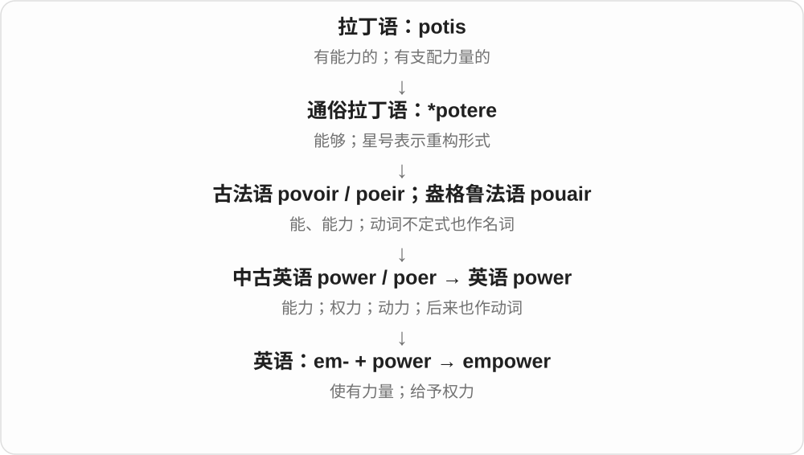

正式语境中 empower someone to do something 是授权做某事；教育和社会语境中，也可表示帮助人具备自己行动的能力。单纯夸奖不一定构成 empower，关键在能否更主动地做事。

**常见搭配与例句**

empower someone to do；empower employees；empower local communities。

> The policy empowers staff to solve small problems without approval.

这项制度授权员工自行解决小问题，无须另行审批。

> Learning to read empowered her to manage her own affairs.

学会阅读让她能够自己处理事务。

**别混淆**

authorize 强调给予正式许可；empower 还可以通过知识、资源和信心增强人的行动能力。

### 14. empowered — 获授权的；有能力自主行动的

**音标**：英 /ɪmˈpaʊəd/；美 /ɪmˈpaʊərd/

**先抓住这个画面**

empowered 是手里终于有了工具、权限，心里也有“我能处理”的底气。

**怎么拆**

empower + -ed，过去分词可描述得到授权或增强能力后的状态。

**怎么变成今天的意思**

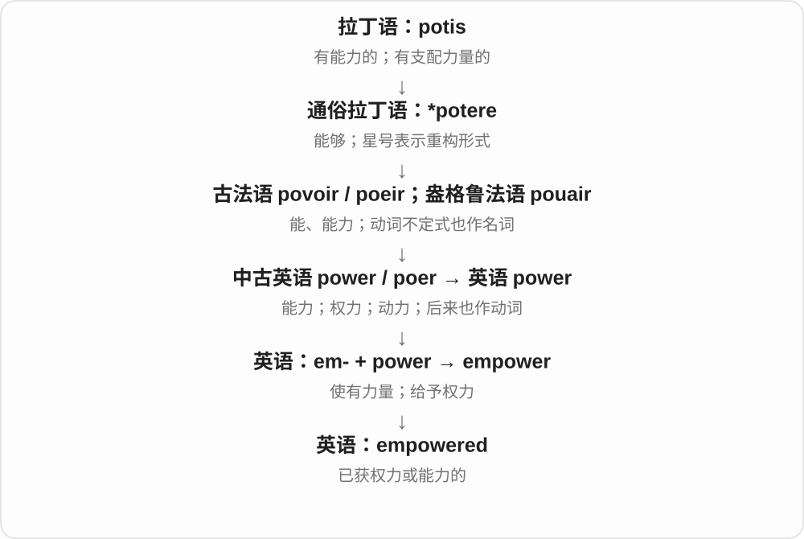

be empowered to sign 是得到签字权限；feel empowered 则侧重觉得自己有能力、有自主性。它描述获得行动空间，不等于比别人地位高。

**常见搭配与例句**

be empowered to；feel empowered；empowered employees。

> Only two officers are empowered to sign this document.

只有两名负责人获授权签署这份文件。

> After the workshop, she felt empowered to speak at meetings.

参加工作坊后，她觉得自己更有底气在会上发言了。

**别混淆**

powerful 说本身力量强；empowered 常带有通过授权、学习或支持获得自主能力的过程感。

### 15. empowerment — 授权；自主能力的增强；赋权

**音标**：英 /ɪmˈpaʊəmənt/；美 /ɪmˈpaʊərmənt/

**先抓住这个画面**

empowerment 是让原本只能等别人决定的人，逐渐能掌握自己的选择。

**怎么拆**

empower + -ment，表示给予权力、能力的过程或结果。

**怎么变成今天的意思**

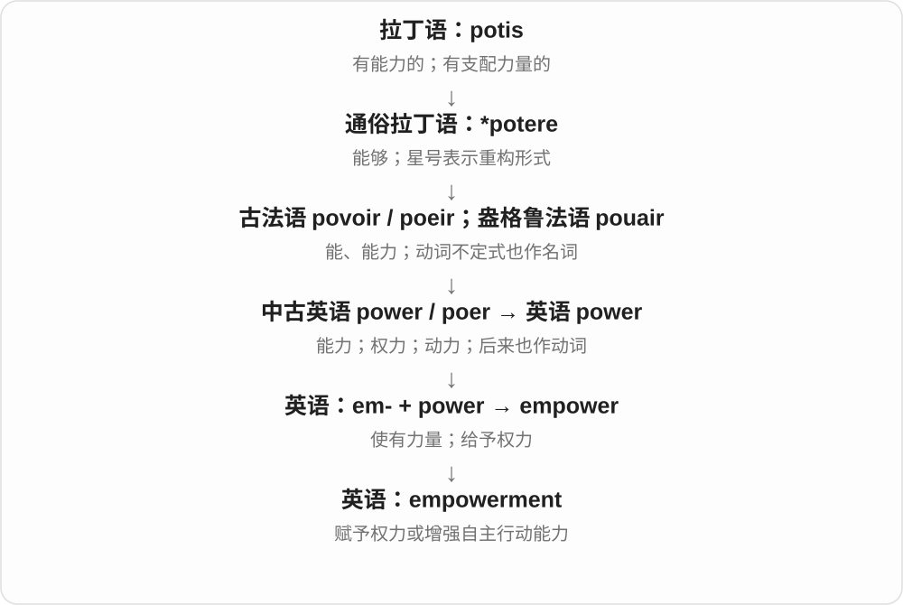

employee empowerment 可能包括下放决策权；economic empowerment 可包括收入、资源和控制资源的能力。要从上下文看具体给了什么，别只把它当成空泛的“鼓励”。

**常见搭配与例句**

employee empowerment；economic empowerment；community empowerment。

> The program links financial education with economic empowerment.

这个项目把财务知识教育与经济自主能力的提升联系起来。

> Employee empowerment requires clear limits as well as trust.

向员工授权既需要信任，也需要明确权限边界。

**别混淆**

encouragement 是鼓励；empowerment 更强调实际能力、资源或决定权的增加。

### 16. disempower — 剥夺权力；削弱自主行动能力

**音标**：英 /ˌdɪsɪmˈpaʊə/；美 /ˌdɪsemˈpaʊər/

**先抓住这个画面**

disempower 是把别人手里的按钮收走，让他连自己的事也很难决定。

**怎么拆**

dis- 表示取消、削弱，加 empower；英语内部的反向构词。

**怎么变成今天的意思**

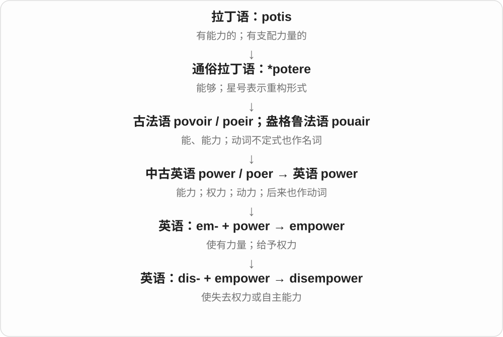

可以是正式夺权，也可能是复杂程序让人参与不了本来与自己有关的决定。它关心权力、资源和自主性，不只是令人一时泄气。

**常见搭配与例句**

disempower workers；disempower communities；feel disempowered。

> The new rules disempower local teams by moving every decision to headquarters.

新规则把所有决定交到总部，削弱了地方团队的自主权。

> Confusing language can disempower people who need public services.

令人费解的表述可能让需要公共服务的人难以自主办事。

**别混淆**

discourage 是使灰心、不愿行动；disempower 更强调实际权力或行动能力被削弱。

### 17. disempowerment — 权力被削弱；自主能力丧失

**音标**：英 /ˌdɪsɪmˈpaʊəmənt/；美 /ˌdɪsemˈpaʊərmənt/

**先抓住这个画面**

disempowerment 是“所有事都有人替我决定，我越来越插不上手”的过程或状态。

**怎么拆**

disempower + -ment，把剥夺或削弱自主能力变成名词。

**怎么变成今天的意思**

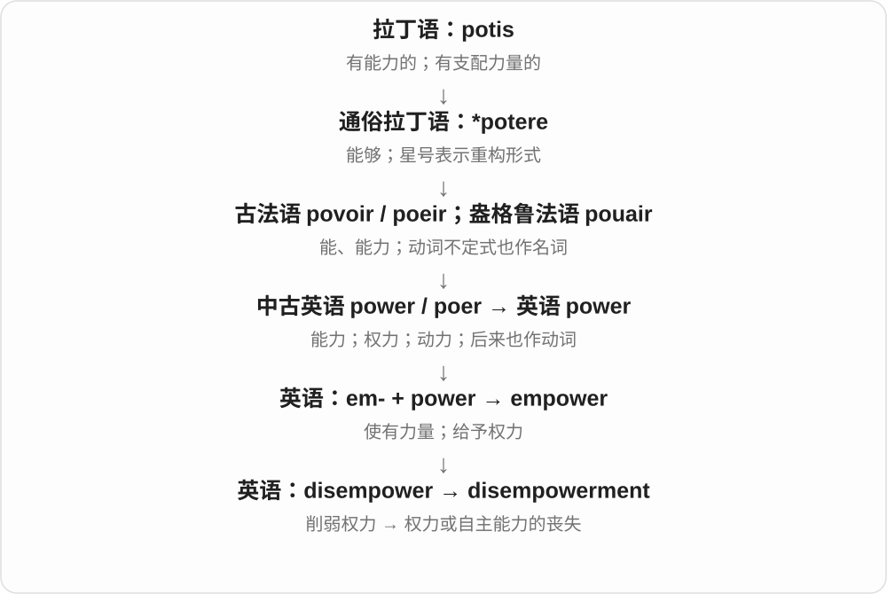

常用于讨论制度如何让某些人难以参与、表达或决定自己的生活。它可以伴随无力感，但也能指客观的权限减少。

**常见搭配与例句**

a sense of disempowerment；political disempowerment；the disempowerment of。

> The study links exclusion from meetings to a sense of disempowerment.

研究把被排除在会议之外与自主权被削弱的感受联系起来。

> The reforms aimed to reverse the disempowerment of local councils.

改革旨在扭转地方议会权力被削弱的局面。

**别混淆**

powerlessness 着重无力的状态；disempowerment 更容易让人想到原有能力或权力被削弱的过程。

### 18. horsepower — 马力；功率单位

**音标**：英 /ˈhɔːsˌpaʊə/；美 /ˈhɔːrsˌpaʊər/

**先抓住这个画面**

horsepower 起初让人用熟悉的马来想象机器有多大本事，现在是衡量功率的单位。

**怎么拆**

horse 马 + power 动力，英语复合词；名称来自用马的工作能力作参照的历史。

**怎么变成今天的意思**

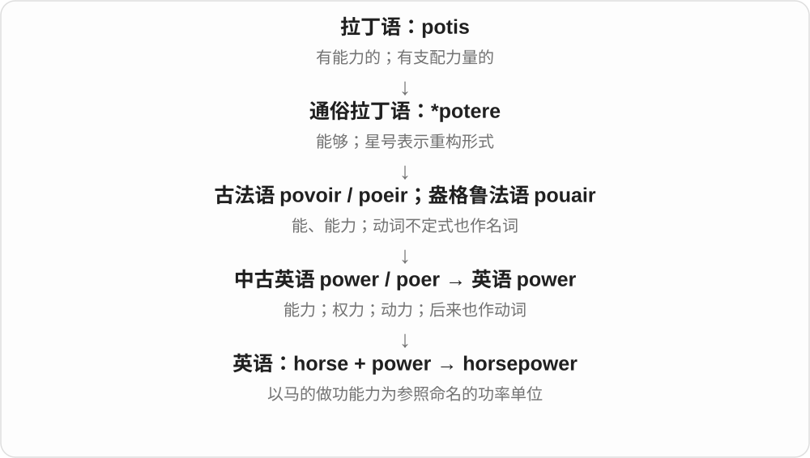

发动机有多少 horsepower，谈的是输出功率，不是能拉几匹马，也不是一段时间里消耗多少能量。马力存在不同单位制，看到精确换算时要确认采用哪一种。

**常见搭配与例句**

engine horsepower；brake horsepower；rated horsepower。

> The brochure lists the engine’s horsepower.

宣传册列出了发动机的马力。

> The newer model produces more horsepower with a smaller engine.

新款车型用更小的发动机输出了更大的功率。

**别混淆**

horsepower 衡量功率；torque 是扭矩，描述使物体转动的力矩，两项指标不能直接当成同一个数。

### 19. manpower — 人力；可调配的劳动力

**音标**：英 /ˈmænˌpaʊə/；美 /ˈmænˌpaʊər/

**先抓住这个画面**

manpower 是把眼前的工作摆出来，再看有多少人的时间和力气能投入。

**怎么拆**

man + power 的英语复合词；这里传统上指人力总体，不限定男性。

**怎么变成今天的意思**

a shortage of manpower 是缺人手。这个词常见于组织工作、工程和军队；现代职场也常用 staff、staffing 或 workforce，按句子选择更具体的表达。

**常见搭配与例句**

a shortage of manpower；manpower requirements；available manpower。

> The project stalled because we lacked the necessary manpower.

项目因缺少必要人手而停滞。

> Better tools reduced the manpower needed for the job.

更好的工具减少了这项工作所需的人力。

**别混淆**

workforce 常指人员群体；manpower 偏把人看作完成任务所需的工作力量。

### 20. firepower — 火力；可用于竞争或解决问题的强大资源

**音标**：英 /ˈfaɪəˌpaʊə/；美 /ˈfaɪərˌpaʊər/

**先抓住这个画面**

firepower 是“能向目标投入多大力量”：本义是武器火力，比喻中则可以是资金、人才或技术。

**怎么拆**

fire 在这里指开火，加 power，形成英语复合词；随后发展出资源实力的比喻义。

**怎么变成今天的意思**

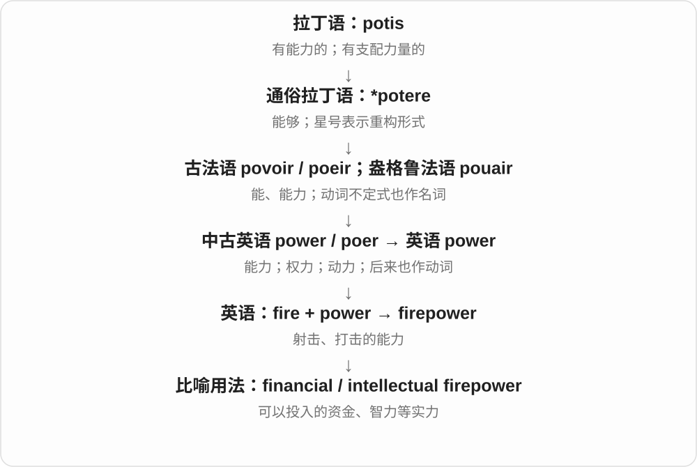

military firepower 谈武器整体打击能力；financial firepower 是支持行动的资金实力。后者不是字面上的燃烧或用火。

**常见搭配与例句**

military firepower；financial firepower；intellectual firepower。

> The historian compared the firepower of the two fleets.

历史学家比较了两支舰队的火力。

> The company lacks the financial firepower to buy its larger rival.

这家公司没有足够资金收购规模更大的竞争对手。

**别混淆**

firepower 突出能投入较量的力量；resources 更中性，泛指可用资源。

### 21. superpower — 超级大国；超能力；特别突出的本领

**音标**：英 /ˈsuːpəˌpaʊə/；美 /ˈsuːpərˌpaʊər/

**先抓住这个画面**

superpower 是超出一般水平的力量：国际政治里是国家实力，漫画里则可能是飞行或隐身。

**怎么拆**

super- 超级、超过 + power，英语构词；国家和虚构能力的含义要随语境分开。

**怎么变成今天的意思**

a global superpower 指具有广泛国际影响的强国。口语说 Listening is her superpower，是夸她特别善于倾听，不在宣称超自然能力。

**常见搭配与例句**

a global superpower；an economic superpower；have superpowers。

> The chapter examines rivalry between two superpowers.

这一章研究了两个超级大国之间的竞争。

> In the comic, her superpower is the ability to become invisible.

漫画里，她的超能力是隐身。

**别混淆**

superpower 在政治语境强调国家的超强综合影响；powerhouse 可用于地区、企业或个人，并不自动表示超级大国。

### 22. willpower — 意志力；自制力

**音标**：英 /ˈwɪlˌpaʊə/；美 /ˈwɪlˌpaʊər/

**先抓住这个画面**

willpower 像心里握住方向盘的那只手：明知另一条路更舒服，仍能按自己的决定走。

**怎么拆**

will 意愿、意志 + power 力量，英语复合词。

**怎么变成今天的意思**

**古英语 willa → 英语 will；拉丁 potis → 通俗拉丁 \*potere → 法语 → 英语 power**  
意愿、意志；能够、能力〔\* 标示重构形式〕

↓

**英语 will + power → willpower**  
意志与力量组合：控制自己、坚持决定的能力

常说坚持困难任务、克制诱惑所需的力量。它可以帮助行动，但不意味着所有困难都只靠“再有毅力一点”就能解决。

**常见搭配与例句**

have the willpower to；sheer willpower；a lack of willpower。

> It took willpower to keep studying on a sunny afternoon.

阳光明媚的下午还坚持学习，需要意志力。

> She used a fixed routine so that practice did not depend on willpower alone.

她建立了固定习惯，让练习不再只靠意志力。

**别混淆**

will 是想做什么的意愿；willpower 更突出控制自己、坚持决定的能力。

### 23. hydropower — 水力；水力发电

**音标**：英 /ˈhaɪdrəʊˌpaʊə/；美 /ˈhaɪdroʊˌpaʊər/

**先抓住这个画面**

hydropower 是借流动或下落的水把机器推起来，再把这种运动用于发电等工作。

**怎么拆**

hydro- 水，源自希腊语构词成分，加英语 power；这是在英语里组合的混合来源词，不是完整的古希腊借词。

**怎么变成今天的意思**

能源报道里通常指水力发电或其供电能力。读到 hydropower station，就把画面放在利用水推动涡轮的设施上。

**常见搭配与例句**

hydropower generation；a hydropower plant；small hydropower。

> The valley has several small hydropower plants.

这条山谷里有几座小型水电站。

> The report compares hydropower with wind energy.

报告比较了水力发电与风能。

**别混淆**

water power 可泛指水的机械动力；hydropower 在现代能源语境中特别常与发电相连。

### 24. overpower — 制服；压倒；使难以承受

**音标**：英 /ˌəʊvəˈpaʊə/；美 /ˌoʊvərˈpaʊər/

**先抓住这个画面**

overpower 是一股更强的力量盖过另一股：人被制服，味道被盖住，情绪也可能把人整个淹没。

**怎么拆**

over- 表示超过、压倒，加 power；英语内部构词。

**怎么变成今天的意思**

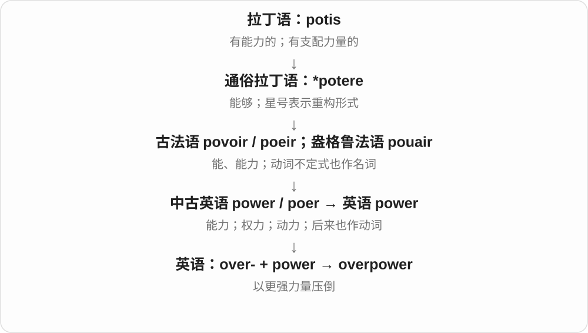

overpower someone 可指用力量制服；a smell overpowers a dish 是味道盖过食物其他滋味。be overpowered by grief 是悲痛强烈到难以承受。

**常见搭配与例句**

overpower an opponent；be overpowered by emotion；overpower the flavour。

> The guards quickly overpowered the intruder.

保安很快制服了闯入者。

> Too much garlic can overpower the other flavours.

蒜放得太多会盖住其他味道。

**别混淆**

overwhelm 很宽泛，可由数量、工作或情绪压垮；overpower 常更突出一股强力压住另一方。

### 25. overpowering — 强烈得难以承受的；压倒性的

**音标**：英 /ˌəʊvəˈpaʊərɪŋ/；美 /ˌoʊvərˈpaʊərɪŋ/

**先抓住这个画面**

overpowering 像气味、热气或情绪一下铺满整个空间，让别的感觉都挤不进来。

**怎么拆**

overpower + -ing，分词形容词表示具有压倒人的力量。

**怎么变成今天的意思**

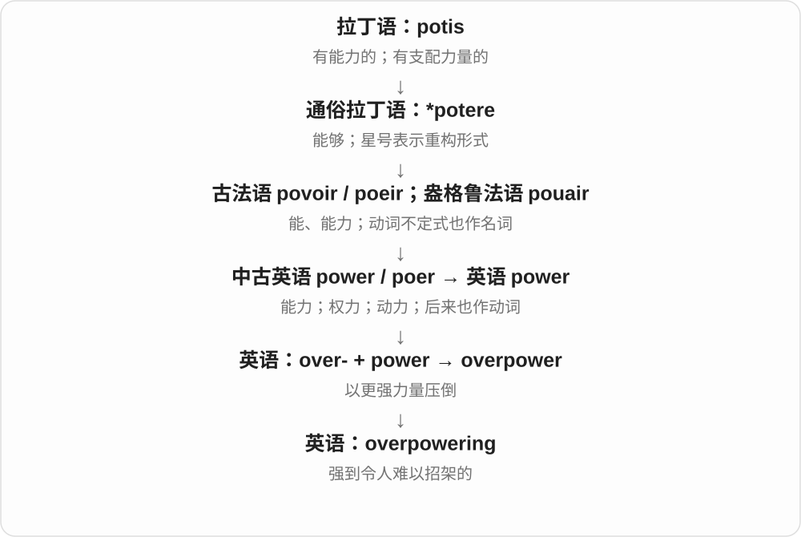

an overpowering smell 常令人不适；an overpowering urge 是强烈得很难抗拒的冲动。它不只是“强”，通常还有让人失去余地的感觉。

**常见搭配与例句**

an overpowering smell；an overpowering urge；overpowering heat。

> The perfume was overpowering in the small room.

香水味在小房间里浓得让人受不了。

> She felt an overpowering urge to laugh.

她有一种几乎压不住的笑意。

**别混淆**

powerful 可以是令人赞赏的强大；overpowering 常强调强得压住其他东西，或让人吃不消。

### 26. overpoweringly — 强烈得压倒一切地；令人难以承受地

**音标**：英 /ˌəʊvəˈpaʊərɪŋli/；美 /ˌoʊvərˈpaʊərɪŋli/

**先抓住这个画面**

overpoweringly 把程度推到“其他感受都被盖住”的位置。

**怎么拆**

overpowering + -ly，常修饰气味、味道、情绪或其他强烈性质。

**怎么变成今天的意思**

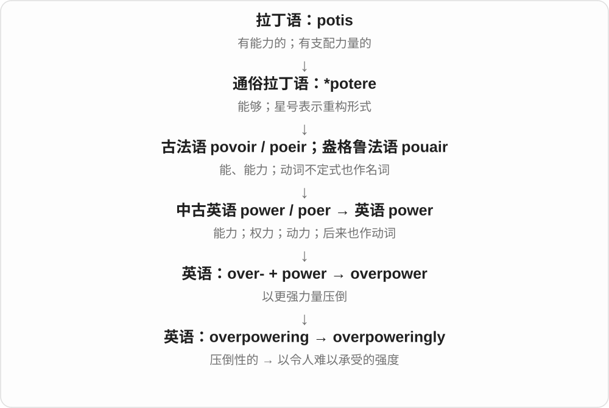

overpoweringly sweet 是甜得盖住其他味道，或甜得腻人；overpoweringly sad 则是悲伤强烈到笼罩整个体验。这个长词偏描写性。

**常见搭配与例句**

overpoweringly sweet；overpoweringly strong；overpoweringly sad。

> The drink was overpoweringly sweet.

这饮料甜得发腻。

> The final scene was overpoweringly sad.

最后一幕的悲伤气氛强烈得令人难以承受。

**别混淆**

very 只是一般加强；overpoweringly 暗含力量太强、压过其他感觉的效果。

### 27. brainpower — 脑力；智力；集体智慧

**音标**：英 /ˈbreɪnˌpaʊə/；美 /ˈbreɪnˌpaʊər/

**先抓住这个画面**

brainpower 是脑子能投入多少理解、判断和解题的力量。

**怎么拆**

brain 大脑 + power 能力，英语复合词，把思考能力比作一种可投入的力量。

**怎么变成今天的意思**

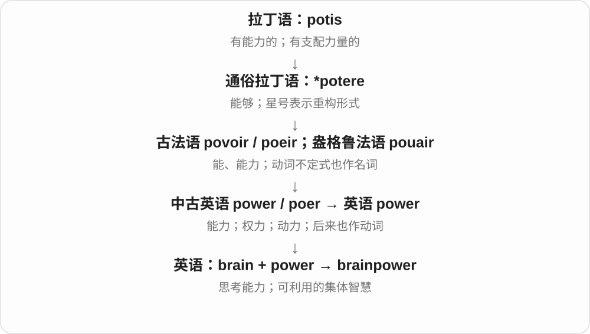

可形容一个人的智力，也可说团队的总脑力。a problem that takes brainpower 是需要动脑的问题，不一定需要大体力。

**常见搭配与例句**

use your brainpower；collective brainpower；require brainpower。

> This puzzle requires patience as well as brainpower.

这个谜题既需要耐心，也需要脑力。

> The team combined its brainpower to simplify the design.

团队汇集大家的智慧，简化了设计。

**别混淆**

manpower 偏人手、工作力量；brainpower 特别突出思考能力，人数多不一定等于脑力用得好。

### 28. airpower — 空中力量；航空作战能力

**音标**：英 /ˈeəˌpaʊə/；美 /ˈerˌpaʊər/

**先抓住这个画面**

airpower 把目光放在天空：一个国家或军队能用航空力量完成多少任务。

**怎么拆**

air 空中 + power 力量，英语复合词，也常写作两个词 air power。

**怎么变成今天的意思**

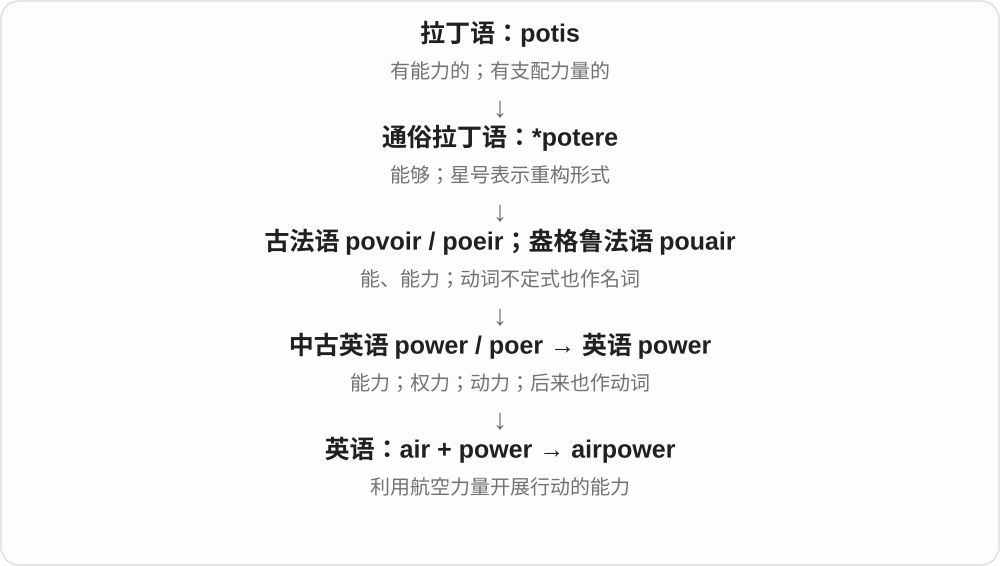

不只看有多少飞机，还可涉及侦察、运输、支援等能力。在历史或军事文章里，它通常不是“空气推动物体的力”。

**常见搭配与例句**

the use of airpower；airpower capabilities；the limits of airpower。

> The lecture examined the changing role of airpower.

讲座讨论了空中力量作用的变化。

> The book considers both the advantages and the limits of airpower.

这本书同时讨论了空中力量的优势与局限。

**别混淆**

air force 是空军这一组织；airpower 是空中力量或能力，来源不必只限于某个名叫空军的组织。

### 29. possible — 可能的；办得到的；可考虑的

**音标**：英 /ˈpɒsəbəl/；美 /ˈpɑːsəbəl/

**先抓住这个画面**

possible 的门还开着：这件事能发生，或有办法做到，但不保证一定发生。

**怎么拆**

经古法语或直接来自拉丁 possibilis，源于 posse“能够”；poss- 是这条拉丁词形留下的痕迹，不能拆成英语 possess。

**怎么变成今天的意思**

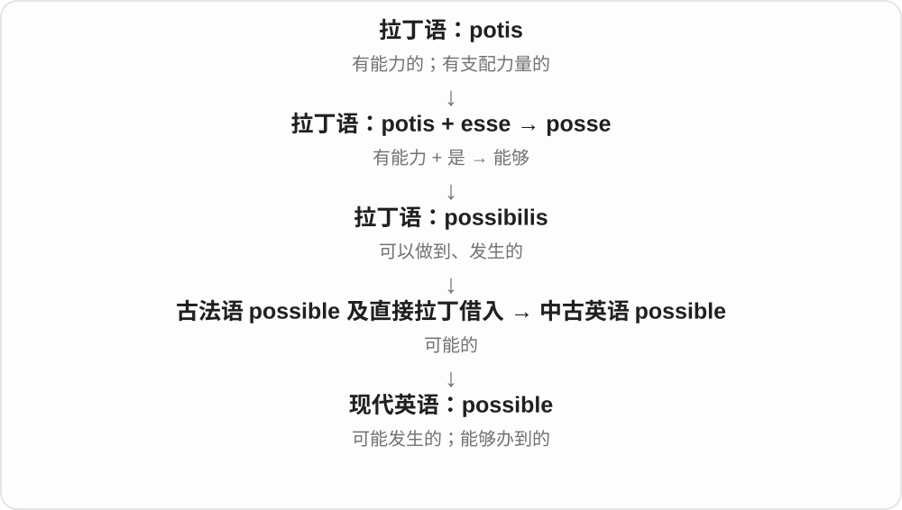

It is possible to do... 说事情做得到；a possible explanation 是一种可以考虑的解释。as soon as possible 是在条件允许的范围内尽快。

**常见搭配与例句**

if possible；as soon as possible；a possible explanation；make it possible to。

> It is possible to reach the island by boat.

可以乘船到达那座岛。

> A loose cable is one possible explanation for the problem.

电缆松动是这个问题的一种可能原因。

**别混淆**

possible 只要求存在可能；probable 表示更有理由预期它会发生。possible 不是“概率很高”。

### 30. possibly — 也许；可能；究竟、到底；尽可能

**音标**：英 /ˈpɒsəbli/；美 /ˈpɑːsəbli/

**先抓住这个画面**

possibly 像在判断旁边放一个小问号：“有这个可能，但我还不确定。”

**怎么拆**

possible + -ly；词尾 -ble 变成 -bly。

**怎么变成今天的意思**

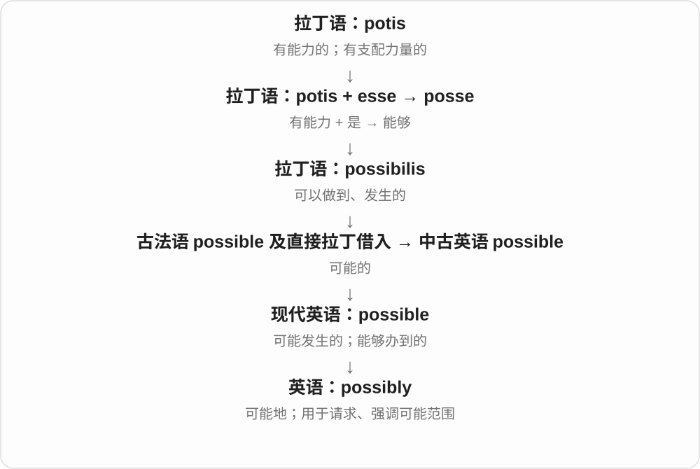

It could possibly work 留有不确定性。Could you possibly...? 让请求更委婉；I can’t possibly... 则往往强烈表示实在做不到。

**常见搭配与例句**

possibly because；could possibly；could you possibly；can’t possibly。

> We may possibly finish before lunch.

我们也许能在午饭前完成。

> Could you possibly move your bag from this seat?

能麻烦你把包从这个座位上挪开吗？

**别混淆**

possibly 往往比 probably 更不确定；can’t possibly 中的它不是把否定减弱，而是在强调不可能。

### 31. possibility — 可能性；可能的选择或情况

**音标**：英 /ˌpɒsəˈbɪləti/；美 /ˌpɑːsəˈbɪləti/

**先抓住这个画面**

possibility 是脑中还留着的一条路：它可能发生，也可能是值得考虑的选项。

**怎么拆**

经法语及直接拉丁借入，来自 possibilitas“可能性”；现代可按 possible + -ity 理解，历史上名词有自己的借入路线。

**怎么变成今天的意思**

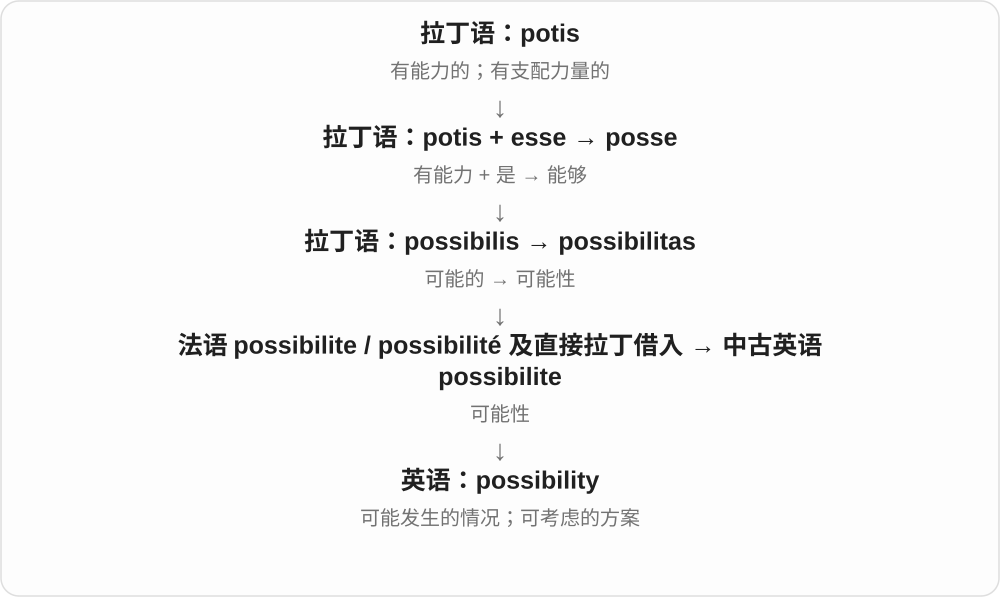

the possibility of rain 说下雨的可能；another possibility 可以指另一种方案。复数 possibilities 也常说未来的发展机会。

**常见搭配与例句**

a possibility of；a possibility that；rule out the possibility；explore possibilities。

> We cannot rule out the possibility of a delay.

我们不能排除延误的可能。

> One possibility is to hold the meeting online.

一种可行的选择是在线开会。

**别混淆**

probability 更强调发生的可能程度，尤其可量化的概率；possibility 也可以只问有没有这种情况。

### 32. impossible — 不可能的；难以忍受或应付的

**音标**：英 /ɪmˈpɒsəbəl/；美 /ɪmˈpɑːsəbəl/

**先抓住这个画面**

impossible 像一扇完全关上的门；口语中也会夸张地说“这人真让人没办法”。

**怎么拆**

经古法语来自拉丁 impossibilis：否定 in- 在 p 前同化成 im-，加 possibilis；现代清楚对应 im- + possible。

**怎么变成今天的意思**

impossible to finish 是没法完成。You’re impossible! 通常是抱怨对方难相处、不讲道理，并不是说这个人不存在。

**常见搭配与例句**

be impossible to do；make it impossible for；an impossible task；next to impossible。

> Without the key, it was impossible to open the cabinet.

没有钥匙，根本打不开柜子。

> You keep changing your mind—you’re impossible!

你总是改主意，真拿你没办法！

**别混淆**

difficult 表示很难，仍可能做到；impossible 在严格用法中排除可能，口语则可夸张地说难得受不了。

### 33. impossibility — 不可能；不可能的事

**音标**：英 /ɪmˌpɒsəˈbɪləti/；美 /ɪmˌpɑːsəˈbɪləti/

**先抓住这个画面**

impossibility 把“这条路根本走不通”变成可以论证、说明的事实。

**怎么拆**

经中古法语 impossibilité 来自拉丁 impossibilitas；现代可联系 impossible + -ity，不把法语名词画成英语形容词的后代。

**怎么变成今天的意思**

the impossibility of doing something 说明做不到的原因；an impossibility 指一件根本做不到的事。复数也可用于互相矛盾、无法实现的情形。

**常见搭配与例句**

a physical impossibility；the impossibility of doing；a practical impossibility。

> Being in two cities at exactly the same time is a physical impossibility.

同一时刻身处两座城市，在物理上不可能。

> The report explains the impossibility of completing the work in one day.

报告解释了为什么这项工作不可能在一天内完成。

**别混淆**

impossibility 是没有实现空间；improbability 只是可能性很低，不能混作绝对不可能。

### 34. impossibly — 难以置信地；令人觉得不可能地；极其

**音标**：英 /ɪmˈpɒsəbli/；美 /ɪmˈpɑːsəbli/

**先抓住这个画面**

impossibly 常是在正常尺度外再推一截：“高得不像能爬上去，挤得像根本塞不下。”

**怎么拆**

impossible + -ly，词尾 -ble 改为 -bly。

**怎么变成今天的意思**

impossibly small 可以是小得让人难以操作；impossibly beautiful 是带夸张的赞叹，不是在作逻辑判断。常修饰形容词。

**常见搭配与例句**

impossibly difficult；impossibly small；impossibly high。

> The instructions were printed in impossibly small letters.

说明书的字小得让人几乎看不清。

> The summit looked impossibly far away.

山顶看上去远得仿佛根本到不了。

**别混淆**

extremely 只强调程度很高；impossibly 带超过可承受、可相信或可实现范围的感觉。

### 35. potent — 强有力的；效力强的；影响大的

**音标**：英 /ˈpəʊtənt/；美 /ˈpoʊtənt/

**先抓住这个画面**

potent 像一小滴浓缩液：体积未必大，产生的作用却很强。

**怎么拆**

借自拉丁 potens，词干 potent-，是 posse“能够”的现在分词；与 power 同源但走了不同借入路线。

**怎么变成今天的意思**

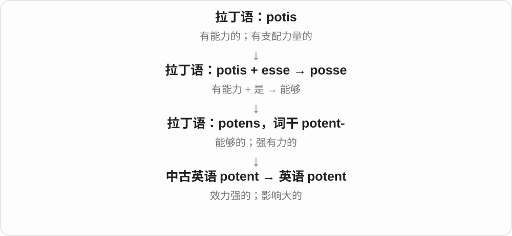

a potent smell 很浓烈，a potent symbol 很能触动人。用于药物等语境时，强调产生效果的能力或效力，不能只理解成“分量大”。

**常见搭配与例句**

a potent symbol；a potent force；a potent reminder；a potent smell。

> The ruined wall remains a potent symbol of division.

那段残墙仍是分裂的有力象征。

> A potent smell of garlic filled the kitchen.

浓烈的蒜味弥漫在厨房里。

**别混淆**

powerful 适用面很宽；potent 常突出某种物质、信号或因素能产生很强的具体作用。

### 36. potential — 潜在的；可能成为的；潜力；势

**音标**：/pəˈtenʃəl/

**先抓住这个画面**

potential 像一颗还没长成树的种子：现在还没有那个结果，但已经存在发展的可能。

**怎么拆**

来自后期拉丁 potentialis，源于 potentia“能力”；现代可联系 potent + -ial，但这是借入的拉丁派生词。

**怎么变成今天的意思**

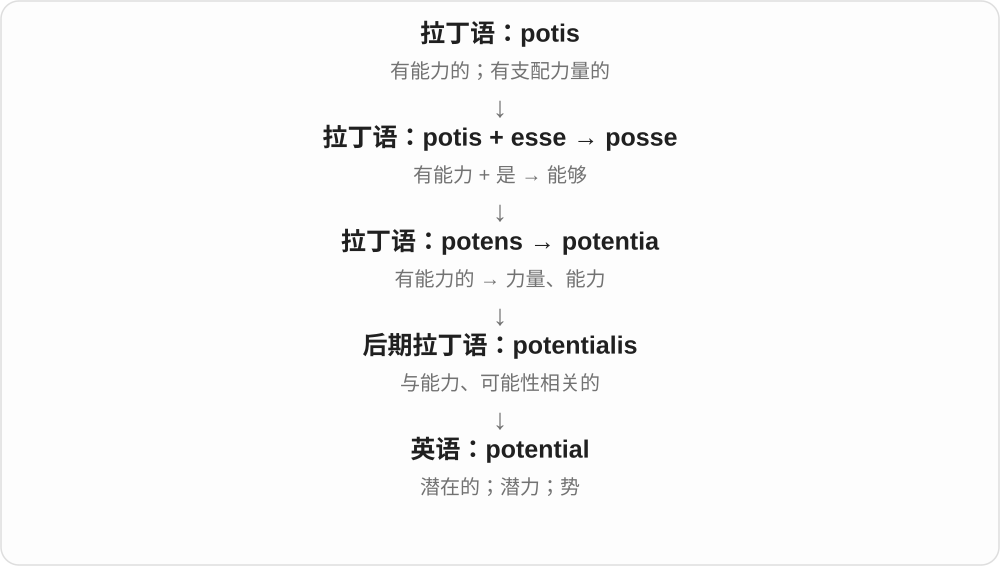

a potential customer 还不是顾客，只是可能成为；show potential 是显露出有待发展的能力。物理学中的 potential 有专门的“势”义，例如 electric potential 电势，不应一概翻成才华。

**常见搭配与例句**

have the potential to do；reach one’s full potential；a potential risk；electric potential。

> The student shows great potential as a designer.

这个学生显露出成为优秀设计师的潜力。

> We contacted several potential suppliers.

我们联系了几家可能合作的供应商。

**别混淆**

possible 只说事情有可能；potential 常把某人或某物看作未来状态的候选者，或强调尚未发挥的能力。

### 37. potentially — 有可能地；潜在地

**音标**：/pəˈtenʃəli/

**先抓住这个画面**

potentially 给一句话留出“条件具备就可能发生”的空间，并没有宣布结果已经发生。

**怎么拆**

potential + -ly，由潜在的性质变成修饰判断的副词。

**怎么变成今天的意思**

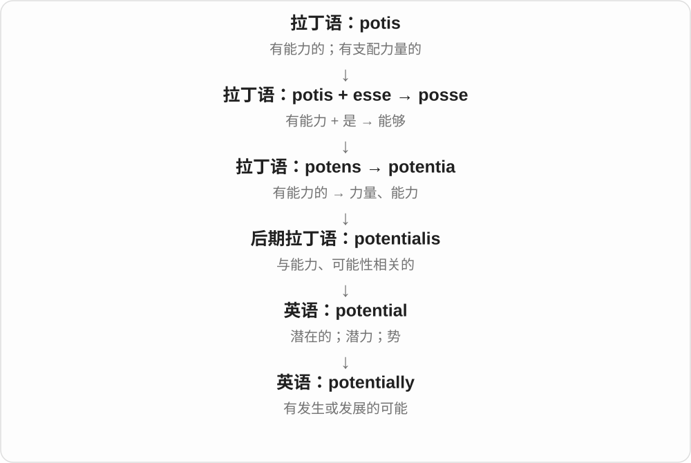

potentially dangerous 指可能造成危险，不等于现在已经伤人。potentially useful 表示有用的可能性，效果还取决于实际情况。

**常见搭配与例句**

potentially harmful；potentially useful；potentially valuable。

> The old wiring is potentially dangerous.

这些老旧电线有潜在危险。

> The archive contains potentially valuable information.

档案中包含可能很有价值的信息。

**别混淆**

probably 说更可能真的发生；potentially 常强调存在这种可能或能力，不给概率作同样强的判断。

### 38. potentiality — 潜能；潜在可能性；发展空间

**音标**：/pəˌtenʃiˈæləti/

**先抓住这个画面**

potentiality 把“里面还藏着哪些可能”当作一个话题来讨论。

**怎么拆**

potential + -ity，表示潜在能力或可能性；不是新的拉丁单词整词借入。

**怎么变成今天的意思**

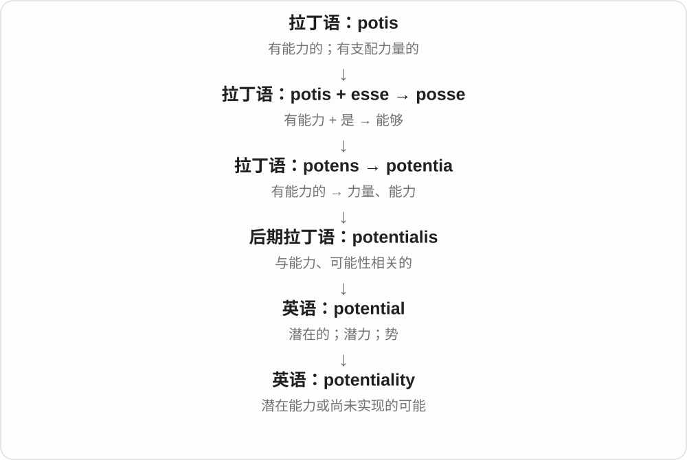

比 potential 更书面，常见于哲学、理论分析，或复数 potentialities“各种潜在用途、发展方向”。日常夸人有潜力，通常说 potential 就够了。

**常见搭配与例句**

human potentiality；explore the potentialities of；unrealized potentialities。

> The philosopher distinguished potentiality from actuality.

这位哲学家区分了潜在可能与已经实现的状态。

> The workshop explored the potentialities of recycled materials.

工作坊探索了回收材料的各种潜在用途。

**别混淆**

potentiality 更抽象、更适合讨论可能性本身；potential 是日常和商业语境里更自然的选择。

### 39. potency — 效力；作用强度；潜能

**音标**：英 /ˈpəʊtənsi/；美 /ˈpoʊtənsi/

**先抓住这个画面**

potency 问的是“这东西有多能起作用”，像比较两杯浓缩液的劲有多大。

**怎么拆**

来自拉丁 potentia“力量、能力”，与 potent 同源；现代可联系 potent 与 -cy 的形容词名词对应，不宜把历史只写成英语加后缀。

**怎么变成今天的意思**

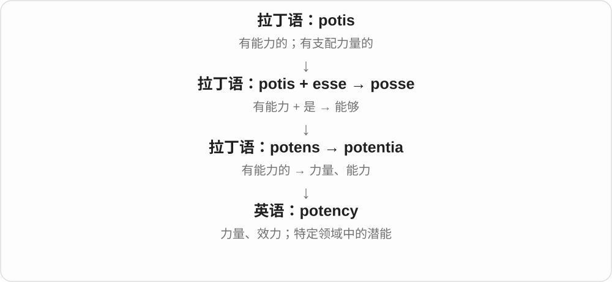

药理学中的 potency 常涉及达到一定效果所需的量，不能简单等同于最大疗效。细胞学中又可指细胞能分化成哪些类型的潜能；修辞里可谈一个故事的感染力。

**常见搭配与例句**

the potency of a substance；lose potency；symbolic potency；cell potency。

> The perfume lost some of its potency after years in the sun.

这瓶香水晒了多年，香气没那么强了。

> The story has retained its emotional potency.

这个故事依然有很强的情感感染力。

**别混淆**

potency 关心起作用的能力或强度；potential 常关心尚未实现的发展空间。具体技术义要看领域。

### 40. potentate — 君主；有巨大权势的人

**音标**：英 /ˈpəʊtənteɪt/；美 /ˈpoʊtənteɪt/

**先抓住这个画面**

potentate 是“权力集中在他身上”的人物，读起来带历史感，也可能带讽刺。

**怎么拆**

经古法语或直接来自后期拉丁 potentatus，后者有统治权和统治者义，源于 potens“强有力的”；不是 potent 加动词后缀后表示“使强大”。

**怎么变成今天的意思**

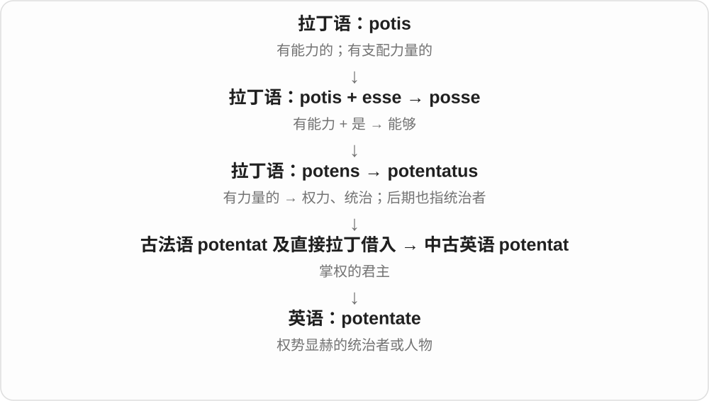

历史叙述可说地方君主；把公司老板叫 a local potentate，常带他在小圈子里说一不二的意味。这个 -ate 结尾的词是名词。

**常见搭配与例句**

a local potentate；an eastern potentate；a wealthy potentate。

> The travelers were received by a local potentate.

旅行者受到了当地一位权势人物的接见。

> He ran the committee like a minor potentate.

他管理委员会时像个小君主，事事要自己说了算。

**别混淆**

ruler 是中性的统治者；potentate 更强调显赫权势，且常有旧式或讽刺语感。

### 41. potentiate — 增强效力；使作用更强

**音标**：/pəˈtenʃieɪt/

**先抓住这个画面**

potentiate 像把已有信号的音量调大：原来的作用还在，现在更强。

**怎么拆**

取拉丁 potentia“力量”的词干加 -ate，并有仿德语 potenzieren 的构词影响；也可现代分析为 potent + 连接成分 -i- + -ate。

**怎么变成今天的意思**

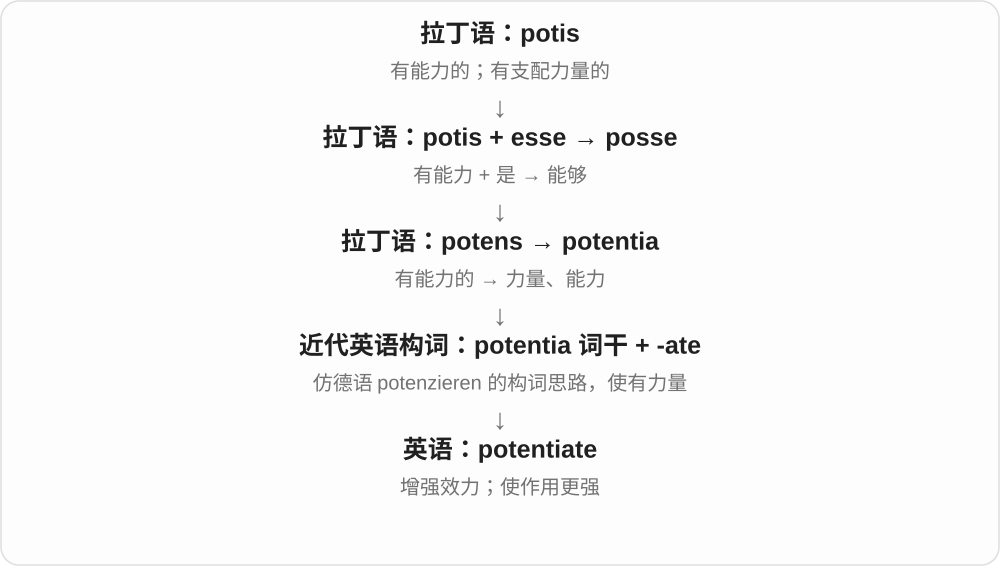

常见于药理、生理和实验研究，表示增强某种作用或反应。这个词只说效果被加强，不自动表示结果有益，也不能直接当成“有潜力”。

**常见搭配与例句**

potentiate an effect；potentiate a response；potentiate activity。

> The experiment tested whether the second signal could potentiate the first response.

实验检验了第二个信号是否能增强第一个反应。

> The researchers found that the two factors potentiated each other’s effects.

研究者发现，这两个因素相互增强了对方的作用。

**别混淆**

potential 是潜在的或潜力；potentiate 是一个及物动词，表示把实际作用加强。

### 42. potentiation — 作用增强；增效；神经联系的增强

**音标**：英 /pəʊˌtenʃiˈeɪʃən/；美 /pəˌtenʃiˈeɪʃən/

**先抓住这个画面**

potentiation 是“原来推一下只动一点，现在同样推一下动得更多”的增强过程。

**怎么拆**

与 potentiate 对应，-ation 表示过程或结果；现代可按 potentiate 去词尾 e 再形成名词理解。

**怎么变成今天的意思**

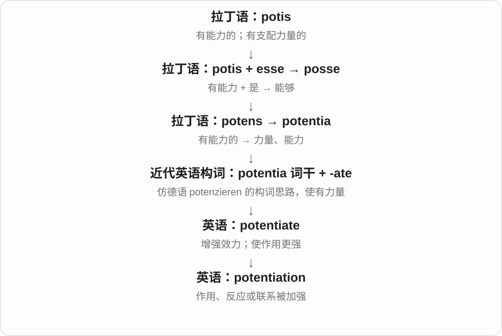

药理语境可谈一种因素增强另一种作用；神经科学中的 long-term potentiation 指神经元之间的联系经过活动后持续增强，不能只按普通“潜力”翻译。

**常见搭配与例句**

potentiation of a response；synaptic potentiation；long-term potentiation。

> The study measured the potentiation of the response after repeated stimulation.

研究测量了反复刺激后反应增强的程度。

> The lecture introduced long-term potentiation as a form of synaptic plasticity.

讲座介绍了作为突触可塑性一种形式的长时程增强。

**别混淆**

potentiality 是尚未实现的可能；potentiation 是效力被增强的过程，二者只差几字母，实际关注点不同。

### 43. impotent — 无能为力的；无效力的；旧医学用语：勃起功能有障碍的

**音标**：/ˈɪmpətənt/

**先抓住这个画面**

impotent 的一般画面是“有情绪、有意愿，却拿不出能改变局面的力量”。

**怎么拆**

经古法语来自拉丁 impotens：否定 in- 在 p 前变为 im-，加 potens“有能力的”。它比单纯说某方面不擅长更强。

**怎么变成今天的意思**

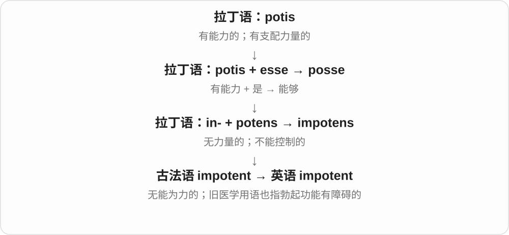

impotent anger 是发了火也无济于事的愤怒。用于性功能时指勃起方面的困难，不等于没有生育能力；现代医疗语境常用更具体的 erectile dysfunction。

**常见搭配与例句**

impotent rage；feel impotent；be impotent to prevent。

> He watched in impotent anger as the decision was announced.

决定公布时，他只能无可奈何地生气。

> The council was impotent to prevent the closure.

议会无力阻止停业。

**别混淆**

powerless 更适合一般的无力处境；impotent 语气较强，又有特定性功能义，直接拿来评价人需留意语境。

### 44. impotence — 无力；无能为力；旧称：勃起功能障碍

**音标**：/ˈɪmpətəns/

**先抓住这个画面**

impotence 是“想产生作用，却使不上力”的状态；具体谈什么能力，要看上下文。

**怎么拆**

来自法语 impotence，追溯到拉丁 impotentia；与 impotent 同源，但名词有自己的借入历史。

**怎么变成今天的意思**

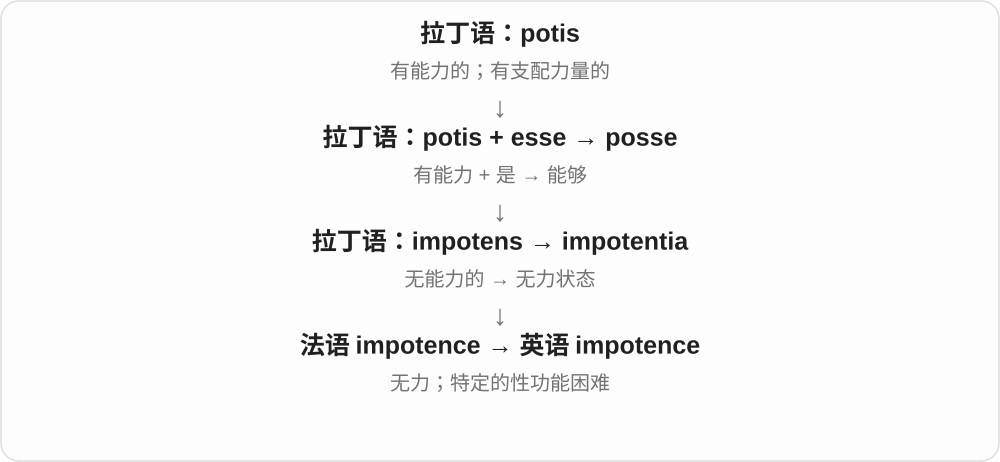

political impotence 指缺乏实际政治影响力。性健康语境中的 impotence 通常对应勃起功能障碍，和 infertility“不育”不是一个概念；不要据词根误解为所有能力都缺失。

**常见搭配与例句**

political impotence；a feeling of impotence；a sense of impotence。

> The article describes the political impotence of the council.

文章描述了议会在政治上无力发挥作用的处境。

> The patient leaflet uses “erectile dysfunction” rather than the older term “impotence.”

患者说明页使用“勃起功能障碍”，而不是较旧的 impotence 一词。

**别混淆**

impotence 可指无力状态或特定性功能问题；infertility 指生育困难，两者不能互相替代。

### 45. impotently — 无能为力地；徒劳地

**音标**：/ˈɪmpətəntli/

**先抓住这个画面**

impotently 描写动作做了、情绪也有了，事情却没有因此改变。

**怎么拆**

impotent + -ly，副词常用一般的“无力改变”义。

**怎么变成今天的意思**

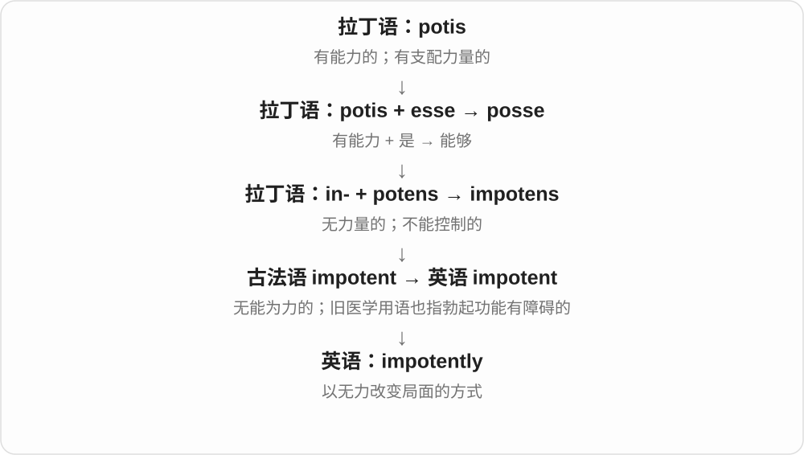

protest impotently 是抗议也无济于事；watch impotently 是只能眼睁睁看着。它常让读者感到当事人的挫败。

**常见搭配与例句**

watch impotently；protest impotently；rage impotently。

> She watched impotently as the flood carried away the bridge.

她只能无能为力地看着洪水冲走桥梁。

> The villagers protested impotently against the decision.

村民们对这项决定提出抗议，却无力改变结果。

**别混淆**

quietly 只说明安静；impotently 说明没有能力影响结果，即使大喊大叫也可能是 impotently。

### 46. pluripotent — 多能的；能分化成身体各类细胞的

**音标**：英 /ˌplʊərɪˈpəʊtənt/；美 /ˌplʊrɪˈpoʊtənt/

**先抓住这个画面**

pluripotent 像一个还没定专业的学生，能走向身体里的许多不同“职业”。

**怎么拆**

pluri- 多、许多 + potent 有能力的，英语科学构词；前一成分来自拉丁语。

**怎么变成今天的意思**

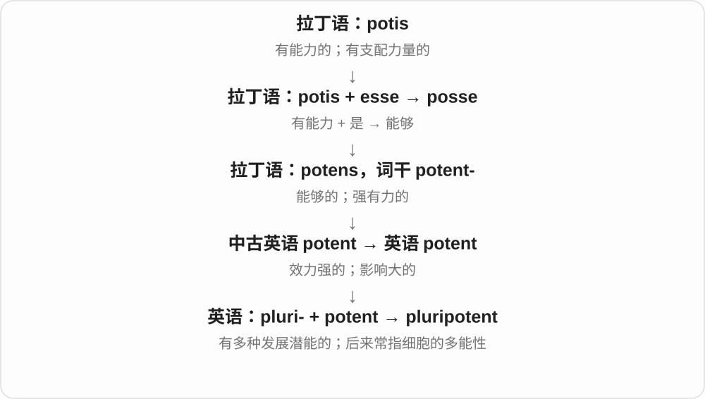

现代干细胞语境中，pluripotent 细胞能形成身体各主要细胞类型，但不能据此说它单独就能形成完整个体及全部胚外组织。诱导多能干细胞常简称 iPS cells。

**常见搭配与例句**

pluripotent stem cells；induced pluripotent stem cells；remain pluripotent。

> The laboratory studies how pluripotent cells become specialized.

实验室研究多能细胞如何变成专门化细胞。

> The researchers created induced pluripotent stem cells from skin cells.

研究者利用皮肤细胞制备了诱导多能干细胞。

**别混淆**

pluripotent 的分化范围比 multipotent 更广；totipotent 还涉及形成完整个体所需的胚外组织等能力。中文有时都带“多能”，要看英文区别。

### 47. multipotent — 多向分化的；能形成有限几类细胞的

**音标**：英 /ˌmʌltiˈpəʊtənt/；美 /mʌlˈtɪpətənt/

**先抓住这个画面**

multipotent 像在同一个专业领域里有多种就业方向，选择不少，但不能横跨所有领域。

**怎么拆**

multi- 多 + potent，原可泛指有多种力量或作用，后来在细胞学中形成专门用法。

**怎么变成今天的意思**

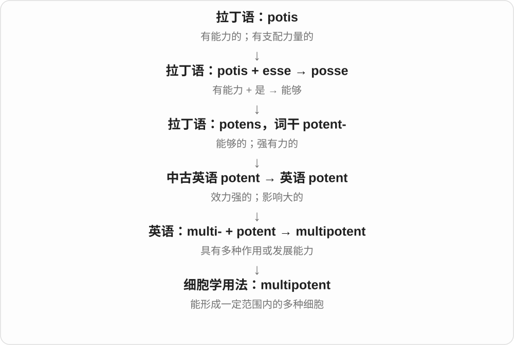

例如造血干细胞可形成多类血细胞，但并不因此就能形成身体所有细胞类型。阅读论文时，它常比 pluripotent 指向更受限制的分化范围。

**常见搭配与例句**

multipotent stem cells；multipotent progenitor cells；a multipotent population。

> Blood stem cells are multipotent.

造血干细胞具有多向分化能力。

> The study followed the development of multipotent progenitor cells.

研究追踪了多向分化祖细胞的发育过程。

**别混淆**

pluri- 和 multi- 都有“多”的字面意思，但这两个科学术语已经固定出不同层级，不能只按前缀随意互换。

### 48. possess — 拥有；具有；占据、控制

**音标**：/pəˈzes/

**先抓住这个画面**

possess 可以想成“牢牢掌握在自己这边”：房子在你手里，能力在你身上，强烈情绪也可能反过来控制你。

**怎么拆**

拉丁 possidere 通常分析为 potis“有支配力”与 sedere“坐”的组合。英语 possess 经法语 possesser 等借入，也有从 possession 反构的影响；不能拆成 pose。

**怎么变成今天的意思**

possess a skill 是具有某种技能，比 have 书面。What possessed you to do that? 常带惊讶或责怪，意思是“你当时怎么会想到干那事？”这里像是某种冲动控制了人。

**常见搭配与例句**

possess the ability to；possess a quality；what possessed you to；be possessed by。

> She possesses the patience needed for this work.

她有做这项工作所需的耐心。

> What possessed you to send the unfinished draft?

你当时怎么会把没写完的草稿发出去？

**别混淆**

own 主要说所有权；possess 可说持有、控制或具有某种品质，法律语境中实际占有与所有权未必相同。

### 49. possession — 占有、持有；财物；球权；被附身的状态

**音标**：/pəˈzeʃən/

**先抓住这个画面**

possession 先问“东西现在在谁手里、受谁控制”，也能直接指手里的那件东西。

**怎么拆**

源自拉丁 possessio，经古法语及直接拉丁借入；英语名词并非统一由更晚的 possess 加 -ion 形成。现代构词仍可把两者联系起来。

**怎么变成今天的意思**

in possession of the keys 是持有钥匙；a prized possession 是珍爱的物品；复数 possessions 常指个人财物。足球里的 keep possession 是控住球，恐怖故事里的 demonic possession 则是被恶魔控制。

**常见搭配与例句**

in possession of；take possession of；personal possessions；retain possession。

> The original letter is still in her possession.

原信仍由她保存着。

> He packed his few possessions into one suitcase.

他把不多的个人物品装进了一个行李箱。

> Our team kept possession for most of the second half.

下半场大部分时间是我们队在控球。

**别混淆**

possession 可强调实际持有或控制；ownership 强调所有权。借来的书在你手里，也可能是 in your possession。

### 50. possessed — 被控制的；着了魔似的；具有的

**音标**：/pəˈzest/

**先抓住这个画面**

possessed 的常见画面是“方向盘像被别的力量接管了”：故事里是鬼怪，日常比喻里是强烈的念头。

**怎么拆**

possess 的过去分词转为形容词；-ed 在这里读 /t/。

**怎么变成今天的意思**

be possessed by fear 是被恐惧支配；work like someone possessed 是像着了魔似地拼命工作。较正式的 be possessed of patience 则表示“具有耐心”，of 和 by 的区别很关键。

**常见搭配与例句**

be possessed by；be possessed of；like a person possessed。

> For weeks, he worked like a man possessed.

几个星期里，他像着了魔似地拼命工作。

> She is possessed of remarkable patience.

她具有非凡的耐心。

**别混淆**

possessed by an idea 是念头控制着人；possessed of an ability 是人具有能力，不能互换介词。

### 51. possessive — 占有欲强的；所有格的；所有格形式

**音标**：/pəˈzesɪv/

**先抓住这个画面**

possessive 把“我的”说得很重：语法里标明归属，人际关系里则可能是不愿分享、不愿对方独立。

**怎么拆**

来自法语 possessif 或直接来自拉丁 possessivus；现代能看出 possess + -ive 的对应，但历史上形容词有独立借入路线。

**怎么变成今天的意思**

a possessive partner 要求过多关注或控制；be possessive about possessions 是舍不得别人碰自己的东西。语法里的 possessive forms 不只表示财产所有，也可表达亲属等关系。

**常见搭配与例句**

possessive about；possessive of；a possessive pronoun；the possessive form。

> He is very possessive about his collection of records.

他很宝贝自己的唱片收藏，不愿别人碰。

> In “Anna’s bicycle,” the possessive form identifies whose bicycle it is.

在 Anna’s bicycle 中，所有格形式说明自行车属于谁。

**别混淆**

protective 强调保护；possessive 强调想独占、控制。语法术语中的 possessive 本身没有这种负面评价。

### 52. possessiveness — 占有欲；独占、控制的倾向

**音标**：/pəˈzesɪvnəs/

**先抓住这个画面**

possessiveness 是把“我在乎你”推成“你的时间和选择都该归我”的倾向，也可指对物品不肯分享。

**怎么拆**

possessive + -ness，把这种态度变成名词。

**怎么变成今天的意思**

常用于关系中的控制欲，也可描述孩子不愿共享玩具。它谈的是态度，不能与“某人确实拥有某件东西”混为一谈。

**常见搭配与例句**

jealousy and possessiveness；emotional possessiveness；possessiveness about belongings。

> Her possessiveness about the family photographs surprised me.

她对家庭照片那种不肯让人分享的态度让我吃惊。

> He learned to distinguish affection from possessiveness.

他学会了区分关爱与占有欲。

**别混淆**

possession 是拥有、占有的事实；possessiveness 是不愿分享或放手的心理。

### 53. possessively — 带占有欲地；不愿与人分享地

**音标**：/pəˈzesɪvli/

**先抓住这个画面**

possessively 是动作里透出“这是我的，别碰”的劲。

**怎么拆**

possessive + -ly，描述说话、看着或护住东西的方式。

**怎么变成今天的意思**

可写人抱住自己的东西，或用控制性的眼神盯住伴侣。这个副词通常让读者感到对方在划定归属，不只是普通的亲近。

**常见搭配与例句**

hold something possessively；look possessively at；speak possessively。

> The child hugged the new toy possessively.

孩子紧紧抱住新玩具，生怕别人拿走。

> He spoke possessively about the team, as if every decision belonged to him.

他谈起团队时带着很强的占有欲，仿佛所有决定都该由他来做。

**别混淆**

affectionately 表达亲昵、关爱；possessively 强调不愿别人分享或独立，语气常更紧绷。

### 54. possessor — 持有者；拥有者；具有某种品质的人

**音标**：英 /pəˈzesə/；美 /pəˈzesər/

**先抓住这个画面**

possessor 是“东西或特点落在谁身上”里的那个人。

**怎么拆**

按英语 possess + -or 分析，-or 表示实施者或持有者；与拉丁 possess- 词族相连。

**怎么变成今天的意思**

the possessor of a rare book 是珍本书的持有者；the possessor of a fine voice 是嗓音出众的人。这个词比 owner 更书面，后者更适合日常问店主、车主是谁。

**常见搭配与例句**

the possessor of；a fortunate possessor；the current possessor。

> The museum contacted the current possessor of the painting.

博物馆联系了这幅画目前的持有者。

> She is the possessor of an exceptionally clear singing voice.

她有一副格外清亮的歌喉。

**别混淆**

owner 更明确指所有者；possessor 可只说明实际持有，也能用于天赋、知识等不适合简单称财产的东西。

### 55. repossess — 收回占有；收回未按约付款的财物

**音标**：/ˌriːpəˈzes/

**先抓住这个画面**

repossess 是把原先交出去、现在又有权收回的东西重新控制在手里。

**怎么拆**

re- 再次 + possess，是英语前缀构词。

**怎么变成今天的意思**

常见于因未还款而收回车辆、房屋或设备的语境，也可泛指重新取得占有。词义描述收回行为，本身不说明每次收回是否合法。

**常见搭配与例句**

repossess a car；repossess a house；be repossessed。

> In the novel, the lender threatens to repossess the family’s car.

小说中，贷款方威胁要收回这家人的车。

> The company repossessed the rented equipment after the contract ended.

合同结束后，公司收回了出租的设备。

**别混淆**

dispossess 的镜头对准被剥夺的人；repossess 对准重新取得控制的一方和被收回的物品。

### 56. repossession — 收回占有；因欠款等被收回财物

**音标**：/ˌriːpəˈzeʃən/

**先抓住这个画面**

repossession 把收回房屋、车辆的整个过程当作一个事件来讲。

**怎么拆**

re- + possession，也与动词 repossess 对应；现代可看作重新取得占有的名词。

**怎么变成今天的意思**

the repossession of a car 是车被收回这件事；face repossession 说面临这种局面。并不是每种“把东西还回来”都用这个正式词。

**常见搭配与例句**

face repossession；avoid repossession；the repossession of property。

> The letter warned the tenant about repossession of the equipment.

信中警告租用人，设备可能被收回。

> The documentary follows families facing repossession.

纪录片跟拍了面临房产被收回的家庭。

**别混淆**

repayment 是还款；repossession 是收回财物，两者可能有关联，但不是同一个动作。

### 57. dispossess — 剥夺财产或土地；使失去占有；夺走球权

**音标**：/ˌdɪspəˈzes/

**先抓住这个画面**

dispossess 是把一个人从“这东西由我掌握”的位置上推开。

**怎么拆**

经古法语 despossesser 借入，des- 表示去除，加 possesser 占有；现代对应 dis- + possess，不能把法语动词画成英语 possess 的后代。

**怎么变成今天的意思**

典型句式 dispossess someone of land：使某人失去土地。体育报道中，dispossess a player 是把球从对方控制下夺走；不必涉及财产所有权。

**常见搭配与例句**

dispossess someone of land；be dispossessed；dispossess an opponent。

> The new ruler dispossessed many families of their land.

新统治者剥夺了许多家庭的土地。

> The defender dispossessed the striker near the penalty area.

后卫在禁区附近断下了前锋脚下的球。

**别混淆**

evict 主要指把人逐出房屋或土地；dispossess 更强调让人失去占有，可以谈土地、财物，也可谈球权。

### 58. dispossession — 剥夺占有；土地或财产被夺走

**音标**：/ˌdɪspəˈzeʃən/

**先抓住这个画面**

dispossession 说的是“原本属于自己生活的一块地方或财物，被别人拿走了”的过程和结果。

**怎么拆**

与 dispossess 相应的英语名词；也可从现代形式看作 dis- + possession。

**怎么变成今天的意思**

历史、社会研究里常谈土地被剥夺及其长期影响。这个词强调失去控制的社会过程，不只是一件物品暂时不见了。

**常见搭配与例句**

land dispossession；forced dispossession；a history of dispossession。

> The exhibition documents the community’s dispossession of its land.

展览记录了这个社区的土地被剥夺的历史。

> Dispossession disrupted both farming and family life.

失去土地既打乱了耕作，也破坏了家庭生活。

**别混淆**

loss 可以是各种原因的失去；dispossession 通常涉及别人使原占有者失去财物或土地。

### 59. omnipotent — 全能的；仿佛无所不能的

**音标**：英 /ɒmˈnɪpətənt/；美 /ɑːmˈnɪpətənt/

**先抓住这个画面**

omnipotent 把能力的范围推到“任何事都能做到”，不是只在一个项目上厉害。

**怎么拆**

来自古法语及拉丁 omnipotens：omni- 全部 + potens 有能力的；英语保留了这个整体词。

**怎么变成今天的意思**

宗教中可描述神的全能；评论中也可夸张地形容权力极大的人。用于人时往往带“他以为自己什么都能管”的意味。

**常见搭配与例句**

an omnipotent deity；seem omnipotent；an omnipotent ruler。

> The myth describes an omnipotent deity.

这个神话描绘了一位全能的神。

> No manager is omnipotent, however impressive the job title.

不管职位名称多显赫，没有哪个经理是无所不能的。

**别混淆**

omnipotent 是什么都能做；omniscient 是什么都知道；omnipresent 是无处不在。

### 60. omnipotence — 全能；无限的力量或权力

**音标**：英 /ɒmˈnɪpətəns/；美 /ɑːmˈnɪpətəns/

**先抓住这个画面**

omnipotence 把“没有任何能力边界”作为一个性质来讨论。

**怎么拆**

经古法语 omnipotence 来自拉丁 omnipotentia；对应 omnipotent，但不是必须等英语形容词出现后才加后缀。

**怎么变成今天的意思**

神学里可讨论 divine omnipotence；政治或心理评论里可谈某人对自己权力的无限想象。通常是不可数名词。

**常见搭配与例句**

divine omnipotence；a belief in omnipotence；an illusion of omnipotence。

> The seminar examined different ideas of divine omnipotence.

研讨课讨论了对神之全能的不同理解。

> Success gave him an illusion of omnipotence.

成功让他产生了无所不能的错觉。

**别混淆**

potency 是某种作用的强度；omnipotence 把范围扩展到没有能力限制，语义强得多。

### 61. despot — 专制统治者；独断专行的人；历史称号

**音标**：英 /ˈdespɒt/；美 /ˈdespət/

**先抓住这个画面**

despot 像把整个国家都当成自己家、什么都要自己说了算的主人；这是理解现代贬义的画面。

**怎么拆**

来自希腊 despotes“主人”，经中世纪拉丁及意大利语、法语等路线进入英语。其第二部分与 potis 有更早的同源关系，不是由拉丁 potent 派生。

**怎么变成今天的意思**

历史上它可作为统治者的称号，并非一出现就是骂人；现代通常指权力不受约束、独断的统治者，也可讽刺家中或办公室里的专横人物。

**常见搭配与例句**

an absolute despot；rule like a despot；a local despot。

> The despot allowed no public criticism of his rule.

这个专制统治者不容许公众批评他的统治。

> The biography explains that “despot” was also a historical title.

传记解释说，despot 过去也曾是一种正式称号。

**别混淆**

potentate 突出显赫权势；despot 在现代通常还带专制、任意支配他人的负面评价。

### 62. despotic — 专制的；专横的

**音标**：英 /deˈspɒtɪk/；美 /deˈspɑːtɪk/

**先抓住这个画面**

despotic 描写“我的话就是规则，你没有商量余地”的统治或做派。

**怎么拆**

由法语 despotique 借入，追溯希腊 despotikos，与 despotes“主人”相连；现代可联系 despot + -ic，历史并非英语名词先进入法语。

**怎么变成今天的意思**

despotic rule 可以谈国家统治；a despotic manager 可以比喻公司里不容异议的管理者。常带明确批评色彩。

**常见搭配与例句**

despotic rule；a despotic regime；despotic behavior。

> The reforms ended decades of despotic rule.

改革结束了数十年的专制统治。

> His despotic manner drove experienced staff away.

他专横的作风把有经验的员工逼走了。

**别混淆**

strict 只是严格，仍可按公平规则办事；despotic 更强调权力任性、别人没有发言空间。

### 63. despotism — 专制统治；专横作风

**音标**：/ˈdespətɪzəm/

**先抓住这个画面**

despotism 把“所有人都得服从一个不受约束的权力中心”作为一种制度或做法来讲。

**怎么拆**

来自法语 despotisme，由 despote 加 -isme 构成；现代英语可对应 despot + -ism，但法语名词有独立借入路线。

**怎么变成今天的意思**

可以指政治制度，也可比喻家庭、组织里的专横控制。区别于只指一个人的 despot，它把焦点放在统治方式和长期状态上。

**常见搭配与例句**

absolute despotism；resist despotism；benevolent despotism。

> The essay argues against despotism in every form.

这篇文章反对各种形式的专制。

> Even the club’s small decisions were shaped by his petty despotism.

连俱乐部里的小事也受他那套小霸王作风支配。

**别混淆**

despot 是人；despotic 是性质；despotism 是制度、作风或现象。benevolent despotism 中即使强调善意，仍是权力高度集中的概念。

### 64. idempotent — 幂等的；重复操作不额外改变结果的

**音标**：英 /ˌɪdəmˈpəʊtənt/；美 /ˈaɪdəmˌpoʊtənt/

**先抓住这个画面**

idempotent 像“把开关设为关闭”：做一次已关掉，再做同样动作，目标状态不会继续变化。

**怎么拆**

用拉丁 idem“相同”与 potens / potent-“有力量”构成的近代数学词；这里 potent 又与幂的数学概念相连，后来进入计算机语境。

**怎么变成今天的意思**

对一个函数而言，可用 f(f(x)) = f(x) 理解，例如对实数取绝对值。程序里把状态设为 0 可以是幂等操作，而每次减 1 通常不是。HTTP 中幂等看重复请求的预期效果，不能要求每次响应文本都完全一样。

**常见搭配与例句**

an idempotent operation；an idempotent function；an idempotent request。

> Setting the flag to false is an idempotent operation.

把标志设为 false 是幂等操作。

> Taking the absolute value of a real number is idempotent.

对实数取绝对值是幂等的。

**别混淆**

deterministic 是同样输入得到同样输出；idempotent 还要求把操作再次作用到结果上，不带来额外改变。二者不同。

### 65. idempotence — 幂等性

**音标**：英 /ˌɪdemˈpəʊtəns/；美 /ˈaɪdəmˌpoʊtəns/

**先抓住这个画面**

idempotence 是“第一次已经做到位，重复做不会再多做一份”的性质。

**怎么拆**

近代数学造词，用拉丁 idem“相同”与表示力量的 potence 构成；现代与 idempotent 相对应，是这种性质的名词。

**怎么变成今天的意思**

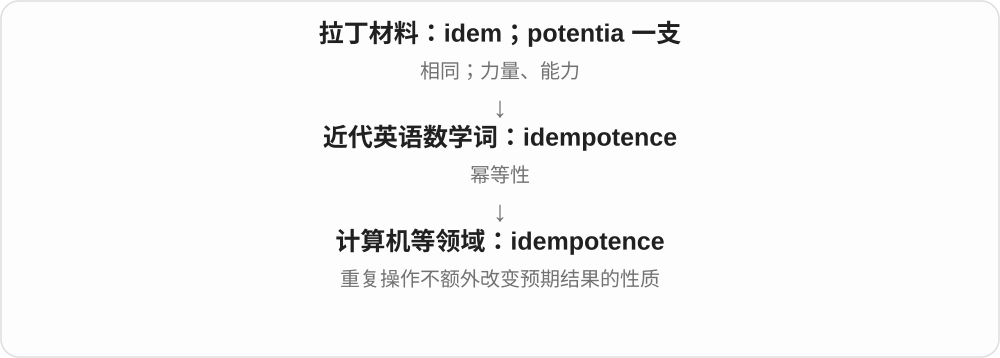

谈接口时，幂等性有助于在不确定是否已成功时重新发送相同请求。它不保证网络一定成功，也不保证系统没有其他副作用；要先说明比较的目标效果是什么。

**常见搭配与例句**

ensure idempotence；preserve idempotence；the idempotence of an operation。

> The test checks the idempotence of the update operation.

这个测试检查更新操作的幂等性。

> Idempotence makes retries easier to reason about.

幂等性让重试的结果更容易判断。

**别混淆**

repeatability 是可以重复并得到一致观察结果；idempotence 特别关心重复操作会不会继续改变目标状态。

### 66. totipotent — 全能的；有形成完整个体潜能的

**音标**：英 /təʊˈtɪpətənt/；美 /toʊˈtɪpətənt/

**先抓住这个画面**

totipotent 的“全”更彻底：不仅能提供身体各类细胞，还具备形成完整发育系统的潜能。

**怎么拆**

拉丁 totus“全部、完整”留下的 toti-，加 potent；是近代科学词，不是把英语 total 直接拼接上去。

**怎么变成今天的意思**

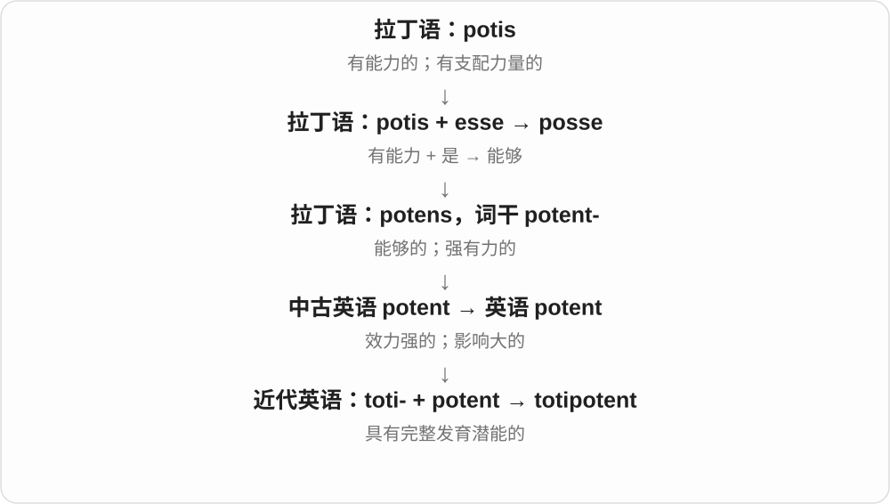

动物发育语境中，包括形成胚体和支持其发育的胚外组织的能力。受精卵是典型例子；“有潜能”仍以适当发育条件为前提，不等于任何环境里都会自行长成个体。

**常见搭配与例句**

totipotent cells；a totipotent zygote；become totipotent。

> A fertilized egg is a familiar example of a totipotent cell.

受精卵是全能细胞的一个常见例子。

> The diagram contrasts totipotent cells with pluripotent cells.

这幅图对比了全能细胞与多能细胞。

**别混淆**

全能 totipotent 与多能 pluripotent 的关键不是“强一点、弱一点”，而是能形成的细胞和组织范围不同。

## 这一组要分清什么

**powerful / potent / potential**：有强大力量 / 产生作用的效力强 / 还有待发挥或尚未实现。a potent effect 与 a potential effect 的差别很大。

**possible / probable**：有可能 / 比较可能。possible 本身不承诺高概率。

**possess / possession / possessive**：拥有、掌控 / 持有这一状态或持有的物品 / 所有格的，或占有欲强的。财物 belongings 与占有欲 possessiveness 也别混淆。

**empower / overpower**：让别人有权、有能力行动 / 用更大的力量把别人压住。

**repossess / dispossess**：重新收回某物 / 使某人失去某物。dispossess someone of something 中，人是直接宾语。

**pluripotent / multipotent / totipotent**：身体多种细胞类型的广泛潜能 / 限定谱系内的多向潜能 / 形成完整个体及相关发育组织的全能性；不要只按“多”这个字互换。

**idempotent / deterministic**：重复作用于已有结果不再改变目标状态 / 给定相同输入得到相同输出。把开关设为关闭可以幂等；每次把开关状态翻转则不是。

**despot / potentate**：现代多带专制、任性掌权的贬义 / 权势显赫的统治者，语气偏历史或书面。

## 串起来练习

**The training empowered the team to make decisions, but its full potential will take time to develop. Possessing information is only useful when people have the power to act on it.**

培训让团队能够自主作决定，但充分发挥潜力还需要时间。掌握信息，只有在人们有权或有能力据此行动时才真正有用。empowered 是获得行动能力；potential 是待发挥的空间；possessing 是掌握；power 是能推动实际行动的力量。
