# 0080 · form- — 形状；形式；塑造成某种样子

[逐词精讲目录](../00_逐词精讲目录.md) · [总目录](../00_总目录_按常用程度.md)

## 核心词根与来源

**form-** 来自拉丁语 **fōrma**“形状、样式”，动词 **fōrmāre** 是塑形。它既能捏出物体，也能组织信息、行为和规则：form 是形成，conform 是按同样的样式，transform 是转成新样子，inform 最早还有塑造与教导的意思。

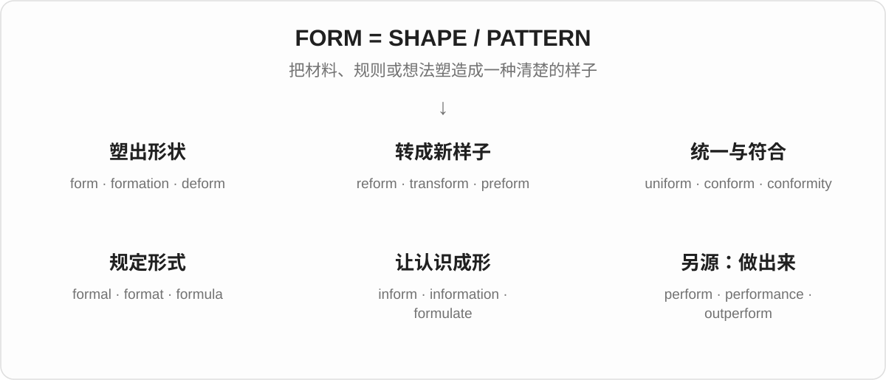

## 词形与演化规律

**forma → form** 保留得很清楚；**formula** 原是“小模子”，后来成为可反复套用的规则。借入的 formation、information、transformation 各有法语或拉丁语名词路线，图中不会都假装成现代英语临时加后缀。

**perform 一组单独理解**：主要来自古法语 parfornir“办成、完成”，词形受 forme 影响。为了避免遇到这些常用词时误拆，本页保留 perform、performance 等辨析词，但不把它们说成 fōrma 的直接后代。

## 单词速览（常用到不常用）

| 单词 | 音标 | 核心意思 |
|---|---|---|
| [information](#w-1) | 英 /ˌɪnfəˈmeɪʃən/；美 /ˌɪnfərˈmeɪʃən/ | 信息；资料；消息 |
| [form](#w-2) | 英 /fɔːm/；美 /fɔːrm/ | 形状；形式；表格；形成 |
| [performance](#w-3) | 英 /pəˈfɔːməns/；美 /pərˈfɔːrməns/ | 表演；表现；性能；履行 |
| [perform](#w-4) | 英 /pəˈfɔːm/；美 /pərˈfɔːrm/ | 执行；表演；表现 |
| [performing](#w-5) | 英 /pəˈfɔːmɪŋ/；美 /pərˈfɔːrmɪŋ/ | 表演；正在执行的；表演艺术相关的 |
| [reform](#w-6) | 英 /rɪˈfɔːm/；美 /rɪˈfɔːrm/ | 改革；改良；改过自新 |
| [formation](#w-7) | 英 /fɔːˈmeɪʃən/；美 /fɔːrˈmeɪʃən/ | 形成；组成；队形；形成物 |
| [format](#w-8) | 英 /ˈfɔːmæt/；美 /ˈfɔːrmæt/ | 格式；版式；节目形式；设置格式 |
| [formal](#w-9) | 英 /ˈfɔːməl/；美 /ˈfɔːrməl/ | 正式的；合乎规定形式的 |
| [formula](#w-10) | 英 /ˈfɔːmjələ/；美 /ˈfɔːrmjələ/ | 公式；固定方案；配方；配方奶 |
| [informed](#w-11) | 英 /ɪnˈfɔːmd/；美 /ɪnˈfɔːrmd/ | 知情的；有充分信息依据的 |
| [uniform](#w-12) | 英 /ˈjuːnɪfɔːm/；美 /ˈjuːnəfɔːrm/ | 一致的；均匀的；制服 |
| [transformation](#w-13) | 英 /ˌtrænsfəˈmeɪʃən/；美 /ˌtrænsfərˈmeɪʃən/ | 转变；改造；变换 |
| [inform](#w-14) | 英 /ɪnˈfɔːm/；美 /ɪnˈfɔːrm/ | 告知；为……提供依据；影响 |
| [transform](#w-15) | 英 /trænsˈfɔːm/；美 /trænsˈfɔːrm/ | 彻底改变；变换 |
| [formally](#w-16) | 英 /ˈfɔːməli/；美 /ˈfɔːrməli/ | 正式地；按规定形式地 |
| [informal](#w-17) | 英 /ɪnˈfɔːməl/；美 /ɪnˈfɔːrməl/ | 非正式的；随意的 |
| [performer](#w-18) | 英 /pəˈfɔːmə/；美 /pərˈfɔːrmər/ | 表演者；表现出某种水平的人或事物 |
| [informative](#w-19) | 英 /ɪnˈfɔːmətɪv/；美 /ɪnˈfɔːrmətɪv/ | 提供有用信息的；让人长见识的 |
| [conform](#w-20) | 英 /kənˈfɔːm/；美 /kənˈfɔːrm/ | 符合；遵从；按习惯行事 |
| [reformation](#w-21) | 英 /ˌrefəˈmeɪʃən/；美 /ˌrefərˈmeɪʃən/ | 改造；改革；宗教改革 |
| [formulation](#w-22) | 英 /ˌfɔːmjəˈleɪʃən/；美 /ˌfɔːrmjəˈleɪʃən/ | 拟定；措辞；配方 |
| [informant](#w-23) | 英 /ɪnˈfɔːmənt/；美 /ɪnˈfɔːrmənt/ | 提供信息的人；消息来源；线人 |
| [misinformation](#w-24) | 英 /ˌmɪsɪnfəˈmeɪʃən/；美 /ˌmɪsɪnfərˈmeɪʃən/ | 错误信息 |
| [formulate](#w-25) | 英 /ˈfɔːmjəleɪt/；美 /ˈfɔːrmjəleɪt/ | 拟定；明确表达；配制 |
| [conformity](#w-26) | 英 /kənˈfɔːməti/；美 /kənˈfɔːrməti/ | 符合；一致；从众 |
| [uniformly](#w-27) | 英 /ˈjuːnɪfɔːmli/；美 /ˈjuːnəfɔːrmli/ | 一致地；均匀地；一律地 |
| [uniformed](#w-28) | 英 /ˈjuːnɪfɔːmd/；美 /ˈjuːnəfɔːrmd/ | 穿制服的；需要穿制服的 |
| [deformation](#w-29) | 英 /ˌdiːfɔːˈmeɪʃən/；美 /ˌdiːfɔːrˈmeɪʃən/ | 变形；形变 |
| [formality](#w-30) | 英 /fɔːˈmæləti/；美 /fɔːrˈmæləti/ | 正式；礼节；例行手续 |
| [reformer](#w-31) | 英 /rɪˈfɔːmə/；美 /rɪˈfɔːrmər/ | 改革者；改良者 |
| [uniformity](#w-32) | 英 /ˌjuːnɪˈfɔːməti/；美 /ˌjuːnəˈfɔːrməti/ | 一致性；均匀性；千篇一律 |
| [outperform](#w-33) | 英 /ˌaʊtpəˈfɔːm/；美 /ˌaʊtpərˈfɔːrm/ | 表现胜过；优于 |
| [disinformation](#w-34) | 英 /ˌdɪsɪnfəˈmeɪʃən/；美 /ˌdɪsɪnfərˈmeɪʃən/ | 为误导而传播的虚假信息 |
| [reformist](#w-35) | 英 /rɪˈfɔːmɪst/；美 /rɪˈfɔːrmɪst/ | 主张渐进改革的；改革派 |
| [waveform](#w-36) | 英 /ˈweɪvfɔːm/；美 /ˈweɪvfɔːrm/ | 波形 |
| [formulaic](#w-37) | 英 /ˌfɔːmjəˈleɪɪk/；美 /ˌfɔːrmjəˈleɪɪk/ | 程式化的；套用固定模式的 |
| [performative](#w-38) | 英 /pəˈfɔːmətɪv/；美 /pərˈfɔːrmətɪv/ | 表演性的；做给人看的；施为的 |
| [conformal](#w-39) | 英 /kənˈfɔːməl/；美 /kənˈfɔːrməl/ | 贴合形状的；保角的 |
| [conformist](#w-40) | 英 /kənˈfɔːmɪst/；美 /kənˈfɔːrmɪst/ | 遵从惯例的人；随大流的 |
| [deform](#w-41) | 英 /dɪˈfɔːm/；美 /dɪˈfɔːrm/ | 使变形；变形 |
| [preform](#w-42) | 英 /ˌpriːˈfɔːm/；美 /ˌpriːˈfɔːrm/（动词）；名词常重读前部 /ˈpriːfɔːrm/ | 预先成形；预制坯件 |
| [formalize](#w-43) | 英 /ˈfɔːməlaɪz/；美 /ˈfɔːrməlaɪz/ | 使正式化；明确为规则或文件 |
| [formless](#w-44) | 英 /ˈfɔːmləs/；美 /ˈfɔːrmləs/ | 没有明确形状的；缺乏结构的 |
| [malformation](#w-45) | 英 /ˌmælfɔːˈmeɪʃən/；美 /ˌmælfɔːrˈmeɪʃən/ | 结构畸形；形成异常 |
| [nonconformist](#w-46) | 英 /ˌnɒnkənˈfɔːmɪst/；美 /ˌnɑːnkənˈfɔːrmɪst/ | 不随俗的人；不墨守成规的 |
| [underperform](#w-47) | 英 /ˌʌndəpəˈfɔːm/；美 /ˌʌndərpərˈfɔːrm/ | 表现低于预期；表现不佳 |
| [isoform](#w-48) | 英 /ˈaɪsəʊfɔːm/；美 /ˈaɪsoʊfɔːrm/ | 同工型；同一种蛋白质的不同形式 |
| [formwork](#w-49) | 英 /ˈfɔːmwɜːk/；美 /ˈfɔːrmwɜːrk/ | 混凝土模板；模板支架系统 |
| [landform](#w-50) | 英 /ˈlændfɔːm/；美 /ˈlændfɔːrm/ | 地貌；地形形态 |
| [reformulate](#w-51) | 英 /ˌriːˈfɔːmjəleɪt/；美 /ˌriːˈfɔːrmjəleɪt/ | 重新表述；重新制定；调整配方 |
| [lifeform](#w-52) | 英 /ˈlaɪffɔːm/；美 /ˈlaɪffɔːrm/ | 生命形式；某类生物 |
| [misinform](#w-53) | 英 /ˌmɪsɪnˈfɔːm/；美 /ˌmɪsɪnˈfɔːrm/ | 给……错误信息；使误信 |
| [nonuniform](#w-54) | 英 /ˌnɒnˈjuːnɪfɔːm/；美 /ˌnɑːnˈjuːnəfɔːrm/ | 不均匀的；不一致的 |
| [nonuniformity](#w-55) | 英 /ˌnɒnjuːnɪˈfɔːməti/；美 /ˌnɑːnjuːnəˈfɔːrməti/ | 不均匀性；不一致之处 |

## 逐词讲解

### 1. information — 信息；资料；消息

**音标**：英 /ˌɪnfəˈmeɪʃən/；美 /ˌɪnfərˈmeɪʃən/

**先抓住这个画面**

你原先不知道几点、在哪里、怎么做，补上这些空白的内容就是 information。

**怎么拆**

来自法语 information、拉丁语 īnfōrmātiō；与 inform 同族，但英语 information 不是必须由英语 inform 后来造出。

**怎么变成今天的意思**

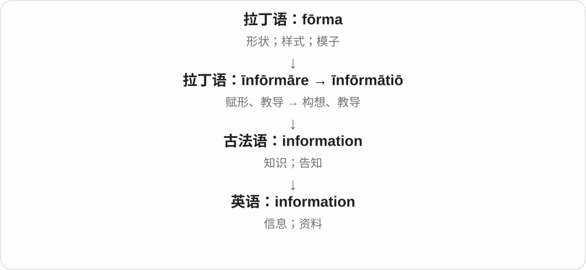

历史上的教导、构想变成让人知道情况的内容。现代通常是不可数名词：一条信息说 a piece of information。

**常见搭配与例句**

provide information；useful information；information about…。

> The website provides information about train services.

这个网站提供列车服务的信息。

> We need more information before deciding.

我们需要更多信息才能作决定。

**别混淆**

data 是记录的数据；information 强调能告诉我们情况的内容。普通英语不说 an information。

### 2. form — 形状；形式；表格；形成

**音标**：英 /fɔːm/；美 /fɔːrm/

**先抓住这个画面**

散着的泥被捏出轮廓，散着的内容被排成一种样式。form 抓的是“组织出来的样子”。

**怎么拆**

来自古法语 forme，根在拉丁语 fōrma。今天既可作名词，也可作动词，不必再拆。

**怎么变成今天的意思**

物体有外形，活动有形式，表格给信息预先画好格子。form a team 是让分散的人组成一个整体。in good form 则说状态好。

**常见搭配与例句**

fill in a form；in the form of；form a group；take form。

> Please fill in this form before the interview.

面试前请填好这张表。

> The students formed a circle around the table.

学生们围着桌子站成一圈。

**别混淆**

shape 偏轮廓和形状；form 还常说表达方式、组织方式与表格。form a habit 是养成，不是填写习惯。

### 3. performance — 表演；表现；性能；履行

**音标**：英 /pəˈfɔːməns/；美 /pərˈfɔːrməns/

**先抓住这个画面**

不只是“做没做”，还看这次做出来是什么样、做得怎样。

**怎么拆**

perform + -ance，历史上中古英语已有相应名词；跟随 perform 的完成、执行来源。

**怎么变成今天的意思**

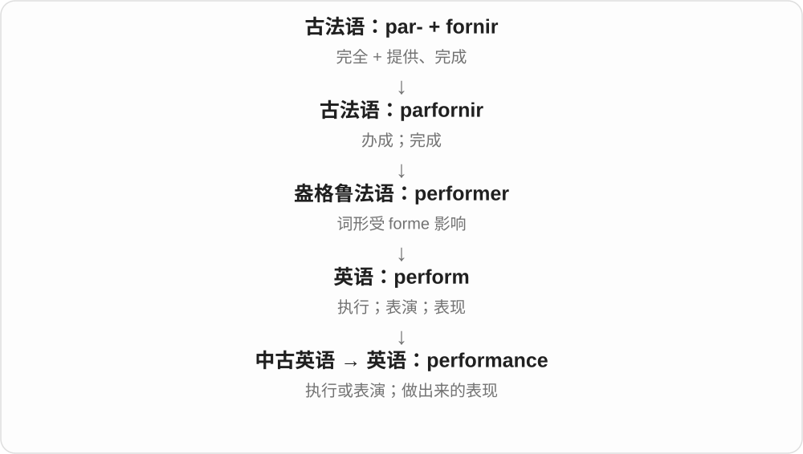

a performance 可以是一场演出；job performance 是工作表现；computer performance 是运行性能。

**常见搭配与例句**

a live performance；improve performance；job performance；academic performance。

> Her performance in the final scene was moving.

她在最后一幕中的表演很动人。

> The update improved the app’s performance.

更新提升了应用的运行性能。

**别混淆**

performance 是表现或一次演出；performer 才是做事、演出的人或表现主体。

### 4. perform — 执行；表演；表现

**音标**：英 /pəˈfɔːm/；美 /pərˈfɔːrm/

**先抓住这个画面**

一件事不只停留在计划里，而是真正做出来：执行任务、演奏曲子，也能看机器跑得怎样。

**怎么拆**

主要源于古法语 parfornir“完成”，经 performer 进入英语，词形受 forme 影响；不能简单讲成拉丁 per- + forma。

**怎么变成今天的意思**

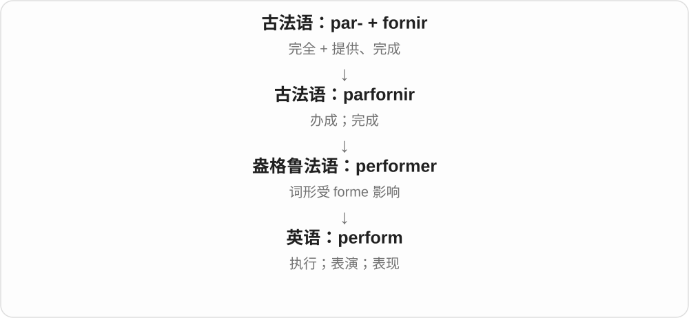

“把事情做出来”连起执行和表演。The computer performs well 说运行表现好，不是在演戏。

**常见搭配与例句**

perform a task；perform on stage；perform well；perform an experiment。

> The team performed a series of tests.

团队进行了一系列测试。

> The new laptop performs well even with several apps open.

即使同时打开几个应用，新笔记本电脑也运行良好。

**别混淆**

form 是形成；perform 是执行，历史来源不同，只发生过词形影响。

### 5. performing — 表演；正在执行的；表演艺术相关的

**音标**：英 /pəˈfɔːmɪŋ/；美 /pərˈfɔːrmɪŋ/

**先抓住这个画面**

把 perform 放到进行中的动作里；在 performing arts 中，则专门说通过现场表演呈现的艺术。

**怎么拆**

perform + -ing，既是动词形式，也能形成名词性或修饰性用法。

**怎么变成今天的意思**

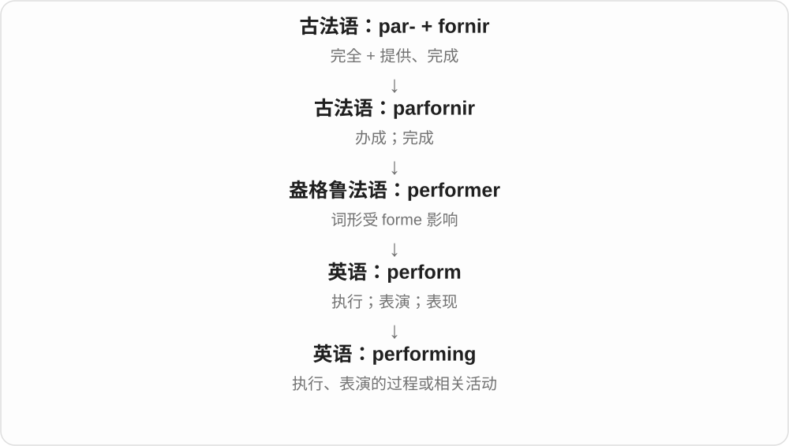

She is performing 是她正在表演；performing arts 常包括戏剧、舞蹈、音乐等，不能逐字译成“正在的艺术”。

**常见搭配与例句**

performing arts；performing live；experience in performing。

> He studied performing arts at college.

他在大学学习表演艺术。

> The band is performing live tonight.

乐队今晚将进行现场演出。

**别混淆**

performing 是动作或相关活动；performance 通常指表现或一场具体演出。

### 6. reform — 改革；改良；改过自新

**音标**：英 /rɪˈfɔːm/；美 /rɪˈfɔːrm/

**先抓住这个画面**

现有东西还能用，但形状不合理，就把规则或行为重新调整，期待它更好。

**怎么拆**

来自拉丁语 re- + fōrmāre，经古法语 reformer 进入；re- 有重新的意思。

**怎么变成今天的意思**

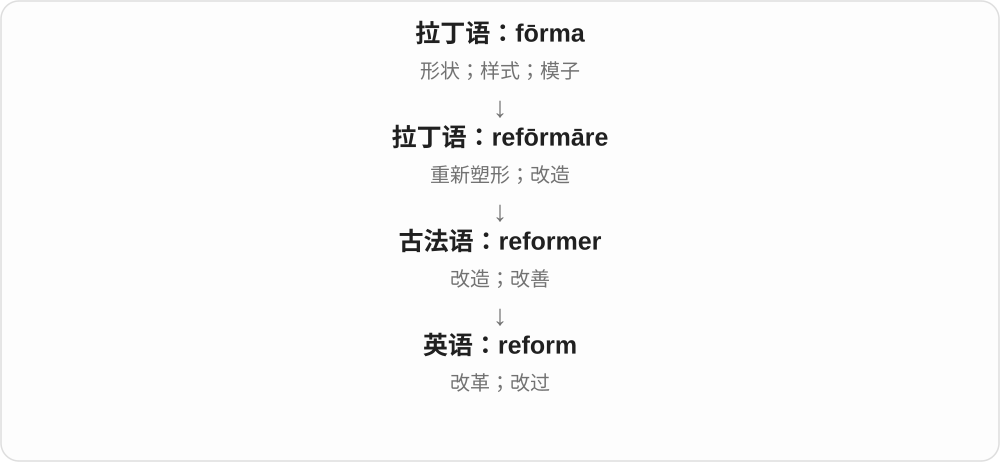

制度可以 reform，人也可以 reform。这个词把改变说成改善方向的调整，具体效果仍须另看。

**常见搭配与例句**

reform the system；education reform；a reformed character。

> The committee proposed reforms to the hiring process.

委员会提议改革招聘流程。

> He promised to reform his behaviour.

他答应改正自己的行为。

**别混淆**

reform 通常改造现有制度；replace 是换掉。重新组成某团体常写带连字符的 re-form，重音也不同。

### 7. formation — 形成；组成；队形；形成物

**音标**：英 /fɔːˈmeɪʃən/；美 /fɔːrˈmeɪʃən/

**先抓住这个画面**

原本没有清楚轮廓的东西，逐渐聚成一套结构；也可以指最后排出来的那种形状。

**怎么拆**

来自法语 formacion、拉丁语 fōrmātiō，与 fōrmāre“塑形”同族；现代对应 form + -ation。

**怎么变成今天的意思**

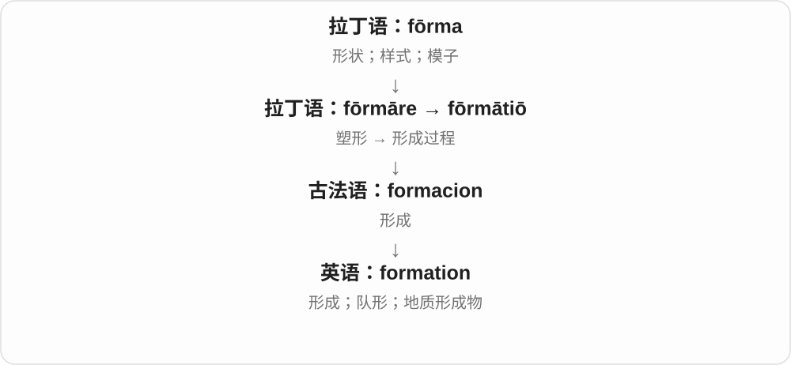

cloud formation 可以说云形成的过程；rock formations 是岩石地貌；in formation 是有组织地排成队形。

**常见搭配与例句**

cloud formation；the formation of a team；fly in formation。

> We studied the formation of clouds.

我们研究了云的形成。

> The planes flew in a tight formation.

飞机保持紧密队形飞行。

**别混淆**

form 可以指一个静态样子；formation 常突出形成过程，或多个部分排成的结构。

### 8. format — 格式；版式；节目形式；设置格式

**音标**：英 /ˈfɔːmæt/；美 /ˈfɔːrmæt/

**先抓住这个画面**

同一份内容可以排成表格、长文或幻灯片；format 是承载内容的那套排列和编码方式。

**怎么拆**

经法语、德语的书籍尺寸用语，连到拉丁语 fōrmātus“塑成的”；并非 form + 英语后缀 -at。

**怎么变成今天的意思**

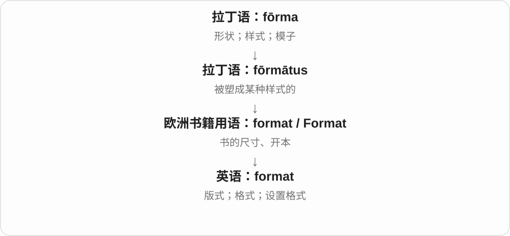

从书页的尺寸和安排扩展到节目结构、文件编码。format a document 常指排版；format a drive 指为存储介质建立文件系统。

**常见搭配与例句**

file format；a different format；format a document。

> Please send the report in PDF format.

请以 PDF 格式发送报告。

> She formatted the headings before sharing the document.

她在分享文档前调整了标题格式。

**别混淆**

format 是内容采用的形式；content 是内容本身。改字体是 formatting，改论点是改内容。

### 9. formal — 正式的；合乎规定形式的

**音标**：英 /ˈfɔːməl/；美 /ˈfɔːrməl/

**先抓住这个画面**

场合有一套规定：话怎样说、衣服怎样穿、事情怎样宣布，都照那套形式来。

**怎么拆**

来自古法语 formel、拉丁语 fōrmālis；现代可看成 form + -al。

**怎么变成今天的意思**

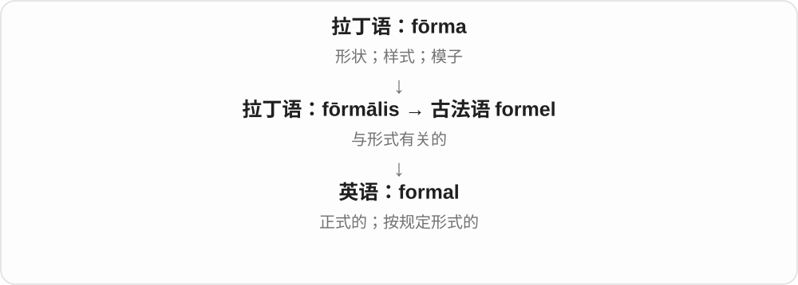

formal apology 是郑重或正式的道歉；formal clothes 是适合正式场合的服装。技术语境也可指依照明确符号规则的系统。

**常见搭配与例句**

formal agreement；formal language；formal training；formal logic。

> We have not received a formal invitation yet.

我们还没收到正式邀请。

> He has no formal training in music.

他没有受过正规的音乐训练。

**别混淆**

formal 不等于难懂或冷淡；一个正式通知也可以写得很清楚、很友好。

### 10. formula — 公式；固定方案；配方；配方奶

**音标**：英 /ˈfɔːmjələ/；美 /ˈfɔːrmjələ/

**先抓住这个画面**

把一次成功做法缩成一个能反复套用的小模子：换进不同数字或材料，照规则得出结果。

**怎么拆**

借自拉丁语 fōrmula，是 fōrma 的指小形式，本有小模型、规则、固定表达的意思。

**怎么变成今天的意思**

数学公式规定量之间的关系；a formula for success 是成功的办法；baby formula 是按配方制作的婴儿奶。

**常见搭配与例句**

a mathematical formula；a formula for success；infant formula。

> Use this formula to calculate the area.

用这个公式计算面积。

> There is no single formula for writing a good story.

写好故事没有唯一的固定办法。

**别混淆**

formula 可以是概括的规则，recipe 常是具体做菜步骤；formulaic 则常批评过分套用固定套路。

### 11. informed — 知情的；有充分信息依据的

**音标**：英 /ɪnˈfɔːmd/；美 /ɪnˈfɔːrmd/

**先抓住这个画面**

作选择之前，先把相关事实弄清楚，这样的选择才是 informed。

**怎么拆**

inform + -ed；从“已经被告知”发展为“掌握相关知识的”。

**怎么变成今天的意思**

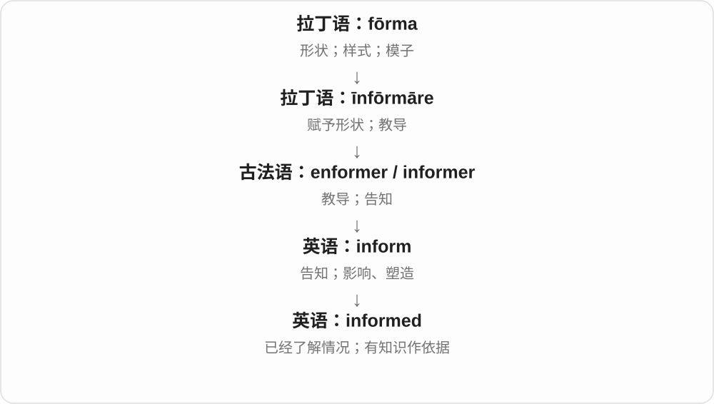

形容人是见多识广或知情；形容决定是经过了解后作出的。强调信息基础，不保证结论绝不会错。

**常见搭配与例句**

an informed decision；an informed opinion；keep someone informed。

> Clear labels help shoppers make informed choices.

清晰的标签帮助顾客在了解情况后作选择。

> Please keep me informed of the progress.

请让我随时了解进展。

**别混淆**

informed 提示有信息基础；certain 是确信。了解更多的人也可能仍有合理疑问。

### 12. uniform — 一致的；均匀的；制服

**音标**：英 /ˈjuːnɪfɔːm/；美 /ˈjuːnəfɔːrm/

**先抓住这个画面**

uniform 的画面是一排杯子都一样高，或一群工作人员都穿同一种样式的衣服。

**怎么拆**

借自法语 uniforme，远源为拉丁语 ūni-（一）+ forma（形式、样式）组成的 ūniformis。

**怎么变成今天的意思**

先是形状、状态一致；服装保持统一式样，就形成名词“制服”。形容词与名词都保留“一个样”的核心。

**常见搭配与例句**

a school uniform；uniform size；uniform distribution。

> The tiles are not uniform in size.

这些瓷砖的尺寸不一致。

> The guide wore a blue uniform.

导游穿着蓝色制服。

**别混淆**

uniform 强调同样或均匀；united 强调联合。不同制服的人也能 united，一样着装也不保证团结。

### 13. transformation — 转变；改造；变换

**音标**：英 /ˌtrænsfəˈmeɪʃən/；美 /ˌtrænsfərˈmeɪʃən/

**先抓住这个画面**

把从原先的样子走到新样子的整段变化，打包成一个名词。

**怎么拆**

经法语来自拉丁语 trānsfōrmātiō；与 transform 同族，现代可对应 transform + -ation。

**怎么变成今天的意思**

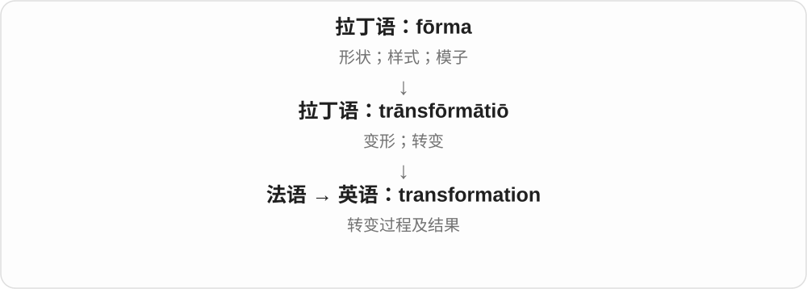

可以是城市改造、人的变化，也可以是数学变换。日常语境通常比一个小调整更明显。

**常见搭配与例句**

undergo a transformation；a remarkable transformation；digital transformation。

> The old station has undergone a remarkable transformation.

老车站经历了显著改造。

> The photos document her garden’s transformation over five years.

这些照片记录了她的花园五年间的变化。

**别混淆**

formation 是形成；transformation 是已经存在的东西变成另一个状态。

### 14. inform — 告知；为……提供依据；影响

**音标**：英 /ɪnˈfɔːm/；美 /ɪnˈfɔːrm/

**先抓住这个画面**

给一个人缺少的信息，让他脑子里对事情的形状变清楚。

**怎么拆**

拉丁语 in- + fōrmāre 是“赋予形状”，已有教导义，经法语进入英语。

**怎么变成今天的意思**

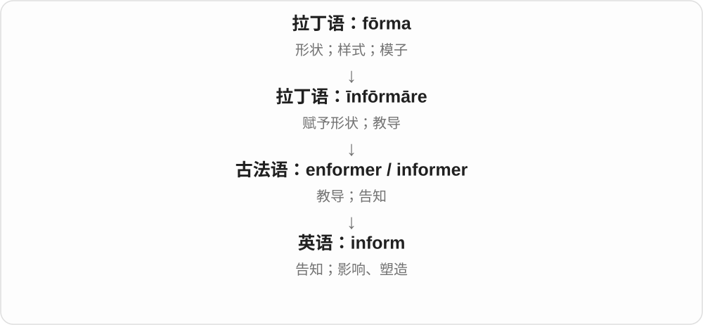

从塑造、教导走到使人知道。Research informs policy 不是研究给政策打电话，而是研究塑造或支持决策。

**常见搭配与例句**

inform someone of/about；inform someone that；inform a decision。

> Please inform us of any changes to your address.

地址若有变化，请告知我们。

> The survey results will inform our next decision.

调查结果将为我们的下一步决策提供依据。

**别混淆**

inform 通常要有接收信息的人，不能把 inform me 写成 inform to me。tell 更日常。

### 15. transform — 彻底改变；变换

**音标**：英 /trænsˈfɔːm/；美 /trænsˈfɔːrm/

**先抓住这个画面**

旧仓库变成明亮的图书馆，还是那个地方，但用途和感觉都换了一个样。

**怎么拆**

来自拉丁语 trānsfōrmāre，经法语 transformer；trans- 表跨越、转变，接 fōrmāre“塑形”。

**怎么变成今天的意思**

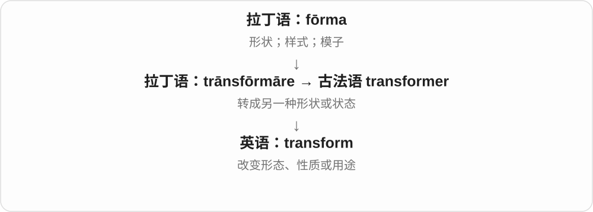

不只外观改变，也能说经历改变了一个人的生活。技术用法可以是按规则把一种表示变为另一种表示。

**常见搭配与例句**

transform A into B；transform a space；transform someone’s life。

> They transformed the warehouse into a library.

他们把仓库改成了图书馆。

> The scholarship transformed her life.

那份奖学金改变了她的人生。

**别混淆**

change 范围很宽；transform 往往让人感觉改变明显，带来新的状态。

### 16. formally — 正式地；按规定形式地

**音标**：英 /ˈfɔːməli/；美 /ˈfɔːrməli/

**先抓住这个画面**

把一件事从口头风声推进到正式程序，或用符合正式场合的方式去做。

**怎么拆**

formal + -ly。

**怎么变成今天的意思**

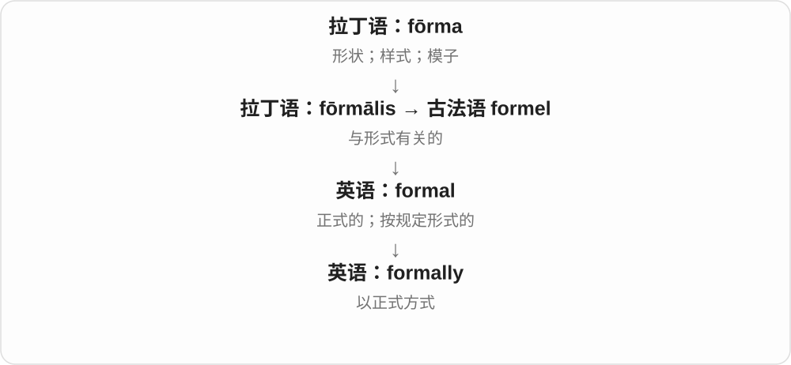

formally announce 是正式宣布；formally dressed 是穿着正式。它经常标出程序已经完成的那一步。

**常见搭配与例句**

formally announce；formally approve；dress formally。

> The project was formally approved on Monday.

项目在星期一获得正式批准。

> Guests were asked to dress formally.

来宾被要求穿正式服装。

**别混淆**

formerly 是以前，只有一个字母不同；formally 是正式地。

### 17. informal — 非正式的；随意的

**音标**：英 /ɪnˈfɔːməl/；美 /ɪnˈfɔːrməl/

**先抓住这个画面**

把严格的仪式和固定程序放松一点，人可以像平常聊天一样交流。

**怎么拆**

in- 表否定，接 formal；这里的 in- 不是 inform 中“赋予形状”的 in-。

**怎么变成今天的意思**

可以形容聊天、聚会、衣着或约定。非正式并不等于粗鲁，也不保证一件约定没有实际影响。

**常见搭配与例句**

an informal chat；informal clothes；an informal arrangement。

> We had an informal chat over coffee.

我们喝着咖啡随便聊了聊。

> The office has an informal dress code.

办公室对着装要求比较随意。

**别混淆**

informal 是场合或表达不正式；unprofessional 是不专业，两者不能画等号。

### 18. performer — 表演者；表现出某种水平的人或事物

**音标**：英 /pəˈfɔːmə/；美 /pərˈfɔːrmər/

**先抓住这个画面**

舞台上把作品演出来的人；扩展后，也可指某项工作中表现好的成员或产品。

**怎么拆**

perform + -er。

**怎么变成今天的意思**

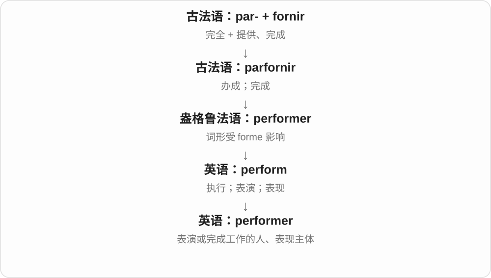

a talented performer 是有才华的表演者；a strong performer 可以是业绩好的部门、产品或人。

**常见搭配与例句**

a street performer；a skilled performer；a strong performer。

> The street performer gathered a small crowd.

街头艺人吸引了一小群观众。

> This model is a strong performer in low light.

这款机型在弱光条件下表现出色。

**别混淆**

performer 不必只指演员；actor 通常偏演戏，performer 也包括歌手、舞者、杂技演员等。

### 19. informative — 提供有用信息的；让人长见识的

**音标**：英 /ɪnˈfɔːmətɪv/；美 /ɪnˈfɔːrmətɪv/

**先抓住这个画面**

听完以后，你确实多懂了些东西，而不是只听了一堆漂亮话。

**怎么拆**

现代可看作 inform + -ative；历史上也有中世纪拉丁语 īnfōrmātīvus 的借入路线，根仍是 īnfōrmāre“赋形、教导”。

**怎么变成今天的意思**

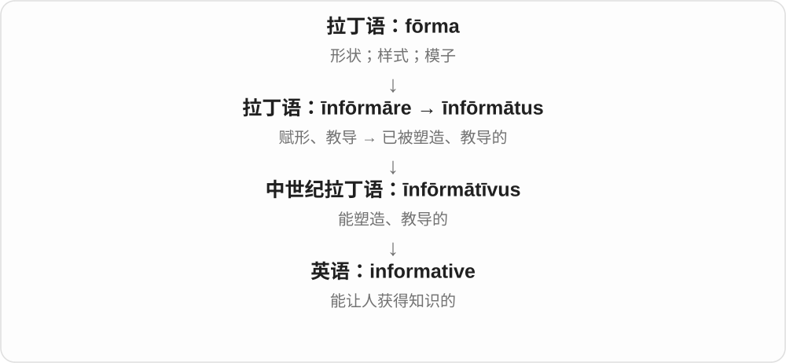

常赞扬说明、文章和演讲信息充实、对理解有帮助。它不等于文字很多。

**常见搭配与例句**

an informative article；an informative talk；highly informative。

> The guide gave an informative explanation of the building.

导游对这栋建筑作了很有帮助的讲解。

> The short video was surprisingly informative.

这段短视频出乎意料地有料。

**别混淆**

informed 说人或决定有知识作基础；informative 说内容能把知识给别人。

### 20. conform — 符合；遵从；按习惯行事

**音标**：英 /kənˈfɔːm/；美 /kənˈfɔːrm/

**先抓住这个画面**

把自己的形状放进既定模子，边缘能对上，就叫 conform。

**怎么拆**

来自拉丁语 cōnfōrmāre，经法语进入；con- 与 form 共同表达按相同样式塑造。

**怎么变成今天的意思**

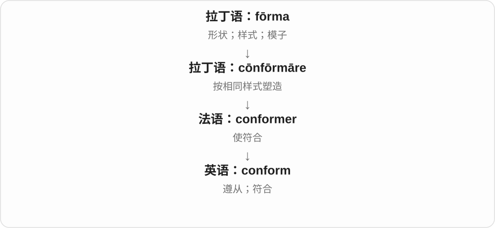

产品符合标准，人遵守规则，也可能因压力而随大流。它可以是必要合规，也可以是牺牲个性，要看语境。

**常见搭配与例句**

conform to standards；conform to expectations；pressure to conform。

> All products must conform to the safety standard.

所有产品必须符合该安全标准。

> She refused to conform just to gain approval.

她不愿只为得到认可而随大流。

**别混淆**

confirm 是确认事实；conform 是与规定相符。只有一个字母差异，动作完全不同。

### 21. reformation — 改造；改革；宗教改革

**音标**：英 /ˌrefəˈmeɪʃən/；美 /ˌrefərˈmeɪʃən/

**先抓住这个画面**

把旧的秩序或行为重新塑造；大写时常指欧洲历史上那场宗教改革。

**怎么拆**

经法语 reformation 来自拉丁语 refōrmātiō，与 refōrmāre 同族；现代对应 reform + -ation。

**怎么变成今天的意思**

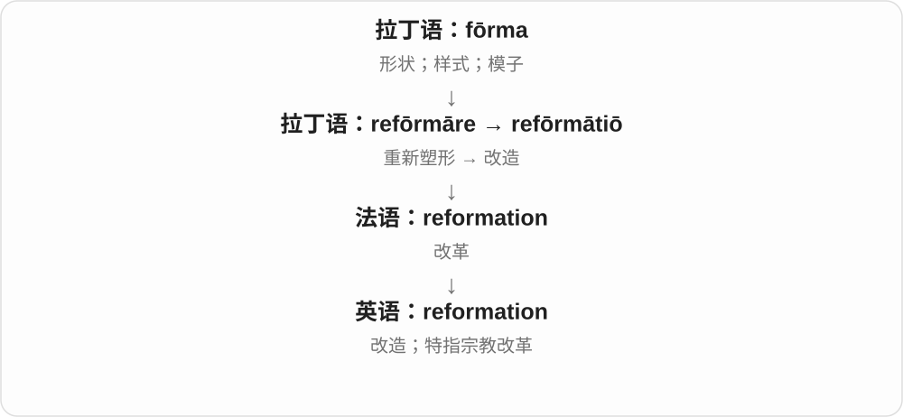

一般“改革”日常更常用 reform。the Reformation 是特定历史名称，不能把每次行政改革都大写成这个名字。

**常见搭配与例句**

the Reformation；the reformation of a system；moral reformation。

> The course examines the Reformation in Europe.

这门课研究欧洲宗教改革。

> The novel follows the gradual reformation of a dishonest man.

小说描写一个不诚实的人逐渐改过的过程。

**别混淆**

reformation 与 transformation 都含改变；前者往往带纠正、改良意思，后者强调变化幅度或性质。

### 22. formulation — 拟定；措辞；配方

**音标**：英 /ˌfɔːmjəˈleɪʃən/；美 /ˌfɔːrmjəˈleɪʃən/

**先抓住这个画面**

既可以是把想法整理成型的过程，也可以是最终整理出来的那套表述或配方。

**怎么拆**

formulate 去末尾 e，加 -ion；这是英语动词派生的动作名词。

**怎么变成今天的意思**

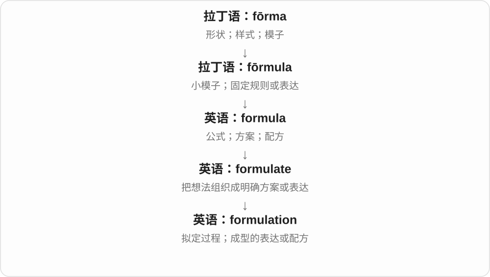

a careful formulation 是精心组织的说法；a new formulation 可以是重新调整成分比例的产品配方。

**常见搭配与例句**

policy formulation；the formulation of a question；a new formulation。

> The wording is a clearer formulation of the same idea.

这段措辞把同一个想法表达得更清楚。

> The company tested a new formulation of the paint.

公司测试了涂料的一种新配方。

**别混淆**

formula 偏规则或配方本身；formulation 还可以突出拟定过程、具体措辞和某个配方版本。

### 23. informant — 提供信息的人；消息来源；线人

**音标**：英 /ɪnˈfɔːmənt/；美 /ɪnˈfɔːrmənt/

**先抓住这个画面**

你无法直接知道某件事，有个人把自己掌握的情况告诉你，他就是 informant。

**怎么拆**

现代能看成 inform + -ant；词源另追到拉丁语 īnfōrmāns，词干 īnfōrmant-，是 īnfōrmāre“教导、告知”的现在分词。

**怎么变成今天的意思**

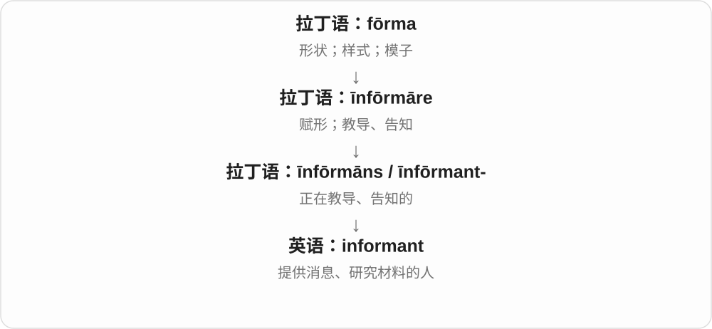

调查语境常指线人；语言学或田野研究中也可指提供语言、文化材料的人，不必秘密行动。

**常见搭配与例句**

a police informant；a confidential informant；a key informant。

> An informant told investigators where the documents were kept.

一名消息提供者告诉调查人员，文件存放在哪里。

> The researcher checked the expression with a local informant.

研究者向一位当地受访者核实了这个说法。

**别混淆**

informant 不自动等于 spy“间谍”；研究访谈中的信息提供者也可能公开、自愿参与。

### 24. misinformation — 错误信息

**音标**：英 /ˌmɪsɪnfəˈmeɪʃən/；美 /ˌmɪsɪnfərˈmeɪʃən/

**先抓住这个画面**

消息在传播，可里面的内容不对；转发的人甚至可能以为自己在帮忙。

**怎么拆**

mis- + information，错误的信息。

**怎么变成今天的意思**

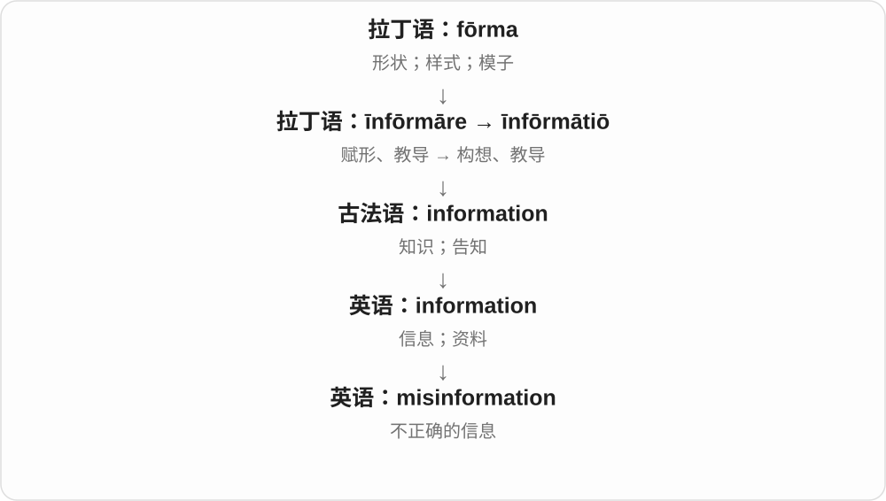

通常先说信息是否可靠，不要求传播者有欺骗意图。过时的路线、错记的日期都可能成为 misinformation。

**常见搭配与例句**

spread misinformation；correct misinformation；misinformation about…。

> The website corrected the misinformation about ticket prices.

网站纠正了关于票价的错误信息。

> An old screenshot can spread misinformation if its date is missing.

旧截图如果没了日期，可能传播错误信息。

**别混淆**

disinformation 通常突出故意欺骗；misinformation 本身不一定故意。

### 25. formulate — 拟定；明确表达；配制

**音标**：英 /ˈfɔːmjəleɪt/；美 /ˈfɔːrmjəleɪt/

**先抓住这个画面**

脑子里散着几个想法，现在把它们组织成说得清、能执行的一套方案。

**怎么拆**

formula + -ate，由规则、配方向形成规则或配方的动作发展。

**怎么变成今天的意思**

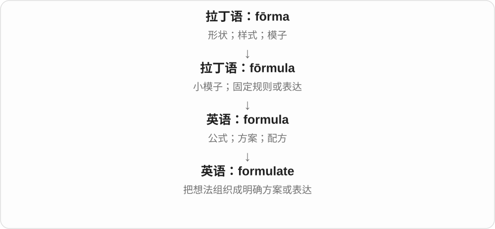

可以制定计划，也可以把问题措辞得准确；配方语境则是决定各成分怎样组合。

**常见搭配与例句**

formulate a plan；formulate a question；formulate a policy。

> We need time to formulate a clear response.

我们需要时间拟定一个清楚的答复。

> The team formulated a new recipe for the product.

团队为产品设计了新配方。

**别混淆**

formulate 不表示方案已经实施；implement 才是把方案执行下去。

### 26. conformity — 符合；一致；从众

**音标**：英 /kənˈfɔːməti/；美 /kənˈfɔːrməti/

**先抓住这个画面**

大家照着同一个样子做，表现出来的一致状态就是 conformity。

**怎么拆**

来自法语 conformité，与 conform 同族；现代能看出 conform + -ity。

**怎么变成今天的意思**

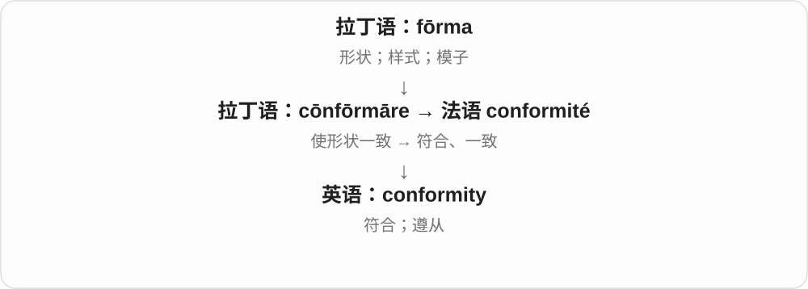

in conformity with 是正式的“符合”。社会心理语境常指人在群体压力下改变行为来跟大家一致。

**常见搭配与例句**

in conformity with；social conformity；pressure for conformity。

> The work was completed in conformity with the agreed plan.

工作按约定方案完成了。

> The school encourages questions rather than blind conformity.

学校鼓励提问，不鼓励盲目从众。

**别混淆**

uniformity 是结果看起来一致；conformity 更容易带上遵从标准或群体的意思。

### 27. uniformly — 一致地；均匀地；一律地

**音标**：英 /ˈjuːnɪfɔːmli/；美 /ˈjuːnəfɔːrmli/

**先抓住这个画面**

uniformly 像往面包上抹酱，各处厚薄差不多；也可以说一组结果或评价都呈现同样情况。

**怎么拆**

uniform + -ly。

**怎么变成今天的意思**

空间上可说分布均匀；评价上可说一致好评或差评。它关注没有明显差别。

**常见搭配与例句**

spread uniformly；uniformly distributed；uniformly high quality。

> Spread the seeds uniformly across the tray.

把种子均匀撒在托盘里。

> The reviews were uniformly positive.

这些评论都给出了正面评价。

**别混淆**

universally 强调覆盖所有对象；uniformly 强调各处表现一致。有时两者接近，但观察角度不同。

### 28. uniformed — 穿制服的；需要穿制服的

**音标**：英 /ˈjuːnɪfɔːmd/；美 /ˈjuːnəfɔːrmd/

**先抓住这个画面**

uniformed 像你在大厅里一眼看见穿着统一服装的工作人员，服装表明其职责。

**怎么拆**

uniform（制服）+ -ed，表示穿着或配有这种服装。

**怎么变成今天的意思**

这里从 uniform 的名词义出发，不是在说人的思想、身材都一致。也可修饰需要穿制服的职业。

**常见搭配与例句**

uniformed staff；a uniformed officer；uniformed services。

> A uniformed employee checked our tickets at the entrance.

一位穿制服的工作人员在入口检查了我们的票。

> The photograph shows three uniformed officers.

照片上是三位穿制服的警官。

**别混淆**

uniformed 是穿制服；uninformed 是不了解情况，后者多一个 n，读音也不同。

### 29. deformation — 变形；形变

**音标**：英 /ˌdiːfɔːˈmeɪʃən/；美 /ˌdiːfɔːrˈmeɪʃən/

**先抓住这个画面**

把“哪里被压弯、拉长了”当作一个过程或结果来观察，就是 deformation。

**怎么拆**

经法语 deformation，属于拉丁语 dēfōrmāre 词族；现代对应 deform + -ation。

**怎么变成今天的意思**

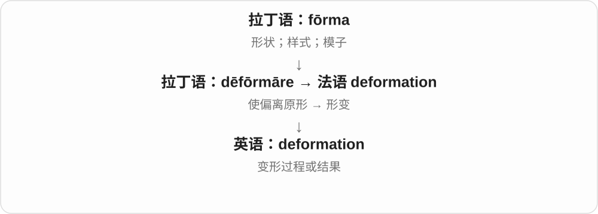

工程里常测受力前后尺寸、轮廓怎样改变。elastic deformation 能在卸力后恢复，plastic deformation 通常留下永久变化。

**常见搭配与例句**

permanent deformation；elastic deformation；deformation under load。

> The test measured deformation under pressure.

测试测量了受压时的形变。

> The spring returned to its original shape after a small elastic deformation.

弹簧发生小幅弹性形变后恢复了原形。

**别混淆**

deformation 是一般形变；malformation 常指生长或形成过程中出现的结构异常。

### 30. formality — 正式；礼节；例行手续

**音标**：英 /fɔːˈmæləti/；美 /fɔːrˈmæləti/

**先抓住这个画面**

事情实际上差不多定了，但规定的签字、盖章、礼节仍要走完，这些就是 formalities。

**怎么拆**

来自法语 formalité，与 formal 同族；现代可看成 formal + -ity。

**怎么变成今天的意思**

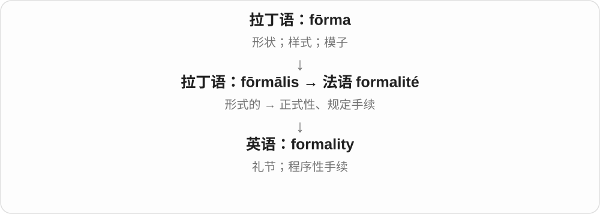

作不可数名词可以说气氛的正式程度；a formality 常说主要是履行程序的步骤，不一定表示可以省略。

**常见搭配与例句**

a mere formality；complete the formalities；without formality。

> Signing the final copy should be a formality.

在最终文本上签字应该只是履行手续。

> The meeting began without much formality.

会议没有太多客套礼节就开始了。

**别混淆**

formalities 是手续；formal clothes 是正式服装。手续简单也可能仍然必要。

### 31. reformer — 改革者；改良者

**音标**：英 /rɪˈfɔːmə/；美 /rɪˈfɔːrmər/

**先抓住这个画面**

发现旧办法有问题，推动它改变的人。

**怎么拆**

reform + -er。

**怎么变成今天的意思**

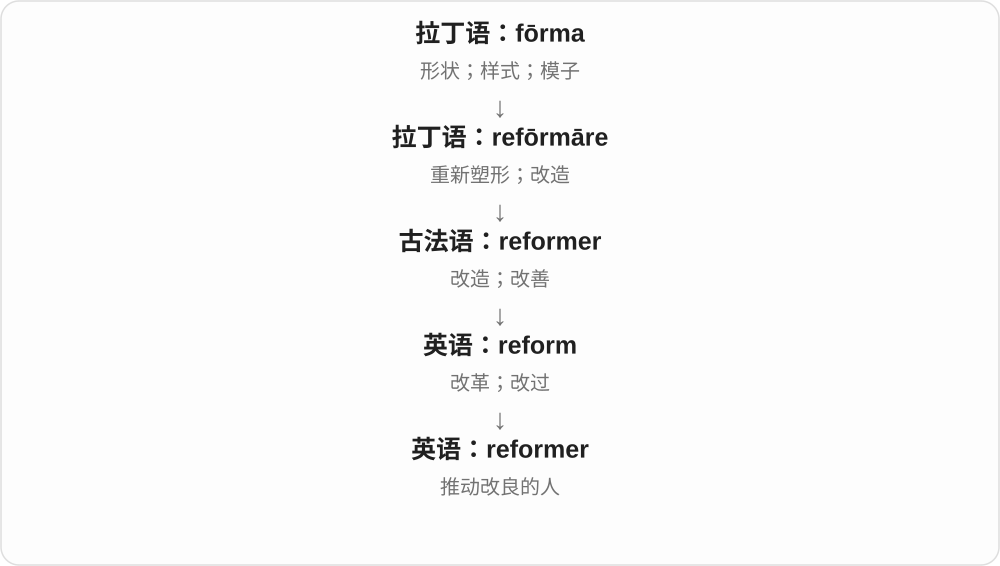

可以是社会、教育或制度改革的推动者。词本身强调角色，不保证其方案一定成功。

**常见搭配与例句**

a social reformer；an educational reformer；a group of reformers。

> The reformer argued for wider access to education.

这位改革者主张让更多人获得教育机会。

> Several reformers supported changes to the voting system.

几位改革者支持改变投票制度。

**别混淆**

reformer 是改革者；performer 是表演者或执行者，开头和来源都不同。

### 32. uniformity — 一致性；均匀性；千篇一律

**音标**：英 /ˌjuːnɪˈfɔːməti/；美 /ˌjuːnəˈfɔːrməti/

**先抓住这个画面**

uniformity 像一批螺丝尺寸都一致，能稳定配合；换到城市街景里，也可能让人觉得处处一个样。

**怎么拆**

经古法语 uniformité 或直接来自晚期拉丁语 ūniformitās；现代对应 uniform + -ity。

**怎么变成今天的意思**

同样的性质可有不同评价：制造中可能需要，艺术中可能显得单调。词本身不能决定这种一致是好是坏。

**常见搭配与例句**

uniformity of size；ensure uniformity；visual uniformity。

> The inspection checks the uniformity of the coating.

检查要确认涂层是否均匀。

> She disliked the visual uniformity of the new buildings.

她不喜欢这些新建筑在视觉上的千篇一律。

**别混淆**

unity 允许各部分有差异但组成整体；uniformity 更关注各部分彼此相同。

### 33. outperform — 表现胜过；优于

**音标**：英 /ˌaʊtpəˈfɔːm/；美 /ˌaʊtpərˈfɔːrm/

**先抓住这个画面**

把两个对象放在同一项比较里，一个跑得更快、做得更好，就 outperform 另一个。

**怎么拆**

out- 表超过，接 perform。

**怎么变成今天的意思**

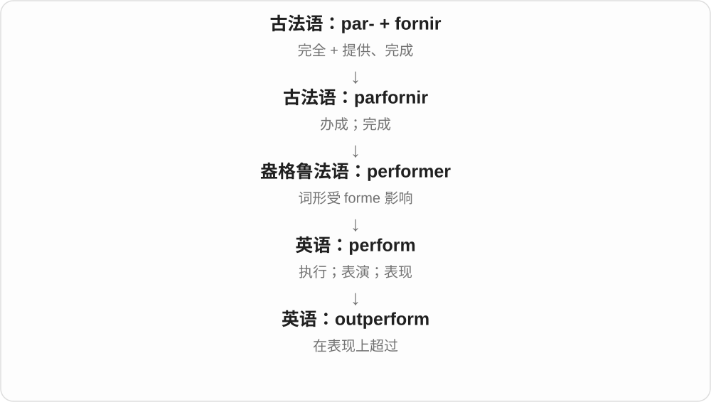

比较的是某个方面，不一定说明各方面都强。outperform expectations 也可指超出预期。

**常见搭配与例句**

outperform competitors；outperform expectations；consistently outperform。

> The new battery outperformed the old one in the test.

新电池在测试中的表现优于旧电池。

> The team outperformed everyone’s expectations.

团队的表现超出了所有人的预期。

**别混淆**

outperform 通常直接接比较对象；不需要再加 than。

### 34. disinformation — 为误导而传播的虚假信息

**音标**：英 /ˌdɪsɪnfəˈmeɪʃən/；美 /ˌdɪsɪnfərˈmeɪʃən/

**先抓住这个画面**

明知内容不真实，还设计、散布它，让别人形成错误认识。

**怎么拆**

dis- + information；现代主要义强调有意误导，不能只按 dis- 机械理解成“没有信息”。

**怎么变成今天的意思**

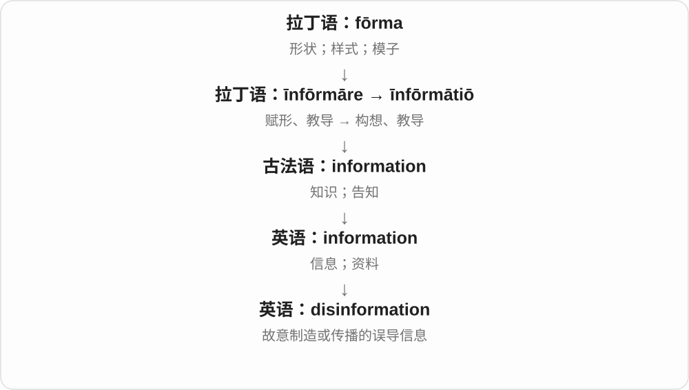

常涉及有组织的虚假消息，但一个人也可能故意散布。判断时既要看内容，也要看有无误导意图。

**常见搭配与例句**

a disinformation campaign；spread disinformation；counter disinformation。

> The report exposed a campaign of deliberate disinformation.

报告揭露了一场蓄意散布虚假信息的行动。

> They fabricated documents as part of the disinformation effort.

他们伪造文件，作为误导行动的一部分。

**别混淆**

信息有错，不足以单独证明是 disinformation；无意误传通常用 misinformation。

### 35. reformist — 主张渐进改革的；改革派

**音标**：英 /rɪˈfɔːmɪst/；美 /rɪˈfɔːrmɪst/

**先抓住这个画面**

希望在现有制度里一步步改，通常不以彻底推翻整套制度为目标。

**怎么拆**

reform + -ist，表示支持某种改革立场的人，也作形容词。

**怎么变成今天的意思**

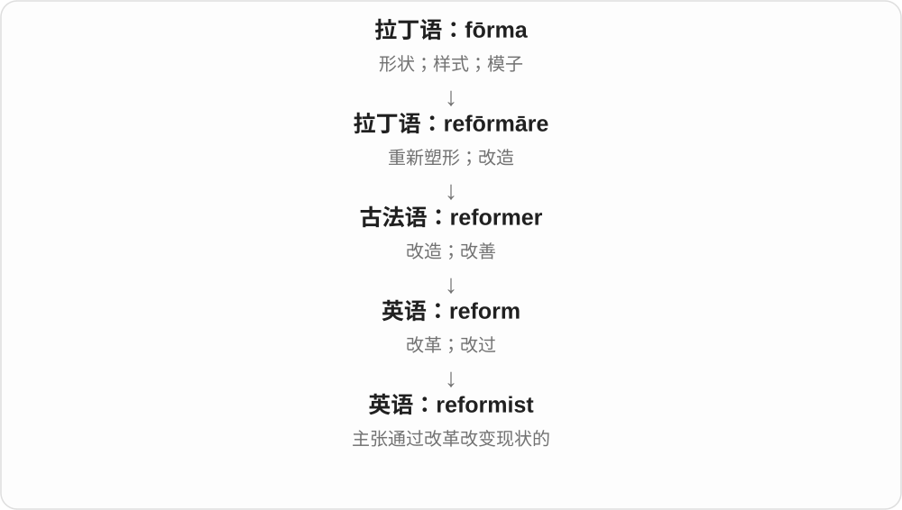

常用于政治或社会思想对比，突出改变的路线。也可较宽泛地形容支持改革的派别。

**常见搭配与例句**

a reformist approach；a reformist politician；the reformists。

> The party adopted a reformist programme.

该党采纳了渐进改革纲领。

> Reformists called for change through existing institutions.

改革派呼吁通过现有机构推动改变。

**别混淆**

reformer 是做改革的人；reformist 往往更突出改革派的立场和路线。

### 36. waveform — 波形

**音标**：英 /ˈweɪvfɔːm/；美 /ˈweɪvfɔːrm/

**先抓住这个画面**

把声音或电信号的数值随时间画成线，线上升下降的形状就是 waveform。

**怎么拆**

wave“波” + form“形状”，现代英语复合词。

**怎么变成今天的意思**

同样频率的波可以有不同形状。录音软件显示的波形让人看到声音强弱如何变化，但不能直接代替听声音。

**常见搭配与例句**

a sine waveform；view the waveform；a waveform display。

> The editor displays the audio waveform below the video.

编辑器在视频下方显示音频波形。

> The signal changed from a smooth waveform to a sharp pulse.

信号从平滑波形变成了尖脉冲。

**别混淆**

waveform 是波的形状；wavelength 是波长，frequency 是频率。

### 37. formulaic — 程式化的；套用固定模式的

**音标**：英 /ˌfɔːmjəˈleɪɪk/；美 /ˌfɔːrmjəˈleɪɪk/

**先抓住这个画面**

每个故事都套同一套模板，连反转出现的位置都猜得到。

**怎么拆**

formula + -ic；重音移到后面，读音与 formula 明显不同。

**怎么变成今天的意思**

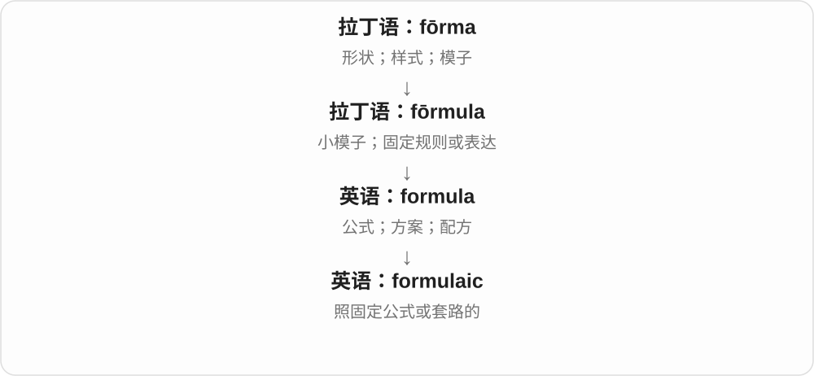

文学、电影评论里常带缺少新意的批评；语言学中的 formulaic expressions 也可以中性地指固定表达。

**常见搭配与例句**

a formulaic plot；formulaic writing；formulaic expressions。

> The film was entertaining, although its plot was formulaic.

电影挺好看，但情节有些套路化。

> Greetings often use formulaic expressions.

问候常采用固定表达。

**别混淆**

formal 是正式；formulaic 是套路化。文章可以既不正式，也很有套路。

### 38. performative — 表演性的；做给人看的；施为的

**音标**：英 /pəˈfɔːmətɪv/；美 /pərˈfɔːrmətɪv/

**先抓住这个画面**

两种画面要分开：一种是做姿态给别人看；另一种是话一说出口，行为就已完成，比如正式说“我承诺”。

**怎么拆**

perform + -ative；由执行、表演形成不同语境中的形容词用法。

**怎么变成今天的意思**

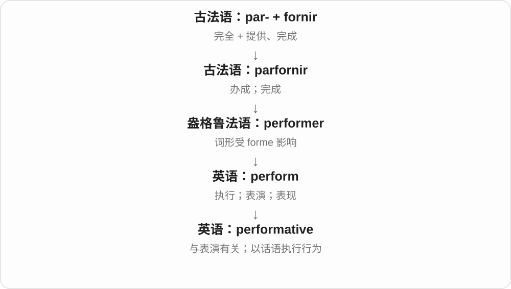

日常评论中常批评虚假的姿态。语言学中的 performative utterance 则说话语在合适情境下实行了承诺、命名等行为，不带虚假意思。

**常见搭配与例句**

performative concern；a performative utterance；performative art。

> She wanted practical support, not performative concern.

她想要实际支持，不是做给人看的关心。

> In the right context, “I promise” is a performative utterance.

在合适语境中，“我承诺”是一句施为话语。

**别混淆**

技术义 performative 不能一律译成“装出来的”；说 I apologize 本身可以实施道歉。

### 39. conformal — 贴合形状的；保角的

**音标**：英 /kənˈfɔːməl/；美 /kənˈfɔːrməl/

**先抓住这个画面**

一层薄膜贴着零件的轮廓走；数学里则是变换后，极小范围里的相交角度仍保持。

**怎么拆**

conform + -al；普通技术义与“贴合”有关，数学义专门规定为保角。

**怎么变成今天的意思**

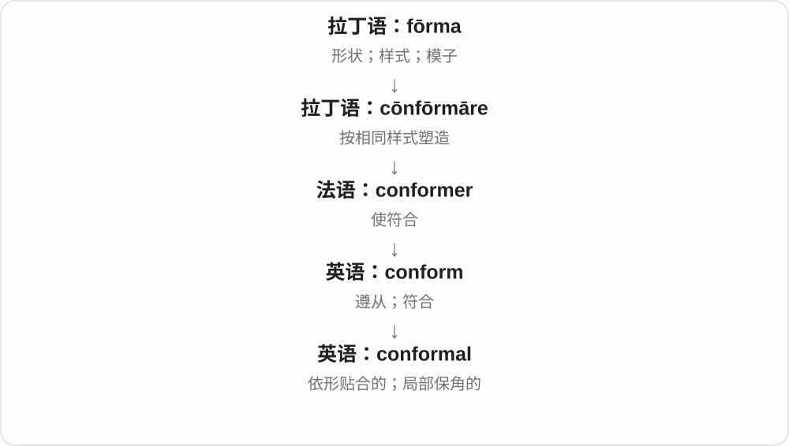

conformal coating 随表面覆盖。conformal map 保留局部角度，不意味着整张地图的面积、距离都不变。

**常见搭配与例句**

conformal coating；conformal mapping；a conformal projection。

> The board has a thin conformal coating.

这块电路板有一层沿表面贴合的薄涂层。

> A conformal projection preserves local angles but can distort area.

保角投影保持局部角度，但可能扭曲面积。

**别混淆**

conformal 的数学义不是“所有形状、大小完全一样”；等面积投影和保角投影关注不同性质。

### 40. conformist — 遵从惯例的人；随大流的

**音标**：英 /kənˈfɔːmɪst/；美 /kənˈfɔːrmɪst/

**先抓住这个画面**

大家穿什么、怎么想、怎么做，他也照着来，以融入现有规范。

**怎么拆**

conform + -ist，指遵从者，也可作形容词。

**怎么变成今天的意思**

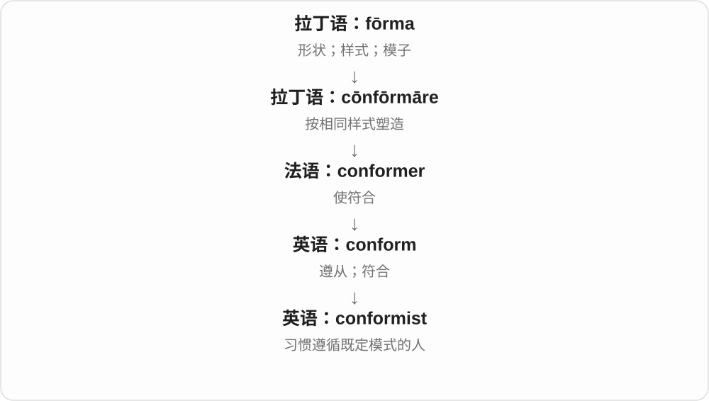

普通用法往往批评缺少独立性；历史宗教语境还可特指遵从国教规定的人。

**常见搭配与例句**

a conformist attitude；conformist behaviour；a social conformist。

> The novel challenges the town’s conformist attitudes.

小说质疑这个小镇墨守惯例的态度。

> He was a conformist who rarely questioned accepted opinions.

他习惯随大流，很少质疑公认观点。

**别混淆**

cooperative 是愿意合作；conformist 是顺应惯例。独立思考的人同样可以很好合作。

### 41. deform — 使变形；变形

**音标**：英 /dɪˈfɔːm/；美 /dɪˈfɔːrm/

**先抓住这个画面**

原本平整的东西受热、受压，弯了、扭了，偏离原来的形状。

**怎么拆**

拉丁语 dē- + fōrmāre，经法语 deformer 传入；这里 dē- 指离开正常或原有状态。

**怎么变成今天的意思**

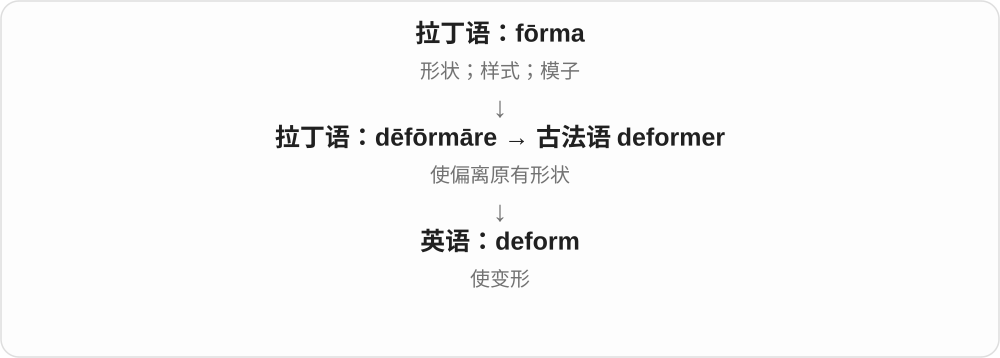

材料可以暂时变形再复原，也可以永久变形。重点在形状改变，不必已经断裂。

**常见搭配与例句**

deform under pressure；heat deforms plastic；a deformed part。

> Heat can deform the plastic lid.

热会使塑料盖变形。

> The metal deformed under the heavy load.

金属在重负荷下发生了变形。

**别混淆**

deform 是形状变了；break 是断裂或损坏。两者可能同时发生，也可能只发生一种。

### 42. preform — 预先成形；预制坯件

**音标**：英 /ˌpriːˈfɔːm/；美 /ˌpriːˈfɔːrm/（动词）；名词常重读前部 /ˈpriːfɔːrm/

**先抓住这个画面**

在最终加工之前，先把材料做出大致形状，给后面的步骤一个起点。

**怎么拆**

pre- 表事先，接 form；它和 perform 的字母顺序不同。

**怎么变成今天的意思**

动词是提前成形的动作；名词是尚待进一步加工的坯件。例如塑料瓶可由较小的预制坯吹制成最终外形。

**常见搭配与例句**

preform the material；a plastic preform；a glass preform。

> The machine preforms the plastic before the final shaping step.

机器在最终成形前先对塑料进行预成形。

> Each preform is heated and shaped into a bottle.

每个预制坯都经过加热，再制成瓶子。

**别混淆**

preform 是预先塑形；perform 是执行或表演。不要把 perform 拼成 preform。

### 43. formalize — 使正式化；明确为规则或文件

**音标**：英 /ˈfɔːməlaɪz/；美 /ˈfɔːrməlaɪz/

**先抓住这个画面**

原来大家只是口头说好，现在把它写成正式协议，或整理成一套明确规则。

**怎么拆**

formal + -ize，使具有正式形式；英式也写 formalise。

**怎么变成今天的意思**

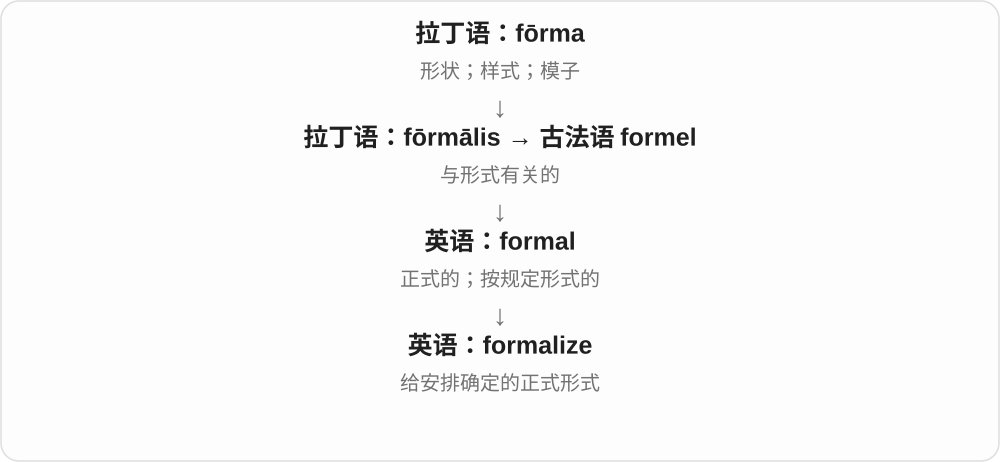

可以正式确认合作，也可以把直觉想法表达成严密模型。重点是把形式定清楚。

**常见搭配与例句**

formalize an agreement；formalize a relationship；formalize a theory。

> They signed a contract to formalize the partnership.

他们签订合同，使合作关系正式确立。

> The paper formalizes the idea as a mathematical model.

论文把这个想法表述成一个严格的数学模型。

**别混淆**

formulate 是把内容想清楚、表达出来；formalize 是给它正式或严格的形式。

### 44. formless — 没有明确形状的；缺乏结构的

**音标**：英 /ˈfɔːmləs/；美 /ˈfɔːrmləs/

**先抓住这个画面**

眼前一团雾，或者脑中一堆未整理的想法，还看不出清楚轮廓。

**怎么拆**

form + -less，没有形状或结构。

**怎么变成今天的意思**

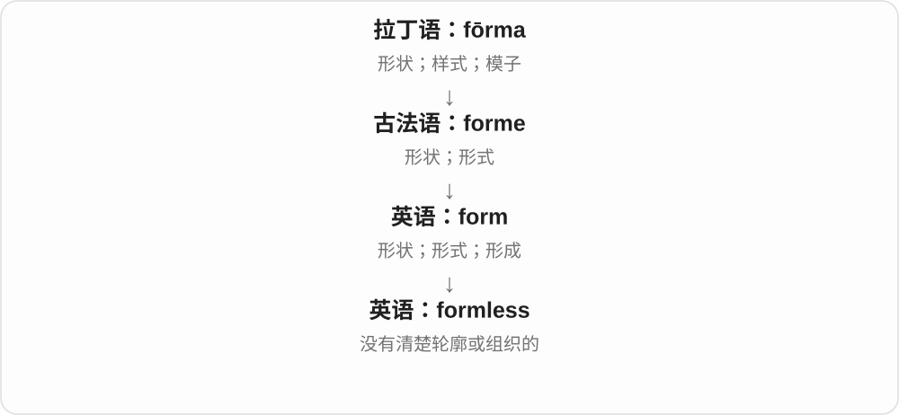

常说物体、恐惧或想法模糊。不是说它不存在，而是还没有能辨认的结构。

**常见搭配与例句**

a formless mass；formless fears；a formless idea。

> The fog made the hills look like formless shadows.

雾让山丘看起来像模糊的影子。

> She turned a formless idea into a clear plan.

她把一个模糊想法整理成了清晰计划。

**别混淆**

formless 是缺少明确结构；empty 是里面没有内容。有很多想法仍可能 formless。

### 45. malformation — 结构畸形；形成异常

**音标**：英 /ˌmælfɔːˈmeɪʃən/；美 /ˌmælfɔːrˈmeɪʃən/

**先抓住这个画面**

结构在形成时就没有按通常方式长好，像零件在制造成形阶段出了差错。

**怎么拆**

mal- 表不良、异常，接 formation；是“形成得异常”，不是“形状不好看”。

**怎么变成今天的意思**

常见于医学和生物学，也可描述物体的成形缺陷。学习时抓住结构形成的问题，不把它当评价人的词。

**常见搭配与例句**

a structural malformation；a congenital malformation；malformation of…。

> The diagram shows a structural malformation in the specimen.

图中显示了标本的一处结构异常。

> The report describes the shape and location of the malformation.

报告描述了该结构异常的形状和位置。

**别混淆**

malformation 侧重形成阶段的异常；deformation 侧重形状受力等因素改变。具体专业分类仍看语境。

### 46. nonconformist — 不随俗的人；不墨守成规的

**音标**：英 /ˌnɒnkənˈfɔːmɪst/；美 /ˌnɑːnkənˈfɔːrmɪst/

**先抓住这个画面**

别人都套同一个模子，他愿意保留自己的做法和判断。

**怎么拆**

non- 否定 conformist。

**怎么变成今天的意思**

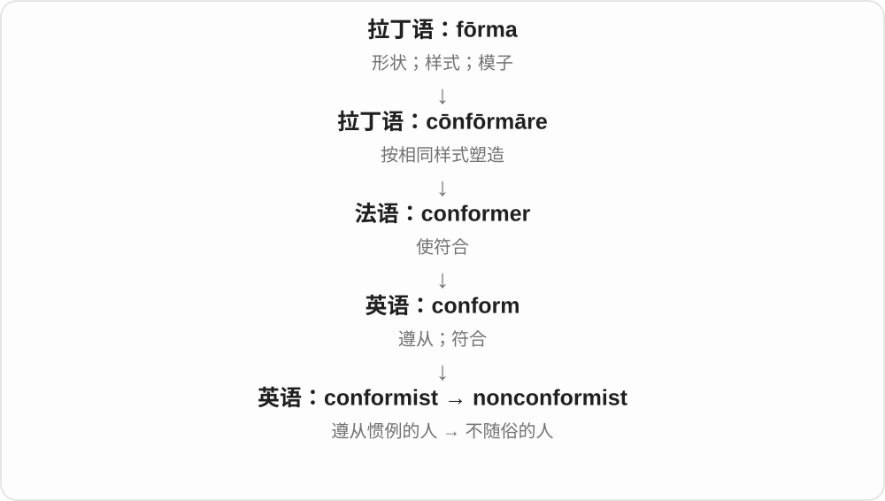

普通用法指不按社会惯例生活或思考；英国宗教史中的 Nonconformist 特指不遵从英国国教的某些新教信徒。

**常见搭配与例句**

a nonconformist artist；a nonconformist attitude；Nonconformist churches。

> She admired the artist’s nonconformist approach.

她欣赏这位艺术家不随俗的做法。

> The historian studied Nonconformist communities in Britain.

这位历史学家研究英国不遵从国教的新教社群。

**别混淆**

nonconformist 不等于故意违法；也不是每个行为怪异的人都在独立思考。

### 47. underperform — 表现低于预期；表现不佳

**音标**：英 /ˌʌndəpəˈfɔːm/；美 /ˌʌndərpərˈfɔːrm/

**先抓住这个画面**

本来预计能达到那条线，实际成绩却落在下面。

**怎么拆**

under- 表低于某个水平，接 perform。

**怎么变成今天的意思**

人、团队、设备都能 underperform。它需要一个明说或暗含的标准，不等于什么也没做。

**常见搭配与例句**

underperform in a test；underperform expectations；an underperforming team。

> The device underperformed in cold conditions.

设备在寒冷条件下的表现低于预期。

> The team underperformed despite months of preparation.

尽管准备了数月，团队的表现仍不理想。

**别混淆**

underperform 是做了但没达到水平；not perform 还可能是根本没执行或没表演。

### 48. isoform — 同工型；同一种蛋白质的不同形式

**音标**：英 /ˈaɪsəʊfɔːm/；美 /ˈaɪsoʊfɔːrm/

**先抓住这个画面**

像同一款产品有几个版本：主体相关，某些序列或性质不同，作用也未必完全相同。

**怎么拆**

iso- 来自希腊语“相同、相等”，接英语 form；这是近代科学构词，不能字面译成“完全一样的形状”。

**怎么变成今天的意思**

例如一个基因的 RNA 经不同剪接，可产生不同蛋白质形式。重点是相关的版本，并不保证序列或功能完全一致。

**常见搭配与例句**

a protein isoform；different isoforms；an isoform of…。

> The researchers compared two isoforms of the protein.

研究人员比较了这种蛋白质的两个同工型。

> This gene can produce several protein isoforms through alternative splicing.

这个基因可以通过可变剪接产生几种蛋白质同工型。

**别混淆**

isoform 不是 isotope“同位素”；同工型谈相关分子形式，同位素谈元素原子。

### 49. formwork — 混凝土模板；模板支架系统

**音标**：英 /ˈfɔːmwɜːk/；美 /ˈfɔːrmwɜːrk/

**先抓住这个画面**

混凝土没硬时会流，先搭好外面的模子，才能让它凝固成想要的墙、柱或楼板。

**怎么拆**

form“模子、形状” + work“构造或工程”，现代复合词。

**怎么变成今天的意思**

传统可以用木板，也可用金属或其他材料。它负责塑形和支撑；有些模板后续拆除，有些留在结构中。

**常见搭配与例句**

install formwork；remove the formwork；concrete formwork。

> Workers installed the formwork before pouring the concrete.

工人在浇筑混凝土前安装了模板。

> The curved formwork gave the wall its shape.

弧形模板使墙体形成了相应曲线。

**别混淆**

framework 是框架；formwork 特别指混凝土成形用的模板，不能互换。

### 50. landform — 地貌；地形形态

**音标**：英 /ˈlændfɔːm/；美 /ˈlændfɔːrm/

**先抓住这个画面**

从远处看大地，山、谷、平原构成不同的轮廓；每一种自然形态都可叫 landform。

**怎么拆**

land“陆地、土地” + form“形状”。

**怎么变成今天的意思**

常用于地理，指由地质过程形成的山谷、沙丘等特征，不是土地使用权或人为划分的行政区。

**常见搭配与例句**

a coastal landform；major landforms；the formation of landforms。

> A valley is a landform shaped by processes such as erosion.

山谷是一种由侵蚀等过程塑造的地貌。

> The class compared coastal landforms in the photographs.

全班比较了照片中的海岸地貌。

**别混淆**

landscape 是眼前整体景观；landform 是可辨认的一类地表形态。

### 51. reformulate — 重新表述；重新制定；调整配方

**音标**：英 /ˌriːˈfɔːmjəleɪt/；美 /ˌriːˈfɔːrmjəleɪt/

**先抓住这个画面**

原来的说法或组合不合适，把内容重新组织一遍，让它更清楚或更管用。

**怎么拆**

re- 表重新，接 formulate；不是 reform + ulate。

**怎么变成今天的意思**

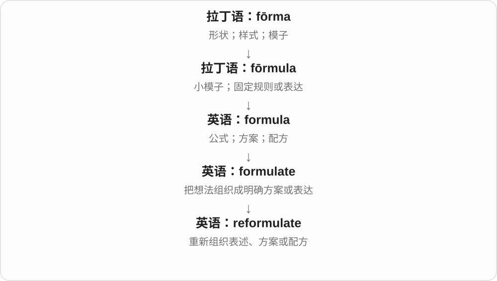

可以保留想法而换措辞，也可以真正改变计划或产品成分。

**常见搭配与例句**

reformulate a question；reformulate a theory；reformulate a product。

> Could you reformulate the question in simpler terms?

你能用更简单的话重新表述问题吗？

> They reformulated the drink to reduce its sugar content.

他们调整了饮料配方，以降低含糖量。

**别混淆**

rephrase 主要换说法；reformulate 还可改论证结构、理论框架或物质配方。

### 52. lifeform — 生命形式；某类生物

**音标**：英 /ˈlaɪffɔːm/；美 /ˈlaɪffɔːrm/

**先抓住这个画面**

生命可以以树、细菌或别的形态出现，lifeform 把注意力放在“生命以什么样子存在”。

**怎么拆**

life“生命” + form“形式”，也常分写 life form。

**怎么变成今天的意思**

科学通俗写作和科幻中常见。它能宽泛指生物，不一定是在严格划定一个物种。

**常见搭配与例句**

an alien lifeform；a simple lifeform；different lifeforms。

> The story imagines a lifeform that survives without sunlight.

故事设想了一种不靠阳光也能生存的生命形式。

> The students examined tiny lifeforms in a drop of pond water.

学生们观察了一滴池塘水中的微小生物。

**别混淆**

species 是分类学的物种；lifeform 较宽泛，不能直接当同一等级的分类术语。

### 53. misinform — 给……错误信息；使误信

**音标**：英 /ˌmɪsɪnˈfɔːm/；美 /ˌmɪsɪnˈfɔːrm/

**先抓住这个画面**

别人本来想弄清楚，你给的信息却把他的认识带偏了。

**怎么拆**

mis- 表错误，接 inform。

**怎么变成今天的意思**

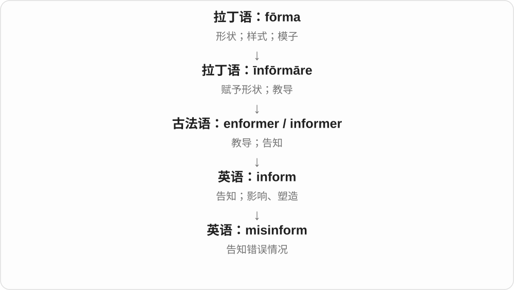

可以是疏忽、误传，也可能故意；单靠这个动词不能判定动机。

**常见搭配与例句**

misinform someone about；be misinformed；misinform the public。

> I was misinformed about the opening time.

别人告诉我的开门时间有误。

> The outdated notice misinformed visitors about the entrance.

那份过时通知把游客引向了错误入口。

**别混淆**

misinform 是给错信息；misunderstand 是接收者理解错，问题出在不同环节。

### 54. nonuniform — 不均匀的；不一致的

**音标**：英 /ˌnɒnˈjuːnɪfɔːm/；美 /ˌnɑːnˈjuːnəfɔːrm/

**先抓住这个画面**

nonuniform 像一张纸有的地方涂得很厚，有的地方几乎没涂：不同位置或部分的性质不一样。

**怎么拆**

non-（非、不）+ uniform（一致、均匀）。

**怎么变成今天的意思**

常用于分布、材料、尺寸或规则。不同学科可能给出更精确的定义，核心仍是“不保持相同”。

**常见搭配与例句**

nonuniform distribution；nonuniform thickness；nonuniform spacing。

> The nonuniform lighting made one side of the room look darker.

不均匀的照明让房间一侧显得更暗。

> The samples had nonuniform thickness.

这些样品的厚度不均匀。

**别混淆**

irregular 可说形状或模式不规则；nonuniform 只要各部分不一致就成立，不必杂乱无章。

### 55. nonuniformity — 不均匀性；不一致之处

**音标**：英 /ˌnɒnjuːnɪˈfɔːməti/；美 /ˌnɑːnjuːnəˈfɔːrməti/

**先抓住这个画面**

nonuniformity 是把各处不一样这件事单独量出来看，比如涂层最厚处和最薄处相差多少。

**怎么拆**

non-（不）+ uniformity（均匀性、一致性）。

**怎么变成今天的意思**

既可指整体不均匀的程度，也可指某个不一致点。技术场景通常会规定怎样测量。

**常见搭配与例句**

thickness nonuniformity；nonuniformity of illumination；reduce nonuniformity。

> The test measured nonuniformity across the surface.

测试测量了整个表面的不均匀程度。

> Better mixing reduced the nonuniformity of the material.

更充分的混合降低了材料的不均匀性。

**别混淆**

nonuniform 形容样品不均匀；nonuniformity 是不均匀性本身，适合跟 measure、reduce 连用。

## 这一组要分清什么

**form / format / formula**：形状或形式 / 内容的排列与编码方式 / 能套用的规则或配方。

**formal / informal / formulaic**：正式 / 非正式 / 套路化。

**informative / informed**：能给人知识的内容 / 已了解情况的人或决定。

**misinformation / disinformation**：错误信息 / 通常指故意传播的误导信息。

**preform / perform**：事先成形 / 执行或表演。不要被相似拼写带偏。

## 串起来练习

**An informative report helped us formulate a plan to transform the old building.**

一份信息充实的报告帮助我们拟定了改造旧楼的计划。informative 把情况讲清楚，formulate 把想法组织好，transform 再把建筑变成新样子。
