# 0081 · un- — 一；单个；合成一个整体

[逐词精讲目录](../00_逐词精讲目录.md) · [总目录](../00_总目录_按常用程度.md)

## 核心词根与来源

**这里的 un-/uni- 来自拉丁语 ūnus“一”。** 它既能直接数东西，比如 unicycle 只有一个轮子，也能说多个部分合成一个整体，比如 unite、union。再把一切事物当作整体看，便来到 universe；把所有人的心意当成一个，便来到 unanimous。每次都先问：“这个词里的‘一’，究竟在数什么？”

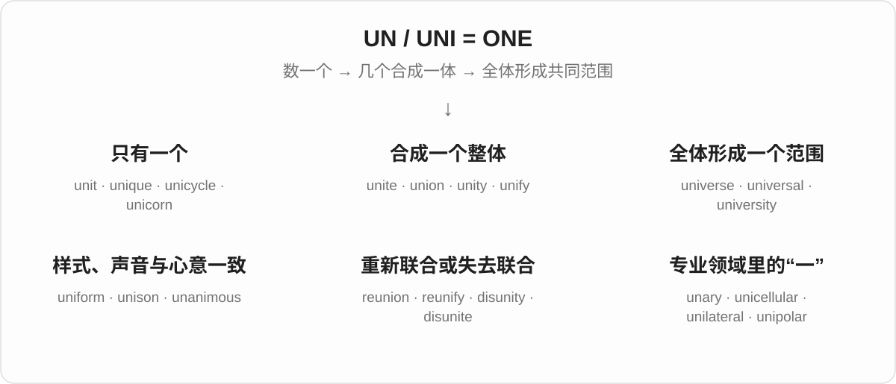

## 词形与演化规律

**它与 unhappy、undo 中的 un- 不是同一条来源。** 本族常见 uni-，但经历借词和拼写变化，也会出现 unique、onion 等形态。不能只看开头字母就归族。union、unity、uniformity、unanimity 等名词各有借入历史，不能一律画成今天的英语动词或形容词再加后缀。

## 单词速览（按词族由简到繁）

同一基础词的相关扩展放在一起，先读基础形式，再读扩展；各组之间优先读常用的。具体词源关系见各词讲解。

| 单词 | 音标 | 核心意思 |
|---|---|---|
| [unite](#w-11) | /juːˈnaɪt/ | 团结；联合；使合为一体 |
| [united](#w-1) | /juːˈnaɪtɪd/ | 团结的；联合的 |
| [unity](#w-9) | /ˈjuːnəti/，也读 /ˈjuːnɪti/ | 团结；统一；整体性 |
| [disunity](#w-39) | /dɪsˈjuːnəti/ | 不团结；分歧；涣散 |
| [nonunity](#w-59) | 英 /ˌnɒnˈjuːnəti/；美 /ˌnɑːnˈjuːnəti/ | 不等于一；非统一；不成一体 |
| [reunite](#w-18) | /ˌriːjuːˈnaɪt/ | 重聚；使重新团圆；重新联合 |
| [disunite](#w-52) | /ˌdɪsjuːˈnaɪt/ | 使分离；使不和；分裂 |
| [universe](#w-6) | 英 /ˈjuːnɪvɜːs/；美 /ˈjuːnəvɜːrs/ | 宇宙；某一范围内的全部事物 |
| [university](#w-2) | 英 /ˌjuːnɪˈvɜːsəti/；美 /ˌjuːnəˈvɜːrsəti/ | 大学 |
| [universal](#w-7) | 英 /ˌjuːnɪˈvɜːsəl/；美 /ˌjuːnəˈvɜːrsəl/ | 普遍的；全体适用的；通用的 |
| [universally](#w-14) | 英 /ˌjuːnɪˈvɜːsəli/；美 /ˌjuːnəˈvɜːrsəli/ | 普遍地；全体一致地 |
| [universality](#w-33) | 英 /ˌjuːnɪvɜːˈsæləti/；美 /ˌjuːnəvɜːrˈsæləti/ | 普遍性；普适性 |
| [universalist](#w-35) | 英 /ˌjuːnɪˈvɜːsəlɪst/；美 /ˌjuːnəˈvɜːrsəlɪst/ | 普遍主义者；普遍主义的；普救论者 |
| [universalism](#w-40) | 英 /ˌjuːnɪˈvɜːsəlɪzəm/；美 /ˌjuːnəˈvɜːrsəlɪzəm/ | 普遍主义；普救论 |
| [universalize](#w-50) | 英 /ˌjuːnɪˈvɜːsəlaɪz/；美 /ˌjuːnəˈvɜːrsəlaɪz/ | 使普遍化；推广到所有对象 |
| [union](#w-3) | /ˈjuːnjən/ | 联合；联合体；工会；并集 |
| [unionist](#w-21) | /ˈjuːnjənɪst/ | 工会成员或支持者；主张维持联合的人 |
| [unionism](#w-34) | /ˈjuːnjənɪzəm/ | 工会主义；支持联合的立场 |
| [unionize](#w-38) | /ˈjuːnjənaɪz/ | 组织工会；加入工会组织 |
| [unionized](#w-32) | /ˈjuːnjənaɪzd/ | 成立了工会的；由工会组织起来的 |
| [unionization](#w-36) | 英 /ˌjuːnjənaɪˈzeɪʃən/；美 /ˌjuːnjənəˈzeɪʃən/ | 工会组织化；成立工会的过程 |
| [reunion](#w-10) | /ˌriːˈjuːnjən/ | 重逢；团聚；联谊聚会 |
| [nonunion](#w-46) | 英 /ˌnɒnˈjuːnjən/；美 /ˌnɑːnˈjuːnjən/ | 非工会的；未联合；骨不连 |
| [malunion](#w-51) | /ˌmælˈjuːnjən/ | 畸形愈合 |
| [unit](#w-4) | /ˈjuːnɪt/ | 单位；单元；一件；小组 |
| [unitary](#w-29) | 英 /ˈjuːnɪtəri/；美 /ˈjuːnəteri/ | 单一的；一体的；单一制的；酉的（数学） |
| [unique](#w-5) | /juːˈniːk/ | 独一无二的；独有的；很独特的 |
| [uniquely](#w-17) | /juːˈniːkli/ | 独特地；唯一地；特别适合地 |
| [uniqueness](#w-23) | /juːˈniːknəs/ | 独特性；唯一性 |
| [biunique](#w-54) | /ˌbaɪjuːˈniːk/ | 双向一一对应的 |
| [nonunique](#w-58) | 英 /ˌnɒnjuːˈniːk/；美 /ˌnɑːnjuːˈniːk/ | 非唯一的；可能重复的 |
| [uniform](#w-8) | 英 /ˈjuːnɪfɔːm/；美 /ˈjuːnəfɔːrm/ | 一致的；均匀的；制服 |
| [uniformly](#w-24) | 英 /ˈjuːnɪfɔːmli/；美 /ˈjuːnəfɔːrmli/ | 一致地；均匀地；一律地 |
| [uniformed](#w-25) | 英 /ˈjuːnɪfɔːmd/；美 /ˈjuːnəfɔːrmd/ | 穿制服的；需要穿制服的 |
| [uniformity](#w-30) | 英 /ˌjuːnɪˈfɔːməti/；美 /ˌjuːnəˈfɔːrməti/ | 一致性；均匀性；千篇一律 |
| [nonuniformity](#w-57) | 英 /ˌnɒnjuːnɪˈfɔːməti/；美 /ˌnɑːnjuːnəˈfɔːrməti/ | 不均匀性；不一致之处 |
| [nonuniform](#w-49) | 英 /ˌnɒnˈjuːnɪfɔːm/；美 /ˌnɑːnˈjuːnəfɔːrm/ | 不均匀的；不一致的 |
| [onion](#w-12) | /ˈʌnjən/ | 洋葱 |
| [unanimous](#w-13) | /juːˈnænɪməs/ | 全体一致的；一致赞成的 |
| [unanimously](#w-15) | /juːˈnænɪməsli/ | 全体一致地 |
| [unanimity](#w-37) | /ˌjuːnəˈnɪməti/ | 全体一致；一致同意 |
| [unicorn](#w-16) | 英 /ˈjuːnɪkɔːn/；美 /ˈjuːnɪkɔːrn/ | 独角兽；极难找到的事物；独角兽企业 |
| [unify](#w-28) | /ˈjuːnɪfaɪ/ | 使统一；使合成一体 |
| [unification](#w-19) | /ˌjuːnɪfɪˈkeɪʃn̩/ | 统一；合并为一体 |
| [reunification](#w-27) | /ˌriːjuːnɪfɪˈkeɪʃən/ | 重新统一 |
| [reunify](#w-47) | /ˌriːˈjuːnɪfaɪ/ | 使重新统一 |
| [unilateral](#w-20) | /ˌjuːnɪˈlætərəl/ | 单方面的；单侧的 |
| [unilaterally](#w-26) | /ˌjuːnɪˈlætərəli/ | 单方面地；只在一侧地 |
| [unison](#w-22) | /ˈjuːnɪsən/，也读 /ˈjuːnɪzən/ | 齐声；同度；协调一致 |
| [unisex](#w-31) | /ˈjuːnɪseks/ | 不分性别的；各性别通用的 |
| [unidirectional](#w-41) | /ˌjuːnɪdɪˈrekʃənəl/，也读 /ˌjuːnɪdaɪˈrekʃənəl/ | 单向的 |
| [unicycle](#w-42) | /ˈjuːnɪsaɪkəl/ | 独轮车；骑独轮车 |
| [triune](#w-43) | /ˈtraɪjuːn/，也读 /traɪˈjuːn/ | 三而一的；三位一体的 |
| [unicellular](#w-44) | 英 /ˌjuːnɪˈseljʊlə/；美 /ˌjuːnəˈseljələr/ | 单细胞的 |
| [unipolar](#w-45) | 英 /ˌjuːnɪˈpəʊlə/；美 /ˌjuːnəˈpoʊlər/ | 单极的；单一中心主导的 |
| [unary](#w-48) | 英 /ˈjuːnəri/；美 /ˈjuːneri/ | 一元的；单项的 |
| [adunation](#w-53) | /ˌædjʊˈneɪʃən/ | 合一；联合（古旧用词） |
| [coadunate](#w-55) | 形容词英 /kəʊˈædjʊnɪt/，也读 /kəʊˈædjʊneɪt/；美 /koʊˈædʒənɪt/ | 紧密结合的；合生的；使联合（罕见动词） |
| [coadunation](#w-56) | /kəʊˌædjʊˈneɪʃən/ | 联合成一体；聚合（少见用词） |
| [unate](#w-60) | /ˈjuːneɪt/ | 单调方向固定的（逻辑与电路术语） |
| [unific](#w-61) | /juːˈnɪfɪk/ | 使统一的；促成联合的（少见用词） |

## 逐词讲解

### 1. unite — 团结；联合；使合为一体

**音标**：/juːˈnaɪt/

**先抓住这个画面**

unite 像原本各站一边的人走到一起，为同一件事行动；也可以把分开的部分连起来。

**怎么拆**

来自拉丁语 ūnītus，属于 ūnīre“使成为一体”的分词形态，经中古英语 uniten 形成现代动词。

**怎么变成今天的意思**

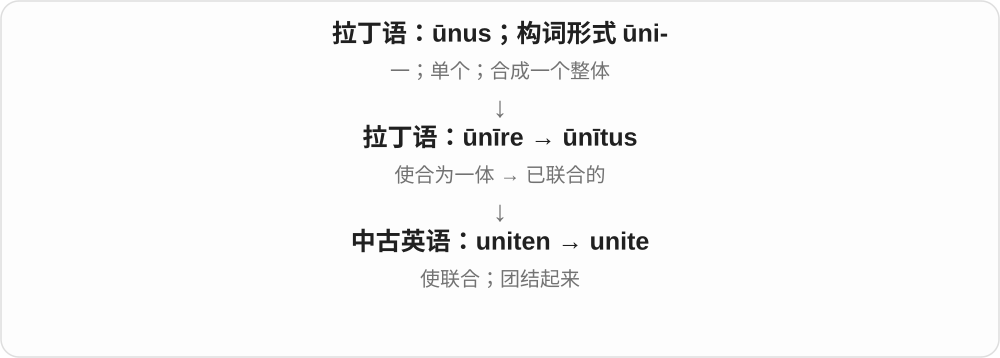

“一”从数量变成动作：把多个变成一个共同整体。主语可自己团结，也可把别人团结起来。

**常见搭配与例句**

unite people；unite against…；unite behind a leader；unite to do… 。

> The volunteers united to repair the playground.

志愿者们联合起来修复操场。

> A common problem can unite people with very different backgrounds.

共同的问题可以把背景迥异的人团结起来。

**别混淆**

unite 常说人和力量结合；unify 常更强调把系统、标准等整理成统一整体，二者有重叠。

### 2. united — 团结的；联合的

**音标**：/juːˈnaɪtɪd/

**先抓住这个画面**

united 像许多人握住同一根绳子，一起朝同一个方向用力。人仍有区别，行动和立场却连在一起。

**怎么拆**

unite + -ed，既可作动词的过去式、过去分词，也可作形容词。

**怎么变成今天的意思**

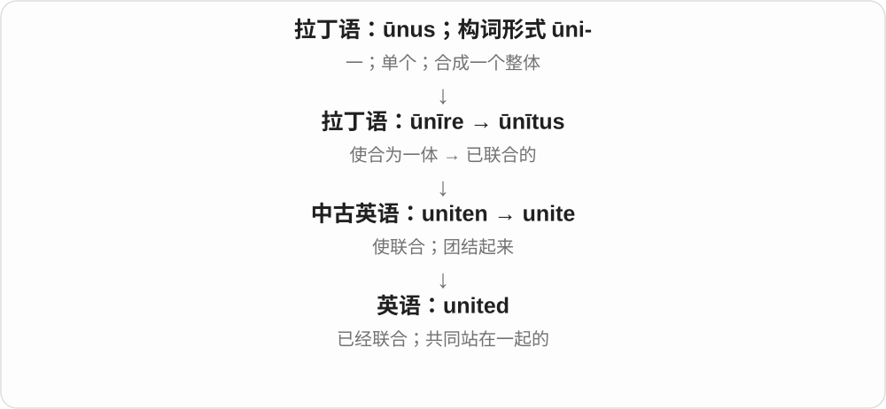

从把部分合成整体，发展到人在目标和行动上团结。a united team 不要求队员处处想法一样。

**常见搭配与例句**

stand united；a united effort；be united in opposition to… 。

> The neighbours remained united in their campaign to save the park.

邻居们在保护公园的行动中始终团结一致。

> The project succeeded through a united effort.

这个项目通过共同努力取得了成功。

**别混淆**

united 强调共同阵线；identical 强调完全相同。团结并不意味着没有差异。

### 3. unity — 团结；统一；整体性

**音标**：/ˈjuːnəti/，也读 /ˈjuːnɪti/

**先抓住这个画面**

unity 像一幅拼图虽然有许多小片，但放在一起显出一个完整图案。它谈的是合在一起的状态。

**怎么拆**

来自古法语 unité，远源为拉丁语 ūnitās；不是英语 unite 再临时加 -y 产生的历史。

**怎么变成今天的意思**

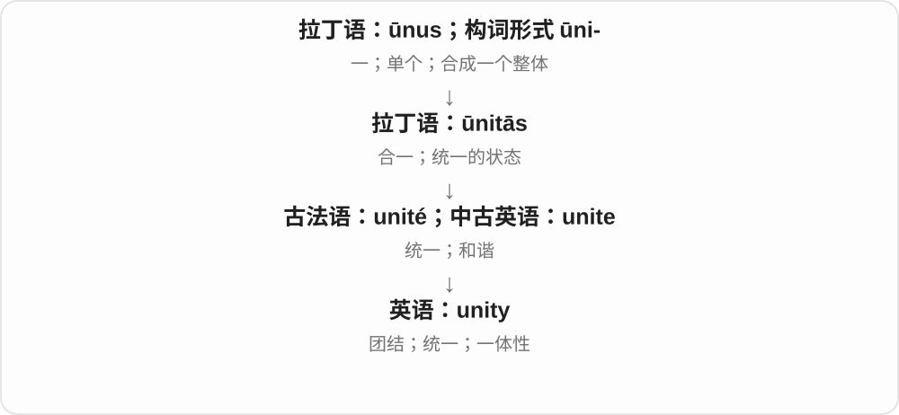

可说团队团结、设计整体协调；数学里 unity 也可以指一。不同场景都在谈“作为一个整体”。

**常见搭配与例句**

a sense of unity；unity of purpose；unity in diversity。

> The shared goal gave the team a sense of unity.

共同目标让团队产生了团结感。

> The repeated colours create unity across the design.

重复出现的颜色让整个设计协调统一。

**别混淆**

union 常指联合体；unity 讲整体保持连贯、团结。uniformity 则强调各部分都一样。

### 4. disunity — 不团结；分歧；涣散

**音标**：/dɪsˈjuːnəti/

**先抓住这个画面**

disunity 像一队人拉同一辆车却朝着不同方向使劲，整体缺少共同步调。

**怎么拆**

dis-（分开、缺乏）+ unity（团结）。

**怎么变成今天的意思**

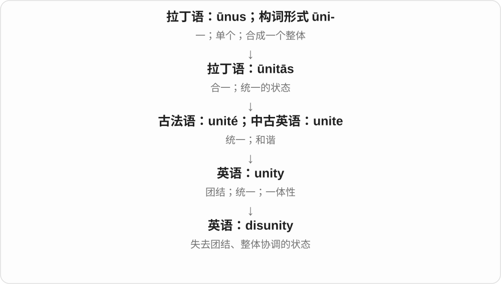

可以表现为内部争执、分裂或难以协作。它不必意味着组织已经正式解体。

**常见搭配与例句**

internal disunity；political disunity；a sign of disunity。

> Internal disunity weakened the campaign.

内部不团结削弱了这场行动。

> The meeting exposed deep disunity within the group.

会议暴露出这个群体内部严重的不和。

**别混淆**

disagreement 是某件事上意见不同；disunity 往往说整个群体的凝聚和配合出了问题。

### 5. nonunity — 不等于一；非统一；不成一体

**音标**：英 /ˌnɒnˈjuːnəti/；美 /ˌnɑːnˈjuːnəti/

**先抓住这个画面**

nonunity 在技术文章里常提醒你某个比值不是 1；在较抽象文字中也能说没有合成一个整体。

**怎么拆**

non-（非）+ unity（一；统一）。

**怎么变成今天的意思**

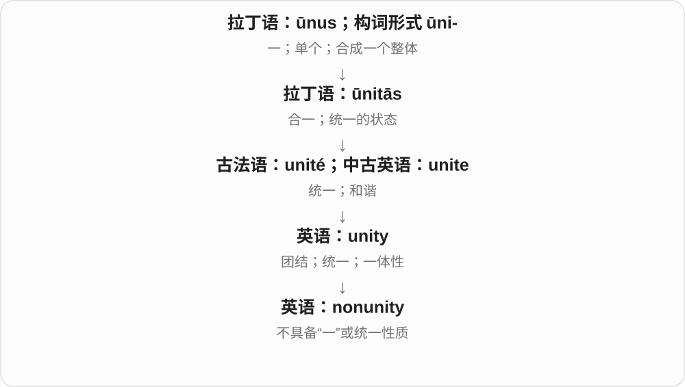

具体是哪种“一”要看宾语：gain 谈数值，community 才可能谈群体关系。不能只按社会意义翻译。

**常见搭配与例句**

nonunity gain；a nonunity ratio；the nonunity of parts。

> The circuit has nonunity gain.

这个电路的增益不等于一。

> The calculation allows for a nonunity ratio between the two quantities.

这个计算允许这两个量的比值不等于一。

**别混淆**

disunity 通常指不团结；nonunity 更适合中性地表达非一、非统一，尤其技术语境。

### 6. reunite — 重聚；使重新团圆；重新联合

**音标**：/ˌriːjuːˈnaɪt/

**先抓住这个画面**

reunite 像把曾经在一起、后来走散的人重新带回彼此身边。

**怎么拆**

现代可拆 re-（再）+ unite；历史还可追到中古拉丁语 reunītus，属于 reunīre“再联合”的分词。

**怎么变成今天的意思**

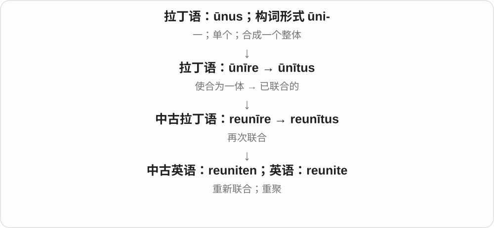

可以是家人重逢、乐队重新合作，也可以是把分开的部分接回一起。与陌生人第一次见面通常不用它。

**常见搭配与例句**

reunite with someone；reunite a family；be reunited with… 。

> The sisters reunited after several years apart.

姐妹俩分开多年后重新团聚。

> The shelter reunited the dog with its owner.

收容所让这只狗重新回到主人身边。

**别混淆**

reunion 是相聚这件事或活动；reunite 是做出或发生这个动作。

### 7. disunite — 使分离；使不和；分裂

**音标**：/ˌdɪsjuːˈnaɪt/

**先抓住这个画面**

disunite 像把已经握在一起的手拆开，也可说争执让本来合作的人彼此疏离。

**怎么拆**

现代可拆 dis-（分开、逆转）+ unite；也有词源分析提出可能经晚期拉丁语 disunītus 借入。

**怎么变成今天的意思**

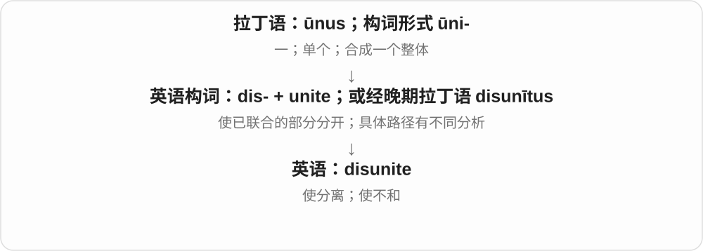

既能指实物或组织分离，也能指破坏共同立场。比日常 separate、divide 稍显书面。

**常见搭配与例句**

disunite a group；forces that disunite；become disunited。

> The dispute threatened to disunite the team.

这场争执可能使团队分裂。

> The essay asks what unites a community and what disunites it.

文章追问是什么让共同体团结，又是什么让它分裂。

**别混淆**

disunity 是不团结的状态；disunite 是使这种分离发生的动作。

### 8. universe — 宇宙；某一范围内的全部事物

**音标**：英 /ˈjuːnɪvɜːs/；美 /ˈjuːnəvɜːrs/

**先抓住这个画面**

universe 是把一切星系、物质和空间放进一个最大范围；也能把某个故事世界或讨论范围当作一个完整天地。

**怎么拆**

拉丁语 ūni-（一）+ versus（转向、合向）形成 ūniversus“全部、整体”；其中性形式 ūniversum 经法语进入英语。

**怎么变成今天的意思**

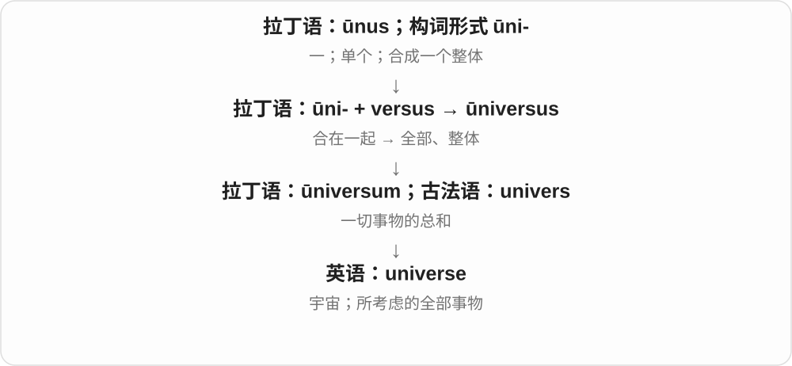

“合成一个整体”的说法变成“一切事物的总和”。词尾 verse 在这里不是英语 poem 那种诗句。

**常见搭配与例句**

the universe；the observable universe；a fictional universe。

> The book explores how scientists study the universe.

这本书介绍科学家怎样研究宇宙。

> All three novels are set in the same fictional universe.

这三部小说都发生在同一个虚构世界里。

**别混淆**

world 可指地球、人类社会或个人环境；universe 通常范围更大，也可指虚构作品的完整世界。

### 9. university — 大学

**音标**：英 /ˌjuːnɪˈvɜːsəti/；美 /ˌjuːnəˈvɜːrsəti/

**先抓住这个画面**

university 的老画面是“一群人组成的共同体”，后来专门落到教师和学生组成的学术共同体。

**怎么拆**

来自拉丁语 ūniversitās，经法语进入英语；现代能看出 universe + -ity 的形式联系，但不是先有英语“宇宙”再拼出大学。

**怎么变成今天的意思**

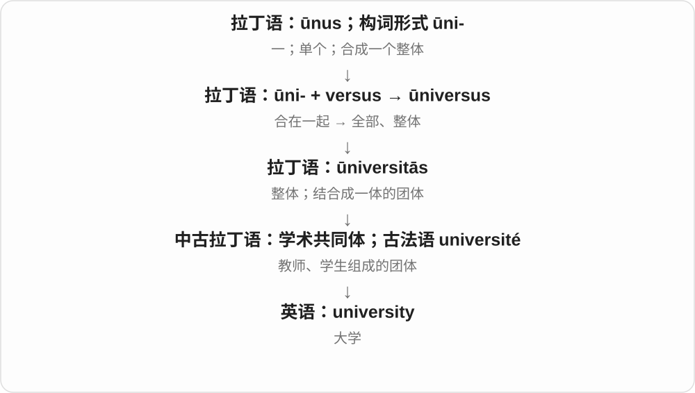

大学义依靠历史上的组织含义形成。不要编成“把整个宇宙的知识都教一遍”，那只是联想，不是实际词源。

**常见搭配与例句**

go to university；a university degree；university research。

> She studied engineering at university.

她在大学学习工程。

> The university opened a new research centre.

这所大学新建了一个研究中心。

**别混淆**

university 是高等教育机构；universe 是宇宙或全部范围。它们共享“整体”远源，现代义不同。

### 10. universal — 普遍的；全体适用的；通用的

**音标**：英 /ˌjuːnɪˈvɜːsəl/；美 /ˌjuːnəˈvɜːrsəl/

**先抓住这个画面**

universal 像给一个范围内的所有成员都打上勾：人人适用、处处存在，或能配合许多不同设备。

**怎么拆**

经古法语借入，来自拉丁语 ūniversālis；现代对应 universe + -al，但借入链不需要经过英语 universe。

**怎么变成今天的意思**

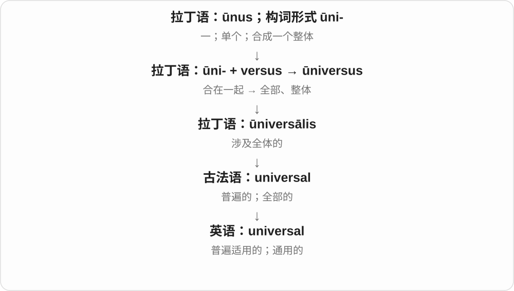

“整体”向“覆盖全体”发展。实际说 universal agreement 时，常是相关人群都同意，不是在调查整个宇宙。

**常见搭配与例句**

universal access；a universal principle；a universal adapter。

> The proposal did not receive universal support.

这个提议没有得到所有人的支持。

> The course asks whether the principle is universal.

课程讨论这条原则是否普遍适用。

**别混淆**

common 是常见；universal 声称覆盖全体，语气更强。通用产品也要看它实际支持的范围。

### 11. universally — 普遍地；全体一致地

**音标**：英 /ˌjuːnɪˈvɜːsəli/；美 /ˌjuːnəˈvɜːrsəli/

**先抓住这个画面**

universally 把覆盖范围拉到大家：某事普遍被接受、适用于各处，或得到几乎一致的评价。

**怎么拆**

universal + -ly，修饰接受、适用、认可等动作或状态。

**怎么变成今天的意思**

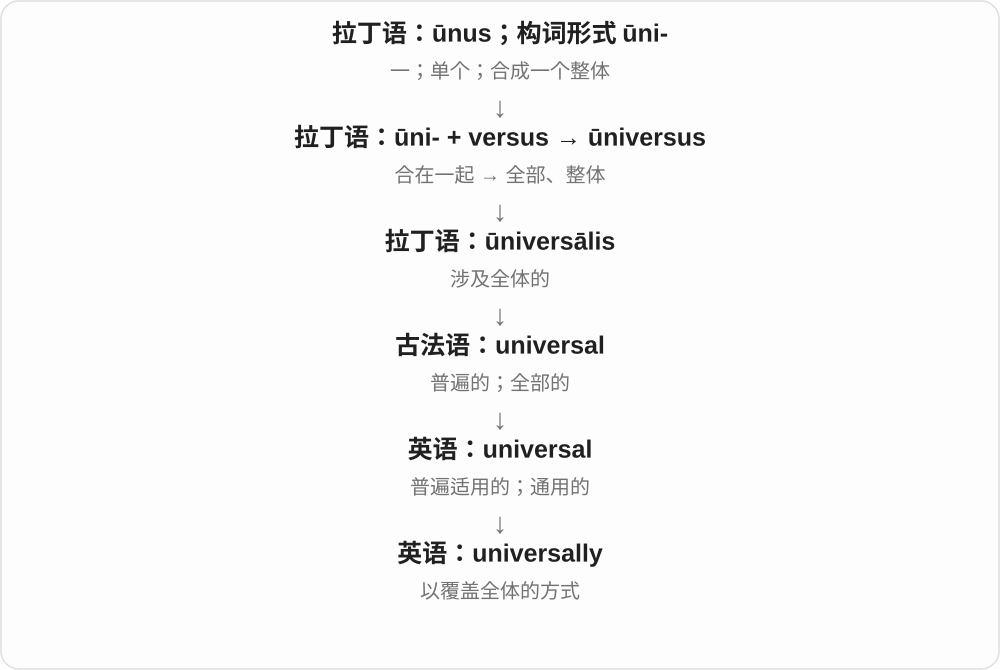

自然语言中常有概括意味，例如 universally praised 不一定经过逐个人的调查；技术结论中的全称范围则需要严格限定。

**常见搭配与例句**

universally accepted；universally available；not universally true。

> The rule is not universally applicable.

这条规则并非在所有情况下都适用。

> Her patience was universally admired by the team.

团队成员都很佩服她的耐心。

**别混淆**

widely 是广泛；universally 更接近全体。not universally accepted 表示并非人人接受，不等于人人反对。

### 12. universality — 普遍性；普适性

**音标**：英 /ˌjuːnɪvɜːˈsæləti/；美 /ˌjuːnəvɜːrˈsæləti/

**先抓住这个画面**

universality 是追问一种规律或体验能否跨过地区、时间、群体的界限，在全部相关对象上成立。

**怎么拆**

经法语 universalité 来自晚期拉丁语 ūniversālitās；现代对应 universal + -ity。

**怎么变成今天的意思**

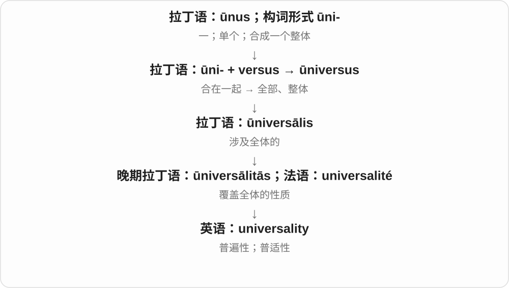

它把 universal 的范围要求变成可以讨论和验证的性质。一个例子打动人，不等于已经证明某结论有普遍性。

**常见搭配与例句**

the universality of…；claim universality；question universality。

> The study questions the universality of that assumption.

这项研究质疑那个假设是否普遍成立。

> The film draws its power from the universality of its themes.

这部电影的感染力来自其主题的普遍性。

**别混淆**

universalism 是支持普遍原则的主张；universality 是某东西是否普遍适用的性质。

### 13. universalist — 普遍主义者；普遍主义的；普救论者

**音标**：英 /ˌjuːnɪˈvɜːsəlɪst/；美 /ˌjuːnəˈvɜːrsəlɪst/

**先抓住这个画面**

universalist 认为某种原则应当覆盖所有人或全部对象；宗教里也有“所有人最终可获救赎”的专门主张。

**怎么拆**

universal + -ist，表示持有相关主张的人，也可作形容词。

**怎么变成今天的意思**

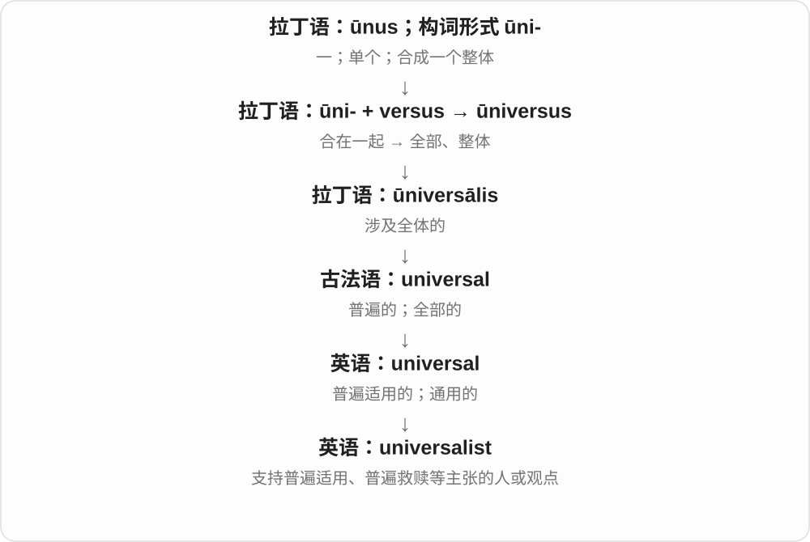

这是观点范围上的“全体”。不同学科和宗教语境中的 universalist 不必共享同一套完整思想。

**常见搭配与例句**

a universalist approach；universalist principles；a religious universalist。

> The essay takes a universalist approach to human dignity.

这篇文章以普遍主义立场讨论人的尊严。

> The historian explains the universalist belief in salvation for all.

这位历史学家解释了人人最终得救的普救论信念。

**别混淆**

universal 是普遍的性质；universalist 常意味着明确支持某种普遍原则，不能随便用于所有“面向大众”的产品。

### 14. universalism — 普遍主义；普救论

**音标**：英 /ˌjuːnɪˈvɜːsəlɪzəm/；美 /ˌjuːnəˈvɜːrsəlɪzəm/

**先抓住这个画面**

universalism 像提出一条不按族群、地区或个人另设例外的原则，主张它具有普遍适用性。

**怎么拆**

universal + -ism。

**怎么变成今天的意思**

哲学中可谈原则是否对所有人有效；宗教中可谈所有人最终获救。这些用法有共同的“全体”画面，但不是同一个论证。

**常见搭配与例句**

moral universalism；religious universalism；debates about universalism。

> The seminar compared moral universalism with cultural relativism.

研讨课比较了道德普遍主义与文化相对主义。

> The book explains universalism as a belief in eventual salvation for all.

这本书把普救论解释为所有人最终都会得救的信念。

**别混淆**

universality 是普遍性这一性质；universalism 是有关普遍性的主张或思想。

### 15. universalize — 使普遍化；推广到所有对象

**音标**：英 /ˌjuːnɪˈvɜːsəlaɪz/；美 /ˌjuːnəˈvɜːrsəlaɪz/

**先抓住这个画面**

universalize 像把只在自己生活里成立的一条规则推到所有人身上，或努力让一项服务覆盖所有人。

**怎么拆**

universal + -ize，表示使成为普遍、全体适用的。

**怎么变成今天的意思**

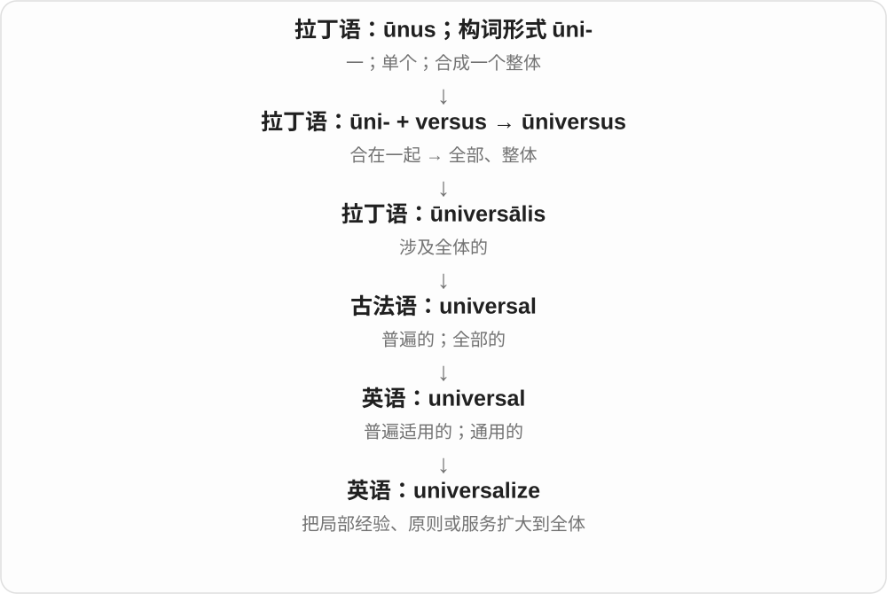

可以是有意识地推广，也可以是未经检验就把个人经验当成人人如此。具体好坏要看扩大范围是否有依据。

**常见搭配与例句**

universalize a principle；universalize an experience；universalize access。

> We should not universalize our own experience.

我们不该把自己的经历当作所有人的普遍经历。

> The proposal aims to universalize access to the service.

这项提案旨在让所有人都能使用这项服务。

**别混淆**

generalize 是概括、推广到更一般范围；universalize 更明确朝全体适用推进。

### 16. union — 联合；联合体；工会；并集

**音标**：/ˈjuːnjən/

**先抓住这个画面**

union 像把各自分开的成员圈进同一个组织或集合里；谈工会时，是劳动者联合起来的组织。

**怎么拆**

借自古法语 union，来自晚期拉丁语 ūniō；与 unite 同族，不能把它直接当成英语 unite 去掉末尾再加后缀的历史。

**怎么变成今天的意思**

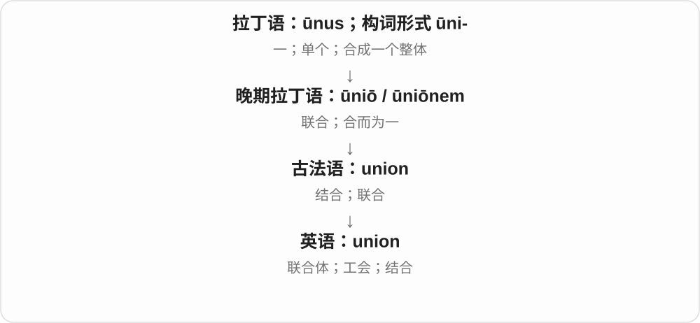

结合可以是组织、政治实体，也可以是数学集合：并集收进属于任一集合的元素。重点是“合在一起”。

**常见搭配与例句**

join a union；a trade union；the union of two sets。

> The workers formed a union to represent their shared interests.

工人们成立工会，代表他们的共同利益。

> The union of the two sets contains every element found in either set.

这两个集合的并集包含出现在任一集合中的所有元素。

**别混淆**

union 可是具体组织或结合；unity 更常是团结、统一的状态。union 与 onion 的首音不同。

### 17. unionist — 工会成员或支持者；主张维持联合的人

**音标**：/ˈjuːnjənɪst/

**先抓住这个画面**

unionist 是站在某种“联合”这一边的人。劳动话题里常说工会人士；政治话题里可能说维护某个国家联合的人。

**怎么拆**

union + -ist，表示参与者或支持者。

**怎么变成今天的意思**

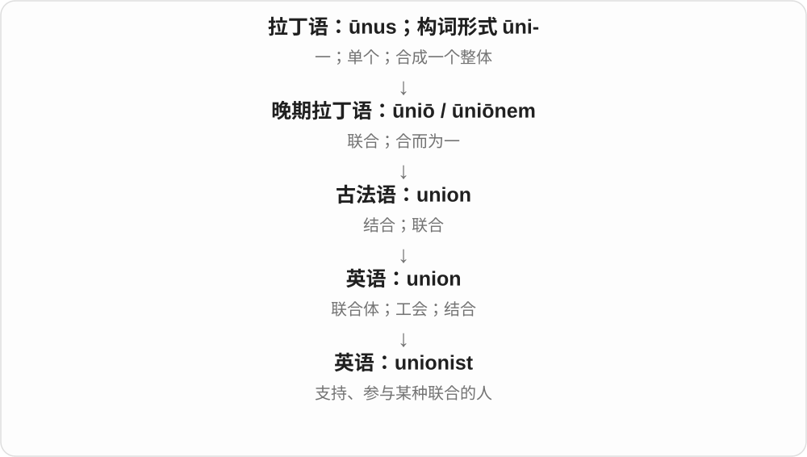

到底联合什么，由语境决定。大写 Unionist 常是特定政治立场或组织名称的一部分，不能全部翻成工会会员。

**常见搭配与例句**

a trade unionist；a unionist representative；a Unionist party。

> Several trade unionists attended the meeting.

几位工会人士出席了会议。

> The historian compares unionist and separatist arguments.

这位历史学家比较了主张维持联合与主张分离的论点。

**别混淆**

unionist 关心联合组织或立场；unanimous 只说意见全体一致，不是某种政治身份。

### 18. unionism — 工会主义；支持联合的立场

**音标**：/ˈjuːnjənɪzəm/

**先抓住这个画面**

unionism 把联合视为一种值得支持的组织方式；劳动领域着眼工会，政治领域则可能着眼维持国家联合。

**怎么拆**

union + -ism，形成制度、运动或主张的名称。

**怎么变成今天的意思**

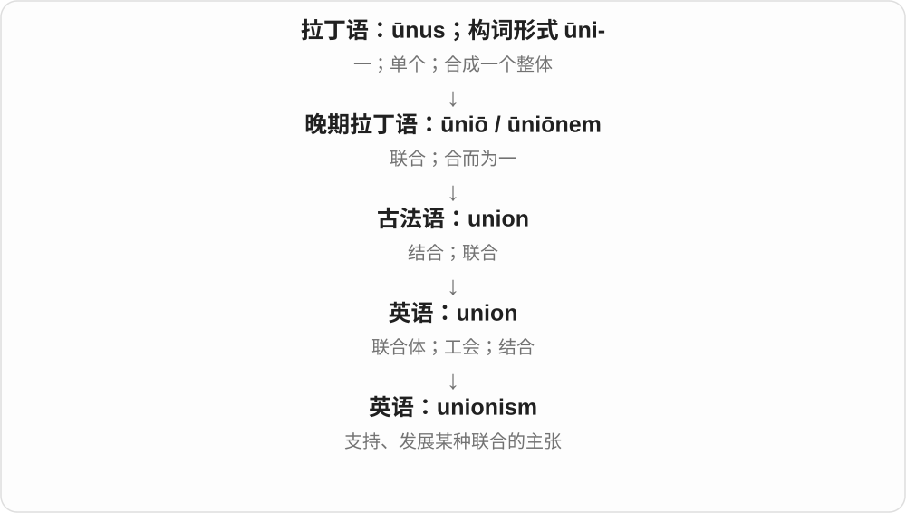

它的对象需要说清楚。trade unionism 明确是工会运动；政治史里的 Unionism 有特定地域和历史背景。

**常见搭配与例句**

trade unionism；the history of unionism；political Unionism。

> The chapter traces the growth of trade unionism in the city.

这一章梳理了工会运动在这座城市的发展。

> The lecture examines different meanings of political unionism.

讲座分析了政治联合主义的不同含义。

**别混淆**

union 是组织或结合；unionism 是支持这种组织、联合的思想和运动。

### 19. unionize — 组织工会；加入工会组织

**音标**：/ˈjuːnjənaɪz/

**先抓住这个画面**

unionize 像把单独发声的员工组织进一个共同代表体系，以集体方式讨论工作事务。

**怎么拆**

union + -ize，表示组织成工会。

**怎么变成今天的意思**

既可说 workers unionize，也可说 unionize a workplace。重点是组织形式发生变化。

**常见搭配与例句**

unionize the workforce；vote to unionize；efforts to unionize。

> The staff voted to unionize.

员工投票决定成立工会。

> The campaign aimed to unionize workers across several sites.

这场行动旨在把几个工作地点的员工组织进工会。

**别混淆**

这里的 unionize 从 union 来，开头 /ˈjuːn/。罕见化学动词 un- + ionize 是另一种构词，读 /ʌnˈaɪənaɪz/。

### 20. unionized — 成立了工会的；由工会组织起来的

**音标**：/ˈjuːnjənaɪzd/

**先抓住这个画面**

unionized 是劳动者已经通过工会联合起来，用集体组织代表共同利益的状态。

**怎么拆**

union + -ize → unionize，再加 -ed。

**怎么变成今天的意思**

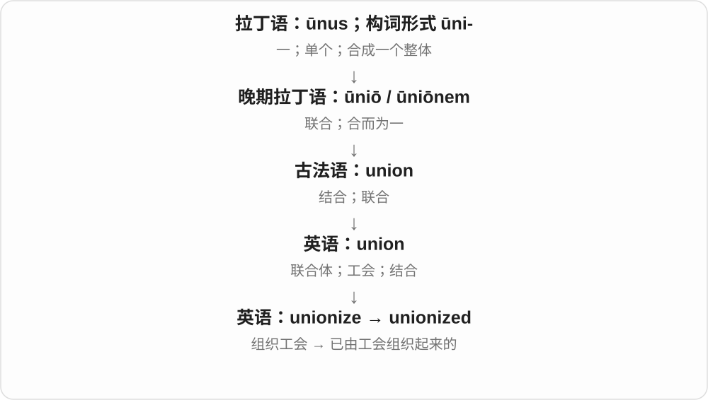

通常修饰 workplace、workers 或 industry，描述组织状态，不是评价员工能力或工作质量。

**常见搭配与例句**

unionized workers；a unionized workplace；a unionized industry。

> The study compared unionized and nonunionized workplaces.

研究比较了成立工会与未成立工会的工作场所。

> The unionized staff elected a new representative.

已由工会组织起来的员工选出了一位新代表。

**别混淆**

化学中的 un-ionized“未电离的”有时也连写 unionized，读 /ʌnˈaɪənaɪzd/，来源是 un- + ionized；不要误读成工会义。

### 21. unionization — 工会组织化；成立工会的过程

**音标**：英 /ˌjuːnjənaɪˈzeɪʃən/；美 /ˌjuːnjənəˈzeɪʃən/

**先抓住这个画面**

unionization 是把原本各自工作的员工组织起来，通过工会形成集体代表的过程。

**怎么拆**

union + -ization；与 unionize 对应。

**怎么变成今天的意思**

它可谈某个工作场所成立工会，也可谈一个行业的工会覆盖情况。不是所有类型的“联合”都这样称呼。

**常见搭配与例句**

a unionization campaign；rates of unionization；support unionization。

> Employees discussed unionization at an open meeting.

员工们在公开会议上讨论了成立工会。

> The report compares unionization rates across industries.

报告比较了不同行业的工会组织化程度。

**别混淆**

union 是组织本身；unionization 是形成或扩大这种组织的过程。

### 22. reunion — 重逢；团聚；联谊聚会

**音标**：/ˌriːˈjuːnjən/

**先抓住这个画面**

reunion 像多年没见的同学再次坐到同一张桌旁，重点是曾经有联系的人重新相聚。

**怎么拆**

借自法语 réunion；现代可分析为 re-（再）+ union（聚合），不是必须先由英语 reunite 派生。

**怎么变成今天的意思**

既可指见到彼此的那一刻，也可指特意安排的一场聚会。它不一定意味着以后共同生活。

**常见搭配与例句**

a family reunion；a class reunion；an emotional reunion。

> We are planning a reunion for our old classmates.

我们正在筹划一次老同学聚会。

> Their reunion at the station was full of laughter.

他们在车站重逢时笑声不断。

**别混淆**

meeting 不要求以前认识；reunion 通常有旧关系和一段分离的背景。

### 23. nonunion — 非工会的；未联合；骨不连

**音标**：英 /ˌnɒnˈjuːnjən/；美 /ˌnɑːnˈjuːnjən/

**先抓住这个画面**

nonunion 在劳动话题里是没有工会组织或不属于工会；医学里是断开的骨骼没能重新愈合连接。

**怎么拆**

non-（没有、非）+ union（联合、愈合连接）。

**怎么变成今天的意思**

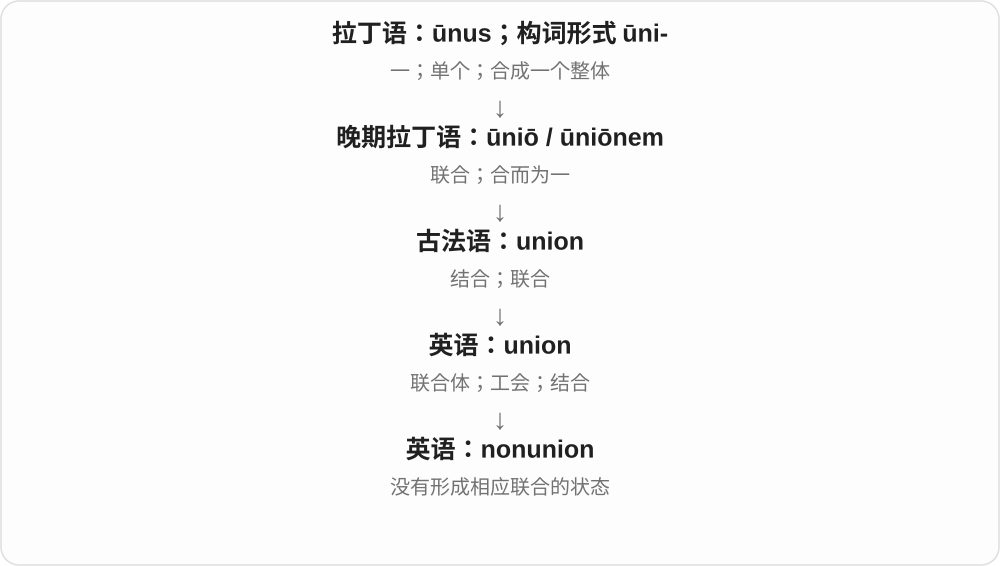

一个词在两个领域都保留“未连成整体”。谈 workers 是工会关系，谈 fracture 则是骨折愈合状况。

**常见搭配与例句**

nonunion workers；a nonunion workplace；fracture nonunion。

> The survey included both union and nonunion workers.

调查同时纳入了工会成员和非工会劳动者。

> The medical report recorded a nonunion of the fracture.

医疗报告记录了这处骨折的骨不连。

**别混淆**

malunion 是愈合后位置不对；骨折语境的 nonunion 是没有愈合连接，二者不是同义词。

### 24. malunion — 畸形愈合

**音标**：/ˌmælˈjuːnjən/

**先抓住这个画面**

malunion 像两段断骨确实长回一起了，却没有对到合适的位置，可能出现弯曲、旋转或缩短。

**怎么拆**

mal-（不良、错误）+ union（连接、愈合）。

**怎么变成今天的意思**

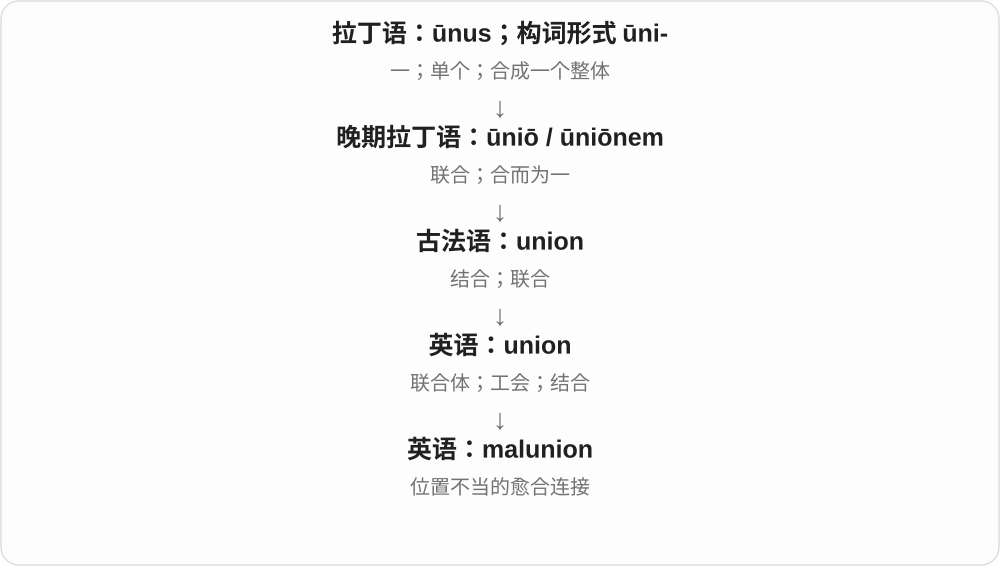

医学术语关注连接后的排列有问题。它不是泛指所有骨折，也不等同于尚未愈合。

**常见搭配与例句**

fracture malunion；malunion of a bone；assess a malunion。

> The report described a malunion of the tibia.

报告描述了胫骨的畸形愈合。

> The diagram shows how a malunion can alter the alignment of a bone.

图示展示了畸形愈合怎样改变骨骼的排列。

**别混淆**

nonunion 是没有愈合连接；malunion 是愈合了但位置异常。这里 mal- 与 non- 分工很清楚。

### 25. unit — 单位；单元；一件；小组

**音标**：/ˈjuːnɪt/

**先抓住这个画面**

unit 是先画一个框，把某样东西当作“一个完整单位”来数：一台机器、一套住房、一个工作小组，都可以成为一个 unit。

**怎么拆**

英语 unity 的词形调整，形成 unit；不是把动词 unite 按现代读音截短。

**怎么变成今天的意思**

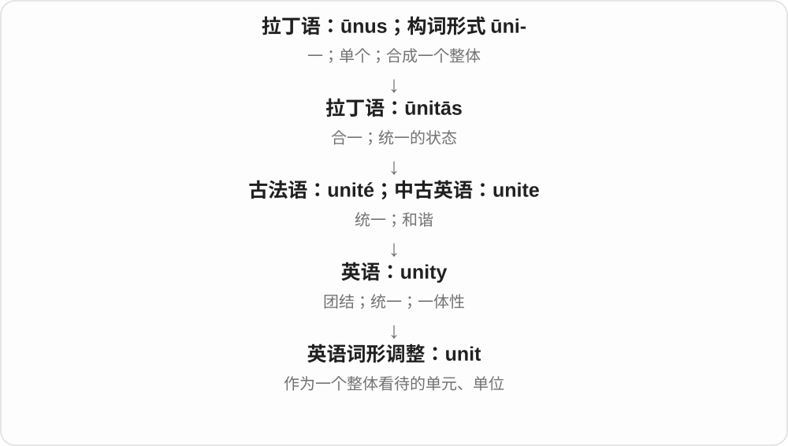

“一”可以成为测量基准，也可以成为大系统里的一块完整部分。数 units 时，要先知道每个框里装的是什么。

**常见搭配与例句**

a unit of measurement；a housing unit；unit cost；a teaching unit。

> Always write the unit next to the measurement.

在测量数值旁边始终写明单位。

> The team works as a single unit.

这个团队作为一个整体协同工作。

**别混淆**

piece 只说一件、一块；unit 往往有明确的计量、功能或组织边界。

### 26. unitary — 单一的；一体的；单一制的；酉的（数学）

**音标**：英 /ˈjuːnɪtəri/；美 /ˈjuːnəteri/

**先抓住这个画面**

unitary 像把一套制度看作一个整体，权力或结构围绕一个统一中心组织。

**怎么拆**

unit + -ary，表示与单一单位、整体有关。

**怎么变成今天的意思**

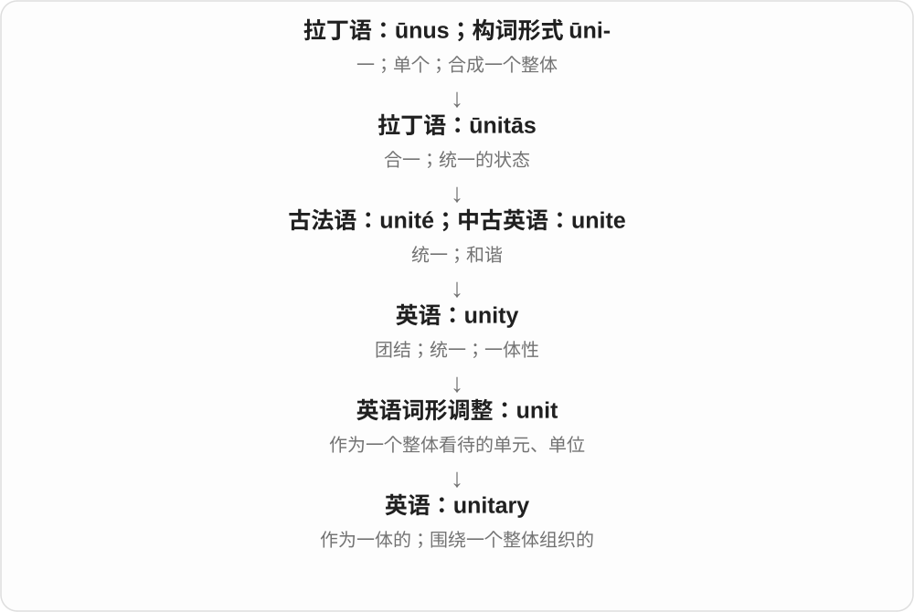

普通学术用法突出一体性。政治中的 unitary state 是单一制国家；数学中的 unitary matrix 是酉矩阵：共轭转置等于逆矩阵，其变换保持向量的长度。这个专义不能只凭“一个”猜出来。

**常见搭配与例句**

a unitary state；a unitary system；a unitary matrix。

> The book compares unitary and federal systems.

这本书比较了单一制与联邦制体系。

> The proposal replaces several separate bodies with one unitary authority.

提案用一个统一的管理机构替代几个独立机构。

> A unitary transformation preserves the length of the vector.

酉变换保持向量的长度不变。

**别混淆**

united 是各方联合；unitary 强调整体组织形式。政治里的 unitary 常与 federal 对照，不等于所有事务都由同一人处理。

### 27. unique — 独一无二的；独有的；很独特的

**音标**：/juːˈniːk/

**先抓住这个画面**

unique 像给一个东西贴上“找不到第二个同样的”标签；也可说某特征只属于某个地方或对象。

**怎么拆**

借自法语 unique，来自拉丁语 ūnicus，与 ūnus“一”相连。

**怎么变成今天的意思**

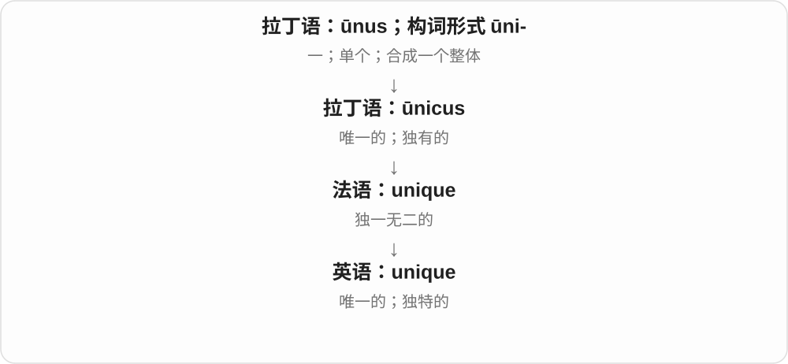

核心是唯一性；日常还会放宽为格外特别。说 unique to an island 时，重点是只见于这座岛。

**常见搭配与例句**

a unique opportunity；a unique identifier；be unique to… 。

> Each visitor receives a unique code.

每位访客都会获得一个不重复的代码。

> This pattern is unique to the northern part of the island.

这种图案只出现在这座岛的北部。

**别混淆**

unusual 只是少见；严格意义的 unique 是唯一。正式技术表达中的 unique key 不能只理解为“挺特别的键”。

### 28. uniquely — 独特地；唯一地；特别适合地

**音标**：/juːˈniːkli/

**先抓住这个画面**

uniquely 像给每件东西一个只属于它的标签，或说某个人拥有别人难以同时具备的优势。

**怎么拆**

unique + -ly。

**怎么变成今天的意思**

uniquely identify 强调能排除其他对象、只锁定一个；uniquely placed 则说条件特别合适。

**常见搭配与例句**

uniquely identify；uniquely qualified；uniquely suited to… 。

> The number uniquely identifies each parcel.

这个编号可以唯一识别每个包裹。

> Her experience makes her uniquely suited to the role.

她的经历使她特别适合这个职位。

**别混淆**

uniquely 在技术里常是严格唯一，在评价里常是独特出众；不能一概翻成“非常”。

### 29. uniqueness — 独特性；唯一性

**音标**：/juːˈniːknəs/

**先抓住这个画面**

uniqueness 是把“只有这一个”或“它有自己的样子”这点拿出来讨论。

**怎么拆**

unique + -ness，把性质变成名词。

**怎么变成今天的意思**

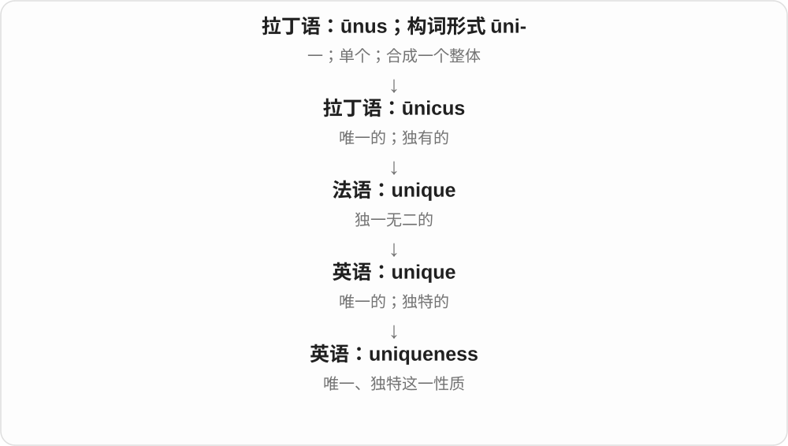

在设计中可以欣赏独特性；在数学或数据中，需要证明没有第二个满足条件的对象。

**常见搭配与例句**

the uniqueness of…；prove uniqueness；a uniqueness constraint。

> The renovation preserved the building’s uniqueness.

改造保留了这栋建筑的独特之处。

> The proof establishes the uniqueness of the solution.

这个证明确立了解的唯一性。

**别混淆**

originality 更强调创意和原创；uniqueness 强调独有、不重复，两者不总重合。

### 30. biunique — 双向一一对应的

**音标**：/ˌbaɪjuːˈniːk/

**先抓住这个画面**

biunique 像一排锁和一排钥匙：每把锁只配一把钥匙，每把钥匙也只配那一把锁，两个方向都没有重复或遗漏。

**怎么拆**

bi-（两边、双向）+ unique（唯一）。

**怎么变成今天的意思**

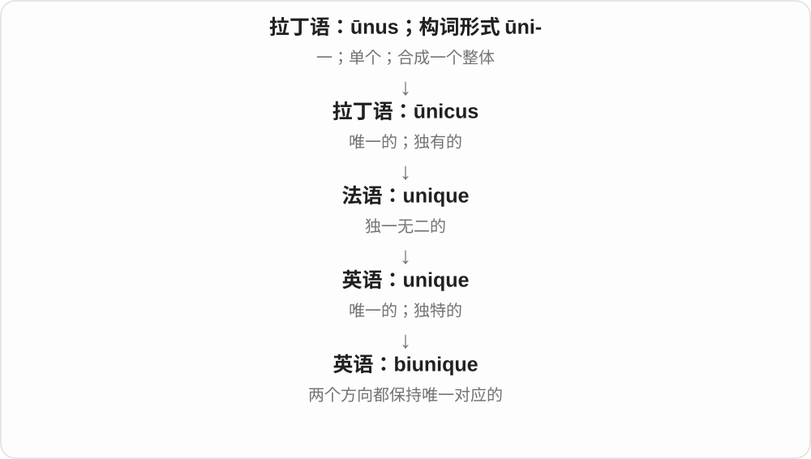

用于数学、逻辑或语言学，重点是双方能互相唯一确定。不是“两件东西各自都挺独特”。

**常见搭配与例句**

a biunique correspondence；a biunique mapping；biunique relations。

> The labels and items stand in a biunique correspondence.

标签与物品之间是一一对应的关系。

> The mapping is biunique: each code identifies exactly one item, and each item has exactly one code.

这个映射是双向唯一的：每个代码只识别一个物品，每个物品也只有一个代码。

**别混淆**

unique 只说唯一；biunique 强调两边一一对应，常可用 bijective 表达数学意义。

### 31. nonunique — 非唯一的；可能重复的

**音标**：英 /ˌnɒnjuːˈniːk/；美 /ˌnɑːnjuːˈniːk/

**先抓住这个画面**

nonunique 像同一个名字能对应多个人，或者一道题有好几个满足条件的答案。

**怎么拆**

non-（不、非）+ unique（唯一）。

**怎么变成今天的意思**

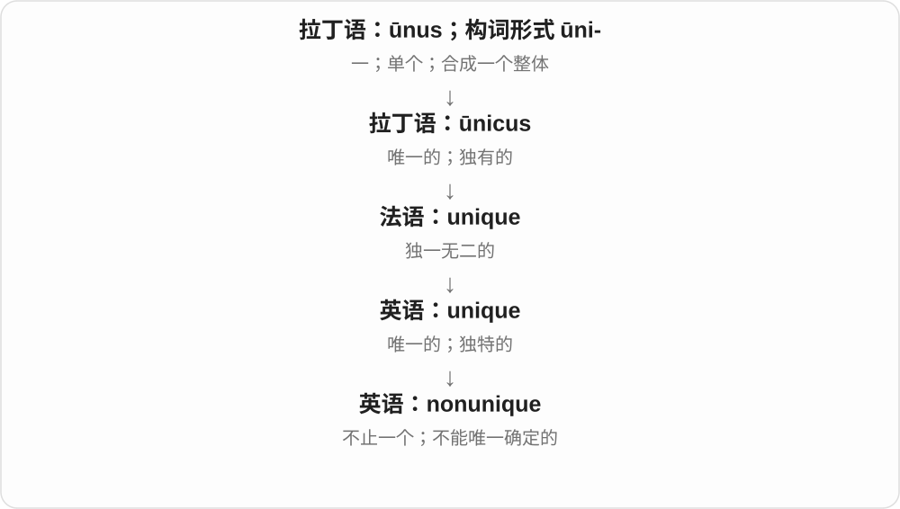

技术语境中常说解不唯一或键值允许重复。它不是“这个东西毫无特色”的普通评价。

**常见搭配与例句**

a nonunique solution；a nonunique key；nonunique identifiers。

> The equations have a nonunique solution.

这些方程的解不唯一。

> A surname is a nonunique identifier in a large database.

在大型数据库中，姓氏不能作为唯一标识。

**别混淆**

ambiguous 强调可能产生多种理解；nonunique 强调满足条件的对象不止一个，两者可相关但不完全相同。

### 32. uniform — 一致的；均匀的；制服

**音标**：英 /ˈjuːnɪfɔːm/；美 /ˈjuːnəfɔːrm/

**先抓住这个画面**

uniform 的画面是一排杯子都一样高，或一群工作人员都穿同一种样式的衣服。

**怎么拆**

借自法语 uniforme，远源为拉丁语 ūni-（一）+ forma（形式、样式）组成的 ūniformis。

**怎么变成今天的意思**

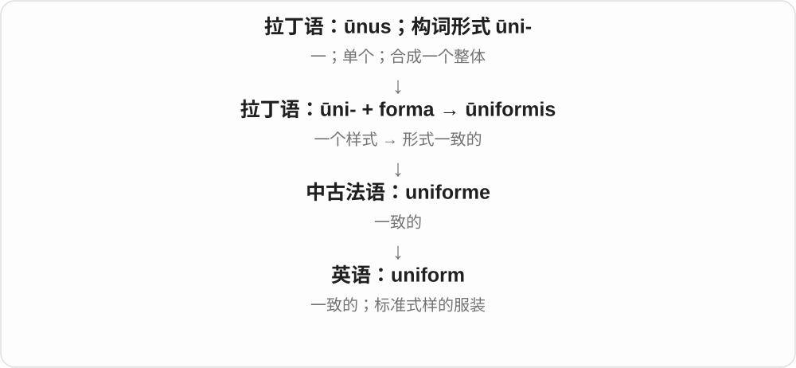

先是形状、状态一致；服装保持统一式样，就形成名词“制服”。形容词与名词都保留“一个样”的核心。

**常见搭配与例句**

a school uniform；uniform size；uniform distribution。

> The tiles are not uniform in size.

这些瓷砖的尺寸不一致。

> The guide wore a blue uniform.

导游穿着蓝色制服。

**别混淆**

uniform 强调同样或均匀；united 强调联合。不同制服的人也能 united，一样着装也不保证团结。

### 33. uniformly — 一致地；均匀地；一律地

**音标**：英 /ˈjuːnɪfɔːmli/；美 /ˈjuːnəfɔːrmli/

**先抓住这个画面**

uniformly 像往面包上抹酱，各处厚薄差不多；也可以说一组结果或评价都呈现同样情况。

**怎么拆**

uniform + -ly。

**怎么变成今天的意思**

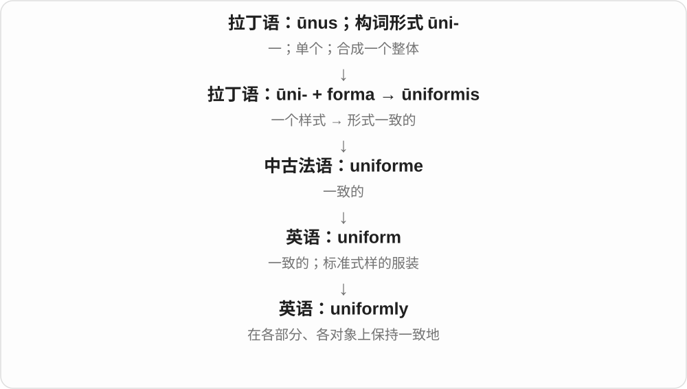

空间上可说分布均匀；评价上可说一致好评或差评。它关注没有明显差别。

**常见搭配与例句**

spread uniformly；uniformly distributed；uniformly high quality。

> Spread the seeds uniformly across the tray.

把种子均匀撒在托盘里。

> The reviews were uniformly positive.

这些评论都给出了正面评价。

**别混淆**

universally 强调覆盖所有对象；uniformly 强调各处表现一致。有时两者接近，但观察角度不同。

### 34. uniformed — 穿制服的；需要穿制服的

**音标**：英 /ˈjuːnɪfɔːmd/；美 /ˈjuːnəfɔːrmd/

**先抓住这个画面**

uniformed 像你在大厅里一眼看见穿着统一服装的工作人员，服装表明其职责。

**怎么拆**

uniform（制服）+ -ed，表示穿着或配有这种服装。

**怎么变成今天的意思**

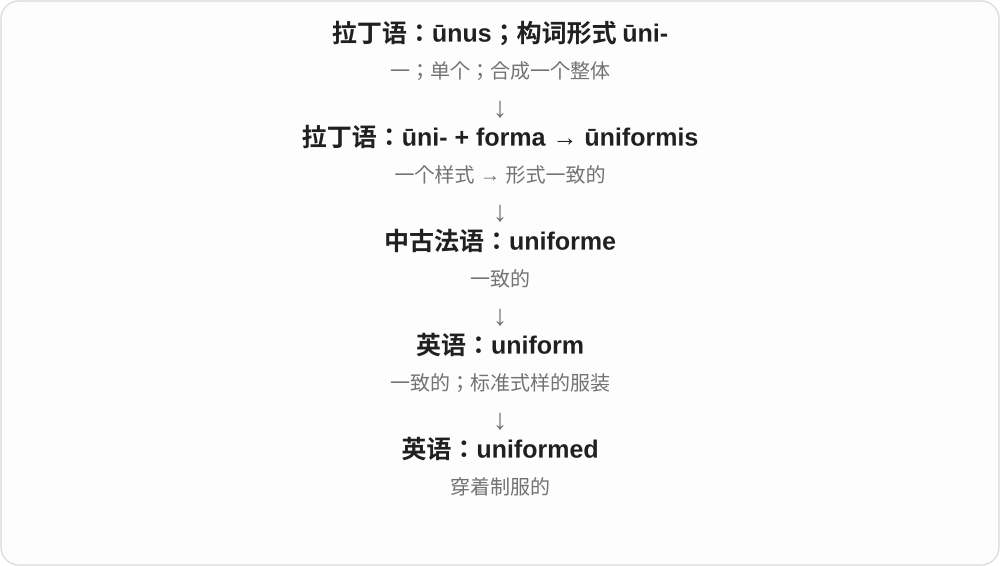

这里从 uniform 的名词义出发，不是在说人的思想、身材都一致。也可修饰需要穿制服的职业。

**常见搭配与例句**

uniformed staff；a uniformed officer；uniformed services。

> A uniformed employee checked our tickets at the entrance.

一位穿制服的工作人员在入口检查了我们的票。

> The photograph shows three uniformed officers.

照片上是三位穿制服的警官。

**别混淆**

uniformed 是穿制服；uninformed 是不了解情况，后者多一个 n，读音也不同。

### 35. uniformity — 一致性；均匀性；千篇一律

**音标**：英 /ˌjuːnɪˈfɔːməti/；美 /ˌjuːnəˈfɔːrməti/

**先抓住这个画面**

uniformity 像一批螺丝尺寸都一致，能稳定配合；换到城市街景里，也可能让人觉得处处一个样。

**怎么拆**

经古法语 uniformité 或直接来自晚期拉丁语 ūniformitās；现代对应 uniform + -ity。

**怎么变成今天的意思**

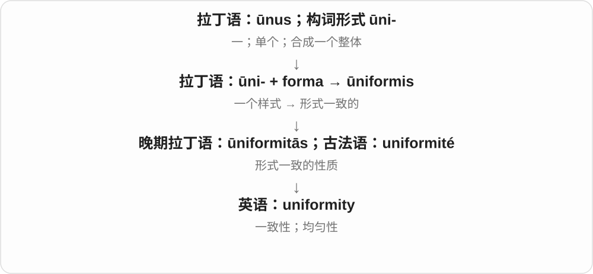

同样的性质可有不同评价：制造中可能需要，艺术中可能显得单调。词本身不能决定这种一致是好是坏。

**常见搭配与例句**

uniformity of size；ensure uniformity；visual uniformity。

> The inspection checks the uniformity of the coating.

检查要确认涂层是否均匀。

> She disliked the visual uniformity of the new buildings.

她不喜欢这些新建筑在视觉上的千篇一律。

**别混淆**

unity 允许各部分有差异但组成整体；uniformity 更关注各部分彼此相同。

### 36. nonuniformity — 不均匀性；不一致之处

**音标**：英 /ˌnɒnjuːnɪˈfɔːməti/；美 /ˌnɑːnjuːnəˈfɔːrməti/

**先抓住这个画面**

nonuniformity 是把各处不一样这件事单独量出来看，比如涂层最厚处和最薄处相差多少。

**怎么拆**

non-（不）+ uniformity（均匀性、一致性）。

**怎么变成今天的意思**

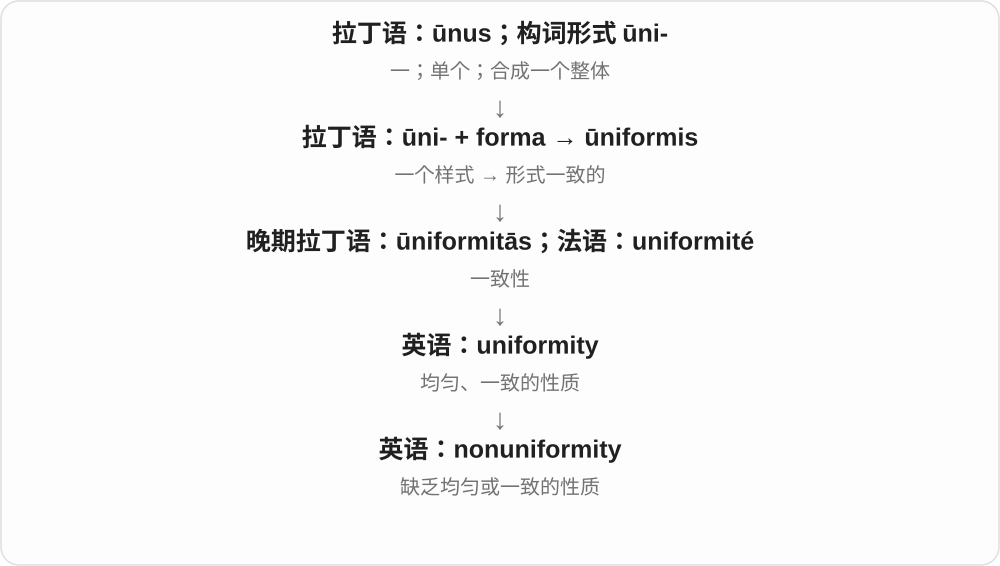

既可指整体不均匀的程度，也可指某个不一致点。技术场景通常会规定怎样测量。

**常见搭配与例句**

thickness nonuniformity；nonuniformity of illumination；reduce nonuniformity。

> The test measured nonuniformity across the surface.

测试测量了整个表面的不均匀程度。

> Better mixing reduced the nonuniformity of the material.

更充分的混合降低了材料的不均匀性。

**别混淆**

nonuniform 形容样品不均匀；nonuniformity 是不均匀性本身，适合跟 measure、reduce 连用。

### 37. nonuniform — 不均匀的；不一致的

**音标**：英 /ˌnɒnˈjuːnɪfɔːm/；美 /ˌnɑːnˈjuːnəfɔːrm/

**先抓住这个画面**

nonuniform 像一张纸有的地方涂得很厚，有的地方几乎没涂：不同位置或部分的性质不一样。

**怎么拆**

non-（非、不）+ uniform（一致、均匀）。

**怎么变成今天的意思**

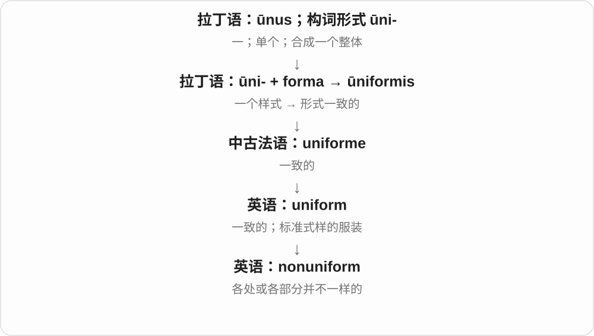

常用于分布、材料、尺寸或规则。不同学科可能给出更精确的定义，核心仍是“不保持相同”。

**常见搭配与例句**

nonuniform distribution；nonuniform thickness；nonuniform spacing。

> The nonuniform lighting made one side of the room look darker.

不均匀的照明让房间一侧显得更暗。

> The samples had nonuniform thickness.

这些样品的厚度不均匀。

**别混淆**

irregular 可说形状或模式不规则；nonuniform 只要各部分不一致就成立，不必杂乱无章。

### 38. onion — 洋葱

**音标**：/ˈʌnjən/

**先抓住这个画面**

onion 就是剥开后层层包在一起的洋葱。它与“一”有古老联系，但现代英语里已经不能靠字母拆出这个意思。

**怎么拆**

来自古法语 oignon，远源为拉丁语 ūniō / ūniōnem“洋葱”；通常联系 ūnus“一”。

**怎么变成今天的意思**

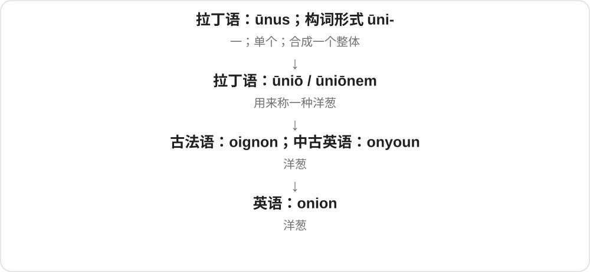

关于命名，一种常见解释是鳞茎一层层合成一个整体，区别于分成瓣的蒜。这个解释帮助理解历史联系，不表示英语 onion 能拆成 on + ion。

**常见搭配与例句**

chop an onion；sliced onion；onion soup。

> Cut the onion into thin slices.

把洋葱切成薄片。

> The soup needs a little more onion.

这锅汤还需要再加一点洋葱。

**别混淆**

onion /ˈʌnjən/ 是洋葱；union /ˈjuːnjən/ 是联合体。拼写接近，开头发音和现代用途都不同。

### 39. unanimous — 全体一致的；一致赞成的

**音标**：/juːˈnænɪməs/

**先抓住这个画面**

unanimous 像举手表决时一整排手全部举起来，没有一票反对；也可以说大家在一个判断上完全一致。

**怎么拆**

拉丁语 ūnus（一）+ animus（心意）形成 ūnanimus“同心的”，进入英语成为 unanimous。

**怎么变成今天的意思**

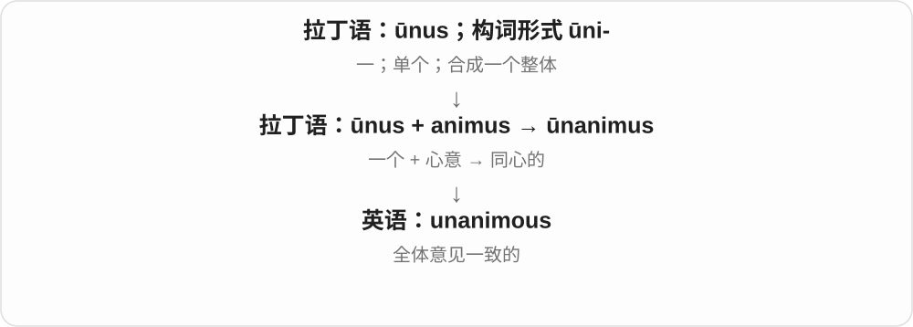

“一个心意”不是只有一个人在想，而是相关的所有人都同意。必须看清所说的投票或人群范围。

**常见搭配与例句**

a unanimous decision；unanimous support；be unanimous in… 。

> The panel reached a unanimous decision.

评审小组作出了一致决定。

> We were unanimous in our choice of venue.

我们在场地选择上完全一致。

**别混淆**

majority 是多数；unanimous 是全体一致。九人赞成、一人反对不是 unanimous。

### 40. unanimously — 全体一致地

**音标**：/juːˈnænɪməsli/

**先抓住这个画面**

unanimously 是把 unanimous 的结果放到动作上：所有参加表决的人以同一立场投票或决定。

**怎么拆**

unanimous + -ly。

**怎么变成今天的意思**

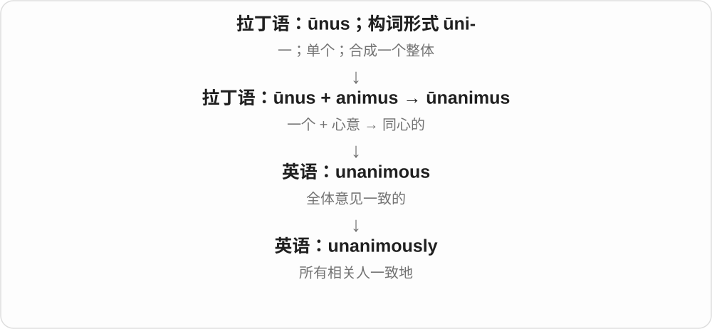

它说明意见如何形成，而不是说明决定本身是否正确。常和 vote、agree、approve 连用。

**常见搭配与例句**

vote unanimously；agree unanimously；be unanimously approved。

> The members voted unanimously to extend the exhibition.

成员们一致投票同意延长展期。

> The recommendation was unanimously approved.

这项建议获得了一致批准。

**别混淆**

overwhelmingly 表示压倒性多数；unanimously 表示全体一致，不能把少量反对票抹去。

### 41. unanimity — 全体一致；一致同意

**音标**：/ˌjuːnəˈnɪməti/

**先抓住这个画面**

unanimity 是让所有人的意见最后落在同一个答案上，重点是没有人持不同意见的状态。

**怎么拆**

来自法语 unanimité 和晚期拉丁语 ūnanimitās；现代与 unanimous 对应，但不能把借入名词简单画成英语形容词的后代。

**怎么变成今天的意思**

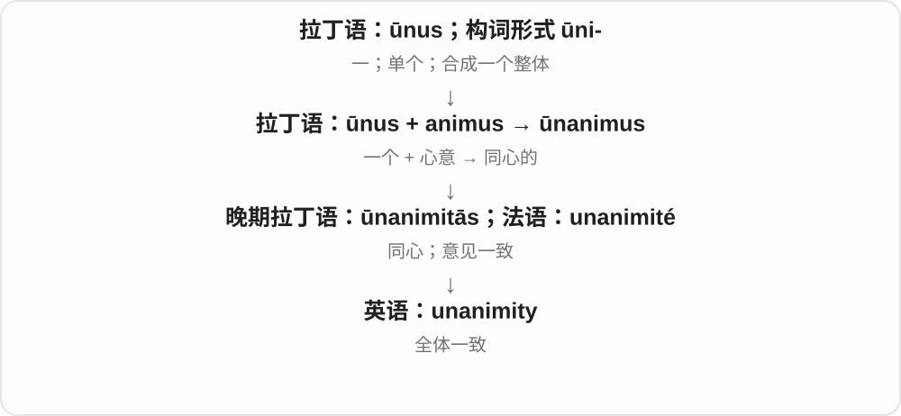

常在决策中谈是否达到一致。它比大多数赞成要求更高，但一致也不保证结论正确。

**常见搭配与例句**

reach unanimity；unanimity among members；require unanimity。

> The committee failed to reach unanimity.

委员会没能达成全体一致。

> There was unanimity on the need for clearer instructions.

大家一致认为需要更清楚的说明。

**别混淆**

consensus 常指广泛共识，不一定意味着每个人毫无保留；unanimity 更明确要求全体一致。

### 42. unicorn — 独角兽；极难找到的事物；独角兽企业

**音标**：英 /ˈjuːnɪkɔːn/；美 /ˈjuːnɪkɔːrn/

**先抓住这个画面**

unicorn 先想一匹额头有一只角的神话动物；因为传说里稀少难见，后来也用来比喻难以找到的理想对象。

**怎么拆**

经古法语 unicorne 来自拉丁语 ūnicornis：ūnus（一）+ cornū（角）。

**怎么变成今天的意思**

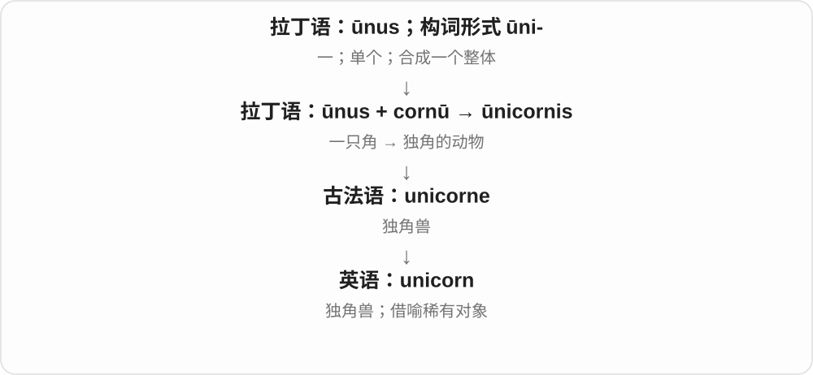

名字的核心是一个角。商业语境进一步把稀有意象用作高估值私人初创企业的称呼；不是所有成功公司都适合这样叫。

**常见搭配与例句**

a mythical unicorn；a unicorn company；search for a unicorn。

> The child drew a silver unicorn with a golden horn.

孩子画了一只长着金色角的银色独角兽。

> A candidate with every skill on that list would be a unicorn.

能具备那张清单上全部技能的候选人会极其难找。

**别混淆**

corn 在这里远源是“角”，不是现代英语玉米。unicorn 的神话和商业用法要由上下文区分。

### 43. unify — 使统一；使合成一体

**音标**：/ˈjuːnɪfaɪ/

**先抓住这个画面**

unify 像把几套各说各话的规则整理成一个共同体系，让各部分能配合。

**怎么拆**

经中古法语 unifier 来自晚期拉丁语 ūnificāre；历史构成是“一”加“使成为”。

**怎么变成今天的意思**

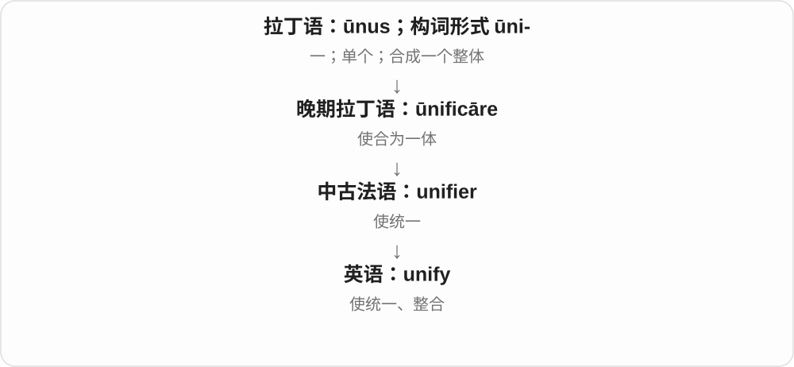

可以统一国家、系统、标准或思想线索。它不仅说东西靠近，更强调形成一个有联系的整体。

**常见搭配与例句**

unify standards；unify a system；a unifying theme。

> The team wants to unify the three booking systems.

团队希望把三套预订系统整合成一个。

> A shared colour scheme unifies the exhibition.

共同的配色让整个展览形成统一风格。

**别混淆**

unite 常突出人或力量联合；unify 常突出结构和规则统一。统一系统不意味着每个部分功能完全相同。

### 44. unification — 统一；合并为一体

**音标**：/ˌjuːnɪfɪˈkeɪʃn̩/

**先抓住这个画面**

几条分开的路线终于接到同一张网络里，几个分开的部分形成一个整体：这叫 unification。

**怎么拆**

uni-（一）+ -fy（使成为，来自 facere）形成 unify，可对应 -fication 名词；历史也可能借自法语或意大利语相关形式。

**怎么变成今天的意思**

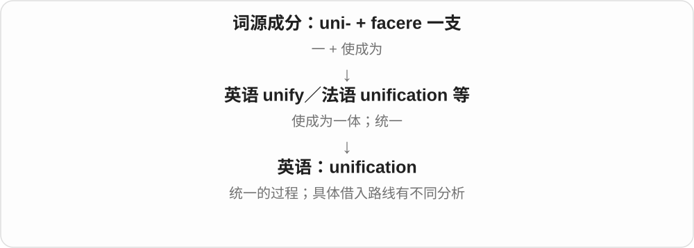

核心是从多个单位走向一个整体；可能是国家、制度、标准，也可能是理论解释。

**常见搭配与例句**

national unification；the unification of standards。

> The unification of the ticketing systems took a year.

统一票务系统花了一年时间。

> The book examines the country’s unification.

这本书考察了这个国家的统一过程。

**别混淆**

unity 是统一或团结的状态；unification 更强调达到该状态的过程。

### 45. reunification — 重新统一

**音标**：/ˌriːjuːnɪfɪˈkeɪʃən/

**先抓住这个画面**

原本是一体，后来分开，现在又接到一起：reunification 比 unification 多了“恢复”的背景。

**怎么拆**

re-（再次）+ unification。

**怎么变成今天的意思**

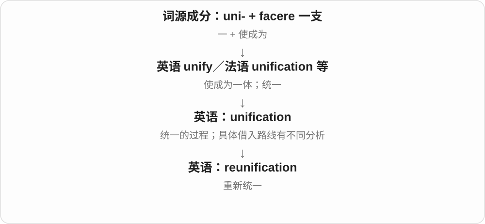

统一的动作再发生一次，可以谈政治实体，也可谈家庭成员重新共同生活；并非所有第一次合并都适合加 re-。

**常见搭配与例句**

national reunification；family reunification。

> The exhibition traces the path to national reunification.

展览梳理了走向国家重新统一的过程。

> The programme supports family reunification.

这个项目帮助家庭重新团聚。

**别混淆**

reunion 可以只是短暂相聚；reunification 往往指重新组成或恢复一个整体。

### 46. reunify — 使重新统一

**音标**：/ˌriːˈjuːnɪfaɪ/

**先抓住这个画面**

reunify 像把一个曾经完整、后来分开的系统重新接成整体，常用于国家、机构或制度。

**怎么拆**

re-（再）+ unify（统一）。

**怎么变成今天的意思**

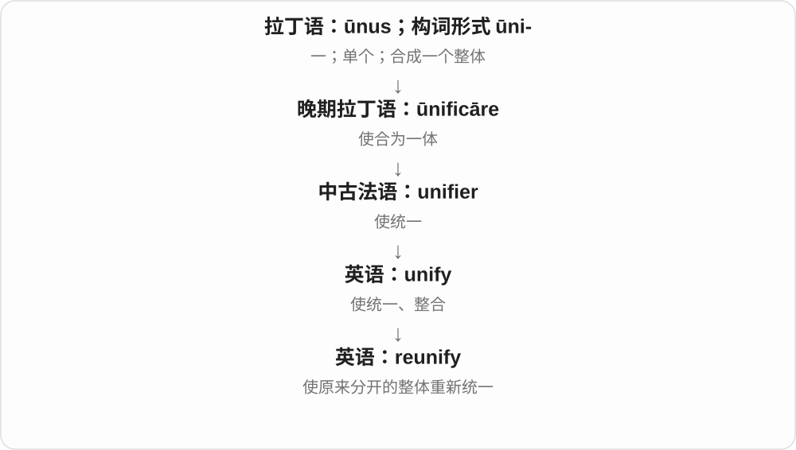

比 reunite 更常突出恢复一个共同的制度、组织或结构，不只是久别的人见一面。

**常见搭配与例句**

reunify a country；reunify institutions；plans to reunify。

> The agreement set out a plan to reunify the two administrations.

协议提出了重新统一两套管理机构的计划。

> The book examines attempts to reunify the divided country.

这本书研究了使这个分裂国家重新统一的尝试。

**别混淆**

reunite 可以只是重逢；reunify 通常意味着重新成为一个统一整体。对应过程名词是 reunification。

### 47. unilateral — 单方面的；单侧的

**音标**：/ˌjuːnɪˈlætərəl/

**先抓住这个画面**

unilateral 像一张谈判桌旁只有一方作了决定，没有等待另一方共同同意；在身体描述里也可以只指一侧。

**怎么拆**

新拉丁语 ūnilaterālis，含 ūnus（一）+ laterālis（侧面的）；现代可按 uni- + lateral 理解。

**怎么变成今天的意思**

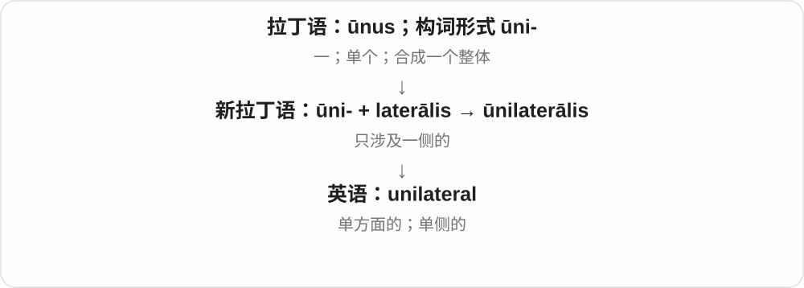

“一边”可以是空间的一侧，也可以是参与关系中的一方。词本身不自动判断该决定合理或不合理。

**常见搭配与例句**

unilateral action；a unilateral decision；unilateral changes。

> The manager made a unilateral decision to change the schedule.

经理单方面决定更改日程。

> The report describes the change as unilateral rather than mutual.

报告把这项变更描述为单方面的，而非双方共同作出的。

**别混淆**

bilateral 是双方或两侧；unilateral 是一方或一侧。独自作决定与大家一致同意不是一回事。

### 48. unilaterally — 单方面地；只在一侧地

**音标**：/ˌjuːnɪˈlætərəli/

**先抓住这个画面**

unilaterally 把 unilateral 放到行动上：一方自己采取措施，没有与另一方共同决定。

**怎么拆**

unilateral + -ly。

**怎么变成今天的意思**

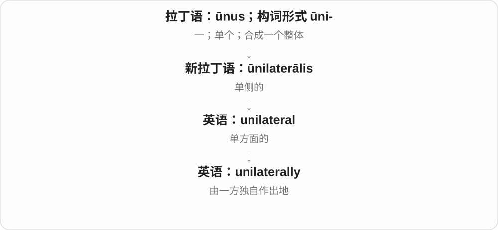

常用于 change、act、withdraw 等动词。强调决定由谁作出，不等于一定只有一个人参与执行。

**常见搭配与例句**

act unilaterally；change something unilaterally；withdraw unilaterally。

> The company changed the terms unilaterally.

这家公司单方面更改了条款。

> One side cannot resolve the whole dispute unilaterally.

仅靠一方无法单方面解决整个争议。

**别混淆**

independently 强调独立、不依赖；unilaterally 特别突出一个本来涉及多方的事情由一方决定。

### 49. unison — 齐声；同度；协调一致

**音标**：/ˈjuːnɪsən/，也读 /ˈjuːnɪzən/

**先抓住这个画面**

unison 像一群人同一时刻唱出同一条旋律；借到动作上，就是步调一致地做同一件事。

**怎么拆**

来自法语 unisson，远源为中古拉丁语 ūnisonus：ūni-（一）+ sonus（声音）。

**怎么变成今天的意思**

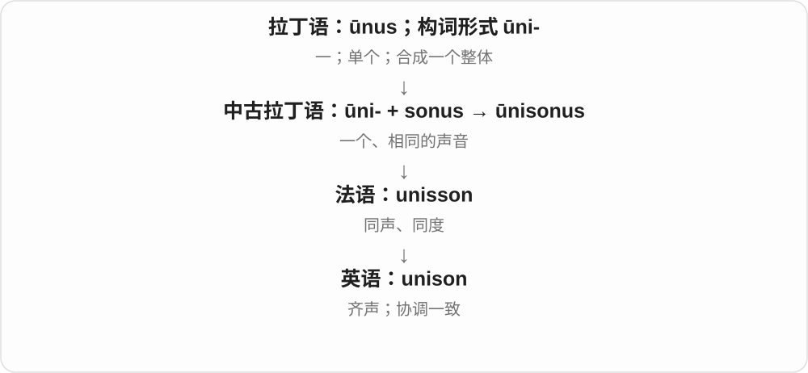

音乐里严格同度指相同音高，实际齐唱有时也含八度重合；日常 in unison 常只说同时、配合一致。

**常见搭配与例句**

sing in unison；speak in unison；move in unison。

> The children answered in unison.

孩子们齐声回答。

> The dancers raised their arms in unison.

舞者们整齐一致地抬起手臂。

**别混淆**

harmony 可以由不同音高配合；unison 更强调同一旋律、同一音高或一致的动作。

### 50. unisex — 不分性别的；各性别通用的

**音标**：/ˈjuːnɪseks/

**先抓住这个画面**

unisex 像同一款帽子不按男女分两套，设计时就准备给不同性别的人共同使用。

**怎么拆**

uni-（一、共同）+ sex（性别）。

**怎么变成今天的意思**

现代常用义是不同性别通用，不是“只供一种性别使用”。具体适不适合某个人，仍由尺寸、功能和个人偏好决定。

**常见搭配与例句**

unisex clothing；a unisex name；a unisex design。

> The shop sells a range of unisex jackets.

这家店销售一系列不分性别的夹克。

> They chose a unisex name for the character.

他们为这个角色选了一个不分性别的名字。

**别混淆**

unisexual 在生物学中常指单性的；unisex 在现代商品和名称语境中通常是不分性别通用。

### 51. unidirectional — 单向的

**音标**：/ˌjuːnɪdɪˈrekʃənəl/，也读 /ˌjuːnɪdaɪˈrekʃənəl/

**先抓住这个画面**

unidirectional 像箭头只朝一边：信息从甲流向乙，却不沿同一通道反过来；材料纤维也可以都朝同一方向。

**怎么拆**

uni-（一）+ directional（方向的）。

**怎么变成今天的意思**

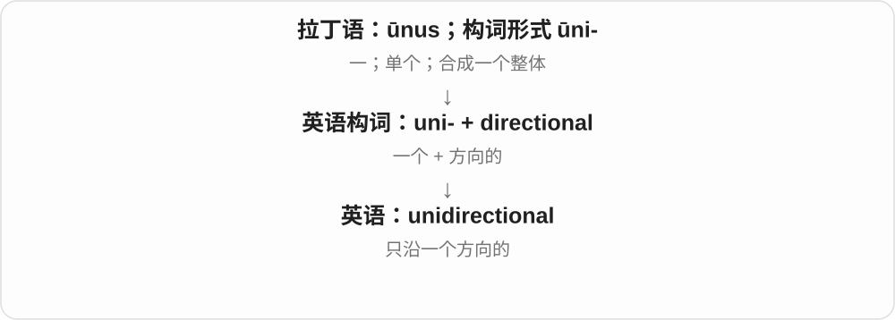

“单向”可以说流动方向，也可以说结构的排列方向。它并不表示只有一个物体在移动。

**常见搭配与例句**

unidirectional flow；unidirectional communication；unidirectional fibres。

> The diagram shows a unidirectional flow of information.

图示展示了信息的单向流动。

> The panel contains unidirectional fibres.

这块板材含有沿同一方向排列的纤维。

**别混淆**

unilateral 看参与方或侧别；unidirectional 看运动、传递或排列的方向。两者不能仅因都有“单”就互换。

### 52. unicycle — 独轮车；骑独轮车

**音标**：/ˈjuːnɪsaɪkəl/

**先抓住这个画面**

unicycle 就是一只轮子承载骑手，需要靠身体不断调整平衡。

**怎么拆**

uni-（一）+ cycle（轮、自行车），用古典成分形成的现代英语词。

**怎么变成今天的意思**

一直接落在车轮数量上。cycle 的远源来自希腊语“圆、轮”，这是一种跨古典来源的现代组合。

**常见搭配与例句**

ride a unicycle；learn to unicycle；balance on a unicycle。

> She practises riding a unicycle in the empty courtyard.

她在空院子里练习骑独轮车。

> The performer crossed the stage on a unicycle.

表演者骑独轮车穿过舞台。

**别混淆**

bicycle 有两个轮；tricycle 有三个轮；unicycle 有一个轮，前缀在这里真的数轮子。

### 53. triune — 三而一的；三位一体的

**音标**：/ˈtraɪjuːn/，也读 /traɪˈjuːn/

**先抓住这个画面**

triune 是“三个方面，却被理解为一个整体”。常见于基督教神学对三位一体的描述。

**怎么拆**

来自新拉丁语 triūnus，含 tri-（三）+ ūnus（一）。

**怎么变成今天的意思**

这是一个带专门思想背景的词，不是普通算术“三等于一”。用于艺术时，也可说三个部分共同形成一个作品整体。

**常见搭配与例句**

the triune God；a triune structure；a triune work。

> The theologian explained the idea of a triune God.

这位神学家解释了三位一体的上帝观念。

> The critic described the three linked poems as a triune work.

评论者把这三首彼此相连的诗描述为一个三而一的作品。

**别混淆**

triple 只说三重、三个；triune 还强调三者共同构成一体。

### 54. unicellular — 单细胞的

**音标**：英 /ˌjuːnɪˈseljʊlə/；美 /ˌjuːnəˈseljələr/

**先抓住这个画面**

unicellular 像把一个完整生命体的基本活动都装在一个细胞里：这个个体本身只有一个细胞。

**怎么拆**

uni-（一）+ cellular（细胞的）。

**怎么变成今天的意思**

它描述个体的细胞数量，不是显微镜下只看见了一个细胞。许多单细胞个体可以同时生活在一起。

**常见搭配与例句**

a unicellular organism；unicellular life；unicellular algae。

> The diagram shows a unicellular organism.

图示展示了一个单细胞生物。

> The lesson compares unicellular and multicellular forms of life.

这节课比较了单细胞与多细胞生命形式。

**别混淆**

multicellular 是多细胞；unicellular 是单细胞。单细胞并不等于没有复杂的细胞内部活动。

### 55. unipolar — 单极的；单一中心主导的

**音标**：英 /ˌjuːnɪˈpəʊlə/；美 /ˌjuːnəˈpoʊlər/

**先抓住这个画面**

unipolar 把重点放在“一极”：电子信号可以只用一种极性，国际关系讨论也可以只有一个占主导的力量中心。

**怎么拆**

uni-（一）+ polar（极的）。

**怎么变成今天的意思**

不同学科对 pole 的具体定义不同。这里的“一”要跟领域一起理解，不能把一切 unipolar 都想成一根独立磁极。

**常见搭配与例句**

a unipolar signal；a unipolar system；a unipolar world order。

> The diagram compares unipolar and bipolar signals.

图示比较了单极性与双极性信号。

> The article examines the idea of a unipolar international system.

文章考察了单极国际体系这一概念。

**别混淆**

bipolar 是两极；multipolar 是多极。国际关系里的极是主要力量中心，不是地理南北极。

### 56. unary — 一元的；单项的

**音标**：英 /ˈjuːnəri/；美 /ˈjuːneri/

**先抓住这个画面**

unary 像一个机器只接收一个输入，再对它做操作。比如给 x 加负号成为 −x，操作只作用于 x 这一个对象。

**怎么拆**

用拉丁语 ūnus（一）加 -ary 构成，仿照 binary、ternary 等数量术语。

**怎么变成今天的意思**

计算和逻辑里常用它区分操作需要几个对象。unary minus 与 x − y 的减法不同：后者有两个操作数。

**常见搭配与例句**

a unary operator；a unary function；unary minus。

> The minus sign acts as a unary operator in this expression.

这个表达式中的负号用作一元运算符。

> The function is unary because it takes one argument.

这个函数是一元的，因为它接收一个参数。

**别混淆**

binary 常指二元；unary 是一元。它并不表示运算结果必须等于一。

### 57. adunation — 合一；联合（古旧用词）

**音标**：/ˌædjʊˈneɪʃən/

**先抓住这个画面**

adunation 是把分开的部分聚成一个整体的旧式说法，可以想成散落的线头最终结成一束。

**怎么拆**

借自拉丁语 adūnātiō，来自 adūnāre“合一”；其中 ad- 表趋向，ūnus 表一。

**怎么变成今天的意思**

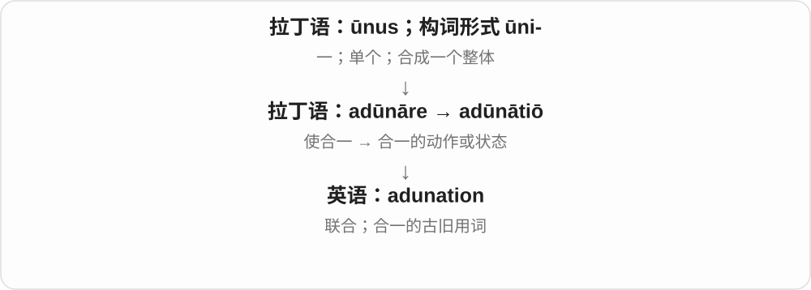

现代普通表达多用 union 或 unification。遇到旧文时认出它即可，不必在普通邮件里用它替代常见词。

**常见搭配与例句**

the adunation of parts；adunation into a whole；多见于旧式论述。

> The old treatise describes the adunation of many parts into one whole.

这部旧论著描述了许多部分合成一个整体。

> The author uses adunation where a modern writer would usually say union.

这位作者用了 adunation，现代作者在这里通常会用 union。

**别混淆**

adunation 与 adaptation“适应”无关；它讲合一，不讲适应环境。

### 58. coadunate — 紧密结合的；合生的；使联合（罕见动词）

**音标**：形容词英 /kəʊˈædjʊnɪt/，也读 /kəʊˈædjʊneɪt/；美 /koʊˈædʒənɪt/

**先抓住这个画面**

coadunate 像植物的几个部分不是仅仅挨在一起，而是长成紧密相连的一体。

**怎么拆**

来自拉丁语 coadūnātus，是 coadūnāre“联合为一”的分词；含 co-（一起）与 adūnāre（合一）。

**怎么变成今天的意思**

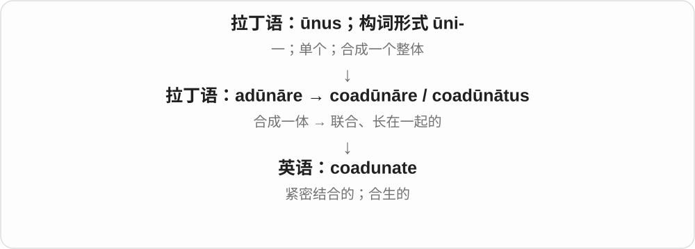

现代主要在生物描述或旧式文字中遇到。作罕见动词时表示联合，尾部通常读 /eɪt/；形容词可读 /ɪt/。

**常见搭配与例句**

coadunate parts；coadunate structures；joined in a coadunate form。

> The botanical drawing shows the coadunate parts at the base.

植物图展示了基部合生的部分。

> The description calls these structures coadunate because they grow together.

描述把这些结构称为 coadunate，因为它们生长在一起。

**别混淆**

adjacent 只是位置相邻；coadunate 强调已经连接或生长在一起。

### 59. coadunation — 联合成一体；聚合（少见用词）

**音标**：/kəʊˌædjʊˈneɪʃən/

**先抓住这个画面**

coadunation 是把许多小部分合成一团或一个共同体，谈的是结合过程或结合后的整体状态。

**怎么拆**

借自拉丁语 coadūnātiō，与 coadūnāre 同族；现代对应 coadunate 的名词形式。

**怎么变成今天的意思**

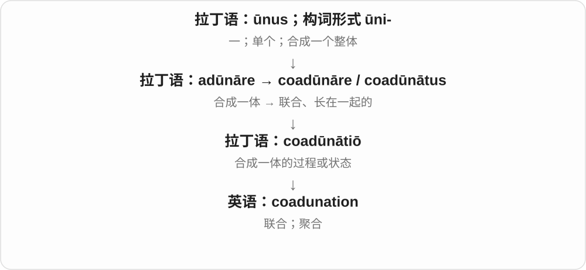

比普通 union、combination 少见，适合在历史文献或专门描述中辨认。它不是 coeducation“男女同校教育”。

**常见搭配与例句**

the coadunation of parts；coadunation into one body。

> The passage describes the coadunation of several parts into one body.

这段文字描述了几个部分联合成一个整体。

> The diagram illustrates coadunation rather than mere contact.

图示展示的是结合成一体，而不只是相互接触。

**别混淆**

coadunate 常描述结合着的结构；coadunation 把结合本身作为名词来讨论。

### 60. unate — 单调方向固定的（逻辑与电路术语）

**音标**：/ˈjuːneɪt/

**先抓住这个画面**

unate 像每个输入各有一支固定方向的箭头：增加这个输入时，输出只会不减；另一个输入也可以固定地使输出不增。

**怎么拆**

词根表把它联系到表示“一”的 un-。确切首造过程不作推定；这里依据逻辑与电路文献解释现代技术义。

**怎么变成今天的意思**

关键不是所有变量都朝同一方向，也不是函数只有一个输入，而是每个变量的影响方向保持一致。这个图展示技术意义的理解步骤，不冒充有证据的古代借入链。

**常见搭配与例句**

a unate function；positive unate in x；negative unate in y。

> The AND function is positive unate in each input.

与函数对每个输入都是正单调的。

> The function is unate even though some inputs have positive influence and others have negative influence.

虽然有些输入产生正向影响、另一些产生负向影响，这个函数仍是 unate 的。

**别混淆**

unary 说输入或操作数只有一个；unate 说对各输入的变化方向有约束，输入可以有多个。

### 61. unific — 使统一的；促成联合的（少见用词）

**音标**：/juːˈnɪfɪk/

**先抓住这个画面**

unific 像把分散的人或想法拉到同一条主线上的力量，重点是能促成合一。

**怎么拆**

uni-（一）+ -fic（使成为，来自 facere 一支），是英语中的古典成分构词。

**怎么变成今天的意思**

它相当于较少见的 unifying。不是已经统一的状态，而是有助于使部分聚到一起的作用。

**常见搭配与例句**

a unific influence；a unific principle；a unific effect。

> The critic described the recurring image as a unific element in the poem.

评论者把反复出现的意象描述为使全诗统一的元素。

> The essay assigns a unific role to shared rituals.

文章认为共同仪式具有促成联合的作用。

**别混淆**

united 是已经团结；unific 是能够促成团结、统一。普通写作通常用 unifying 更自然。

## 这一组要分清什么

**unity / uniformity / unanimity**：unity 是团结、整体协调；uniformity 是各部分同样、均匀；unanimity 是相关所有人意见一致。一个团队可以团结，却不穿同样衣服，也不在所有问题上全票一致。

**unite / unify / unit**：unite 常说把人和力量联合；unify 常说把制度、标准整理成整体；unit 是被看作一个整体的单位。unit 的历史经 unity 发展，不是随手把动词 unite 去掉 e。

**universe / university**：共同远源是“整体”。universe 是一切事物；university 的大学义经过“教师和学生组成的共同体”，并不是“宇宙知识学校”的字面拼装。

**reunion / reunification**：reunion 可以是一场短暂重逢；reunification 通常意味着重新组成或恢复一个整体。

**union / onion**：现代意思分别是联合与洋葱，首音分别 /juː/ 与 /ʌ/。onion 的老名称通常联系到鳞茎合成一个整体的形态，不是英语 on + ion。

**unionized / un-ionized**：前者在劳动话题里是“由工会组织起来”，读 /ˈjuːnjənaɪzd/；后者是“未电离的”，读 /ʌnˈaɪənaɪzd/。化学词有时也连写，因此必须结合领域辨认。

**unary / unate**：前者数输入、操作数有几个；后者在逻辑中看每个变量的影响是否保持一个方向。unate 的图解说明专业概念，不补造没有依据的古代传递链。

## 串起来练习

想象一场合唱排练：**The singers wore different clothes, but they sang in unison and showed real unity.**

歌手穿着不同的衣服，却齐声歌唱，体现出真正的团结。unison 说声音和节奏一起走；unity 说合作成一体；没有相同衣服，也可以有 unity。再试着用 uniform、unanimous 和 unique 各造一句，分别说样式一致、全体同意与独一无二。
