# 0081 · ut-, us- — 使用；用处；由反复使用形成的习惯

[逐词精讲目录](../00_逐词精讲目录.md) · [总目录](../00_总目录_按常用程度.md)

## 核心词根与来源

**ut-、us-** 来自拉丁语 **ūtī**“使用”和相关形式 **ūsus**“使用、习惯”。核心画面是“把东西拿来完成一件事”。一条路走向 useful、utility“有用”；另一条路是经常这样用，形成 usual、usually“惯常”。

**UT / US = USE**

把东西拿来派用场；反复这样做，就成了平常习惯

- **使用与使用者**：use · user · usage
- **能否帮上忙**：useful · useless · utility
- **能用与好用**：usable · usability
- **反复使用成为常态**：usual · usually · unusual
- **再次用或用得不对**：reuse · misuse · abuse
- **资源与整体效果**：utilize · utilization · utilitarianism
- **abuse 与 abuser：滥用或虐待的执行者**：abuse · abuser
- **use → using：使用与用某种方式**：use · using
- **use → user → users：谁在使用**：use · user · users
- **use → uses：用途与使用的不同读音**：use · uses
- **abuse → abused：使用越过合适边界**：abuse · abused
- **utility → utilities：有用到公用服务、工具程序**：utility · utilities
- **使用 → utilize → utilized**：utilized
- **ut-/us- 使用：utilizing 与 abusing**：utilizing · abusing
- **ab- 偏离 + us- 使用 → abuses**：abuses

## 词形与演化规律

拉丁语词典常列 **ūtor**，不定式是 **ūtī**；相关形式 **ūsus** 出现 s。**ūtilis**“有用的”留下 util- 这一支。它们是历史词形关系，不是英语拼写里可随意互换的字母。use、reuse、misuse、abuse 都要留意名词 /s/ 与动词 /z/ 的差别。

abuser 接动词 abuse，-er 指人，词干 /z/ 保留；名词 abuse 常读 /s/，不能按其读音造执行者词。

using 来自动词 use，s 读 z；名词 use 则常读 s。

use 的动词 /z/ 保留到 user、users，人物后缀 -er；英语自身派生与现代复数分别看。

名词 uses 读 /ˈjuːsɪz/，动词读 /ˈjuːzɪz/，词尾都增加一个音节。

拉丁 abuti、abusus 经法语，现代说滥用、虐待、辱骂等。

法语 utilite 接拉丁 utilitas、utilis、uti；复数常指具体服务或工具。

utilize 经法语 utiliser 等接拉丁 utilis 可用、uti 使用材料。现代去末尾 e 加完整 -ed，/z/ 后读 /d/，意为使用、利用。

utilize 经法语、意大利语接拉丁 utilis 可用、uti 使用；abuse 接拉丁 abuti 误用、滥用的词族。现代两词去 e 加 -ing，abusing 的 s 读 /z/。

abuse 接拉丁 abuti、abusus 误用、滥用词族。保留 e 加 -s，名词 abuses 末尾 /sɪz/，动词 abuses 末尾 /zɪz/。

## 单词速览（按词族由简到繁）

同一基础词的相关扩展放在一起，先读基础形式，再读扩展；各组之间优先读常用的。具体词源关系见各词讲解。

| 单词 | 音标 | 核心意思 |
|---|---|---|
| [use](#w-1) | 名词 /juːs/；动词 /juːz/ | 使用；用途；用处 |
| [using](#w-25) | /ˈjuːzɪŋ/ | 使用、利用；用……的方式；use 的 -ing 形式 |
| [uses](#w-27) | 名词 /ˈjuːsɪz/；动词 /ˈjuːzɪz/ | 用途、用法〔复数〕；使用、利用〔第三人称单数〕 |
| [useful](#w-3) | /ˈjuːsfəl/ | 有用的；能帮上忙的 |
| [usefulness](#w-18) | /ˈjuːsfəlnəs/ | 用处；有用程度 |
| [user](#w-4) | 英 /ˈjuːzə/；美 /ˈjuːzər/ | 使用者；用户 |
| [users](#w-26) | 英 /ˈjuːzəz/；美 /ˈjuːzərz/ | 使用者、用户；user 的复数 |
| [useless](#w-10) | /ˈjuːsləs/ | 没有用的；派不上用场的 |
| [uselessness](#w-23) | /ˈjuːsləsnəs/ | 无用；徒劳无益 |
| [usable](#w-15) | /ˈjuːzəbəl/ | 能用的；可使用的 |
| [usability](#w-20) | /ˌjuːzəˈbɪləti/ | 易用性；可用性 |
| [abuse](#w-5) | 名词 /əˈbjuːs/；动词 /əˈbjuːz/ | 滥用；虐待；辱骂 |
| [abused](#w-28) | /əˈbjuːzd/ | 滥用、虐待、辱骂了；受虐待的〔过去式、过去分词〕 |
| [abusive](#w-11) | 常读 /əˈbjuːsɪv/；美语也读 /əˈbjuːzɪv/ | 辱骂的；虐待的；滥用的 |
| [abuses](#w-33) | 名词 /əˈbjuːsɪz/；动词 /əˈbjuːzɪz/ | 滥用、虐待行为〔复数〕；滥用、虐待〔第三人称单数〕 |
| [abusing](#w-32) | 英、美 /əˈbjuːzɪŋ/ | 滥用；虐待；辱骂〔分词、动名词〕 |
| [abuser](#w-24) | 英 /əˈbjuːzə/；美 /əˈbjuːzər/ | 虐待者；辱骂者；滥用某物的人 |
| [misuse](#w-14) | 名词 /ˌmɪsˈjuːs/；动词 /ˌmɪsˈjuːz/ | 误用；不当使用 |
| [reuse](#w-17) | 名词 /ˌriːˈjuːs/；动词 /ˌriːˈjuːz/ | 再次使用；重复利用 |
| [disuse](#w-21) | 名词 /dɪsˈjuːs/ | 不用；停用；废弃状态 |
| [usual](#w-6) | /ˈjuːʒuəl/ | 平常的；惯常的 |
| [usually](#w-2) | /ˈjuːʒuəli/ | 通常；大多数时候 |
| [unusual](#w-7) | /ʌnˈjuːʒuəl/ | 不寻常的；少见的 |
| [unusually](#w-12) | /ʌnˈjuːʒuəli/ | 异乎寻常地；比平时更…… |
| [utility](#w-8) | /juːˈtɪləti/ | 实用性；公用服务；工具程序 |
| [utilities](#w-29) | /juːˈtɪlətiz/ | 水电等公用服务、公用事业；实用工具程序〔复数〕 |
| [utilitarian](#w-19) | 英 /juːˌtɪlɪˈteəriən/；美 /juːˌtɪləˈteriən/ | 讲求实用的；功利主义的 |
| [utilitarianism](#w-22) | 英 /juːˌtɪlɪˈteəriənɪzəm/；美 /juːˌtɪləˈteriənɪzəm/ | 功利主义 |
| [usage](#w-9) | /ˈjuːsɪdʒ/；也读 /ˈjuːzɪdʒ/ | 用法；使用情况；用量 |
| [utilize](#w-13) | 英 /ˈjuːtɪlaɪz/；美 /ˈjuːtəlaɪz/ | 利用；使派上用场 |
| [utilized](#w-30) | 英、美 /ˈjuːtəlaɪzd/ | 利用了；使用了〔过去式、过去分词〕 |
| [utilizing](#w-31) | 英 /ˈjuːtɪlaɪzɪŋ/；美 /ˈjuːtəlaɪzɪŋ/ | 利用；使派上用场〔分词、动名词〕 |
| [utilization](#w-16) | 英 /ˌjuːtɪlaɪˈzeɪʃən/；美 /ˌjuːtələˈzeɪʃən/ | 利用；使用情况；利用程度 |

## 逐词讲解

### 1. use — 使用；用途；用处

**音标**：名词 /juːs/；动词 /juːz/

**先抓住这个画面**

use 的画面很简单：手里有个东西，把它拿来完成一件事。东西可以是钥匙，也可以是时间、方法或一句话。

**怎么拆**

来自拉丁语 ūtī 的词族。名词经 ūsus、古法语 us 传入；动词经古法语 user，背后有据 ūsus 形成的拉丁语动词。现代 use 本身不必再切。

**怎么变成今天的意思**

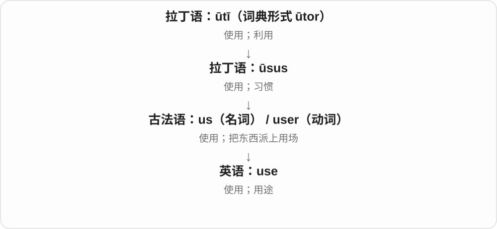

动词说“拿来做事”，名词既可说使用这个动作，也可说用途。put something to good use 就是让它真正帮上忙；be of no use 则是派不上用场。

**常见搭配与例句**

use A to do B；make use of…；the use of…；be of use。used to do 说过去常做；be used to doing 说已经习惯，两者结构不同。

> We used an old box to store the cables.

我们拿一个旧盒子来装电线。

> This tool has several uses, including opening paint cans.

这个工具有几种用途，包括打开油漆罐。

**别混淆**

名词 use 结尾 /s/，动词 /z/。use 可以很中性；use someone 若没有说明合作背景，常有“利用别人”的负面意味。

### 2. using — 使用、利用；用……的方式；use 的 -ing 形式

**音标**：/ˈjuːzɪŋ/

**先抓住这个画面**

把某个工具、材料或方法拿来达到目的，就是 using。它也能把方法直接放在句后：using a map，用地图。

**怎么拆**

动词 use 去 e 加 -ing，s 保持动词的 /z/。动词经法语 user 接拉丁 uti、usus 使用词族；名词 use 常见 /s/ 结尾，读音需分词性。

**怎么变成今天的意思**

**拉丁使用词族 → 法语 user → use 动词**  
把工具、方法等用于某事

↓

**use 去 e + -ing → using**  
正在使用；说明所用的方法

using a computer 使用电脑；using both hands 用双手；by using a map 通过使用地图；using recycled paper 使用再生纸。

**常见搭配与例句**

avoid using ...；without using ...。

> She opened the box using a small key.

她用一把小钥匙打开了盒子。

> We are using recycled paper for the invitations.

我们正用再生纸制作邀请函。

**别混淆**

by using 常明确方法；using 单独引出的分词短语也能补充方法，要让它和做动作的人对应清楚。名词 use 的 /s/ 不照搬到 using。

### 3. uses — 用途、用法〔复数〕；使用、利用〔第三人称单数〕

**音标**：名词 /ˈjuːsɪz/；动词 /ˈjuːzɪz/

**先抓住这个画面**

一件东西能派上的各种用场，是名词 uses；某个人把它派上用场，是动词 uses。两者拼写一样，中间的 /s/、/z/ 不同。

**怎么拆**

use + -s。名词 use 以 /s/ 结尾，uses 为 /ˈjuːsɪz/；动词 use 以 /z/ 结尾，uses 为 /ˈjuːzɪz/。名词经拉丁 ūsus、古法语 us，动词经古法语 user，属于拉丁 ūtī 的使用词族。

**怎么变成今天的意思**

**拉丁使用词族 → 法语名词、动词 → use**  
使用；用途

↓

**use + -s → uses**  
名词：多种用途；动词：单数主语使用

many uses 多种用途；practical uses 实际用途；uses a computer 使用电脑；uses up the paper 把纸用完。

**常见搭配与例句**

uses less water；find new uses for something。

> This simple tool has several uses in the kitchen.

这个简单工具在厨房里有好几种用途。

> She uses the same notebook for all her sketches.

她把所有草图都画在同一个笔记本上。

**别混淆**

名词复数的主语配复数谓语：Its uses are varied。动词现在形式：She uses it daily。读音差别来自原词 use 的两种读法，词尾都读 /ɪz/。

### 4. useful — 有用的；能帮上忙的

**音标**：/ˈjuːsfəl/

**先抓住这个画面**

useful 的重点是“对眼前这件事有帮助”。一张简单的纸条，只要能让你少走弯路，就很 useful。

**怎么拆**

use + -ful。-ful 在这里形成“有这种作用或性质”的形容词，不是说东西被“使用”装满了。

**怎么变成今天的意思**

use 作为名词有“用处”的意思，useful 就是有用处。它评价的是对象与需要之间的关系：对修车有用，不表示对做饭也有用。

**常见搭配与例句**

useful for doing something；useful to someone；a useful tip；come in useful（派上用场）。

> This map is useful for finding the smaller streets.

这张地图对寻找小街巷很有帮助。

> Your notes came in useful when I missed the class.

我缺课时，你的笔记帮了大忙。

**别混淆**

useful 是能帮忙；usable 是还能用。一个 usable 的旧工具能正常操作，却未必对当前任务 useful。

### 5. usefulness — 用处；有用程度

**音标**：/ˈjuːsfəlnəs/

**先抓住这个画面**

usefulness 问的是：它到底帮上了多大忙？注意力从“这个东西”转到“这个东西的用处”。

**怎么拆**

useful + -ness；-ness 把形容词变成表示性质的名词。

**怎么变成今天的意思**

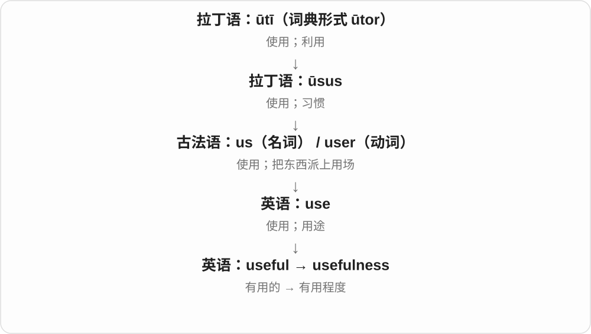

一份报告可能写得很漂亮，但如果不能帮人判断或行动，usefulness 就有限。这个词让我们直接讨论实际帮助。

**常见搭配与例句**

the usefulness of…；question its usefulness；limited usefulness；outlive its usefulness（已不再有用）。

> The usefulness of the guide depends on how often it is updated.

这份指南有没有用，取决于它更新得是否及时。

> The team questioned the usefulness of another long meeting.

团队怀疑再开一次长会能有多大帮助。

**别混淆**

usefulness 不等于使用次数。一个很少用到的急救工具，仍可能在需要时极有用处。

### 6. user — 使用者；用户

**音标**：英 /ˈjuːzə/；美 /ˈjuːzər/

**先抓住这个画面**

user 把焦点转到正在用某个东西的人。设计一个按钮时，user 关心的是自己能否顺利完成操作。

**怎么拆**

use + -er；-er 在这里表示做这个动作的人。来自英语自身的派生，use 的动词 /z/ 保留下来。

**怎么变成今天的意思**

从工具使用者到软件用户，核心没变。user 描述的是使用关系，未必是购买关系：付钱的人和实际操作的人可能不同。

**常见搭配与例句**

a new user；a regular user；user feedback；a user account。

> New users can try the service for a week.

新用户可以试用这项服务一周。

> We watched a user struggle to find the save button.

我们看到一位用户费了不少劲才找到保存按钮。

**别混淆**

user 是使用者；customer 是顾客。单独称某人 a user，在特定人际语境还可能指“总是利用别人的人”，语气负面。

### 7. users — 使用者、用户；user 的复数

**音标**：英 /ˈjuːzəz/；美 /ˈjuːzərz/

**先抓住这个画面**

谁在实际使用工具、道路、服务或系统，谁就是 users。它不只说付钱的人，也不只说电脑用户。

**怎么拆**

user + -s，词尾 /z/。user 是英语动词 use /juːz/ 加 -er 的人物名词，动词的 /z/ 保留到 user 和 users。

**怎么变成今天的意思**

**英语 use 动词 + -er → user**  
使用 → 使用者

↓

**user + -s → users**  
多位用户、使用者

computer users 电脑用户；road users 道路使用者；new users 新用户；users of the service 服务使用者。

**常见搭配与例句**

users with different needs；regular users。

> The guide is written for users with no previous experience.

这份指南是为没有使用经验的用户编写的。

> The new path is shared by cyclists and other road users.

这条新路由骑车人和其他道路使用者共同使用。

**别混淆**

users 强调使用，customers 强调购买、消费的关系。一个人可以同时是两者，也可能只使用别人购买的服务。名词 use /juːs/ 与 users 里的 /z/ 要分开。

### 8. useless — 没有用的；派不上用场的

**音标**：/ˈjuːsləs/

**先抓住这个画面**

useless 是“拿它来办这件事，帮不上忙”。手机没电时，很多功能就暂时派不上用场。

**怎么拆**

use + -less；-less 表示缺少。这里缺少的是实际用处。

**怎么变成今天的意思**

它可以说东西没有作用，也可以说某项努力改变不了结果。This key is useless 可能只是钥匙打不开眼前这把锁，不一定完全坏了。

**常见搭配与例句**

useless for…；useless at doing…；It is useless to argue（争下去没有用）。

> Without the password, the file was useless to us.

没有密码，这个文件对我们来说派不上用场。

> It is useless to blame each other now; we need a solution.

现在互相责怪没有用，我们需要一个解决办法。

**别混淆**

useless 比 not very useful 强得多。用它直接评价人往往很伤人；说“某方法在这个任务中没用”则更具体。

### 9. uselessness — 无用；徒劳无益

**音标**：/ˈjuːsləsnəs/

**先抓住这个画面**

uselessness 把“怎么做都帮不上忙”的感觉或状况单独拿出来说。

**怎么拆**

useless + -ness；表示“没有用”这种性质或状态。

**怎么变成今天的意思**

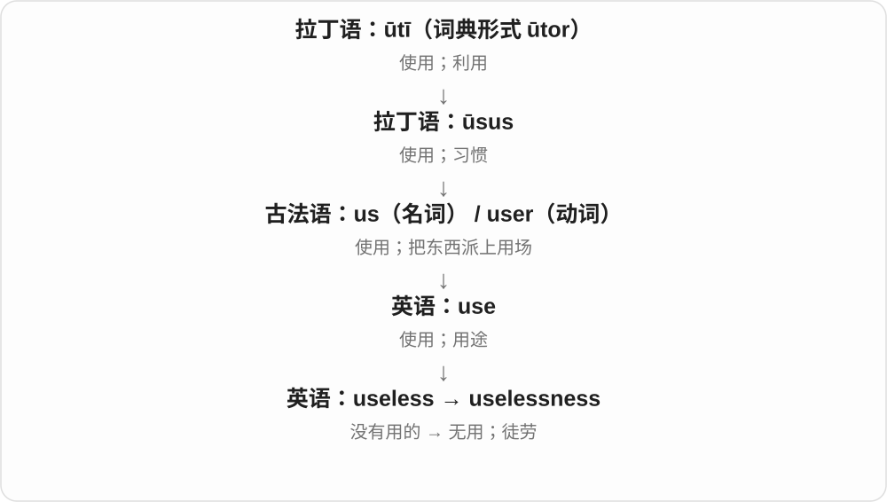

它既可评价一个办法，也可描述一个人觉得自己帮不上忙的感受。a feeling of uselessness 说的是人的感受，不能据此断言这个人没有价值。

**常见搭配与例句**

the uselessness of…；a sense / feeling of uselessness；recognize the uselessness of an approach。

> The experiment showed the uselessness of that shortcut.

实验表明，那条捷径根本帮不上忙。

> Joining the volunteer group eased his feeling of uselessness.

加入志愿者团队后，他那种觉得自己帮不上忙的感受减轻了。

**别混淆**

uselessness 是没能产生所需帮助；failure 常指某一次没达到目标。失败的尝试仍可能留下有用的经验。

### 10. usable — 能用的；可使用的

**音标**：/ˈjuːzəbəl/

**先抓住这个画面**

usable 是过了“能不能拿来用”这一关：旧椅子虽然不好看，但只要能安全坐，就仍然 usable。

**怎么拆**

来自古法语 usable，基础是 user“使用”。现代英语里也容易看成 use + -able“可以被使用的”。

**怎么变成今天的意思**

它不保证东西最漂亮、最省力或最适合你，只说明还有实际使用的可能。软件语境里也常包含“操作起来能用得顺”的要求。

**常见搭配与例句**

still usable；a usable version；make something usable；usable space。

> The screen is cracked, but the phone is still usable.

屏幕裂了，不过手机还能用。

> We need a usable draft by Friday, even if it is not perfect.

我们周五前需要一份能用的草稿，即使它还不完美。

**别混淆**

usable 说能不能用；useful 说有没有帮助。一个功能能点开，不等于它值得使用。

### 11. usability — 易用性；可用性

**音标**：/ˌjuːzəˈbɪləti/

**先抓住这个画面**

usability 看的是“人用起来顺不顺”：按钮找不找得到，步骤好不好懂，犯错后能不能补救。

**怎么拆**

usable + -ity；-able 在这类性质名词中对应 -ability。不是“使用的超能力”。

**怎么变成今天的意思**

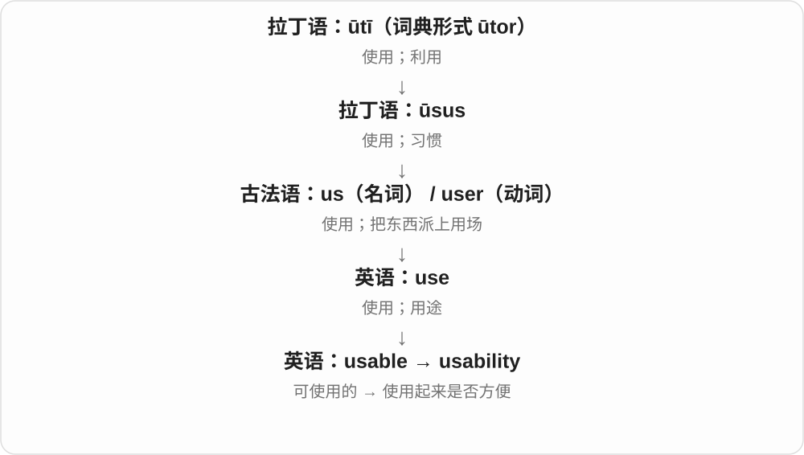

一般意义上是可使用的程度；在产品设计里，重点常落到用户完成任务是否有效、顺手。东西有很多功能，usability 仍然可能很差。

**常见搭配与例句**

usability testing；improve usability；a usability problem；website usability。

> The team tested the usability of the booking form.

团队测试了预约表单是否容易使用。

> Clearer labels greatly improved the app’s usability.

更清楚的标签大大改善了这个应用的易用性。

**别混淆**

usability 问好不好用；utility 问能不能满足某种需要。没有你需要的功能，再容易操作也解决不了你的问题。

### 12. abuse — 滥用；虐待；辱骂

**音标**：名词 /əˈbjuːs/；动词 /əˈbjuːz/

**先抓住这个画面**

abuse 常有“把使用变成伤害”的感觉：权力被拿来欺压人，信任被拿来谋私，或者一个人受到持续的恶劣对待。

**怎么拆**

拉丁语 ab- + ūtī，形成 abūtī，相关形式是 abūsus；再经法语传入。ab- 在这里不能机械译成现代英语里某个固定动作。

**怎么变成今天的意思**

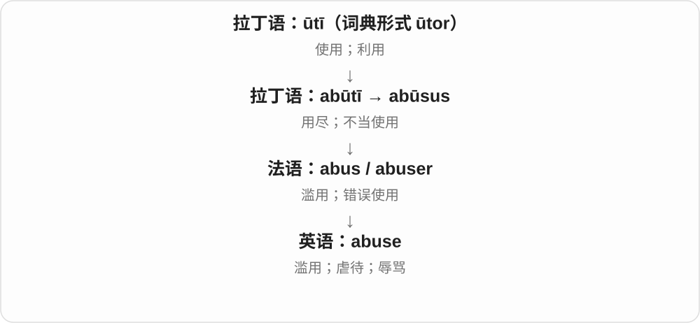

这支历史上有用尽、不当使用等意思。在现代英语里，它既可指滥用权力或资源，也可指身体、心理上的虐待，以及攻击人的辱骂。

**常见搭配与例句**

abuse power；abuse someone’s trust；verbal abuse；child abuse；suffer abuse。

> The manager abused his authority to silence complaints.

经理滥用职权，压制投诉。

> The referee faced a stream of verbal abuse from the crowd.

裁判遭到观众接连不断的辱骂。

**别混淆**

名词 abuse 结尾 /s/，动词 /z/。criticism 可以是针对问题的批评；abuse 往往带有人身攻击或伤害，不只是意见尖锐。

### 13. abused — 滥用、虐待、辱骂了；受虐待的〔过去式、过去分词〕

**音标**：/əˈbjuːzd/

**先抓住这个画面**

把人、物、权力用坏、用过头，或以有害方式对待，就是 abused。不同宾语决定是在滥用、虐待还是辱骂。

**怎么拆**

abuse 去 e 加完整 -ed。动词末尾 /z/ 后读 /d/；abuse 经法语接拉丁 abuti、abusus 用尽、不当使用，根在 uti 使用。

**怎么变成今天的意思**

**拉丁 uti → abuti、abusus → 法语 → abuse**  
使用 → 用尽、不当使用及有害对待

↓

**abuse 去 e + -ed → abused**  
已经滥用、虐待或辱骂

abused power 滥用权力；verbally abused someone 辱骂某人；an abused animal 受虐待的动物。

**常见搭配与例句**

abused someone’s trust 辜负、滥用别人的信任；badly abused equipment 被粗暴使用的设备。

> The character abused the power he had been given.

这个角色滥用了得到的权力。

> The shelter cared for abused animals.

收容所照料受过虐待的动物。

**别混淆**

abuse 名词通常末尾 /s/，动词末尾 /z/，abused 跟着动词读 /zd/。这个词程度较重，不是普通 used 使用的随意替换。

### 14. abusive — 辱骂的；虐待的；滥用的

**音标**：常读 /əˈbjuːsɪv/；美语也读 /əˈbjuːzɪv/

**先抓住这个画面**

abusive 形容某种言语或行为会伤人、压人，而不只是态度不够客气。

**怎么拆**

经法语 abusif，追溯到拉丁语 abūsīvus。现代可与 abuse + -ive 对照；常见读音用 /s/，另有美语 /z/ 变体。

**怎么变成今天的意思**

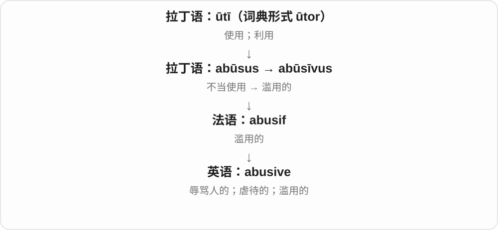

abuse 是伤害性的行为或言语；abusive 则用来描述它的性质。an abusive relationship 说一段关系中存在虐待或控制，语气比“经常吵架”重。

**常见搭配与例句**

abusive language；abusive behavior；an abusive partner；an abusive use of power。

> The moderator removed the abusive comments.

管理员删除了那些辱骂性的评论。

> She left an abusive relationship and moved in with her sister.

她离开了一段存在虐待的关系，搬去和姐姐同住。

**别混淆**

rude 是没礼貌；abusive 常涉及辱骂、虐待或严重恶劣的对待。不要把所有不愉快的对话都说成 abusive。

### 15. abuses — 滥用、虐待行为〔复数〕；滥用、虐待〔第三人称单数〕

**音标**：名词 /əˈbjuːsɪz/；动词 /əˈbjuːzɪz/

**先抓住这个画面**

把手里的权力、资源用在不该用的地方，或不当地伤害别人，是 abuse 的常见核心。abuses 可以数这些行为，也可以说某个人滥用了什么。

**怎么拆**

abuse 保留 e，加 -s → abuses。名词原末尾 /s/，所以 /sɪz/；动词原末尾 /z/，所以 /zɪz/。远接拉丁 abuti、abusus 词族，含 ab- 离开、偏离与 uti 使用。

**怎么变成今天的意思**

**拉丁 abuti 用尽、误用等 → 法语相关形式 → abuse**  
英语保留不当使用、伤害、辱骂等语义分支

↓

**abuse 名词、动词 + -s → abuses**  
同形而发音不同；句法区分几种滥用行为与某人滥用

abuses of power 是滥用权力的行为；abuses authority 是滥用职权；report abuses 是报告不当侵害行为。

**常见搭配与例句**

abuses of power；abuses authority；report abuses。

> The report describes several abuses of power.

报告描述了几种滥用权力的行为。

> The fictional manager abuses his authority to silence criticism.

那个虚构的经理滥用职权压制批评。

**别混淆**

the abuses 是名词，发 /sɪz/；he abuses 是动词，发 /zɪz/。名词 abuse 常不可数，但说多种或多次具体不当行为时，可以用 abuses。

### 16. abusing — 滥用；虐待；辱骂〔分词、动名词〕

**音标**：英、美 /əˈbjuːzɪŋ/

**先抓住这个画面**

手里有权力、信任或资源，却用它伤害别人、做不当的事，是 abusing。对象换成人，也可以说以残酷或羞辱的方式对待。

**怎么拆**

abuse 动词去末尾 e，加完整 -ing → abusing，s 读 /z/。经法语、拉丁 abuti 误用、用尽及 abusus，含 ab- 离开、偏离与 uti 使用。

**怎么变成今天的意思**

**拉丁 abuti 使用、误用 → 法语 abuser → abuse**  
由使用偏向误用、不当对待

↓

**滥用权力、虐待、辱骂等义 + -ing → abusing**  
现代由宾语区分被滥用的资源与遭不当对待的人

abusing power 是滥用权力；abusing someone’s trust 是滥用、辜负某人的信任；verbally abusing someone 是辱骂某人。

**常见搭配与例句**

abusing power；abusing someone’s trust；verbally abusing。

> The novel portrays a leader abusing his power.

小说描写了一位滥用权力的领袖。

> The character loses his friends after repeatedly abusing their trust.

那个人物一再辜负朋友的信任，后来失去了他们。

**别混淆**

abuse 动词的词尾是 /z/，名词常读 /s/。abusing power 的宾语是被滥用的东西；abusing a person 的宾语则是遭受伤害的人。

### 17. abuser — 虐待者；辱骂者；滥用某物的人

**音标**：英 /əˈbjuːzə/；美 /əˈbjuːzər/

**先抓住这个画面**

把权力、信任用歪，或持续伤害、欺压别人，执行这种行为的人就是 abuser。具体伤害方式要由上下文说明。

**怎么拆**

abuse 动词去词末 e 加 -er；动词经法语上接拉丁 abuti 用尽、滥用等，含 ab- 与 uti 使用。词干在动词和 abuser 中读 /z/。

**怎么变成今天的意思**

**拉丁 abuti → 法语／英语 abuse**  
用尽、滥用；发展出虐待、辱骂等

↓

**abuse + -er → abuser**  
实施滥用、虐待、辱骂的人

an abuser of power 滥用权力者；an emotional abuser 情感虐待者；a verbal abuser 用言语辱骂别人的人。

**常见搭配与例句**

identify an abuser；an abuser of trust。

> The novel portrays him as an abuser of power.

小说把他描写成一个滥用权力的人。

> The organization supports people who have left an abuser.

那个组织帮助已经离开虐待者的人。

**别混淆**

abuser 接动词 abuse /əˈbjuːz/；名词 abuse 常读 /əˈbjuːs/。读音区别帮助看出执行者词到底从哪种词性派生。

### 18. misuse — 误用；不当使用

**音标**：名词 /ˌmɪsˈjuːs/；动词 /ˌmɪsˈjuːz/

**先抓住这个画面**

misuse 是“用是用了，但方法或用途不对”：药没按要求使用，或者把别人的信任拿去做不该做的事。

**怎么拆**

mis-（错误地、不当地）+ use。名词与动词分别以 /s/ 和 /z/ 结尾。

**怎么变成今天的意思**

错误可以来自不了解，也可以来自故意滥用。这个词先指出“用法不对”，是否恶意要由上下文说明。

**常见搭配与例句**

misuse a word；misuse personal information；the misuse of funds；prevent misuse。

> I had been misusing that word for years.

那个词我误用了好多年。

> The report raised concerns about the misuse of personal data.

报告提出了对个人数据遭到不当使用的担忧。

**别混淆**

misuse 可以是操作或理解错误；abuse 常更突出严重滥用、伤害或侵犯。两词有重叠，不能机械分成无意与故意。

### 19. reuse — 再次使用；重复利用

**音标**：名词 /ˌriːˈjuːs/；动词 /ˌriːˈjuːz/

**先抓住这个画面**

reuse 是把已经用过的东西再拿来用：玻璃瓶洗净后装米，不用先把它变成另一种原材料。

**怎么拆**

re-（再）+ use。名词保留 /s/，动词保留 /z/。

**怎么变成今天的意思**

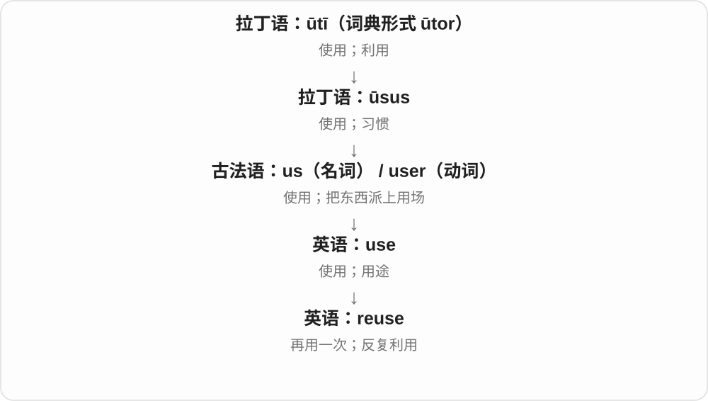

前缀只改变使用的次数，不要求第二次用途和第一次相同。旧纸箱继续装货，或改成猫窝，都可以是 reuse。

**常见搭配与例句**

reuse a container；reuse code；for reuse；the reuse of materials。

> We reuse glass jars to store rice and beans.

我们把用过的玻璃罐再拿来装米和豆子。

> The boxes were collected for reuse.

这些箱子被收集起来，以便再次使用。

**别混淆**

reuse 是让现成的东西继续派用场；recycle 通常涉及回收处理，让材料重新进入生产或使用循环。

### 20. disuse — 不用；停用；废弃状态

**音标**：名词 /dɪsˈjuːs/

**先抓住这个画面**

disuse 的画面是：一件东西曾经常用，后来没人再碰，慢慢闲了下来。

**怎么拆**

与古法语 desuser“停止使用”相连，现代可理解为 dis- + use。这里主要学习名词，不要用动词 use 的 /z/ 来读。

**怎么变成今天的意思**

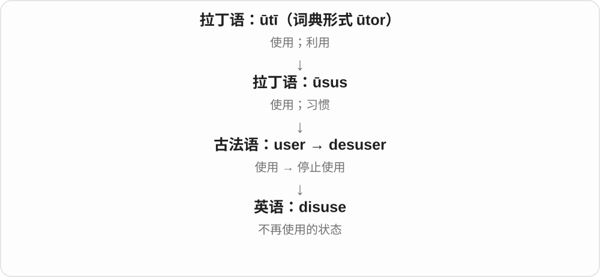

它常描述一段持续不用的状态。道路荒废、旧词退出日常语言、设施逐渐闲置，都可以 fall into disuse。

**常见搭配与例句**

fall into disuse；through disuse；years of disuse；bring something back into use。

> The old footbridge fell into disuse after the new road opened.

新公路通车后，那座旧人行桥逐渐没人用了。

> Many of these expressions have fallen into disuse.

这些表达中有不少已经不再使用了。

**别混淆**

disuse 说没人用了；damage 说东西受损。长期不用可能导致损坏，但两个意思并不相同。

### 21. usual — 平常的；惯常的

**音标**：/ˈjuːʒuəl/

**先抓住这个画面**

usual 是你已经熟悉的那一套：每天走的路线、常点的饮料、一般到家的时间。

**怎么拆**

历史上经古法语 usuel，来自拉丁语 ūsuālis；其基础是 ūsus“使用、习惯”。不能直接按现代拼写切成 use + 一个随意的 -ual。

**怎么变成今天的意思**

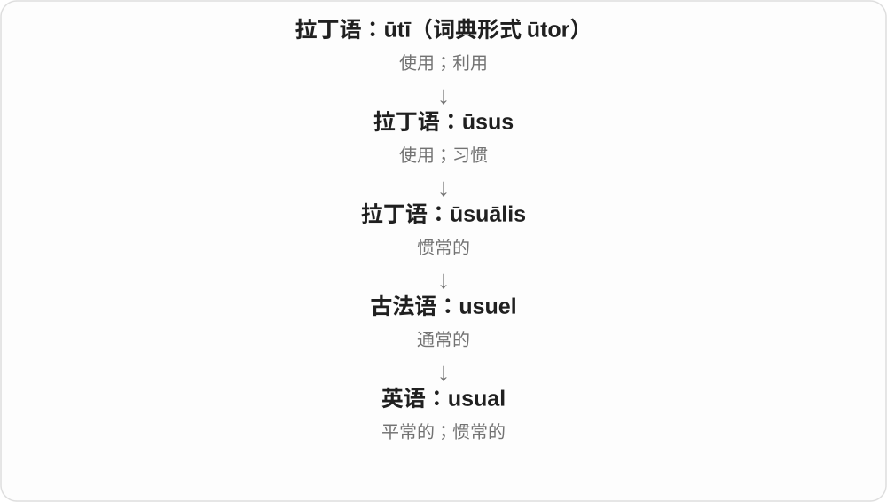

某种做法用得多，就成了习惯；习惯再变成你心中的“平常情况”。因此 the usual order 是平常点的那份，不是在评价它是否普通或差。

**常见搭配与例句**

as usual（和平常一样）；the usual time；my usual route；than usual（比平时）。

> We met at our usual café.

我们在平常去的那家咖啡馆见面。

> The train was more crowded than usual.

这趟列车比平时更拥挤。

**别混淆**

usual 强调与平时一样；normal 强调在正常范围内。某人的 usual bedtime 很晚，也可能不符合他想要的健康作息。

### 22. usually — 通常；大多数时候

**音标**：/ˈjuːʒuəli/

**先抓住这个画面**

usually 像在回看一排日子：多数格子里发生的都是同一件事，但允许有例外。

**怎么拆**

usual + -ly。-ly 把“惯常的”变成“通常怎样发生”的副词。

**怎么变成今天的意思**

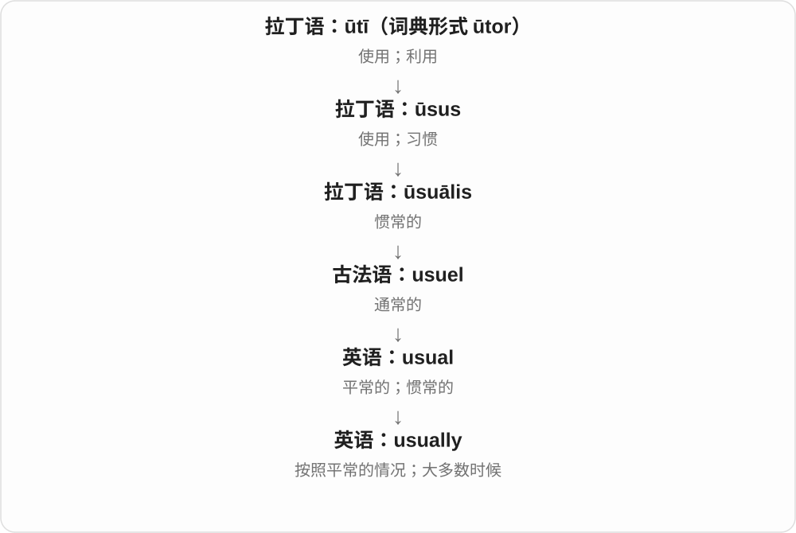

反复使用形成习惯，习惯又成为通常的做法。usually 不承诺次次如此；它告诉对方，按平时经验可以这样预期。

**常见搭配与例句**

usually 放实义动词前：usually walk；放 be 后：is usually quiet。

> I usually walk to work, but today I took the bus.

我通常步行上班，但今天坐了公交。

> The library is usually quiet in the morning.

图书馆早上通常很安静。

**别混淆**

always 是总是；usually 是大多数时候；sometimes 是有时。I usually walk 不表示今天一定步行。

### 23. unusual — 不寻常的；少见的

**音标**：/ʌnˈjuːʒuəl/

**先抓住这个画面**

unusual 就是从平常那一排东西里明显跳出来：这个时间很少下雪，今天却下了。

**怎么拆**

un-（否定）+ usual。否定的是“惯常”，不直接否定好坏。

**怎么变成今天的意思**

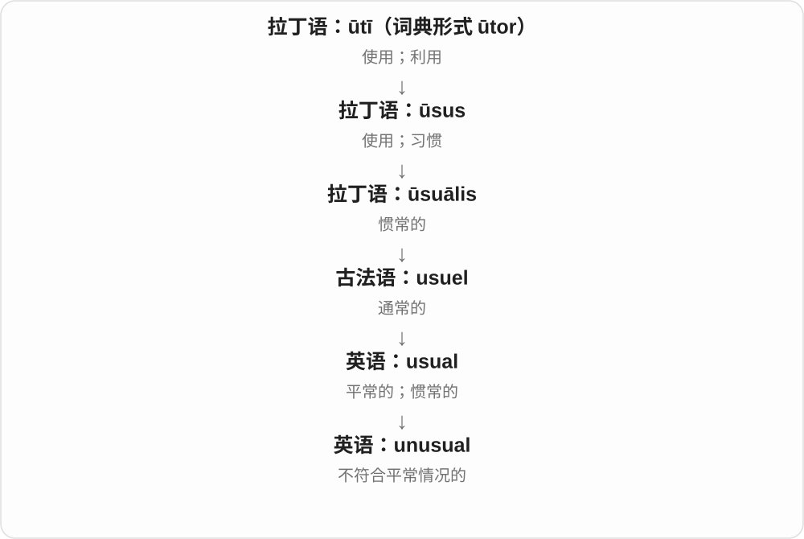

usual 是熟悉的常态；un- 把它翻转成少见。一个 unusual idea 可以很精彩，也可以不切实际，要看后面的评价。

**常见搭配与例句**

an unusual experience；It is unusual for someone to do…；nothing unusual。

> It is unusual to see snow here in April.

四月在这里看到雪很少见。

> She suggested an unusual but practical solution.

她提出了一个少见却实用的解决办法。

**别混淆**

unusual 是少见；strange 常多一层奇怪、不熟悉或让人困惑的感觉。少见的好事不必令人不安。

### 24. unusually — 异乎寻常地；比平时更……

**音标**：/ʌnˈjuːʒuəli/

**先抓住这个画面**

unusually 常拿今天和日常作比较：今天格外安静，或者他这一次出奇地耐心。

**怎么拆**

unusual + -ly；把“不寻常的”变成修饰程度、状态或行为的副词。

**怎么变成今天的意思**

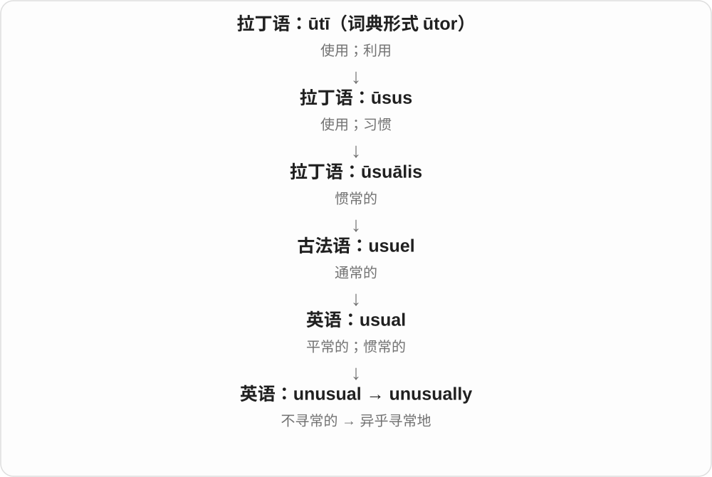

它经常不是说“这件事很少发生”，而是说某个程度超过常态。unusually warm 是“比平时暖得多”，不是“不经常暖和”。

**常见搭配与例句**

unusually quiet；unusually high；unusually early；an unusually good result。

> The streets were unusually quiet that morning.

那天早晨街道格外安静。

> She arrived unusually early for the meeting.

那次开会她来得比平时早得多。

**别混淆**

usually 说通常的频率；unusually 常突出偏离常态的程度。unusually busy 不是 usually busy 的简单频率反义。

### 25. utility — 实用性；公用服务；工具程序

**音标**：/juːˈtɪləti/

**先抓住这个画面**

utility 先问“它能帮人做什么”。日常的水电服务和电脑上的小工具，都因提供实际用途而使用这个词。

**怎么拆**

经法语 utilite，来自拉丁语 ūtilitās；其形容词基础 ūtilis“有用的”属于 ūtī“使用”的词族。

**怎么变成今天的意思**

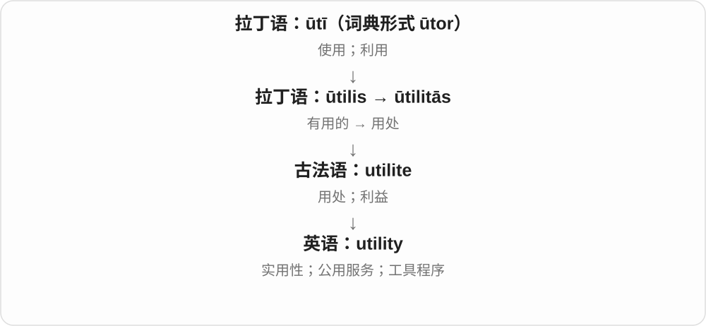

它的基本线索是用处或实用价值。复数 utilities 常指水、电、燃气等服务；电脑里的 utility 常指完成维护或处理任务的小程序。

**常见搭配与例句**

practical utility；public utilities；pay for utilities；a backup utility。

> The rent includes water, but other utilities cost extra.

房租包含水费，但其他公用服务费用另算。

> This small utility helps you remove duplicate files.

这个小工具可以帮你删除重复文件。

**别混淆**

utility 在日常文章里可以谈实用性；经济学中有“效用”的专门意义。utility 不等于 usability，后者更关注操作是否顺手。

### 26. utilities — 水电等公用服务、公用事业；实用工具程序〔复数〕

**音标**：/juːˈtɪlətiz/

**先抓住这个画面**

房子日常运转离不开的供水、供电等基础服务，常合称 utilities。电脑里完成清理、转换、整理等具体任务的小工具，也可叫 utilities。

**怎么拆**

utility 经古法语 utilite 接拉丁 utilitas 用处，连 utilis 有用、uti 使用。由用处发展为提供基本服务的事业、实用工具。现代末尾 y 改 i 加 -es，尾 /tiz/。

**怎么变成今天的意思**

**拉丁 uti、utilis、utilitas → 法语、英语 utility**  
使用、有用 → 实用性、具体服务或工具

↓

**utility 的 y 改 i + -es → utilities**  
多种公用服务、事业；工具程序

public utilities 公用事业；utilities included 包含水电等服务费用〔依约定语境〕；software utilities 工具程序。

**常见搭配与例句**

pay for utilities 支付水电等费用；file utilities 文件处理工具。

> The brochure lists the utilities available at the campsite.

宣传册列出了营地可用的基础服务。

> The program includes several useful file utilities.

这个程序包含几个实用的文件处理工具。

**别混淆**

utilities 在住宿语境常说基础服务或费用，在电脑语境则说工具。utility 泛说实用性时，常是不可数抽象义。

### 27. utilitarian — 讲求实用的；功利主义的

**音标**：英 /juːˌtɪlɪˈteəriən/；美 /juːˌtɪləˈteriən/

**先抓住这个画面**

日常的 utilitarian 可以想成结实的工作台：重点是好干活，装饰很少。哲学中的意思则是根据行为带来的总体后果评价对错。

**怎么拆**

以 utility 为基础，加表示相关人物或倾向的 -arian 形成；历史上与边沁、密尔讨论的功利主义相连。

**怎么变成今天的意思**

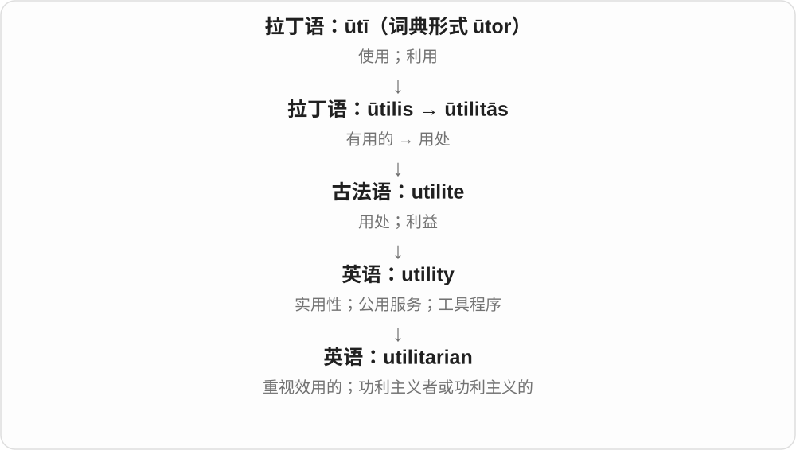

共同线索是 usefulness 或 utility。谈建筑、家具时常指朴素实用；谈伦理时重视整体幸福、痛苦和利益后果，不能直接译成“只顾自己得利”。

**常见搭配与例句**

a utilitarian design；utilitarian furniture；a utilitarian argument；a utilitarian philosopher。

> The room had plain, utilitarian furniture.

房间里的家具朴素而实用。

> She offered a utilitarian argument for reducing unnecessary suffering.

她从减少整体痛苦的功利主义角度提出了论证。

**别混淆**

functional 常说功能合用；utilitarian 还容易让人想到装饰少、以用途为先。哲学义与日常贬义的“势利”并不等同。

### 28. utilitarianism — 功利主义

**音标**：英 /juːˌtɪlɪˈteəriənɪzəm/；美 /juːˌtɪləˈteriənɪzəm/

**先抓住这个画面**

utilitarianism 可以先想成把受影响的人都放进画面：这个选择会给大家带来多少好处、多少痛苦，再据此评价。

**怎么拆**

utilitarian + -ism；-ism 在这里表示一套思想或理论。

**怎么变成今天的意思**

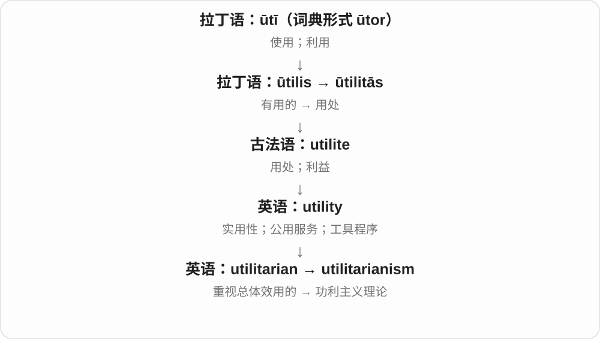

它把 utility 这条线推进到伦理判断。不同流派对幸福、利益、规则如何计算并不完全一致，但核心都重视行为或规则的总体后果。

**常见搭配与例句**

a theory of utilitarianism；debates about utilitarianism；rule utilitarianism（规则功利主义）。

> The class discussed whether utilitarianism gives enough weight to individual rights.

课堂讨论了功利主义是否足够重视个人权利。

> Her essay compares utilitarianism with an approach based on duties.

她的文章比较了功利主义和以义务为基础的观点。

**别混淆**

utilitarianism 不是“谁对我有用就利用谁”。它通常要求考虑所有受影响者，而不只看行动者自己的利益。

### 29. usage — 用法；使用情况；用量

**音标**：/ˈjuːsɪdʒ/；也读 /ˈjuːzɪdʒ/

**先抓住这个画面**

usage 常把镜头从一次“用”拉远：大家平时怎样用，或者一段时间总共用了多少。

**怎么拆**

经法语 usage 传入，属于 user“使用”的词族。现代可用 use + -age 帮助理解，但这不是英语最初造出整词的过程。

**怎么变成今天的意思**

在语言里，它关心人们实际怎么说，如 word usage；在水、电、数据等语境里，它常指消耗或使用量。两义都围绕持续的使用情况。

**常见搭配与例句**

English usage；common usage；water usage；data usage；monitor usage。

> The teacher explained the difference in usage between the two words.

老师解释了这两个词在用法上的区别。

> The app lets you check your monthly data usage.

这个应用可以让你查看每月的数据用量。

**别混淆**

use 很宽泛；usage 更适合谈用法习惯或用量。“我用这把钥匙”通常直接说 use，不必换成 usage。

### 30. utilize — 利用；使派上用场

**音标**：英 /ˈjuːtɪlaɪz/；美 /ˈjuːtəlaɪz/

**先抓住这个画面**

utilize 常把目光放在已有资源上：空着的房间、闲置的设备、已经收集的数据，怎样让它们发挥作用。

**怎么拆**

经法语 utiliser，与意大利语 utilizzare 相连；更远来自拉丁语 ūtilis“有用的”。现代可识别 util- 与动词后缀 -ize。

**怎么变成今天的意思**

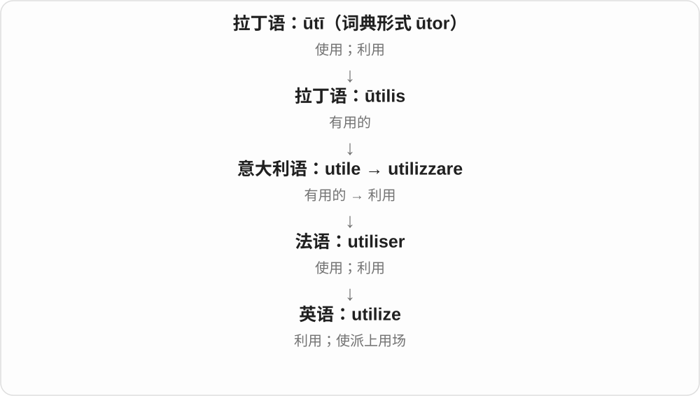

从“有用”形成“使之用于某事”的动词。它常见于正式说明，适合讨论资源利用，但并不强制表示新用途或特别聪明的用法。

**常见搭配与例句**

utilize available resources；utilize space；utilize data；fully utilize。

> The school utilized an empty classroom as a music room.

学校把一间空教室利用起来，改作音乐室。

> The new design utilizes the available space more efficiently.

新设计更有效地利用了现有空间。

**别混淆**

utilize 与 use 大量重叠。日常说 use a spoon 就足够，不需要为了显得正式而处处换成 utilize。

### 31. utilized — 利用了；使用了〔过去式、过去分词〕

**音标**：英、美 /ˈjuːtəlaɪzd/

**先抓住这个画面**

把手头的材料真正派上用场，就是 utilized。它比较正式，但很多普通句子里，直接说 used 也很清楚。

**怎么拆**

utilize 去末尾 e，加完整 -ed → utilized，/z/ 后读 /d/。词史经法语 utiliser、意大利语对应形式接拉丁 utilis 可用、uti 使用。

**怎么变成今天的意思**

**拉丁 uti 使用 → utilis 可用 → 意大利语、法语对应动词**  
把东西派上用场

↓

**英语 utilize + -ed → utilized**  
现代过去式、过去分词，保留 /aɪz/

utilized the space 是利用空间；utilized existing materials 是利用现有材料；fully utilized 是充分利用。

**常见搭配与例句**

utilized the space；utilized existing materials；fully utilized。

> The design utilized space under the stairs.

这个设计利用了楼梯下面的空间。

> The team utilized materials already on hand.

团队利用了手头已有的材料。

**别混淆**

utilized 语体较正式，不因词长就一定比 used 更准确；看是否真需要强调把某物用作资源。

### 32. utilizing — 利用；使派上用场〔分词、动名词〕

**音标**：英 /ˈjuːtɪlaɪzɪŋ/；美 /ˈjuːtəlaɪzɪŋ/

**先抓住这个画面**

手头已经有一种材料、空间或能力，把它放到需要的地方发挥作用，是 utilizing。它让人注意资源怎样被用起来。

**怎么拆**

utilize 去末尾 e，加完整 -ing → utilizing。经法语 utiliser、意大利语 utilizzare，接拉丁 utilis 可用的、uti 使用；现代可以认 util- 有用与动词化 -ize。

**怎么变成今天的意思**

**拉丁 uti 使用 → utilis 可用 → 意大利语、法语相应动词**  
把东西作为可用资源来发挥作用

↓

**英语 utilize + -ing → utilizing**  
现代多见于正式的资源、方法、技术叙述

utilizing available space 是利用现有空间；utilizing local materials 是利用本地材料；utilizing existing skills 是发挥已有技能。

**常见搭配与例句**

utilizing available space；utilizing local materials；utilizing existing skills。

> The design saves money by utilizing materials already on site.

这个设计利用现场已有材料来节省开支。

> The workshop focuses on utilizing the skills participants already have.

工作坊着重发挥参与者已经具备的技能。

**别混淆**

utilizing 比 using 正式，两者意义常有交叠。写普通使用时 using 往往已经清楚；utilizing 常适合强调把现有资源派上用场。

### 33. utilization — 利用；使用情况；利用程度

**音标**：英 /ˌjuːtɪlaɪˈzeɪʃən/；美 /ˌjuːtələˈzeɪʃən/

**先抓住这个画面**

utilization 常出现在“资源有没有用起来、用了多少”的讨论中。比如十台机器只有三台开着，就可以谈设备利用情况。

**怎么拆**

utilize + -ation，把“利用”的动作变成名词；也与法语 utilisation 对应。

**怎么变成今天的意思**

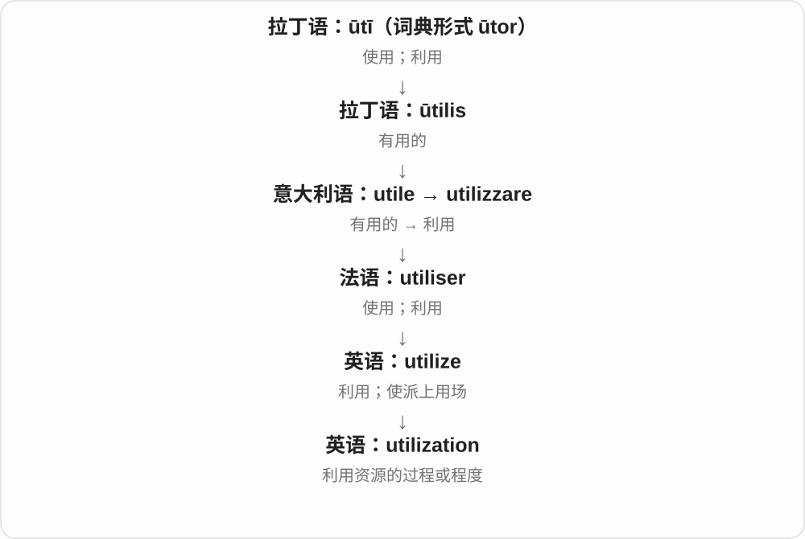

重心从“谁用了什么”转成“整体利用得怎样”。因此它很适合和 capacity、resource、equipment 一起讨论，但具体指标仍要看语境。

**常见搭配与例句**

resource utilization；capacity utilization；equipment utilization；improve utilization。

> The dashboard shows server utilization throughout the day.

这个面板显示服务器全天的使用情况。

> Sharing the workshop improved the utilization of its equipment.

共享这间工坊提高了设备的利用程度。

**别混淆**

utilization 是利用情况；efficiency 是投入与产出之间的效率。机器一直开着，利用率很高，也可能因为浪费能源而效率不高。

## 这一组要分清什么

**useful / usable / usability**：能帮上忙 / 能用 / 用起来顺不顺。三个问题接近，却不相同。

**misuse / abuse**：misuse 可以是用错；abuse 常突出严重滥用或伤害。两者有重叠，不能简单按无意与故意划开。

**utilitarianism** 的哲学义关心受影响者的整体利益与痛苦，不是“只看谁对我有用”。

## 串起来练习

**The old laptop is still usable, but it is no longer useful for my work.**

这台旧笔记本还能用，却已经帮不了我完成现在的工作。usable 过了“能运行”这一关，useful 还要看它是否满足具体需要。
