# 0083 · mov-, mot-, mut- — 移动；改变；相互交换（三条直接来源）

[逐词精讲目录](../00_逐词精讲目录.md) · [总目录](../00_总目录_按常用程度.md)

## 核心词根与来源

先想三幅画面：**椅子挪了位置，纸张改了内容，两个人互相交换东西。** 这一页的常见词围绕这些画面展开，但历史上必须分清三条直接来路：拉丁语 movēre 是“移动、使动”，mūtāre 是“改变、交换”，mūtuus 是“相互的”。它们不能一概说成同一个拉丁动词的不同拼法。

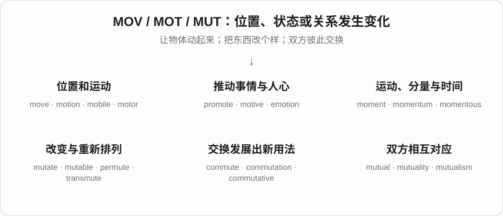

## 词形与演化规律

**mov- / mot-** 常是 movēre 一族的不同词干：move、motion、motor、promote、emotion 都在这一支。**mut-** 经 mūtāre 形成 mutation、mutable、commute、transmute。**mutual** 则从形容词 mūtuus 走来。mutiny 虽然写着 mut-，却经法语“骚动、反叛”连到 movēre，必须按历史认亲。更远的印欧语关系不等于英语每个词都能直接互换拆解。

## 单词速览（按词族由简到繁）

同一基础词的相关扩展放在一起，先读基础形式，再读扩展；各组之间优先读常用的。具体词源关系见各词讲解。

| 单词 | 音标 | 核心意思 |
|---|---|---|
| [move](#w-1) | /muːv/ | 移动；行动；搬家；打动；一步棋 |
| [movement](#w-3) | /ˈmuːvmənt/ | 移动；动作；社会运动；乐章 |
| [countermovement](#w-91) | /ˈkaʊntəmuːvmənt/；美 /ˈkaʊntərmuːvmənt/ | 反向动作；反对某项运动的社会运动 |
| [mover](#w-37) | 英 /ˈmuːvə/；美 /ˈmuːvər/ | 搬运者；推动者；提案人 |
| [movant](#w-90) | /ˈmuːvənt/ | 提出动议的一方（法律用语） |
| [movent](#w-107) | 旧义 /ˈməʊvənt/；法律义 /ˈmuːvənt/ | 运动的；推动者；动议提出方（旧词或专业词） |
| [remove](#w-5) | /rɪˈmuːv/ | 移走；去掉；解除 |
| [removal](#w-12) | /rɪˈmuːvəl/ | 移除；搬迁；撤职 |
| [removable](#w-34) | /rɪˈmuːvəbəl/ | 可拆卸的；可去除的 |
| [countermove](#w-88) | /ˈkaʊntəmuːv/；美 /ˈkaʊntərmuːv/ | 应对行动；反制一步 |
| [transmove](#w-117) | /trænzˈmuːv/（按传统构词读法） | 使转变；移到另一状态（罕用） |
| [moment](#w-2) | 英 /ˈməʊmənt/；美 /ˈmoʊmənt/ | 片刻；时刻；重要性 |
| [momentous](#w-41) | 英 /məʊˈmentəs/；美 /moʊˈmentəs/ | 重大的；影响深远的 |
| [momentary](#w-42) | 英 /ˈməʊməntəri/；美 /ˈmoʊmənteri/ | 短暂的；片刻的 |
| [momentarily](#w-36) | 英 /ˈməʊməntərəli/；美 /ˌmoʊmənˈterəli/ | 短暂地；马上（尤美式） |
| [momental](#w-105) | 英 /məʊˈmentəl/；美 /moʊˈmentəl/ | 有关矩或动量的；短暂的（旧义） |
| [equimomental](#w-101) | /ˌiːkwɪməˈmentəl/（按传统构词读法） | 等惯性矩的 |
| [mobile](#w-4) | 形容词英 /ˈməʊbaɪl/、美 /ˈmoʊbəl/；活动雕塑常读美 /ˈmoʊbiːl/ | 可移动的；手机；活动雕塑 |
| [mobility](#w-18) | 英 /məʊˈbɪləti/；美 /moʊˈbɪləti/ | 移动能力；流动性 |
| [moby](#w-44) | 英 /ˈməʊbi/；美 /ˈmoʊbi/ | 手机（英式口语、较少见） |
| [automobile](#w-20) | 英 /ˈɔːtəməbiːl/；美 /ˈɔːtəmoʊbiːl/ | 汽车 |
| [immobile](#w-46) | 英 /ɪˈməʊbaɪl/；美 /ɪˈmoʊbəl/ | 不能移动的；不动的 |
| [immobility](#w-64) | 英 /ˌɪməʊˈbɪləti/；美 /ˌɪmoʊˈbɪləti/ | 不动；不能移动的状态 |
| [immobilize](#w-65) | 英 /ɪˈməʊbəlaɪz/；美 /ɪˈmoʊbəlaɪz/ | 使不能动；使停止活动 |
| [emotion](#w-15) | 英 /ɪˈməʊʃən/；美 /ɪˈmoʊʃən/ | 情绪；情感 |
| [emotional](#w-6) | 英 /ɪˈməʊʃənəl/；美 /ɪˈmoʊʃənəl/ | 情感的；情绪激动的；令人动情的 |
| [emotionally](#w-19) | 英 /ɪˈməʊʃənəli/；美 /ɪˈmoʊʃənəli/ | 在情感上；动情地 |
| [emotionality](#w-79) | 英 /ɪˌməʊʃəˈnæləti/；美 /ɪˌmoʊʃəˈnæləti/ | 情绪性；情绪反应的程度或倾向 |
| [unemotional](#w-67) | 英 /ˌʌnɪˈməʊʃənəl/；美 /ˌʌnɪˈmoʊʃənəl/ | 不动感情的；冷静平实的 |
| [emotionless](#w-52) | 英 /ɪˈməʊʃənləs/；美 /ɪˈmoʊʃənləs/ | 不显露情绪的；无情感的 |
| [motion](#w-7) | 英 /ˈməʊʃən/；美 /ˈmoʊʃən/ | 运动；移动；手势；正式动议 |
| [motionless](#w-45) | 英 /ˈməʊʃənləs/；美 /ˈmoʊʃənləs/ | 一动不动的 |
| [motional](#w-87) | 英 /ˈməʊʃənəl/；美 /ˈmoʊʃənəl/ | 运动的；与运动有关的 |
| [countermotion](#w-98) | 英 /ˈkaʊntəˌməʊʃən/；美 /ˈkaʊntərˌmoʊʃən/ | 反向运动；对抗先前动议的动议 |
| [promote](#w-8) | 英 /prəˈməʊt/；美 /prəˈmoʊt/ | 促进；推广；晋升 |
| [promotion](#w-10) | 英 /prəˈməʊʃən/；美 /prəˈmoʊʃən/ | 晋升；推广；促销活动 |
| [promotional](#w-23) | 英 /prəˈməʊʃənəl/；美 /prəˈmoʊʃənəl/ | 宣传推广的；促销的 |
| [promoter](#w-29) | 英 /prəˈməʊtə/；美 /prəˈmoʊtər/ | 推广者；活动主办者；启动子 |
| [demote](#w-68) | 英 /dɪˈməʊt/；美 /dɪˈmoʊt/ | 使降职；把……降级 |
| [demotion](#w-53) | 英 /dɪˈməʊʃən/；美 /dɪˈmoʊʃən/ | 降职；降级 |
| [promotor](#w-83) | 英 /prəˈməʊtə/；美 /prəˈmoʊtər/ | 博士研究的主要导师（某些国家高校用语） |
| [promotive](#w-92) | 英 /prəˈməʊtɪv/；美 /prəˈmoʊtɪv/ | 起促进作用的（正式、少见） |
| [motor](#w-9) | 英 /ˈməʊtə/；美 /ˈmoʊtər/ | 马达；发动机；运动的 |
| [motorcycle](#w-17) | 英 /ˈməʊtəsaɪkəl/；美 /ˈmoʊtərsaɪkəl/ | 摩托车 |
| [motorcyclist](#w-51) | 英 /ˈməʊtəsaɪklɪst/；美 /ˈmoʊtərsaɪklɪst/ | 摩托车骑手 |
| [motorway](#w-32) | 英 /ˈməʊtəweɪ/；美 /ˈmoʊtərweɪ/ | 高速公路（英式） |
| [motorbike](#w-38) | 英 /ˈməʊtəbaɪk/；美 /ˈmoʊtərbaɪk/ | 摩托车 |
| [motorsport](#w-39) | 英 /ˈməʊtəspɔːt/；美 /ˈmoʊtərspɔːrt/ | 赛车运动；机动车竞技运动 |
| [motorist](#w-43) | 英 /ˈməʊtərɪst/；美 /ˈmoʊtərɪst/ | 机动车驾驶者；开车的人 |
| [motorboat](#w-61) | 英 /ˈməʊtəbəʊt/；美 /ˈmoʊtərboʊt/ | 汽艇；机动船 |
| [motorcar](#w-71) | 英 /ˈməʊtəkɑː/；美 /ˈmoʊtərkɑːr/ | 汽车（较旧式） |
| [motorhead](#w-72) | 英 /ˈməʊtəhed/；美 /ˈmoʊtərhed/ | 汽车或摩托车迷（口语） |
| [psychomotor](#w-77) | 英 /ˌsaɪkəʊˈməʊtə/；美 /ˌsaɪkoʊˈmoʊtər/ | 精神运动的；心理活动与身体动作相联系的 |
| [bimotor](#w-96) | 英 /baɪˈməʊtə/；美 /baɪˈmoʊtər/ | 双发动机飞机；双马达的 |
| [trimotor](#w-121) | 英 /traɪˈməʊtə/；美 /traɪˈmoʊtər/ | 三发动机的；三发飞机 |
| [remote](#w-11) | 英 /rɪˈməʊt/；美 /rɪˈmoʊt/ | 遥远的；偏僻的；远程的；可能性很小的 |
| [remotely](#w-24) | 英 /rɪˈməʊtli/；美 /rɪˈmoʊtli/ | 远程地；丝毫（常用于否定） |
| [remoteness](#w-57) | 英 /rɪˈməʊtnəs/；美 /rɪˈmoʊtnəs/ | 偏远；疏远；距离遥远的状态 |
| [remotion](#w-115) | 英 /rɪˈməʊʃən/；美 /rɪˈmoʊʃən/ | 移除；退离（古旧或少见） |
| [mutual](#w-13) | /ˈmjuːtʃuəl/ | 相互的；彼此的；共同的 |
| [mutually](#w-25) | /ˈmjuːtʃuəli/ | 相互地；共同地 |
| [mutuality](#w-75) | /ˌmjuːtʃuˈæləti/ | 相互性；双方共同参与或承担的关系 |
| [mutualism](#w-78) | /ˈmjuːtʃuəlɪzəm/ | 互利共生；互助主义 |
| [nonmutual](#w-110) | 英 /ˌnɒnˈmjuːtʃuəl/；美 /ˌnɑːnˈmjuːtʃuəl/ | 非相互的；非共同的 |
| [transmutual](#w-120) | /trænzˈmjuːtʃuəl/（按传统构词读法） | 相互的；彼此交换的（罕用） |
| [motive](#w-21) | 英 /ˈməʊtɪv/；美 /ˈmoʊtɪv/ | 动机；理由；驱动的 |
| [motivate](#w-27) | 英 /ˈməʊtɪveɪt/；美 /ˈmoʊtɪveɪt/ | 激励；使有动力；成为……的动机 |
| [motivation](#w-14) | 英 /ˌməʊtɪˈveɪʃən/；美 /ˌmoʊtɪˈveɪʃən/ | 动力；动机；积极性 |
| [motivational](#w-31) | 英 /ˌməʊtɪˈveɪʃənəl/；美 /ˌmoʊtɪˈveɪʃənəl/ | 激励性的；与动力有关的 |
| [motivator](#w-47) | 英 /ˈməʊtɪveɪtə/；美 /ˈmoʊtɪveɪtər/ | 激励者；动力来源 |
| [unmotivated](#w-59) | 英 /ˌʌnˈməʊtɪveɪtɪd/；美 /ˌʌnˈmoʊtɪveɪtɪd/ | 缺乏动力的；无明显动机的 |
| [automotive](#w-22) | 英 /ˌɔːtəˈməʊtɪv/；美 /ˌɔːtəˈmoʊtɪv/ | 汽车的；机动车相关的 |
| [momentum](#w-16) | 英 /məʊˈmentəm/；美 /moʊˈmentəm/ | 动量；势头；推进力量 |
| [mutate](#w-56) | 英 /mjuːˈteɪt/；美亦 /ˈmjuːteɪt/ | 发生突变；改变形态 |
| [mutation](#w-26) | /mjuːˈteɪʃən/ | 突变；变异；变化 |
| [mutational](#w-76) | /mjuːˈteɪʃənəl/ | 突变的；与突变有关的 |
| [commute](#w-28) | /kəˈmjuːt/ | 通勤；折换；减轻刑罚 |
| [commutation](#w-62) | 英 /ˌkɒmjuːˈteɪʃən/；美 /ˌkɑːmjuːˈteɪʃən/ | 折换；减刑；换向 |
| [commutable](#w-85) | /kəˈmjuːtəbəl/ | 可折换的；可减刑的；适合通勤的 |
| [incommutable](#w-104) | /ˌɪnkəˈmjuːtəbəl/ | 不可折换的；不可替换的 |
| [locomotive](#w-30) | 英 /ˌləʊkəˈməʊtɪv/；美 /ˌloʊkəˈmoʊtɪv/ | 机车；火车头；移动的 |
| [motif](#w-33) | 英 /məʊˈtiːf/；美 /moʊˈtiːf/ | 反复出现的主题；装饰图案；音乐动机 |
| [mutiny](#w-35) | /ˈmjuːtəni/ | 哗变；兵变；集体反抗上级 |
| [commotion](#w-40) | 英 /kəˈməʊʃən/；美 /kəˈmoʊʃən/ | 骚动；喧闹；混乱 |
| [emotive](#w-48) | 英 /ɪˈməʊtɪv/；美 /ɪˈmoʊtɪv/ | 激起情绪的；诉诸感情的 |
| [emotivity](#w-99) | 英 /ˌiːməʊˈtɪvəti/；美 /ˌiːmoʊˈtɪvəti/ | 情绪性；激发情绪的特征（少见） |
| [locomotion](#w-49) | 英 /ˌləʊkəˈməʊʃən/；美 /ˌloʊkəˈmoʊʃən/ | 移动；行进；运动方式 |
| [immute](#w-103) | /ɪˈmjuːt/（按传统构词读法） | 改变；使变样（古旧） |
| [immutable](#w-50) | /ɪˈmjuːtəbəl/ | 不可改变的；不变的 |
| [immutation](#w-102) | /ˌɪmjuːˈteɪʃən/（按传统构词读法） | 改变；变化（古旧） |
| [motile](#w-66) | 英 /ˈməʊtaɪl/；美 /ˈmoʊtəl/，亦 /ˈmoʊtaɪl/ | 能自主运动的 |
| [motility](#w-54) | 英 /məʊˈtɪləti/；美 /moʊˈtɪləti/ | 自主运动能力；运动性 |
| [nonmotility](#w-109) | 英 /ˌnɒnməʊˈtɪləti/；美 /ˌnɑːnmoʊˈtɪləti/ | 无自主运动能力；非运动性 |
| [nonmotile](#w-89) | 英 /ˌnɒnˈməʊtaɪl/；美 /ˌnɑːnˈmoʊtəl/ | 不能自主运动的 |
| [permute](#w-86) | 英 /pəˈmjuːt/；美 /pərˈmjuːt/ | 重新排列；置换 |
| [permutation](#w-55) | 英 /ˌpɜːmjʊˈteɪʃən/；美 /ˌpɜːrmjʊˈteɪʃən/ | 排列；排列方式；变化形式 |
| [permutational](#w-113) | 英 /ˌpɜːmjʊˈteɪʃənəl/；美 /ˌpɜːrmjəˈteɪʃənəl/ | 排列的；与置换有关的 |
| [subpermutation](#w-116) | 英 /ˌsʌbpɜːmjʊˈteɪʃən/；美 /ˌsʌbpɜːrmjəˈteɪʃən/ | 子排列 |
| [permutate](#w-112) | 英 /ˈpɜːmjʊteɪt/；美 /ˈpɜːrmjəteɪt/ | 重新排列；进行置换（较少用） |
| [permutable](#w-111) | 英 /pəˈmjuːtəbəl/；美 /pərˈmjuːtəbəl/ | 可置换的；可重新排列的 |
| [transmute](#w-73) | /trænzˈmjuːt/ | 使转化；变成另一形式 |
| [transmutate](#w-119) | /trænzˈmjuːteɪt/ | 转化；使转变（较少用） |
| [transmutation](#w-58) | 英 /ˌtrænzmjuːˈteɪʃən/；美 /ˌtrænzmjuːˈteɪʃən/ | 转化；嬗变 |
| [transmutable](#w-118) | /trænzˈmjuːtəbəl/ | 可转化的；可变成另一形式的 |
| [commutative](#w-60) | 英 /kəˈmjuːtətɪv/；美 /kəˈmjuːtətɪv/ | 可交换次序的；满足交换律的 |
| [commutativity](#w-84) | /kəˌmjuːtəˈtɪvəti/ | 交换性；满足交换律的性质 |
| [noncommutative](#w-80) | 英 /ˌnɒnkəˈmjuːtətɪv/；美 /ˌnɑːnkəˈmjuːtətɪv/ | 非交换的 |
| [noncommutativity](#w-108) | 英 /ˌnɒnkəˌmjuːtəˈtɪvəti/；美 /ˌnɑːnkəˌmjuːtəˈtɪvəti/ | 非交换性 |
| [mutable](#w-63) | /ˈmjuːtəbəl/ | 可改变的；易变的 |
| [mutability](#w-81) | /ˌmjuːtəˈbɪləti/ | 可变性；易变性 |
| [moult](#w-69) | 英 /məʊlt/；美 /moʊlt/ | 换羽；蜕皮；换毛 |
| [mutinous](#w-70) | /ˈmjuːtɪnəs/ | 哗变的；反抗上级的；不肯听从的 |
| [commutator](#w-74) | 英 /ˈkɒmjʊteɪtə/；美 /ˈkɑːmjəteɪtər/ | 换向器；换位子 |
| [mutineer](#w-82) | /ˌmjuːtɪˈnɪə/；美 /ˌmjuːtɪˈnɪr/ | 哗变者；兵变参与者 |
| [admove](#w-93) | /ədˈmuːv/（按传统构词读法） | 移近；把……移向（古旧） |
| [amotion](#w-94) | 英 /əˈməʊʃən/；美 /əˈmoʊʃən/ | 移除；罢免（古旧或法律专门用语） |
| [amove](#w-95) | /əˈmuːv/ | 激起、使动；移除、免职（均古旧） |
| [commove](#w-97) | /kəˈmuːv/ | 使激动；使骚动（古旧） |
| [emove](#w-100) | /ɪˈmuːv/（按传统构词读法） | 触动；使激动（古旧） |
| [momentaneous](#w-106) | 英 /ˌməʊmənˈteɪniəs/；美 /ˌmoʊmənˈteɪniəs/ | 瞬间的；瞬时的（少见） |
| [promove](#w-114) | /prəˈmuːv/（按传统构词读法） | 推进；提升（古旧） |

## 逐词讲解

### 1. move — 移动；行动；搬家；打动；一步棋

**音标**：/muːv/

**先抓住这个画面**

move 是让原来的位置或状态发生变化：身体挪开，事情推进，心里也可能被触动。

**怎么拆**

经古法语来自拉丁语 movēre。整体是词基，不要拆成 mo + ve。

**怎么变成今天的意思**

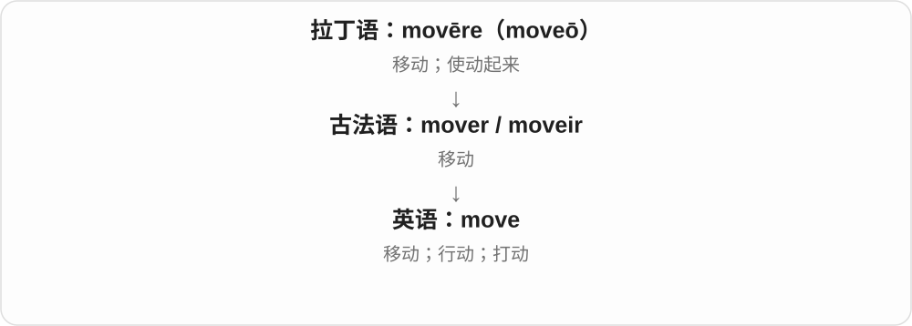

从物理移动扩展到采取行动、搬家和情感被触动；名词 a move 则是一项行动或棋步。

**常见搭配与例句**

move house；move forward；be moved by；make a move。

> Could you move your bag off the chair?

你能把包从椅子上移开吗？

> Her speech moved me deeply.

她的演讲深深打动了我。

**别混淆**

move 可以自己动也可使别人动；remove 明确表示把某物移走、去掉。

### 2. movement — 移动；动作；社会运动；乐章

**音标**：/ˈmuːvmənt/

**先抓住这个画面**

movement 可以是一只手挪了一下，也可以是许多人朝共同目标推动的一股社会力量。

**怎么拆**

经法语 mouvement 一支传入，现代对应 move + -ment；不是所有义项都在现代英语里新造。

**怎么变成今天的意思**

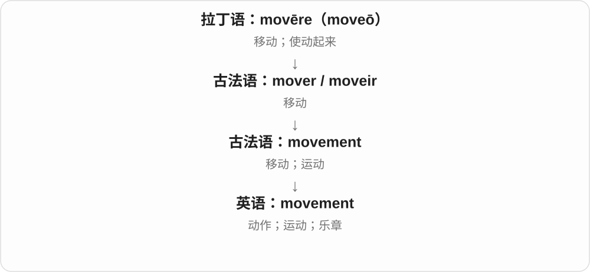

动作扩展为有组织的集体行动；音乐里的乐章则是大型作品中相对完整的一段。

**常见搭配与例句**

a sudden movement；the environmental movement；the first movement。

> A sudden movement in the bushes caught my attention.

灌木丛里突然的一动引起了我的注意。

> The orchestra played the final movement softly.

乐团轻柔地演奏了最后一个乐章。

**别混淆**

motion 常强调运动状态；movement 也可数，表示一个动作、一个运动或一个乐章。

### 3. countermovement — 反向动作；反对某项运动的社会运动

**音标**：/ˈkaʊntəmuːvmənt/；美 /ˈkaʊntərmuːvmənt/

**先抓住这个画面**

countermovement 可以是起跳前先下蹲的反向动作，也可以是针对另一股社会力量形成的反对运动。

**怎么拆**

counter-（反向、对抗）+ movement。

**怎么变成今天的意思**

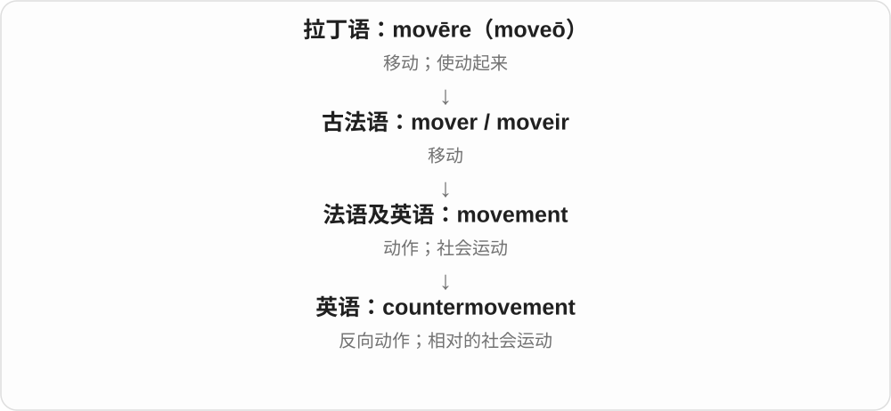

体育里常指主动作前相反方向的准备动作；社会讨论里则指集体回应。两种意思都比单次策略行动更偏“运动过程”。

**常见搭配与例句**

a countermovement jump；a political countermovement；a rapid countermovement。

> The athlete performed a countermovement jump.

运动员先下蹲蓄力，再完成起跳。

> The reform movement soon faced a countermovement.

改革运动很快遇到了反对它的社会运动。

**别混淆**

countermove 多是某一步应对；countermovement 可指身体动作过程或集体运动。

### 4. mover — 搬运者；推动者；提案人

**音标**：英 /ˈmuːvə/；美 /ˈmuːvər/

**先抓住这个画面**

mover 是让东西或事情动起来的一方：搬家具的人、推动项目的人，或正式提出动议的人。

**怎么拆**

move + -er。

**怎么变成今天的意思**

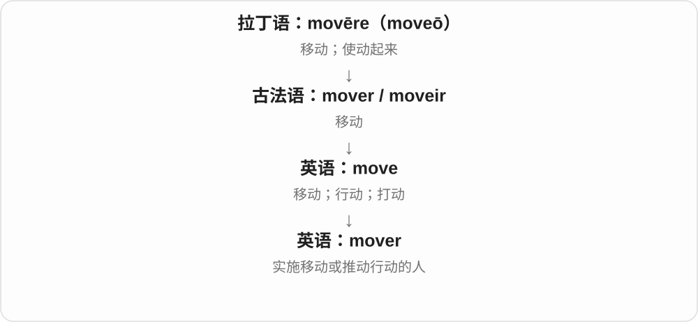

prime mover 是主要推动者；复数 movers 在搬家语境常是搬运人员。

**常见搭配与例句**

hire movers；the prime mover；the mover of a motion。

> The movers carried the sofa upstairs.

搬运工把沙发搬上楼。

> She was the prime mover behind the project.

她是这个项目背后的主要推动者。

**别混淆**

mover 是人或推动因素；movement 是动作、运动等名词。

### 5. movant — 提出动议的一方（法律用语）

**音标**：/ˈmuːvənt/

**先抓住这个画面**

movant 是正式请法官作出某项裁定的一方；这个 move 是“提请”，不是挪动座位。

**怎么拆**

move（提出动议）+ -ant（行为者）。

**怎么变成今天的意思**

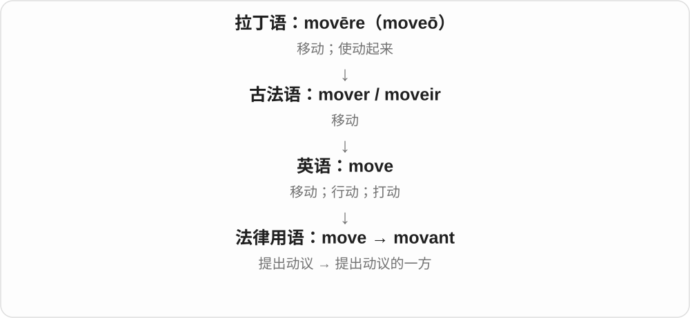

可指个人，也可指机构或一方当事人。这里描述的是程序角色，不是案件谁对谁错。

**常见搭配与例句**

the movant’s argument；the movant bears the burden；the nonmoving party。

> The movant submitted a written statement.

提出动议的一方递交了书面陈述。

> The court considered the movant’s argument.

法院考虑了动议提出方的论点。

**别混淆**

movant 是提出某项动议者；plaintiff 是原告，两者未必是同一方。

### 6. movent — 运动的；推动者；动议提出方（旧词或专业词）

**音标**：旧义 /ˈməʊvənt/；法律义 /ˈmuːvənt/

**先抓住这个画面**

movent 在旧哲学或物理文字中指“正在动”或“使别的东西动”的一方。法律场景又可作 movant 的异体。

**怎么拆**

旧义来自拉丁语 movēns（movēre 的现在分词）；法律用法则与英语 movant 相通，读音也可能不同。

**怎么变成今天的意思**

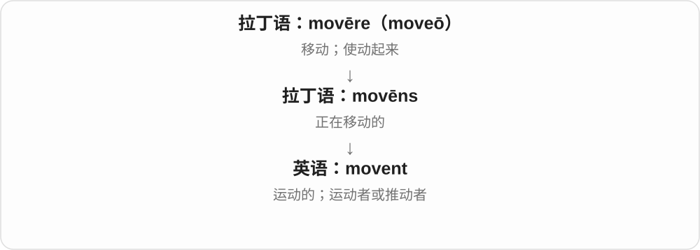

不要把两种用法的读音和解释机械合并。看到 court、motion 等词时，通常是提出动议的一方。

**常见搭配与例句**

a movent body；the first movent（旧式）；the movent’s request（法律）。

> The philosopher asked what moved the first movent.

哲学家追问是什么推动了最初的推动者。

> The court denied the movent’s request.

法院驳回了动议提出方的请求。

**别混淆**

movent 的历史义联系拉丁语分词；movant 现代主要是法律行为者名词。

### 7. remove — 移走；去掉；解除

**音标**：/rɪˈmuːv/

**先抓住这个画面**

remove 像把桌上的障碍物拿开，让它不再占着原来的位置。

**怎么拆**

来自拉丁语 re- + movēre，经法语传入；这里 re- 带离开、移开的方向，不是“再动一次”。

**怎么变成今天的意思**

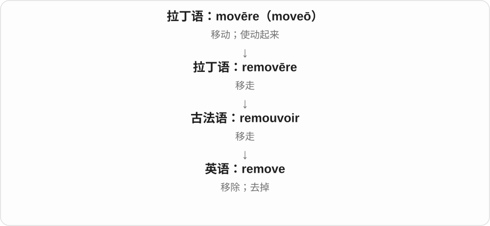

从移走实物扩展到去除污渍、删除内容、解除职务。具体怎么去掉取决于对象。

**常见搭配与例句**

remove a stain；remove from；remove an obstacle。

> Please remove your shoes before entering.

进门前请脱鞋。

> The editor removed two unnecessary paragraphs.

编辑删掉了两段多余的文字。

**别混淆**

move 只是换位置；remove 常强调不再留在原处或原系统中。

### 8. removal — 移除；搬迁；撤职

**音标**：/rɪˈmuːvəl/

**先抓住这个画面**

removal 把“拿走、清掉、搬开”当成一项过程或结果来讲。

**怎么拆**

remove + -al，动词去掉词尾 e 后形成名词。

**怎么变成今天的意思**

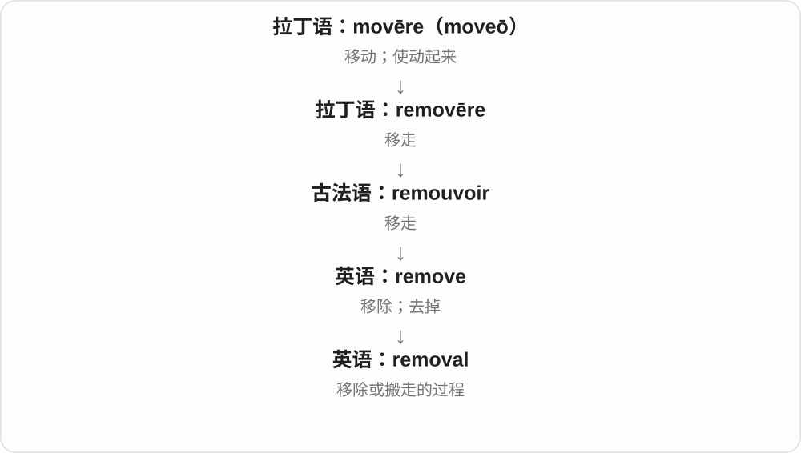

对象决定中文：snow removal 是清雪，removal from office 是免职；英式 removals 也常指搬家业务。

**常见搭配与例句**

waste removal；the removal of barriers；a removals company。

> The city arranged for the removal of fallen trees.

市政府安排清除倒下的树木。

> The removal of the wall made the room brighter.

拆掉这面墙后，房间更明亮了。

**别混淆**

removal 是移除；removable 是可移除的形容词。

### 9. removable — 可拆卸的；可去除的

**音标**：/rɪˈmuːvəbəl/

**先抓住这个画面**

removable 像一个盖子能取下来，而不必把整个东西破坏掉。

**怎么拆**

remove + -able，表示能被移除。

**怎么变成今天的意思**

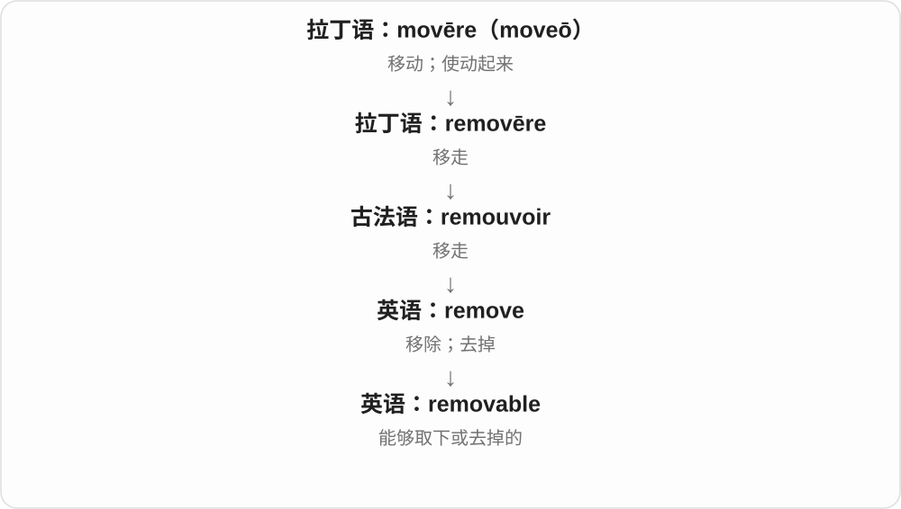

可形容零件、衬里、存储设备或痕迹。能取下不代表拆卸毫不费力。

**常见搭配与例句**

a removable cover；removable storage；a removable lining。

> The jacket has a removable lining.

这件夹克有可拆卸内衬。

> The box comes with a removable tray.

盒子配有可取出的托盘。

**别混淆**

movable 是能移动位置；removable 是能从原有组合中取下。

### 10. countermove — 应对行动；反制一步

**音标**：/ˈkaʊntəmuːv/；美 /ˈkaʊntərmuːv/

**先抓住这个画面**

countermove 像下棋时对手走了一步，你随即走出一手来应对。

**怎么拆**

counter-（相对、反制）+ move。

**怎么变成今天的意思**

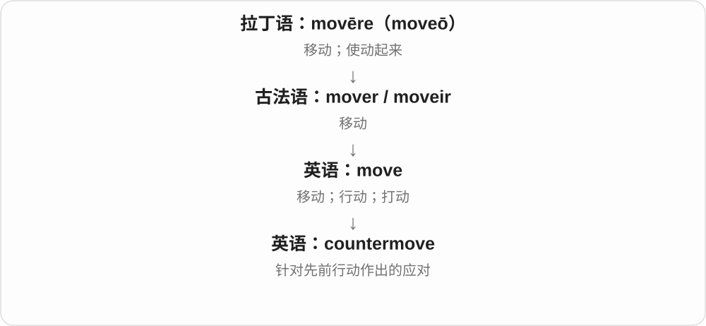

可以是棋步，也可指商业或策略上的回应。它是一个具体行动，不一定是大规模对抗。

**常见搭配与例句**

plan a countermove；a strategic countermove；an unexpected countermove。

> She anticipated his next countermove.

她预料到了他接下来的应对。

> The company lowered its prices as a countermove.

公司降低价格作为应对措施。

**别混淆**

move 是任何一步；countermove 带着回应另一步的关系。

### 11. transmove — 使转变；移到另一状态（罕用）

**音标**：/trænzˈmuːv/（按传统构词读法）

**先抓住这个画面**

transmove 的画面是跨过状态之间的界线，把一件东西变成另一种状态。

**怎么拆**

trans-（跨过、转变）+ move。

**怎么变成今天的意思**

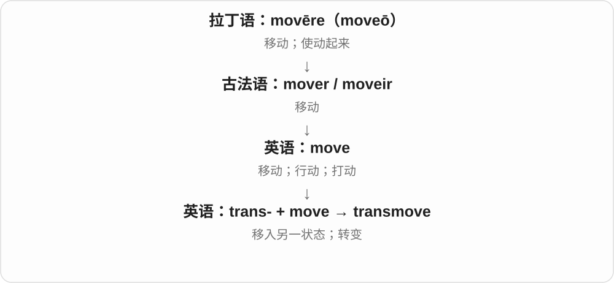

它是罕见的历史或文学词。现代通常说 transform、convert 或 move into another state。

**常见搭配与例句**

transmove into；transmove a form；以下为仿旧用法例句。

> The tale transmoves sorrow into wonder.

这个故事把悲伤转化成惊奇。

> The poet imagined the spirit transmoved into another form.

诗人想象精神转成了另一种形态。

**别混淆**

transmove 的拼写保留 move“移动”；transmute 来自 mūtāre“改变”，更常用。

### 12. moment — 片刻；时刻；重要性

**音标**：英 /ˈməʊmənt/；美 /ˈmoʊmənt/

**先抓住这个画面**

moment 是从连续时间里抓出的一小段，或者某件值得记住的事情发生的那一点。

**怎么拆**

经法语来自拉丁语 mōmentum，原有运动、推动力、短时段和分量等义。

**怎么变成今天的意思**

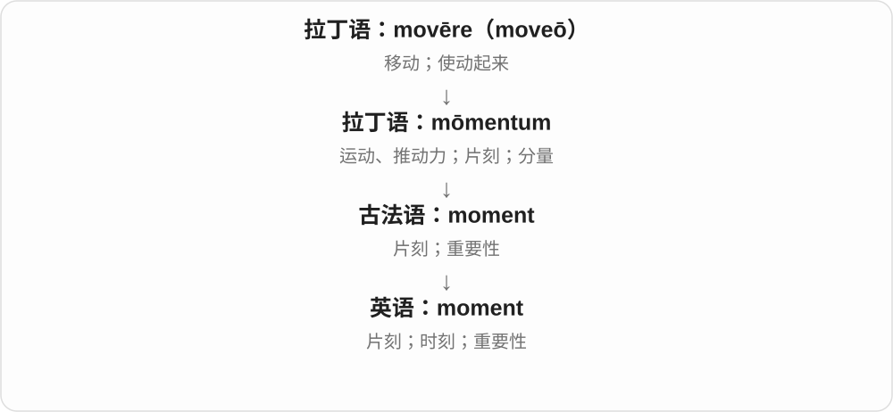

时间义早在拉丁语中已有；不要把“天平轻轻动一下”当作确定的唯一历史故事。of great moment 保留“很有分量、很重要”的旧义。

**常见搭配与例句**

just a moment；at the moment；a memorable moment；of great moment。

> Please wait a moment.

请等一会儿。

> It was a moment of great happiness.

那是一个无比幸福的时刻。

**别混淆**

moment 一般是一小会儿；momentum 是动量或发展势头，不能因同源就互换。

### 13. momentous — 重大的；影响深远的

**音标**：英 /məʊˈmentəs/；美 /moʊˈmentəs/

**先抓住这个画面**

momentous 像人生或历史到了一个转折点，这一步的分量会延续很久。

**怎么拆**

moment 的“分量、重要性”旧义 + -ous。

**怎么变成今天的意思**

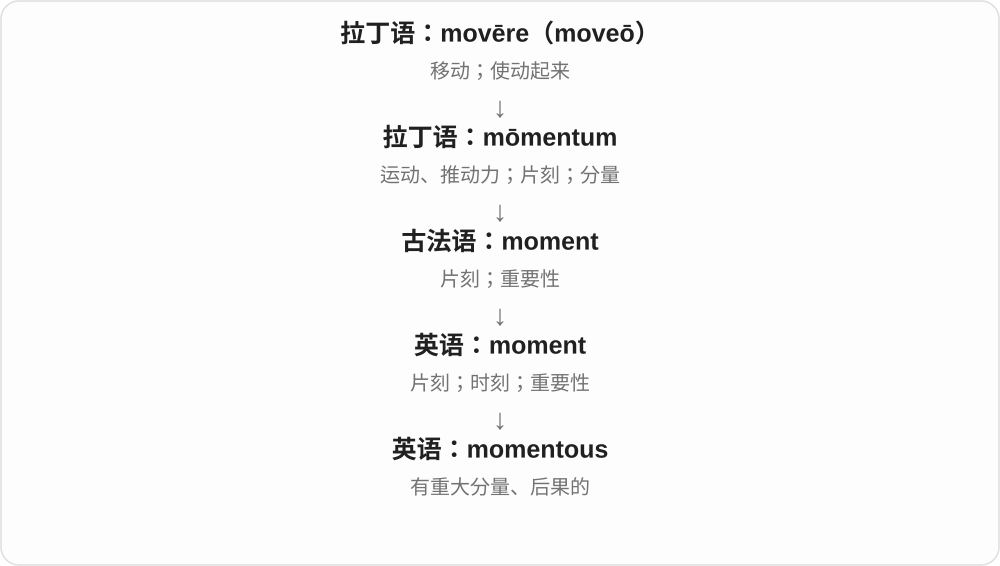

它选中的是 moment 的重要性支线，不是短时间支线；重大事件未必只发生一瞬间。

**常见搭配与例句**

a momentous decision；a momentous occasion；momentous changes。

> They made a momentous decision to leave the country.

他们作出了离开这个国家的重大决定。

> The agreement marked a momentous change.

这项协议标志着一个重大转变。

**别混淆**

momentary 是短暂；momentous 是重大，千万别把两者当近义词。

### 14. momentary — 短暂的；片刻的

**音标**：英 /ˈməʊməntəri/；美 /ˈmoʊmənteri/

**先抓住这个画面**

momentary 像灯闪了一下，刚出现又过去，持续时间很短。

**怎么拆**

来自晚期拉丁语 mōmentārius，基础是 mōmentum 的“短时间”义。

**怎么变成今天的意思**

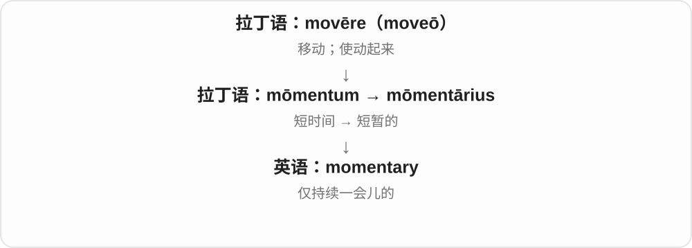

只评价持续时间，不评价重要程度。短暂失误也可能有很大影响。

**常见搭配与例句**

a momentary pause；momentary confusion；a momentary lapse。

> There was a momentary pause before she answered.

她短暂停顿后才回答。

> A momentary distraction caused him to miss the sign.

一瞬间的分心让他错过了标志。

**别混淆**

momentous 说重要；momentary 说短，两词可以形容同一事件的不同特点。

### 15. momentarily — 短暂地；马上（尤美式）

**音标**：英 /ˈməʊməntərəli/；美 /ˌmoʊmənˈterəli/

**先抓住这个画面**

momentarily 可能是“只持续一会儿”，也可能是“再等一会儿就发生”；时间方向要看句子。

**怎么拆**

momentary + -ly。

**怎么变成今天的意思**

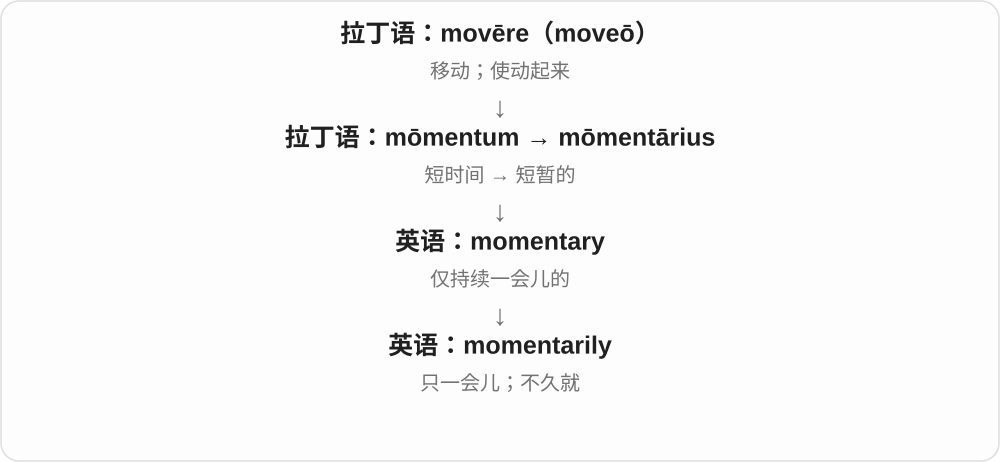

paused momentarily 是停顿了片刻；will arrive momentarily 常表示马上到，而不是只来一下就走。

**常见搭配与例句**

pause momentarily；be momentarily distracted；arrive momentarily。

> She was momentarily distracted by a noise.

一个声音让她短暂分了神。

> The train will depart momentarily.

火车马上就要出发。

**别混淆**

有歧义时，for a moment 或 very soon 更明确地分别表达两义。

### 16. momental — 有关矩或动量的；短暂的（旧义）

**音标**：英 /məʊˈmentəl/；美 /moʊˈmentəl/

**先抓住这个画面**

momental 继承了 moment 家族的两面：旧文中的一瞬间，力学中的矩或动量。

**怎么拆**

可对应 moment + -al；历史旧义可能经法语及中世纪拉丁语 momentalis，不能只当现代新造词。

**怎么变成今天的意思**

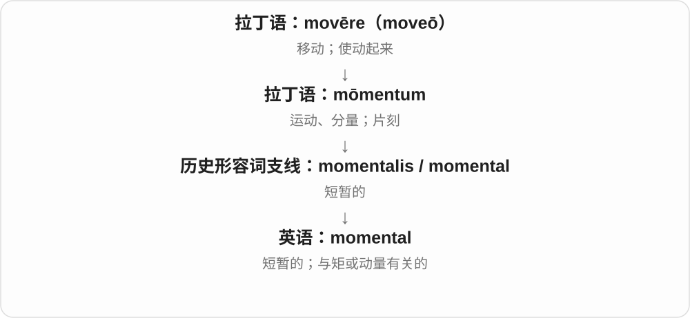

在技术组合里先看它谈哪一种物理量。日常“短暂”应优先学 momentary；旧文也曾用它表示重要。

**常见搭配与例句**

momental quantities；momental properties；a momental change（旧式）。

> The chapter discusses the system’s momental properties.

这一章讨论系统与矩、动量相关的性质。

> The old poem calls the joy momental.

这首旧诗把欢乐称作转瞬即逝。

**别混淆**

momental 不等于现代常用的 momentous“重大”；它的技术义也不是“感人的”。

### 17. equimomental — 等惯性矩的

**音标**：/ˌiːkwɪməˈmentəl/（按传统构词读法）

**先抓住这个画面**

equimomental 像两套外形不同的质量分布，在转动惯量这一套比较中却能彼此替代。

**怎么拆**

equi-（相等）+ momental（有关力矩、惯性矩等的）；这里不是“同一时刻”。

**怎么变成今天的意思**

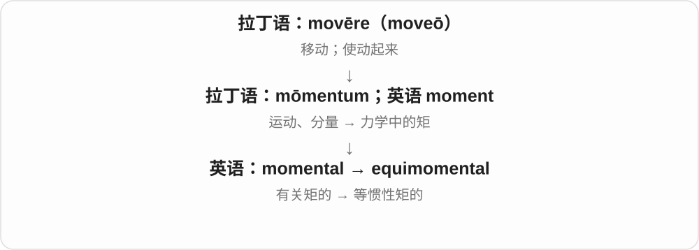

经典刚体力学中，两系统若对空间中每一条直线都有相等的惯性矩，称为 equimomental。不能只比较某一根轴就断定整体满足。

**常见搭配与例句**

equimomental systems；an equimomental body；equimomental replacement。

> The text replaces the body with an equimomental system.

教材用一个等惯性矩系统替代这个物体。

> Equal mass alone does not make two systems equimomental.

质量相等本身不足以使两个系统成为等惯性矩系统。

**别混淆**

equimomental 比“质量相同”要求多；质量怎样分布也影响转动惯量。

### 18. mobile — 可移动的；手机；活动雕塑

**音标**：形容词英 /ˈməʊbaɪl/、美 /ˈmoʊbəl/；活动雕塑常读美 /ˈmoʊbiːl/

**先抓住这个画面**

mobile 的核心是不用永远固定在一个地点：人能四处走，服务能上门，电话能随身带。

**怎么拆**

来自拉丁语 mōbilis“能移动的”，经法语进入英语。

**怎么变成今天的意思**

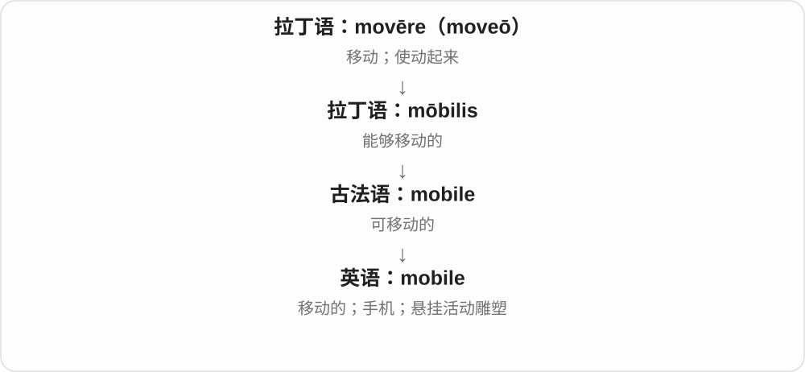

mobile phone 强调可随人移动；mobile 作手机名词是省略说法。悬挂式活动雕塑的部件会随气流动。

**常见搭配与例句**

a mobile phone；a mobile library；remain mobile；a hanging mobile。

> The village is served by a mobile library.

这个村庄有流动图书馆提供服务。

> A colourful mobile hung above the crib.

婴儿床上方悬着一个彩色活动挂饰。

**别混淆**

mobile 是可移动或能活动；remote 是相隔较远。远程设备也可能固定不动。

### 19. mobility — 移动能力；流动性

**音标**：英 /məʊˈbɪləti/；美 /moʊˈbɪləti/

**先抓住这个画面**

mobility 是“能不能自由换位置”的能力，可以是身体行动，也可以是人换工作或社会位置。

**怎么拆**

经法语 mobilité 来自拉丁语 mōbilitās；与 mobile 同族，不能只按现代词尾机械拼接历史。

**怎么变成今天的意思**

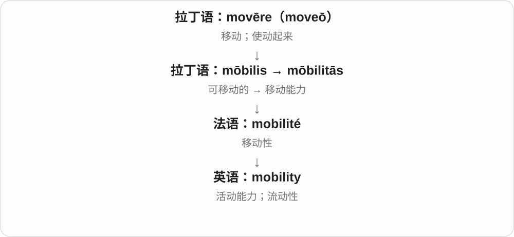

身体活动、交通出行、职业流动都能用。形容 social mobility 时，位置是社会经济地位。

**常见搭配与例句**

limited mobility；social mobility；urban mobility。

> The ramp improves access for people with limited mobility.

坡道让行动不便的人更容易通行。

> The study examines social mobility across generations.

这项研究考察代际社会流动。

**别混淆**

mobility 是能移动，motility 在生物学中更强调自主运动能力。

### 20. moby — 手机（英式口语、较少见）

**音标**：英 /ˈməʊbi/；美 /ˈmoʊbi/

**先抓住这个画面**

moby 像把 mobile 随口缩短成一个昵称，说的是随身带的手机。

**怎么拆**

mobile 缩短后加口语后缀 -y。

**怎么变成今天的意思**

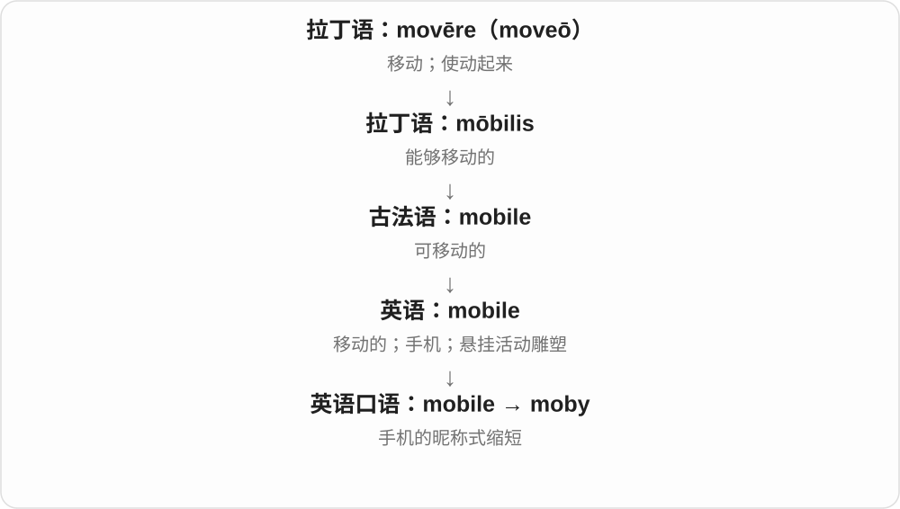

这不是正式产品名称，也不是所有英语地区都常用。这里的手机义和专名 Moby 的其他来源要分开。

**常见搭配与例句**

on my moby；ring my moby；非正式用法。

> I left my moby at home.

我把手机落在家里了。

> Ring me on my moby if you get lost.

如果迷路了，就打我手机。

**别混淆**

普通表达说 mobile 或 phone 更通用；不能把任何 Moby 人名都解释成手机。

### 21. automobile — 汽车

**音标**：英 /ˈɔːtəməbiːl/；美 /ˈɔːtəmoʊbiːl/

**先抓住这个画面**

automobile 的历史画面是车辆自己带着动力行驶，不再需要马在前面拉。

**怎么拆**

法语 automobile 由希腊来源 auto-（自己）与 mobile（可移动的）组成，再借入英语。

**怎么变成今天的意思**

“自己动”指车辆有动力，不是现代所谓自动驾驶；驾驶者仍可以是人。

**常见搭配与例句**

an automobile manufacturer；the automobile industry；an early automobile。

> The exhibition traces the history of the automobile.

展览追溯汽车的发展史。

> She works for an automobile manufacturer.

她在一家汽车制造企业工作。

**别混淆**

car 是日常最常用的汽车；automobile 较正式，尤其见于历史、产业描述。

### 22. immobile — 不能移动的；不动的

**音标**：英 /ɪˈməʊbaɪl/；美 /ɪˈmoʊbəl/

**先抓住这个画面**

immobile 像轮子被固定住，物体或人没法自由换位置。

**怎么拆**

经法语来自拉丁语 immōbilis；否定 in- 在 m 前变成 im-，接 mōbilis“可移动的”。

**怎么变成今天的意思**

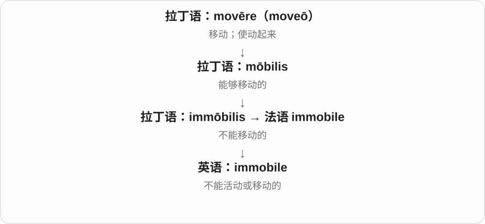

可指身体活动受限，也可指设备固定。比 motionless 更容易突出缺少移动能力。

**常见搭配与例句**

remain immobile；an immobile vehicle；almost immobile。

> The damaged vehicle was completely immobile.

受损车辆完全无法移动。

> He kept his injured arm immobile.

他让受伤的手臂保持不动。

**别混淆**

immobile 不等于 mobile phone 没信号；它说移动能力或状态。

### 23. immobility — 不动；不能移动的状态

**音标**：英 /ˌɪməʊˈbɪləti/；美 /ˌɪmoʊˈbɪləti/

**先抓住这个画面**

immobility 像一个身体或装置被固定住，失去了自由改变位置的能力。

**怎么拆**

来自法语 immobilité；现代对应 immobile + -ity。

**怎么变成今天的意思**

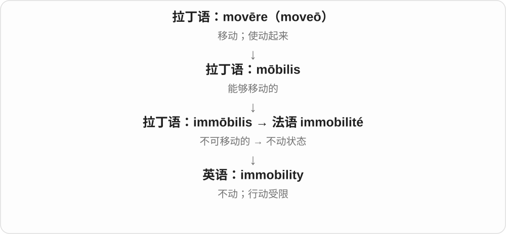

它讨论状态或能力，既可是真实身体运动，也可比喻社会位置难以变化。

**常见搭配与例句**

prolonged immobility；temporary immobility；social immobility。

> The machine’s immobility puzzled the engineer.

机器完全不动，让工程师感到困惑。

> The story explores social immobility in a small town.

故事探讨小镇里社会地位难以改变的现象。

**别混淆**

immobility 不是 immortality“永生”；中间分别连着移动与死亡的不同词根。

### 24. immobilize — 使不能动；使停止活动

**音标**：英 /ɪˈməʊbəlaɪz/；美 /ɪˈmoʊbəlaɪz/

**先抓住这个画面**

immobilize 是把还能动的东西限制住，让它不能继续移动或行动。

**怎么拆**

来自法语 immobiliser；现代可分析为 immobile + -ize，英式也拼 immobilise。

**怎么变成今天的意思**

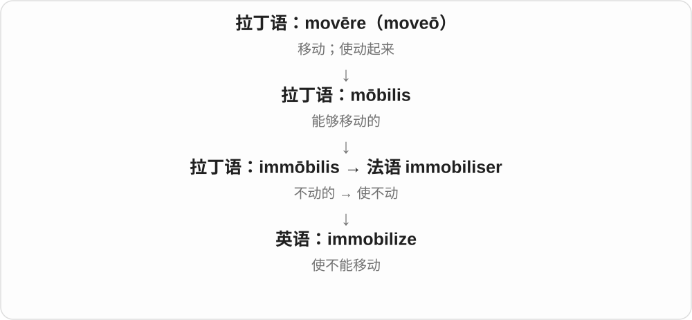

可形容设备被故障卡住、交通被天气阻断，也可用于身体固定的描述。

**常见搭配与例句**

immobilize a vehicle；be immobilized by；immobilize a joint。

> The heavy snow immobilized several vehicles.

大雪使几辆车无法行驶。

> The locking mechanism immobilizes the wheel.

锁定机构让轮子不能转动。

**别混淆**

immobile 是状态，immobilize 是使进入这种状态的动作。

### 25. emotion — 情绪；情感

**音标**：英 /ɪˈməʊʃən/；美 /ɪˈmoʊʃən/

**先抓住这个画面**

emotion 像心里原本平静的水被搅动，出现开心、害怕、愤怒或感动等变化。

**怎么拆**

来自法语 émotion，连着 émouvoir“激起”；远源是拉丁语 ē-（向外）+ movēre。

**怎么变成今天的意思**

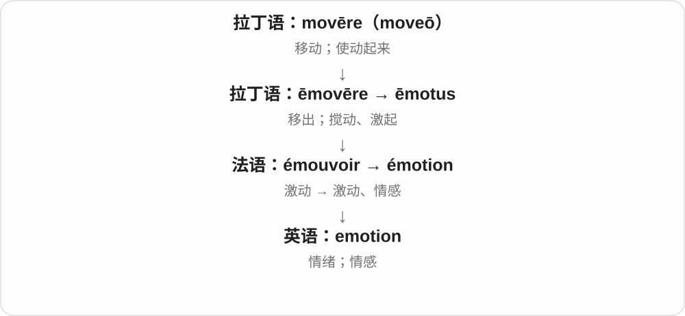

从搅动、激动发展为心理感受。这个画面是帮助理解，不表示情绪一定外露或剧烈。

**常见搭配与例句**

show emotion；mixed emotions；strong emotion。

> She spoke with deep emotion.

她说话时饱含深情。

> He felt a mixture of emotions when he returned home.

回家时，他百感交集。

**别混淆**

emotion 是某种感受；mood 更常是持续一段时间的整体心境。

### 26. emotional — 情感的；情绪激动的；令人动情的

**音标**：英 /ɪˈməʊʃənəl/；美 /ɪˈmoʊʃənəl/

**先抓住这个画面**

emotional 有时说“涉及心里的感受”，有时说感受涌上来、难以平静。

**怎么拆**

emotion + -al，构成形容词。

**怎么变成今天的意思**

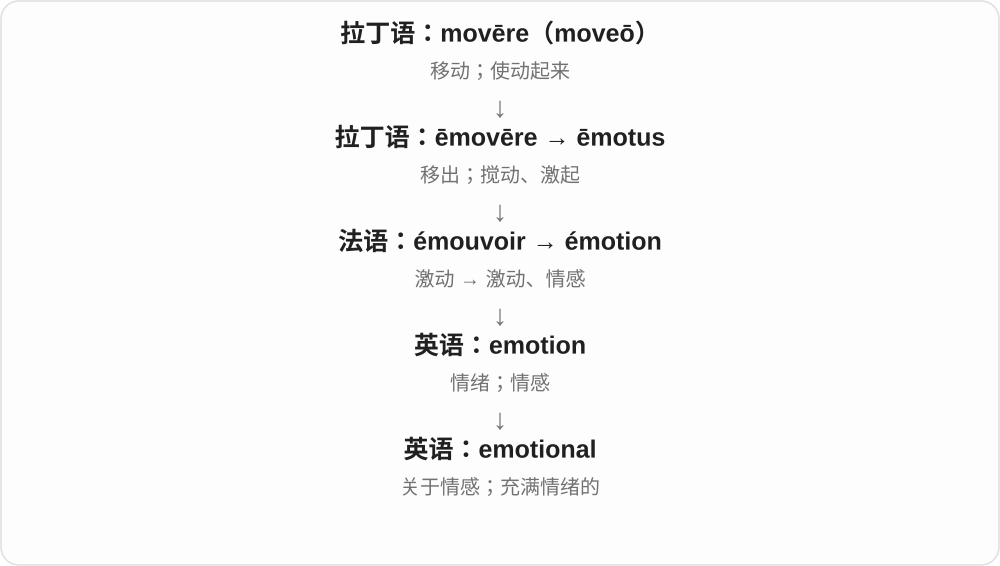

emotional support 是情感支持，不是“激动的支持”；an emotional farewell 则是充满情感的告别。

**常见搭配与例句**

emotional support；an emotional response；get emotional。

> She needed emotional support after the move.

搬家后，她需要情感上的支持。

> It was an emotional farewell.

那是一次令人动情的告别。

**别混淆**

emotional 不自动等于 irrational“不理性”；有情感并不代表判断错误。

### 27. emotionally — 在情感上；动情地

**音标**：英 /ɪˈməʊʃənəli/；美 /ɪˈmoʊʃənəli/

**先抓住这个画面**

emotionally 可以把讨论限定在内心感受这一层，也可以描写说话时情绪涌出来。

**怎么拆**

emotional + -ly。

**怎么变成今天的意思**

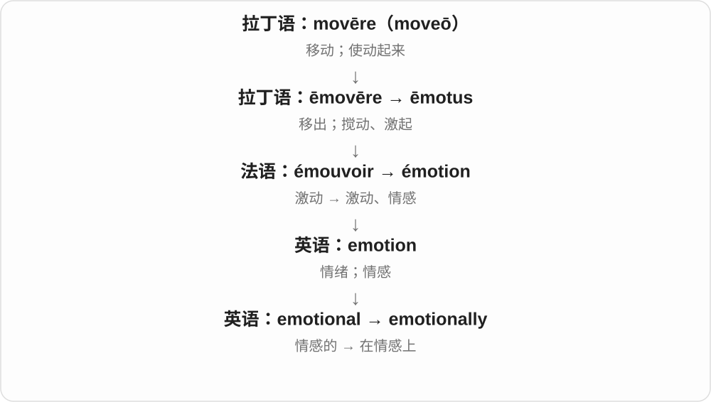

emotionally difficult 不一定体力累，而是心理感受上难承受；speak emotionally 则是动情地说。

**常见搭配与例句**

emotionally attached；emotionally difficult；respond emotionally。

> The decision was emotionally difficult for her.

这个决定在情感上让她很难接受。

> He became emotionally attached to the old house.

他对那座老房子产生了深厚感情。

**别混淆**

physically 是身体层面；emotionally 是情感层面，一件事可能只在其中一方面吃力。

### 28. emotionality — 情绪性；情绪反应的程度或倾向

**音标**：英 /ɪˌməʊʃəˈnæləti/；美 /ɪˌmoʊʃəˈnæləti/

**先抓住这个画面**

emotionality 观察的是一个人多容易起情绪、情绪反应有多明显。

**怎么拆**

emotional + -ity。

**怎么变成今天的意思**

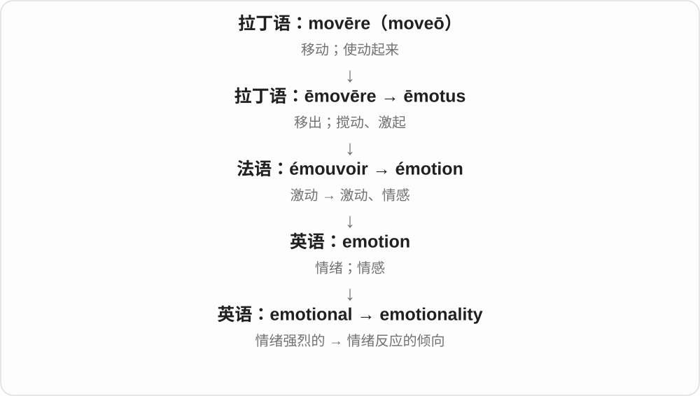

可以是中性的研究用词，也可以评价叙述的情感浓度；不能直接等同“不理性”。

**常见搭配与例句**

heightened emotionality；emotionality in children；the emotionality of a speech。

> The study tracked changes in emotionality over time.

研究追踪了情绪反应倾向随时间的变化。

> The emotionality of the speech surprised the audience.

演讲中强烈的情感让听众有些意外。

**别混淆**

emotion 是某种具体情绪；emotionality 是产生或表现情绪的特征。

### 29. unemotional — 不动感情的；冷静平实的

**音标**：英 /ˌʌnɪˈməʊʃənəl/；美 /ˌʌnɪˈmoʊʃənəl/

**先抓住这个画面**

unemotional 像把感情暂时放到一旁，用平稳语气把情况讲清楚。

**怎么拆**

un-（不）+ emotional。

**怎么变成今天的意思**

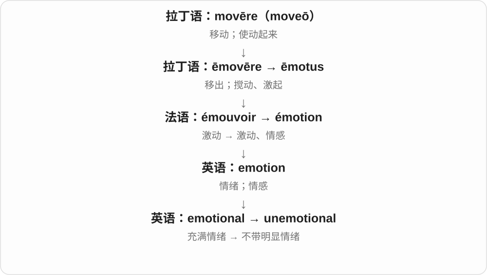

可以形容人不外露，也可赞成一种平实分析方式；并不说明这个人没有情感能力。

**常见搭配与例句**

an unemotional account；remain unemotional；an unemotional tone。

> She gave a clear, unemotional account of the event.

她清楚、平静地叙述了事情经过。

> His tone remained unemotional throughout the interview.

整个访谈中，他的语气一直很平静。

**别混淆**

unemotional 可强调克制和平静；emotionless 更容易给人完全没有情绪表现的感觉。

### 30. emotionless — 不显露情绪的；无情感的

**音标**：英 /ɪˈməʊʃənləs/；美 /ɪˈmoʊʃənləs/

**先抓住这个画面**

emotionless 像脸上看不到波纹，声音也没有明显起伏，让观察者读不出感受。

**怎么拆**

emotion + -less（没有）。

**怎么变成今天的意思**

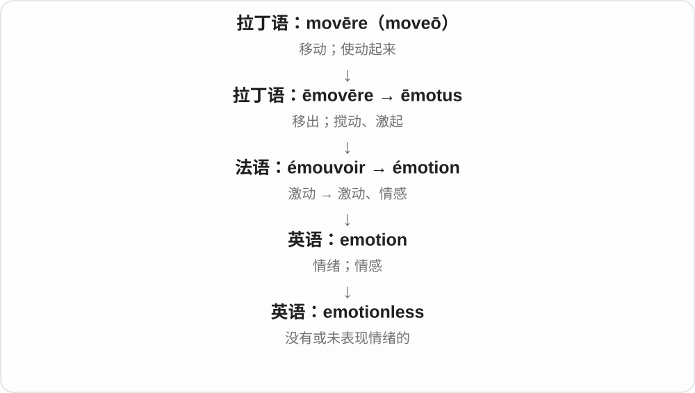

描写表情、声音时，通常是说外表看不出来，不足以证明一个人内心真的毫无感受。

**常见搭配与例句**

an emotionless voice；an emotionless expression；remain emotionless。

> He read the statement in an emotionless voice.

他用毫无情绪起伏的声音读了声明。

> Her face remained emotionless.

她的脸上仍看不出情绪。

**别混淆**

calm 是平静，emotionless 更强调看不出情绪；平静的人仍可温暖、有感情。

### 31. motion — 运动；移动；手势；正式动议

**音标**：英 /ˈməʊʃən/；美 /ˈmoʊʃən/

**先抓住这个画面**

motion 是东西动起来的状态；在会议里，则像把一件事推到桌面上，请大家正式决定。

**怎么拆**

经法语来自拉丁语 mōtiō“移动”，与 movēre 相连。

**怎么变成今天的意思**

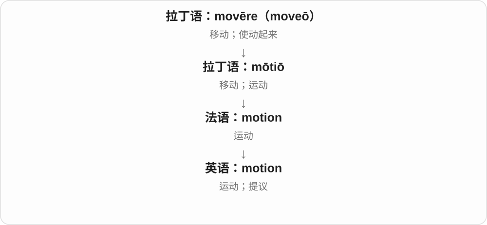

运动义最直观；议事中的动议是正式提出供讨论、表决的事项。动词还可表示打手势示意。

**常见搭配与例句**

in motion；set in motion；a motion to do；motion someone over。

> The wheels were already in motion.

车轮已经转起来了。

> The committee passed a motion to postpone the meeting.

委员会通过了推迟会议的动议。

**别混淆**

motion 是正式动议时，不等于随口一个 idea；通常有议事程序。

### 32. motionless — 一动不动的

**音标**：英 /ˈməʊʃənləs/；美 /ˈmoʊʃənləs/

**先抓住这个画面**

motionless 像把画面按下暂停，观察到的对象此刻没有动作。

**怎么拆**

motion + -less（没有）。

**怎么变成今天的意思**

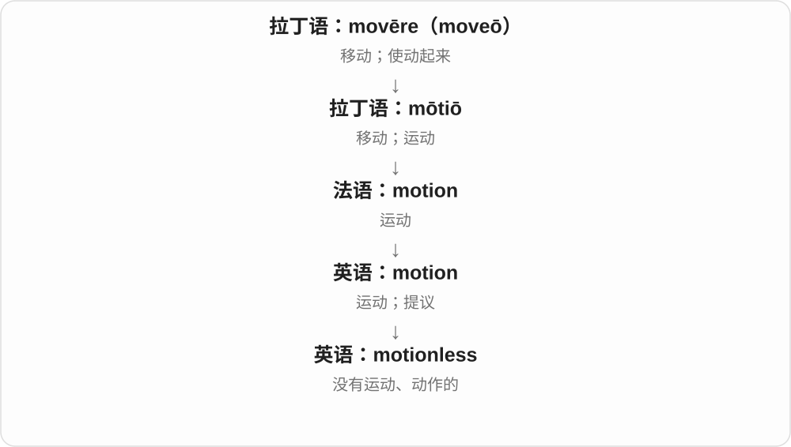

描述当下状态，不必意味着永久不能动。一个人可以主动站着不动。

**常见搭配与例句**

stand motionless；lie motionless；remain motionless。

> The bird remained motionless on the branch.

鸟一动不动地停在枝头。

> She stood motionless as the door opened.

门打开时，她站着一动不动。

**别混淆**

immobile 更可能强调不能移动；motionless 先说此刻没在动。

### 33. motional — 运动的；与运动有关的

**音标**：英 /ˈməʊʃənəl/；美 /ˈmoʊʃənəl/

**先抓住这个画面**

motional 把注意力放在物体“正在怎样动”，常修饰某种状态或由运动产生的效应。

**怎么拆**

motion + -al。

**怎么变成今天的意思**

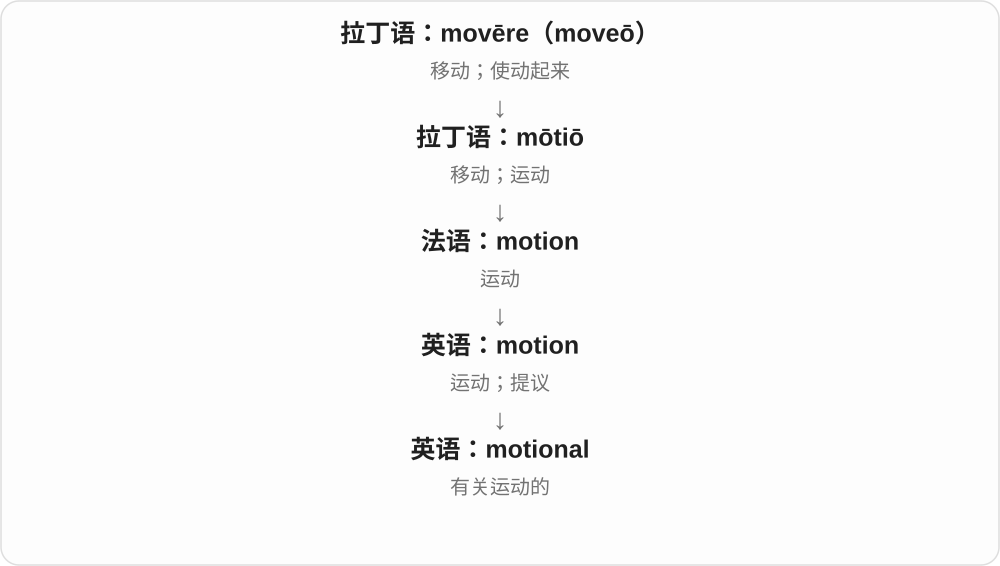

是技术性形容词，普通表达多用 movement 或 motion 作修饰。不能少看一个 e 就把它当 emotional。

**常见搭配与例句**

motional states；motional energy；motional effects。

> The model describes the particle’s motional state.

这个模型描述粒子的运动状态。

> The experiment measured a motional effect in the field.

实验测量了场中一种由运动产生的效应。

**别混淆**

motional 与运动有关；emotional 与情绪有关；motor 常强调运动机能或动力装置。

### 34. countermotion — 反向运动；对抗先前动议的动议

**音标**：英 /ˈkaʊntəˌməʊʃən/；美 /ˈkaʊntərˌmoʊʃən/

**先抓住这个画面**

countermotion 一边可以是向相反方向摆动，另一边可以是在程序中提出一项回应动议。

**怎么拆**

counter-（反向、回应）+ motion。

**怎么变成今天的意思**

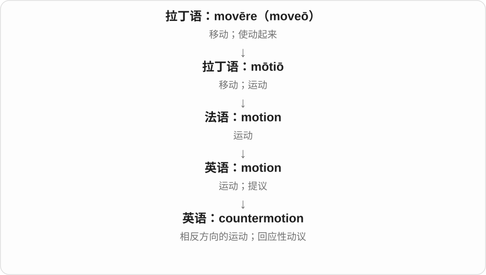

技术文献看运动方向，程序文献看双方提出的请求。词形相同不代表两种用法能混讲。

**常见搭配与例句**

a balancing countermotion；file a countermotion；a countermotion to dismiss。

> A small countermotion helped keep the platform balanced.

一个小幅反向动作帮助平台保持平衡。

> The opposing party filed a countermotion.

对方提交了一项回应动议。

**别混淆**

countermove 泛指应对行动；countermotion 在法律场景明确是一项动议。

### 35. promote — 促进；推广；晋升

**音标**：英 /prəˈməʊt/；美 /prəˈmoʊt/

**先抓住这个画面**

promote 像从后面推一把，让人往更高职位走，让产品被更多人看见，让某种发展向前。

**怎么拆**

pro-（向前）+ movēre，形成 prōmovēre；英语采用 prōmōt- 词干。

**怎么变成今天的意思**

核心是推进，但推进的对象不同：员工是晋升，商品是推广，合作则是促进。

**常见搭配与例句**

promote to manager；promote a product；promote cooperation。

> She was promoted to team leader.

她被提升为团队负责人。

> The campaign promotes reading among children.

这项活动促进儿童阅读。

**别混淆**

promote 不等于只打广告；政策促进学习、方法促进理解也可用。

### 36. promotion — 晋升；推广；促销活动

**音标**：英 /prəˈməʊʃən/；美 /prəˈmoʊʃən/

**先抓住这个画面**

promotion 是一次“往前推”的安排：把员工往上提，或把商品推到顾客面前。

**怎么拆**

来自拉丁语 prōmōtiō，经法语传入；与 promote 对应，但有独立的名词历史。

**怎么变成今天的意思**

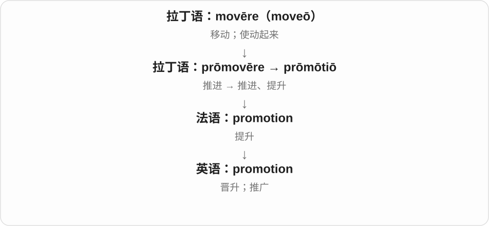

工作语境多指升职，商业语境多指宣传推广，也可具体指一次促销。

**常见搭配与例句**

get a promotion；sales promotion；the promotion of learning。

> He received a promotion after three years.

工作三年后，他获得了晋升。

> The store is running a summer promotion.

商店正在举办夏季促销活动。

**别混淆**

promotion 可能包含打折，但不等于 discount；不降价的宣传也可算 promotion。

### 37. promotional — 宣传推广的；促销的

**音标**：英 /prəˈməʊʃənəl/；美 /prəˈmoʊʃənəl/

**先抓住这个画面**

promotional 像把产品介绍递到潜在顾客手中，目的是让更多人知道并愿意选择它。

**怎么拆**

promotion + -al。

**怎么变成今天的意思**

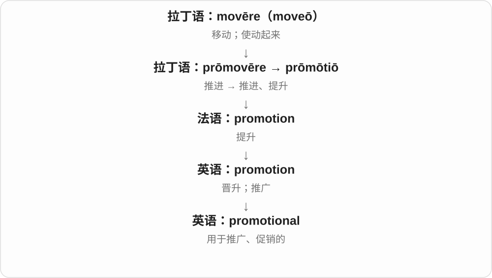

常修饰视频、材料、活动、价格。它说明用途，不自动说明里面每项内容都是客观评价。

**常见搭配与例句**

promotional material；a promotional video；a promotional offer。

> They released a promotional video for the exhibition.

他们发布了展览宣传视频。

> The shop offered a promotional price for the first week.

商店在第一周提供促销价。

**别混淆**

promotional 说宣传用途；informative 说信息有帮助，两者可以同时成立。

### 38. promoter — 推广者；活动主办者；启动子

**音标**：英 /prəˈməʊtə/；美 /prəˈmoʊtər/

**先抓住这个画面**

promoter 是把活动或想法往前推的一方；生物学里，同样的“推动”形象用于帮助启动转录的 DNA 区域。

**怎么拆**

promote + -er，表示促成、推进的一方。

**怎么变成今天的意思**

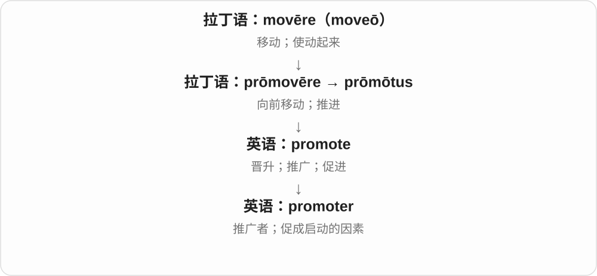

演出推广者可能负责组织宣传；科学中的 promoter 则是专业名称，不能按一般职业义理解。

**常见搭配与例句**

a concert promoter；a promoter of reform；a gene promoter。

> The promoter arranged three concerts in the city.

活动主办者在城里安排了三场演唱会。

> The diagram marks the gene’s promoter region.

图中标出了这个基因的启动子区域。

**别混淆**

promoter 是推动者；promotion 是推广或晋升的过程。promotor 还有特定大学职务用法。

### 39. demote — 使降职；把……降级

**音标**：英 /dɪˈməʊt/；美 /dɪˈmoʊt/

**先抓住这个画面**

demote 是把某人的职位，或某件事的优先级往下移。

**怎么拆**

仿照 promote，将表示向前的 pro- 换成 de-（向下）；是英语内部造出的相对词。

**怎么变成今天的意思**

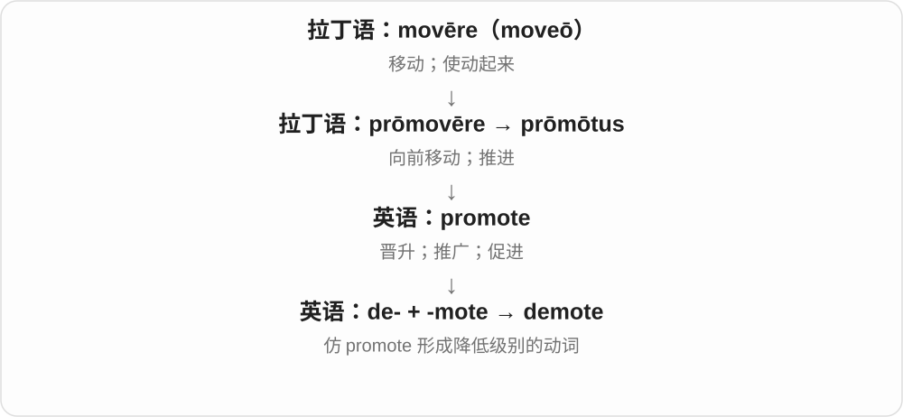

不仅用于人，软件里的任务也可能被降低优先级；不一定把对象完全移除。

**常见搭配与例句**

demote someone to；demote a task；be demoted from。

> He was demoted to a less senior role.

他被降到了级别更低的岗位。

> The system demotes inactive tasks to a lower priority.

系统把不活跃任务的优先级调低。

**别混淆**

promote 向上提，demote 向下降；remove 是移除。

### 40. demotion — 降职；降级

**音标**：英 /dɪˈməʊʃən/；美 /dɪˈmoʊʃən/

**先抓住这个画面**

demotion 像组织阶梯上的位置被往下挪了一格，权限或级别降低。

**怎么拆**

demote + -ion；demote 本身仿照 promote 改用 de- 表示向下。

**怎么变成今天的意思**

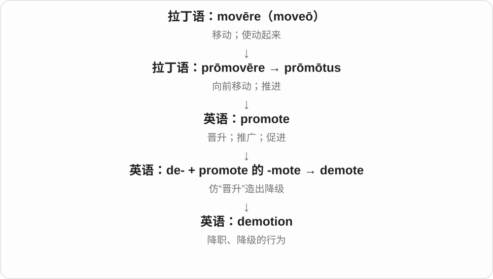

与 promotion 方向相反。降职不等于直接解雇，人可能仍在原组织里。

**常见搭配与例句**

a demotion in rank；face demotion；a demotion to a lower grade。

> He regarded the transfer as a demotion.

他把这次调动视为降职。

> The change involved a demotion in rank.

这项变动涉及级别降低。

**别混淆**

demotion 是级别下降；dismissal 是被解除职位或雇佣关系。

### 41. promotor — 博士研究的主要导师（某些国家高校用语）

**音标**：英 /prəˈməʊtə/；美 /prəˈmoʊtər/

**先抓住这个画面**

promotor 在这里不是做宣传的人，而是推动博士研究、承担主要指导职责的教授。

**怎么拆**

promote 一族的 -or 人称形式；在一些欧洲及南非高校形成专门职位称呼。

**怎么变成今天的意思**

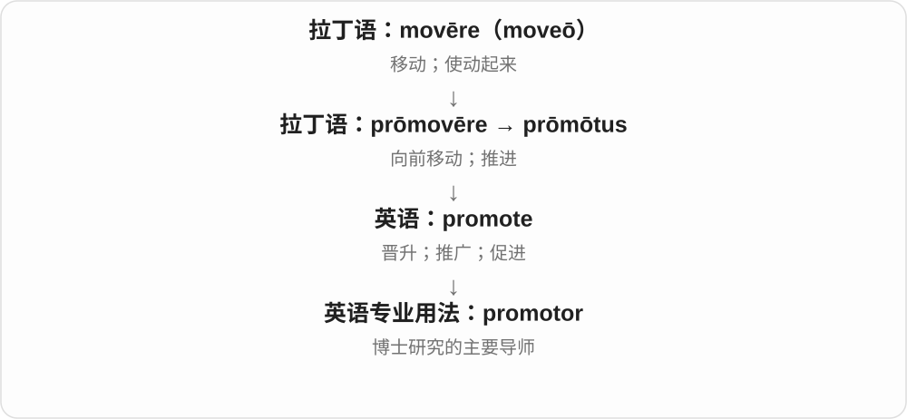

具体资格和职责要看高校制度。阅读此词时，大学与博士论文的场景比“推动者”的字面拆分更有用。

**常见搭配与例句**

a doctoral promotor；appoint a promotor；the candidate’s promotor。

> Her promotor helped her shape the doctoral project.

她的主要博士导师帮助她确定研究项目的方向。

> The candidate thanked his promotor at the ceremony.

这位博士候选人在仪式上感谢了自己的主要导师。

**别混淆**

promoter 通常指推广者或其他领域的促进因子；promotor 在这一用法中是特定学术角色。

### 42. promotive — 起促进作用的（正式、少见）

**音标**：英 /prəˈməʊtɪv/；美 /prəˈmoʊtɪv/

**先抓住这个画面**

promotive 说某个因素把事情往前推，帮助它发生或发展。

**怎么拆**

promote + -ive。

**怎么变成今天的意思**

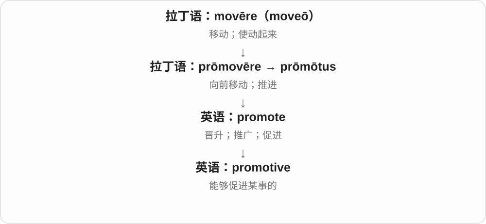

通常描述作用而非职位晋升。现代普通文体用 supportive 或 that promotes 往往更自然。

**常见搭配与例句**

promotive of cooperation；a promotive effect；promotive factors。

> The authors describe dialogue as promotive of trust.

作者把对话描述为有助于建立信任。

> The study examined the promotive effect of feedback.

研究考察了反馈的促进作用。

**别混淆**

promotional 常指推广宣传的；promotive 强调产生促进作用。

### 43. motor — 马达；发动机；运动的

**音标**：英 /ˈməʊtə/；美 /ˈmoʊtər/

**先抓住这个画面**

motor 像把别的能量变成动作的心脏，让风扇转、车辆走或装置动。

**怎么拆**

来自拉丁语 mōtor“推动者”，与 movēre 的 mot- 词干相连。

**怎么变成今天的意思**

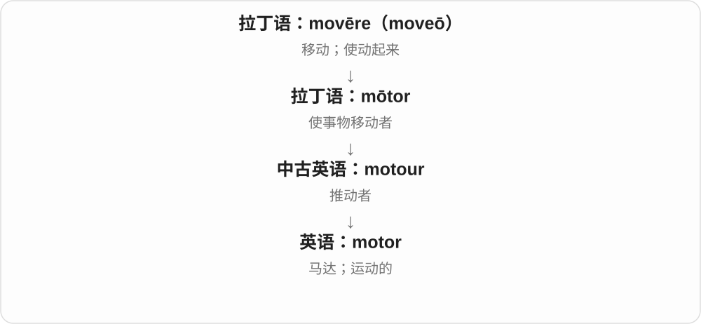

机械里是驱动装置；motor skills 中是身体运动控制能力，身体里并没有一个叫马达的小机器。

**常见搭配与例句**

an electric motor；motor skills；motor vehicles。

> The fan’s motor stopped working.

风扇的马达不转了。

> The game helps children practise fine motor skills.

这个游戏帮助孩子练习精细动作能力。

**别混淆**

engine 与 motor 有重叠；motor 尤其常见于电动驱动，也可泛指车辆发动机。

### 44. motorcycle — 摩托车

**音标**：英 /ˈməʊtəsaɪkəl/；美 /ˈmoʊtərsaɪkəl/

**先抓住这个画面**

motorcycle 是把 motor 的动力装到两轮车结构上，不再只靠人蹬踏前进。

**怎么拆**

motor + cycle；词形与早期法国 Motorcyclette 的命名历史有关。

**怎么变成今天的意思**

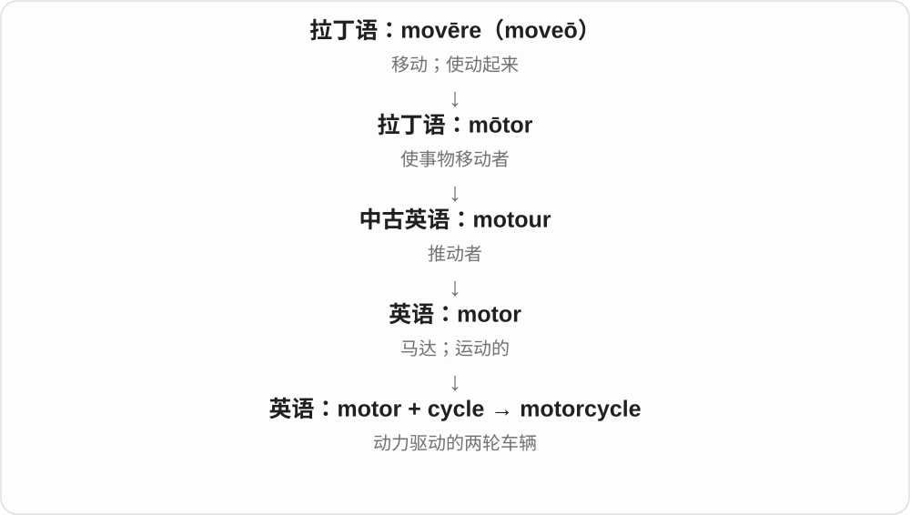

cycle 指轮式车辆这一支；现代通常是有车把、开放式乘坐的摩托车。

**常见搭配与例句**

ride a motorcycle；a motorcycle helmet；a motorcycle engine。

> She rides a motorcycle to work.

她骑摩托车上班。

> The museum displays an early motorcycle.

博物馆展示了一辆早期摩托车。

**别混淆**

motorcycle 用 ride；普通汽车常用 drive。motorbike 是更口语的近义词。

### 45. motorcyclist — 摩托车骑手

**音标**：英 /ˈməʊtəsaɪklɪst/；美 /ˈmoʊtərsaɪklɪst/

**先抓住这个画面**

motorcyclist 是坐在摩托车上驾驶的人，而不只是喜欢看摩托车的人。

**怎么拆**

motorcycle + -ist；也能看作 motor + cyclist。

**怎么变成今天的意思**

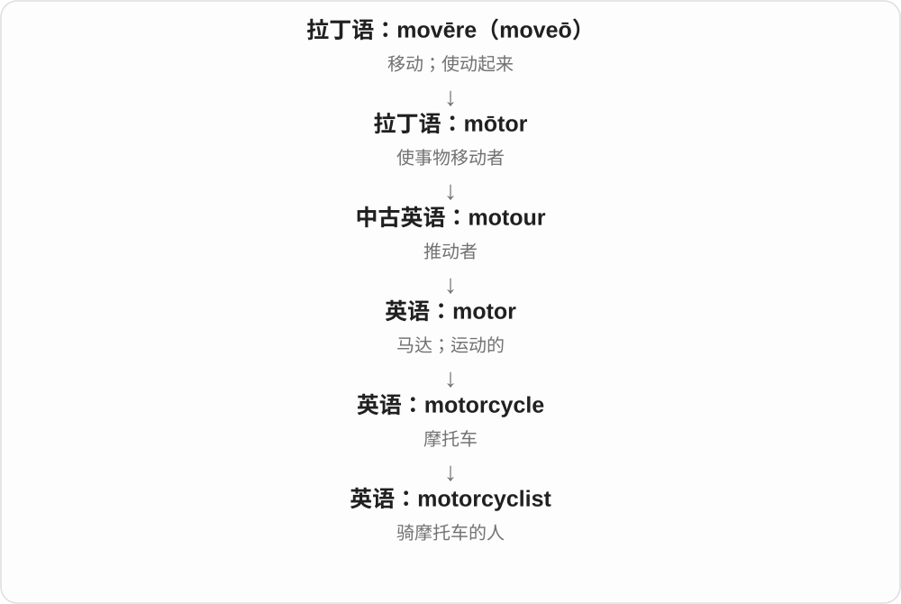

这个名称常从道路使用者或运动参与者角度分类，不说明他是职业车手。

**常见搭配与例句**

a motorcyclist’s helmet；passing motorcyclists；an experienced motorcyclist。

> The motorcyclist stopped at the crossing.

摩托车骑手在人行横道前停下。

> Several motorcyclists were waiting by the café.

几位摩托车骑手在咖啡馆旁等候。

**别混淆**

cyclist 常指骑自行车的人；motorcyclist 明确是摩托车骑手。

### 46. motorway — 高速公路（英式）

**音标**：英 /ˈməʊtəweɪ/；美 /ˈmoʊtərweɪ/

**先抓住这个画面**

motorway 是供机动车快速通行的一类道路，画面重点是车流与一般街道分开组织。

**怎么拆**

motor + way（道路）。

**怎么变成今天的意思**

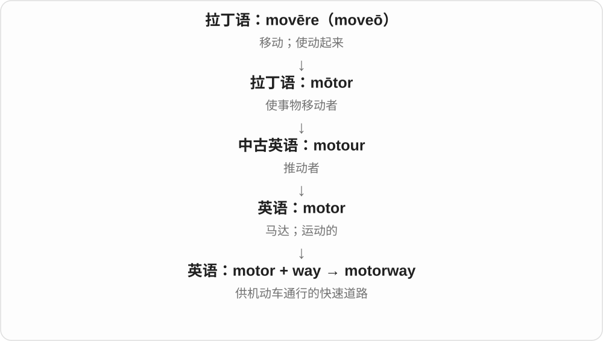

这是英式常用名称；不同地区具体道路标准和名称不同，不能只靠词根判断交通规则。

**常见搭配与例句**

join the motorway；a motorway junction；motorway traffic。

> We left the motorway at the next junction.

我们在下一个出口驶离了高速公路。

> Motorway traffic was heavy that evening.

那天晚上高速公路车流很大。

**别混淆**

road 范围最广；motorway 是特定道路类型。美式常见 freeway 或 expressway。

### 47. motorbike — 摩托车

**音标**：英 /ˈməʊtəbaɪk/；美 /ˈmoʊtərbaɪk/

**先抓住这个画面**

motorbike 像 bike 加上 motor，成为靠发动机行驶的两轮车。

**怎么拆**

motor + bike；bike 是 bicycle 的口语缩短形式。

**怎么变成今天的意思**

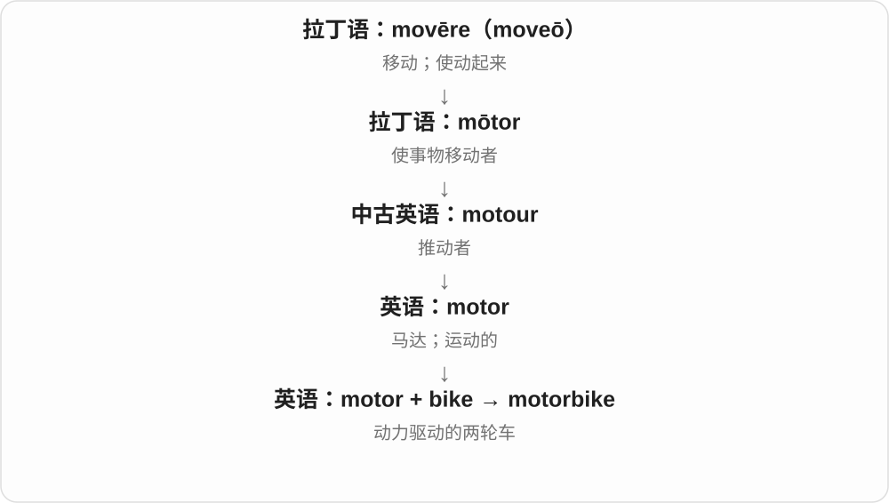

常用作 motorcycle 的口语近义词，有时更让人想到轻型摩托车，但并非各地都严格区分。

**常见搭配与例句**

ride a motorbike；a motorbike rider；a motorbike engine。

> He parked his motorbike outside the café.

他把摩托车停在咖啡馆外。

> We heard a motorbike coming down the road.

我们听见一辆摩托车沿路驶来。

**别混淆**

bike 单独使用可指自行车，也可能在语境里指摩托车；motorbike 更明确。

### 48. motorsport — 赛车运动；机动车竞技运动

**音标**：英 /ˈməʊtəspɔːt/；美 /ˈmoʊtərspɔːrt/

**先抓住这个画面**

motorsport 把机动车变成比赛工具，赛车只是其中最熟悉的画面。

**怎么拆**

motor + sport。

**怎么变成今天的意思**

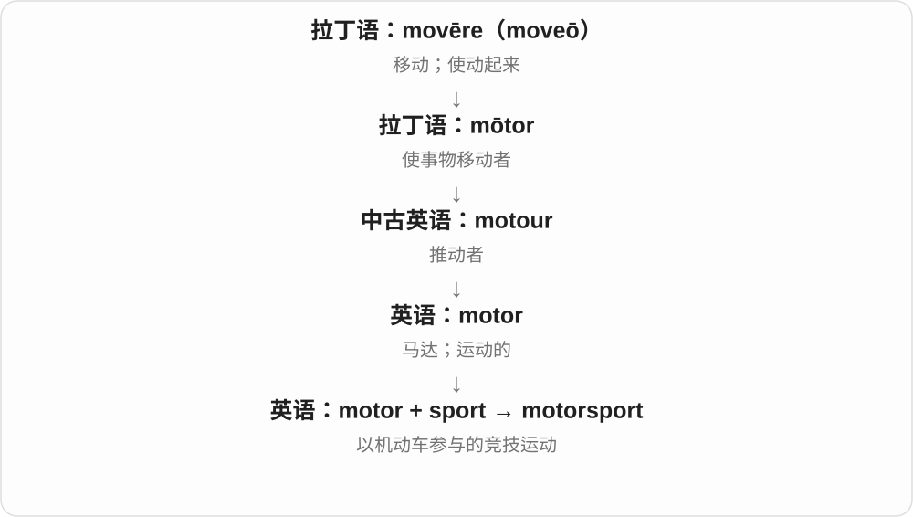

可泛指赛车及相关竞技，不是所有驾驶活动都算运动比赛。

**常见搭配与例句**

motorsport fans；a motorsport event；a career in motorsport。

> She works as an engineer in motorsport.

她在赛车运动领域担任工程师。

> The festival includes a motorsport exhibition.

节庆活动包括赛车运动展览。

**别混淆**

motorist 是普通驾驶者；motorsport 强调竞技领域。

### 49. motorist — 机动车驾驶者；开车的人

**音标**：英 /ˈməʊtərɪst/；美 /ˈmoʊtərɪst/

**先抓住这个画面**

motorist 是从道路交通的角度称呼开车的人，常在路况、规则和出行报道中出现。

**怎么拆**

motor + -ist，表示与这种车辆活动有关的人。

**怎么变成今天的意思**

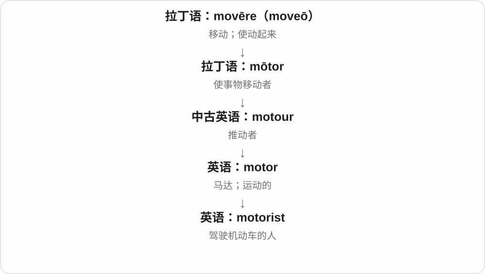

强调驾驶者这个道路使用者身份，不是修理马达的技师，也不一定是赛车手。

**常见搭配与例句**

passing motorists；motorists and cyclists；a stranded motorist。

> Motorists were advised to avoid the flooded road.

有关方面建议驾车者避开积水道路。

> A passing motorist stopped to help.

一位路过的司机停下来帮忙。

**别混淆**

driver 更通用，也可指各种车辆；motorist 常让人想到开汽车的道路使用者。

### 50. motorboat — 汽艇；机动船

**音标**：英 /ˈməʊtəbəʊt/；美 /ˈmoʊtərboʊt/

**先抓住这个画面**

motorboat 是用发动机推动的船，区别于只靠划桨或风帆前进的船。

**怎么拆**

motor + boat。

**怎么变成今天的意思**

通常让人想到较小的机动船；词本身不说明发动机安装在船内还是船外。

**常见搭配与例句**

rent a motorboat；a small motorboat；a motorboat engine。

> They crossed the lake in a small motorboat.

他们乘小汽艇渡过湖面。

> The motorboat slowed near the dock.

汽艇靠近码头时减速了。

**别混淆**

sailboat 以帆为特征；motorboat 以动力装置为特征，有些船兼具两种能力。

### 51. motorcar — 汽车（较旧式）

**音标**：英 /ˈməʊtəkɑː/；美 /ˈmoʊtərkɑːr/

**先抓住这个画面**

motorcar 的画面是历史上给马车结构加上动力，从此不需要马拉。

**怎么拆**

motor + car，明确这是靠机械动力行驶的车。

**怎么变成今天的意思**

现代普通说 car 已经够了，motorcar 常带历史、传统或较正式语气。

**常见搭配与例句**

an early motorcar；a vintage motorcar；motorcar production。

> The museum owns several early motorcars.

博物馆收藏了几辆早期汽车。

> The photograph shows a family beside their new motorcar.

照片里，一家人站在新汽车旁。

**别混淆**

motorcar 通常是汽车；motorcycle 是摩托车，不能都译成同一种车。

### 52. motorhead — 汽车或摩托车迷（口语）

**音标**：英 /ˈməʊtəhed/；美 /ˈmoʊtərhed/

**先抓住这个画面**

motorhead 像脑子里总在转着发动机、零件和车的人，是对车辆很着迷的爱好者。

**怎么拆**

motor + -head；这里 -head 非正式地指热衷某事的人。

**怎么变成今天的意思**

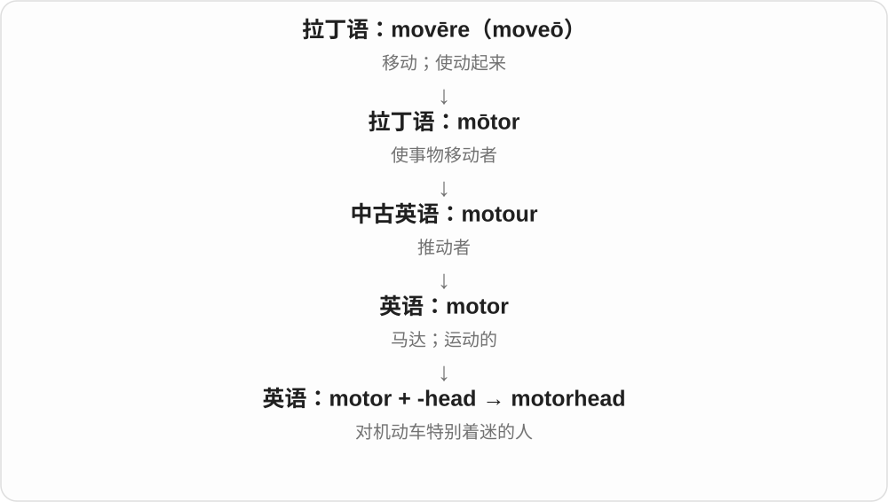

常是车迷之间的轻松称呼。个别旧俚语另有药物使用者义，不宜脱离语境猜。

**常见搭配与例句**

a lifelong motorhead；a motorhead’s garage；口语。

> My uncle is a motorhead who restores old cars.

我叔叔是个修复老爷车的汽车迷。

> The show attracted motorheads from across the region.

车展吸引了整个地区的汽车爱好者。

**别混淆**

motorist 是驾驶者；motorhead 是爱好特别浓的人，开车不一定是车迷。

### 53. psychomotor — 精神运动的；心理活动与身体动作相联系的

**音标**：英 /ˌsaɪkəʊˈməʊtə/；美 /ˌsaɪkoʊˈmoʊtər/

**先抓住这个画面**

psychomotor 像“脑子判断、身体执行”这条协作链：看见目标，决定动作，再把手伸过去。

**怎么拆**

psycho-（心理）+ motor（运动的）；希腊来源和拉丁来源组合成的现代术语。

**怎么变成今天的意思**

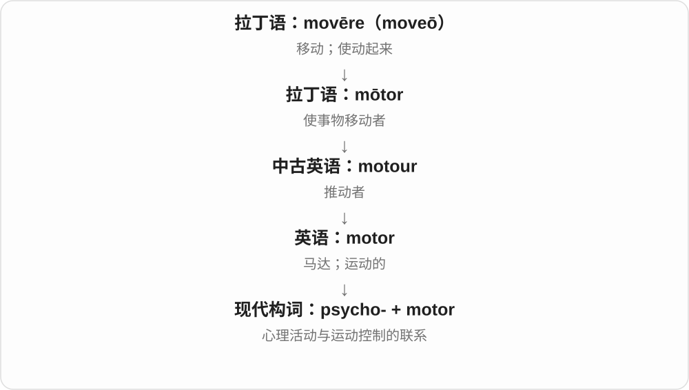

常见于动作技能、反应任务与临床观察。这里不是“心理马达”，而是心理过程怎样表现为身体动作。

**常见搭配与例句**

psychomotor skills；psychomotor development；a psychomotor task。

> The exercise develops basic psychomotor skills.

这项练习培养基本的感知与动作配合能力。

> Participants completed a simple psychomotor task.

参与者完成了一项简单的心理运动任务。

**别混淆**

motor skills 侧重运动技能；psychomotor 更强调认知、感知与动作之间的配合。

### 54. bimotor — 双发动机飞机；双马达的

**音标**：英 /baɪˈməʊtə/；美 /baɪˈmoʊtər/

**先抓住这个画面**

bimotor 直接数动力装置：一架飞机有两个发动机，因此叫双发。

**怎么拆**

bi-（二）+ motor。

**怎么变成今天的意思**

主要是较少见的航空用词。现代常说 twin-engine aircraft；不要把两个发动机误解成两片机翼。

**常见搭配与例句**

a bimotor aircraft；an early bimotor；航空历史阅读。

> The museum displayed an early bimotor aircraft.

博物馆展出了一架早期双发飞机。

> The pilot flew the bimotor across the bay.

飞行员驾驶双发飞机飞越海湾。

**别混淆**

bimotor 数发动机，biplane 数上下两层机翼。

### 55. trimotor — 三发动机的；三发飞机

**音标**：英 /traɪˈməʊtə/；美 /traɪˈmoʊtər/

**先抓住这个画面**

trimotor 直接数三个动力装置，航空史中常指装有三台活塞发动机的飞机。

**怎么拆**

tri-（三）+ motor。

**怎么变成今天的意思**

可作形容词，也可把这类飞机直接叫 a trimotor。重点是发动机数，不是座位或机翼数。

**常见搭配与例句**

a trimotor aircraft；an early trimotor；a classic trimotor。

> The old trimotor carried passengers across the mountains.

那架旧式三发飞机载着乘客飞越群山。

> A restored trimotor aircraft stood beside the hangar.

一架修复后的三发飞机停在机库旁。

**别混淆**

bimotor 是双发，trimotor 是三发；现代喷气飞机常按具体类型说 trijet。

### 56. remote — 遥远的；偏僻的；远程的；可能性很小的

**音标**：英 /rɪˈməʊt/；美 /rɪˈmoʊt/

**先抓住这个画面**

remote 像东西被移到很远处：离人群远，离操作的人远，或离“会发生”这个结果很远。

**怎么拆**

来自拉丁语 remōtus“移开的”，经法语传入；与 remove 同源，不是 remove 的现代过去式。

**怎么变成今天的意思**

远处可指地理位置、时间或联系。a remote chance 是希望很渺茫；a remote 作名词常是遥控器。

**常见搭配与例句**

a remote village；remote work；a remote possibility；the remote。

> They live in a remote mountain village.

他们住在一个偏远山村。

> There is only a remote chance of rain.

下雨的可能性很小。

**别混淆**

remote 不等于 isolated：前者强调远，后者强调隔离、缺少联系。

### 57. remotely — 远程地；丝毫（常用于否定）

**音标**：英 /rɪˈməʊtli/；美 /rɪˈmoʊtli/

**先抓住这个画面**

remotely 可以是人在远处操作；not remotely 则像说距离“有一点像”都还远得很。

**怎么拆**

remote + -ly。

**怎么变成今天的意思**

现代常说远程工作、控制；否定句里强调完全不，如 not remotely interested。

**常见搭配与例句**

work remotely；remotely controlled；not remotely similar。

> The system can be monitored remotely.

这个系统可以远程监控。

> The two designs are not remotely similar.

这两种设计一点也不像。

**别混淆**

remotely 不一定意味着在家；任何不在现场的远程地点都可能符合。

### 58. remoteness — 偏远；疏远；距离遥远的状态

**音标**：英 /rɪˈməʊtnəs/；美 /rɪˈmoʊtnəs/

**先抓住这个画面**

remoteness 是距离带来的感觉或条件：难到达、联系少，也可能是一个人显得难以接近。

**怎么拆**

remote + -ness。

**怎么变成今天的意思**

可以说地理条件，也可比喻情感上的距离。不自动等于环境差或毫无联系。

**常见搭配与例句**

the remoteness of the village；geographical remoteness；emotional remoteness。

> The remoteness of the island makes transport difficult.

岛屿的偏远位置使交通不便。

> His apparent remoteness made conversation difficult.

他显得有些疏远，让交谈不容易展开。

**别混淆**

removal 是移除动作；remoteness 是遥远状态。

### 59. remotion — 移除；退离（古旧或少见）

**音标**：英 /rɪˈməʊʃən/；美 /rɪˈmoʊʃən/

**先抓住这个画面**

remotion 像把某物从眼前拿走，或把它向后移开。

**怎么拆**

经古法语或直接来自拉丁语 remōtiō，与 removēre“移走”同支。

**怎么变成今天的意思**

现代绝大多数场合用 removal。看到此词先考虑旧用法，不要直接当 emotion 前加 r。

**常见搭配与例句**

remotion from office；the remotion of an obstacle；旧式表达。

> The document records his remotion from office.

文件记录了他被免职的事。

> The writer called for the remotion of the obstacle.

作者呼吁移除这个障碍。

**别混淆**

remote 形容远离的状态；remotion 是移离的动作或结果。

### 60. mutual — 相互的；彼此的；共同的

**音标**：/ˈmjuːtʃuəl/

**先抓住这个画面**

mutual 像两条相对的箭头：我信任你，你也信任我；也可指我们共同拥有的东西。

**怎么拆**

经法语 mutuel 来自拉丁语 mūtuus“交换的、相互的”，是交换支线，不从 movēre 直接变来。

**怎么变成今天的意思**

相互关系可好可坏，mutual dislike 是彼此不喜欢。a mutual friend 在现代常指双方共同的朋友。

**常见搭配与例句**

mutual respect；mutual trust；a mutual friend。

> Their partnership is based on mutual trust.

他们的合作建立在相互信任上。

> We met through a mutual friend.

我们通过一位共同朋友认识。

**别混淆**

mutual 是两边都有；unilateral 是单方面。两边都有不等于程度完全相等。

### 61. mutually — 相互地；共同地

**音标**：/ˈmjuːtʃuəli/

**先抓住这个画面**

mutually 像两边都朝对方伸手，或一起接受同一件事。

**怎么拆**

mutual + -ly。

**怎么变成今天的意思**

mutually beneficial 是双方都受益；mutually exclusive 则是两项不能同时成立，不是“彼此排斥情绪”。

**常见搭配与例句**

mutually beneficial；mutually agreed；mutually exclusive。

> They reached a mutually acceptable agreement.

他们达成了双方都能接受的协议。

> These two explanations are not mutually exclusive.

这两种解释并非不能同时成立。

**别混淆**

mutually 看关系是否双向；equally 看程度是否相同，不能互换。

### 62. mutuality — 相互性；双方共同参与或承担的关系

**音标**：/ˌmjuːtʃuˈæləti/

**先抓住这个画面**

mutuality 是一段关系里双方都在回应：不是一边付出，另一边只是接收。

**怎么拆**

mutual + -ity，把“相互的”变成一种关系特征。

**怎么变成今天的意思**

常见于合作、关系或契约的抽象讨论。具体是否同等承担，要看语境，不能单凭此词认定完全平均。

**常见搭配与例句**

a sense of mutuality；mutuality of obligation；trust and mutuality。

> Their partnership grew from a strong sense of mutuality.

他们的伙伴关系建立在强烈的互相支持意识上。

> The discussion focused on mutuality of responsibility.

讨论集中在双方相互承担责任这一点上。

**别混淆**

mutuality 强调双向关系；equality 强调地位或数量相等。

### 63. mutualism — 互利共生；互助主义

**音标**：/ˈmjuːtʃuəlɪzəm/

**先抓住这个画面**

mutualism 的生物学画面是双方交换好处：你给我食物，我替你完成另一件事。

**怎么拆**

mutual + -ism；社会思想中的用法也与法语 mutualisme 相联系。

**怎么变成今天的意思**

生物学通常指不同物种彼此获益的相互作用，不要求双方时时住在一起。政治经济思想中的互助主义是另一专门用法。

**常见搭配与例句**

plant–pollinator mutualism；a mutualism between species；the theory of mutualism。

> The study examined mutualism between the plant and its pollinators.

研究考察了植物与其传粉者之间的互利关系。

> The chapter introduces mutualism as a social theory.

这一章把互助主义作为一种社会理论来介绍。

**别混淆**

mutualism 双方获益；parasitism 中寄生者获益而宿主受损；symbiosis 的范围依采用的定义而定。

### 64. nonmutual — 非相互的；非共同的

**音标**：英 /ˌnɒnˈmjuːtʃuəl/；美 /ˌnɑːnˈmjuːtʃuəl/

**先抓住这个画面**

nonmutual 像一边有某种想法或关系，另一边却没有相应回应。

**怎么拆**

non-（不）+ mutual。

**怎么变成今天的意思**

在专门讨论里可用于关系或义务不相互对应。普通谈单恋通常说 unrequited love，更自然。

**常见搭配与例句**

a nonmutual relationship；nonmutual obligations；nonmutual interests。

> The essay distinguishes mutual from nonmutual obligations.

文章区分相互承担与非相互承担的义务。

> Their expectations proved to be nonmutual.

事实表明，他们的期待并非彼此对应。

**别混淆**

nonmutual 表示缺少相互性，不必然意味着 hostile“敌对”。

### 65. transmutual — 相互的；彼此交换的（罕用）

**音标**：/trænzˈmjuːtʃuəl/（按传统构词读法）

**先抓住这个画面**

transmutual 想表达的是双方之间来回相应，像互相给予、互相回应。

**怎么拆**

trans- + mutual；这里的 mut- 属于 mūtuus“相互的”一支，不是直接来自 transmute。

**怎么变成今天的意思**

这是非常少见的词，普通写作直接说 mutual 或 reciprocal。不要误解成“互相突变”。

**常见搭配与例句**

transmutual exchange；transmutual affection；以下为仿旧用法例句。

> The writer spoke of transmutual affection between friends.

作者谈到朋友之间彼此的情谊。

> Their bond rested on transmutual trust.

他们的联系建立在彼此信任之上。

**别混淆**

transmutual 说相互关系；transmutable 说可转化，词尾不同，意思也完全不同。

### 66. motive — 动机；理由；驱动的

**音标**：英 /ˈməʊtɪv/；美 /ˈmoʊtɪv/

**先抓住这个画面**

motive 是躲在行动背后的那只手：是什么让这个人选择这样做？

**怎么拆**

经法语 motif 来自晚期拉丁语 mōtīvum“推动原因”，与 movēre 相连。

**怎么变成今天的意思**

可以是善意、好奇、利益或报复，不天然是坏动机。形容词 motive power 则保留实际驱动力。

**常见搭配与例句**

a motive for；an ulterior motive；motive power。

> What was her motive for leaving?

她离开的动机是什么？

> I have no reason to doubt his motives.

我没有理由怀疑他的动机。

**别混淆**

motive 是行动原因；motif 是作品反复出现的主题，两者是同源不同借词。

### 67. motivate — 激励；使有动力；成为……的动机

**音标**：英 /ˈməʊtɪveɪt/；美 /ˈmoʊtɪveɪt/

**先抓住这个画面**

motivate 是给行动添一股推力，让人觉得值得做、愿意做。

**怎么拆**

motive + -ate，构成动词。

**怎么变成今天的意思**

奖励、兴趣、责任感都可能激励人。be motivated by 则直接说明行动背后的原因。

**常见搭配与例句**

motivate someone to do；be motivated by；motivate a team。

> The teacher motivated us to ask more questions.

老师鼓励我们多提问题。

> Her decision was motivated by curiosity.

她作出这个决定是出于好奇心。

**别混淆**

force 是强迫；motivate 重点是形成行动动力，不一定施加压力。

### 68. motivation — 动力；动机；积极性

**音标**：英 /ˌməʊtɪˈveɪʃən/；美 /ˌmoʊtɪˈveɪʃən/

**先抓住这个画面**

motivation 是让你从“知道该做”走到“愿意开始、愿意继续”的推动力。

**怎么拆**

与 motive（动机）+ -ation 对应，形成于相关法语、德语词影响下；现代常与 motivate 配套理解。

**怎么变成今天的意思**

既可说做某事的理由，也可说持续投入的意愿。缺少动力不一定是不知道方法。

**常见搭配与例句**

motivation to learn；lack motivation；intrinsic motivation。

> Learning with friends increased her motivation.

和朋友一起学习提高了她的积极性。

> His main motivation was to help his family.

他的主要动力是帮助家人。

**别混淆**

motive 常问“为什么这样做”；motivation 也常问“有没有劲去做”。

### 69. motivational — 激励性的；与动力有关的

**音标**：英 /ˌməʊtɪˈveɪʃənəl/；美 /ˌmoʊtɪˈveɪʃənəl/

**先抓住这个画面**

motivational 像给准备放弃的人加一把劲，或研究究竟什么让人愿意行动。

**怎么拆**

motivation + -al。

**怎么变成今天的意思**

可以形容演讲、教练方式，也可形容心理学中的动力因素，不全是热血口号。

**常见搭配与例句**

a motivational speaker；motivational factors；a motivational message。

> The coach gave a short motivational talk.

教练作了一段简短的鼓劲讲话。

> The study explores motivational factors in learning.

研究探讨学习中的动力因素。

**别混淆**

motivational 描述目的或相关性质；motivated 描述一个人已经有动力的状态。

### 70. motivator — 激励者；动力来源

**音标**：英 /ˈməʊtɪveɪtə/；美 /ˈmoʊtɪveɪtər/

**先抓住这个画面**

motivator 是让人愿意动起来的那股力量，可能是一位教练，也可能是好奇心或明确目标。

**怎么拆**

motivate + -or，表示给予动力的人或因素。

**怎么变成今天的意思**

名词不只指人。Money is a motivator 表示钱是动力因素，不是在拟人化钱。

**常见搭配与例句**

a strong motivator；a natural motivator；a key motivator。

> Curiosity is a powerful motivator.

好奇心是强大的动力。

> The coach is an effective motivator.

这位教练很会激励人。

**别混淆**

motivation 是动力或积极性；motivator 是产生这种动力的来源。

### 71. unmotivated — 缺乏动力的；无明显动机的

**音标**：英 /ˌʌnˈməʊtɪveɪtɪd/；美 /ˌʌnˈmoʊtɪveɪtɪd/

**先抓住这个画面**

unmotivated 像知道该往哪里走，却暂时没有迈步的劲；也可说某行动缺少可见理由。

**怎么拆**

un-（不）+ motivated，后者是 motivate 的分词。

**怎么变成今天的意思**

描述人的状态时，不能直接等同于懒惰；环境、疲惫和目标不清都可能影响动力。

**常见搭配与例句**

feel unmotivated；an unmotivated student；an apparently unmotivated action。

> She felt unmotivated after weeks of repetitive work.

连续几周做重复工作后，她感到缺少动力。

> The novel leaves his final action seemingly unmotivated.

小说让他最后的行动显得没有明确动机。

**别混淆**

unmotivated 是动力不足；unskilled 是技能不足，解决的问题不同。

### 72. automotive — 汽车的；机动车相关的

**音标**：英 /ˌɔːtəˈməʊtɪv/；美 /ˌɔːtəˈmoʊtɪv/

**先抓住这个画面**

automotive 把讨论放进汽车这一行业：零件、工程、维修和制造都可以加它。

**怎么拆**

auto-（自己）+ motive（使移动的），原来表示自行驱动。

**怎么变成今天的意思**

现代主要是汽车领域形容词，不表示商品会自动运作。automotive paint 就是车用涂料。

**常见搭配与例句**

automotive engineering；automotive parts；the automotive industry。

> The company makes automotive parts.

这家公司制造汽车零件。

> He studied automotive engineering.

他学习的是汽车工程。

**别混淆**

automatic 是自动的；automotive 是汽车相关的。

### 73. momentum — 动量；势头；推进力量

**音标**：英 /məʊˈmentəm/；美 /moʊˈmentəm/

**先抓住这个画面**

momentum 像推车已经滚起来，比刚起步时更容易继续向前；项目也可能越做越有势头。

**怎么拆**

直接借自拉丁语 mōmentum，和经法语传来的 moment 是同源不同路径词。

**怎么变成今天的意思**

物理里的动量有精确定义；日常比喻说的是行动积累出的发展势头，不是某个人此刻心情激动。

**常见搭配与例句**

gain momentum；lose momentum；build momentum。

> The campaign gained momentum over the summer.

这项活动在夏季逐渐形成了声势。

> The heavy cart had considerable momentum.

那辆沉重的推车具有相当大的动量。

**别混淆**

momentum 不是 speed：物理上还涉及质量；比喻里也强调持续推进力量。

### 74. mutate — 发生突变；改变形态

**音标**：英 /mjuːˈteɪt/；美亦 /ˈmjuːteɪt/

**先抓住这个画面**

mutate 是原来那套内容变了，生物学里常指遗传信息的改变，比喻中也可说想法变了样。

**怎么拆**

英语从 mutation 逆构出 mutate，底层仍是拉丁语 mūtāre；不是所有 -ation 名词都必定晚于动词。

**怎么变成今天的意思**

突变不一定朝某个有用目标发生；一般比喻义则强调变化后与原样不同。

**常见搭配与例句**

a gene mutates；mutate into；mutate over time。

> The researchers observed how the sequence mutated.

研究人员观察了这段序列怎样发生变化。

> The simple idea mutated into a much larger project.

这个简单想法逐渐变成了一个大得多的项目。

**别混淆**

mutate 说发生改变；adapt 说适应，不可把每次突变都说成有目的的适应。

### 75. mutation — 突变；变异；变化

**音标**：/mjuːˈteɪʃən/

**先抓住这个画面**

mutation 先抓住“原来的内容发生了改变”，生物学里常指遗传物质序列出现变化。

**怎么拆**

来自拉丁语 mūtātiō“改变”，可经法语或直接借入，属于 mūtāre 支线。

**怎么变成今天的意思**

现代生物学义比古代一般变化义更专门。变化不自动等于更强、更坏，也不意味着能看见巨大的外形变化。

**常见搭配与例句**

a genetic mutation；a mutation in a gene；a new mutation。

> The study identified a mutation in the gene.

研究发现了这个基因中的一处突变。

> The novel uses mutation as a metaphor for social change.

小说用变异比喻社会变化。

**别混淆**

mutation 是变化本身；mutant 是带有变异的个体或相关形容词。

### 76. mutational — 突变的；与突变有关的

**音标**：/mjuːˈteɪʃənəl/

**先抓住这个画面**

mutational 给现象贴上“与遗传变化有关”的标签，可能描述原因、过程或结果。

**怎么拆**

mutation + -al。

**怎么变成今天的意思**

常出现在遗传学研究中，如突变模式、突变变化；它本身不说明变化有害、有益或没有影响。

**常见搭配与例句**

mutational changes；a mutational pattern；mutational analysis。

> The researchers compared mutational patterns in the samples.

研究人员比较了样本中的突变模式。

> The diagram traces a series of mutational changes.

图示追踪了一系列突变变化。

**别混淆**

mutational 说的是与突变的关系；mutagenic 说的是能够引起突变。

### 77. commute — 通勤；折换；减轻刑罚

**音标**：/kəˈmjuːt/

**先抓住这个画面**

commute 最常见的画面是每天在家和工作地点之间往返；它还有“把一种安排换成另一种”的老底子。

**怎么拆**

来自拉丁语 commūtāre“交换、替换”。通勤义与早期把多次单程票合成定期票的付费安排有关。

**怎么变成今天的意思**

所以通勤不是单纯由“来回移动”凭空造出的解释。commute a sentence 则把原刑罚替换成较轻刑罚，不等于撤销定罪。

**常见搭配与例句**

commute to work；a daily commute；commute a sentence。

> She commutes to work by train.

她乘火车通勤上班。

> The governor commuted the sentence to a shorter term.

州长把刑期减为更短的期限。

**别混淆**

commute 通常是规律往返工作或学习；一次出差更常说 travel 或 a business trip。

### 78. commutation — 折换；减刑；换向

**音标**：英 /ˌkɒmjuːˈteɪʃən/；美 /ˌkɑːmjuːˈteɪʃən/

**先抓住这个画面**

commutation 像把原来的一套条件换成另一套：付款方式改变，刑罚减轻，或电流切换方向。

**怎么拆**

经法语来自拉丁语 commūtātiō，基础是 commūtāre“交换、替换”。

**怎么变成今天的意思**

不同专业保留不同的交换义。它不通常指每天通勤那段路，通勤名词更常是 commute。

**常见搭配与例句**

commutation of a sentence；electrical commutation；commutation of payments。

> The petition requested commutation of the sentence.

请愿书请求减轻刑罚。

> The chapter explains commutation in electric motors.

这一章解释电动机中的换向过程。

**别混淆**

commutation 是替换、减轻；pardon 是赦免，两者不是同一概念。

### 79. commutable — 可折换的；可减刑的；适合通勤的

**音标**：/kəˈmjuːtəbəl/

**先抓住这个画面**

commutable 随 commute 的具体意思走：刑罚能换轻，金额能折换，距离也可能适合每天往返。

**怎么拆**

commute + -able。

**怎么变成今天的意思**

判断意思先看它修饰什么。a commutable distance 说路程方便通勤，不是在说一种数学运算。

**常见搭配与例句**

a commutable distance；a commutable sentence；commutable payments。

> The town is within a commutable distance of the city.

这个镇到市区的距离适合日常通勤。

> Under the scheme, the payments were commutable into a single sum.

按该方案，这些分期付款可以折合为一次性总款。

**别混淆**

commutable 是能折换或能通勤；commutative 是数学里满足交换律。

### 80. incommutable — 不可折换的；不可替换的

**音标**：/ˌɪnkəˈmjuːtəbəl/

**先抓住这个画面**

incommutable 像一项必须按原形式履行的义务，不能拿另一种给付来换掉。

**怎么拆**

in-（不）+ commutable。

**怎么变成今天的意思**

较正式而少见，需看上下文是在说支付、义务还是其他不能替代的事物。

**常见搭配与例句**

an incommutable obligation；an incommutable payment；incommutable terms。

> The agreement treated the obligation as incommutable.

协议把这项义务规定为不可折换。

> The old document describes the payment as incommutable.

旧文件把这笔给付描述为不能以其他形式替代。

**别混淆**

incommutable 通常不是“交通不便”；日常说不适合通勤更自然的是 too far to commute。

### 81. locomotive — 机车；火车头；移动的

**音标**：英 /ˌləʊkəˈməʊtɪv/；美 /ˌloʊkəˈmoʊtɪv/

**先抓住这个画面**

locomotive 是列车里提供牵引动力的那一部分，常见画面就是前面拉着车厢的火车头。

**怎么拆**

拉丁语 locō（从一处）+ mōtīvus（使动的），经法语形成形容词；机车义由 locomotive engine 缩短而来。

**怎么变成今天的意思**

原来强调能够从一处移到另一处，后来固定用于铁路动力车辆。它不等于整列火车。

**常见搭配与例句**

a steam locomotive；a diesel locomotive；an electric locomotive。

> A steam locomotive pulled the carriages up the hill.

蒸汽机车拉着车厢爬上山坡。

> The old locomotive is now on display.

那辆老机车现在用于展览。

**别混淆**

locomotive 是动力车辆，carriage 或 wagon 是车厢；现代列车的动力布局也可能不同。

### 82. motif — 反复出现的主题；装饰图案；音乐动机

**音标**：英 /məʊˈtiːf/；美 /moʊˈtiːf/

**先抓住这个画面**

motif 像故事里反复出现的一扇门，或音乐里不断回来的几颗音符，把作品悄悄串起来。

**怎么拆**

再次借自法语 motif；与更早借入的 motive 同源，但这次保留艺术主题义与法语式末尾重音。

**怎么变成今天的意思**

重复元素可以是视觉图案、音乐短句或叙事意象。它未必就是整部作品唯一的中心思想。

**常见搭配与例句**

a floral motif；a recurring motif；a musical motif。

> Birds form a recurring motif in her paintings.

鸟是她画作中反复出现的意象。

> The composer returns to the same musical motif.

作曲家反复回到同一个音乐动机。

**别混淆**

motive 是行为动机；motif 是作品中的主题元素。

### 83. mutiny — 哗变；兵变；集体反抗上级

**音标**：/ˈmjuːtəni/

**先抓住这个画面**

mutiny 像船员或士兵不再服从指挥，一起站出来反抗原来的上级。

**怎么拆**

经法语 mutiner“反叛”及英语旧词 mutine 形成；虽然拼 mut-，这一支最终连着 movēre 的骚动义。

**怎么变成今天的意思**

运动、骚动发展为下属集体反抗指挥。不能把它归成 DNA 的 mutation，也不能把任何不满都叫 mutiny。

**常见搭配与例句**

a naval mutiny；lead a mutiny；mutiny against officers。

> The novel describes a mutiny aboard a merchant ship.

小说描写了一艘商船上的哗变。

> The captain feared a mutiny among the crew.

船长担心船员发生哗变。

**别混淆**

protest 范围很广；mutiny 特别涉及处于指挥关系中的下属反抗。

### 84. commotion — 骚动；喧闹；混乱

**音标**：英 /kəˈməʊʃən/；美 /kəˈmoʊʃən/

**先抓住这个画面**

commotion 像原本安静的房间突然有人喊、有人跑，注意力被一团动静吸过去。

**怎么拆**

来自拉丁语 commōtiō，经法语传入；com- 与 movēre 构成“搅动、激起”。

**怎么变成今天的意思**

它通常是让人注意到的扰动，并不要求大规模暴力。

**常见搭配与例句**

cause a commotion；hear a commotion；a commotion outside。

> A sudden commotion outside interrupted the lesson.

外面突然的骚动打断了课堂。

> The dog caused a commotion in the kitchen.

那只狗把厨房闹得一团乱。

**别混淆**

commute 属于“交换”支线；commotion 属于“移动、搅动”支线。

### 85. emotive — 激起情绪的；诉诸感情的

**音标**：英 /ɪˈməʊtɪv/；美 /ɪˈmoʊtɪv/

**先抓住这个画面**

emotive 像一句话碰到了人的情绪按钮，使人很快激动、愤怒或感动。

**怎么拆**

与 emotion 的词干及 -ive 相连，更早仍来自 ēmovēre“激起”。

**怎么变成今天的意思**

常说词语、议题或表达具有强烈情绪色彩。它着重激起感受的作用，不只说明说话者自己激动。

**常见搭配与例句**

emotive language；an emotive issue；an emotive image。

> The article uses highly emotive language.

文章使用了情绪色彩很强的语言。

> The photograph is simple but deeply emotive.

照片很简单，却很能打动人。

**别混淆**

emotional 常说有关情绪或人很动情；emotive 更常说某表达会激起情绪。

### 86. emotivity — 情绪性；激发情绪的特征（少见）

**音标**：英 /ˌiːməʊˈtɪvəti/；美 /ˌiːmoʊˈtɪvəti/

**先抓住这个画面**

emotivity 把 emotive 的“带起情绪”或“容易产生情绪”变成可讨论的一种特征。

**怎么拆**

emotive + -ity。

**怎么变成今天的意思**

较多见于专业或评论文字，可能关注人的情感反应，也可能关注表达的情绪效果。

**常见搭配与例句**

the emotivity of language；high emotivity；emotivity in performance。

> The critic praised the emotivity of her performance.

评论者赞赏她表演中的情感力量。

> The essay examines the emotivity of political language.

文章考察政治语言激发情绪的特征。

**别混淆**

emotivity 较少用；emotionality 更常用于情绪反应倾向；具体差别仍由作者的用法决定。

### 87. locomotion — 移动；行进；运动方式

**音标**：英 /ˌləʊkəˈməʊʃən/；美 /ˌloʊkəˈmoʊʃən/

**先抓住这个画面**

locomotion 是整个身体从一个地方到另一个地方：走、游、飞、爬都属于它。

**怎么拆**

拉丁语 locō（从一处）+ mōtiō（移动），经法语 locomotion 传入。

**怎么变成今天的意思**

重点是位置改变。原地动一根手指是 movement，却通常不是整个生物的 locomotion。

**常见搭配与例句**

animal locomotion；a means of locomotion；forms of locomotion。

> The lesson compares different forms of animal locomotion.

这一课比较动物不同的移动方式。

> Wheels provide an efficient means of locomotion on smooth ground.

在平坦地面上，轮子提供了一种高效移动方式。

**别混淆**

locomotive 是机车；locomotion 是移动行为或能力，不专指火车。

### 88. immute — 改变；使变样（古旧）

**音标**：/ɪˈmjuːt/（按传统构词读法）

**先抓住这个画面**

immute 是把原来的样子改掉，绝不是使它保持不变。

**怎么拆**

借自拉丁语 immūtāre：in- + mūtāre，n 在 m 前同化成 m；此处 in- 并非否定。

**怎么变成今天的意思**

它不常用于现代英文。真正有用的学习点是：同一个 im- 拼写，可能对应不同功能的前缀。

**常见搭配与例句**

immute the form；be immuted；以下为仿旧用法例句。

> Time had immuted the face of the town.

时间改变了小镇的面貌。

> The old writer asks whether custom can be immuted.

这位旧时作者问习俗能否被改变。

**别混淆**

immute 是改变；immutable 中的 im- 是否定，意思是不可改变。

### 89. immutable — 不可改变的；不变的

**音标**：/ɪˈmjuːtəbəl/

**先抓住这个画面**

immutable 像已经封好的内容，不能在原位置直接改写；也可形容被认为始终不变的原则。

**怎么拆**

借自拉丁语 immūtābilis；否定 in- 变成 im-，加 mūtābilis“可改变的”。

**怎么变成今天的意思**

技术中常指对象创建后值不能原地改变，可能需要创建新对象；一般语言里则强调非常固定。

**常见搭配与例句**

an immutable fact；an immutable principle；immutable data。

> The format treats these records as immutable.

这种格式把这些记录视为不可修改的。

> She regarded the rule as immutable.

她把这条规则看作不可改变的。

**别混淆**

immobile 是不移动；immutable 是不改变。位置不动的东西也可能会变化。

### 90. immutation — 改变；变化（古旧）

**音标**：/ˌɪmjuːˈteɪʃən/（按传统构词读法）

**先抓住这个画面**

immutation 的意思恰恰是发生改变，不能因为开头有 im- 就把它读成“不变”。

**怎么拆**

拉丁语 immūtātiō，来自 immūtāre“改变”；这里 im- 属于 in- 的加强用法。

**怎么变成今天的意思**

这是历史阅读词。现代 mutation 已有很强的遗传学色彩，普通“改变”通常直接说 change。

**常见搭配与例句**

an immutation of form；a sudden immutation；以下为仿旧用法例句。

> The writer described an immutation of outward form.

作者描述了外在形态的改变。

> Such an immutation seemed impossible to the observers.

观察者觉得这样的变化似乎不可能发生。

**别混淆**

immutation 表示变化；immutability 才是不变性。字母相近不能替代词源判断。

### 91. motile — 能自主运动的

**音标**：英 /ˈməʊtaɪl/；美 /ˈmoʊtəl/，亦 /ˈmoʊtaɪl/

**先抓住这个画面**

motile 像一个微小生物能靠自己的运动结构前进，而不只是随水漂。

**怎么拆**

拉丁语 mōtus 的词干 mot- + -ile，形成能运动的意思。

**怎么变成今天的意思**

常用来描述细胞、生物或相关结构的运动能力。它不评价跑得快不快。

**常见搭配与例句**

motile cells；motile bacteria；a motile organism。

> The sample contained several motile organisms.

样本中含有几种能自主运动的生物。

> Under the microscope, the cells appeared highly motile.

在显微镜下，这些细胞表现出很强的运动性。

**别混淆**

mobile 范围更广；motile 是生物学里常见的自主运动描述。

### 92. motility — 自主运动能力；运动性

**音标**：英 /məʊˈtɪləti/；美 /moʊˈtɪləti/

**先抓住这个画面**

motility 像显微镜下一个细胞自己游动，不是被水流被动冲走。

**怎么拆**

motile + -ity，表示能够自主运动的性质。

**怎么变成今天的意思**

常用于细胞、生物及器官活动。具体测量什么，要看研究对象和实验定义。

**常见搭配与例句**

cell motility；bacterial motility；assess motility。

> The microscope revealed differences in cell motility.

显微镜观察显示了细胞运动性的差异。

> The experiment measures bacterial motility.

实验测量细菌的运动能力。

**别混淆**

mobility 广义是能移动；motility 在生物学里常强调自身产生运动。

### 93. nonmotility — 无自主运动能力；非运动性

**音标**：英 /ˌnɒnməʊˈtɪləti/；美 /ˌnɑːnmoʊˈtɪləti/

**先抓住这个画面**

nonmotility 说的是缺少自己移动的能力，像细胞无法主动游动。

**怎么拆**

non-（不）+ motility（运动能力）。

**怎么变成今天的意思**

它是能力或状态名词；观察到一时静止，并不足以认定完全没有自主运动能力。

**常见搭配与例句**

cell nonmotility；persistent nonmotility；a test for nonmotility。

> The report noted the nonmotility of the cells.

报告记录了这些细胞缺乏自主运动能力。

> The experiment examined a possible cause of nonmotility.

实验考察了可能导致无自主运动能力的一个原因。

**别混淆**

nonmotile 修饰细胞；nonmotility 是要描述或研究的性质。

### 94. nonmotile — 不能自主运动的

**音标**：英 /ˌnɒnˈməʊtaɪl/；美 /ˌnɑːnˈmoʊtəl/

**先抓住这个画面**

nonmotile 像水里一个不会自己游动的微小生物，水可以带着它走，但它不会自己推进。

**怎么拆**

non-（不）+ motile。

**怎么变成今天的意思**

描述生物或细胞的运动能力。被液体推走不等于自身具有 motility。

**常见搭配与例句**

nonmotile bacteria；nonmotile cells；a nonmotile stage。

> The culture contained both motile and nonmotile cells.

培养物里既有能自主运动的细胞，也有不能自主运动的细胞。

> The organism has a nonmotile stage in its life cycle.

这种生物的生命周期中有一个不能自主运动的阶段。

**别混淆**

nonmotile 说不能自己动；motionless 只说观察时没有动。

### 95. permute — 重新排列；置换

**音标**：英 /pəˈmjuːt/；美 /pərˈmjuːt/

**先抓住这个画面**

permute 像把同一组卡片换个顺序，卡片仍是那些卡片，位置变了。

**怎么拆**

拉丁语 per- + mūtāre，经古法语 permuter；历史重心是更换、交换，现代常用于排列。

**怎么变成今天的意思**

常见于数学、算法和形式讨论。它强调重新安排元素，不一定改变每个元素本身。

**常见搭配与例句**

permute the elements；permute the rows；permute the order。

> The algorithm permutes the elements of the list.

算法重新排列列表中的元素。

> We can permute the rows without changing the set of entries.

我们可以调换各行的位置，而不改变已有条目的集合。

**别混淆**

mutate 常改变内容或性质；permute 通常改变已有元素的次序。

### 96. permutation — 排列；排列方式；变化形式

**音标**：英 /ˌpɜːmjʊˈteɪʃən/；美 /ˌpɜːrmjʊˈteɪʃən/

**先抓住这个画面**

permutation 像同样三张牌重新换座位，牌没变，次序变了。

**怎么拆**

经法语来自拉丁语 permūtātiō“更换”，per- 加强 mūtāre“改变”。

**怎么变成今天的意思**

数学里排列关心顺序；日常也可指一个方案的不同组合样式。不是每次提到都在严格计数。

**常见搭配与例句**

all possible permutations；a permutation of the letters；different permutations。

> List all permutations of the three letters.

列出这三个字母的所有排列。

> We tried several permutations of the schedule.

我们尝试了几种不同的日程安排。

**别混淆**

数学里的 combination 常不计顺序；permutation 计顺序，AB 与 BA 可以算不同。

### 97. permutational — 排列的；与置换有关的

**音标**：英 /ˌpɜːmjʊˈteɪʃənəl/；美 /ˌpɜːrmjəˈteɪʃənəl/

**先抓住这个画面**

permutational 说明方法或问题围绕“这些元素还能怎样排”展开。

**怎么拆**

permutation + -al。

**怎么变成今天的意思**

在统计、组合数学及算法里常修饰方法、分析或结构。具体操作由后面的名词决定。

**常见搭配与例句**

a permutational method；permutational analysis；permutational symmetry。

> The researchers used a permutational method to assess the result.

研究人员用一种置换方法评估结果。

> The chapter explores the pattern’s permutational symmetry.

这一章探讨这种模式的置换对称性。

**别混淆**

permutational 描述与置换的关系；permutable 表示对象能够被置换。

### 98. subpermutation — 子排列

**音标**：英 /ˌsʌbpɜːmjʊˈteɪʃən/；美 /ˌsʌbpɜːrmjəˈteɪʃən/

**先抓住这个画面**

subpermutation 像从一整排卡片中挑出一部分，研究这些卡片保留下来的排列关系。

**怎么拆**

sub-（部分、下属）+ permutation。

**怎么变成今天的意思**

不同数学文本会规定是保留原值、重新编号，还是取某种限制；要先看作者的正式定义。

**常见搭配与例句**

a subpermutation of length three；contain a subpermutation；extract a subpermutation。

> The algorithm searches for a subpermutation of length three.

算法寻找一个长度为三的子排列。

> The proof compares each subpermutation with the target pattern.

证明把每个子排列与目标模式作比较。

**别混淆**

subset 只关心选了哪些元素；subpermutation 还关心排列次序。

### 99. permutate — 重新排列；进行置换（较少用）

**音标**：英 /ˈpɜːmjʊteɪt/；美 /ˈpɜːrmjəteɪt/

**先抓住这个画面**

permutate 和 permute 一样，都是把已有东西换一种次序。

**怎么拆**

与 permutation 同族的动词形式；可用“permut- + -ate”辨认，通常不必优先于更常用的 permute。

**怎么变成今天的意思**

在一些技术文字中出现。不能因为多出 -ate 就理解为一种全新的变化操作。

**常见搭配与例句**

permutate the entries；permutate a sequence；技术用语。

> The script permutates the entries before each trial.

脚本在每次试验前重新排列条目。

> We permutated the sequence to test the rule.

我们重新排列这个序列来检验规则。

**别混淆**

permute 与 permutate 在这种用法中基本同义；普通技术写作通常优先用 permute。

### 100. permutable — 可置换的；可重新排列的

**音标**：英 /pəˈmjuːtəbəl/；美 /pərˈmjuːtəbəl/

**先抓住这个画面**

permutable 像几块可以调换位置的积木，系统允许改变它们的排列。

**怎么拆**

permute + -able。

**怎么变成今天的意思**

常用于形式系统、数据与数学讨论。允许调换位置，不自动说明调换后整个结果不变。

**常见搭配与例句**

permutable elements；permutable rows；a permutable sequence。

> The labels are freely permutable in this model.

在这个模型中，标签可以自由重新排列。

> The program treats the columns as permutable.

程序把这些列视为可调换位置。

**别混淆**

permutable 是能够排列或置换；commutative 是特定交换后结果相同。

### 101. transmute — 使转化；变成另一形式

**音标**：/trænzˈmjuːt/

**先抓住这个画面**

transmute 像把一种材料或经历炼成另一种性质的东西，变化发生在它“是什么”这一层。

**怎么拆**

trans-（跨越、变换）+ mūtāre（改变），来自拉丁语 trānsmūtāre。

**怎么变成今天的意思**

常见于炼金术史、物理以及文学比喻。比 change 更正式，也更突出彻底的转化。

**常见搭配与例句**

transmute into；transmute metal；transmute experience into art。

> The alchemist hoped to transmute lead into gold.

炼金术士希望把铅变成黄金。

> She transmuted her memories into a novel.

她把自己的记忆转化成了一部小说。

**别混淆**

transform 也说转化，transmute 更常让人想到物质性质或深层形式的改变。

### 102. transmutate — 转化；使转变（较少用）

**音标**：/trænzˈmjuːteɪt/

**先抓住这个画面**

transmutate 也是把一种东西变成另一种，常让人想到物质或性质的转变。

**怎么拆**

trans- + mutate，与 transmutation 一族相联系；现代多用 transmute。

**怎么变成今天的意思**

可及物也可不及物。它不是比 transmute 变化得更彻底，只是较少见的动词形式。

**常见搭配与例句**

transmutate into；transmutate matter；技术或历史阅读。

> The story imagines a device that can transmutate matter.

故事设想了一种能转化物质的装置。

> The metal was said to transmutate into gold.

据说那种金属能够变成黄金。

**别混淆**

transmute 与 transmutate 意思接近，优先掌握更常用的 transmute。

### 103. transmutation — 转化；嬗变

**音标**：英 /ˌtrænzmjuːˈteɪʃən/；美 /ˌtrænzmjuːˈteɪʃən/

**先抓住这个画面**

transmutation 像一种东西被转成另一种性质或形式，变化比简单换位置更深。

**怎么拆**

经古法语来自拉丁语 trānsmūtātiō，trans- + mūtāre 构成转变。

**怎么变成今天的意思**

历史上常见于炼金术，把金属转成别种金属；现代物理也用作元素转变术语，文学里可比喻经验转成艺术。

**常见搭配与例句**

nuclear transmutation；the transmutation of metals；a transmutation into art。

> Alchemy sought the transmutation of ordinary metals into gold.

炼金术曾寻求把普通金属变成黄金。

> The poem shows the transmutation of grief into art.

这首诗呈现了悲伤转化为艺术的过程。

**别混淆**

movement 只是移动；transmutation 强调性质或形式转化。

### 104. transmutable — 可转化的；可变成另一形式的

**音标**：/trænzˈmjuːtəbəl/

**先抓住这个画面**

transmutable 描述材料或事物能够经过变化，成为另一种形式或性质。

**怎么拆**

transmute + -able。

**怎么变成今天的意思**

常见于炼金术史和抽象讨论；仅说具有可转化性，不说明在任何条件下都能实现。

**常见搭配与例句**

transmutable matter；transmutable into；a transmutable form。

> The alchemist believed that metals were transmutable.

炼金术士相信金属可以转变成别种金属。

> The essay treats experience as transmutable into art.

文章把经历看作可以转化成艺术的东西。

**别混淆**

mutable 只说可改变；transmutable 更突出变成另一种形式或性质。

### 105. commutative — 可交换次序的；满足交换律的

**音标**：英 /kəˈmjuːtətɪv/；美 /kəˈmjuːtətɪv/

**先抓住这个画面**

commutative 像把两个数交换位置再计算，结果仍一样：2 + 3 与 3 + 2。

**怎么拆**

来自“交换”的 commute 词族；法语 commuter 与 -ative 共同形成这一术语。

**怎么变成今天的意思**

评价的是运算在交换输入次序后是否保持结果。不是说所有计算步骤随便调换都没关系。

**常见搭配与例句**

a commutative operation；commutative addition；a commutative group。

> Addition of ordinary numbers is commutative.

普通数的加法满足交换律。

> Matrix multiplication is not generally commutative.

矩阵乘法一般不满足交换律。

**别混淆**

associative 是结合律，改变括号；commutative 是交换律，改变次序。

### 106. commutativity — 交换性；满足交换律的性质

**音标**：/kəˌmjuːtəˈtɪvəti/

**先抓住这个画面**

commutativity 是“调换两个输入，答案照旧”的性质，像 2 + 3 与 3 + 2。

**怎么拆**

commutative + -ity。

**怎么变成今天的意思**

谈的是给定运算中的规则；同一个集合上，加法和乘法可以具有不同性质。

**常见搭配与例句**

commutativity of addition；prove commutativity；assume commutativity。

> The proof relies on the commutativity of addition.

证明依赖加法的交换性。

> Commutativity does not hold for this operation.

这个运算不满足交换律。

**别混淆**

commutativity 写成 a*b=b*a；associativity 写成 (a*b)*c=a*(b*c)，问题不同。

### 107. noncommutative — 非交换的

**音标**：英 /ˌnɒnkəˈmjuːtətɪv/；美 /ˌnɑːnkəˈmjuːtətɪv/

**先抓住这个画面**

noncommutative 的直觉是“先做哪件事有关系”：先穿袜子再穿鞋，与先穿鞋再穿袜子结果不同。

**怎么拆**

non-（不）+ commutative。

**怎么变成今天的意思**

数学上通常说一种运算并非对所有元素都满足交换律；不等于任何一对元素交换后都一定不同。

**常见搭配与例句**

a noncommutative operation；noncommutative algebra；noncommutative multiplication。

> Matrix multiplication is generally noncommutative.

矩阵乘法一般不满足交换律。

> The course introduces noncommutative algebra.

这门课介绍非交换代数。

**别混淆**

noncommutative 关乎交换前后次序；nonassociative 关乎改变括号分组。

### 108. noncommutativity — 非交换性

**音标**：英 /ˌnɒnkəˌmjuːtəˈtɪvəti/；美 /ˌnɑːnkəˌmjuːtəˈtɪvəti/

**先抓住这个画面**

noncommutativity 是“前后次序会影响答案”这件事本身。

**怎么拆**

non- + commutativity，或者从 noncommutative 对应到性质名词。

**怎么变成今天的意思**

表示运算不普遍满足 a*b=b*a；不要求每一对元素交换后都不同。

**常见搭配与例句**

noncommutativity of operators；demonstrate noncommutativity；a source of noncommutativity。

> The example demonstrates the noncommutativity of the operation.

这个例子展示了该运算的非交换性。

> Noncommutativity makes the order of these steps important.

非交换性使这些步骤的先后次序变得重要。

**别混淆**

noncommutative 用来修饰运算或结构；noncommutativity 是这种性质的名称。

### 109. mutable — 可改变的；易变的

**音标**：/ˈmjuːtəbəl/

**先抓住这个画面**

mutable 像一块还可以继续改写的白板，内容不是封死的。

**怎么拆**

经法语来自拉丁语 mūtābilis，mūtāre“改变”加可行性后缀。

**怎么变成今天的意思**

可说性情、形势，也可说程序中的对象能原地修改。强调可变化，不保证一定会变。

**常见搭配与例句**

a mutable state；mutable data；a mutable personality。

> The program stores the settings in a mutable object.

程序把设置保存在一个可修改对象中。

> The poem reflects on the mutable nature of life.

诗歌思考生命多变的本质。

**别混淆**

immutable 是不可改变；mutable 是可改变。moved 是被移动，另属移动支线。

### 110. mutability — 可变性；易变性

**音标**：/ˌmjuːtəˈbɪləti/

**先抓住这个画面**

mutability 像一个内容还可以改写的盒子，强调它不会永远保持原样。

**怎么拆**

现代可对应 mutable + -ity；历史经法语来自拉丁语 mūtābilitās。

**怎么变成今天的意思**

文学中常说人生与事物易变；编程中则严格指某类对象的状态能否被修改。

**常见搭配与例句**

the mutability of life；object mutability；a type’s mutability。

> The poem reflects on the mutability of life.

这首诗思考人生的变化无常。

> The documentation explains the object’s mutability.

文档说明了该对象的状态是否可以修改。

**别混淆**

mutation 是一次变化或变化结果；mutability 是允许或容易发生变化的性质。

### 111. moult — 换羽；蜕皮；换毛

**音标**：英 /məʊlt/；美 /moʊlt/

**先抓住这个画面**

moult 像鸟把旧羽毛逐渐换掉，长出新的覆盖层，是外层的更新。

**怎么拆**

经中古英语 mouten 连到拉丁语 mūtāre“改变”；现代 l 是后来加入拼写的，美式常写 molt。

**怎么变成今天的意思**

它走的是改变、替换外层的路线。并非所有掉毛都叫正常 moult，阅读中仍需看具体描述。

**常见搭配与例句**

birds moult；a seasonal moult；moult their feathers。

> Many birds moult after the breeding season.

许多鸟在繁殖季后换羽。

> The snake left its old skin behind after a moult.

蛇蜕皮后留下了旧皮。

**别混淆**

moult 与 mutate 同源，但一个通常说换外层，一个通常说遗传信息等变化。

### 112. mutinous — 哗变的；反抗上级的；不肯听从的

**音标**：/ˈmjuːtɪnəs/

**先抓住这个画面**

mutinous 像船员的眼神和态度都在说：“我们不再按你的命令做。”

**怎么拆**

旧词 mutine“反叛”+ -ous；与 mutiny 同族，最终属于 movēre 的骚动支线。

**怎么变成今天的意思**

可指实际哗变，也可轻一些地描写倔强抗命的神情。后者常带戏剧性。

**常见搭配与例句**

a mutinous crew；a mutinous expression；a mutinous mood。

> The captain faced a mutinous crew.

船长面对着一群准备哗变的船员。

> The child gave her a mutinous look.

孩子用不肯服从的眼神看着她。

**别混淆**

mutinous 是反抗态度；mutable 是可改变，两个 mut- 不能混为同一个直接来路。

### 113. commutator — 换向器；换位子

**音标**：英 /ˈkɒmjʊteɪtə/；美 /ˈkɑːmjəteɪtər/

**先抓住这个画面**

commutator 在电机里像一个按转动位置换接线路的开关；在数学里则用来检测交换顺序会不会改变结果。

**怎么拆**

由 commutation 一族形成，-ator 表示执行某种作用的装置或对象。

**怎么变成今天的意思**

直流电机中的换向器配合电刷工作。数学里的同名对象借用了“交换”的意思；两种领域的定义不能混在一起。

**常见搭配与例句**

a motor commutator；commutator segments；the commutator of two operators。

> The technician inspected the motor’s commutator.

技术员检查了电机的换向器。

> The commutator of these two operators is zero.

这两个算子的换位子为零。

**别混淆**

commutative 表示交换次序后相同；commutator 是检验这种关系的具体构造。

### 114. mutineer — 哗变者；兵变参与者

**音标**：/ˌmjuːtɪˈnɪə/；美 /ˌmjuːtɪˈnɪr/

**先抓住这个画面**

mutineer 是站进反抗指挥者队伍里的那个人，通常是军人或船员。

**怎么拆**

借自法语 mutinier；与 mutiny 同族，最终连到 movēre 的骚动支线。

**怎么变成今天的意思**

比 rebel 的适用范围更窄，重点是原来处于命令体系内的人集体反抗。

**常见搭配与例句**

a group of mutineers；capture the mutineers；a naval mutineer。

> The mutineers took control of the ship.

哗变者控制了这艘船。

> The account was written by one of the mutineers.

这份记述由一名哗变参与者写成。

**别混淆**

mutiny 是事件，mutineer 是参与者；mutant 是突变体，属于另一直接来源。

### 115. admove — 移近；把……移向（古旧）

**音标**：/ədˈmuːv/（按传统构词读法）

**先抓住这个画面**

admove 的画面是把一个物体朝另一个物体推近，缩短它们之间的距离。

**怎么拆**

拉丁语 ad-（朝向）+ movēre，形成 admovēre，再借入英语。

**怎么变成今天的意思**

现代日常直接说 move towards 或 bring closer。保留它主要是为了读懂旧文献。

**常见搭配与例句**

admove something to；古旧动词；以下为仿旧用法例句。

> They admoved the bench to the fire.

他们把长凳移到了炉火边。

> He admoved the glass to his eye.

他把镜片移近眼睛。

**别混淆**

admove 是移近；remove 是移走，前缀改变移动方向。

### 116. amotion — 移除；罢免（古旧或法律专门用语）

**音标**：英 /əˈməʊʃən/；美 /əˈmoʊʃən/

**先抓住这个画面**

amotion 像把一个人从原来的职位上移开，重点是撤去其位置或职务。

**怎么拆**

拉丁语 āmōtiō，来自动词 āmovēre“移走”；ā- 是 ab- 的形式。

**怎么变成今天的意思**

一般英语罕见；传统法律文献中可指公司职员或负责人被免职。具体法律效果依所在制度而定。

**常见搭配与例句**

amotion from office；the amotion of an officer；历史或专业阅读。

> The old charter provided for the amotion of an officer.

旧章程规定了罢免职员的程序。

> The dispute concerned his amotion from office.

争议围绕他被免职一事展开。

**别混淆**

amotion 不是 a motion 的连写：后者可以是“一项动议”。

### 117. amove — 激起、使动；移除、免职（均古旧）

**音标**：/əˈmuːv/

**先抓住这个画面**

amove 有两条旧来路：一条把人心搅动起来，另一条把人或物从原处移走。

**怎么拆**

激起义经法语连到 admovēre、ēmovēre 一支；移除义借自拉丁语 āmovēre（ab- + movēre）。不能把两个 a- 当成同一个意思。

**怎么变成今天的意思**

这些义项如今都很少用。读旧文时要靠对象判断：感情被激起，官员则可能被免职。

**常见搭配与例句**

amove the heart；amove from office；以下为仿旧用法例句。

> The sorrowful tale amoved his heart.

这个悲伤的故事触动了他的心。

> The council resolved to amove him from office.

议会决定免去他的职务。

**别混淆**

现代通常分别用 stir 和 remove；emotion 与激起支线相近，amotion 与移除支线相近。

### 118. commove — 使激动；使骚动（古旧）

**音标**：/kəˈmuːv/

**先抓住这个画面**

commove 像把原本平静的人群或心绪搅动起来，让它不再安稳。

**怎么拆**

经古法语 commovoir 来自拉丁语 commovēre；com- 在这里加强 movēre“使动”。

**怎么变成今天的意思**

旧文中可能说情绪被撼动，也可说人群被煽起。它与 commotion 同支，不是 commute 的拼写变化。

**常见搭配与例句**

commove the crowd；commove the heart；以下为仿旧用法例句。

> The announcement commoved the whole assembly.

这个宣布使全体与会者骚动起来。

> Her plea commoved even the sternest listener.

她的恳求连最严厉的听众也打动了。

**别混淆**

commove 属 movēre；commute 属 mūtāre，前者搅动，后者交换。

### 119. emove — 触动；使激动（古旧）

**音标**：/ɪˈmuːv/（按传统构词读法）

**先抓住这个画面**

emove 像用一句话把人的心从平静中拨动起来。

**怎么拆**

中古英语借自古法语 esmouvoir，最终来自拉丁语 ēmovēre。

**怎么变成今天的意思**

这是 emotion 的一条旧动词亲属，不是现代英语把 emotion 去掉 -tion 后随意造出的词。

**常见搭配与例句**

emove the heart；deeply emove；以下为仿旧用法例句。

> The music emoved the listeners to tears.

音乐触动了听众，使他们流泪。

> His gentle answer emoved her deeply.

他温和的回答深深打动了她。

**别混淆**

现代说 move someone 已能表示打动某人，无须主动使用 emove。

### 120. momentaneous — 瞬间的；瞬时的（少见）

**音标**：英 /ˌməʊmənˈteɪniəs/；美 /ˌmoʊmənˈteɪniəs/

**先抓住这个画面**

momentaneous 像一次闪光，重点落在极短的一瞬，而不是持续铺开的一段过程。

**怎么拆**

来自拉丁语 mōmentāneus，与 mōmentum“片刻”相连；不是英语 moment + spontaneous。

**怎么变成今天的意思**

普通写作多用 momentary 或 instantaneous；语法学中也用来描述被看成一点上发生的动作。

**常见搭配与例句**

a momentaneous event；momentaneous aspect；a momentaneous flash。

> The grammarian treats the event as momentaneous.

这位语法学家把事件看作瞬时发生。

> The old account describes a momentaneous flash of light.

旧记述描写了一道转瞬即逝的闪光。

**别混淆**

momentary 强调持续很短，instantaneous 强调几乎立刻完成；momentaneous 是较少用的相关词。

### 121. promove — 推进；提升（古旧）

**音标**：/prəˈmuːv/（按传统构词读法）

**先抓住这个画面**

promove 像把事情往前推一步，或把一个人往更高的位置推。

**怎么拆**

来自拉丁语 prōmovēre“向前移”；与 promote 同源，保留了 mov- 形式。

**怎么变成今天的意思**

属于旧式用词。现代英语通常使用 promote 或 advance。

**常见搭配与例句**

promove a cause；promove learning；以下为仿旧用法例句。

> The society sought to promove learning.

这个社团力求促进学术。

> He laboured to promove the common cause.

他努力推进共同的事业。

**别混淆**

promove 与 promote 来自相同拉丁动词；promote 是现代通用形式。

## 这一组要分清什么

**motion / emotion / motivation**：运动或动议 / 被激起的情感 / 促使行动的动力。能用“动”串起来，但不能只记一个“动”字。

**moment / momentum / momentous / momentary**：片刻 / 动量或势头 / 意义重大 / 短暂。moment 早已有时间与分量两方面意思，不必编造单一路径。

**commute / commove**：前者来自改变、折换，通勤义还经过优惠往返票；后者是古旧的“搅动、激起”。

**mutable / immutable / immute**：可变 / 不可变 / 改变（古旧）。immute 的 im- 不是否定，不能光凭开头判断。

**permutable / commutative**：能重新排列，不等于换了次序结果一定不变。前者问能不能换，后者问换后是否相同。

## 串起来练习

把三条线放进同一个场景：**The new manager promoted a mutual agreement that motivated the team to change its routine.**

新经理推动了一项双方同意的安排，激励团队改变工作习惯。promoted 是往前推动，mutual 是双方相互对应，motivated 是给行动动力。学会用画面区分，再回到每个词的真实历史。
