# 0090 · ag-, -ig-, act- — 推动；行动；做成某事

[逐词精讲目录](../00_逐词精讲目录.md) · [总目录](../00_总目录_按常用程度.md)

## 核心词根与来源

先想一双手把东西向前推：**让它动起来，也让一件事开始发生。** 拉丁语 agere（词典形式 agō）兼有推动、做、执行的意思。act 把事情做出来，agent 是执行或起作用的一方，agenda 是“应该做的那些事”。这条线能帮助理解很多词，但现代意思还要顺着各自的历史走。

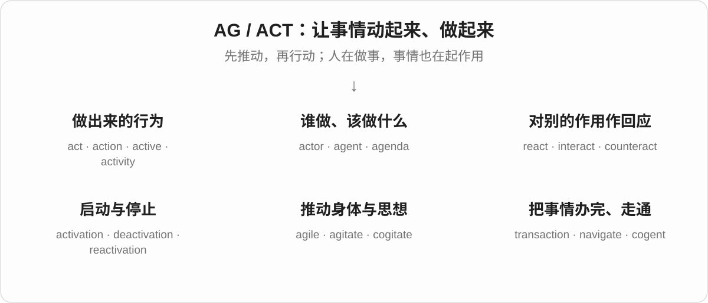

## 词形与演化规律

**ag- 与 act- 属于同一个拉丁动词的不同词干。** agent、agile 保留 ag- 一支；act、action、active 联系 act- 一支。复合中还可出现 ig-，如 ambigere 形成 ambiguous。**不要把所有 -ig- 都当作确定的 ag- 变体：** navigate、mitigate、castigate 的传统词源常把使动成分与 agere 联系起来，但拉丁 -igāre 的更早来源有不同分析。本页保留传统联系，同时逐词说明已确定的直接来源。

## 单词速览（按词族由简到繁）

同一基础词的相关扩展放在一起，先读基础形式，再读扩展；各组之间优先读常用的。具体词源关系见各词讲解。

| 单词 | 音标 | 核心意思 |
|---|---|---|
| [act](#w-1) | /ækt/ | 行动；表现；表演；一件行为；法令 |
| [action](#w-2) | /ˈækʃən/ | 行动；动作；作用；诉讼 |
| [actionable](#w-28) | /ˈækʃənəbəl/ | 可据此采取行动的；可作为起诉依据的 |
| [transaction](#w-11) | /trænˈzækʃən/ | 交易；一次业务处理；事务 |
| [transactional](#w-31) | /trænˈzækʃənəl/ | 交易的；事务性的；以交换利益为基础的 |
| [inaction](#w-26) | /ɪnˈækʃən/ | 不采取行动；无所作为 |
| [active](#w-3) | /ˈæktɪv/ | 活跃的；正在起作用的；主动的 |
| [activity](#w-4) | /ækˈtɪvəti/ | 活动；活跃状态；活动量 |
| [inactivity](#w-27) | /ˌɪnækˈtɪvəti/ | 不活动；闲置；停滞状态 |
| [radioactivity](#w-30) | 英 /ˌreɪdiəʊækˈtɪvəti/；美 /ˌreɪdioʊækˈtɪvəti/ | 放射性；放射性活动 |
| [hyperactivity](#w-33) | /ˌhaɪpərækˈtɪvəti/ | 活动过度；过度活跃 |
| [activation](#w-15) | /ˌæktɪˈveɪʃən/ | 激活；启动；使生效 |
| [inactivation](#w-36) | /ɪnˌæktɪˈveɪʃən/ | 失活；使不再起作用的过程 |
| [reactivation](#w-41) | /riːˌæktɪˈveɪʃən/ | 重新启用；再激活 |
| [proactive](#w-22) | 英 /prəʊˈæktɪv/；美 /proʊˈæktɪv/ | 提前行动的；主动应对的 |
| [proactively](#w-35) | 英 /prəʊˈæktɪvli/；美 /proʊˈæktɪvli/ | 主动提前地 |
| [acting](#w-5) | /ˈæktɪŋ/ | 表演；临时代理职务的 |
| [actor](#w-8) | 英 /ˈæktə/；美 /ˈæktər/ | 演员；行动主体 |
| [actress](#w-9) | /ˈæktrəs/ | 女演员 |
| [react](#w-12) | /riˈækt/ | 作出反应；发生化学反应 |
| [reaction](#w-7) | /riˈækʃən/ | 反应；回应；化学反应 |
| [reactor](#w-16) | 英 /riˈæktə/；美 /riˈæktər/ | 反应器；反应堆 |
| [reactive](#w-20) | /riˈæktɪv/ | 反应性的；事后应对的；易反应的 |
| [reactant](#w-43) | /riˈæktənt/ | 反应物 |
| [reactance](#w-45) | /riˈæktəns/ | 电抗；心理抗拒 |
| [overreact](#w-34) | 英 /ˌəʊvəriˈækt/；美 /ˌoʊvəriˈækt/ | 反应过度 |
| [interact](#w-13) | 英 /ˌɪntəˈrækt/；美 /ˌɪntərˈækt/ | 互动；相互作用 |
| [counteract](#w-25) | 英 /ˌkaʊntərˈækt/；美 /ˌkaʊntərˈækt/ | 抵消；抵制某种作用 |
| [agent](#w-6) | /ˈeɪdʒənt/ | 代理人；经纪人；执行者；作用因素 |
| [newsagent](#w-44) | 英 /ˈnjuːzeɪdʒənt/；美 /ˈnuːzeɪdʒənt/ | 报刊经销商；报刊店 |
| [agenda](#w-10) | /əˈdʒendə/ | 议程；待办事项；意图 |
| [navigate](#w-17) | /ˈnævɪɡeɪt/ | 导航；驾驶航行；找到前进办法 |
| [navigation](#w-14) | /ˌnævɪˈɡeɪʃən/ | 导航；航行；页面浏览路径 |
| [ambiguous](#w-18) | /æmˈbɪɡjuəs/ | 有歧义的；意思不明确的 |
| [ambiguity](#w-23) | /ˌæmbɪˈɡjuːəti/ | 歧义；不明确之处 |
| [ambiguously](#w-42) | /æmˈbɪɡjuəsli/ | 含糊地；以会产生歧义的方式 |
| [unambiguous](#w-32) | /ˌʌnæmˈbɪɡjuəs/ | 明确无歧义的 |
| [mitigate](#w-19) | /ˈmɪtɪɡeɪt/ | 减轻；缓和；降低坏影响 |
| [agile](#w-21) | 英 /ˈædʒaɪl/；美常 /ˈædʒəl/，亦 /ˈædʒaɪl/ | 敏捷的；灵活应变的 |
| [agility](#w-24) | /əˈdʒɪləti/ | 敏捷；灵活应变能力 |
| [deactivate](#w-29) | /diːˈæktɪveɪt/ | 停用；使失效；关闭作用 |
| [deactivation](#w-39) | /diːˌæktɪˈveɪʃən/ | 停用；关闭作用 |
| [cogent](#w-37) | 英 /ˈkəʊdʒənt/；美 /ˈkoʊdʒənt/ | 有理有据、令人信服的 |
| [agitate](#w-38) | /ˈædʒɪteɪt/ | 搅动；使不安；鼓动争取 |
| [agitator](#w-40) | 英 /ˈædʒɪteɪtə/；美 /ˈædʒɪteɪtər/ | 鼓动者；搅拌装置 |
| [castigate](#w-46) | /ˈkæstɪɡeɪt/ | 严厉斥责；猛烈批评 |
| [cogitate](#w-47) | 英 /ˈkɒdʒɪteɪt/，亦 /ˈkəʊdʒɪteɪt/；美 /ˈkɑːdʒɪteɪt/ | 深思；仔细琢磨 |
| [cogitation](#w-48) | 英 /ˌkɒdʒɪˈteɪʃən/；美 /ˌkɑːdʒɪˈteɪʃən/ | 深思；反复考虑；思考所得 |
| [excogitate](#w-49) | 英 /eksˈkɒdʒɪteɪt/；美 /eksˈkɑːdʒɪteɪt/ | 仔细想出；深思构思（正式、少见） |

## 逐词讲解

### 1. act — 行动；表现；表演；一件行为；法令

**音标**：/ækt/

**先抓住这个画面**

act 的核心是把事情做出来：你采取行动，演员演出角色，立法机关也作出正式决定。

**怎么拆**

整体词基 act，来自拉丁语 agere 的 act- 支线；不是 a + ct。

**怎么变成今天的意思**

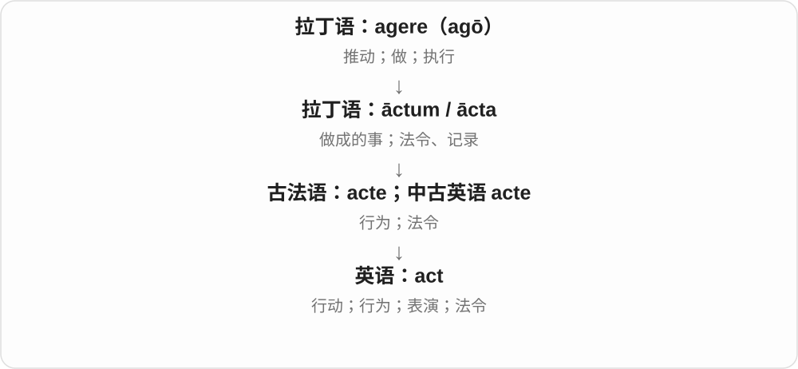

名词可指一次行为、舞台剧的一幕或法令；动词可指行动、表现和表演。它们共同围绕“做出来的事”。

**常见搭配与例句**

act quickly；act as a guide；an act of kindness；the final act。

> We must act before the problem grows.

我们必须在问题扩大之前采取行动。

> Helping her was a simple act of kindness.

帮助她只是一个简单的善意举动。

**别混淆**

act 常把事情看成一次明确行为；action 更常谈采取行动这一整体过程。

### 2. action — 行动；动作；作用；诉讼

**音标**：/ˈækʃən/

**先抓住这个画面**

action 像从“讨论要怎么办”转到“事情已经做起来了”。

**怎么拆**

现代可对应 act + -ion；历史经法语来自拉丁语 āctiō，并不是英语 act 后来才加上后缀。

**怎么变成今天的意思**

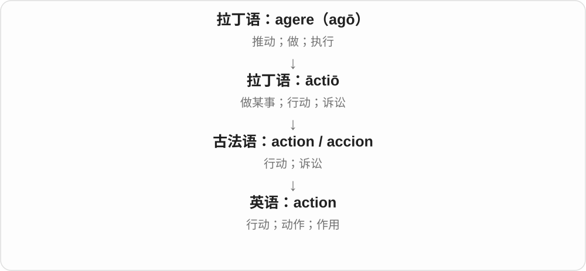

take action 是采取措施；in action 是正在发挥作用。法律里的 action 指诉讼，电影里的 action 也可指激烈动作场面。

**常见搭配与例句**

take action；a course of action；in action；legal action。

> The team agreed on a course of action.

团队商定了一套行动方案。

> We watched the new machine in action.

我们观看了新机器实际运转的情况。

**别混淆**

action 强调做什么或怎样起作用；activity 可以只是正在进行的活动，不必指解决问题的措施。

### 3. actionable — 可据此采取行动的；可作为起诉依据的

**音标**：/ˈækʃənəbəl/

**先抓住这个画面**

actionable 像一条不只告诉你“有问题”，还足够具体、能让你决定下一步怎么做的信息。

**怎么拆**

action + -able；法律义联系 action“诉讼”，一般用法联系 action“行动”。

**怎么变成今天的意思**

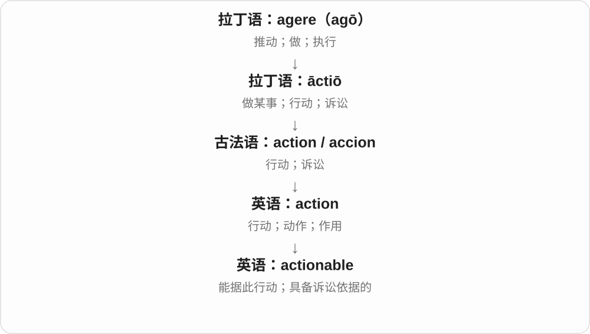

工作中 actionable feedback 要能帮助改进。法律语境中的 actionable 则是专门判断，不能简单理解为“很值得做”。

**常见搭配与例句**

actionable advice；actionable information；an actionable claim。

> The review gave us three actionable suggestions.

这次评审给了我们三条可以落实的建议。

> The lawyer considered whether the statement was actionable.

律师考虑这项陈述是否构成起诉依据。

**别混淆**

interesting information 只是有意思；actionable information 能支持具体行动。

### 4. transaction — 交易；一次业务处理；事务

**音标**：/trænˈzækʃən/

**先抓住这个画面**

transaction 像把一件来回商定的事办理完：付款、交货或系统更新合成一个处理单位。

**怎么拆**

trans-（贯穿、完成）+ agere，经拉丁语 trānsigere、trānsāctiō 及法语传入；现代可看出 trans- + action。

**怎么变成今天的意思**

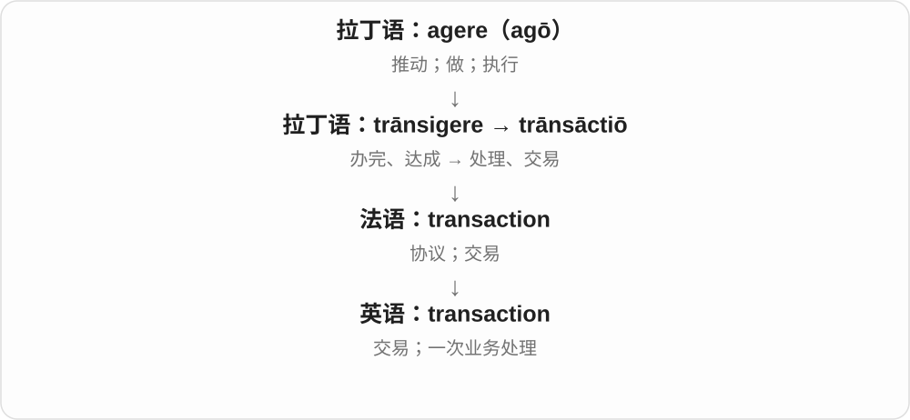

商业里是交易，计算机里可把一组操作当作一个事务。后者关心这些操作作为整体怎样成功或失败。

**常见搭配与例句**

a bank transaction；complete a transaction；a database transaction。

> The bank sent a receipt for the transaction.

银行发送了这笔交易的回执。

> The database rolled back the failed transaction.

数据库回滚了失败的事务。

**别混淆**

transaction 是一次处理或交易；interaction 只是相互作用，不一定有交换或结算。

### 5. transactional — 交易的；事务性的；以交换利益为基础的

**音标**：/trænˈzækʃənəl/

**先抓住这个画面**

transactional 可以只是描述交易流程，也可以形容一种“我给你多少，你回报我多少”的关系。

**怎么拆**

transaction + -al。

**怎么变成今天的意思**

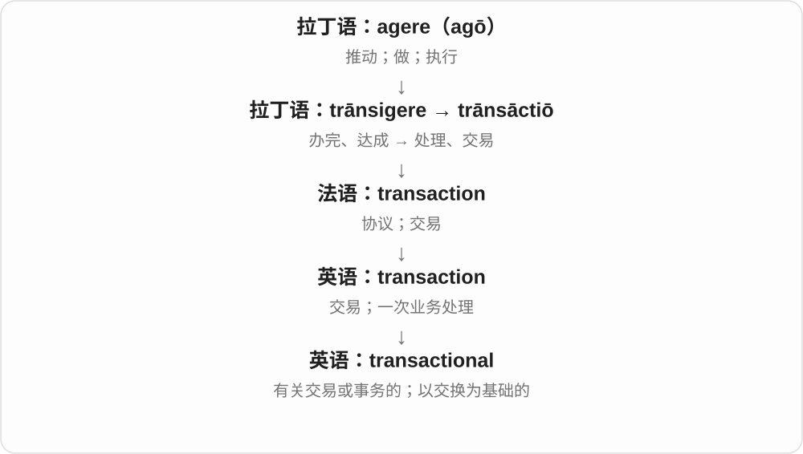

软件里的 transactional processing 是中性技术词；说 a transactional relationship 时常暗示关系缺少交换利益之外的联系。

**常见搭配与例句**

transactional data；transactional processing；a transactional relationship。

> The system stores transactional data separately.

系统单独存储交易数据。

> Their relationship had become purely transactional.

他们的关系已经变成纯粹的利益交换。

**别混淆**

transactional 不必总带贬义：交易系统是技术场景，人际评价才可能带功利意味。

### 6. inaction — 不采取行动；无所作为

**音标**：/ɪnˈækʃən/

**先抓住这个画面**

inaction 像问题已经摆在桌上，却始终没人迈出处理它的那一步。

**怎么拆**

in-（不）+ action；历史也借助法语 inaction 传入。

**怎么变成今天的意思**

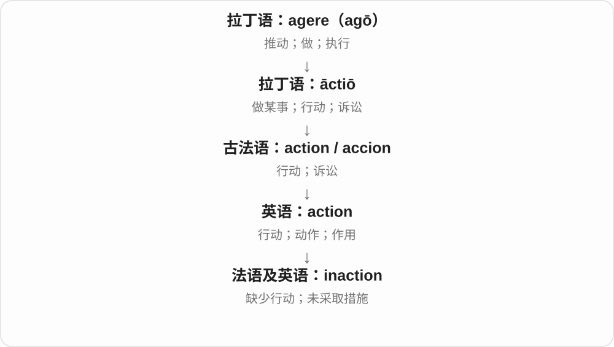

常用于本来期待有人行动的场景，带批评意味，但也可以指有意选择暂不行动。

**常见搭配与例句**

government inaction；the cost of inaction；inaction on a problem。

> Their inaction allowed the problem to grow.

他们迟迟不采取行动，让问题扩大了。

> The report examines the cost of inaction.

报告考察了不采取行动的代价。

**别混淆**

inaction 重点是没有采取措施；inactivity 更泛指不活动或不运转。

### 7. active — 活跃的；正在起作用的；主动的

**音标**：/ˈæktɪv/

**先抓住这个画面**

active 像一个已经进入工作状态的按钮，也像一个愿意参与、经常活动的人。

**怎么拆**

现代对应 act + -ive；历史来自拉丁语 āctīvus，经法语传入。

**怎么变成今天的意思**

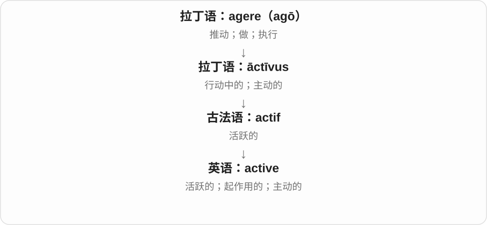

随对象变化：active member 积极参与，active account 账号有效，active ingredient 是实际发挥作用的成分。

**常见搭配与例句**

an active member；remain active；an active role；the active voice。

> She plays an active role in the club.

她积极参与俱乐部事务。

> Your account is now active.

你的账号现在已可使用。

**别混淆**

active 是参与或起作用；busy 是忙，忙碌并不保证在某件事上积极参与。

### 8. activity — 活动；活跃状态；活动量

**音标**：/ækˈtɪvəti/

**先抓住这个画面**

activity 可以是一项具体安排，也可以是一个地方或系统“有多少事正在发生”。

**怎么拆**

现代对应 active + -ity；历史经法语 activité 来自拉丁语 āctīvitās。

**怎么变成今天的意思**

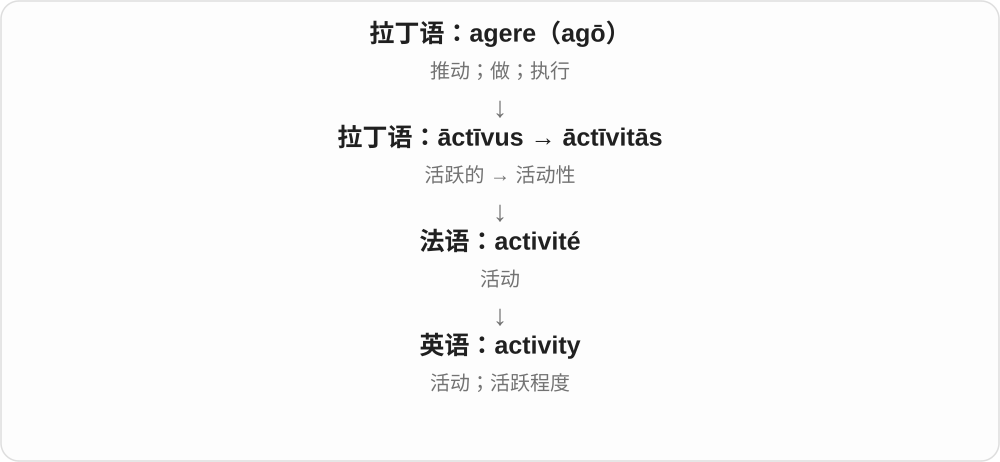

可数时是一次或一类活动；不可数时是活动状态或活动量。a lot of activity 不等于很多不同项目。

**常见搭配与例句**

outdoor activities；physical activity；business activity；a classroom activity。

> The camp offers outdoor activities for children.

营地为孩子们安排户外活动。

> There was little activity in the market that morning.

那天上午市场里的交易活动很少。

**别混淆**

action 常指为目标采取的行动；activity 也可只是有组织的活动或持续运作。

### 9. inactivity — 不活动；闲置；停滞状态

**音标**：/ˌɪnækˈtɪvəti/

**先抓住这个画面**

inactivity 像一台很久没开机的机器，或一天几乎没怎么活动的身体。

**怎么拆**

in-（不）+ activity，也可从 inactive 对应到 -ity 名词。

**怎么变成今天的意思**

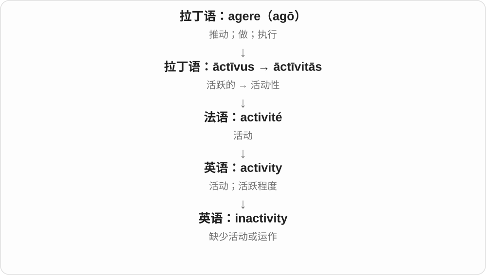

常描述系统闲置、身体活动少或业务没有动静。通常比 inaction 少一些“该处理却没处理”的指责。

**常见搭配与例句**

physical inactivity；a period of inactivity；account inactivity。

> The screen locks after ten minutes of inactivity.

十分钟没有操作后，屏幕会锁定。

> After a period of inactivity, the workshop reopened.

停工一段时间后，作坊重新开门了。

**别混淆**

inactivity 是活动少或没有活动；inaction 常专指面对事情没有采取措施。

### 10. radioactivity — 放射性；放射性活动

**音标**：英 /ˌreɪdiəʊækˈtɪvəti/；美 /ˌreɪdioʊækˈtɪvəti/

**先抓住这个画面**

radioactivity 的画面是不稳定原子核自行发生变化，向外发出粒子或辐射。

**怎么拆**

现代可拆 radio-（辐射）+ activity，或 radioactive + -ity；历史借自法语 radioactivité。这里 radio- 不是“收音机”。

**怎么变成今天的意思**

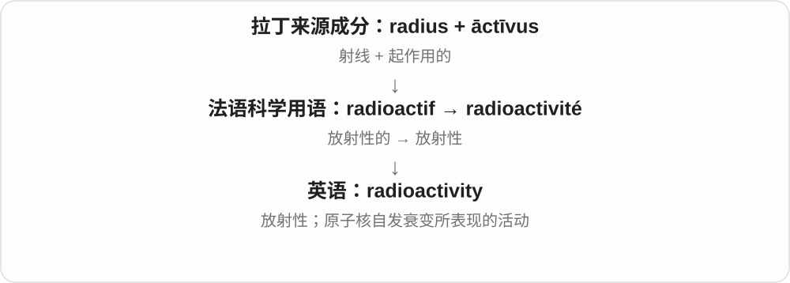

这里的 active 是发生物理变化，不是说物体活泼。radioactivity 与一般 radiation 的范围不同：并非所有辐射都来自放射性衰变。

**常见搭配与例句**

natural radioactivity；measure radioactivity；levels of radioactivity。

> The instrument measures radioactivity in the sample.

仪器测量样本中的放射性。

> The lesson explains the difference between radioactivity and radiation.

这节课解释放射性与辐射的区别。

**别混淆**

radioactivity 是放射性现象或活动；radiation 是辐射，阳光中的光也属于辐射但不因此叫放射性。

### 11. hyperactivity — 活动过度；过度活跃

**音标**：/ˌhaɪpərækˈtɪvəti/

**先抓住这个画面**

hyperactivity 像活动量越过了通常合适的范围，很难安静或停下来。

**怎么拆**

hyper-（过度）+ activity。

**怎么变成今天的意思**

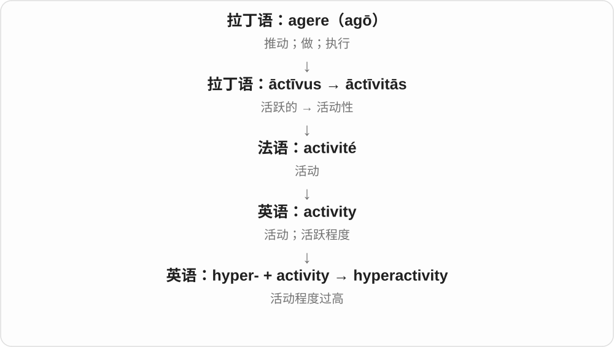

可以描述行为，也可描述系统或器官活动过强。临床是否有具体诊断，不能凭这个词或一次活跃表现判断。

**常见搭配与例句**

levels of hyperactivity；signs of hyperactivity；neural hyperactivity。

> The study tracked changes in hyperactivity over time.

研究追踪了活动过度的表现如何随时间变化。

> The article discusses hyperactivity in a network of neurons.

文章讨论了一组神经元网络的过度活跃。

**别混淆**

activity 是中性活动；hyperactivity 指程度过高，不是普通“精力旺盛”的同义词。

### 12. activation — 激活；启动；使生效

**音标**：/ˌæktɪˈveɪʃən/

**先抓住这个画面**

activation 像把准备好的设备从待命切到工作，关键是开始发挥作用。

**怎么拆**

activate + -ion，也可对应 active + -ation；现代英语构词。

**怎么变成今天的意思**

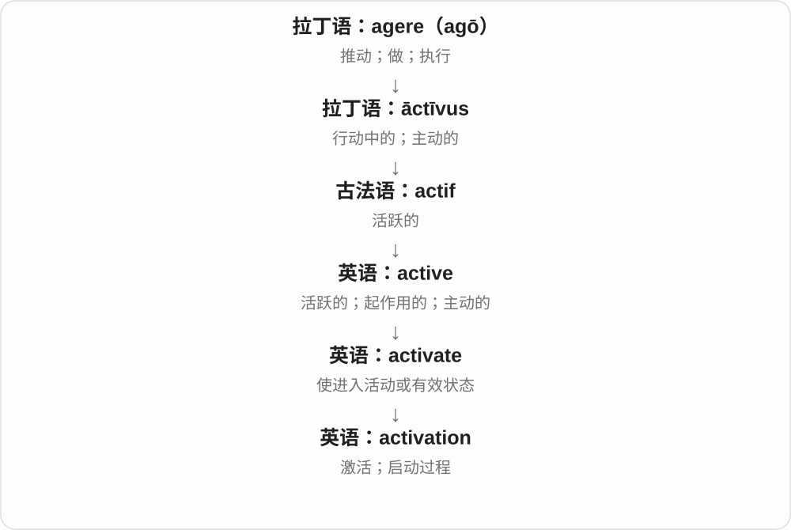

可说账号启用、设备触发或某个过程开始起作用。具体学科中的 activation 有自己的判据，不一定真有一个开关。

**常见搭配与例句**

account activation；activation energy；automatic activation。

> Account activation takes only a few minutes.

账号激活只需几分钟。

> The sensor controls the activation of the alarm.

传感器控制警报的触发。

**别混淆**

activity 是活动状态或活动量；activation 是进入这种有效状态的过程。

### 13. inactivation — 失活；使不再起作用的过程

**音标**：/ɪnˌæktɪˈveɪʃən/

**先抓住这个画面**

inactivation 像把能发挥作用的东西变成不起作用，研究中常关注功能是否消失。

**怎么拆**

in-（不）+ activation，或 inactive + -ation。

**怎么变成今天的意思**

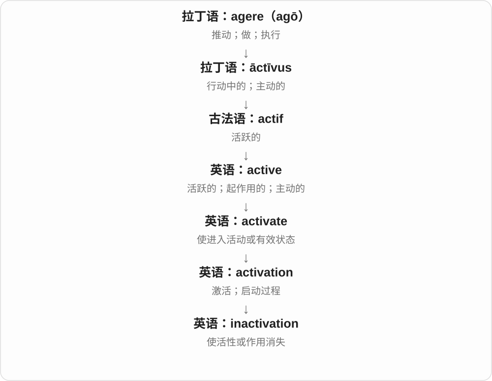

常见于实验、酶与生物学描述；它说的是功能失去，不一定意味着物体被移走或完全毁坏。

**常见搭配与例句**

enzyme inactivation；gene inactivation；a process of inactivation。

> The experiment measured enzyme inactivation over time.

实验测量了酶随时间失活的情况。

> The researchers compared two methods of inactivation.

研究人员比较了两种使其失活的方法。

**别混淆**

deactivation 更常见于设备、账号等停用；inactivation 在生物化学里更常用，二者有重叠。

### 14. reactivation — 重新启用；再激活

**音标**：/riːˌæktɪˈveɪʃən/

**先抓住这个画面**

reactivation 像把曾经停下的功能再开起来，重点是“以前有效过，现在恢复”。

**怎么拆**

re-（再次）+ activation。

**怎么变成今天的意思**

可用于账号、设备、记忆或生物学过程，具体怎样恢复由语境决定。并非一切都是按一下开关。

**常见搭配与例句**

account reactivation；reactivation of a service；memory reactivation。

> The service resumed after reactivation of the system.

系统重新启用后，服务恢复了。

> You will receive an email confirming account reactivation.

你会收到确认账号重新启用的邮件。

**别混淆**

activation 首次或一般激活；reactivation 明确含重新、再次。

### 15. proactive — 提前行动的；主动应对的

**音标**：英 /prəʊˈæktɪv/；美 /proʊˈæktɪv/

**先抓住这个画面**

proactive 像看到乌云就收衣服，事情还没变成麻烦，先把准备做起来。

**怎么拆**

pro-（向前、预先）+ active，是现代英语组合。

**怎么变成今天的意思**

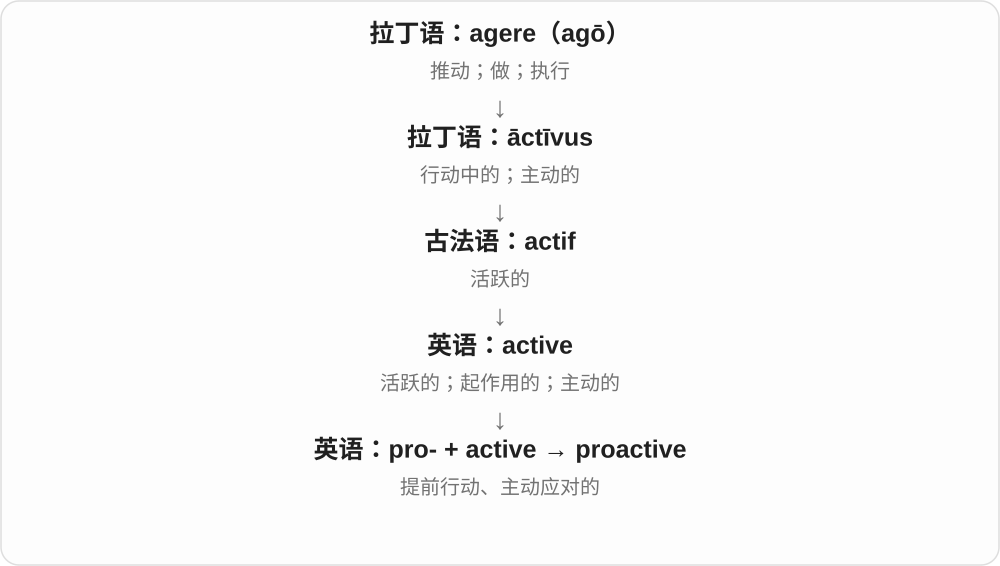

常形容预防问题、争取机会的做法。不是所有忙碌或积极表态都算 proactive，关键是是否提前采取了行动。

**常见搭配与例句**

a proactive approach；proactive steps；be proactive about maintenance。

> We took a proactive approach to equipment maintenance.

我们提前安排设备维护，防止问题发生。

> She was proactive in asking for feedback.

她主动提前征求了反馈。

**别混淆**

active 表示活跃参与；proactive 更具体地强调提前处理，而 reactive 是出现情况后回应。

### 16. proactively — 主动提前地

**音标**：英 /prəʊˈæktɪvli/；美 /proʊˈæktɪvli/

**先抓住这个画面**

proactively 描述做事的方式：在麻烦找上门之前，先去检查、联系或准备。

**怎么拆**

proactive + -ly。

**怎么变成今天的意思**

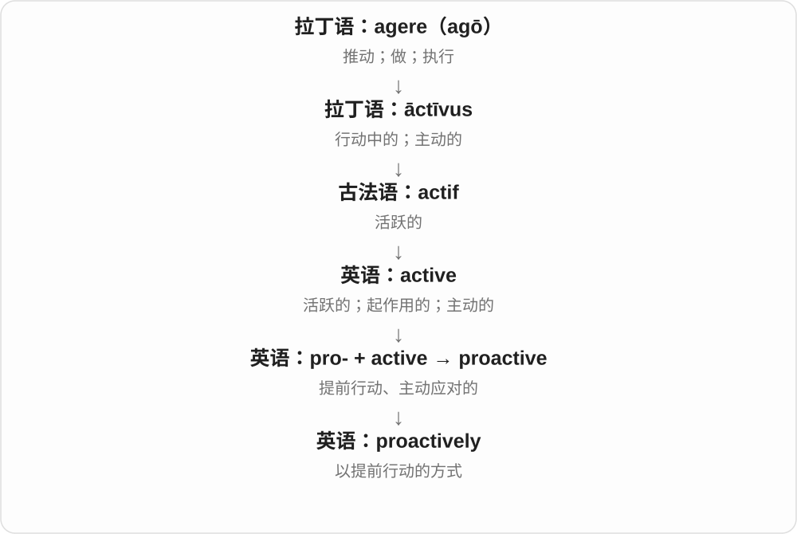

常修饰 identify、address、contact 等动词。它强调提前的行动方式，不只是一般积极的态度。

**常见搭配与例句**

proactively identify risks；proactively contact customers；act proactively。

> The team proactively identified weak points in the plan.

团队提前主动找出了方案的薄弱之处。

> She contacted the client proactively to explain the delay.

她主动提前联系客户，说明了延误情况。

**别混淆**

actively 积极地参与；proactively 还带预先行动的意思。

### 17. acting — 表演；临时代理职务的

**音标**：/ˈæktɪŋ/

**先抓住这个画面**

acting 一边是扮演角色，另一边是暂时替某个职位做它该做的事。

**怎么拆**

act + -ing；作名词表示表演，作形容词可表示代理职务。

**怎么变成今天的意思**

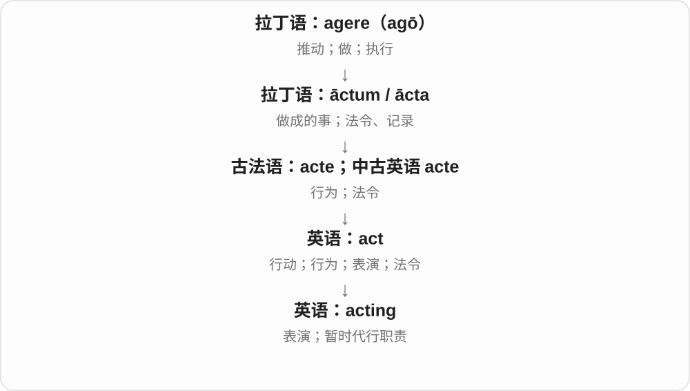

acting manager 是临时履行经理职责的人，不是在“假装当经理”。是否最终正式任命另当别论。

**常见搭配与例句**

an acting career；acting skills；the acting director。

> Her acting made the character believable.

她的表演让这个角色显得可信。

> He served as acting manager for two months.

他担任了两个月的代理经理。

**别混淆**

acting director 是代理主管；an actor 是演员，两者的“角色”并非同一种制度身份。

### 18. actor — 演员；行动主体

**音标**：英 /ˈæktə/；美 /ˈæktər/

**先抓住这个画面**

actor 最初就是做事的人；放到舞台上，就成了把角色演出来的人。

**怎么拆**

现代可认作 act + -or；历史借自法语及拉丁语 āctor，并非现代英语临时加后缀。

**怎么变成今天的意思**

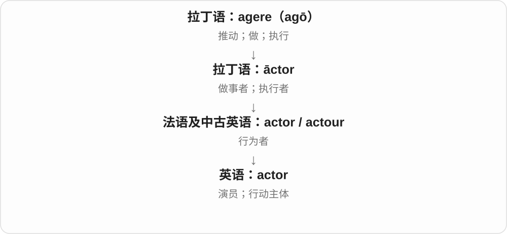

现在最常见是演员，也能在政治、社会和技术讨论中指参与行动的人或组织。actor 可以不限定性别。

**常见搭配与例句**

a talented actor；a leading actor；a key political actor。

> The actor gave a quiet, convincing performance.

这位演员的表演克制而有说服力。

> Local groups became important actors in the negotiations.

当地团体成了谈判中的重要参与方。

**别混淆**

actress 明确指女演员；actor 在现代用法中可以泛指任何性别的演员。

### 19. actress — 女演员

**音标**：/ˈæktrəs/

**先抓住这个画面**

actress 是 actor 这一职业中特别标明女性的称呼。

**怎么拆**

actor 对应的阴性形式，-ess 表示女性；早期先指女性行为者，后来专用于舞台表演者。

**怎么变成今天的意思**

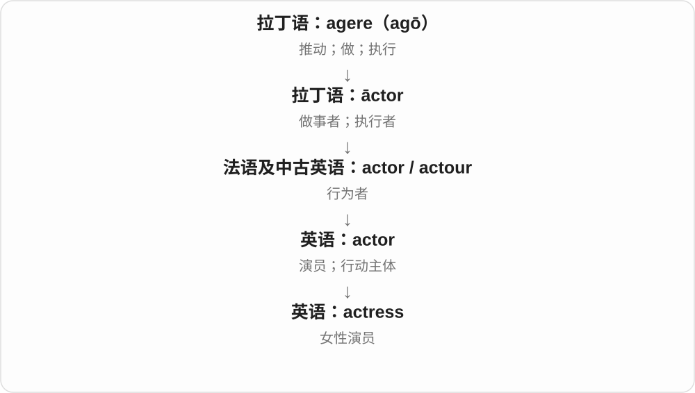

用于舞台、电影和电视表演。现代有些女性从业者偏好不标性别的 actor，按本人称呼与具体语境选用。

**常见搭配与例句**

a film actress；a leading actress；a supporting actress。

> She became a successful stage actress.

她成为了一名成功的舞台女演员。

> The actress spoke about preparing for the role.

这位女演员谈了自己如何准备这个角色。

**别混淆**

actress 是女性演员；acting 是表演活动或代理职务，不是同一个词性。

### 20. react — 作出反应；发生化学反应

**音标**：/riˈækt/

**先抓住这个画面**

react 像球碰到地面后弹回：先有一个作用，随后出现回应。

**怎么拆**

re-（回来、回应）+ act。

**怎么变成今天的意思**

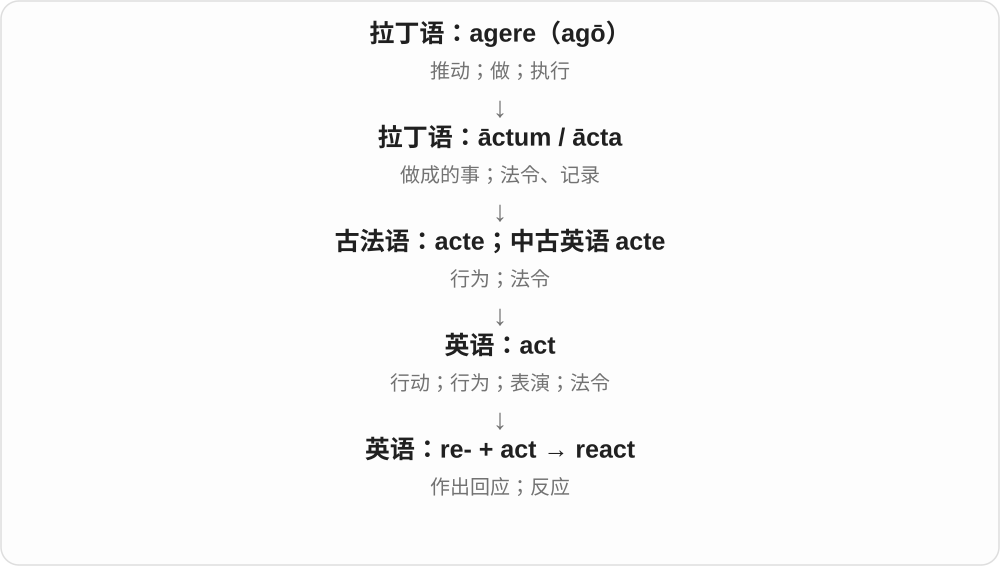

对消息 react to；物质之间常说 react with。反应可以是情绪、行为或化学变化，不一定经过思考。

**常见搭配与例句**

react to a comment；react quickly；react with another substance。

> How did she react to the news?

她听到这个消息后有什么反应？

> Iron reacts with oxygen to form oxides.

铁与氧反应形成氧化物。

**别混淆**

proact 并不是日常与 react 配对的常用动词；主动预先处理通常说 act proactively。

### 21. reaction — 反应；回应；化学反应

**音标**：/riˈækʃən/

**先抓住这个画面**

reaction 是外界先给出一个刺激，另一方随后发生的变化或回应。

**怎么拆**

现代可对应 re- + action 或 react + -ion；历史还联系拉丁语 reāctiō 和法语 réaction，不能只画成英语 react 的后代。

**怎么变成今天的意思**

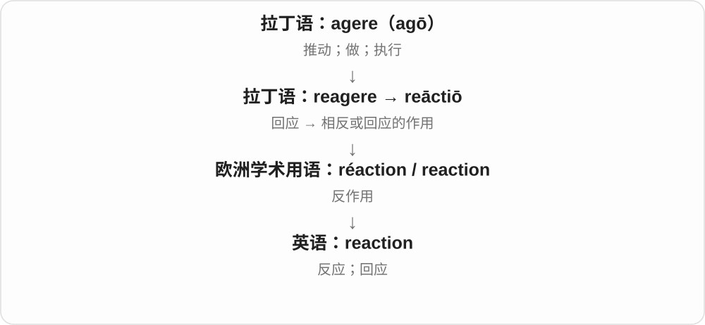

可以是听到消息后的表情，也可以是物质之间的化学变化。化学反应中的“反”并非一定往相反方向走。

**常见搭配与例句**

a reaction to the news；a chemical reaction；reaction time。

> Her first reaction was surprise.

她的第一反应是惊讶。

> The mixture changed colour during the reaction.

混合物在反应过程中变了颜色。

**别混淆**

reaction 可是自动反应；response 也常指经过组织的回答或应对，两者有交叉。

### 22. reactor — 反应器；反应堆

**音标**：英 /riˈæktə/；美 /riˈæktər/

**先抓住这个画面**

reactor 像为某种反应准备好的专用工作空间，控制它在哪里、怎样发生。

**怎么拆**

react + -or，表示承载反应的装置。

**怎么变成今天的意思**

化工里可以是反应容器，核能里通常指核反应堆。看到 reactor 不能自动认定一定是核设施。

**常见搭配与例句**

a chemical reactor；a nuclear reactor；a reactor vessel。

> The chemical reactor was designed for continuous operation.

这台化学反应器设计为连续运行。

> The model shows the main parts of a nuclear reactor.

模型展示了核反应堆的主要部分。

**别混淆**

reactant 是被消耗并参与反应的物质；reactor 是反应发生的装置。

### 23. reactive — 反应性的；事后应对的；易反应的

**音标**：/riˈæktɪv/

**先抓住这个画面**

reactive 在工作方式上像等警报响了才处理，在化学里像很容易与别的物质发生反应。

**怎么拆**

react + -ive。

**怎么变成今天的意思**

管理讨论中常与 proactive 对比；化学语境则描述反应倾向。容易反应不等于必然危险，仍取决于物质与条件。

**常见搭配与例句**

a reactive approach；reactive maintenance；a highly reactive substance。

> The team wants to replace reactive maintenance with regular inspections.

团队希望用定期检查替代出了问题才维修。

> The lesson compares reactive and relatively stable substances.

这节课比较容易反应与相对稳定的物质。

**别混淆**

reactive 回应已经出现的情况；proactive 提前采取措施。

### 24. reactant — 反应物

**音标**：/riˈæktənt/

**先抓住这个画面**

reactant 像化学变化开始时放进去的原料，反应过程中它会被消耗并转变。

**怎么拆**

react + -ant，表示参与反应的物质。

**怎么变成今天的意思**

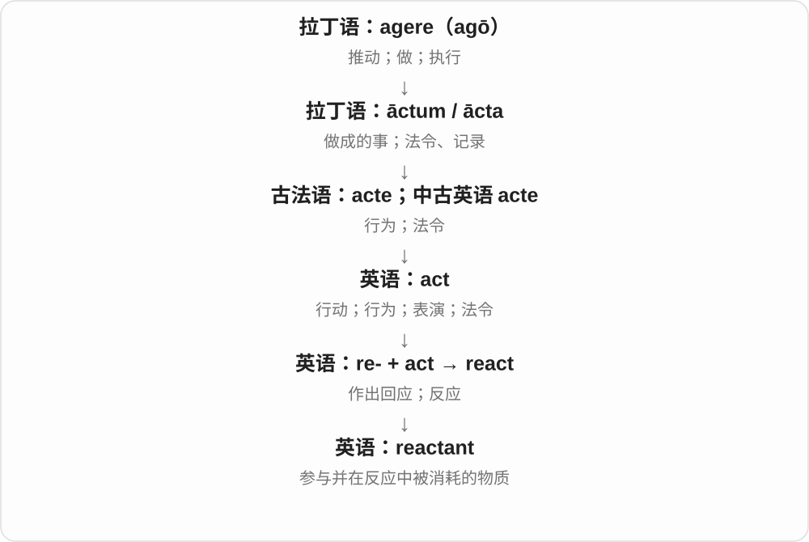

反应物出现在反应式起始一侧，生成物是变化后的产物。催化剂参与机理，却不按通常的总反应关系被净消耗。

**常见搭配与例句**

a limiting reactant；reactant concentration；reactants and products。

> The diagram labels each reactant and product.

图中标出了每一种反应物和生成物。

> The reaction stops when the limiting reactant is used up.

限制性反应物耗尽时，反应停止。

**别混淆**

reactor 是反应装置；reactant 是反应物；product 是生成物。

### 25. reactance — 电抗；心理抗拒

**音标**：/riˈæktəns/

**先抓住这个画面**

reactance 在电路里像对交流电变化作出的特殊回应；心理上则像越觉得自由受限，越想反着来。

**怎么拆**

react + -ance；电学和心理学分别发展出专门含义。

**怎么变成今天的意思**

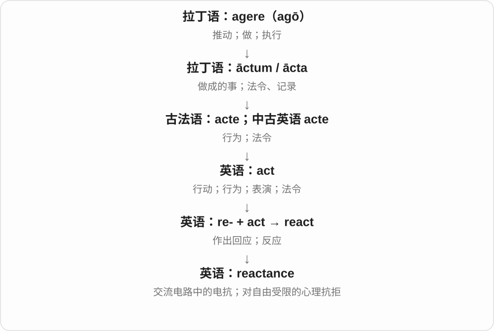

电抗是阻抗中与电感、电容有关的虚部，不能简单等同把电能耗成热的电阻。心理学用法说受限制后的抗拒倾向。

**常见搭配与例句**

inductive reactance；capacitive reactance；psychological reactance。

> The capacitor’s reactance changes with frequency.

电容器的电抗随频率变化。

> The study examined psychological reactance to restrictive messages.

研究考察了人们对限制性信息产生的心理抗拒。

**别混淆**

resistance 是电阻；reactance 是电抗；心理 reactance 也不只是一般生气。

### 26. overreact — 反应过度

**音标**：英 /ˌəʊvəriˈækt/；美 /ˌoʊvəriˈækt/

**先抓住这个画面**

overreact 像一个小火星触发了很大的警报，回应的强度超过了事情本身需要。

**怎么拆**

over-（过度）+ react。

**怎么变成今天的意思**

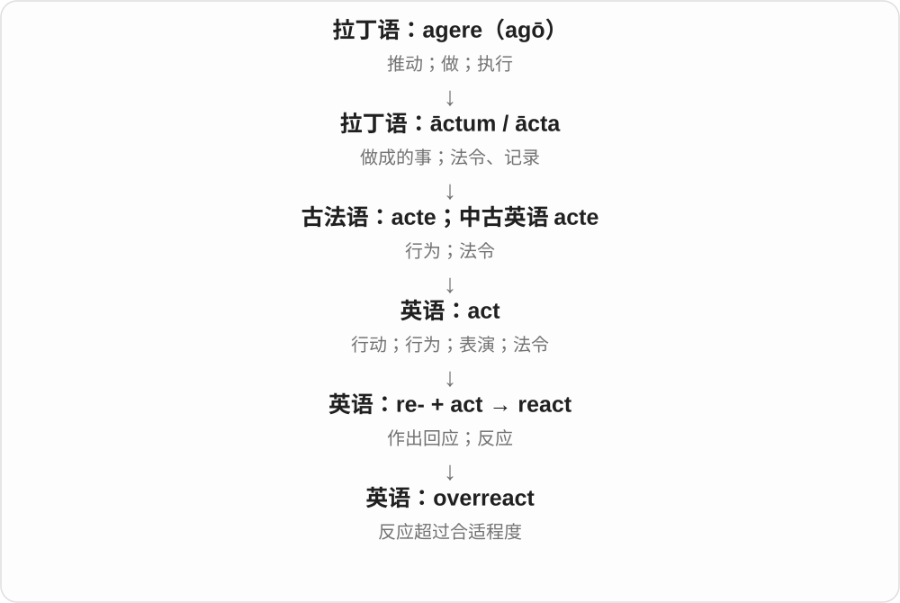

常用于情绪和行为，也可说市场对消息反应过大。“过度”带评价，争论中双方可能看法不同。

**常见搭配与例句**

overreact to criticism；overreact to the news；try not to overreact。

> I overreacted to a small mistake.

我对一个小错误反应过度了。

> The market may have overreacted to the announcement.

市场对这项公告的反应可能过大了。

**别混淆**

overreact 强调反应太强；react quickly 只是反应快，两者不相同。

### 27. interact — 互动；相互作用

**音标**：英 /ˌɪntəˈrækt/；美 /ˌɪntərˈækt/

**先抓住这个画面**

interact 像两个人你一句我一句，或者两个部件彼此影响工作状态。

**怎么拆**

inter-（彼此之间）+ act。

**怎么变成今天的意思**

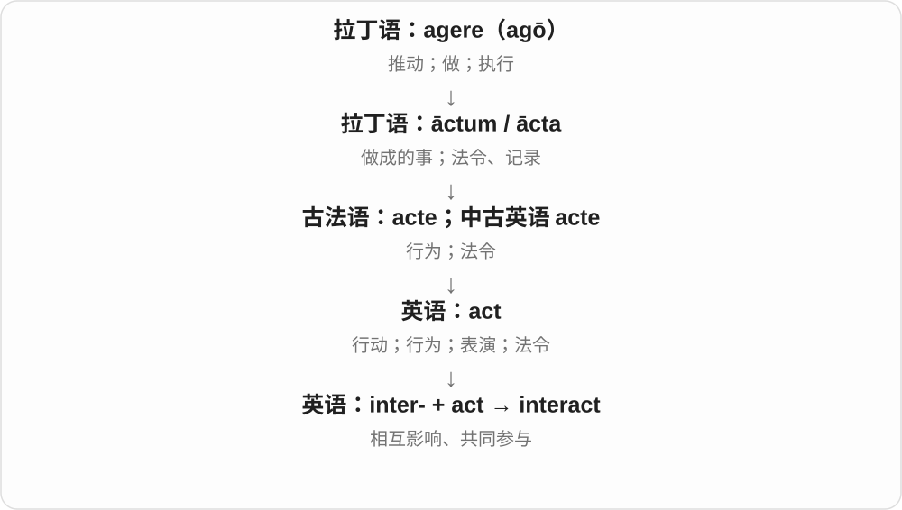

既用于人与人的来往，也用于系统、材料或因素的相互作用。不是所有互动都是说话。

**常见搭配与例句**

interact with users；interact socially；interacting factors。

> The exhibition lets visitors interact with the displays.

展览允许观众与展品互动。

> These two factors interact in complex ways.

这两个因素以复杂的方式相互影响。

**别混淆**

react 可以只有一方回应刺激；interact 强调双方或多方之间发生关系。

### 28. counteract — 抵消；抵制某种作用

**音标**：英 /ˌkaʊntərˈækt/；美 /ˌkaʊntərˈækt/

**先抓住这个画面**

counteract 像一股力向左推，另一股力向右顶，用相反作用削弱前者。

**怎么拆**

counter-（相反、对抗）+ act。

**怎么变成今天的意思**

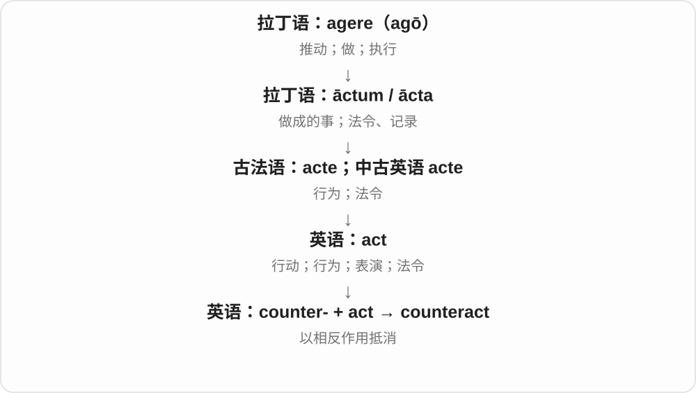

可以抵消不良影响、趋势或物理作用。未必完全抵消，程度还需句子说明。

**常见搭配与例句**

counteract the effects；counteract a tendency；counteract a force。

> The weights help counteract the pull of the cable.

这些配重帮助抵消缆绳的拉力。

> Regular breaks can counteract the monotony of a long task.

定时休息能减轻长时间任务带来的单调感。

**别混淆**

react 是作出反应；counteract 明确要顶住或削弱原来的作用。

### 29. agent — 代理人；经纪人；执行者；作用因素

**音标**：/ˈeɪdʒənt/

**先抓住这个画面**

agent 是“真正去做事或让变化发生的那一方”：可以替人办事，也可以是引起作用的物质或程序。

**怎么拆**

来自拉丁语 agēns，词干 agent-，原本就是“正在行动的”。

**怎么变成今天的意思**

房地产经纪人代表客户办事，清洁剂里的 agent 发挥作用；软件 agent 则承担某些行动任务。具体是否有自主能力，要看系统设计。

**常见搭配与例句**

an estate agent；a travel agent；a cleaning agent；a software agent。

> The agent arranged a viewing of the house.

经纪人安排了看房。

> The label identifies the cleaning agent used in the product.

标签说明了产品使用的清洁成分。

**别混淆**

agent 强调代表或产生作用；actor 强调参与行动的主体，舞台语境则是演员。

### 30. newsagent — 报刊经销商；报刊店

**音标**：英 /ˈnjuːzeɪdʒənt/；美 /ˈnuːzeɪdʒənt/

**先抓住这个画面**

newsagent 原本是帮新闻出版物到达读者手里的经销者，后来也指卖这些东西的店。

**怎么拆**

news（新闻、报刊）+ agent（经销或代理者）。

**怎么变成今天的意思**

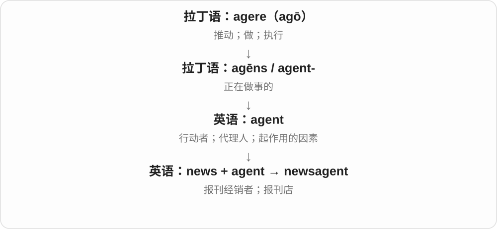

英国英语常见；a newsagent’s 可指报刊店，往往也卖文具等物品。不是现场采访新闻的记者。

**常见搭配与例句**

a local newsagent；at the newsagent’s；a newspaper from the newsagent。

> I bought a magazine at the newsagent’s.

我在报刊店买了一本杂志。

> The local newsagent keeps a copy of the paper for her.

当地报刊经销商会为她留一份报纸。

**别混淆**

newsagent 卖报刊；journalist 采访报道；news agency 是新闻通讯社。

### 31. agenda — 议程；待办事项；意图

**音标**：/əˈdʒendə/

**先抓住这个画面**

agenda 本来就是“应该做的那些事”，像会议桌上排好的一张待讨论清单。

**怎么拆**

来自拉丁语 agenda，是 agere 的动词形容词中性复数形式，字面为“须做之事”。

**怎么变成今天的意思**

现代英语通常把一份 agenda 当单数，复数是 agendas。hidden agenda 则是表面任务背后另有目的。

**常见搭配与例句**

on the agenda；set the agenda；a hidden agenda。

> Safety is the first item on the agenda.

安全是议程上的第一项。

> I wondered whether he had a hidden agenda.

我怀疑他是否另有打算。

**别混淆**

agenda 列要讨论或做的事；minutes 记录会议已经讨论和决定的事。

### 32. navigate — 导航；驾驶航行；找到前进办法

**音标**：/ˈnævɪɡeɪt/

**先抓住这个画面**

navigate 像在陌生水域边判断位置、边选择路线，后来也用来形容应对复杂局面。

**怎么拆**

来自拉丁语 nāvigāre 一族：nāvis“船”+ -igāre。传统词源把后半连到 agere，后缀更早来源也有不同分析。

**怎么变成今天的意思**

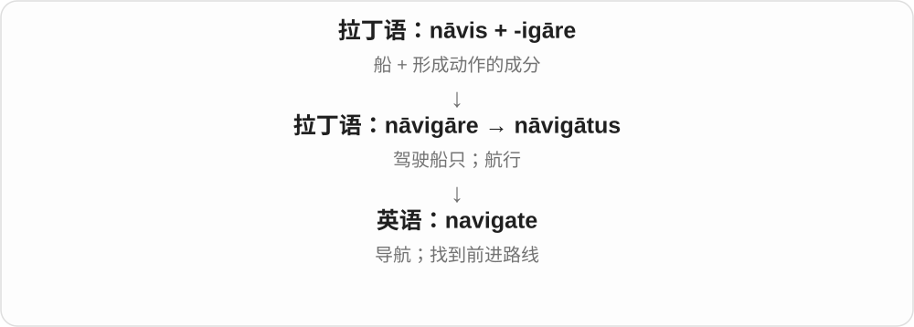

现代可在城市中找路、在菜单中找功能，也可 navigate a difficult situation“摸清情况并应对”。英语动词也可能受早先 navigation 的逆构影响。

**常见搭配与例句**

navigate through traffic；navigate a website；navigate a difficult situation。

> We used a paper map to navigate the old town.

我们用纸地图在老城区找路。

> She helped the team navigate a difficult transition.

她帮助团队应对了一次艰难的转型。

**别混淆**

navigate 强调一路判断如何走；travel 只强调旅行或移动，不一定涉及找路。

### 33. navigation — 导航；航行；页面浏览路径

**音标**：/ˌnævɪˈɡeɪʃən/

**先抓住这个画面**

navigation 是弄清“我在哪里、接下来往哪里走”，最初在海上，后来也在道路和网页里。

**怎么拆**

现代可对应 navigate + -ion；历史经法语来自拉丁语 nāvigātiō，英语名词并非必须从英语动词派生。

**怎么变成今天的意思**

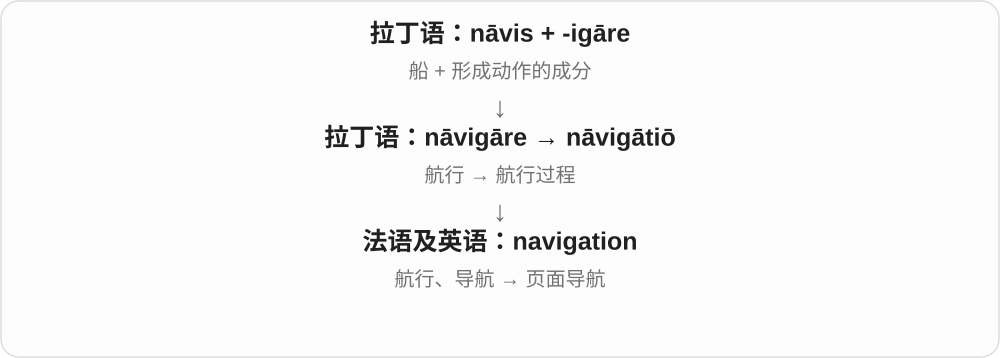

从驾驶船只扩展到为车辆定位和引路；网站 navigation 是帮助用户找到各个页面的结构。

**常见搭配与例句**

satellite navigation；a navigation system；website navigation。

> The boat carried basic navigation equipment.

船上带着基本的导航设备。

> Clear navigation helps users find the right page.

清晰的导航帮助用户找到所需页面。

**别混淆**

navigation 关注位置与路线；transportation 关注把人或物送到目的地。

### 34. ambiguous — 有歧义的；意思不明确的

**音标**：/æmˈbɪɡjuəs/

**先抓住这个画面**

ambiguous 像一句话前面出现两条岔路，读者不知道该沿哪一条理解。

**怎么拆**

来自拉丁语 ambi-（两边、周围）+ agere，形成 ambigere，再到 ambiguus。这里不是把现代单词随意拆成 ambi + guous。

**怎么变成今天的意思**

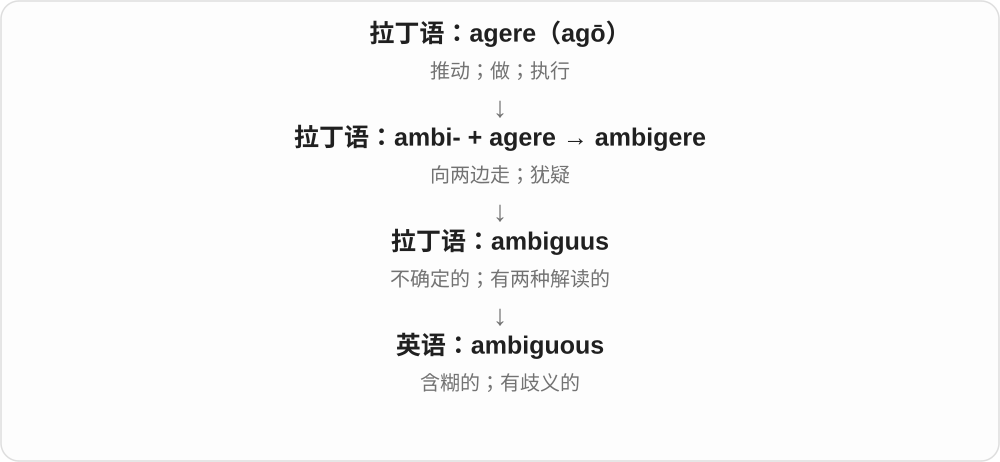

常指一句话、信号或证据可以有不止一种解释。说话者未必故意含糊，有时只是表达没写清。

**常见搭配与例句**

an ambiguous answer；ambiguous wording；an ambiguous signal。

> The instructions are ambiguous about when to start.

说明没有明确交代什么时候开始，存在多种理解。

> Her smile gave an ambiguous signal.

她的笑容让人猜不准是什么意思。

**别混淆**

vague 是缺少细节或边界；ambiguous 是可能通向多种解释，区别在“少信息”与“有岔路”。

### 35. ambiguity — 歧义；不明确之处

**音标**：/ˌæmbɪˈɡjuːəti/

**先抓住这个画面**

ambiguity 是理解岔路本身：同一句话，有人走到这个意思，有人走到另一个意思。

**怎么拆**

现代对应 ambiguous + -ity；历史经法语来自拉丁语 ambiguitās，名词有自己的借入路线。

**怎么变成今天的意思**

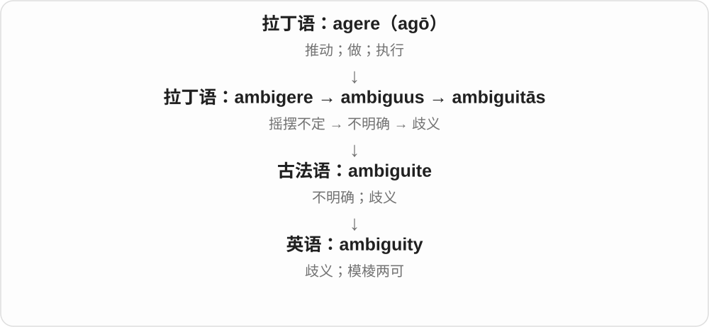

不可数时指不明确的状态，可数时是一处具体歧义。文学可以有意保留 ambiguity，操作说明则通常应减少。

**常见搭配与例句**

remove ambiguity；an ambiguity in the wording；leave room for ambiguity。

> The revised sentence removes the ambiguity.

修改后的句子消除了歧义。

> The ending leaves room for ambiguity.

这个结尾保留了多种解释的空间。

**别混淆**

uncertainty 泛指不确定；ambiguity 常关乎同一表达或情形存在多种解释。

### 36. ambiguously — 含糊地；以会产生歧义的方式

**音标**：/æmˈbɪɡjuəsli/

**先抓住这个画面**

ambiguously 描述表达留下了岔路：听者可以按不止一种意思理解。

**怎么拆**

ambiguous + -ly。

**怎么变成今天的意思**

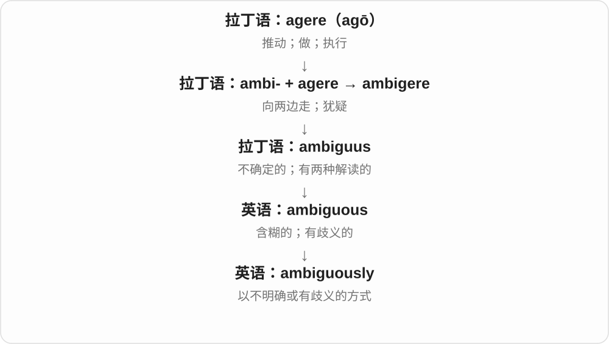

通常修饰 worded、phrased、answered 等表达行为。不明确可能出于策略，也可能只是措辞不佳。

**常见搭配与例句**

ambiguously worded；answer ambiguously；phrase something ambiguously。

> The question was ambiguously worded.

这个问题的措辞有歧义。

> He answered ambiguously, leaving both options open.

他回答得含糊，没有排除任何一种选项。

**别混淆**

ambiguously 说表达方式；ambiguity 是表达中留下的不明确之处。

### 37. unambiguous — 明确无歧义的

**音标**：/ˌʌnæmˈbɪɡjuəs/

**先抓住这个画面**

unambiguous 像把岔路口的标牌写清，让读者朝同一个意思走。

**怎么拆**

un-（不）+ ambiguous。

**怎么变成今天的意思**

常说指令、证据、承诺或支持很明确。并不代表内容简单，只表示意思没有歧义。

**常见搭配与例句**

unambiguous instructions；an unambiguous answer；unambiguous evidence。

> The rule needs an unambiguous definition.

这条规则需要一个没有歧义的定义。

> She gave an unambiguous yes.

她明确回答了“是”。

**别混淆**

clear 可泛指清楚；unambiguous 更具体地强调不会产生另一种解释。

### 38. mitigate — 减轻；缓和；降低坏影响

**音标**：/ˈmɪtɪɡeɪt/

**先抓住这个画面**

mitigate 像在一次冲击前加上缓冲垫：冲击可能仍在，但伤害减轻了。

**怎么拆**

来自拉丁语 mītigāre、mītigātus：mītis“温和、柔软”+ -igāre“使成为”。传统分析把后半与 agere 联系起来，但其更早构词解释并非只有一种。

**怎么变成今天的意思**

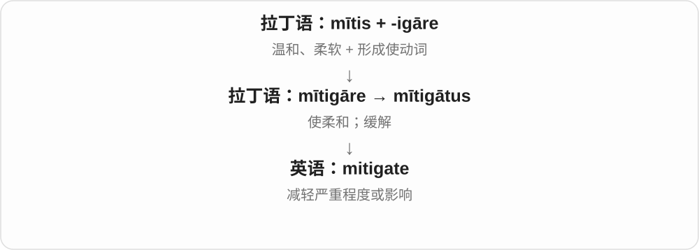

常减轻风险、损失或负面影响，不表示彻底消灭问题。最稳妥的搭配是直接接宾语：mitigate the damage。

**常见搭配与例句**

mitigate risk；mitigate the effects；mitigating factors。

> Extra training can help mitigate the risk of errors.

额外培训有助于降低出错风险。

> The new drainage system mitigated the effects of the storm.

新的排水系统减轻了暴雨的影响。

**别混淆**

mitigate 减轻坏影响；eliminate 消除；militate against 表示对某事不利，不要混用。

### 39. agile — 敏捷的；灵活应变的

**音标**：英 /ˈædʒaɪl/；美常 /ˈædʒəl/，亦 /ˈædʒaɪl/

**先抓住这个画面**

agile 像一只迅速转身的猫：动作轻快，方向一变，身体马上跟得上。

**怎么拆**

来自拉丁语 agilis“容易动起来的”，属于 agere 一族。

**怎么变成今天的意思**

可说身体敏捷，也可说思维灵活。软件中的 agile 指一组强调短周期反馈、协作和调整的开发方法，不只是“做得快”。

**常见搭配与例句**

an agile athlete；an agile mind；agile development。

> The agile climber moved easily across the rocks.

动作敏捷的攀岩者轻松地穿过岩壁。

> An agile team can adjust its plan when new information arrives.

灵活的团队能在新信息出现时调整计划。

**别混淆**

fast 强调速度；agile 还强调灵活、能及时改变方向。

### 40. agility — 敏捷；灵活应变能力

**音标**：/əˈdʒɪləti/

**先抓住这个画面**

agility 是身体或头脑迅速换方向、仍能保持控制的能力。

**怎么拆**

现代对应 agile + -ity；历史经法语 agilité 来自拉丁语 agilitās。

**怎么变成今天的意思**

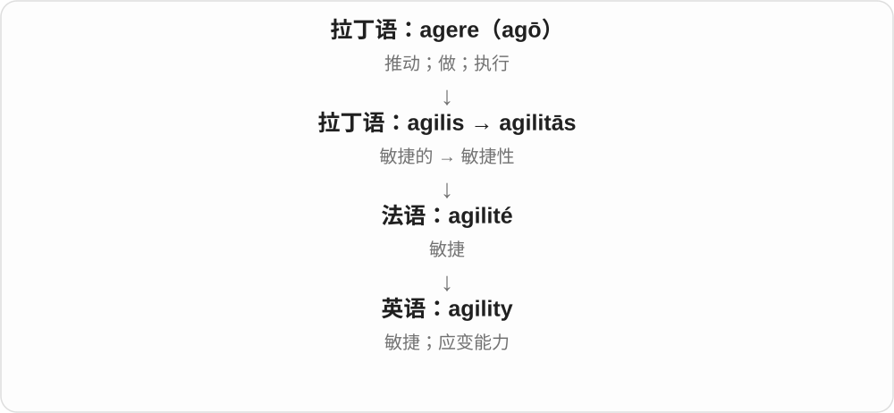

可指运动员动作灵活，也可指组织面对变化时调整的能力。它不只是一条直线上冲得快。

**常见搭配与例句**

physical agility；mental agility；organizational agility。

> The drill tests balance and agility.

这项训练测试平衡和敏捷性。

> Small teams sometimes gain agility from shorter decision processes.

小团队有时因为决策流程短而更灵活。

**别混淆**

agility 强调转向与应变；speed 强调快；flexibility 更偏可调整的范围。

### 41. deactivate — 停用；使失效；关闭作用

**音标**：/diːˈæktɪveɪt/

**先抓住这个画面**

deactivate 像把原本在工作的功能关掉，使它暂时不再发挥作用。

**怎么拆**

de-（解除、撤去）+ activate。

**怎么变成今天的意思**

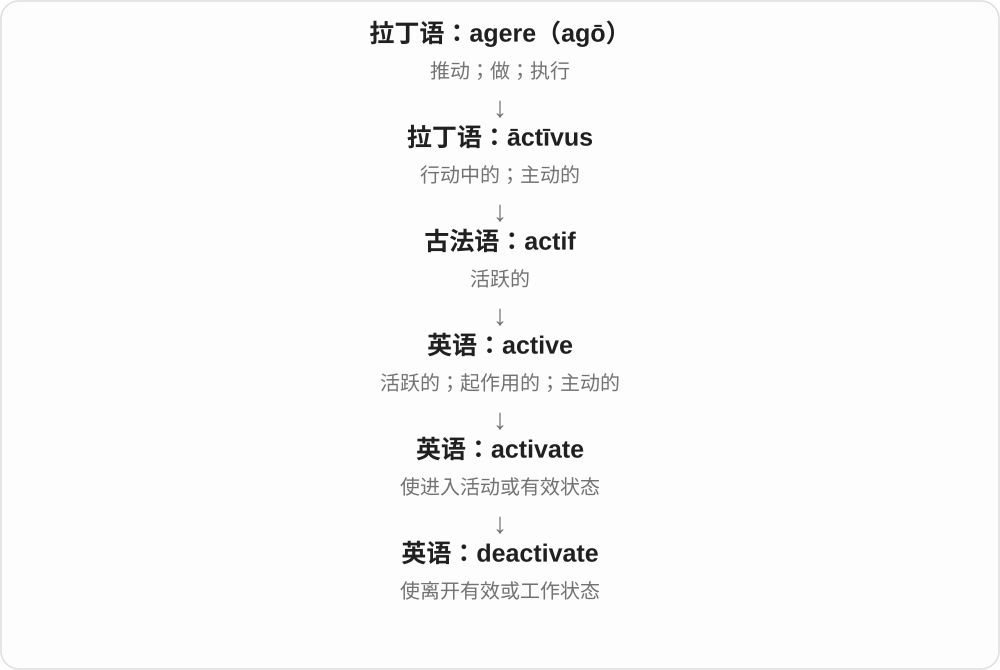

账号、警报、设备功能都能被 deactivate。并不总等于删除，停用后的内容可能仍然保留。

**常见搭配与例句**

deactivate an account；deactivate the alarm；deactivate a feature。

> I deactivated the old account after moving to a new service.

改用新服务后，我停用了旧账号。

> Press this button to deactivate the automatic timer.

按这个按钮可以停用自动计时器。

**别混淆**

deactivate 停止作用；delete 删除对象或记录；是否能恢复取决于系统。

### 42. deactivation — 停用；关闭作用

**音标**：/diːˌæktɪˈveɪʃən/

**先抓住这个画面**

deactivation 是从“功能开着”切换到“功能关着”的那一过程。

**怎么拆**

de- + activation，与 deactivate 的动作名词对应。

**怎么变成今天的意思**

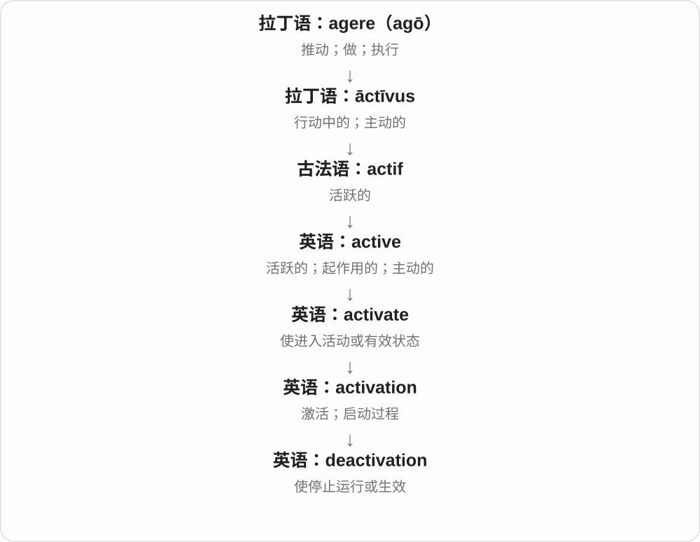

常见于账号、设备和系统设置。是否删除数据或保留恢复机会，需要看具体产品规则，不能只从单词推定。

**常见搭配与例句**

account deactivation；automatic deactivation；request deactivation。

> The email confirms the deactivation of the account.

邮件确认账号已停用。

> Automatic deactivation prevents the light from staying on all night.

自动关闭功能防止灯整夜亮着。

**别混淆**

deactivation 是停用过程；inactivity 是一段时间没有活动，未必有人执行过停用。

### 43. cogent — 有理有据、令人信服的

**音标**：英 /ˈkəʊdʒənt/；美 /ˈkoʊdʒənt/

**先抓住这个画面**

cogent 像一条证据链把你一步步推向结论，让你很难用合理理由拒绝。

**怎么拆**

拉丁语 co-（共同）+ agere 形成 cōgere“赶到一起、迫使”，现在分词 cōgēns 形成此词。

**怎么变成今天的意思**

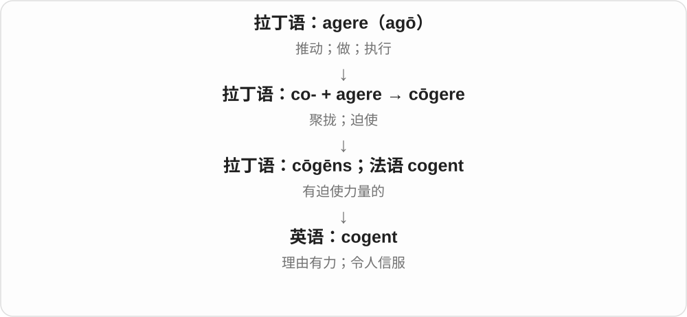

现代主要赞成论点、解释或证据具有说服力。“迫使”变成了逻辑力量，并非用威胁让人服从。

**常见搭配与例句**

a cogent argument；a cogent explanation；cogent reasons。

> She gave a cogent explanation for the change.

她对这次变化给出了有说服力的解释。

> The report presents a cogent argument for improving the design.

报告提出了有理有据的论证，支持改进设计。

**别混淆**

forceful 可以只是语气强硬；cogent 更看理由是否合理、贴题、能说服人。

### 44. agitate — 搅动；使不安；鼓动争取

**音标**：/ˈædʒɪteɪt/

**先抓住这个画面**

agitate 像不断摇动一杯水：液体被搅起来，人的情绪也可以被搅得不安，社会议题也可以被不断推动。

**怎么拆**

来自拉丁语 agitāre，是 agere 的反复动作形式，经 agitātus 进入英语。

**怎么变成今天的意思**

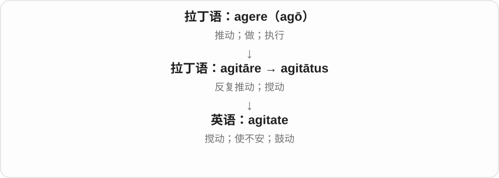

字面上可摇动液体；心理上使人烦乱；政治上 agitate for 是积极推动某项改变。三者都带“让它持续动起来”的画面。

**常见搭配与例句**

agitate the mixture；agitate for reform；be agitated by noise。

> Gently agitate the mixture before observing it.

观察前轻轻摇动混合物。

> Residents began to agitate for better public transport.

居民开始积极争取更好的公共交通。

**别混淆**

agitating a mixture 是搅动；agitating a person 是使其不安；对象决定具体意思。

### 45. agitator — 鼓动者；搅拌装置

**音标**：英 /ˈædʒɪteɪtə/；美 /ˈædʒɪteɪtər/

**先抓住这个画面**

agitator 是把平静状态搅起来的人或装置：一边推动人群行动，一边搅动容器里的物料。

**怎么拆**

agitate + -or；拉丁语也有相关的 agitātor“驱赶者”。

**怎么变成今天的意思**

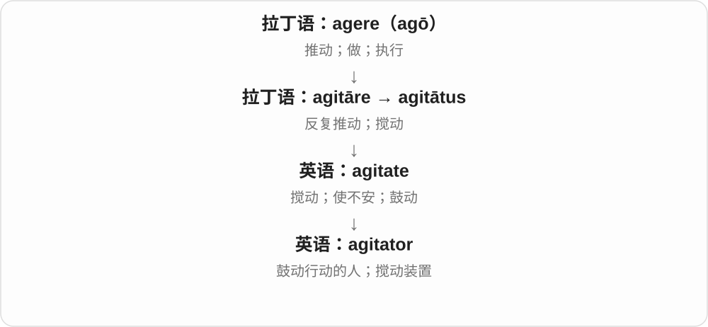

称人 agitator 往往带说话者的评价，可能赞其推动改革，也可能贬其煽动事端；机械用法通常中性。

**常见搭配与例句**

a political agitator；an agitator blade；a tank agitator。

> The newspaper portrayed him as a political agitator.

报纸把他描写成一名政治鼓动者。

> The tank has an agitator to keep the mixture uniform.

罐内装有搅拌器，以保持混合物均匀。

**别混淆**

agitator 不一定是 violent person；这个词说鼓动作用，并不自动断言暴力。

### 46. castigate — 严厉斥责；猛烈批评

**音标**：/ˈkæstɪɡeɪt/

**先抓住这个画面**

castigate 像当面把错误逐条指出，语气很重，目的至少表面上是让人改正。

**怎么拆**

来自拉丁语 castīgāre、castīgātus：castus“纯正”与使动成分结合；传统词源将后半联系 agere。

**怎么变成今天的意思**

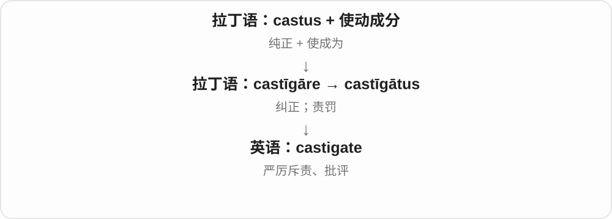

历史上有以惩戒纠正的意思，现代常用于强烈的公开或正式批评。不是一般温和提醒。

**常见搭配与例句**

castigate someone for；castigate a policy；be castigated in the press。

> The report castigated the company for ignoring repeated warnings.

报告严厉批评公司无视一再出现的警告。

> She was castigated for the careless remark.

她因那句轻率的话遭到严厉批评。

**别混淆**

criticize 可轻可重；castigate 明确是严厉批评；不要拆成 cast“扔”+ gate“门”。

### 47. cogitate — 深思；仔细琢磨

**音标**：英 /ˈkɒdʒɪteɪt/，亦 /ˈkəʊdʒɪteɪt/；美 /ˈkɑːdʒɪteɪt/

**先抓住这个画面**

cogitate 像把一个想法拿在脑中反复翻面，比较它的每一种可能。

**怎么拆**

拉丁语 co- + agitāre 形成 cōgitāre“反复思考”；英语从其分词词干 cōgitāt- 借入。

**怎么变成今天的意思**

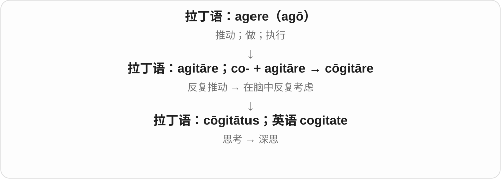

比 think 正式，有时带轻松的书面幽默感。重点在思考过程，不保证最后已经得出结论。

**常见搭配与例句**

cogitate on a problem；cogitate about a choice；sit and cogitate。

> He sat by the window and cogitated on the problem.

他坐在窗边，仔细琢磨那个问题。

> Give me a moment to cogitate before I answer.

让我想一会儿再回答。

**别混淆**

cogitate 是深思；agitate 是搅动或使不安；两者的反复“动”发生在不同层面。

### 48. cogitation — 深思；反复考虑；思考所得

**音标**：英 /ˌkɒdʒɪˈteɪʃən/；美 /ˌkɑːdʒɪˈteɪʃən/

**先抓住这个画面**

cogitation 是脑中反复推敲的那段过程，也可以指琢磨出来的想法。

**怎么拆**

现代对应 cogitate + -ion；历史来自拉丁语 cōgitātiō，并有法语、中古英语的借入传统。

**怎么变成今天的意思**

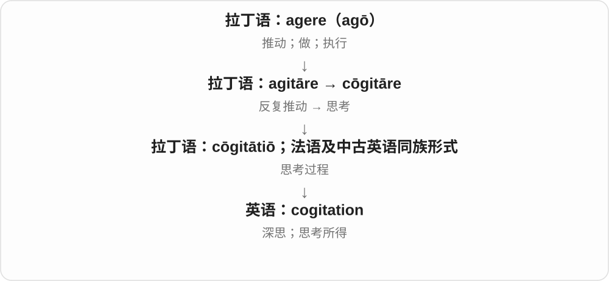

是正式或略带幽默的书面词。复数 cogitations 可指一个人的种种思考，不必都是已经证实的观点。

**常见搭配与例句**

after much cogitation；quiet cogitation；one’s cogitations。

> After much cogitation, we chose the simpler design.

反复考虑后，我们选择了更简单的设计。

> Her notebook records her cogitations on the subject.

笔记本记录了她对这个主题的种种思考。

**别混淆**

cogitation 强调思考过程；conclusion 是结论，二者不能自动画等号。

### 49. excogitate — 仔细想出；深思构思（正式、少见）

**音标**：英 /eksˈkɒdʒɪteɪt/；美 /eksˈkɑːdʒɪteɪt/

**先抓住这个画面**

excogitate 像把脑中的零散线索来回推敲，最后想出一条可用的办法。

**怎么拆**

拉丁语 ex-（充分、向外）+ cōgitāre“思考”，形成 excōgitāre；不是现代英语才在 cogitate 前加前缀。

**怎么变成今天的意思**

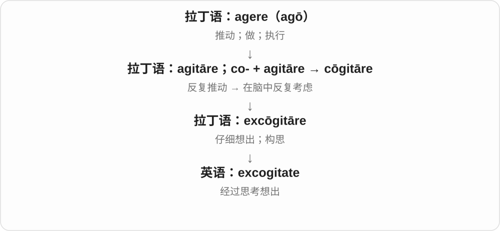

可强调充分考虑，也常突出想出办法或设计。现代普通表达用 think up 或 devise 更自然。

**常见搭配与例句**

excogitate a plan；excogitate a solution；a carefully excogitated scheme。

> The committee excogitated a plan for sharing the limited space.

委员会仔细想出了一个共享有限空间的方案。

> He spent the evening excogitating a solution.

他花了一晚上琢磨解决办法。

**别混淆**

cogitate 着重想；excogitate 往往进一步着重把方案想出来。

## 这一组要分清什么

**action / activity / activation**：采取行动 / 活动或活跃程度 / 使进入有效状态。

**reactive / proactive**：事情出现后回应 / 提前准备和行动。proactive 不能简单等于“很忙”。

**actor / agent / agitator**：参与行动者或演员 / 代表别人做事或产生作用的一方 / 搅动局面的人或装置。

**reactor / reactant / reaction**：反应装置 / 反应物 / 反应过程。

**ambiguous / vague**：意思有岔路 / 细节或边界不清。**cogent / forceful**：理由有说服力 / 力量或语气强。抓住具体差别，比把它们都译成“有力”更有用。

## 串起来练习

把行动线串起来：**The agent put a clear plan on the agenda, and the team took proactive action.**

代理人把一项清晰的计划列入议程，团队随后提前采取了行动。agent 是办事的一方，agenda 是待处理的事项，action 是真正做起来，proactive 说明行动赶在问题前面。
