# 0091 · hab-, -hib-, habit-, -hibit- — 拿着、拥有、保持；由此分出能力、习惯、居住、债务与抑制

[逐词精讲目录](../00_逐词精讲目录.md) · [总目录](../00_总目录_按常用程度.md)

## 核心词根与来源

**先想手里拿着一件东西，再想一个人保持某种状态。** 拉丁语 habēre 可以表示拿着、拥有、保持。拿出来给人看，是 exhibit；按住不让它发展，是 inhibit；挡住某事，是 prohibit。habit 来自习性、状态这一支，habitat 来自“常住在那里”。able 则走过“合手、合用 → 有能力”的变化。看起来差很远的 debt、due、duty，都经过 dēbēre“欠、应当”这一支相连。

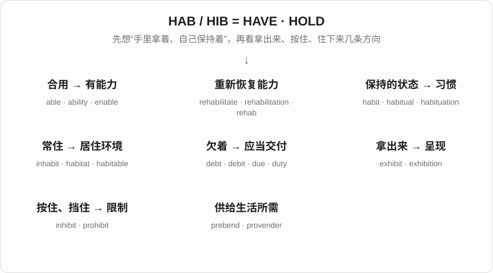

## 词形与演化规律

hab- 与复合词中的 hib- 是这一拉丁词族的形态变化；habit-、hibit- 常与其分词或进一步构词有关。habitāre 是 habēre 的反复式，发展为居住；habilis 发展出 able。独立单词 able 与 -able 后缀历史来源不同，不能把所有以 -able 结尾的词都归入本族。debility、debilitate、debile 的深层词源有争议，本页保留为比较旁支，图从 dēbilis“虚弱”开始；不把它们画作 habēre 的确定后代。indubitable、indubitably 来自 dubitāre“怀疑”，不属于这一族。

## 单词速览（按词族由简到繁）

同一基础词的相关扩展放在一起，先读基础形式，再读扩展；各组之间优先读常用的。具体词源关系见各词讲解。

| 单词 | 音标 | 核心意思 |
|---|---|---|
| [able](#w-1) | /ˈeɪbəl/ | 能够……的；有才能的 |
| [ability](#w-3) | /əˈbɪləti/ | 能力；本领 |
| [unable](#w-6) | /ʌnˈeɪbəl/ | 不能……的；无法……的 |
| [inability](#w-15) | /ˌɪnəˈbɪləti/ | 无力做到；不能做某事 |
| [enable](#w-8) | /ɪˈneɪbəl/ | 使能够；启用 |
| [enabler](#w-41) | 英 /ɪˈneɪblə/；美 /ɪˈneɪblər/ | 促成者；提供条件的事物；纵容者 |
| [enablement](#w-55) | /ɪˈneɪbəlmənt/ | 使具备能力；赋能支持；启用 |
| [disenable](#w-74) | /ˌdɪsɪˈneɪbəl/ | 使失去能力；使不能（罕用） |
| [disable](#w-20) | /dɪsˈeɪbəl/ | 使不能运作；禁用；使某种能力受损 |
| [disabled](#w-9) | /dɪsˈeɪbəld/ | 残障的；被禁用的；无法运作的 |
| [disability](#w-11) | /ˌdɪsəˈbɪləti/ | 残障；影响活动或参与的功能障碍 |
| [due](#w-2) | 英 /djuː/；美 /duː/ | 到期的；应有的；预定到来的；由于 |
| [duly](#w-23) | 英 /ˈdjuːli/；美 /ˈduːli/ | 按要求地；如期地；果然 |
| [overdue](#w-22) | 英 /ˌəʊvəˈdjuː/；美 /ˌoʊvərˈduː/ | 逾期的；早该发生的 |
| [undue](#w-28) | 英 /ʌnˈdjuː/；美 /ʌnˈduː/ | 过分的；不应有的；不适当的 |
| [duty](#w-4) | 英 /ˈdjuːti/；美 /ˈduːti/ | 职责；义务；值勤；税 |
| [dutiful](#w-45) | 英 /ˈdjuːtɪfəl/；美 /ˈduːtɪfəl/ | 尽责的；顺从本分的 |
| [debt](#w-5) | /det/ | 债务；欠下的人情或恩情 |
| [debtor](#w-32) | 英 /ˈdetə/；美 /ˈdetər/ | 债务人；欠钱的一方 |
| [exhibit](#w-12) | /ɪɡˈzɪbɪt/ | 展示；表现出；展品；证物 |
| [exhibition](#w-7) | /ˌeksɪˈbɪʃən/ | 展览；公开展示；某种表现 |
| [exhibitionism](#w-50) | /ˌeksɪˈbɪʃənɪzəm/ | 炫耀、爱表现的行为；露阴行为 |
| [exhibitionist](#w-48) | /ˌeksɪˈbɪʃənɪst/ | 爱表现的人；爱出风头的人；露阴者 |
| [exhibitor](#w-44) | 英 /ɪɡˈzɪbɪtə/；美 /ɪɡˈzɪbɪtər/ | 参展者；展出作品或产品的一方 |
| [habit](#w-10) | /ˈhæbɪt/ | 习惯；惯常做法；宗教服装 |
| [habitual](#w-29) | /həˈbɪtʃuəl/ | 习惯性的；惯常的；一贯如此的 |
| [habitually](#w-38) | /həˈbɪtʃuəli/ | 习惯性地；一贯地 |
| [nonhabitual](#w-83) | /ˌnɒnhəˈbɪtʃuəl/ | 非习惯性的；不属于惯常做法的 |
| [habitable](#w-30) | /ˈhæbɪtəbəl/ | 适宜居住的；可以住人的 |
| [habitability](#w-51) | /ˌhæbɪtəˈbɪləti/ | 宜居性；适合居住的程度 |
| [habitant](#w-70) | /ˈhæbɪtənt/ | 居民（旧义）；加拿大法裔农民、早期定居者 |
| [habitance](#w-79) | /ˈhæbɪtəns/（旧词） | 住所；居住 |
| [inhabit](#w-27) | /ɪnˈhæbɪt/ | 居住在；栖息于；占据某种精神世界 |
| [uninhabited](#w-33) | /ˌʌnɪnˈhæbɪtɪd/ | 无人居住的；没有居民的 |
| [inhabitant](#w-40) | /ɪnˈhæbɪtənt/ | 居民；栖居者 |
| [inhabitable](#w-54) | /ɪnˈhæbɪtəbəl/ | 可以居住的；可供栖息的 |
| [uninhabitable](#w-42) | /ˌʌnɪnˈhæbɪtəbəl/ | 不适宜居住的；不能住人的 |
| [inhabitation](#w-66) | /ɪnˌhæbɪˈteɪʃən/ | 居住于其中；居住状态（较少用） |
| [cohabit](#w-59) | 英 /kəʊˈhæbɪt/；美 /koʊˈhæbɪt/ | 共同居住；作为伴侣同居 |
| [cohabitation](#w-43) | 英 /kəʊˌhæbɪˈteɪʃən/；美 /koʊˌhæbɪˈteɪʃən/ | 共同居住；同居 |
| [habilitate](#w-78) | /həˈbɪlɪteɪt/ | 使具备能力或资格；取得任教资格 |
| [rehabilitate](#w-34) | /ˌriːhəˈbɪlɪteɪt/ | 使康复；使重新适应社会；恢复名誉；修复 |
| [rehabilitation](#w-13) | /ˌriːhəˌbɪlɪˈteɪʃən/ | 康复；重新适应；修复；恢复名誉 |
| [rehabilitative](#w-49) | 美 /ˌriːhəˈbɪləˌteɪtɪv/ | 帮助康复的；促进重新适应的 |
| [rehabilitator](#w-68) | 英 /ˌriːhəˈbɪlɪteɪtə/；美 /ˌriːhəˈbɪlɪteɪtər/ | 从事康复或恢复工作的人 |
| [rehabilitant](#w-84) | /ˌriːhəˈbɪlɪtənt/ | 接受康复的人（专业用语） |
| [habitat](#w-14) | /ˈhæbɪtæt/ | 栖息地；自然生存环境 |
| [habitation](#w-35) | /ˌhæbɪˈteɪʃən/ | 居住；住所；人类居住痕迹 |
| [habitator](#w-80) | 英 /ˈhæbɪteɪtə/；美 /ˈhæbɪteɪtər/（旧词） | 居住者；居民 |
| [rehab](#w-16) | /ˈriːhæb/ | 康复治疗；戒除成瘾的康复治疗；修复 |
| [prohibit](#w-21) | /prəˈhɪbɪt/ | 禁止；阻止 |
| [prohibition](#w-17) | 英 /ˌprəʊhɪˈbɪʃən/；美 /ˌproʊhɪˈbɪʃən/ | 禁止；禁令；禁酒制度 |
| [prohibitionist](#w-58) | 英 /ˌprəʊhɪˈbɪʃənɪst/；美 /ˌproʊhɪˈbɪʃənɪst/ | 支持禁令者；禁酒主义者 |
| [prohibitive](#w-37) | /prəˈhɪbɪtɪv/ | 高得难以承受的；起阻止作用的；禁止性的 |
| [prohibitively](#w-46) | /prəˈhɪbɪtɪvli/ | 高到令人无法承受地；达到阻止行动的程度 |
| [prohibitory](#w-64) | 英 /prəˈhɪbɪtəri/；美 /prəˈhɪbɪtɔːri/ | 禁止性的；起禁止作用的 |
| [debit](#w-18) | /ˈdebɪt/ | 借方记项；账户扣款；记入借方 |
| [debitor](#w-73) | 英 /ˈdebɪtə/；美 /ˈdebɪtər/（旧词） | 债务人；欠债者 |
| [endeavor](#w-19) | 英 /ɪnˈdevə/；美 /ɪnˈdevər/ | 努力；尽力尝试；事业性活动 |
| [inhibit](#w-26) | /ɪnˈhɪbɪt/ | 抑制；阻碍；使拘谨 |
| [inhibition](#w-24) | /ˌɪnhɪˈbɪʃən/ | 抑制；顾虑；拘谨 |
| [disinhibition](#w-60) | /ˌdɪsɪnhɪˈbɪʃən/ | 解除抑制；控制减弱；失去拘束 |
| [inhibitor](#w-25) | 英 /ɪnˈhɪbɪtə/；美 /ɪnˈhɪbɪtər/ | 抑制剂；起抑制作用的事物 |
| [inhibited](#w-31) | /ɪnˈhɪbɪtɪd/ | 拘谨的；受抑制的 |
| [uninhibited](#w-47) | /ˌʌnɪnˈhɪbɪtɪd/ | 无拘束的；尽情表达的 |
| [inhibitory](#w-36) | 英 /ɪnˈhɪbɪtəri/；美 /ɪnˈhɪbɪtɔːri/ | 起抑制作用的；抑制性的 |
| [disinhibit](#w-75) | /ˌdɪsɪnˈhɪbɪt/ | 解除抑制；使不再受约束 |
| [habeas corpus](#w-39) | 英 /ˌheɪbiəs ˈkɔːpəs/；美 /ˌheɪbiəs ˈkɔːrpəs/ | 人身保护令；审查拘禁是否合法的司法程序 |
| [debenture](#w-52) | 英 /dɪˈbentʃə/；美 /dɪˈbentʃər/ | 债务凭证；公司债券 |
| [habituate](#w-67) | /həˈbɪtʃueɪt/ | 使习惯；逐渐适应 |
| [habituation](#w-53) | /həˌbɪtʃuˈeɪʃən/ | 习惯化；反复接触后反应减弱 |
| [prebend](#w-57) | /ˈprebənd/ | 教士俸给；提供这笔收入的财产或职位 |
| [prebendary](#w-56) | 英 /ˈprebəndəri/；美 /ˈprebənˌderi/ | 领取俸给的教士；座堂荣誉教士 |
| [debile](#w-72) | /ˈdebəl/，也读 /ˈdebaɪl/（旧词） | 虚弱的；衰弱的 |
| [debility](#w-61) | /dɪˈbɪləti/ | 虚弱；衰弱 |
| [devoir](#w-62) | 英 /dəˈvwɑː/；美 /dəˈvwɑːr/ | 职责；应尽礼节；致敬（旧式） |
| [debilitate](#w-63) | /dɪˈbɪlɪteɪt/ | 使虚弱；严重削弱 |
| [provender](#w-65) | 英 /ˈprɒvəndə/；美 /ˈprɑːvəndər/ | 饲料；食物、粮草（旧式或文学用语） |
| [habitude](#w-69) | 英 /ˈhæbɪtjuːd/；美 /ˈhæbɪtuːd/ | 习性；习惯性倾向（文学或罕用） |
| [habenula](#w-71) | /həˈbenjʊlə/ | 缰核；小缰状或带状结构 |
| [habendum](#w-76) | /həˈbendəm/ | 契据中界定所授产权范围的条款 |
| [habile](#w-77) | /ˈhæbɪl/，也读 /ˈhæbəl/ | 能干的；灵巧的（罕用） |
| [inhabile](#w-82) | /ɪnˈhæbɪl/ | 不适合的；不熟练的（旧词） |
| [habitudinal](#w-81) | 英 /ˌhæbɪˈtjuːdɪnəl/；美 /ˌhæbəˈtuːdənəl/ | 与惯常习性有关的（罕用） |

## 逐词讲解

### 1. able — 能够……的；有才能的

**音标**：/ˈeɪbəl/

**先抓住这个画面**

事情摆在面前，你有本领、有条件把它做成，就是 able。an able teacher 则是说这位老师很能干。

**怎么拆**

经古法语来自拉丁语 habilis，最初有便于拿取、合用的意思，根在 habēre。不能把它当作所有 -able 后缀的历史祖先。

**怎么变成今天的意思**

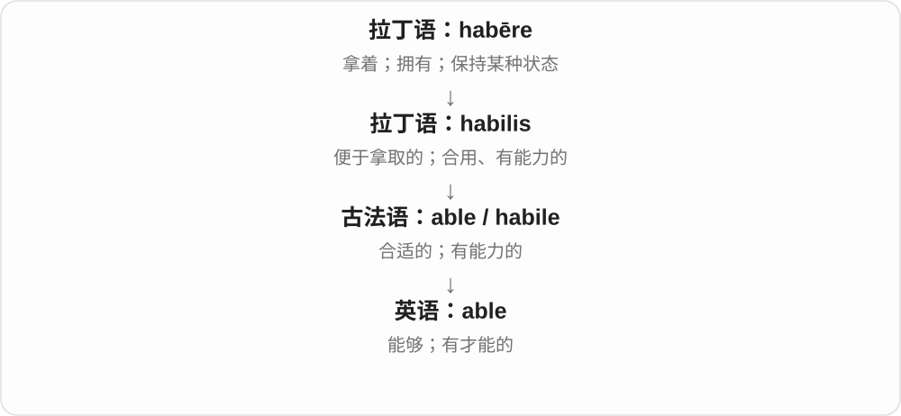

东西合手、适用 → 人胜任、有本领。现代 be able to 也能说条件允许，不一定只谈个人天赋。

**常见搭配与例句**

be able to do…；an able assistant；will be able to…。

> Will you be able to finish by Friday?

你能在星期五前完成吗？

> She is an able organizer who keeps everyone informed.

她是个能干的组织者，会让所有人及时了解情况。

**别混淆**

can 是情态动词；able 是形容词，要说 be able to。able 与后缀 -able 后来在意义上靠近，但来源不同。

### 2. ability — 能力；本领

**音标**：/əˈbɪləti/

**先抓住这个画面**

同样一件事，有人能解决、能学会，这种“做得到的本领”叫 ability。

**怎么拆**

经古法语 ableté 来自拉丁语 habilitās，与 habilis 对应；现代与 able 构成形容词、名词关系，并非简单在 able 后原样加 ity。

**怎么变成今天的意思**

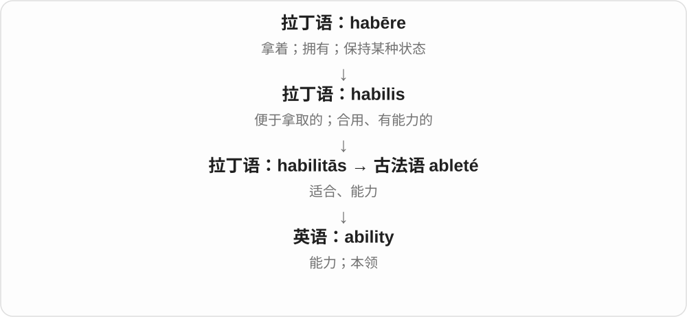

从适合做某事的状态发展为能力。可说笼统的学习能力，也可用复数 abilities 指不同方面的本领。

**常见搭配与例句**

the ability to do…；reading ability；to the best of your ability。

> The job requires the ability to explain complex ideas clearly.

这项工作要求能把复杂想法讲清楚。

> Each child brings different abilities to the group.

每个孩子都为这个小组带来不同的本领。

**别混淆**

ability 范围广；skill 更常指练出来的具体技能。ability to solve problems 的 to 后用动词原形。

### 3. unable — 不能……的；无法……的

**音标**：/ʌnˈeɪbəl/

**先抓住这个画面**

想做一件事，却缺少能力、条件或机会，最后做不到，就是 unable。

**怎么拆**

un-（不）+ able（能够的）。

**怎么变成今天的意思**

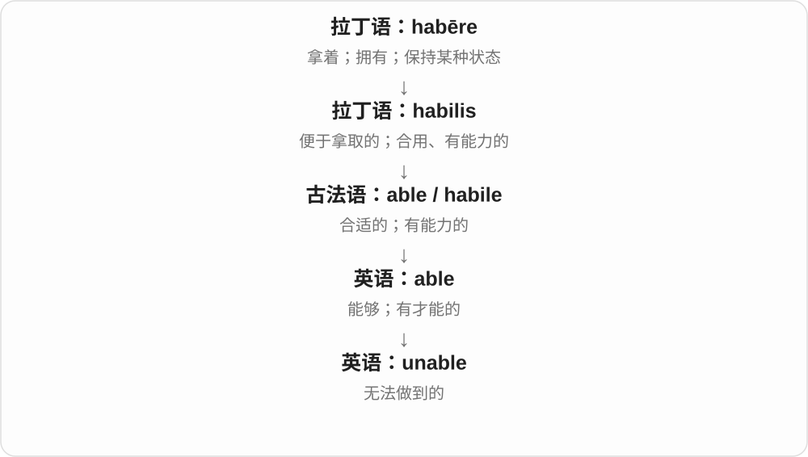

它描述某一件事做不到，不等于说这个人什么都不行。常见原因可以是时间不够、系统故障或身体状况。

**常见搭配与例句**

be unable to do…；unable to attend；unable to connect。

> I was unable to open the attachment.

我无法打开附件。

> She is unable to attend the meeting tomorrow.

她明天无法参加会议。

**别混淆**

unable 是无法；unwilling 是不愿意。没有来，不足以判断究竟是哪一种。

### 4. inability — 无力做到；不能做某事

**音标**：/ˌɪnəˈbɪləti/

**先抓住这个画面**

把“做不到这件事”当作一个需要讨论的问题，就是 inability，比如无法入睡、无法沟通。

**怎么拆**

历史上与中古英语 inhability、拉丁语 inhabilitās 有关；现代可按 in-（不）+ ability 理解。

**怎么变成今天的意思**

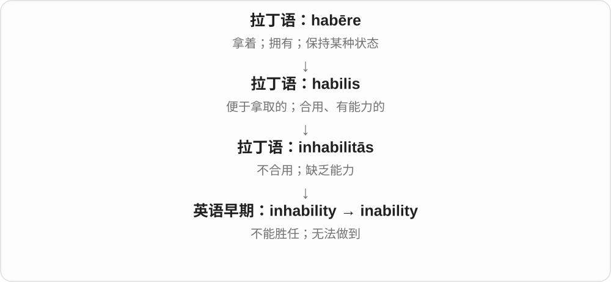

它是 unable 的对应名词，通常要交代不能做什么。词本身不说明是长期能力限制还是眼前条件造成。

**常见搭配与例句**

an inability to do…；an inability to concentrate；overcome an inability。

> His inability to sleep left him exhausted.

他睡不着，结果疲惫不堪。

> The report noted the system’s inability to handle large files.

报告指出这个系统无法处理大文件。

**别混淆**

inability 是不能；unwillingness 是不愿。不要把无法完成直接解释成态度不好。

### 5. enable — 使能够；启用

**音标**：/ɪˈneɪbəl/

**先抓住这个画面**

原先做不到，你补上一座桥、一个工具或一个条件，事情就做得到了，这便是 enable。

**怎么拆**

en-（使成为）+ able（能够的），是英语内部的构词。

**怎么变成今天的意思**

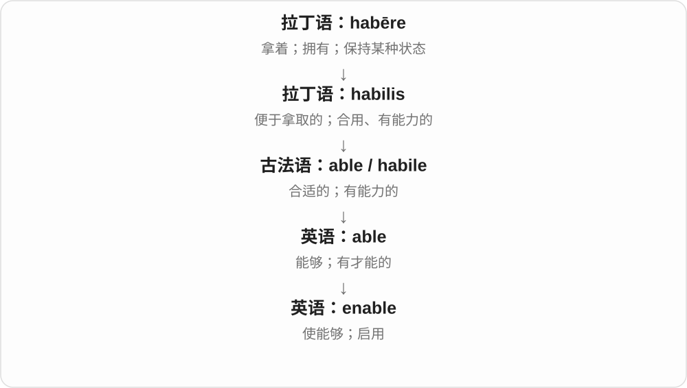

不是替对方完成任务，而是提供能力或条件。软件里的 enable a feature 是让功能开始可用。

**常见搭配与例句**

enable someone to do…；enable access；enable notifications。

> The grant enabled her to continue her research.

这笔资助使她得以继续研究。

> Enable notifications if you want to receive updates.

如果想收到更新提醒，就启用通知。

**别混淆**

allow 常强调许可，也能说条件允许；enable 更突出让事情具备实现条件。要说 enable someone to do。

### 6. enabler — 促成者；提供条件的事物；纵容者

**音标**：英 /ɪˈneɪblə/；美 /ɪˈneɪblər/

**先抓住这个画面**

让一件事能够发生的人或条件，是 enabler；若他总替别人的有害行为遮掩，也会被叫作 enabler。

**怎么拆**

enable + -er，表示促成某事的人或事物。

**怎么变成今天的意思**

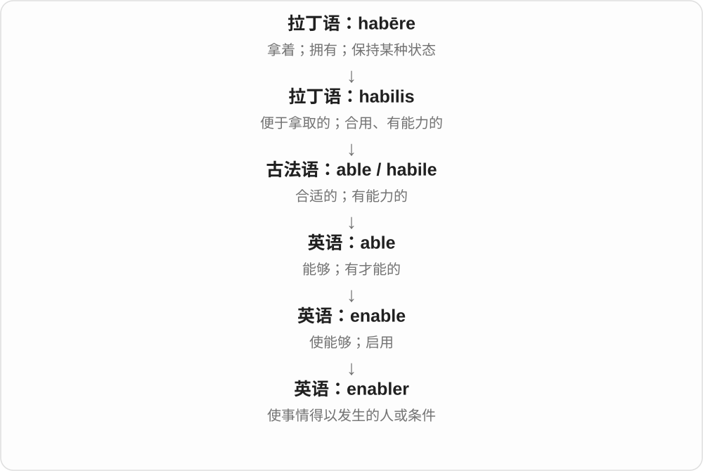

技术文章里的 enabler 常是褒义或中性，如廉价通信促成远程协作；人际语境则可能批评持续纵容。关键看促成了什么。

**常见搭配与例句**

a key enabler of…；a technology enabler；act as an enabler。

> Reliable internet is a key enabler of remote work.

可靠的网络是远程工作的重要条件。

> By repeatedly covering up his lies, she became an enabler.

她一再替他的谎言打掩护，成了纵容他的人。

**别混淆**

helper 泛指帮忙的人；enabler 特别强调其支持让某种行为继续，未必是在帮对方变好。

### 7. enablement — 使具备能力；赋能支持；启用

**音标**：/ɪˈneɪbəlmənt/

**先抓住这个画面**

把工具、培训和必要权限交到人手里，让他真的能开展工作，这整套支持可以叫 enablement。

**怎么拆**

enable + -ment，把“使能够”的动作变成名词。

**怎么变成今天的意思**

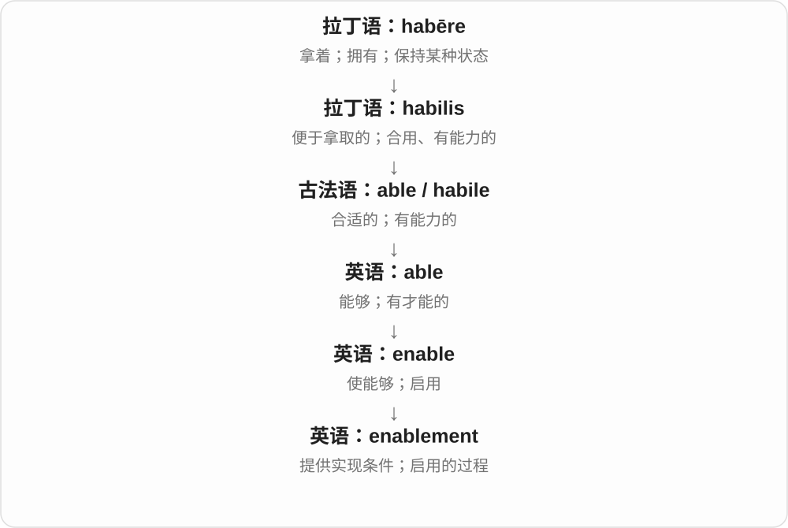

商业文案常用 sales enablement，说给销售人员提供材料、技能和工具。它也能指技术功能的启用，具体内容比抽象口号更重要。

**常见搭配与例句**

sales enablement；customer enablement；feature enablement。

> The enablement program gives new staff practical training.

这项能力支持计划为新员工提供实用培训。

> Feature enablement requires an administrator’s approval.

启用这项功能需要管理员批准。

**别混淆**

enablement 说提供能力和条件；empowerment 还常强调自主权、决定权。两者不总能互换。

### 8. disenable — 使失去能力；使不能（罕用）

**音标**：/ˌdɪsɪˈneɪbəl/

**先抓住这个画面**

已经具备的条件又被拿走，事情做不成了，这个罕见词表达的就是这种失能。

**怎么拆**

dis-（取消、使相反）+ enable（使能够）。

**怎么变成今天的意思**

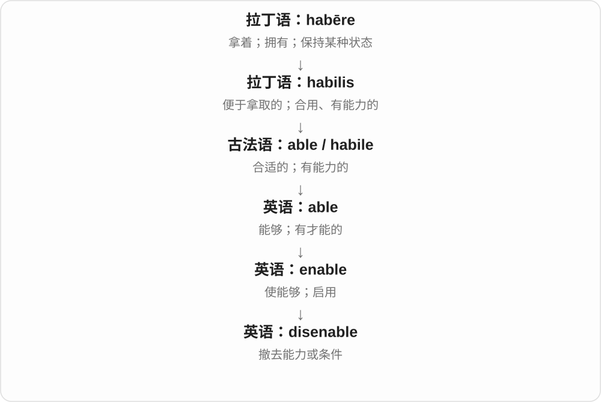

它在构词上与 enable 相反，但现代日常英语通常用 disable、prevent 或 make unable，不必刻意使用这个旧式词。

**常见搭配与例句**

disenable someone from acting（旧式）；disenable a function（罕用）。

> The old rule could disenable a member from voting.

这项旧规定可能使会员失去投票资格。

> The glossary explains disenable as an uncommon form meaning make unable.

词汇表解释说 disenable 是表示使不能的罕见词。

**别混淆**

disenable 与 disable 意义靠近；现代软件按钮一般写 disable，不写 disenable。

### 9. disable — 使不能运作；禁用；使某种能力受损

**音标**：/dɪsˈeɪbəl/

**先抓住这个画面**

开关一关，功能就用不了了；故障一来，设备无法工作。这种“让它失去运作能力”是 disable。

**怎么拆**

dis-（去除、使相反）+ able（能够的）。

**怎么变成今天的意思**

技术语境通常是有意禁用；事故或疾病语境可指某种功能受损。说人时要看具体影响，不能理解成整个人没有能力。

**常见搭配与例句**

disable an account；disable a feature；a disabled vehicle。

> You can disable automatic updates in the settings.

你可以在设置里关闭自动更新。

> The storm disabled the island’s main transmitter.

暴风雨使岛上的主发射机无法运作。

**别混淆**

delete 是删除内容；disable 常只是停用，内容或设置仍在。unable 则是形容某次做不到。

### 10. disabled — 残障的；被禁用的；无法运作的

**音标**：/dɪsˈeɪbəld/

**先抓住这个画面**

说人时，它谈身体、感官等方面的残障及相关障碍；说功能时，是“已经被关闭或停用”。不能把人等同于坏掉的机器。

**怎么拆**

disable 的过去分词，发展为形容词。

**怎么变成今天的意思**

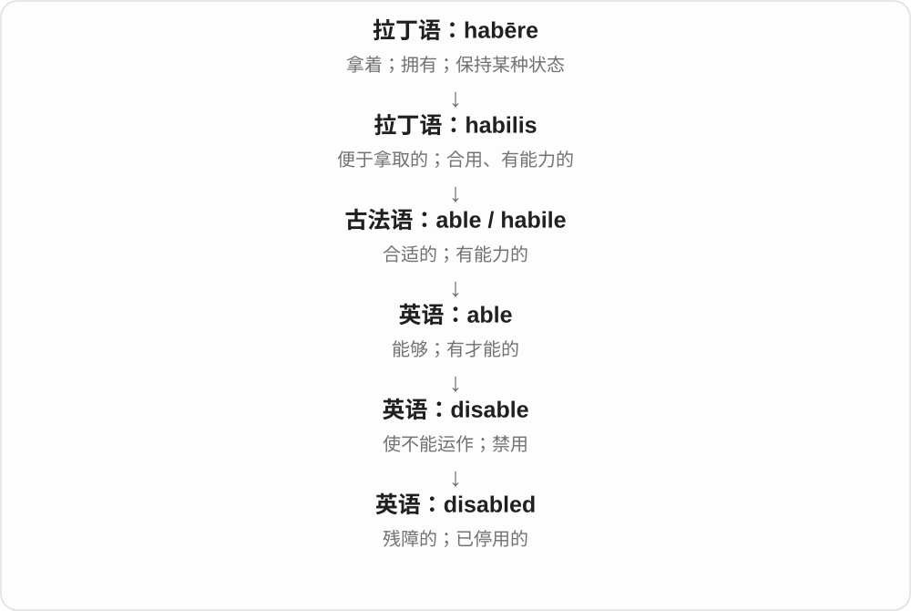

同一个词在不同对象上有不同语感。disabled people 与 people with disabilities 都能使用，具体称呼可尊重当事人的偏好。

**常见搭配与例句**

disabled people；disabled access；a disabled account；the button is disabled。

> The museum provides step-free access for disabled visitors.

博物馆为残障访客提供无台阶通道。

> The submit button remains disabled until every field is complete.

所有字段填完之前，提交按钮一直无法使用。

**别混淆**

disabled 是特定状态或身份描述；unable to do something 是某件事做不到，范围不能混同。

### 11. disability — 残障；影响活动或参与的功能障碍

**音标**：/ˌdɪsəˈbɪləti/

**先抓住这个画面**

某些身体、感官或认知方面的状况，会与环境障碍一起影响人的日常活动，disability 用来谈这些限制。

**怎么拆**

dis- + ability；也与 disable 的词族相连。

**怎么变成今天的意思**

现代用法不等于“没有能力”。无障碍设计、辅助工具和社会支持都可能减少一个人遇到的实际困难。

**常见搭配与例句**

a person with a disability；a physical disability；disability access；disability rights。

> The form asks whether applicants need disability accommodations.

表格询问申请人是否需要与残障有关的便利安排。

> Her disability does not prevent her from leading the team.

她的残障并不妨碍她领导团队。

**别混淆**

disability 不一定肉眼可见，也不等于 illness“生病”。具体身份与法律定义依语境而异。

### 12. due — 到期的；应有的；预定到来的；由于

**音标**：英 /djuː/；美 /duː/

**先抓住这个画面**

把日历翻到该交作业、该还钱、该到站的那一天：这些事情“该到了”，便是 due。

**怎么拆**

来自古法语 devoir“欠、应该”的过去分词 deü，更早是拉丁语 dēbēre；现代不再能按字母直接拆开。

**怎么变成今天的意思**

所欠的 → 应当给的 → 应在某时完成或到来的。due to 作“由于”时，则把结果归到某个原因上；give someone their due 是承认对方应得的评价。

**常见搭配与例句**

be due on Friday；be due to arrive；due to the weather；with due care。

> The assignment is due on Monday.

这份作业星期一交。

> The train is due to arrive at six.

火车预计六点到达。

> The match was canceled due to heavy rain.

比赛因大雨取消了。

**别混淆**

due on Monday 是星期一到期；overdue 是已经过期。be due to leave 是预计离开，due to rain 才是由于下雨。

### 13. duly — 按要求地；如期地；果然

**音标**：英 /ˈdjuːli/；美 /ˈduːli/

**先抓住这个画面**

该走的手续走了，该做的事按时做了，用 duly 表明“一切照规矩、照预期完成”。

**怎么拆**

due + -ly，词尾 e 去掉；以适当、应有的方式。

**怎么变成今天的意思**

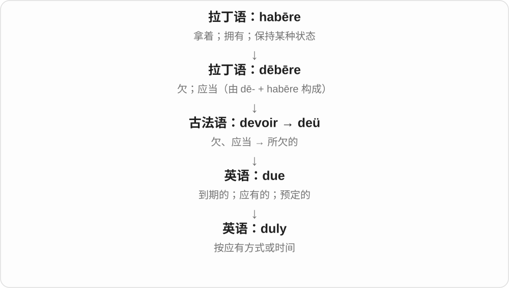

正式文件中常表示手续合规；叙事里还可说事情果然如预期发生。Duly noted. 表示已正式记下，有时也带冷淡语气。

**常见搭配与例句**

duly signed；duly authorized；duly noted；duly arrived。

> The form was duly signed and returned.

表格已按要求签署并交回。

> We expected a reply, and it duly arrived the next morning.

我们等着回复，第二天早上它果然来了。

**别混淆**

duly 是按要求、按预期；dully 是无趣地、暗淡地，多一个 l，发音也不同。

### 14. overdue — 逾期的；早该发生的

**音标**：英 /ˌəʊvəˈdjuː/；美 /ˌoʊvərˈduː/

**先抓住这个画面**

规定时间已经过去，事情却还没完成，就像日历上的期限被越过去了，是 overdue。

**怎么拆**

over-（超过）+ due（到期的）。

**怎么变成今天的意思**

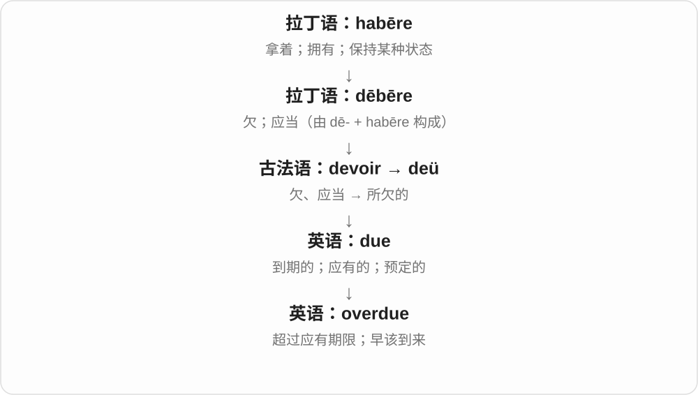

可以实指书没按时归还、账单没按时付款，也可表达评价：a long overdue apology 是早就该来的道歉。

**常见搭配与例句**

an overdue bill；an overdue library book；long overdue；overdue for repair。

> This library book is three days overdue.

这本图书馆的书已经逾期三天。

> The school received a long overdue upgrade.

学校终于进行了早该进行的改造。

**别混淆**

late 泛指迟；overdue 明确带有一个已过的应到时间。due 只说期限到了，不一定已经迟。

### 15. undue — 过分的；不应有的；不适当的

**音标**：英 /ʌnˈdjuː/；美 /ʌnˈduː/

**先抓住这个画面**

施加的压力、得到的优待超过合理限度，不是事情本来应当有的，就叫 undue。

**怎么拆**

un-（不）+ due（应有、适当的）。

**怎么变成今天的意思**

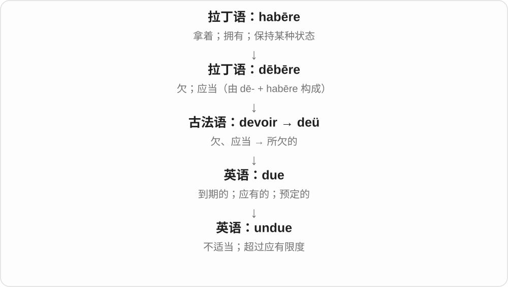

重点通常是分量不合适，而不是还没到期。undue delay 不是所有等待，而是不合理、过长的拖延。

**常见搭配与例句**

undue pressure；undue influence；without undue delay；undue concern。

> The teacher did not want to put undue pressure on the children.

老师不想给孩子们施加过大的压力。

> Please respond without undue delay.

请及时回复，不要无故拖延。

**别混淆**

overdue 是超过期限；undue 是不合理或过度。undue attention 往往是关注太多，不是关注来晚了。

### 16. duty — 职责；义务；值勤；税

**音标**：英 /ˈdjuːti/；美 /ˈduːti/

**先抓住这个画面**

不只是自己想不想做，而是因岗位、承诺或责任“应该去做”的事，就是 duty。

**怎么拆**

中古英语 duete 由 due“应有、所欠的”与名词后缀构成，最终来自拉丁语 dēbēre。

**怎么变成今天的意思**

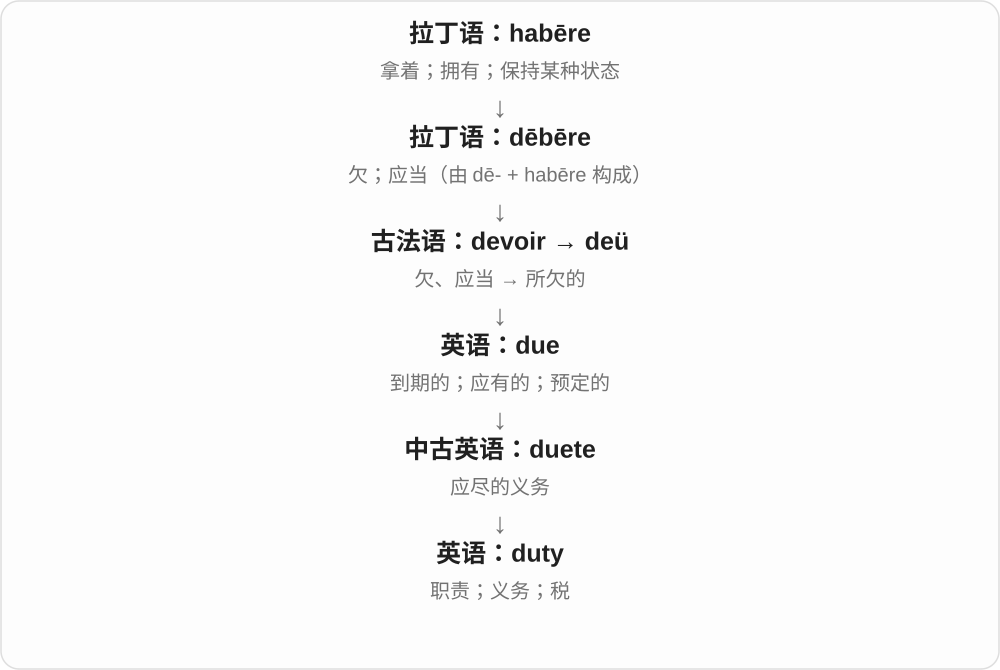

应当交付的事 → 应尽职责；应当缴纳的款项 → 税。on duty 是正在当班，off duty 是下班不值勤。

**常见搭配与例句**

do your duty；a sense of duty；on duty；customs duty。

> It is my duty to report the error.

报告这个错误是我的职责。

> A nurse is always on duty at the center.

中心一直有护士值班。

> The importer paid duty on the goods.

进口商为这批货物缴了税。

**别混淆**

duty 常带责任或规定的分量；task 只是一个任务。duty 作税时常见于进口税、关税等固定搭配。

### 17. dutiful — 尽责的；顺从本分的

**音标**：英 /ˈdjuːtɪfəl/；美 /ˈduːtɪfəl/

**先抓住这个画面**

觉得自己应当做，就认真履行，不随便撂下责任，这种人或举动可用 dutiful。

**怎么拆**

duty + -ful，y 变 i；意思是有履行义务的态度。

**怎么变成今天的意思**

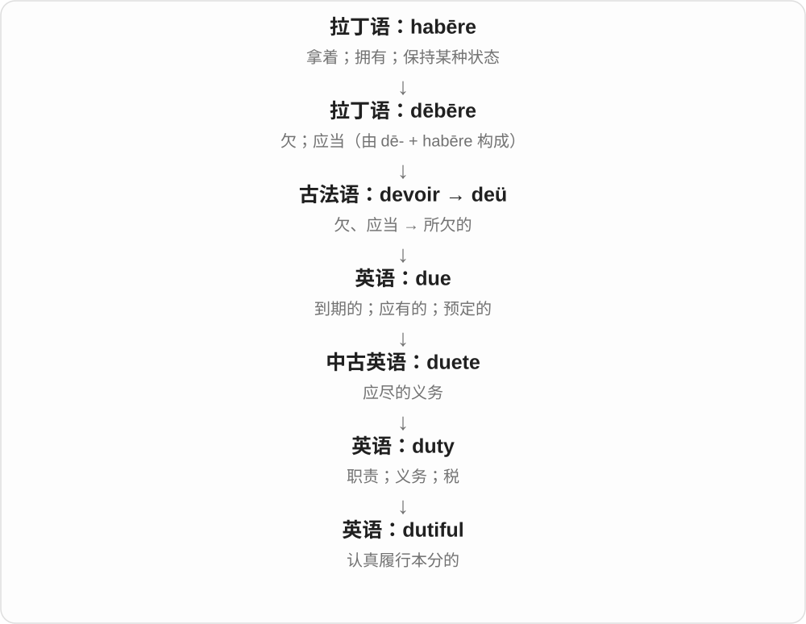

它可以称赞忠实尽责；有时也暗示“是出于义务做的，未必热情很高”，如 dutiful applause。

**常见搭配与例句**

a dutiful child；a dutiful employee；dutiful attention；a dutiful visit。

> She made a dutiful visit to her elderly uncle every week.

她每周都尽责地去看望年迈的叔叔。

> The audience gave a brief, dutiful round of applause.

观众出于礼貌责任感，简短地鼓了一阵掌。

**别混淆**

diligent 强调勤奋认真；dutiful 强调履行本分。一个人可以 dutiful，却并不喜欢所做的事。

### 18. debt — 债务；欠下的人情或恩情

**音标**：/det/

**先抓住这个画面**

钱先拿来用了，但还属于别人，账上留着一笔“以后得还”，这就是 debt。

**怎么拆**

经古法语 dete 来自拉丁语 dēbitum“所欠之物”。英语原来写 dette，后来为了显出拉丁语来源补入 b，但读音没有加 /b/。

**怎么变成今天的意思**

钱的亏欠最直观；a debt of gratitude 则把应当回报的帮助比作债。in debt 是欠着债，不是“在债券里”。

**常见搭配与例句**

be in debt；pay off a debt；get out of debt；a debt of gratitude。

> They worked hard to pay off their debts.

他们努力工作还清欠债。

> I owe her a great debt of gratitude.

她帮了我很多，我对她深怀感激。

**别混淆**

debt 是所欠金额或亏欠关系；loan 是借出去或借进来的那笔贷款。debt 的 b 不发音，debit 的 b 发音。

### 19. debtor — 债务人；欠钱的一方

**音标**：英 /ˈdetə/；美 /ˈdetər/

**先抓住这个画面**

同一笔借贷里，拿了钱、负有偿还义务的那一方是 debtor。

**怎么拆**

经古法语 detor / detour 来自拉丁语 dēbitor“欠债者”。与 debt 一样，b 在后来拼写中恢复，却不发音。

**怎么变成今天的意思**

它指出债务关系中的角色，可以是个人，也可以是公司或政府。角色由谁欠谁来决定，不是由谁更富有决定。

**常见搭配与例句**

a debtor and a creditor；a debtor company；the debtor’s obligations。

> The debtor agreed to repay the amount in installments.

债务人同意分期偿还这笔款项。

> The letter lists both the debtor and the creditor.

信中列出了债务人和债权人。

**别混淆**

debtor 欠别人钱；creditor 有权收回钱。borrower 专指借款者，debtor 还可因未付款项等形成。

### 20. exhibit — 展示；表现出；展品；证物

**音标**：/ɪɡˈzɪbɪt/

**先抓住这个画面**

把原先握在手里、藏在里面的东西拿出来给人看，是 exhibit 的核心画面。

**怎么拆**

来自拉丁语 exhibitus，属于 exhibēre：ex-（向外）+ habēre（拿着、持有），复合词里 hab- 变成 hib-。

**怎么变成今天的意思**

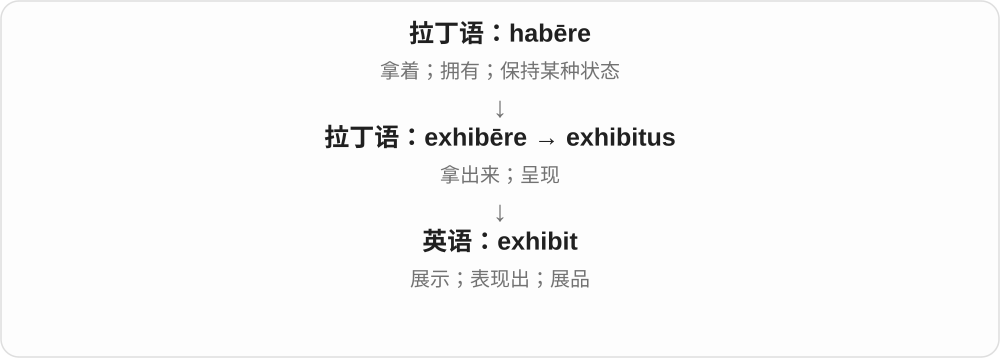

拿出来 → 展示物件；让内在特征显出来 → 表现某种性质。名词可指一件展品，法律语境可指提交展示的证物。

**常见搭配与例句**

exhibit paintings；exhibit signs of…；a museum exhibit；Exhibit A。

> The gallery will exhibit her photographs next month.

画廊下个月将展出她的摄影作品。

> The material exhibits unusual flexibility.

这种材料表现出不寻常的柔韧性。

> This exhibit shows how the old pump worked.

这件展品展示了旧式水泵的工作方式。

**别混淆**

exhibit 强调公开呈现，语气比 show 正式。exhibit 作展品时常是一件，exhibition 常是一场展览。

### 21. exhibition — 展览；公开展示；某种表现

**音标**：/ˌeksɪˈbɪʃən/

**先抓住这个画面**

把一组作品、产品或成果安排好，让人集中观看，是一场 exhibition。

**怎么拆**

经古法语 exhibicion 来自拉丁语 exhibitiō，与 exhibēre“呈现”对应；现代与 exhibit 构成词族。

**怎么变成今天的意思**

从展示的行为到一场展览。an exhibition of skill 还可指技艺的精彩表现，不一定在博物馆里。

**常见搭配与例句**

hold an exhibition；an art exhibition；on exhibition；an exhibition of skill。

> The exhibition brings together drawings from five countries.

这场展览汇集了来自五个国家的绘画作品。

> The match was an impressive exhibition of teamwork.

这场比赛精彩地展现了团队协作。

**别混淆**

exhibition 是活动或整体展示；exhibit 常指单件展品。show 比两者都更口语、更宽泛。

### 22. exhibitionism — 炫耀、爱表现的行为；露阴行为

**音标**：/ˌeksɪˈbɪʃənɪzəm/

**先抓住这个画面**

别人只是聊天，他却总要制造一个“都来看我”的场面，这种刻意吸引注意的倾向可以叫 exhibitionism。

**怎么拆**

exhibition + -ism，表示某种行为方式或倾向。

**怎么变成今天的意思**

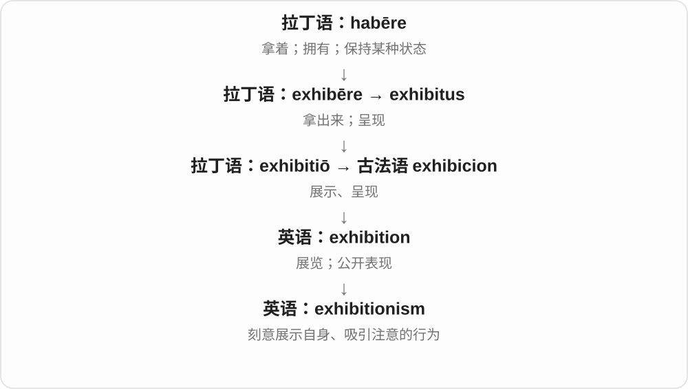

广义谈表现欲；较窄的性行为语境谈公开暴露身体。普通的舞台表演并不自动等于后一种行为，也不能仅凭爱表现就作临床判断。

**常见搭配与例句**

a display of exhibitionism；a tendency toward exhibitionism；social exhibitionism。

> The critic dismissed the stunt as empty exhibitionism.

评论家认为这场噱头只是空洞的炫耀。

> The essay distinguishes public service from personal exhibitionism.

这篇文章区分了公共服务与个人出风头。

**别混淆**

confidence 是自信；exhibitionism 更强调让别人注意自己。自信的人完全可以不炫耀。

### 23. exhibitionist — 爱表现的人；爱出风头的人；露阴者

**音标**：/ˌeksɪˈbɪʃənɪst/

**先抓住这个画面**

有人总想把聚光灯移到自己身上，靠夸张举动让大家看他，日常可说他是 exhibitionist。

**怎么拆**

exhibition（展示）+ -ist（表现某种行为的人）；与 exhibitionism 一组。

**怎么变成今天的意思**

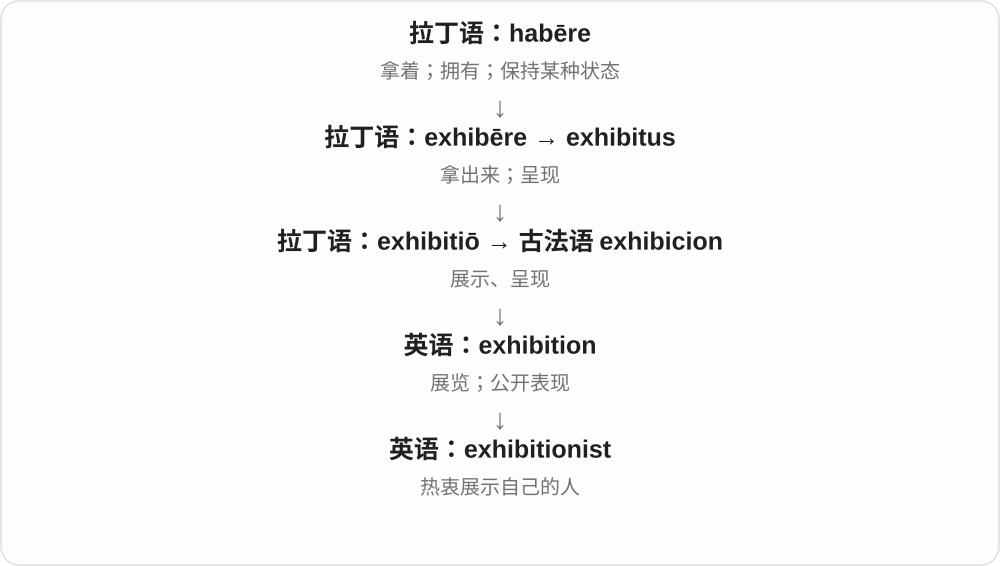

普通语境常指爱炫耀、爱引人注意；另有涉及公开暴露身体的性行为用法。要靠上下文分辨，不能一见就只按其中一义理解。

**常见搭配与例句**

a born exhibitionist；a natural exhibitionist；an exhibitionist streak。

> He is a natural exhibitionist who loves being the center of attention.

他天生爱表现，喜欢成为众人关注的中心。

> Her friends call her an exhibitionist because she turns every party into a performance.

朋友说她爱出风头，因为她把每场聚会都变成自己的表演。

**别混淆**

performer 是表演者，不自带“为了炫耀”的评价；exhibitionist 通常带对动机或表现欲的判断。

### 24. exhibitor — 参展者；展出作品或产品的一方

**音标**：英 /ɪɡˈzɪbɪtə/；美 /ɪɡˈzɪbɪtər/

**先抓住这个画面**

展会里，带着作品或产品来摆展位、让别人看的那一方是 exhibitor。

**怎么拆**

借自拉丁语 exhibitor“呈现者”，与 exhibēre 对应；现代也能看出 exhibit + -or 的关系。

**怎么变成今天的意思**

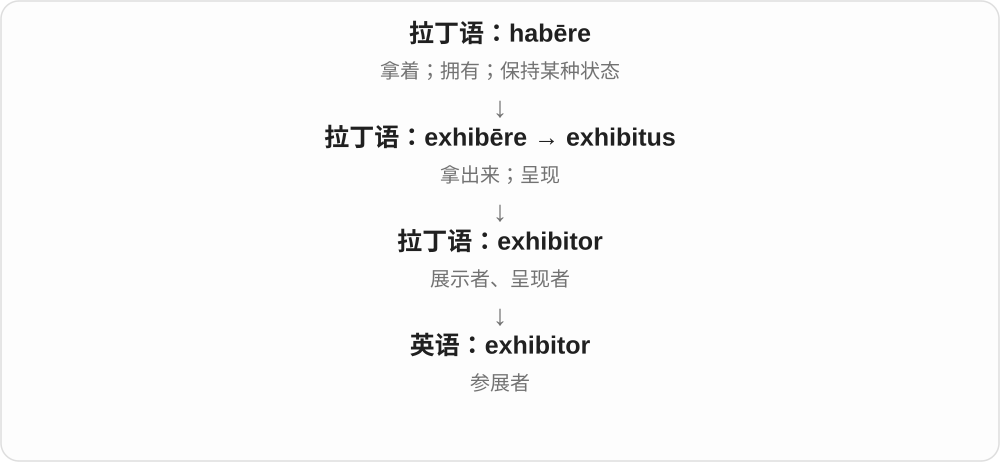

可指个人、公司或机构。展会有 exhibitors 来展示，也有 visitors 来参观，角色不同。

**常见搭配与例句**

an exhibitor at a fair；an exhibitor’s stand；a list of exhibitors。

> Each exhibitor received a small stand near the entrance.

每位参展者都分到了入口附近的一个小展位。

> More than fifty exhibitors took part in the book fair.

五十多家参展单位参加了这次书展。

**别混淆**

exhibitor 是展示作品或产品的人；exhibitionist 在普通用法常说爱出风头的人，不能随便用来称参展商。

### 25. habit — 习惯；惯常做法；宗教服装

**音标**：/ˈhæbɪt/

**先抓住这个画面**

早上醒来先摸手机，出门总检查口袋，反复做久了变成默认动作，这就是 habit。

**怎么拆**

来自拉丁语 habitus，经古法语 habit / abit 传入；habitus 与 habēre 相连，含保持的状态、姿态、衣着和习性等意思。

**怎么变成今天的意思**

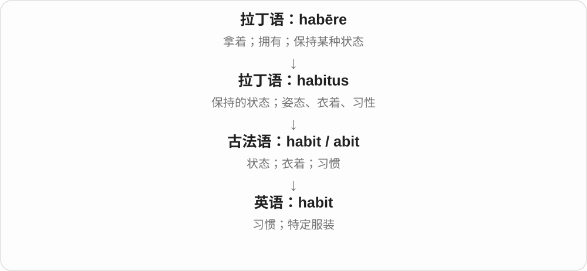

这里的核心不只是一件动作，而是一个人常有的状态或做法。宗教服装义保留了衣着这一条分支，并非“因为每天穿所以叫习惯”这么简单。

**常见搭配与例句**

form a habit；break a habit；out of habit；a nun’s habit。

> I checked my phone out of habit.

我习惯性地看了看手机。

> She is trying to break the habit of working through lunch.

她正努力改掉午饭时间还一直工作的习惯。

> The painting shows a nun in a dark habit.

这幅画中，一位修女穿着深色修道服。

**别混淆**

habit 常是个人反复做的事；custom 更常是群体的惯例。routine 是固定流程，不一定已经自动化。

### 26. habitual — 习惯性的；惯常的；一贯如此的

**音标**：/həˈbɪtʃuəl/

**先抓住这个画面**

某种动作或态度总是反复出现，已经成了一个人的常态，可以用 habitual。

**怎么拆**

来自中世纪拉丁语 habituālis，与 habitus“习性、状态”相连；现代可看出 habit 与 -ual 的词族关系。

**怎么变成今天的意思**

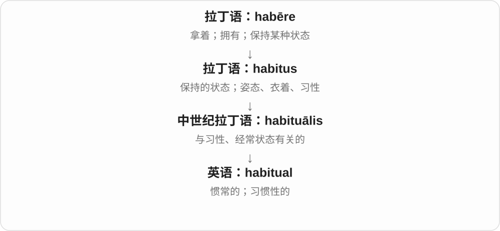

它说频繁到有稳定模式，不保证每次都发生。a habitual latecomer 是经常迟到的人，比“今天来晚了”多了长期习惯的判断。

**常见搭配与例句**

habitual behavior；a habitual smoker；habitual lateness；a habitual response。

> She greeted us with her habitual warmth.

她像往常一样热情地迎接我们。

> Habitual lateness was affecting the whole team.

一再迟到已经影响了整个团队。

**别混淆**

usual 只说通常；habitual 更突出反复养成的习惯。habitual 不是 habitable“适合居住的”。

### 27. habitually — 习惯性地；一贯地

**音标**：/həˈbɪtʃuəli/

**先抓住这个画面**

不是偶尔这样做，而是通常不多想就这么做，用 habitually 描述这套反复出现的方式。

**怎么拆**

habitual + -ly。

**怎么变成今天的意思**

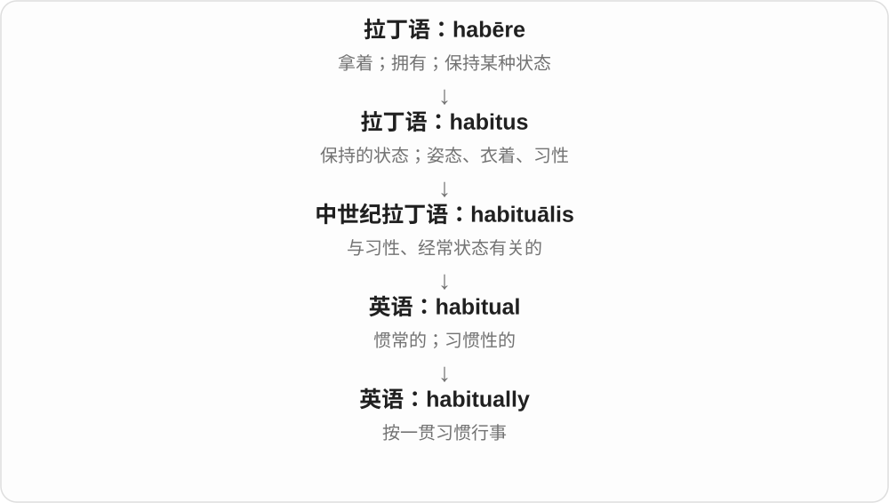

它常修饰一个人的行为、反应或状态。说 habitually checks 是习惯性地检查，不必精确统计每次都检查。

**常见搭配与例句**

habitually arrive late；habitually use…；habitually cautious。

> He habitually leaves his keys beside the door.

他习惯把钥匙放在门边。

> She habitually checks the source before sharing a story.

她分享消息之前，一贯会核查来源。

**别混淆**

frequently 只说次数多；habitually 还带有稳定习惯的意味。constantly 往往强调持续或极其频繁。

### 28. nonhabitual — 非习惯性的；不属于惯常做法的

**音标**：/ˌnɒnhəˈbɪtʃuəl/

**先抓住这个画面**

一次举动偏离了平时的默认模式，并不是反复养成的做法，可以用 nonhabitual。

**怎么拆**

non-（非）+ habitual（习惯性的）。

**怎么变成今天的意思**

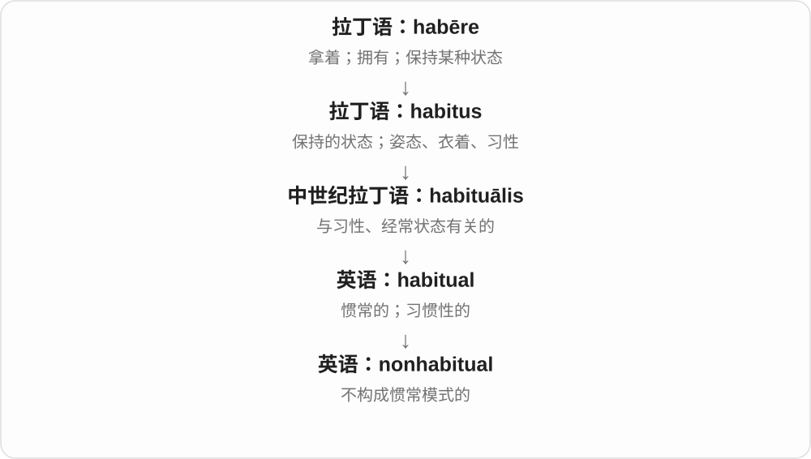

主要见于分析、研究语境，给行为分类。它不直接判断行为好坏，也不一定说明只发生过一次。

**常见搭配与例句**

nonhabitual behavior；a nonhabitual response；nonhabitual actions。

> The experiment compared habitual and nonhabitual responses.

实验比较了习惯性反应与非习惯性反应。

> For him, taking the bus was a nonhabitual choice.

对他来说，坐公交车并不是惯常的选择。

**别混淆**

unusual 是不寻常；nonhabitual 更精确地否定习惯性。一件常见的事，对某个人也可能是 nonhabitual。

### 29. habitable — 适宜居住的；可以住人的

**音标**：/ˈhæbɪtəbəl/

**先抓住这个画面**

房子能遮风挡雨，有基本生活条件，人可以正常住进去，就能说 habitable。

**怎么拆**

经古法语来自拉丁语 habitābilis，由 habitāre“居住”构成；现代对应“可居住的”。

**怎么变成今天的意思**

核心是条件允许居住，而不是已经住着人。天文学里的 habitable 也谈可能满足居住或生命存在的条件，不等于确认有生命。

**常见搭配与例句**

a habitable house；make a building habitable；a habitable environment。

> The repairs made the cottage habitable again.

修缮让这间小屋重新具备了居住条件。

> Only two rooms were habitable after the storm.

暴风雨过后，只有两个房间还能住人。

**别混淆**

habitable 是能住；inhabited 是有人住。一栋条件良好的空房子可以 habitable，却暂时 uninhabited。

### 30. habitability — 宜居性；适合居住的程度

**音标**：/ˌhæbɪtəˈbɪləti/

**先抓住这个画面**

从漏不漏雨、有没有水，到温度是否适合生活，综合衡量“这里能不能住”，谈的就是 habitability。

**怎么拆**

habitable 对应的名词，-able 变为 -ability，表示可居住这一性质。

**怎么变成今天的意思**

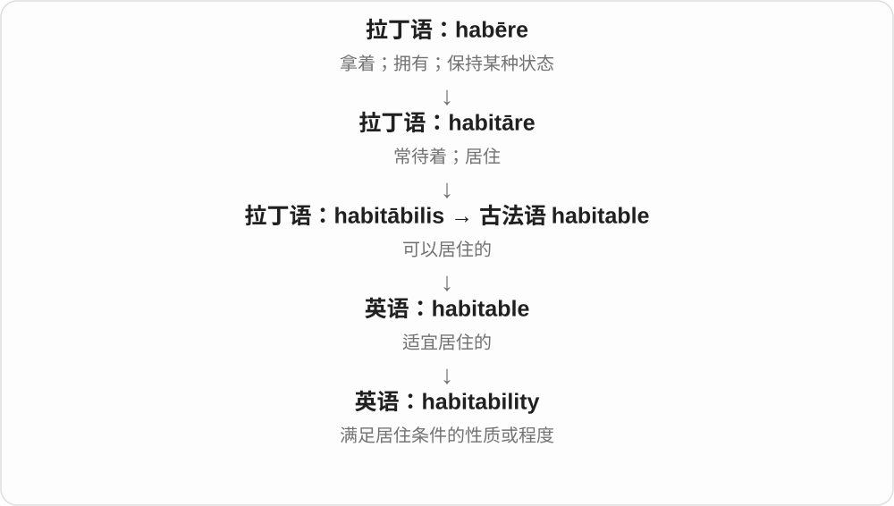

它能评价房屋，也能讨论星球或其他环境。评价标准随语境而变，不能只凭某一个条件就断定具备全部居住条件。

**常见搭配与例句**

the habitability of a building；assess habitability；habitability standards。

> The inspector assessed the habitability of the damaged house.

检查人员评估了受损房屋是否适合居住。

> Access to clean water affects the habitability of the site.

能否获得清洁用水会影响这个地点的宜居性。

**别混淆**

habitation 是居住这件事或住所；habitability 是能否适合居住的性质。

### 31. habitant — 居民（旧义）；加拿大法裔农民、早期定居者

**音标**：/ˈhæbɪtənt/

**先抓住这个画面**

读加拿大历史时，habitant 常指在当地定居耕作的法裔居民，有特定历史背景。

**怎么拆**

借自法语 habitant“居住者”，来自 habiter，最终是拉丁语 habitāre。

**怎么变成今天的意思**

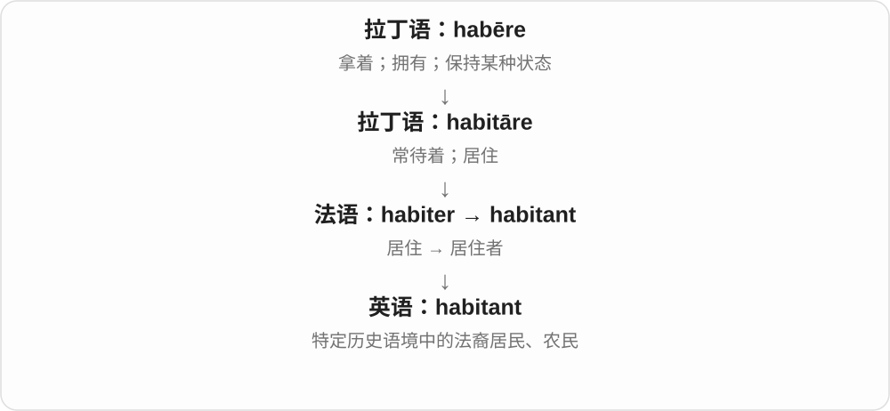

它原本能泛指居民，进入加拿大历史叙述后常有具体人群含义。不要把任何法国游客或现代加拿大人都叫 habitant。

**常见搭配与例句**

a French Canadian habitant；habitant families；habitant farming。

> The museum recreates the home of a habitant family.

博物馆复原了一个法裔农民家庭的住所。

> The chapter describes the work of habitants along the river.

这一章描写了河畔法裔定居农民的劳作。

**别混淆**

inhabitant 是现代泛指居民的常用词；habitant 在英语里更带地区历史色彩。

### 32. habitance — 住所；居住

**音标**：/ˈhæbɪtəns/（旧词）

**先抓住这个画面**

旧诗文里的 habitance 可以是某人住着的地方，也可以是居住这件事。

**怎么拆**

借自古法语 habitance，与 habiter“居住”相连，根在拉丁语 habitāre。

**怎么变成今天的意思**

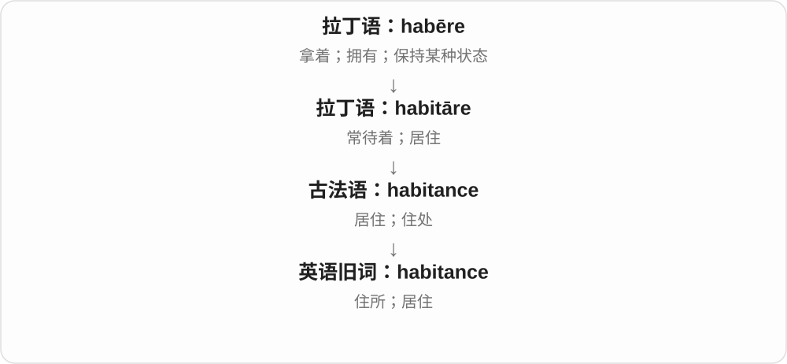

现代通常说 dwelling、residence 或 habitation。辨认它是为了读懂旧文本，不必把日常 home 都换成它。

**常见搭配与例句**

a place of habitance；his habitance（旧式）。

> The old poem calls the valley a place of peaceful habitance.

这首旧诗把山谷称为安宁的居住之地。

> In this passage, habitance refers to the traveler’s temporary dwelling.

在这一段中，habitance 指旅人的临时住处。

**别混淆**

habitance 与 habit“习惯”同属远亲，但这里说居住。habitual 不表达住处。

### 33. inhabit — 居住在；栖息于；占据某种精神世界

**音标**：/ɪnˈhæbɪt/

**先抓住这个画面**

某个地方不是只路过，而是人在那里生活、动物在那里栖息，用 inhabit。

**怎么拆**

经古法语 enhabiter 来自拉丁语 inhabitāre：in-（在里面）+ habitāre（居住）。

**怎么变成今天的意思**

这里 in- 不是“不”。现代也会说角色 inhabit a different world，把生活其中的感觉扩展到想象、精神或文化世界。

**常见搭配与例句**

inhabit an island；species that inhabit rivers；inhabit a fictional world。

> Several rare species inhabit this forest.

几种珍稀物种栖息在这片森林中。

> The characters seem to inhabit a world of their own.

这些角色仿佛生活在自己的世界里。

**别混淆**

inhabit 直接接地点，不加 in：inhabit the island。live 则通常说 live on the island。

### 34. uninhabited — 无人居住的；没有居民的

**音标**：/ˌʌnɪnˈhæbɪtɪd/

**先抓住这个画面**

岛上可能有淡水、有树木，但此刻没有人长期住着，它就是 uninhabited。

**怎么拆**

un-（不）+ inhabited（被居住的），后者是 inhabit 的过去分词。

**怎么变成今天的意思**

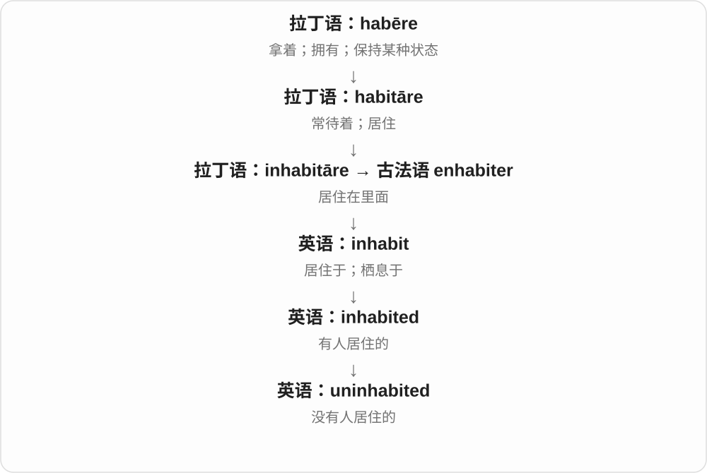

强调居住事实，不是在评估能不能住。说岛屿无人居住，也不代表上面没有鸟、昆虫或植物。

**常见搭配与例句**

an uninhabited island；an uninhabited building；remain uninhabited。

> The boat passed a small, uninhabited island.

船经过一座无人居住的小岛。

> The house has remained uninhabited for years.

这栋房子多年来一直无人居住。

**别混淆**

uninhabited 是没人住；uninhabitable 是不能住。废弃房屋可能两者都是，也可能仍能修好住人。

### 35. inhabitant — 居民；栖居者

**音标**：/ɪnˈhæbɪtənt/

**先抓住这个画面**

问一个城镇或岛屿“住着哪些人”，那些在那里生活的人就是 inhabitants。

**怎么拆**

经古法语 inhabitant 来自拉丁语 inhabitāns“居住着的”，属于 inhabitāre 的分词形式。

**怎么变成今天的意思**

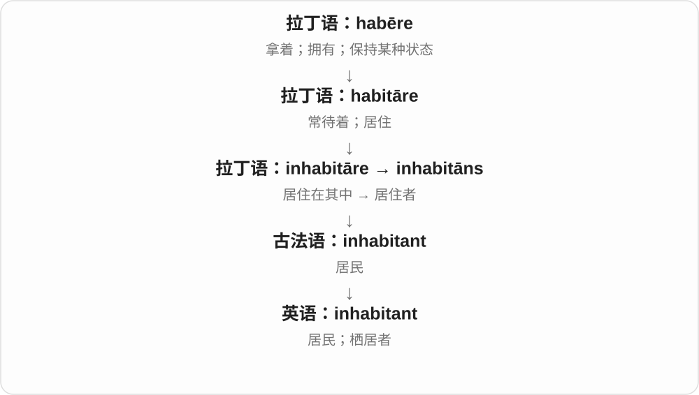

可指居民，也能按语境说某环境中的动物。这个词重在居住事实，不自动表示国籍、公民资格或房屋所有权。

**常见搭配与例句**

local inhabitants；the inhabitants of a village；human inhabitants。

> The island has fewer than two hundred inhabitants.

这座岛的居民不到两百人。

> The plan was discussed with local inhabitants.

这项计划与当地居民进行了讨论。

**别混淆**

citizen 是公民身份；inhabitant 是住在那里的人。visitor 通常只是来访者。

### 36. inhabitable — 可以居住的；可供栖息的

**音标**：/ɪnˈhæbɪtəbəl/

**先抓住这个画面**

房子或地点能够让人住进去，inhabitable 在现代通常就是“能住”。

**怎么拆**

inhabit（居住于）+ -able（可……的）；也有对应的拉丁语 inhabitābilis。这里 in- 属于“在里面”。

**怎么变成今天的意思**

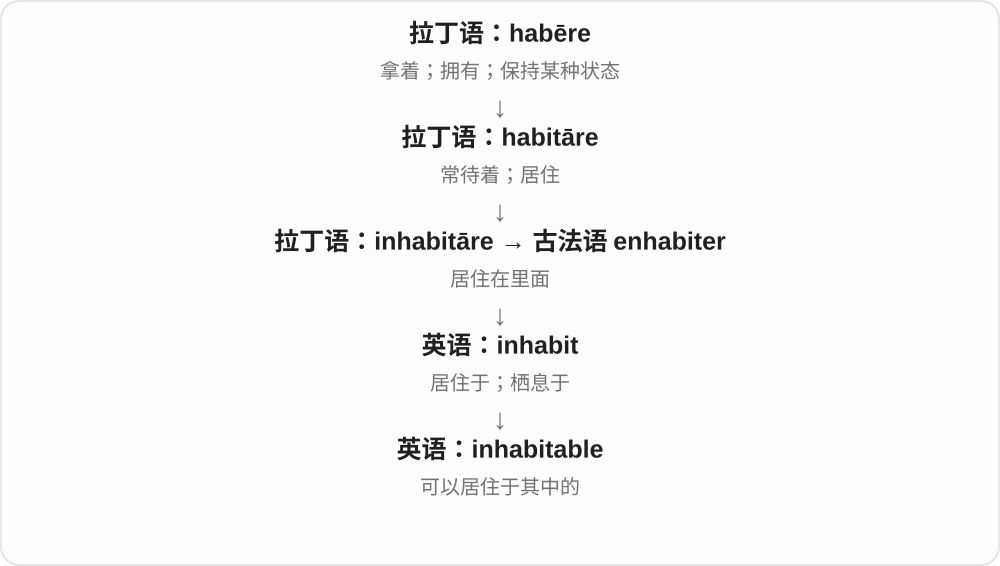

看见开头 in- 容易误以为否定，但这个常见理解是从 inhabit 出发。旧文里另有否定义来源，现代写作想表达不能住，直接用 uninhabitable 更清楚。

**常见搭配与例句**

an inhabitable building；make a place inhabitable。

> The upper floor is now inhabitable after months of repair.

经过几个月的维修，楼上现在可以住人了。

> The survey found only one inhabitable shelter.

调查只发现一处可以住人的避难所。

**别混淆**

现代 inhabitable 与 habitable 都可表示能住；uninhabitable 才通常表示不能住。inhabited 说实际有人住。

### 37. uninhabitable — 不适宜居住的；不能住人的

**音标**：/ˌʌnɪnˈhæbɪtəbəl/

**先抓住这个画面**

危险、缺水、严重损毁等条件让人没法正常住下去，这地方就是 uninhabitable。

**怎么拆**

un-（不）+ inhabitable（可以居住的）；这里真正表否定的是最前面的 un-。

**怎么变成今天的意思**

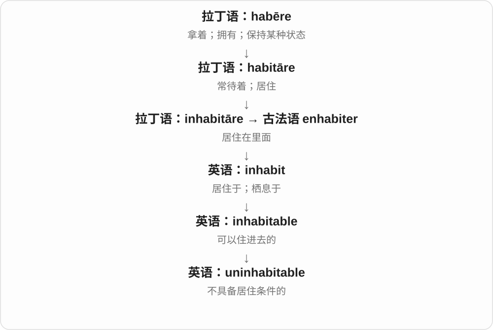

词里既有 un- 又有 in-，但不是两个否定相互抵消：in- 属于 inhabit“住进去”，un- 才是否定可居住性。

**常见搭配与例句**

render a house uninhabitable；leave a building uninhabitable；an uninhabitable island。

> The fire left the apartment uninhabitable.

火灾使这套公寓无法居住。

> Without a water supply, the settlement became uninhabitable.

失去供水以后，这处聚居地已不适合生活。

**别混淆**

uninhabited 是没有居民；uninhabitable 是条件不允许居住。没人住的地方不一定不能住。

### 38. inhabitation — 居住于其中；居住状态（较少用）

**音标**：/ɪnˌhæbɪˈteɪʃən/

**先抓住这个画面**

强调某片空间被人或生物实际住着、使用着，学术文字可能用 inhabitation。

**怎么拆**

inhabit 的词干 + -ation，表示居住的过程或状态。

**怎么变成今天的意思**

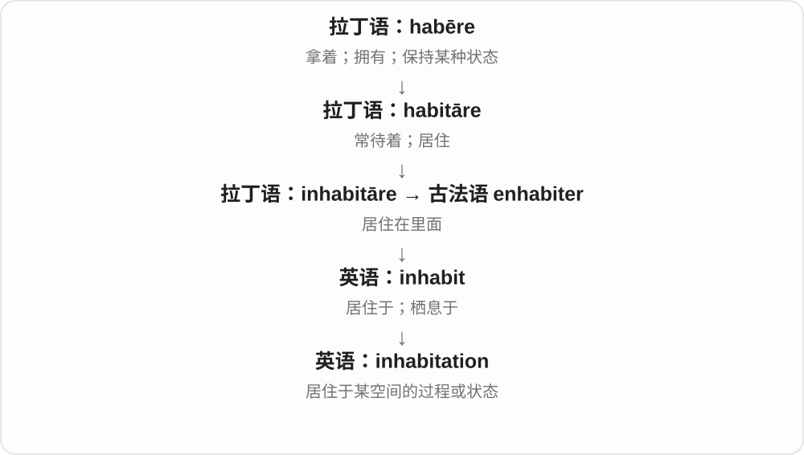

它比 habitation 更少见，常出现在建筑、地理或文学分析中。重点可以是人在空间里如何生活，不只是建筑本身。

**常见搭配与例句**

patterns of inhabitation；human inhabitation；continuous inhabitation。

> The ruins provide evidence of continuous inhabitation.

遗址提供了人们持续在此居住的证据。

> The architect studied patterns of inhabitation in small apartments.

建筑师研究了人们在小公寓中的居住方式。

**别混淆**

inhabitation 说居住；habitability 说是否具备能住的条件。一般生活表达用 living in 更直接。

### 39. cohabit — 共同居住；作为伴侣同居

**音标**：英 /kəʊˈhæbɪt/；美 /koʊˈhæbɪt/

**先抓住这个画面**

两个人把日常生活放进同一个家里，cohabit 常说伴侣住在一起，尤其是未婚同居。

**怎么拆**

对应晚期拉丁语 cohabitāre：co-（一起）+ habitāre（居住）；英语也可能由更早借入的 cohabitation 反向构成。

**怎么变成今天的意思**

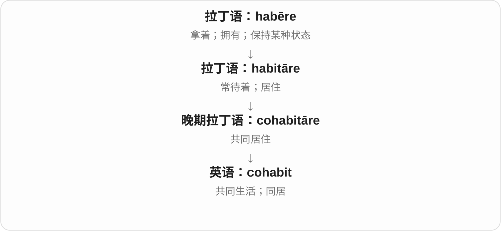

基本画面是一起住。它也可泛指共同生活或共存，但单说 two people cohabit，常会让人想到伴侣关系，不能随便拿来代替普通合租。

**常见搭配与例句**

cohabit with a partner；cohabiting couples；cohabit peacefully。

> They decided to cohabit before getting married.

他们决定结婚前先住在一起。

> The article describes how the two species cohabit in the same area.

文章描写了这两个物种如何共同生活在同一片区域。

**别混淆**

share a flat 只说明合住一套房；cohabit 常含伴侣共同生活的意味。cooperate 是合作，不必住在一起。

### 40. cohabitation — 共同居住；同居

**音标**：英 /kəʊˌhæbɪˈteɪʃən/；美 /koʊˌhæbɪˈteɪʃən/

**先抓住这个画面**

把作为伴侣共同生活的状态或安排当作一个话题来讨论，就用 cohabitation。

**怎么拆**

经古法语 cohabitacion 或直接从晚期拉丁语 cohabitātiō 借入，根在 cohabitāre。英语名词的记录早于动词 cohabit。

**怎么变成今天的意思**

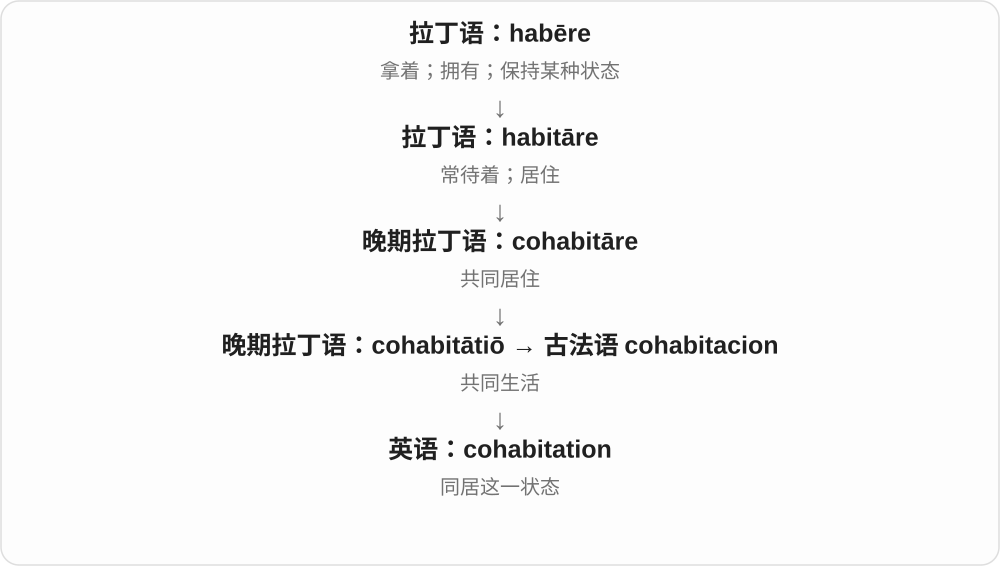

现代可看作 cohabit 对应的名词，但历史上不应简单画成英语 cohabit 先产生 cohabitation。名词先借进来、再形成短动词也是可能的路径。

**常见搭配与例句**

premarital cohabitation；a period of cohabitation；attitudes toward cohabitation。

> The survey asked about attitudes toward cohabitation.

问卷询问了人们对同居的看法。

> Their cohabitation began while they were both studying.

他们开始同居时，两人都还在求学。

**别混淆**

cohabitation 讨论共同生活的安排；marriage 指婚姻关系。二者可以重叠，也可以分别讨论。

### 41. habilitate — 使具备能力或资格；取得任教资格

**音标**：/həˈbɪlɪteɪt/

**先抓住这个画面**

让一个人逐步学会所需技能，能胜任某种生活或工作角色，就是 habilitate。

**怎么拆**

借自晚期拉丁语 habilitātus，来自 habilitāre“使有能力”，更早是 habilis；不是 habit 加一个后缀。

**怎么变成今天的意思**

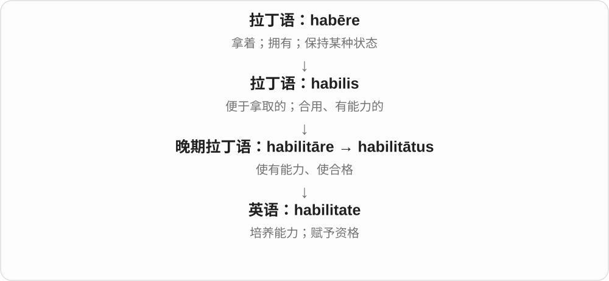

在康复服务等语境中，常与重新获得已有能力的 rehabilitate 相区别；部分欧洲学术制度里，它还说取得更高层次的任教资格。

**常见搭配与例句**

habilitate a person；habilitate in a subject；habilitation services。

> The program aims to habilitate participants for independent living.

这个项目旨在帮助参与者建立独立生活的能力。

> She habilitated in modern history at a German university.

她在一所德国大学取得了现代史领域的高级任教资格。

**别混淆**

habilitate 偏获得、建立能力；rehabilitate 偏恢复或重新适应。实际专业范围要结合语境判断。

### 42. rehabilitate — 使康复；使重新适应社会；恢复名誉；修复

**音标**：/ˌriːhəˈbɪlɪteɪt/

**先抓住这个画面**

受损之后，通过训练、修复或重新评价，让人或事物重新发挥作用，是 rehabilitate。

**怎么拆**

来自中世纪拉丁语 rehabilitāre 的分词形式；re-（重新）+ habilitāre（使合格、使有能力）。

**怎么变成今天的意思**

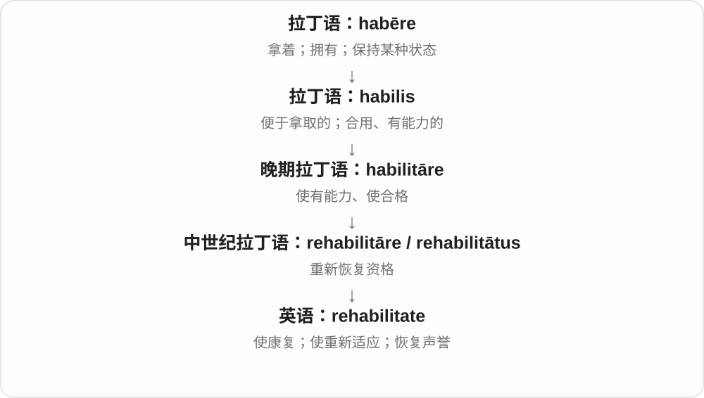

早期有恢复资格、权利的意思，后来广泛用于功能恢复、重返社会和声誉修复。现代也能说修复旧楼，让它重新使用。

**常见搭配与例句**

rehabilitate a patient；rehabilitate an injured animal；rehabilitate someone’s reputation。

> The center rehabilitates injured wild birds.

这个中心帮助受伤的野鸟恢复功能。

> New evidence helped rehabilitate her reputation.

新证据帮助她恢复了名誉。

**别混淆**

cure 强调治好病；rehabilitate 强调恢复能力、适应生活或社会角色，不必意味着所有损伤消失。

### 43. rehabilitation — 康复；重新适应；修复；恢复名誉

**音标**：/ˌriːhəˌbɪlɪˈteɪʃən/

**先抓住这个画面**

从受损、失去功能或失去社会位置，到逐步重新生活和工作，这段恢复过程叫 rehabilitation。

**怎么拆**

经法语 réhabilitation 来自中世纪拉丁语 rehabilitātiō，与 rehabilitāre 对应；现代与 rehabilitate 配对。

**怎么变成今天的意思**

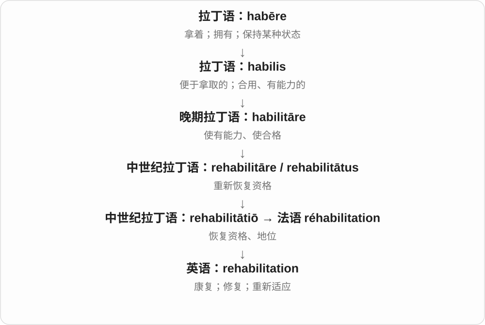

词义的中心是重新具备功能或位置。可谈身体训练、社会支持，也可谈修复建筑，不要一见就只译成戒毒。

**常见搭配与例句**

a rehabilitation program；physical rehabilitation；the rehabilitation of an old building。

> His rehabilitation included learning to walk safely again.

他的康复训练包括重新学会安全行走。

> The city funded the rehabilitation of the old railway station.

市政府出资修复了旧火车站。

**别混淆**

recovery 是恢复的过程或结果；rehabilitation 常具体指有安排、有支持的恢复训练或重建工作。

### 44. rehabilitative — 帮助康复的；促进重新适应的

**音标**：美 /ˌriːhəˈbɪləˌteɪtɪv/

**先抓住这个画面**

一项训练或服务的目的，是帮人恢复功能、重新生活，可以称它 rehabilitative。

**怎么拆**

rehabilitate 的词干 + -ive，构成说明作用或目的的形容词。

**怎么变成今天的意思**

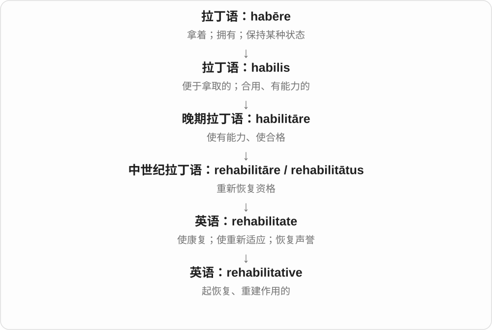

它把注意力放在恢复能力的作用上：rehabilitative care 是帮助恢复的照护，rehabilitative approach 是重视重新适应的方法。

**常见搭配与例句**

rehabilitative care；rehabilitative services；a rehabilitative approach。

> The hospital offers rehabilitative care after surgery.

这家医院提供术后康复照护。

> The report favors a rehabilitative approach to youth justice.

报告主张在少年司法中采取重视帮助重新适应社会的方法。

**别混淆**

punitive 强调惩罚；rehabilitative 强调帮助改变与重新适应。两个词讨论的是不同目的。

### 45. rehabilitator — 从事康复或恢复工作的人

**音标**：英 /ˌriːhəˈbɪlɪteɪtə/；美 /ˌriːhəˈbɪlɪteɪtər/

**先抓住这个画面**

负责把受伤动物养护到能重新生活，或帮助别人恢复能力的人，可以叫 rehabilitator。

**怎么拆**

rehabilitate 去掉词尾 e + -or，表示施行这项工作的人。

**怎么变成今天的意思**

野生动物语境很常见：wildlife rehabilitator 护理受伤或失去照护的动物，目标往往是恢复后放归。也可更广泛用于恢复工作。

**常见搭配与例句**

a wildlife rehabilitator；an experienced rehabilitator。

> A wildlife rehabilitator cared for the injured owl.

一位野生动物救护人员照料了这只受伤的猫头鹰。

> The rehabilitator recorded the bird’s progress each day.

救护人员每天记录这只鸟的恢复进展。

**别混淆**

rehabilitator 是提供帮助的人；rehabilitant 是接受康复的人。两个词的角色方向相反。

### 46. rehabilitant — 接受康复的人（专业用语）

**音标**：/ˌriːhəˈbɪlɪtənt/

**先抓住这个画面**

在康复服务里，正在接受训练、支持或恢复治疗的那个人，可以称为 rehabilitant。

**怎么拆**

rehabilitate 的词干 + -ant；此处指参与康复、接受康复的人。

**怎么变成今天的意思**

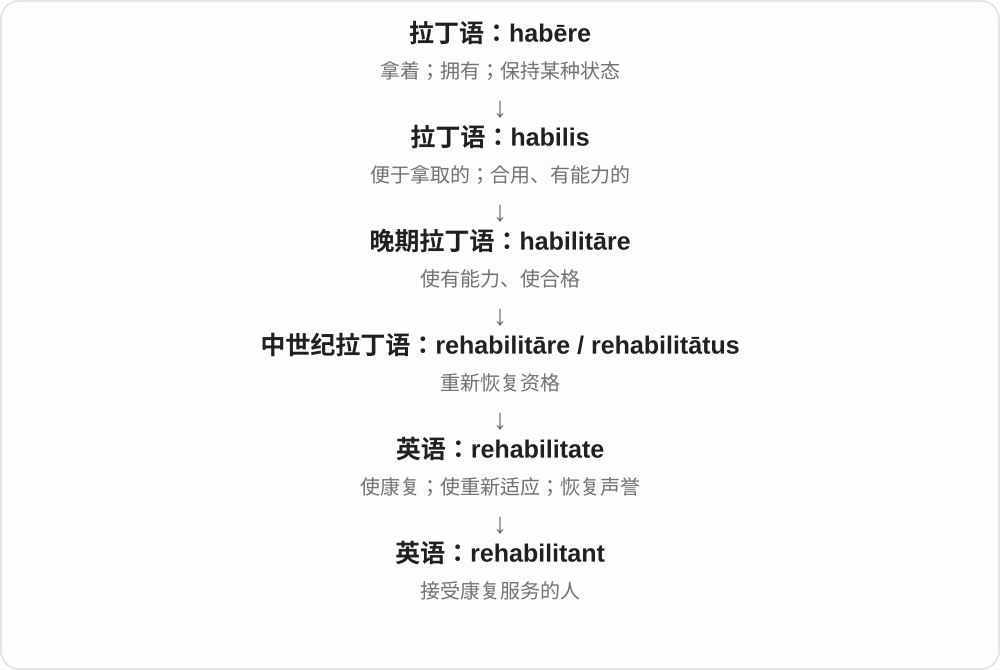

这是较少见的专业名词，普通交流更自然地说 a person in rehabilitation。词尾 -ant 在这里不能机械理解成“执行治疗的人”。

**常见搭配与例句**

a rehabilitant’s goals；support a rehabilitant；rehabilitants in the program。

> Each rehabilitant helped set the goals for the program.

每位接受康复的人都参与制定了项目目标。

> The study followed twenty rehabilitants for six months.

这项研究对二十位康复服务参与者进行了六个月的随访。

**别混淆**

rehabilitator 是协助恢复的人；rehabilitant 是接受康复的人。patient 只适用于合适的医疗语境。

### 47. habitat — 栖息地；自然生存环境

**音标**：/ˈhæbɪtæt/

**先抓住这个画面**

动物在哪里找食物、躲避危险、繁殖，植物在什么环境下生长，这套生活环境就是它的 habitat。

**怎么拆**

直接取自拉丁语 habitat“它居住”，是 habitāre 的第三人称单数形式。自然史描述用它引出物种生活地点，后来转成英语名词。

**怎么变成今天的意思**

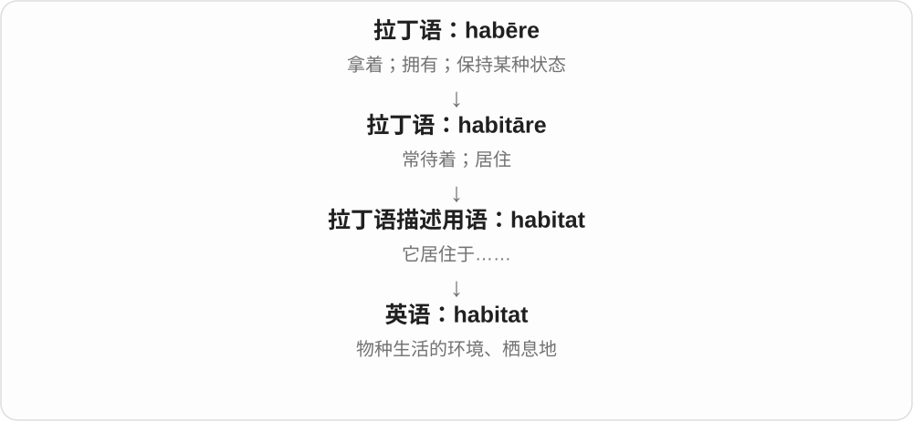

它本来是一句描述里的动词，后来成了“生活在哪里”的环境名称。不要拆成 habit + at，也别只理解为动物搭出的窝。

**常见搭配与例句**

natural habitat；habitat loss；protect a habitat；marine habitats。

> Wetlands provide essential habitat for many birds.

湿地为许多鸟类提供重要的栖息环境。

> The road would divide the animal’s natural habitat.

这条路会把这种动物的自然栖息地割裂开。

**别混淆**

home 可指个体的家；habitat 关注物种需要的环境。nest 是巢，只是某些动物生活环境中的一小部分。

### 48. habitation — 居住；住所；人类居住痕迹

**音标**：/ˌhæbɪˈteɪʃən/

**先抓住这个画面**

人在一个地方长期住下来，留下房屋、火塘和生活痕迹，这件事可概括为 habitation。

**怎么拆**

经古法语 habitacion 来自拉丁语 habitātiō，与 habitāre“居住”对应。

**怎么变成今天的意思**

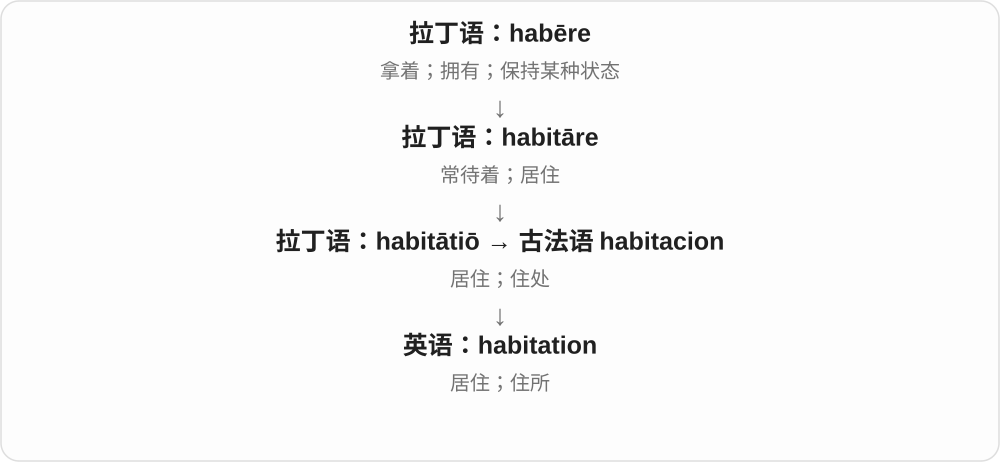

正式用法中 human habitation 是人类居住。可数的 a habitation 可指住处，但日常更常说 home 或 dwelling。

**常见搭配与例句**

fit for human habitation；signs of habitation；a place of habitation。

> The caves show signs of ancient human habitation.

这些洞穴留有古代人类居住的痕迹。

> The building was declared unfit for habitation.

这栋楼被判定不适合居住。

**别混淆**

habitation 强调住在这里这件事或住处；habitat 是物种生活的环境，不一定有人建房子。

### 49. habitator — 居住者；居民

**音标**：英 /ˈhæbɪteɪtə/；美 /ˈhæbɪteɪtər/（旧词）

**先抓住这个画面**

看到旧文里的 habitator，把它理解为“住在那里的人”即可，不是某种房屋类型。

**怎么拆**

直接借自拉丁语 habitātor，由 habitāre“居住”加表示人的 -tor 构成。

**怎么变成今天的意思**

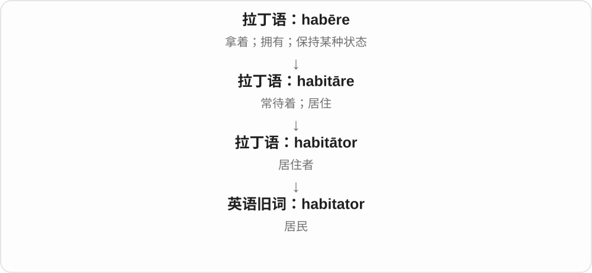

它保留拉丁语的 -ator 外形，而现代英语通常选 inhabitant 或 resident。和 habitat 一样，抓住居住这条支线。

**常见搭配与例句**

a habitator of a place（旧式）；the southern habitator（旧地理表达）。

> The old account describes the island’s last habitator.

这篇旧记述描写了岛上最后一位居民。

> The editor replaces habitator with inhabitant in the modern version.

编辑在现代版本中把 habitator 换成了 inhabitant。

**别混淆**

habitator 是人；habitat 是栖息环境。一个字母 r 的差别，不能混当同一事物。

### 50. rehab — 康复治疗；戒除成瘾的康复治疗；修复

**音标**：/ˈriːhæb/

**先抓住这个画面**

日常聊天或新闻把长长的 rehabilitation 截短，就成了 rehab：让人恢复功能或摆脱成瘾影响的康复过程。

**怎么拆**

rehabilitation 的截短词；作动词时也能表示 rehabilitate“帮助恢复、修复”。

**怎么变成今天的意思**

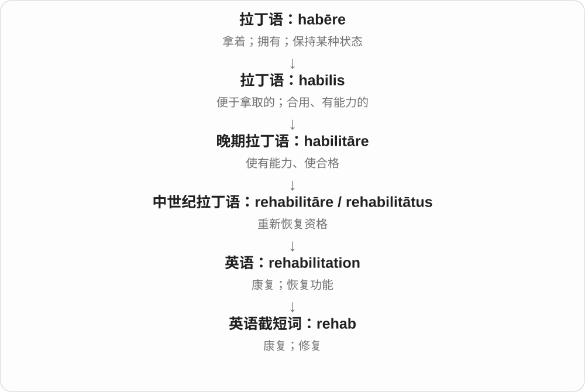

运动员受伤后的 rehab 可指恢复训练；另一些语境专指成瘾相关的康复服务。房屋语境的 rehab 则是修复旧建筑，不能一律译成戒毒。

**常见搭配与例句**

in rehab；go into rehab；physical rehab；rehab a house。

> She continued her rehab after returning home from hospital.

出院回家后，她继续进行康复训练。

> They bought the old house and spent a year rehabbing it.

他们买下旧房，花了一年修缮。

**别混淆**

rehab 是 rehabilitation 的日常短式；recovery 是恢复过程或结果，不一定在特定项目中接受服务。

### 51. prohibit — 禁止；阻止

**音标**：/prəˈhɪbɪt/

**先抓住这个画面**

在行动前面立一道明确的“不能做”，常由规则或权威作出，就是 prohibit。

**怎么拆**

来自拉丁语 prohibitus，属于 prohibēre：pro-（在前、挡开）+ habēre（持住），形成挡住、阻止的意思。

**怎么变成今天的意思**

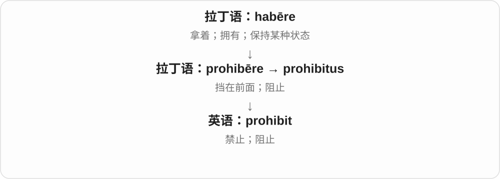

在现代通常说法规、制度禁止某事；也可较正式地说条件让事情做不成。这里 pro- 不是支持某立场的“赞成”。

**常见搭配与例句**

prohibit smoking；prohibit someone from doing…；strictly prohibited。

> The rules prohibit photography inside the gallery.

规定禁止在画廊内摄影。

> The agreement prohibits either side from sharing the data.

协议禁止任何一方分享这些数据。

**别混淆**

prohibit 偏明令禁止；prevent 偏实际阻止发生。某事被禁止，并不保证它真的没发生。

### 52. prohibition — 禁止；禁令；禁酒制度

**音标**：英 /ˌprəʊhɪˈbɪʃən/；美 /ˌproʊhɪˈbɪʃən/

**先抓住这个画面**

把“这件事不能做”写成规则，这个禁止行为或规则本身就是 prohibition。

**怎么拆**

经古法语 prohibicion 来自拉丁语 prohibitiō，与 prohibēre“阻止”对应。

**怎么变成今天的意思**

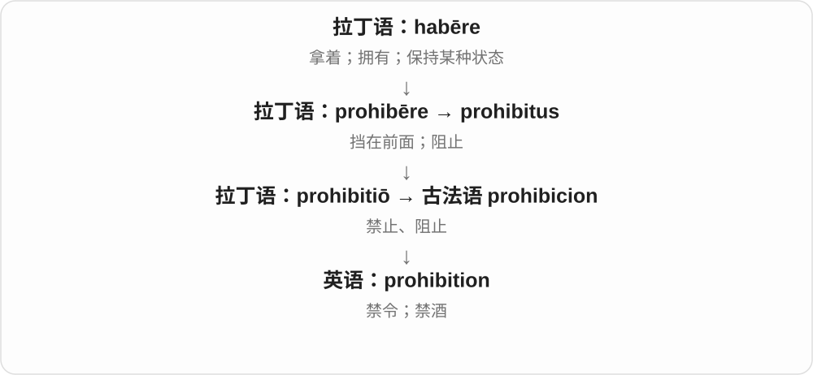

可以泛指任何禁令。美国历史中的 Prohibition 通常特指禁酒时代；普通小写用法不必与酒有关。

**常见搭配与例句**

a prohibition on…；lift a prohibition；a prohibition against…；during Prohibition。

> The school introduced a prohibition on smoking near the entrance.

学校禁止在入口附近吸烟。

> The exhibition explores life during Prohibition.

这场展览探讨美国禁酒时代的生活。

**别混淆**

ban 更短、更日常；prohibition 较正式。inhibition 是压制或心理顾虑，不必是一条规则。

### 53. prohibitionist — 支持禁令者；禁酒主义者

**音标**：英 /ˌprəʊhɪˈbɪʃənɪst/；美 /ˌproʊhɪˈbɪʃənɪst/

**先抓住这个画面**

有人主张用法律把某件事禁止掉，尤其在历史上主张禁酒，这个人可称为 prohibitionist。

**怎么拆**

prohibition + -ist，表示支持或倡导禁令的人。

**怎么变成今天的意思**

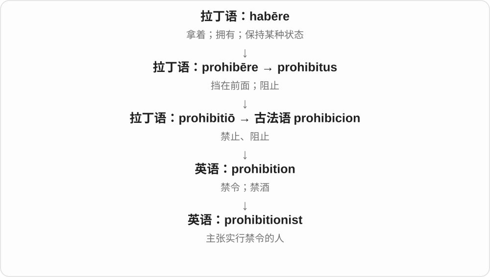

在美国历史叙述中，常指禁酒运动的支持者；在其他讨论中，也可以说某项禁令的倡导者。不是只因为自己不喝酒就自动属于这类人。

**常见搭配与例句**

a committed prohibitionist；prohibitionist groups；a prohibitionist policy。

> The prohibitionists campaigned for a ban on alcohol sales.

禁酒主义者为禁止售酒而开展运动。

> The historian compared prohibitionist arguments with those of their opponents.

历史学者比较了禁酒派与反对者的论点。

**别混淆**

a teetotaler 自己不喝酒；a prohibitionist 主张实施禁酒。个人习惯与公共政策立场是两件事。

### 54. prohibitive — 高得难以承受的；起阻止作用的；禁止性的

**音标**：/prəˈhɪbɪtɪv/

**先抓住这个画面**

没有人明说不准买，但价格高到你根本付不起，效果就像把你挡在门外，这叫 prohibitive。

**怎么拆**

来自中世纪拉丁语 prohibitivus，与 prohibēre“阻止”相连；现代与 prohibit 对应。

**怎么变成今天的意思**

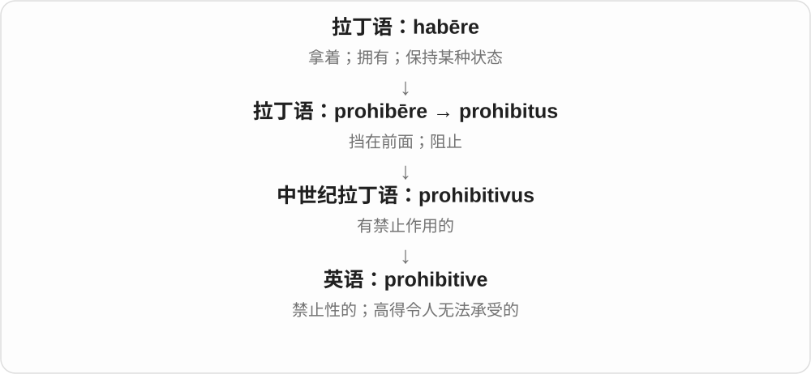

从具有禁止作用发展出实际阻止人行动的费用、条件。a prohibitive price 说价格使人难以购买，不是在说价格本身违法。

**常见搭配与例句**

prohibitive costs；a prohibitive price；prohibitive restrictions。

> The cost of repairing the roof was prohibitive.

修屋顶的费用高得难以承受。

> Prohibitive entry fees kept many small firms away.

高昂到难以承受的入场费用把许多小公司挡在了外面。

**别混淆**

expensive 只是贵；prohibitive 更进一步，贵到足以阻止某人做这件事。prohibitory 更偏直接表达禁令的。

### 55. prohibitively — 高到令人无法承受地；达到阻止行动的程度

**音标**：/prəˈhɪbɪtɪvli/

**先抓住这个画面**

贵并不只是让人皱眉，而是贵到计划做不下去，prohibitively 把这种程度说出来。

**怎么拆**

prohibitive + -ly。

**怎么变成今天的意思**

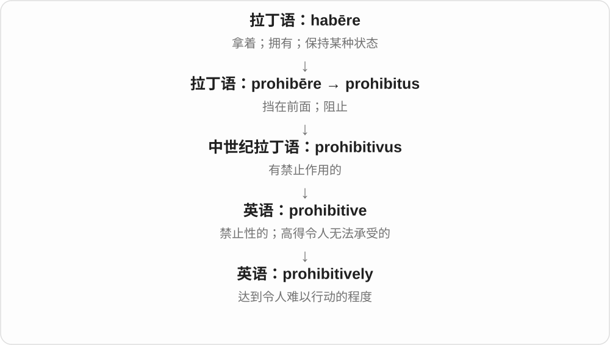

最常见的是 prohibitively expensive / costly / high。它表达相对于实际能力或计划而言的障碍，不需要某个统一价格界线。

**常见搭配与例句**

prohibitively expensive；prohibitively high costs；prohibitively difficult。

> The equipment was prohibitively expensive for a small school.

对一所小学校来说，这套设备贵得根本买不起。

> Transport costs made the plan prohibitively costly.

运输费用使这个计划成本过高，难以实施。

**别混淆**

very expensive 只是非常贵；prohibitively expensive 暗示贵到无法实施或购买。

### 56. prohibitory — 禁止性的；起禁止作用的

**音标**：英 /prəˈhɪbɪtəri/；美 /prəˈhɪbɪtɔːri/

**先抓住这个画面**

一条命令直接要求某种行为不要发生，这条命令的性质就是 prohibitory。

**怎么拆**

prohibit + -ory，表示起禁止作用或与禁止有关。

**怎么变成今天的意思**

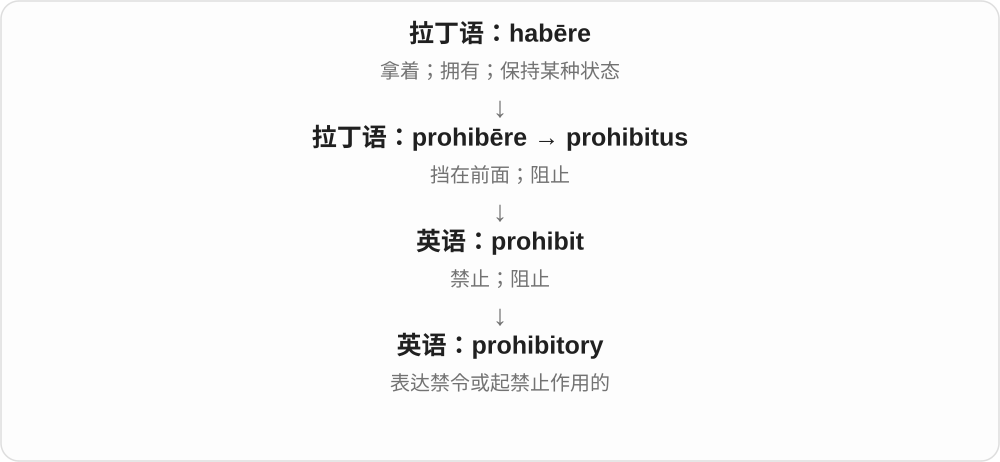

主要见于法律、规则和正式分析，常修饰 order、rule 等。重点是该文本或措施在禁止什么。

**常见搭配与例句**

a prohibitory order；a prohibitory rule；prohibitory legislation。

> The notice contains a prohibitory rule about open flames.

通知中有一条禁止明火的规定。

> The textbook contrasts prohibitory and permissive rules.

教材对比了禁止性规则与许可性规则。

**别混淆**

prohibitive 在日常常说费用高得承担不了；prohibitory 通常说命令、条款具有禁止性质。

### 57. debit — 借方记项；账户扣款；记入借方

**音标**：/ˈdebɪt/

**先抓住这个画面**

看银行流水，一笔钱从你的账户里扣出去，可叫 a debit；在会计里，它更严格地指“记在借方这一侧”。

**怎么拆**

经中古法语 debet 来自拉丁语 dēbitum，与 debt 同源；借入路线不同，b 保留了读音。

**怎么变成今天的意思**

日常银行语境容易联想到扣钱，但会计借方不等于所有账户都减少：它首先是记账方向，增减要看账户类型。

**常见搭配与例句**

a debit card；a direct debit；debit an account；debits and credits。

> The statement shows a debit of twenty dollars.

账单显示扣款二十美元。

> The bank debited the fee from my account.

银行从我的账户中扣除了这笔费用。

**别混淆**

debit card 通常动用账户资金；credit card 提供信用额度。debt /det/ 是欠债本身，debit /ˈdebɪt/ 是账项或记账动作。

### 58. debitor — 债务人；欠债者

**音标**：英 /ˈdebɪtə/；美 /ˈdebɪtər/（旧词）

**先抓住这个画面**

在较早的账簿或法律文字里，debitor 是欠钱的人，角色与现代 debtor 相同。

**怎么拆**

由拉丁语 dēbitor，并受中古法语 debiteur 一支影响传入；与 debtor 是同源异形词。

**怎么变成今天的意思**

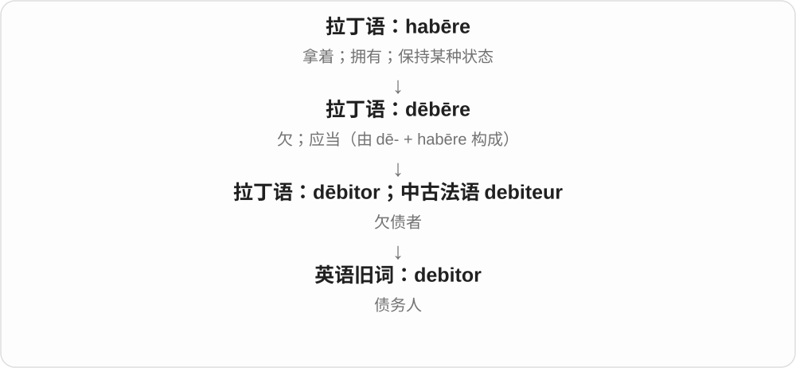

它保留更多拉丁语字形，中间 b 读出来。现代一般用 debtor；遇见 debitor 不要当作一种不同的债务身份。

**常见搭配与例句**

debitor and creditor（旧式账簿用语）。

> The old ledger names the buyer as the debitor.

旧账簿把买方列为债务人。

> In this glossary, debitor is explained as an earlier word for debtor.

在这份词汇表中，debitor 被解释为 debtor 的早期用词。

**别混淆**

debtor 是现代常用形式；debitor 属旧词。两者的拼写差异不表示一种欠款、另一种扣款。

### 59. endeavor — 努力；尽力尝试；事业性活动

**音标**：英 /ɪnˈdevə/；美 /ɪnˈdevər/

**先抓住这个画面**

觉得这件事值得认真去做，就投入力气尝试，endeavor 带有认真努力的分量。

**怎么拆**

来自中古英语 put oneself in dever“把它当作自己的职责”，dever 借自古法语，与 dēbēre“欠、应当”相连；不是 en + devour。

**怎么变成今天的意思**

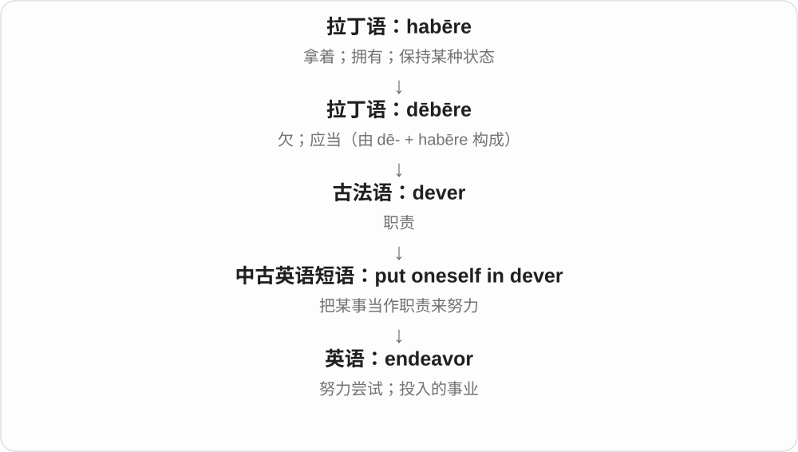

尽职责的态度发展成努力争取。它既是动词，也可作名词说一次认真尝试或一项长期事业。美式拼 endeavor，英式常写 endeavour。

**常见搭配与例句**

endeavor to do…；a scientific endeavor；human endeavor；a joint endeavor。

> We will endeavor to answer every question.

我们会尽力回答每一个问题。

> Restoring the theater was a joint endeavor.

修复这座剧院是一项共同努力的事业。

**别混淆**

try 更日常、更广；endeavor 较正式，常暗示认真投入。努力并不保证成功。

### 60. inhibit — 抑制；阻碍；使拘谨

**音标**：/ɪnˈhɪbɪt/

**先抓住这个画面**

像给一个本来要往前发展的过程踩住刹车，让它不那么容易展开，这就是 inhibit。

**怎么拆**

来自拉丁语 inhibitus，属于 inhibēre：in- 与 habēre 构成“控制住、制止”。

**怎么变成今天的意思**

可以抑制生长、反应或表达，也可让人因顾虑而放不开。通常不等于完全消灭，而是使活动受到压制或阻碍。

**常见搭配与例句**

inhibit growth；inhibit a reaction；inhibit creativity；inhibit someone from doing…。

> Fear of criticism can inhibit creativity.

害怕批评会压制创造力。

> Low temperatures inhibit the growth of some plants.

低温会抑制某些植物的生长。

**别混淆**

prohibit 多指用规则明令禁止；inhibit 可以由环境、心理或物理作用造成，不需要一条禁令。

### 61. inhibition — 抑制；顾虑；拘谨

**音标**：/ˌɪnhɪˈbɪʃən/

**先抓住这个画面**

想开口，却被“别人会不会笑我”拦住，这道心里的刹车可以叫 inhibition。

**怎么拆**

经古法语 inibicion 来自拉丁语 inhibitiō，与 inhibēre“限制、制止”对应。

**怎么变成今天的意思**

技术语境可说反应受到抑制；复数 inhibitions 在日常语境常指让人放不开的顾虑。lose your inhibitions 是放下这些心理束缚。

**常见搭配与例句**

inhibition of growth；social inhibitions；overcome inhibitions；without inhibition。

> The children sang without inhibition.

孩子们毫无拘束地唱着歌。

> The experiment measured the inhibition of the reaction.

实验测量了该反应受到抑制的程度。

**别混淆**

inhibition 常是过程或心理受到压制；prohibition 是明确的禁令。没有规则禁止，也可能有 inhibition。

### 62. disinhibition — 解除抑制；控制减弱；失去拘束

**音标**：/ˌdɪsɪnhɪˈbɪʃən/

**先抓住这个画面**

原本压住动作或表达的限制松了，反应变得更容易出现，这种变化叫 disinhibition。

**怎么拆**

dis-（去掉）+ inhibition（抑制）。

**怎么变成今天的意思**

在行为讨论中可说自我控制减弱，在机制研究中可说一个抑制环节被撤去。语气不总是褒义，也不总是病理性的。

**常见搭配与例句**

behavioral disinhibition；social disinhibition；neural disinhibition。

> The study examined disinhibition in online conversations.

这项研究考察了网络对话中人们约束感减弱的现象。

> Disinhibition increased activity in the model’s output unit.

解除抑制使模型输出单元的活动增强了。

**别混淆**

uninhibited 描述放开的状态；disinhibition 更适合讨论抑制变弱的过程或机制。

### 63. inhibitor — 抑制剂；起抑制作用的事物

**音标**：英 /ɪnˈhɪbɪtə/；美 /ɪnˈhɪbɪtər/

**先抓住这个画面**

有些东西专门让某个过程慢下来或弱下去，像给反应装上一道刹车，它就是 inhibitor。

**怎么拆**

inhibit + -or，表示执行抑制作用的物质或因素。

**怎么变成今天的意思**

实验里可以是抑制酶反应的物质；工程里可以是减少腐蚀的添加剂。这里的 -or 不一定指人。

**常见搭配与例句**

an enzyme inhibitor；a corrosion inhibitor；an inhibitor of growth。

> The test compared the reaction with and without the inhibitor.

测试比较了加入和不加入抑制剂时的反应。

> A corrosion inhibitor was added to the cooling system.

冷却系统中加入了缓蚀剂。

**别混淆**

inhibitor 是起作用的东西；inhibition 是产生的抑制作用。activator 则使相关过程更容易启动或增强。

### 64. inhibited — 拘谨的；受抑制的

**音标**：/ɪnˈhɪbɪtɪd/

**先抓住这个画面**

话到嘴边又吞回去，动作也放不开，说一个人 inhibited 时常是这种被顾虑束住的状态。

**怎么拆**

inhibit 的过去分词，进一步用作形容词。

**怎么变成今天的意思**

说人时通常谈自我表达受限制；说反应或生长时是字面的受抑制。不是所有安静的人都能据此称作 inhibited。

**常见搭配与例句**

feel inhibited；socially inhibited；inhibited growth。

> I felt inhibited in front of the large audience.

面对这么多观众，我有些放不开。

> The plants showed inhibited growth under these conditions.

在这些条件下，植物的生长受到抑制。

**别混淆**

shy 偏害羞；inhibited 更突出内心顾虑压住行为。introverted“内向的”是另一维度，不等于有这种束缚。

### 65. uninhibited — 无拘束的；尽情表达的

**音标**：/ˌʌnɪnˈhɪbɪtɪd/

**先抓住这个画面**

没人盯着自己表现得好不好，想笑就笑、想跳就跳，这种放得开的状态叫 uninhibited。

**怎么拆**

un-（不）+ inhibited（受拘束的）。

**怎么变成今天的意思**

常形容笑声、舞蹈和情感表达很自然、尽兴。词本身不必意味着鲁莽或完全无视他人。

**常见搭配与例句**

uninhibited laughter；an uninhibited performance；uninhibited enthusiasm。

> The room filled with uninhibited laughter.

房间里充满了开怀的笑声。

> Her dancing was joyful and uninhibited.

她跳得开心又自在。

**别混淆**

uninhibited 强调不拘谨；reckless 强调不顾后果。放松表达不等于冒险行事。

### 66. inhibitory — 起抑制作用的；抑制性的

**音标**：英 /ɪnˈhɪbɪtəri/；美 /ɪnˈhɪbɪtɔːri/

**先抓住这个画面**

某种信号或作用不是推动事情继续，而是在降低它继续发生的可能性，便可说 inhibitory。

**怎么拆**

与 inhibit + -ory 构词对应，也受中世纪拉丁语 inhibītōrius、法语 inhibitoire 一支影响。

**怎么变成今天的意思**

它说作用的方向。神经科学里 inhibitory signal 是降低目标神经元活动倾向的信号；不必等于整个系统停机。

**常见搭配与例句**

an inhibitory effect；an inhibitory signal；inhibitory control。

> The substance had an inhibitory effect on the reaction.

这种物质对反应有抑制作用。

> The diagram marks inhibitory connections in blue.

图中用蓝色标出了抑制性连接。

**别混淆**

inhibitory 是“会起抑制作用的”；inhibited 是“受到抑制的”。一个是作用方向，一个是承受后的状态。

### 67. disinhibit — 解除抑制；使不再受约束

**音标**：/ˌdɪsɪnˈhɪbɪt/

**先抓住这个画面**

原本有一道刹车在压住反应，现在把这道刹车松开，叫 disinhibit。

**怎么拆**

dis-（解除）+ inhibit（抑制）。

**怎么变成今天的意思**

可以用于行为，也可用于神经或其他机制。重要的是原先存在抑制、现在被减弱；不只是直接把目标推得更强。

**常见搭配与例句**

disinhibit a response；disinhibit behavior；disinhibit a neural pathway。

> The researcher asked whether the change would disinhibit the response.

研究者考察这种变化是否会解除对该反应的抑制。

> The model shows how one pathway can disinhibit another.

模型展示了一条通路如何解除对另一条通路的抑制。

**别混淆**

stimulate 是直接刺激、推动；disinhibit 是撤掉阻力。两种方式都可能让活动增加，但机制不同。

### 68. habeas corpus — 人身保护令；审查拘禁是否合法的司法程序

**音标**：英 /ˌheɪbiəs ˈkɔːpəs/；美 /ˌheɪbiəs ˈkɔːrpəs/

**先抓住这个画面**

一个人被关起来，法院要求拘押一方说明依据，让拘禁接受司法审查；这里的 corpus 是“这个人的身体”，不是尸体。

**怎么拆**

拉丁语 habeās（你应带来、持有；来自 habēre）+ corpus（身体）。英语把法律文书中的这段拉丁语保留下来。

**怎么变成今天的意思**

直观地记为“别只把人关着，把人及拘押依据交给法院审查”。它关注拘禁的合法性，不等于一次自动认定无罪的程序。

**常见搭配与例句**

a writ of habeas corpus；a habeas corpus petition；seek habeas corpus relief。

> The lawyer filed a petition for habeas corpus.

律师提交了人身保护令申请。

> The lecture explains how habeas corpus subjects detention to judicial review.

讲座解释了人身保护令如何让拘禁接受司法审查。

**别混淆**

habeas corpus 不是刑事案件中的 corpse“尸体”。bail 是保释，两者涉及不同的法律概念。

### 69. debenture — 债务凭证；公司债券

**音标**：英 /dɪˈbentʃə/；美 /dɪˈbentʃər/

**先抓住这个画面**

公司用一份正式凭证承认“这笔钱我们欠着”，这样的债务凭证发展成 debenture。

**怎么拆**

来自拉丁语 dēbentur“它们是被欠着的、款项应付”，本是 dēbēre 的动词形式，出现在债务证明开头，后来成了凭证名称。

**怎么变成今天的意思**

这不是 debt + 一个 -enture 后缀。美式金融用法常指凭发行人一般信用担保的无特定抵押债券；英式范围较广，不能单凭名称判断有无担保。

**常见搭配与例句**

issue debentures；a convertible debenture；debenture holders。

> The company issued debentures to fund the new plant.

公司发行债券，为新工厂筹资。

> The document explains when the debenture can be converted into shares.

文件说明这张债券何时可以转换为股票。

**别混淆**

a share 表示持有股权；a debenture 通常证明债权。具体债券条件应读文件，词义本身不说明风险大小。

### 70. habituate — 使习惯；逐渐适应

**音标**：/həˈbɪtʃueɪt/

**先抓住这个画面**

起初觉得吵、陌生或不自在，接触久了没那么在意了，就是 habituate 的直观画面。

**怎么拆**

来自晚期拉丁语 habituātus，与 habituāre“使处于某种状态”相连，根在 habitus。

**怎么变成今天的意思**

可以说人或动物渐渐习惯某事。在心理学里，反复刺激后反应减弱是一种具体用法，不是所有学习都叫 habituation。

**常见搭配与例句**

habituate to…；be habituated to noise；habituate someone to…。

> The birds gradually habituated to the sound of traffic.

这些鸟逐渐习惯了交通噪声。

> Years of travel had habituated her to unfamiliar surroundings.

多年的旅行让她习惯了陌生环境。

**别混淆**

habituate 常强调重复接触后变习惯；adapt 范围更广，可包括主动改变能力、行为或结构。

### 71. habituation — 习惯化；反复接触后反应减弱

**音标**：/həˌbɪtʃuˈeɪʃən/

**先抓住这个画面**

刚搬到铁路旁时，每趟火车都让你抬头；后来常常没注意到。这种反应减弱很能说明 habituation。

**怎么拆**

经中古英语来自中世纪拉丁语 habituātiō，与 habituāre 对应；现代与 habituate 构成动词、名词关系。

**怎么变成今天的意思**

日常可说逐渐习惯；心理学重点是重复刺激后反应下降。不是感官损坏，也不等于主动作出“我不理它”的决定。

**常见搭配与例句**

habituation to noise；a habituation experiment；the process of habituation。

> Habituation may explain why the ticking clock no longer attracts his attention.

习惯化也许能解释为什么钟的滴答声不再吸引他的注意。

> The study measured habituation to a repeated sound.

研究测量了对重复声音的习惯化反应。

**别混淆**

habit 是已形成的习惯；habituation 是形成适应、反应变化的过程。它也不能直接等同于 addiction“成瘾”。

### 72. prebend — 教士俸给；提供这笔收入的财产或职位

**音标**：/ˈprebənd/

**先抓住这个画面**

教堂为承担特定职责的教士留出一份收入，供其生活和服务，这份俸给在历史上叫 prebend。

**怎么拆**

经法语 prebende 和中世纪拉丁语来自 praebenda“应供给之物”；praebēre“提供”由 prae-（在前）与 habēre 构成。

**怎么变成今天的意思**

从应当提供的生活供应发展为固定教会收入。词也可转指相应职位；现代政治分析有时借它比喻靠任命获取利益的职位。

**常见搭配与例句**

hold a prebend；the income from a prebend；a cathedral prebend。

> The canon received income from a prebend.

这位教士从一项教会俸给中取得收入。

> The records describe the land attached to the prebend.

档案记载了作为这份俸给收入来源的土地。

**别混淆**

prebend 与 provender 同源，但一个走向教会俸给，一个走向食物饲料。另有 pre- + bend“预先弯曲”的同形动词，不属于这条词源。

### 73. prebendary — 领取俸给的教士；座堂荣誉教士

**音标**：英 /ˈprebəndəri/；美 /ˈprebənˌderi/

**先抓住这个画面**

prebend 是给付的俸金；历史上领取这种俸给、在教堂任职的人，就是 prebendary。

**怎么拆**

来自中世纪拉丁语 praebendārius，由 praebenda“俸给”引出，表示与这份俸给相关的人。

**怎么变成今天的意思**

今天也可用作座堂中的荣誉教士头衔，不能仅凭名称断言一定领着旧制度中的那种收入。形容词还可表示与该职位或利益分配有关。

**常见搭配与例句**

be appointed a prebendary；a prebendary of the cathedral；prebendary offices。

> He was appointed a prebendary of the cathedral.

他被任命为该座堂的荣誉教士。

> The archive lists the prebendaries who served there.

档案列出了曾在那里任职的俸给教士。

**别混淆**

prebend 是俸给或职位收益；prebendary 通常是人或头衔。priest 的范围更广。

### 74. debile — 虚弱的；衰弱的

**音标**：/ˈdebəl/，也读 /ˈdebaɪl/（旧词）

**先抓住这个画面**

旧文里形容某人身体无力、状态衰弱，可以见到 debile；今天一般说 weak 或 frail。

**怎么拆**

经中古法语 debile 来自拉丁语 dēbilis“虚弱的”。与 debility、debilitate 共享这个已确认的源头。

**怎么变成今天的意思**

这个形容词的英语使用已经很少。它放在本页用于比较，不代表“de- 去掉 ability”已被词源学确认；dēbilis 的深层构词仍有不同解释。

**常见搭配与例句**

a debile body；a debile frame（旧式文学表达）。

> The old biography describes his debile frame.

这本旧传记描写了他虚弱的身体。

> The editor glosses debile as weak or feeble.

编辑把 debile 注释为虚弱、无力。

**别混淆**

debile 是旧式的弱；debilitate 是使虚弱；debility 是虚弱状态。不要按现代法语贬义去机械翻译旧英语。

### 75. debility — 虚弱；衰弱

**音标**：/dɪˈbɪləti/

**先抓住这个画面**

身体像没了足够的电，日常行动也提不起劲，这种整体虚弱可以叫 debility。

**怎么拆**

经法语 debilité 来自拉丁语 dēbilitās，源于 dēbilis“虚弱的”。深层来源有争议，不能把它确定拆成 de- + ability。

**怎么变成今天的意思**

它常指身体虚弱，也可比喻制度等的衰弱。这里作为能力词族的比较旁支：有词源说联系 habēre，另有更受支持的解释联系古老的“力量”成分。

**常见搭配与例句**

physical debility；general debility；a state of debility。

> The long illness left him in a state of debility.

长期生病使他身体虚弱。

> The writer uses the word debility to describe the institution’s decline.

作者用 debility 这个词形容该机构的衰弱。

**别混淆**

debility 强调虚弱状态；disability 指残障或功能限制，两者不能互换。疲劳、残障与虚弱也不是同一个概念。

### 76. devoir — 职责；应尽礼节；致敬（旧式）

**音标**：英 /dəˈvwɑː/；美 /dəˈvwɑːr/

**先抓住这个画面**

把一件事看作自己应尽的责任，或按礼节向人表示敬意，旧式英语会用 devoir。

**怎么拆**

借自法语 devoir，来自拉丁语 dēbēre“欠、应当”。与 due、duty 相连，但较多保留法语外形与读音。

**怎么变成今天的意思**

复数 devoirs 常出现在 pay one’s devoirs，意思是向人致意、尽礼数。现代普通文章较少这样说。

**常见搭配与例句**

pay one’s devoirs to…；perform one’s devoir（旧式）。

> The visitors came to pay their devoirs to the host.

来宾前来向主人致意。

> In the novel, he regards obedience as his first devoir.

在这部小说中，他把服从视为首要职责。

**别混淆**

法语 devoir 还能作动词“必须”；借入英语的 devoir 主要是名词。日常职责用 duty 更自然。

### 77. debilitate — 使虚弱；严重削弱

**音标**：/dɪˈbɪlɪteɪt/

**先抓住这个画面**

不是一下子切断，而是把力量耗掉，让人或系统越来越难正常工作，便是 debilitate。

**怎么拆**

来自拉丁语 dēbilitātus，属于 dēbilitāre“使虚弱”，源于 dēbilis。不能把字母 -bil- 直接认成 able 的缩写。

**怎么变成今天的意思**

可说疾病令人虚弱，也可比喻长期冲突削弱组织。dēbilis 的更深来源有争议，图从可以确认的拉丁语词开始，不假装能一路确定追到 habēre。

**常见搭配与例句**

debilitate a person；a debilitating illness；debilitate an organization。

> The illness debilitated her for several weeks.

这场病让她虚弱了好几个星期。

> Years of internal conflict had debilitated the organization.

多年的内部冲突严重削弱了这个组织。

**别混淆**

disable 强调使某项功能不能工作；debilitate 强调明显削弱力量和运作能力，不一定彻底停摆。

### 78. provender — 饲料；食物、粮草（旧式或文学用语）

**音标**：英 /ˈprɒvəndə/；美 /ˈprɑːvəndər/

**先抓住这个画面**

旅行或行军前，给马备好一袋粮草，给人备好食物，这些维持生活的供给可叫 provender。

**怎么拆**

经古法语 provende / provendre 一类形式来自晚期拉丁语 praebenda“供应、口粮”，与 prebend 是同源异形词。

**怎么变成今天的意思**

共同源头是提供生活所需。一支保留在教会俸给里成了 prebend，另一支更多落到食物、尤其牲畜的干饲料上。

**常见搭配与例句**

provender for the horses；a supply of provender；food and provender。

> The travelers bought provender for their horses.

旅人们为马匹购买了粮草。

> The cellar held enough provender for the winter.

地窖里存着足够过冬的食物。

**别混淆**

provender 较旧式；feed、fodder 更常用于现代牲畜饲料。它不是 provider“提供者”的随意变体。

### 79. habitude — 习性；习惯性倾向（文学或罕用）

**音标**：英 /ˈhæbɪtjuːd/；美 /ˈhæbɪtuːd/

**先抓住这个画面**

多年生活沉淀下来，一个人惯常的想法、举止和偏好，用带文学色彩的 habitude 来概括。

**怎么拆**

经古法语 habitude 来自拉丁语 habitūdō，源于 habitus“状态、习性”，并带表示状态的 -tūdō。

**怎么变成今天的意思**

这个词常比一个具体小习惯更显得整体、久成。现代日常表达通常用 habit 或 habits，不必把它当成更高级的替代词。

**常见搭配与例句**

old habitudes；habitudes of thought；a lifelong habitude。

> Travel unsettled his comfortable habitudes.

旅行打乱了他安逸的日常习惯。

> The essay examines the habitudes of academic thought.

这篇文章考察学术思维中惯常的倾向。

**别混淆**

habit 可说咬指甲这类具体动作；habitude 在文学里常指较广的惯常状态或思维倾向。

### 80. habenula — 缰核；小缰状或带状结构

**音标**：/həˈbenjʊlə/

**先抓住这个画面**

解剖学常借日用品的形状命名。habenula 的字面是“小缰绳”，在脑科学中指脑内一组小的成对结构。

**怎么拆**

借自拉丁语 habenula，是 habēna“缰绳、皮带”的指小形式；habēna 与 habēre“握持”相连。

**怎么变成今天的意思**

先有能握住、控制的带子，再有小带子的名称，解剖命名借用了这个形象。名字不是功能的完整说明，不能直接推出它像缰绳一样控制整个大脑。

**常见搭配与例句**

lateral habenula；medial habenula；habenular nuclei。

> The diagram marks the habenula near the pineal region.

图中标出了松果体区域附近的缰核。

> The lecture compared the medial and lateral habenula.

讲座比较了内侧缰核与外侧缰核。

**别混淆**

habena 是较宽泛的缰状结构名；habenula 有指小形式。habit“习惯”与它字形相近，但不能据此说它是“习惯中枢”。

### 81. habendum — 契据中界定所授产权范围的条款

**音标**：/həˈbendəm/

**先抓住这个画面**

一份转让文书不仅说“把东西给你”，还要说明你得到什么范围、何种性质的权利；habendum 是传统契据里的这一部分。

**怎么拆**

来自法律拉丁语 habendum，属于 habēre 的动形容词形式，意为“应予持有的”，因相关条款的开头用语得名。

**怎么变成今天的意思**

可把它记成文书里的“拿到以后，究竟持有什么权利”这一栏。它是专门术语，不是普通英语里表示所有物的常用名词。

**常见搭配与例句**

a habendum clause；the habendum of a deed。

> The textbook identifies the habendum clause in the deed.

教材指出了这份契据中的权利范围条款。

> The habendum describes the estate being granted.

该条款说明所授予产权的范围与性质。

**别混淆**

整份 deed 是契据；habendum 是其中的传统条款部分。不能把两者当同一个文件名。

### 82. habile — 能干的；灵巧的（罕用）

**音标**：/ˈhæbɪl/，也读 /ˈhæbəl/

**先抓住这个画面**

一个人办事熟练、手法灵巧，旧式或文学英语可以称他 habile。

**怎么拆**

经古法语 habile 来自拉丁语 habilis；与 able 同源，却保留了开头的 h 和更多原有字形。

**怎么变成今天的意思**

able 成了日常高频词，habile 留在较少见的书面语里。见到它，可把意思放在“有本事、处置熟练”这一侧。

**常见搭配与例句**

a habile negotiator；a habile craftsman（文学用法）。

> The memoir describes her as a habile negotiator.

这本回忆录把她写成一个谈判高手。

> A habile craftsman could repair the delicate mechanism.

熟练的工匠能修好这个精细机构。

**别混淆**

able 通常强调能做；habile 较容易突出技巧和灵巧。habitual 则是惯常的，与技能高低无关。

### 83. inhabile — 不适合的；不熟练的（旧词）

**音标**：/ɪnˈhæbɪl/

**先抓住这个画面**

某个人不适合承担某项任务，或做起来很生疏，旧文可能用 inhabile。

**怎么拆**

来自拉丁语 inhabilis：in-（不）+ habilis（合适、能干的），与法语 inhabile 对应。

**怎么变成今天的意思**

这里 in- 是否定。这个词与 inhabit“居住”长得像，但内部切分和意思不同：inhabit 中的 in- 是“在里面”。

**常见搭配与例句**

inhabile for a task；inhabile at an art（旧式）。

> The old commentary calls the official inhabile for the post.

这篇旧评论说该官员不适合担任这个职位。

> The poet presents himself as inhabile in the art of praise.

诗人自称不擅长赞颂的艺术。

**别混淆**

现代通常说 unfit、unsuitable 或 unskilled。不要从 inhabile 推断它表示“无人居住的”。

### 84. habitudinal — 与惯常习性有关的（罕用）

**音标**：英 /ˌhæbɪˈtjuːdɪnəl/；美 /ˌhæbəˈtuːdənəl/

**先抓住这个画面**

某种模式来自长期养成的习性，偏学术的文章可能称它 habitudinal。

**怎么拆**

拉丁语 habitūdō 的词干 habitūdin- + 英语 -al；多出的 n 来自拉丁语词干，不能按现代 habitude 原样拼接。

**怎么变成今天的意思**

它是从“习性这种状态”引出的关系形容词，常用于讨论行为或思想模式。普通的“经常迟到”仍用 habitual lateness 更自然。

**常见搭配与例句**

habitudinal patterns；habitudinal responses；habitudinal tendencies。

> The article links the decision to habitudinal patterns of thought.

文章把这项决定与惯常的思维模式联系起来。

> The researcher distinguished deliberate choices from habitudinal responses.

研究者区分了有意的选择与习性带来的反应。

**别混淆**

habitual 是常做、习惯性的；habitudinal 更书面地表示与习性相关。两者重叠，但后者很少见。

## 这一组要分清什么

**exhibit / inhibit / prohibit**：拿出来展示；按住、抑制；用规则或力量阻止。

**habitable / inhabitable / uninhabitable / uninhabited**：前两个现代通常都表示能住；第三个不能住；第四个只是没人住。

**due / overdue / undue**：应到的、应有的；已经超过期限；不应有或过分的。

**debt / debit / debtor**：债务；借方记项或扣款；欠债一方。debt 和 debtor 的 b 不发音，debit 的 b 发音。

**ability / disability / debility**：能力；残障或功能限制；虚弱。三者不能靠字形近似混当同一概念。

## 串起来练习

The grant **enabled** the team to restore the birds’ **habitat**. At the **exhibition**, they showed how a small change in human **habits** could help.

资助使团队得以修复鸟类栖息地。在展览上，他们展示了人类习惯中的一个小改变能带来什么帮助。

连起来记：具备条件才能做 → enable；生物住在哪里 → habitat；把成果拿出来 → exhibition；长期保持的做法 → habits。
