# 0092 · leg-, lect- — 挑选、聚拢、阅读；另辨委任与团体支线

[逐词精讲目录](../00_逐词精讲目录.md) · [总目录](../00_总目录_按常用程度.md)

## 核心词根与来源

先想在一堆东西里**挑出需要的，再把它们聚拢起来**。拉丁语 legere 同时有挑选、收集、阅读等意思。collect 把东西收拢，select 把某些挑出来，lecture 走向读讲，intelligent 则强调分辨并理解。把“读书”想成逐个辨认文字，是帮助记忆的画面，不必说成已经证实的唯一语义演变故事。

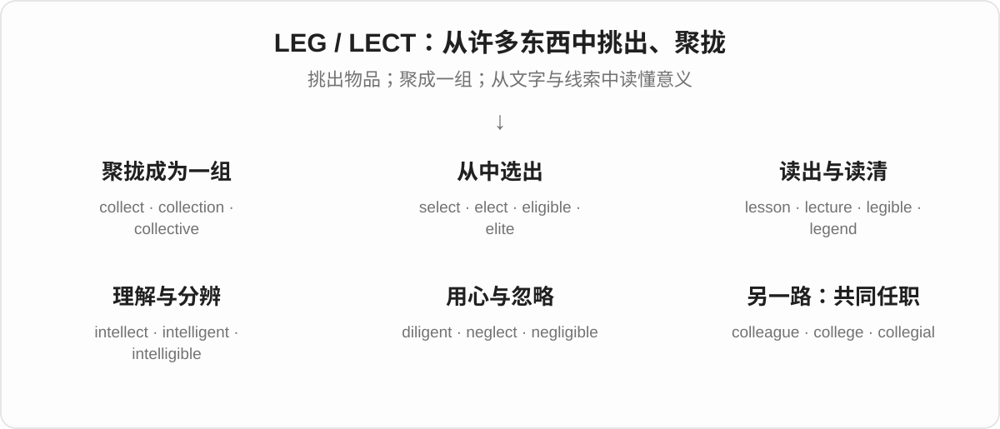

## 词形与演化规律

**leg-、lig-、lect- 常来自 legere 的词干变化。** eligible、intelligent、negligent 里的拼写也要追到各自的拉丁复合词。**college / colleague 一组另走 lēgāre“委任”→ collēga“同职者”→ collēgium“团体”的直接路线**，不要画成“大家一起读书所以是学院”。legal 来自 lēx“法律”，更不能见到 leg 就当成阅读。religion 与 legume 的更早来源有争议：本页讲清已确定的借入链，把不同解释留在文字说明中，不画确定的祖先箭头。

## 单词速览（常用到不常用）

| 单词 | 音标 | 核心意思 |
|---|---|---|
| [college](#w-1) | 英 /ˈkɒlɪdʒ/；美 /ˈkɑːlɪdʒ/ | 学院；大学；具有共同职责的团体 |
| [election](#w-2) | /ɪˈlekʃən/ | 选举；正式选择 |
| [collection](#w-3) | /kəˈlekʃən/ | 收集；收藏品；一组物品 |
| [religious](#w-4) | /rɪˈlɪdʒəs/ | 宗教的；虔诚信教的 |
| [religion](#w-5) | /rɪˈlɪdʒən/ | 宗教；宗教信仰 |
| [intelligence](#w-6) | /ɪnˈtelɪdʒəns/ | 理解与思考能力；情报 |
| [selection](#w-7) | /sɪˈlekʃən/ | 选择；所选的一组；可供挑选的范围 |
| [lesson](#w-8) | /ˈlesən/ | 一课；课程；经验教训 |
| [select](#w-9) | /sɪˈlekt/ | 挑选；精选的；少数被选中的 |
| [legend](#w-10) | /ˈledʒənd/ | 传说；传奇人物；图例 |
| [elite](#w-11) | /ɪˈliːt/ | 精英；顶尖阶层；出类拔萃的 |
| [collect](#w-12) | 动词 /kəˈlekt/；祷文名词英 /ˈkɒlekt/、美 /ˈkɑːlekt/ | 收集；领取；使镇定；短祷文 |
| [collective](#w-13) | /kəˈlektɪv/ | 集体的；共同的；集体组织 |
| [intellectual](#w-14) | /ˌɪntəˈlektʃuəl/ | 智力的；重思考的；知识分子 |
| [eligible](#w-15) | /ˈelɪdʒəbəl/ | 符合条件的；有资格的 |
| [intelligent](#w-16) | /ɪnˈtelɪdʒənt/ | 聪明的；有理解力的；设计巧妙的 |
| [legendary](#w-17) | /ˈledʒəndəri/；美 /ˈledʒənderi/ | 传说中的；传奇般著名的 |
| [lecture](#w-18) | 英 /ˈlektʃə/；美 /ˈlektʃər/ | 讲课；讲座；训话 |
| [electoral](#w-19) | /ɪˈlektərəl/ | 选举的；选举人的 |
| [elect](#w-20) | /ɪˈlekt/ | 选举；选择；当选而尚未就任的 |
| [colleague](#w-21) | 英 /ˈkɒliːɡ/；美 /ˈkɑːliːɡ/ | 同事；同行 |
| [collector](#w-22) | 英 /kəˈlektə/；美 /kəˈlektər/ | 收藏者；收取者；收集装置 |
| [selective](#w-23) | /sɪˈlektɪv/ | 有选择的；挑选严格的；选择性作用的 |
| [legion](#w-24) | /ˈliːdʒən/ | 军团；大批；极多的 |
| [collectively](#w-25) | /kəˈlektɪvli/ | 共同地；作为整体地 |
| [neglect](#w-26) | /nɪˈɡlekt/ | 忽视；疏于照顾；疏漏 |
| [eligibility](#w-27) | /ˌelɪdʒəˈbɪləti/ | 资格；符合条件的状态 |
| [coil](#w-28) | /kɔɪl/ | 线圈；卷；盘绕 |
| [lecturer](#w-29) | 英 /ˈlektʃərə/；美 /ˈlektʃərər/ | 讲课者；讲师 |
| [negligence](#w-30) | /ˈneɡlɪdʒəns/ | 疏忽；过失；未尽应有注意 |
| [electorate](#w-31) | /ɪˈlektərət/ | 全体选民；选民群体 |
| [diligence](#w-32) | /ˈdɪlɪdʒəns/ | 勤勉；认真细致的努力 |
| [intellect](#w-33) | /ˈɪntəlekt/ | 理解、推理能力；才智 |
| [collegiate](#w-34) | /kəˈliːdʒiət/ | 学院的；大学生的；团体共同的 |
| [negligible](#w-35) | /ˈneɡlɪdʒəbəl/ | 小到可忽略的 |
| [intellectually](#w-36) | /ˌɪntəˈlektʃuəli/ | 在智力或思想层面；运用理性地 |
| [negligent](#w-37) | /ˈneɡlɪdʒənt/ | 疏忽的；未尽注意的 |
| [elective](#w-38) | /ɪˈlektɪv/ | 可选择的；选修课；由选举产生的 |
| [reelection](#w-39) | /ˌriːɪˈlekʃən/ | 再次当选；连任选举 |
| [selectively](#w-40) | /sɪˈlektɪvli/ | 有选择地；只针对部分对象地 |
| [ineligible](#w-41) | /ɪnˈelɪdʒəbəl/ | 不符合资格的 |
| [recollection](#w-42) | /ˌrekəˈlekʃən/ | 回忆；记得的内容 |
| [diligent](#w-43) | /ˈdɪlɪdʒənt/ | 勤勉认真的 |
| [selector](#w-44) | 英 /sɪˈlektə/；美 /sɪˈlektər/ | 选择器；选拔者；选定对象的表达式 |
| [collectible](#w-45) | /kəˈlektəbəl/ | 值得收藏的；收藏品；可收取的 |
| [diligently](#w-46) | /ˈdɪlɪdʒəntli/ | 认真勤勉地 |
| [elitist](#w-47) | /ɪˈliːtɪst/ | 精英主义的；偏向精英的人 |
| [intelligently](#w-48) | /ɪnˈtelɪdʒəntli/ | 明智地；有理解力地 |
| [cull](#w-49) | /kʌl/ | 挑取；筛除；选择性淘汰 |
| [elector](#w-50) | 英 /ɪˈlektə/；美 /ɪˈlektər/ | 选民；选举人；选帝侯 |
| [unintelligible](#w-51) | /ˌʌnɪnˈtelɪdʒəbəl/ | 无法理解的；听不懂的 |
| [legible](#w-52) | /ˈledʒəbəl/ | 字迹清楚可辨的 |
| [selectivity](#w-53) | /sɪˌlekˈtɪvəti/ | 选择性；筛选程度 |
| [intelligible](#w-54) | /ɪnˈtelɪdʒəbəl/ | 能听懂、看懂的；可理解的 |
| [intelligentsia](#w-55) | /ɪnˌtelɪˈdʒentsiə/ | 知识分子阶层 |
| [recollect](#w-56) | /ˌrekəˈlekt/ | 回想；记起 |
| [collectable](#w-57) | /kəˈlektəbəl/ | 可收取的；值得收藏的；收藏品 |
| [counterintelligence](#w-58) | 英 /ˌkaʊntərɪnˈtelɪdʒəns/；美同 | 反情报；反间谍工作 |
| [intercollegiate](#w-59) | /ˌɪntəkəˈliːdʒiət/；美 /ˌɪntərkəˈliːdʒiət/ | 学院之间的；大学校际的 |
| [sacrilege](#w-60) | /ˈsækrəlɪdʒ/ | 亵渎；冒犯被视为神圣的事物 |
| [elitism](#w-61) | /ɪˈliːtɪzəm/ | 精英主义；偏重精英的态度或制度 |
| [legume](#w-62) | 英 /ˈleɡjuːm/；美 /ˈleɡjuːm/，亦 /ləˈɡuːm/ | 豆科植物；豆类；荚果 |
| [illegible](#w-63) | /ɪˈledʒəbəl/ | 字迹无法辨认的 |
| [selectable](#w-64) | /sɪˈlektəbəl/ | 可选择的；可被选中的 |
| [predilection](#w-65) | /ˌpriːdɪˈlekʃən/，亦 /ˌpredɪˈlekʃən/ | 偏爱；特别的喜好 |
| [intellectualism](#w-66) | /ˌɪntəˈlektʃuəlɪzəm/ | 重视理智的倾向；理智主义 |
| [unintelligent](#w-67) | /ˌʌnɪnˈtelɪdʒənt/ | 不明智的；缺乏理解力的 |
| [collectivism](#w-68) | /kəˈlektɪvɪzəm/ | 集体主义 |
| [collectivist](#w-69) | /kəˈlektɪvɪst/ | 集体主义的；集体主义者 |
| [neglectful](#w-70) | /nɪˈɡlektfəl/ | 疏于照顾的；不够留心的 |
| [negligently](#w-71) | /ˈneɡlɪdʒəntli/ | 疏忽地；未尽注意地 |
| [lectern](#w-72) | 英 /ˈlektən/；美 /ˈlektərn/ | 讲台上的读稿架；诵读台 |
| [sacrilegious](#w-73) | /ˌsækrəˈlɪdʒəs/ | 亵渎神圣的；大不敬的 |
| [intelligencer](#w-74) | 英 /ɪnˈtelɪdʒənsə/；美 /ɪnˈtelɪdʒənsər/ | 报信者；情报提供者（旧称） |
| [collegial](#w-75) | /kəˈliːdʒiəl/ | 同事合作的；同僚共同管理的 |
| [uncollected](#w-76) | /ˌʌnkəˈlektɪd/ | 尚未收取的；未收入集子的 |
| [preselection](#w-77) | /ˌpriːsɪˈlekʃən/ | 预先选择；候选人预选 |
| [collegium](#w-78) | /kəˈliːdʒiəm/ | 委员会；共同承担职责的团体 |
| [intelligibility](#w-79) | /ɪnˌtelɪdʒəˈbɪləti/ | 可理解性；语音清晰可懂程度 |
| [collectivization](#w-80) | 英 /kəˌlektɪvaɪˈzeɪʃən/；美 /kəˌlektɪvəˈzeɪʃən/ | 集体化 |
| [legibility](#w-81) | /ˌledʒəˈbɪləti/ | 字迹可辨程度；易读性 |
| [legionella](#w-82) | /ˌliːdʒəˈnelə/ | 军团菌 |
| [collectivity](#w-83) | 英 /ˌkɒlekˈtɪvɪti/；美 /ˌkɑːlekˈtɪvəti/ | 集体性；作为整体的群体 |
| [legionnaire](#w-84) | 英 /ˌliːdʒəˈneə/；美 /ˌliːdʒəˈner/ | 军团士兵；军团组织成员 |
| [unelectable](#w-85) | /ˌʌnɪˈlektəbəl/ | 很难当选的；不具胜选可能的 |
| [electable](#w-86) | /ɪˈlektəbəl/ | 有望当选的；可被选出的 |
| [lectureship](#w-87) | 英 /ˈlektʃəʃɪp/；美 /ˈlektʃərʃɪp/ | 讲师职位；讲座安排 |
| [lector](#w-88) | 英 /ˈlektə/；美 /ˈlektər/ | 诵读者；读经员；某些院校的讲授人员 |
| [selectman](#w-89) | /sɪˈlektmən/ | 镇行政委员（美国新英格兰部分城镇用语） |
| [lectionary](#w-90) | 英 /ˈlekʃənəri/；美 /ˈlekʃəneri/ | 经文选读集；礼拜读经安排 |
| [ineligibility](#w-91) | /ɪnˌelɪdʒəˈbɪləti/ | 不符合资格的状态 |
| [lectin](#w-92) | /ˈlektɪn/ | 凝集素；能特异结合糖类的蛋白质 |
| [deselect](#w-93) | /ˌdiːsɪˈlekt/ | 取消选择；取消候选资格安排 |
| [electorally](#w-94) | /ɪˈlektərəli/ | 从选举角度；在选举上 |
| [legionary](#w-95) | 英 /ˈliːdʒənəri/；美 /ˈliːdʒəneri/ | 军团的；军团士兵 |
| [collegiality](#w-96) | /kəˌliːdʒiˈæləti/ | 同事间的合作精神；同僚共治 |
| [reelect](#w-97) | /ˌriːɪˈlekt/ | 重新选举……；使连任 |
| [collegian](#w-98) | /kəˈliːdʒən/ | 大学生；学院成员或毕业生 |
| [electability](#w-99) | /ɪˌlektəˈbɪləti/ | 当选可能性；胜选能力 |
| [leguminous](#w-100) | /lɪˈɡjuːmɪnəs/ | 豆科的；豆类的 |
| [nonselective](#w-101) | 英 /ˌnɒnsɪˈlektɪv/；美 /ˌnɑːnsɪˈlektɪv/ | 非选择性的；不按特定标准筛选的 |
| [intellectuality](#w-102) | /ˌɪntəlektʃuˈæləti/ | 智性；重思考的特征（较少用） |
| [postelection](#w-103) | /ˌpəʊstɪˈlekʃən/；美 /ˌpoʊstɪˈlekʃən/ | 选举后的 |
| [selectee](#w-104) | /sɪˌlekˈtiː/ | 被选中的人 |
| [lection](#w-105) | /ˈlekʃən/ | 诵读；经文选段；文本异文（专业用语） |
| [preselect](#w-106) | /ˌpriːsɪˈlekt/ | 预先选定；提前筛选 |
| [reselect](#w-107) | /ˌriːsɪˈlekt/ | 重新选择；再次选中 |
| [intellection](#w-108) | /ˌɪntəˈlekʃən/ | 理解、思考的活动（哲学用语） |
| [legendry](#w-109) | /ˈledʒəndri/ | 传说的总和；传说体系 |
| [illegibility](#w-110) | /ɪˌledʒəˈbɪləti/ | 字迹难辨；无法辨读的状态 |
| [preelection](#w-111) | /ˌpriːɪˈlekʃən/ | 选举前的 |
| [electee](#w-112) | /ɪˌlekˈtiː/ | 当选者（较少用） |
| [lectorate](#w-113) | /ˈlektərət/，亦 /ˈlektəreɪt/ | 诵读员职务；读经员身份 |
| [nonelective](#w-114) | 英 /ˌnɒnɪˈlektɪv/；美 /ˌnɑːnɪˈlektɪv/ | 非选修的；非由选举产生的；非择期的 |
| [nonelite](#w-115) | 英 /ˌnɒnɪˈliːt/；美 /ˌnɑːnɪˈliːt/ | 非精英的；非精英群体 |
| [nonnegligible](#w-116) | 英 /ˌnɒnˈneɡlɪdʒəbəl/；美 /ˌnɑːnˈneɡlɪdʒəbəl/ | 不可忽略的 |
| [predilect](#w-117) | /ˌpredɪˈlekt/，亦 /ˌpriːdɪˈlekt/ | 偏爱的、选中的；预先选择（罕用） |
| [prelect](#w-118) | /prɪˈlekt/ | 公开讲授；宣讲（少见） |
| [prelection](#w-119) | /prɪˈlekʃən/ | 公开讲授；讲读；预读（少见） |
| [prelector](#w-120) | 英 /priːˈlektə/；美 /priːˈlektər/ | 讲读者；某些大学的传统职衔 |
| [superselection](#w-121) | 英 /ˌsuːpəsɪˈlekʃən/；美 /ˌsuːpərsɪˈlekʃən/ | 超选择（量子理论术语） |
| [uniselector](#w-122) | /ˌjuːnɪsɪˈlektə(r)/（按构词读法） | 单动选择器；单向步进选择开关 |

## 逐词讲解

### 1. college — 学院；大学；具有共同职责的团体

**音标**：英 /ˈkɒlɪdʒ/；美 /ˈkɑːlɪdʒ/

**先抓住这个画面**

college 最初像一群承担共同职责的人组成的团体；学者和学生组成的教学团体，后来成为学院。

**怎么拆**

来自 collēgium，联系 collēga 与 lēgāre“委任”；不能拆成“大家一起阅读”。

**怎么变成今天的意思**

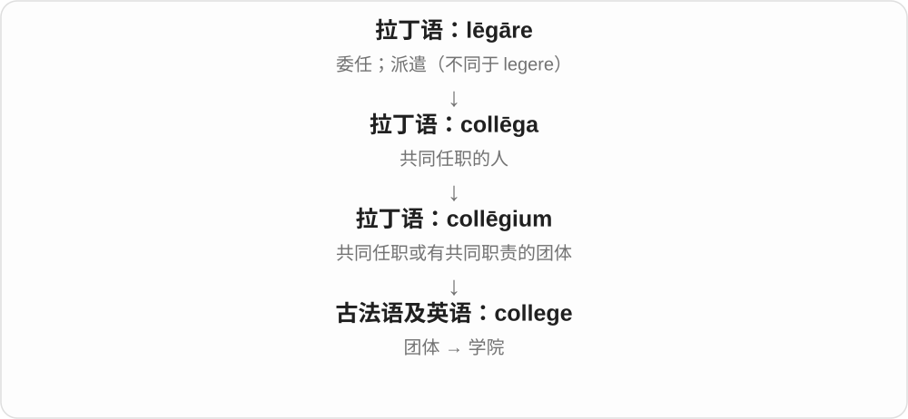

在不同教育制度中可指独立学校或大学内的学院。electoral college 则保留“有共同职责的一群人”的旧义。

**常见搭配与例句**

go to college；a medical college；an electoral college。

> She studied design at a local college.

她在当地一所学院学习设计。

> The university has a college of engineering.

这所大学设有工程学院。

**别混淆**

college 与 colleague 同支；legal 从 lēx“法律”来，均不能直接当 legere“阅读”的现代派生词。

### 2. election — 选举；正式选择

**音标**：/ɪˈlekʃən/

**先抓住这个画面**

election 像从多个候选人中，把要担任某个职位的人选出来。

**怎么拆**

现代对应 elect + -ion；历史经法语来自拉丁语 ēlēctiō，名词有独立借入链。

**怎么变成今天的意思**

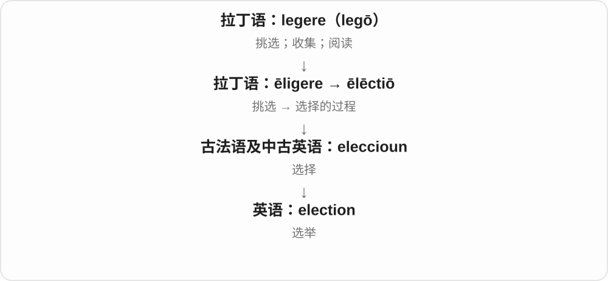

最常见是投票选人，也可在正式文体中表示选择。它不等于竞选活动本身。

**常见搭配与例句**

hold an election；win an election；a general election。

> The club will hold an election next month.

俱乐部下个月将举行选举。

> She won the election by a narrow margin.

她以微弱优势赢得了选举。

**别混淆**

election 是选举；campaign 是争取支持的竞选过程。

### 3. collection — 收集；收藏品；一组物品

**音标**：/kəˈlekʃən/

**先抓住这个画面**

collection 像散落各处的东西被归拢到同一处，既可说归拢过程，也可说最后那一组。

**怎么拆**

现代对应 collect + -ion；来自拉丁语 collēctiō，经法语等路线传入。

**怎么变成今天的意思**

藏书、样本、服装系列都可以是一份 collection；waste collection 说的则是收运过程。

**常见搭配与例句**

a collection of stories；data collection；a private collection。

> The museum owns a large collection of maps.

博物馆收藏了大量地图。

> Data collection took three weeks.

数据收集用了三周。

**别混淆**

collection 是聚在一起的一组；selection 常强调经过挑选的一组。

### 4. religious — 宗教的；虔诚信教的

**音标**：/rɪˈlɪdʒəs/

**先抓住这个画面**

religious 可以只是与宗教有关，也可以形容一个人的信仰很虔诚。

**怎么拆**

来自拉丁语 religiōsus，经法语传入；与 religion 平行借入，不是英语里机械去掉 -on 再加 -ous。

**怎么变成今天的意思**

宗教建筑是 religious building，虔信的人是 religious person。词源更早部分同 religion 一样有争议。

**常见搭配与例句**

religious beliefs；religious art；a religious person。

> The museum has a collection of religious art.

博物馆收藏了一批宗教艺术品。

> She comes from a deeply religious family.

她出身于一个十分虔诚信教的家庭。

**别混淆**

religious 不一定表示个人虔信：religious studies 也可以是学术研究领域。

### 5. religion — 宗教；宗教信仰

**音标**：/rɪˈlɪdʒən/

**先抓住这个画面**

religion 指围绕神圣事物、人生意义等形成的信仰与实践体系，往往还包括共同体和仪式。

**怎么拆**

可靠链条从拉丁语 religiō 开始。更早曾被联系到 relegere“反复审慎考虑”或 religāre“绑紧”，来源仍有争议。

**怎么变成今天的意思**

因此，不能把“宗教就是把人绑在一起”或“宗教就是反复读书”写成确定词源；那些只是不同解释的画面。

**常见搭配与例句**

freedom of religion；a world religion；study religion。

> The course explores the history of religion.

这门课探讨宗教史。

> People of different religions joined the discussion.

不同宗教信仰的人参加了讨论。

**别混淆**

religion 是宗教体系或信仰；religious 是有关宗教或虔信的。

### 6. intelligence — 理解与思考能力；情报

**音标**：/ɪnˈtelɪdʒəns/

**先抓住这个画面**

intelligence 像从很多线索中分辨出有用关系，弄明白发生了什么；收集到的关键信息也可叫情报。

**怎么拆**

来自 intellegentia，联系 inter- + legere“在其中分辨”，再经法语进入英语。

**怎么变成今天的意思**

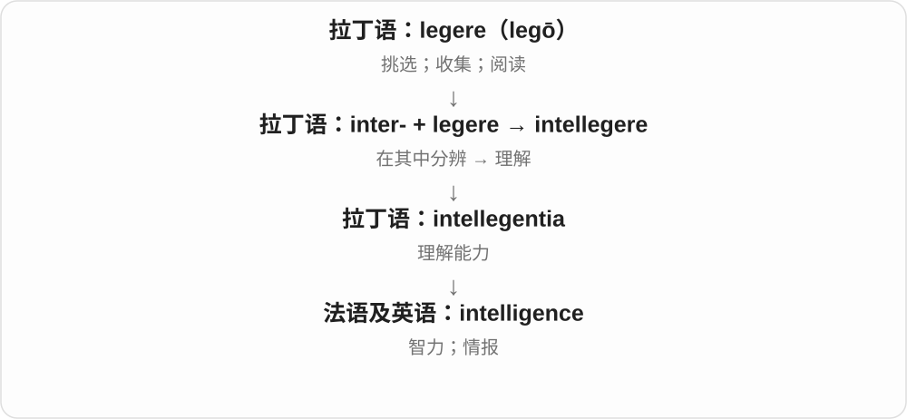

能力义和情报义要分开：high intelligence 说理解能力；gather intelligence 是搜集信息。

**常见搭配与例句**

artificial intelligence；emotional intelligence；gather intelligence。

> The task requires intelligence and patience.

这项任务需要理解力和耐心。

> The report contains useful intelligence about the market.

报告包含有关市场的有用情报。

**别混淆**

intelligence 不等于知识储量；knowledge 是知道的内容，intelligence 更偏理解、推理等能力。

### 7. selection — 选择；所选的一组；可供挑选的范围

**音标**：/sɪˈlekʃən/

**先抓住这个画面**

selection 像从整盘水果里挑出几颗：可以指挑选动作，也可以指挑出的那部分。

**怎么拆**

现代可看作 select + -ion；直接历史来源是拉丁语 sēlēctiō。

**怎么变成今天的意思**

a wide selection 常指提供很多选择，并非已经替你挑好；selection criteria 是如何挑的标准。

**常见搭配与例句**

a wide selection；selection criteria；natural selection。

> The shop offers a wide selection of notebooks.

店里有多种笔记本可供选择。

> The selection process includes an interview.

选拔流程包括面试。

**别混淆**

collection 强调聚集；selection 强调筛选或可选择范围。

### 8. lesson — 一课；课程；经验教训

**音标**：/ˈlesən/

**先抓住这个画面**

lesson 最初是一段要读、要学的内容；后来生活经历也能成为“教会你一点事”的一课。

**怎么拆**

经古法语 leçon 来自拉丁语 lēctiō“阅读”；和 lection 是走不同路线的同源词。

**怎么变成今天的意思**

一节音乐课是 lesson；一次失败让你学到的东西也是 lesson。learn a lesson 不一定带惩罚意味。

**常见搭配与例句**

a piano lesson；learn a lesson；a valuable lesson。

> My first swimming lesson starts at nine.

我的第一节游泳课九点开始。

> The mistake taught us a valuable lesson.

这个错误给了我们宝贵的教训。

**别混淆**

lesson 可指一节课或学到的教训；lecture 通常是一场以讲授为主的课或演讲。

### 9. select — 挑选；精选的；少数被选中的

**音标**：/sɪˈlekt/

**先抓住这个画面**

select 像把合适的东西从一大堆里单独拿出来，带着一定标准。

**怎么拆**

sē-（分开）+ legere，经 sēlēctus“选出的”进入英语。

**怎么变成今天的意思**

可选一个文件、一个人或一种方案；形容词 a select group 常指经过挑选的少数人。

**常见搭配与例句**

select a file；select from a list；a select group。

> Select the file you want to upload.

选择你要上传的文件。

> The course is open to a select group of students.

这门课面向一组经过选拔的学生。

**别混淆**

choose 更日常宽泛；select 常让人想到按标准从一组中挑选。

### 10. legend — 传说；传奇人物；图例

**音标**：/ˈledʒənd/

**先抓住这个画面**

legend 的旧义是供人诵读的故事；传说、传奇人物是一条线，文字题记、图上说明是另一条意思发展线。

**怎么拆**

来自拉丁语 legenda“应被阅读的事”，经中世纪圣徒故事与法语传入。

**怎么变成今天的意思**

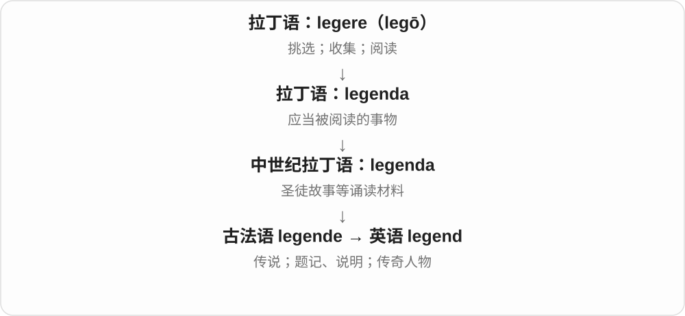

传奇人物义强调声望极高，不表示这个人虚构。图例义从文字题记、说明扩展到地图符号说明，不是圣徒故事直接变成地图图例。

**常见搭配与例句**

an ancient legend；a sporting legend；the map legend。

> The village has a legend about the old bridge.

村里流传着一个关于旧桥的传说。

> Check the legend to understand the map symbols.

查看图例，就能理解地图上的符号。

**别混淆**

legend 常围绕传统人物事件；myth 常涉及神话世界，但两者日常使用有交叉。

### 11. elite — 精英；顶尖阶层；出类拔萃的

**音标**：/ɪˈliːt/

**先抓住这个画面**

elite 像从一个领域里挑出的最顶尖一层，可以说能力突出，也可以说拥有特殊资源和权力。

**怎么拆**

经法语“被选出的”一支来自 ēligere，与 elect 同源。

**怎么变成今天的意思**

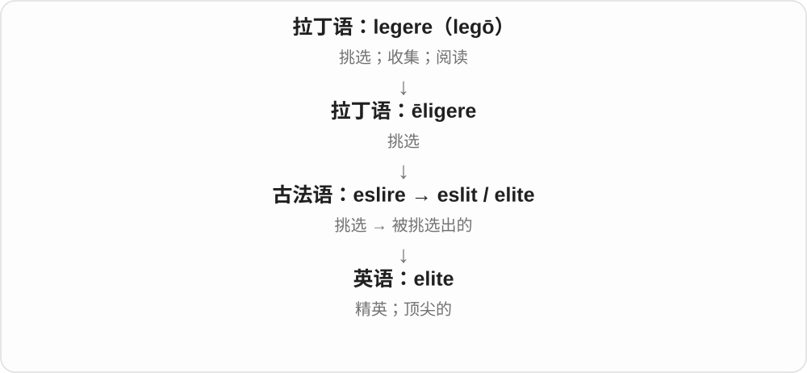

elite athletes 主要说竞技水平；the political elite 主要说掌握权力的少数人。二者不自动互相证明。

**常见搭配与例句**

elite athletes；the ruling elite；an elite school。

> The centre trains elite athletes.

这个中心训练顶尖运动员。

> The policy benefited a small economic elite.

这项政策使少数经济精英受益。

**别混淆**

elite 可以是中性描述；elitist 常评价一种偏向少数精英的态度。

### 12. collect — 收集；领取；使镇定；短祷文

**音标**：动词 /kəˈlekt/；祷文名词英 /ˈkɒlekt/、美 /ˈkɑːlekt/

**先抓住这个画面**

collect 像把散在外面的东西一件件聚回来：邮票、资料、包裹，甚至散乱的思绪。

**怎么拆**

com-（一起）+ legere，经 colligere、collectus 等形式进入英语。

**怎么变成今天的意思**

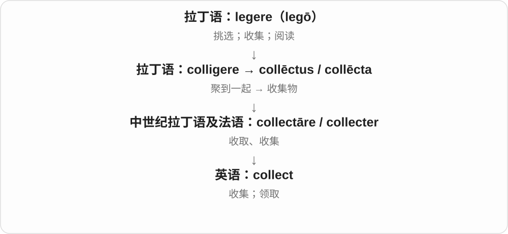

collect a parcel 是领取；collect yourself 是重新镇定。名词 collect 读音前重，另指礼拜中的短祷文，仍联系聚集的历史。

**常见搭配与例句**

collect stamps；collect data；collect a parcel；collect yourself。

> I collect postcards from places I visit.

我收集去过的地方的明信片。

> She paused to collect her thoughts.

她停下来整理了一下思路。

**别混淆**

collect 强调收拢；select 强调挑选，收来的东西不一定全是精选的。

### 13. collective — 集体的；共同的；集体组织

**音标**：/kəˈlektɪv/

**先抓住这个画面**

collective 把许多人看成一个整体，关心大家共同承担或共同产生的东西。

**怎么拆**

现代对应 collect + -ive；历史来自拉丁语 collēctīvus，经法语 collectif。

**怎么变成今天的意思**

collective effort 是大家合力；a collective 是一个集体组织。集体责任不等于每个人做了完全相同的事。

**常见搭配与例句**

collective responsibility；collective effort；an artists’ collective。

> The project succeeded through collective effort.

项目靠集体努力取得了成功。

> She joined an artists’ collective.

她加入了一个艺术家集体。

**别混淆**

collected 说已经收集或神态镇定；collective 说集体共同。

### 14. intellectual — 智力的；重思考的；知识分子

**音标**：/ˌɪntəˈlektʃuəl/

**先抓住这个画面**

intellectual 把焦点放在概念、推理和思想活动上，像认真比较两种观点。

**怎么拆**

现代对应 intellect + -ual；历史来自拉丁语 intellectuālis，经法语传入。

**怎么变成今天的意思**

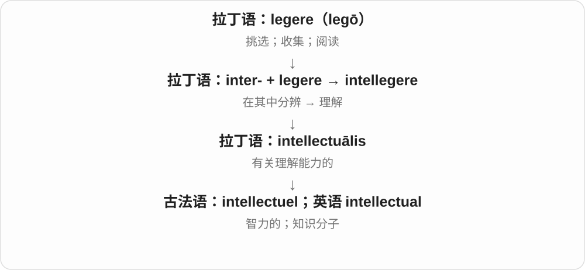

形容词可说 intellectual curiosity；名词 an intellectual 通常指以思想、学术或公共讨论为重要活动的人。

**常见搭配与例句**

intellectual curiosity；intellectual development；a public intellectual。

> The book satisfied her intellectual curiosity.

这本书满足了她求知与思考的好奇心。

> Several intellectuals joined the public debate.

几位知识分子参加了公开讨论。

**别混淆**

intelligent 强调理解能力好；intellectual 强调思想活动或其领域，二者不完全相同。

### 15. eligible — 符合条件的；有资格的

**音标**：/ˈelɪdʒəbəl/

**先抓住这个画面**

eligible 像走到申请入口，规则检查后告诉你：“你符合参加或被选的条件。”

**怎么拆**

来自 ēligibilis“可被选中的”，联系 ēligere，再经法语传入。

**怎么变成今天的意思**

eligible for 后接项目或权益，eligible to do 后接行动。符合资格只是能进入评选，不代表已经选上。

**常见搭配与例句**

eligible for a grant；eligible to vote；eligible applicants。

> You may be eligible for a travel grant.

你可能符合申请旅行资助的条件。

> Only registered members are eligible to vote.

只有登记会员有资格投票。

**别混淆**

eligible 是符合资格；selected 是已经被选中；electable 是可能赢得选举。

### 16. intelligent — 聪明的；有理解力的；设计巧妙的

**音标**：/ɪnˈtelɪdʒənt/

**先抓住这个画面**

intelligent 像能迅速看懂线索之间的关系，不只记住材料，还知道怎样用。

**怎么拆**

来自 intellegēns“有理解力的”，经法语传入；不必拆成 in + tell + gent。

**怎么变成今天的意思**

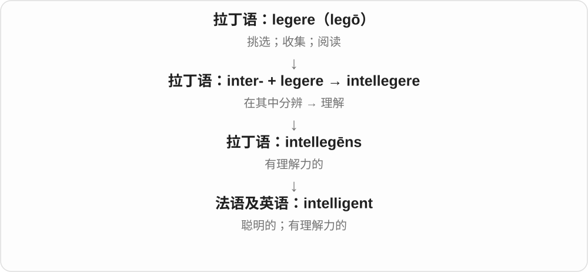

可以评价人，也可评价问题、回答或设计。intelligent question 是问得有洞察，不是问题本身有脑子。

**常见搭配与例句**

an intelligent question；an intelligent student；intelligent design choices。

> She asked an intelligent question about the results.

她针对结果问了一个很有见地的问题。

> The design makes intelligent use of limited space.

这个设计巧妙利用了有限的空间。

**别混淆**

intelligent 是能理解的能力好；intelligible 是表达本身能被理解。

### 17. legendary — 传说中的；传奇般著名的

**音标**：/ˈledʒəndəri/；美 /ˈledʒənderi/

**先抓住这个画面**

legendary 可以说人物只存在于传说，也可以说真实人物的名声大到像传奇。

**怎么拆**

现代可分析为 legend + -ary；历史借自中世纪拉丁语 legendārius。

**怎么变成今天的意思**

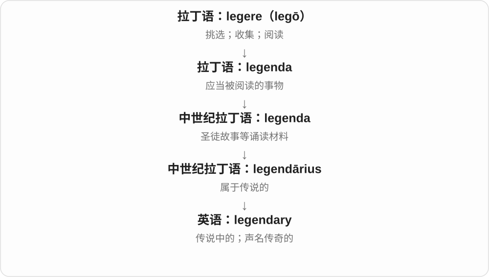

legendary creature 是传说生物；legendary musician 往往是真实且极有名的音乐家。

**常见搭配与例句**

a legendary hero；a legendary performer；legendary patience。

> The story follows a legendary king.

故事围绕一位传说中的国王展开。

> Her patience with beginners is legendary.

她对初学者的耐心出了名。

**别混淆**

legendary 不等于 imaginary：形容真人时多是称赞其声名。

### 18. lecture — 讲课；讲座；训话

**音标**：英 /ˈlektʃə/；美 /ˈlektʃər/

**先抓住这个画面**

lecture 从读书给人听走向系统讲解；如果一个人居高临下地讲个没完，也会被叫作训话。

**怎么拆**

来自中世纪拉丁语 lēctūra“阅读”，联系 legere 的 lect- 词干。

**怎么变成今天的意思**

give a lecture 可以中性地讲学；lecture someone about 则常带被说教的不快。

**常见搭配与例句**

attend a lecture；lecture on history；lecture someone about manners。

> The lecture introduced the history of printing.

这场讲座介绍了印刷术的历史。

> Please don’t lecture me about every small mistake.

请别为每个小错误都对我说教。

**别混淆**

lecture 偏一人讲授；seminar 往往有更强的讨论参与。

### 19. electoral — 选举的；选举人的

**音标**：/ɪˈlektərəl/

**先抓住这个画面**

electoral 把某件事放到选举制度或投票过程里：规则、选区、结果都能受它修饰。

**怎么拆**

elector + -al，与拉丁语 ēlēctor“选择者”的词族相连。

**怎么变成今天的意思**

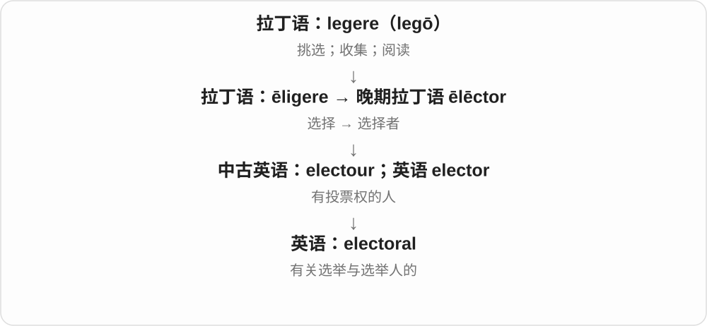

不是 electrical“电的”。electoral system 说选举如何运行；electoral victory 说选举获胜。

**常见搭配与例句**

an electoral system；electoral reform；electoral results。

> The article explains the electoral system.

文章解释了选举制度。

> The party celebrated an electoral victory.

该党庆祝选举胜利。

**别混淆**

electoral 关乎选举；elective 关乎可选或由选举产生。

### 20. elect — 选举；选择；当选而尚未就任的

**音标**：/ɪˈlekt/

**先抓住这个画面**

elect 是从人选里正式挑出一个，也能表示主动选择某种做法。

**怎么拆**

ē-（出来）+ legere，经拉丁语 ēlēctus 进入英语。

**怎么变成今天的意思**

elect someone chair 是选某人为主席；elect to do 是正式的“选择做”。置后的 elect 可表示已当选、尚未就任。

**常见搭配与例句**

elect a leader；elect someone to office；elect to pay monthly。

> The members elected her chair.

会员们选她担任主席。

> We elected to postpone the meeting.

我们选择推迟会议。

**别混淆**

elect 多带正式选择；select 的范围更广，不一定经过投票。

### 21. colleague — 同事；同行

**音标**：英 /ˈkɒliːɡ/；美 /ˈkɑːliːɡ/

**先抓住这个画面**

colleague 是与你共同承担职业工作的人，可能同一单位，也可能同一个专业圈子。

**怎么拆**

com-（共同）+ lēgāre（委任）形成 collēga，经法语 collègue；不是 collect“收集”的派生词。

**怎么变成今天的意思**

核心是职业合作或同业关系，不要求私下关系亲密。

**常见搭配与例句**

a former colleague；a colleague of mine；academic colleagues。

> A colleague helped me check the figures.

一位同事帮我核对了数字。

> She discussed the finding with colleagues overseas.

她和海外同行讨论了这项发现。

**别混淆**

colleague 是同事同行；friend 是朋友；collaborator 强调在某项工作上合作。

### 22. collector — 收藏者；收取者；收集装置

**音标**：英 /kəˈlektə/；美 /kəˈlektər/

**先抓住这个画面**

collector 是把东西聚拢起来的人或装置：可能收邮票，也可能收款或收尘。

**怎么拆**

现代对应 collect + -or；历史经法语来自晚期拉丁语 collēctor。

**怎么变成今天的意思**

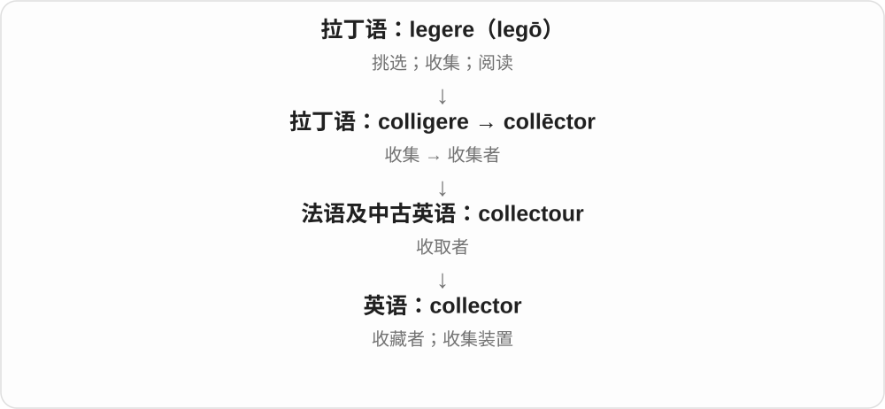

读到 collector 先看收什么；艺术收藏者与账款催收人员不是同一种职业。

**常见搭配与例句**

a stamp collector；a debt collector；a dust collector。

> The collector donated her photographs to a museum.

这位收藏者把照片藏品捐给了博物馆。

> A dust collector keeps the workshop cleaner.

集尘装置使车间更清洁。

**别混淆**

collector 收集；collection 是收集过程或结果。

### 23. selective — 有选择的；挑选严格的；选择性作用的

**音标**：/sɪˈlektɪv/

**先抓住这个画面**

selective 像筛子只让某些东西通过，关键是有区别地选择或作用。

**怎么拆**

select + -ive。

**怎么变成今天的意思**

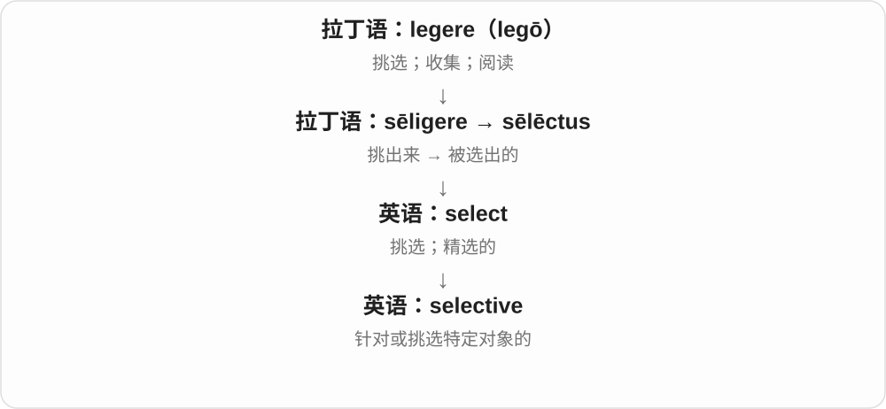

可说学校筛选严格，也可说记忆只保留某些事。选择性不自动意味着公平或合理。

**常见搭配与例句**

a selective school；selective attention；selective memory。

> The programme is highly selective.

这个项目的选拔非常严格。

> He has a selective memory for inconvenient details.

对那些不利于自己的细节，他总是选择性遗忘。

**别混淆**

select 是挑选动作；selective 描述挑选方式或只影响部分对象的性质。

### 24. legion — 军团；大批；极多的

**音标**：/ˈliːdʒən/

**先抓住这个画面**

legion 最初是一支征集组织起来的队伍，后来人数众多的事物也可被比作一个军团。

**怎么拆**

来自拉丁语 legiō，联系 legere“征集、聚集”，经法语进入英语。

**怎么变成今天的意思**

历史场景常指罗马军团；a legion of fans 是大批粉丝；形容词 their problems are legion 表示问题极多。

**常见搭配与例句**

a Roman legion；legions of supporters；problems are legion。

> The museum displays equipment used by a Roman legion.

博物馆展示罗马军团使用过的装备。

> The singer has legions of loyal fans.

这位歌手拥有大批忠实粉丝。

**别混淆**

legion 是军团或大批；region 是地区，不同源也不同义。

### 25. collectively — 共同地；作为整体地

**音标**：/kəˈlektɪvli/

**先抓住这个画面**

collectively 像把每个人的贡献放进同一个总盘子，来看大家合起来做了什么。

**怎么拆**

collective + -ly。

**怎么变成今天的意思**

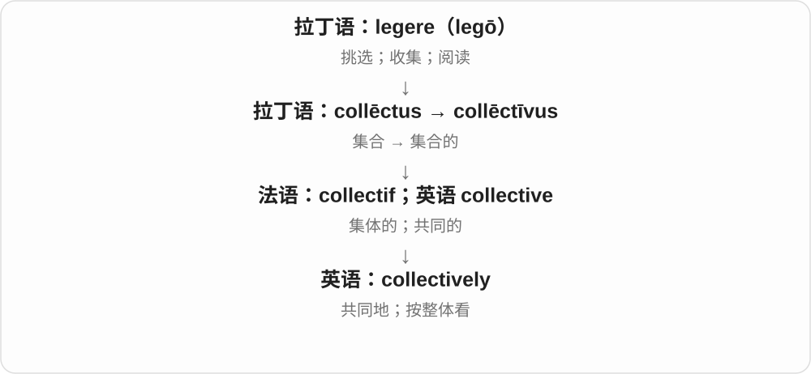

可以是一起行动，也可以只是统计时合并来看，不一定每个人同时在场。

**常见搭配与例句**

work collectively；collectively known as；collectively responsible。

> The neighbours collectively funded the new playground.

邻居们共同出资建设了新游乐场。

> These documents are collectively known as the archive.

这些文件合起来称作这批档案。

**别混淆**

individually 逐个看；collectively 合起来看。

### 26. neglect — 忽视；疏于照顾；疏漏

**音标**：/nɪˈɡlekt/

**先抓住这个画面**

neglect 像该拾起、该关注的事情被放在一边，久了就出问题。

**怎么拆**

拉丁语 nec（不）+ legere，形成 neglegere，再经 neglēctus 进入英语。

**怎么变成今天的意思**

可以疏于照顾人或物，也可 neglect to do 忘记或未做该做的事；不一定故意不理。

**常见搭配与例句**

neglect one’s duties；neglect to mention；suffer from neglect。

> The building deteriorated through years of neglect.

这栋楼因多年无人维护而破败。

> I neglected to attach the file.

我漏掉了附件。

**别混淆**

ignore 常含明知却不理；neglect 更强调应有关注或照料没有做到。

### 27. eligibility — 资格；符合条件的状态

**音标**：/ˌelɪdʒəˈbɪləti/

**先抓住这个画面**

eligibility 是入场条件是否满足这件事：年龄、身份或经历有没有达到要求。

**怎么拆**

eligible + -ity；词尾 -ble 变为 -bility。

**怎么变成今天的意思**

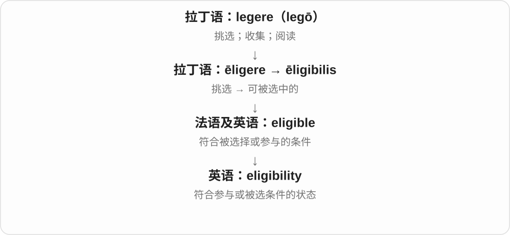

通常先检查 eligibility，再进入评审或选拔。它与最终是否获批分开。

**常见搭配与例句**

eligibility criteria；check eligibility；eligibility for funding。

> Check your eligibility before applying.

申请前先确认自己是否符合条件。

> The website lists the eligibility criteria.

网站列出了资格条件。

**别混淆**

eligibility 问有没有资格；suitability 问是否合适。

### 28. coil — 线圈；卷；盘绕

**音标**：/kɔɪl/

**先抓住这个画面**

coil 像把长长的绳子一圈圈收拢，最后聚成紧凑的一卷。

**怎么拆**

常用的盘绕义经法语 coillir / cuillir 来自 colligere“收拢”，与 cull 同源。

**怎么变成今天的意思**

可指绳圈、弹簧线圈等。莎士比亚 mortal coil 中的 coil 是“纷扰”的另一旧词，来源未定，不能用盘绳解释。

**常见搭配与例句**

a coil of rope；coil the cable；a heating coil。

> He wound the cable into a neat coil.

他把电缆卷成整齐的一圈。

> The snake coiled around the branch.

蛇盘绕在树枝上。

**别混淆**

coil 收成圈；cull 从一组中挑取或剔除，二者在英语中意义已经分开。

### 29. lecturer — 讲课者；讲师

**音标**：英 /ˈlektʃərə/；美 /ˈlektʃərər/

**先抓住这个画面**

lecturer 是把一个主题系统讲给听众的人，也可是一种高校职位。

**怎么拆**

lecture + -er。

**怎么变成今天的意思**

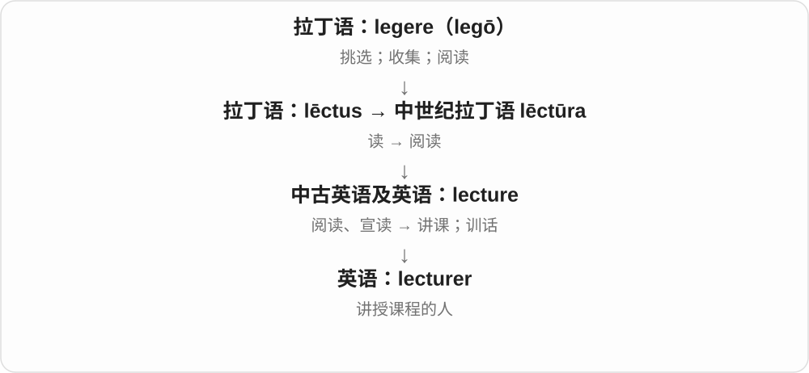

作为职称时，不同国家的级别和职责不同；不能一律套成同一职级。

**常见搭配与例句**

a university lecturer；a lecturer in history；a visiting lecturer。

> The lecturer illustrated the idea with a simple diagram.

讲师用一张简单的图解释了这个想法。

> She works as a lecturer in linguistics.

她从事语言学讲师的工作。

**别混淆**

lecturer 讲授；listener 听讲；professor 是另一职称，制度不同不能机械对应。

### 30. negligence — 疏忽；过失；未尽应有注意

**音标**：/ˈneɡlɪdʒəns/

**先抓住这个画面**

negligence 像本该检查的接头没检查，本该维护的地方一直没维护。

**怎么拆**

来自拉丁语 neglegentia，经法语传入；与 negligent、neglect 平行同源。

**怎么变成今天的意思**

日常可指疏忽，法律里则有特定成立条件；不能把所有小失误都直接判为法律过失。

**常见搭配与例句**

professional negligence；gross negligence；an allegation of negligence。

> The report blamed the damage on negligence.

报告把损坏归因于疏忽。

> The court examined the allegation of negligence.

法院审查了有关过失的指控。

**别混淆**

negligence 是疏忽的行为或状态；negligible 却是小到可忽略。

### 31. electorate — 全体选民；选民群体

**音标**：/ɪˈlektərət/

**先抓住这个画面**

electorate 把某个地区有投票资格的人合起来看成一个群体。

**怎么拆**

elector（选民、选举人）+ -ate（群体或领域）。

**怎么变成今天的意思**

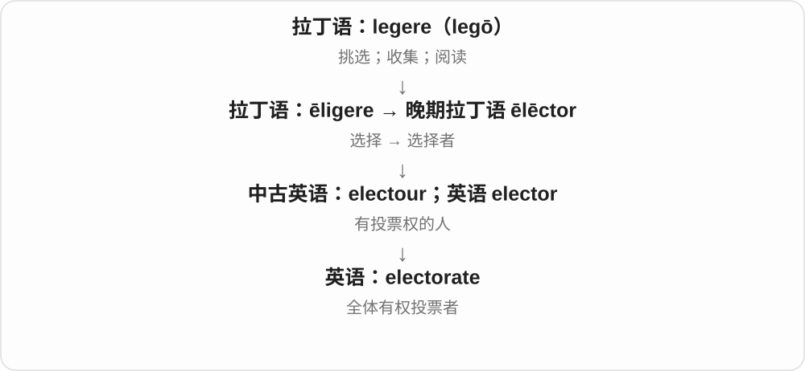

通常包括有资格却没有实际投票的人。历史文献也可指选帝侯的领地或职位。

**常见搭配与例句**

appeal to the electorate；an informed electorate；the local electorate。

> The proposal divided the electorate.

这项提议使选民意见分裂。

> Candidates must explain their plans to the electorate.

候选人必须向选民解释自己的计划。

**别混淆**

elector 是一个有投票权的人；electorate 是整个选民群体。

### 32. diligence — 勤勉；认真细致的努力

**音标**：/ˈdɪlɪdʒəns/

**先抓住这个画面**

diligence 像把一件事当作值得认真对待的东西，持续检查细节、把工作做完。

**怎么拆**

来自拉丁语 dīligentia，经法语传入；与 dīligere“珍视、留心”同支。

**怎么变成今天的意思**

due diligence 在商业等语境中指应有的审查调查，不是简单“多勤奋一点”。

**常见搭配与例句**

with diligence；due diligence；care and diligence。

> Her diligence caught several errors before publication.

她的认真检查在出版前找出了几处错误。

> The team carried out due diligence before the purchase.

团队在购买前进行了尽职调查。

**别混淆**

diligence 是持续用心；negligence 是没有尽到应有注意。

### 33. intellect — 理解、推理能力；才智

**音标**：/ˈɪntəlekt/

**先抓住这个画面**

intellect 像脑中负责比较、分析、推理的工具箱，尤其强调理性思考的能力。

**怎么拆**

来自拉丁语 intellēctus“理解”，联系 intellegere“分辨、理解”。

**怎么变成今天的意思**

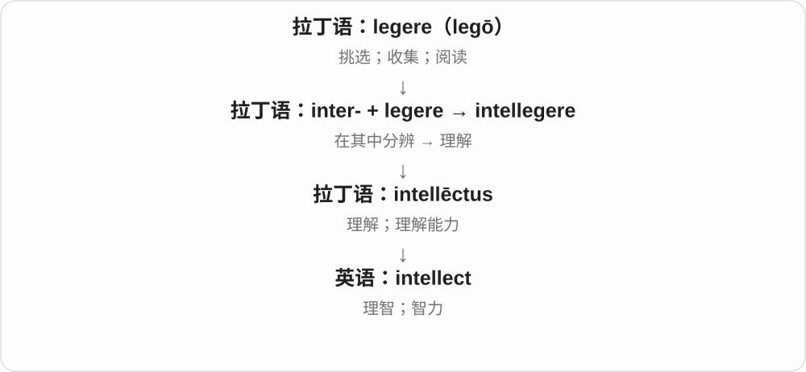

既可抽象说人的理智，也可用 a great intellect 形容才智出众的人。

**常见搭配与例句**

a sharp intellect；human intellect；a formidable intellect。

> She approached the puzzle with a sharp intellect.

她以敏锐的思考能力处理这道难题。

> The book explores the limits of human intellect.

这本书探讨人类理解能力的边界。

**别混淆**

intellect 偏推理理解能力；emotion 是情绪，二者并非现实中互不相干。

### 34. collegiate — 学院的；大学生的；团体共同的

**音标**：/kəˈliːdʒiət/

**先抓住这个画面**

collegiate 像给活动贴上“学院或大学这一层面的”标签，如大学校队之间的赛事。

**怎么拆**

来自中世纪拉丁语 collēgiātus，联系 collēgium；现代不是 collegiate = college 后随意加 ate。

**怎么变成今天的意思**

常描述体育、生活或机构形式。某些地区也用作学校名称，具体学制应看当地制度。

**常见搭配与例句**

collegiate sports；collegiate life；a collegiate institution。

> He competed at the collegiate level.

他参加了大学级别的比赛。

> The photographs capture collegiate life in the 1950s.

这些照片记录了二十世纪五十年代的大学生活。

**别混淆**

collegiate 常说学院事务；collegial 更常说同事间平等合作。

### 35. negligible — 小到可忽略的

**音标**：/ˈneɡlɪdʒəbəl/

**先抓住这个画面**

negligible 像测量时一个微小尾数，对当前结论影响太小，可以暂时不计。

**怎么拆**

由 negligence 一族加 -ible 形成；可理解为“能够不计入考虑的”。

**怎么变成今天的意思**

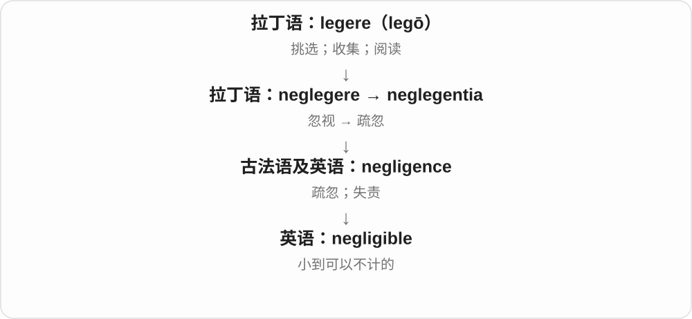

通常用于误差、成本、数量或影响。它不是绝对的零，只是相对于当前问题足够小。

**常见搭配与例句**

a negligible effect；negligible costs；a negligible difference。

> The extra weight is negligible.

增加的重量微不足道。

> The change had a negligible effect on the result.

这次改变对结果影响极小。

**别混淆**

negligent 说人或行为疏忽；negligible 说事物小到可忽略。

### 36. intellectually — 在智力或思想层面；运用理性地

**音标**：/ˌɪntəˈlektʃuəli/

**先抓住这个画面**

intellectually 像先在道理上想通了，至于情绪是否接受，可能还是另一回事。

**怎么拆**

intellectual + -ly。

**怎么变成今天的意思**

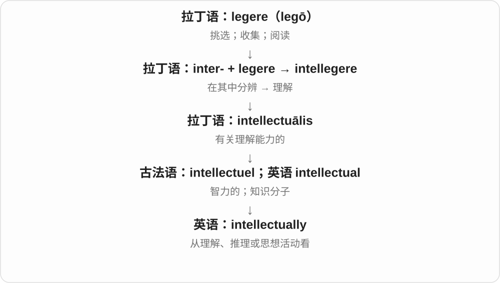

常修饰 challenging、stimulating、understand；不只是“聪明地”的通用替换。

**常见搭配与例句**

intellectually stimulating；intellectually demanding；understand intellectually。

> The course is intellectually demanding.

这门课对思考能力要求很高。

> I understood the decision intellectually, but still felt disappointed.

道理上我理解这个决定，但仍觉得失望。

**别混淆**

intelligently 是做得聪明得当；intellectually 是就思想或智力方面而言。

### 37. negligent — 疏忽的；未尽注意的

**音标**：/ˈneɡlɪdʒənt/

**先抓住这个画面**

negligent 像值班时该看一眼却没看，该确认一步却省了，关注没有到位。

**怎么拆**

来自拉丁语 neglegēns，经法语传入，与 neglegere“忽视”同族。

**怎么变成今天的意思**

通常是负面评价，指未尽应有照料或注意。法律语境需要具体标准，不能仅凭形容词判断责任。

**常见搭配与例句**

negligent conduct；negligent in one’s duties；a negligent mistake。

> The report described the maintenance as negligent.

报告认为维护工作存在疏忽。

> He was negligent in checking the final figures.

他核对最终数字时不够尽责。

**别混淆**

negligent 不是 negligible：前者失责疏忽，后者小到可不计。

### 38. elective — 可选择的；选修课；由选举产生的

**音标**：/ɪˈlektɪv/

**先抓住这个画面**

elective 像课程表里可以按兴趣选的一栏，核心是有选择。

**怎么拆**

elect + -ive。

**怎么变成今天的意思**

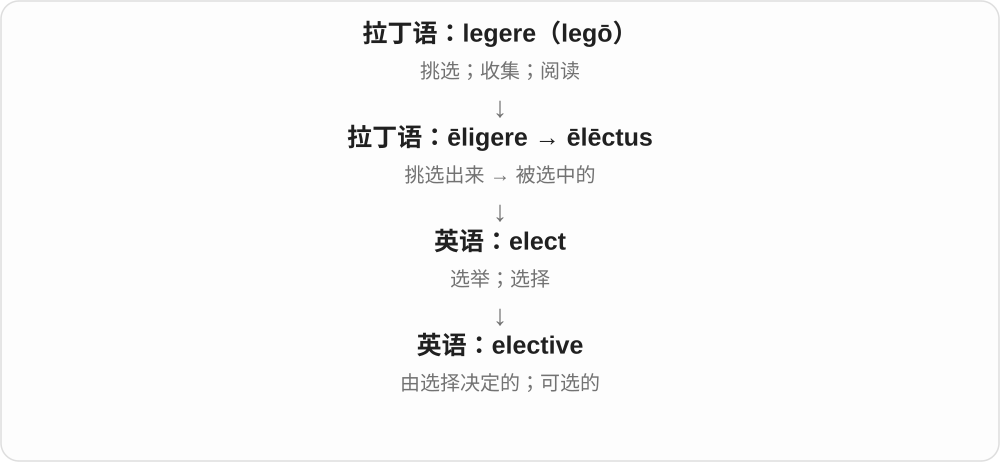

教育中是选修；职位可指民选；医疗中的 elective 通常指可计划安排的，不能直接等于不必要。

**常见搭配与例句**

an elective course；an elective office；an elective procedure。

> I chose photography as an elective.

我选了摄影作选修课。

> The position is elective rather than appointed.

这个职位通过选举产生。

**别混淆**

optional 泛指可选；elective 在课程、职位和医疗安排中有固定用法。

### 39. reelection — 再次当选；连任选举

**音标**：/ˌriːɪˈlekʃən/

**先抓住这个画面**

reelection 是已经选过一次的人又参加选择，并争取再次取得职位。

**怎么拆**

re-（再）+ election。

**怎么变成今天的意思**

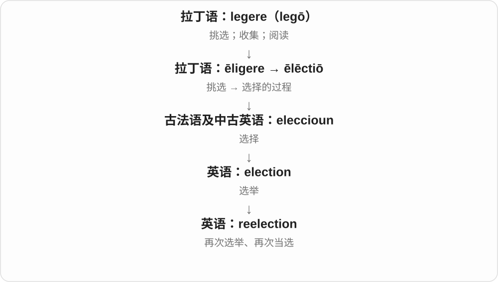

seek reelection 是争取连任，不表示已成功；win reelection 才明确再次胜选。

**常见搭配与例句**

seek reelection；win reelection；a reelection campaign。

> The mayor announced that she would seek reelection.

市长宣布将争取连任。

> He won reelection after a close contest.

经过激烈竞争，他再次当选。

**别混淆**

election 可以首次选择；reelection 带再次当选或争取连任的背景。

### 40. selectively — 有选择地；只针对部分对象地

**音标**：/sɪˈlektɪvli/

**先抓住这个画面**

selectively 像只打开几盏需要的灯，并不是所有灯一起开。

**怎么拆**

selective + -ly。

**怎么变成今天的意思**

可中性地指精确选择，也可批评只挑有利证据。

**常见搭配与例句**

quote selectively；selectively remove；respond selectively。

> The editor quoted selectively from the interview.

编辑选择性地引用了采访内容。

> The filter selectively removes certain particles.

过滤器有选择地去除某些颗粒。

**别混淆**

randomly 随机地；selectively 按某种区分来做，不一定随机。

### 41. ineligible — 不符合资格的

**音标**：/ɪnˈelɪdʒəbəl/

**先抓住这个画面**

ineligible 像申请入口的条件检查没有通过，暂时不能参与这一项目。

**怎么拆**

in-（不）+ eligible；历史有法语 inéligible 的借入。

**怎么变成今天的意思**

说的是某项具体规则下没有资格，不是对人的总体价值作判断。

**常见搭配与例句**

ineligible for funding；ineligible to vote；be declared ineligible。

> Applicants under eighteen are ineligible for this programme.

未满十八岁的申请者不符合这个项目的条件。

> The player was declared ineligible to compete.

这名选手被认定没有参赛资格。

**别混淆**

ineligible 是资格不满足；unsuccessful 是没有成功，可能原本符合资格。

### 42. recollection — 回忆；记得的内容

**音标**：/ˌrekəˈlekʃən/

**先抓住这个画面**

recollection 像把散落的旧画面重新拼到一起，形成你记得的一段经历。

**怎么拆**

联系拉丁语 recolligere“重新聚集”；英语可经法语 récollection 或 recollect 一支形成。

**怎么变成今天的意思**

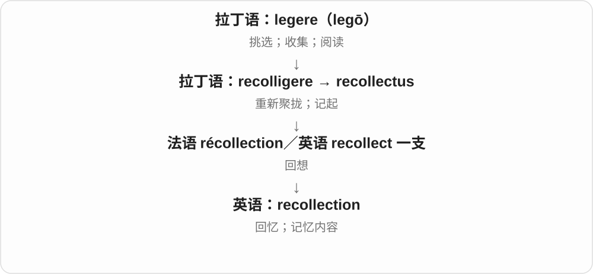

a vague recollection 是模糊记得；have no recollection of 是完全不记得。回忆不保证准确无误。

**常见搭配与例句**

have a recollection of；a vivid recollection；to the best of my recollection。

> I have only a vague recollection of that day.

我对那一天只有模糊的印象。

> Her recollection differed from the written record.

她的回忆与书面记录不同。

**别混淆**

recollection 常强调回想所得；record 是外部记录，两者可能不一致。

### 43. diligent — 勤勉认真的

**音标**：/ˈdɪlɪdʒənt/

**先抓住这个画面**

diligent 像做作业时不只做完，还会认真核对，碰到难处也持续投入。

**怎么拆**

从 dīligere“选中、珍视”到 dīligēns“用心的”，经法语进入英语。

**怎么变成今天的意思**

强调持续、细致和尽责，不只工作时间长，也不只临时用一次力。

**常见搭配与例句**

a diligent student；diligent research；diligent in checking。

> She is a diligent researcher who checks every source.

她是一位认真核查每项来源的研究者。

> Be diligent in keeping your notes organized.

整理笔记时要认真坚持。

**别混淆**

diligent 是认真持续投入；intelligent 是理解力好，能力与用心不是一回事。

### 44. selector — 选择器；选拔者；选定对象的表达式

**音标**：英 /sɪˈlektə/；美 /sɪˈlektər/

**先抓住这个画面**

selector 是执行“选哪个”这一环的人或工具：拨钮选频道，教练组挑选队员。

**怎么拆**

select + -or。

**怎么变成今天的意思**

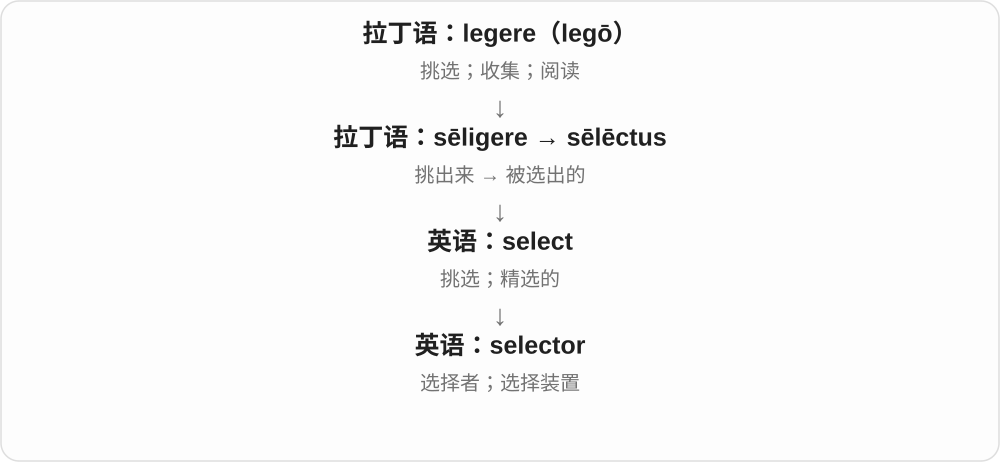

软件里的 selector 可能是一段用来匹配对象的表达式；具体规则由所用语言或系统定义。

**常见搭配与例句**

a channel selector；a team selector；a CSS selector。

> Turn the selector to the required setting.

把选择旋钮转到所需挡位。

> The selector matches all links in the menu.

这条选择器匹配菜单里的所有链接。

**别混淆**

selector 负责选择；selectee 是被选中的人。

### 45. collectible — 值得收藏的；收藏品；可收取的

**音标**：/kəˈlektəbəl/

**先抓住这个画面**

collectible 常让人想到值得保存的一件小东西，像一枚特别的徽章或旧邮票。

**怎么拆**

collect + -ible。

**怎么变成今天的意思**

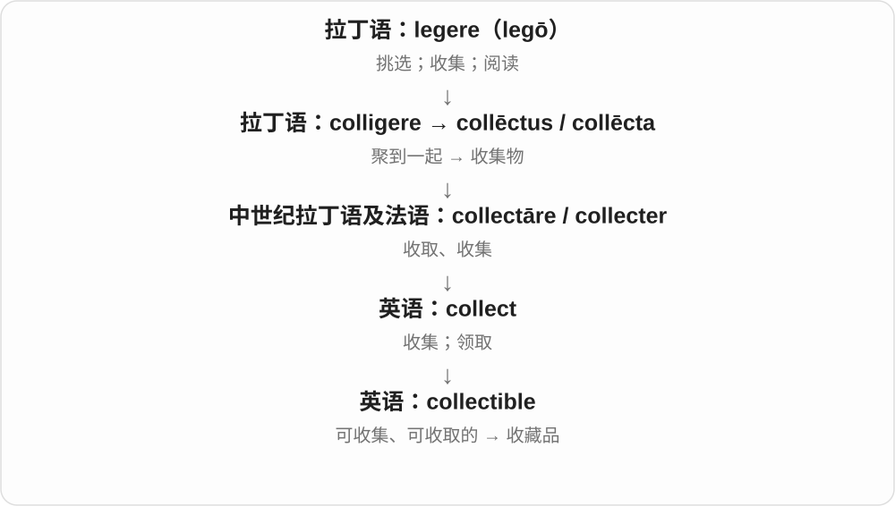

作名词多指收藏品；作形容词也能说款项可收取。能收藏不意味着一定会升值。

**常见搭配与例句**

a collectible toy；rare collectibles；collectible debts。

> The shop sells collectible toys.

这家店出售收藏玩具。

> She keeps her collectibles in a glass cabinet.

她把收藏品放在玻璃柜里。

**别混淆**

collectible 强调收藏或可收取；collection 是整组藏品。collectable 是另一拼写。

### 46. diligently — 认真勤勉地

**音标**：/ˈdɪlɪdʒəntli/

**先抓住这个画面**

diligently 描述一个人把心思持续放在任务上，一项项检查、一点点推进。

**怎么拆**

diligent + -ly。

**怎么变成今天的意思**

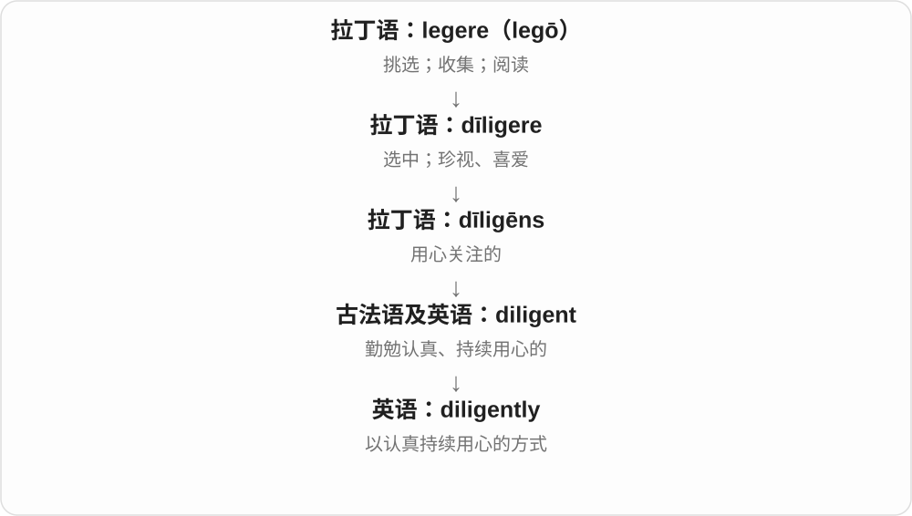

常修饰 work、study、check；重点在方法与态度，不保证结果一定成功。

**常见搭配与例句**

work diligently；study diligently；diligently check details。

> The students worked diligently on the project.

学生们认真投入这个项目。

> She diligently checked the references.

她仔细核查了参考资料。

**别混淆**

quickly 是快；diligently 是认真尽责，工作可以既快又认真。

### 47. elitist — 精英主义的；偏向精英的人

**音标**：/ɪˈliːtɪst/

**先抓住这个画面**

elitist 像认为只有少数有特定学历、财富或品位的人才值得被听见。

**怎么拆**

elite + -ist，既可指态度，也可指持这种看法的人。

**怎么变成今天的意思**

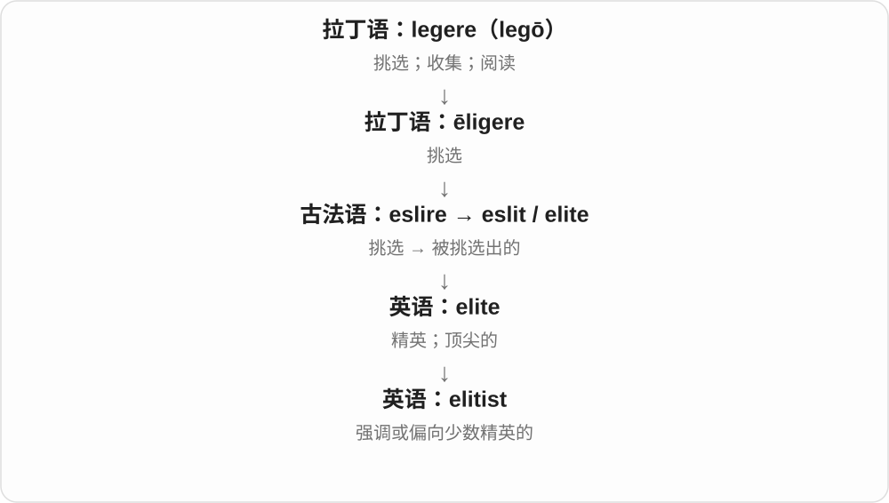

经常带批评意味，但批评针对制度或态度，不等于否定所有高水平技能。

**常见搭配与例句**

an elitist attitude；an elitist institution；be accused of being elitist。

> Critics called the admissions policy elitist.

批评者认为招生政策偏向少数精英。

> She rejected the elitist idea that art belongs only to experts.

她反对艺术只属于专家的精英主义观点。

**别混淆**

elite 描述顶尖或有权势群体；elitist 常评价偏向这个群体的立场。

### 48. intelligently — 明智地；有理解力地

**音标**：/ɪnˈtelɪdʒəntli/

**先抓住这个画面**

intelligently 像先看懂局面，再有针对性地行动，而不是只凭力气或重复操作。

**怎么拆**

intelligent + -ly。

**怎么变成今天的意思**

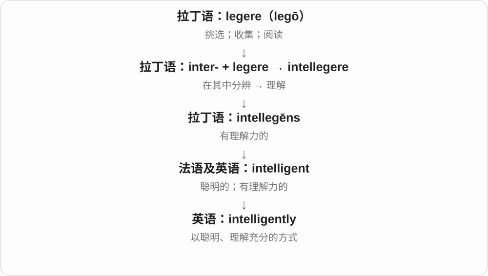

可修饰回答、设计或使用资源，不只是夸人考试好。

**常见搭配与例句**

use resources intelligently；respond intelligently；intelligently designed。

> The software uses limited memory intelligently.

软件巧妙地利用有限内存。

> She responded intelligently to a difficult question.

她明智地回答了一个难题。

**别混淆**

intellectually 是在思想层面；intelligently 是做得聪明、得当。

### 49. cull — 挑取；筛除；选择性淘汰

**音标**：/kʌl/

**先抓住这个画面**

cull 像先查看一整批东西，再把要留的挑出来，或把不需要的剔出去。

**怎么拆**

经古法语 cuillir 来自 colligere“采集、聚拢”，与 coil 同源。

**怎么变成今天的意思**

cull information from reports 是从报告中摘取信息；动物管理中则可指选择性捕杀，语境差异很大。

**常见搭配与例句**

cull examples from；cull duplicate entries；a deer cull。

> The examples were culled from old letters.

这些例子摘自旧信件。

> We culled duplicate entries from the list.

我们从列表中剔除了重复条目。

**别混淆**

cull 可以取出有用的，也可剔除不需要的；要看宾语和上下文。

### 50. elector — 选民；选举人；选帝侯

**音标**：英 /ɪˈlektə/；美 /ɪˈlektər/

**先抓住这个画面**

elector 是拥有正式选择权的人；某些制度中，他专门代表一层程序投票选人。

**怎么拆**

来自晚期拉丁语 ēlēctor，联系 ēligere；现代可对应 elect + -or。

**怎么变成今天的意思**

普通可指合资格选民；美国总统选举语境有专门的选举人角色；历史中也指选帝侯。

**常见搭配与例句**

registered electors；presidential electors；a prince elector。

> Each registered elector received a notice.

每位登记选民都收到了一份通知。

> The chapter explains the role of the electors.

这一章解释了选举人的角色。

**别混淆**

elector 是投票或有权投票者；electee 是被选中的人。

### 51. unintelligible — 无法理解的；听不懂的

**音标**：/ˌʌnɪnˈtelɪdʒəbəl/

**先抓住这个画面**

unintelligible 像听见了声音，却分不清词，或者认出了字仍无法理解内容。

**怎么拆**

un-（不）+ intelligible。

**怎么变成今天的意思**

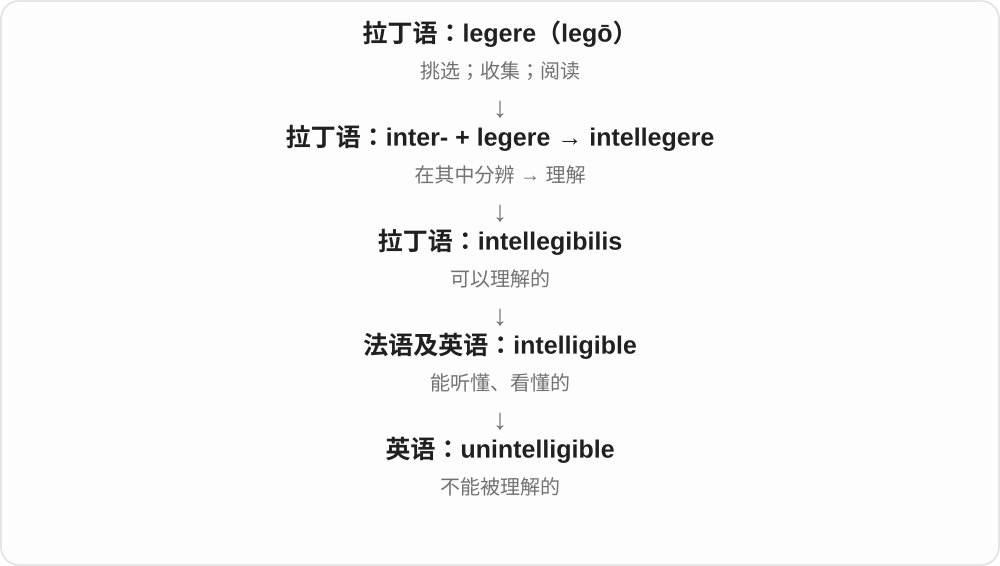

可能由于噪声、语言陌生或表达混乱；不要把它当作对说话人智力的直接评价。

**常见搭配与例句**

unintelligible speech；almost unintelligible；unintelligible to outsiders。

> The last sentence was unintelligible because of the noise.

因为噪声，最后一句听不清意思。

> The technical notes were unintelligible to most readers.

大多数读者无法理解这些技术笔记。

**别混淆**

unintelligent 说缺少聪明判断；unintelligible 说表达听不懂，两者差别很大。

### 52. legible — 字迹清楚可辨的

**音标**：/ˈledʒəbəl/

**先抓住这个画面**

legible 像纸上的字能一笔一画认出来，读者不用猜它写的是什么字。

**怎么拆**

来自晚期拉丁语 legibilis：legere“读”+ 表示可行性的成分。

**怎么变成今天的意思**

常评价手写、字体、印刷和标志，重点是视觉辨认；文字内容可能仍然很深奥。

**常见搭配与例句**

legible handwriting；a legible signature；clearly legible。

> Please write your name in legible handwriting.

请把名字写清楚。

> The sign was barely legible in the rain.

雨中那块标牌几乎看不清字。

**别混淆**

legible 是字看得清；intelligible 是意思听得懂、看得懂。

### 53. selectivity — 选择性；筛选程度

**音标**：/sɪˌlekˈtɪvəti/

**先抓住这个画面**

selectivity 像筛子的孔究竟只让哪些东西通过，用来谈区分对象的能力或严格程度。

**怎么拆**

selective + -ity。

**怎么变成今天的意思**

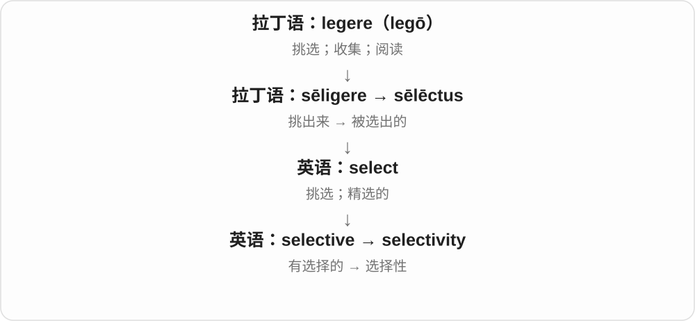

大学的 selectivity 说录取筛选程度；接收器的 selectivity 说分离所需信号的能力。

**常见搭配与例句**

high selectivity；admissions selectivity；signal selectivity。

> The report compares the selectivity of several programmes.

报告比较了几个项目的选拔严格程度。

> The receiver’s selectivity helps isolate the desired signal.

接收器的选择性帮助分离所需信号。

**别混淆**

selection 是一次选择或选中内容；selectivity 是选择过程表现出的性质。

### 54. intelligible — 能听懂、看懂的；可理解的

**音标**：/ɪnˈtelɪdʒəbəl/

**先抓住这个画面**

intelligible 像声音终于清楚到能认出说的词，或解释终于让人明白。

**怎么拆**

来自拉丁语 intellegibilis，经法语传入；intellig-“理解”+ 可行性成分。

**怎么变成今天的意思**

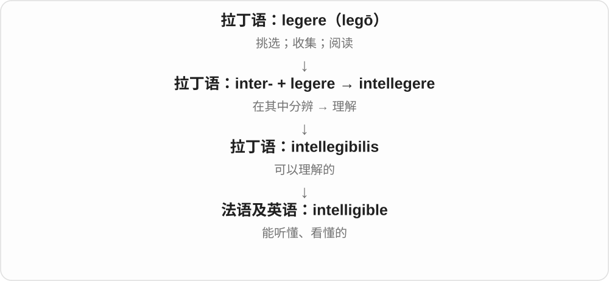

可以评价语音、文字或行为逻辑；不要求表达漂亮，只要能理解。

**常见搭配与例句**

intelligible speech；make something intelligible；intelligible to beginners。

> The recording was faint but intelligible.

录音声音很轻，但还能听懂。

> The diagram makes the process intelligible to beginners.

这张图使初学者也能理解这个过程。

**别混淆**

intelligent 是人或方案聪明；intelligible 是内容能被理解。

### 55. intelligentsia — 知识分子阶层

**音标**：/ɪnˌtelɪˈdʒentsiə/

**先抓住这个画面**

intelligentsia 把从事思想、文化、学术等活动的人看成一个社会群体。

**怎么拆**

从俄语 intelligentsiya 借入；俄语词经欧洲语言联系拉丁语 intelligentia，不能画成现代英语 intelligence 直接生出俄语。

**怎么变成今天的意思**

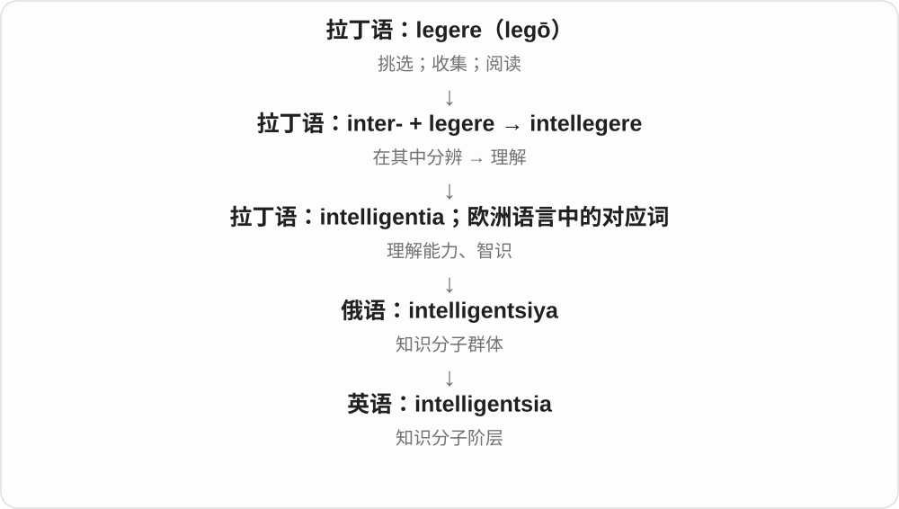

常见于社会史或文化讨论。它不是“所有聪明人”的集合，也不保证群体意见一致。

**常见搭配与例句**

the urban intelligentsia；members of the intelligentsia；the literary intelligentsia。

> The reform attracted support from part of the intelligentsia.

改革得到了部分知识分子的支持。

> The book examines the urban intelligentsia of the period.

这本书研究那个时期的城市知识分子阶层。

**别混淆**

intelligence 是能力或情报；intelligentsia 是社会群体。

### 56. recollect — 回想；记起

**音标**：/ˌrekəˈlekt/

**先抓住这个画面**

recollect 像把记忆里零散的片段重新捡起来，慢慢拼回事情经过。

**怎么拆**

re-（再）+ colligere（收拢），经拉丁语 recollectus 借入；现代“再收集”也可由 re- + collect 形成。

**怎么变成今天的意思**

日常常接名词或 doing；比 remember 略正式，往往带有回想过程的感觉。

**常见搭配与例句**

recollect a name；recollect doing something；as far as I recollect。

> I cannot recollect where I put the key.

我想不起把钥匙放在哪里了。

> She recollects meeting him at a conference.

她记得在一次会议上见过他。

**别混淆**

recollect 是回忆；recognize 是再次遇到时认出来。

### 57. collectable — 可收取的；值得收藏的；收藏品

**音标**：/kəˈlektəbəl/

**先抓住这个画面**

collectable 像可以领回的款项，也像值得归入收藏的一件物品。

**怎么拆**

collect + -able；与 collectible 常作不同拼写使用。

**怎么变成今天的意思**

用在玩具、邮票上强调收藏，用在债款上强调可收回；不是凡拼成 -able 就只能说款项。

**常见搭配与例句**

collectable items；collectable stamps；collectable amounts。

> The market sells old books and other collectable items.

市场出售旧书和其他收藏物品。

> The accountant estimated the amount still collectable.

会计估算了仍可收回的金额。

**别混淆**

collectable 和 collectible 在收藏义上可互换；拼写偏好因地区、文体而异。

### 58. counterintelligence — 反情报；反间谍工作

**音标**：英 /ˌkaʊntərɪnˈtelɪdʒəns/；美同

**先抓住这个画面**

counterintelligence 的重点是发现并应对对方的情报活动，保护己方信息与安全。

**怎么拆**

counter-（对抗）+ intelligence（情报）。

**怎么变成今天的意思**

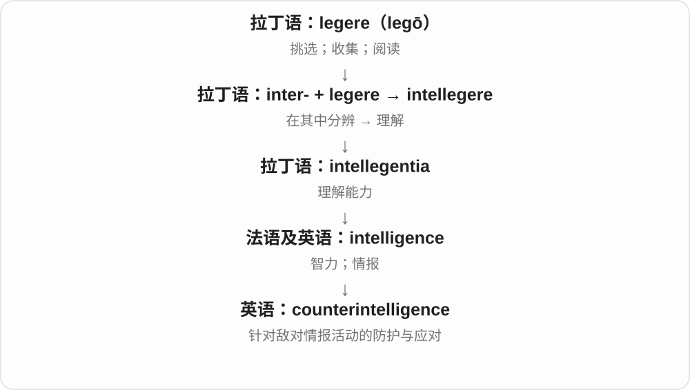

这里 intelligence 取情报义，绝不是“反对聪明”。词汇学习中把它与一般搜集信息区分即可。

**常见搭配与例句**

counterintelligence work；a counterintelligence unit；counterintelligence training。

> The historian studied wartime counterintelligence.

历史学家研究了战时反情报工作。

> The report reviews the agency’s counterintelligence role.

报告回顾了该机构的反情报职责。

**别混淆**

intelligence 侧重情报工作整体；counterintelligence 特别针对对方的情报活动。

### 59. intercollegiate — 学院之间的；大学校际的

**音标**：/ˌɪntəkəˈliːdʒiət/；美 /ˌɪntərkəˈliːdʒiət/

**先抓住这个画面**

intercollegiate 像两所学院派队比赛或共同办活动，边界跨在不同院校之间。

**怎么拆**

inter-（之间）+ collegiate。

**怎么变成今天的意思**

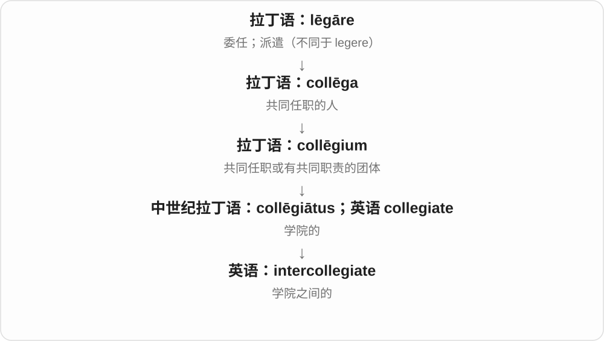

常修饰体育、辩论和合作。并不表示活动覆盖全国所有大学。

**常见搭配与例句**

intercollegiate sports；an intercollegiate debate；intercollegiate cooperation。

> She entered an intercollegiate debate competition.

她参加了校际辩论赛。

> The library supports an intercollegiate research project.

图书馆支持一个院校间合作研究项目。

**别混淆**

intracollegiate 是一所学院内部；intercollegiate 是不同学院之间。

### 60. sacrilege — 亵渎；冒犯被视为神圣的事物

**音标**：/ˈsækrəlɪdʒ/

**先抓住这个画面**

sacrilege 原来的画面是拿走神圣之物，后来扩大为对神圣对象的侵犯；日常也能夸张地说糟蹋经典。

**怎么拆**

拉丁语 sacer“神圣”+ legere“取走、收取”，经 sacrilegium、法语进入英语。

**怎么变成今天的意思**

实际宗教语境比较严肃；把好茶煮坏了也可能被人开玩笑叫 sacrilege，表示极不该如此对待。

**常见搭配与例句**

commit sacrilege；an act of sacrilege；consider something sacrilege。

> The destruction of the shrine was regarded as sacrilege.

摧毁神殿被视为亵渎行为。

> To him, cutting pages from an old book was sacrilege.

在他看来，从旧书上剪下书页简直是亵渎。

**别混淆**

sacrilege 不是 sacred + religion；拼写里也没有 religious 那段完整结构。

### 61. elitism — 精英主义；偏重精英的态度或制度

**音标**：/ɪˈliːtɪzəm/

**先抓住这个画面**

elitism 是把少数精英放在中心，认为资源、权力或发言机会应主要由他们掌握的倾向。

**怎么拆**

elite + -ism。

**怎么变成今天的意思**

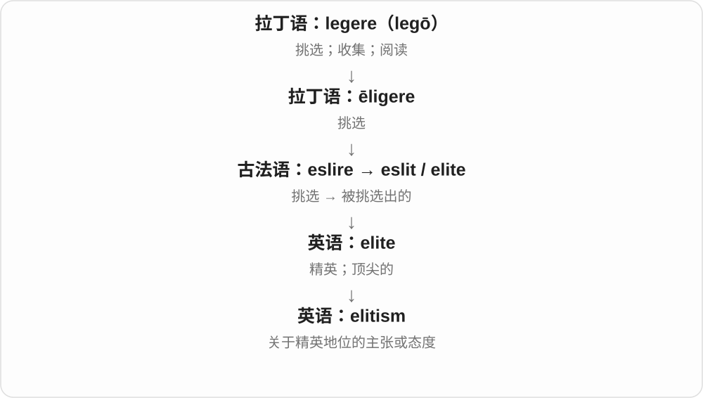

常用于批评教育、文化或政治中的排他性；与追求专业水平并不自动等同。

**常见搭配与例句**

cultural elitism；accusations of elitism；challenge elitism。

> The essay criticizes elitism in arts funding.

文章批评艺术资助中的精英主义倾向。

> The school tried to avoid the appearance of elitism.

学校努力避免给人偏向少数精英的印象。

**别混淆**

expertise 是专门能力；elitism 是怎样看待精英与其他人的关系。

### 62. legume — 豆科植物；豆类；荚果

**音标**：英 /ˈleɡjuːm/；美 /ˈleɡjuːm/，亦 /ləˈɡuːm/

**先抓住这个画面**

legume 让人想到豌豆、扁豆这类植物及其种子；植物学还用它指相应类型的荚果。

**怎么拆**

经法语 légume 来自拉丁语 legūmen。与 legere“采集”的联系只是词源解释之一，不能作为定论。

**怎么变成今天的意思**

日常饮食常说豆类，植物学则可能谈植物或果实结构。法语 légume 的现代范围更广，常指蔬菜。

**常见搭配与例句**

beans and other legumes；a legume crop；dried legumes。

> Lentils and chickpeas are legumes.

扁豆和鹰嘴豆都属于豆类。

> The farmer planted a legume crop in the field.

农民在这块地里种了豆科作物。

**别混淆**

legume 不等于一切 vegetable；讲英语时它有豆类相关的专门范围。

### 63. illegible — 字迹无法辨认的

**音标**：/ɪˈledʒəbəl/

**先抓住这个画面**

illegible 像字迹糊成一团，连写了哪个字母都难看清。

**怎么拆**

in-（不）在 l 前同化为 il-，再加 legible。

**怎么变成今天的意思**

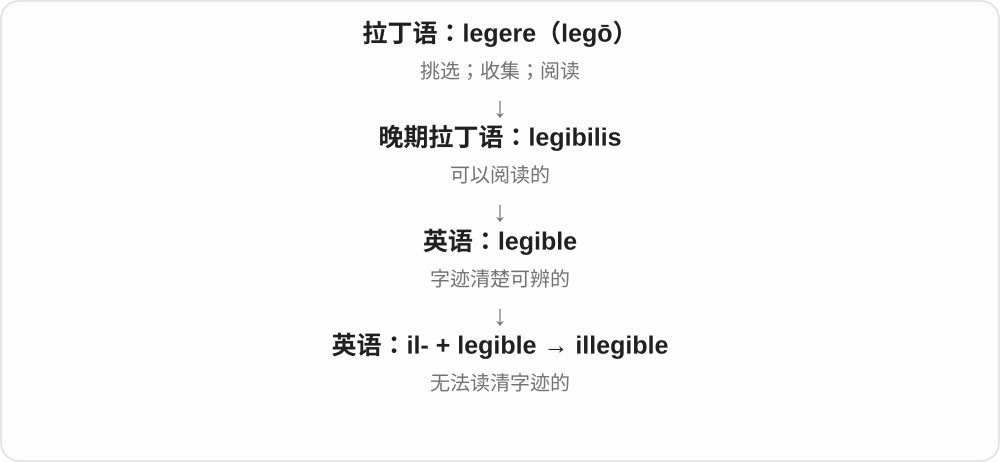

通常说视觉辨识困难，而不是文章观点复杂。字很清楚但意思难懂，不宜仅用 illegible。

**常见搭配与例句**

illegible handwriting；an illegible signature；almost illegible。

> The address was illegible after the envelope got wet.

信封湿了以后，地址已无法辨认。

> His signature is almost illegible.

他的签名几乎看不清。

**别混淆**

illegible 字认不出；unintelligible 内容听不懂或理解不了。

### 64. selectable — 可选择的；可被选中的

**音标**：/sɪˈlektəbəl/

**先抓住这个画面**

selectable 像菜单里亮着、可以点选的项目，说明系统允许你选它。

**怎么拆**

select + -able。

**怎么变成今天的意思**

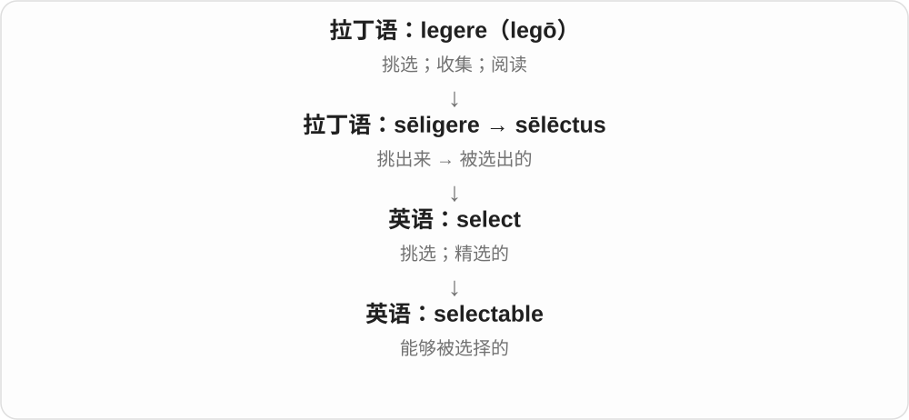

常见于界面、设置或设备说明；能选不代表当前已经选上。

**常见搭配与例句**

a selectable option；selectable text；user-selectable settings。

> The menu contains three selectable options.

菜单中有三个可选项目。

> The text in the image is not selectable.

图片里的文字不能直接选取。

**别混淆**

selectable 是可选；selected 是已选；selective 是有选择性的。

### 65. predilection — 偏爱；特别的喜好

**音标**：/ˌpriːdɪˈlekʃən/，亦 /ˌpredɪˈlekʃən/

**先抓住这个画面**

predilection 像还没比较完，心已经先朝某一类东西偏过去了。

**怎么拆**

来自中世纪拉丁语 praedīlēctiō，prae-（在前）+ dīligere（珍爱、偏爱）。

**怎么变成今天的意思**

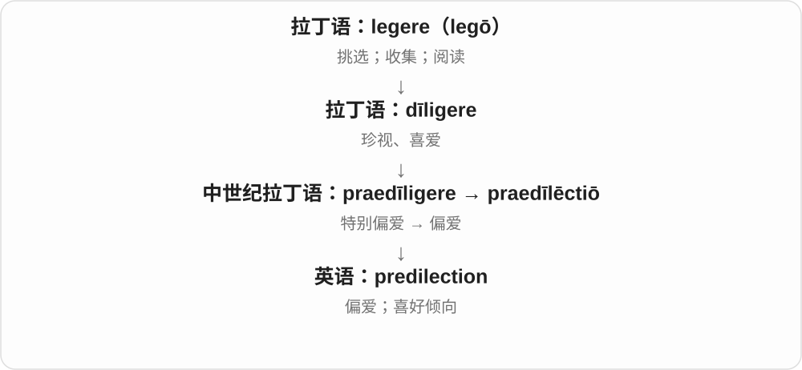

常与 for 连用，语气比 liking 正式，强调比较稳定的偏好。

**常见搭配与例句**

a predilection for music；a strong predilection；personal predilections。

> She has a predilection for quiet cafés.

她特别喜欢安静的咖啡馆。

> His predilection for unusual colours shaped the design.

他对特殊颜色的偏爱影响了设计。

**别混淆**

predilection 是喜好倾向；prediction 是预测，别被相近字形带偏。

### 66. intellectualism — 重视理智的倾向；理智主义

**音标**：/ˌɪntəˈlektʃuəlɪzəm/

**先抓住这个画面**

intellectualism 像把分析和推理放到最前面，倾向用概念来理解生活。

**怎么拆**

intellectual + -ism。

**怎么变成今天的意思**

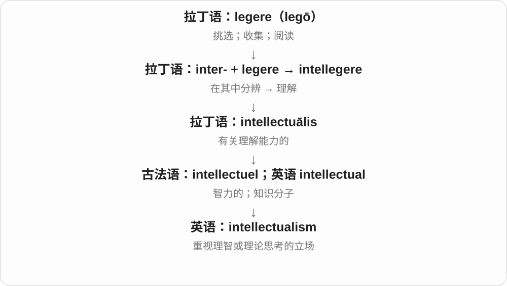

普通文体可中性也可批评过分理论化；哲学中具体主张要看学派，不能只凭词形概括为同一个理论。

**常见搭配与例句**

abstract intellectualism；a tradition of intellectualism；excessive intellectualism。

> The essay questions intellectualism detached from experience.

文章质疑脱离经验的理智主义。

> His work combines intellectualism with emotional depth.

他的作品兼有理性思考和情感深度。

**别混淆**

intelligence 是理解能力；intellectualism 是重视理智的一种态度或学说。

### 67. unintelligent — 不明智的；缺乏理解力的

**音标**：/ˌʌnɪnˈtelɪdʒənt/

**先抓住这个画面**

unintelligent 可以评价一个做法没有认真理解情况，显得愚笨或缺乏判断。

**怎么拆**

un-（不）+ intelligent。

**怎么变成今天的意思**

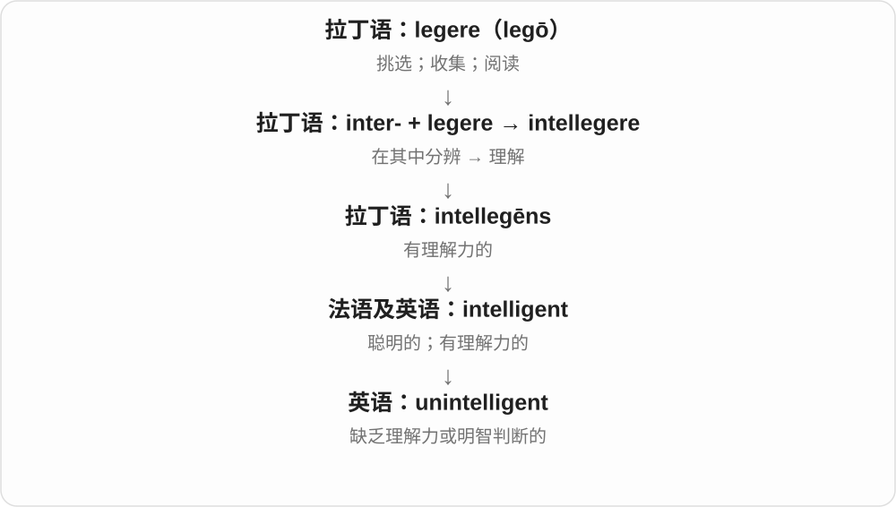

用来直接评价人常显得刻薄；也能较具体地评价问题、策略或反应。

**常见搭配与例句**

an unintelligent remark；an unintelligent strategy；unintelligent use of resources。

> That would be an unintelligent use of our limited budget.

那样使用有限预算并不明智。

> The reviewer criticized the film’s unintelligent dialogue.

评论者批评影片的对白缺乏智慧。

**别混淆**

unintelligent 不聪明；unintelligible 不可理解。某个聪明人的录音也可能听不懂。

### 68. collectivism — 集体主义

**音标**：/kəˈlektɪvɪzəm/

**先抓住这个画面**

collectivism 像决定事情时先问“这对整个群体怎样”，把共同利益或共同控制放在重要位置。

**怎么拆**

collective + -ism。

**怎么变成今天的意思**

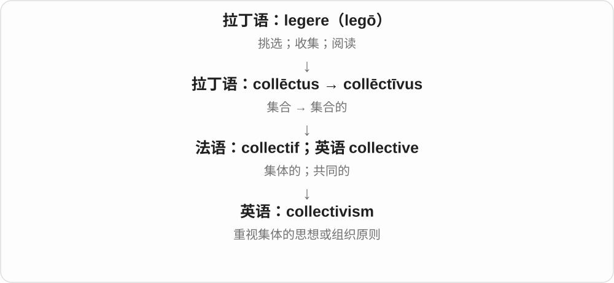

可用于经济所有权安排，也可谈价值取向；不同传统的具体内容不尽相同。

**常见搭配与例句**

collectivism and individualism；economic collectivism；forms of collectivism。

> The seminar compared collectivism and individualism.

研讨课比较了集体主义与个人主义。

> The book examines several forms of economic collectivism.

这本书考察了几种经济集体主义形式。

**别混淆**

collective 只说共同；collectivism 是如何安排个人与群体关系的主张。

### 69. collectivist — 集体主义的；集体主义者

**音标**：/kəˈlektɪvɪst/

**先抓住这个画面**

collectivist 是支持或体现集体主义的人、观点或安排。

**怎么拆**

collective + -ist，与 collectivism 对应。

**怎么变成今天的意思**

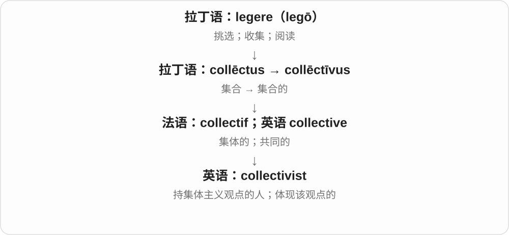

形容词与名词都常见。讨论一种文化的倾向时，也不能据此判断其中每个人的立场。

**常见搭配与例句**

a collectivist outlook；collectivist values；a committed collectivist。

> The author describes the institution as collectivist.

作者把这个机构描述为体现集体主义。

> A collectivist may place shared goals above personal preferences.

集体主义者可能把共同目标放在个人偏好之上。

**别混淆**

collectivist 是立场标签；cooperative 是合作的，不必等于同一种思想。

### 70. neglectful — 疏于照顾的；不够留心的

**音标**：/nɪˈɡlektfəl/

**先抓住这个画面**

neglectful 像一直顾着别的事，让本应关心的人或事务无人照看。

**怎么拆**

neglect + -ful，表示具有忽视倾向。

**怎么变成今天的意思**

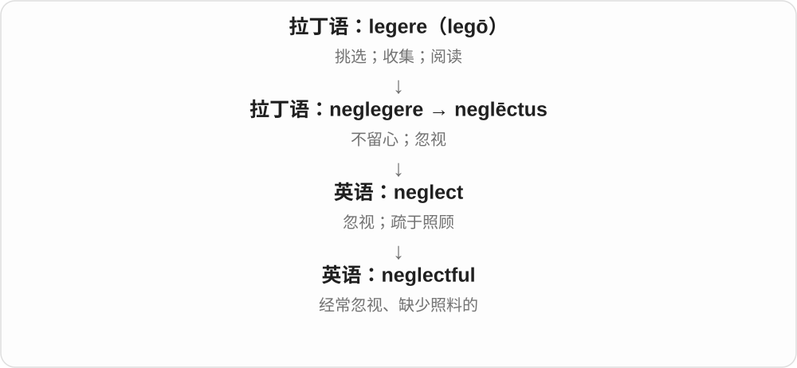

常接 of，描述人对责任、关系或维护不够上心。

**常见搭配与例句**

neglectful of duties；a neglectful owner；neglectful behaviour。

> He had become neglectful of his old friends.

他渐渐疏于关心老朋友了。

> The garden suffered under a neglectful owner.

花园因主人疏于打理而荒废。

**别混淆**

neglectful 常说照料与关注不足；negligent 也可强调未达到专业或法律要求的注意程度。

### 71. negligently — 疏忽地；未尽注意地

**音标**：/ˈneɡlɪdʒəntli/

**先抓住这个画面**

negligently 描述做事过程中漏掉了本应给予的关注，像未检查就草率签字。

**怎么拆**

negligent + -ly。

**怎么变成今天的意思**

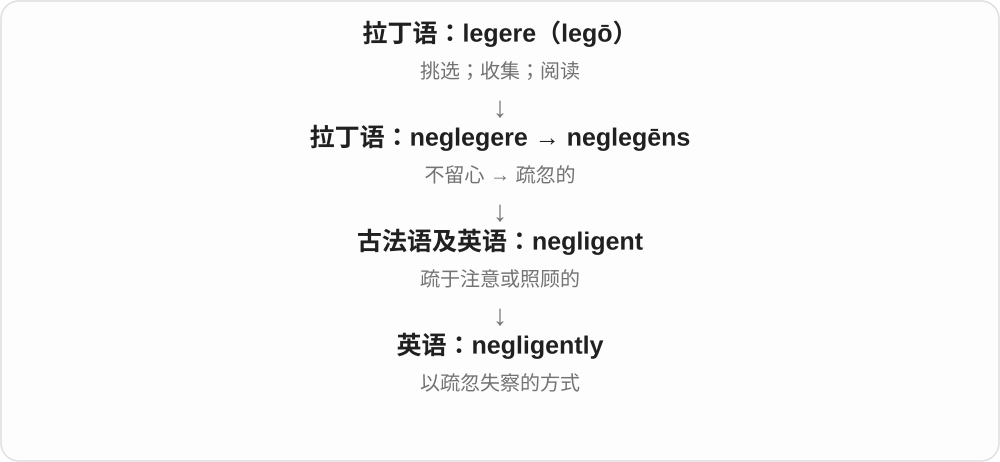

常用于评价操作、维护或专业行为；法律使用仍需具体事实和标准。

**常见搭配与例句**

act negligently；negligently maintained；negligently overlook。

> The equipment had been negligently maintained.

设备维护工作存在疏忽。

> The report found that key details were negligently omitted.

报告发现关键细节因疏忽被遗漏。

**别混淆**

negligently 是做得疏忽；negligibly 是程度小到可忽略，别少看一个 t。

### 72. lectern — 讲台上的读稿架；诵读台

**音标**：英 /ˈlektən/；美 /ˈlektərn/

**先抓住这个画面**

lectern 像一个斜面的高支架，把讲稿或经书撑在站着能读的位置。

**怎么拆**

经中世纪拉丁语 lectrinum 与法语传来，属于 legere“阅读”的工具名称；英语拼写后来向拉丁语靠拢。

**怎么变成今天的意思**

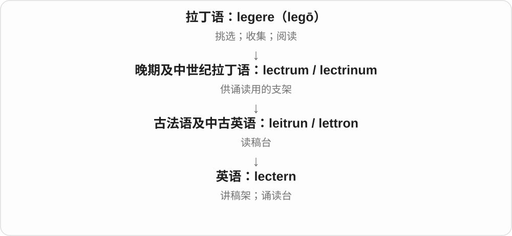

重点是承托材料的架子，不是整个演讲台，也不是听众坐的课桌。

**常见搭配与例句**

stand at the lectern；a wooden lectern；place notes on the lectern。

> She placed her notes on the lectern.

她把讲稿放在读稿台上。

> A microphone was fixed to the lectern.

读稿台上装着一支麦克风。

**别混淆**

lectern 撑讲稿；podium 常是站人的台，也可能在美式用法中泛指讲台。

### 73. sacrilegious — 亵渎神圣的；大不敬的

**音标**：/ˌsækrəˈlɪdʒəs/

**先抓住这个画面**

sacrilegious 把某个行为评价为侵犯了人们视作神圣的东西；也可夸张地说糟蹋经典。

**怎么拆**

与 sacrilege 同族，联系拉丁语 sacrilegus“盗取圣物、亵渎的”；不能按 religious 的拼写写成 sacreligious。

**怎么变成今天的意思**

它表达一种评价，需要知道被谁、在什么传统中视为神圣；日常比喻也可能是玩笑。

**常见搭配与例句**

a sacrilegious act；a sacrilegious joke；consider something sacrilegious。

> The community considered the act sacrilegious.

这个群体认为那一行为是亵渎。

> Some fans thought changing the classic ending was sacrilegious.

一些粉丝认为改动经典结尾简直是大不敬。

**别混淆**

religious 是宗教的；sacrilegious 是亵渎的，不是“不信宗教”的简单对应词。

### 74. intelligencer — 报信者；情报提供者（旧称）

**音标**：英 /ɪnˈtelɪdʒənsə/；美 /ɪnˈtelɪdʒənsər/

**先抓住这个画面**

intelligencer 是把消息带来的人；这里用的是 intelligence 的“情报、消息”义。

**怎么拆**

intelligence + -er。

**怎么变成今天的意思**

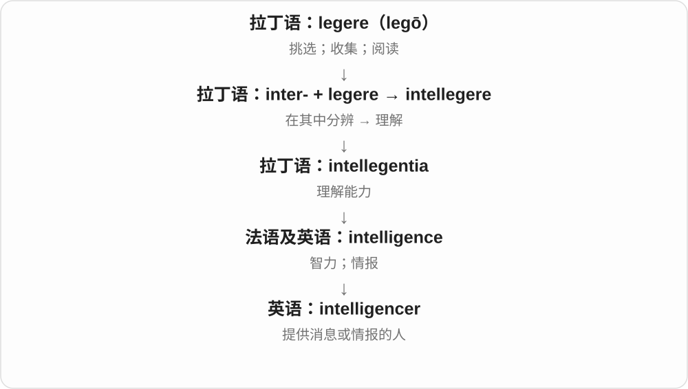

历史文献中可指耳目、密探或报信者，也保留在一些报刊名称中。并非“更聪明的人”。

**常见搭配与例句**

a royal intelligencer；an intelligencer’s report；旧式或报刊名称用语。

> The minister relied on an intelligencer at the port.

大臣依靠港口的一名报信者获取消息。

> The historian found a report written by a royal intelligencer.

历史学家找到了一份王室情报人员写的报告。

**别混淆**

intelligencer 提供消息；intellectual 从事思想文化活动，两个角色不同。

### 75. collegial — 同事合作的；同僚共同管理的

**音标**：/kəˈliːdʒiəl/

**先抓住这个画面**

collegial 像一桌地位相近的同事坐下来互相尊重、共同商量。

**怎么拆**

来自法语 collégial 一支，联系拉丁语 collēgium“团体”；不是 lecture 的形容词。

**怎么变成今天的意思**

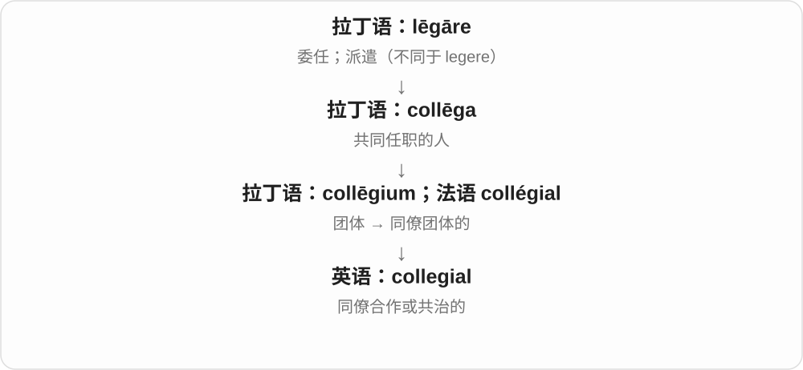

既可说工作氛围友好合作，也可具体说权力由同僚共享；不要求所有人意见完全一致。

**常见搭配与例句**

a collegial atmosphere；collegial decision-making；collegial relations。

> The department has a collegial atmosphere.

这个部门的同事合作氛围很好。

> The committee preferred a collegial style of leadership.

委员会更喜欢由同僚共同参与的领导方式。

**别混淆**

collegial 强调同事合作；collegiate 常说学院或大学的。

### 76. uncollected — 尚未收取的；未收入集子的

**音标**：/ˌʌnkəˈlektɪd/

**先抓住这个画面**

uncollected 像包裹还躺在领取点，或一篇散文还没有被收进作者的作品集。

**怎么拆**

un-（未）+ collected（已收集、领取的）。

**怎么变成今天的意思**

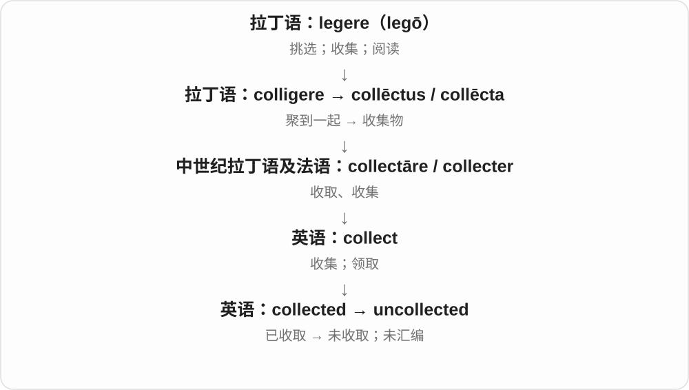

既可说实际物品无人领取，也可说文学作品未结集。不能只把它理解成“没有收藏价值”。

**常见搭配与例句**

uncollected parcels；uncollected essays；uncollected payments。

> Uncollected parcels are kept behind the counter.

尚未领取的包裹放在柜台后面。

> The volume includes several previously uncollected essays.

这本书收录了几篇此前未结集的散文。

**别混淆**

uncollected 是尚未被收取；uncollectible 通常是无法收取或收回。

### 77. preselection — 预先选择；候选人预选

**音标**：/ˌpriːsɪˈlekʃən/

**先抓住这个画面**

preselection 像正式选择前先筛出一批，或者政党先决定谁代表自己参选。

**怎么拆**

pre-（预先）+ selection。

**怎么变成今天的意思**

一般可指提前筛选；某些政治制度里专指政党确定候选人的过程。

**常见搭配与例句**

candidate preselection；a preselection process；preselection of options。

> The party began its candidate preselection process.

该党启动了候选人预选程序。

> Preselection reduced the number of files we had to review.

预先筛选减少了需要审查的文件数量。

**别混淆**

preselection 预选；election 最终选举，两者不是同一阶段。

### 78. collegium — 委员会；共同承担职责的团体

**音标**：/kəˈliːdʒiəm/

**先抓住这个画面**

collegium 保留了 college 还没专指学校时的画面：一群人作为一个正式团体共同办事。

**怎么拆**

直接借自拉丁语 collēgium；college 则经历了法语等语言的变化。

**怎么变成今天的意思**

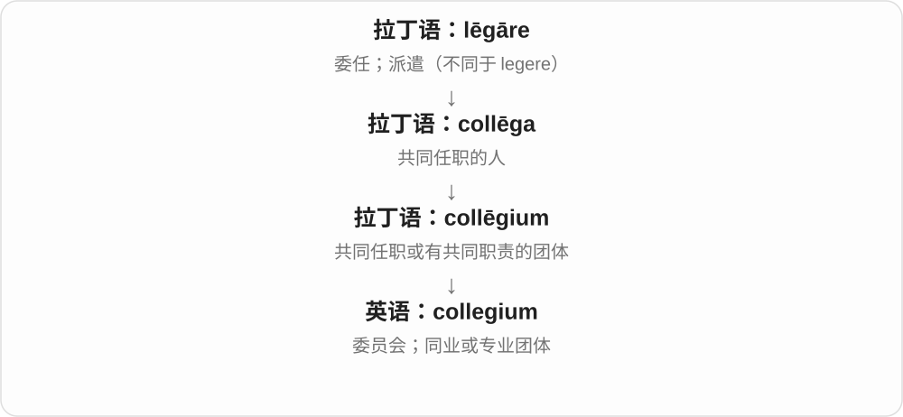

常见于历史、学术及正式机构名称。究竟是委员会、部门还是同业团体，要看制度。

**常见搭配与例句**

a collegium of scholars；a governing collegium；members of the collegium。

> A collegium of scholars reviewed the proposal.

一个学者委员会审查了提案。

> The collegium reached a decision after discussion.

委员会讨论后作出了决定。

**别混淆**

college 日常多是学院；collegium 保留正式团体的拉丁形式。

### 79. intelligibility — 可理解性；语音清晰可懂程度

**音标**：/ɪnˌtelɪdʒəˈbɪləti/

**先抓住这个画面**

intelligibility 关心别人能听懂多少、理解多少，像测试电话里一句话传过来还剩多少可辨信息。

**怎么拆**

intelligible + -ity。

**怎么变成今天的意思**

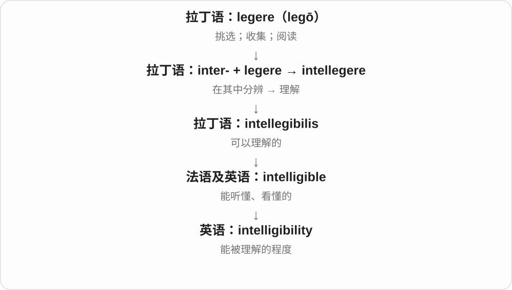

语言研究和语音技术中很常见；口音不同不一定导致 intelligibility 低。

**常见搭配与例句**

speech intelligibility；improve intelligibility；mutual intelligibility。

> Background noise reduced speech intelligibility.

背景噪声降低了语音可懂度。

> The study tested mutual intelligibility between the dialects.

研究测试了两种方言之间能互相听懂的程度。

**别混淆**

legibility 关心字迹能否辨认；intelligibility 还包括声音和意义能否理解。

### 80. collectivization — 集体化

**音标**：英 /kəˌlektɪvaɪˈzeɪʃən/；美 /kəˌlektɪvəˈzeɪʃən/

**先抓住这个画面**

collectivization 像把原来分别管理的生产单位或土地，改为以集体形式拥有和经营。

**怎么拆**

collective → collectivize → collectivization。

**怎么变成今天的意思**

历史上常用于农业组织变革；具体是否自愿、怎样分配权利，不能只从词本身推定。

**常见搭配与例句**

agricultural collectivization；a policy of collectivization；the effects of collectivization。

> The book studies agricultural collectivization in the twentieth century.

这本书研究二十世纪的农业集体化。

> The chapter examines how collectivization changed village life.

这一章考察集体化如何改变村庄生活。

**别混淆**

collectivism 是思想或原则；collectivization 是改变组织和所有权安排的过程。

### 81. legibility — 字迹可辨程度；易读性

**音标**：/ˌledʒəˈbɪləti/

**先抓住这个画面**

legibility 像测试一个字体缩小之后，字母是否还能清楚区分。

**怎么拆**

legible + -ity，-ble 对应 -bility。

**怎么变成今天的意思**

常用于字体、路牌和界面设计。字号、字形、对比度都可能影响它；内容深浅是另一层问题。

**常见搭配与例句**

improve legibility；the legibility of text；test legibility。

> A larger font improved legibility.

更大的字号提高了文字可辨程度。

> We tested the sign’s legibility from across the road.

我们在马路对面测试标牌上的字是否看得清。

**别混淆**

legibility 主要是字能否看清；readability 还常涉及句子和内容是否好读。

### 82. legionella — 军团菌

**音标**：/ˌliːdʒəˈnelə/

**先抓住这个画面**

legionella 的名字记录了一次发现背景：研究者追查退伍军人组织会议后的疾病暴发，找到了相关细菌。

**怎么拆**

由 American Legion 名称中的 Legion + -ella 构成属名 Legionella；通过专名间接联系 legion。

**怎么变成今天的意思**

名称来自一九七六年会议相关暴发的历史，不是说细菌“像士兵结队”。正式属名首字母大写。

**常见搭配与例句**

Legionella bacteria；a legionella sample；Legionella testing。

> The laboratory tested the water sample for legionella.

实验室检测了水样中是否有军团菌。

> The lecture explained how Legionella received its name.

讲座解释了军团菌名称的由来。

**别混淆**

legionnaire 是军团成员或相关组织成员；legionella 是细菌名称。

### 83. collectivity — 集体性；作为整体的群体

**音标**：英 /ˌkɒlekˈtɪvɪti/；美 /ˌkɑːlekˈtɪvəti/

**先抓住这个画面**

collectivity 既可以是大家形成整体的性质，也可以直接指这一群人组成的整体。

**怎么拆**

collective + -ity。

**怎么变成今天的意思**

常用于社会理论或正式讨论。a collectivity 比普通 group 更强调作为整体看待。

**常见搭配与例句**

a sense of collectivity；a social collectivity；individual and collectivity。

> The ceremony strengthened a sense of collectivity.

仪式加强了大家作为一个整体的意识。

> The study treats the neighbourhood as a social collectivity.

研究把这个社区视为一个社会群体整体。

**别混淆**

collectivity 是群体或集体性；collectivism 是把集体放在优先位置的主张。

### 84. legionnaire — 军团士兵；军团组织成员

**音标**：英 /ˌliːdʒəˈneə/；美 /ˌliːdʒəˈner/

**先抓住这个画面**

legionnaire 是属于某个 legion 的人，常见于法国外籍军团或相关退伍军人组织的场景。

**怎么拆**

借自法语 légionnaire，与拉丁语 legiō 一族相连。

**怎么变成今天的意思**

读具体历史时要辨认哪个军团或组织；不应把所有 legionnaire 都想成古罗马士兵。

**常见搭配与例句**

a Foreign Legion legionnaire；former legionnaires；a legionnaire’s memoir。

> The memoir follows a young legionnaire in North Africa.

回忆录讲述了一名年轻军团士兵在北非的经历。

> Former legionnaires gathered for the ceremony.

退役军团士兵聚集起来参加仪式。

**别混淆**

legionary 更常用于古罗马军团；legionnaire 更容易关联法国外籍军团。

### 85. unelectable — 很难当选的；不具胜选可能的

**音标**：/ˌʌnɪˈlektəbəl/

**先抓住这个画面**

unelectable 像一个人即使能报名，也难以争取到足够选票。

**怎么拆**

un-（不）+ electable。

**怎么变成今天的意思**

多是政治判断或评价，并不是数学上概率绝对为零，也不一定是资格被取消。

**常见搭配与例句**

an unelectable candidate；be seen as unelectable；an unelectable platform。

> Commentators once dismissed her as unelectable.

评论者曾认为她根本没有当选希望。

> The party feared that the policy would make its candidate unelectable.

该党担心这项政策会让候选人难以胜选。

**别混淆**

unelectable 说胜选困难；ineligible 说规则上没有资格。

### 86. electable — 有望当选的；可被选出的

**音标**：/ɪˈlektəbəl/

**先抓住这个画面**

electable 像候选人不仅符合报名要求，还具备争取足够支持的条件。

**怎么拆**

elect + -able。

**怎么变成今天的意思**

常说现实胜选能力，是评价而非保证；也可宽泛表示可以选出。

**常见搭配与例句**

an electable candidate；remain electable；politically electable。

> The party was searching for an electable candidate.

该党在寻找有胜选希望的候选人。

> Good polling numbers alone do not make someone electable.

仅有好看的民调数字，并不足以说明某人一定有胜选能力。

**别混淆**

eligible 资格合格；electable 有希望赢；elected 已经当选。

### 87. lectureship — 讲师职位；讲座安排

**音标**：英 /ˈlektʃəʃɪp/；美 /ˈlektʃərʃɪp/

**先抓住这个画面**

lectureship 常像一所大学里以讲授课程为职责的岗位；某些名称也指安排的一系列讲座。

**怎么拆**

lecture + -ship，-ship 表示职位、身份或相关安排。

**怎么变成今天的意思**

是否是长期职位、具体级别如何，要看学校制度。

**常见搭配与例句**

a lectureship in history；apply for a lectureship；an annual lectureship。

> She accepted a lectureship in philosophy.

她接受了一个哲学讲师职位。

> The foundation established an annual lectureship.

基金会设立了一项年度讲座安排。

**别混淆**

lecture 是一场讲授；lecturer 是人；lectureship 常是职位。

### 88. lector — 诵读者；读经员；某些院校的讲授人员

**音标**：英 /ˈlektə/；美 /ˈlektər/

**先抓住这个画面**

lector 最直观就是负责把文字读给大家听的人，在礼拜中可负责诵读经文。

**怎么拆**

来自拉丁语 lēctor，legere“读”+ 行为者成分。

**怎么变成今天的意思**

不同机构也可把它用作教学职衔；部分影视翻译语境指配音诵读者，要按场景辨义。

**常见搭配与例句**

a church lector；serve as lector；a lector in Latin。

> The lector read the passage clearly.

诵读员清楚地读出了那段经文。

> The college appointed a new lector in Latin.

学院任命了一位新的拉丁语讲授人员。

**别混淆**

lector 侧重诵读或特定职位；lecturer 是一般讲授者或讲师。

### 89. selectman — 镇行政委员（美国新英格兰部分城镇用语）

**音标**：/sɪˈlektmən/

**先抓住这个画面**

selectman 是镇里选出来负责日常行政事务的委员，名字保留了“被选中的人”的意思。

**怎么拆**

select + man，历史上的地方公职名称。

**怎么变成今天的意思**

具体职权随地方制度而异；现代也可能使用 select board member 等称呼，不能照字面认定只能由男性担任。

**常见搭配与例句**

a town selectman；the board of selectmen；elect a selectman。

> The selectman discussed road repairs at the meeting.

镇行政委员在会上讨论了道路维修。

> Residents elected a new selectman.

居民选出了一位新的镇行政委员。

**别混淆**

selectman 是特定地方公职；selectee 泛指被选中的人。

### 90. lectionary — 经文选读集；礼拜读经安排

**音标**：英 /ˈlekʃənəri/；美 /ˈlekʃəneri/

**先抓住这个画面**

lectionary 像一份按日期或礼仪场合安排好的读经清单，告诉人当天读哪段。

**怎么拆**

借自教会拉丁语 lēctiōnārium，来自 lēctiō“诵读”。

**怎么变成今天的意思**

它是经过安排的选读材料，不等于整部经典原文；不同传统采用不同安排。

**常见搭配与例句**

a daily lectionary；readings in the lectionary；a lectionary cycle。

> The lectionary lists the readings for Sunday.

经文选读表列出了周日的读经内容。

> She consulted the lectionary before preparing the service.

她准备礼拜前查阅了经文选读安排。

**别混淆**

lection 是一段诵读内容；lectionary 是组织这些段落的集子或安排。

### 91. ineligibility — 不符合资格的状态

**音标**：/ɪnˌelɪdʒəˈbɪləti/

**先抓住这个画面**

ineligibility 是资格门槛没有满足这一事实，例如时间、年龄或注册条件不符。

**怎么拆**

现代对应 ineligible + -ity；历史经法语 inéligibilité。

**怎么变成今天的意思**

重点是规则，不直接评价能力。失去资格也不等于参加后落选。

**常见搭配与例句**

a period of ineligibility；grounds for ineligibility；confirm ineligibility。

> The letter explained the reason for her ineligibility.

信中解释了她不符合资格的原因。

> The rule imposed a period of ineligibility.

这项规则规定了一段不得参与的期限。

**别混淆**

ineligibility 资格不足；unelectability 很难赢选举，层面不同。

### 92. lectin — 凝集素；能特异结合糖类的蛋白质

**音标**：/ˈlektɪn/

**先抓住这个画面**

lectin 像识别特定糖结构的分子夹子，只对某些形状有结合偏好。

**怎么拆**

拉丁语 lēctus“选出的”+ -in（物质名称后缀），是现代科学造词。

**怎么变成今天的意思**

这里的“选”帮助记住结合特异性，不是说它会思考；也不能把某一种凝集素的性质套给全部凝集素。

**常见搭配与例句**

a plant lectin；lectin binding；a lectin assay。

> The researchers measured the lectin’s binding to the sugar.

研究人员测量了这种凝集素与糖的结合。

> The diagram shows a lectin recognizing a carbohydrate structure.

图中展示了凝集素识别糖结构的过程。

**别混淆**

lectin 是蛋白质类别；leptin 是另一种蛋白质激素，差一个字母却不是同一个词。

### 93. deselect — 取消选择；取消候选资格安排

**音标**：/ˌdiːsɪˈlekt/

**先抓住这个画面**

deselect 像把已经勾选的方框再点一下，去掉那个选择。

**怎么拆**

de-（撤去）+ select。

**怎么变成今天的意思**

电脑中是取消选中；政治中可指政党不再让现任者代表该党参选，未必是法律上取消其全部资格。

**常见搭配与例句**

deselect a checkbox；deselect an item；deselect a candidate。

> Deselect the option if you do not need notifications.

如果不需要通知，就取消勾选这一项。

> The party voted to deselect its current candidate.

该党投票决定不再让现任候选人代表它参选。

**别混淆**

deselect 取消选中；delete 删除内容，取消选中通常不删除对象。

### 94. electorally — 从选举角度；在选举上

**音标**：/ɪˈlektərəli/

**先抓住这个画面**

electorally 把判断范围限定在选举表现：某件事会不会帮助争取选票。

**怎么拆**

electoral + -ly。

**怎么变成今天的意思**

常与 successful、popular、damaging 搭配。选举上有利不等于在所有方面都好。

**常见搭配与例句**

electorally successful；electorally damaging；electorally significant。

> The coalition proved electorally successful.

联盟在选举上取得了成功。

> The dispute was electorally damaging for the party.

这场争议损害了该党的选举表现。

**别混淆**

politically 政治上，范围更大；electorally 专门看选举层面。

### 95. legionary — 军团的；军团士兵

**音标**：英 /ˈliːdʒənəri/；美 /ˈliːdʒəneri/

**先抓住这个画面**

legionary 常把人带回古罗马：一名作为军团成员服役的士兵。

**怎么拆**

现代对应 legion + -ary；历史也来自拉丁语 legiōnārius。

**怎么变成今天的意思**

可作形容词说装备或堡垒，也可作名词指士兵。

**常见搭配与例句**

a Roman legionary；legionary armour；a legionary fortress。

> The display shows the equipment of a Roman legionary.

展览展示了一名罗马军团士兵的装备。

> Archaeologists uncovered part of a legionary fortress.

考古学家发现了军团要塞的一部分。

**别混淆**

legionary 常用于罗马军团；legionnaire 常用于后来的军团和组织。

### 96. collegiality — 同事间的合作精神；同僚共治

**音标**：/kəˌliːdʒiˈæləti/

**先抓住这个画面**

collegiality 像大家把彼此当有资格发言的同事，愿意听取意见、分担决定。

**怎么拆**

collegial + -ity。

**怎么变成今天的意思**

可说日常氛围，也可谈组织权力由同僚共同承担。友好不意味着不能认真争论。

**常见搭配与例句**

a spirit of collegiality；promote collegiality；academic collegiality。

> The new chair encouraged collegiality in the department.

新主任鼓励部门同事之间互相合作。

> Strong collegiality allowed them to disagree openly.

良好的合作关系让他们能公开表达不同意见。

**别混淆**

collegiality 强调平等合作；conformity 强调服从一致，两者不是一回事。

### 97. reelect — 重新选举……；使连任

**音标**：/ˌriːɪˈlekt/

**先抓住这个画面**

reelect 是在新一轮选择中，把原来担任职位的人再次选上。

**怎么拆**

re-（再）+ elect。

**怎么变成今天的意思**

主动句说选民再次选某人；被动 be reelected 说该人成功连任。

**常见搭配与例句**

reelect a mayor；be reelected chair；reelect someone to office。

> Members reelected her as chair.

会员们再次选她担任主席。

> He was reelected for another term.

他再次当选，开始了新一届任期。

**别混淆**

reelect 再次选上；reappoint 重新任命，程序可能不同。

### 98. collegian — 大学生；学院成员或毕业生

**音标**：/kəˈliːdʒən/

**先抓住这个画面**

collegian 是属于 college 那个学习团体的人，常指在校大学生。

**怎么拆**

联系中世纪拉丁语 collēgiānus；现代也可看作 college + -ian。

**怎么变成今天的意思**

比 college student 更书面，有时也包括曾在学院学习的人。旧监狱俚语义非常少见，不必作为日常意思。

**常见搭配与例句**

a young collegian；former collegians；collegians on campus。

> The newspaper interviewed several collegians about campus life.

报纸采访了几名大学生，谈校园生活。

> As a collegian, she joined the debating society.

读大学时，她加入了辩论社。

**别混淆**

collegian 是人；collegiate 主要是形容词“学院的”。

### 99. electability — 当选可能性；胜选能力

**音标**：/ɪˌlektəˈbɪləti/

**先抓住这个画面**

electability 关心候选人能不能把足够多的人争取到自己这边，最终赢得选举。

**怎么拆**

electable + -ity，或 elect + -ability。

**怎么变成今天的意思**

通常由民调、公众形象和竞争环境等来讨论；不是固定不变的个人属性。

**常见搭配与例句**

questions about electability；a candidate’s electability；assess electability。

> The debate focused on the candidate’s electability.

辩论集中在候选人的胜选可能性上。

> One poll cannot settle the question of electability.

一次民调不能决定一个人是否有胜选能力。

**别混淆**

eligibility 是规则资格；electability 是现实胜选前景。

### 100. leguminous — 豆科的；豆类的

**音标**：/lɪˈɡjuːmɪnəs/

**先抓住这个画面**

leguminous 像给植物贴上“豆科这一家”的分类标签，常见例子是豌豆和三叶草。

**怎么拆**

来自拉丁语 legūmen 的词干 legūmin-，经 legūminōsus 一支进入英语；不是由英语 legume 发音直接拼出。

**怎么变成今天的意思**

主要是植物学、农业用语。与 legere 的远源联系同 legume 一样，不能当成确定的采摘故事。

**常见搭配与例句**

leguminous plants；leguminous crops；a leguminous species。

> Peas are leguminous plants.

豌豆是豆科植物。

> The field was planted with leguminous crops.

田里种着豆科作物。

**别混淆**

leguminous 说植物类别；legible 是字可读，两者不能凭 leg- 混义。

### 101. nonselective — 非选择性的；不按特定标准筛选的

**音标**：英 /ˌnɒnsɪˈlektɪv/；美 /ˌnɑːnsɪˈlektɪv/

**先抓住这个画面**

nonselective 像一个过程没有只针对其中一小类，而是作用于较广范围。

**怎么拆**

non-（不）+ selective。

**怎么变成今天的意思**

教育中可说不按学业成绩择优录取；专业场景则要看“没有选择”的具体对象是什么。

**常见搭配与例句**

a nonselective school；a nonselective process；nonselective treatment of data。

> The town has a nonselective secondary school.

镇里有一所不按成绩择优录取的中学。

> The study compared selective and nonselective methods.

研究比较了选择性与非选择性方法。

**别混淆**

nonselective 不一定等于 random“随机”；没有按某种标准筛选，仍可有其他规则。

### 102. intellectuality — 智性；重思考的特征（较少用）

**音标**：/ˌɪntəlektʃuˈæləti/

**先抓住这个画面**

intellectuality 把一个人或作品中重视思想、推理的特征单独拿出来讨论。

**怎么拆**

intellectual + -ity，也受晚期拉丁语 intellectualitas 对应形式影响。

**怎么变成今天的意思**

是偏评论性的抽象名词。它不必表示具体测量出的智商，也不等于所有知识的总量。

**常见搭配与例句**

the intellectuality of a work；marked intellectuality；intellectuality and feeling。

> The critic admired the intellectuality of the essays.

评论者欣赏这些随笔的思想性。

> Her writing balances intellectuality with warmth.

她的写作在理性思考与温情之间取得平衡。

**别混淆**

intellect 是理解推理能力；intellectuality 更强调表现出的思想性。

### 103. postelection — 选举后的

**音标**：/ˌpəʊstɪˈlekʃən/；美 /ˌpoʊstɪˈlekʃən/

**先抓住这个画面**

postelection 把时间放在选举结束之后，可能是分析结果，也可能是新一轮安排。

**怎么拆**

post-（之后）+ election。

**怎么变成今天的意思**

只说明时间关系，不说明结果已经毫无争议或新政府已经就职。

**常见搭配与例句**

postelection analysis；a postelection period；postelection negotiations。

> The newspaper published a postelection analysis.

报纸发表了选后分析。

> Postelection negotiations continued for several weeks.

选后谈判持续了几周。

**别混淆**

preelection 在选举前；postelection 在选举后。

### 104. selectee — 被选中的人

**音标**：/sɪˌlekˈtiː/

**先抓住这个画面**

selectee 是选择动作接收的一方，像名单公布后出现在入选栏里的人。

**怎么拆**

select + -ee（动作的接受者）。

**怎么变成今天的意思**

常见于正式选拔，历史军事语境也可指被征召者；不一定经过投票。

**常见搭配与例句**

a successful selectee；notify the selectees；programme selectees。

> Each selectee received an invitation to the workshop.

每位入选者都收到了工作坊邀请。

> The programme asked selectees to confirm their places.

项目要求入选者确认参加名额。

**别混淆**

selector 是挑选者；selectee 是被挑选者。

### 105. lection — 诵读；经文选段；文本异文（专业用语）

**音标**：/ˈlekʃən/

**先抓住这个画面**

lection 像从经典或文本中读出的那一段；研究不同抄本时也可指某处采用的读法。

**怎么拆**

经法语或学术借入来自拉丁语 lēctiō，与 lesson 同源。

**怎么变成今天的意思**

现代普通“课”用 lesson；lection 多用于礼拜、古典文献或文本校勘。

**常见搭配与例句**

a scriptural lection；the appointed lection；a variant lection。

> The lection for the service was taken from the Psalms.

礼拜的诵读段落选自《诗篇》。

> The editor compared the lections in two manuscripts.

编辑比较了两个抄本中的不同读法。

**别混淆**

lesson 是日常课程或教训；lection 保留专业的读经与文本用法。

### 106. preselect — 预先选定；提前筛选

**音标**：/ˌpriːsɪˈlekt/

**先抓住这个画面**

preselect 像会议还没开始，先从全部选项里挑出几项供大家讨论。

**怎么拆**

pre-（预先）+ select。

**怎么变成今天的意思**

预先选好可能是初筛，也可能是设置默认项，未必就是最后结果。

**常见搭配与例句**

preselect candidates；preselect an option；preselect samples。

> The committee will preselect five proposals.

委员会将先筛出五份提案。

> The form preselects the most common option.

表单预先选中了最常用的选项。

**别混淆**

preselect 提前选；reselect 重新选；deselect 取消选。

### 107. reselect — 重新选择；再次选中

**音标**：/ˌriːsɪˈlekt/

**先抓住这个画面**

reselect 是已经选过以后，再进行一次选择；结果可以相同，也可以换成别的。

**怎么拆**

re-（再次）+ select。

**怎么变成今天的意思**

界面说明里常指重新点选对象；政治中也可指再次确定某人为候选人。

**常见搭配与例句**

reselect a file；reselect the candidate；reselect the correct option。

> If the preview is wrong, reselect the image.

如果预览不对，请重新选择图片。

> The party decided to reselect its existing candidate.

该党决定再次确定原候选人参选。

**别混淆**

reselect 重新选择；reelect 通常是再次通过选举让某人当选。

### 108. intellection — 理解、思考的活动（哲学用语）

**音标**：/ˌɪntəˈlekʃən/

**先抓住这个画面**

intellection 像头脑真正把一个关系想明白的那一刻，强调理解在发生。

**怎么拆**

来自拉丁语 intellēctiō，联系 intellegere；不是现代英语 intellect 必然加后缀的历史。

**怎么变成今天的意思**

比 ordinary thinking 更专业，常与感知、想象等心理活动区分。具体边界依哲学理论而定。

**常见搭配与例句**

an act of intellection；pure intellection；perception and intellection。

> The philosopher distinguished sensation from intellection.

哲学家区分了感觉与理智理解。

> The essay describes reasoning as a form of intellection.

文章把推理描述为理智活动的一种形式。

**别混淆**

intellect 是能力；intellection 是这种能力进行理解的活动。

### 109. legendry — 传说的总和；传说体系

**音标**：/ˈledʒəndri/

**先抓住这个画面**

legendry 像一个地方流传多年的故事集，不是一则传说，而是整片传说材料。

**怎么拆**

legend + -ry，后缀把多个相关内容概括为一体。

**怎么变成今天的意思**

偏文学和民俗研究用语。不要把它当 legendary“传奇的”的漏字拼写。

**常见搭配与例句**

local legendry；Arthurian legendry；a rich body of legendry。

> The island has a rich tradition of legendry.

这座岛有丰富的传说传统。

> Local legendry connects the cave with an ancient king.

当地传说体系把洞穴与一位古代国王联系起来。

**别混淆**

legend 是一则传说；legendry 是传说整体；legendary 是形容词。

### 110. illegibility — 字迹难辨；无法辨读的状态

**音标**：/ɪˌledʒəˈbɪləti/

**先抓住这个画面**

illegibility 是字已经模糊到读不出来这一状态，而不是读者缺少某种知识。

**怎么拆**

illegible + -ity。

**怎么变成今天的意思**

常用于书写、印刷和扫描材料的质量描述；可以比较程度，而不必完全一字不识。

**常见搭配与例句**

illegibility of handwriting；near illegibility；reduce illegibility。

> The illegibility of the note delayed the delivery.

便条上的字难以辨认，耽误了投递。

> Repeated copying reduced the page to near illegibility.

反复复印使这一页几乎无法辨读。

**别混淆**

illiteracy 是不识字；illegibility 是字迹本身难辨，主体不同。

### 111. preelection — 选举前的

**音标**：/ˌpriːɪˈlekʃən/

**先抓住这个画面**

preelection 像把日历停在投票日前，观察那时的民调、承诺和讨论。

**怎么拆**

pre-（之前）+ election。

**怎么变成今天的意思**

最常作修饰语。选前民调反映当时调查情况，不等于最终选举结果。

**常见搭配与例句**

preelection polls；a preelection promise；preelection debate。

> The article compares preelection polls with the final result.

文章比较了选前民调与最终结果。

> The proposal became a major preelection issue.

这项提议成了选前的重要议题。

**别混淆**

preelection 选举前；preselection 则是预先选择候选人等，不能混用。

### 112. electee — 当选者（较少用）

**音标**：/ɪˌlekˈtiː/

**先抓住这个画面**

electee 是在选举中被选出的那个人，把焦点放在“被选中”的身份。

**怎么拆**

elect + -ee。

**怎么变成今天的意思**

比 elected candidate 或 newly elected member 少见。它说的是已被选中，不只是参选。

**常见搭配与例句**

a newly chosen electee；welcome the electees；committee electees。

> The committee welcomed its new electees.

委员会欢迎新当选的成员。

> Each electee was asked to confirm acceptance of the role.

每位当选者都被要求确认是否接受这一职务。

**别混淆**

elector 投票选择别人；electee 接受选择。

### 113. lectorate — 诵读员职务；读经员身份

**音标**：/ˈlektərət/，亦 /ˈlektəreɪt/

**先抓住这个画面**

lectorate 指负责诵读的人所承担的职务，像一个正式的读经岗位。

**怎么拆**

来自晚期拉丁语 lectorātus：lēctor“诵读者”+ 表示职务的 -ātus。

**怎么变成今天的意思**

主要是宗教或制度历史用语；不要与 electorate“全体选民”混淆。

**常见搭配与例句**

appointment to the lectorate；the office of lectorate；church lectorate。

> The document records his appointment to the lectorate.

文件记录了他被任命为诵读员。

> The chapter explains the duties associated with the lectorate.

这一章解释了诵读员职务对应的职责。

**别混淆**

lectorate 少一个开头 e，所指从选民群体变成诵读职位。

### 114. nonelective — 非选修的；非由选举产生的；非择期的

**音标**：英 /ˌnɒnɪˈlektɪv/；美 /ˌnɑːnɪˈlektɪv/

**先抓住这个画面**

nonelective 把某个领域里的“可选”取消：课程必须修，职位不是选举产生，医疗安排也可能不是择期。

**怎么拆**

non-（不）+ elective。

**怎么变成今天的意思**

具体否定什么，要看它修饰课程、职位还是程序。不同领域的 compulsory、appointed、urgent 不能无条件互换。

**常见搭配与例句**

a nonelective course；a nonelective office；nonelective procedures。

> All students must complete the nonelective courses.

所有学生都必须完成非选修课程。

> The report distinguishes elective from nonelective offices.

报告区分了选举产生与非选举产生的职位。

**别混淆**

nonelective 不等于 unelectable：前者说制度类别，后者说难以胜选。

### 115. nonelite — 非精英的；非精英群体

**音标**：英 /ˌnɒnɪˈliːt/；美 /ˌnɑːnɪˈliːt/

**先抓住这个画面**

nonelite 只是把对象放在某个被称为精英的群体之外，不自动评价个人能力或价值。

**怎么拆**

non-（非）+ elite。

**怎么变成今天的意思**

常用于社会研究，分类依据可能是权力、收入、教育或竞技层级；读时要问作者怎样定义 elite。

**常见搭配与例句**

nonelite groups；nonelite athletes；nonelite institutions。

> The survey included both elite and nonelite athletes.

调查包括顶尖运动员与非顶尖层级的运动员。

> The historian focused on nonelite households.

历史学家着重研究非精英家庭。

**别混淆**

nonelite 是分类位置；unskilled 是缺少技能，不能画等号。

### 116. nonnegligible — 不可忽略的

**音标**：英 /ˌnɒnˈneɡlɪdʒəbəl/；美 /ˌnɑːnˈneɡlɪdʒəbəl/

**先抓住这个画面**

nonnegligible 像一个误差虽然看着不大，却已经足以影响结果，不能随手划掉。

**怎么拆**

non-（不）+ negligible（可忽略的）。

**怎么变成今天的意思**

数学与技术写作中常见。它并不总等于 huge，只是相对当前问题不能忽略。

**常见搭配与例句**

a nonnegligible effect；a nonnegligible probability；nonnegligible costs。

> The extra processing adds a nonnegligible delay.

额外处理增加了不可忽略的延迟。

> The model must account for a nonnegligible error.

模型必须考虑一个不可忽略的误差。

**别混淆**

significant 有时有严格统计含义；nonnegligible 只是强调不宜忽略，不能自动等同统计显著。

### 117. predilect — 偏爱的、选中的；预先选择（罕用）

**音标**：/ˌpredɪˈlekt/，亦 /ˌpriːdɪˈlekt/

**先抓住这个画面**

predilect 常见的词典形容词义是“特别偏爱的”，像一众选择里心里早已更钟爱的一项。

**怎么拆**

来自中世纪拉丁语 praedīlēctus，联系 praedīligere“特别喜爱”；旧动词也有预先选择义。

**怎么变成今天的意思**

是罕见文献词。现代通常说 preferred、favourite；若旧文作动词，应按“预选”理解。

**常见搭配与例句**

a predilect theme；a predilect author；历史或文学阅读。

> The sea remained the poet’s predilect theme.

大海始终是诗人偏爱的主题。

> She returned to a passage by her predilect author.

她又读起了那位自己偏爱的作家的一段文字。

**别混淆**

predilect 是罕用形容词或旧动词；predilection 才是更值得先掌握的“偏爱”。

### 118. prelect — 公开讲授；宣讲（少见）

**音标**：/prɪˈlekt/

**先抓住这个画面**

prelect 的画面是站在人们前面，把文本或知识读讲出来。

**怎么拆**

拉丁语 prae-（在前）+ legere，形成 praelegere，经 praelectus 进入英语。

**怎么变成今天的意思**

这里的 pre- 不要只记成“提前”：这个词通常是在人前讲授，不是课前预习。

**常见搭配与例句**

prelect on a subject；prelect before an audience；旧式学术用语。

> The professor prelected on ancient history.

教授公开讲授古代史。

> He was invited to prelect before the society.

他受邀到学会面前作讲授。

**别混淆**

prelect 是较少用的 lecture；preselect 则是预先挑选。

### 119. prelection — 公开讲授；讲读；预读（少见）

**音标**：/prɪˈlekʃən/

**先抓住这个画面**

prelection 常是一场把文本读给听众并加以讲解的讲授，保留旧式学术气息。

**怎么拆**

来自拉丁语 praelectiō，与 praelegere“在人前读讲”同支；另有按 pre- + lection 形成的预读义。

**怎么变成今天的意思**

主要靠上下文分辨是在说讲座还是事先阅读；现代日常通常分别用 lecture 和 preliminary reading。

**常见搭配与例句**

a public prelection；a prelection on poetry；historical prelections。

> The students attended a prelection on classical poetry.

学生们参加了一场古典诗歌讲读。

> The archive preserves notes from his prelections.

档案保存了他公开讲授时的笔记。

**别混淆**

prelection 说讲读或预读；predilection 多了 di，说偏爱。

### 120. prelector — 讲读者；某些大学的传统职衔

**音标**：英 /priːˈlektə/；美 /priːˈlektər/

**先抓住这个画面**

prelector 是在人前读讲的人，某些学院把这个传统名称保留为具体职位。

**怎么拆**

来自拉丁语 praelector，与 praelegere“当众读讲”同族；也写 praelector。

**怎么变成今天的意思**

各机构职责并不完全一样，有的涉及礼仪或学生事务；看到职衔应看该机构说明，不能只按字面认定天天讲课。

**常见搭配与例句**

the college prelector；serve as prelector；a prelector in classics。

> The college appointed a new prelector.

学院任命了一位新的讲读官。

> The prelector introduced the text before the reading.

讲读者在诵读之前介绍了文本。

**别混淆**

prelector 是少见传统职衔；lecturer 是更常见的讲师或讲授者。

### 121. superselection — 超选择（量子理论术语）

**音标**：英 /ˌsuːpəsɪˈlekʃən/；美 /ˌsuːpərsɪˈlekʃən/

**先抓住这个画面**

superselection 可以先想成状态空间中的分区限制：并非任意两个分区的状态都能按通常方式形成可观测的相干叠加。

**怎么拆**

super-（超出、上层）+ selection，现代物理学组合，不是“选得特别好”。

**怎么变成今天的意思**

常见于 superselection rule。具体限制依理论、允许的操作和参考系条件而定，不能简单说成“从叠加态挑一个结果”。

**常见搭配与例句**

a superselection rule；superselection sectors；a superselection constraint。

> The model imposes a superselection rule on the allowed states.

模型对允许的状态施加了一条超选择规则。

> The paper compares states in different superselection sectors.

论文比较了不同超选择扇区中的状态。

**别混淆**

selection rule 限制某些跃迁；superselection rule 涉及更强的状态或可观测操作结构限制。

### 122. uniselector — 单动选择器；单向步进选择开关

**音标**：/ˌjuːnɪsɪˈlektə(r)/（按构词读法）

**先抓住这个画面**

uniselector 像一只沿一圈接点逐格转动的机械手，走到某个位置就接通对应线路。

**怎么拆**

uni-（单一）+ selector；“一”指一种运动维度，不是总共只有一个可选位置。

**怎么变成今天的意思**

曾广泛用于自动电话交换设备。与既上下移动又旋转的双动选择器相比，它通常只沿一轴步进或转动。

**常见搭配与例句**

a telephone uniselector；a uniselector switch；uniselector contacts。

> The museum demonstrates a working uniselector.

博物馆展示了一台仍能工作的单动选择器。

> The uniselector stepped to the next contact.

单动选择器步进到了下一个接点。

**别混淆**

uni- 不是“只能选一次”；装置仍可在多个接点之间选择。

## 这一组要分清什么

**eligible / electable / elected**：有参与资格 / 有胜选可能 / 已经当选。

**intelligent / intelligible / legible**：理解能力好 / 内容听得懂、看得懂 / 字迹能辨认。

**negligent / negligible**：没有尽到注意 / 小到可忽略。前者评价行为，后者评价影响大小。

**selector / selectee；elector / electee**：选择的人或装置 / 被选中的人；有投票权的人 / 当选的人。

**college / colleague / collegial / collegiate**：学院或团体 / 同事 / 同事合作的 / 学院、大学生的。共同之处是团体与职责，不是“阅读”。

**sacrilege / religious**：亵渎 / 宗教的。sacrilegious 的拼写不要被 religious 带偏。

## 串起来练习

把几条线连在一个学习场景里：**The diligent lecturer selected a legible text and made it intelligible to the class.**

认真尽责的讲师选了一份字迹清楚的文本，把内容讲到全班都能理解。diligent 是用心的态度，selected 是挑选，legible 是字看得清，intelligible 是意思能理解。
