# 0094 · fin- — 边界；终点

[逐词精讲目录](../00_逐词精讲目录.md) · [总目录](../00_总目录_按常用程度.md)

## 核心词根与来源

**fin- 的核心是一条界线。** 拉丁语 **fīnis** 既是空间的边界，也是事情的终点。于是 final 是到最后，finish 是把事做完，define 是把边界说清。finance 看起来离得很远，背后却连着“把应付的钱结清，让这件事结束”。

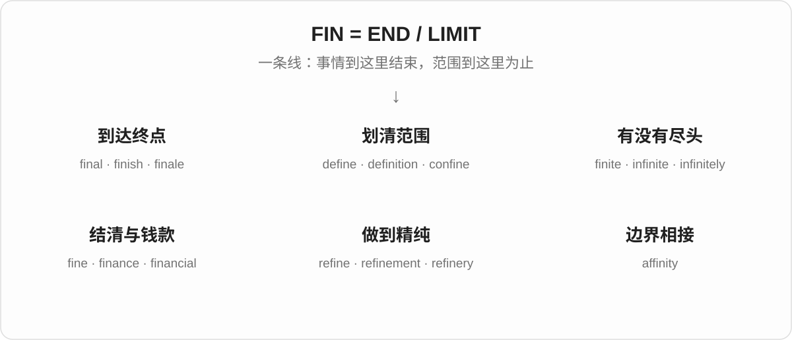

## 词形与演化规律

**fin-、finit- 是同族的不同词形。** fīnis“终点”形成 fīnīre“结束、划界”，其分词 fīnītus 提供 finit-。英语 finite 与 infinite 的发音不完全对应，不要只看字母套读音。finish 的 -ish 来自法语动词词形，不能当作 childish 那种后缀。

## 单词速览（按词族由简到繁）

同一基础词的相关扩展放在一起，先读基础形式，再读扩展；各组之间优先读常用的。具体词源关系见各词讲解。

| 单词 | 音标 | 核心意思 |
|---|---|---|
| [fine](#w-2) | /faɪn/ | 好的；精细的；罚款 |
| [final](#w-1) | /ˈfaɪnəl/ | 最后的；最终的；决赛 |
| [finally](#w-3) | /ˈfaɪnəli/ | 终于；最后 |
| [finalist](#w-15) | /ˈfaɪnəlɪst/ | 决赛选手；最终入围者 |
| [finalize](#w-24) | /ˈfaɪnəlaɪz/ | 最终敲定；定稿 |
| [finality](#w-25) | /faɪˈnæləti/ | 终局性；不可更改的意味 |
| [semifinal](#w-17) | /ˌsemɪˈfaɪnəl/ | 半决赛 |
| [quarterfinal](#w-23) | 英 /ˌkwɔːtəˈfaɪnəl/；美 /ˌkwɔːrtərˈfaɪnəl/ | 四分之一决赛 |
| [finish](#w-5) | /ˈfɪnɪʃ/ | 完成；结束；表面处理效果 |
| [finisher](#w-19) | 英 /ˈfɪnɪʃə/；美 /ˈfɪnɪʃər/ | 完成者；跑完全程的人；善于得分的人 |
| [finance](#w-6) | /ˈfaɪnæns/；也读 /faɪˈnæns/ | 资金；金融；为……提供资金 |
| [financial](#w-4) | /faɪˈnænʃəl/；也读 /fɪˈnænʃəl/ | 财务的；金融的 |
| [microfinance](#w-26) | /ˈmaɪkrəʊˌfaɪnæns/ | 小额金融服务 |
| [define](#w-8) | /dɪˈfaɪn/ | 定义；明确；界定 |
| [definition](#w-7) | /ˌdefɪˈnɪʃən/ | 定义；清晰度 |
| [definable](#w-27) | /dɪˈfaɪnəbəl/ | 可定义的；可明确界定的 |
| [redefine](#w-20) | /ˌriːdɪˈfaɪn/ | 重新定义；改变对……的理解 |
| [refine](#w-16) | /rɪˈfaɪn/ | 提纯；改进；使更精细 |
| [refinery](#w-14) | /rɪˈfaɪnəri/ | 精炼厂；炼油厂 |
| [refinement](#w-18) | /rɪˈfaɪnmənt/ | 改进；提纯；精致 |
| [refinance](#w-22) | /ˌriːˈfaɪnæns/ | 再融资；重新安排借款 |
| [refiner](#w-29) | 英 /rɪˈfaɪnə/；美 /rɪˈfaɪnər/ | 精炼者；精炼企业；精炼设备 |
| [finite](#w-11) | /ˈfaɪnaɪt/ | 有限的 |
| [finitely](#w-28) | /ˈfaɪnaɪtli/ | 有限地；在有限范围内 |
| [infinite](#w-9) | /ˈɪnfɪnət/ | 无限的；无穷的 |
| [infinitely](#w-13) | /ˈɪnfɪnətli/ | 无限地；大得多地 |
| [finale](#w-10) | /fɪˈnɑːli/ | 终曲；最后一集；收尾部分 |
| [affinity](#w-12) | /əˈfɪnəti/ | 亲近感；契合；密切关系 |
| [confine](#w-21) | 动词 /kənˈfaɪn/ | 限制；把……局限于 |

## 逐词讲解

### 1. fine — 好的；精细的；罚款

**音标**：/faɪn/

**先抓住这个画面**

fine 要分两条线记。形容词像一件已经打磨好的作品：精细、优质，也能随口表示“还好”。罚款义则像付一笔钱，让处罚这件事得到结算。

**怎么拆**

不要拆成 f + ine。罚款义经法语 fin 来自 fīnis“结束、结清”。“精细、优质”义来自古法语 fin，通常也与 fīnis 或 fīnīre 联系，但更早的具体路线并不完全确定。

**怎么变成今天的意思**

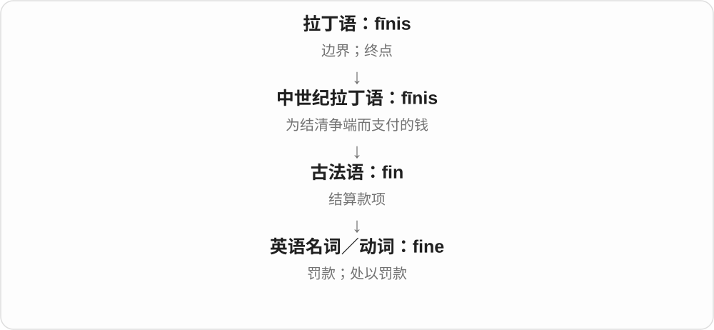

图里画的是较清楚的“罚款”路线。形容词可以用“加工到位 → 精良、精细”帮助理解，但不要把这个画面当成所有细节都已证实的历史。fine hair 是细发，fine wine 是佳酿，I’m fine 常只是说“我还好”。

**常见搭配与例句**

fine details（细节）；fine weather（好天气）；pay a fine（交罚款）；fine someone for…（因……罚某人款）。

> The camera can capture very fine details.

这台相机能拍出非常细微的细节。

> He paid a fine for parking in the wrong place.

他因停车位置不当交了罚款。

**别混淆**

I’m fine 不一定等于“我特别开心”，语气可能只是“没事”。a fine 是罚款，a fine meal 中的 fine 才是形容词。

### 2. final — 最后的；最终的；决赛

**音标**：/ˈfaɪnəl/

**先抓住这个画面**

把一件事想成一条路，final 就是路的尽头：到这里，后面没有下一轮了。a final decision 还带有“已经定下，不准备再改”的意思。

**怎么拆**

fin-（终点）+ 形容词成分 -al。这个组合在拉丁语 fīnālis 中已存在，后来经法语进入英语。

**怎么变成今天的意思**

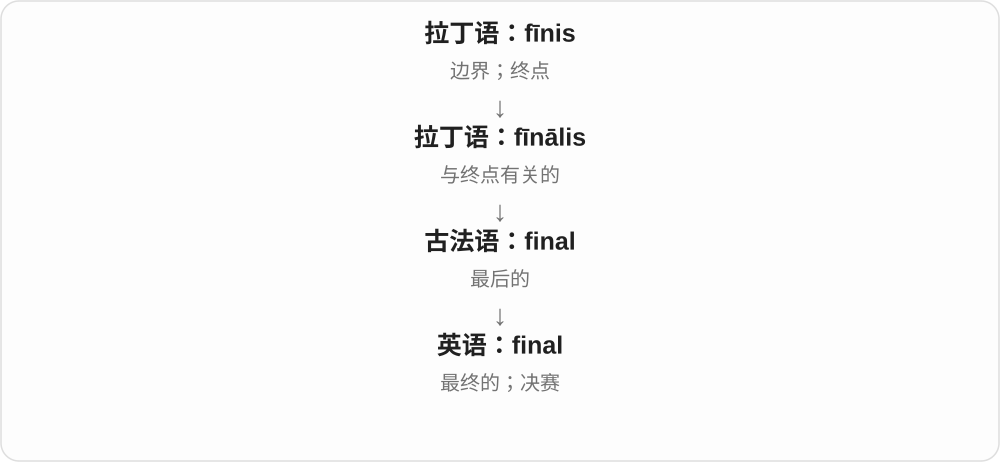

先是“与终点有关的”，再成为“最后的”。比赛的最后一轮叫 the final；课程结束时的考试也可叫 a final。这里不需要硬记三个互不相干的中文意思。

**常见搭配与例句**

the final round（最后一轮）；a final decision（最终决定）；reach the final（进入决赛）。

> This is your final chance to change the booking.

这是你修改预订的最后机会。

> Our team reached the final after a difficult match.

经过一场艰难的比赛，我们队进入了决赛。

**别混淆**

last 只说明排列在最后；final 常进一步表示这一过程到此结束。final 与 finale 同源，但用法和读音不同。

### 3. finally — 终于；最后

**音标**：/ˈfaɪnəli/

**先抓住这个画面**

finally 像在一串过程后画上句号。等了很久后事情发生，是“终于”；按顺序说到最后一步，是“最后”。

**怎么拆**

final + -ly，把“最后的”变成描述动作或安排顺序的副词。

**怎么变成今天的意思**

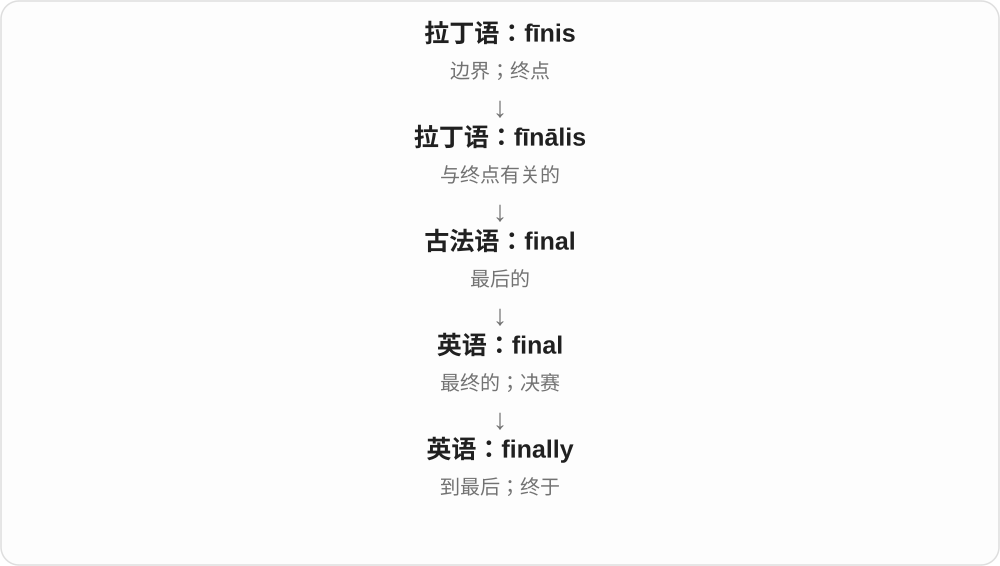

词根仍是终点，但终点有两种看法：回头看漫长等待，强调“总算到了”；往前安排步骤，表示“最后做这一件”。

**常见搭配与例句**

finally arrive（终于到达）；finally understand（终于明白）；first… then… finally…（先……再……最后……）。

> After three attempts, she finally opened the door.

试了三次后，她终于打开了门。

> Finally, add the salt and stir the soup.

最后，加盐并搅拌汤。

**别混淆**

finally 可以在列举时表示最后一点；eventually 更常说经过一段时间后出现的结果，不通常用来引出列表最后一项。

### 4. finalist — 决赛选手；最终入围者

**音标**：/ˈfaɪnəlɪst/

**先抓住这个画面**

finalist 是一路过关，走到最后一轮的人或作品。进入决赛很厉害，但不等于已经拿到冠军。

**怎么拆**

final + -ist，-ist 在这里表示参与这一阶段的人。

**怎么变成今天的意思**

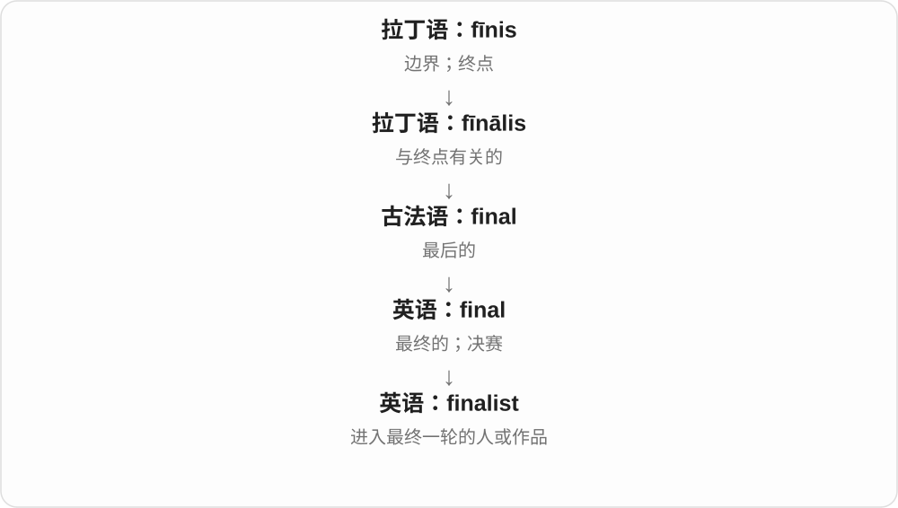

final 是最后一轮，finalist 就是处在这一轮的参与者。评奖时也常用来指最终入围的书、设计或项目。

**常见搭配与例句**

a finalist in a competition（比赛决赛选手）；one of the finalists（最终入围者之一）。

> She was one of six finalists in the singing competition.

她是歌唱比赛的六名决赛选手之一。

> The novel was a finalist for a major literary prize.

这部小说入围了一个重要文学奖的最终评选。

**别混淆**

finalist 可能最终落选；winner 才是获胜者。semifinalist 则只到半决赛阶段。

### 5. finalize — 最终敲定；定稿

**音标**：/ˈfaɪnəlaɪz/

**先抓住这个画面**

finalize 是把还在讨论、修改的东西敲定下来：“就按这个版本办。”它强调最后确认，而不仅是手头动作做完。

**怎么拆**

final + -ize，-ize 常表示“使成为……”。这里就是使安排进入最终状态。

**怎么变成今天的意思**

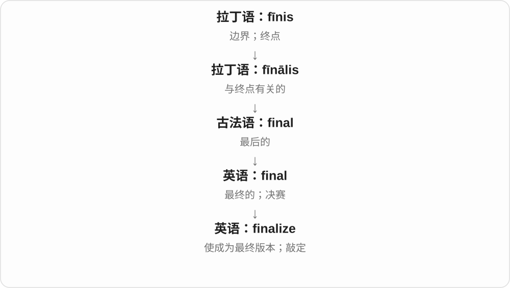

final 是最终的，finalize 把这个状态变成动作。合同、计划、名单和日程都可以被 finalize。

**常见搭配与例句**

finalize the details（敲定细节）；finalize an agreement（最终确定协议）；finalize the schedule（确定最终日程）。

> We will finalize the schedule tomorrow.

我们明天会敲定最终日程。

> The two sides are still finalizing the details of the agreement.

双方仍在敲定协议的细节。

**别混淆**

finish 是一般的完成；finalize 更强调从草案或待定状态变成正式、最终的版本。

### 6. finality — 终局性；不可更改的意味

**音标**：/faɪˈnæləti/

**先抓住这个画面**

finality 是“这事到此为止”的感觉。一个人说话带着 finality，听起来就像门已经关上，不再留讨论空间。

**怎么拆**

final + -ity 可说明现代构词关系；历史上也经法语 finalité 传入。-ity 把“最终的”变成一种性质。

**怎么变成今天的意思**

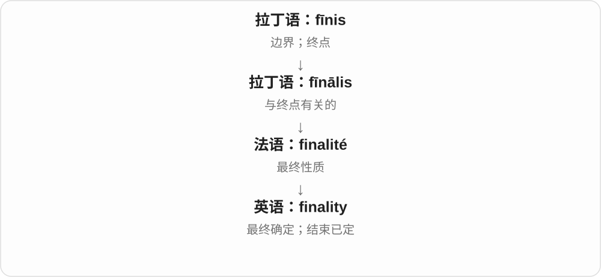

重点不是最后一件东西，而是“结束得多么彻底”。with finality 常用来描写语气、动作或某个决定给人的感受。

**常见搭配与例句**

a sense of finality（彻底结束的感觉）；speak with finality（斩钉截铁地说）；the finality of a decision（决定的终局性）。

> “We are not moving,” she said with finality.

“我们不搬家。”她斩钉截铁地说。

> Closing the empty office gave him a sense of finality.

关上空办公室的门，让他感到一切彻底结束了。

**别混淆**

finale 是收尾部分，finality 是结束已定、不能再改的性质。

### 7. semifinal — 半决赛

**音标**：/ˌsemɪˈfaɪnəl/

**先抓住这个画面**

semifinal 是通往决赛的前一轮。常见淘汰赛里，剩下四名选手或四支队伍，两场比赛各选出一方进决赛。

**怎么拆**

semi-（半）+ final（决赛）。它是一个完整单词，不需要连字符。

**怎么变成今天的意思**

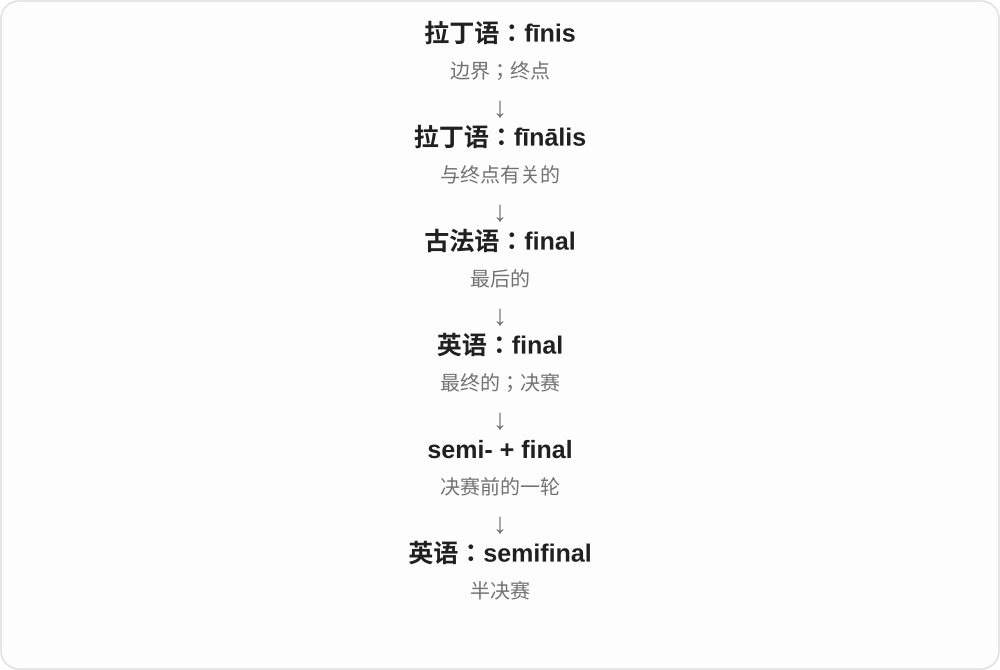

“半”不是说比赛只打半场，而是比赛已经逼近最后的决赛阶段。这个词通常可以作名词，也能放在名词前修饰一场比赛。

**常见搭配与例句**

reach the semifinal（进入半决赛）；win a semifinal（赢下半决赛）；a semifinal match（半决赛）。

> They reached the semifinal after winning on penalties.

他们在点球大战获胜后进入了半决赛。

> The semifinal will be played on Saturday.

半决赛将在周六举行。

**别混淆**

quarterfinal 是再前一轮的四分之一决赛；semifinal 胜出后才到 final。具体赛制也可能有所不同。

### 8. quarterfinal — 四分之一决赛

**音标**：英 /ˌkwɔːtəˈfaɪnəl/；美 /ˌkwɔːrtərˈfaɪnəl/

**先抓住这个画面**

常见淘汰赛剩八方时，四场比赛选出四方进入半决赛。quarterfinal 就是这一轮，常被简称“八强赛”。

**怎么拆**

quarter（四分之一）+ final（决赛），是英语复合词。

**怎么变成今天的意思**

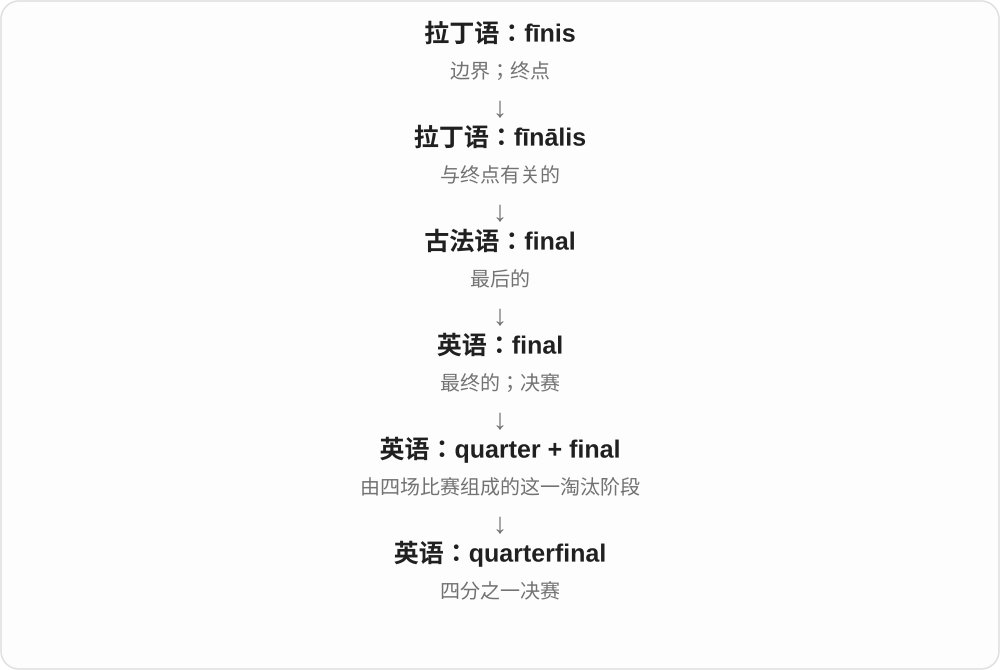

名称说的是比赛进程中的阶段，不是比赛时长只有正常的四分之一。学这个词时，把 quarterfinal → semifinal → final 作为赛程顺序记住。

**常见搭配与例句**

reach the quarterfinals（进入八强）；a quarterfinal match（四分之一决赛）；lose in the quarterfinals（止步八强）。

> She won her quarterfinal in straight sets.

她直落两盘赢下了四分之一决赛。

> The team was eliminated in the quarterfinals.

球队在四分之一决赛中被淘汰。

**别混淆**

quarterfinalist 是进入该阶段的选手；quarterfinal 是比赛或轮次。

### 9. finish — 完成；结束；表面处理效果

**音标**：/ˈfɪnɪʃ/

**先抓住这个画面**

finish 是把正在做的事推到终点：作业做完、比赛跑完、饭吃完。它强调这件事不再继续，而不只是暂停一下。

**怎么拆**

fin- 来自 fīnis“终点”。英语的 -ish 这里来自古法语动词变化里的 finiss-，不是 childish 中表示“像……的”后缀。

**怎么变成今天的意思**

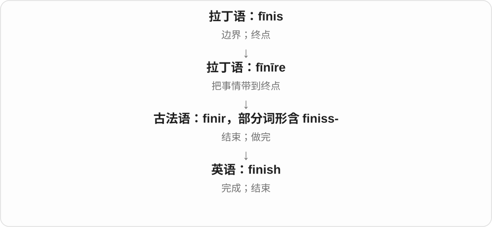

终点既可以是一项任务的完成，也可以是制作过程最后留下的效果，所以家具的 finish 可以指漆面、光泽或表面处理。

**常见搭配与例句**

finish doing something（做完某事）；finish a task（完成任务）；a smooth finish（光滑的表面效果）。

> I’ll call you when I finish cooking.

我做完饭就给你打电话。

> The wooden table has a smooth finish.

这张木桌的表面处理得很光滑。

**别混淆**

finish doing 是做完一件事；stop doing 只说明停下来，可能还没做完。通常不说 finish to do。

### 10. finisher — 完成者；跑完全程的人；善于得分的人

**音标**：英 /ˈfɪnɪʃə/；美 /ˈfɪnɪʃər/

**先抓住这个画面**

finisher 是把事情做到底的人。马拉松里能跑过终点就是 finisher；足球里善于把机会变成进球的人也可这样称呼。

**怎么拆**

finish + -er，-er 表示做这个动作的人，也可能指完成最后加工的工人或工具。

**怎么变成今天的意思**

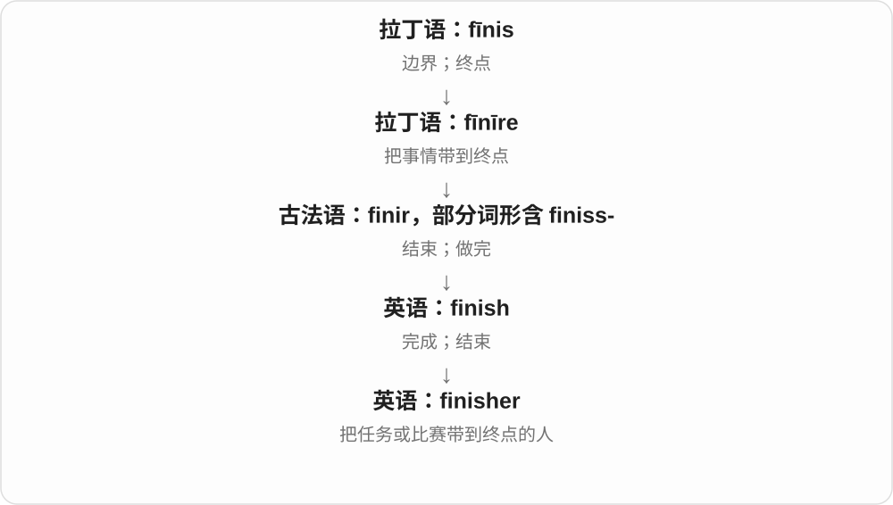

核心不是“参加过”，而是“完成了最后那一下”。因此比赛完赛者、收尾加工者和临门一脚厉害的球员可以共用这个词。

**常见搭配与例句**

a marathon finisher（马拉松完赛者）；a strong finisher（收尾强劲的人）；a clinical finisher（临门一脚稳准的球员）。

> Every finisher received a medal.

每位完赛者都获得了一枚奖牌。

> The striker is a calm and accurate finisher.

这名前锋临门一脚冷静而准确。

**别混淆**

starter 负责开始或指起跑者，finisher 强调完成。完赛并不要求名次靠前。

### 11. finance — 资金；金融；为……提供资金

**音标**：/ˈfaɪnæns/；也读 /faɪˈnæns/

**先抓住这个画面**

想象账本上一笔欠款：把钱付清，这笔账就“结束”了。这是 finance 与“终点”联系的入口。今天它谈的范围扩大为筹钱、用钱、管钱。

**怎么拆**

来自法语 finance，与 finer“结束、结清”及 fin“终点”有关；不是现代英语的 fine“好的”再加一个随意的后缀。

**怎么变成今天的意思**

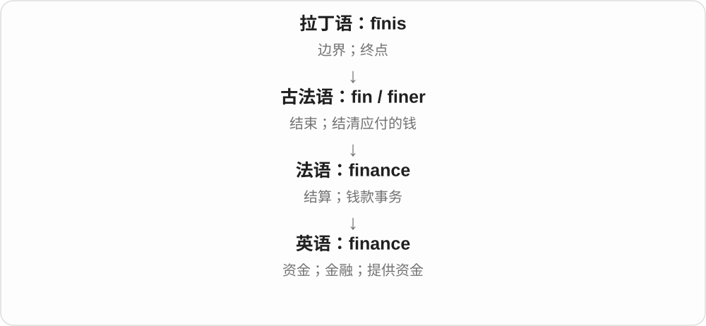

从“结清一笔应付的钱”到“处理钱款”，再到资金和金融事务。作动词时，finance a project 就是把项目所需的钱安排到位。

**常见搭配与例句**

raise finance（筹集资金）；personal finance（个人理财）；finance a project（为项目提供资金）。

> The company borrowed money to finance the new factory.

公司借钱为新工厂提供资金。

> He took a course in personal finance.

他上了一门个人理财课程。

**别混淆**

finance 不等于 profit：finance 关心钱从哪来、怎么安排；profit 是收入扣除成本后的利润。

### 12. financial — 财务的；金融的

**音标**：/faɪˈnænʃəl/；也读 /fɪˈnænʃəl/

**先抓住这个画面**

financial 就是“与钱怎样进来、出去、筹到和管理有关”。financial trouble 不是钱包难用，而是钱周转出了问题。

**怎么拆**

finance + -ial，去掉词末 e，再形成形容词。末尾这部分读 /ʃəl/，不是把 finance 原样读完再加一个音节。

**怎么变成今天的意思**

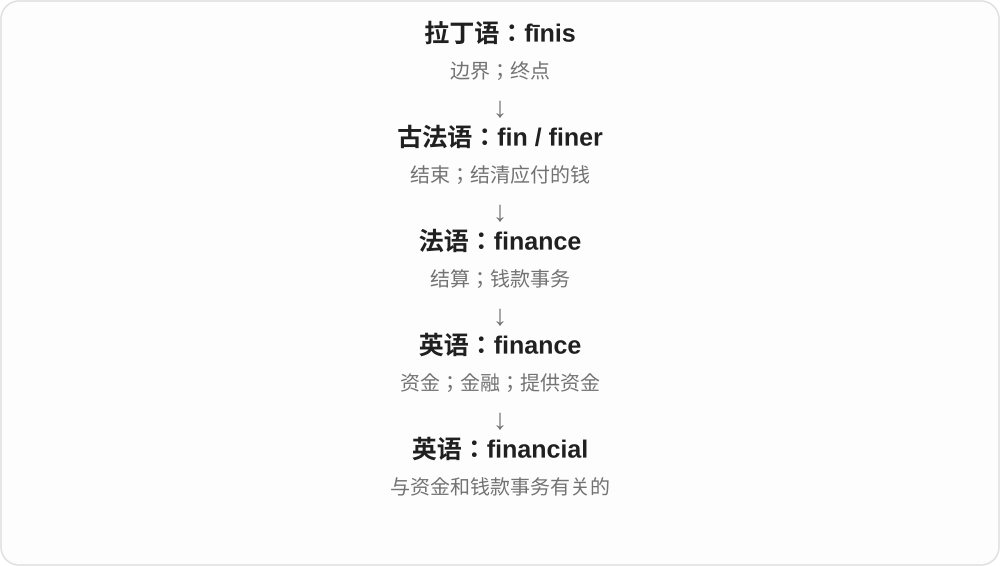

finance 已从“结清钱款”发展到资金管理；financial 再把它变成描述某种状况、机构或活动的词。

**常见搭配与例句**

financial support（资金支持）；financial problems（财务问题）；a financial report（财务报告）。

> The project needs financial support from several organizations.

这个项目需要几个组织提供资金支持。

> She reads the financial report before each meeting.

每次开会前，她都会阅读财务报告。

**别混淆**

financial 常聚焦资金、账目和融资；economic 更常谈经济活动、生产消费和整体经济状况。

### 13. microfinance — 小额金融服务

**音标**：/ˈmaɪkrəʊˌfaɪnæns/

**先抓住这个画面**

microfinance 像把原本门槛很高的金融服务缩小到更小的资金需求：不仅可能有小额贷款，也可以包括储蓄和其他基本服务。

**怎么拆**

micro-（小）+ finance（金融服务）。是现代组合，不能把古希腊语 micro- 与拉丁语 fin- 当作古代已有的完整词。

**怎么变成今天的意思**

这里“小”主要指服务的资金规模和对象需求，而不是“金融学的一小部分”。这类词说明古典构词成分今天仍能用于命名新事物。

**常见搭配与例句**

a microfinance institution（小额金融机构）；microfinance services（小额金融服务）；a microfinance program（小额金融项目）。

> The organization offers microfinance services to small businesses.

该组织向小企业提供小额金融服务。

> The study compared several microfinance programs.

这项研究比较了几个小额金融项目。

**别混淆**

microcredit 主要指小额信贷；microfinance 范围更广。词本身也不保证某个项目一定低风险或有效。

### 14. define — 定义；明确；界定

**音标**：/dɪˈfaɪn/

**先抓住这个画面**

define 就是把模糊的边界画清楚。“成功”究竟算什么？这个岗位负责到哪里？把范围说清楚，就是在 define。

**怎么拆**

历史上是 dē- + fīnīre“划出界限”。这里不要把 de- 一律翻成“取消”；整个拉丁词已经表示明确界定。

**怎么变成今天的意思**

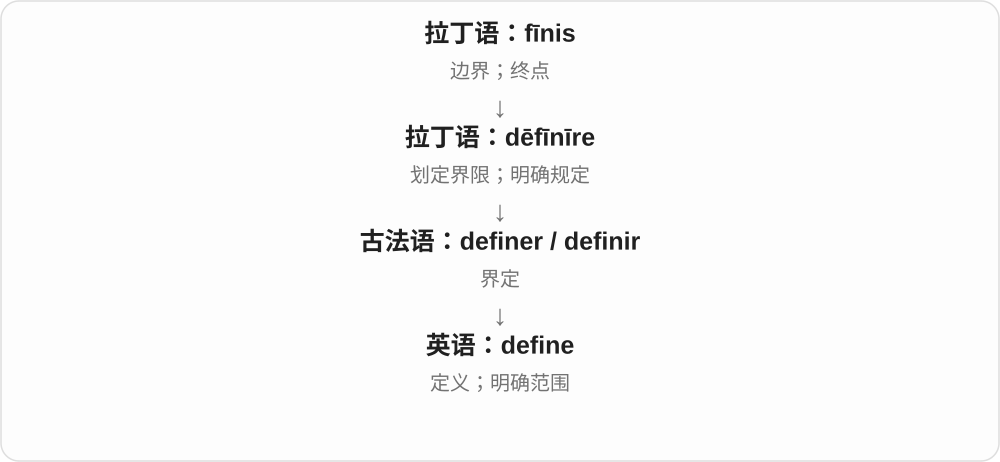

一开始的边界可以是空间上的，后来也可以是概念、职责和身份的边界。define a role 是明确职责，define a term 是说明一个词的意思。

**常见搭配与例句**

define a term（给术语下定义）；clearly define roles（明确职责）；be defined by…（由……塑造或界定）。

> We need to define each person’s role before we begin.

开始前，我们需要明确每个人的职责。

> Your job does not have to define your whole identity.

你的工作不必定义你整个人的身份。

**别混淆**

describe 描述一个东西是什么样；define 需要抓住决定“它是什么”的边界或特征。

### 15. definition — 定义；清晰度

**音标**：/ˌdefɪˈnɪʃən/

**先抓住这个画面**

definition 像给一个概念画圈：圈内哪些算它，圈外哪些不算。图像的 definition 则关心轮廓能不能清清楚楚分开。

**怎么拆**

来自拉丁语 dēfīnītiō，经法语传入。现代可把它与 define 联系，但拼写不是直接写 define + tion；词形对应为 define → definition。

**怎么变成今天的意思**

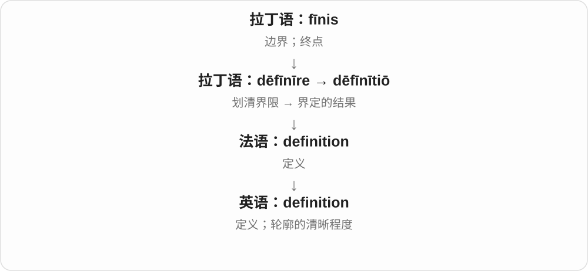

“界限清楚”同时解释了两个常见意思：定义让概念边界清楚，图像清晰度让物体轮廓清楚。high definition 因而是高清晰度。

**常见搭配与例句**

the definition of…（……的定义）；by definition（按照定义）；high definition（高清晰度）。

> Can you give me a simple definition of the word?

你能用简单的话解释这个词的定义吗？

> The new screen shows the image in high definition.

新屏幕能以高清晰度显示这幅图像。

**别混淆**

definition 说明一个概念到底指什么；example 给出它的一个实例。一个好例子很有帮助，但不一定能代替完整定义。

### 16. definable — 可定义的；可明确界定的

**音标**：/dɪˈfaɪnəbəl/

**先抓住这个画面**

definable 表示一件事的边界可以说清楚：有明确的条件，能够判断什么算它、什么不算它。

**怎么拆**

define + -able；去掉末尾 e 再加 -able，表示“可以被界定的”。

**怎么变成今天的意思**

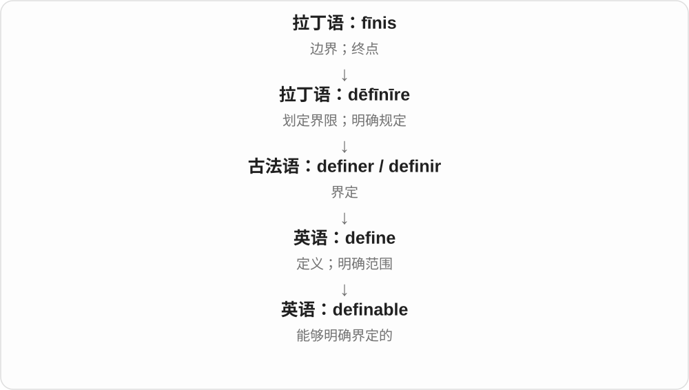

define 是画边界，definable 是这条边界能画出来。a clearly definable goal 因而是一个能把具体要求说清楚的目标。

**常见搭配与例句**

a definable goal（可明确界定的目标）；clearly definable limits（能够清楚界定的界限）。

> We need a clearly definable goal for the first stage.

第一阶段需要一个能够明确界定的目标。

> The boundary between the two styles is not easily definable.

这两种风格之间的界限不容易说清。

**别混淆**

definable 说“可以界定”；defined 说“已经界定”。有能力做和已经做完不是一回事。

### 17. redefine — 重新定义；改变对……的理解

**音标**：/ˌriːdɪˈfaɪn/

**先抓住这个画面**

redefine 就是把原来画好的圈重新画一遍。标准、范围或理解发生变化，原来的“什么算它”也随之改变。

**怎么拆**

re-（重新）+ define（界定）。这是现代英语里清楚可见的构词。

**怎么变成今天的意思**

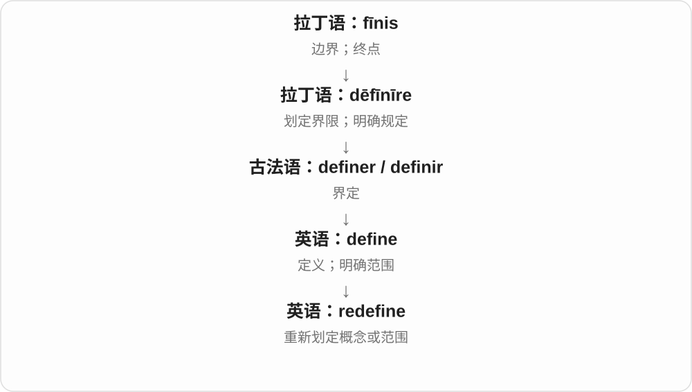

既可以真的重写一个定义，也可以比喻某种变化改变了人们的旧认识。redefine success 就是在重新思考“怎样才算成功”。

**常见搭配与例句**

redefine a role（重新界定角色）；redefine success（重新定义成功）；redefine the relationship（重新界定关系）。

> Becoming a parent made her redefine success.

成为母亲让她重新思考什么才算成功。

> The agreement redefines the responsibilities of each team.

协议重新界定了各团队的职责。

**别混淆**

redefine 改的是定义或理解框架；rename 只说明改名字，名字改了，含义可能没变。

### 18. refine — 提纯；改进；使更精细

**音标**：/rɪˈfaɪn/

**先抓住这个画面**

想象把粗糙的东西再打磨一遍，把杂质去掉、细节做好。这就是 refine：东西已经有了，现在把它变得更好。

**怎么拆**

re- + fine“使精细、使纯净”。这里的 re- 有加强或进一步加工的意味，不必机械译成“重新”。

**怎么变成今天的意思**

最容易看到的例子是提炼金属或石油；同一个动作也能比喻打磨方案、想法和技巧。它强调改良已有的东西。

**常见搭配与例句**

refine oil（炼油）；refine an idea（完善想法）；refine a technique（改进技法）。

> We need to refine the design before building a prototype.

制作原型前，我们需要进一步完善设计。

> The plant refines crude oil into usable products.

这家工厂把原油加工成可用产品。

**别混淆**

refine 通常是在已有基础上改进；replace 是换掉。一个方案可以不断被 refine，而不必从零重做。

### 19. refinery — 精炼厂；炼油厂

**音标**：/rɪˈfaɪnəri/

**先抓住这个画面**

refinery 就是专门做 refine 的地方：原料运进去，经过加工后成为更纯净或更有用的产品。

**怎么拆**

refine + -ery，词末 e 与后缀的 e 合并。词典也常记成 refine + -ry；两种记法都指这一“加工地点”关系。

**怎么变成今天的意思**

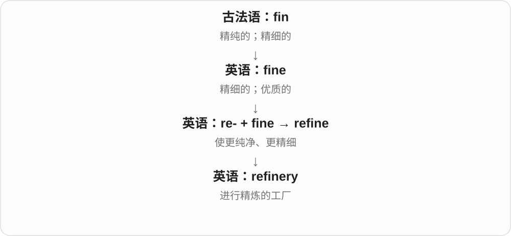

动作 refine 变成地点名词 refinery。它不只限于石油：糖、金属等也可以在相应的 refinery 里精炼。

**常见搭配与例句**

an oil refinery（炼油厂）；a sugar refinery（炼糖厂）；work at a refinery（在精炼厂工作）。

> The refinery processes oil from several nearby fields.

这家炼油厂加工附近几个油田的原油。

> Her father worked at a sugar refinery.

她父亲曾在一家炼糖厂工作。

**别混淆**

refinery 是工厂；refinement 是加工或改进的过程、结果。结尾不同，指的东西也不同。

### 20. refinement — 改进；提纯；精致

**音标**：/rɪˈfaɪnmənt/

**先抓住这个画面**

refinement 可以是打磨的过程，也可以是其中一次小改进。它往往让东西更细、更顺、更成熟，不一定是一次彻底重做。

**怎么拆**

refine + -ment，形成动作、结果或状态名词。

**怎么变成今天的意思**

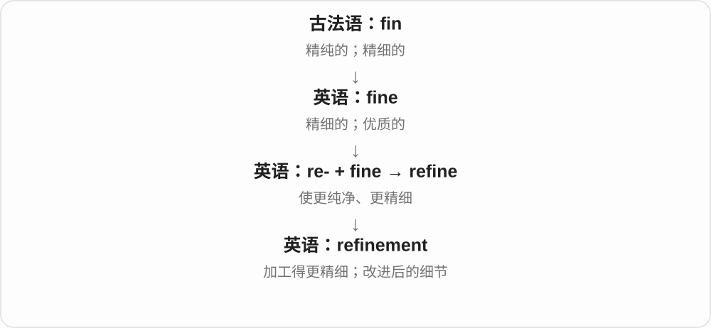

从去掉原料中的杂质，扩展到改进设计和方法，再扩展到举止、品位上的精致。这里的多个义项都能围绕“由粗到细”理解。

**常见搭配与例句**

further refinement（进一步改进）；a refinement to the design（设计的一处改进）；refinement of a method（方法的完善）。

> The latest model includes several small refinements.

最新型号包含几项细小的改进。

> The technique still needs further refinement.

这项技术仍需进一步完善。

**别混淆**

refinement 常是细化和优化；revolution 强调根本性变化。a refinement 可数，表示一项具体改进。

### 21. refinance — 再融资；重新安排借款

**音标**：/ˌriːˈfaɪnæns/

**先抓住这个画面**

refinance 像把旧的借钱安排换成一套新的安排：可能换贷款方、期限或条件。重点是现有债务或资金安排被重新组织。

**怎么拆**

re-（重新）+ finance（筹资、融资）。它不是 refine“提纯”的名词形式。

**怎么变成今天的意思**

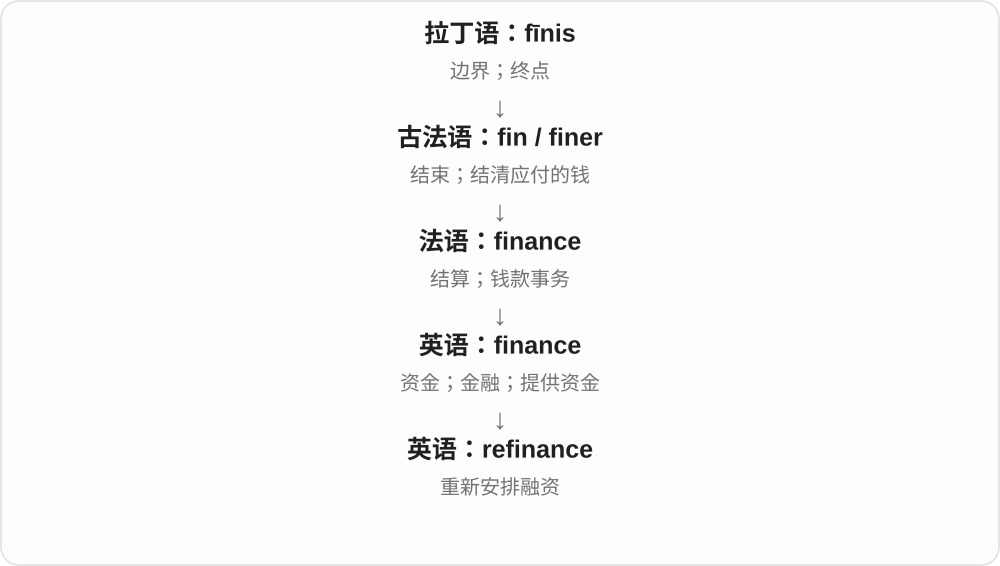

fin- 到 finance 的历史已经是“结账 → 钱款管理”；这里再加 re-，只是在英语层面表示把融资再做一次。

**常见搭配与例句**

refinance a loan（重新安排贷款）；refinance a mortgage（为按揭再融资）；refinance existing debt（重组现有债务融资）。

> The company plans to refinance its existing debt.

公司计划为现有债务重新安排融资。

> They asked the bank about refinancing their mortgage.

他们向银行咨询了按揭再融资的事。

**别混淆**

refinance 不一定等于 repay“还清债务”。旧贷款可能结束，但新的贷款仍然存在。

### 22. refiner — 精炼者；精炼企业；精炼设备

**音标**：英 /rɪˈfaɪnə/；美 /rɪˈfaɪnər/

**先抓住这个画面**

refiner 是做 refine 这件事的人、企业或设备。看到 oil refiner，可以想成把原油加工为可用产品的一方。

**怎么拆**

refine + -er，词末已有 e，只加 r。-er 不限于表示人，也能表示企业和机器。

**怎么变成今天的意思**

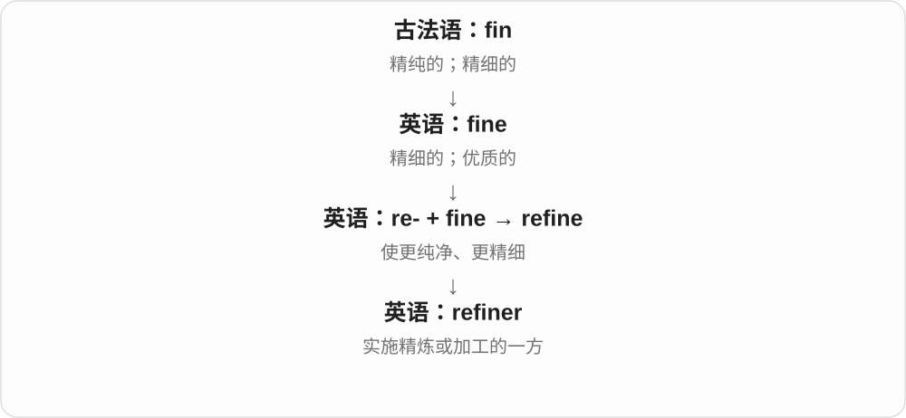

这是“动作 → 做动作的人或物”的普通英语派生。新闻中的 refiner 往往指公司，而 refinery 指工厂地点。

**常见搭配与例句**

an oil refiner（炼油企业）；a gold refiner（黄金精炼商）；a sugar refiner（炼糖企业）。

> The refiner buys crude oil from several suppliers.

这家炼油企业从几个供应商那里购买原油。

> The gold refiner checks the purity of each batch.

黄金精炼商检查每一批产品的纯度。

**别混淆**

refiner 是加工者，refinery 是加工厂；同一家 refiner 可以经营多家 refineries。

### 23. finite — 有限的

**音标**：/ˈfaɪnaɪt/

**先抓住这个画面**

finite 就是“再多也有个数，再长也有个边”。一天的时间、仓库的空间、账户的钱，都是有限的。

**怎么拆**

来自拉丁语 fīnītus“已划定界限的”，与 fīnis“边界”同族。现代不要把它读成 finish 的开头；常见读音中两个主要元音都是 /aɪ/。

**怎么变成今天的意思**

“已被划出边界”转成“范围或数量有限”。语法中的 finite verb“限定动词”是专门用法，指承担时态等句法限制的动词形式。

**常见搭配与例句**

finite resources（有限资源）；a finite number of…（有限数量的……）；a finite set（有限集）。

> We have a finite amount of time to solve the problem.

我们解决这个问题的时间是有限的。

> The game has a finite number of possible moves.

这个游戏可采取的走法数量是有限的。

**别混淆**

finite 不代表少：一万亿也仍是有限数。small 才说明数量或体积小。

### 24. finitely — 有限地；在有限范围内

**音标**：/ˈfaɪnaɪtli/

**先抓住这个画面**

finitely 多见于数学和逻辑，意思是数量或过程到某处就会停下来，不会无限延伸。

**怎么拆**

finite + -ly。注意它保留 finite 的两个 /aɪ/，与 infinitely 的读音节奏不同。

**怎么变成今天的意思**

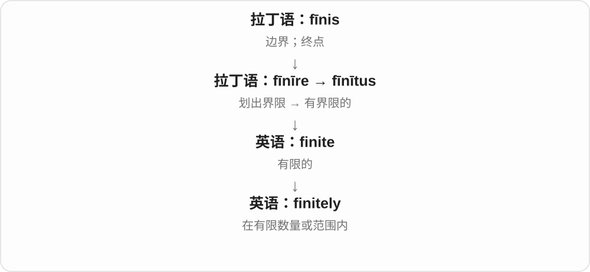

finite 描述对象有限；finitely 把这个性质放到数量或操作方式上。finitely many 就是“有限多个”，数量可以很大。

**常见搭配与例句**

finitely many（有限多个）；finitely generated（有限生成的）；finitely bounded（有有限界限的）。

> The equation has finitely many solutions.

这个方程只有有限多个解。

> Only finitely many cases need to be checked.

需要检查的情况只有有限多种。

**别混淆**

finitely many 不等于 a few“几个”。前者只保证数量有限，没有说它少。

### 25. infinite — 无限的；无穷的

**音标**：/ˈɪnfɪnət/

**先抓住这个画面**

想象一直往前走，却找不到尽头。infinite 就是没有有限边界；日常夸张时，也可以说多得仿佛没有尽头。

**怎么拆**

in-（不）+ finite（有限的）。历史上的拉丁语 īnfīnītus 也包含这个否定关系。

**怎么变成今天的意思**

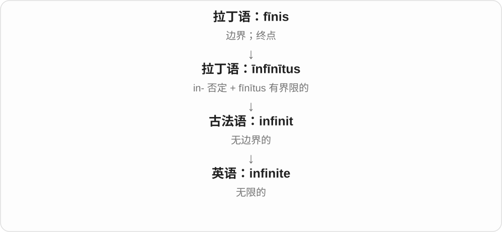

fin- 提供“终点”，in- 把终点否定。严格的数学无限与生活中说 infinite patience“无穷耐心”不是同一种精确程度。

**常见搭配与例句**

an infinite number of…（无穷多个……）；infinite space（无限空间）；infinite patience（极大的耐心）。

> There are infinitely many prime numbers, so the set is infinite.

质数有无穷多个，因此这个集合是无限集。

> She seemed to have infinite patience with the children.

她对孩子们似乎有用不完的耐心。

**别混淆**

infinite 不是“特别大的有限数”。enormous 是很大，finite 是终究有界限，infinite 在严格意义上没有这个上限。

### 26. infinitely — 无限地；大得多地

**音标**：/ˈɪnfɪnətli/

**先抓住这个画面**

infinitely 把“没有尽头”用来修饰程度。数学中可指真正的无限；日常说 infinitely better，通常是在强调“好太多了”。

**怎么拆**

infinite + -ly，构成副词。别按有限的 finite 那套重音和元音直接拼读整个词。

**怎么变成今天的意思**

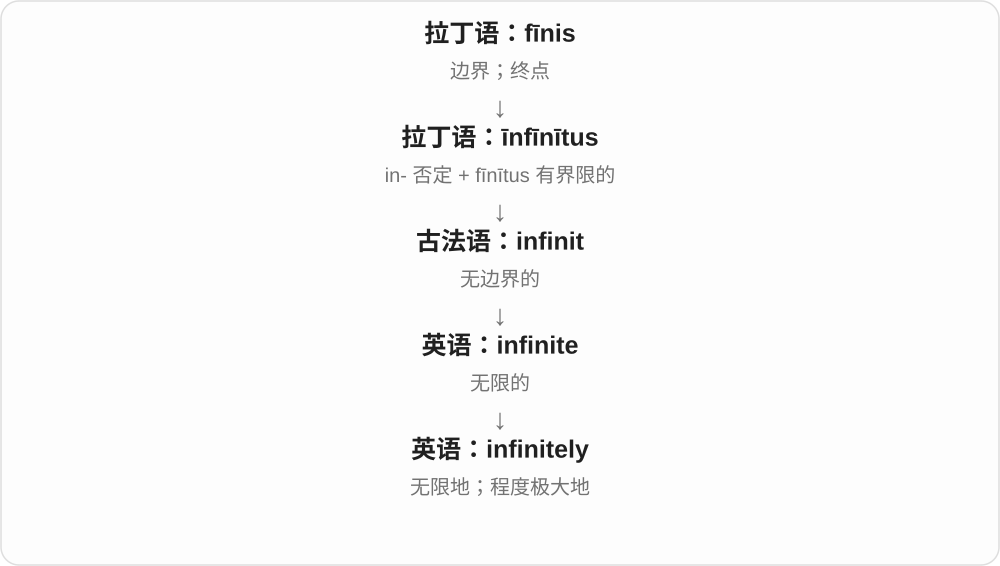

在普通说话中，人会用没有上限的画面来放大差别，所以 infinitely more useful 常是强烈赞同，不是计算出来的无限倍。

**常见搭配与例句**

infinitely better（好得多）；infinitely small（无限小的）；infinitely many（无穷多个）。

> This explanation is infinitely easier to follow.

这个解释好懂多了。

> A line contains infinitely many points.

一条直线包含无穷多个点。

**别混淆**

infinitely 比 very 强烈，也更容易带夸张。正式数量分析里，不能把“非常多”随便写成“无限”。

### 27. finale — 终曲；最后一集；收尾部分

**音标**：/fɪˈnɑːli/

**先抓住这个画面**

finale 是专门留给最后的那一段：音乐会的终曲、电视剧的季终集、节目最后的收尾。它往往是一个有分量的结尾。

**怎么拆**

从意大利语 finale 借入，与 final 同源。末尾 e 要发音，整个词通常有三个音节，重音在中间。

**怎么变成今天的意思**

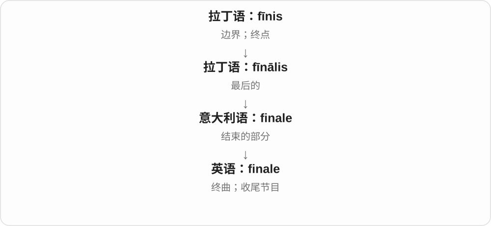

同一个拉丁来源经过不同语言进入英语：经法语形成 final，后来从意大利语借来的 finale 常用于艺术、演出和叙事的结尾。

**常见搭配与例句**

the grand finale（压轴收尾）；the season finale（季终集）；a dramatic finale（戏剧性的结尾）。

> The orchestra saved its most exciting piece for the finale.

乐团把最精彩的曲目留作终曲。

> We watched the season finale together.

我们一起看了这一季的最后一集。

**别混淆**

final 常作“最后的”或指决赛；finale 通常是某个作品、节目或活动的收尾部分。

### 28. affinity — 亲近感；契合；密切关系

**音标**：/əˈfɪnəti/

**先抓住这个画面**

想象两块土地边界挨着，人也像住得很近的邻居。affinity 描述“很合得来、自然靠得近”的感觉，也可说事物之间性质相合。

**怎么拆**

历史上 ad-（靠向）+ fīnis（边界）形成 affīnis“相邻的”，ad- 的 d 同化为 f。affīnitās 是表示关系的名词。

**怎么变成今天的意思**

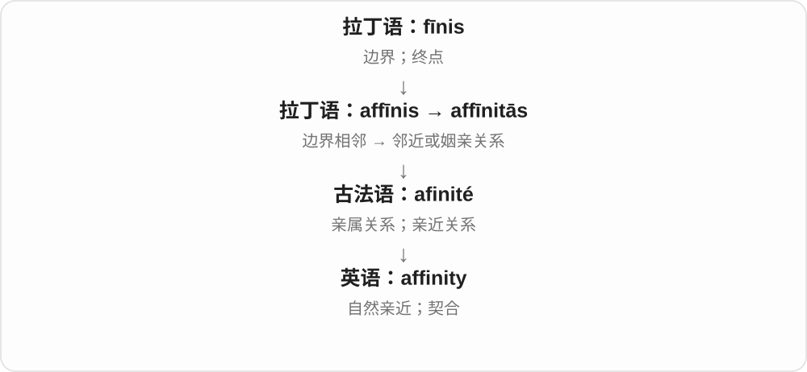

早期常指因婚姻形成的亲属关系，后来扩展到没有血缘却感觉亲近、性格或性质相投。这是“边界挨着”走向“关系靠近”的一支。

**常见搭配与例句**

feel an affinity with someone（与某人有亲近感）；have an affinity for music（对音乐有天然爱好）。

> She felt an immediate affinity with the new teacher.

她一见到新老师就有一种亲近感。

> He has a natural affinity for languages.

他对语言有一种天然的亲近感。

**别混淆**

affinity 是相合或亲近，不等于已经建立的 friendship。可以对一个刚认识的人产生 affinity，也可以对某种艺术产生 affinity。

### 29. confine — 限制；把……局限于

**音标**：动词 /kənˈfaɪn/

**先抓住这个画面**

想象在一个范围外画线：“你只能待在这里，不能越过去。”confine 可以限制人的活动，也可以限制讨论的内容。

**怎么拆**

与拉丁语 con- + fīnis“边界”有关，经 confīnis、confīnium 和法语 confiner 等词形传来。现代不能拆成 con + fine“好”。

**怎么变成今天的意思**

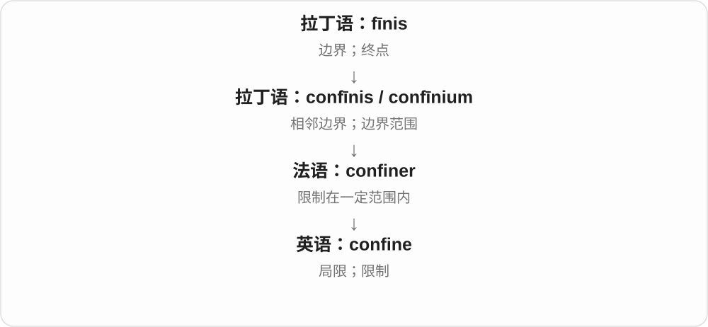

把范围圈住，就是不让人或事超出边界。confine the discussion to one issue 是把话题限定为一个问题，不涉及实际的围墙。

**常见搭配与例句**

confine something to…（把……限制在……）；be confined to bed（卧床）；within the confines of…（在……范围内）。

> Please confine your comments to the main issue.

请把评论限定在主要问题上。

> Heavy snow confined us to the house for two days.

大雪让我们两天都只能待在屋里。

**别混淆**

confine 不等于 confirm“确认”。名词复数 confines 指界限或范围，常把重音放在前面。

## 这一组要分清什么

**fine 的不同义项要分开看。** “罚款”有清楚的结清、终结案件的联系；“优质、精细”来自古法语 fin，更深处与 fīnis / fīnīre 的关系常被提出，但具体发展并不完全确定。refine 一支从这个形容词继续发展，不能把推测硬说成定论。

**affinity 的起点是相邻。** 边界挨在一起，后来联系到婚姻亲属、自然联系和亲近感。它不是把 fine 加上一个前缀变成“非常好”。

**finite 不等于少，infinite 也不总是数学概念。** 有限的数量可以大得惊人；日常 infinite patience 则常是夸张地说耐心很足。

## 串起来练习

连起来想：**Define a finite goal, refine the plan, and finally finish the work.**

先定一个有边界的目标，再把方案打磨好，最后把工作做完。define 画界线，finite 表示有界限，refine 打磨细节，finally 与 finish 把事情带到终点。
