# 0095 · cap-, -cip-, capt-, -cept- — 抓住；拿到；容纳；在头脑中掌握

[逐词精讲目录](../00_逐词精讲目录.md) · [总目录](../00_总目录_按常用程度.md)

## 核心词根与来源

这一组来自拉丁语 **capere / capiō**“拿、抓、容纳”。先想一只伸出去的手：接到自己这边是 receive，拿出去是 except，在中途截住是 intercept。手抓住实物，头脑也能“抓住”信息，于是又有 perceive、conceive。

**CAP / CIP / CAPT / CEPT = TAKE**

伸手接住一个东西，也可以是在脑中抓住一个意思

- **接到自己这边**：receive · accept · reception
- **拿出去／截住**：except · intercept · capture
- **脑子抓住信息**：perceive · conceive · concept
- **装得下／做得到**：capable · capacity · capacious
- **刚开始动手**：incipient · inception
- **cable：抓住、套住的绳到传输线路**：cable
- **case 围框容纳的复合词：staircase**：case · stair · staircase
- **receive → received：收到了；受到**：receive · received
- **case → cases：盒、箱的复数另看容器来源**：case · cases
- **receive → receives／receiving：东西、消息到了这边**：receive · receives · receiving
- **capable → capability → capabilities：能承接并完成的事**：capability · capabilities
- **concept → concepts：吸收材料、形成观念**：concept · concepts
- **capture → captured：抓到、留住与捕捉影像**：capture · captured
- **accept → accepting：接过来、愿意容纳**：accept · accepted · accepting · acceptance
- **perceive → perceived：感官、头脑把东西接进来**：perceive · perceived · perception
- **recipe → recipes：先取这些材料，再照着做**：recipe · recipes
- **exception → exceptions：从一般规则里拿出去的情况**：exception · exceptions
- **receive 与 receipt：收到，收到的凭证**：receive · receipt · receipts
- **抓取、容纳词族两支：cable 与 conceive**：cable · cables · conceive · conceived
- **拿取词族 accept → accepts：接受、认可**：accept · accepts
- **caption 的图片说明、字幕与加注形式**：caption · captions · captioned · captioning
- **chase 与 catch 的法语双式词联系**：catch · chase · chases · chased · chasing · chaser · chasers
- **re- + cap-/cip- 接取 → recipients**：recipients
- **re- + cept- 接取 + -or → receptor**：receptor
- **capt- 抓取 → capture → capturing**：capturing
- **receive → receiver → receivers**：receivers
- **re- + cept- 接收 → receptors**：receptors
- **ob- + cap- 抓取 → occupy → occupying**：occupy · occupying
- **capt- 取、抓 → captures**：captures
- **per- 充分 + cept- 抓取 → perceptions**：perceptions

## 词形与演化规律

**cap-、cip-、capt-、cept- 是同一词族的不同历史词干。** 拉丁语复合环境里的元音变化和分词构词，留下了这些形式；法语借入又让一部分词出现 -ceive。所以 receive / reception、conceive / conception 有联系，但不能把任意英语词的 -ceive 换成 -ception 来造词。

现代派生如 receive → receiver、capable → capability，与古代词形变化是两回事。下图只画每个词实际有关的路径；“伸手抓东西”的画面帮助理解，不代替历史证据。

cable 经法语接拉丁 capulum 绳套，连接 capere 抓住；现代线缆义随材料和通信用途扩展。

staircase 是 stair 与 case 围框、容纳结构的英语复合，case 的容器线接拉丁 capsa；stair 本身另来自日耳曼登升词族，不能归为拉丁 capere 的直接借词。

received 的 -ed 读 /d/；邮件、帮助、欢迎和信号都能被接收。

容器 case 经法语接拉丁 capsa 盒，不与情况义 casus 合并；cases 两义在英语中同形。

receive 接拉丁 re- 加 capere 的 recipere，经法语借入；receiving 去掉不发音 e 再加 -ing。

-able 变为 -ability，再以 -ies 构成复数；容纳、胜任的词族保持联系。

拉丁构想词族的 concept- 与 conceive 的历史词形相对应。

拉丁抓取词的名词经法语借入，英语再发展出动词。

拉丁 accipere 的 accept- 分词词干，英语 ing 不改变词尾。

拉丁 per 与 capere 到 percipere，经法语有 ceive 形式；过去式浊音 v 后读 d。

拉丁 recipere 的命令式 recipe，配制指令转为配方、食谱名。

拉丁 exceptio 经法语借入，和 except 词族对照，不倒推全在英语现场造词。

两词分别经法语相关形式接拉丁 recipere；receipt 后来恢复字母 p，但常用读音未恢复 p。

绳套抓牢；收进头脑、形成想法。每个基词与自己的扩展相邻。

接受不自动表示喜欢，现代三单加 s。

从拉丁 captio 词族，经法律文书说明、标题等中间用途发展，不用抓眼球故事替代历史。

追逐义 chase、catch 经不同法语形式联系拉丁 capere、captare 一路；现代追赶不保证已经抓住。

recipient 经法语、拉丁 recipiens 接收的现在分词材料进入英语，和 receive 属同一较远词族；不是现代 receive 直接改几字母造出。复数 -s，末尾 /nts/。

receptor 接拉丁 recipere 接取的相关人名词形，现代生物学受体、感受器等名称借接收功能来理解。与 receive、receptive 对照，不把现代 receive 写成科学名词的直接祖先。

capture 的名词接法语、拉丁 captura 捕捉，后来英语转为动词。现代去 e 加 -ing，抓取、影像记录、捕捉特征等各举常见用法。

receiver 现代可对应 receive 去 e 加完整 -er，也有法语 recevere 等人名词借入分析。复数常说接收器、电话听筒或接球手，接取这一画面相通。

receptor 经法语、拉丁 receptor 接 recipere 接纳。现代生物学常用受体义，接收特定分子信号；复数 -s 读 /z/。

occupy 经法语、拉丁 occupare 占有，接 ob- 与 capere 取、抓的加强形式，末尾英语拼写演变不完全清楚。现代保留 y 加 -ing。

capture 接法语、拉丁 captura 抓取，源自 capere 与 capt-。现代保留 e 加 -s，/r/ 等后读 /z/，抓获、拍下、抓住注意力均可。

perception 接拉丁 perceptio，来自 percipere 取得、心中领会，含 per- 与 capere 抓取。-ion 名词，现代 -s。

## 单词速览（按词族由简到繁）

同一基础词的相关扩展放在一起，先读基础形式，再读扩展；各组之间优先读常用的。具体词源关系见各词讲解。

| 单词 | 音标 | 核心意思 |
|---|---|---|
| [case](#w-43) | /keɪs/ | 情况；实例；案件；论据；语法上的格；箱盒、套壳；字母大小写 |
| [cases](#w-47) | /ˈkeɪsɪz/ | 情况、实例、案件、病例、语法格；盒、箱；case 的复数等 |
| [receive](#w-3) | /rɪˈsiːv/ | 收到；接收 |
| [received](#w-46) | /rɪˈsiːvd/ | 收到了；接收到、受到；received 为 receive 的过去式和过去分词 |
| [receiving](#w-48) | /rɪˈsiːvɪŋ/ | 正在接收、收到；接待；receive 的 -ing 形式 |
| [reception](#w-10) | /rɪˈsepʃən/ | 接待；接收；反响 |
| [receptionist](#w-28) | /rɪˈsepʃənɪst/ | 接待员；前台人员 |
| [receives](#w-49) | /rɪˈsiːvz/ | 收到、接收到；得到、受到；receive 的第三人称单数 |
| [receiver](#w-14) | 英 /rɪˈsiːvə/；美 /rɪˈsiːvər/ | 接收者；接收器；听筒 |
| [receivers](#w-76) | 英 /rɪˈsiːvəz/；美 /rɪˈsiːvɚz/ | 接收者；接收器；电话听筒；接球手〔复数〕 |
| [recipient](#w-16) | /rɪˈsɪpiənt/ | 接受者；获得者 |
| [recipients](#w-73) | 英、美 /rɪˈsɪpiənts/ | 接收者；收件人；获赠、获奖者〔复数〕 |
| [receipt](#w-58) | /rɪˈsiːt/ | 收据、收条；收到、接收〔正式用法〕 |
| [receipts](#w-59) | /rɪˈsiːts/ | 收据、收条〔复数〕；收入、进款〔复数用法〕 |
| [receptor](#w-74) | 英 /rɪˈseptə/；美 /rɪˈseptɚ/ | 受体；感受器 |
| [receptors](#w-77) | 英 /rɪˈseptəz/；美 /rɪˈseptɚz/ | 受体〔复数〕 |
| [except](#w-1) | /ɪkˈsept/ | 除了；除外 |
| [exception](#w-8) | /ɪkˈsepʃən/ | 例外 |
| [exceptions](#w-57) | /ɪkˈsepʃənz/ | 例外；被排除的情况〔复数〕 |
| [catch](#w-66) | /kætʃ/ | 抓住、接住；赶上；听清、察觉；染上；暗藏条件〔名词〕 |
| [accept](#w-2) | /əkˈsept/ | 接受；认可 |
| [accepted](#w-53) | 英、美 /əkˈseptɪd/ | 被接受的；公认的 |
| [acceptable](#w-9) | /əkˈseptəbəl/ | 可以接受的；达标的 |
| [accepting](#w-54) | /əkˈseptɪŋ/ | 接受、接纳〔现在分词、动名词〕；愿意包容的 |
| [acceptance](#w-13) | /əkˈseptəns/ | 接受；认可；接纳 |
| [accepts](#w-62) | /əkˈsepts/ | 接受、接纳、认可〔第三人称单数〕 |
| [concept](#w-4) | 英 /ˈkɒnsept/；美 /ˈkɑːnsept/ | 概念；构想 |
| [concepts](#w-51) | /ˈkɒnsepts/；美式常 /ˈkɑːnsepts/ | 概念、观念；构想〔concept 的复数〕 |
| [capacity](#w-5) | /kəˈpæsəti/ | 容量；处理能力；身份 |
| [capable](#w-6) | /ˈkeɪpəbəl/ | 有能力的；能干的 |
| [capability](#w-15) | /ˌkeɪpəˈbɪləti/ | 能力；可实现的功能 |
| [capabilities](#w-50) | /ˌkeɪpəˈbɪlətiz/ | 能力；功能；能够做到的事情〔capability 的复数〕 |
| [capably](#w-38) | /ˈkeɪpəbli/ | 能干地；熟练地 |
| [incapable](#w-19) | /ɪnˈkeɪpəbəl/ | 做不到的；无能力的 |
| [cable](#w-42) | /ˈkeɪbəl/ | 粗缆绳、钢索；电缆、线缆；有线电视；用线缆连接 |
| [cables](#w-60) | /ˈkeɪbəlz/ | 缆绳、钢索、电缆、连接线〔复数〕 |
| [chase](#w-67) | /tʃeɪs/ | 追赶、追逐；追求；催办；追逐过程 |
| [chasing](#w-68) | /ˈtʃeɪsɪŋ/ | 追赶、追逐；追求〔现在分词、动名词〕 |
| [chased](#w-69) | /tʃeɪst/ | 追赶、追逐了；赶走了；催问了 |
| [chases](#w-70) | /ˈtʃeɪsɪz/ | 追赶、追逐、催办〔第三人称单数〕；追逐场面〔复数〕 |
| [chaser](#w-71) | 英 /ˈtʃeɪsə/；美 /ˈtʃeɪsər/ | 追逐者；随后喝的饮品；其他追赶相关的人或物 |
| [chasers](#w-72) | 英 /ˈtʃeɪsəz/；美 /ˈtʃeɪsərz/ | 追赶者、追逐某种目标的人；烈酒后的跟饮〔复数〕 |
| [capture](#w-7) | 英 /ˈkæptʃə/；美 /ˈkæptʃər/ | 捕获；抓住；记录 |
| [captured](#w-52) | 英 /ˈkæptʃəd/；美 /ˈkæptʃərd/ | 捕获、抓住；捕捉影像、吸引〔capture 的过去式、过去分词〕 |
| [capturing](#w-75) | 英、美 /ˈkæptʃərɪŋ/ | 捕获；记录下；捕捉、表现出〔分词、动名词〕 |
| [captures](#w-80) | 英 /ˈkæptʃəz/；美 /ˈkæptʃɚz/ | 捕获；拍下、记录；抓住〔第三人称单数〕 |
| [recapture](#w-30) | /ˌriːˈkæptʃər/ | 重新抓住；夺回；重现 |
| [recipe](#w-11) | /ˈresəpi/ | 食谱；做事的方法 |
| [recipes](#w-56) | /ˈresəpiz/ | 食谱、配方；做成某事的方法〔复数〕 |
| [perceive](#w-20) | /pəˈsiːv/ | 察觉；理解；把……看作 |
| [perception](#w-12) | /pəˈsepʃən/ | 感知；看法 |
| [perceptions](#w-81) | 英、美 /pəˈsepʃənz/ | 感知；看法、印象〔复数〕 |
| [misperception](#w-37) | /ˌmɪspəˈsepʃən/ | 错误感知；误判 |
| [perceived](#w-55) | /pəˈsiːvd/；美常 /pərˈsiːvd/ | 察觉、感知到了；被看作的〔过去式、过去分词〕 |
| [perceivable](#w-41) | /pəˈsiːvəbəl/ | 能察觉到的 |
| [occupy](#w-78) | 英 /ˈɒkjʊpaɪ/；美 /ˈɑːkjəpaɪ/ | 占用、占据；居住、使用；使忙于 |
| [occupying](#w-79) | 英 /ˈɒkjʊpaɪɪŋ/；美 /ˈɑːkjəpaɪɪŋ/ | 占用；占据；使忙于〔分词、动名词〕 |
| [conceive](#w-26) | /kənˈsiːv/ | 构想；设想；怀孕 |
| [conceived](#w-61) | /kənˈsiːvd/ | 构想出、设想到；怀孕〔过去式、过去分词〕 |
| [conception](#w-17) | /kənˈsepʃən/ | 构想；观念；受孕 |
| [misconception](#w-29) | /ˌmɪskənˈsepʃən/ | 错误观念；误解 |
| [preconception](#w-39) | /ˌpriːkənˈsepʃən/ | 先入之见；预先形成的看法 |
| [conceivable](#w-31) | /kənˈsiːvəbəl/ | 想象得到的；可能的 |
| [caption](#w-18) | /ˈkæpʃən/ | 图片说明；字幕 |
| [captions](#w-63) | /ˈkæpʃənz/ | 图片说明、字幕〔复数〕；添加说明〔第三人称单数〕 |
| [captioned](#w-64) | /ˈkæpʃənd/ | 配了说明、字幕的；添加了说明 |
| [captioning](#w-65) | /ˈkæpʃənɪŋ/ | 添加图片说明、字幕；字幕制作过程 |
| [captive](#w-21) | /ˈkæptɪv/ | 被俘的；受控制的；俘虏 |
| [captivate](#w-35) | /ˈkæptɪveɪt/ | 迷住；使入迷 |
| [susceptible](#w-22) | /səˈseptəbəl/ | 容易受影响的；易感的 |
| [inception](#w-24) | /ɪnˈsepʃən/ | 开始；创立之初 |
| [deceive](#w-27) | /dɪˈsiːv/ | 欺骗；使误信 |
| [deception](#w-23) | /dɪˈsepʃən/ | 欺骗；骗局 |
| [stair](#w-45) | 英 /steə/；美 /ster/ | 一阶楼梯、一级台阶；较早也可统称楼梯 |
| [staircase](#w-44) | 英 /ˈsteəkeɪs/；美 /ˈsterkeɪs/ | 楼梯、楼梯结构整体 |
| [intercept](#w-25) | 动词 /ˌɪntəˈsept/ | 拦截；截获 |
| [interceptor](#w-32) | 英 /ˌɪntəˈseptə/；美 /ˌɪntərˈseptər/ | 拦截者；拦截装置；截击机 |
| [forceps](#w-33) | 英 /ˈfɔːseps/；美 /ˈfɔːrseps/ | 钳子；镊状钳 |
| [incipient](#w-34) | /ɪnˈsɪpiənt/ | 刚开始的；初起的 |
| [capacious](#w-36) | /kəˈpeɪʃəs/ | 宽敞的；容量大的 |
| [proprioception](#w-40) | /ˌprəʊpriəˈsepʃən/ | 本体感觉 |

## 逐词讲解

### 1. case — 情况；实例；案件；论据；语法上的格；箱盒、套壳；字母大小写

**音标**：/keɪs/

**先抓住这个画面**

有两条主线：一条是眼前这件事、这种情况；另一条是真正把东西装起来的箱子或外壳。

**怎么拆**

情况、案件等义经古法语 cas 接拉丁 casus 发生的事，来自 cadere 落下、发生。容器义另经古北法语 casse、古法语 chasse 接拉丁 capsa 盒；两条同形路线不能合并成同一个祖先。

**怎么变成今天的意思**

**情况线：拉丁 cadere 落下、发生 → casus 发生的事、境况**  
再经古法语 cas、中古英语 cas → 英语 case 的情况、案件、语法格等义

↓

**另一独立容器线：拉丁 capsa 盒 → 古北法语 casse、古法语 chasse → 中古英语 case**  
装东西的箱盒 → 保护套壳；不接前面的 casus 线

↓

**英语 case 容器义用于盛放活字的分格字盘**  
上、下字盘的位置形成 upper case、lower case 的大小写名称

a court case 是法庭案件，a case of flu 是一例流感；make a case 是摆出理由支持主张。容器义见 a phone case 手机壳、a glasses case 眼镜盒。字母的 upper case、lower case 来自印刷活字字盘的位置；语法上的 case 主格、宾格则属于另一条境况、变化的词源线。

**常见搭配与例句**

in this case；make a case for；in case it rains；a phone case；a case of wine；upper/lower case。in case 常是以防，in that case 是既然那样。

> In this case, waiting may be the best option.

在这种情况下，等待可能是最好的选择。

> She made a convincing case for keeping the library open.

她提出了有说服力的理由，支持图书馆继续开放。

> The police reopened the case after finding new evidence.

警方找到新证据后，重新调查了这起案件。

> He put his glasses back in their case.

他把眼镜放回眼镜盒里。

> The password must contain at least one upper case letter.

密码必须包含至少一个大写字母。

**别混淆**

case 情况强调具体实例；case 容器强调装纳或保护。grammar case 语法格与 letter case 字母大小写不是同一概念，历史来源也分别接 casus 与 capsa。

### 2. cases — 情况、实例、案件、病例、语法格；盒、箱；case 的复数等

**音标**：/ˈkeɪsɪz/

**先抓住这个画面**

这个拼写住着两大家：一边是发生的情况和拿来处理的实例，另一边是装东西的盒、箱。先分这两路，再看句子属于哪个场景。

**怎么拆**

case + -s；/s/ 后加 /ɪz/。情况、案件一支经法语 cas 接拉丁 casus 发生的事；容器一支经法语接拉丁 capsa 盒，不能把两个祖先合成一个。

**怎么变成今天的意思**

**拉丁 casus → 法语 cas → case**  
发生的事 → 情况、案件、实例等

↓

**另路拉丁 capsa → 法语相关形式 → case；两路各加 -s → cases**  
盒、箱；英语两词族的复数同形

in most cases 在大多数情况下；similar cases 类似实例；court cases 诉讼案件；cases of illness 疾病病例；camera cases 相机套；grammatical cases 语法中的格。

**常见搭配与例句**

in some cases；cases containing tools。

> In most cases, you can solve the problem by restarting the device.

大多数情况下，重启设备就能解决问题。

> The instruments travel in strong wooden cases.

这些仪器装在结实的木箱里运输。

**别混淆**

in these cases 常是在这些情况下；these cases on the shelf 则可指架子上的这些箱子。复数都是 cases，词源和含义仍要分开。

### 3. receive — 收到；接收

**音标**：/rɪˈsiːv/

**先抓住这个画面**

想象别人把东西递过来，你把它接到自己这边。包裹、消息、帮助和信号都能这样“到你这里”。receive 先说收到，未必说你赞同。

**怎么拆**

历史上 re-（回、向回）+ capere（拿）形成 recipere；再经法语变成 receive。这里的 -ceive 不是现代英语里可单独使用的单词。

**怎么变成今天的意思**

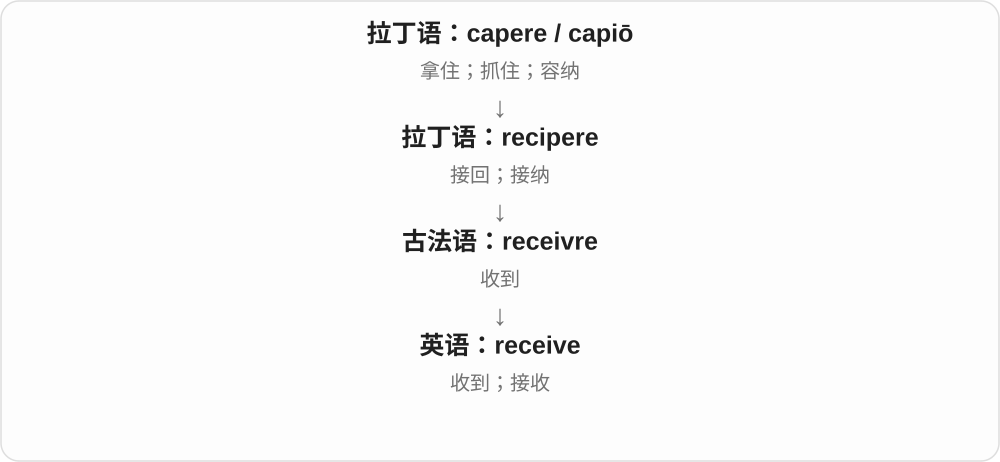

“拿到自己这边”扩展到各种看不见的东西：接到电话、得到支持、接收信号。reception 保留的是同一拉丁词族的 -cept- 形式，不是把 receive 任意换几个字母。

**常见搭配与例句**

receive a message / a package / support；receive something from someone。

> I received your email this morning.

我今天早上收到了你的邮件。

> The proposal received strong support from the team.

这项提议得到了团队的大力支持。

**别混淆**

receive 是“到手了”；accept 常是“愿意收下或认可”。收到邀请，不等于答应参加。

### 4. received — 收到了；接收到、受到；received 为 receive 的过去式和过去分词

**音标**：/rɪˈsiːvd/

**先抓住这个画面**

东西、消息或反应到你这里来了：收到包裹、得到支持、受到欢迎，都可以用 received。它先说明接到了，再由宾语说明接到了什么。

**怎么拆**

receive 去末尾 e，加完整 -ed；/v/ 后 -ed 读 /d/。拉丁 re- + capere 形成 recipere 接纳，经古法语 receivre 等形式进入英语 receive。

**怎么变成今天的意思**

**拉丁 recipere → 古法语 receivre → receive**  
接纳、收到

↓

**receive 去 e + -ed → received**  
收到过；已被接收

received an email 收到了邮件；received support 得到支持；was well received 受到欢迎、好评；received wisdom 普遍接受的看法，语境有时含对其质疑。

**常见搭配与例句**

received from ...；has been received。

> We received the parcel two days after ordering it.

下单两天后，我们收到了包裹。

> The new design was well received by the team.

团队很认可这个新设计。

**别混淆**

received an invitation 是收到了邀请，accepted an invitation 才是接受邀请。was well received 的 well 描述反响好，不只说顺利送达。

### 5. receiving — 正在接收、收到；接待；receive 的 -ing 形式

**音标**：/rɪˈsiːvɪŋ/

**先抓住这个画面**

东西、信息正在送到你这一边，是 receiving。它可以是接到消息、收货，也可以是接待来客。

**怎么拆**

receive 去掉末尾不发音 e，加 -ing，保留 /siːv/。词基由拉丁 recipere 经法语相关形式传入，和拿、接纳词族相连。

**怎么变成今天的意思**

**拉丁 recipere → 法语 receivre 等 → receive**  
接纳、收到

↓

**receive 去 e + -ing → receiving**  
进行中的接收、接待

receiving messages 收消息；receiving goods 收货；receiving guests 接待客人；a receiving area 收货区、接待区〔看场景〕。

**常见搭配与例句**

thanks for receiving us；receiving from several sources。

> The device is receiving a signal from the station.

设备正在接收来自站点的信号。

> Thank you for receiving us at such short notice.

谢谢你在这么仓促的情况下接待我们。

**别混淆**

receiving 常在信息、货物传输中说接收方的动作，sending 说送出方动作。接收、阅读、同意是不同环节，不能仅凭 receiving 把它们合成一件事。

### 6. reception — 接待；接收；反响

**音标**：/rɪˈsepʃən/

**先抓住这个画面**

receive 是把人或信息接过来；reception 可以是怎么接待、接收得好不好，以及接到以后有什么反应。

**怎么拆**

来自拉丁语 receptiō，经法语进入英语，与 receive 同族。recept- 对应拉丁语的相关词干。

**怎么变成今天的意思**

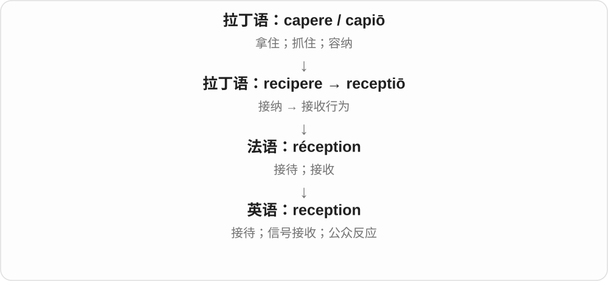

接人形成“接待、招待会”，接信号形成“接收效果”，接到作品或建议后的态度形成“反响”。这几义都能回到接收这件事。

**常见搭配与例句**

at reception（在前台）；a warm reception；poor phone reception。

> Please leave your key at reception.

请把钥匙留在前台。

> The film received a warm reception from audiences.

这部电影受到了观众的热烈欢迎。

**别混淆**

reception 是接待或接收，不是 receipt“收据”。它也能指前台区域，而 receptionist 是在那里接待的人。

### 7. receptionist — 接待员；前台人员

**音标**：/rɪˈsepʃənɪst/

**先抓住这个画面**

你走进酒店或公司，第一个迎接你、登记信息、指路的人，通常就是 receptionist。

**怎么拆**

reception + -ist；-ist 在这里表示从事某项工作的人，不是“主义”。

**怎么变成今天的意思**

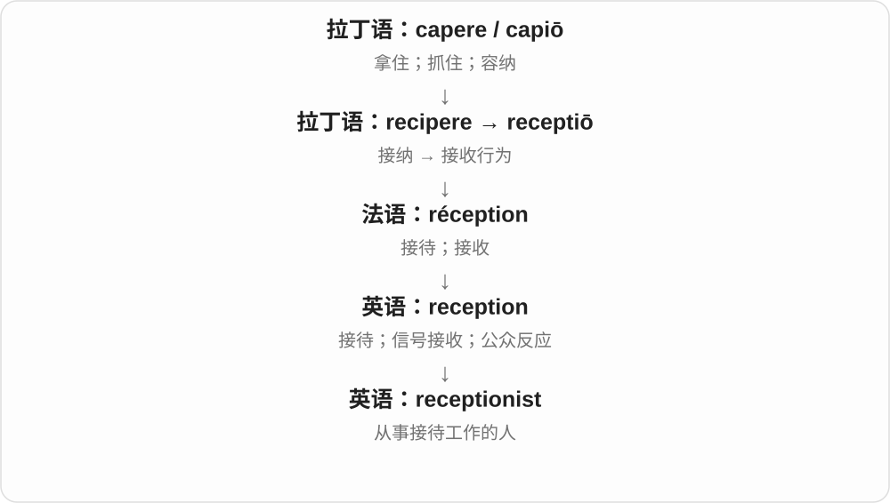

词义从接收人、接待来访者，落到具体岗位。不是所有做 reception 相关工作的设备都能叫 receptionist，这个词通常指人。

**常见搭配与例句**

a hotel receptionist；ask the receptionist；work as a receptionist。

> The receptionist showed us where to wait.

接待员告诉我们在哪里等候。

> He works as a receptionist at a small clinic.

他在一家小诊所做前台接待。

**别混淆**

reception 是接待、前台地点或反响；receptionist 是接待的人。

### 8. receives — 收到、接收到；得到、受到；receive 的第三人称单数

**音标**：/rɪˈsiːvz/

**先抓住这个画面**

别人把东西送来，或消息、支持传到这里，是 receives。它先说东西、反应到了这一方，再由宾语说明是什么。

**怎么拆**

receive 已有 e，加 s；/v/ 后读 /z/。拉丁 re- 回、向回 + capere 拿形成 recipere 接纳，经古法语 receivre 等传入英语。

**怎么变成今天的意思**

**拉丁 re- + capere → recipere → 古法语 receivre → receive**  
拿到这边、接纳 → 收到

↓

**receive + -s → receives**  
单数主语现在收到、受到

receives a letter 收到信；receives support 得到支持；receives visitors 接待来访者；receives a signal 接收信号。

**常见搭配与例句**

receives from ...；receives good reviews。

> The office receives deliveries every morning.

办公室每天早上都会收货。

> The exhibition receives many visitors on weekends.

周末有很多人来参观这个展览。

**别混淆**

receives an invitation 是收到了邀请，accepts an invitation 是接受邀请。receives visitors 常说接待来访者，receives a letter 是收到信；对象不同，接纳体现为不同动作。

### 9. receiver — 接收者；接收器；听筒

**音标**：英 /rɪˈsiːvə/；美 /rɪˈsiːvər/

**先抓住这个画面**

东西从一端发出，另一端负责接住，那一端就是 receiver。它可以是人，也可以是一台设备。

**怎么拆**

现代可拆 receive + -er“接收的人或物”；英语也继承了早期法语的相应名词形式。

**怎么变成今天的意思**

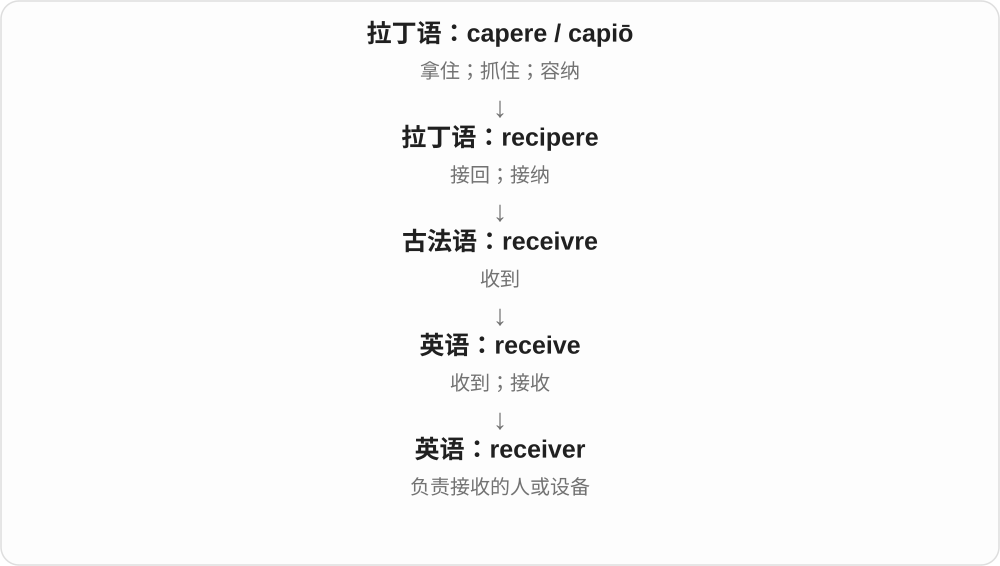

-er 不只造职业名，也能造工具名。收音机接收器接无线电信号，电话听筒让你接收声音；某些体育项目里也用它指接球者。

**常见搭配与例句**

a radio receiver；the sender and receiver；pick up the receiver。

> The receiver converts the signal into sound.

接收器把信号转换成声音。

> She picked up the receiver and dialed the number.

她拿起听筒，拨了那个号码。

**别混淆**

receiver 常涉及设备或信息传递角色；recipient 更常指礼物、邮件、帮助或奖项的获得者。

### 10. receivers — 接收者；接收器；电话听筒；接球手〔复数〕

**音标**：英 /rɪˈsiːvəz/；美 /rɪˈsiːvɚz/

**先抓住这个画面**

信息、信号、球或物品送过来，在另一端接住的人、装置，都是 receiver 的不同用法。

**怎么拆**

receive 去末尾 e，加完整 -er → receiver，再加 -s；历史上也可能借法语 recevere 等人名词形。receive 远接拉丁 recipere 接取的词族。

**怎么变成今天的意思**

**receive 接取的人名词或法语相关人名 → receiver**  
较早接收钱财、物品的人

↓

**接收者名称用于装置、电话、球场角色等 → receivers**  
现代按接收对象区分具体中文

radio receivers 是无线电接收机；telephone receivers 是电话听筒；wide receivers 是美式橄榄球的外接手。

**常见搭配与例句**

radio receivers；telephone receivers；receivers and transmitters。

> The museum displays several early radio receivers.

博物馆展出了几台早期无线电接收机。

> The diagram labels the transmitters and receivers.

示意图标出了发送器与接收器。

**别混淆**

receivers 接收，transmitters 发送。receptors 在生物学里常说受体、感受器，与 receiver 远同族，但专业名称不能随意互换。

### 11. recipient — 接受者；获得者

**音标**：/rɪˈsɪpiənt/

**先抓住这个画面**

想象礼物、邮件或奖项贴着一个名字：那个最终收到它的人，就是 recipient。

**怎么拆**

来自拉丁语 recipiēns“正在接收的”，与 receive 同源。-cip- 是历史词干变化，不表示“剪”。

**怎么变成今天的意思**

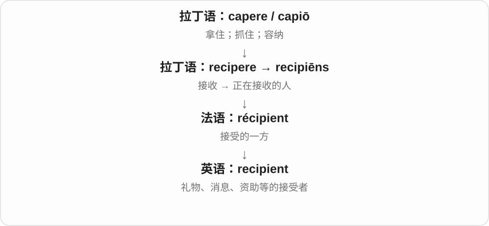

由“接收这个动作的人”变成接受者称呼。常强调谁受益、谁收到，而不是怎样传输。

**常见搭配与例句**

the recipient of an award；email recipients；a grant recipient。

> Each recipient will receive a separate email.

每位收件人都会收到一封单独的邮件。

> She was the first recipient of the new scholarship.

她是这项新奖学金的第一位获得者。

**别混淆**

recipient 是得到东西的人；donor 是给予的一方。receiver 更容易用于设备、通信或体育。

### 12. recipients — 接收者；收件人；获赠、获奖者〔复数〕

**音标**：英、美 /rɪˈsɪpiənts/

**先抓住这个画面**

一份礼物、一封邮件或一个奖项送出去，落到谁手里，谁就是 recipients 里的接收一方。

**怎么拆**

recipient + -s → recipients，/t/ 后读 /s/。recipient 接法语与拉丁 recipiens 接收的分词，含 re- 与 -cip- 接取，词末 -ient 对应分词材料。

**怎么变成今天的意思**

**拉丁 recipere 接取 → recipiens 接收的**  
由接收状态称接收的一方

↓

**法语等 → 英语 recipient → recipients**  
现代复数，不是直接由英语 receive 变几个字母

email recipients 是邮件收件人；award recipients 是获奖者；recipients of a gift 是礼物接收者。

**常见搭配与例句**

email recipients；award recipients；recipients of the letters。

> Please check the recipients before sending the email.

发送邮件前请检查收件人。

> The award recipients came onto the stage together.

获奖者们一起走上了舞台。

**别混淆**

recipient 是接收方，sender 是发送方。award recipients 通常说已获奖者，与只是获提名的人不同。

### 13. receipt — 收据、收条；收到、接收〔正式用法〕

**音标**：/rɪˈsiːt/

**先抓住这个画面**

商店收到了你的钱，给你一张确认收款的凭证，是 receipt；正式表达 on receipt of 则直接说收到某物时。核心是收到了什么。

**怎么拆**

经盎格鲁法语 receite、相关 recete 接拉丁 recepta、receptus 的收到材料，属于 recipere 的词族，与 receive 相关。英语后来按拉丁恢复字母 p，读音却没有恢复 /p/。

**怎么变成今天的意思**

**拉丁 recipere、接收分词材料 → 法语 receite、recete**  
收到的东西、款项 → 接收行为等

↓

**英语 receit → receipt；凭证义发展**  
恢复不发音 p 的拼写；收到款项的书面证明

a receipt for the books 买书的收据；keep the receipt 留存收据；on receipt of the letter 收到信时。

**常见搭配与例句**

acknowledge receipt 确认收到；a paper receipt 纸质收据。

> She put the receipt in her bag.

她把收据放进包里。

> Please confirm receipt of the letter.

请确认已收到这封信。

**别混淆**

receipt 里的 p 不发音；recipe 食谱也是相关历史材料的另一借词。现代 receipt 常先记凭证和收到，不用把食谱的旧同义用法也当日常核心义。

### 14. receipts — 收据、收条〔复数〕；收入、进款〔复数用法〕

**音标**：/rɪˈsiːts/

**先抓住这个画面**

盒里一张张收据，是 receipts；把某段时间实际收进的钱合起来谈，也能用 receipts。一个是收到的凭证，一个是收到的款项。

**怎么拆**

receipt 经法语接拉丁接收分词材料，与 receive 同族，p 是后来的拉丁化拼写，不发音。现代加 -s，/t/ 后读 /s/，结尾 /ts/。

**怎么变成今天的意思**

**拉丁、法语接收材料 → 英语 receipt**  
收到、收款凭证；进款相关意义

↓

**receipt + -s → receipts**  
多张收据；合计收到的款项

keep the receipts 留好收据；ticket receipts 售票收入；cash receipts 现金进款。

**常见搭配与例句**

a box of receipts 一盒收据；receipts from the concert 音乐会收入。

> He filed the receipts in a folder.

他把收据整理进文件夹。

> Ticket receipts were used to support the school club.

售票收入用于支持学校俱乐部。

**别混淆**

receipts 不等于 profits 利润；进来的钱还未必扣除成本。具体是纸面凭证还是进款，看它与 file、ticket、cash 等什么词一起出现。

### 15. receptor — 受体；感受器

**音标**：英 /rɪˈseptə/；美 /rɪˈseptɚ/

**先抓住这个画面**

把它想成生物体里接收相应信号的接口。接收刺激的感觉结构可叫感受器，细胞表面或内部识别、结合相应分子的结构常叫受体。

**怎么拆**

来自拉丁 receptor 接收者等，接 recipere 接收的词族；可识别 re- 与 cept- 接取、-or 接收一方的材料。现代科学用法以接收功能来命名。

**怎么变成今天的意思**

**拉丁 recipere 接取、分词 receptus → receptor 接收者**  
和 receive 同属较远的接取词族

↓

**相应接收者名称 → 现代生物学 receptor**  
从接收功能理解受体、感受器，不由现代英语 receive 直接造出

a receptor on a cell 是细胞上的受体；a sensory receptor 是感受器。具体谈分子、细胞还是感觉结构，须看学科上下文。

**常见搭配与例句**

a receptor on a cell；a sensory receptor；receptor function。

> The diagram labels a receptor on the cell surface.

图中标出了细胞表面的一个受体。

> The chapter explains how a sensory receptor detects a stimulus.

这一章解释感受器怎样探测刺激。

**别混淆**

日常电子设备的接收器更常叫 receiver；receptor 在生物学语境尤其常见，两词不能只凭中文接收器就随意互换。

### 16. receptors — 受体〔复数〕

**音标**：英 /rɪˈseptəz/；美 /rɪˈseptɚz/

**先抓住这个画面**

细胞里或表面有些分子，能和特定物质结合并引起细胞反应，这些分子就是 receptors。可把它们想成能识别特定来客的接收位置。

**怎么拆**

receptor + -s → receptors。经法语、拉丁 receptor 接纳者，来自 recipere 接收；历史构词可认 re- + cept- 取、接纳 + -or。现代生物学用途是后来发展的专门意义。

**怎么变成今天的意思**

**拉丁 recipere 接纳 → receptor 接纳者 → 英语 receptor**  
早期英语曾说接纳、藏匿他人的人

↓

**接收概念用于细胞层面的分子作用 → receptors**  
现代常说能结合特定物质并引起作用的受体

cell receptors 是细胞受体；receptors on the cell surface 是细胞表面受体；bind to receptors 是与受体结合。

**常见搭配与例句**

cell receptors；bind to receptors；receptors on the cell surface。

> The diagram shows receptors on the surface of a cell.

图中展示了细胞表面的受体。

> The textbook explains how molecules bind to specific receptors.

教材解释了分子怎样与特定受体结合。

**别混淆**

接收位置是帮助理解的比喻。受体有的在细胞表面，有的在细胞内部；receptors 与普通 receiver 接收设备的使用范围不同。

### 17. except — 除了；除外

**音标**：/ɪkˈsept/

**先抓住这个画面**

先摆出一整组东西，再从中拿走一个：剩下的都算，拿走的那个不算。这是 except 的画面。

**怎么拆**

ex-（向外）+ capere（拿）→ excipere；except- 来自相关分词词干。历史构词表达的正是“拿出去”。

**怎么变成今天的意思**

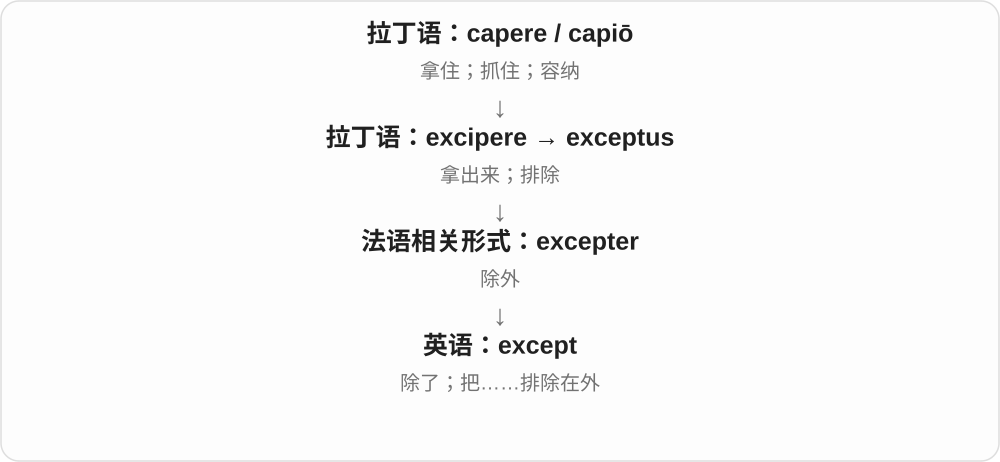

物理上从一堆里拿出一个，抽象后就是从规则、范围或判断里排除一个。英语中它常作介词，也可在正式用法中作动词。

**常见搭配与例句**

everyone except…；except for…；except that…（只是……这一点除外）。

> Everyone except Tom arrived on time.

除汤姆外，所有人都准时到了。

> The room was empty except for a single chair.

房间里除了一把椅子，什么也没有。

**别混淆**

except 排除，besides 往往表示“除此之外还包括”。Everyone except Tom came 是汤姆没来。

### 18. exception — 例外

**音标**：/ɪkˈsepʃən/

**先抓住这个画面**

规则把大多数情况圈进来，exception 是被单独拿出来、不能照常处理的那个情况。

**怎么拆**

属于 except 的名词词族，历史上经法语来自拉丁语 exceptiō。现代可用 except + -ion 对照记忆。

**怎么变成今天的意思**

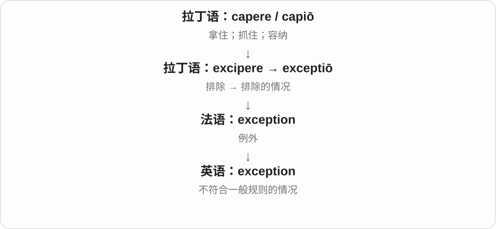

“拿出去”的不是必须讨厌的东西，也可能是被特别允许的情况。所以 make an exception 是破例，而不是制造一个错误。

**常见搭配与例句**

make an exception；with the exception of…；an exception to the rule。

> We do not usually allow pets, but we made an exception this time.

我们通常不允许带宠物，但这次破了例。

> Her case is an exception to the general rule.

她的情况是一般规则之外的一个例外。

**别混淆**

exception 不等于 mistake。程序中的 exception 是需要另行处理的异常情况，也不必然等于程序员写错代码。

### 19. exceptions — 例外；被排除的情况〔复数〕

**音标**：/ɪkˈsepʃənz/

**先抓住这个画面**

一条规则通常包住一类情况，但有几件事要拿出去另看，这些就是 exceptions。

**怎么拆**

exception + -s，/n/ 后读 /z/。exception 经法语接拉丁 exceptio，来自 excipere 拿出、排除的词族，较早联系 ex- 向外与 capere 拿。

**怎么变成今天的意思**

**拉丁 excipere → exceptio → 法语 → exception**  
拿出去、排除 → 一般规则之外的情况

↓

**exception + -s → exceptions**  
多个例外、排除项

a few exceptions 少数例外；exceptions to the rule 规则的例外；make exceptions 破例。

**常见搭配与例句**

with some exceptions 除少数情况之外；no exceptions 没有例外。

> The rule has a few exceptions.

规则有少数例外。

> We cannot make exceptions for individual requests.

我们不能为个别请求破例。

**别混淆**

exceptions to a rule 的介词常用 to。without exception 毫无例外是固定单数表达，不按讨论对象多就加 s。

### 20. catch — 抓住、接住；赶上；听清、察觉；染上；暗藏条件〔名词〕

**音标**：/kætʃ/

**先抓住这个画面**

本来会从你面前溜走的东西，被你接住了：球、车、话里的重点，都可用这个画面理解。

**怎么拆**

经法语捕捉、追猎词接拉丁抓取词系。catch 和 chase 属不同借入形式的同源词，现代一个偏抓到、赶上，一个偏追。变化 catch—caught—caught。

**怎么变成今天的意思**

**拉丁 capere → captāre、晚期相关形式 → 法语 cachier 等**  
抓、拿 → 捕捉、追猎

↓

**中古英语 cacchen → catch**  
抓住、接住；捕捉到注意、信息等用法

catch a ball 接球，catch a train 赶上火车，catch a cold 感冒，catch what someone said 听清话，What’s the catch? 有什么隐含条件？

**常见搭配与例句**

catch a ball；catch a train；catch a cold；what’s the catch。

> Hurry, or we won’t catch the train.

快点，否则赶不上火车了。

> Sorry, I didn’t catch your name.

不好意思，我没听清你的名字。

**别混淆**

catch 接住、捕捉到，chase 追赶不保证抓到；catch a cold 是常用染病表达，不是抓住一阵冷风的物理动作。

### 21. accept — 接受；认可

**音标**：/əkˈsept/

**先抓住这个画面**

别人递来一个东西或说法，你不只是接到，还点头说“好，我收下”。礼物、工作机会、解释和现实都可以 accept。

**怎么拆**

历史上 ad-（朝向）+ capere（拿）形成 accipere，ad- 的辅音同化；accept 与其 accept- 分词词干相关。

**怎么变成今天的意思**

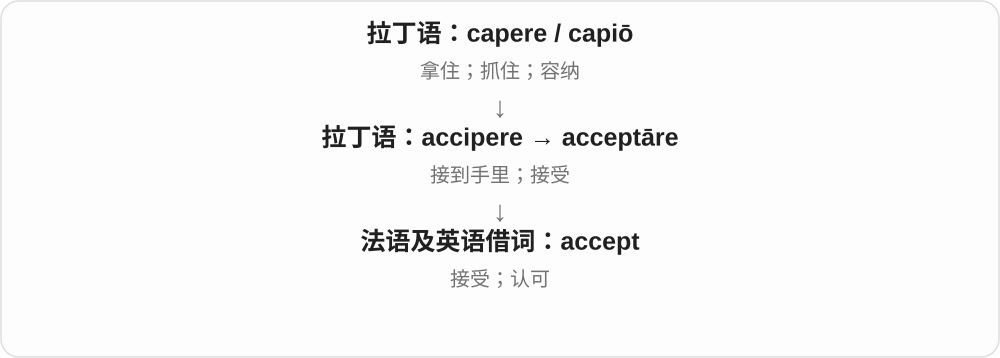

从“拿到身边”发展为“接纳”。接纳的不一定让人开心：accept a difficult truth 是承认一个难以接受的事实，不是喜欢它。

**常见搭配与例句**

accept an offer（接受提议）；accept responsibility（承担责任）；accept that…（承认……）。

> She accepted the job offer after a week of thought.

考虑一周后，她接受了那份工作。

> We need to accept that the first plan did not work.

我们需要承认，第一个方案没有奏效。

**别混淆**

accept 与 except 不同：accept 是接纳，except 是排除。发音接近，首字母和意思都要分清。

### 22. accepted — 被接受的；公认的

**音标**：英、美 /əkˈseptɪd/

**先抓住这个画面**

一个说法或做法，已经被大家收进“可以采用”的范围。

**怎么拆**

accept + -ed；accept 经法语追到拉丁 acceptāre、accipere，后者是 ad- + capere“拿”。

**怎么变成今天的意思**

**拉丁语：ad**  
朝向；靠近；加到

↓

**拉丁语 accipere → acceptāre**  
接到手里；收下

↓

**古法语 accepter → 英语 accept → accepted**  
接受 → 被接受；公认

an accepted explanation 是大家普遍认可的解释，不保证绝对正确。申请 accepted 则指获得接收。

**常见搭配与例句**

widely accepted；accepted practice；an accepted explanation。

> This is the most widely accepted explanation of the pattern.

这是对这一模式最广获认可的解释。

> Her proposal was accepted after a few small changes.

做了几处小修改后，她的提案获准了。

**别混淆**

acceptable 说能不能接受；accepted 说已经受到接受。

### 23. acceptable — 可以接受的；达标的

**音标**：/əkˈseptəbəl/

**先抓住这个画面**

想象给东西设一条最低标准：过了这条线，虽然未必出色，但能接受。这就是 acceptable。

**怎么拆**

现代分析是 accept + -able“可以被接受的”；英语词形也承接法语和晚期拉丁语 acceptābilis。

**怎么变成今天的意思**

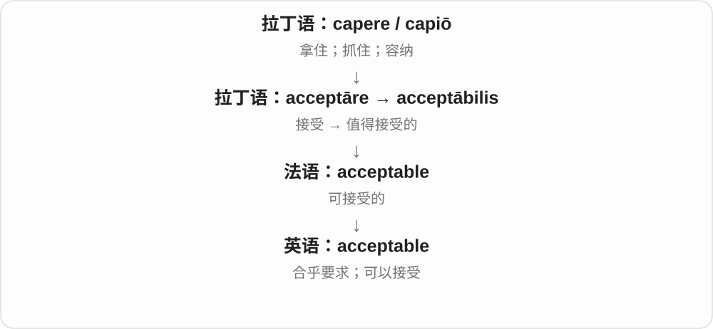

它常用于质量、价格、行为和方案。acceptable 不自动等于 excellent：一个方案可以只是够用，但仍达到了你设定的条件。

**常见搭配与例句**

an acceptable solution；acceptable to someone；an acceptable standard。

> We need to find a solution that is acceptable to both sides.

我们需要找到双方都能接受的方案。

> The room was small, but the price was acceptable.

房间很小，但价格可以接受。

**别混淆**

acceptable 是能否接受；accepted 是已经被接受。一个尚无人采用的方案，也可能本身很合理、可接受。

### 24. accepting — 接受、接纳〔现在分词、动名词〕；愿意包容的

**音标**：/əkˈseptɪŋ/

**先抓住这个画面**

东西递过来，愿意伸手接住；不同的人、不同的现实摆在面前，也愿意容纳。accepting 既可以说动作，也可以说这种态度。

**怎么拆**

accept + -ing，直接加 ing。accept 接拉丁 accipere 的 accept- 分词词干，较早 ad- 朝向与 capere 拿取结合，并发生辅音同化。

**怎么变成今天的意思**

**拉丁 ad- 与 capere → accipere、accept- → 英语 accept**  
拿到自己这边 → 接受、认可

↓

**accept + -ing → accepting**  
正在接受；也形容愿意接纳、包容

accepting an invitation 接受邀请；accepting applications 接收申请；accepting of differences 愿意接纳差异。

**常见搭配与例句**

an accepting attitude 包容的态度；accepting help 接受帮助。

> The course is now accepting applications.

课程现在开始接收申请。

> The group was welcoming and accepting of newcomers.

这个团体对新人友好而包容。

**别混淆**

accepting 是接受动作或接纳态度；acceptable 是可以被接受的。an accepting person 常说人愿意包容，an acceptable result 则说结果可以接受。

### 25. acceptance — 接受；认可；接纳

**音标**：/əkˈseptəns/

**先抓住这个画面**

accept 是点头接受这个动作，acceptance 是点头之后形成的认可。一个新想法慢慢被大家接受，就是 gaining acceptance。

**怎么拆**

现代可拆 accept + -ance；-ance 把动作变成名词。不要因为结尾相同，就把它与 alliance 归成同一词根。

**怎么变成今天的意思**

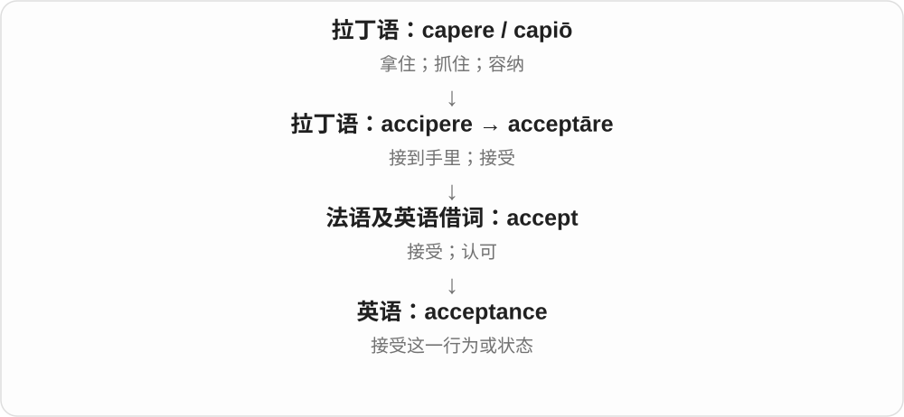

它可以指接受邀请，也可以指接纳某种差异、承认某个现实。重点是“原本可能拒绝，现在允许它进入自己的判断或关系”。

**常见搭配与例句**

gain acceptance（获得认可）；acceptance of…；an acceptance letter（录取或接受函）。

> The idea gradually gained acceptance among teachers.

这个想法逐渐获得了教师们的认可。

> Her family’s acceptance gave her confidence.

家人的接纳给了她信心。

**别混淆**

acceptance 不是 approval 的完全同义词：你可以接受某个现实，却并不赞成它。

### 26. accepts — 接受、接纳、认可〔第三人称单数〕

**音标**：/əkˈsepts/

**先抓住这个画面**

东西、建议或事实来到面前，自己让它进入、不再拒绝，就是 accepts。可以收下，也可以在心里承认它成立。

**怎么拆**

accept 接拉丁 accipere、acceptare，历史 ad- 朝向 + capere 拿，辅音同化，并有 accept- 分词词干。经法语及拉丁相关形式借入；现代加 -s，尾 /pts/。

**怎么变成今天的意思**

**拉丁 ad- + capere → accipere、acceptare → accept**  
向自己接过来 → 接受、认可

↓

**accept + -s → accepts**  
某主体收下、同意接纳或承认

accepts the offer 接受提议；accepts the facts 承认事实；accepts different views 接纳不同观点。

**常见搭配与例句**

accepts responsibility 承担责任；accepts visitors 接待访客。

> She accepts the invitation with pleasure.

她欣然接受邀请。

> The museum accepts donations of old photographs.

博物馆接受旧照片捐赠。

**别混淆**

accepts 不保证喜欢。accepts that a plan failed 可以是承认失败的事实，心里未必高兴。

### 27. concept — 概念；构想

**音标**：英 /ˈkɒnsept/；美 /ˈkɑːnsept/

**先抓住这个画面**

把一组零散认识抓到一起，在脑子里形成一个清楚的整体，这个整体就是 concept，比如“公平”“能量”或一个产品构想。

**怎么拆**

来自拉丁语 conceptus，与 concipere“收集、构想”同源。concept 和 conceive 是历史词形不同的亲戚，不能仅凭结尾判断互不相关。

**怎么变成今天的意思**

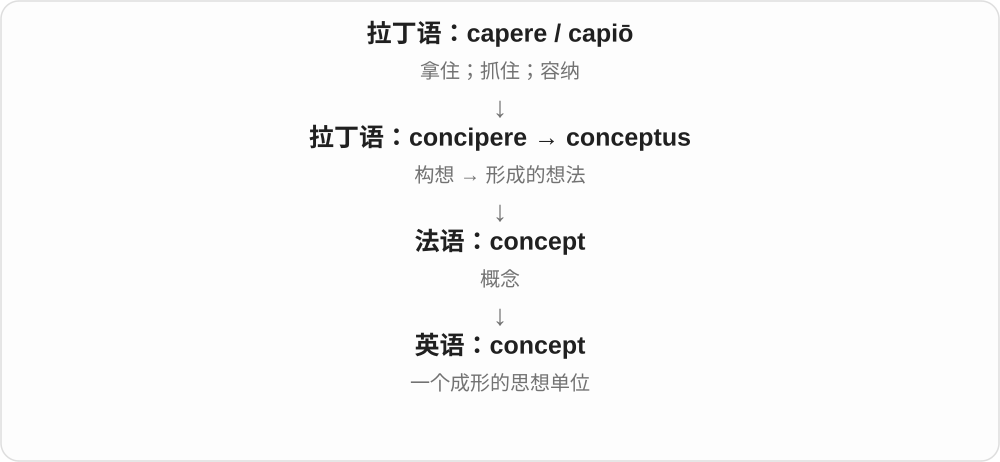

词义重点落在构想的结果上。a design concept 是设计背后的基本想法，还不一定是可直接生产的详细方案。

**常见搭配与例句**

a basic concept；the concept of…；a design concept。

> The teacher explained the concept of gravity with a simple experiment.

老师用一个简单实验解释了重力的概念。

> We liked the design concept but changed the details.

我们喜欢这个设计构想，但修改了细节。

**别混淆**

idea 很宽泛，随手想到的点子也算；concept 往往是可以说明、组织或反复使用的一套概念。

### 28. concepts — 概念、观念；构想〔concept 的复数〕

**音标**：/ˈkɒnsepts/；美式常 /ˈkɑːnsepts/

**先抓住这个画面**

把相关特点在脑中抓住、组织成一个可以谈论的意思，就是 concepts；课程教的基本概念，设计提出的初步构想，都可用这个词。

**怎么拆**

concept + -s，/t/ 后读 /s/。concept 接中世纪拉丁 conceptum 等，来自 concipere 接纳、构想的分词词干；其中 con- 可能加强，capere 是拿取，concept- 与 conceive 形成历史词形对应。

**怎么变成今天的意思**

**拉丁 concipere、concept-、conceptum → concept**  
接纳、构想 → 头脑中形成的观念

↓

**concept + -s → concepts**  
多个概念、设计构想

basic concepts 基本概念；design concepts 设计构想；introduce concepts 引入概念。

**常见搭配与例句**

concepts explained with examples；concepts developed by the design team。

> The teacher used simple examples to explain the concepts.

老师用简单例子解释这些概念。

> The team presented three design concepts.

团队展示了三个设计构想。

**别混淆**

concept 常把一个意思框成可理解、可讨论的单位。idea 更宽泛；a design concept 则常是设计早期抓住的总体构想。

### 29. capacity — 容量；处理能力；身份

**音标**：/kəˈpæsəti/

**先抓住这个画面**

先想一个容器最多装多少，再想一个人或系统最多能承担多少。capacity 常在说这种“能装、能处理的量”。

**怎么拆**

来自拉丁语 capāx“能容纳的”及名词 capācitās，经法语进入英语。cap- 仍与 capere 有关。

**怎么变成今天的意思**

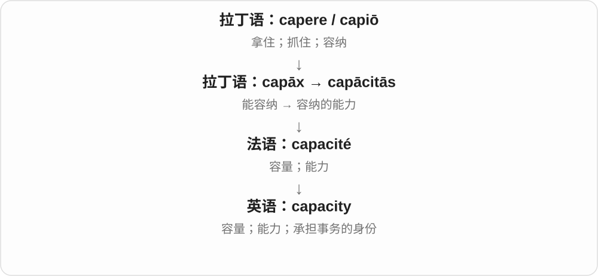

杯子的容积、工厂的产能、人的学习能力，都能从“装得下或应付得了多少”理解。in my capacity as manager 则指“以经理这个身份”，是另一个固定用法。

**常见搭配与例句**

at full capacity（满负荷）；a capacity for…；in one’s capacity as…。

> The theater has a capacity of five hundred people.

这家剧院可容纳五百人。

> I am writing in my capacity as team leader.

我以团队负责人的身份写这封信。

**别混淆**

capacity 与 capability 都谈能力，但 capacity 更常涉及数量、潜力或承受上限。capacity 不能一律译成容积。

### 30. capable — 有能力的；能干的

**音标**：/ˈkeɪpəbəl/

**先抓住这个画面**

把任务想成一个要接住的东西：你的能力装得下、扛得住，就 capable。它可以说能做到某件事，也可以直接夸一个人能干。

**怎么拆**

来自晚期拉丁语 capābilis，与 capere“拿、容纳”相关；经法语进入英语。可认出 cap- 和形容词性结尾，不能拆成 cap“帽子”+ able。

**怎么变成今天的意思**

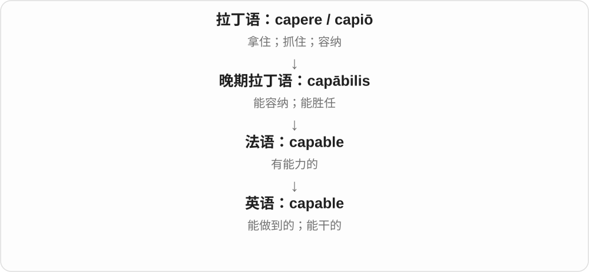

从“容纳得下”到“具备承受和完成的本领”，是理解能力义的好线索。现代用法中 capable of doing 既能说好事，也能说某人做得出坏事。

**常见搭配与例句**

be capable of doing…；a capable manager；perfectly capable。

> She is capable of solving the problem on her own.

她有能力独立解决这个问题。

> We need a capable person to lead the project.

我们需要一个能干的人来领导这个项目。

**别混淆**

capable of doing，不通常说 capable to do；able 则常跟 to do。

### 31. capability — 能力；可实现的功能

**音标**：/ˌkeɪpəˈbɪləti/

**先抓住这个画面**

capable 说“它做得到”，capability 就把“做得到的本领”单独拿出来讨论。软件功能、机器性能和人的技能都能用这个词。

**怎么拆**

capable + -ity；-able 在名词中变为 -ability，重音移到 -bil-。这一步是英语内部派生。

**怎么变成今天的意思**

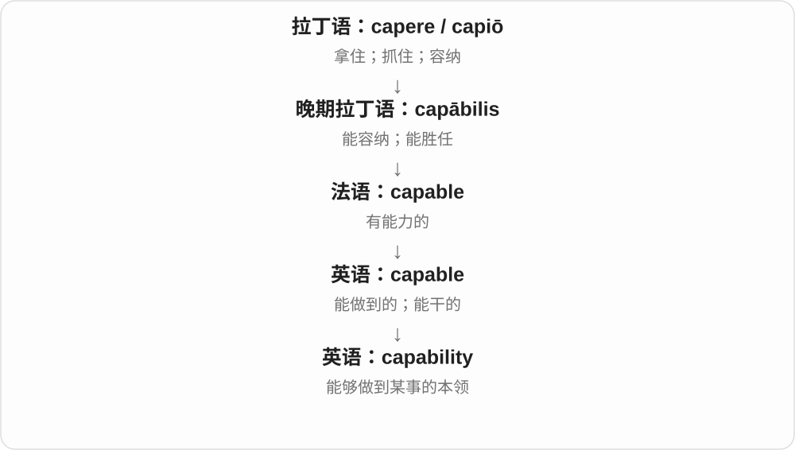

词义没有突然变：只是从描述一个人或设备，转为谈它具有什么本领。复数 capabilities 常强调好几种不同能力。

**常见搭配与例句**

technical capability；develop a capability；the capability to do…。

> The new software has the capability to recognize handwriting.

新软件具备识别手写文字的能力。

> The training helped the team develop new capabilities.

这次培训帮助团队培养了新的能力。

**别混淆**

capability 常问“能做什么”；capacity 还常问“最多能装多少、处理多少”。二者有重叠，但侧重点不同。

### 32. capabilities — 能力；功能；能够做到的事情〔capability 的复数〕

**音标**：/ˌkeɪpəˈbɪlətiz/

**先抓住这个画面**

一个人、一台设备或一个系统到底能完成哪些事，这些能做到的本领、功能就是 capabilities。

**怎么拆**

capable + -ity → capability，-able 对应 -ability，再变 y 为 -ies。capable 经法语接晚期拉丁 capābilis，较早联系 capere 拿住、容纳，由装得下、承接得住发展到能胜任。

**怎么变成今天的意思**

**拉丁 capere、capābilis → 法语 → capable**  
拿住、容纳 → 能容纳、能胜任

↓

**capable → capability → capabilities**  
有能力 → 一项项能力、功能

technical capabilities 技术能力；the camera’s capabilities 相机的功能；expand our capabilities 扩展能力；beyond its capabilities 超出它的能力范围。

**常见搭配与例句**

a range of capabilities；develop new capabilities。

> The guide explains the camera’s main capabilities.

这份指南解释了相机的主要功能。

> The project helped the team develop new capabilities.

这个项目帮助团队培养了新的能力。

**别混淆**

skills 常说练出来的具体技能；capabilities 更广，可以概括人、组织、设备能做到什么。设备的 capabilities 也常直译为功能、性能范围。

### 33. capably — 能干地；熟练地

**音标**：/ˈkeɪpəbli/

**先抓住这个画面**

事情交到手里，他接得稳、办得好，就可以说 handled it capably。这个词评价做事的方式。

**怎么拆**

capable + -ly；拼写从 -le 变为 -ly，成为副词。

**怎么变成今天的意思**

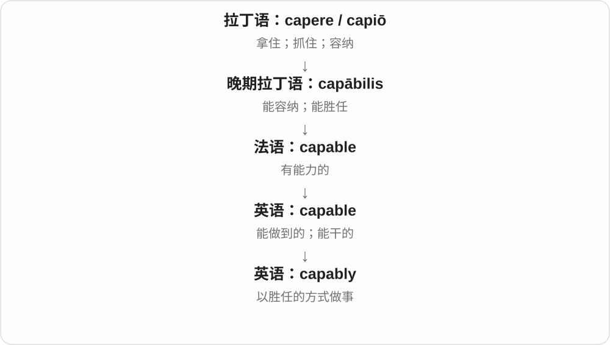

capable 评价人或能力，capably 评价动作。它不只是“做了”，还表示表现得有本领、能应付。

**常见搭配与例句**

handle something capably；capably managed；perform capably。

> She capably handled the unexpected questions.

她熟练地应对了那些意料之外的问题。

> The office was capably managed during his absence.

他不在时，办公室仍被管理得很好。

**别混淆**

capably 强调能胜任；easily 强调不费劲。一个人费了很大力气，也可以把事处理得很出色。

### 34. incapable — 做不到的；无能力的

**音标**：/ɪnˈkeɪpəbəl/

**先抓住这个画面**

某件事超出了一个人的本领，或他根本做不出某种行为，就是 incapable。它不只用于技能，也能描述性格。

**怎么拆**

in-（否定）+ capable；英语词也承接法语 incapable。这里 in- 不是“在里面”。

**怎么变成今天的意思**

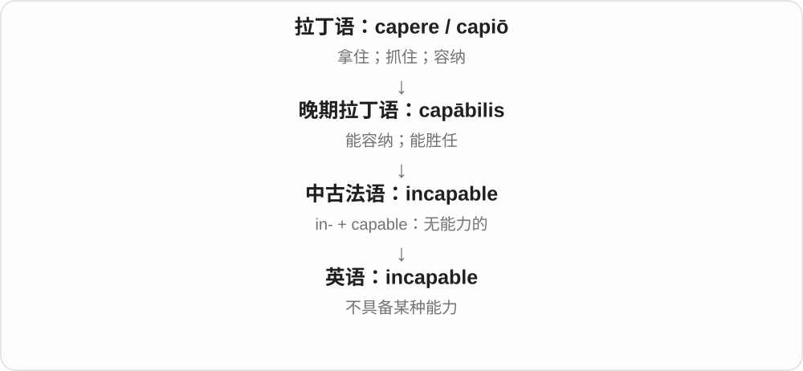

否定“能做到”，就得到“做不到”。incapable of cruelty 可以夸一个人心善，意思是他做不出残忍的事，不是在贬低技能。

**常见搭配与例句**

be incapable of doing…；incapable of change；incapable of cruelty。

> The old computer is incapable of running this program.

这台旧电脑运行不了这个程序。

> He seems incapable of saying anything unkind.

他似乎怎么也说不出刻薄的话。

**别混淆**

unwilling 是不愿意，incapable 是做不到。不能把没有能力和没有意愿混成一件事。

### 35. cable — 粗缆绳、钢索；电缆、线缆；有线电视；用线缆连接

**音标**：/ˈkeɪbəl/

**先抓住这个画面**

一条结实的长线，原先能拉住船，后来能带着电力、信号从一头到另一头。形状相近，用途随着材料和技术变化。

**怎么拆**

经北部古法语 cable 接拉丁 capulum 绳套、缰索，连接 capere 抓住、套住。英语由粗绳、缆索扩展到金属钢索及电力、通信线缆。

**怎么变成今天的意思**

**拉丁 capulum → 法语 cable**  
抓牢东西的绳套、缆绳

↓

**英语 cable**  
粗绳、钢索 → 电力与通信线路；有线电视等

a power cable 电源线、电力电缆；a charging cable 充电线；an undersea cable 海底电缆；cable television 有线电视；a suspension cable 悬索。

**常见搭配与例句**

connect the cable；a damaged cable。

> I need a longer cable to connect the screen.

我需要更长的线来连接屏幕。

> Steel cables support the bridge.

钢索支撑着桥。

**别混淆**

cable 旧绳索义仍常见，不能看见就只译电线。a cable holding a bridge 是承力索；a cable connected to a screen 通常是传输线。

### 36. cables — 缆绳、钢索、电缆、连接线〔复数〕

**音标**：/ˈkeɪbəlz/

**先抓住这个画面**

粗而结实、能把东西拉住或连起来的线，是 cables。早期抓牢物体的绳索，后来也承担送电、传信息的连接作用。

**怎么拆**

cable 经北部古法语 cable 接拉丁 capulum 绳套、缰索，连 capere 抓住；粗绳扩展钢索、电力和通信线缆。现代加复数 -s，/l/ 后读 /z/。

**怎么变成今天的意思**

**拉丁 capulum → 法语 cable → 英语 cable**  
绳套、缆绳 → 粗索、钢索

↓

**电力、通信义扩展；cable + -s → cables**  
传递电力、信息的线；多根线缆

power cables 电力线缆；charging cables 充电线；steel cables 钢索。

**常见搭配与例句**

connect the cables 接上线缆；cables under the desk 桌下的线缆。

> Several cables run behind the desk.

桌后走着几根线缆。

> Steel cables support the bridge.

钢索支撑着这座桥。

**别混淆**

cables 可以说粗钢索，也能说日常设备连接线。wire 更强调金属导线，cable 常把绝缘、包覆后的线束或整条连接体作为一件东西。

### 37. chase — 追赶、追逐；追求；催办；追逐过程

**音标**：/tʃeɪs/

**先抓住这个画面**

目标在前面跑，你在后面跟上去。追一只球、追机会，甚至追一份迟迟没回的文件，都有不放手地往前跟的感觉。

**怎么拆**

经古法语 chacier 等追猎词，接通俗拉丁 *captiare，来自 capere 抓取词族。与 catch 是分途借入的同源词，现代 chase 更侧重追，catch 更侧重抓到。

**怎么变成今天的意思**

**拉丁 capere 相关材料 → 法语 chacier 等**  
试图抓取、追猎

↓

**英语 chase**  
追赶；追求目标、催办事情

chase a ball 追球；chase a dream 追求梦想；chase someone away 把人赶走；chase up a reply 催问答复，尤其英式常见。

**常见搭配与例句**

give chase；a car chase；chase after someone。

> The dog chased the ball across the garden.

狗追着球跑过花园。

> I’ll chase up the missing paperwork tomorrow.

我明天会催问那份迟迟未到的文件。

**别混淆**

chase 不保证抓到，catch 常明确到手或接住。He chased the dog but couldn’t catch it 把追与抓到的差别说得很清楚。

### 38. chasing — 追赶、追逐；追求〔现在分词、动名词〕

**音标**：/ˈtʃeɪsɪŋ/

**先抓住这个画面**

目标在前面，自己不停往它那边追，是 chasing。可以追一只球，也可以追一个机会、一个结果。

**怎么拆**

chase 去 e 加 -ing，s 仍读 /s/。chase 经古法语 chacier 等追猎词接重构俗拉丁 *captiare，较早与 capere 抓取相连。

**怎么变成今天的意思**

**俗拉丁 \*captiare → 古法语 → chase**  
追猎、追捕 → 追赶、追求

↓

**chase 去 e 加 -ing → chasing**  
正在朝移动目标或想要的结果追去

chasing a ball 追球；chasing a dream 追逐梦想；chasing an answer 追索答案。

**常见搭配与例句**

chasing after someone 追着某人；chasing opportunities 追求机会。

> The dog was chasing a ball across the field.

狗正在田野上追球。

> She spent years chasing her dream of opening a bookshop.

她多年追求开书店的梦想。

**别混淆**

chasing 强调追的过程，catching 更关注抓到、赶上。两词同源而分途借入，现代用法不完全重合。

### 39. chased — 追赶、追逐了；赶走了；催问了

**音标**：/tʃeɪst/

**先抓住这个画面**

刚才目标在前面动，自己跟着追过去，叫 chased；chased away 则把重点放在追赶到对方离开。

**怎么拆**

chase 去 e 加完整 -ed，/s/ 后词尾读 /t/，结尾 /st/；不要把它念成多一个 /ɪd/。

**怎么变成今天的意思**

**拉丁 capere 拿、抓 → captare 等追取材料**  
经重建通俗拉丁语 \*captiare 及不同法语形式发展

↓

**古法语 chacier 等 → chase；另一路形成 catch**  
英语追赶动词与追逐名词都有法语背景，不把名词全当现代动词新造

↓

**chase → chased**  
过去追赶、驱赶或催问

chased the bus 追公交车；chased away the birds 赶走鸟；chased up the missing order 催问那笔没到的订单。

**常见搭配与例句**

chased after someone；chased a dream。

> We chased the bus but failed to catch it.

我们追着公交车跑，却没赶上。

> The dog chased the birds away from the garden.

狗把鸟从花园里赶走了。

**别混淆**

chased someone 是追赶某人，chased someone away 是把某人赶开，away 把离开的结果写出来。

### 40. chases — 追赶、追逐、催办〔第三人称单数〕；追逐场面〔复数〕

**音标**：/ˈtʃeɪsɪz/

**先抓住这个画面**

球滚到前面，狗跑着追；事情一直没回音，人去追问进度；chases 都有跟着目标往前赶的劲头。

**怎么拆**

chase + -s，/s/ 后读 /ɪz/；名词复数也同形。基础词与 catch 经不同法语形式联系同一拉丁追取材料。

**怎么变成今天的意思**

**拉丁 capere 拿、抓 → captare 等追取材料**  
经重建通俗拉丁语 \*captiare 及不同法语形式发展

↓

**古法语 chacier 等 → chase；另一路形成 catch**  
英语追赶动词与追逐名词都有法语背景，不把名词全当现代动词新造

↓

**chase + -s → chases**  
他、她追赶、追问；多次追逐

chases the ball 追球；chases up an order 跟催订单；car chases 汽车追逐场面。

**常见搭配与例句**

chases a dream 追梦；chases away the birds 赶走鸟。

> The dog chases the ball across the lawn.

狗追着球跑过草坪。

> The film is full of dramatic car chases.

这部电影里有很多惊险的汽车追逐场面。

**别混淆**

chases 描写追的过程；catches 明确抓到、赶上。追了很久，仍可能没抓到。

### 41. chaser — 追逐者；随后喝的饮品；其他追赶相关的人或物

**音标**：英 /ˈtʃeɪsə/；美 /ˈtʃeɪsər/

**先抓住这个画面**

前一个对象走在前面，chaser 跟在后面。可以是追的人，也可以是紧接着前一杯喝的另一种饮品。

**怎么拆**

现代对应 chase + -er；历史上也可能有法语 chaceor 猎人等借词材料，较早可指追猎用的马。后来的饮品名借了随后跟进的关系。

**怎么变成今天的意思**

**chase 与相关法语执行者材料 → chaser**  
追逐的人、追猎用马等

↓

**随后跟进的比喻 → 饮品 chaser**  
在较烈饮品之后喝的另一种饮品

a storm chaser 追风暴的人；a chaser in a race 比赛中的追赶者；water as a chaser 作为随后饮品的水。-er 取义要看整个搭配。

**常见搭配与例句**

a leading chaser；a drink with a chaser。

> The documentary follows a group of storm chasers.

纪录片跟拍了一群追逐风暴的人。

> He had a glass of water as a chaser.

他随后喝了一杯水，作为后续饮品。

**别混淆**

chaser 可以命名人，也可以命名跟在后面的东西；不能看到 -er 就只译追赶的人。

### 42. chasers — 追赶者、追逐某种目标的人；烈酒后的跟饮〔复数〕

**音标**：英 /ˈtʃeɪsəz/；美 /ˈtʃeɪsərz/

**先抓住这个画面**

追着某个目标跑的人能叫 chasers；喝完烈酒再接一口别的饮料，后面这口像跟在后头，也叫 a chaser。

**怎么拆**

chase 去 e 加完整 -er → chaser，再加 -s；旧人物词也有法语同类词的影响，饮料义后来形成。

**怎么变成今天的意思**

**拉丁 capere 拿、抓 → captare 等追取材料**  
经重建通俗拉丁语 \*captiare 及不同法语形式发展

↓

**古法语 chacier 等 → chase；另一路形成 catch**  
英语追赶动词与追逐名词都有法语背景，不把名词全当现代动词新造

↓

**chase → chaser → chasers**  
追逐者；饮料中跟在烈酒后的一杯，再作复数

storm chasers 追逐观察风暴的人；fortune chasers 追逐财富的人；water chasers 烈酒后跟饮的水。

**常见搭配与例句**

ambulance chasers 是带贬义的固定说法；chasers following the leaders 追赶领先者的人。

> The documentary follows storm chasers across the plains.

这部纪录片跟拍了在平原上追逐风暴的人。

> The menu lists several drinks that can be served as chasers.

菜单列出了几种可作为烈酒后跟饮的饮料。

**别混淆**

chasers 的饮料义不说明要把两杯混在一起，重点是后面接着喝；人物义则看前面修饰词写追什么。

### 43. capture — 捕获；抓住；记录

**音标**：英 /ˈkæptʃə/；美 /ˈkæptʃər/

**先抓住这个画面**

伸手抓住一个原本会跑掉的东西。抓到动物是 capture，抓住稍纵即逝的表情、画面和注意力，也可以是 capture。

**怎么拆**

来自拉丁语 captūra，经法语进入英语。capt- 与 capere“抓”有关，后面的部分把动作形成名词；现代英语又用作动词。

**怎么变成今天的意思**

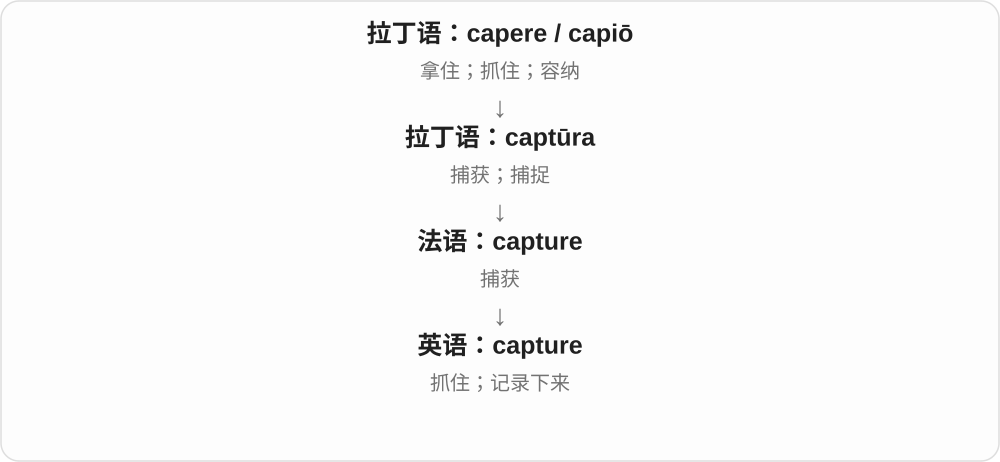

物理上的抓捕扩展到把画面、声音和感觉留住，所以摄像机能 capture a moment，故事能 capture attention。这里的“抓”不一定伤害对象。

**常见搭配与例句**

capture an image；capture someone’s attention；capture the mood。

> The camera captured the exact moment the bird took off.

相机捕捉到了鸟起飞的那一刻。

> Her opening sentence captured everyone’s attention.

她开场的第一句话吸引了所有人的注意。

**别混淆**

catch 很日常、用途很广；capture 常强调成功抓住、控制住或保存下来。

### 44. captured — 捕获、抓住；捕捉影像、吸引〔capture 的过去式、过去分词〕

**音标**：英 /ˈkæptʃəd/；美 /ˈkæptʃərd/

**先抓住这个画面**

把原来可能溜走的东西抓住、留住，是 captured；镜头留住瞬间，故事抓住注意力，都是这个画面的现代扩展。

**怎么拆**

capture 已有 e，加 -d，词尾读 /d/。拉丁 capere 抓的 capt- 形成 captūra，经法语进入英语名词，英语再发展为捕获动词。

**怎么变成今天的意思**

**拉丁 capere、capt- → captūra → 法语、英语 capture**  
抓取 → 捕获这一行为或结果

↓

**capture 去 e + -ed → captured；记录、注意力用途**  
抓住了、留下影像；吸引了

captured the moment 捕捉瞬间；captured attention 吸引注意；captured in a photograph 留在照片中。

**常见搭配与例句**

captured by the camera；captured the audience’s interest。

> The camera captured the movement clearly.

相机清楚捕捉到了这个动作。

> The opening story captured everyone’s attention.

开场的故事吸引了所有人的注意。

**别混淆**

capture 常让人想到把目标抓住、留住，record 更常强调把内容保存下来。摄像机 captured a movement，可以突出瞬间没有漏掉。

### 45. capturing — 捕获；记录下；捕捉、表现出〔分词、动名词〕

**音标**：英、美 /ˈkæptʃərɪŋ/

**先抓住这个画面**

把原本会跑掉、消失的东西抓住，是 capturing。照片抓住一个瞬间，文字抓住一种气氛，也是这个画面的扩展。

**怎么拆**

capture 去末尾 e，加完整 -ing → capturing。拉丁 capere 抓取 → captus → captura 捕捉，经法语形成英语名词 capture，后来再转作动词。

**怎么变成今天的意思**

**拉丁 captura 捕捉 → 法语 capture → 英语 capture 名词**  
抓住、取得的动作名

↓

**英语 capture 转作动词 → capturing**  
现代用于捕获、影像记录、表现特征等

capturing an image 是记录影像；capturing a mood 是捕捉、表现气氛；capturing attention 是吸引注意。

**常见搭配与例句**

capturing images；capturing the moment；capturing attention。

> The photographer is good at capturing small details.

这位摄影师很善于捕捉细节。

> The song succeeds in capturing the mood of the story.

这首歌成功表现了故事的氛围。

**别混淆**

capturing 不要求真的用手抓。capturing a mood 关注有没有把那种感觉表现出来，单纯提到它还不一定算捕捉到位。

### 46. captures — 捕获；拍下、记录；抓住〔第三人称单数〕

**音标**：英 /ˈkæptʃəz/；美 /ˈkæptʃɚz/

**先抓住这个画面**

把本来可能跑掉、消失的一刻、一个对象留在手里，是 captures。相机抓住画面，故事抓住注意力，都能沿抓住来理解。

**怎么拆**

capture 保留末尾 e，加 -s → captures，末尾 /z/。经法语、拉丁 captura 抓取，来自 capere 取、抓及分词词干 capt-；英语后来形成相应动词。

**怎么变成今天的意思**

**拉丁 capere 取 → capt- → captura → capture**  
抓取、取得的动作名进入英语

↓

**相应动词的记录、表现、吸引等义 + -s → captures**  
现代具体捕获与抽象抓住都常见

captures an image 是拍下图像；captures attention 是吸引注意；captures the mood 是表现出氛围、心境。

**常见搭配与例句**

captures an image；captures attention；captures the mood。

> The photograph captures the light just before sunset.

照片拍下了日落前那一刻的光线。

> The opening sentence captures the reader’s attention.

开头一句抓住了读者的注意力。

**别混淆**

captures the mood 侧重作品把感觉表现得很传神；captures attention 侧重注意力被吸引。两者都保留抓住关键东西的形象，宾语角色有所不同。

### 47. recapture — 重新抓住；夺回；重现

**音标**：/ˌriːˈkæptʃər/

**先抓住这个画面**

已经失去或跑掉的东西，再抓回来。可以夺回地点，也可以重新找回过去的感觉。

**怎么拆**

re-（再、重新）+ capture，是清楚的现代英语构词。

**怎么变成今天的意思**

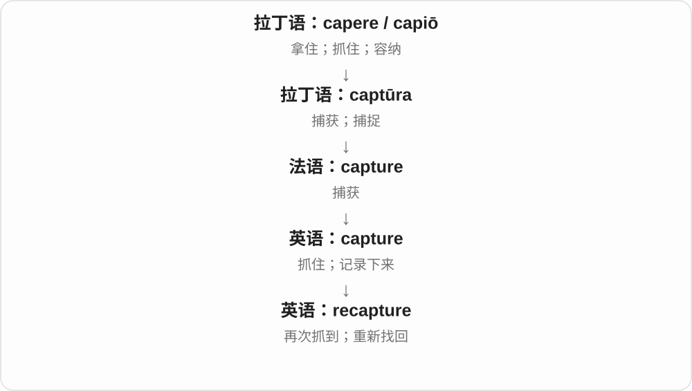

“重新捕获”扩展到恢复曾有的控制、注意力或体验。recapture the excitement 就是找回当时那种激动，不是捕捉新的猎物。

**常见搭配与例句**

recapture control；recapture someone’s attention；recapture the feeling。

> The team quickly recaptured control of the game.

球队很快重新掌控了比赛。

> The photographs helped her recapture the joy of that summer.

这些照片帮助她找回了那个夏天的快乐。

**别混淆**

recover 侧重恢复或找回，范围很广；recapture 更保留重新抓住、夺回或重现的力度。

### 48. recipe — 食谱；做事的方法

**音标**：/ˈresəpi/

**先抓住这个画面**

食谱最像一串指令：“拿这些材料，照这些步骤做。”recipe 的来源里，还真有一个“拿”的命令。

**怎么拆**

拉丁语 recipe 是 recipere“拿、接受”的命令式，相当于“你拿……”。经法语进入英语；末尾 e 要发音，整词三个音节。

**怎么变成今天的意思**

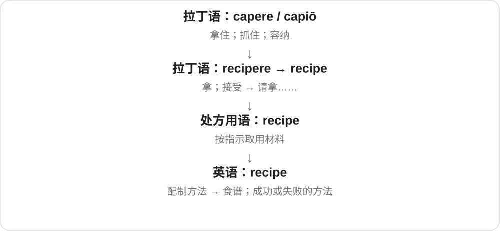

早期配药指示用“取用……”开头，后来这种配方和步骤的意思进入烹饪。a recipe for disaster 则把做菜的方法比喻成容易招来灾难的一套做法。

**常见搭配与例句**

a recipe for soup；follow a recipe；a recipe for success / disaster。

> Could you send me the recipe for this cake?

你能把这个蛋糕的食谱发给我吗？

> Rushing without a plan is a recipe for mistakes.

没有计划就匆忙行动，很容易出错。

**别混淆**

recipe 是做法，receipt 通常是收据。两个词历史上有关，但现代用途与读音明显不同。

### 49. recipes — 食谱、配方；做成某事的方法〔复数〕

**音标**：/ˈresəpiz/

**先抓住这个画面**

先取这些材料，再按这些步骤做，是 recipes 最直观的样子。事情怎么容易做成、做坏，也能借配方来比喻。

**怎么拆**

recipe + -s，末尾 e 在这里本来发 /i/，复数再读 /z/。recipe 接拉丁 recipere 的命令式 recipe 你拿、请取，旧配制指令转成配方名。

**怎么变成今天的意思**

**拉丁 recipere → 命令式 recipe → 配制指令、英语 recipe**  
请取这些材料 → 配方、食谱

↓

**recipe + -s → recipes**  
多份食谱、配方；比喻多种成功或失败办法

simple recipes 简单食谱；recipes for soup 汤的做法；recipes for success 成功办法。

**常见搭配与例句**

family recipes 家传配方；follow recipes 按食谱做。

> The book contains easy recipes for beginners.

这本书收录适合新手的简单食谱。

> We exchanged recipes after dinner.

晚饭后我们交换了食谱。

**别混淆**

recipes 是三个音节加末尾 /z/，不要按 silent e 的普通规则把 recipe 读成两音节。recipe for disaster 是必然惹麻烦的做法，常见固定比喻用单数。

### 50. perceive — 察觉；理解；把……看作

**音标**：/pəˈsiːv/

**先抓住这个画面**

眼睛耳朵把信息带进来，你的脑子“抓住”了它。perceive 不只说看到，也说你怎样理解看到的东西。

**怎么拆**

per-（贯穿、充分）+ capere（拿）形成 percipere。由法语进入英语后出现 -ceive；percept- 是同族的另一历史词干。

**怎么变成今天的意思**

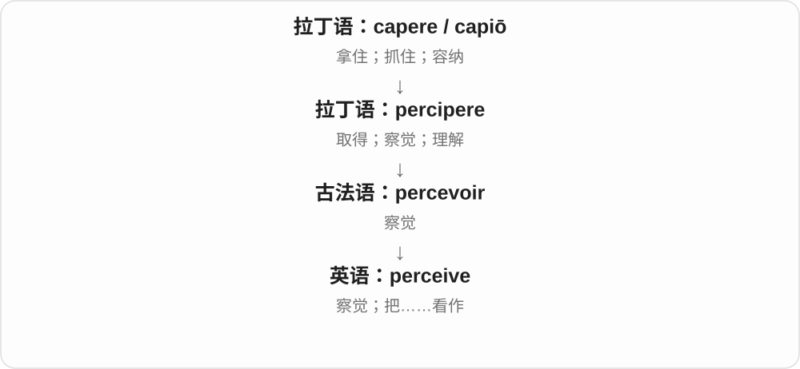

“抓住外面的东西”可以转成“头脑抓住信息”。所以它既能说察觉细微变化，也能说把一个建议看成批评；后一种理解未必正确。

**常见搭配与例句**

perceive a change；perceive A as B；be perceived as…。

> I perceived a slight change in her tone.

我察觉她的语气有一点变化。

> He perceived my question as criticism.

他把我的问题理解成了批评。

**别混淆**

see 偏看到；perceive 更强调察觉或解释。perceive someone as rude 说的是你的看法，不自动证明那个人确实无礼。

### 51. perception — 感知；看法

**音标**：/pəˈsepʃən/

**先抓住这个画面**

同一件事进入不同人的脑中，会形成不同的“画面”。这种感知过程或形成的看法，就是 perception。

**怎么拆**

与 perceive 同源；拉丁语 perceptiō 来自 percipere 的相关词干。-ceive 与 -ception 的对应有历史依据，不是随意拼写变形。

**怎么变成今天的意思**

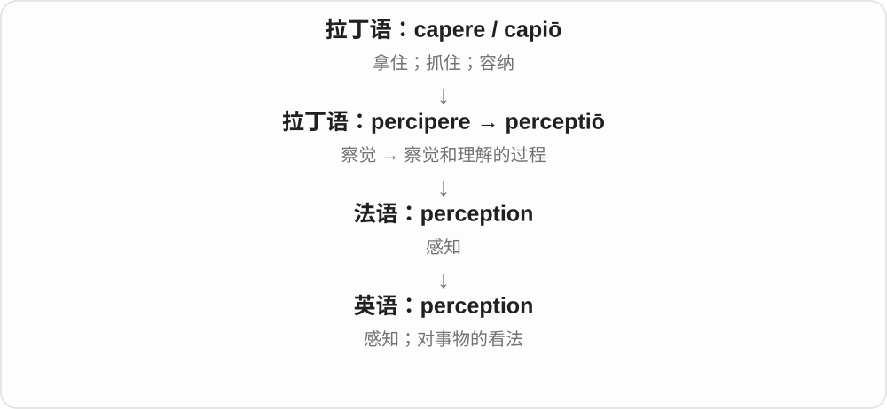

从接收感觉信息，到解释这些信息，便连接了“感知”和“观念”两个常见义。public perception 是公众怎么看，并不是公众掌握的全部事实。

**常见搭配与例句**

public perception；a perception of…；change someone’s perception。

> The campaign changed public perception of the product.

这次宣传改变了公众对该产品的看法。

> Poor lighting can affect our perception of color.

光线不足会影响我们对颜色的感知。

**别混淆**

perception 是感知和看法，perspective 是观察角度；两者有关，但“看法”不能总靠一个中文词机械互换。

### 52. perceptions — 感知；看法、印象〔复数〕

**音标**：英、美 /pəˈsepʃənz/

**先抓住这个画面**

同一个地方，不同人看完留下的印象可能不同，这些就是 perceptions。它关注人怎样接收、理解一件事，而不只关注事情本身是什么样。

**怎么拆**

perception + -s → perceptions。接拉丁 perceptio，来自 percipere 取得、领会的分词词干 percept-，配 -ion 名词词尾；per- 充分，capere 抓取，在复合中有 -cip-、-cept- 形式。

**怎么变成今天的意思**

**拉丁 per- + capere 抓 → percipere 取得、心中领会 → perceptio**  
从抓取东西，也说心中理解、意识到

↓

**perception → perceptions**  
现代复数常说不同人的看法、印象或不同方面的感知

public perceptions 是公众印象；different perceptions 是不同看法；perceptions of a place 是对某地的印象。

**常见搭配与例句**

public perceptions；different perceptions；perceptions of。

> The study compares perceptions of the same neighbourhood.

研究比较了人们对同一街区的不同印象。

> The exhibition changed visitors’ perceptions of the city.

展览改变了参观者对这座城市的看法。

**别混淆**

perceptions 强调人怎样看、怎样理解；facts 强调实际情况。比较 perceptions 可以研究人们印象的差异，并不预先判定哪一种一定错误。

### 53. misperception — 错误感知；误判

**音标**：/ˌmɪspəˈsepʃən/

**先抓住这个画面**

眼前的信息进了脑子，你却把它看偏了、读错了。misperception 更贴近这一步“看错”。

**怎么拆**

mis-（错误）+ perception（感知、看法）。结构与 misconception 相近，词基却不同。

**怎么变成今天的意思**

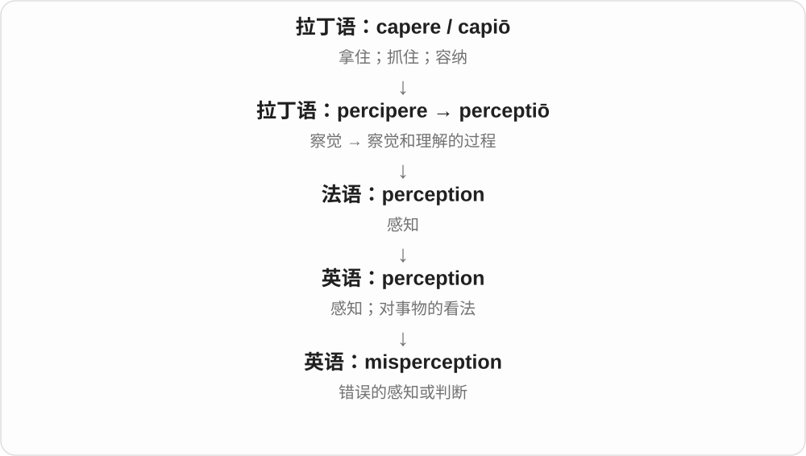

它可以指感官判断，也可以指对人的动机、危险或局面的误判。一个安静的人被当成冷漠，就是可能的 misperception。

**常见搭配与例句**

a misperception of…；correct a misperception；public misperception。

> The silence led to a misperception that nobody cared.

沉默让人误以为没有人在意。

> Better information can reduce misperceptions about the risks.

更充分的信息可以减少对风险的误判。

**别混淆**

misperception 偏看到和判断时出了偏差；misconception 偏脑中形成了错误观念。实际用法会有重叠。

### 54. perceived — 察觉、感知到了；被看作的〔过去式、过去分词〕

**音标**：/pəˈsiːvd/；美常 /pərˈsiːvd/

**先抓住这个画面**

感官接到一点信息，头脑把它认成某种情况，是 perceived。它也可描述别人心里怎样看待某件事。

**怎么拆**

perceive + -d，/v/ 后读 /d/。拉丁 per- 充分与 capere 拿取形成 percipere，经法语进入英语有 ceive 形式；percept- 是相应历史词干。

**怎么变成今天的意思**

**拉丁 percipere → 法语 → perceive**  
充分接到、拿住 → 察觉、理解

↓

**perceive 去 e + -ed → perceived**  
已察觉；也可说某物被看成什么样

perceived a change 察觉变化；perceived as useful 被看作有用；perceived value 人们感受到、认定的价值。

**常见搭配与例句**

widely perceived as 普遍被看作；perceived differences 感知到的差异。

> She perceived a slight change in his tone.

她察觉他的语气有一点变化。

> The new timetable was perceived as more convenient.

大家觉得新时间表更方便。

**别混淆**

perceived 说感受到、被认为，不一定是客观测量已经证实。perception 是感知、看法的名词。

### 55. perceivable — 能察觉到的

**音标**：/pəˈsiːvəbəl/

**先抓住这个画面**

变化发生了，而且你的眼睛、耳朵或判断能抓住它，就 perceivable。

**怎么拆**

perceive + -able；去末尾 e，表示可以被察觉。

**怎么变成今天的意思**

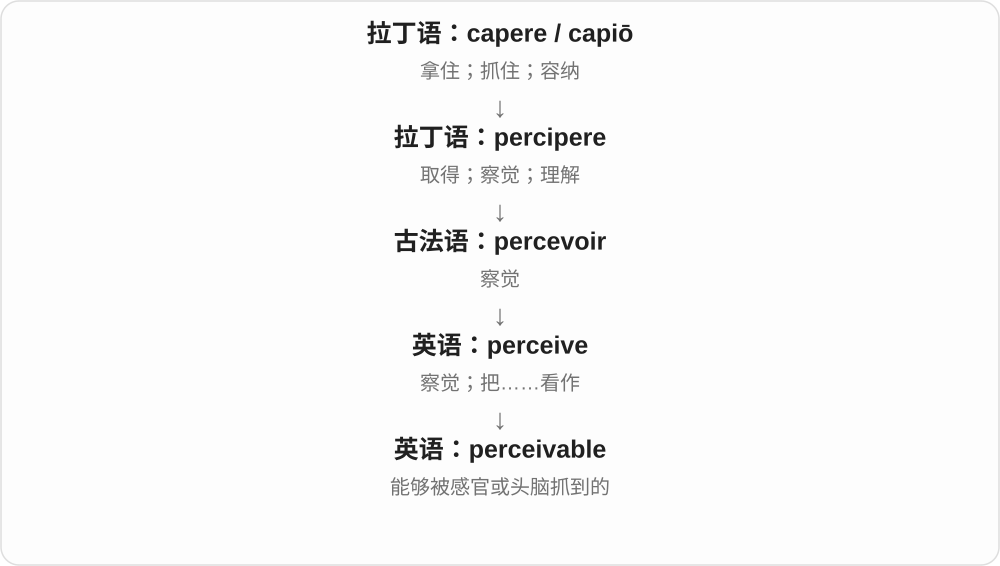

词义从察觉的动作转向对象是否达到察觉门槛。没有 perceivable difference，意思是没有能察觉的差别，不必然说明科学仪器也测不出差别。

**常见搭配与例句**

a perceivable difference；a perceivable change；easily perceivable。

> There was no perceivable difference between the two recordings.

两段录音之间听不出明显差别。

> The change was small but still perceivable.

变化虽小，但仍能察觉。

**别混淆**

perceivable 与 perceptible 都可表示可察觉；perceptible 更常见。visible 则特指能看见，不包括声音等其他感觉。

### 56. occupy — 占用、占据；居住、使用；使忙于

**音标**：英 /ˈɒkjʊpaɪ/；美 /ˈɑːkjəpaɪ/

**先抓住这个画面**

椅子上有人，空间被占；一天全在开会，时间被占；一件事让你不停地想，注意力也被占。这个占住就是 occupy 的核心。

**怎么拆**

经法语 occuper 接拉丁 occupare，关联 ob- 与 capere 拿、抓的材料，拉丁词干在组合中改变。过去式 occupied 把 y 改 i 再加 -ed。

**怎么变成今天的意思**

**拉丁 ob- + capere 拿住的材料 → occupare**  
占住、抓住；组合后词干发生变化

↓

**法语 occuper → 英语 occupy → occupied 等**  
占空间、时间、注意力；处于被占用的状态

occupy a room 占用、使用房间；occupy time 占时间；occupy someone’s thoughts 占据某人心思；occupy territory 占领地区。

**常见搭配与例句**

occupy a room；occupy someone’s thoughts。

> The desk occupies most of the room.

桌子占了房间的大部分空间。

> The question occupied her thoughts all afternoon.

整个下午，她脑子里都在想那个问题。

**别混淆**

occupy 是占着、使用的状态或动作，own 是拥有产权；租客可以 occupy 一间房而不 own 它。

### 57. occupying — 占用；占据；使忙于〔分词、动名词〕

**音标**：英 /ˈɒkjʊpaɪɪŋ/；美 /ˈɑːkjəpaɪɪŋ/

**先抓住这个画面**

一个位置、空间被你占着，别人就不能同时照原样使用，是 occupying。事情占住你的时间、心思，也能用同一个动作理解。

**怎么拆**

occupy 保留 y，加完整 -ing → occupying，结尾 /paɪɪŋ/。经法语、拉丁 occupare 占有，含 ob- 与 capere 抓取的加强形式；英语末节拼写的具体变化仍有不确定处。

**怎么变成今天的意思**

**拉丁 occupare 抓取、占有 → 法语 ocuper、occuper → occupy**  
从占有空间、位置扩展到占用时间

↓

**occupy + -ing → occupying**  
现代可以说物体占地方，也可以说活动占据注意力

occupying a seat 是占着座位；occupying most of the space 是占去大部分空间；occupying someone’s thoughts 是占据某人的思绪。

**常见搭配与例句**

occupying a seat；occupying space；occupying someone’s thoughts。

> The boxes are occupying most of the room.

这些箱子占去了房间的大部分空间。

> The question kept occupying her thoughts during the journey.

旅途中，她一直在想着这个问题。

**别混淆**

occupying 和 occupied 都可与忙碌、占用相关。The boxes are occupying the room 描述箱子占着空间；the room is occupied 从空间已被占用的状态来讲。

### 58. conceive — 构想；设想；怀孕

**音标**：/kənˈsiːv/

**先抓住这个画面**

把零散材料收进来，在里面形成一个新东西：脑中形成想法，身体里孕育生命。conceive 的两个常见意思可以放在这个画面下理解。

**怎么拆**

con-（一起）+ capere（拿）形成 concipere。它经法语成为 conceive；concept- 是同一拉丁词族的相关词干。

**怎么变成今天的意思**

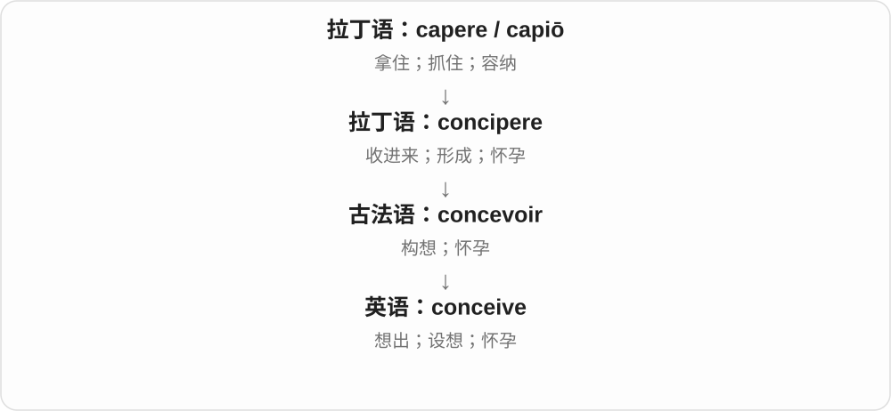

“收进、形成”的历史意义连接了构想和受孕。今天 conceive an idea 是想出一个点子；conceive of something 是想象某种可能；谈生育时则表示怀孕。

**常见搭配与例句**

conceive an idea；conceive of a possibility；be conceived as…（被构想为……）。

> The team conceived a simple way to reduce waste.

团队想出了一个减少浪费的简单办法。

> I cannot conceive of a world without music.

我无法想象一个没有音乐的世界。

**别混淆**

conceive 强调形成想法，consider 强调考虑已有的事情。谈怀孕时要由上下文判断，不能见到 conceive 就译成构思。

### 59. conceived — 构想出、设想到；怀孕〔过去式、过去分词〕

**音标**：/kənˈsiːvd/

**先抓住这个画面**

一个想法在脑中开始成形，是 conceived；新生命开始孕育，也用这个词。可以抓住把某物收进来、开始形成的旧方向。

**怎么拆**

conceive 经古法语 concevoir 接拉丁 concipere，con- 一起 + capere 拿取，较早收进来、形成、怀孕。现代去 e 加完整 -ed，/v/ 后读 /d/。

**怎么变成今天的意思**

**拉丁 concipere → 法语 concevoir → conceive**  
收进来、形成 → 构想、怀孕

↓

**conceive 去 e + -ed → conceived**  
已经想出、设想或孕育

conceived the idea 想出这个主意；conceived as… 被构想为……；conceived of a possibility 想象到某种可能。

**常见搭配与例句**

carefully conceived 精心构思的；originally conceived 最初构想的。

> She conceived the idea during a train journey.

她在一次火车旅途中想出了这个主意。

> The exhibition was conceived as a journey through the city.

展览被构想成一次穿行城市的旅程。

**别混淆**

conceived 一个方案，不等于已经做完或实施。构思可以停在脑中、纸上；实际执行要另看动词。

### 60. conception — 构想；观念；受孕

**音标**：/kənˈsepʃən/

**先抓住这个画面**

conception 可以是一个想法刚刚形成，也可以是你脑中已经形成的理解。谈生育时，它指受孕，不是“生孩子”整个过程。

**怎么拆**

来自拉丁语 conceptiō，经法语进入英语，与 conceive 同源。现代可把两者看成动作和名词的对应。

**怎么变成今天的意思**

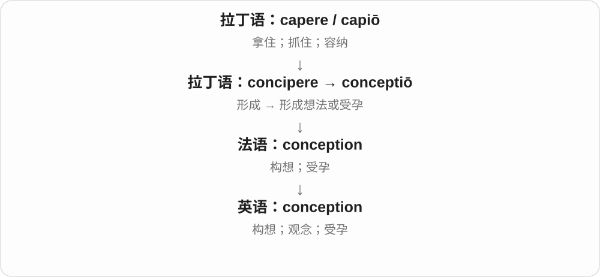

一件事被“收进头脑并形成整体”，就成了你对它的 conception；一个项目从 conception 到完成，则是从最初构想到落地。

**常见搭配与例句**

a conception of…；from conception to completion；the moment of conception。

> Her conception of success has changed over time.

她对成功的理解随着时间发生了变化。

> The project took two years from conception to completion.

这个项目从构想到完成花了两年。

**别混淆**

concept 常指一个具体概念；conception 更容易强调构想过程，或某人对一件事的整体理解。

### 61. misconception — 错误观念；误解

**音标**：/ˌmɪskənˈsepʃən/

**先抓住这个画面**

脑中形成了一张解释世界的图，可惜图画错了。这种错误理解就是 misconception。

**怎么拆**

mis-（错误）+ conception（观念）。不是 miss“想念”加 conception。

**怎么变成今天的意思**

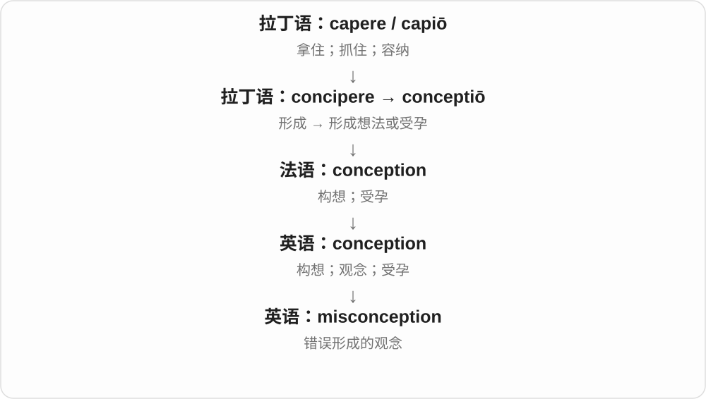

它常指已经成形、甚至广泛流传的错误观念。因此 correct a misconception 是帮人把脑中的错误模型改过来。

**常见搭配与例句**

a common misconception；a misconception about…；correct a misconception。

> It is a common misconception that bats are blind.

认为蝙蝠看不见，是一种常见误解。

> The article corrected my misconception about how the system works.

这篇文章纠正了我对系统工作方式的错误认识。

**别混淆**

misconception 常是一种较稳定的错误观念；misunderstanding 也可以只是某次对话里没听懂。

### 62. preconception — 先入之见；预先形成的看法

**音标**：/ˌpriːkənˈsepʃən/

**先抓住这个画面**

还没认真看事实，脑子里的答案已经写好了。这就是 preconception。它未必全错，但容易挡住新信息。

**怎么拆**

pre-（在前）+ conception（观念）。重点是观念形成得比实际了解更早。

**怎么变成今天的意思**

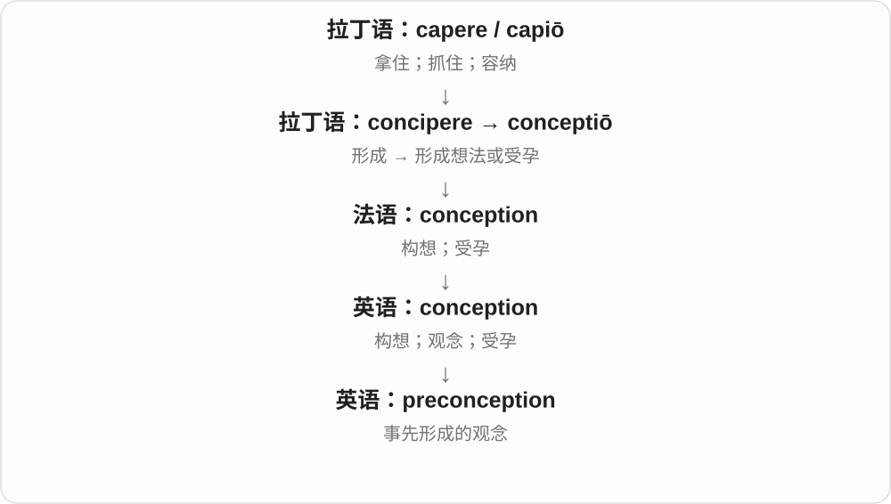

“先形成的想法”在讨论里常带提醒意味：你是否带着旧答案来观察新问题？放下 preconceptions，就是先让证据进来。

**常见搭配与例句**

preconceptions about…；challenge a preconception；without preconceptions。

> Try to approach the problem without preconceptions.

试着放下先入之见来处理这个问题。

> The trip challenged her preconceptions about the country.

这次旅行挑战了她对那个国家原先的看法。

**别混淆**

preconception 强调时间上先入为主；misconception 强调内容上理解错误。先入之见可能碰巧正确，但仍值得检验。

### 63. conceivable — 想象得到的；可能的

**音标**：/kənˈsiːvəbəl/

**先抓住这个画面**

一件事虽然没发生，但脑中还能画出它怎么发生，就 conceivable。它表示想得到这种可能，不保证它会发生。

**怎么拆**

conceive + -able；去掉不发音的 e，再加 -able，表示可以被设想。

**怎么变成今天的意思**

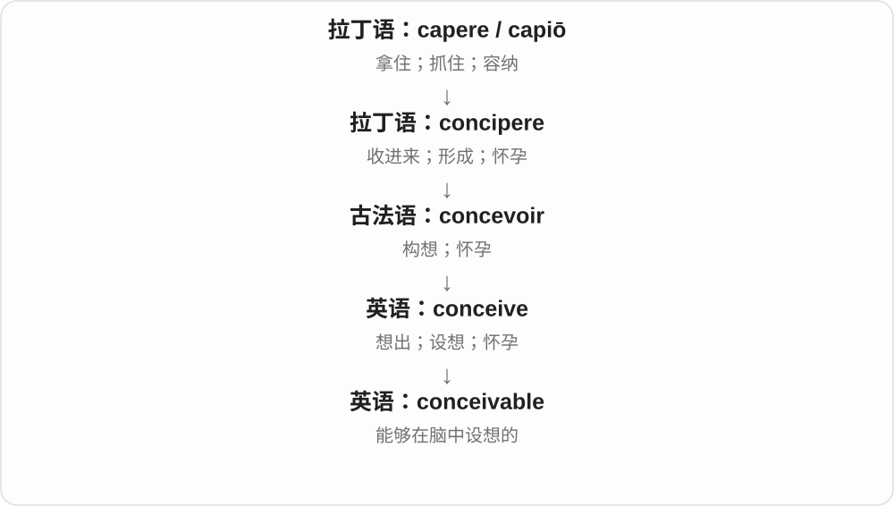

从“构想”变成“可被构想”，进而说某种情况并非不可能。every conceivable way 就是所有想得到的办法。

**常见搭配与例句**

every conceivable…；It is conceivable that…；a conceivable explanation。

> We tried every conceivable way to contact him.

我们尝试了所有想得到的办法联系他。

> It is conceivable that the meeting will be postponed.

会议有可能推迟。

**别混淆**

conceivable 的门槛较低：能设想即可。probable 则说发生的可能性较大。

### 64. caption — 图片说明；字幕

**音标**：/ˈkæpʃən/

**先抓住这个画面**

照片下面那句告诉你“这是什么、发生了什么”的文字，就是 caption。视频里的 captions 则把说话和重要声音变成可读文字。

**怎么拆**

来自拉丁语 captiō“抓取、捕获”的词族。它不是因为“抓住眼球”才叫 caption，那只是容易想到的联想。

**怎么变成今天的意思**

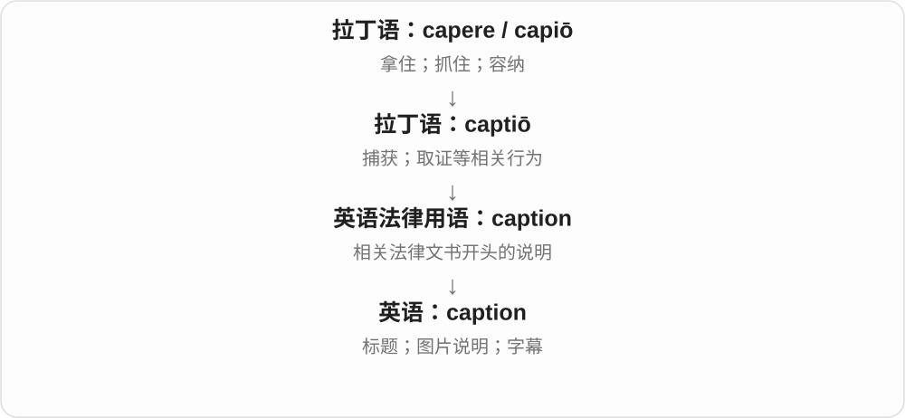

关键中间环节是法律文书开头的说明，后来词义扩展到一般标题，再到图片说明。这个过程比直接说“字幕抓住注意力”更接近真实来源。

**常见搭配与例句**

add a caption；a photo caption；turn on captions。

> The caption explains where the photograph was taken.

图片说明交代了照片在哪里拍摄。

> I turned on the captions so I could follow the dialogue.

我打开了字幕，方便跟上对话。

**别混淆**

caption 可以指图片说明，也可以指字幕；title 通常是作品或文章的名字。视频平台上 captions 与 subtitles 的具体区分还要看其使用习惯。

### 65. captions — 图片说明、字幕〔复数〕；添加说明〔第三人称单数〕

**音标**：/ˈkæpʃənz/

**先抓住这个画面**

照片下写出谁、在哪里、发生什么，是 captions；视频中把说话、相关声音写出来，也可叫字幕。

**怎么拆**

caption + -s，/n/ 后读 /z/。拉丁 captio 词族经法律文书开头的说明、一般标题等中间用途，发展图片说明义。

**怎么变成今天的意思**

**拉丁 captio 等 → 英语法律说明、标题用语 caption**  
有真实中间用途，不直接由抓注意力推导

↓

**图片、视频用途；+ -s → captions**  
多条图片说明、字幕；它加说明

photo captions 图片说明；turn on captions 打开字幕。

**常见搭配与例句**

write captions 编写图片说明；captions below the pictures 图片下方说明。

> The captions explain where the photographs were taken.

图片说明交代了照片在哪里拍摄。

> We watched the recording with captions.

我们看录影时开了字幕。

**别混淆**

caption 可说静态图片说明，也可说视频字幕；subtitle 常说对白字幕，具体领域的命名有交叠。

### 66. captioned — 配了说明、字幕的；添加了说明

**音标**：/ˈkæpʃənd/

**先抓住这个画面**

图已经配了说明、视频已经加了可读文字，是 captioned。原来的图像旁多了一层帮助理解的信息。

**怎么拆**

caption + -ed，/n/ 后读 /d/。名词的说明、字幕用途发展为相应添加动作。

**怎么变成今天的意思**

**caption 说明名词 → caption 动词**  
给图像、视频添说明文字

↓

**caption + -ed → captioned**  
过去加了说明；带说明、字幕的

a captioned video 带字幕视频；captioned photographs 配说明的照片。

**常见搭配与例句**

captioned the picture 给图片加了说明；carefully captioned 认真配注的。

> The photographs were carefully captioned.

照片都认真配了说明。

> The class watched a captioned video.

全班看了一段带字幕视频。

**别混淆**

captioned 不保证文字是译文；也可以把原语言说话、声音信息写出来。

### 67. captioning — 添加图片说明、字幕；字幕制作过程

**音标**：/ˈkæpʃənɪŋ/

**先抓住这个画面**

正在为图片配说明、把视频里的声音配成可读文字，这项工作叫 captioning。

**怎么拆**

caption + -ing；基础名词已发展为加说明、加字幕动词。

**怎么变成今天的意思**

**caption 名词 → caption 动词**  
添加图像说明、视频文字

↓

**caption + -ing → captioning**  
制作说明、字幕的过程

video captioning 视频字幕制作；captioning photographs 给照片配说明。

**常见搭配与例句**

finish captioning 配注完成；live captioning 实时字幕。

> She was captioning the photographs for the exhibition.

她正在为展览照片配说明。

> Captioning the recording took most of the day.

给录影加字幕花了大半天。

**别混淆**

captioning 把图像、声音内容配上文字说明；translating 则特别说跨语言转换，二者可能同时发生。

### 68. captive — 被俘的；受控制的；俘虏

**音标**：/ˈkæptɪv/

**先抓住这个画面**

capture 是把人抓住，captive 是被抓住、不能自由离开的那个人或状态。它也能描述没有多少选择的顾客或听众。

**怎么拆**

来自拉丁语 captīvus，capt- 与 capere 的分词词干有关。不是先有现代 capture，再简单把 ure 换成 ive。

**怎么变成今天的意思**

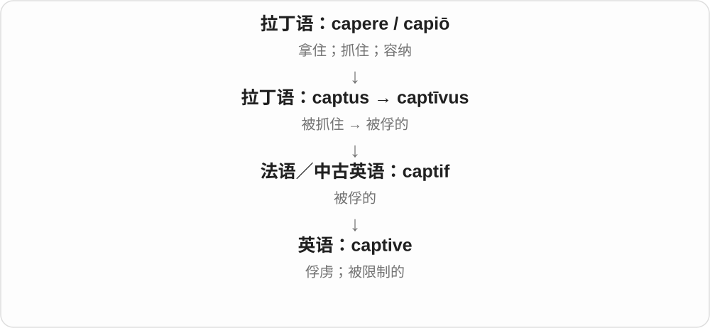

从身体不能离开，扩展到选择受限制。a captive audience 往往指处在某种场合、不得不听下去的人群，不一定是被内容迷住的观众。

**常见搭配与例句**

hold someone captive；a captive animal；a captive audience。

> The captives were released after the negotiations.

谈判后，俘虏们获释了。

> The speaker had a captive audience during the long bus journey.

长途乘车途中，听众们只得一直听那位讲述者说话。

**别混淆**

captive 是受控制、难以离开；captivated 是被吸引得入迷。两个词同源，但说听众时意思可能差很多。

### 69. captivate — 迷住；使入迷

**音标**：/ˈkæptɪveɪt/

**先抓住这个画面**

没有真的绑住你，却把你的注意力牢牢抓住，让你舍不得移开。这就是 captivate。

**怎么拆**

来自 captīvus“被俘的”这一词族，晚期拉丁语 captīvāre、captīvātus 与英语 captivate 相连。可用 captive + -ate 辅助记忆。

**怎么变成今天的意思**

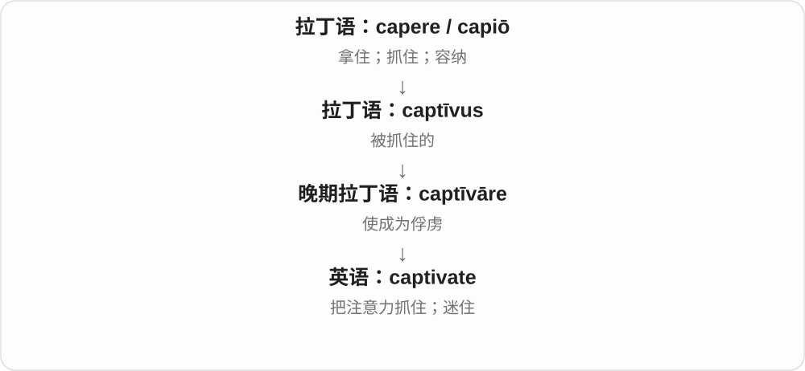

词义从把人控制住转成把人的兴趣吸引住。它常用于音乐、故事、风景或个人魅力，通常带欣赏的语气。

**常见搭配与例句**

captivate an audience；be captivated by…；a captivating story。

> The storyteller captivated the children with her voice.

讲故事的人用她的声音让孩子们听得入迷。

> We were captivated by the view from the mountain.

山上的景色让我们着迷。

**别混淆**

capture attention 可以只是成功引起注意；captivate 往往表示吸引得更深，让人持续投入。

### 70. susceptible — 容易受影响的；易感的

**音标**：/səˈseptəbəl/

**先抓住这个画面**

把某种影响想成从外面进来的东西：这个人或材料容易让它进来，就 susceptible。比如容易生锈、容易被说服、容易受某种疾病影响。

**怎么拆**

来自拉丁语 suscipere“接起、接受”的词族，经 susceptus、susceptibilis 形成。-cept- 仍与 capere 有关；这里不要把 sus- 当成现代独立词。

**怎么变成今天的意思**

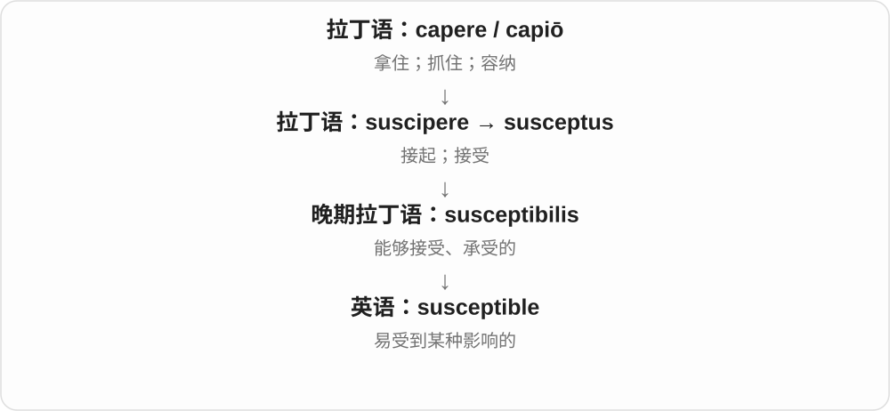

由“可以接收某物”发展到“容易受到某种影响”。现代常跟 to，并偏向不利影响；但 susceptible to persuasion 只是说容易被说服。

**常见搭配与例句**

susceptible to damage；susceptible to disease；susceptible to persuasion。

> The material is susceptible to damage from heat.

这种材料容易受热损坏。

> Children can be susceptible to pressure from their friends.

孩子容易受到朋友施加的压力影响。

**别混淆**

sensitive 偏对刺激反应强；susceptible 偏容易受某影响侵入或改变。不要和 suspicious“怀疑的”混淆。

### 71. inception — 开始；创立之初

**音标**：/ɪnˈsepʃən/

**先抓住这个画面**

把一个项目的时间线往回拉，拉到最初启动的那个点，就是 inception。

**怎么拆**

来自拉丁语 inceptiō，与 incipere“开始”同族。-cip- 和 -cept- 是不同历史词形，不是不同含义的两套词根。

**怎么变成今天的意思**

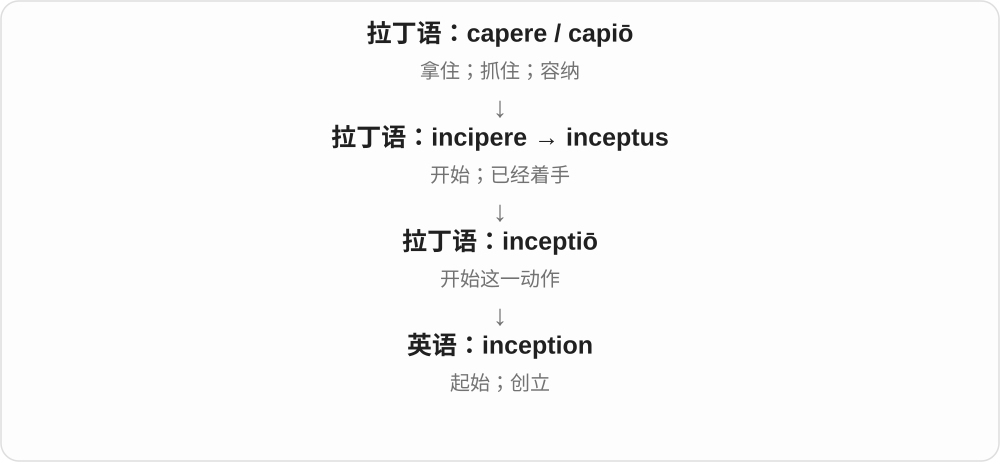

它常把人带回项目、机构或计划的开头。since its inception 就是从它开始存在以来，不必是正式开幕那一天。

**常见搭配与例句**

since its inception；from inception；at the inception of…。

> The program has helped thousands of students since its inception.

这个项目自创立以来已帮助了数千名学生。

> She was involved in the project from its inception.

她从项目一开始就参与其中。

**别混淆**

conception 偏最初想法的形成；inception 偏事物的开始。它们在项目早期可能挨得很近，但不是永远同一时刻。

### 72. deceive — 欺骗；使误信

**音标**：/dɪˈsiːv/

**先抓住这个画面**

想象一个陷阱把人引进错误判断：你以为是真的，其实不是。deceive 强调让人信了假的东西。

**怎么拆**

来自 dē- + capere 形成的拉丁语 dēcipere，其历史义已有诱捕、蒙骗。现代拼写经法语形成，不能把 de- 一概译成“向下”。

**怎么变成今天的意思**

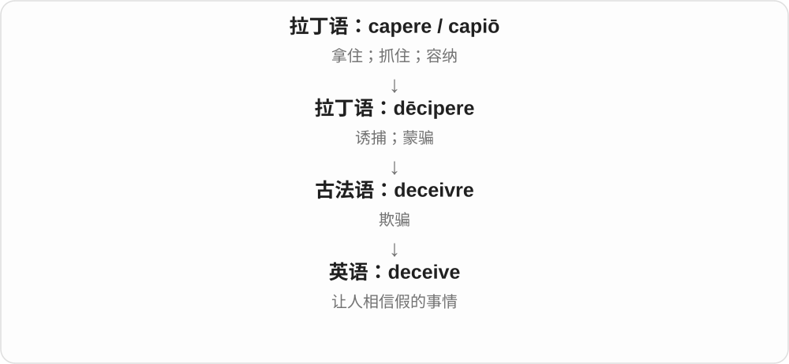

从诱捕到蒙骗，关键在于让对方落入你设好的判断。英语 deceive 并不是先表示“拿走东西”再简单变成欺骗；那样的故事会把词源过度简化。

**常见搭配与例句**

deceive someone；deceive someone into doing…；deceive yourself（自欺）。

> The advertisement deceived customers into paying for a useless service.

这则广告诱骗顾客为无用的服务付费。

> Do not deceive yourself about how much work remains.

别在还剩多少工作这件事上自欺欺人。

**别混淆**

lie 指说谎，deceive 指造成误信；隐瞒关键事实、摆出假象，也可能 deceive，而不一定直接说了假话。

### 73. deception — 欺骗；骗局

**音标**：/dɪˈsepʃən/

**先抓住这个画面**

deception 是让别人被假象蒙住的行为或手段。它可以是一整套布局，不只是一个谎话。

**怎么拆**

属于 deceive 的名词词族，经法语来自拉丁语 dēceptiō。-cept- 对应的是历史词干，而不是现代英语里随便缩短 deceive。

**怎么变成今天的意思**

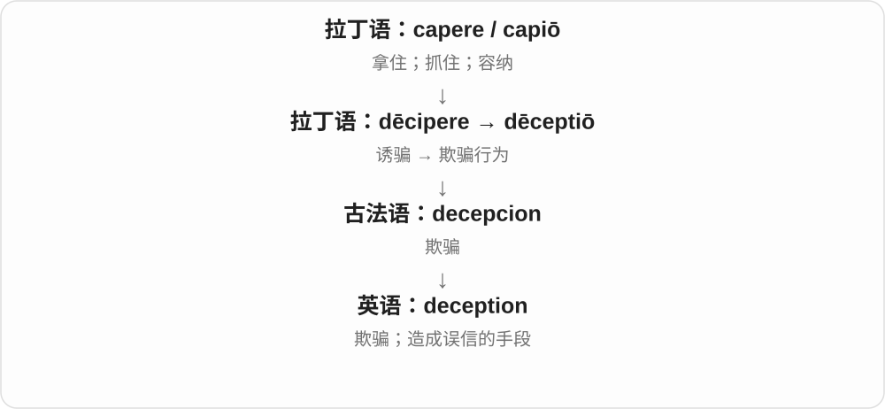

动词说“他骗了我”，名词则把整个过程拿出来讨论。a deception 可以指一项具体骗局，deception 也可泛指欺骗这一行为。

**常见搭配与例句**

deliberate deception（蓄意欺骗）；an act of deception；detect deception。

> The investigation uncovered a pattern of deliberate deception.

调查揭露了一系列蓄意欺骗行为。

> The apparent success was based on deception.

表面上的成功建立在欺骗之上。

**别混淆**

deception 与 misunderstanding 不同：前者通常涉及制造误信，后者可能只是双方理解出了差错。

### 74. stair — 一阶楼梯、一级台阶；较早也可统称楼梯

**音标**：英 /steə/；美 /ster/

**先抓住这个画面**

脚往上抬，踏到一级新的高度，那一级可以叫 a stair。说整段楼梯，日常更常用 stairs。

**怎么拆**

接古英语 stæger 楼梯名称，较早属于向上走、攀升的日耳曼语材料。旧词也可指一组楼梯，后来普通复数 stairs 与单阶 stair 的分工逐渐形成。

**怎么变成今天的意思**

**古英语 stæger → 中古英语 steir**  
登升结构、楼梯等

↓

**现代 stair 与 stairs 的分工**  
一阶；多阶、整段楼梯

the bottom stair 最下面一级；the top stair 最上面一级；sit on a stair 坐在一级台阶上；a broken stair 损坏的一级台阶。

**常见搭配与例句**

one stair at a time；the first stair。

> She sat on the bottom stair to tie her shoes.

她坐在最下面一级台阶上系鞋带。

> One of the wooden stairs creaked under his foot.

一阶木台阶在他脚下吱呀作响。

**别混淆**

a stair 通常在数一级，不是一整层楼。普通说从楼梯上去，用 go up the stairs；说第几层用 floor 等另外的单位词。

### 75. staircase — 楼梯、楼梯结构整体

**音标**：英 /ˈsteəkeɪs/；美 /ˈsterkeɪs/

**先抓住这个画面**

不只数脚下几阶，还看整套台阶、支撑和围合安排。把它当建筑里的一个整体构造，就是 a staircase。

**怎么拆**

stair 台阶 + case 围框、容纳结构，英语复合词；这里 case 的容器线更早经法语接拉丁 capsa 箱、容器。stair 自身来自日耳曼语，两个部分各有来源。

**怎么变成今天的意思**

**stair + case**  
台阶 + 围框、容纳的结构

↓

**英语 staircase**  
由台阶等组成的一套楼梯结构

a spiral staircase 螺旋楼梯；a wooden staircase 木楼梯；a narrow staircase 狭窄楼梯；the main staircase 主楼梯。

**常见搭配与例句**

a winding staircase；a grand staircase。

> A spiral staircase leads to the roof.

一道螺旋楼梯通向屋顶。

> The house has a broad wooden staircase.

房子里有一道宽木楼梯。

**别混淆**

stairs 常把一组台阶作为复数说，staircase 可数一套整体：The stairs are steep；The staircase is steep。case 在这里是围框结构，不是事件、病例的另一源词义。

### 76. intercept — 拦截；截获

**音标**：动词 /ˌɪntəˈsept/

**先抓住这个画面**

东西正从 A 去 B，你在中途伸手把它抓住。拦球、截获消息、拦下车辆，都可以用 intercept。

**怎么拆**

inter-（在……之间）+ capere，形成拉丁语 intercipere；intercept- 来自其分词词干。

**怎么变成今天的意思**

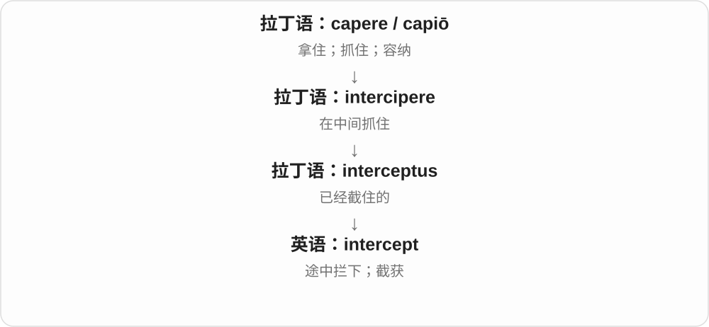

“抓”的位置在中途，因此它强调原本的去向被打断。接到本来就发给你的消息是 receive，途中截住别人的消息才更像 intercept。

**常见搭配与例句**

intercept a pass；intercept a message；intercept a vehicle。

> The defender intercepted the pass.

防守队员截下了那次传球。

> The message was intercepted before it reached its destination.

消息还没到达目的地就被截获了。

**别混淆**

interrupt 是打断进行中的活动；intercept 是在传递或移动途中拦截。

### 77. interceptor — 拦截者；拦截装置；截击机

**音标**：英 /ˌɪntəˈseptə/；美 /ˌɪntərˈseptər/

**先抓住这个画面**

intercept 是中途拦下，interceptor 就是专门干这件事的人或装置。

**怎么拆**

intercept + -or；-or 指执行动作的一方。它可以是飞机、技术装置，也可以是程序里处理请求的组件。

**怎么变成今天的意思**

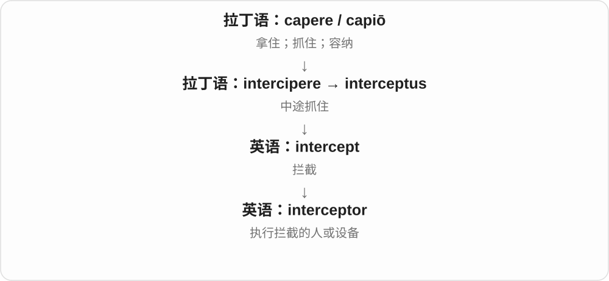

古老的“抓住”在新领域里继续派生。软件 interceptor 常在请求到达目标之前介入，恰好保留“中途接住”的画面。

**常见搭配与例句**

an interceptor aircraft；a request interceptor；install an interceptor。

> The interceptor aircraft approached the unidentified plane.

截击机接近了那架身份不明的飞机。

> The interceptor checks each request before passing it on.

拦截器会检查每个请求，再把它传递下去。

**别混淆**

interceptor 指执行拦截的角色；interception 指拦截行为本身。

### 78. forceps — 钳子；镊状钳

**音标**：英 /ˈfɔːseps/；美 /ˈfɔːrseps/

**先抓住这个画面**

想象两片细长的夹头合起来，稳稳夹住手指不方便拿的小东西。医学中的 forceps 就常是这种夹取工具。

**怎么拆**

直接借自拉丁语 forceps“钳”。常见词源分析把它联系到 formus“热”与 capere“拿”，即用来夹取热物的工具；不是 force + 复数 s。

**怎么变成今天的意思**

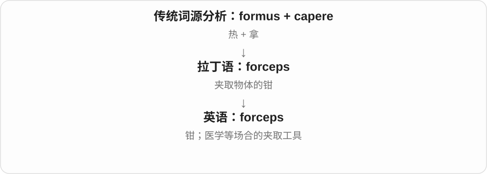

工具从夹取东西进入更专门的应用领域，名称仍保留抓取的功能。整词的历史组合较早，现代拼写已经不能逐字母还原。

**常见搭配与例句**

a pair of forceps；surgical forceps；grasp something with forceps。

> The researcher lifted the tiny sample with forceps.

研究人员用镊状钳夹起了那个微小样本。

> A pair of forceps lay beside the other instruments.

一把钳子放在其他器械旁边。

**别混淆**

forceps 不是 force“力量”的规则复数。通常说 a pair of forceps；具体是产钳、组织钳还是镊状工具，要看上下文。

### 79. incipient — 刚开始的；初起的

**音标**：/ɪnˈsɪpiənt/

**先抓住这个画面**

事情刚冒出一点苗头，还没完全发展起来，就是 incipient。

**怎么拆**

来自拉丁语 incipiēns“正在开始的”，其动词 incipere 与 in- + capere 有关，可以联系“着手拿起一件事”。

**怎么变成今天的意思**

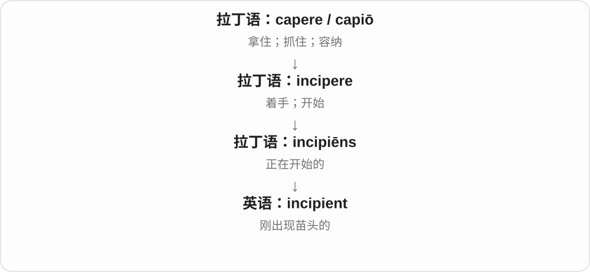

从“开始做”转为形容“刚开始形成”。常用于变化、问题、疾病或趋势的初期，语气比 beginning 更书面。

**常见搭配与例句**

incipient signs；an incipient crisis；incipient growth。

> The survey revealed signs of an incipient recovery.

调查显示出复苏的初步迹象。

> They addressed the incipient problem before it spread.

问题刚出现苗头，他们就采取了措施，防止它扩大。

**别混淆**

incipient 是初起；insipient 是罕见词，表示愚蠢。不要因为拼写相近，把“刚开始”看成“不聪明”。

### 80. capacious — 宽敞的；容量大的

**音标**：/kəˈpeɪʃəs/

**先抓住这个画面**

一个包看上去能把很多东西吞进去，房间也宽宽大大、装得下很多东西，就 capacious。

**怎么拆**

拉丁语 capāx“能装、宽大的”相关词干加形容词结尾形成；现代可把 capac- 与 capacity 联系起来。

**怎么变成今天的意思**

capacity 说容量本身，capacious 直接形容东西很能装。也能比喻心胸或记忆力容纳得多，但语体比 big、roomy 更正式。

**常见搭配与例句**

a capacious bag；a capacious room；a capacious memory。

> She carried a capacious bag full of books.

她提着一个能装很多东西的包，里面满是书。

> The house has a capacious kitchen.

这栋房子有一个宽敞的厨房。

**别混淆**

capacious 强调空间或容纳量，不等于 capable“能干的”。一个包很能装，不是在夸它有技能。

### 81. proprioception — 本体感觉

**音标**：/ˌprəʊpriəˈsepʃən/

**先抓住这个画面**

闭上眼睛，你仍大致知道手放在哪里、膝盖弯了多少。身体对自身位置和运动的这种感觉，就是 proprioception。

**怎么拆**

proprio- 来自拉丁语 proprius“自己的”，后部与 reception 的“接收”有关。它与 proprioceptor“本体感受器”同族，是现代科学用古典成分创造的术语。图中两个成分并列，不是一个演变出另一个。

**怎么变成今天的意思**

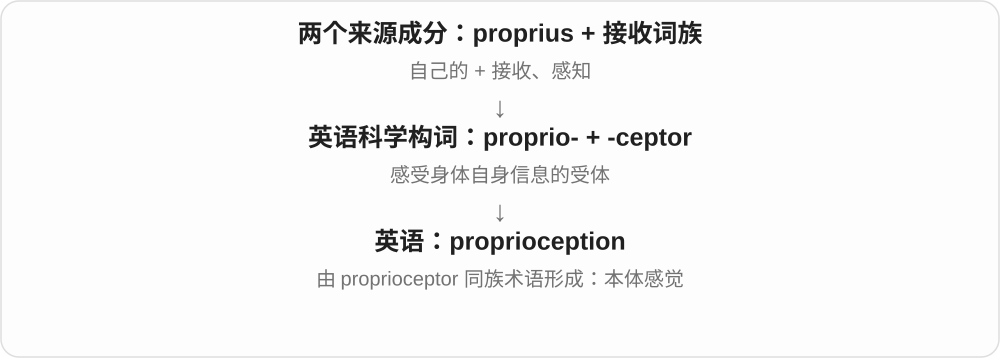

把“自己的”与“接收信息”放在一起，便能理解术语想指出哪一种感觉。它不是用眼睛看自己的身体，而是身体内部提供的位置和运动信息。

**常见搭配与例句**

proprioception and balance；a test of proprioception；proprioceptive information。

> Proprioception helps you know where your hand is without looking.

本体感觉帮助你不看手也知道手在哪里。

> The experiment examined the role of proprioception in movement.

这个实验研究了本体感觉在运动中的作用。

**别混淆**

proprioception 与 vision“视觉”不是同一条信息通道。两者可以一起帮助你控制动作，但闭眼后前者仍在起作用。

## 这一组要分清什么

**receive / accept**：前者说收到，后者说接受或认可。

**perception / conception**：前者偏察觉、解读；后者偏形成构想或观念。

**misconception / preconception**：前者是想错了，后者是还没充分了解就先有了看法。

**captive / captivate**：一个是被抓住走不了，一个是注意力被抓住、入了迷。

**caption** 的现代图片说明义经历了法律文书标题这一环节，不能只编一个“抓住注意力”的词源故事。

## 串起来练习

**I received the offer, but I did not accept it.**

我收到了提议，但没有接受。收到与认可不是一回事。

**A common misconception can shape our perception.**

一种常见的错误观念，会影响我们看待事情的方式。
