# 0095 · div-, diff- — 分开、不同：几条相似词形的并行来源

[逐词精讲目录](../00_逐词精讲目录.md) · [总目录](../00_总目录_按常用程度.md)

## 核心词根与来源

这页保留 div- / diff- 这一学习入口，但要先拆清楚：这些单词不是全从 diversum 变来。它们多有 dis- / di-“分开”的共同前缀背景，后面的动词根却不同。下面分别看分割、带开、转向几条路线。

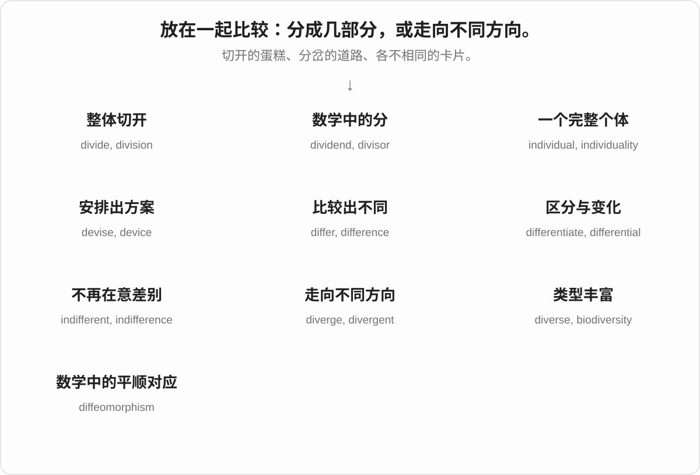

## 词形与演化规律

divide：来自 dīvidere“分开”；divis- 是它的分词词干。-videre 不是 vidēre“看见”。

different / difference：来自 dis- + ferre“带开”；dif- 是前缀同化，不是把 diff- 单独当作统一词根。

diverse / diversity：来自 dis- + vertere“转向不同方向”。diverge / divergence 则是 dis- + vergere“转向、倾向”，两者不是同一个拉丁动词。

diffeomorphism 是现代数学缩合词；individual 是“不可分的整体”发展成“个体”；这些都要沿各自链条理解。

## 单词速览（按词族由简到繁）

同一基础词的相关扩展放在一起，先读基础形式，再读扩展；各组之间优先读常用的。具体词源关系见各词讲解。

| 单词 | 音标 | 核心意思 |
|---|---|---|
| [differ](#w-11) | 英 /ˈdɪfə/；美 /ˈdɪfər/ | 不同；有分歧 |
| [different](#w-1) | /ˈdɪfərənt/，常弱读 /ˈdɪfrənt/ | 不同的；另一个的 |
| [difference](#w-2) | /ˈdɪfərəns/，常弱读 /ˈdɪfrəns/ | 差别；差额；分歧；影响 |
| [differently](#w-9) | /ˈdɪfərəntli/ | 不同地；用另一种方式 |
| [differential](#w-13) | /ˌdɪfəˈrenʃəl/ | 有差别的；差额；微分的；差速器 |
| [differentially](#w-39) | /ˌdɪfəˈrenʃəli/ | 有区别地；以不同程度或方式 |
| [differentiate](#w-17) | /ˌdɪfəˈrenʃieɪt/ | 区分；使有差别；分化；求导 |
| [differentiation](#w-18) | /ˌdɪfərenʃiˈeɪʃən/ | 区分；差异化；分化；求导 |
| [differentiated](#w-24) | /ˌdɪfəˈrenʃieɪtɪd/ | 已区分的；有差异的；已分化的 |
| [undifferentiated](#w-40) | /ˌʌndɪfəˈrenʃieɪtɪd/ | 未区分的；缺少区别的；未分化的 |
| [differentiable](#w-42) | /ˌdɪfəˈrenʃəbəl/ | 可微的；可求导的 |
| [differentiability](#w-52) | /ˌdɪfəˌrenʃəˈbɪləti/ | 可微性 |
| [indifferent](#w-20) | /ɪnˈdɪfərənt/ | 不在乎的；冷淡的；一般的；无偏好的 |
| [indifference](#w-23) | /ɪnˈdɪfərəns/ | 漠不关心；无所谓；无偏好 |
| [indifferently](#w-44) | /ɪnˈdɪfərəntli/ | 漠然地；无所谓地；平平地 |
| [individual](#w-3) | /ˌɪndɪˈvɪdʒuəl/ | 个人；个体；单独的；各自的 |
| [individually](#w-12) | /ˌɪndɪˈvɪdʒuəli/ | 分别地；单独地；逐个地 |
| [individuality](#w-27) | /ˌɪndɪvɪdʒuˈæləti/ | 个性；独特性 |
| [individualism](#w-32) | /ˌɪndɪˈvɪdʒuəlɪzəm/ | 个人主义；强调个人自主的倾向 |
| [individualist](#w-38) | /ˌɪndɪˈvɪdʒuəlɪst/ | 独立行事的人；个人主义者 |
| [individualistic](#w-36) | /ˌɪndɪvɪdʒuəˈlɪstɪk/ | 强调个人独立的；富有个人风格的 |
| [individualize](#w-48) | /ˌɪndɪˈvɪdʒuəlaɪz/ | 使个性化；按个人情况调整；使有独特性 |
| [individualization](#w-47) | /ˌɪndɪvɪdʒuəlaɪˈzeɪʃən/ | 个性化调整；个别化处理 |
| [divide](#w-10) | /dɪˈvaɪd/ | 分开；分配；使意见不一；除以；分界 |
| [division](#w-4) | /dɪˈvɪʒən/ | 划分；除法；部门；分歧；师〔军队单位〕 |
| [divisional](#w-25) | /dɪˈvɪʒənəl/ | 部门的；分区的；师级的 |
| [subdivision](#w-16) | /ˌsʌbdɪˈvɪʒən/ | 细分；分支；分出来的部分；住宅分区 |
| [divided](#w-6) | /dɪˈvaɪdɪd/ | 被分开的；意见分裂的 |
| [undivided](#w-31) | /ˌʌndɪˈvaɪdɪd/ | 未分开的；完整的；专一的 |
| [dividing](#w-15) | /dɪˈvaɪdɪŋ/ | 划分的；正在分开的 |
| [divisive](#w-22) | /dɪˈvaɪsɪv/，也读 /dɪˈvɪsɪv/ | 造成分裂的；容易引起对立的 |
| [divider](#w-35) | 英 /dɪˈvaɪdə/；美 /dɪˈvaɪdər/ | 分隔物；分隔页；隔断；分规 |
| [subdivide](#w-43) | /ˌsʌbdɪˈvaɪd/ | 再细分；分成更小部分 |
| [devise](#w-28) | /dɪˈvaɪz/ | 想出；设计出；以遗嘱留下〔法律用语〕 |
| [device](#w-5) | /dɪˈvaɪs/ | 装置；设备；手法；巧妙办法 |
| [deviser](#w-54) | 英 /dɪˈvaɪzə/；美 /dɪˈvaɪzər/ | 构思者；设计出办法的人 |
| [diverse](#w-8) | 英 /daɪˈvɜːs/；美 /daɪˈvɜːrs/ | 多种多样的；各不相同的 |
| [diversity](#w-7) | 英 /daɪˈvɜːsəti/；美 /daɪˈvɜːrsəti/、/dɪˈvɜːrsəti/ | 多样性；差异的丰富程度 |
| [biodiversity](#w-19) | 英 /ˌbaɪəʊdaɪˈvɜːsəti/；美 /ˌbaɪoʊdaɪˈvɜːrsəti/ | 生物多样性 |
| [diversify](#w-30) | 英 /daɪˈvɜːsɪfaɪ/；美 /daɪˈvɜːrsəfaɪ/、/dɪˈvɜːrsəfaɪ/ | 使多样化；扩展到不同领域 |
| [diversification](#w-26) | 英 /daɪˌvɜːsɪfɪˈkeɪʃən/；美 /dɪˌvɜːrsəfɪˈkeɪʃən/、/daɪˌvɜːrsəfɪˈkeɪʃən/ | 多样化；业务多元化 |
| [diversely](#w-49) | 英 /daɪˈvɜːsli/；美 /daɪˈvɜːrsli/；开头也读 /dɪ/ | 多样地；以不同方式 |
| [dividend](#w-14) | /ˈdɪvɪdend/ | 被除数；股息；收益 |
| [diverge](#w-33) | 英 /daɪˈvɜːdʒ/；美 /daɪˈvɜːrdʒ/；开头也读 /dɪ/ | 分岔；分歧；偏离；发散 |
| [divergent](#w-21) | 英 /daɪˈvɜːdʒənt/；美 /daɪˈvɜːrdʒənt/；开头也读 /dɪ/ | 分歧的；向不同方向延伸的；发散的 |
| [divergence](#w-29) | 英 /daɪˈvɜːdʒəns/；美 /daɪˈvɜːrdʒəns/；开头也读 /dɪ/ | 分歧；分离；偏离；发散；散度 |
| [divergently](#w-56) | 英 /daɪˈvɜːdʒəntli/；美 /daɪˈvɜːrdʒəntli/ | 向不同方向地；以发散方式 |
| [divisible](#w-37) | /dɪˈvɪzəbəl/ | 可分割的；可被整除的 |
| [divisibility](#w-46) | /dɪˌvɪzəˈbɪləti/ | 可分性；整除性 |
| [indivisible](#w-34) | /ˌɪndɪˈvɪzəbəl/ | 不可分割的；不能整除的 |
| [indivisibility](#w-51) | /ˌɪndɪˌvɪzəˈbɪləti/ | 不可分割性 |
| [divisor](#w-41) | 英 /dɪˈvaɪzə/；美 /dɪˈvaɪzər/ | 除数；约数 |
| [individuate](#w-53) | /ˌɪndɪˈvɪdʒueɪt/ | 使成为独立个体；使有区别〔专业〕 |
| [individuation](#w-45) | /ˌɪndɪvɪdʒuˈeɪʃən/ | 个体形成；个体化；个性化过程〔理论术语〕 |
| [diffeomorphism](#w-50) | 美 /ˌdɪfioʊˈmɔːrfɪzəm/ | 微分同胚〔数学〕 |
| [diffeomorphic](#w-55) | 参考读法：英 /ˌdɪfiəʊˈmɔːfɪk/；美 /ˌdɪfioʊˈmɔːrfɪk/〔据 diffeomorphism 与 -ic 构词〕 | 微分同胚的〔数学〕 |
| [diversiform](#w-57) | 英 /daɪˈvɜːsɪˌfɔːm/；美 /dɪˈvɜːrsəˌfɔːrm/，开头也读 /daɪ/ | 形态多样的〔少用〕 |

## 逐词讲解

### 1. differ — 不同；有分歧

**音标**：英 /ˈdɪfə/；美 /ˈdɪfər/

**先抓住这个画面**

两件东西摆在一起，对不上：可能尺寸不同，也可能两个人的判断不同。

**怎么拆**

古法语 differer 来自拉丁 differre，dis- 分开 + ferre 带、承载；这里的 dif- 是同化后的前缀，不能把 diff- 当一个统一表示不同的古拉丁词根。

**怎么变成今天的意思**

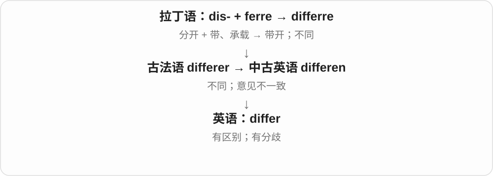

A differs from B in size 是A和B大小不同；differ over a decision 是对一个决定有分歧。differ 是动词，不用再说 are differ。

**常见搭配与例句**

differ from；differ in size；differ over policy；beg to differ。

> The two samples differ in colour.

这两个样本颜色不同。

> We agree on the goal but differ over the method.

我们的目标一致，但对方法有分歧。

**别混淆**

differ 是动词；different 是形容词。They differ / They are different 都对。

### 2. different — 不同的；另一个的

**音标**：/ˈdɪfərənt/，常弱读 /ˈdɪfrənt/

**先抓住这个画面**

把两张卡叠在一起，发现没有完全重合。different 可以说性质不一样，也可以只是说“换一个”。

**怎么拆**

法语 different 来自拉丁 differēns，是 differre“不同”的现在分词。形容词有独立借入链，不只是英语 differ 后面新接 -ent。

**怎么变成今天的意思**

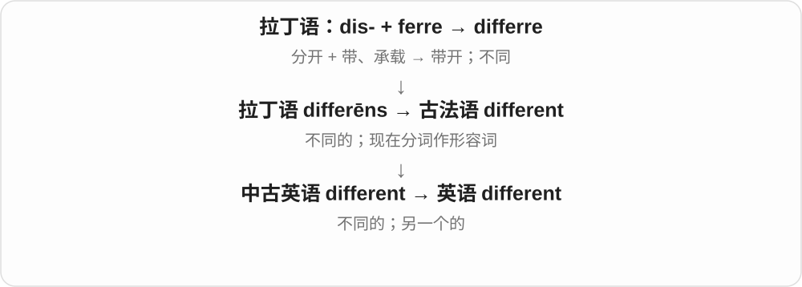

a different colour 是不同颜色；a different doctor 也可能只是另一位医生。different from 用途很广；different to 在英式中常见，different than 在美式中也常见。

**常见搭配与例句**

different from；a different approach；different people。

> We reached the same place by different routes.

我们走不同路线到了同一个地方。

> Could we try a different time?

我们能换个时间试试吗？

**别混淆**

different 不一定是奇怪或错误，只表示不相同。another 更直接表示另一个。

### 3. difference — 差别；差额；分歧；影响

**音标**：/ˈdɪfərəns/，常弱读 /ˈdɪfrəns/

**先抓住这个画面**

两件东西一对照，中间那一截不一样的地方，就是 difference。钱数之间的那一截，则是差额。

**怎么拆**

经法语 difference 或直接来自拉丁 differentia，建立在 differēns“不同”的词干上。它与 different 平行借入。

**怎么变成今天的意思**

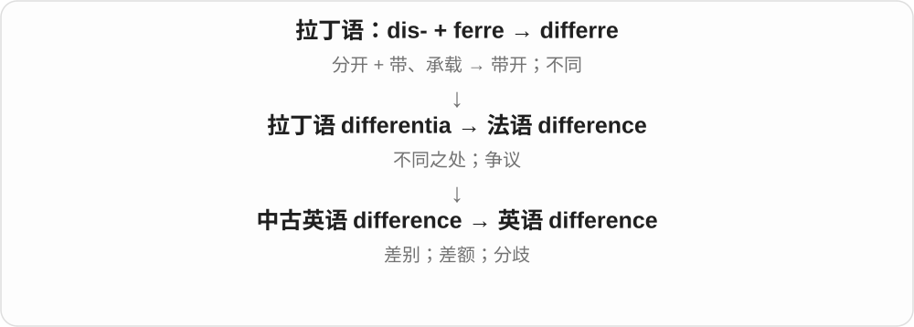

make a difference 是带来实际影响；tell the difference 是分辨出区别；settle differences 是解决分歧。不要只背“不同”一个抽象译词。

**常见搭配与例句**

the difference between；make a difference；a difference of ten。

> Can you tell the difference between these two sounds?

你能分辨这两个声音的区别吗？

> A short break made a big difference to my concentration.

短暂休息让我的注意力明显好了很多。

**别混淆**

different 是“不同的”；difference 是“哪里不同、差多少”这件事。

### 4. differently — 不同地；用另一种方式

**音标**：/ˈdɪfərəntli/

**先抓住这个画面**

同一件事，换一种做法或看法。桌子还是那张桌子，只是你把它摆在了另一边。

**怎么拆**

different + -ly，修饰动作或看法。

**怎么变成今天的意思**

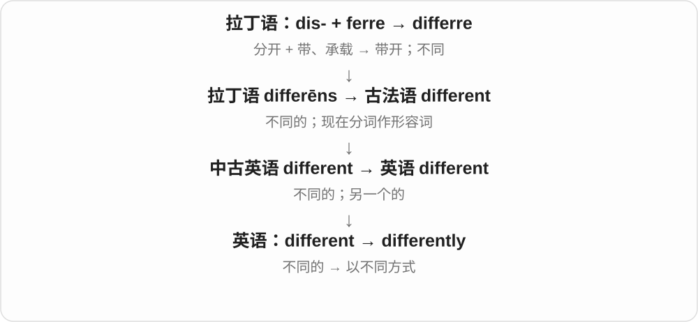

see things differently 是看法不同；treat someone differently 是区别对待，是否不公平要看上下文。

**常见搭配与例句**

think differently；behave differently；do things differently。

> I would arrange the room differently.

我会用另一种方式布置房间。

> The two children reacted differently to the news.

两个孩子听到消息后反应不同。

**别混淆**

different 修饰人或物；differently 修饰怎么做。a different answer / answer differently。

### 5. differential — 有差别的；差额；微分的；差速器

**音标**：/ˌdɪfəˈrenʃəl/

**先抓住这个画面**

关注的不是两边各自多少，而是两边怎样不同：工资差、价格差，或左右车轮转速不同。

**怎么拆**

来自中世纪拉丁 differentialis，源于 differentia“差异”；英语先有形容词，后来发展数学、机械等名词用法。

**怎么变成今天的意思**

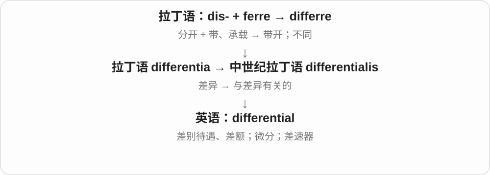

a pay differential 是工资差额；汽车的 differential 让驱动轮转速可以不同，适应转弯。differential calculus 是微分学，研究局部变化率等问题。

**常见搭配与例句**

differential pricing；a wage differential；differential equations。

> The report examines the pay differential between the two jobs.

报告研究了这两种工作的工资差额。

> The differential allows the wheels to rotate at different speeds.

差速器让车轮可以以不同速度转动。

**别混淆**

different 只说不一样；differential 常说按照差别设置，或专门处理这种差别。

### 6. differentially — 有区别地；以不同程度或方式

**音标**：/ˌdɪfəˈrenʃəli/

**先抓住这个画面**

同一个因素落到不同人或物上，产生的作用不一样。differentially 把这种差别放在动作上。

**怎么拆**

differential + -ly，是英语副词派生。

**怎么变成今天的意思**

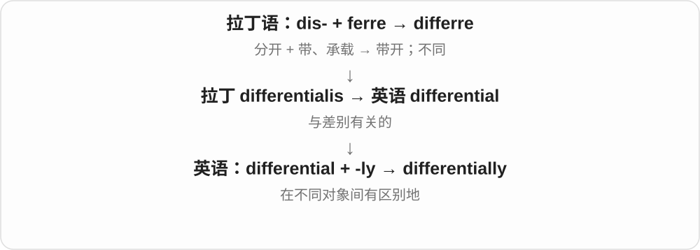

常用于研究、政策或技术文字：affect groups differentially 指对不同群体产生不同影响。并非每次都涉及微分。

**常见搭配与例句**

affect differentially；respond differentially；differentially expressed。

> The schedule change affected the two teams differentially.

日程变化对两个团队的影响不同。

> The plants responded differentially to the same amount of light.

这些植物对同样光照的反应不同。

**别混淆**

differently 泛指方式不同；differentially 更突出几个群体或条件之间的系统性差别。

### 7. differentiate — 区分；使有差别；分化；求导

**音标**：/ˌdɪfəˈrenʃieɪt/

**先抓住这个画面**

原来像一团混在一起的东西，经过观察或发展，开始看出各自不同。可以是你分辨差别，也可以是对象自己分化。

**怎么拆**

来自后来的拉丁语 differentiātus，出自 differentiare，根为 differentia“差别”。不是从现代 different 随意加字母。

**怎么变成今天的意思**

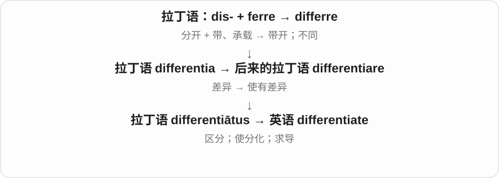

differentiate A from B 是把A和B区分；细胞 differentiate 是逐渐形成专门功能；数学里 differentiate a function 是求导。三种语境要分别学。

**常见搭配与例句**

differentiate between；differentiate from；differentiate with respect to x。

> The labels help customers differentiate the two products.

标签帮助顾客区分这两种产品。

> Differentiate x squared with respect to x to obtain 2x.

对x的平方关于x求导，得到2x。

**别混淆**

differ 是本来不同；differentiate 是辨别、造成这种差别，或专门的求导操作。

### 8. differentiation — 区分；差异化；分化；求导

**音标**：/ˌdɪfərenʃiˈeɪʃən/

**先抓住这个画面**

从“看起来一样、作用差不多”到“各有特点和分工”的过程。数学里则是计算导数这个操作的名称。

**怎么拆**

differentiate + -ion，英语动作名词；早期用例有数学背景。

**怎么变成今天的意思**

product differentiation 是让产品形成可识别的差别；cell differentiation 是细胞形成特定结构与功能。它不自动等于等级高低。

**常见搭配与例句**

product differentiation；cell differentiation；differentiation rules。

> Better service became the company’s main source of differentiation.

更好的服务成了这家公司区别于同行的主要特点。

> The lesson introduces differentiation through simple functions.

这节课通过简单函数介绍求导。

**别混淆**

difference 是差别本身；differentiation 是形成、辨明差别的过程，或数学求导。

### 9. differentiated — 已区分的；有差异的；已分化的

**音标**：/ˌdɪfəˈrenʃieɪtɪd/

**先抓住这个画面**

原来一锅煮，现在能看出不同类别，或针对不同对象有了不同安排。

**怎么拆**

differentiate + -ed，过去分词形容词。

**怎么变成今天的意思**

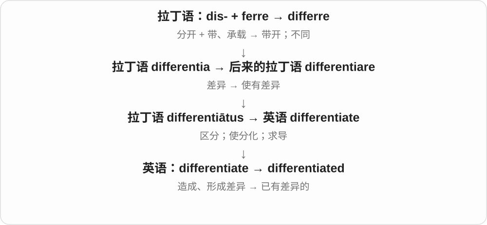

differentiated instruction 指照顾学生差异的教学安排；differentiated cells 指已有专门特点的细胞。具体分化程度还需看上下文。

**常见搭配与例句**

differentiated instruction；differentiated products；differentiated cells。

> The teacher used differentiated tasks for learners at different levels.

老师为不同水平的学习者安排了有区别的任务。

> The catalogue contains clearly differentiated product ranges.

目录里的各个产品系列区别很清楚。

**别混淆**

different 表示一般不同；differentiated 常暗示已经经过区分、分化或有意调整。

### 10. undifferentiated — 未区分的；缺少区别的；未分化的

**音标**：/ˌʌndɪfəˈrenʃieɪtɪd/

**先抓住这个画面**

还没有分出“你负责这个、我负责那个”，或者所有东西被当成一大团来看。

**怎么拆**

un- 不、未 + differentiated。

**怎么变成今天的意思**

an undifferentiated mass 指没有分清内部区别的一团；生物学中可指细胞尚未呈现某类成熟细胞的专门特点。

**常见搭配与例句**

an undifferentiated group；undifferentiated cells。

> The report treated all customers as one undifferentiated group.

报告把所有顾客不加区分地当成一个群体。

> At first, the sounds were an undifferentiated blur to me.

一开始，这些声音在我听来混成一团，分不清彼此。

**别混淆**

uniform 是一致、均匀；undifferentiated 强调还没有区分内部不同角色或特点。

### 11. differentiable — 可微的；可求导的

**音标**：/ˌdɪfəˈrenʃəbəl/

**先抓住这个画面**

放大曲线某一点附近，能找到一个稳定的局部变化率。在一元函数的基础情形里，这就是可求导。

**怎么拆**

differentiate 与 -able 形成的形容词，词干使用 differentia-；不能按长动词原样加 -able 再照字母读。

**怎么变成今天的意思**

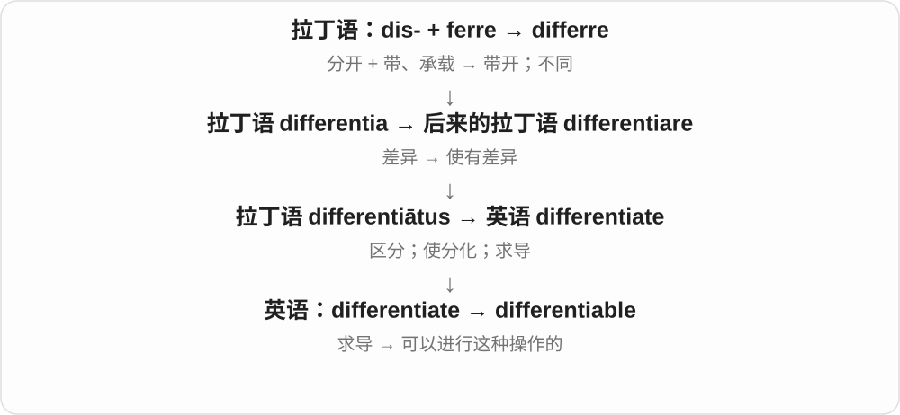

在一点可微就在那里连续；反过来未必。y=|x| 在0处连续，却有一个尖角，左右斜率不同，所以在那里不可微。

**常见搭配与例句**

differentiable at a point；continuously differentiable。

> The function is differentiable at every point on this interval.

这个函数在该区间每一点都可微。

> The absolute value function is not differentiable at zero.

绝对值函数在零点不可微。

**别混淆**

continuous 是不断开；differentiable 还要求相应的局部线性近似或导数存在。

### 12. differentiability — 可微性

**音标**：/ˌdɪfəˌrenʃəˈbɪləti/

**先抓住这个画面**

不马上去算导数，而是先问“这里到底能不能求导”。这个能否的问题，就是可微性。

**怎么拆**

differentiable + -ity，-able 变为 -ability。

**怎么变成今天的意思**

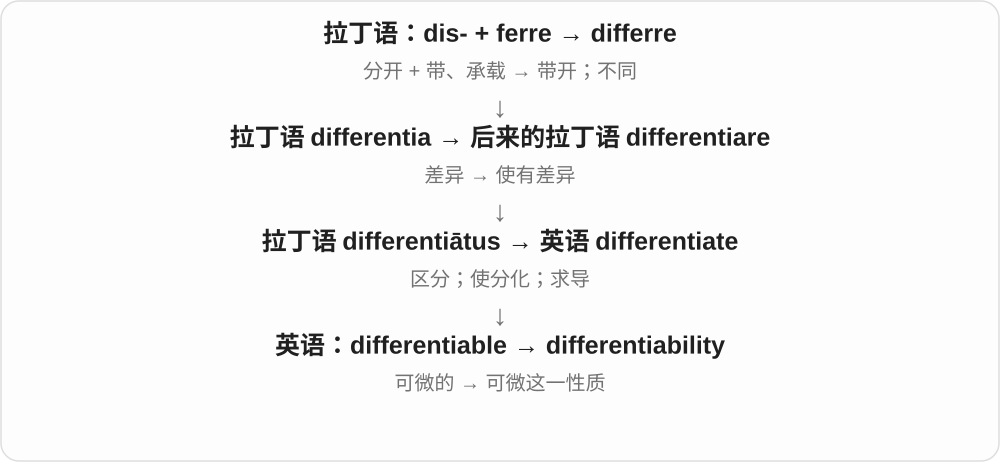

证明 differentiability 与实际算出导数是两个相关步骤。基础学习中，可以先用是否存在唯一局部斜率建立直觉。

**常见搭配与例句**

check differentiability；continuity and differentiability。

> We checked differentiability before applying the formula.

使用公式前，我们先检查了可微性。

> Continuity alone does not guarantee differentiability.

仅有连续性并不能保证可微性。

**别混淆**

differentiation 是求导操作；differentiability 是可微的性质。

### 13. indifferent — 不在乎的；冷淡的；一般的；无偏好的

**音标**：/ɪnˈdɪfərənt/

**先抓住这个画面**

两个选项摆在面前，你觉得选哪个都无所谓。进一步，也可以是别人的事根本没让你产生关切。

**怎么拆**

经法语来自拉丁 indifferens，in- 不 + differens 不同。“没有差别”发展出“不作偏向、不感兴趣”，不是现代英语临时加否定才有。

**怎么变成今天的意思**

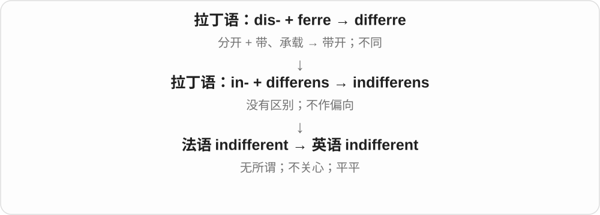

be indifferent to suffering 是对苦难无动于衷；an indifferent performance 是表现一般。indifferent to the colour 表示对颜色没有特别偏好。

**常见搭配与例句**

indifferent to；an indifferent response；indifferent quality。

> He seemed indifferent to the result.

他似乎不在乎结果。

> The restaurant served a rather indifferent meal.

这家餐厅提供的饭菜相当一般。

**别混淆**

different 是不同；indifferent 常是“不在乎”，不要逐字译成“相同的”。

### 14. indifference — 漠不关心；无所谓；无偏好

**音标**：/ɪnˈdɪfərəns/

**先抓住这个画面**

消息来了，心里却没有“我得在意一下”的反应。这种冷淡、无所谓的状态就是 indifference。

**怎么拆**

经法语 indifférence 来自后期拉丁 indifferentia；它有独立的名词借入链，现代对应 indifferent 这个形容词。

**怎么变成今天的意思**

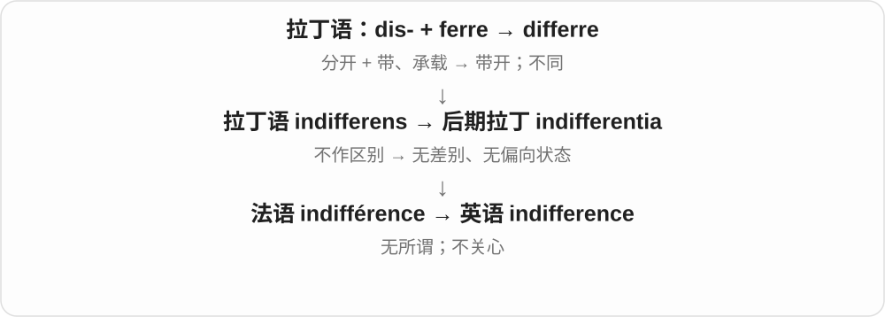

meet with indifference 是没有引起别人兴趣或关切；在理论中也可能中性地指没有偏好，不一定是道德冷漠。

**常见搭配与例句**

public indifference；indifference to；an air of indifference。

> Her suggestion was met with indifference.

她的建议没有引起大家的兴趣。

> He tried to hide his disappointment behind an air of indifference.

他装出无所谓的样子，想掩饰失望。

**别混淆**

dislike 是不喜欢，仍然有情绪；indifference 是往往连喜欢或不喜欢都懒得表达。

### 15. indifferently — 漠然地；无所谓地；平平地

**音标**：/ɪnˈdɪfərəntli/

**先抓住这个画面**

回答时不抬眼，或耸耸肩说“随便”。这个动作传出的态度可以是 indifferently。

**怎么拆**

indifferent + -ly；继承不在乎和表现平平等义。

**怎么变成今天的意思**

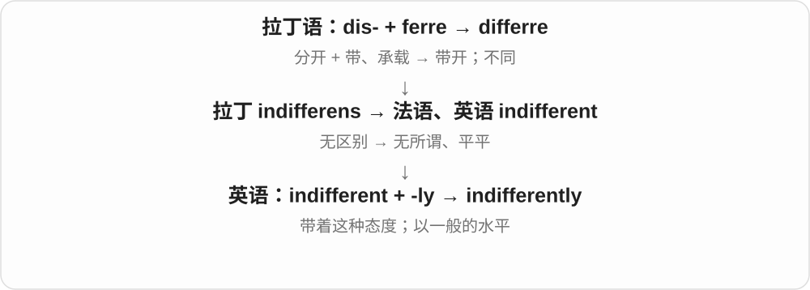

它可以修饰说话态度，也可以说演奏、工作等做得一般。不能只看 -ly 就断定是在描述人的心情。

**常见搭配与例句**

reply indifferently；shrug indifferently；play indifferently。

> “Either is fine,” she said indifferently.

“哪个都行。”她无所谓地说。

> The orchestra played indifferently during the first half.

乐团上半场演奏得比较平淡。

**别混淆**

carelessly 常说做事疏忽；indifferently 常说不在意，或完成得平平。两者有时重叠，但重点不同。

### 16. individual — 个人；个体；单独的；各自的

**音标**：/ˌɪndɪˈvɪdʒuəl/

**先抓住这个画面**

从一群人中看出完整的“这一个人”。这里的完整，是把他当一个独立单位，而不是当人群里模糊的一小块。

**怎么拆**

来自中世纪拉丁 indīviduālis，源于 in- 不 + dīviduus 可分。“不可分的整体”后来发展为“单一、独立的个体”。

**怎么变成今天的意思**

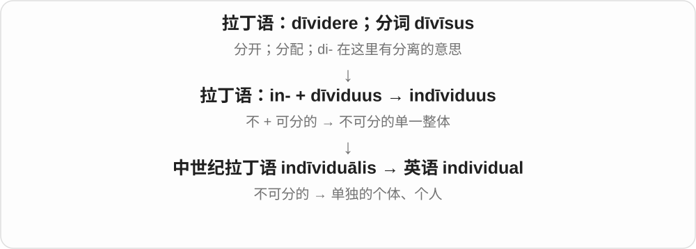

individual needs 是每个人各自的需要；an individual 可以是一个人，也可以是某物种的一个个体。现代 individual 不表示这个东西物理上绝对拆不开。

**常见搭配与例句**

an individual choice；individual differences；each individual。

> The teacher gave each student individual feedback.

老师分别给每位学生提供了反馈。

> Every individual in the group had a different reason for joining.

组里的每个人加入的原因都不同。

**别混淆**

individual 关注一个个体；personal 关注与某人私下有关。individual seats 是独立座位，不是私人秘密座位。

### 17. individually — 分别地；单独地；逐个地

**音标**：/ˌɪndɪˈvɪdʒuəli/

**先抓住这个画面**

把镜头从全班拉到一个人，再移到下一个人。事情是逐个处理，而不是整组一起处理。

**怎么拆**

individual + -ly。

**怎么变成今天的意思**

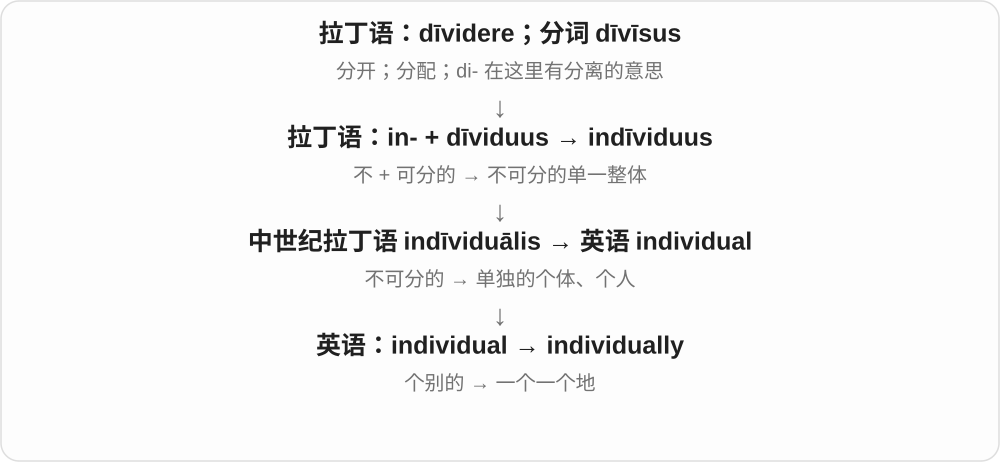

individually wrapped 是每个都单独包装；assess individually 是逐个评估。它不一定强调一个人孤单。

**常见搭配与例句**

packed individually；interview individually；individually designed。

> The chocolates are individually wrapped.

这些巧克力每颗都单独包装。

> We spoke to the students individually.

我们分别与学生们谈了话。

**别混淆**

alone 强调没有别人相伴；individually 强调分别处理每一个。

### 18. individuality — 个性；独特性

**音标**：/ˌɪndɪvɪdʒuˈæləti/

**先抓住这个画面**

同样穿校服，仍能看出每个人不同的说话方式、爱好和想法。这些让“你就是你”的特点，是 individuality。

**怎么拆**

individual + -ity，变成表示个体特质的名词；词尾处重读。

**怎么变成今天的意思**

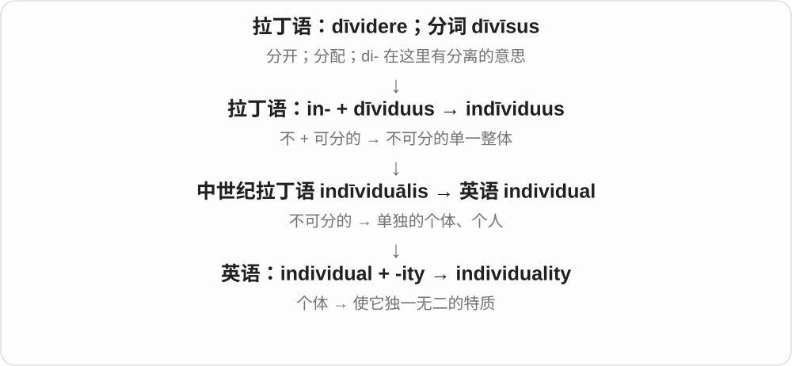

常与 express、preserve、respect 搭配。它既可说人，也可说建筑、作品等各自的风格。

**常见搭配与例句**

express individuality；a sense of individuality；lose individuality。

> The school encourages students to express their individuality.

学校鼓励学生表现自己的个性。

> Small details give each room its individuality.

小细节让每个房间都有自己的特点。

**别混淆**

individuality 是独特性；individualism 是重视个人自主的理念或倾向。

### 19. individualism — 个人主义；强调个人自主的倾向

**音标**：/ˌɪndɪˈvɪdʒuəlɪzəm/

**先抓住这个画面**

作决定时，把“个人有自己的判断和选择”放在前面，而不是默认所有人都按群体安排走。

**怎么拆**

individual + -ism；有英语派生与法语 individualisme 借入的不同词源分析。都建立在“个人”这个词族上。

**怎么变成今天的意思**

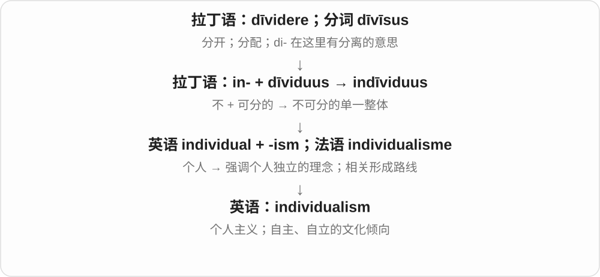

这个词可以是中性的制度或文化描述，也可能在特定批评中带负面意味；它本身并不等于 selfishness“自私”。

**常见搭配与例句**

personal freedom and individualism；a culture of individualism。

> The book explores the tension between individualism and community life.

这本书探讨个人主义与共同体生活之间的张力。

> Her individualism did not stop her from helping her neighbours.

她重视个人独立，同时也愿意帮助邻居。

**别混淆**

individuality 是一个人的独特性；individualism 是重视个人自主的一种立场。

### 20. individualist — 独立行事的人；个人主义者

**音标**：/ˌɪndɪˈvɪdʒuəlɪst/

**先抓住这个画面**

别人都走同一条路，他会先想“这条路适不适合我”。individualist 强调自己判断、按自己的方式做事。

**怎么拆**

individual + -ist，-ist 表示具有某种立场或特点的人。

**怎么变成今天的意思**

可以赞一个人有独立精神，也可能说他不容易随大流；褒贬取决于上下文。

**常见搭配与例句**

a strong individualist；a committed individualist。

> As an individualist, she preferred to develop her own style.

她很有独立精神，更愿意发展自己的风格。

> The team included several individualists with unusual ideas.

团队里有几位主意独特、喜欢独立思考的人。

**别混淆**

individual 是任何一个人；individualist 则特意说这个人倾向于独立思考或支持个人主义。

### 21. individualistic — 强调个人独立的；富有个人风格的

**音标**：/ˌɪndɪvɪdʒuəˈlɪstɪk/

**先抓住这个画面**

一幅画、一种生活方式或一套观念，都很明显地把个人选择放在中心，可以说 individualistic。

**怎么拆**

individualist + -ic；也可按 individual + -istic 分析，表示这种倾向的形容词。

**怎么变成今天的意思**

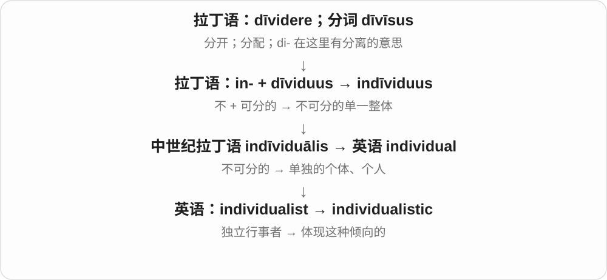

它比 individual 多了一层倾向评价。individual work 是个人作业；an individualistic style 是很有个人风格的样式。

**常见搭配与例句**

an individualistic approach；an individualistic culture；individualistic art。

> His individualistic approach produced an unusual design.

他独立而有个人风格的做法带来了一个不同寻常的设计。

> The essay discusses individualistic values in the novel.

这篇文章讨论了小说中强调个人自主的价值观。

**别混淆**

individual 只说个别、单独；individualistic 说强调独立或有强烈个人特点。

### 22. individualize — 使个性化；按个人情况调整；使有独特性

**音标**：/ˌɪndɪˈvɪdʒuəlaɪz/

**先抓住这个画面**

一份通用方案，针对每个人的情况改一改；从“大家都一样”变成“这个版本适合你”。

**怎么拆**

individual + -ize，使具有个体特点；英式英语也常拼 individualise。

**怎么变成今天的意思**

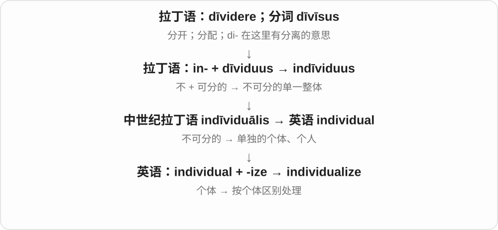

individualize instruction 是按学生情况调整教学，不意味着每个学生都必须完全单独上课。

**常见搭配与例句**

individualize a plan；individualized feedback；individualize instruction。

> The tutor individualized the exercises for each learner.

导师按每位学习者的情况调整了练习。

> A few small changes can individualize a standard room.

几处小改动就能让标准房间有自己的风格。

**别混淆**

individualize 强调按个人特点调整；personalize 也常用于把名字、偏好放入产品或服务。

### 23. individualization — 个性化调整；个别化处理

**音标**：/ˌɪndɪvɪdʒuəlaɪˈzeɪʃən/

**先抓住这个画面**

这是把通用方案变成适合不同人的方案的过程，而不是把人隔离开来。

**怎么拆**

individualize + -ation；对应英式拼写 individualisation。

**怎么变成今天的意思**

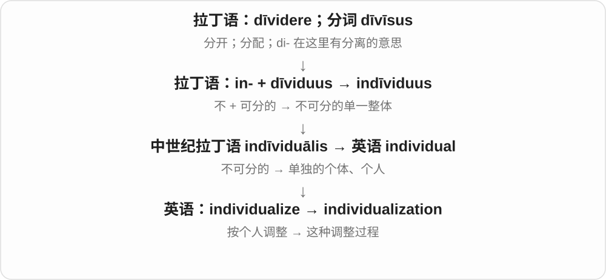

常用于教育、服务与产品设计。说 individualization of learning，重点是不同的人有不同学习安排。

**常见搭配与例句**

individualization of instruction；greater individualization。

> The course allows some individualization of learning goals.

这门课允许根据个人情况调整部分学习目标。

> Individualization takes time because each case must be considered separately.

个别化处理需要时间，因为每个情况都要分别考虑。

**别混淆**

individualization 强调按个体调整；individuality 强调个体已经拥有的独特特点。

### 24. divide — 分开；分配；使意见不一；除以；分界

**音标**：/dɪˈvaɪd/

**先抓住这个画面**

一整块蛋糕切成几份，或者一群人各站一边。divide 抓的都是“从一个整体变成几部分”。

**怎么拆**

来自拉丁 dīvidere；可追溯到 di- 的分开义与表示分离的词干。这里的 -videre 不是 vidēre“看见”，也不是 diversum“不同”的后代。

**怎么变成今天的意思**

divide into three parts 是分成三份；divide between two people 是分给两个人。数学中 divide 12 by 3 得到4；名词 a divide 可以指双方之间的鸿沟。

**常见搭配与例句**

divide into groups；divide equally；a cultural divide。

> We divided the cake into eight pieces.

我们把蛋糕分成八块。

> The proposal divided the committee.

这项提案让委员会产生了分歧。

**别混淆**

divide 强调整体变成部分；separate 强调把原本靠在一起的东西分开。

### 25. division — 划分；除法；部门；分歧；师〔军队单位〕

**音标**：/dɪˈvɪʒən/

**先抓住这个画面**

既能指“切开”这个动作，也能指切出来的一块。公司切成不同业务块，就有各个 division。

**怎么拆**

来自拉丁 dīvīsiō，经古法语进入英语；与 divide 同源，但名词的拉丁、法语形式已有自己的借入历史。

**怎么变成今天的意思**

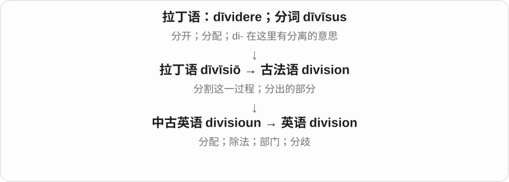

division of labour 是分工；sales division 是销售部门；long division 是长除法。社会里的 division 则常说人群之间的隔阂，不一定有人真的划线。

**常见搭配与例句**

division of responsibility；a business division；deep divisions。

> The company opened a new research division.

公司设立了一个新的研究部门。

> A clear division of tasks made the project easier.

明确分工让项目更容易推进。

**别混淆**

division 可以说过程或组织部分；dividend 是除法里的被除数，也指分给股东的利润。

### 26. divisional — 部门的；分区的；师级的

**音标**：/dɪˈvɪʒənəl/

**先抓住这个画面**

事情发生在一个 division 这个层级：全公司有总经理，每个事业部又有 divisional manager。

**怎么拆**

division + -al，是英语形容词派生。

**怎么变成今天的意思**

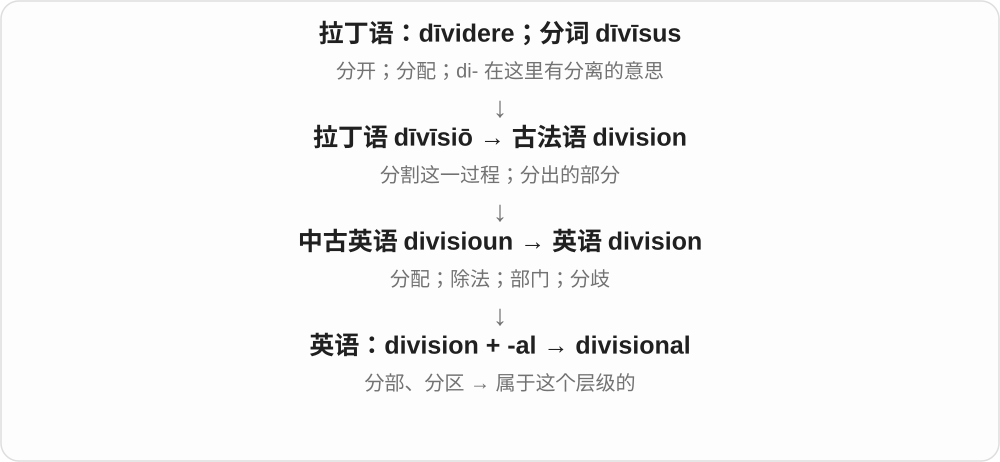

通常接 manager、meeting、headquarters 等名词。军事里 divisional 属于师这一编制；商业里属于某个分部。

**常见搭配与例句**

a divisional manager；divisional headquarters；divisional results。

> Each divisional manager submitted a monthly report.

每位部门经理都提交了月报。

> The divisional meeting focused on training.

这次部门会议主要讨论培训。

**别混淆**

divisional 说所属层级；divisive 说引起争执、分裂。

### 27. subdivision — 细分；分支；分出来的部分；住宅分区

**音标**：/ˌsʌbdɪˈvɪʒən/

**先抓住这个画面**

大抽屉里再放小格子：细分这个动作和这些小格子，都可以叫 subdivision。

**怎么拆**

sub- + division；也与后期拉丁 subdivisio 的细分名词相应。它不必由现代英语 subdivide 换词尾才出现。

**怎么变成今天的意思**

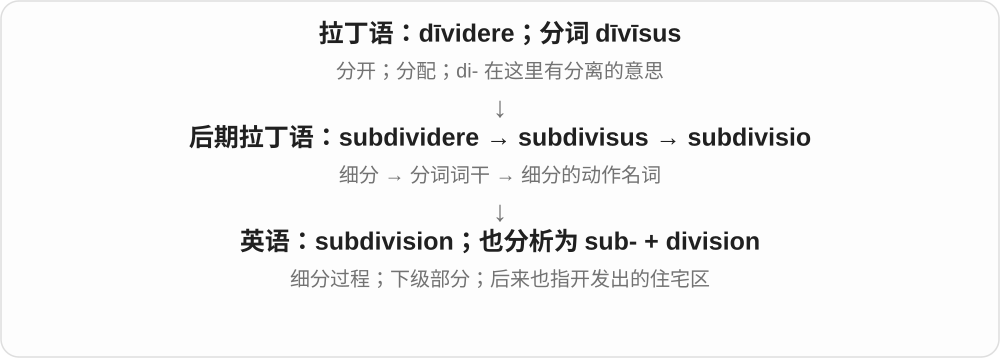

美式语境里 a subdivision 常指一片划分成住宅地块的区域。读房产广告时，这个词不是在说一道除法题。

**常见搭配与例句**

a subdivision of a category；residential subdivisions。

> Each subdivision of the report has its own heading.

报告的每个分节都有自己的标题。

> They live in a quiet subdivision outside the city.

他们住在城外一个安静的住宅区。

**别混淆**

division 是一层划分；subdivision 强调下一级。住宅区义来自土地分块这一具体用法。

### 28. divided — 被分开的；意见分裂的

**音标**：/dɪˈvaɪdɪd/

**先抓住这个画面**

人还坐在同一个房间，意见却已经站成两边；这就可以说 divided。

**怎么拆**

divide 的过去分词，接 -ed；-ed 在 /d/ 后读 /ɪd/。形容词突出分开后的状态。

**怎么变成今天的意思**

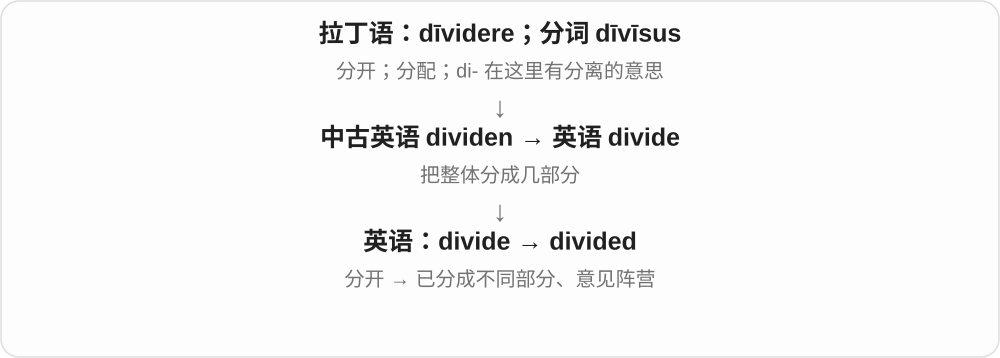

be divided over/about something 指对某事意见不一致；a divided road 则是两向车流之间有隔离带的道路。看对象是人还是物。

**常见搭配与例句**

divided opinion；divided loyalties；be divided over a plan。

> The residents were divided over the new road.

居民们对修建这条新路意见不一。

> Her loyalties were divided between her two friends.

两位朋友发生矛盾，她不知道该支持谁。

**别混淆**

divisive 说某事容易造成分裂；divided 说人群已经处于分裂状态。

### 29. undivided — 未分开的；完整的；专一的

**音标**：/ˌʌndɪˈvaɪdɪd/

**先抓住这个画面**

注意力没有一半看手机、一半听人说话，而是整份都给了眼前的人。undivided attention 就是全神贯注。

**怎么拆**

un- 不 + divided 已分开的，是英语否定派生。

**怎么变成今天的意思**

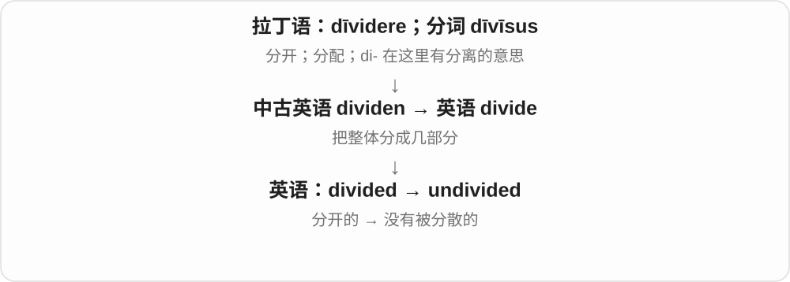

最实用的搭配是 give someone your undivided attention。也可以描述财产、土地等尚未分开的状态。

**常见搭配与例句**

undivided attention；undivided support；remain undivided。

> You have my undivided attention.

我在专心听你说。

> The land remained undivided for many years.

这块土地多年都没有被分割。

**别混淆**

undivided 不一定表示永远不能分；indivisible 才强调不能分。

### 30. dividing — 划分的；正在分开的

**音标**：/dɪˈvaɪdɪŋ/

**先抓住这个画面**

把手指放在两边之间：这条线，这个标准，正在把它们分开。

**怎么拆**

divide + -ing，去词尾 e；既是分词，也可在 dividing line 这样的搭配里作修饰语。

**怎么变成今天的意思**

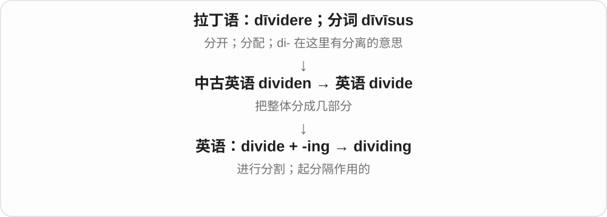

a dividing line 可以是地图上的线，也可以是玩笑与冒犯之间难以说清的界限。不是所有线都实际画在纸上。

**常见搭配与例句**

a dividing line；a dividing wall；dividing the work。

> A low wall forms the dividing line between the gardens.

一道矮墙划开了两个花园。

> We are dividing the work among four teams.

我们正在把工作分给四个团队。

**别混淆**

dividing 描述在分隔；divided 描述被分隔。a dividing wall 是隔墙，a divided room 是被隔开的房间。

### 31. divisive — 造成分裂的；容易引起对立的

**音标**：/dɪˈvaɪsɪv/，也读 /dɪˈvɪsɪv/

**先抓住这个画面**

一个话题刚抛出来，人群马上分成支持和反对两边。这个话题就很 divisive。

**怎么拆**

借自拉丁 dīvīsīvus“分开的”，根在 dīvidere；现代可联想 divis- 与形容词词尾 -ive。

**怎么变成今天的意思**

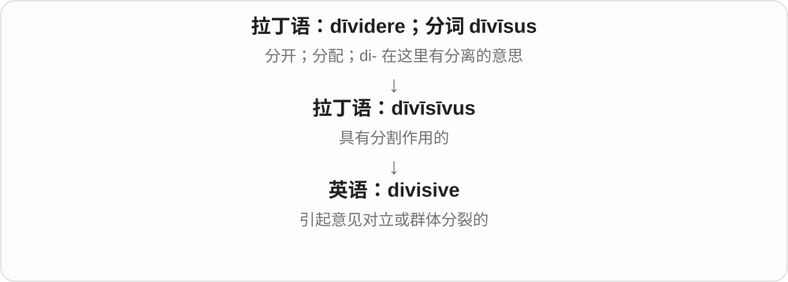

常说政策、问题、人物或措辞的效果。它通常带负面意味，重点是让人对立，不只是大家有不同兴趣。

**常见搭配与例句**

a divisive issue；divisive rhetoric；a deeply divisive proposal。

> The new parking rules became a divisive issue.

新的停车规定成了一个引发对立的话题。

> She tried to avoid divisive language in the discussion.

她在讨论中尽量避免使用挑起对立的措辞。

**别混淆**

diverse 表示多样；divisive 表示造成分裂。背景多样的团队不等于互相对立的团队。

### 32. divider — 分隔物；分隔页；隔断；分规

**音标**：英 /dɪˈvaɪdə/；美 /dɪˈvaɪdər/

**先抓住这个画面**

在一大块空间中插入一道东西，让两边各有自己的位置：隔断、文件夹分隔页都这样工作。

**怎么拆**

divide + -er；-er 不一定指人，也可以指起作用的工具。

**怎么变成今天的意思**

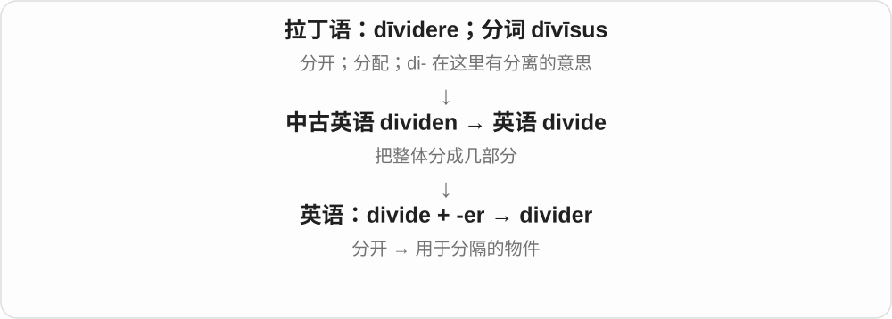

room divider 是房间隔断；复数 dividers 还可指两尖脚的分规，用来量取或转移距离。它不等于所有用途的圆规。

**常见搭配与例句**

a room divider；tabbed dividers；a pair of dividers。

> A wooden divider separates the desk from the bed.

一道木隔断把书桌和床分开。

> Use coloured dividers to organise the folder.

用彩色分隔页整理这个文件夹。

**别混淆**

divider 是分隔用的东西；division 是分割本身或分出的单位。

### 33. subdivide — 再细分；分成更小部分

**音标**：/ˌsʌbdɪˈvaɪd/

**先抓住这个画面**

先把全班分成几个组，再把每组分成两人小队。第二层的分，就是 subdivide。

**怎么拆**

sub- 在下一级 + divide 分开；英语中可直接这样分析，也有对应的后期拉丁 subdividere 形式。

**怎么变成今天的意思**

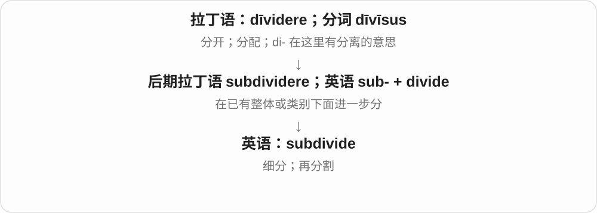

常用于房间、地块、类别和任务。重点不是一定先做过一次 divide，而是把一个较大单位划成更小的下级单位。

**常见搭配与例句**

subdivide into categories；subdivide a plot；subdivide a room。

> The chapter is subdivided into four sections.

这一章细分为四节。

> We subdivided each group into pairs.

我们把每组再分成两人一队。

**别混淆**

divide 是一般的分；subdivide 常突出更细、更下一层。

### 34. devise — 想出；设计出；以遗嘱留下〔法律用语〕

**音标**：/dɪˈvaɪz/

**先抓住这个画面**

先把事情分成几块，再琢磨每块怎么安排。devise 就像在脑中搭方案，最后想出一个办法。

**怎么拆**

中古英语 devisen 来自古法语 deviser“分配、安排、计划”，更早为通俗拉丁 *dīvisāre，联系 dīvidere“分开”。星号表示重构。

**怎么变成今天的意思**

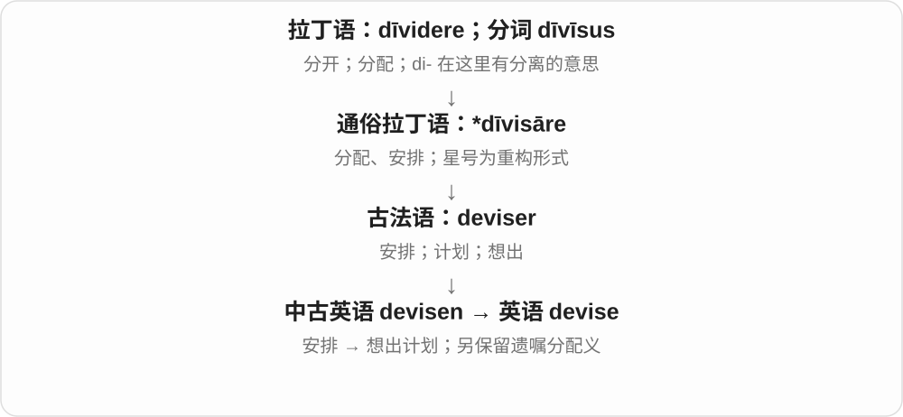

devise a method 常表示经过思考想出方法；法律语境中 devise 还可指以遗嘱处分财产。普通“想出办法”不需要联想到法律。

**常见搭配与例句**

devise a plan；devise a method；devise a solution。

> We devised a simple way to label the boxes.

我们想出了一个给箱子贴标签的简单办法。

> The team devised a new training programme.

团队设计了一套新的培训方案。

**别混淆**

devise 是动词，末尾 /z/；device 是名词，末尾 /s/。

### 35. device — 装置；设备；手法；巧妙办法

**音标**：/dɪˈvaɪs/

**先抓住这个画面**

一个为某种目的设计出来的东西：可以拿在手里的小装置，也可以是作者安排故事的一种手法。

**怎么拆**

名词经古法语 devis、devise 借入，与 deviser“安排、设计”同族；不是现代英语把动词 devise 的 s 改成 c 才造出来的。

**怎么变成今天的意思**

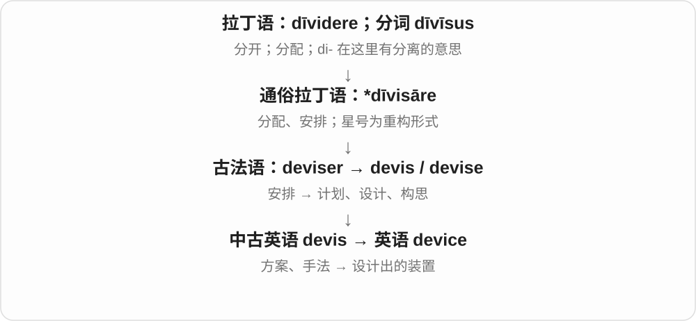

a mobile device 是移动设备；a literary device 是文学手法。两者都可以用“为达到目的而设计的手段”串起来。

**常见搭配与例句**

an electronic device；a safety device；a narrative device。

> This device measures the temperature of the room.

这个装置测量室温。

> The repeated image is an effective literary device.

反复出现的这个意象是一种有效的文学手法。

**别混淆**

device 是具体工具或方法；equipment 常是设备总称，通常不可数。

### 36. deviser — 构思者；设计出办法的人

**音标**：英 /dɪˈvaɪzə/；美 /dɪˈvaɪzər/

**先抓住这个画面**

讨论一个巧妙安排时，问“是谁想出来的”，那个幕后动脑筋的人就是 deviser。

**怎么拆**

devise + -er，去掉不发音的 e；末尾 s 保持 /z/。

**怎么变成今天的意思**

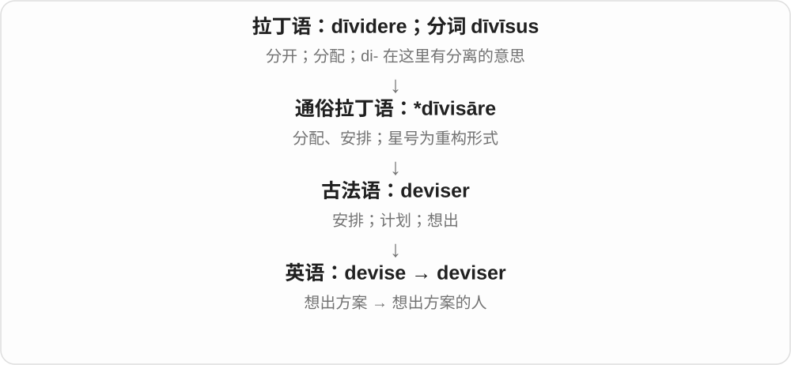

比 designer 少见，常强调某个方案、系统或计策是谁构思的。不是所有行业里的“设计师”都自然称 deviser。

**常见搭配与例句**

the deviser of a scheme；the deviser of a system。

> The deviser of the puzzle explained how it worked.

谜题的设计者解释了其中的原理。

> She was the main deviser of the new timetable.

新时间表主要是她构思安排的。

**别混淆**

deviser 是人；device 是物件或手法。

### 37. diverse — 多种多样的；各不相同的

**音标**：英 /daɪˈvɜːs/；美 /daɪˈvɜːrs/

**先抓住这个画面**

大家没有转向同一个方向：背景、想法、种类各有不同，所以构成了多样的一组。

**怎么拆**

拉丁语 dīversus 是 dīvertere 的分词，形成“不同”的形容词，经法语 divers 进入英语。

**怎么变成今天的意思**

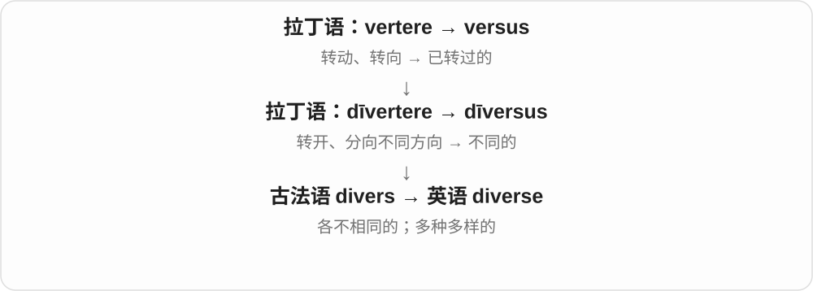

可形容物种、经验、意见或人群。a diverse group 通常是在某些明确维度上成员不同，不是说其中每个人都代表全部差异。

**常见搭配与例句**

diverse backgrounds；a diverse range；diverse opinions。

> The course attracts students from diverse backgrounds.

这门课吸引了背景各异的学生。

> The garden contains a diverse range of plants.

花园里种着多种多样的植物。

**别混淆**

different 比较差别；diverse 常强调一组对象内部种类丰富。

### 38. diversity — 多样性；差异的丰富程度

**音标**：英 /daɪˈvɜːsəti/；美 /daɪˈvɜːrsəti/、/dɪˈvɜːrsəti/

**先抓住这个画面**

不只看数量多不多，还看是不是只有同一种：一千棵同种树数量很多，种类却未必丰富。

**怎么拆**

拉丁语 dīversitās，经法语 diversité 进入英语；现代与 diverse + -ity 对应。

**怎么变成今天的意思**

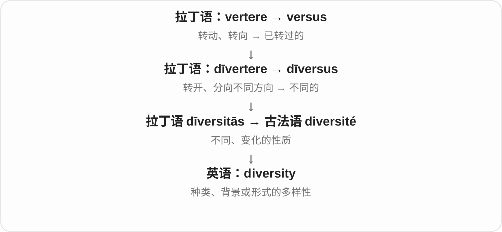

可说 biodiversity、cultural diversity、diversity of opinion。它要配合具体维度理解，不是所有“不同”都能用一个数字概括。

**常见搭配与例句**

cultural diversity；a diversity of views；biological diversity。

> The survey revealed a surprising diversity of opinions.

调查显示人们的意见出人意料地多样。

> The exhibition celebrates the diversity of local traditions.

展览展示并赞美当地传统的多样性。

**别混淆**

variety 也说种类；diversity 更常用于整体构成及差异分布的讨论。

### 39. biodiversity — 生物多样性

**音标**：英 /ˌbaɪəʊdaɪˈvɜːsəti/；美 /ˌbaɪoʊdaɪˈvɜːrsəti/

**先抓住这个画面**

一片森林不只有“树很多”：树的种类、动物与微生物、同种个体的差异，以及不同栖息环境，都组成它的丰富。

**怎么拆**

bio- 生命 + diversity 多样性；是 biological diversity 的缩合形式，属于现代科学命名。diversity 自己来自拉丁 dīversitās。

**怎么变成今天的意思**

通常包括物种内部、物种之间和生态系统层面的多样性。不能只靠数动物总只数来判断 biodiversity 高不高。

**常见搭配与例句**

protect biodiversity；loss of biodiversity；marine biodiversity。

> The wetland supports a rich variety of life and high biodiversity.

这片湿地支持着丰富的生命类型，生物多样性很高。

> The survey measured biodiversity rather than simply counting birds.

这次调查衡量的是生物多样性，而不是简单数鸟有多少只。

**别混淆**

abundance 是数量多；biodiversity 是多样。一大片只有一种树的林子，树多不等于多样性就高。

### 40. diversify — 使多样化；扩展到不同领域

**音标**：英 /daɪˈvɜːsɪfaɪ/；美 /daɪˈvɜːrsəfaɪ/、/dɪˈvɜːrsəfaɪ/

**先抓住这个画面**

原本只靠一种产品、一种活动，现在多开几条路，不把全部事情压在同一种选择上。

**怎么拆**

经法语 diversifier 借入；拉丁语词族中 dīversus“不同”与 facere“使、做”结合。现代可看 diverse + -ify。

**怎么变成今天的意思**

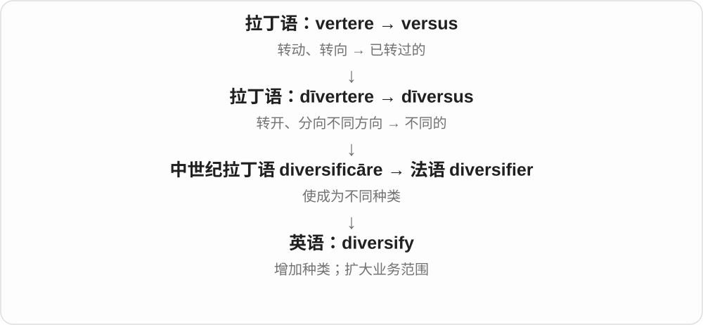

可以及物：diversify the menu；也可不及物：diversify into tourism。它是增加不同类型，不只是把旧产品生产得更多。

**常见搭配与例句**

diversify into；diversify the business；diversify the menu。

> The farm diversified into fruit growing and tourism.

这家农场把业务扩展到了水果种植和旅游。

> The library wants to diversify its collection of authors.

图书馆希望收藏来自更多不同背景作者的作品。

**别混淆**

expand 是扩大；diversify 需要种类或方向增加，二者并不完全相同。

### 41. diversification — 多样化；业务多元化

**音标**：英 /daɪˌvɜːsɪfɪˈkeɪʃən/；美 /dɪˌvɜːrsəfɪˈkeɪʃən/、/daɪˌvɜːrsəfɪˈkeɪʃən/

**先抓住这个画面**

把“只走一条路”逐渐变成“有几条不同的路”的过程。

**怎么拆**

中世纪拉丁语 diversificātiō 与英语 diversify 同源；现代配成 diversify / diversification。

**怎么变成今天的意思**

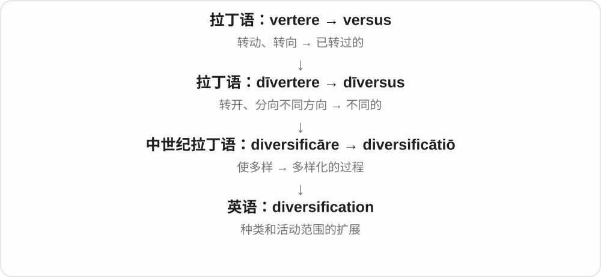

常用于经济、业务和生态等讨论。它描述范围扩展；扩展得是否成功、是否降低风险，还要看具体安排。

**常见搭配与例句**

economic diversification；product diversification；a diversification strategy。

> The city’s plan encourages economic diversification.

这座城市的规划鼓励经济多元化。

> Diversification of the menu brought more vegetarian customers.

菜单种类增加后，餐厅吸引了更多素食顾客。

**别混淆**

diversity 是已有的多样状态；diversification 是增加这种多样性的过程。

### 42. diversely — 多样地；以不同方式

**音标**：英 /daɪˈvɜːsli/；美 /daɪˈvɜːrsli/；开头也读 /dɪ/

**先抓住这个画面**

同样的材料到了不同人手里，做出了多种样子。diversely 强调呈现方式不单一。

**怎么拆**

diverse + -ly；来自“转向不同方向”的 diverse 这一支。

**怎么变成今天的意思**

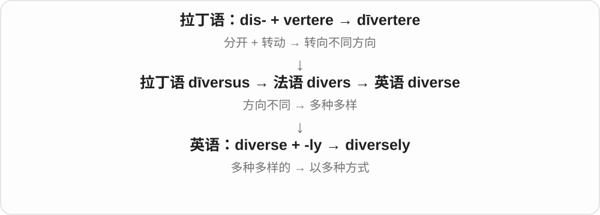

是较书面的副词，常见于描述组成、形状或处理方式的文字。日常说 in different ways 往往更自然。

**常见搭配与例句**

diversely shaped；diversely interpreted；a diversely populated area。

> The exhibition brings together diversely shaped vessels.

展览汇集了形状各异的器皿。

> The passage has been diversely interpreted by readers.

读者对这段话作出了多种不同解读。

**别混淆**

diversely 强调多样；divergently 强调朝不同方向分开，二者不总可替换。

### 43. dividend — 被除数；股息；收益

**音标**：/ˈdɪvɪdend/

**先抓住这个画面**

这是“等待分出去的那一块总量”：算术里是被除数，公司里可以是分给股东的利润。

**怎么拆**

经法语 dividende 来自拉丁 dīvidendum“应被分的东西”，是 dīvidere 的动形容词中性形式，不是英语 divide + end“结束”。

**怎么变成今天的意思**

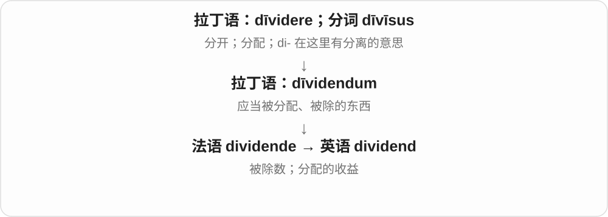

pay a dividend 指派发股息；pay dividends 还可比喻“投入开始见效”。日常比喻里，dividends 可以是练习、耐心等带来的好处。

**常见搭配与例句**

declare a dividend；the dividend and divisor；pay dividends。

> In twelve divided by three, twelve is the dividend.

在十二除以三中，十二是被除数。

> Regular practice paid dividends when she performed on stage.

她登台表演时，平时的规律练习显出了效果。

**别混淆**

divide 是动词；dividend 是等待被分的量或分配所得。不要因读音接近就把它当分割动作。

### 44. diverge — 分岔；分歧；偏离；发散

**音标**：英 /daɪˈvɜːdʒ/；美 /daɪˈvɜːrdʒ/；开头也读 /dɪ/

**先抓住这个画面**

两条路从同一个路口伸出去，越走越不在同一个方向。意见、故事的发展也会这样分开。

**怎么拆**

来自学术拉丁 divergere：dis- 分开 + vergere 转向、倾向。vergere 与 vertere 不是同一个拉丁动词，不能直接写成 diverse 变出 diverge。

**怎么变成今天的意思**

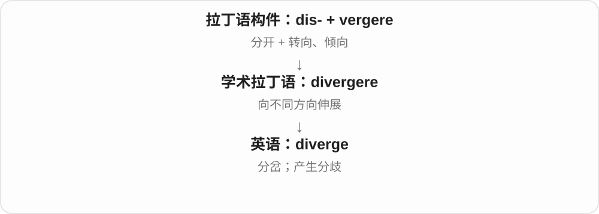

paths diverge 是道路分岔；accounts diverge 是叙述开始不同。数学中的 diverge 指不收敛，不一定是越来越大，也可能一直来回摆动。

**常见搭配与例句**

diverge from；views diverge；diverge sharply。

> The two paths diverge beyond the bridge.

过桥之后，两条小路分开了。

> Their accounts of the meeting diverged on several details.

他们对会议经过的描述在几个细节上不一致。

**别混淆**

differ 只说有区别；diverge 更容易让人想到走向不同方向或偏离原来的路线。

### 45. divergent — 分歧的；向不同方向延伸的；发散的

**音标**：英 /daɪˈvɜːdʒənt/；美 /daɪˈvɜːrdʒənt/；开头也读 /dɪ/

**先抓住这个画面**

同一个出发点，伸出了不同的箭头。divergent views 是观点往不同方向走。

**怎么拆**

来自学术拉丁 divergens 的词干 divergent-，是 divergere 的现在分词；不是英语里首次加 -ent 才出现的形容词。

**怎么变成今天的意思**

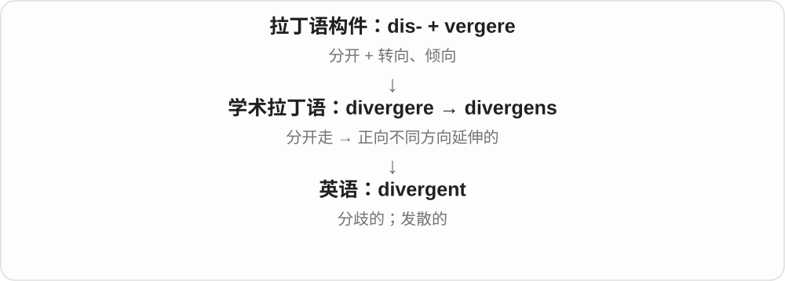

divergent thinking 常说从一个问题想出多种可能，而不是只找唯一答案。发散数列可以无限来回摆动，不能简单记成“无限变大”。

**常见搭配与例句**

divergent opinions；divergent paths；divergent thinking。

> The panel brought together people with divergent views.

讨论组聚集了观点不同的人。

> The sequence 1, -1, 1, -1, … is divergent.

数列1、-1、1、-1、……是发散的。

**别混淆**

diverse 是种类多；divergent 常强调方向或意见不一致。

### 46. divergence — 分歧；分离；偏离；发散；散度

**音标**：英 /daɪˈvɜːdʒəns/；美 /daɪˈvɜːrdʒəns/；开头也读 /dɪ/

**先抓住这个画面**

两条本来靠近的线开始分开，分开的状态或程度就是 divergence。

**怎么拆**

来自学术拉丁 divergentia，基于 divergens；英语名词的记录早于常见现代动词记录，图不能只画成英语 diverge 加 -ence。

**怎么变成今天的意思**

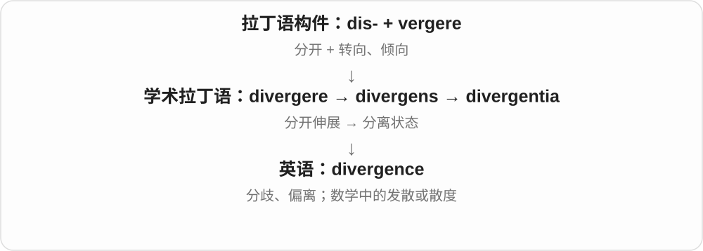

a divergence of opinion 是观点分歧。向量分析中的 divergence 译散度，可以想成把一个点附近很小区域的向外净流出量除以体积，再让区域缩小所得到的量；它与数列不收敛的发散义是不同的技术用法。

**常见搭配与例句**

a divergence between；a divergence of views；divergence from a plan。

> The report found a growing divergence between the two regions.

报告发现两个地区的差异正在扩大。

> A small divergence from the planned route led us to a lake.

我们稍稍偏离原定路线，结果来到了一座湖边。

**别混淆**

difference 是一般差别；divergence 常突出路线、走势或意见的分开。技术场景先辨明是在讲数列还是向量场。

### 47. divergently — 向不同方向地；以发散方式

**音标**：英 /daɪˈvɜːdʒəntli/；美 /daɪˈvɜːrdʒəntli/

**先抓住这个画面**

一个问题不只沿一根直线想下去，而是向几条不同路径展开。

**怎么拆**

divergent + -ly，是英语副词派生；用于一般方向或专业分析。

**怎么变成今天的意思**

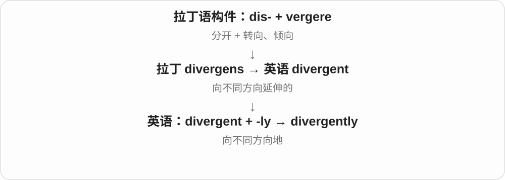

比 divergent 少用。think divergently 常描述打开多种可能性；物理或生物研究中也可修饰向不同方向发展的现象。

**常见搭配与例句**

think divergently；develop divergently；move divergently。

> The exercise encouraged students to think divergently.

这个练习鼓励学生从多条路径发散思考。

> The two branches developed divergently over time.

随着时间推移，这两个分支朝不同方向发展。

**别混淆**

differently 是方式不同；divergently 更强调分开发展的方向。

### 48. divisible — 可分割的；可被整除的

**音标**：/dɪˈvɪzəbəl/

**先抓住这个画面**

一块东西能分开；一个整数能不留余数地被另一个整数除尽。后者是学习中最常遇到的意思。

**怎么拆**

经法语来自后期拉丁 dīvīsibilis；divis- 是 dīvidere 的分词词干，-ible 表示可以。

**怎么变成今天的意思**

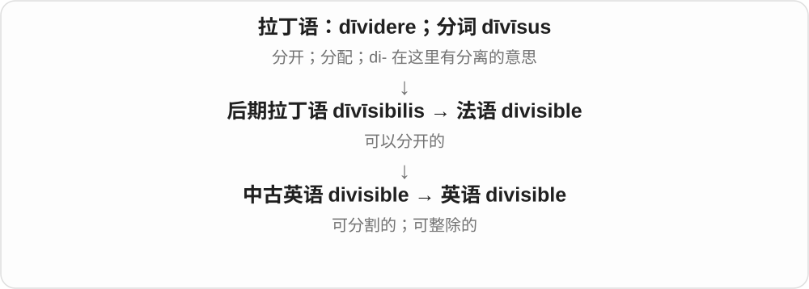

18 is divisible by 3 表示18除以3没有余数。日常“分成三份”说 divide into three parts；数学里说 divisible by three。

**常见搭配与例句**

divisible by two；evenly divisible；divisible into parts。

> Twenty is divisible by five.

二十能被五整除。

> The material is easily divisible into small pieces.

这种材料很容易分成小块。

**别混淆**

divisible 描述能否分；divisive 描述是否造成对立。

### 49. divisibility — 可分性；整除性

**音标**：/dɪˌvɪzəˈbɪləti/

**先抓住这个画面**

把“能不能除尽”这件事抽出来研究，就是 divisibility；例如看末位判断一个整数能不能被5整除。

**怎么拆**

divisible + -ity，-ible 在名词形式中变为 -ibility；这里讲英语词族的派生关系。

**怎么变成今天的意思**

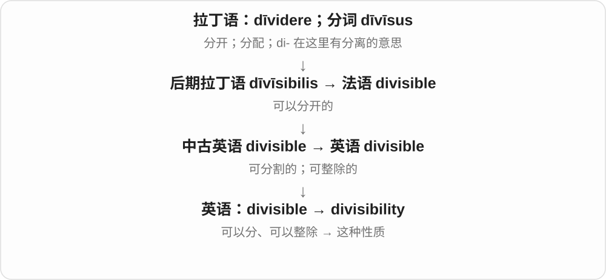

a divisibility rule 是整除判别规则。它不是算商的全部步骤，而是快速判断有没有余数的方法。

**常见搭配与例句**

divisibility by three；a divisibility test；rules of divisibility。

> The class learned a rule for divisibility by nine.

班上学习了判断一个数能否被九整除的规则。

> Divisibility by ten is easy to check for whole numbers.

判断一个整数能否被十整除很容易。

**别混淆**

division 是实施除法；divisibility 是是否能够整除的性质。

### 50. indivisible — 不可分割的；不能整除的

**音标**：/ˌɪndɪˈvɪzəbəl/

**先抓住这个画面**

把某物当成一个不能拆开的整体：拆了，就不再是原来那个完整单位。

**怎么拆**

法语 indivisible 来自后期拉丁 indīvīsibilis；in- 不 + dīvīsibilis 可分。不是英语里才第一次把否定前缀加上去。

**怎么变成今天的意思**

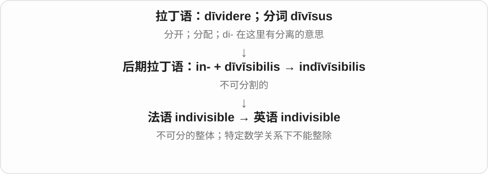

常用于一套原则、一个整体或最小单位。在数学里，能否整除必须说清“被哪个数除”；它不是说数字永远做不了除法。

**常见搭配与例句**

an indivisible whole；an indivisible unit。

> The artist treated sound and movement as an indivisible whole.

这位艺术家把声音和动作视为不可分割的整体。

> Each ticket is an indivisible unit in this allocation system.

在这套分配系统里，每张票都是不能再拆分的单位。

**别混淆**

undivided 是尚未分开；indivisible 是被认为不能分开。

### 51. indivisibility — 不可分割性

**音标**：/ˌɪndɪˌvɪzəˈbɪləti/

**先抓住这个画面**

重点从“这个东西不能分”移到“不能分这种性质”。一张票不能拆成两张半票，就是一个直观例子。

**怎么拆**

indivisible 对应的性质名词，词尾 -ible 变为 -ibility；也可以从 in- + divisibility 看出否定关系。

**怎么变成今天的意思**

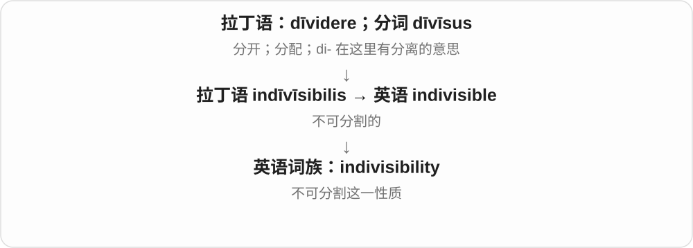

常见于理论论述，比 indivisible 更抽象。学习时不妨先还原成一句话：this cannot be divided。

**常见搭配与例句**

the indivisibility of a whole；indivisibility of rights。

> The example illustrates the indivisibility of a single ticket.

这个例子说明一张票不能再拆分。

> The essay discusses the indivisibility of the work of art.

这篇文章讨论艺术作品作为整体的不可分割性。

**别混淆**

indivisibility 是性质；individuality 是一个人或事物的独特性，虽然远源相关，现代意思不一样。

### 52. divisor — 除数；约数

**音标**：英 /dɪˈvaɪzə/；美 /dɪˈvaɪzər/

**先抓住这个画面**

12 ÷ 3 = 4 里面，负责“拿去除”的3就是 divisor。问12能被哪些整数整除时，也会问它有哪些 divisors。

**怎么拆**

来自拉丁 dīvīsor，原是 dīvidere 的施事名词“分配者”；进入数学后，用来指充当除数的数。

**怎么变成今天的意思**

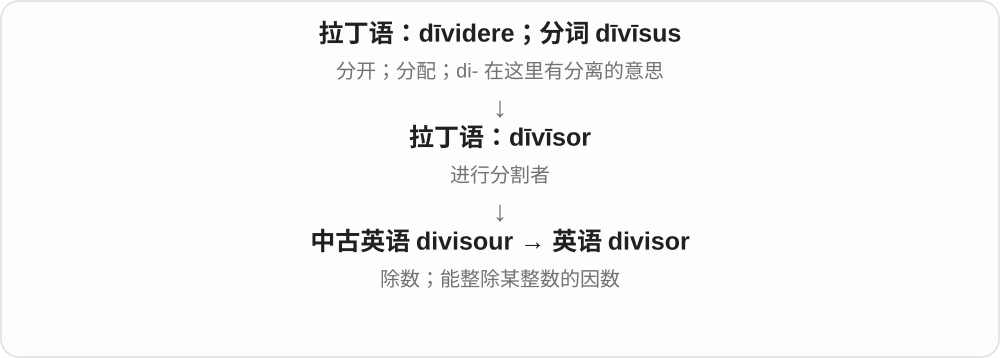

在一个算式里 divisor 可以指除数；在整数论里 a divisor of 12 通常指能把12整除的整数；例如正约数有1、2、3、4、6、12。

**常见搭配与例句**

common divisor；greatest common divisor；positive divisors。

> In twelve divided by three, three is the divisor.

在十二除以三这个算式中，三是除数。

> Six is a common divisor of eighteen and twenty-four.

六是十八与二十四的公约数。

**别混淆**

dividend 是被拿来除的数，divisor 是拿去除它的数，quotient 是商。

### 53. individuate — 使成为独立个体；使有区别〔专业〕

**音标**：/ˌɪndɪˈvɪdʒueɪt/

**先抓住这个画面**

小说里十个人物若说话都一样，就像十张没写名字的卡片。给他们各自的声音和经历，就是让人物 individuate。

**怎么拆**

来自中世纪拉丁 individuatus，是 individuare“使成为个体”的过去分词；更早基于拉丁 individuus“不可分的、单一的”。英语用 -ate 形式构成动词。

**怎么变成今天的意思**

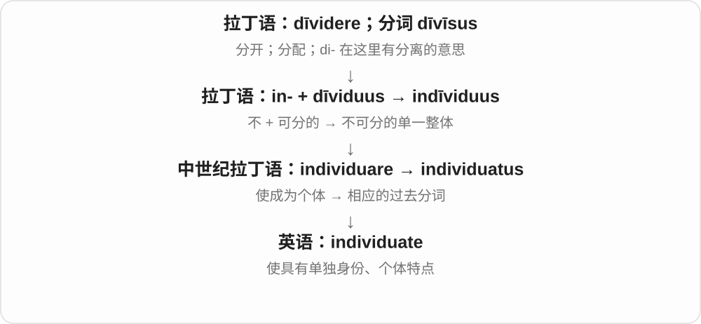

常见于哲学、心理学和文学讨论。可以表示把一个对象与其他对象区分开，或使其发展成独特个体；不是普通日常的“认出是谁”。

**常见搭配与例句**

individuate characters；individuating features。

> Distinctive speech patterns help individuate the characters.

各有特点的说话方式有助于让这些人物彼此区分开。

> The philosopher asks what individuates one object from another.

这位哲学家追问，是什么使一个对象区别于另一个对象。

**别混淆**

individualize 常说按某个人定制；individuate 更强调形成或辨明这个个体本身。

### 54. individuation — 个体形成；个体化；个性化过程〔理论术语〕

**音标**：/ˌɪndɪvɪdʒuˈeɪʃən/

**先抓住这个画面**

一团笼统的“人”变成有自己身份、边界和特点的“这个人”，这是理解 individuation 的入口。

**怎么拆**

来自中世纪拉丁 individuatio，出自 individuare“使成为个体”；名词有独立的拉丁来源，不只是英语动词机械换后缀。

**怎么变成今天的意思**

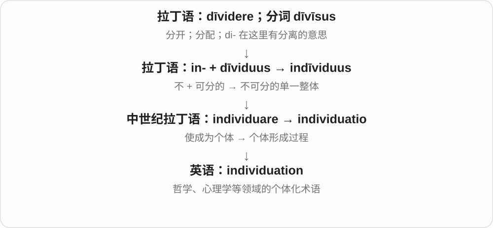

哲学里可问“同类事物为什么是这一个而不是另一个”；荣格心理学里，特指逐步整合意识与无意识，使人格更完整的过程。不同领域的专门定义不能完全互换。

**常见搭配与例句**

a process of individuation；the principle of individuation。

> The chapter explains individuation in Jung’s theory.

这一章解释了荣格理论中的个体化。

> The discussion turns to the problem of individuation in philosophy.

讨论转向了哲学中的个体如何被区分这一问题。

**别混淆**

individuation 是形成或界定个体的过程；individualism 是强调个人自主的立场。

### 55. diffeomorphism — 微分同胚〔数学〕

**音标**：美 /ˌdɪfioʊˈmɔːrfɪzəm/

**先抓住这个画面**

想象一张柔软的网格，可以平顺地变形，也能平顺地变回去。每一点都有唯一对应的位置，没有粘成一团。

**怎么拆**

differentiable“可微的”与 homeomorphism“同胚”的缩合。这里 diffeo- 接的是可微，不是一个古拉丁 div- 直接加希腊“形状”的简单公式。

**怎么变成今天的意思**

关键是两个方向都满足要求。比如实数轴上的 x→2x，逆映射 x→x/2，也是光滑的；只说“函数可微而且一一对应”还不够，逆映射也要检查。网格只是直觉，严格定义依课程要求的光滑阶数。

**常见搭配与例句**

a smooth diffeomorphism；a diffeomorphism between manifolds。

> The map that sends x to 2x is a diffeomorphism of the real line.

把x映到2x的映射是实数轴到自身的一个微分同胚。

> The proof checks that the proposed diffeomorphism has a smooth inverse.

证明检查了所提出的微分同胚具有光滑的逆映射。

**别混淆**

homeomorphism 关注连续且逆连续；diffeomorphism 进一步要求相应的可微或光滑性。

### 56. diffeomorphic — 微分同胚的〔数学〕

**音标**：参考读法：英 /ˌdɪfiəʊˈmɔːfɪk/；美 /ˌdɪfioʊˈmɔːrfɪk/〔据 diffeomorphism 与 -ic 构词〕

**先抓住这个画面**

两个空间之间能建立前后都平顺的逐点对应，就说它们是 diffeomorphic。重点是“能用什么样的对应联系起来”。

**怎么拆**

diffeomorphism 对应的形容词，以 diffeomorph- 接 -ic；它与名词共享 differentiable 和 homeomorphism 的缩合材料。

**怎么变成今天的意思**

半径不同的两个圆，可以用按比例缩放建立光滑双向对应，因此是 diffeomorphic。这个术语不要求尺寸相同，也不等于画面看着差不多。

**常见搭配与例句**

diffeomorphic to；diffeomorphic manifolds。

> Circles of different radii are diffeomorphic.

半径不同的圆是微分同胚的。

> The theorem shows that the two surfaces are diffeomorphic.

这个定理说明这两个曲面是微分同胚的。

**别混淆**

isometric 要求保持距离；diffeomorphic 允许拉伸，只要求指定意义下的光滑结构对应。

### 57. diversiform — 形态多样的〔少用〕

**音标**：英 /daɪˈvɜːsɪˌfɔːm/；美 /dɪˈvɜːrsəˌfɔːrm/，开头也读 /daɪ/

**先抓住这个画面**

同一类东西，不只长成一个模样，而是有圆的、长的、分叉的等不同形态。

**怎么拆**

拉丁 diversus 不同 + -form 形状，借用古典构件组成形容词。不是英语“潜水者”divers 加 form。

**怎么变成今天的意思**

常见于较旧的自然史、植物等描述，现代通常用 varied in form 或 diverse forms。认读时抓住 form 这一半。

**常见搭配与例句**

diversiform leaves；diversiform structures。

> The old botanical guide describes the leaves as diversiform.

这本旧植物指南把这些叶子描述为形态多样。

> The collection contains diversiform shells from several habitats.

这批收藏包含来自几种栖息地、形状各异的贝壳。

**别混淆**

diverse 可以说背景、观点、种类；diversiform 明确把多样性落在形态上。

## 这一组要分清什么

相似拼写只给线索，不自动证明同源。把 different、divide、diverge 全写成 diversum 的后代，会抹掉真实历史。

divided 是被分开的状态；divisive 是造成对立的性质；diverse 是多样。indifferent 通常表示不在乎，不是简单的“相同”。

division / divisor / dividend 放进 12 ÷ 3 = 4 的画面记；differentiation / differentiability 则分别是求导与可微性，不要只看中文都有“微”就混用。

## 串起来练习

用 divide 描述一次分配，用 different 描述两件东西的区别，用 diverge 描述道路或意见的分岔。再用自己的话解释，为什么 individual 的旧义“不可分”会走到“个体”。
