# 0097 · sed-, -sid-, sess- — 坐；停留；占据一个位置

[逐词精讲目录](../00_逐词精讲目录.md) · [总目录](../00_总目录_按常用程度.md)

## 核心词根与来源

拉丁语 sedēre 表示“坐、停留”，分词相关词干有 sess-；sīdere“坐下、落定”是同源的另一动词。president、resident、session、sediment 分别保留不同方向的变化。英语 sit、seat、settle 经日耳曼语继承，与这组拉丁词共享更早的 *sed-，不是借自拉丁语。

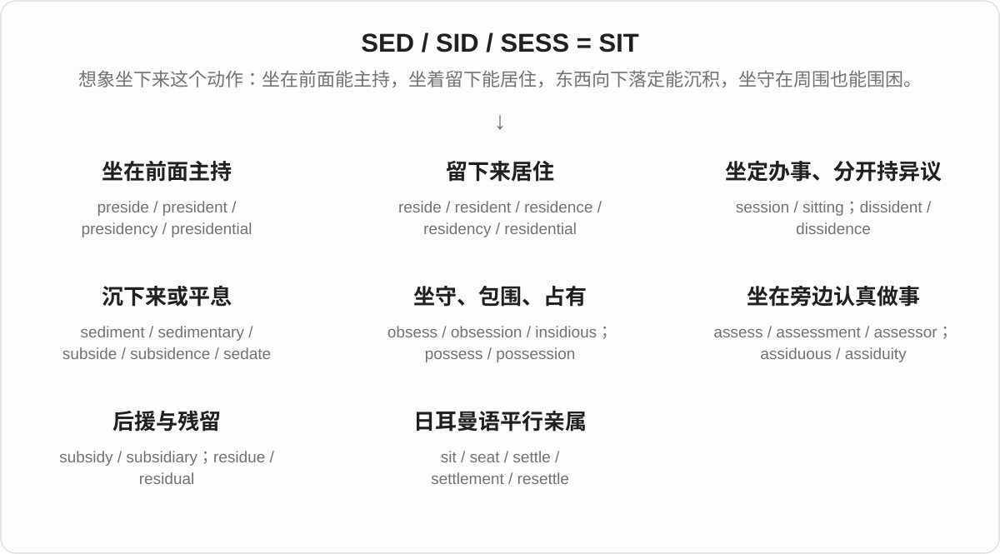

## 词形与演化规律

**sed- / sedent-**：sedēre 及其相关形式，如 sediment、sedentary。

**sid-**：复合动词中可见 residēre、praesidēre、dissidēre；subside 的 sīdere 则是同源的另一个动词，不必强行当成完全相同的词形。

**sess-**：分词、名词等相关词干，见 session、obsess、assess、possess。

**sit / seat / settle**：日耳曼语这一支的平行亲属；settle 的和解义还受另一古英语词的影响。

**sedulous / sedulity**：本页保留为近形辨析词；它们来自 sēdulus，常联系“真诚、无欺诈”，不能硬接到“坐”。

## 单词速览（按词族由简到繁）

同一基础词的相关扩展放在一起，先读基础形式，再读扩展；各组之间优先读常用的。具体词源关系见各词讲解。

| 单词 | 音标 | 核心意思 |
|---|---|---|
| [preside](#w-40) | /prɪˈzaɪd/ | 主持；领导；负责某一时期的事务 |
| [president](#w-1) | /ˈprezɪdənt/ | 总统；主席；总裁；大学校长 |
| [presidential](#w-6) | /ˌprezɪˈdenʃəl/ | 总统的；主席、总裁职位相关的；有总统风范的 |
| [presidency](#w-15) | /ˈprezɪdənsi/ | 总统任期、职位；主席或总裁的职务 |
| [sit](#w-2) | /sɪt/ | 坐；位于；担任委员；开会；照看 |
| [sitting](#w-3) | /ˈsɪtɪŋ/ | 坐着；一次持续活动；开庭或会议的一次；现任的 |
| [sitter](#w-33) | 英 /ˈsɪtə/；美 /ˈsɪtər/ | 照看孩子或宠物的人；肖像画模特；坐着的人 |
| [seat](#w-4) | /siːt/ | 座位；席位；所在地；给……安排座位 |
| [seating](#w-22) | /ˈsiːtɪŋ/ | 座位；座位安排；安排入座 |
| [session](#w-5) | /ˈseʃən/ | 一场、一次活动；会议；会期；会话 |
| [sessional](#w-62) | /ˈseʃənəl/ | 某一会期的；按学期或授课时段聘用的 |
| [settle](#w-12) | /ˈsetəl/ | 安顿、定居；平息；沉降；解决；结清 |
| [settlement](#w-7) | /ˈsetəlmənt/ | 定居点；和解协议；解决；结算 |
| [settled](#w-9) | /ˈsetəld/ | 安定下来的；已解决的；固定的 |
| [settler](#w-35) | 英 /ˈsetlə/；美 /ˈsetlər/ | 移居者；定居者 |
| [resettle](#w-53) | /ˌriːˈsetəl/ | 重新定居；重新安置 |
| [resettlement](#w-36) | /ˌriːˈsetəlmənt/ | 重新安置；重新定居 |
| [unsettle](#w-57) | /ʌnˈsetəl/ | 使不安；扰乱；动摇原有稳定状态 |
| [unsettled](#w-32) | /ʌnˈsetəld/ | 心神不宁的；未解决的；不稳定、多变的 |
| [assess](#w-17) | /əˈses/ | 评估；判断；估定金额或价值 |
| [assessment](#w-8) | /əˈsesmənt/ | 评估；评价结果；考核 |
| [assessor](#w-45) | 英 /əˈsesə/；美 /əˈsesər/ | 评估员；估价员；评审人员 |
| [possess](#w-18) | /pəˈzes/ | 拥有；具有；占据、控制 |
| [possession](#w-10) | /pəˈzeʃən/ | 占有、持有；财物；球权；被附身的状态 |
| [possessed](#w-21) | /pəˈzest/ | 被控制的；着了魔似的；具有的 |
| [possessive](#w-34) | /pəˈzesɪv/ | 占有欲强的；所有格的；所有格形式 |
| [possessiveness](#w-63) | /pəˈzesɪvnəs/ | 占有欲；独占、控制的倾向 |
| [possessively](#w-67) | /pəˈzesɪvli/ | 带占有欲地；不愿与人分享地 |
| [possessor](#w-52) | 英 /pəˈzesə/；美 /pəˈzesər/ | 持有者；拥有者；具有某种品质的人 |
| [repossess](#w-59) | /ˌriːpəˈzes/ | 收回占有；收回未按约付款的财物 |
| [repossession](#w-55) | /ˌriːpəˈzeʃən/ | 收回占有；因欠款等被收回财物 |
| [dispossess](#w-65) | /ˌdɪspəˈzes/ | 剥夺财产或土地；使失去占有；夺走球权 |
| [dispossession](#w-56) | /ˌdɪspəˈzeʃən/ | 剥夺占有；土地或财产被夺走 |
| [reside](#w-24) | /rɪˈzaɪd/ | 居住；存在于；归属于 |
| [resident](#w-11) | /ˈrezɪdənt/ | 居民；住在某处的；住院医师 |
| [residential](#w-14) | /ˌrezɪˈdenʃəl/ | 住宅的；居住的；提供住宿的 |
| [residency](#w-23) | /ˈrezɪdənsi/ | 居住资格或状态；驻留项目；住院医师培训期 |
| [nonresident](#w-58) | 英 /ˌnɒnˈrezɪdənt/；美 /ˌnɑːnˈrezɪdənt/ | 非本地居民；不在某处居住的 |
| [residence](#w-13) | /ˈrezɪdəns/ | 住所；居住；驻留 |
| [obsess](#w-44) | /əbˈses/ | 反复纠结；使某个念头占据心思 |
| [obsessed](#w-16) | /əbˈsest/ | 着了迷的；满脑子想着的；被某事困扰的 |
| [obsession](#w-20) | /əbˈseʃən/ | 挥之不去的念头；痴迷；过度关注的事物 |
| [obsessive](#w-28) | /əbˈsesɪv/ | 过分执着的；反复纠缠心思的；痴迷者 |
| [obsessively](#w-47) | /əbˈsesɪvli/ | 着迷似地；过分执着地；反复纠结地 |
| [obsessiveness](#w-66) | /əbˈsesɪvnəs/ | 过分执着；容易陷入痴迷的倾向 |
| [subside](#w-46) | /səbˈsaɪd/ | 减弱、平息；退落；下沉 |
| [subsidy](#w-25) | /ˈsʌbsɪdi/ | 补贴；补助金 |
| [subsidiary](#w-19) | 英 /səbˈsɪdiəri/；美 /səbˈsɪdieri/ | 附属的；辅助的；子公司 |
| [subsidize](#w-43) | /ˈsʌbsɪdaɪz/ | 补贴；资助部分费用 |
| [subsidized](#w-30) | /ˈsʌbsɪdaɪzd/ | 有补贴的；获得费用资助的 |
| [subsidence](#w-49) | 英 /səbˈsaɪdəns/，也 /ˈsʌbsɪdəns/；美 /səbˈsaɪdəns/ | 地面沉降；下陷；减退 |
| [residue](#w-26) | 英 /ˈrezɪdjuː/；美 /ˈrezɪduː/ | 残留物；剩余部分 |
| [residual](#w-27) | 英 /rɪˈzɪdjuəl/；美 /rɪˈzɪdʒuəl/ | 残留的；剩余的；残差；后续使用作品的报酬 |
| [sediment](#w-29) | /ˈsedɪmənt/ | 沉积物；沉淀物 |
| [sedimentary](#w-39) | /ˌsedɪˈmentəri/ | 沉积的；沉积形成的 |
| [sedimentation](#w-51) | /ˌsedɪmenˈteɪʃən/ | 沉降；沉积作用 |
| [insidious](#w-31) | /ɪnˈsɪdiəs/ | 隐伏而有害的；阴险的 |
| [insidiously](#w-61) | /ɪnˈsɪdiəsli/ | 隐蔽而有害地；不知不觉地侵蚀 |
| [sedentary](#w-37) | 英 /ˈsedəntəri/；美 /ˈsedənteri/ | 久坐的；活动少的；定居的 |
| [dissident](#w-38) | /ˈdɪsɪdənt/ | 持异议者；持不同政见的 |
| [dissidence](#w-64) | /ˈdɪsɪdəns/ | 异议；与主导立场不一致的态度或活动 |
| [sedate](#w-48) | /sɪˈdeɪt/ | 平静安稳的；从容的；用药使镇静 |
| [sedative](#w-41) | /ˈsedətɪv/ | 镇静药；有镇静作用的 |
| [sedation](#w-42) | /sɪˈdeɪʃən/ | 镇静；使人镇静的处理或状态 |
| [supersede](#w-50) | 英 /ˌsuːpəˈsiːd/；美 /ˌsuːpərˈsiːd/ | 取代；替代并使旧的失效 |
| [assiduous](#w-60) | 英 /əˈsɪdjuəs/；美 /əˈsɪdʒuəs/ | 勤勉的；持续细心的 |
| [assiduously](#w-54) | 英 /əˈsɪdjuəsli/；美 /əˈsɪdʒuəsli/ | 勤勉地；持续细心地 |
| [assiduity](#w-68) | 英 /ˌæsɪˈdjuːɪti/；美 /ˌæsɪˈduːɪti/ | 勤勉；持续细心的投入 |
| [sedulous](#w-70) | 英 /ˈsedjʊləs/，也 /ˈsedʒʊləs/；美 /ˈsedʒələs/ | 勤勉的；持续用心的 |
| [sedulity](#w-69) | 英 /səˈdjuːləti/；美 /səˈduːləti/ | 勤勉；认真不懈 |

## 逐词讲解

### 1. preside — 主持；领导；负责某一时期的事务

**音标**：/prɪˈzaɪd/

**先抓住这个画面**

preside 像坐在会议前方，掌握流程、让各方发言，使整个场面有序进行。

**怎么拆**

拉丁 prae-（前）+ sedēre（坐）→ praesidēre，经法语进入英语。

**怎么变成今天的意思**

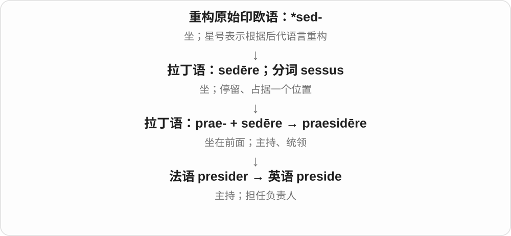

最常见 preside over a meeting。preside over a change 也能说在任期间负责或经历某次变化，不一定亲手处理所有细节。

**常见搭配与例句**

preside over a meeting；preside at a hearing；preside over change。

> She will preside over the meeting on Friday.

她将主持周五的会议。

> He presided over a period of major change at the museum.

在博物馆经历重大变革的时期，他担任负责人。

**别混淆**

attend 只是出席；preside 表示主持或处于负责位置。

### 2. president — 总统；主席；总裁；大学校长

**音标**：/ˈprezɪdənt/

**先抓住这个画面**

president 的老画面是坐在大家前面，主持会议、带领一个组织的人；今天具体头衔要看他负责的是什么。

**怎么拆**

拉丁 prae-（在前）+ sedēre（坐）→ praesidēns“主持者”，经法语等路线进入英语；不是现代英语 preside 才加 -ent。

**怎么变成今天的意思**

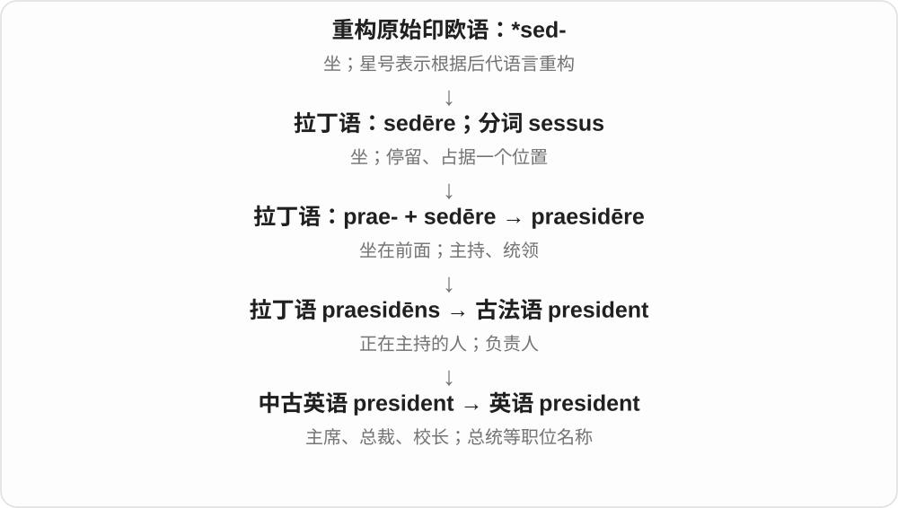

a club president 是俱乐部主席；a university president 是大学校长；国家语境中才可能是总统。不能见词就一律译总统。

**常见搭配与例句**

the president of a club；a university president；elect a president。

> The club elected a new president.

俱乐部选出了一位新主席。

> The university president welcomed the incoming students.

大学校长欢迎新生入学。

**别混淆**

chair 常专指主持人或委员会主席；president 常是组织的正式领导头衔，职责依机构而定。

### 3. presidential — 总统的；主席、总裁职位相关的；有总统风范的

**音标**：/ˌprezɪˈdenʃəl/

**先抓住这个画面**

presidential 把某项活动或表现连到 president 的职位上：选举、职责、办公室，或被认为适合这个职位的举止。

**怎么拆**

现代可拆 president + -ial；词源也可追到中古拉丁 praesidentiālis，与 praesidentia“主持者职位”相连。

**怎么变成今天的意思**

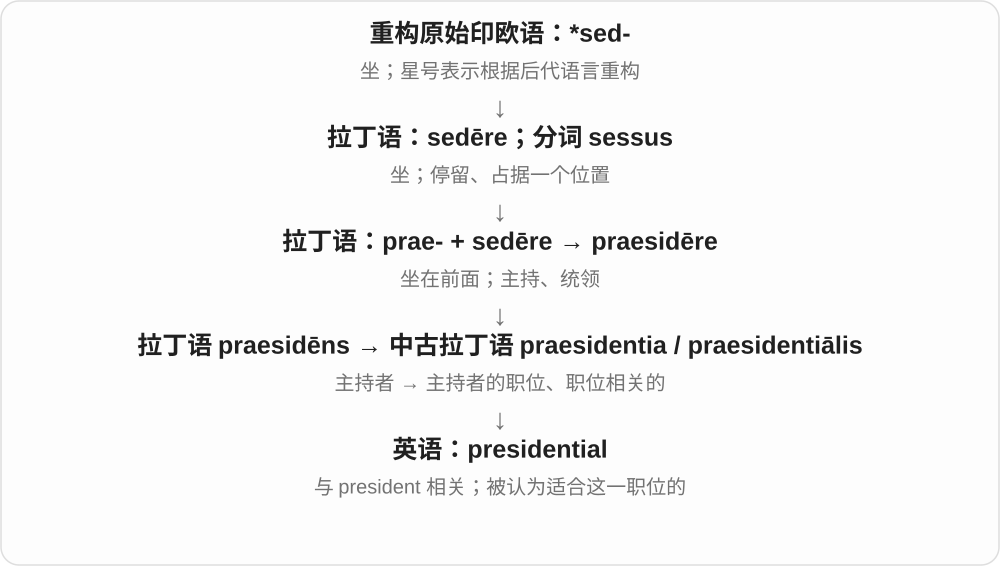

presidential election 多译总统选举；presidential manner 是被评价为有领导风范。后者是评价，不是证明某人实际担任总统。

**常见搭配与例句**

a presidential election；presidential duties；look presidential。

> The museum displays documents from an early presidential election.

博物馆展出了早期总统选举的文件。

> The speech was praised for its calm, presidential tone.

这篇讲话因语气镇定、有总统风范而受到称赞。

**别混淆**

president 是人或职位称谓；presidential 是形容词，修饰与该职位相关的事物。

### 4. presidency — 总统任期、职位；主席或总裁的职务

**音标**：/ˈprezɪdənsi/

**先抓住这个画面**

presidency 把 president 这个人换成他坐着的那把“职位椅子”：可以说职位本身，也可以说担任它的整段时间。

**怎么拆**

来自中古拉丁 praesidentia，联系 praesidēns“主持者”；现代可分析 president + -cy。

**怎么变成今天的意思**

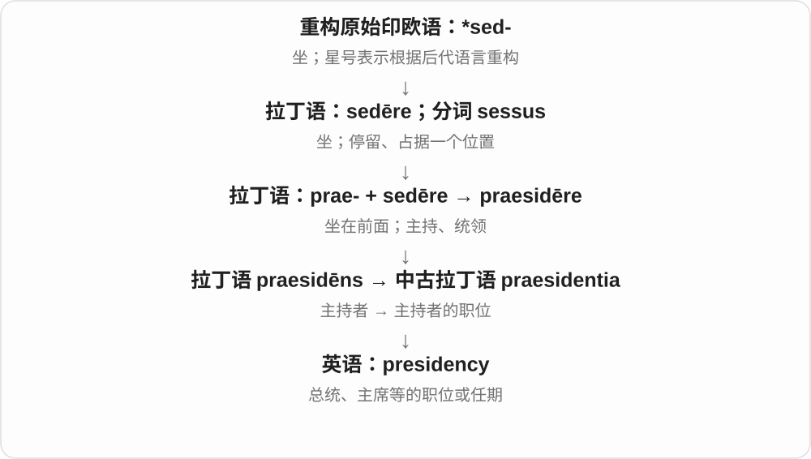

during her presidency 是在她任职期间；win the presidency 是赢得这一职位。它不只用于国家，也能用于大学、协会等组织。

**常见搭配与例句**

during a presidency；seek the presidency；the presidency of a society。

> The society expanded its activities during her presidency.

在她担任协会主席期间，协会拓展了活动范围。

> The book examines the first year of his presidency.

这本书研究了他担任总统的第一年。

**别混淆**

president 指任职的人；presidency 指他担任的职位或任期。

### 5. sit — 坐；位于；担任委员；开会；照看

**音标**：/sɪt/

**先抓住这个画面**

sit 最直观是把身体安放在座位上；扩大后，物品可以“放在那儿”，委员可以“占一个席位”。

**怎么拆**

经古英语 sittan、中古英语 sitten 继承而来，与拉丁 sedēre 是共同祖先 *sed- 的不同后代，不能画成 sedēre 变成 sit。

**怎么变成今天的意思**

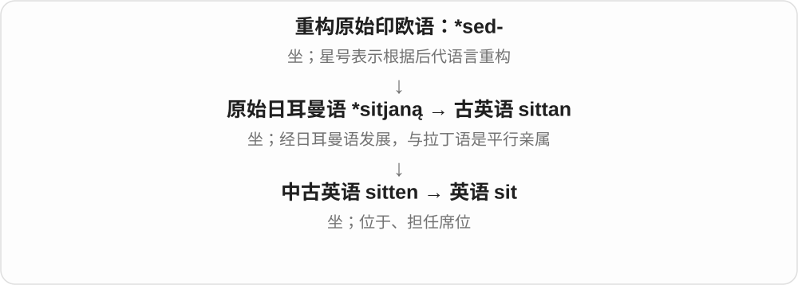

sit on a chair 是坐着；a house sits on a hill 是房子坐落山上；sit on a committee 是担任委员。sit for a portrait 是坐着让人画肖像。

**常见搭配与例句**

sit down；sit on a committee；sit an exam（英式）；sit for a portrait。

> She sat beside the window and opened her book.

她坐在窗边，打开了书。

> He sits on the museum’s advisory committee.

他担任博物馆顾问委员会委员。

> The cottage sits at the edge of the forest.

小屋坐落在森林边缘。

**别混淆**

seat 作动词是让别人坐下、安排座位；sit 通常是主体自己坐。过去式和过去分词都是 sat。

### 6. sitting — 坐着；一次持续活动；开庭或会议的一次；现任的

**音标**：/ˈsɪtɪŋ/

**先抓住这个画面**

sitting 把“坐下来”的动作拉成一段时间：一口气读完、一场会议、一顿分批供应的餐，都可以围绕这段时间来理解。

**怎么拆**

现代 sit + -ing；名词可追到中古英语 sittyng，分词另承古英语 sittende 等形式，后来汇为现代拼写。

**怎么变成今天的意思**

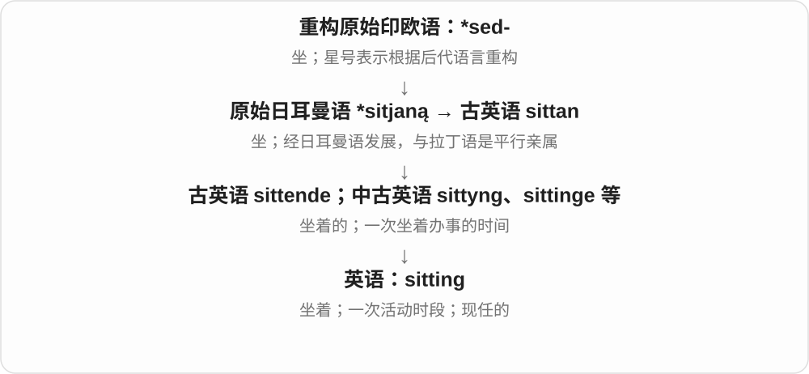

in one sitting 是一口气做完；a sitting president 是现任总统，像仍坐在职位的席位上；a court sitting 是一次开庭。

**常见搭配与例句**

in one sitting；a sitting president；the morning sitting。

> I read the short novel in one sitting.

我一口气读完了这部短篇小说。

> The sitting president attended the ceremony.

现任总统出席了仪式。

> The court’s morning sitting ended at noon.

法院上午的庭审在中午结束。

**别混淆**

session 和名词 sitting 都可指一次会议；sitting 还常说一口气做事的时段，现任义则是形容词。

### 7. sitter — 照看孩子或宠物的人；肖像画模特；坐着的人

**音标**：英 /ˈsɪtə/；美 /ˈsɪtər/

**先抓住这个画面**

sitter 的不同义围绕不同的 sit：可以是坐着让画家画的人，也可以是留下来替你照看孩子的人。

**怎么拆**

sit + -er，中古英语已有 sitter / sittere；现代照看义也常是 babysitter 等词的简称。

**怎么变成今天的意思**

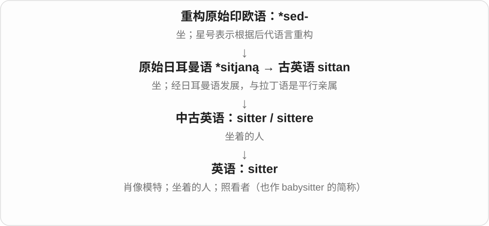

找人照看孩子可说 find a sitter；艺术语境 the sitter 是坐着供画家描绘的人。足球口语 a sitter 还可指极容易得分的机会。

**常见搭配与例句**

hire a sitter；a portrait sitter；miss a sitter。

> We need a sitter for the children on Saturday evening.

周六晚上我们需要一个人来照看孩子。

> The painter asked the sitter to turn slightly towards the light.

画家请肖像模特略微转向光线。

**别混淆**

model 范围很广，不必是坐姿肖像模特；sitter 在肖像画里突出被描绘的人。

### 8. seat — 座位；席位；所在地；给……安排座位

**音标**：/siːt/

**先抓住这个画面**

seat 从可以坐下的位置开始：会议里的一把椅子能代表一个席位，一座城市也能成为权力落脚的中心。

**怎么拆**

经中古英语 sete，联系古英语 sǣte 与古诺尔斯语 sæti；具体借入、同源影响有不同分析。远源与 sit、sedēre 同属 *sed-。

**怎么变成今天的意思**

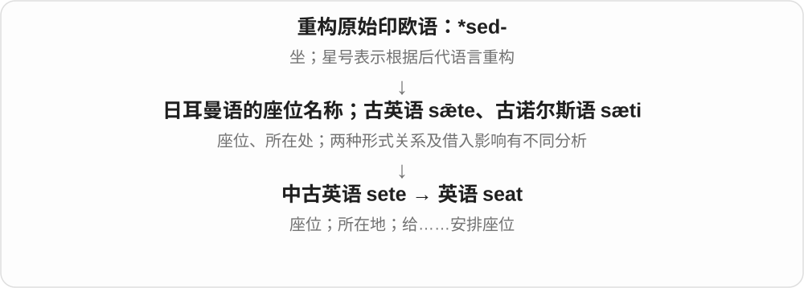

take a seat 是请坐；win a seat 是赢得议会等席位；seat six people 是能坐六人。the seat of government 是政府所在地。

**常见搭配与例句**

take a seat；a window seat；win a seat；be seated。

> The table can seat six people comfortably.

这张桌子能让六个人舒适地围坐。

> She won a seat on the local council.

她赢得了地方议会的一个席位。

> The city became the seat of government.

这座城市成为政府所在地。

**别混淆**

chair 常是可移动的椅子；seat 更广，长凳上的位置、车座和议会席位都可以是 seat。

### 9. seating — 座位；座位安排；安排入座

**音标**：/ˈsiːtɪŋ/

**先抓住这个画面**

seating 像从上方看一个房间里如何坐人：有多少座位、摆在哪里、谁坐哪儿。

**怎么拆**

seat + -ing，表示安排座位的过程，也集合地指可供使用的座位。

**怎么变成今天的意思**

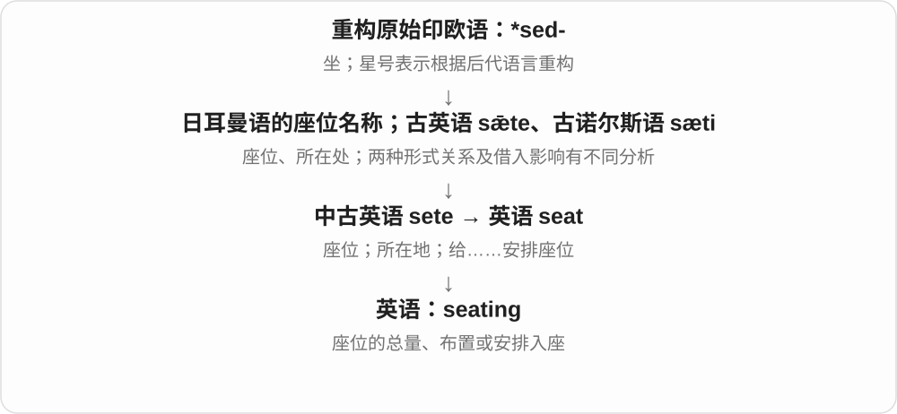

seating for forty 指能坐四十人；a seating plan 是座次表；outdoor seating 是室外座位区。

**常见搭配与例句**

a seating plan；seating capacity；outdoor seating；comfortable seating。

> The café has outdoor seating overlooking the river.

咖啡馆有面向河流的室外座位。

> We revised the seating plan before the guests arrived.

客人到来前，我们调整了座次表。

**别混淆**

a seat 是单个位置；seating 常作不可数名词谈整体座位条件、数量或安排。

### 10. session — 一场、一次活动；会议；会期；会话

**音标**：/ˈseʃən/

**先抓住这个画面**

session 像大家坐定，把一段时间专门留给某件事：开会、练习、录音，甚至一次在线连接。

**怎么拆**

来自拉丁 sessiō“坐下”，经法语和中古英语而来；sess- 是 sedēre 的相关词干，不是随意换字母。

**怎么变成今天的意思**

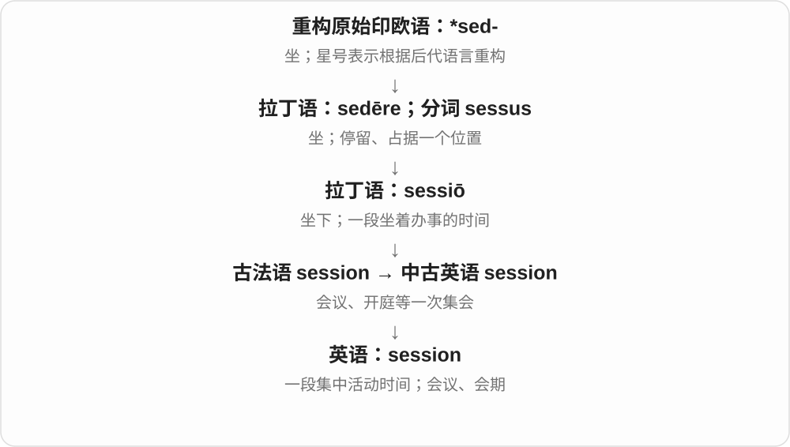

a training session 是一场训练；a recording session 是一段录音工作；a login session 是一次登录会话。session 通常有可辨认的起止。

**常见搭配与例句**

a practice session；a recording session；in session；a browser session。

> The training session lasted ninety minutes.

这场训练持续了九十分钟。

> The system ends the session after a period of inactivity.

一段时间没有操作后，系统会结束这次会话。

**别混淆**

meeting 一般有人开会；session 的范围更大，一次独自练习也能叫 session。

### 11. sessional — 某一会期的；按学期或授课时段聘用的

**音标**：/ˈseʃənəl/

**先抓住这个画面**

sessional 像把工作安排绑定到一个明确的学期或会期，强调这一段时间内的事务。

**怎么拆**

session + -al，表示与某段会期、学期或活动时段有关。

**怎么变成今天的意思**

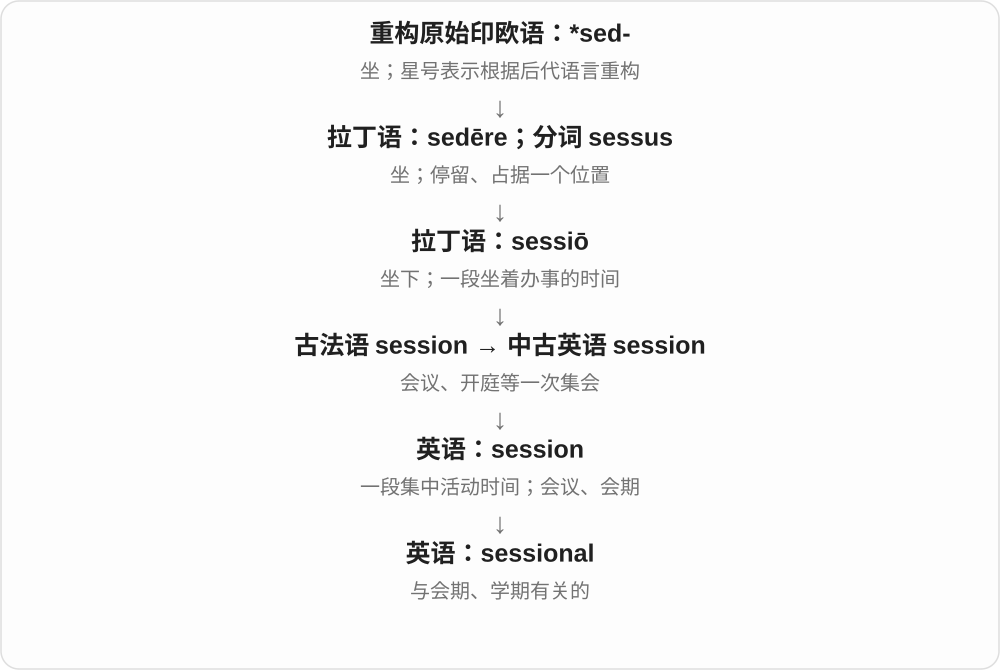

sessional lecturer 在某些教育体系指按学期、课程聘用的讲师；sessional papers 可以是某届会期文件，具体依地区用法。

**常见搭配与例句**

a sessional lecturer；sessional work；sessional papers。

> The department hired a sessional lecturer for the autumn course.

系里为秋季课程聘请了一位按期任教的讲师。

> The archive contains the sessional papers of the assembly.

档案馆保存了该议会的会期文件。

**别混淆**

seasonal 是季节性的；sessional 是会期、学期或活动时段相关，不是把 season 拼错。

### 12. settle — 安顿、定居；平息；沉降；解决；结清

**音标**：/ˈsetəl/

**先抓住这个画面**

settle 像原本晃动、悬着的东西终于落到一个稳定位置：人安顿下来，尘土落下，争议也有了定论。

**怎么拆**

定居义继承古英语 setlan，来自 setl“座位”；现代词也汇入或受到中古英语 sahtlen“和解、平息”的影响，不能把所有义硬说成单一路线。

**怎么变成今天的意思**

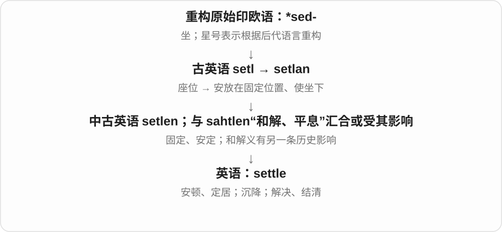

settle in 是逐渐适应新环境；settle a dispute 是解决争议；settle a bill 是结清账单；settle for 是接受一个未必最满意的选择。

**常见搭配与例句**

settle down；settle in；settle a dispute；settle for；settle on。

> It took us a few weeks to settle into the new house.

我们花了几周时间才适应新家。

> The two sides settled the dispute after a long discussion.

双方经过长时间讨论，解决了争议。

> Leave the jar still so that the particles can settle.

让罐子静置，好让颗粒沉到底部。

**别混淆**

solve 常突出找出问题答案；settle 还可指达成约定、付款或安排妥当，不一定证明找到唯一正确答案。

### 13. settlement — 定居点；和解协议；解决；结算

**音标**：/ˈsetəlmənt/

**先抓住这个画面**

settlement 把 settle 的结果装进一个名词：人落脚形成住处，争议落定形成协议，账款落定形成结算。

**怎么拆**

settle + -ment；同时继承 settle 在定居、安定以及和解方面的多条意义。

**怎么变成今天的意思**

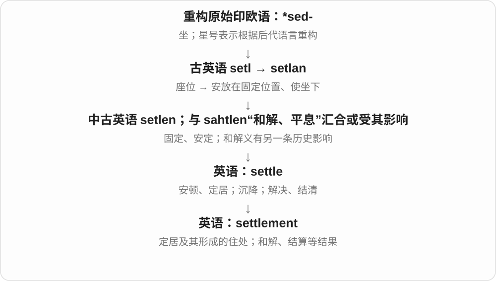

a small settlement 是小型聚居点；reach a settlement 是达成和解；payment settlement 谈款项结算。不要看到同一词就套同一个中文译法。

**常见搭配与例句**

a rural settlement；reach a settlement；a settlement agreement；final settlement。

> The road connects several small settlements in the valley.

这条路连接了山谷中的几个小型聚居点。

> The parties reached a settlement before the trial.

各方在开庭前达成了和解。

> Final settlement of the invoice is due next month.

这张发票对应款项应在下个月结清。

**别混淆**

village 指村庄；settlement 强调人们定居形成的聚居点。agreement 可是任何协议，settlement 常让一项争议或未了事项落定。

### 14. settled — 安定下来的；已解决的；固定的

**音标**：/ˈsetəld/

**先抓住这个画面**

settled 像一个人终于把箱子放好、知道日子该怎么过，也像一件争议终于不再悬着。

**怎么拆**

settle + -ed，过去分词转为形容词，含“已经安顿、已经落定”的结果感。

**怎么变成今天的意思**

feel settled 是感到安顿下来；a settled routine 是稳定的日常安排；a settled question 是已有定论的问题。

**常见搭配与例句**

feel settled；a settled routine；a settled way of life；a settled issue。

> After a month, the children finally felt settled at school.

一个月后，孩子们终于觉得在学校安顿下来了。

> We now have a settled routine that works for everyone.

我们现在有了一套适合所有人的稳定日常安排。

**别混淆**

stable 强调不易变化；settled 还常让人想到此前有变化、不确定，而现在已安顿或有了结果。

### 15. settler — 移居者；定居者

**音标**：英 /ˈsetlə/；美 /ˈsetlər/

**先抓住这个画面**

settler 是来到一个地方长期落脚、建立生活的人，重点是迁来并定居这个过程。

**怎么拆**

settle + -er，表示从事定居行为的人。

**怎么变成今天的意思**

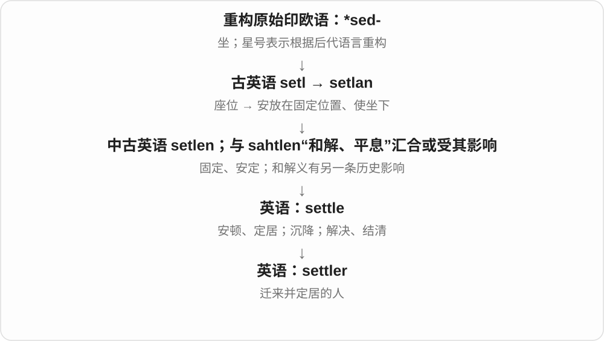

历史书里常谈迁徙与殖民。称某人为 settler 不等于那片土地此前无人居住，也不能自动忽略原住群体。

**常见搭配与例句**

early settlers；new settlers；a settler community。

> The museum displays tools used by early settlers.

博物馆展出了早期移居者使用的工具。

> The account describes contact between settlers and Indigenous communities.

这份记述描述了移居者与原住民群体之间的接触。

**别混淆**

resident 是现在住在这里的人；settler 更强调迁来建立住处的经历或历史身份。

### 16. resettle — 重新定居；重新安置

**音标**：/ˌriːˈsetəl/

**先抓住这个画面**

resettle 像原来的生活地点无法继续使用，于是把生活重新安放到另一个地方。

**怎么拆**

re-（重新）+ settle，英语中派生。

**怎么变成今天的意思**

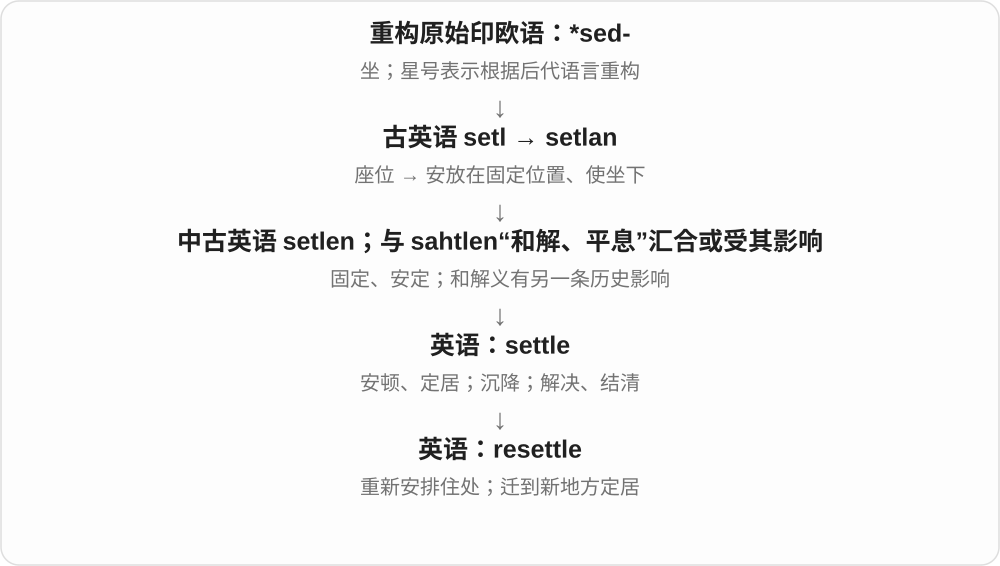

可以是人自己 resettle，也可以是机构 resettle families。具体搬迁是否自愿，要由上下文说明，词本身并不保证。

**常见搭配与例句**

resettle in another town；resettle families；be resettled。

> The family resettled in a nearby town after the flood.

洪水之后，这家人在附近一座城镇重新定居。

> The programme helped residents resettle close to their workplaces.

这个项目帮助居民在工作地点附近重新安家。

**别混淆**

relocate 强调换位置；resettle 更强调搬去后重新建立生活或安排长期住处。

### 17. resettlement — 重新安置；重新定居

**音标**：/ˌriːˈsetəlmənt/

**先抓住这个画面**

resettlement 关注重新安家的整个安排：找到住处、迁移，再逐步恢复生活。

**怎么拆**

re- + settlement，也可联系 resettle + -ment；这是英语内部的派生关系。

**怎么变成今天的意思**

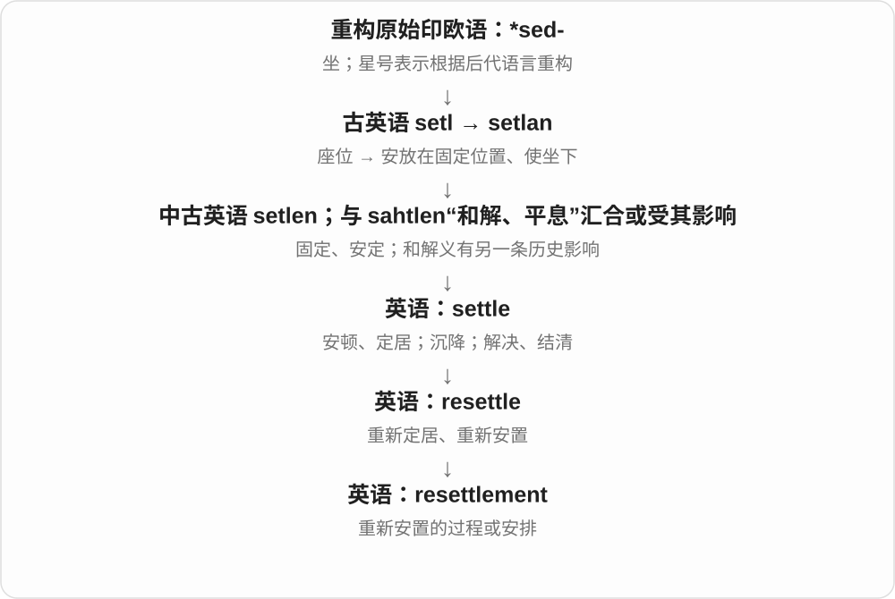

常见于搬迁、灾后安置或难民安置语境。它既可说计划，也可说实际过程，不能仅凭这个名词判断安置是否顺利。

**常见搭配与例句**

a resettlement programme；resettlement assistance；a resettlement site。

> The charity provided language classes as part of its resettlement support.

这家慈善机构把语言课作为重新安置支持的一部分。

> Residents asked for more information about the resettlement plan.

居民要求获得更多关于重新安置计划的信息。

**别混淆**

settlement 可以只是一个聚居点；resettlement 常强调已有生活被迁移后再安顿。

### 18. unsettle — 使不安；扰乱；动摇原有稳定状态

**音标**：/ʌnˈsetəl/

**先抓住这个画面**

unsettle 像把原先安稳放好的椅子轻轻晃了一下，让人一下找不到踏实感。

**怎么拆**

un- 在这里表示解除或逆转 + settle，形成“打破安定状态”的动词。

**怎么变成今天的意思**

常以消息、变化、陌生环境作主语。被 unsettle 的可以是人，也可以是习惯或原有看法。

**常见搭配与例句**

unsettle someone；unsettle the team；unsettle an assumption。

> The unexplained noise unsettled the passengers.

来历不明的声响让乘客感到不安。

> The discovery unsettled his long-held assumptions.

这个发现动摇了他长期以来的看法。

**别混淆**

upset 常直接说难过或打乱；unsettle 常是让人隐隐不安、失去原来的稳定感。

### 19. unsettled — 心神不宁的；未解决的；不稳定、多变的

**音标**：/ʌnˈsetəld/

**先抓住这个画面**

unsettled 像椅子没放稳：人心里悬着，问题没有定论，天气也总在变。

**怎么拆**

un-（不）+ settled；也可作 unsettle 的过去分词，表示被弄得不安。

**怎么变成今天的意思**

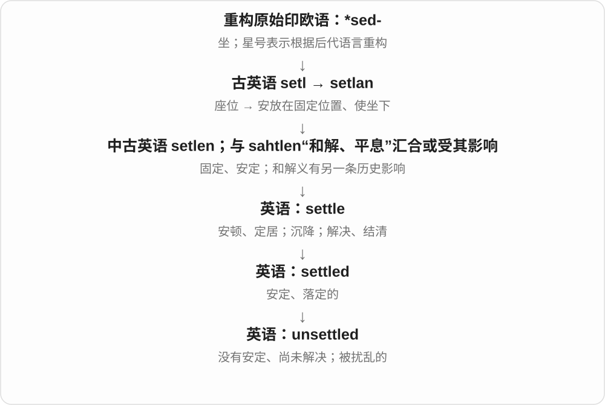

unsettled weather 是多变天气；feel unsettled 是心里不踏实；an unsettled question 是未决问题。

**常见搭配与例句**

feel unsettled；unsettled weather；an unsettled dispute。

> The sudden change left everyone feeling unsettled.

突如其来的变化让大家心里都不踏实。

> The forecast suggests unsettled weather over the weekend.

预报显示周末天气多变。

**别混淆**

uncertain 偏不确定；unsettled 还可强调不安、缺少稳定，或事情一直没有了结。

### 20. assess — 评估；判断；估定金额或价值

**音标**：/əˈses/

**先抓住这个画面**

assess 的远处画面是坐在办事者旁边，协助判断、定价；今天就是看证据后估量某件事。

**怎么拆**

拉丁 ad- + sedēre → assidēre“坐在旁边”，经 assessus、assessāre、法语 assesser 和中古英语进入英语。

**怎么变成今天的意思**

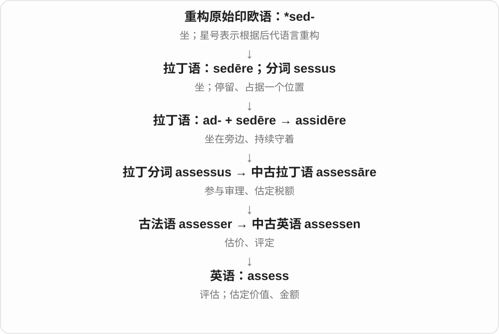

可以 assess damage、ability、risk，也可估定税额。它强调有依据地判断，不一定要求算出一个数字。

**常见搭配与例句**

assess the damage；assess someone’s ability；assess whether。

> We need more information to assess the risks.

我们需要更多信息来评估风险。

> The teacher assessed each student’s progress.

老师评估了每位学生的进步情况。

**别混淆**

guess 可凭直觉猜；assess 通常意味着查看相关情况后作判断。

### 21. assessment — 评估；评价结果；考核

**音标**：/əˈsesmənt/

**先抓住这个画面**

assessment 像把证据摆在桌上，仔细看过之后给出判断：现在是什么情况，有多少价值或风险。

**怎么拆**

assess + -ment，表示评估行为或所得结论。

**怎么变成今天的意思**

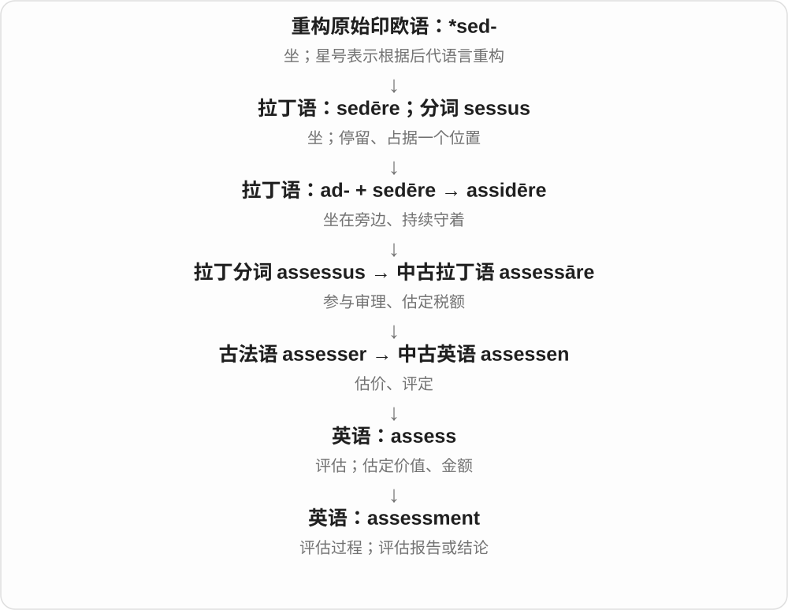

a risk assessment 是风险评估；a language assessment 可以是语言能力考核；an honest assessment 是坦诚评价。

**常见搭配与例句**

make an assessment；a needs assessment；continuous assessment。

> The team completed an assessment of the building’s condition.

团队完成了对建筑状况的评估。

> Her assessment of the situation proved accurate.

她对局势的判断后来证明是准确的。

**别混淆**

test 可以只是一次测试；assessment 可综合观察、测试和材料形成判断。

### 22. assessor — 评估员；估价员；评审人员

**音标**：英 /əˈsesə/；美 /əˈsesər/

**先抓住这个画面**

assessor 是负责作评估的人，像拿着统一标准，检查材料并作出判断。

**怎么拆**

拉丁 assessor 原指坐在旁边协助审理的人，经古法语 assessour、中古英语 assessour 借入；现代可对应 assess + -or。

**怎么变成今天的意思**

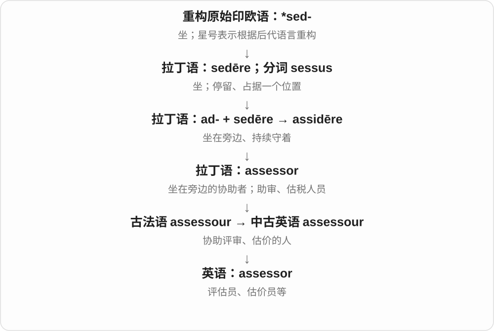

可能评估房产、损失、技能或作品，具体职责看语境；不必都译法官。

**常见搭配与例句**

an independent assessor；a property assessor；a trained assessor。

> An independent assessor inspected the damaged equipment.

一位独立评估员检查了受损设备。

> Each performance was reviewed by two assessors.

每场表演都由两位评审人员评估。

**别混淆**

assessment 是评估过程或结果；assessor 是进行评估的人。

### 23. possess — 拥有；具有；占据、控制

**音标**：/pəˈzes/

**先抓住这个画面**

possess 可以想成“牢牢掌握在自己这边”：房子在你手里，能力在你身上，强烈情绪也可能反过来控制你。

**怎么拆**

拉丁 possidere 通常分析为 potis“有支配力”与 sedere“坐”的组合。英语 possess 经法语 possesser 等借入，也有从 possession 反构的影响；不能拆成 pose。

**怎么变成今天的意思**

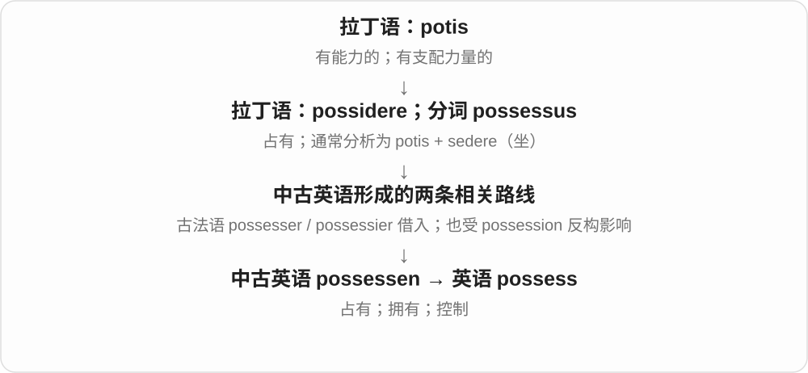

possess a skill 是具有某种技能，比 have 书面。What possessed you to do that? 常带惊讶或责怪，意思是“你当时怎么会想到干那事？”这里像是某种冲动控制了人。

**常见搭配与例句**

possess the ability to；possess a quality；what possessed you to；be possessed by。

> She possesses the patience needed for this work.

她有做这项工作所需的耐心。

> What possessed you to send the unfinished draft?

你当时怎么会把没写完的草稿发出去？

**别混淆**

own 主要说所有权；possess 可说持有、控制或具有某种品质，法律语境中实际占有与所有权未必相同。

### 24. possession — 占有、持有；财物；球权；被附身的状态

**音标**：/pəˈzeʃən/

**先抓住这个画面**

possession 先问“东西现在在谁手里、受谁控制”，也能直接指手里的那件东西。

**怎么拆**

源自拉丁 possessio，经古法语及直接拉丁借入；英语名词并非统一由更晚的 possess 加 -ion 形成。现代构词仍可把两者联系起来。

**怎么变成今天的意思**

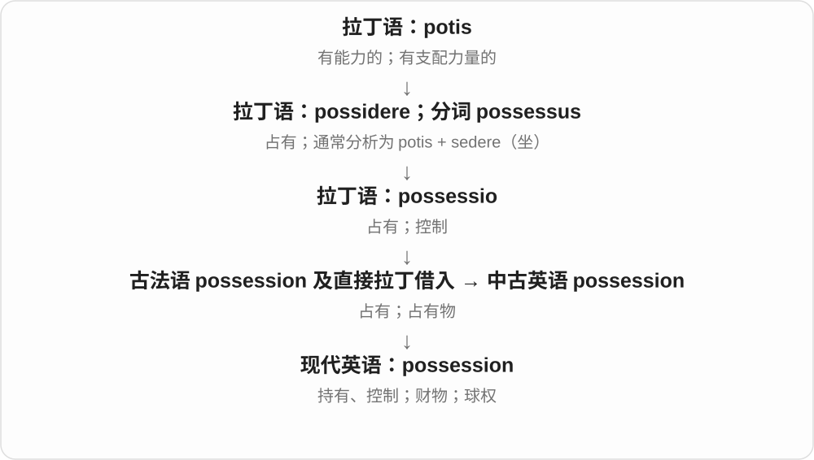

in possession of the keys 是持有钥匙；a prized possession 是珍爱的物品；复数 possessions 常指个人财物。足球里的 keep possession 是控住球，恐怖故事里的 demonic possession 则是被恶魔控制。

**常见搭配与例句**

in possession of；take possession of；personal possessions；retain possession。

> The original letter is still in her possession.

原信仍由她保存着。

> He packed his few possessions into one suitcase.

他把不多的个人物品装进了一个行李箱。

> Our team kept possession for most of the second half.

下半场大部分时间是我们队在控球。

**别混淆**

possession 可强调实际持有或控制；ownership 强调所有权。借来的书在你手里，也可能是 in your possession。

### 25. possessed — 被控制的；着了魔似的；具有的

**音标**：/pəˈzest/

**先抓住这个画面**

possessed 的常见画面是“方向盘像被别的力量接管了”：故事里是鬼怪，日常比喻里是强烈的念头。

**怎么拆**

possess 的过去分词转为形容词；-ed 在这里读 /t/。

**怎么变成今天的意思**

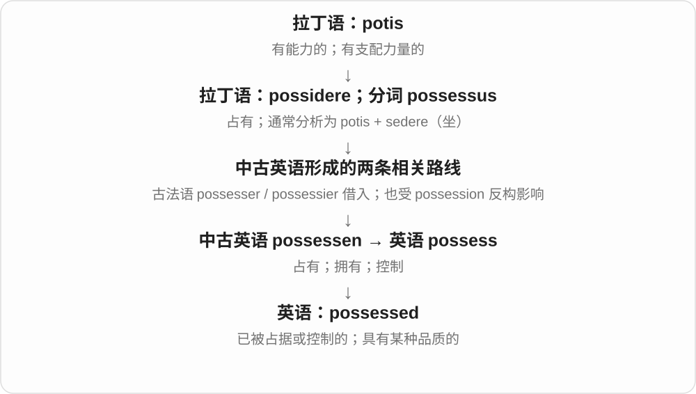

be possessed by fear 是被恐惧支配；work like someone possessed 是像着了魔似地拼命工作。较正式的 be possessed of patience 则表示“具有耐心”，of 和 by 的区别很关键。

**常见搭配与例句**

be possessed by；be possessed of；like a person possessed。

> For weeks, he worked like a man possessed.

几个星期里，他像着了魔似地拼命工作。

> She is possessed of remarkable patience.

她具有非凡的耐心。

**别混淆**

possessed by an idea 是念头控制着人；possessed of an ability 是人具有能力，不能互换介词。

### 26. possessive — 占有欲强的；所有格的；所有格形式

**音标**：/pəˈzesɪv/

**先抓住这个画面**

possessive 把“我的”说得很重：语法里标明归属，人际关系里则可能是不愿分享、不愿对方独立。

**怎么拆**

来自法语 possessif 或直接来自拉丁 possessivus；现代能看出 possess + -ive 的对应，但历史上形容词有独立借入路线。

**怎么变成今天的意思**

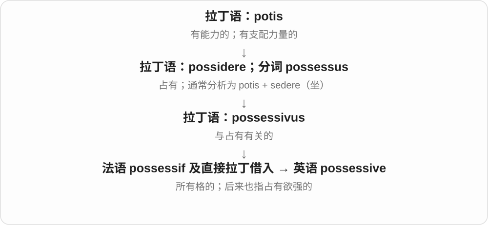

a possessive partner 要求过多关注或控制；be possessive about possessions 是舍不得别人碰自己的东西。语法里的 possessive forms 不只表示财产所有，也可表达亲属等关系。

**常见搭配与例句**

possessive about；possessive of；a possessive pronoun；the possessive form。

> He is very possessive about his collection of records.

他很宝贝自己的唱片收藏，不愿别人碰。

> In “Anna’s bicycle,” the possessive form identifies whose bicycle it is.

在 Anna’s bicycle 中，所有格形式说明自行车属于谁。

**别混淆**

protective 强调保护；possessive 强调想独占、控制。语法术语中的 possessive 本身没有这种负面评价。

### 27. possessiveness — 占有欲；独占、控制的倾向

**音标**：/pəˈzesɪvnəs/

**先抓住这个画面**

possessiveness 是把“我在乎你”推成“你的时间和选择都该归我”的倾向，也可指对物品不肯分享。

**怎么拆**

possessive + -ness，把这种态度变成名词。

**怎么变成今天的意思**

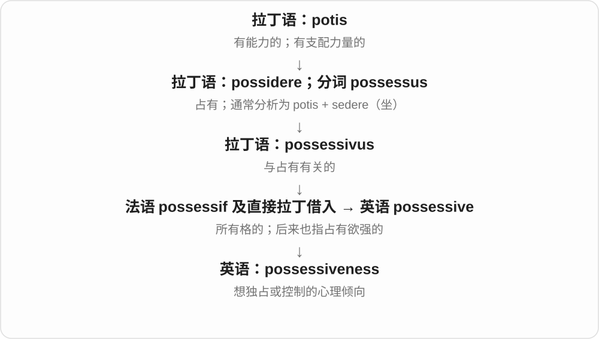

常用于关系中的控制欲，也可描述孩子不愿共享玩具。它谈的是态度，不能与“某人确实拥有某件东西”混为一谈。

**常见搭配与例句**

jealousy and possessiveness；emotional possessiveness；possessiveness about belongings。

> Her possessiveness about the family photographs surprised me.

她对家庭照片那种不肯让人分享的态度让我吃惊。

> He learned to distinguish affection from possessiveness.

他学会了区分关爱与占有欲。

**别混淆**

possession 是拥有、占有的事实；possessiveness 是不愿分享或放手的心理。

### 28. possessively — 带占有欲地；不愿与人分享地

**音标**：/pəˈzesɪvli/

**先抓住这个画面**

possessively 是动作里透出“这是我的，别碰”的劲。

**怎么拆**

possessive + -ly，描述说话、看着或护住东西的方式。

**怎么变成今天的意思**

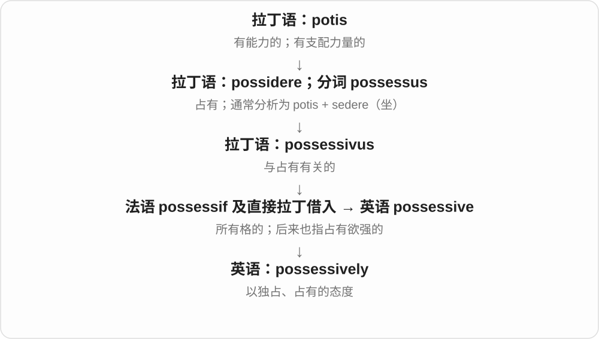

可写人抱住自己的东西，或用控制性的眼神盯住伴侣。这个副词通常让读者感到对方在划定归属，不只是普通的亲近。

**常见搭配与例句**

hold something possessively；look possessively at；speak possessively。

> The child hugged the new toy possessively.

孩子紧紧抱住新玩具，生怕别人拿走。

> He spoke possessively about the team, as if every decision belonged to him.

他谈起团队时带着很强的占有欲，仿佛所有决定都该由他来做。

**别混淆**

affectionately 表达亲昵、关爱；possessively 强调不愿别人分享或独立，语气常更紧绷。

### 29. possessor — 持有者；拥有者；具有某种品质的人

**音标**：英 /pəˈzesə/；美 /pəˈzesər/

**先抓住这个画面**

possessor 是“东西或特点落在谁身上”里的那个人。

**怎么拆**

按英语 possess + -or 分析，-or 表示实施者或持有者；与拉丁 possess- 词族相连。

**怎么变成今天的意思**

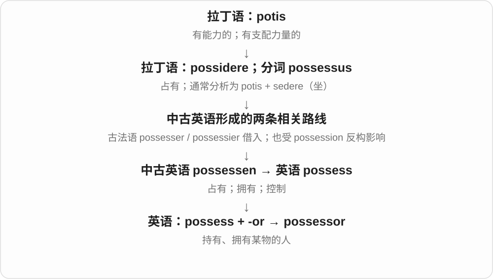

the possessor of a rare book 是珍本书的持有者；the possessor of a fine voice 是嗓音出众的人。这个词比 owner 更书面，后者更适合日常问店主、车主是谁。

**常见搭配与例句**

the possessor of；a fortunate possessor；the current possessor。

> The museum contacted the current possessor of the painting.

博物馆联系了这幅画目前的持有者。

> She is the possessor of an exceptionally clear singing voice.

她有一副格外清亮的歌喉。

**别混淆**

owner 更明确指所有者；possessor 可只说明实际持有，也能用于天赋、知识等不适合简单称财产的东西。

### 30. repossess — 收回占有；收回未按约付款的财物

**音标**：/ˌriːpəˈzes/

**先抓住这个画面**

repossess 是把原先交出去、现在又有权收回的东西重新控制在手里。

**怎么拆**

re- 再次 + possess，是英语前缀构词。

**怎么变成今天的意思**

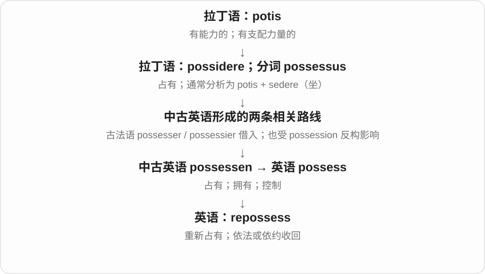

常见于因未还款而收回车辆、房屋或设备的语境，也可泛指重新取得占有。词义描述收回行为，本身不说明每次收回是否合法。

**常见搭配与例句**

repossess a car；repossess a house；be repossessed。

> In the novel, the lender threatens to repossess the family’s car.

小说中，贷款方威胁要收回这家人的车。

> The company repossessed the rented equipment after the contract ended.

合同结束后，公司收回了出租的设备。

**别混淆**

dispossess 的镜头对准被剥夺的人；repossess 对准重新取得控制的一方和被收回的物品。

### 31. repossession — 收回占有；因欠款等被收回财物

**音标**：/ˌriːpəˈzeʃən/

**先抓住这个画面**

repossession 把收回房屋、车辆的整个过程当作一个事件来讲。

**怎么拆**

re- + possession，也与动词 repossess 对应；现代可看作重新取得占有的名词。

**怎么变成今天的意思**

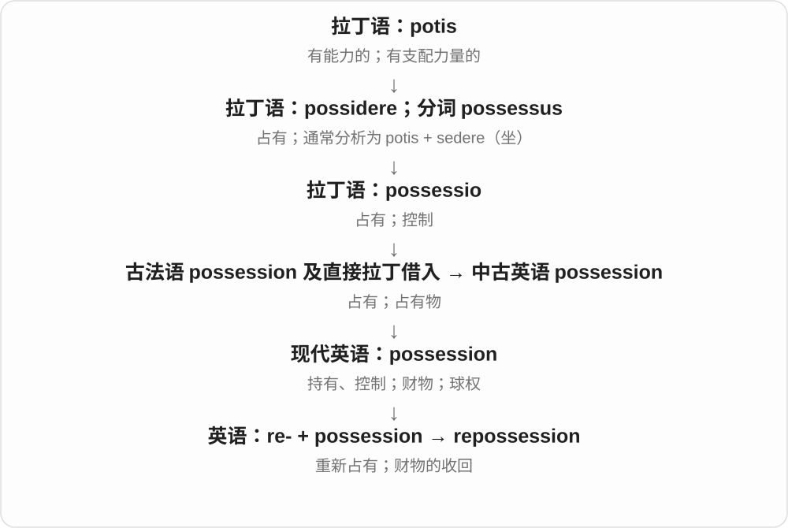

the repossession of a car 是车被收回这件事；face repossession 说面临这种局面。并不是每种“把东西还回来”都用这个正式词。

**常见搭配与例句**

face repossession；avoid repossession；the repossession of property。

> The letter warned the tenant about repossession of the equipment.

信中警告租用人，设备可能被收回。

> The documentary follows families facing repossession.

纪录片跟拍了面临房产被收回的家庭。

**别混淆**

repayment 是还款；repossession 是收回财物，两者可能有关联，但不是同一个动作。

### 32. dispossess — 剥夺财产或土地；使失去占有；夺走球权

**音标**：/ˌdɪspəˈzes/

**先抓住这个画面**

dispossess 是把一个人从“这东西由我掌握”的位置上推开。

**怎么拆**

经古法语 despossesser 借入，des- 表示去除，加 possesser 占有；现代对应 dis- + possess，不能把法语动词画成英语 possess 的后代。

**怎么变成今天的意思**

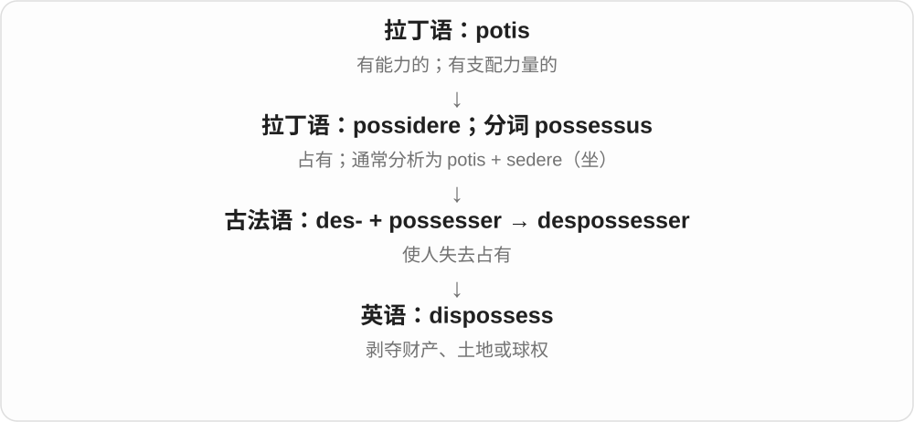

典型句式 dispossess someone of land：使某人失去土地。体育报道中，dispossess a player 是把球从对方控制下夺走；不必涉及财产所有权。

**常见搭配与例句**

dispossess someone of land；be dispossessed；dispossess an opponent。

> The new ruler dispossessed many families of their land.

新统治者剥夺了许多家庭的土地。

> The defender dispossessed the striker near the penalty area.

后卫在禁区附近断下了前锋脚下的球。

**别混淆**

evict 主要指把人逐出房屋或土地；dispossess 更强调让人失去占有，可以谈土地、财物，也可谈球权。

### 33. dispossession — 剥夺占有；土地或财产被夺走

**音标**：/ˌdɪspəˈzeʃən/

**先抓住这个画面**

dispossession 说的是“原本属于自己生活的一块地方或财物，被别人拿走了”的过程和结果。

**怎么拆**

与 dispossess 相应的英语名词；也可从现代形式看作 dis- + possession。

**怎么变成今天的意思**

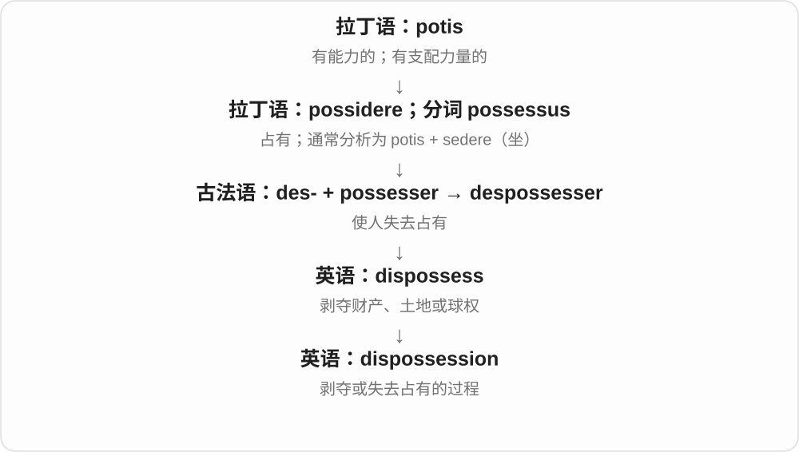

历史、社会研究里常谈土地被剥夺及其长期影响。这个词强调失去控制的社会过程，不只是一件物品暂时不见了。

**常见搭配与例句**

land dispossession；forced dispossession；a history of dispossession。

> The exhibition documents the community’s dispossession of its land.

展览记录了这个社区的土地被剥夺的历史。

> Dispossession disrupted both farming and family life.

失去土地既打乱了耕作，也破坏了家庭生活。

**别混淆**

loss 可以是各种原因的失去；dispossession 通常涉及别人使原占有者失去财物或土地。

### 34. reside — 居住；存在于；归属于

**音标**：/rɪˈzaɪd/

**先抓住这个画面**

reside 像坐下来留在一个位置，持续住在这里；抽象地说，权力或价值也能“落在”某处。

**怎么拆**

re-（回、留下）+ sedēre（坐）形成拉丁 residēre，再经法语等路线进入英语。

**怎么变成今天的意思**

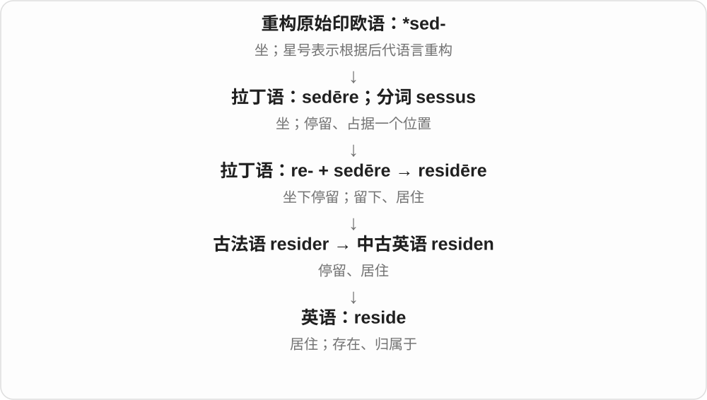

reside in a city 是住在城市；the power resides with the board 是权力归董事会。日常聊天说 live 往往更自然。

**常见搭配与例句**

reside in；reside with；the value resides in。

> They currently reside in a small coastal town.

他们目前住在一座沿海小镇。

> The final authority resides with the board.

最终决定权归董事会。

**别混淆**

stay 可以是短暂停留；reside 较正式，通常强调住处或某种属性的所在。

### 35. resident — 居民；住在某处的；住院医师

**音标**：/ˈrezɪdənt/

**先抓住这个画面**

resident 是在某处住着、持续待在那里的人，像把生活的落脚点安在这里。

**怎么拆**

拉丁 residēns 是 residēre“留下居住”的现在分词，经盎格鲁法语和中古英语借入；现代可对应 reside + -ent。

**怎么变成今天的意思**

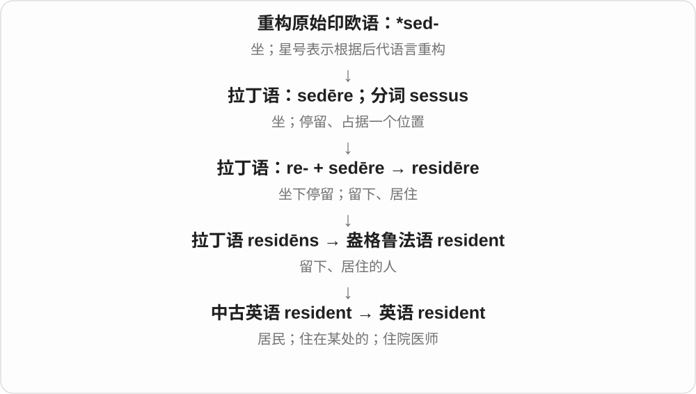

local residents 是当地居民；resident in a town 是居住在城里。医疗语境中 a resident 通常是接受毕业后临床培训的医生，历史名称与过去住在医院有关。

**常见搭配与例句**

local residents；a permanent resident；resident in；a medical resident。

> Local residents asked for a safer crossing.

当地居民要求设置更安全的过街通道。

> The resident discussed the case with a senior doctor.

这位住院医师与资深医生讨论了病例。

**别混淆**

visitor 是来访者；resident 是在此居住的人，是否永久居住要看修饰语和具体制度。

### 36. residential — 住宅的；居住的；提供住宿的

**音标**：/ˌrezɪˈdenʃəl/

**先抓住这个画面**

residential 像把地图上的一片区域标成“人们在这里生活”，也可指参加课程时就住在现场。

**怎么拆**

resident + -ial，英语中派生出与居住、住宅有关的形容词。

**怎么变成今天的意思**

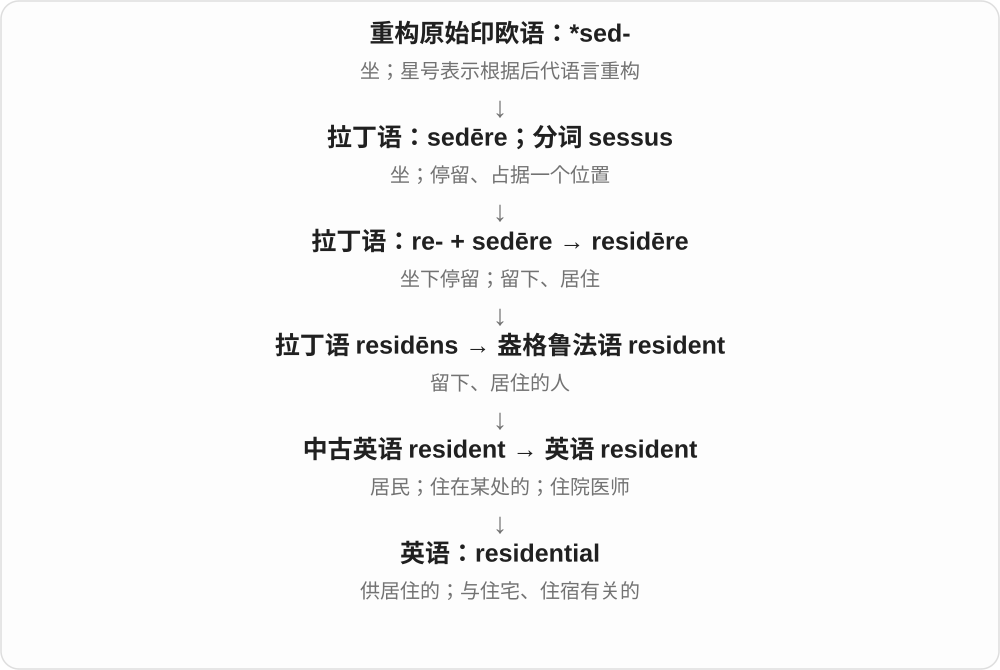

a residential area 是住宅区；a residential course 是提供住宿的课程；residential care 是入住机构接受照护。

**常见搭配与例句**

a residential area；residential buildings；a residential course。

> The factory has been converted into residential buildings.

工厂已改建成住宅楼。

> Participants can choose a residential course or attend during the day.

学员可以选择住宿课程，也可以只在白天参加。

**别混淆**

resident 可以指居民本人；residential 通常形容区域、建筑、服务或安排，不说 a residential person。

### 37. residency — 居住资格或状态；驻留项目；住院医师培训期

**音标**：/ˈrezɪdənsi/

**先抓住这个画面**

residency 像被允许或安排在一个地方持续待上一段时间，可能为了生活，也可能为了培训或创作。

**怎么拆**

英语 reside + -ency 或 resident + -cy 的派生分析；没有必要虚构一个后来的拉丁借入环节。

**怎么变成今天的意思**

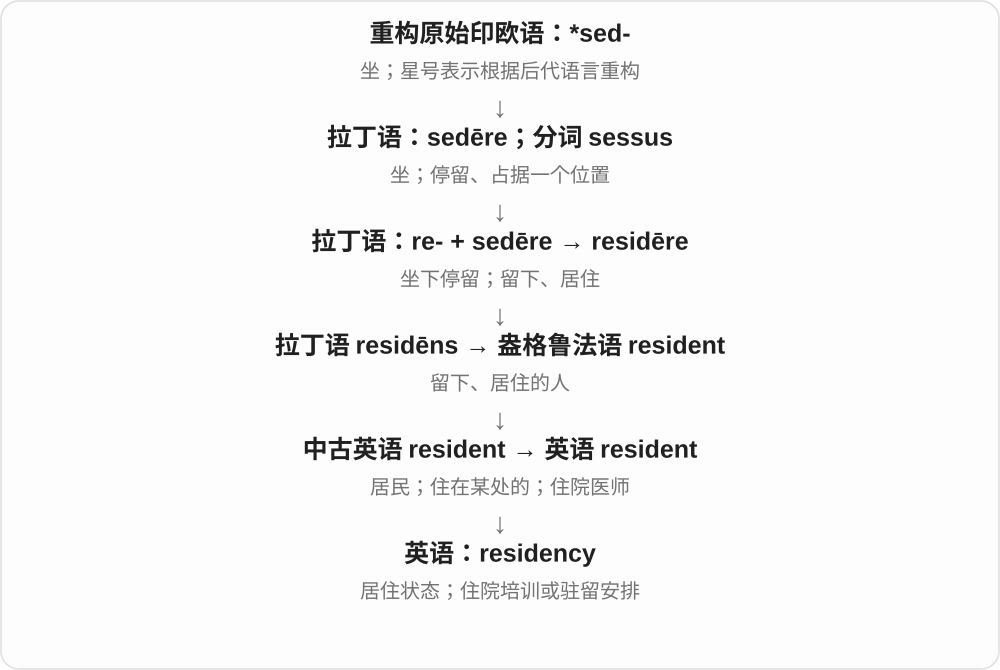

medical residency 是医生毕业后的住院培训；an artist residency 是艺术家驻留项目。residency requirements 是关于居住资格的条件。

**常见搭配与例句**

complete a residency；an artist residency；residency requirements。

> She completed her residency at a teaching hospital.

她在一家教学医院完成了住院医师培训。

> The writer spent three months on an artist residency.

这位作家参加了三个月的艺术家驻留项目。

**别混淆**

residence 可具体指住所；residency 更常说资格、状态或在机构中的一段驻留安排。

### 38. nonresident — 非本地居民；不在某处居住的

**音标**：英 /ˌnɒnˈrezɪdənt/；美 /ˌnɑːnˈrezɪdənt/

**先抓住这个画面**

nonresident 是从某个指定地点的角度说“这个人不住在这里”，不是说他无家可归。

**怎么拆**

non-（非）+ resident；这里收录不带连字符的拼法。

**怎么变成今天的意思**

常见于学校收费、会员资格或正式分类。是否算 nonresident，要看讨论对象所采用的居住范围和标准。

**常见搭配与例句**

a nonresident student；nonresident visitors；nonresident membership。

> The library charges a small fee for nonresident members.

图书馆向非本地会员收取少量费用。

> Nonresident students can use the campus shuttle.

不住校的学生可以乘坐校车。

**别混淆**

foreigner 说国籍关系；nonresident 说居住关系，本国人也可能不是本地居民。

### 39. residence — 住所；居住；驻留

**音标**：/ˈrezɪdəns/

**先抓住这个画面**

residence 既能指落脚的那栋房子，也能指“在这里住着”这一状态。

**怎么拆**

中古拉丁 residentia 经古法语 residence、中古英语 residence 而来；现代与 reside + -ence 对应，但名词有独立借入链。

**怎么变成今天的意思**

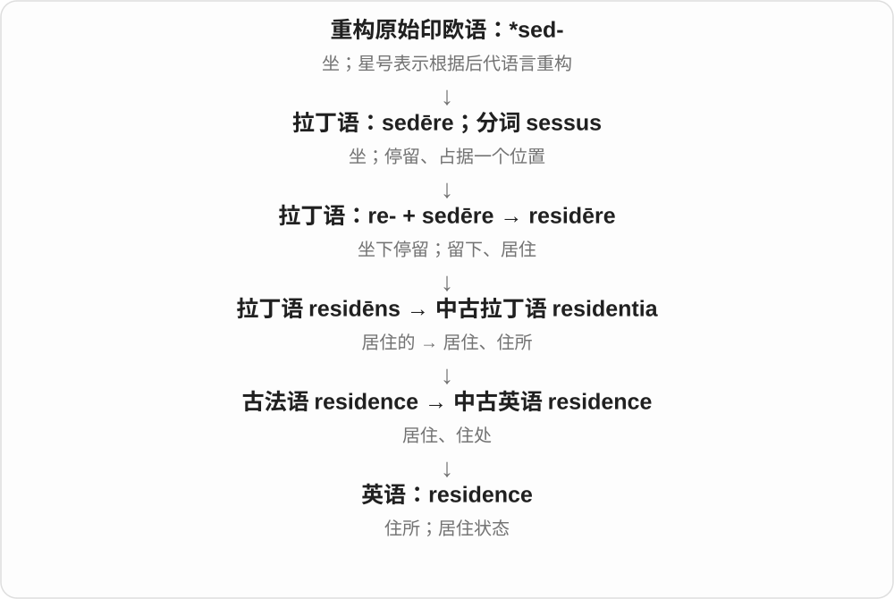

a private residence 是私人住宅；take up residence 是开始居住；place of residence 是居住地。比 home 更正式。

**常见搭配与例句**

a permanent residence；place of residence；take up residence。

> The form asks for your current place of residence.

表格要求填写你目前的居住地。

> The building was once a private residence.

这栋建筑以前是私人住宅。

**别混淆**

home 常有家的归属感；residence 偏正式地说明住处或居住状态。

### 40. obsess — 反复纠结；使某个念头占据心思

**音标**：/əbˈses/

**先抓住这个画面**

obsess 像一个问题一直在脑子门口围着不走，让你很难把注意力移开。

**怎么拆**

拉丁 obsessus 是 obsidēre“围住”的分词；英语借来后逐渐发展出念头持续纠缠人的意思。

**怎么变成今天的意思**

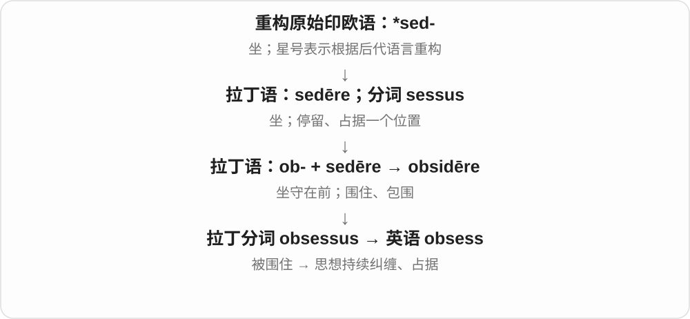

obsess over a mistake 是反复纠结失误；a question obsesses someone 是一个问题让某人一直放不下。口语常用前一种句型。

**常见搭配与例句**

obsess over details；obsess about a decision；be obsessed with。

> Try not to obsess over one small mistake.

尽量别一直纠结一个小失误。

> The unanswered question continued to obsess him.

那个没有答案的问题继续占据着他的心思。

**别混淆**

think about 是想到、思考；obsess over 强调反复占用心思，常超过合理需要。

### 41. obsessed — 着了迷的；满脑子想着的；被某事困扰的

**音标**：/əbˈsest/

**先抓住这个画面**

obsessed 像脑海里贴满了同一种东西：你总想看它、研究它，或者摆脱不了它。

**怎么拆**

obsess + -ed，过去分词常作形容词；这个词描述被某事牢牢占据注意力的状态。

**怎么变成今天的意思**

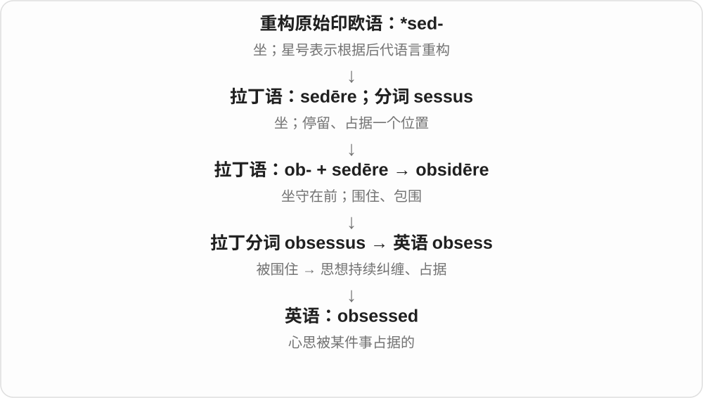

be obsessed with something 很常见，既可夸张说热爱，也可批评过度关注。语气和情境决定是否负面。

**常见搭配与例句**

obsessed with music；obsessed with winning；become obsessed。

> She became obsessed with solving the old puzzle.

她着了迷似的想解开那个旧谜题。

> He was so obsessed with winning that he forgot to enjoy the game.

他一心只想着获胜，忘了享受比赛。

**别混淆**

interested 是有兴趣；obsessed 通常程度更强，暗示几乎放不下。

### 42. obsession — 挥之不去的念头；痴迷；过度关注的事物

**音标**：/əbˈseʃən/

**先抓住这个画面**

obsession 像一个念头把脑海围住，别的事情都很难挤进去。

**怎么拆**

来自拉丁 obsessiō“围困”，由 obsidēre“坐守、包围”而来；不要倒画成英语 obsess 先造出拉丁名词。

**怎么变成今天的意思**

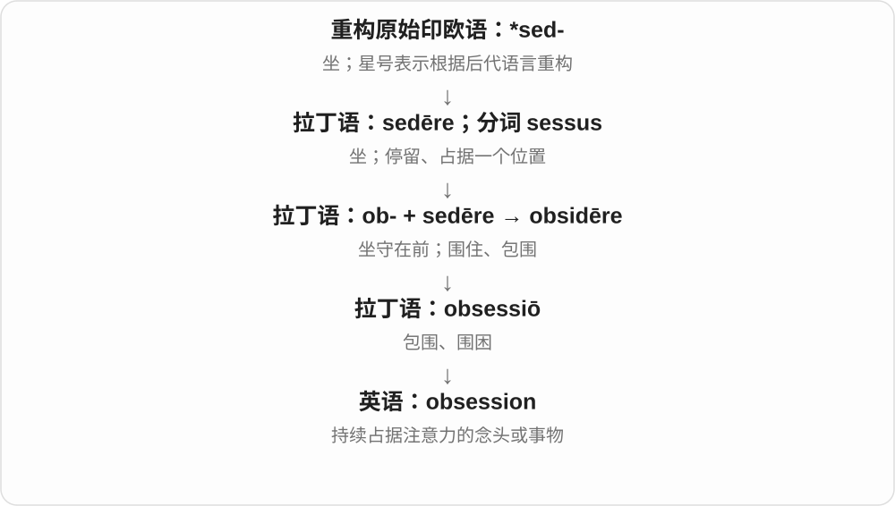

口语的 an obsession with trains 可以说对火车极度着迷；心理健康语境的 obsession 可指反复闯入的困扰性念头，两者不能随意等同。

**常见搭配与例句**

an obsession with；become an obsession；a growing obsession。

> What began as a hobby became an obsession.

一开始只是爱好，后来变成了难以放下的痴迷。

> His obsession with tiny details delayed the whole project.

他过度纠结细枝末节，拖慢了整个项目。

**别混淆**

interest 是兴趣；obsession 强调占据注意力的程度很强，有时让人难以摆脱。

### 43. obsessive — 过分执着的；反复纠缠心思的；痴迷者

**音标**：/əbˈsesɪv/

**先抓住这个画面**

obsessive 像注意力被一个点牢牢吸住，反复回去检查、研究或担心。

**怎么拆**

obsess + -ive，表示具有这种持续纠缠、过度投入的特点。

**怎么变成今天的意思**

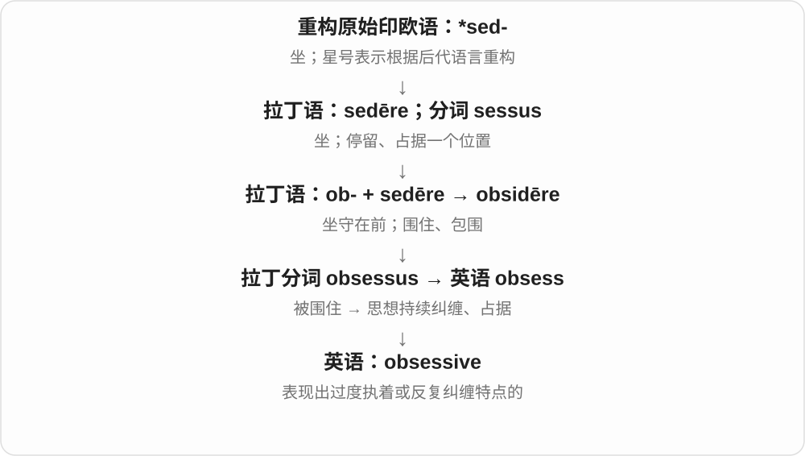

可形容 behaviour、attention、fear，也可作名词指痴迷者。日常说 obsessive about tidiness 并不等于给人作临床诊断。

**常见搭配与例句**

obsessive attention to detail；obsessive behaviour；obsessive about。

> His obsessive attention to detail slowed the editing process.

他对细节近乎执着的关注拖慢了编辑进度。

> The club attracts railway obsessives from across the country.

这个俱乐部吸引了全国各地的铁路迷。

**别混淆**

careful 是细心；obsessive 往往进一步暗示过头、难以停下来，临床术语另依具体语境。

### 44. obsessively — 着迷似地；过分执着地；反复纠结地

**音标**：/əbˈsesɪvli/

**先抓住这个画面**

obsessively 说的是动作怎样发生：做完一次仍放不下，接着又回去做。

**怎么拆**

obsessive + -ly。

**怎么变成今天的意思**

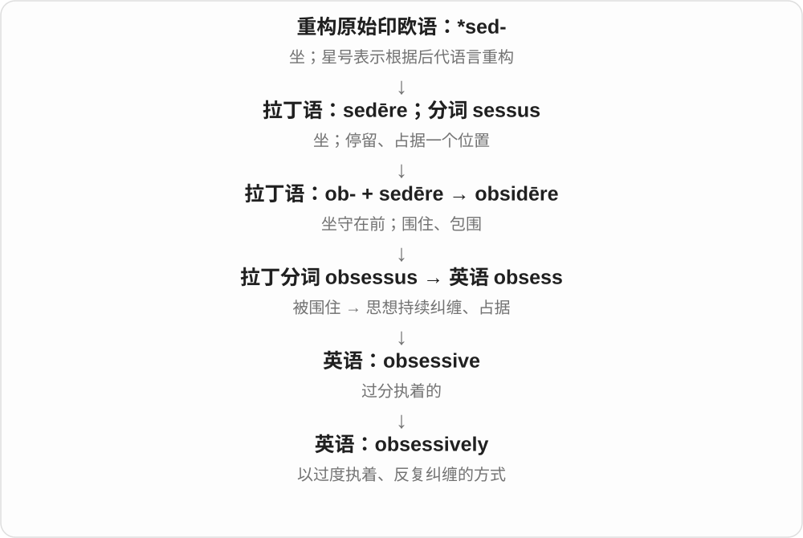

常修饰 check、collect、think、worry。它不只是 often“经常”，而是注意力被占住的那种频繁。

**常见搭配与例句**

check obsessively；think obsessively about；collect obsessively。

> She checked the message obsessively throughout the afternoon.

整个下午她都忍不住反复查看那条消息。

> He collected old maps obsessively for several years.

好几年里，他都着迷似地收集旧地图。

**别混淆**

regularly 是有规律地；obsessively 强调难以放下、投入过度的状态。

### 45. obsessiveness — 过分执着；容易陷入痴迷的倾向

**音标**：/əbˈsesɪvnəs/

**先抓住这个画面**

obsessiveness 是把“总被一个点拽住不放”作为一种倾向来谈，不是某一次具体动作。

**怎么拆**

obsessive + -ness；名词表示这种特点或程度。

**怎么变成今天的意思**

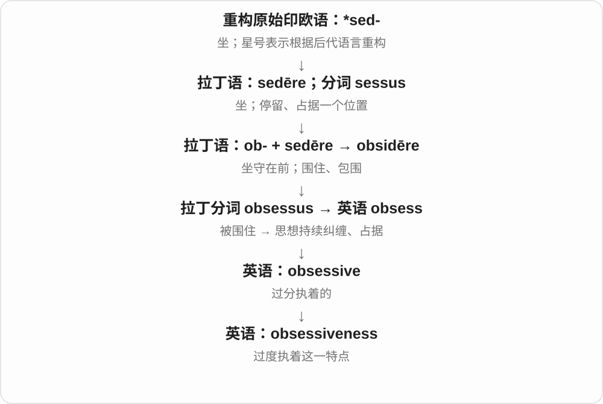

可以讨论工作风格、兴趣投入或人物性格；是不是临床问题不能只由这个日常名词决定。

**常见搭配与例句**

a degree of obsessiveness；obsessiveness about detail。

> The review admired his precision but questioned his obsessiveness.

评论赞赏他的精确，却质疑他是否过于执着。

> Her obsessiveness about presentation left little time for rehearsal.

她对呈现形式过于执着，留给排练的时间很少。

**别混淆**

obsession 常是具体困扰人的念头或对象；obsessiveness 更侧重这种反复投入的倾向。

### 46. subside — 减弱、平息；退落；下沉

**音标**：/səbˈsaɪd/

**先抓住这个画面**

subside 像高起来的水面慢慢降下去，喧闹或紧张也可以像水位一样逐渐退下。

**怎么拆**

直接联系拉丁 subsīdere，sub- 向下 + sīdere“落定、坐下”；sīdere 与 sedēre 同源。

**怎么变成今天的意思**

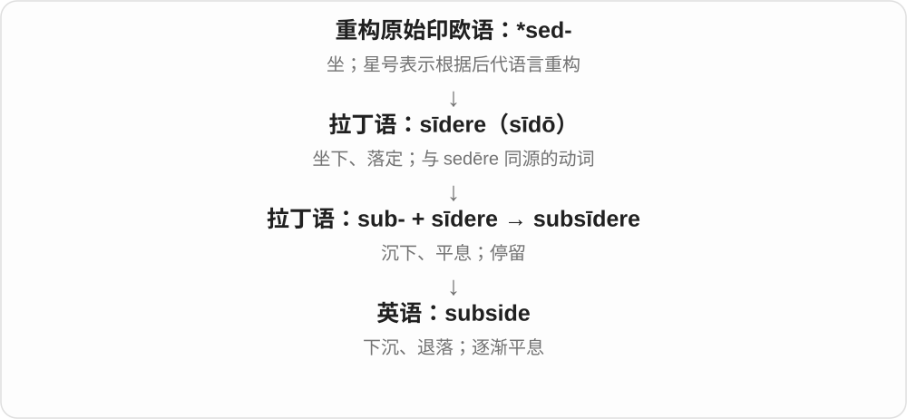

floodwater subsides 是洪水退去；anger subsides 是怒气平息；ground subsides 是地面下沉。通常是不及物动词。

**常见搭配与例句**

the noise subsided；floodwaters subside；gradually subside。

> The noise subsided after the doors closed.

门关上后，嘈杂声逐渐平息。

> We waited for the floodwater to subside.

我们等洪水退下去。

**别混淆**

stop 可以突然停下；subside 常有逐渐减弱、退落的过程感。

### 47. subsidy — 补贴；补助金

**音标**：/ˈsʌbsɪdi/

**先抓住这个画面**

subsidy 像在后面留下一支后援，前面的人撑不住时就补上一把力；现代最常补的是钱。

**怎么拆**

拉丁 subsidium“后备兵力、援助”来自 subsīdere“坐下留在后方”，经法语和中古英语进入英语。

**怎么变成今天的意思**

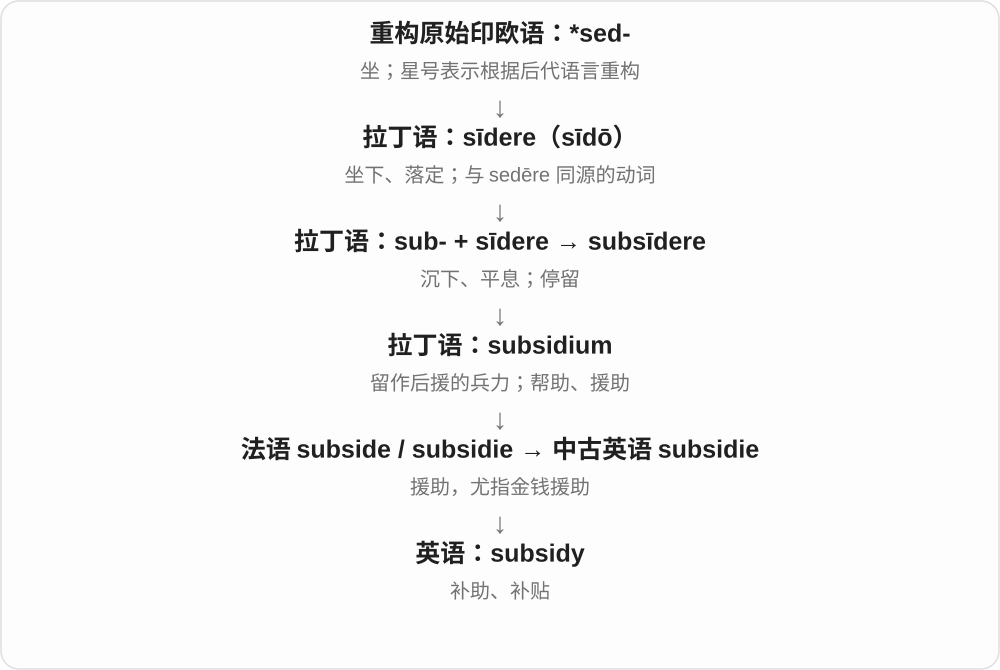

a transport subsidy 可以让运营方维持服务，也可让使用者少花钱。是谁给谁补助，要看具体句子，词本身不保证受助对象。

**常见搭配与例句**

a government subsidy；a housing subsidy；receive a subsidy。

> The village bus service depends on a public subsidy.

村里的公交服务依靠公共补贴维持。

> The programme offers a subsidy for home insulation.

这个项目为住宅保温改造提供补助。

**别混淆**

loan 是通常需要偿还的借款；subsidy 是补助、补贴，不能仅凭这个词推断所有附加条件。

### 48. subsidiary — 附属的；辅助的；子公司

**音标**：英 /səbˈsɪdiəri/；美 /səbˈsɪdieri/

**先抓住这个画面**

subsidiary 像主力旁边的后援，帮助主体系运作；在公司关系里，a subsidiary 就是受另一家公司控制的公司。

**怎么拆**

拉丁 subsidium“后援”→ subsidiārius“辅助的”，经法语 subsidiaire 等路线进入英语；公司名词从形容词用法发展。

**怎么变成今天的意思**

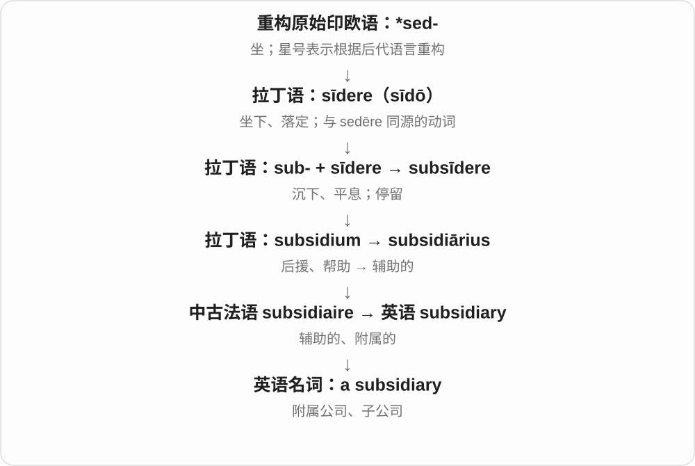

a subsidiary issue 是次要问题；a subsidiary company 是子公司。公司可以是独立法人，并不等于母公司的一个办公室。

**常见搭配与例句**

a wholly owned subsidiary；a subsidiary company；a subsidiary role。

> The group opened a subsidiary in another country.

该集团在另一个国家设立了子公司。

> Transport costs were a subsidiary issue in the discussion.

运输成本在讨论中是一个次要问题。

**别混淆**

subsidy 是补助金；subsidiary 是附属的或子公司，不能据字形断定它一定靠补贴生存。

### 49. subsidize — 补贴；资助部分费用

**音标**：/ˈsʌbsɪdaɪz/

**先抓住这个画面**

subsidize 像从旁边垫上一部分钱，让某项服务能继续运转，或让使用者付得起。

**怎么拆**

subsidy 去 y 加 -ize，英语中派生为动词；英式也拼 subsidise。

**怎么变成今天的意思**

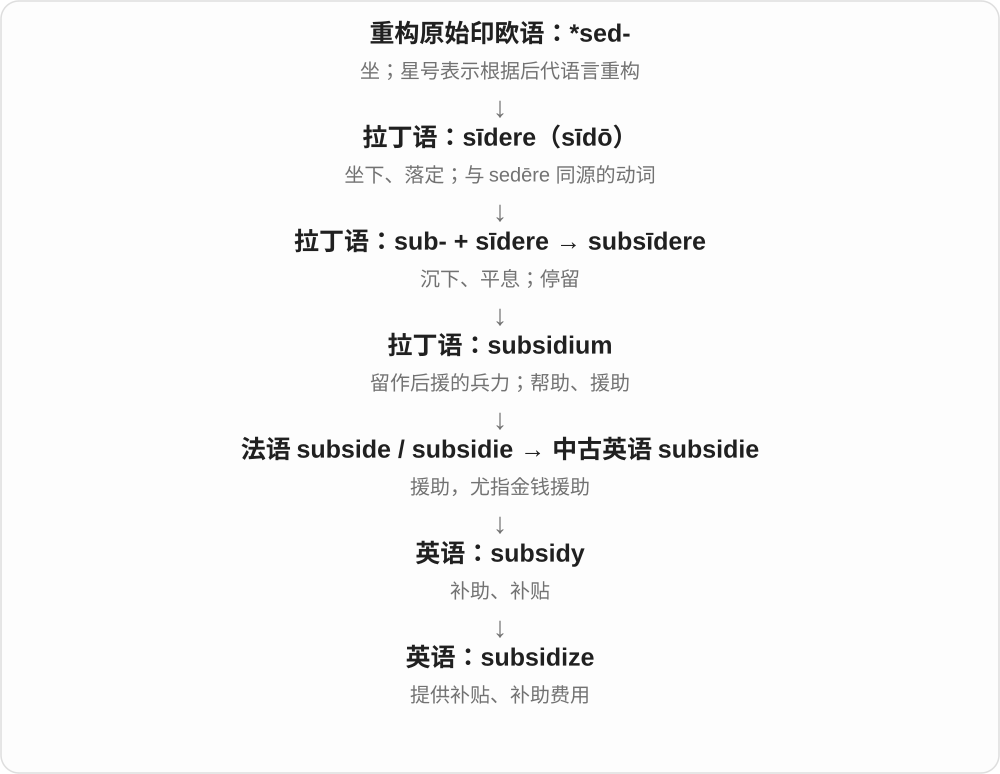

可由政府、机构或其他收入来源提供补贴。某业务 subsidizes another 也可说用一项业务收入支持另一项。

**常见搭配与例句**

subsidize public transport；subsidize the cost；heavily subsidize。

> The council subsidizes bus fares for local students.

地方政府为当地学生补贴公交车费。

> Sales from the shop help subsidize the museum’s free events.

商店收入帮助补贴博物馆免费活动的开支。

**别混淆**

sponsor 往往强调赞助关系、宣传或支持身份；subsidize 更突出补贴成本。

### 50. subsidized — 有补贴的；获得费用资助的

**音标**：/ˈsʌbsɪdaɪzd/

**先抓住这个画面**

subsidized 表示价钱或运营成本已有别人分担一部分，像账单旁多了一只帮忙付款的手。

**怎么拆**

subsidize + -ed，过去分词作形容词；也拼 subsidised。

**怎么变成今天的意思**

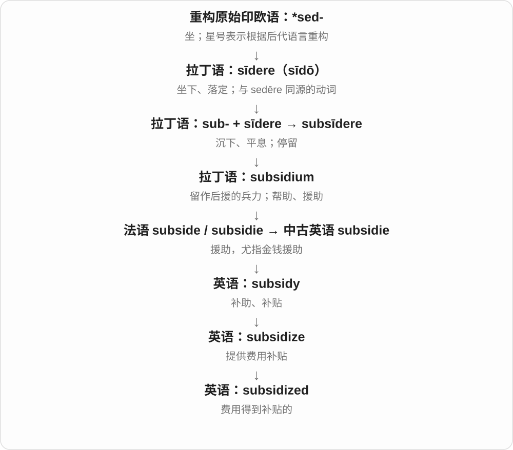

subsidized meals 不等于免费午餐，而是价格中有补贴；补贴对象也可能是服务提供者。

**常见搭配与例句**

subsidized housing；subsidized meals；a subsidized service。

> Staff can buy subsidized meals in the canteen.

员工可以在食堂购买有补贴的餐食。

> The route operates as a subsidized rural service.

这条线路作为获得补贴的乡村服务运营。

**别混淆**

free 是使用者不用付费；subsidized 只是有人资助费用，使用者仍可能付一部分。

### 51. subsidence — 地面沉降；下陷；减退

**音标**：英 /səbˈsaɪdəns/，也 /ˈsʌbsɪdəns/；美 /səbˈsaɪdəns/

**先抓住这个画面**

subsidence 像地面下面的支撑变了，上面的地面随之往下落；它把注意力放在下沉这个过程上。

**怎么拆**

联系拉丁 subsidēns / subsīdere 的词干；现代对应 subside + -ence，也有独立拉丁来源分析。

**怎么变成今天的意思**

最常见地质、建筑语境中的地面沉降，关注的是地面或地层位置下降这一现象。

**常见搭配与例句**

ground subsidence；land subsidence；evidence of subsidence。

> The survey recorded gradual subsidence near the old mine.

调查记录了旧矿区附近地面的逐渐沉降。

> The report examines the causes of land subsidence.

报告考察了地面沉降的原因。

**别混淆**

erosion 是材料被侵蚀、带走；subsidence 是地面或地层位置下沉，两者可能有关但并非同义。

### 52. residue — 残留物；剩余部分

**音标**：英 /ˈrezɪdjuː/；美 /ˈrezɪduː/

**先抓住这个画面**

residue 像液体蒸发后杯底留下的一圈痕迹：主体走了，仍有一点东西留在原处。

**怎么拆**

拉丁 residuum 是 residuus“留下的”的中性名词用法，经古法语 residu、中古英语 residue 进入英语；远连 residēre“留下”。

**怎么变成今天的意思**

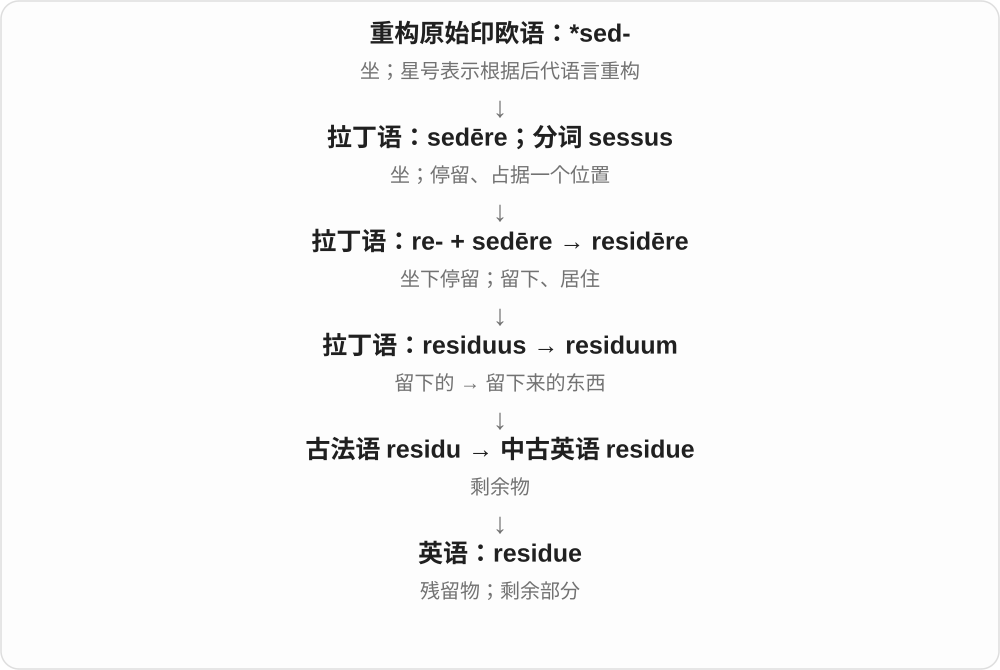

可以是物质残留，也可以比喻 a residue of doubt“一点尚未消失的疑虑”。它不一定都沉到底部，也不一定有毒。

**常见搭配与例句**

sticky residue；chemical residue；a residue of doubt。

> The label left a sticky residue on the glass.

标签在玻璃上留下了黏性残留物。

> A residue of doubt remained after the explanation.

解释之后，仍留有一点疑虑。

**别混淆**

sediment 强调沉积下来的颗粒；residue 泛指某过程后留下的东西，可能是黏痕、粉末或抽象影响。

### 53. residual — 残留的；剩余的；残差；后续使用作品的报酬

**音标**：英 /rɪˈzɪdjuəl/；美 /rɪˈzɪdʒuəl/

**先抓住这个画面**

residual 像擦掉主要痕迹后还留着的那一点：可以是余热、剩余影响，也可以是计算后剩下的误差。

**怎么拆**

现代可分析 residue + -al；词源也有法语 résiduel 影响的分析，二者都回到拉丁 residuum / residuus。

**怎么变成今天的意思**

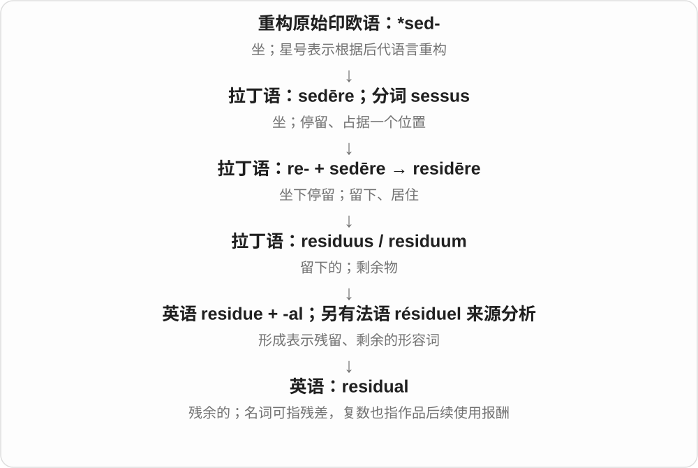

residual heat 是余热；统计学 a residual 通常是观察值减去模型预测值；影视业 residuals 是作品再次使用等带来的后续报酬。三个场景都要按语境理解。

**常见搭配与例句**

residual heat；a residual effect；plot the residuals；receive residuals。

> Residual heat kept the room warm after the stove went out.

炉火熄灭后，余热仍让房间保持温暖。

> The analyst plotted the residuals to inspect the model’s errors.

分析师画出了残差图，用来检查模型的误差。

> The actor continued to receive residuals from repeat broadcasts.

这位演员继续收到节目重播带来的后续报酬。

**别混淆**

residue 常是实际残留物；residual 多作形容词。数学 residual 是定义明确的差值，不是随便称剩余数字。

### 54. sediment — 沉积物；沉淀物

**音标**：/ˈsedɪmənt/

**先抓住这个画面**

sediment 像把一杯浑水放着不动，细小颗粒慢慢落到底部，最后留下的一层东西。

**怎么拆**

来自拉丁 sedimentum，与 sedēre“坐、落定”相连，经法语借入英语。

**怎么变成今天的意思**

可以是瓶底沉淀，也可以是河流、湖泊等环境沉积下来的物质。它描述材料，不保证已固结成岩石。

**常见搭配与例句**

fine sediment；river sediment；a layer of sediment。

> A layer of sediment had collected at the bottom of the jar.

罐底积起了一层沉淀物。

> The river carries sediment towards the coast.

河流把泥沙沉积物带向海岸。

**别混淆**

sediment 是沉积物；sedimentary rock 是沉积岩，二者不是同一阶段的东西。

### 55. sedimentary — 沉积的；沉积形成的

**音标**：/ˌsedɪˈmentəri/

**先抓住这个画面**

sedimentary 像把一层层落下的材料保存成层次，常用来形容由沉积物形成的岩层。

**怎么拆**

sediment + -ary，表示与沉积物或沉积形成过程有关。

**怎么变成今天的意思**

sedimentary rock 是沉积岩；sedimentary layers 是沉积层。沉积岩形成还可能涉及压实、胶结或化学、生物过程，不能只理解成泥巴晾干。

**常见搭配与例句**

sedimentary rock；sedimentary layers；a sedimentary basin。

> The cliff exposes several layers of sedimentary rock.

悬崖露出了几层沉积岩。

> The fossils were found in sedimentary deposits.

这些化石是在沉积层中发现的。

**别混淆**

sedentary 指久坐、定居；sedimentary 谈沉积物和地层，虽同族但不能互换。

### 56. sedimentation — 沉降；沉积作用

**音标**：/ˌsedɪmenˈteɪʃən/

**先抓住这个画面**

sedimentation 像静放浑水时颗粒慢慢落下的全过程，不只是最后留下的那层泥沙。

**怎么拆**

sediment + -ation，形成过程名词。

**怎么变成今天的意思**

用于河湖地质过程，也用于处理悬浮颗粒的技术语境。具体机制随环境不同，不必一律理解成化学反应。

**常见搭配与例句**

sedimentation rate；sedimentation in a lake；a sedimentation tank。

> The study measured sedimentation in the reservoir.

研究测量了水库中的沉积情况。

> Fine particles remained suspended longer, slowing sedimentation.

细颗粒悬浮得更久，使沉降变慢。

**别混淆**

sediment 是留下的物质；sedimentation 是形成沉积的过程。

### 57. insidious — 隐伏而有害的；阴险的

**音标**：/ɪnˈsɪdiəs/

**先抓住这个画面**

insidious 像问题悄悄躲在角落，开始不显眼，等你察觉时已经造成了影响。

**怎么拆**

来自拉丁 insidiōsus，连到 insidiae“埋伏、圈套”，远源 in- + sedēre“坐在里面、占据”。

**怎么变成今天的意思**

可说一种缓慢侵蚀信任的习惯，也可说疾病发展方式。重点是隐蔽、渐进或难察觉的危害，不只是在骂人坏。

**常见搭配与例句**

an insidious effect；an insidious problem；insidious damage。

> The constant interruptions had an insidious effect on her concentration.

不断的打断在不知不觉中损害了她的专注力。

> Small acts of dishonesty can cause insidious damage to trust.

小小的不诚实行为可能悄悄侵蚀信任。

**别混淆**

obvious 是明显可见；insidious 常意味着危害在不易觉察的情况下发生。

### 58. insidiously — 隐蔽而有害地；不知不觉地侵蚀

**音标**：/ɪnˈsɪdiəsli/

**先抓住这个画面**

insidiously 像漏水从墙缝里一点点渗进去，表面还平静，内部却在慢慢受损。

**怎么拆**

insidious + -ly。

**怎么变成今天的意思**

常描述危害如何发展。它通常含负面后果，不是普通 secretly“秘密地”的中性替代。

**常见搭配与例句**

spread insidiously；work insidiously；insidiously undermine。

> The habit insidiously undermined her confidence.

这个习惯在不知不觉中削弱了她的信心。

> Damp spread insidiously behind the wallpaper.

潮气在墙纸后面悄悄扩散。

**别混淆**

gradually 只说逐渐；insidiously 还说隐蔽且有害。

### 59. sedentary — 久坐的；活动少的；定居的

**音标**：英 /ˈsedəntəri/；美 /ˈsedənteri/

**先抓住这个画面**

sedentary 的画面是长时间坐在同一处，没有多少走动；在人群生活方式中也可以指固定居住。

**怎么拆**

经法语 sédentaire 来自拉丁 sedentārius，联系 sedēre 的现在分词词干 sedent-。

**怎么变成今天的意思**

a sedentary job 是久坐工作；sedentary communities 可指固定居住的群体。它描述活动或居住方式，不是懒惰的人格判断。

**常见搭配与例句**

a sedentary lifestyle；sedentary work；a sedentary population。

> Her new job is more sedentary than her old one.

她的新工作比以前更需要长时间坐着。

> The chapter compares nomadic and sedentary communities.

这一章比较了游牧群体与定居群体。

**别混淆**

inactive 泛指不活跃；sedentary 特别容易让人想到坐得多，或长期定居。

### 60. dissident — 持异议者；持不同政见的

**音标**：/ˈdɪsɪdənt/

**先抓住这个画面**

dissident 的老画面是与别人分开坐：没有站在同一个立场上，不接受占主导的观点或权威。

**怎么拆**

拉丁 dis-（分开）+ sedēre（坐）→ dissidēre“意见不合”，分词 dissidēns 借入英语作形容词，后来也作名词。

**怎么变成今天的意思**

常见于政治、宗教或某个组织内部的异议。一个人只是偶尔不赞成你，不一定自然称为 a dissident。

**常见搭配与例句**

a political dissident；dissident voices；a dissident group。

> The historian interviewed several political dissidents.

这位历史学者采访了几位持不同政见者。

> Dissident voices within the organization called for change.

组织内部持异议的人呼吁改革。

**别混淆**

opponent 泛指对手或反对者；dissident 常突出对主导立场、制度或权威持异议。

### 61. dissidence — 异议；与主导立场不一致的态度或活动

**音标**：/ˈdɪsɪdəns/

**先抓住这个画面**

dissidence 把“坐到不同一边”的画面抽象成立场上的分歧，尤其是不愿跟随既定权威。

**怎么拆**

来自拉丁 dissidentia，联系 dissidēns / dissidēre“意见不合”；现代对应 dissident 的状态名词。

**怎么变成今天的意思**

比 disagreement 更正式，常见于历史、政治、宗教讨论；不必意味着暴力行动。

**常见搭配与例句**

political dissidence；religious dissidence；a tradition of dissidence。

> The essay traces a tradition of religious dissidence.

这篇文章梳理了一种宗教异议传统。

> The archive documents decades of political dissidence.

这批档案记录了几十年的政治异议活动。

**别混淆**

dissident 可以指人；dissidence 指异议的状态、思想或活动。

### 62. sedate — 平静安稳的；从容的；用药使镇静

**音标**：/sɪˈdeɪt/

**先抓住这个画面**

sedate 的共同画面是让躁动落下来：作形容词可以说生活节奏安稳，作动词通常说用药使人或动物镇静。

**怎么拆**

形容词借拉丁 sēdātus，来自 sēdāre“使安静”；动词的旧义联系该拉丁词干，现代用药义也有从 sedation 逆构的分析。

**怎么变成今天的意思**

at a sedate pace 是不慌不忙地；sedate a patient 是使患者镇静。普通慢节奏不涉及用药，两种用法要看词性。

**常见搭配与例句**

a sedate lifestyle；at a sedate pace；sedate a patient。

> We cycled through the village at a sedate pace.

我们不慌不忙地骑车穿过村庄。

> The veterinary team sedated the animal before the examination.

兽医团队在检查前给动物用了镇静药。

**别混淆**

slow 只说慢；sedate 作形容词还带平静、从容。sedative 才是镇静药物或镇静的。

### 63. sedative — 镇静药；有镇静作用的

**音标**：/ˈsedətɪv/

**先抓住这个画面**

sedative 像给过强的躁动踩下缓和的刹车；作名词指起这种作用的药，作形容词说明这种作用。

**怎么拆**

中古拉丁 sēdātīvus 经盎格鲁法语 sedatif、中古英语 sedatif 而来，远连 sēdāre“使安静”；现代能对应 sedate 与 -ive，但历史借入更早。

**怎么变成今天的意思**

a sedative 是一类作用名称，不是特定药名；sedative effect 说镇静作用。这里先学词义，不把它等同于所有麻醉药或止痛药。

**常见搭配与例句**

a sedative effect；a mild sedative；give a sedative。

> The doctor discussed the sedative effects of the medicine.

医生介绍了这种药的镇静作用。

> The record notes that a sedative was administered.

记录注明已经给予了镇静药。

**别混淆**

painkiller 以缓解疼痛为主要词义；sedative 以镇静为主要词义，两者不能机械互换。

### 64. sedation — 镇静；使人镇静的处理或状态

**音标**：/sɪˈdeɪʃən/

**先抓住这个画面**

sedation 把“躁动降下来”变成一个过程或状态，现代多指医疗中用药帮助患者放松、降低警觉的安排。

**怎么拆**

经法语 sédation 或直接来自拉丁 sēdātiō，源于 sēdāre“使安静”；它有独立名词借入链，并非现代英语 sedate 才加后缀造出来。

**怎么变成今天的意思**

under sedation 指处于镇静状态。镇静存在不同程度，不宜把所有 sedation 都译成完全失去意识的全身麻醉。

**常见搭配与例句**

under sedation；light sedation；the effects of sedation。

> The procedure was carried out under sedation.

这项操作是在镇静状态下进行的。

> The nurse explained what to expect after sedation.

护士说明了接受镇静后可能出现的情况。

**别混淆**

sedative 是起镇静作用的药物；sedation 是处理过程或形成的状态。

### 65. supersede — 取代；替代并使旧的失效

**音标**：英 /ˌsuːpəˈsiːd/；美 /ˌsuːpərˈsiːd/

**先抓住这个画面**

supersede 的现代画面是新版本站到前台，旧版本因此不再适用；它的历史却先有“暂不做、搁下”的意思。

**怎么拆**

拉丁 super-（在上）+ sedēre（坐）→ supersedēre；经法语进入英语。词尾是 -sede，不是来自 cēdere 的 -cede。

**怎么变成今天的意思**

常用于规定、版本、技术。不要只用“坐在上面”就假装现代取代义从来没有变化，旧义到新义经历了扩展。

**常见搭配与例句**

supersede an earlier version；be superseded by；supersede a rule。

> This edition supersedes all previous versions of the guide.

这一版取代了指南的所有旧版本。

> The old system was eventually superseded by a simpler one.

旧系统最终被一个更简单的系统取代。

**别混淆**

replace 很通用；supersede 常强调更新后旧物不再有效或不再需要。

### 66. assiduous — 勤勉的；持续细心的

**音标**：英 /əˈsɪdjuəs/；美 /əˈsɪdʒuəs/

**先抓住这个画面**

assiduous 像一直守在任务旁边，不轻易离开，细节也不随便放过。

**怎么拆**

借自拉丁 assiduus，联系 assidēre“坐在旁边、持续在场”；ad- 遇 s 同化为 as-。

**怎么变成今天的意思**

可以形容人，也可形容 attention、care、research。重点是持续而认真，不是只忙得很热闹。

**常见搭配与例句**

assiduous research；an assiduous student；assiduous attention。

> Assiduous research uncovered the missing letters.

持续细致的研究找到了那些遗失的信件。

> She was an assiduous student of local history.

她是一位勤勉研究地方史的学生。

**别混淆**

busy 只是忙；assiduous 还强调勤勉、用心和持续投入。

### 67. assiduously — 勤勉地；持续细心地

**音标**：英 /əˈsɪdjuəsli/；美 /əˈsɪdʒuəsli/

**先抓住这个画面**

assiduously 像一个人不时回到桌前，一项项核对，长时间认真把同一件事做好。

**怎么拆**

assiduous + -ly。

**怎么变成今天的意思**

常修饰 study、work、collect、cultivate 等有持续投入的行为，语气较书面。

**常见搭配与例句**

work assiduously；study assiduously；assiduously collect。

> She worked assiduously to check every reference.

她勤勉细致地核对了每一条参考资料。

> He assiduously collected records from local archives.

他持续细心地从地方档案馆搜集记录。

**别混淆**

quickly 只说速度快；assiduously 说用心坚持，不保证速度快。

### 68. assiduity — 勤勉；持续细心的投入

**音标**：英 /ˌæsɪˈdjuːɪti/；美 /ˌæsɪˈduːɪti/

**先抓住这个画面**

assiduity 像长期守在一项任务旁边，今天补一点，明天再核对一点，认真程度始终不松。

**怎么拆**

来自拉丁 assiduitās，形成于 assiduus“持续在场、勤勉的”；现代与 assiduous 对应，但英语名词不是从后来英语形容词倒推出拉丁名词。

**怎么变成今天的意思**

较正式，多作不可数名词。常与 patience、care 等并列，强调长期可靠的投入。

**常见搭配与例句**

work with assiduity；remarkable assiduity；patience and assiduity。

> She checked the records with remarkable assiduity.

她以格外勤勉细致的态度核对了记录。

> The project depended on patience and assiduity.

这个项目靠的是耐心和持续认真的投入。

**别混淆**

enthusiasm 是热情；assiduity 是持续踏实的认真，热情不高时也可以保持勤勉。

### 69. sedulous — 勤勉的；持续用心的

**音标**：英 /ˈsedjʊləs/，也 /ˈsedʒʊləs/；美 /ˈsedʒələs/

**先抓住这个画面**

sedulous 像一个人持续照看同一项工作，一遍遍检查、补足，而不是三分钟热度。

**怎么拆**

来自拉丁 sēdulus；通常联系 sēdulō“真诚、认真地”，更早可能是 sē- + dolō“没有欺诈”。不能因为开头 sed 就解释成一直坐着。

**怎么变成今天的意思**

这是与本族并列辨析的近形词。可以说 sedulous care 或 a sedulous researcher，现代语气较正式。

**常见搭配与例句**

sedulous attention；sedulous care；a sedulous researcher。

> The restoration required sedulous attention to detail.

修复工作需要持续细心地关注细节。

> She became a sedulous collector of oral histories.

她成了一位勤勉搜集口述历史的人。

**别混淆**

assiduous 确能追到“坐在旁边”；sedulous 的历史分析不同。两词都可说勤勉，记忆画面不能替代词源。

### 70. sedulity — 勤勉；认真不懈

**音标**：英 /səˈdjuːləti/；美 /səˈduːləti/

**先抓住这个画面**

sedulity 是把持续认真当作一种品质来谈，像每次都踏踏实实补上该做的工作。

**怎么拆**

借拉丁 sēdulitās，来自 sēdulus“勤勉的”；现代可联想 sedulous 与 -ity，但更早来源不能硬归到 sedēre“坐”。

**怎么变成今天的意思**

这是较少见的正式词。与 assiduity 意义接近，但意义相近不证明词源一定相同。

**常见搭配与例句**

remarkable sedulity；work with sedulity。

> The editor praised the researcher’s sedulity.

编辑称赞了研究者的勤勉。

> She pursued the difficult task with quiet sedulity.

她默默而勤勉地推进这项艰巨任务。

**别混淆**

diligence 是更常见的勤勉；sedulity 偏古雅、书面。

## 这一组要分清什么

president 是坐在前面主持的人；resident 是留下居住的人；同一个动作配上不同方向，职责和状态就分开了。

sedentary 是久坐、定居；sedimentary 是沉积相关。两词同族，但不是换一种拼法表达同一件事。

sediment 强调沉下来的材料；residue 泛指某个过程之后留下来的东西，不一定沉到底部。

subsidy 是补助金；subsidiary 是辅助的、子公司，现代用法不能互换。

assiduous 确有“持续坐守”的历史联系；sedulous 虽意思接近，来源分析不同。deposit 来自 dēpōnere“放下”，也不因中文可以译“沉积”就归进本族。

## 串起来练习

用 president、resident 各写一句，先确认说的是职位还是居住身份。

想象一杯浑水：颗粒沉下的过程用 sedimentation，底部留下的材料用 sediment。再解释为何标签留下的黏痕用 residue 更自然。

把 settle into a new home、settle a dispute、settle a bill 分别放进生活场景，体会“安顿、落定”的共同画面，也记住和解义的历史旁支。

比较 think about a detail 和 obsess over a detail，说明后一种状态如何占住注意力。
