# 0105 · sign- — 标记；让人识别、指明、表达

[逐词精讲目录](../00_逐词精讲目录.md) · [总目录](../00_总目录_按常用程度.md)

## 核心词根与来源

拉丁语 signum 是让人辨认、读出意义的标记，signāre 是做记号、盖印。先掌握 sign 的记号与签名，再看 signal 怎样传信息、design 怎样标出计划、assign 怎样划定归属、significant 怎样从有含义走向有分量。更早的印欧词源有不同解释，本页不把“切刻”或“跟随”某一种理论画成定论。

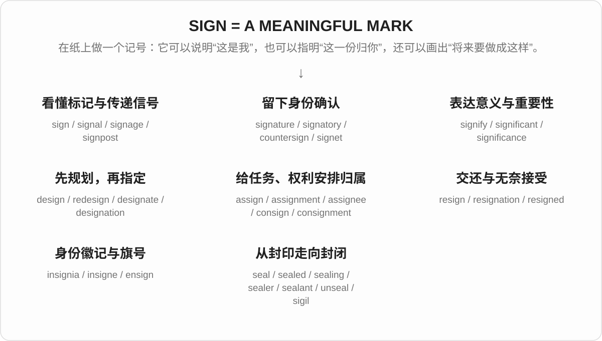

## 词形与演化规律

**sign-**：来自 signum / signāre。sign、design、assign 的 g 不发音，signal、signature、designation 中的 g 则发 /ɡ/，要跟着整词读音学。

**signific-**：signum 与 facere 的构词支线，表示传达意义；significant、significance 有各自借入史。

**sigill- / seal / sigil**：拉丁 sigillum“小标记、印章”衍生出直接借词 sigil 和经法语传播的 seal。

**insign- / ensign**：拉丁 īnsigne、īnsignia 的直接借入与法语转借；这里的 in- 不是否定前缀。

## 单词速览（常用到不常用）

| 单词 | 音标 | 核心意思 |
|---|---|---|
| [design](#w-1) | /dɪˈzaɪn/ | 设计；规划；图样；意图 |
| [sign](#w-2) | /saɪn/ | 标志；迹象；招牌；手势；签名、签约 |
| [significant](#w-3) | /sɪɡˈnɪfɪkənt/ | 重要的；明显的；意味深长的；统计显著的 |
| [designed](#w-4) | /dɪˈzaɪnd/ | 设计好的；旨在……的；特意安排的 |
| [signed](#w-5) | /saɪnd/ | 已签名的；带符号的；用手语表达的 |
| [signal](#w-6) | /ˈsɪɡnəl/ | 信号；发信号；预示；显著的、非凡的 |
| [significantly](#w-7) | /sɪɡˈnɪfɪkəntli/ | 明显地；在重要程度上；意味深长地；值得注意的是 |
| [designer](#w-8) | 英 /dɪˈzaɪnə/；美 /dɪˈzaɪnər/ | 设计师；设计者；名牌设计的 |
| [signing](#w-9) | /ˈsaɪnɪŋ/ | 签署；签名活动；签约引进的人；手语表达 |
| [assigned](#w-10) | /əˈsaɪnd/ | 已分配的；被指派的；指定的 |
| [seal](#w-11) | /siːl/ | 印章；封印；密封条；封闭、密封；海豹〔另源〕 |
| [designated](#w-12) | /ˈdezɪɡneɪtɪd/ | 指定的；划定的；被任命的 |
| [signature](#w-13) | 英 /ˈsɪɡnətʃə/；美 /ˈsɪɡnətʃər/ | 签名；鲜明特征；标志性的；音乐中的调号、拍号 |
| [assignment](#w-14) | /əˈsaɪnmənt/ | 任务；作业；分派；权利转让 |
| [significance](#w-15) | /sɪɡˈnɪfɪkəns/ | 意义；重要性；统计显著性 |
| [sealed](#w-16) | /siːld/ | 封好的；密封的；已确定的 |
| [resigned](#w-17) | /rɪˈzaɪnd/ | 无奈接受的；顺从的；已辞去的 |
| [resignation](#w-18) | /ˌrezɪɡˈneɪʃən/ | 辞职；辞呈；无奈接受、顺从 |
| [resign](#w-19) | /rɪˈzaɪn/ | 辞职；辞去；放弃；使自己接受 |
| [designing](#w-20) | /dɪˈzaɪnɪŋ/ | 正在设计；有心计的、图谋算计的〔形容词〕 |
| [designation](#w-21) | /ˌdezɪɡˈneɪʃən/ | 指定；任命；名称、称号；划定的身份 |
| [assign](#w-22) | /əˈsaɪn/ | 分配；指派；指定；转让 |
| [signaling](#w-23) | /ˈsɪɡnəlɪŋ/ | 发信号；传递信息的过程〔常见美式拼写〕 |
| [insignificant](#w-24) | /ˌɪnsɪɡˈnɪfɪkənt/ | 不重要的；微不足道的；很小的 |
| [sealing](#w-25) | /ˈsiːlɪŋ/ | 封口；密封；密封用的；猎捕海豹〔另源〕 |
| [redesign](#w-26) | /ˌriːdɪˈzaɪn/ | 重新设计；改版；重新设计的方案 |
| [signalling](#w-27) | /ˈsɪɡnəlɪŋ/ | 发信号；信号系统或过程〔常见英式拼写〕 |
| [designate](#w-28) | 动词 /ˈdezɪɡneɪt/；形容词 /ˈdezɪɡnət/ | 指定；命名；任命；已任命待就职的 |
| [ensign](#w-29) | 英 /ˈensaɪn/；美 /ˈensən/ | 舰旗；旗帜；海军少尉 |
| [signify](#w-30) | /ˈsɪɡnɪfaɪ/ | 表示；意味着；表明 |
| [signage](#w-31) | /ˈsaɪnɪdʒ/ | 标识牌；标识系统〔总称〕 |
| [unsigned](#w-32) | /ˌʌnˈsaɪnd/ | 未签名的；尚未签约的；无符号的 |
| [insignia](#w-33) | /ɪnˈsɪɡniə/ | 徽记；身份、军衔或荣誉标志 |
| [consignment](#w-34) | /kənˈsaɪnmənt/ | 一批托运货物；托运；寄售 |
| [signatory](#w-35) | 英 /ˈsɪɡnətri/；美 /ˈsɪɡnətɔːri/ | 正式文件的签署人、签署方；已签署的 |
| [reassignment](#w-36) | /ˌriːəˈsaɪnmənt/ | 重新分派；调任；重新分配 |
| [signified](#w-37) | /ˈsɪɡnɪfaɪd/ | 被表达的；所指〔符号学〕 |
| [signer](#w-38) | 英 /ˈsaɪnə/；美 /ˈsaɪnər/ | 签名者；使用手语的人 |
| [signet](#w-39) | /ˈsɪɡnət/ | 小印章；图章戒指上的印章 |
| [sealer](#w-40) | 英 /ˈsiːlə/；美 /ˈsiːlər/ | 封口机；密封材料；封口者；猎海豹者〔另源〕 |
| [sealant](#w-41) | /ˈsiːlənt/ | 密封胶；密封材料 |
| [insignificance](#w-42) | /ˌɪnsɪɡˈnɪfɪkəns/ | 不重要；微不足道；渺小 |
| [consign](#w-43) | /kənˈsaɪn/ | 交付；托运；委托销售；把……置于某种处境 |
| [signpost](#w-44) | 英 /ˈsaɪnpəʊst/；美 /ˈsaɪnpoʊst/ | 路标；指示牌；标出方向；提示文章结构 |
| [sigil](#w-45) | /ˈsɪdʒɪl/，也 /ˈsɪdʒəl/ | 符印；神秘符号；特定标记 |
| [unassigned](#w-46) | /ˌʌnəˈsaɪnd/ | 尚未分配的；未指派的 |
| [reassign](#w-47) | /ˌriːəˈsaɪn/ | 重新分配；改派 |
| [designee](#w-48) | /ˌdezɪɡˈniː/ | 被指定的人；获任命的人 |
| [signposted](#w-49) | 英 /ˈsaɪnpəʊstɪd/；美 /ˈsaɪnpoʊstɪd/ | 设有路标的；已清楚指明的 |
| [consignor](#w-50) | /kənˈsaɪnər/，也 /ˌkɒnsaɪˈnɔː/ | 发货人；托运人；寄售委托人 |
| [signifier](#w-51) | 英 /ˈsɪɡnɪfaɪə/；美 /ˈsɪɡnɪfaɪər/ | 表示某种意义的东西；能指 |
| [assignee](#w-52) | /ˌæsaɪˈniː/，也 /ˌæsəˈniː/ | 受让人；被指派任务的人 |
| [designator](#w-53) | 英 /ˈdezɪɡneɪtə/；美 /ˈdezɪɡneɪtər/ | 指定者；标识名称、代号或符号 |
| [signification](#w-54) | /ˌsɪɡnɪfɪˈkeɪʃən/ | 含义；表示意义的过程〔正式〕 |
| [insigne](#w-55) | /ɪnˈsɪɡniː/ | 徽章；徽记〔较少用的单数形式〕 |
| [siggy](#w-56) | /ˈsɪɡi/〔按 sig + -y 的常见构词读音〕 | 签名；论坛签名档〔网络口语〕 |
| [signboard](#w-57) | 英 /ˈsaɪnbɔːd/；美 /ˈsaɪnbɔːrd/ | 招牌；告示牌；标示牌 |
| [signalman](#w-58) | /ˈsɪɡnəlmən/ | 信号员；旧称通信兵 |
| [unseal](#w-59) | /ʌnˈsiːl/ | 拆封；启封；解除封闭 |
| [consignee](#w-60) | /ˌkɒnsaɪˈniː/；美式也 /ˌkɑːnsəˈniː/ | 收货人；受托收货的一方 |
| [insignificantly](#w-61) | /ˌɪnsɪɡˈnɪfɪkəntli/ | 微不足道地；变化很小地；不显著地 |
| [signposting](#w-62) | 英 /ˈsaɪnpəʊstɪŋ/；美 /ˈsaɪnpoʊstɪŋ/ | 设置路标；指引；给文章或讲话提示结构 |
| [countersign](#w-63) | 英 /ˈkaʊntəsaɪn/；美 /ˈkaʊntərsaɪn/ | 副署；会签；口令、应答暗号 |
| [signally](#w-64) | /ˈsɪɡnəli/ | 显著地；明显地；格外地〔正式〕 |
| [signaller](#w-65) | 英 /ˈsɪɡnələ/；美 /ˈsɪɡnələr/ | 信号员；通信兵〔常见英式拼写〕 |
| [assignor](#w-66) | /ˌæsəˈnɔːr/，也 /əˈsaɪnər/ | 转让人；让与人 |
| [resignedly](#w-67) | /rɪˈzaɪnɪdli/ | 无奈地；认命般地 |
| [signaler](#w-68) | 英 /ˈsɪɡnələ/；美 /ˈsɪɡnələr/ | 发信号的人或装置〔常见美式拼写〕 |
| [countersignature](#w-69) | 英 /ˌkaʊntəˈsɪɡnətʃə/；美 /ˌkaʊntərˈsɪɡnətʃər/ | 副署；会签；追加确认的签名 |
| [signalize](#w-70) | /ˈsɪɡnəlaɪz/ | 使显著；标志着；给路口安装信号设施 |

## 逐词讲解

### 1. design — 设计；规划；图样；意图

**音标**：/dɪˈzaɪn/

**先抓住这个画面**

design 像在东西做出来之前，先把轮廓、关系和用途画清楚；图纸可以在纸上，也可以先在脑子里。

**怎么拆**

远源拉丁 dēsignāre“标出、选定、构想”。动词与名词经法语传入，艺术义还受意大利 disegnare / disegno 影响，不能只画成英语 sign 前加 de-。

**怎么变成今天的意思**

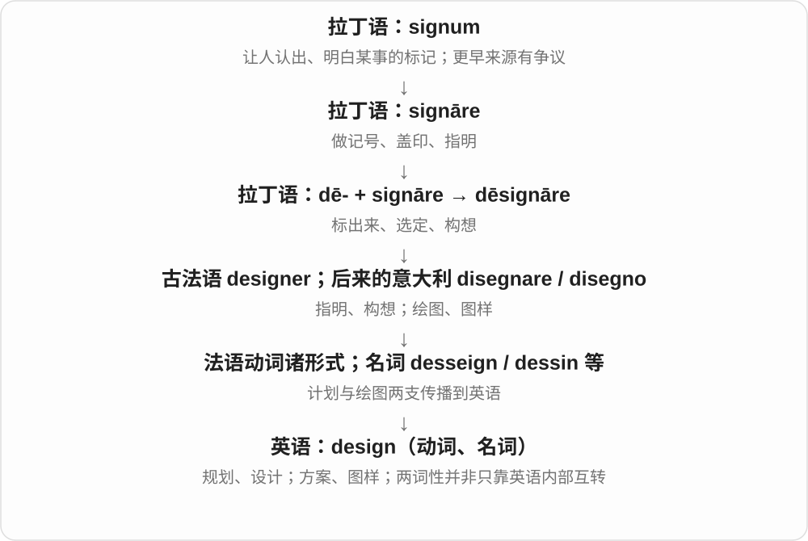

design a chair 不只画外表，还可安排结构和用途；by design 是有意的；have designs on 常暗示另有所图。

**常见搭配与例句**

design a system；a design for；by design；have designs on。

> They designed a chair that could fold flat.

他们设计了一把能折叠放平的椅子。

> The pattern was part of the original design.

这个图案是原始设计的一部分。

> The resemblance was by design, not an accident.

这种相似是有意安排的，并非巧合。

**别混淆**

draw 是画出；design 是安排一个东西怎样成形、工作，可能需要画图，也可能设计流程。

### 2. sign — 标志；迹象；招牌；手势；签名、签约

**音标**：/saɪn/

**先抓住这个画面**

sign 是让你从眼前的东西读出另一层意思：路牌指方向，乌云露出雨的迹象，签名留下“是我”的标记。

**怎么拆**

名词承接古英语 segn 和古法语 signe，两路都追到拉丁 signum；动词也有古英语与法语来源，不是所有用法都由现代名词临时转来。

**怎么变成今天的意思**

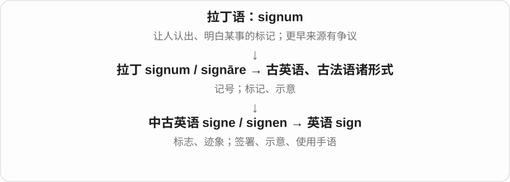

sign of 表示……的迹象；sign a form 是签表；sign with a club 是签约加入俱乐部。sign language 是有自身语法的手语，不只是随便打手势。

**常见搭配与例句**

a warning sign；a sign of change；sign a document；sign up for。

> The wet pavement was a sign of recent rain.

湿路面表明不久前下过雨。

> Please sign your name at the bottom of the form.

请在表格底部签名。

> She signed to her friend across the room.

她隔着房间用手语和朋友交流。

**别混淆**

signal 通常强调传递信息的信号；sign 范围更大，未必有人故意发出。sign 的 g 不发音。

### 3. significant — 重要的；明显的；意味深长的；统计显著的

**音标**：/sɪɡˈnɪfɪkənt/

**先抓住这个画面**

significant 最初像说“这不是空动作，它有意思”，后来也就能说“这件事有分量，值得注意”。

**怎么拆**

来自拉丁 significāns 的词干 significant-，是 significāre“表明”的现在分词；不是英语 sign 加上一个完整后缀 -ificant。

**怎么变成今天的意思**

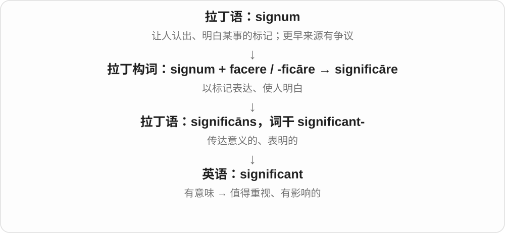

a significant change 可以是重要变化；a significant look 是意味深长的一眼。统计中的 significant 要按检验与阈值理解，不等于效果大或实际价值高。

**常见搭配与例句**

a significant difference；a significant role；a significant glance。

> The discovery was a significant step forward.

这一发现是向前迈出的重要一步。

> She gave him a significant look and closed the folder.

她意味深长地看了他一眼，合上文件夹。

> A statistically significant result is not necessarily a large effect.

统计显著的结果不一定代表很大的效应。

**别混淆**

important 直接说重要；significant 还可能强调有含义、可察觉，或具有专门的统计含义。

### 4. designed — 设计好的；旨在……的；特意安排的

**音标**：/dɪˈzaɪnd/

**先抓住这个画面**

designed 常把重点放在用途：“它被做成这样，是为了达到那个目的。”

**怎么拆**

design + -ed，过去分词；be designed to / for 引出设计目的或适用对象。

**怎么变成今天的意思**

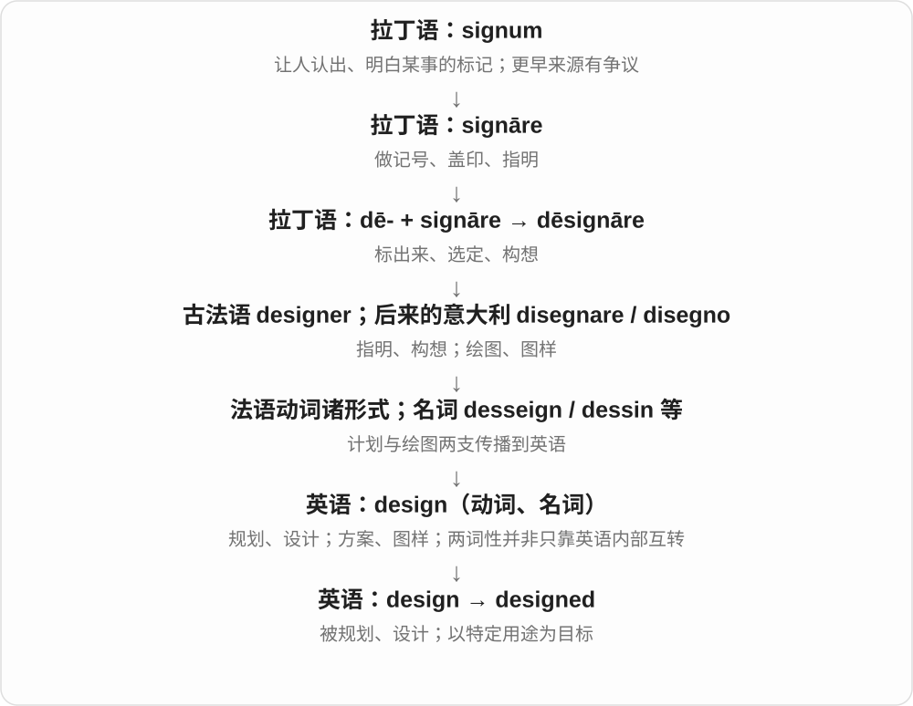

designed for children 是为儿童设计；designed to reduce noise 是旨在降噪，表达目的并不自动证明效果已经达到。

**常见搭配与例句**

designed for；designed to；carefully designed。

> The handle is designed for small hands.

这个手柄是为小手设计的。

> The changes are designed to make the form easier to complete.

这些改动旨在让表格更容易填写。

**别混淆**

intended to 和 designed to 都可说目的；后者常多一层经过规划、安排的意味。

### 5. signed — 已签名的；带符号的；用手语表达的

**音标**：/saɪnd/

**先抓住这个画面**

signed 表示已经留下签名，或者信息通过手语表达。计算机里的 signed number 则带有正负这一层标记。

**怎么拆**

sign + -ed，过去分词，也作形容词；具体含义随 sign 的分支改变。

**怎么变成今天的意思**

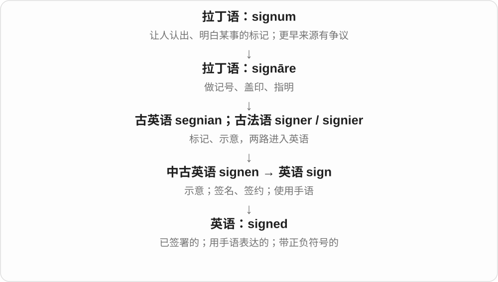

a signed copy 常是作者签名本；signed integers 是有符号整数。不能把程序里的 signed 译成“签过名”。

**常见搭配与例句**

a signed contract；a signed copy；signed integers。

> She showed me a signed copy of the novel.

她给我看了那本小说的作者签名本。

> This field stores a signed integer.

这个字段存储一个有符号整数。

**别混淆**

sealed 是封好了；signed 是签过名，文件可以签了但未封装。

### 6. signal — 信号；发信号；预示；显著的、非凡的

**音标**：/ˈsɪɡnəl/

**先抓住这个画面**

signal 是能传递一个意思的变化或标志：灯变绿告诉你可以走，手机信号承载信息。

**怎么拆**

名词经古法语与中古拉丁 signāle，最终到 signum。现代动词通常看作名词转用，也有从 signalize 缩短的分析；形容词“显著的”有法语形容词来源。

**怎么变成今天的意思**

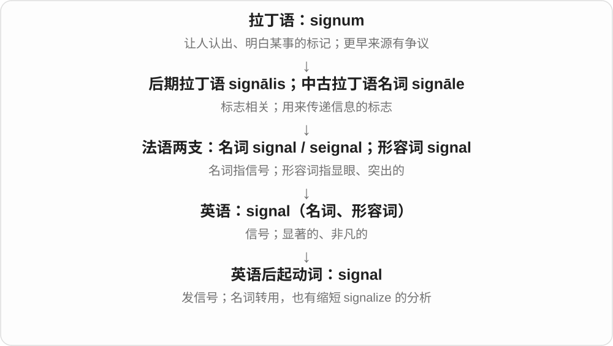

signal to someone 是向某人示意；signal a change 是表明变化；a signal achievement 是卓越成就，语气较正式。

**常见搭配与例句**

a weak signal；a traffic signal；signal to stop；a signal success。

> The radio signal became weaker inside the tunnel.

进入隧道后，无线电信号变弱了。

> She raised her hand to signal that she was ready.

她举手示意自己准备好了。

> The agreement was described as a signal achievement.

这份协议被称为一项卓越成就。

**别混淆**

sign 泛指记号或迹象；signal 更突出传递信息的作用，但也能是无意显出的征兆。

### 7. significantly — 明显地；在重要程度上；意味深长地；值得注意的是

**音标**：/sɪɡˈnɪfɪkəntli/

**先抓住这个画面**

significantly 可以把变化幅度圈出来，也可以提醒读者：“这一点特别值得留意。”

**怎么拆**

significant + -ly，英语内部派生；含义随形容词分支变化。

**怎么变成今天的意思**

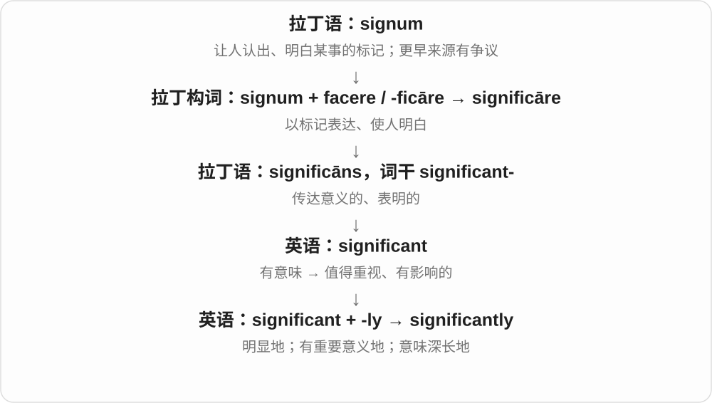

significantly lower 是明显更低；句首 Significantly, 常是值得注意的是。研究报告中也可能专指统计显著，须看作者的方法说明。

**常见搭配与例句**

significantly improve；significantly different；look significantly at。

> The new route reduced the journey time significantly.

新路线明显缩短了路程所需时间。

> Significantly, nobody challenged the figures.

值得注意的是，没有人质疑这些数字。

**别混淆**

considerably 强调程度很大；significantly 在统计语境里不能直接换成 considerably。

### 8. designer — 设计师；设计者；名牌设计的

**音标**：英 /dɪˈzaɪnə/；美 /dɪˈzaɪnər/

**先抓住这个画面**

designer 是负责想清楚“它应该怎样做、怎样呈现”的人；放在服装前，也常暗指有知名设计品牌。

**怎么拆**

design + -er；先指设计的人，后来可修饰由知名设计师或品牌推出的商品。

**怎么变成今天的意思**

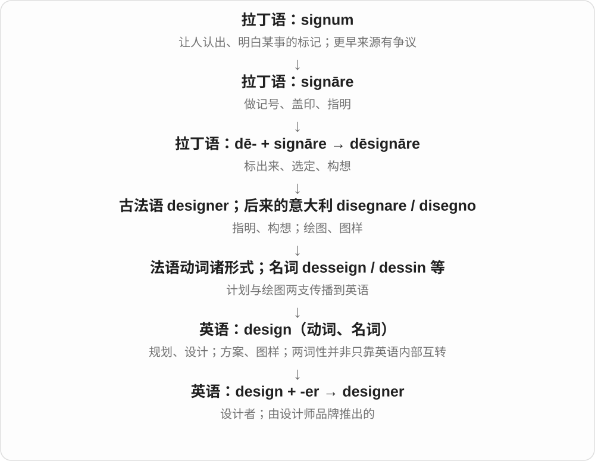

a graphic designer 是平面设计师；designer clothes 是名牌设计服装，不是所有由人设计过的衣服都这么叫。

**常见搭配与例句**

a fashion designer；a product designer；designer clothing。

> The designer tested several versions of the handle.

设计师测试了几种手柄方案。

> She buys practical clothes rather than expensive designer labels.

她买实用的衣服，不太买昂贵的设计师品牌。

**别混淆**

artist 强调艺术创作；designer 通常还要回应某种用途、使用者或项目要求，两者可重叠。

### 9. signing — 签署；签名活动；签约引进的人；手语表达

**音标**：/ˈsaɪnɪŋ/

**先抓住这个画面**

signing 把“签下名字”看成一次事件；体育报道还会把通过签约请来的人也叫 a signing。

**怎么拆**

sign + -ing，动作名词；具体可接签名、签约、手语等不同分支。

**怎么变成今天的意思**

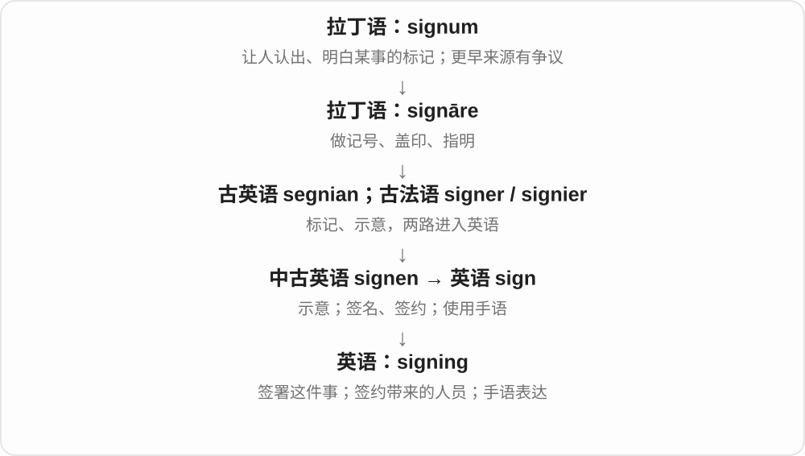

a book signing 是作者签售；a new signing 常指新引进的球员。手语语境中 signing 是使用手语，不是唱歌 singing。

**常见搭配与例句**

a book signing；the signing of an agreement；a new signing。

> The book signing attracted a long queue of readers.

签售活动吸引了排成长队的读者。

> The club introduced its latest signing on Monday.

俱乐部在周一介绍了新签下的球员。

**别混淆**

signing 的 g 不发音；singing 两个 n 周围的拼写与读音不同，意思是唱歌。

### 10. assigned — 已分配的；被指派的；指定的

**音标**：/əˈsaɪnd/

**先抓住这个画面**

assigned 像座位上已经贴了姓名，职责表上已经写明谁负责，归属不再空着。

**怎么拆**

assign + -ed，过去分词作形容词，描述分配结果。

**怎么变成今天的意思**

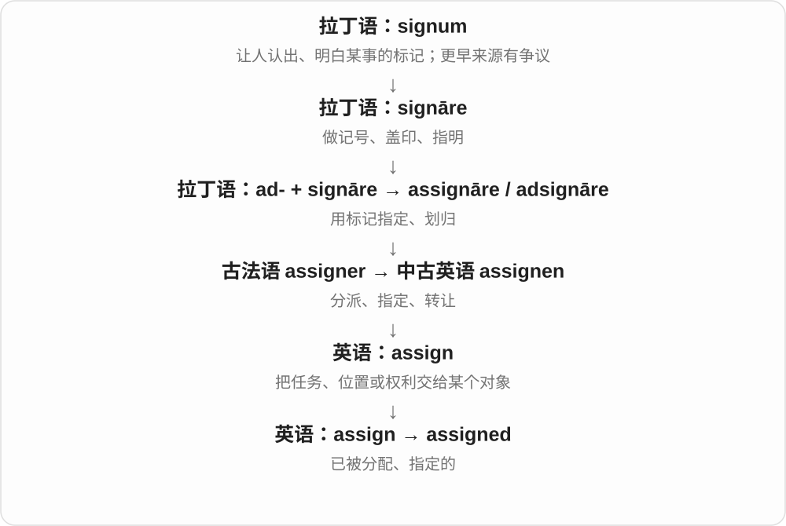

assigned seats 是指定座位；assigned reading 是老师布置的阅读材料；be assigned to a project 是被派到项目中。

**常见搭配与例句**

assigned seating；assigned tasks；assigned reading。

> Please sit in your assigned seat.

请坐在分配给你的座位上。

> I finished the assigned reading before class.

上课前我完成了布置的阅读材料。

**别混淆**

available 是可用的；assigned 表示已分派，资源仍可能暂时空闲，但已有归属。

### 11. seal — 印章；封印；密封条；封闭、密封；海豹〔另源〕

**音标**：/siːl/

**先抓住这个画面**

本族的 seal 从印在蜡上的身份标记出发：蜡既留下印，也封住信，于是意思走到密封。海豹只是碰巧同拼写。

**怎么拆**

印章义经古法语 seel 来自拉丁 sigillum，是 signum 的指小形式；动词可由名词转用或承接法语 seeler。海豹义来自古英语 seolh，另属日耳曼语来源。

**怎么变成今天的意思**

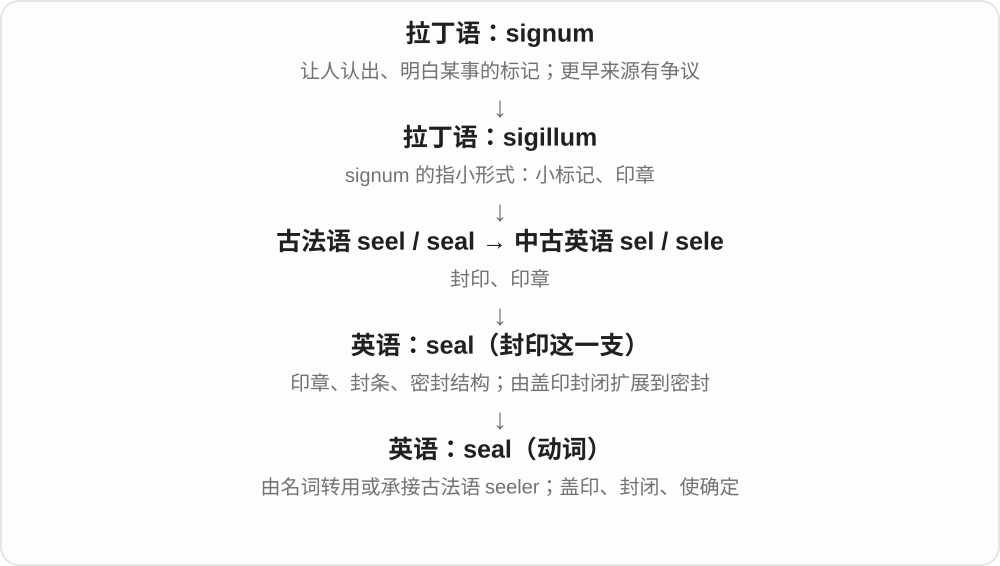

a wax seal 是蜡封；a rubber seal 是密封圈或密封条；seal an envelope 是封信；seal a deal 是把约定敲定。

**常见搭配与例句**

a broken seal；seal a container；seal the deal；my lips are sealed。

> The letter bore a red wax seal.

信上带着一枚红色蜡封。

> Please seal the container tightly after use.

使用后请把容器密封好。

> A seal rested on the rock beside the water.

一只海豹趴在水边的岩石上休息。

**别混淆**

stamp 强调盖印工具或动作；seal 常把身份确认与封闭联系起来。动物 seal 不参与本页的历史图。

### 12. designated — 指定的；划定的；被任命的

**音标**：/ˈdezɪɡneɪtɪd/

**先抓住这个画面**

designated 像某个人或位置已经在名单上被圈出来，有了明确用途或职责。

**怎么拆**

designate + -ed，来自现代动词的过去分词。

**怎么变成今天的意思**

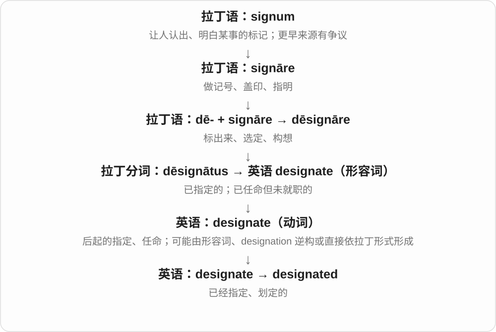

a designated area 是划定区域；designated driver 是聚会中约定不喝酒、负责开车的人，不是泛指职业司机。

**常见搭配与例句**

a designated area；the designated route；a designated driver。

> Please leave the packages in the designated area.

请把包裹放在指定区域。

> We agreed that Maya would be the designated driver.

我们约定由玛雅不喝酒、负责开车。

**别混淆**

assigned 常强调分配任务；designated 常强调身份、用途或位置被明确选定。

### 13. signature — 签名；鲜明特征；标志性的；音乐中的调号、拍号

**音标**：英 /ˈsɪɡnətʃə/；美 /ˈsɪɡnətʃər/

**先抓住这个画面**

signature 是能让人认出“这是谁”的标记。纸上的名字是一种，厨师最拿手的菜、音乐家的独特音色也可以是。

**怎么拆**

经法语 signature 或直接中古拉丁 signātūra 借入，来自 signāre 的分词词干 signāt-；不要生拆成 sign + nature。

**怎么变成今天的意思**

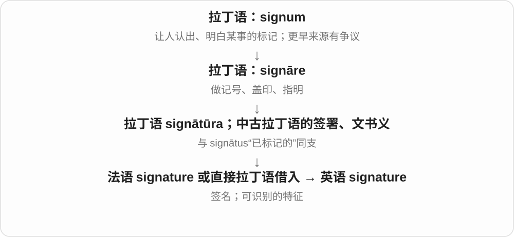

signature dish 是招牌菜，signature style 是标志性风格；音乐中 key signature、time signature 分别是调号、拍号。

**常见搭配与例句**

put your signature on；a signature dish；a signature sound。

> Her signature appears on the final page.

她的签名在最后一页。

> The restaurant is known for its signature soup.

这家餐厅以招牌汤闻名。

> The teacher explained the time signature before we played.

演奏前，老师解释了谱上的拍号。

**别混淆**

sign 可以是任意标记或动词签名；signature 作“签名”时通常是那个签出来的结果。这里 g 发 /ɡ/。

### 14. assignment — 任务；作业；分派；权利转让

**音标**：/əˈsaɪnmənt/

**先抓住这个画面**

assignment 是已经落到你名下的那份事：老师布置的作业、记者被派去做的采访，都可以是一项 assignment。

**怎么拆**

经古法语 assignement 借入，中古英语已有同形名词；现代容易对应 assign + -ment，但历史上名词有法语来源。

**怎么变成今天的意思**

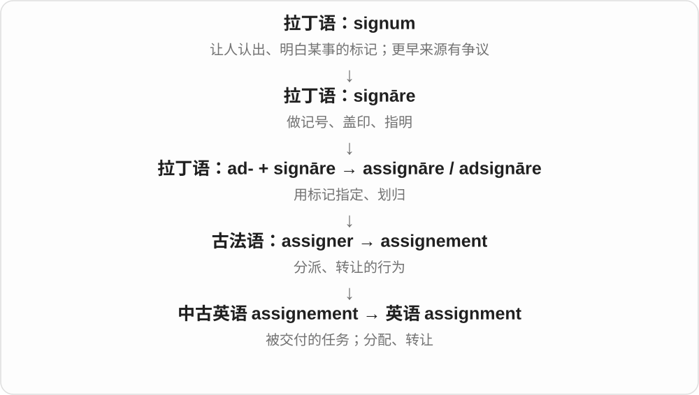

a writing assignment 是写作任务；on assignment 是受派执行工作。法律文件中的 assignment 常说转让，不是课堂作业。

**常见搭配与例句**

complete an assignment；a homework assignment；on assignment。

> The writing assignment is due on Friday.

写作作业周五交。

> The reporter is in the city on assignment.

记者正在这座城市执行采访任务。

**别混淆**

task 是一般任务；assignment 往往特别强调任务由别人分派或布置。

### 15. significance — 意义；重要性；统计显著性

**音标**：/sɪɡˈnɪfɪkəns/

**先抓住这个画面**

significance 问的是一个记号或事实“说明了什么、分量有多大”，不只是它字面长什么样。

**怎么拆**

古法语 significance 或直接拉丁 significantia 借入，经中古英语延续。它的英语记录早于 significant，不能把现代形容词当历史起点。

**怎么变成今天的意思**

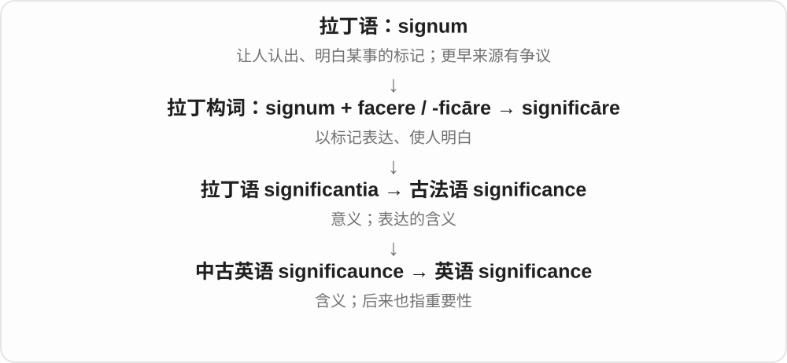

the significance of a gesture 是手势的含义；historical significance 是历史重要性；statistical significance 是专门统计概念。

**常见搭配与例句**

understand the significance；of great significance；historical significance。

> I did not understand the significance of the gesture.

我当时没明白那个手势的含义。

> The building has considerable historical significance.

这栋建筑有相当重要的历史意义。

**别混淆**

meaning 常是表达的具体意思；significance 常同时追问这个意思为什么值得关注。

### 16. sealed — 封好的；密封的；已确定的

**音标**：/siːld/

**先抓住这个画面**

sealed 像盖子合紧、接缝封住，里面的东西不能轻易跑出，外面的东西也不容易进去。

**怎么拆**

seal + -ed；本条走封印、封闭这条词源支线。

**怎么变成今天的意思**

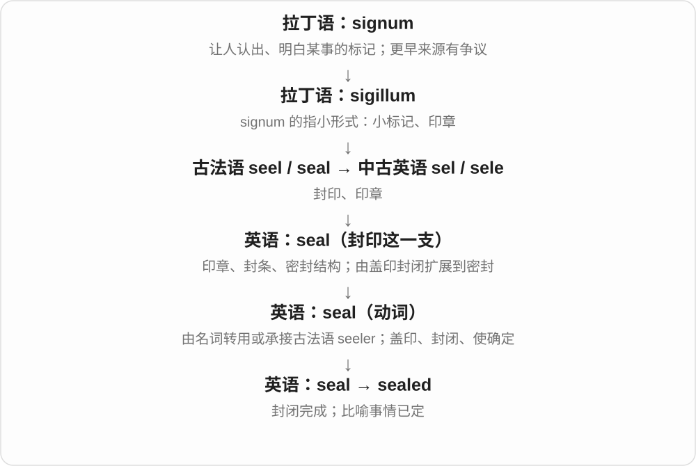

a sealed envelope 是封好的信封；sealed containers 是密封容器；fate was sealed 是命运或结局已定。

**常见搭配与例句**

a sealed envelope；a sealed container；sealed packaging。

> The samples arrived in sealed containers.

样品装在密封容器里送到了。

> She placed the sealed envelope on the desk.

她把封好的信封放到桌上。

**别混淆**

closed 只说关上；sealed 通常进一步表示封口、阻隔，或有封条等措施。

### 17. resigned — 无奈接受的；顺从的；已辞去的

**音标**：/rɪˈzaɪnd/

**先抓住这个画面**

resigned 像叹一口气后说“看来只能这样了”，已经不再强烈抗拒。

**怎么拆**

resign 的过去分词；形容词沿着“放弃抵抗、接受”这一支发展。

**怎么变成今天的意思**

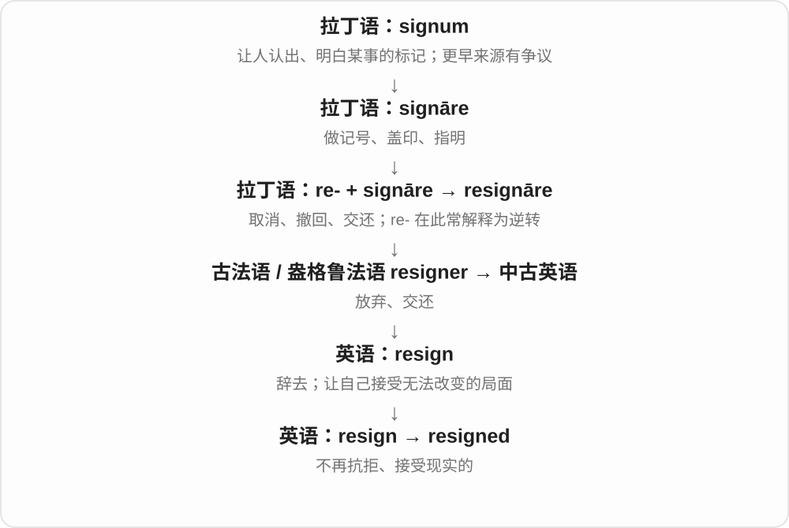

be resigned to doing something 中 to 是介词，后接名词或 -ing。a resigned smile 是无奈的笑，不是“辞职的笑”。

**常见搭配与例句**

resigned to；a resigned expression；a resigned sigh。

> She was resigned to starting again.

她已经无奈地接受了要重新开始。

> He gave a resigned smile when the lift broke down again.

电梯又坏了，他无奈地笑了笑。

**别混淆**

calm 是平静，原因很多；resigned 特别包含接受不喜欢却难以改变的情况。

### 18. resignation — 辞职；辞呈；无奈接受、顺从

**音标**：/ˌrezɪɡˈneɪʃən/

**先抓住这个画面**

resignation 的两幅画面都带“放下”：把职位交出去；或发现改变不了，放下抵抗、接受现实。

**怎么拆**

中古拉丁 resignātiō 经古法语 resignation / resignacion 或直接借入；现代对应 resign 与 -ation，但不是只从英语动词新造。

**怎么变成今天的意思**

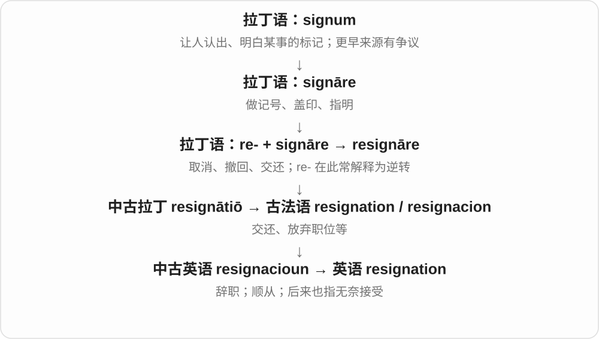

submit a resignation 是递交辞呈；accept something with resignation 是无奈接受，未必发生任何离职。

**常见搭配与例句**

a letter of resignation；announce a resignation；with resignation。

> She submitted her resignation on Monday.

她在周一递交了辞呈。

> He heard the delay announced with quiet resignation.

听到延期通知，他平静而无奈地接受了。

**别混淆**

acceptance 可以心甘情愿；resignation 往往暗含不喜欢这个结果，却认为没法改变。

### 19. resign — 辞职；辞去；放弃；使自己接受

**音标**：/rɪˈzaɪn/

**先抓住这个画面**

resign 像把原来握着的职位、权利或坚持交还出去；resign yourself to 则是在心里不再继续抗拒。

**怎么拆**

拉丁 resignāre 有取消、撤回、交还等义，经法语传入。re- 在这里常解释为逆转，不能简单理解成“再签一次”。

**怎么变成今天的意思**

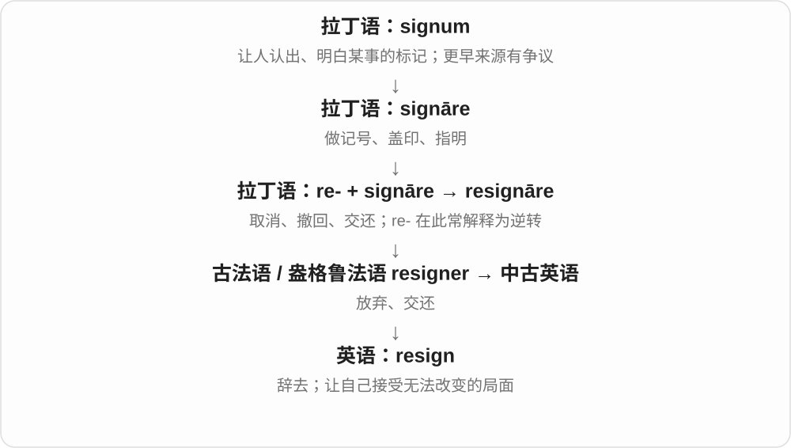

resign from a job 是辞职；resign as chair 是辞去主席职务；resign yourself to waiting 是无奈接受等待。

**常见搭配与例句**

resign from；resign as；resign oneself to。

> He resigned as chair after five years.

担任主席五年后，他辞去了职务。

> We resigned ourselves to a long wait.

我们只好接受要等很久的事实。

**别混淆**

retire 是退休；resign 是辞去职位，可以还很年轻。再次签约通常写 re-sign，读音也不同。

### 20. designing — 正在设计；有心计的、图谋算计的〔形容词〕

**音标**：/dɪˈzaɪnɪŋ/

**先抓住这个画面**

designing 平常可以是在设计；放在 a designing person 里，则是脑中盘算着怎样利用别人达到目的。

**怎么拆**

design + -ing；形容词的负面义沿着 design“暗中图谋”的分支发展，不是所有设计工作都带贬义。

**怎么变成今天的意思**

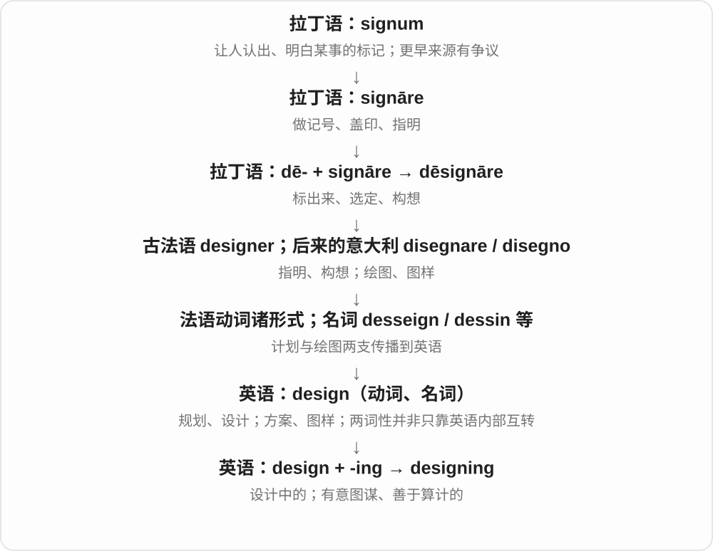

designing a bridge 是普通动词进行形式；a designing character 是文学中有心计的人物。看它是带宾语，还是在形容人。

**常见搭配与例句**

designing a product；a designing person；a designing look。

> She is designing a new playground for the school.

她正在为学校设计一个新游乐场。

> The novel presents him as a designing man who exploits his friends.

小说把他写成一个利用朋友、满腹算计的人。

**别混淆**

creative 是有创造力；designing 作性格形容词常是有心机，不能拿来赞美设计师。

### 21. designation — 指定；任命；名称、称号；划定的身份

**音标**：/ˌdezɪɡˈneɪʃən/

**先抓住这个画面**

designation 可以是给一个对象“贴上正式标签”这件事，也可以是贴上的名称或身份。

**怎么拆**

拉丁 dēsignātiō 经古法语 designacion 或直接借入，中古英语已有 designacioun；名词记录早于现代动词 designate。

**怎么变成今天的意思**

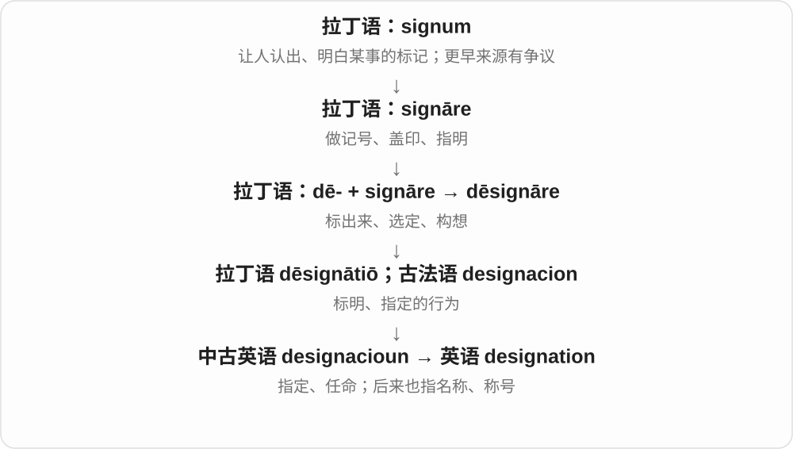

official designation 是正式名称；designation as a protected site 是被划为保护地点。语境会告诉你在说命名结果还是指定行为。

**常见搭配与例句**

official designation；designation as；a job designation。

> The building received designation as a protected landmark.

这栋建筑被列为受保护地标。

> Each model has a different letter designation.

每个型号都有不同的字母名称标识。

**别混淆**

name 是一般名字；designation 常带分类、职位或正式用途的标签感。

### 22. assign — 分配；指派；指定；转让

**音标**：/əˈsaɪn/

**先抓住这个画面**

assign 像在表格里画连线：这项任务连到这个人，这个编号连到这个物品，让归属明确下来。

**怎么拆**

拉丁 ad- + signāre → assignāre，经古法语 assigner 进入中古英语；“用标记划归”可帮助理解现代分配义。

**怎么变成今天的意思**

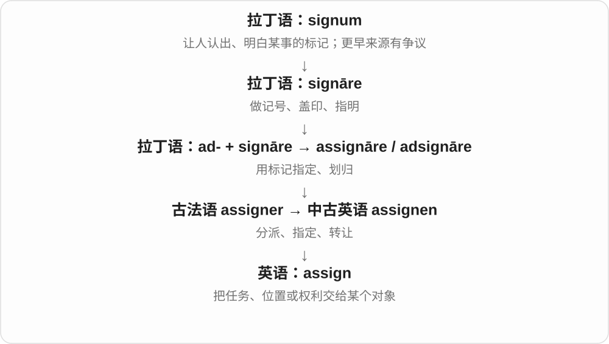

assign a task to someone，也可 assign someone a task；assign a value 是给变量赋值；正式语境还可说转让权利。

**常见搭配与例句**

assign responsibility；assign a value；assign someone to a team。

> The teacher assigned each group a different topic.

老师给每组分配了不同主题。

> The system assigns a number to each new record.

系统给每条新记录分配一个编号。

**别混淆**

designate 常强调选定身份或用途；assign 常强调把任务、资源或值分配给具体对象。

### 23. signaling — 发信号；传递信息的过程〔常见美式拼写〕

**音标**：/ˈsɪɡnəlɪŋ/

**先抓住这个画面**

signaling 是把信息从一个地方传给另一个地方的过程，既可以靠灯，也可以靠电或细胞里的分子。

**怎么拆**

signal + -ing，单 l 拼写；作动词分词，也作过程名词。

**怎么变成今天的意思**

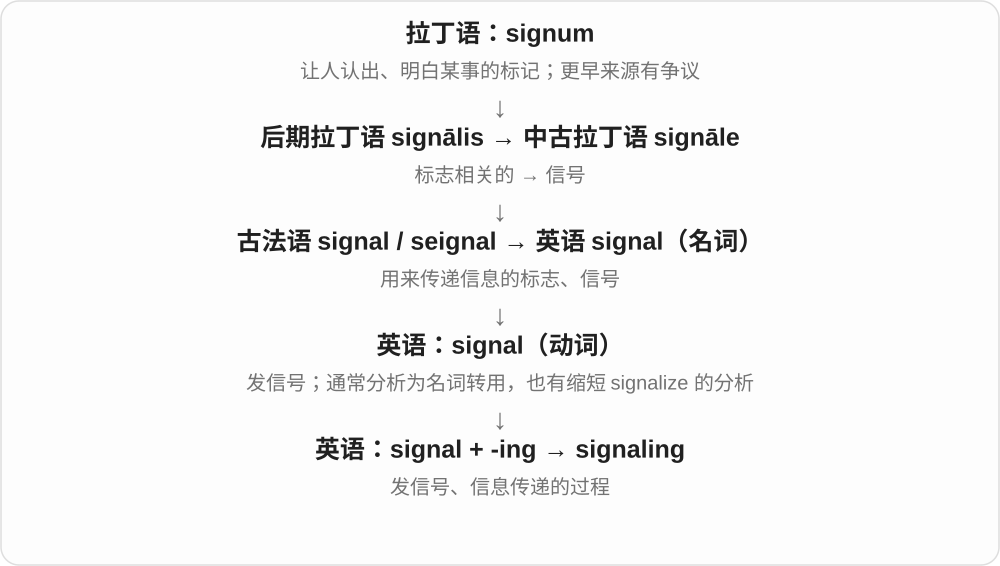

cell signaling 指细胞通过分子信号交流；signaling system 是信号系统，不要求有一块可见的牌子。

**常见搭配与例句**

a signaling system；cell signaling；signaling a turn。

> The course introduces basic ideas in cell signaling.

课程介绍细胞信号传递的基本概念。

> The driver was signaling a left turn.

司机正在打左转信号。

**别混淆**

signaling 与 signalling 是同一词的常见美英拼写差别，不是两种技术。

### 24. insignificant — 不重要的；微不足道的；很小的

**音标**：/ˌɪnsɪɡˈnɪfɪkənt/

**先抓住这个画面**

insignificant 像在很大的画面里，一个小点没有多少影响；它不是说那个点完全不存在。

**怎么拆**

in-（不）+ significant；这是英语里加否定前缀的构词。

**怎么变成今天的意思**

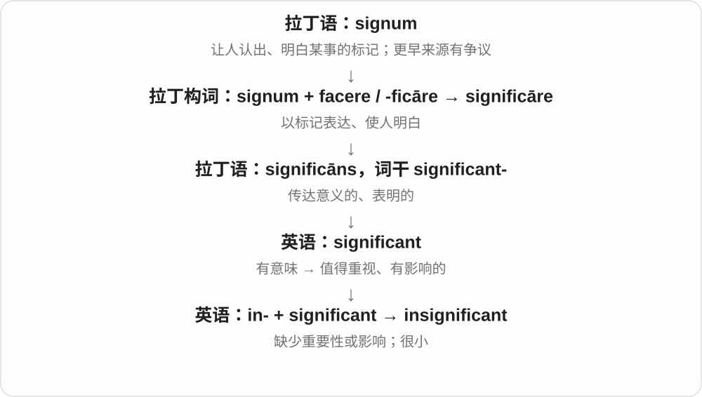

an insignificant detail 是无关紧要的细节；feel insignificant 是感觉自己微不足道。统计上“不显著”也不等于已证明完全没有效应。

**常见搭配与例句**

an insignificant amount；seem insignificant；feel insignificant。

> The error was insignificant compared with the overall cost.

与总成本相比，这个误差微不足道。

> Standing under the vast sky, I felt insignificant.

站在辽阔天空下，我感到自己十分渺小。

**别混淆**

small 说大小；insignificant 还评价它是否重要。小东西也可能非常 significant。

### 25. sealing — 封口；密封；密封用的；猎捕海豹〔另源〕

**音标**：/ˈsiːlɪŋ/

**先抓住这个画面**

本族的 sealing 是把开口或缝隙封住这件事，让水、空气或内容物不随意进出。

**怎么拆**

seal“封印、密封”+ -ing；同形的海豹捕猎义来自另一个动物名 seal，不能把那条历史混进来。

**怎么变成今天的意思**

sealing wax 是封蜡；sealing tape 是封口胶带；检查语境才能辨别是否在讨论 seal“海豹”的行业史。

**常见搭配与例句**

sealing wax；sealing tape；the sealing of a joint。

> The worker applied sealing tape around the joint.

工人在接缝周围贴上了密封胶带。

> The display includes a stick of traditional sealing wax.

展品中有一根传统封蜡。

**别混淆**

sealing /ˈsiːlɪŋ/ 与 ceiling“天花板”同音；拼写与来源不同。

### 26. redesign — 重新设计；改版；重新设计的方案

**音标**：/ˌriːdɪˈzaɪn/

**先抓住这个画面**

redesign 像把旧图纸重新摊开，调整布局、结构或功能，让它更适合新的需要。

**怎么拆**

re-（重新）+ design，英语内部构词，作动词也作名词。

**怎么变成今天的意思**

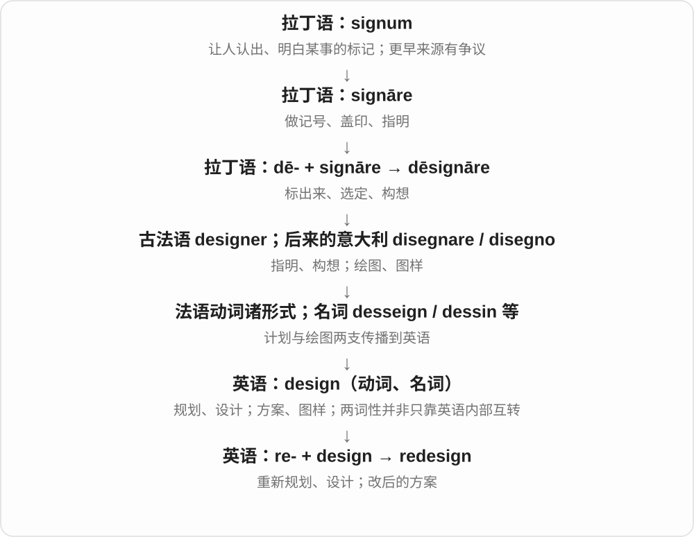

可以小范围调整，也可以大改，不必全部推倒重来。a website redesign 指网站改版。

**常见搭配与例句**

redesign a layout；undergo a redesign；a complete redesign。

> The team redesigned the menu to make prices easier to find.

团队重新设计了菜单，让价格更容易找到。

> The redesign gave the room more storage space.

重新设计后，房间有了更多储物空间。

**别混淆**

repair 是修理坏处；redesign 是改变设计本身，旧东西即使没坏也可能需要重设计。

### 27. signalling — 发信号；信号系统或过程〔常见英式拼写〕

**音标**：/ˈsɪɡnəlɪŋ/

**先抓住这个画面**

signalling 可以是一连串协调动作：让后方收到“这里能通过”，让另一端知道“现在开始”。

**怎么拆**

signal + -ing，双写 l 的英式常见形式；与 signaling 意思相同。

**怎么变成今天的意思**

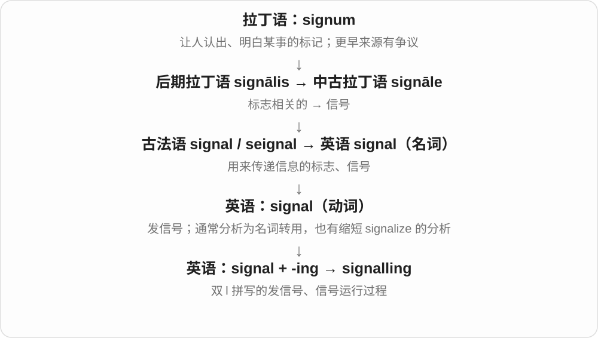

railway signalling 可以指铁路信号技术及系统；social signalling 则是行为向别人传达身份、意图等信息。

**常见搭配与例句**

railway signalling；signalling equipment；a signalling fault。

> A signalling fault delayed several trains.

信号系统故障让几班列车延误。

> The sailor practised signalling with flags.

水手练习用旗语发信号。

**别混淆**

signage 是牌子和标识的整体；signalling 是信息如何被发出、传递，范围不限于牌子。

### 28. designate — 指定；命名；任命；已任命待就职的

**音标**：动词 /ˈdezɪɡneɪt/；形容词 /ˈdezɪɡnət/

**先抓住这个画面**

designate 像在地图或名单上圈出一个：“这个地点作出口，这个人负责，这个名称就这样定。”

**怎么拆**

形容词借自拉丁分词 dēsignātus；动词更晚，可能由形容词转用、designation 逆构或拉丁分词形成，不是直接由现代 design 随便加 -ate。

**怎么变成今天的意思**

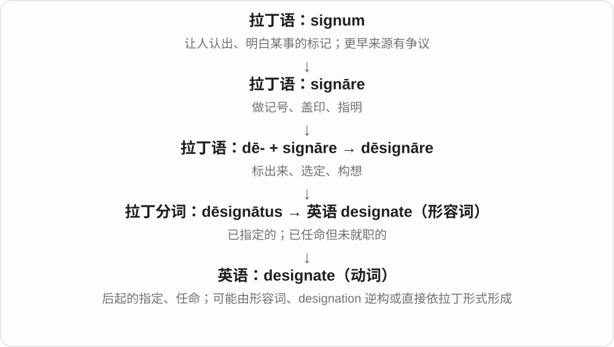

designate someone as leader 是指定为负责人；designate an area for parking 是划作停车区。形容词放在职位后，如 director designate，表示尚未就职。

**常见搭配与例句**

designate as；designate for；designate someone to do；director designate。

> They designated the east gate as the main entrance.

他们指定东门为主入口。

> The director designate will take office in June.

这位候任主任将在六月就职。

**别混淆**

design 是规划怎样做；designate 是指出、指定哪一个。二者同源，但今天不能互换。

### 29. ensign — 舰旗；旗帜；海军少尉

**音标**：英 /ˈensaɪn/；美 /ˈensən/

**先抓住这个画面**

ensign 最初是让人辨认队伍或身份的旗号，后来也成为特定军官军衔的名称。

**怎么拆**

拉丁 īnsignia 经古法语 enseigne、中古英语 ensigne 传入，与较晚直接借入的 insignia 是同源异形词。

**怎么变成今天的意思**

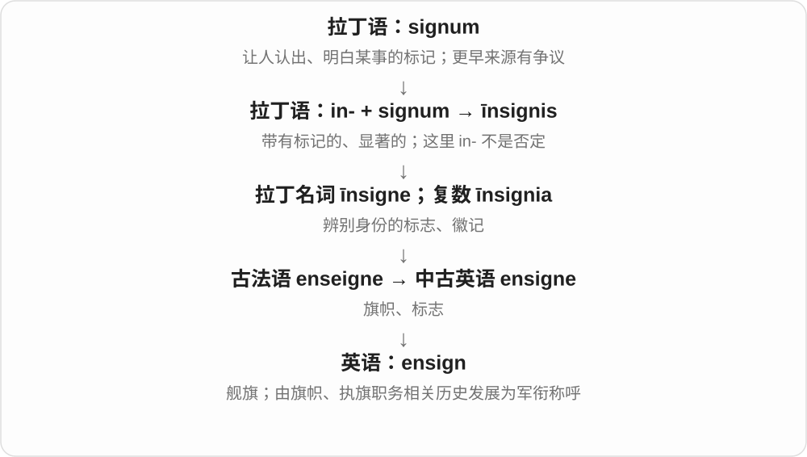

a naval ensign 可指舰旗；an ensign 在美国海军语境可指少尉。英美常见读音不同，不能只看拼写按 sign 读。

**常见搭配与例句**

fly an ensign；the naval ensign；a newly commissioned ensign。

> The ship flew a naval ensign at the stern.

舰船在船尾升起了舰旗。

> The young ensign joined the crew after training.

那名年轻海军少尉受训后加入了舰员队伍。

**别混淆**

flag 是旗帜总称；ensign 通常有国家、军队或舰船身份标识等特定背景。

### 30. signify — 表示；意味着；表明

**音标**：/ˈsɪɡnɪfaɪ/

**先抓住这个画面**

signify 像在记号和意思之间搭桥：红灯这个记号，告诉你“停”。

**怎么拆**

经古法语 signifier、拉丁 significāre；其中 signum 是记号，-ficāre 连到 facere“做、使”。

**怎么变成今天的意思**

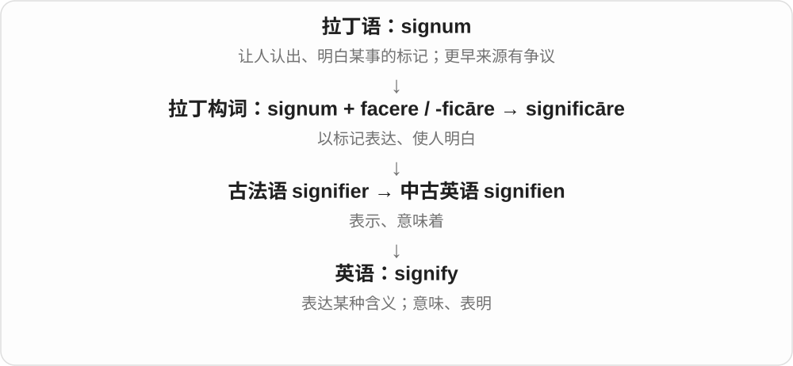

What does it signify? 是它意味着什么；signify agreement 是表示同意；signify that 可以引出所表明的内容。

**常见搭配与例句**

signify a change；signify agreement；signify that。

> In this diagram, a dotted line signifies a proposed route.

在这幅图中，虚线表示拟议线路。

> Her nod signified that she agreed.

她点头表示同意。

**别混淆**

mean 更日常、更广；signify 常突出某个动作、符号或事实作为含义的标志。

### 31. signage — 标识牌；标识系统〔总称〕

**音标**：/ˈsaɪnɪdʒ/

**先抓住这个画面**

signage 把一个地方所有指示牌、名称牌等看作一套系统，像车站里从入口一直带你走到站台的那些标识。

**怎么拆**

sign + -age，英语中把相关标志看作整体的构词。

**怎么变成今天的意思**

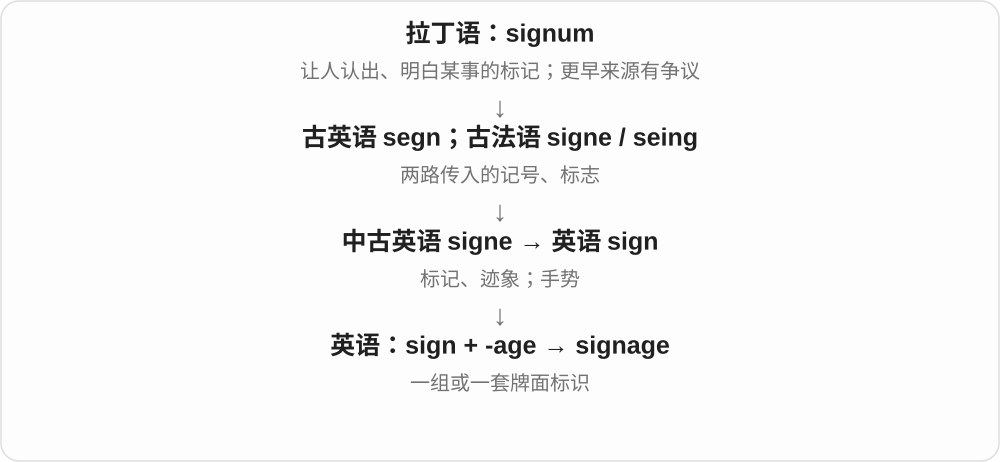

通常不可数：new signage、clear signage。一个具体的牌子一般说 a sign，不说 a signage。

**常见搭配与例句**

clear signage；directional signage；digital signage。

> The museum installed new signage near the entrance.

博物馆在入口附近安装了新标识。

> Clear signage makes the station easier to navigate.

清楚的标识让人在车站里更容易找路。

**别混淆**

signalling 是发出、传递信号的过程；signage 是标识的整体，可以是静态牌子或电子屏。

### 32. unsigned — 未签名的；尚未签约的；无符号的

**音标**：/ˌʌnˈsaɪnd/

**先抓住这个画面**

unsigned 像签名栏空着；在音乐圈，也可能是乐队还没和唱片公司签约。

**怎么拆**

un-（不、未）+ signed，英语内部构词。

**怎么变成今天的意思**

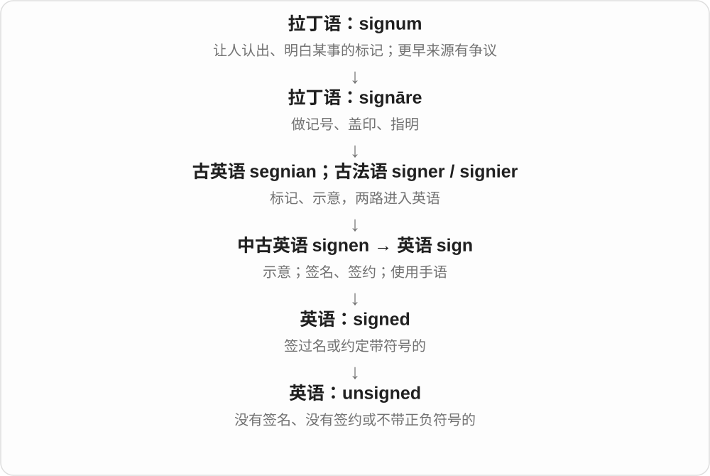

unsigned document 指未签文件；unsigned band 指未签约乐队；unsigned integer 指无符号整数，通常表示非负整数。

**常见搭配与例句**

an unsigned letter；unsigned artists；an unsigned integer。

> The editor received an unsigned letter.

编辑收到了一封未署名的信。

> The festival gives unsigned bands a chance to perform.

音乐节给未签约的乐队提供演出机会。

**别混淆**

anonymous 是身份未公开；unsigned 只说没有署名，身份仍可能从内容看出来。

### 33. insignia — 徽记；身份、军衔或荣誉标志

**音标**：/ɪnˈsɪɡniə/

**先抓住这个画面**

insignia 像制服上的条纹和徽章，一眼告诉别人“他属于哪个组织、是什么身份”。

**怎么拆**

借拉丁 īnsignia，是 īnsigne“徽记”的复数；其 in- 与 signum 组合表示带有标记，不是“不”的前缀。

**怎么变成今天的意思**

历史上是复数，现代英语也可当单数，并有 insignias 复数。日常最常见军队、组织、职位的徽记。

**常见搭配与例句**

military insignia；rank insignia；an official insignia。

> The uniform carries the unit’s insignia on the shoulder.

制服肩部带着该单位的徽记。

> The display explains the meaning of different rank insignia.

展板解释了不同军衔标志的含义。

**别混淆**

insignificant 的 in- 是否定；insignia 的 in- 不是，所以不能把 insignia 记成“没有标记”。

### 34. consignment — 一批托运货物；托运；寄售

**音标**：/kənˈsaɪnmənt/

**先抓住这个画面**

consignment 可以是交付这件事，也可以直接是那一批被交出去的货，像一张运单对应的一批箱子。

**怎么拆**

consign + -ment；英语早义与盖印确认有关，后来随动词发展出交付、寄售和整批货物义。

**怎么变成今天的意思**

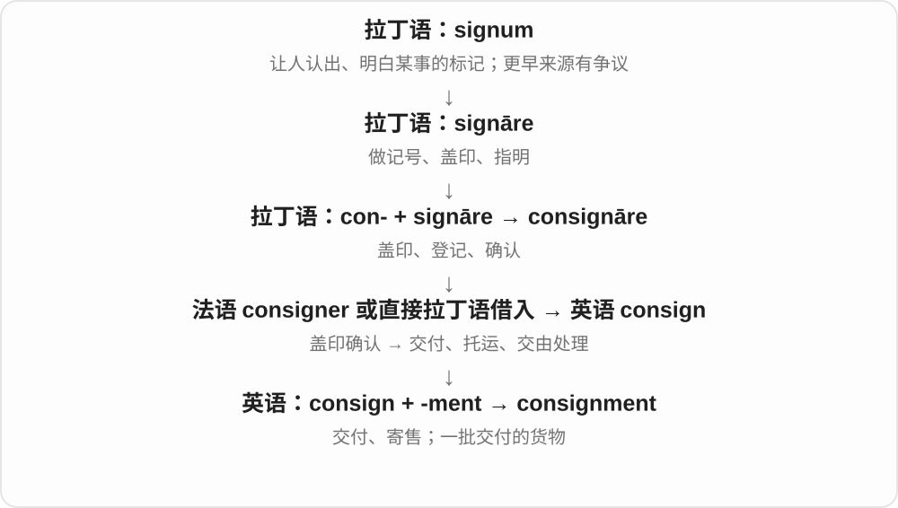

a consignment of books 是一批书；on consignment 指寄售，通常先交店铺代卖，不等于店铺已买下全部货物。

**常见搭配与例句**

a consignment of；goods on consignment；a consignment note。

> A consignment of books arrived this morning.

一批书今天早上运到了。

> The shop sells local crafts on consignment.

这家店寄售本地手工艺品。

**别混淆**

shipment 强调装运的一批货；consignment 也可突出交给特定接收方或寄售安排。

### 35. signatory — 正式文件的签署人、签署方；已签署的

**音标**：英 /ˈsɪɡnətri/；美 /ˈsɪɡnətɔːri/

**先抓住这个画面**

signatory 是正式协议上留下名字、作为签署方出现的人或机构，也可以是一国。

**怎么拆**

由拉丁 signātōrius“盖印用的”借入，早期作形容词；后来发展出签署人的名词义和现代签署方用法。

**怎么变成今天的意思**

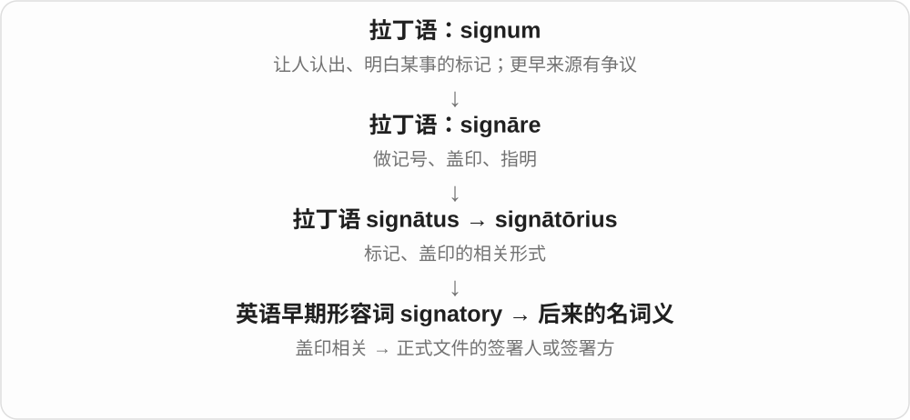

a signatory to an agreement 常用 to；signatory countries 是签署国。这里讲词义，签署之后的具体权利义务由文件与制度规定。

**常见搭配与例句**

a signatory to；signatory states；an original signatory。

> The organization became a signatory to the declaration.

该组织成为这份声明的签署方。

> Representatives of the signatory countries attended the meeting.

签署国的代表出席了会议。

**别混淆**

signer 可以是一般签名的人；signatory 特别常见于条约、声明与正式协议。

### 36. reassignment — 重新分派；调任；重新分配

**音标**：/ˌriːəˈsaɪnmənt/

**先抓住这个画面**

reassignment 是安排表被重新连过线这件事：负责人、岗位或资源归属发生了变化。

**怎么拆**

re- + assignment；也可与 reassign + -ment 对照，是英语内部构词。

**怎么变成今天的意思**

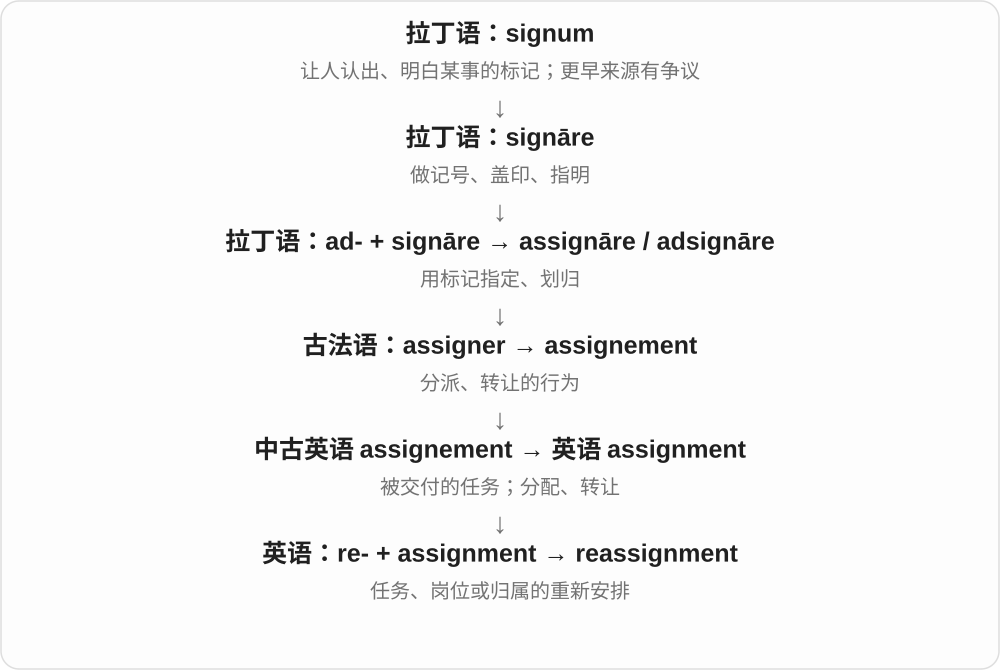

request reassignment 是请求调任或改派；reassignment of duties 是重新分配职责。

**常见搭配与例句**

a temporary reassignment；reassignment of duties；request reassignment。

> She requested reassignment to a different project.

她申请调到另一个项目。

> The timetable reflects a reassignment of teaching duties.

课表反映了教学任务的重新分配。

**别混淆**

dismissal 是解雇或撤职；reassignment 通常只说换任务、换归属，不自动等于被开除。

### 37. signified — 被表达的；所指〔符号学〕

**音标**：/ˈsɪɡnɪfaɪd/

**先抓住这个画面**

signified 是符号让你联想到的概念：看到 tree 这个词，脑中出现“树”这一类东西的概念。

**怎么拆**

signify 的过去分词，作名词时表示被表达的概念；术语用法对应法语 signifié。

**怎么变成今天的意思**

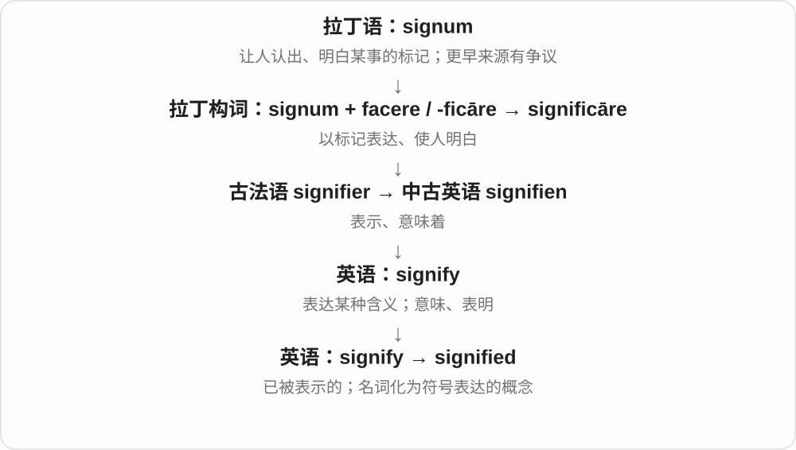

the signified 是术语中的概念内容。不要直接把它等同于现实中的具体对象；分析框架可能另用 referent 指实际所指对象。

**常见搭配与例句**

the signifier and the signified；the concept signified。

> The diagram separates the signifier from the signified.

这张图把能指和所指分开画出。

> In this example, the signified is the concept of a tree.

在这个例子里，所指是树的概念。

**别混淆**

signifier 是能指、表达形式；signified 是所指、概念内容。成对理解比只背两条中文翻译更清楚。

### 38. signer — 签名者；使用手语的人

**音标**：英 /ˈsaɪnə/；美 /ˈsaɪnər/

**先抓住这个画面**

signer 是做 sign 这个动作的人：拿笔签名的人，或用手语交流的人。

**怎么拆**

sign + -er，表示执行该动作的人。

**怎么变成今天的意思**

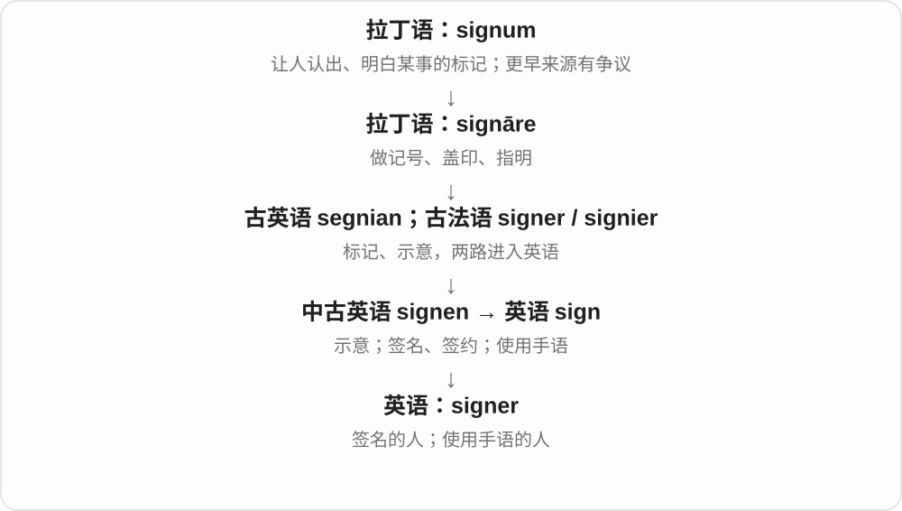

the signer of a letter 指信件署名者；a fluent signer 指手语流利的人。这个词本身不保证其职业是手语翻译。

**常见搭配与例句**

the signer of a document；a fluent signer；a native signer。

> The signer added the date beside her name.

签名者在姓名旁写上了日期。

> The video features two fluent signers in conversation.

视频展示了两位手语流利的人在交谈。

**别混淆**

signatory 更常说正式协议的签署人或签署方；signer 更一般。不要和 singer“歌手”混淆。

### 39. signet — 小印章；图章戒指上的印章

**音标**：/ˈsɪɡnət/

**先抓住这个画面**

signet 像把个人标记缩到一枚小印章上，可以戴在戒指上，随时压进封蜡留下身份印记。

**怎么拆**

借古法语 signet，是 signe“标志”的指小形式；现代不要按 sign /saɪn/ 直接加 -et 读。

**怎么变成今天的意思**

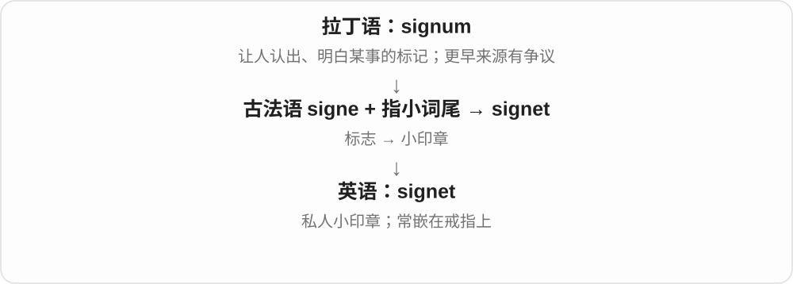

a signet ring 是图章戒指；历史文献中 signet 也可能指权威人士使用的特定印章。

**常见搭配与例句**

a signet ring；press a signet into wax；a royal signet。

> The ring carried a signet engraved with the family emblem.

戒指上有一枚刻着家族徽记的小印章。

> He pressed the signet into the warm wax.

他把小印章压进温热的蜡里。

**别混淆**

cygnet 是幼天鹅，与 signet 同音但不同源；seal 的印章义范围更广。

### 40. sealer — 封口机；密封材料；封口者；猎海豹者〔另源〕

**音标**：英 /ˈsiːlə/；美 /ˈsiːlər/

**先抓住这个画面**

sealer 是帮你把口封上的人、工具或材料：比如把袋口封紧的机器，或封住木材表面的涂层。

**怎么拆**

seal“封闭”+ -er；另有从动物 seal 形成的猎海豹者、猎海豹船等义，不属于标记这一支。

**怎么变成今天的意思**

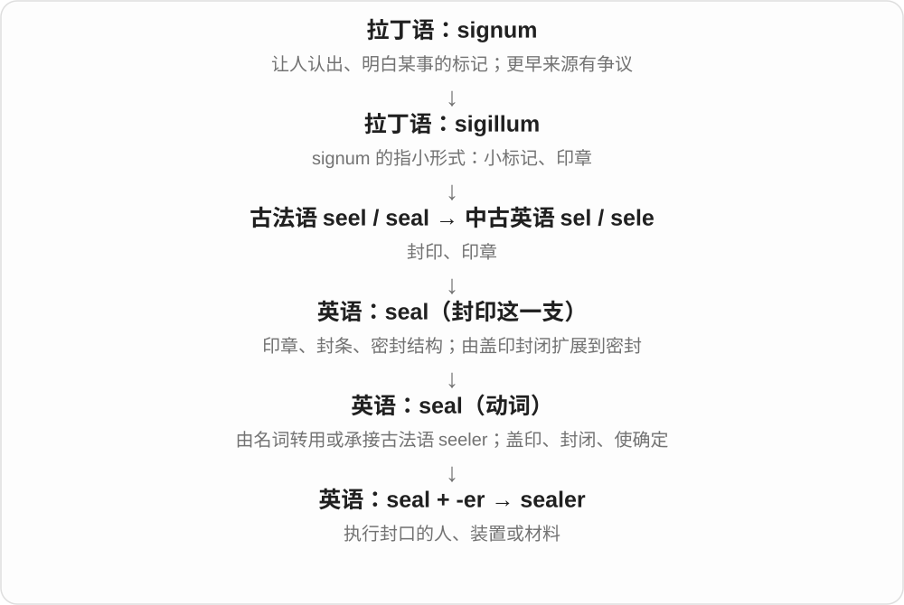

a vacuum sealer 是真空封口机；wood sealer 是木材封闭保护材料。这个词不只指一个人。

**常见搭配与例句**

a vacuum sealer；wood sealer；a bag sealer。

> The café uses a bag sealer for its coffee beans.

咖啡馆用封口机封装咖啡豆袋。

> She applied a clear sealer to the wooden surface.

她在木面上涂了一层透明封闭涂层。

**别混淆**

sealant 特别常指填缝密封材料；sealer 还可以指机器，二者不能在所有场景互换。

### 41. sealant — 密封胶；密封材料

**音标**：/ˈsiːlənt/

**先抓住这个画面**

sealant 像填进缝里的一层屏障，把水和空气原本能钻过的空隙堵住。

**怎么拆**

seal + -ant，英语构词，用来命名发挥密封作用的材料。

**怎么变成今天的意思**

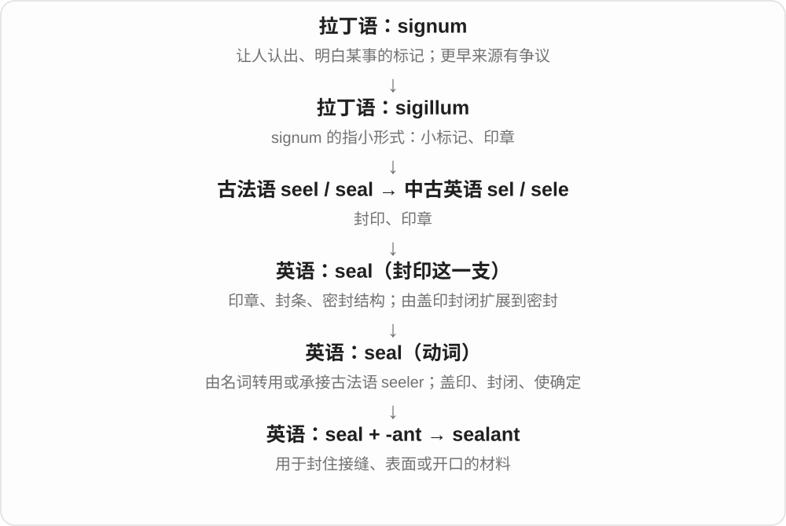

常见于窗框、浴室接缝等；具体材料和使用方式因用途不同，不是所有 sealant 都是同一种胶。

**常见搭配与例句**

apply sealant；silicone sealant；a waterproof sealant。

> The old sealant around the window had cracked.

窗户周围的旧密封胶开裂了。

> They used a flexible sealant along the joint.

他们沿接缝使用了一种柔性密封材料。

**别混淆**

adhesive 重点是把东西粘在一起；sealant 重点是封住空隙，有些产品会兼具两种功能。

### 42. insignificance — 不重要；微不足道；渺小

**音标**：/ˌɪnsɪɡˈnɪfɪkəns/

**先抓住这个画面**

insignificance 把“不占多少分量”的状态当名词谈，像大山旁边的一粒石子。

**怎么拆**

in-（不）+ significance，英语否定派生。

**怎么变成今天的意思**

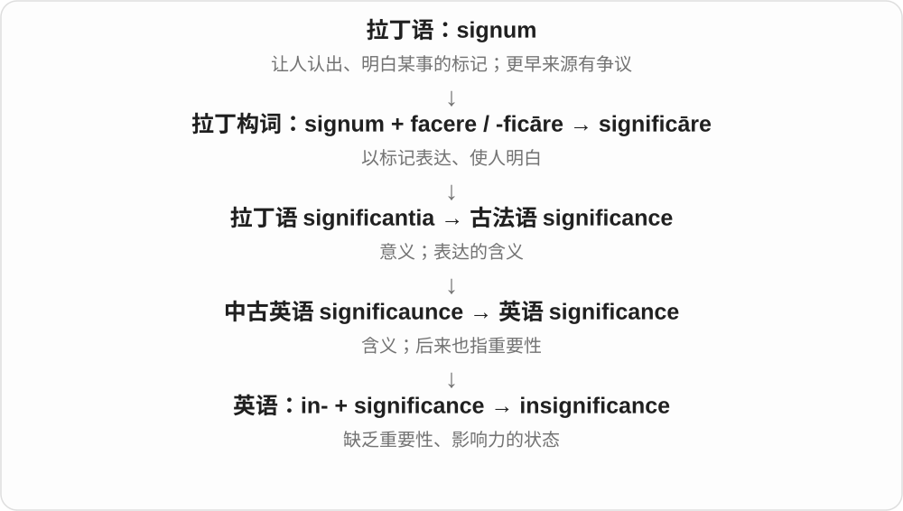

pale into insignificance 是相比之下显得微不足道；a sense of insignificance 是觉得自己渺小。

**常见搭配与例句**

pale into insignificance；a sense of insignificance；relative insignificance。

> Our earlier difficulties paled into insignificance beside the new crisis.

与新危机相比，先前的困难显得微不足道。

> The vast landscape gave him a sense of his own insignificance.

广阔的景色让他感到自己的渺小。

**别混淆**

invisibility 是看不见；insignificance 是被认为不重要，不一定真的不显眼。

### 43. consign — 交付；托运；委托销售；把……置于某种处境

**音标**：/kənˈsaɪn/

**先抓住这个画面**

consign 像给物品盖印、登记，再交到别人手上处理；比喻时也能把旧计划“送进遗忘角落”。

**怎么拆**

拉丁 consignāre“盖印、登记”，由 con- + signāre 构成，经法语或直接借入；早期确认义逐步转到交付与委托。

**怎么变成今天的意思**

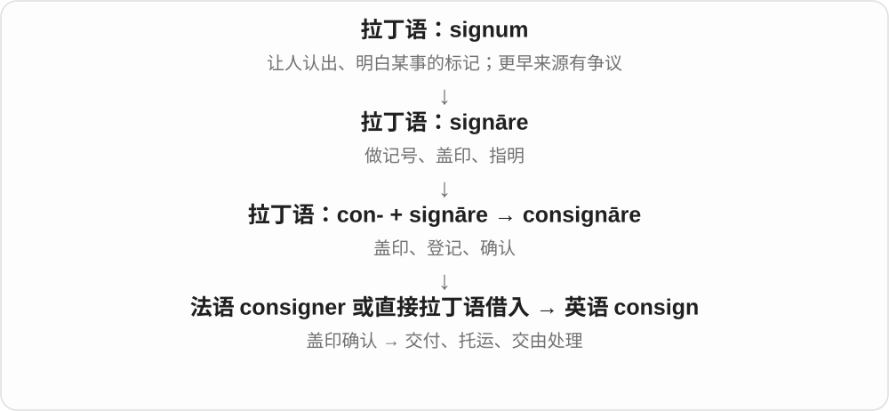

consign goods to a dealer 是交给商人处理或代售；consign to oblivion 是使被遗忘。对象可以是实际货物，也可以是计划、记忆。

**常见搭配与例句**

consign goods to；consign to oblivion；consign to the past。

> The artist consigned several paintings to the gallery.

艺术家把几幅画交给画廊代售。

> The abandoned plan was consigned to the archives.

被放弃的计划被收进档案，搁置了起来。

**别混淆**

send 只是送出；consign 常含正式交给某人保管、运输、出售或处理的意味。

### 44. signpost — 路标；指示牌；标出方向；提示文章结构

**音标**：英 /ˈsaɪnpəʊst/；美 /ˈsaɪnpoʊst/

**先抓住这个画面**

signpost 像岔路口那根带箭头的杆：告诉你往哪走。文章里的提示句也能像路标一样帮读者跟上。

**怎么拆**

sign + post，post 在这里是柱、杆；名词又转为动词“立标指路”，并引申到组织信息。

**怎么变成今天的意思**

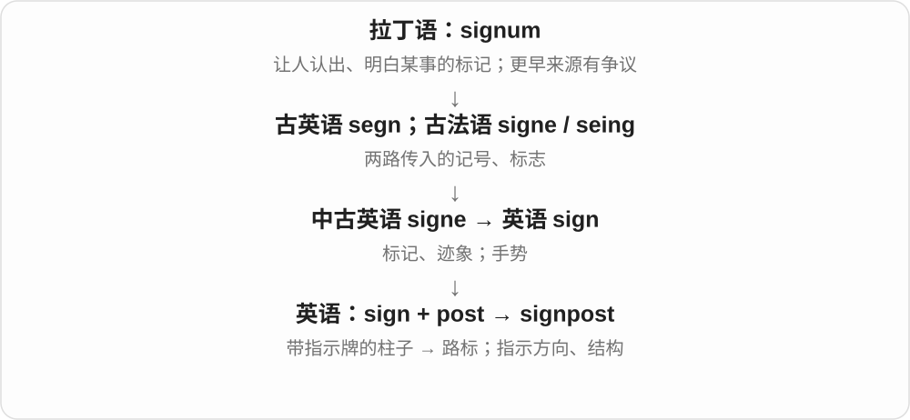

follow the signposts 是顺着路标走；signpost an argument 是把论证的方向和层次说明白。

**常见搭配与例句**

a signpost to；follow the signposts；signpost the main points。

> A signpost pointed us towards the lake.

路标指引我们往湖边走。

> The introduction signposts the main stages of the argument.

引言交代了论证的主要步骤。

**别混淆**

signboard 只强调板上有标识；signpost 更突出指引到某处或某个论述方向。

### 45. sigil — 符印；神秘符号；特定标记

**音标**：/ˈsɪdʒɪl/，也 /ˈsɪdʒəl/

**先抓住这个画面**

sigil 像用一幅压缩的小图形代表身份、名称或力量；在奇幻作品里，常是一眼能认出的符印。

**怎么拆**

直接借拉丁 sigillum“小标记、印章”，与经过法语音变而来的 seal 同源异形；不是从英语 seal 改拼写。

**怎么变成今天的意思**

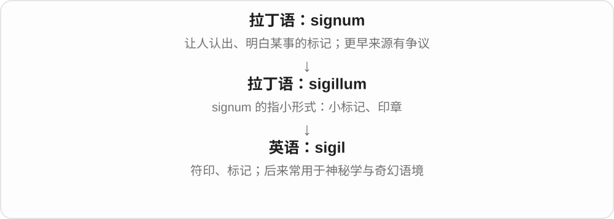

现代常见于奇幻、神秘学讨论；某些编程语言也用 sigil 指加在名称前、提示类型等作用的符号。

**常见搭配与例句**

a magical sigil；draw a sigil；a family sigil。

> The fantasy novel gives each family a different sigil.

这部奇幻小说为每个家族设置了不同的符印。

> The manuscript shows a circular sigil beside the name.

手稿在名字旁画了一个圆形符印。

**别混淆**

symbol 是符号总称；sigil 常是带身份、神秘传统或特定技术用途的图形标记。

### 46. unassigned — 尚未分配的；未指派的

**音标**：/ˌʌnəˈsaɪnd/

**先抓住这个画面**

unassigned 像任务表中“负责人”那一栏还是空白，等待有人接手。

**怎么拆**

un-（未、不）+ assigned；中古英语已有相应否定形式。

**怎么变成今天的意思**

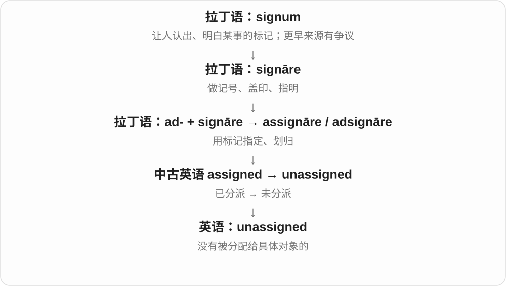

unassigned tasks 是未分派任务；unassigned seats 是没有指定给特定人的座位。

**常见搭配与例句**

an unassigned task；unassigned seats；remain unassigned。

> Three tasks remain unassigned on the board.

看板上还有三项任务未分派。

> Passengers could choose any unassigned seat.

乘客可以选择任何未指定的座位。

**别混淆**

unfinished 是尚未完成；unassigned 是尚未分派，两个状态不是一回事。

### 47. reassign — 重新分配；改派

**音标**：/ˌriːəˈsaɪn/

**先抓住这个画面**

reassign 像把表格里的旧连线擦掉，换一个人接任务，或让原来的人去做别的工作。

**怎么拆**

re-（重新）+ assign，英语内部构词。

**怎么变成今天的意思**

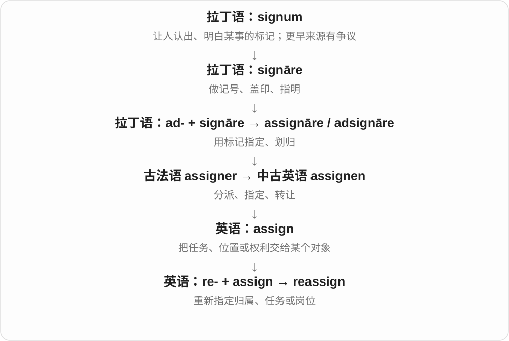

reassign a task to someone 是把任务改派给某人；reassign someone to another team 是把某人调到另一组。

**常见搭配与例句**

reassign duties；reassign to；reassign a case。

> The manager reassigned the task to another team.

经理把任务改派给了另一组。

> She was reassigned to the research department.

她被调到研究部门。

**别混淆**

replace 强调换掉；reassign 强调重新安排归属，原来的人可能仍在组织里。

### 48. designee — 被指定的人；获任命的人

**音标**：/ˌdezɪɡˈniː/

**先抓住这个画面**

designee 是名单上被圈中的那个人：不是作决定者，而是被选来承担某个角色的人。

**怎么拆**

designate 去掉 -ate 后接 -ee，表示承受指定或任命的人；可直接联系 designate 这一词干变化。

**怎么变成今天的意思**

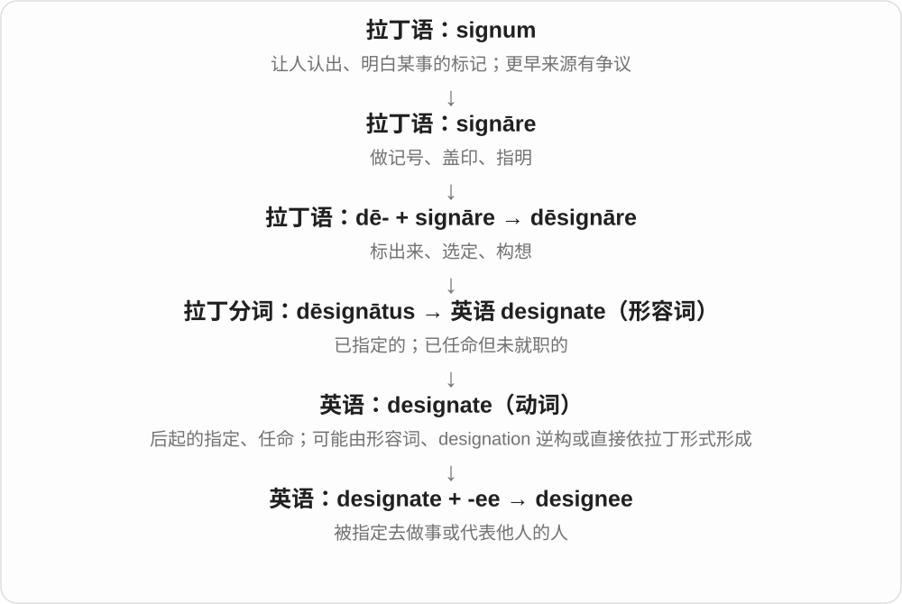

常见于正式程序文字，如 the director or a designee，意思是主任本人或其指定代表。

**常见搭配与例句**

the chair’s designee；an official designee；the director’s designee。

> The chair or her designee will attend the meeting.

主席或她指定的代表将出席会议。

> Please give the documents to the official designee.

请把文件交给正式指定的人员。

**别混淆**

nominee 可能只是获提名、仍待批准；designee 通常表示已被指定，具体职权仍由语境确定。

### 49. signposted — 设有路标的；已清楚指明的

**音标**：英 /ˈsaɪnpəʊstɪd/；美 /ˈsaɪnpoʊstɪd/

**先抓住这个画面**

signposted 像路上的箭头都已经摆好，来的人能够知道该转向哪里。

**怎么拆**

signpost + -ed，动词过去分词；可用于道路，也可比喻内容的指引。

**怎么变成今天的意思**

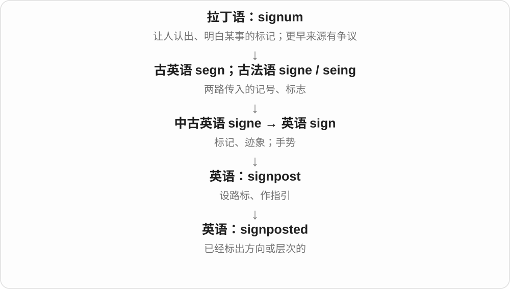

clearly signposted 可说路线，也可说文章结构；well signposted 是路标、提示做得清楚。

**常见搭配与例句**

clearly signposted；a signposted route；well signposted。

> The walking route is clearly signposted from the station.

从车站开始，步行路线就有清楚的路标。

> Each stage of the report is carefully signposted.

报告对每个阶段都作了清楚的提示。

**别混淆**

signed 也可在道路语境指有标牌；signposted 更明确突出方向指引，日常不表示签了名。

### 50. consignor — 发货人；托运人；寄售委托人

**音标**：/kənˈsaɪnər/，也 /ˌkɒnsaɪˈnɔː/

**先抓住这个画面**

consignor 在运输箭头的起点：把货物交出去运输、代售或保管的一方。

**怎么拆**

consign + -or；英语施事名词，也有 consigner 拼写，读音存在变体。

**怎么变成今天的意思**

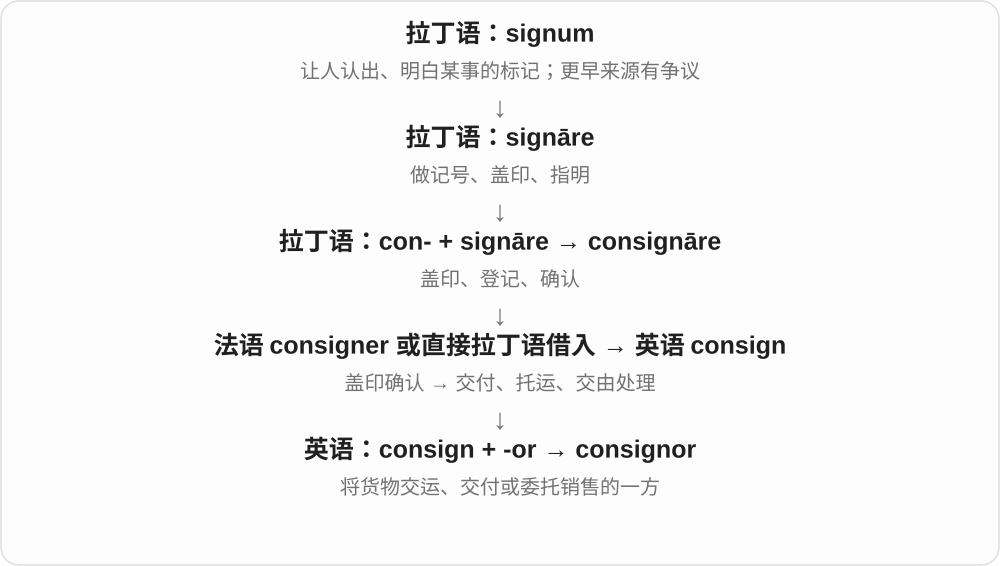

用于运输与寄售文书；不能仅凭这个词断定对方是生产商，托运人也可能是贸易商。

**常见搭配与例句**

the consignor’s details；the consignor and consignee。

> The consignor supplied a list of the items in each crate.

托运方提供了每个木箱内的物品清单。

> The document identifies the consignor as a local trading company.

文件把一家本地贸易公司列为发货方。

**别混淆**

carrier 是承运、运输的一方；consignor 是交出货物的一方，这两个角色可以不同。

### 51. signifier — 表示某种意义的东西；能指

**音标**：英 /ˈsɪɡnɪfaɪə/；美 /ˈsɪɡnɪfaɪər/

**先抓住这个画面**

signifier 是“你听到、看到的那个符号外壳”：比如 tree 这个声音或书写形式，让你想到树的概念。

**怎么拆**

signify + -er；符号学中的“能指”用来对应法语 signifiant，属于现代术语用法。

**怎么变成今天的意思**

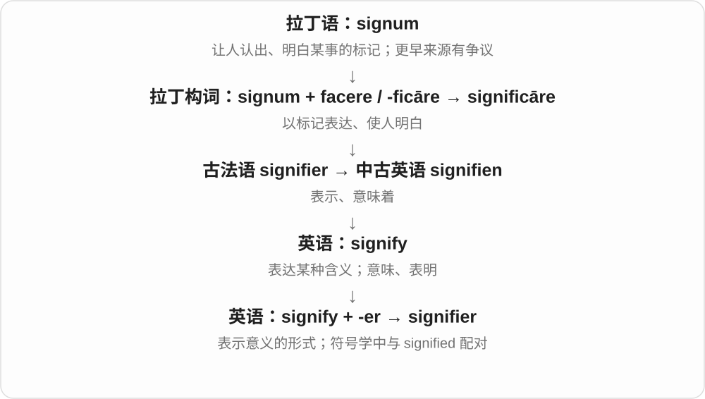

在符号学里常与 signified“所指”相对；一般写作中 a signifier of wealth 可以是体现财富身份的外在标志。

**常见搭配与例句**

a signifier of status；signifier and signified。

> In the example, the written word “tree” is the signifier.

在这个例子里，写出来的 tree 这个词是能指。

> The expensive watch functions as a signifier of status.

那块昂贵手表起到了身份标志的作用。

**别混淆**

signifier 是表达的形式；signified 是与形式联系的概念，通常不是外面那一棵具体的树。

### 52. assignee — 受让人；被指派任务的人

**音标**：/ˌæsaɪˈniː/，也 /ˌæsəˈniː/

**先抓住这个画面**

assignee 是箭头指向的接收端：任务交给谁，或者权利转给谁，那个人就是 assignee。

**怎么拆**

古法语 assigné 是 assigner 的过去分词，表示被指定者；借入英语后，现代可看作 assign + -ee。

**怎么变成今天的意思**

任务软件中的 assignee 是任务负责人；权利转让语境中是接受一方。词义本身不规定具体合同效力。

**常见搭配与例句**

the task’s assignee；name an assignee；the original assignee。

> The task has an assignee but no deadline yet.

这项任务已有负责人，但还没有截止日期。

> The document names the company as the assignee of the rights.

文件把该公司列为这些权利的受让方。

**别混淆**

assignor 是转出一方；assignee 是接收一方。-ee 常帮助你识别承受动作的人。

### 53. designator — 指定者；标识名称、代号或符号

**音标**：英 /ˈdezɪɡneɪtə/；美 /ˈdezɪɡneɪtər/

**先抓住这个画面**

designator 可以是指定某人的人，也可以是用来点明“就是这个对象”的代号。

**怎么拆**

现代可按 designate + -or 理解。词源资料有两种分析：直接借自后期拉丁 designator，或在英语里由 designate 派生；两路都与拉丁 designare 同族。

**怎么变成今天的意思**

flight designator 可是航班代号；在逻辑、编程或设备文件中，也可指识别某对象的符号。

**常见搭配与例句**

a flight designator；a letter designator；a reference designator。

> The flight designator appears on the boarding pass.

航班代号显示在登机牌上。

> Each component has a unique reference designator on the diagram.

图上每个元件都有一个唯一的标识代号。

**别混淆**

designation 是指定过程或名称；designator 更突出那个执行指定、指认功能的人或符号。

### 54. signification — 含义；表示意义的过程〔正式〕

**音标**：/ˌsɪɡnɪfɪˈkeɪʃən/

**先抓住这个画面**

signification 像研究“这个符号究竟在说什么，以及它怎样说出那个意思”。

**怎么拆**

经古法语 significacion 来自拉丁 significātiō；名词有自己的借入链，现代可联系 signify 与 -ification。

**怎么变成今天的意思**

多见于语言、符号、文学讨论；日常问一个单词意思通常说 meaning，不必使用这个长词。

**常见搭配与例句**

the signification of a symbol；a process of signification。

> The essay explores the signification of the colour white in the novel.

文章探讨小说中白色的含义。

> The course examines how images participate in signification.

课程研究图像如何参与意义的形成。

**别混淆**

significance 常强调重要性；signification 更常聚焦符号表达什么及怎样表达。

### 55. insigne — 徽章；徽记〔较少用的单数形式〕

**音标**：/ɪnˈsɪɡniː/

**先抓住这个画面**

insigne 可以理解为一枚具体的身份标志，保留了更接近拉丁单数的外形。

**怎么拆**

借自拉丁 īnsigne，和复数 īnsignia 成对；不是英语 insignia 随意换最后一个字母造出的新意思。

**怎么变成今天的意思**

通常在较正式、历史或收藏说明中见到。现代一般用 insignia 或 badge 更常见。

**常见搭配与例句**

a regimental insigne；an insigne of office。

> The museum acquired a bronze regimental insigne.

博物馆购藏了一枚青铜军团徽章。

> An insigne of office hangs from the chain.

链子上挂着一枚职务徽记。

**别混淆**

insigne 与 insignia 的区别主要关乎历史单复数和实际用法，不表示两种不同材质的徽章。

### 56. siggy — 签名；论坛签名档〔网络口语〕

**音标**：/ˈsɪɡi/〔按 sig + -y 的常见构词读音〕

**先抓住这个画面**

siggy 像把长长的 signature 缩成一个随意的小昵称，常指帖子下面自动带出的签名档。

**怎么拆**

signature 缩成 sig，再加 -y；属于非正式缩略构词，不是古拉丁语里本来就有 siggy。

**怎么变成今天的意思**

较常见于论坛和旧式网络社区；正式产品说明一般写 signature。不同社区也可能用它表示个人签名图。

**常见搭配与例句**

a forum siggy；change your siggy；a siggy image。

> I added a link to my blog in my forum siggy.

我在论坛签名档里加了博客链接。

> Her siggy included a small drawing of a cat.

她的签名档里有一幅小猫画。

**别混淆**

siggy 是小圈子口语；signature 是通用表达。不要把 -gy 当作另一个独立词根。

### 57. signboard — 招牌；告示牌；标示牌

**音标**：英 /ˈsaɪnbɔːd/；美 /ˈsaɪnbɔːrd/

**先抓住这个画面**

signboard 把抽象的标记放到一块实际的板上，让经过的人能看懂店名或指示。

**怎么拆**

sign + board，英语复合词；board 在这里是板，不是董事会。

**怎么变成今天的意思**

可放在店前，也可在路口、工地或公共场所；不一定是商业广告。

**常见搭配与例句**

a shop signboard；a wooden signboard；read the signboard。

> A wooden signboard marked the entrance to the farm.

一块木牌标出了农场入口。

> The shop repainted its signboard before reopening.

商店重新开业前把招牌重漆了一遍。

**别混淆**

billboard 常是大型广告牌；signboard 更一般，尺寸和目的不限于广告。

### 58. signalman — 信号员；旧称通信兵

**音标**：/ˈsɪɡnəlmən/

**先抓住这个画面**

signalman 是传统职业名：那位负责信号、让车辆或人员知道如何行动的人。

**怎么拆**

signal + man，英语复合词；复数 signalmen 中 -men 通常也弱读 /mən/。

**怎么变成今天的意思**

铁路历史中常指信号楼工作人员；现代也常用 signaller 等不限定性别的称呼。

**常见搭配与例句**

a railway signalman；the signalman on duty。

> The photograph shows a signalman inside an old signal box.

照片里，一名信号员站在旧信号楼内。

> The signalman on duty reported a fault in the equipment.

值班信号员报告设备有故障。

**别混淆**

不是所有拿着信号旗的人都以此为职业；它通常指承担信号职责的人员。

### 59. unseal — 拆封；启封；解除封闭

**音标**：/ʌnˈsiːl/

**先抓住这个画面**

unseal 像揭开封条、破开蜡封，让原来封着的东西重新能够打开或查看。

**怎么拆**

un-（解除、逆转动作）+ seal，英语构词；这里的 un- 表示把密封状态撤去。

**怎么变成今天的意思**

unseal an envelope 是拆封；unseal records 可指正式解除文件的封存状态，使其可查阅。

**常见搭配与例句**

unseal a container；unseal an envelope；unseal records。

> She carefully unsealed the envelope.

她小心地拆开了信封。

> The archive unsealed the collection after the restriction expired.

限制期满后，档案馆解除了这批资料的封存。

**别混淆**

open 是一般打开；unseal 特别说明此前有封口、封条或封存状态。

### 60. consignee — 收货人；受托收货的一方

**音标**：/ˌkɒnsaɪˈniː/；美式也 /ˌkɑːnsəˈniː/

**先抓住这个画面**

consignee 在运输箭头的终点：货物按安排交给这一方接收。

**怎么拆**

consign + -ee，英语中表示接收托运或交付的一方；不需要假设拉丁语已有这个职业名。

**怎么变成今天的意思**

运单上的 consignee 栏写接收方。接收方不一定就是最后的消费者，也可能是受托处理货物的公司。

**常见搭配与例句**

the consignee’s address；name the consignee；the named consignee。

> Please check the consignee’s address before dispatch.

发货前请核对收货方地址。

> The consignee confirmed receipt of all six boxes.

收货方确认收到了全部六个箱子。

**别混淆**

consignor 是发出或交运一方；consignee 是接收一方。

### 61. insignificantly — 微不足道地；变化很小地；不显著地

**音标**：/ˌɪnsɪɡˈnɪfɪkəntli/

**先抓住这个画面**

insignificantly 像把刻度上的变化放大后才勉强看见：变化存在，但影响或幅度很有限。

**怎么拆**

insignificant + -ly；具体是“不重要”还是“统计上不显著”，由上下文决定。

**怎么变成今天的意思**

常与 differ、change 等动词连用；日常说 only slightly 往往更顺口。不能仅凭这个词判断作者是否做过统计检验。

**常见搭配与例句**

differ insignificantly；change insignificantly；insignificantly small。

> The two versions differ insignificantly in length.

两个版本的长度只相差一点点。

> The fee had changed only insignificantly over several years.

这笔费用几年来只发生了微小变化。

**别混淆**

slightly 只说一点点；insignificantly 还可能评价这点差别没有实质重要性。

### 62. signposting — 设置路标；指引；给文章或讲话提示结构

**音标**：英 /ˈsaɪnpəʊstɪŋ/；美 /ˈsaɪnpoʊstɪŋ/

**先抓住这个画面**

signposting 像一路放下提示：“先谈原因，接着看例子，最后讨论办法。”读者因此不会迷路。

**怎么拆**

signpost + -ing，动作名词；从真实路标扩展到文字、讲话及服务中的引导。

**怎么变成今天的意思**

academic signposting 指学术写作中的结构提示；服务场景也可指引导人找到相关资源。

**常见搭配与例句**

clear signposting；signposting language；improve signposting。

> Clear signposting helps readers follow a long argument.

清楚的结构提示能帮助读者跟上长篇论证。

> Visitors complained about poor signposting in the park.

游客抱怨公园里的路标指引不清楚。

**别混淆**

summary 是概括内容；signposting 主要告诉读者现在讲到哪里、接下来往哪走。

### 63. countersign — 副署；会签；口令、应答暗号

**音标**：英 /ˈkaʊntəsaɪn/；美 /ˈkaʊntərsaɪn/

**先抓住这个画面**

countersign 有两个相关画面：别人的签名旁边再签一次作确认；卫兵发问后，来人报出约定的应答口令。

**怎么拆**

动词借法语 contresigner，名词借 contresigne；现代可分析 counter- + sign，但两种词性有各自法语形式。

**怎么变成今天的意思**

countersign a document 是在已签文件上加签；give the countersign 是说出口令。counter- 这里是回应、相对，不是反对签名。

**常见搭配与例句**

countersign a form；give the countersign；request a countersignature。

> The supervisor countersigned the completed form.

主管在填写完的表格上加签确认。

> The guard waited for the correct countersign.

卫兵等着对方说出正确的口令。

**别混淆**

sign 是签；countersign 通常是在已有签名之外加签确认。具体程序作用要看文件要求。

### 64. signally — 显著地；明显地；格外地〔正式〕

**音标**：/ˈsɪɡnəli/

**先抓住这个画面**

signally 像把程度高亮出来：“这件事表现得特别明显。”常见搭配竟是 signally fail，明显没做到。

**怎么拆**

signal 的形容词“显著的”+ -ly；不是“用信号的方式”。

**怎么变成今天的意思**

signally failed to 表示明显未能做到；也可修饰 successful、honoured 等。属于较正式的书面用词。

**常见搭配与例句**

signally fail；signally successful；signally lacking。

> The plan signally failed to address the main problem.

这个方案明显没有解决主要问题。

> Her campaign was signally successful.

她组织的活动取得了格外显著的成效。

**别混淆**

significantly 可表示在重要程度或数量上明显；signally 常带更强的修辞强调，不专指统计显著。

### 65. signaller — 信号员；通信兵〔常见英式拼写〕

**音标**：英 /ˈsɪɡnələ/；美 /ˈsɪɡnələr/

**先抓住这个画面**

signaller 是专门把信息送出去、或处理运行信号的人，常见于铁路和军队语境。

**怎么拆**

signal + -er，双写 l 的形式；与 signaler 同源同义，具体职业义依语境。

**怎么变成今天的意思**

铁路 signaller 可以操作、监控信号系统；军事 signaller 处理通信，不限于挥旗。

**常见搭配与例句**

a railway signaller；an army signaller。

> The signaller checked the route before clearing the signal.

信号员确认线路后才开放信号。

> The signaller maintained contact with the other unit.

通信兵与另一支部队保持联系。

**别混淆**

signalman 是传统带 man 的职业名；signaller 可用于任何性别，职务内容看具体机构。

### 66. assignor — 转让人；让与人

**音标**：/ˌæsəˈnɔːr/，也 /əˈsaɪnər/

**先抓住这个画面**

assignor 是转出那一端：把某项权利或财产转给另一方的人或机构。

**怎么拆**

assign + -or，执行转让的一方；属于英语派生，和 assignee 构成常见角色对照。

**怎么变成今天的意思**

主要见于合同等正式文本；普通分配工作的人更常写 assigner 或说明其职位。这里的例句只帮助识别角色。

**常见搭配与例句**

the assignor and assignee；the original assignor。

> The form lists the assignor and the assignee in separate boxes.

表格把转让方和受让方列在两个不同的框里。

> The assignor’s name appears at the top of the document.

转让方的名称位于文件顶部。

**别混淆**

assignee 接收；assignor 转出。不要因为两者只差词尾就颠倒方向。

### 67. resignedly — 无奈地；认命般地

**音标**：/rɪˈzaɪnɪdli/

**先抓住这个画面**

resignedly 描写动作里那股“算了，只能接受”的味道：轻轻叹气，还是把事情做下去。

**怎么拆**

resigned + -ly；这一常见读音在 -dly 前多一个 /ɪ/ 音节，要与 resigned /rɪˈzaɪnd/ 区分。

**怎么变成今天的意思**

常搭配 sigh、nod、say。它不是“辞职地”，也不是任性地随便放弃一切。

**常见搭配与例句**

sigh resignedly；nod resignedly；say resignedly。

> She sighed resignedly and joined the queue.

她无奈地叹口气，加入了队伍。

> He nodded resignedly when they announced another delay.

他们宣布再次延期时，他无奈地点了点头。

**别混淆**

reluctantly 强调不愿意去做；resignedly 更强调已经接受改变不了的情况。

### 68. signaler — 发信号的人或装置〔常见美式拼写〕

**音标**：英 /ˈsɪɡnələ/；美 /ˈsɪɡnələr/

**先抓住这个画面**

signaler 像负责挥旗、亮灯或发送指示的那一端，让另一端知道接下来怎么做。

**怎么拆**

signal + -er，单 l 形式；与 signaller 是拼写变体。

**怎么变成今天的意思**

既能指人，也能在技术语境指发出信号的装置。英式职业名称较常用 signaller。

**常见搭配与例句**

a signaler on deck；an electronic signaler。

> The signaler raised a flag when the boat was ready.

船准备好时，信号员举起了一面旗。

> An electronic signaler alerted the staff when the door opened.

门打开时，一个电子信号装置提醒了工作人员。

**别混淆**

sender 泛指发送者；signaler 更明确是发信号，不一定发送一段文字。

### 69. countersignature — 副署；会签；追加确认的签名

**音标**：英 /ˌkaʊntəˈsɪɡnətʃə/；美 /ˌkaʊntərˈsɪɡnətʃər/

**先抓住这个画面**

countersignature 就是别人签过之后，加在旁边用来确认的那一个签名。

**怎么拆**

现代可拆 counter- + signature；词典也明确分析为 countersign 仿照 sign / signature 这一对词形成。

**怎么变成今天的意思**

the manager’s countersignature 是经理追加的签字；a space for a countersignature 是为副署留的位置。

**常见搭配与例句**

require a countersignature；add a countersignature；a countersignature box。

> The form has a separate box for a countersignature.

表格有一个单独的副署栏。

> She checked that the countersignature was present.

她确认文件上已有追加的确认签名。

**别混淆**

signature 是一般签名；countersignature 强调与已有签名配套确认，不只是同一人把名字写得更好看。

### 70. signalize — 使显著；标志着；给路口安装信号设施

**音标**：/ˈsɪɡnəlaɪz/

**先抓住这个画面**

signalize 像把某件事突出地标出来；交通工程里，则是让一个路口拥有信号灯控制。

**怎么拆**

signal + -ize，英语构词；这个动词比现代 signal“发信号”的常见动词记录更早。

**怎么变成今天的意思**

较正式或专业；signalize an occasion 可以是以特别行动标志某个场合；signalize an intersection 是安装信号控制。英式也拼 signalise。

**常见搭配与例句**

signalize an achievement；a signalized intersection。

> The ceremony was intended to signalize the opening of the new library.

这场仪式旨在隆重标志新图书馆开馆。

> The city plans to signalize the intersection next year.

市政府计划明年为这个路口安装交通信号设施。

**别混淆**

日常“打手势、发信号”常用 signal；signalize 在现代更常见于正式叙述或交通工程。

## 这一组要分清什么

sign 是记号、迹象或签署动作；signature 是签名或鲜明特征；signal 强调信号。siggy 是 signature 的网络口语缩略。

design 是规划、设计；designate 是指定某个人或用途。designation 的英语历史比现代动词 designate 更早，不能只看相似词尾就反推顺序。

assignor 转出，assignee 接收；consignor 交货，consignee 收货。先画箭头，再记角色。

resign 是辞去或放弃，resigned 是无奈接受；resignation 有辞职和认命两条常见义。

insignificant 的 in- 表示不，insignia 的 in- 不是否定。seal 的印章、密封义属于本族，海豹义另源。

statistically significant 不能直接等同“效果很大”；先判断是不是专门的统计用法。

## 串起来练习

画一封信：写名字 signature、补一个确认签名 countersignature，再用蜡封 seal 封上；分别说出动作和结果。

画出一项权利从 assignor 转到 assignee 的方向，再把运输中的 consignor / consignee 放在货物箭头两端。

用 design a room 和 designate a room for meetings 各造一句，区分规划布局与指定用途。

用 resigned 描写错过一班车后的表情，再用 resignation 写一份离职通知，体会两义共有的“放下”。
