# 0106 · vers-, vert- — 转、转向、翻过来

[逐词精讲目录](../00_逐词精讲目录.md) · [总目录](../00_总目录_按常用程度.md)

## 核心词根与来源

核心来自拉丁语 vertere“转”，其分词词干是 vers-，反复动作形式是 versāre。这个词族很大，因为人们能把空间中的转向，用来描写注意力、关系、立场和形式的变化。先学会追踪“从哪里转到哪里”，再认识 verse、vertex 等已经走远的名词支线。

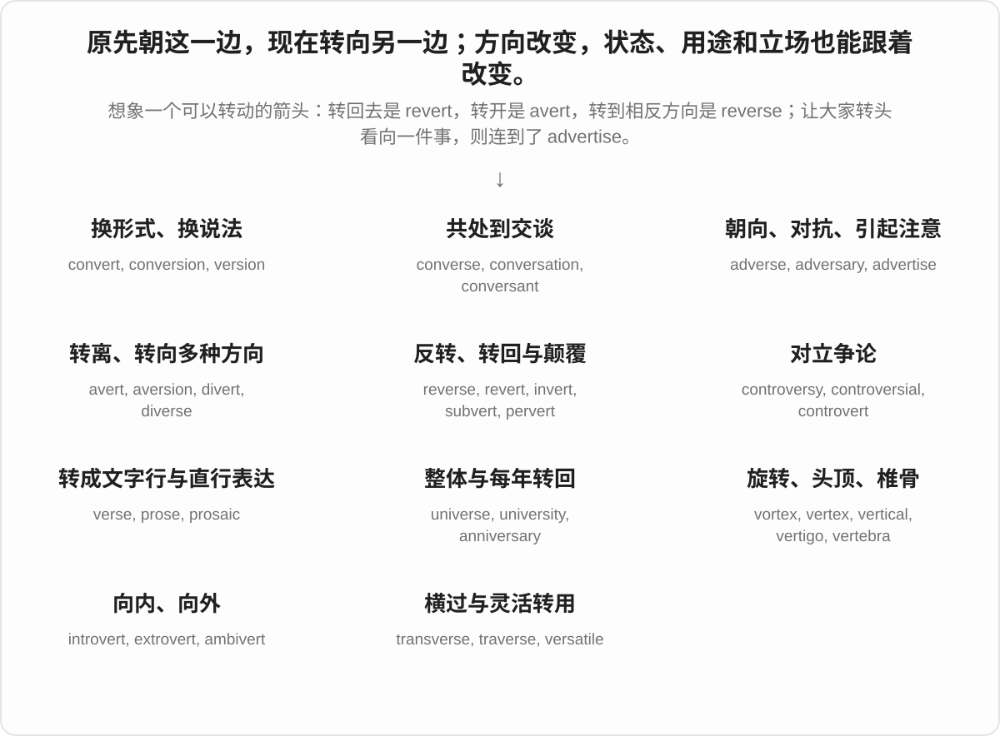

## 词形与演化规律

vert- 多保留在 convert、divert、revert；vers- 见于 conversion、diverse、reverse。它们反映拉丁语词干变化，不是英语见到 t 就能一律换 s。vertex 的变格词干 vertic- 留在 vertical；vertigo 的 vertigin- 留在 vertiginous。法语借入、拉丁语书面借入和现代英语派生要分开看。

## 单词速览（常用到不常用）

| 单词 | 音标 | 核心意思 |
|---|---|---|
| [university](#w-1) | 英 /ˌjuːnɪˈvɜːsəti/；美 /ˌjuːnəˈvɜːrsəti/ | 大学 |
| [version](#w-2) | 英 /ˈvɜːʃən/、/ˈvɜːʒən/；美 /ˈvɜːrʒən/ | 版本；某人的说法；译本 |
| [ad](#w-3) | 英、美 /æd/ | 广告〔口语〕 |
| [conversation](#w-4) | 英 /ˌkɒnvəˈseɪʃən/；美 /ˌkɑːnvərˈseɪʃən/ | 交谈；谈话 |
| [universe](#w-5) | 英 /ˈjuːnɪvɜːs/；美 /ˈjuːnəvɜːrs/ | 宇宙；某一范围内的全部事物 |
| [advertising](#w-6) | 英 /ˈædvətaɪzɪŋ/；美 /ˈædvərtaɪzɪŋ/ | 广告活动；广告业；广告总称 |
| [anniversary](#w-7) | 英 /ˌænɪˈvɜːsəri/；美 /ˌænɪˈvɜːrsəri/ | 周年纪念日；周年 |
| [universal](#w-8) | 英 /ˌjuːnɪˈvɜːsəl/；美 /ˌjuːnəˈvɜːrsəl/ | 普遍的；全体适用的；通用的 |
| [reverse](#w-9) | 英 /rɪˈvɜːs/；美 /rɪˈvɜːrs/ | 反转；撤销；倒车；相反的；背面、倒挡 |
| [diversity](#w-10) | 英 /daɪˈvɜːsəti/；美 /daɪˈvɜːrsəti/、/dɪˈvɜːrsəti/ | 多样性；差异的丰富程度 |
| [versus](#w-11) | 英 /ˈvɜːsəs/；美 /ˈvɜːrsəs/ | 对、对阵；与……相比较 |
| [controversy](#w-12) | 英 /ˈkɒntrəvɜːsi/、/kənˈtrɒvəsi/；美 /ˈkɑːntrəvɜːrsi/ | 争议；持续的公开争论 |
| [conversion](#w-13) | 英 /kənˈvɜːʃən/、/kənˈvɜːʒən/；美 /kənˈvɜːrʒən/ | 转换；改建；改信；转化 |
| [diverse](#w-14) | 英 /daɪˈvɜːs/；美 /daɪˈvɜːrs/ | 多种多样的；各不相同的 |
| [controversial](#w-15) | 英 /ˌkɒntrəˈvɜːʃəl/；美 /ˌkɑːntrəˈvɜːrʃəl/ | 有争议的；容易引起争论的 |
| [verse](#w-16) | 英 /vɜːs/；美 /vɜːrs/ | 诗；诗行、诗节；歌曲的主歌；经文的一节 |
| [vertical](#w-17) | 英 /ˈvɜːtɪkəl/；美 /ˈvɜːrtɪkəl/ | 竖直的；纵向的 |
| [convert](#w-18) | 动词：英 /kənˈvɜːt/，美 /kənˈvɜːrt/；名词：英 /ˈkɒnvɜːt/，美 /ˈkɑːnvɜːrt/ | 转换、改造；使改信；新信徒、新拥护者 |
| [adverse](#w-19) | 英 /ˈædvɜːs/、/ədˈvɜːs/；美 /ædˈvɜːrs/ | 不利的；有害的 |
| [advertisement](#w-20) | 英 /ədˈvɜːtɪsmənt/；美 /ˌædvərˈtaɪzmənt/ | 广告；公告；能起宣传作用的人或事 |
| [prose](#w-21) | 英 /prəʊz/；美 /proʊz/ | 散文；散文体、普通行文 |
| [advertise](#w-22) | 英 /ˈædvətaɪz/；美 /ˈædvərtaɪz/ | 做广告；宣传；公布征求 |
| [versatile](#w-23) | 英 /ˈvɜːsətaɪl/；美 /ˈvɜːrsətəl/、/ˈvɜːrsətaɪl/ | 多才多艺的；多用途的 |
| [universally](#w-24) | 英 /ˌjuːnɪˈvɜːsəli/；美 /ˌjuːnəˈvɜːrsəli/ | 普遍地；全体一致地 |
| [reversal](#w-25) | 英 /rɪˈvɜːsəl/；美 /rɪˈvɜːrsəl/ | 逆转；撤销；反转 |
| [convertible](#w-26) | 英 /kənˈvɜːtəbəl/；美 /kənˈvɜːrtəbəl/ | 可转换的；可兑换的；敞篷车 |
| [conversely](#w-27) | 英 /ˈkɒnvɜːsli/、/kənˈvɜːsli/；美 /ˈkɑːnvɜːrsli/、/kənˈvɜːrsli/ | 反过来说；相反地 |
| [diversion](#w-28) | 英 /daɪˈvɜːʃən/、/daɪˈvɜːʒən/；美 /dɪˈvɜːrʒən/、/daɪˈvɜːrʒən/ | 改道；转移注意的事；消遣 |
| [converse](#w-29) | 动词：英 /kənˈvɜːs/，美 /kənˈvɜːrs/；名词、形容词：英 /ˈkɒnvɜːs/，美 /ˈkɑːnvɜːrs/ | 交谈；相反的；相反情况、逆命题 |
| [vortex](#w-30) | 英 /ˈvɔːteks/；美 /ˈvɔːrteks/ | 旋涡；旋转的气流或液流；把人卷入的混乱局面 |
| [advert](#w-31) | 名词：英 /ˈædvɜːt/，美 /ˈædvɜːrt/；动词：英 /ədˈvɜːt/，美 /ədˈvɜːrt/ | 广告〔主要英式〕；提及、把注意转向〔正式动词〕 |
| [vertically](#w-32) | 英 /ˈvɜːtɪkli/；美 /ˈvɜːrtɪkli/ | 竖直地；沿上下方向 |
| [inadvertently](#w-33) | 英 /ˌɪnədˈvɜːtəntli/；美 /ˌɪnədˈvɜːrtəntli/ | 无意中；不小心地 |
| [divert](#w-34) | 英 /daɪˈvɜːt/；美 /daɪˈvɜːrt/、/dɪˈvɜːrt/ | 使改道；转移；使消遣 |
| [inverse](#w-35) | 英 /ˌɪnˈvɜːs/、/ˈɪnvɜːs/；美 /ɪnˈvɜːrs/、/ˈɪnvɜːrs/ | 相反的、逆向的；逆运算、逆元 |
| [converter](#w-36) | 英 /kənˈvɜːtə/；美 /kənˈvɜːrtər/ | 转换器；转换设备、程序 |
| [traverse](#w-37) | 动词：英 /trəˈvɜːs/，美 /trəˈvɜːrs/；名词也读英 /ˈtrævəs/，美 /ˈtrævərs/ | 穿越；横越；横穿路线 |
| [adversity](#w-38) | 英 /ədˈvɜːsəti/；美 /ədˈvɜːrsəti/ | 逆境；困境 |
| [advertiser](#w-39) | 英 /ˈædvətaɪzə/；美 /ˈædvərtaɪzər/ | 广告客户；登广告的人或机构 |
| [revert](#w-40) | 英 /rɪˈvɜːt/；美 /rɪˈvɜːrt/ | 恢复、回到原状；重新采用旧做法；归还、回复归属 |
| [pervert](#w-41) | 动词：英 /pəˈvɜːt/，美 /pərˈvɜːrt/；名词：英 /ˈpɜːvɜːt/，美 /ˈpɜːrvɜːrt/ | 歪曲、败坏；性变态者〔带侮辱意味的称呼〕 |
| [reversible](#w-42) | 英 /rɪˈvɜːsəbəl/；美 /rɪˈvɜːrsəbəl/ | 可逆的；两面都能用的 |
| [versatility](#w-43) | 英 /ˌvɜːsəˈtɪləti/；美 /ˌvɜːrsəˈtɪləti/ | 多面才能；多功能性；适应多种用途的能力 |
| [adversary](#w-44) | 英 /ˈædvəsəri/；美 /ˈædvərseri/ | 对手；敌手 |
| [irreversible](#w-45) | 英 /ˌɪrɪˈvɜːsəbəl/；美 /ˌɪrɪˈvɜːrsəbəl/ | 不可逆转的；无法恢复的 |
| [adversely](#w-46) | 英 /ˈædvɜːsli/、/ədˈvɜːsli/；美 /ædˈvɜːrsli/ | 不利地；有害地 |
| [transverse](#w-47) | 英 /trænzˈvɜːs/、/trænsˈvɜːs/；美 /trænzˈvɜːrs/、/trænsˈvɜːrs/ | 横向的；横过的 |
| [inversion](#w-48) | 英 /ɪnˈvɜːʃən/；美 /ɪnˈvɜːrʒən/ | 倒置；倒装；反转；逆温 |
| [aversion](#w-49) | 英 /əˈvɜːʃən/、/əˈvɜːʒən/；美 /əˈvɜːrʒən/ | 厌恶；强烈的不愿接受 |
| [diversification](#w-50) | 英 /daɪˌvɜːsɪfɪˈkeɪʃən/；美 /dɪˌvɜːrsəfɪˈkeɪʃən/、/daɪˌvɜːrsəfɪˈkeɪʃən/ | 多样化；业务多元化 |
| [subversive](#w-51) | 英 /səbˈvɜːsɪv/；美 /səbˈvɜːrsɪv/ | 具有颠覆性的；颠覆者 |
| [vertex](#w-52) | 英 /ˈvɜːteks/；美 /ˈvɜːrteks/ | 顶点；角点；图的节点；头顶 |
| [perverse](#w-53) | 英 /pəˈvɜːs/；美 /pərˈvɜːrs/ | 故意作对的；反常、不合常理的 |
| [perverted](#w-54) | 英 /pəˈvɜːtɪd/；美 /pərˈvɜːrtɪd/ | 被歪曲的；扭曲、败坏的；性变态的〔贬义〕 |
| [diversify](#w-55) | 英 /daɪˈvɜːsɪfaɪ/；美 /daɪˈvɜːrsəfaɪ/、/dɪˈvɜːrsəfaɪ/ | 使多样化；扩展到不同领域 |
| [vertigo](#w-56) | 英 /ˈvɜːtɪɡəʊ/；美 /ˈvɜːrtɪɡoʊ/ | 眩晕；感觉自己或周围在旋转 |
| [avert](#w-57) | 英 /əˈvɜːt/；美 /əˈvɜːrt/ | 避免、防止；移开目光 |
| [conversational](#w-58) | 英 /ˌkɒnvəˈseɪʃənəl/；美 /ˌkɑːnvərˈseɪʃənəl/ | 谈话的；像聊天一样自然的；能日常交谈的 |
| [averse](#w-59) | 英 /əˈvɜːs/；美 /əˈvɜːrs/ | 不愿意的；反感、抵触的 |
| [subversion](#w-60) | 英 /səbˈvɜːʃən/；美 /səbˈvɜːrʒən/ | 颠覆；破坏既有权威或惯例 |
| [convo](#w-61) | 英 /ˈkɒnvəʊ/；美 /ˈkɑːnvoʊ/ | 聊天、谈话〔口语〕 |
| [vertebrate](#w-62) | 英 /ˈvɜːtɪbrət/；美 /ˈvɜːrtəbrət/ | 脊椎动物；有脊柱的 |
| [subvert](#w-63) | 英 /səbˈvɜːt/；美 /səbˈvɜːrt/ | 颠覆、瓦解；打破既定规则或预期 |
| [introvert](#w-64) | 英 /ˈɪntrəvɜːt/；美 /ˈɪntrəvɜːrt/ | 内向的人 |
| [perversion](#w-65) | 英 /pəˈvɜːʒən/；美 /pərˈvɜːrʒən/ | 歪曲、败坏；扭曲的表现；性变态〔带评判的用语〕 |
| [inversely](#w-66) | 英 /ɪnˈvɜːsli/；美 /ɪnˈvɜːrsli/ | 反向地；成反比地 |
| [introverted](#w-67) | 英 /ˈɪntrəvɜːtɪd/；美 /ˈɪntrəvɜːrtɪd/ | 内向的；较关注内心世界的 |
| [vertebral](#w-68) | 英 /ˈvɜːtɪbrəl/；美 /ˈvɜːrtəbrəl/、/vərˈtiːbrəl/ | 椎骨的；脊柱的 |
| [inadvertent](#w-69) | 英 /ˌɪnədˈvɜːtənt/；美 /ˌɪnədˈvɜːrtənt/ | 无意的；疏忽造成的 |
| [inverter](#w-70) | 英 /ɪnˈvɜːtə/；美 /ɪnˈvɜːrtər/ | 逆变器；反相器 |
| [controversially](#w-71) | 英 /ˌkɒntrəˈvɜːʃəli/；美 /ˌkɑːntrəˈvɜːrʃəli/ | 有争议地；引发争议地 |
| [vertebra](#w-72) | 英 /ˈvɜːtɪbrə/；美 /ˈvɜːrtəbrə/ | 一块椎骨 |
| [invert](#w-73) | 英 /ɪnˈvɜːt/；美 /ɪnˈvɜːrt/ | 颠倒；倒置；使反转 |
| [invertebrate](#w-74) | 英 /ɪnˈvɜːtɪbrət/；美 /ɪnˈvɜːrtəbrət/ | 无脊椎动物；无脊柱的 |
| [universality](#w-75) | 英 /ˌjuːnɪvɜːˈsæləti/；美 /ˌjuːnəvɜːrˈsæləti/ | 普遍性；普适性 |
| [obverse](#w-76) | 英 /ˈɒbvɜːs/；美名词 /ˈɑːbvɜːrs/，形容词 /ɑːbˈvɜːrs/、/ˈɑːbvɜːrs/ | 硬币、奖章的正面；相对应的另一面 |
| [prosaic](#w-77) | 英 /prəʊˈzeɪɪk/；美 /proʊˈzeɪɪk/ | 平淡无奇的；日常实际的；散文体的 |
| [reversion](#w-78) | 英 /rɪˈvɜːʃən/；美 /rɪˈvɜːrʒən/ | 回归；恢复旧状态；财产归复 |
| [extrovert](#w-79) | 英 /ˈekstrəvɜːt/；美 /ˈekstrəvɜːrt/ | 外向的人 |
| [irreversibly](#w-80) | 英 /ˌɪrɪˈvɜːsəbli/；美 /ˌɪrɪˈvɜːrsəbli/ | 不可逆转地；无法挽回地 |
| [incontrovertible](#w-81) | 英 /ˌɪnkɒntrəˈvɜːtəbəl/；美 /ˌɪnkɑːntrəˈvɜːrtəbəl/ | 无可辩驳的；无法否认的 |
| [extroverted](#w-82) | 英 /ˈekstrəvɜːtɪd/；美 /ˈekstrəvɜːrtɪd/ | 外向的；喜欢与人交往的 |
| [conversant](#w-83) | 英 /kənˈvɜːsənt/；美 /kənˈvɜːrsənt/ | 熟悉、通晓某事的 |
| [perversely](#w-84) | 英 /pəˈvɜːsli/；美 /pərˈvɜːrsli/ | 偏偏、反常地；故意作对地 |
| [introversion](#w-85) | 英 /ˌɪntrəˈvɜːʃən/；美 /ˌɪntrəˈvɜːrʒən/ | 内向倾向；内向性 |
| [transversely](#w-86) | 英 /trænzˈvɜːsli/、/trænsˈvɜːsli/；美 /trænzˈvɜːrsli/ | 横向地；横过长轴地 |
| [transversal](#w-87) | 英 /trænzˈvɜːsəl/、/trænsˈvɜːsəl/；美 /trænzˈvɜːrsəl/ | 横截线；横向的、横跨的 |
| [perversity](#w-88) | 英 /pəˈvɜːsəti/；美 /pərˈvɜːrsəti/ | 乖张；故意作对；反常之处 |
| [versioning](#w-89) | 英 /ˈvɜːʃənɪŋ/、/ˈvɜːʒənɪŋ/；美 /ˈvɜːrʒənɪŋ/ | 版本管理；给版本编号、保留版本的做法 |
| [extraversion](#w-90) | 英 /ˌekstrəˈvɜːʃən/；美 /ˌekstrəˈvɜːrʒən/ | 外向性〔心理学常用拼写〕 |
| [vertiginous](#w-91) | 英 /vɜːˈtɪdʒɪnəs/；美 /vɜːrˈtɪdʒənəs/ | 令人眩晕的；眩晕的；高得、快得令人发晕的 |
| [extroversion](#w-92) | 英 /ˌekstrəˈvɜːʃən/；美 /ˌekstrəˈvɜːrʒən/ | 外向性；外向倾向 |
| [incontrovertibly](#w-93) | 英 /ˌɪnkɒntrəˈvɜːtəbli/；美 /ˌɪnkɑːntrəˈvɜːrtəbli/ | 无可辩驳地；确凿地 |
| [extravert](#w-94) | 英 /ˈekstrəvɜːt/；美 /ˈekstrəvɜːrt/ | 外向的人〔extrovert 的另一拼写〕 |
| [ambivert](#w-95) | 英 /ˈæmbɪvɜːt/；美 /ˈæmbɪvɜːrt/ | 兼有内向与外向特点的人 |
| [controvert](#w-96) | 英 /ˈkɒntrəvɜːt/；美 /ˈkɑːntrəvɜːrt/ | 反驳；质疑、争辩 |
| [tergiversate](#w-97) | 英 /ˈtɜːdʒɪvəseɪt/；美 /ˈtɜːrdʒɪvərseɪt/、/tɜːrˈdʒɪvərseɪt/ | 闪烁其词；反复改口；变节〔罕见、正式〕 |

## 逐词讲解

### 1. university — 大学

**音标**：英 /ˌjuːnɪˈvɜːsəti/；美 /ˌjuːnəˈvɜːrsəti/

**先抓住这个画面**

university 的老画面是“一群人组成的共同体”，后来专门落到教师和学生组成的学术共同体。

**怎么拆**

来自拉丁语 ūniversitās，经法语进入英语；现代能看出 universe + -ity 的形式联系，但不是先有英语“宇宙”再拼出大学。

**怎么变成今天的意思**

大学义依靠历史上的组织含义形成。不要编成“把整个宇宙的知识都教一遍”，那只是联想，不是实际词源。

**常见搭配与例句**

go to university；a university degree；university research。

> She studied engineering at university.

她在大学学习工程。

> The university opened a new research centre.

这所大学新建了一个研究中心。

**别混淆**

university 是高等教育机构；universe 是宇宙或全部范围。它们共享“整体”远源，现代义不同。

### 2. version — 版本；某人的说法；译本

**音标**：英 /ˈvɜːʃən/、/ˈvɜːʒən/；美 /ˈvɜːrʒən/

**先抓住这个画面**

同一件事换一种表达或呈现，就有了另一个 version：同一个故事可以有孩子的说法、家长的说法，也可以有电影版。

**怎么拆**

来自法语 version、近代以前的拉丁语 versiō“转变、翻译”；不是英语 verse“诗”加 -ion。

**怎么变成今天的意思**

早期“译本”很好理解：内容被转成另一种语言。后来范围扩大，软件更新、歌曲改编、当事人的叙述都可以是一种版本。

**常见搭配与例句**

the latest version；a revised version；her version of events。

> The new version lets you save your work automatically.

新版可以自动保存你的工作。

> We have heard his version of events; now let us hear yours.

我们已经听过他的说法了，现在听听你的。

**别混淆**

edition 常指一次出版或某版出版物；version 更广，能指同一事物的不同形态。

### 3. ad — 广告〔口语〕

**音标**：英、美 /æd/

**先抓住这个画面**

看板、短视频、网页弹出的一则宣传，随口就能说 an ad。这个短词背后仍是“把注意力转过来”的长历史。

**怎么拆**

advertisement 截短为 ad；此处不是拉丁语前缀 ad- 独立变成“广告”。

**怎么变成今天的意思**

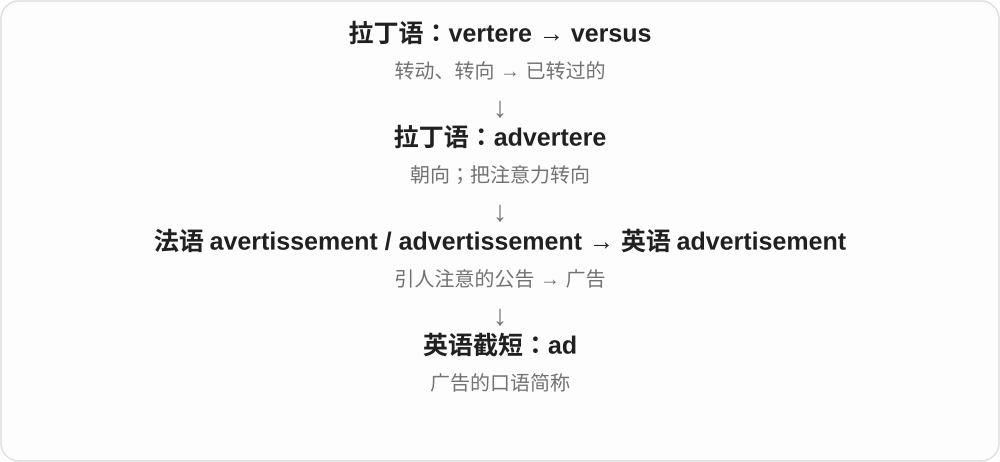

可数，复数 ads。job ad 是招聘广告，personal ad 是个人分类广告；an ad 不等于广告行业 advertising。

**常见搭配与例句**

an online ad；a job ad；place an ad。

> I found the apartment through an online ad.

我通过一则网上广告找到了这套公寓。

> The video starts with a short ad.

视频开头是一则短广告。

**别混淆**

ad 是广告；add 是“添加”，读音相同，拼写与词源不同。

### 4. conversation — 交谈；谈话

**音标**：英 /ˌkɒnvəˈseɪʃən/；美 /ˌkɑːnvərˈseɪʃən/

**先抓住这个画面**

人们经常在一起生活、来往，就会互相说话。这个词走的是“共处 → 交往 → 交谈”的路线。

**怎么拆**

经法语 conversacion 借自拉丁语 conversātiō；现代与 converse 配套，但不是英语先造 converse 再机械加 -ation。

**怎么变成今天的意思**

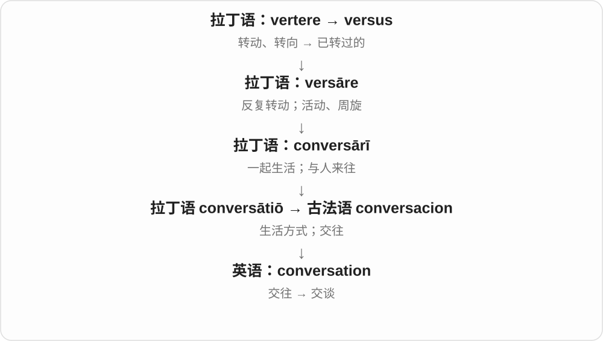

真正的 conversation 通常有来有回，不只是一个人长篇发言。它也能比喻公共讨论，如 a conversation about education。

**常见搭配与例句**

have a conversation with…；start a conversation；join the conversation。

> We had a long conversation about our plans.

我们就各自的打算聊了很久。

> She joined the conversation after listening for a few minutes.

她听了几分钟后加入了谈话。

**别混淆**

conversation 是交谈过程；speech 通常是一人对众人讲话；conversion 少一个 a，意思是转变。

### 5. universe — 宇宙；某一范围内的全部事物

**音标**：英 /ˈjuːnɪvɜːs/；美 /ˈjuːnəvɜːrs/

**先抓住这个画面**

universe 是把一切星系、物质和空间放进一个最大范围；也能把某个故事世界或讨论范围当作一个完整天地。

**怎么拆**

拉丁语 ūni-（一）+ versus（转向、合向）形成 ūniversus“全部、整体”；其中性形式 ūniversum 经法语进入英语。

**怎么变成今天的意思**

“合成一个整体”的说法变成“一切事物的总和”。词尾 verse 在这里不是英语 poem 那种诗句。

**常见搭配与例句**

the universe；the observable universe；a fictional universe。

> The book explores how scientists study the universe.

这本书介绍科学家怎样研究宇宙。

> All three novels are set in the same fictional universe.

这三部小说都发生在同一个虚构世界里。

**别混淆**

world 可指地球、人类社会或个人环境；universe 通常范围更大，也可指虚构作品的完整世界。

### 6. advertising — 广告活动；广告业；广告总称

**音标**：英 /ˈædvətaɪzɪŋ/；美 /ˈædvərtaɪzɪŋ/

**先抓住这个画面**

不是只数某一张海报，而是看整个“让公众注意到产品”的活动与行业。

**怎么拆**

advertise 去掉词尾 e 加 -ing；活动名词通常不可数。

**怎么变成今天的意思**

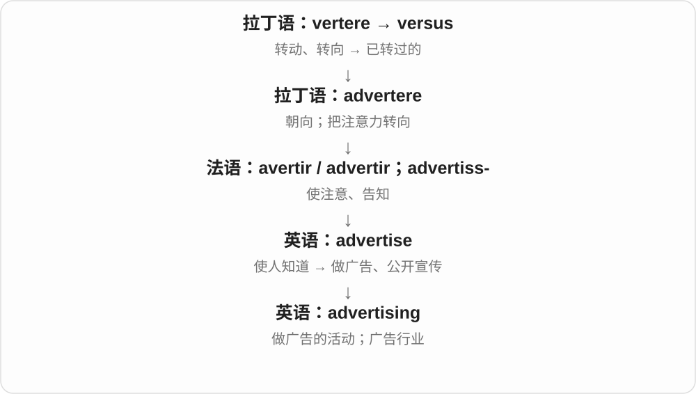

work in advertising 是从事广告业；advertising on buses 可指公交车上的广告。不能把“两则广告”通常写成 two advertisings。

**常见搭配与例句**

advertising campaign；advertising revenue；work in advertising。

> She works in advertising but prefers writing to designing.

她从事广告业，不过比起设计更喜欢写文案。

> The museum spent very little on advertising.

博物馆在广告上花的钱很少。

**别混淆**

advertising 是宣传活动；marketing 还包括市场研究、定位、定价等更广工作。

### 7. anniversary — 周年纪念日；周年

**音标**：英 /ˌænɪˈvɜːsəri/；美 /ˌænɪˈvɜːrsəri/

**先抓住这个画面**

日历转完一圈，又回到当年那个日期；这就是“每年回来一次”的 anniversary。

**怎么拆**

拉丁语 annus“年” + versus“转回”，形成 anniversārius“每年返回的”；经中世纪拉丁语纪念日期的用法进入英语。

**怎么变成今天的意思**

可以纪念婚礼、成立、胜利，也能纪念灾难或去世，并不一定喜庆。通常隐含按年计算；第十周年用 tenth anniversary。

**常见搭配与例句**

a wedding anniversary；mark the anniversary；the anniversary of…。

> They celebrated their tenth wedding anniversary at home.

他们在家庆祝了结婚十周年。

> The town held a ceremony on the anniversary of the flood.

洪灾周年纪念日那天，镇上举行了纪念仪式。

**别混淆**

birthday 是出生纪念日；anniversary 可纪念任何特定事件。

### 8. universal — 普遍的；全体适用的；通用的

**音标**：英 /ˌjuːnɪˈvɜːsəl/；美 /ˌjuːnəˈvɜːrsəl/

**先抓住这个画面**

universal 像给一个范围内的所有成员都打上勾：人人适用、处处存在，或能配合许多不同设备。

**怎么拆**

经古法语借入，来自拉丁语 ūniversālis；现代对应 universe + -al，但借入链不需要经过英语 universe。

**怎么变成今天的意思**

“整体”向“覆盖全体”发展。实际说 universal agreement 时，常是相关人群都同意，不是在调查整个宇宙。

**常见搭配与例句**

universal access；a universal principle；a universal adapter。

> The proposal did not receive universal support.

这个提议没有得到所有人的支持。

> The course asks whether the principle is universal.

课程讨论这条原则是否普遍适用。

**别混淆**

common 是常见；universal 声称覆盖全体，语气更强。通用产品也要看它实际支持的范围。

### 9. reverse — 反转；撤销；倒车；相反的；背面、倒挡

**音标**：英 /rɪˈvɜːs/；美 /rɪˈvɜːrs/

**先抓住这个画面**

原本朝前，现在往后；原本支持，现在反对；卡片翻过来，就看到了另一面。

**怎么拆**

形容词等来自拉丁语 reversus 经法语 revers；动词经法语 reverser 追到后期拉丁语 reversāre。

**怎么变成今天的意思**

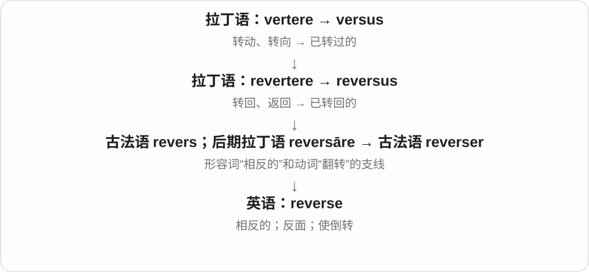

一个词涵盖方向、顺序、决定的翻转。reverse a decision 是撤销原决定；on the reverse 是在背面；in reverse 是倒序或倒挡。

**常见搭配与例句**

reverse the order；reverse a decision；put the car in reverse。

> Reverse the order of the last two paragraphs.

把最后两段的顺序调换一下。

> She carefully reversed the car out of the garage.

她小心地把车倒出了车库。

> Write your name on the reverse of the card.

把名字写在卡片背面。

**别混淆**

reverse 强调反向；revert 强调回到以前的状态。反向行驶未必回到起点。

### 10. diversity — 多样性；差异的丰富程度

**音标**：英 /daɪˈvɜːsəti/；美 /daɪˈvɜːrsəti/、/dɪˈvɜːrsəti/

**先抓住这个画面**

不只看数量多不多，还看是不是只有同一种：一千棵同种树数量很多，种类却未必丰富。

**怎么拆**

拉丁语 dīversitās，经法语 diversité 进入英语；现代与 diverse + -ity 对应。

**怎么变成今天的意思**

可说 biodiversity、cultural diversity、diversity of opinion。它要配合具体维度理解，不是所有“不同”都能用一个数字概括。

**常见搭配与例句**

cultural diversity；a diversity of views；biological diversity。

> The survey revealed a surprising diversity of opinions.

调查显示人们的意见出人意料地多样。

> The exhibition celebrates the diversity of local traditions.

展览展示并赞美当地传统的多样性。

**别混淆**

variety 也说种类；diversity 更常用于整体构成及差异分布的讨论。

### 11. versus — 对、对阵；与……相比较

**音标**：英 /ˈvɜːsəs/；美 /ˈvɜːrsəs/

**先抓住这个画面**

两方转身面对面：可以是球赛对手、诉讼双方，也可以是两种方案摆在一起比较。

**怎么拆**

直接借自拉丁语 versus“朝向、面对”；英语常缩写 vs. 或 v.，不是动词 verse 的复数。

**怎么变成今天的意思**

它连接双方，语法上是介词。写 cost versus quality，是比较成本和质量，不一定宣称两者永远不能兼得。

**常见搭配与例句**

A versus B；cost versus benefit；home versus away。

> The final is Northside versus Riverside.

决赛是北岸队对阵河畔队。

> The report compares speed versus accuracy.

报告比较了速度与准确性。

**别混淆**

against 常可换用，但 versus 尤其适合标题和双方比较；不要把 vs. 当成完整动词。

### 12. controversy — 争议；持续的公开争论

**音标**：英 /ˈkɒntrəvɜːsi/、/kənˈtrɒvəsi/；美 /ˈkɑːntrəvɜːrsi/

**先抓住这个画面**

围绕同一件事，人们转向相反的方向，各有坚持，争论因此持续下来。

**怎么拆**

拉丁语 contrōversia，来自 contrōversus“朝相反方向”；经法语或直接拉丁语借入。

**怎么变成今天的意思**

通常比一次口角范围大，可以围绕政策、研究或艺术作品。a controversy 是一场争议；without controversy 是没有引起争论。

**常见搭配与例句**

spark controversy；a controversy over；amid controversy。

> The new building design sparked controversy.

新建筑设计引发了争议。

> There is still controversy over how the results should be interpreted.

对于如何解释这些结果，仍存在争论。

**别混淆**

argument 可是一场争吵或一段论证；controversy 常是一个议题引起的多人、持续争论。

### 13. conversion — 转换；改建；改信；转化

**音标**：英 /kənˈvɜːʃən/、/kənˈvɜːʒən/；美 /kənˈvɜːrʒən/

**先抓住这个画面**

镜头对准“从 A 变成 B”这件事本身：怎样变、用了多久、完成了多少。

**怎么拆**

拉丁语 conversiō 经法语进入英语；现代与 convert 对应，-vert- / -vers- 的变化早在拉丁语词形中就存在。

**怎么变成今天的意思**

可说货币兑换、文件格式转换、建筑改造。营销里的 conversion 是访问者完成指定目标，如购买；要先说明目标，不能默认所有转化都是付款。

**常见搭配与例句**

currency conversion；a loft conversion；conversion rate。

> The conversion from miles to kilometres is straightforward.

英里换算成千米很直接。

> The warehouse conversion created twelve apartments.

这次仓库改建新增了十二套公寓。

**别混淆**

conversion 是转变；conversation 是交谈。先看 -versi- 与 -versa-。

### 14. diverse — 多种多样的；各不相同的

**音标**：英 /daɪˈvɜːs/；美 /daɪˈvɜːrs/

**先抓住这个画面**

大家没有转向同一个方向：背景、想法、种类各有不同，所以构成了多样的一组。

**怎么拆**

拉丁语 dīversus 是 dīvertere 的分词，形成“不同”的形容词，经法语 divers 进入英语。

**怎么变成今天的意思**

可形容物种、经验、意见或人群。a diverse group 通常是在某些明确维度上成员不同，不是说其中每个人都代表全部差异。

**常见搭配与例句**

diverse backgrounds；a diverse range；diverse opinions。

> The course attracts students from diverse backgrounds.

这门课吸引了背景各异的学生。

> The garden contains a diverse range of plants.

花园里种着多种多样的植物。

**别混淆**

different 比较差别；diverse 常强调一组对象内部种类丰富。

### 15. controversial — 有争议的；容易引起争论的

**音标**：英 /ˌkɒntrəˈvɜːʃəl/；美 /ˌkɑːntrəˈvɜːrʃəl/

**先抓住这个画面**

一提出就会有人赞成、有人强烈反对，难以让大家轻松达成共识。

**怎么拆**

源自后期拉丁语 contrōversiālis，与 contrōversia 同支；现代对应 controversy + -al。

**怎么变成今天的意思**

controversial 不自动说明观点错、危险或大胆，只说明它引起明显分歧。描述研究时，仍应另外解释争论点。

**常见搭配与例句**

a controversial decision；a controversial figure；highly controversial。

> The committee postponed its most controversial proposal.

委员会推迟了最有争议的提案。

> The book became controversial because of its account of the war.

这本书因对战争的叙述而引发争议。

**别混淆**

unpopular 是不受欢迎；controversial 常指不同群体态度分裂，不一定所有人都反对。

### 16. verse — 诗；诗行、诗节；歌曲的主歌；经文的一节

**音标**：英 /vɜːs/；美 /vɜːrs/

**先抓住这个画面**

犁耕到一行尽头，掉头开始下一行。这个“转行”的画面，后来借来表示文字的一行，尤其是有节奏的诗行。

**怎么拆**

拉丁语 versus 是独立名词“行、诗行”；经古英语 fers 和法语 vers 等路线进入英语，不是现代动词 turn 的缩写。

**怎么变成今天的意思**

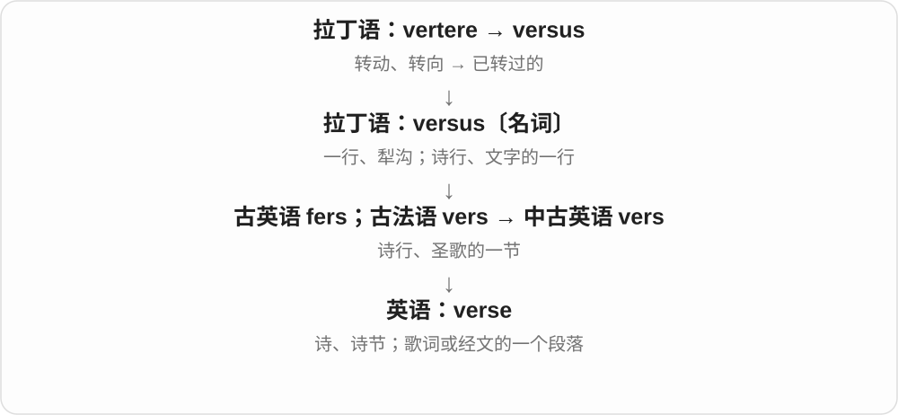

write in verse 是用诗体写；a verse 可是一节诗或歌词。歌曲里 verse 常推进故事，而 chorus 是反复出现的副歌。

**常见搭配与例句**

write verse；the first verse；a Bible verse。

> She wrote the story in verse.

她用诗体写了这个故事。

> The second verse describes the singer’s childhood.

第二段主歌讲的是歌手的童年。

**别混淆**

verse 可指诗体总称，也可数一节；prose 是普通散文体，不按诗的格律组织。

### 17. vertical — 竖直的；纵向的

**音标**：英 /ˈvɜːtɪkəl/；美 /ˈvɜːrtɪkəl/

**先抓住这个画面**

从脚下往头顶拉一根直线，就是最直观的 vertical。它并不是“正在转”，而是沿着“头顶”这条老支线走来的。

**怎么拆**

拉丁语 vertex 的词干 vertic- 加 -ālis，形成后期拉丁语 verticālis；经法语 vertical 借入。

**怎么变成今天的意思**

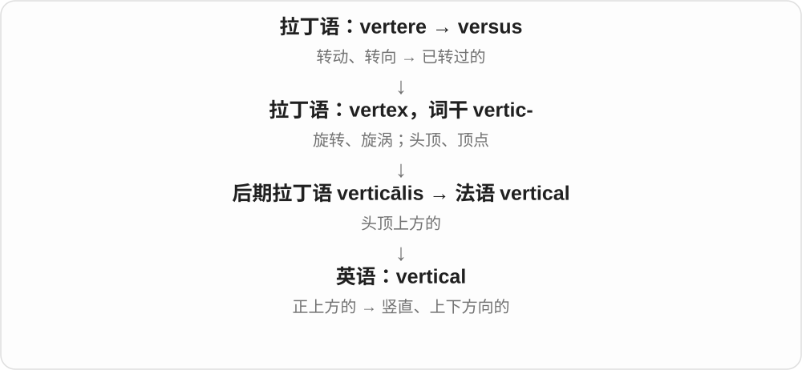

早期侧重“头顶上方”，后来常指与水平面垂直。vertical integration 在商业中是沿生产、供应链上下游整合。

**常见搭配与例句**

a vertical line；vertical stripes；vertical integration。

> Draw a vertical line down the centre of the page.

在页面中间画一条竖线。

> The ladder should not be completely vertical.

梯子不应完全直立。

**别混淆**

vertical 是竖直；perpendicular 是与某条线或某个面成直角，参照物不一定水平。

### 18. convert — 转换、改造；使改信；新信徒、新拥护者

**音标**：动词：英 /kənˈvɜːt/，美 /kənˈvɜːrt/；名词：英 /ˈkɒnvɜːt/，美 /ˈkɑːnvɜːrt/

**先抓住这个画面**

把东西从一种用途或状态转到另一种：车库变工作室，文件变另一种格式，原先反对的人也可能变成支持者。

**怎么拆**

经古法语 convertir 来自拉丁语 convertere；con- 在这个历史组合中有加强、合向的作用，不必硬译成“一起转”。

**怎么变成今天的意思**

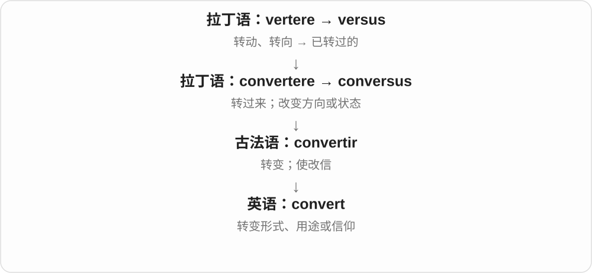

convert A into B 强调改造结果；convert to a religion 是改信。名词 a convert 重音前移，可严肃说新信徒，也可轻松说某种做法的新拥护者。

**常见搭配与例句**

convert into；convert from A to B；a convert to…。

> They converted the garage into a small studio.

他们把车库改成了一间小工作室。

> After trying the new keyboard, I became a convert.

试过新键盘后，我也成了它的拥护者。

**别混淆**

change 很宽泛；convert 常带可辨认的起点、终点或用途变化。

### 19. adverse — 不利的；有害的

**音标**：英 /ˈædvɜːs/、/ədˈvɜːs/；美 /ædˈvɜːrs/

**先抓住这个画面**

风迎面吹来，阻着你前进。从“朝着你、与你相对”，发展到“不帮你，反而造成困难”。

**怎么拆**

ad- + vertere → adversus，经法语进入英语；不是 a- 否定 diverse。

**怎么变成今天的意思**

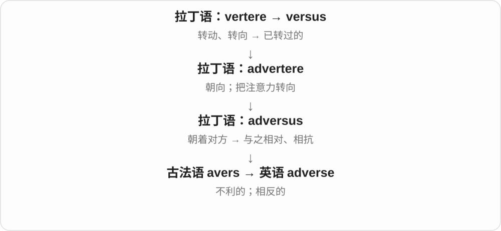

常修饰 conditions、effects、reaction。它描述结果或处境不利，不是在说某个人心里讨厌它。

**常见搭配与例句**

adverse weather；adverse effects；an adverse reaction。

> Adverse weather delayed the opening of the bridge.

恶劣天气推迟了大桥开放。

> The change had an adverse effect on local shops.

这个变化对当地商店产生了不利影响。

**别混淆**

adverse 是事情不利；averse 是人不愿接受，通常接 to。

### 20. advertisement — 广告；公告；能起宣传作用的人或事

**音标**：英 /ədˈvɜːtɪsmənt/；美 /ˌædvərˈtaɪzmənt/

**先抓住这个画面**

把“请注意这件事”做成一条可看到、听到的信息，就是一则 advertisement。

**怎么拆**

经法语 avertissement / advertissement“提示、通知”借入；现代能看成 advertise + -ment，但并非只有英语内部造词这一路线。

**怎么变成今天的意思**

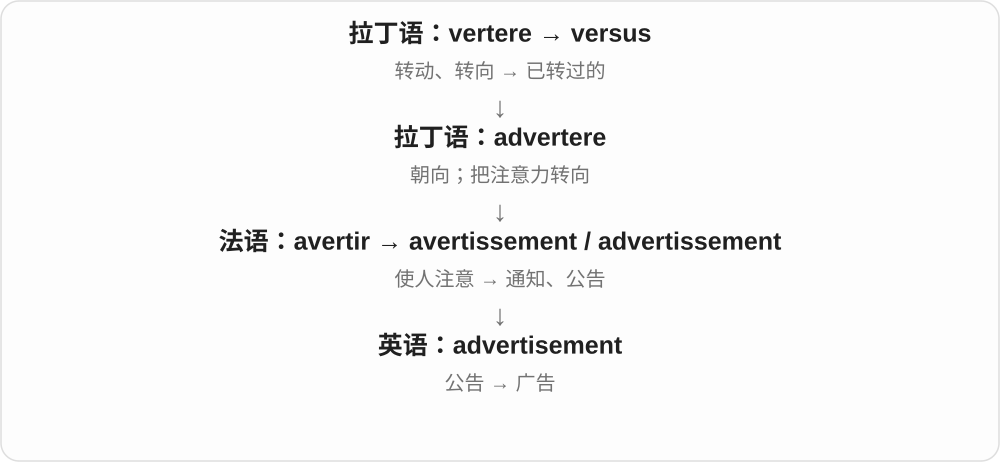

通常可数：an advertisement。英美常用读法的重音和词中元音差别明显。口语常缩短成 ad，英式也常用 advert。

**常见搭配与例句**

place an advertisement；a television advertisement；an advertisement for…。

> I saw an advertisement for the course at the library.

我在图书馆看到这门课程的广告。

> Her excellent work is a good advertisement for the training programme.

她出色的工作表现为这项培训计划做了很好的宣传。

**别混淆**

advertisement 是一则具体广告；advertising 是广告活动、行业或广告总称。

### 21. prose — 散文；散文体、普通行文

**音标**：英 /prəʊz/；美 /proʊz/

**先抓住这个画面**

语言顺着句子往前走，不要求按固定诗行和格律回转。小说、报道、说明书，大部分都用 prose。

**怎么拆**

拉丁语 prōsa ōrātiō“直陈的表达”缩为 prōsa，经法语进入英语。更早 prōvorsus 含 prō-“向前” + vorsus，即 versus 的旧形式。

**怎么变成今天的意思**

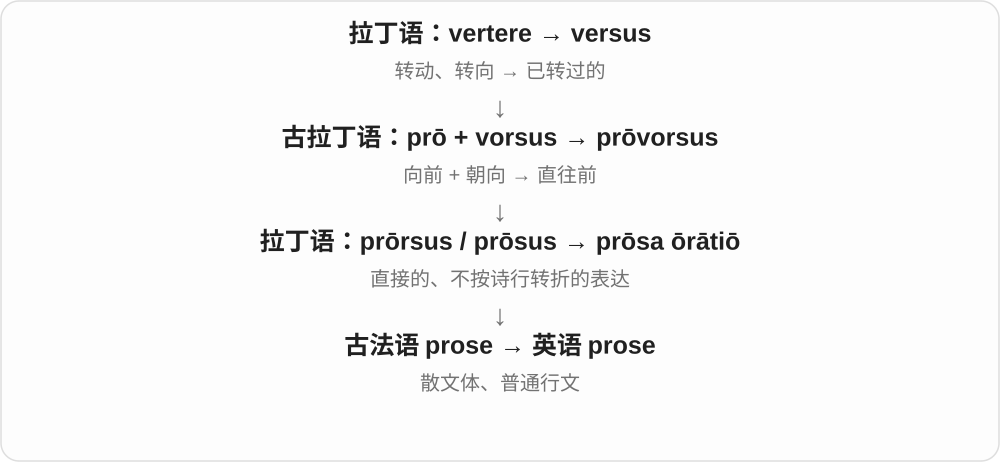

英语 prose 的范围比中文文体“散文”更大：小说也可属于 prose。它描述写法，不是在判断作品是不是有想象力。

**常见搭配与例句**

write in prose；clear prose；a prose poem。

> The introduction is written in clear, direct prose.

这篇引言用清楚直白的散文体写成。

> The anthology includes both verse and prose.

这本文集既收诗歌，也收散文体作品。

**别混淆**

verse 是诗体；prose 是散文体。prose poem“散文诗”提醒我们：没有分行格律，也能有诗意。

### 22. advertise — 做广告；宣传；公布征求

**音标**：英 /ˈædvətaɪz/；美 /ˈædvərtaɪz/

**先抓住这个画面**

把大家的注意力转向某样东西：“看这里，我们有这个产品／职位／消息。”

**怎么拆**

法语 advertir / avertir 的 advertiss- 形式参与形成英语 advertise；远源是 ad- + vertere，不是 ad“广告”加 vertise。

**怎么变成今天的意思**

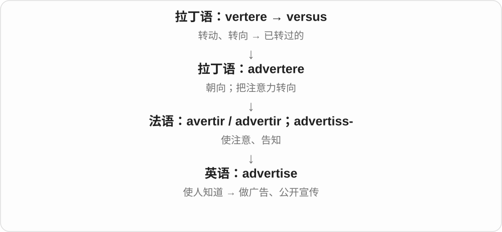

可以为产品做广告，也可以 advertise for a roommate“登广告找室友”。advertise a fact 还可说把某事到处宣扬。

**常见搭配与例句**

advertise a product；advertise for staff；advertise online。

> The café advertised for a part-time cook.

咖啡馆登广告招聘兼职厨师。

> The company advertises its products on local radio.

公司在当地电台宣传产品。

**别混淆**

advertise 强调向外传达、吸引注意；sell 才是卖出，做了广告未必成交。

### 23. versatile — 多才多艺的；多用途的

**音标**：英 /ˈvɜːsətaɪl/；美 /ˈvɜːrsətəl/、/ˈvɜːrsətaɪl/

**先抓住这个画面**

转到哪一边都能发挥作用：演员能演喜剧也能演悲剧，工具能做不止一项工作。

**怎么拆**

借自拉丁语 versātilis“容易转动的”；来自 versāre，不是英语 verse 加形容词尾。

**怎么变成今天的意思**

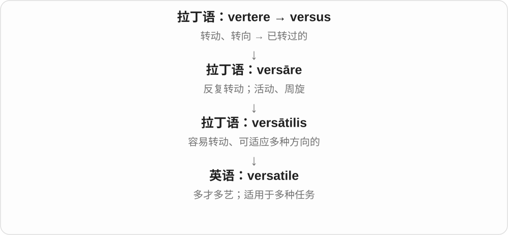

人物的 versatile 强调适应多种角色；物品的 versatile 强调用途广。它不保证每一种用途都做到顶尖。

**常见搭配与例句**

a versatile actor；a versatile tool；highly versatile。

> She is a versatile musician who plays both jazz and classical music.

她是个多才多艺的音乐人，爵士和古典音乐都能演奏。

> This versatile pan can go from the hob into the oven.

这口锅用途很灵活，既能放炉灶上，也能进烤箱。

**别混淆**

diverse 是种类不同；versatile 是一个人或东西能胜任多种情况。

### 24. universally — 普遍地；全体一致地

**音标**：英 /ˌjuːnɪˈvɜːsəli/；美 /ˌjuːnəˈvɜːrsəli/

**先抓住这个画面**

universally 把覆盖范围拉到大家：某事普遍被接受、适用于各处，或得到几乎一致的评价。

**怎么拆**

universal + -ly，修饰接受、适用、认可等动作或状态。

**怎么变成今天的意思**

自然语言中常有概括意味，例如 universally praised 不一定经过逐个人的调查；技术结论中的全称范围则需要严格限定。

**常见搭配与例句**

universally accepted；universally available；not universally true。

> The rule is not universally applicable.

这条规则并非在所有情况下都适用。

> Her patience was universally admired by the team.

团队成员都很佩服她的耐心。

**别混淆**

widely 是广泛；universally 更接近全体。not universally accepted 表示并非人人接受，不等于人人反对。

### 25. reversal — 逆转；撤销；反转

**音标**：英 /rɪˈvɜːsəl/；美 /rɪˈvɜːrsəl/

**先抓住这个画面**

局面拐了一百八十度：领先变落后，支持变反对，原来的决定被取消。

**怎么拆**

reverse + 名词后缀 -al；这里不是表示形容词的 -al。

**怎么变成今天的意思**

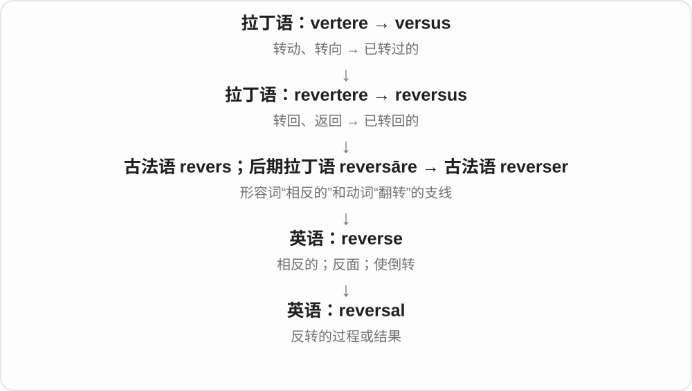

a reversal of policy 是政策方向改变；a reversal of fortune 是命运、形势翻转。它不一定是回到最早状态。

**常见搭配与例句**

a sudden reversal；a reversal of policy；role reversal。

> The announcement marked a complete reversal of policy.

这项公告标志着政策彻底转向。

> In a surprising role reversal, the student became the teacher’s coach.

角色出人意料地对调了：学生成了老师的教练。

**别混淆**

reversal 对应 reverse；reversion 对应 revert，更突出回归旧状态。

### 26. convertible — 可转换的；可兑换的；敞篷车

**音标**：英 /kənˈvɜːtəbəl/；美 /kənˈvɜːrtəbəl/

**先抓住这个画面**

一件东西能变换形态或用途。汽车车顶收起来，封闭车厢变敞开，“可变换的车”便成了敞篷车的名称。

**怎么拆**

古法语 convertible 来自后期拉丁语 convertibilis；现代可辨 convert + -ible，但整词的历史早于现代英语这种拆法。

**怎么变成今天的意思**

a convertible sofa 可改成床；convertible currency 是能兑换其他货币的货币。敞篷车名词来自这个形容词的专门化。

**常见搭配与例句**

a convertible car；a convertible sofa；convertible currency。

> The sofa is convertible into a bed.

这张沙发能变成床。

> They rented a convertible for the coastal drive.

他们租了一辆敞篷车沿海岸自驾。

**别混淆**

convertible 强调能变换；reversible 强调能反转或恢复，也可指两面可用。

### 27. conversely — 反过来说；相反地

**音标**：英 /ˈkɒnvɜːsli/、/kənˈvɜːsli/；美 /ˈkɑːnvɜːrsli/、/kənˈvɜːrsli/

**先抓住这个画面**

把刚才的关系掉个方向，让读者再看另一面。

**怎么拆**

converse“相反的” + -ly；来自相反义的支线，不是“以聊天的方式”。

**怎么变成今天的意思**

适合写成配对对比：低温拖慢过程；反过来，高温使它加快。它比 however 更强调关系翻转。

**常见搭配与例句**

Conversely, …；and conversely。

> A larger font is easier to read; conversely, it leaves less room on the page.

字体大更容易读；反过来说，它也会挤占页面空间。

> Some readers enjoy the detail. Conversely, others find it distracting.

有些读者喜欢这些细节；相反，另一些人觉得它们分散注意力。

**别混淆**

however 只是转折；conversely 常把前后条件或方向对换，不能在任何转折处都替换。

### 28. diversion — 改道；转移注意的事；消遣

**音标**：英 /daɪˈvɜːʃən/、/daɪˈvɜːʒən/；美 /dɪˈvɜːrʒən/、/daɪˈvɜːrʒən/

**先抓住这个画面**

主线暂时拐了个弯：公路封了走旁路，注意力被引走，忙碌之余找点乐子。

**怎么拆**

来自中世纪拉丁语 diversiō，根源是 dīvertere；与 divert 对应。

**怎么变成今天的意思**

英式道路标志上的 diversion 是绕行路线。create a diversion 是制造动静，把别人的注意力引开。消遣义通常比较轻松。

**常见搭配与例句**

a traffic diversion；create a diversion；a pleasant diversion。

> We followed the diversion through two nearby villages.

我们沿绕行路线穿过了附近两个村庄。

> A short walk was a welcome diversion from paperwork.

暂时放下文书工作散个步，让人很放松。

**别混淆**

diversion 强调被导离原路线；detour 更直指绕路；distraction 更强调注意力被打断。

### 29. converse — 交谈；相反的；相反情况、逆命题

**音标**：动词：英 /kənˈvɜːs/，美 /kənˈvɜːrs/；名词、形容词：英 /ˈkɒnvɜːs/，美 /ˈkɑːnvɜːrs/

**先抓住这个画面**

这是两条老支线碰巧拼在一起：与人来往，变成“交谈”；把方向转过来，变成“相反情况”。重音帮你区分它们。

**怎么拆**

交谈动词经法语 converser 来自 conversārī“来往”；相反义来自 convertere 的分词 conversus“已转过来的”。

**怎么变成今天的意思**

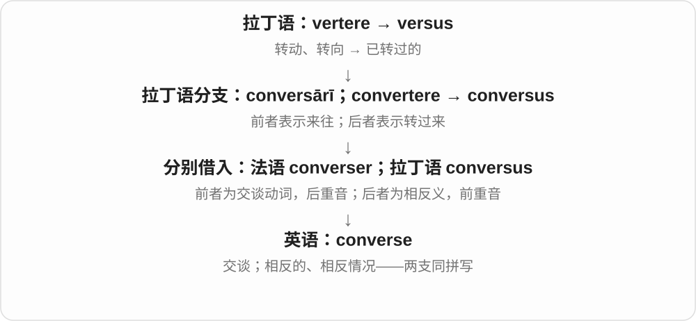

converse with someone 比 chat 正式。the converse is true 表示反过来也成立。逻辑学中把“若 P 则 Q”换成“若 Q 则 P”是 converse，原命题真并不保证逆命题真。

**常见搭配与例句**

converse with；converse in English；the converse of a statement。

> They conversed in French throughout the journey.

他们一路都用法语交谈。

> All squares are rectangles, but the converse is not true.

所有正方形都是长方形，但反过来并不成立。

**别混淆**

converse“交谈”不是“唱诗”；converse“逆命题”也不等于简单给原句加 not。

### 30. vortex — 旋涡；旋转的气流或液流；把人卷入的混乱局面

**音标**：英 /ˈvɔːteks/；美 /ˈvɔːrteks/

**先抓住这个画面**

水或空气绕着中心旋转，旁边的东西也可能被卷着走。比喻中则是事情越陷越深，让人难以脱身。

**怎么拆**

借自拉丁语 vortex，是 vertex 的异形。英语两词走出不同常用义：vortex 保留旋涡，vertex 常是顶点。

**怎么变成今天的意思**

复数 vortices 或 vortexes。a vortex of confusion 是混乱不断把人卷进去的画面，未必在讲真实物理旋转。

**常见搭配与例句**

a water vortex；a vortex of activity；be drawn into a vortex。

> Leaves spun in a small vortex beside the wall.

树叶在墙边的小旋风里打转。

> One missed deadline pulled the team into a vortex of rushed decisions.

一次错过截止日期，让团队陷入了不断仓促决策的混乱中。

**别混淆**

whirlpool 具体是水旋涡；vortex 可用于空气、液体，也常作比喻。

### 31. advert — 广告〔主要英式〕；提及、把注意转向〔正式动词〕

**音标**：名词：英 /ˈædvɜːt/，美 /ˈædvɜːrt/；动词：英 /ədˈvɜːt/，美 /ədˈvɜːrt/

**先抓住这个画面**

日常说 an advert，就是把 advertisement 缩短。另有一个老动词 advert to，像把谈话镜头转向某个话题。

**怎么拆**

广告名词是 advertisement 的截短；动词经法语 advertir 来自拉丁语 advertere，是另一条较早的借入线。

**怎么变成今天的意思**

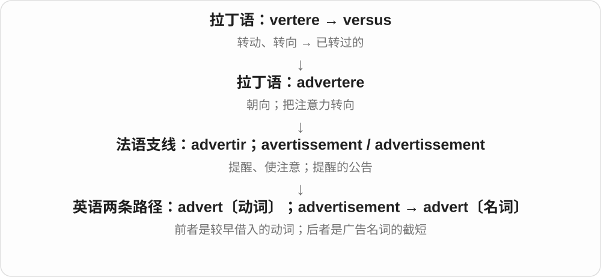

广告名词重音在前；动词重音在后且常接 to。日常表达“给产品做广告”用 advertise，不需硬用少见的 advert 动词。

**常见搭配与例句**

a TV advert；place an advert；advert to a point。

> The advert appeared between two news programmes.

这则广告在两档新闻节目之间播出。

> The speaker briefly adverted to the earlier disagreement.

发言人简要提及了先前的分歧。

**别混淆**

ad 是英美都常见的广告缩写；advert 作名词尤其常见于英式英语。

### 32. vertically — 竖直地；沿上下方向

**音标**：英 /ˈvɜːtɪkli/；美 /ˈvɜːrtɪkli/

**先抓住这个画面**

告诉你东西怎么排、怎么移动：往上叠，不是向左右铺开。

**怎么拆**

vertical + -ly；读音里 -cally 通常压缩为 /kli/。

**怎么变成今天的意思**

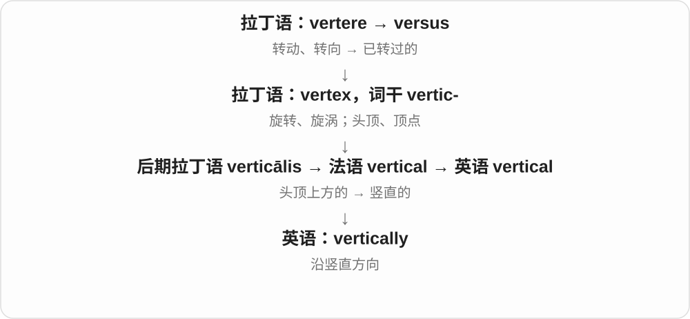

常与 stack、rise、hang、align 配合。网页 vertically aligned 指元素沿竖直方向对齐，具体对齐点仍要看布局。

**常见搭配与例句**

stack vertically；rise vertically；align vertically。

> The boxes were stacked vertically to save floor space.

箱子竖着叠放，以节省地面空间。

> The cable hangs vertically from the ceiling.

电缆从天花板竖直垂下。

**别混淆**

vertically 是方向；upward 只指向上，vertical 的移动也可能向下。

### 33. inadvertently — 无意中；不小心地

**音标**：英 /ˌɪnədˈvɜːtəntli/；美 /ˌɪnədˈvɜːrtəntli/

**先抓住这个画面**

动作做了，结果也发生了，但你原本没想这么干：手一滑，把整段话删了。

**怎么拆**

inadvertent + -ly。

**怎么变成今天的意思**

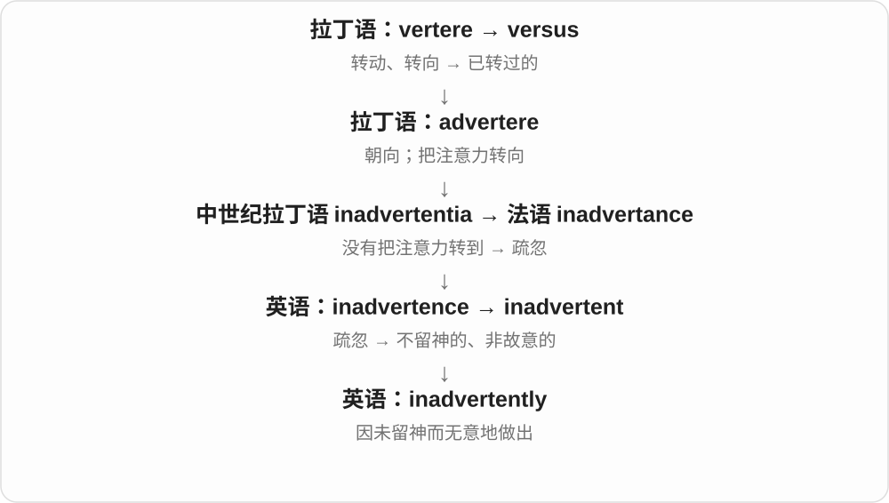

常用于解释删除、遗漏、透露等非预期行为，语气比 by mistake 稍正式。

**常见搭配与例句**

inadvertently delete；inadvertently reveal；inadvertently omit。

> I inadvertently sent the unfinished draft to everyone.

我不小心把尚未完成的草稿发给了所有人。

> The caption inadvertently revealed the ending of the film.

图片说明无意中泄露了电影结局。

**别混淆**

deliberately 是故意；inadvertently 是无意。它与 unwillingly“不情愿地”不同，后者可能明知自己在做。

### 34. divert — 使改道；转移；使消遣

**音标**：英 /daɪˈvɜːt/；美 /daɪˈvɜːrt/、/dɪˈvɜːrt/

**先抓住这个画面**

原本沿一条路前进，把它拐到另一条路：可以是车辆、水流、资金，也可以是注意力。

**怎么拆**

dī-/dis-“分开” + vertere，形成拉丁语 dīvertere；经法语 divertir 借入。

**怎么变成今天的意思**

交通改道是最直观的义。divert attention 是把注意力引走；消遣义则是让心思暂时离开工作和忧虑。

**常见搭配与例句**

divert traffic；divert attention from；divert funds to…。

> The police diverted traffic around the flooded road.

警方引导车辆绕过被淹的道路。

> The joke briefly diverted her from her worries.

这个笑话让她暂时忘了烦恼。

**别混淆**

distract 常使人分心；divert 强调把原有流向导向别处，也可有明确目的。

### 35. inverse — 相反的、逆向的；逆运算、逆元

**音标**：英 /ˌɪnˈvɜːs/、/ˈɪnvɜːs/；美 /ɪnˈvɜːrs/、/ˈɪnvɜːrs/

**先抓住这个画面**

原来的操作把 A 送到 B，inverse 想办法把 B 送回 A；或一个量增加，另一个量往相反方向变。

**怎么拆**

借自拉丁语 inversus“已翻转的”，是 invertere 的分词；in- 此处不是否定。

**怎么变成今天的意思**

inverse operation 是逆运算；inverse relationship 指反向变化，不一定严格成反比例。数学上的 inverse 要看是在说函数、矩阵还是乘法。

**常见搭配与例句**

an inverse relationship；the inverse function；the inverse of…。

> Subtraction is the inverse operation of addition.

减法是加法的逆运算。

> The study found an inverse relationship between the two measures.

研究发现这两个指标呈反向关系。

**别混淆**

opposite 广泛说相反；inverse 在数学里通常有精确定义，不能仅凭样子反着就算。

### 36. converter — 转换器；转换设备、程序

**音标**：英 /kənˈvɜːtə/；美 /kənˈvɜːrtər/

**先抓住这个画面**

东西交进去是 A 格式，出来是 B 格式；中间负责变换的工具就是 converter。

**怎么拆**

convert + -er；也有 convertor 拼写。

**怎么变成今天的意思**

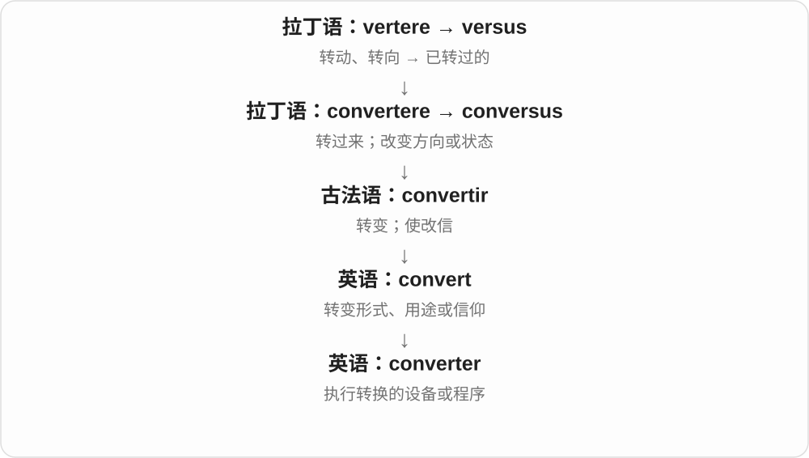

可以是电源设备、文件转换程序，也可以是汽车 catalytic converter“催化转化器”。转换器怎样工作，要看它实际转化的对象。

**常见搭配与例句**

a currency converter；a file converter；a voltage converter。

> The online converter changed the document into a PDF.

在线转换工具把文档转成了 PDF。

> This voltage converter is too heavy to carry in a small bag.

这个电压转换器太重，不方便放在小包里携带。

**别混淆**

adapter 可以只改变接口形状；converter 常涉及信号、格式或电量形式的转换，二者具体功能仍看产品。

### 37. traverse — 穿越；横越；横穿路线

**音标**：动词：英 /trəˈvɜːs/，美 /trəˈvɜːrs/；名词也读英 /ˈtrævəs/，美 /ˈtrævərs/

**先抓住这个画面**

从一边走到另一边，穿过一整片区域；攀爬时也可沿岩壁横着移动。

**怎么拆**

古法语 traverser，经通俗拉丁语形式追到 transversāre、trānsversus“横过”；与 transverse 同源而非后者简单漏写 n。

**怎么变成今天的意思**

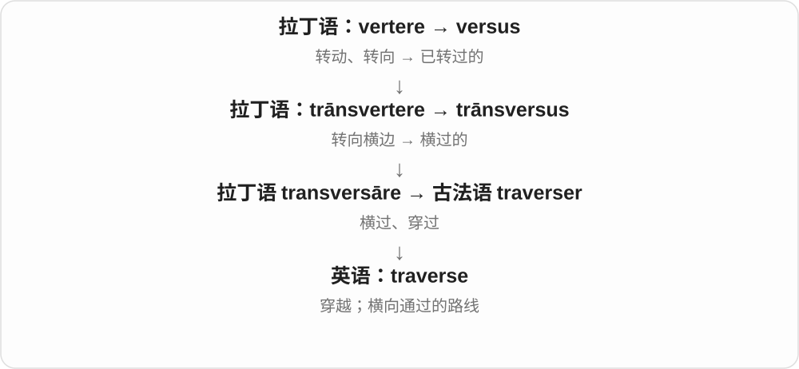

比 cross 书面，常用于地形、空间。计算机 traverse a tree 则把“经过”比喻为按一定规则访问节点。

**常见搭配与例句**

traverse a desert；traverse a slope；traverse a graph。

> The path traverses the valley before climbing into the hills.

小路穿过山谷，然后向山丘延伸。

> The climber completed a difficult traverse across the rock face.

攀登者完成了沿岩壁的一段艰难横移。

**别混淆**

travel 是旅行；traverse 明确强调穿过一个区域或结构。

### 38. adversity — 逆境；困境

**音标**：英 /ədˈvɜːsəti/；美 /ədˈvɜːrsəti/

**先抓住这个画面**

不是碰到一件小麻烦，而是感觉生活总在迎面阻挡你：经济困难、失去机会、连续受挫。

**怎么拆**

拉丁语 adversitās，经古法语 adversité 借入；现代对应 adverse + -ity。

**怎么变成今天的意思**

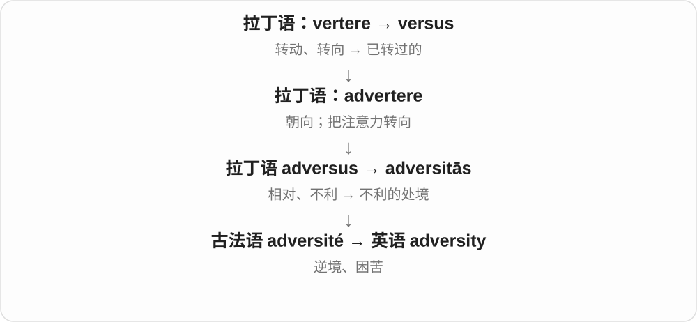

常作不可数名词，强调困难环境及人如何应对。正式或文学用法中也有复数 adversities，指种种磨难。

**常见搭配与例句**

in the face of adversity；overcome adversity；times of adversity。

> The family stayed close in the face of adversity.

面对逆境，这家人始终相互扶持。

> Her memoir describes years of adversity without self-pity.

她的回忆录描述了多年的坎坷，却没有自怜。

**别混淆**

difficulty 可是一道难题；adversity 往往是一段持续的不利处境。

### 39. advertiser — 广告客户；登广告的人或机构

**音标**：英 /ˈædvətaɪzə/；美 /ˈædvərtaɪzər/

**先抓住这个画面**

想让人看到自己产品或消息，并为广告安排出资或委托的一方。

**怎么拆**

advertise + -er。

**怎么变成今天的意思**

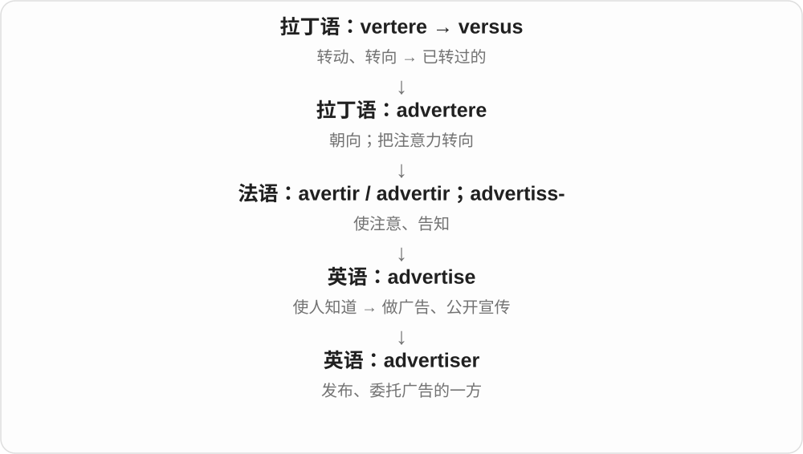

常指品牌、商家等广告主，不一定是实际画海报、写文案的工作人员。新闻网站依靠 advertisers 付费投放获得收入。

**常见搭配与例句**

attract advertisers；a major advertiser；an online advertiser。

> The magazine lost several major advertisers last year.

杂志去年失去了几家主要广告客户。

> Advertisers must clearly identify paid promotions.

广告主必须清楚标明付费推广内容。

**别混淆**

advertiser 常是广告客户；advertising agency 是帮客户制作、投放广告的代理机构。

### 40. revert — 恢复、回到原状；重新采用旧做法；归还、回复归属

**音标**：英 /rɪˈvɜːt/；美 /rɪˈvɜːrt/

**先抓住这个画面**

离开旧状态走了一段，又转回原来的样子：新方案不好用，便重新用旧方案。

**怎么拆**

re-“回” + vertere，形成拉丁语 revertere；经古法语 revertir 等进入英语。

**怎么变成今天的意思**

常接 to：revert to the old system。在一些地区商务英语中也表示“回复”，但跨地区沟通要表达回复邮件时，用 reply 更直接。

**常见搭配与例句**

revert to old habits；revert to the original plan；revert to its owner。

> When the new system failed, we reverted to paper records.

新系统失灵后，我们重新采用了纸质记录。

> Under the agreement, ownership will revert to the city.

根据协议，所有权将重新归市政府所有。

**别混淆**

reverse 是方向翻转；revert 是状态回归。通常不需要再加 back，因为“回”已在词义中。

### 41. pervert — 歪曲、败坏；性变态者〔带侮辱意味的称呼〕

**音标**：动词：英 /pəˈvɜːt/，美 /pərˈvɜːrt/；名词：英 /ˈpɜːvɜːt/，美 /ˈpɜːrvɜːrt/

**先抓住这个画面**

一套本来为公正或真实服务的东西，被人硬扭到另一边，反过来帮错误做事。

**怎么拆**

per-“彻底” + vertere → 拉丁语 pervertere，经法语 pervertir 进入英语；名词的人物义是后来的发展。

**怎么变成今天的意思**

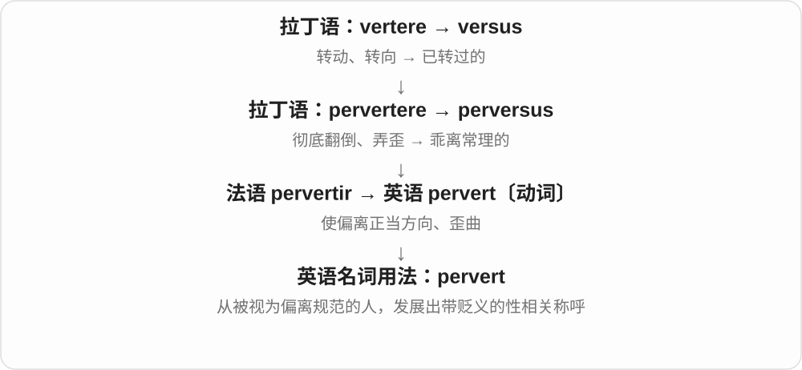

pervert the course of justice 是妨碍、歪曲司法公正。名词常是骂人标签，不是可靠的医学诊断；动词不必涉及性。

**常见搭配与例句**

pervert justice；pervert the truth；pervert the original purpose。

> The officials were accused of trying to pervert the course of justice.

这些官员被指控试图妨碍司法公正。

> The edited quotation perverted the speaker’s meaning.

这段经过删改的引文歪曲了讲话者的意思。

**别混淆**

distort 可指一般变形或误传；pervert 常强调把原本正当的目的扭坏，批评更强。

### 42. reversible — 可逆的；两面都能用的

**音标**：英 /rɪˈvɜːsəbəl/；美 /rɪˈvɜːrsəbəl/

**先抓住这个画面**

做了以后还能转回来，或者翻到另一面照样能用。

**怎么拆**

现代对应 reverse + -ible；词源也常联系法语 réversible。

**怎么变成今天的意思**

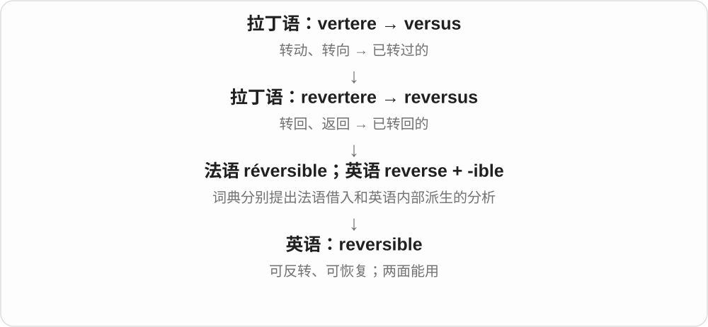

衣服 reversible 是两面可穿；a reversible change 是变化能够被逆转。科学领域的“可逆”可能有更严格条件，不能只按日常意思判定。

**常见搭配与例句**

a reversible jacket；a reversible process；fully reversible。

> The jacket is reversible, with blue on one side and grey on the other.

这件夹克两面都能穿，一面蓝色，一面灰色。

> The editor confirmed that the change was reversible.

编辑确认这项修改可以撤回。

**别混淆**

removable 是能拆掉；reversible 是能反转或恢复。拆掉某物后也可能留永久痕迹。

### 43. versatility — 多面才能；多功能性；适应多种用途的能力

**音标**：英 /ˌvɜːsəˈtɪləti/；美 /ˌvɜːrsəˈtɪləti/

**先抓住这个画面**

关注的不是某一招有多厉害，而是换一个任务、角色或环境后还能不能很好地发挥。

**怎么拆**

versatile + -ity；重音移到 -til-，读音与 versatile 的词尾不同。

**怎么变成今天的意思**

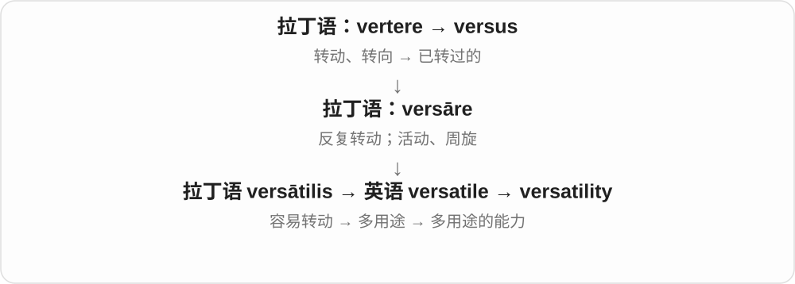

常夸演员、运动员或工具的适用范围。demonstrate versatility 是展示自己能做不同类型的事。

**常见搭配与例句**

demonstrate versatility；the versatility of；remarkable versatility。

> The role gives the actor a chance to show his versatility.

这个角色让演员有机会展示多方面的表演能力。

> We chose the tool for its versatility rather than its low price.

我们选这个工具是看中它的多用途，而不是价格低。

**别混淆**

flexibility 重在可以调整；versatility 重在能胜任多种不同任务。

### 44. adversary — 对手；敌手

**音标**：英 /ˈædvəsəri/；美 /ˈædvərseri/

**先抓住这个画面**

站在与你相对的一边、争取相反结果的人。可以很强硬，也可以是互相尊重的竞赛对手。

**怎么拆**

拉丁语 adversārius“处在对面的”，经法语 aversaire 等形式借入；现代形式可联系 adverse + -ary。

**怎么变成今天的意思**

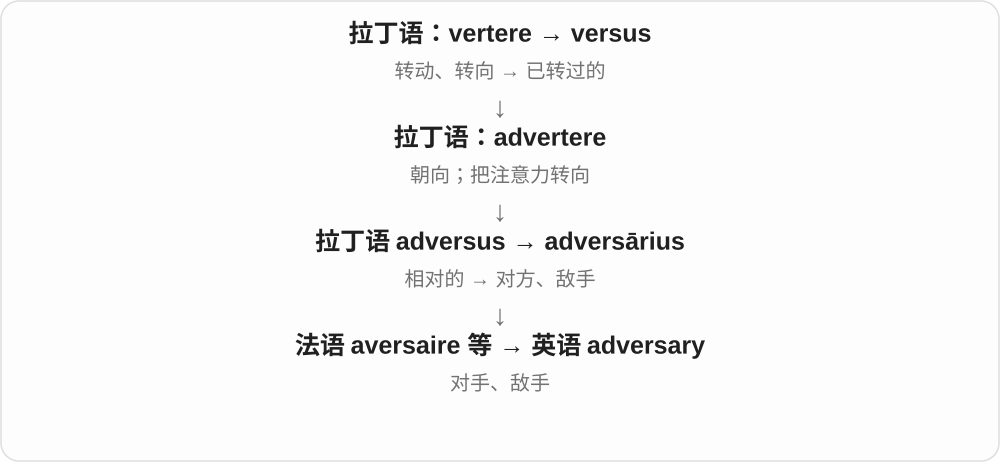

语气较 opponent 正式，有时显得冲突更强，但并不必然表示私仇。a worthy adversary 是值得认真对待的强劲对手。

**常见搭配与例句**

a formidable adversary；a political adversary；face an adversary。

> She treated her adversary with respect throughout the debate.

整场辩论中，她都尊重对手。

> The champion finally met a formidable adversary.

这位冠军终于遇到了一个强劲的对手。

**别混淆**

enemy 常带敌对与伤害意味；adversary 可只是竞争或辩论中的对方。

### 45. irreversible — 不可逆转的；无法恢复的

**音标**：英 /ˌɪrɪˈvɜːsəbəl/；美 /ˌɪrɪˈvɜːrsəbəl/

**先抓住这个画面**

门已经越过去，原路回不来了；变化造成的结果不能被完整撤销。

**怎么拆**

ir- 是否定 in- 在 r 前的形式，接 reversible；不是 ir- 表示“向内”。

**怎么变成今天的意思**

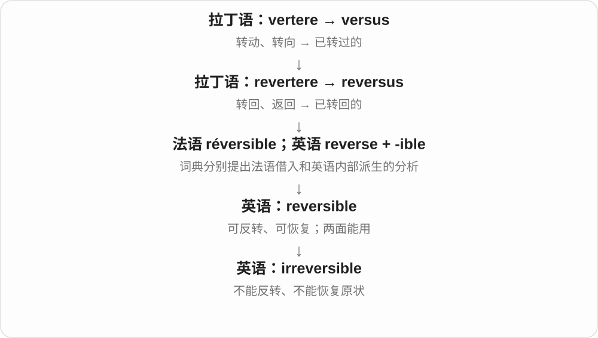

常修饰 damage、change、loss。它说的是能否恢复，而不只是恢复很慢、很贵。

**常见搭配与例句**

irreversible damage；an irreversible change；irreversible loss。

> Fire caused irreversible damage to the original manuscript.

大火给手稿原件造成了无法挽回的损害。

> The software asks for confirmation before an irreversible deletion.

软件在不可恢复的删除操作前会要求确认。

**别混淆**

irreversible 是不能逆转；difficult to reverse 只是难以逆转，强度不同。

### 46. adversely — 不利地；有害地

**音标**：英 /ˈædvɜːsli/、/ədˈvɜːsli/；美 /ædˈvɜːrsli/

**先抓住这个画面**

某个变化把事情往坏方向推了一把，adversely 标明这种影响的方向。

**怎么拆**

adverse + -ly。

**怎么变成今天的意思**

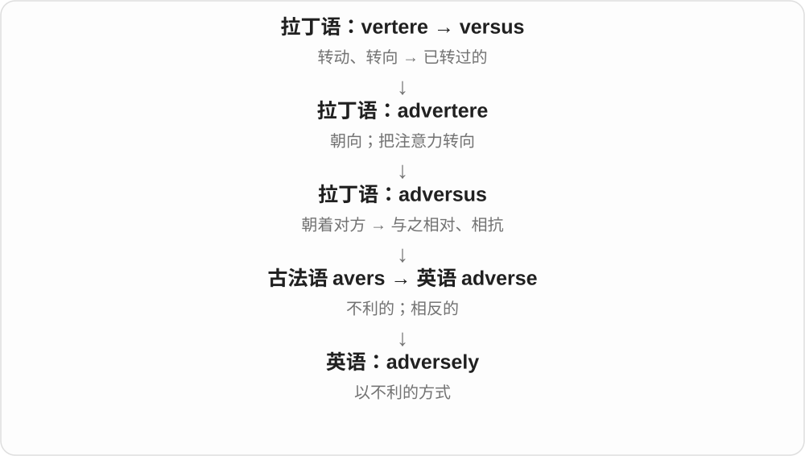

常放在 affect、influence 前后，写 adversely affect。它不说明伤害究竟多大，程度要另给证据。

**常见搭配与例句**

adversely affect；be adversely affected；respond adversely。

> The noise adversely affected her concentration.

噪声影响了她集中注意力。

> Small businesses were adversely affected by the road closure.

道路封闭给小商户带来了不利影响。

**别混淆**

adversely affected 是受到负面影响；affected 单独出现可以是正面也可以是负面。

### 47. transverse — 横向的；横过的

**音标**：英 /trænzˈvɜːs/、/trænsˈvɜːs/；美 /trænzˈvɜːrs/、/trænsˈvɜːrs/

**先抓住这个画面**

看一根长木棍，沿着长度是纵向，拦腰切过去就是横向。transverse 要看相对于哪条主方向。

**怎么拆**

trāns-“横过” + vertere → trānsvertere，其分词 trānsversus 借入英语。

**怎么变成今天的意思**

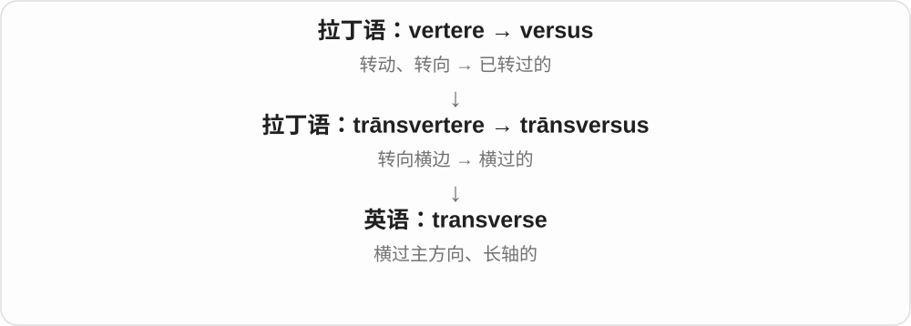

transverse section 是横切面。transverse wave 是振动方向与传播方向垂直的横波；“横”不一定是纸面左右方向。

**常见搭配与例句**

a transverse section；a transverse beam；a transverse wave。

> The transverse beam supports the roof.

这根横梁支撑着屋顶。

> A transverse section reveals the rings inside the stem.

横切面显示出茎内部的环状结构。

**别混淆**

horizontal 以地平面为参照；transverse 以物体长轴或传播方向为参照。

### 48. inversion — 倒置；倒装；反转；逆温

**音标**：英 /ɪnˈvɜːʃən/；美 /ɪnˈvɜːrʒən/

**先抓住这个画面**

平常 A 在前、B 在后，现在把位置或关系翻了过来。

**怎么拆**

借自拉丁语 inversiō，来自 invertere 的分词词干 invers-；不是所有义都从英语动词现造。

**怎么变成今天的意思**

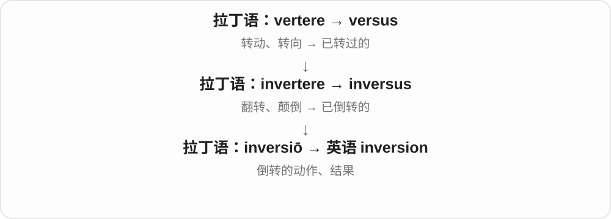

语法倒装改变常见词序；temperature inversion 指气温随高度上升的特殊层结，反转的是通常的温度趋势，不是天空翻了个面。

**常见搭配与例句**

subject–verb inversion；a temperature inversion；an inversion of roles。

> The question uses subject–verb inversion.

这个问句采用主谓倒装。

> The ending creates an unexpected inversion of the characters’ roles.

结尾出人意料地颠倒了人物的角色。

**别混淆**

inversion 强调结构或关系倒过来；conversion 是变成另一形式，未必方向相反。

### 49. aversion — 厌恶；强烈的不愿接受

**音标**：英 /əˈvɜːʃən/、/əˈvɜːʒən/；美 /əˈvɜːrʒən/

**先抓住这个画面**

一想到某件事，心里就想转身躲开；把这种抵触感叫作 aversion。

**怎么拆**

直接借自拉丁语 āversiō“转离”；现代与 averse 对应，不是英语 averse 随意换个词尾。

**怎么变成今天的意思**

常用 an aversion to。可以是对味道的强烈厌恶，也可以是对冒险、冲突等的抵触。

**常见搭配与例句**

an aversion to crowds；a strong aversion；risk aversion。

> He has a strong aversion to the smell of boiled cabbage.

他很讨厌煮卷心菜的气味。

> Her aversion to conflict sometimes makes decisions difficult.

她对冲突的抵触有时让决策变得困难。

**别混淆**

dislike 是不喜欢；aversion 常更强，带主动回避的倾向。

### 50. diversification — 多样化；业务多元化

**音标**：英 /daɪˌvɜːsɪfɪˈkeɪʃən/；美 /dɪˌvɜːrsəfɪˈkeɪʃən/、/daɪˌvɜːrsəfɪˈkeɪʃən/

**先抓住这个画面**

把“只走一条路”逐渐变成“有几条不同的路”的过程。

**怎么拆**

中世纪拉丁语 diversificātiō 与英语 diversify 同源；现代配成 diversify / diversification。

**怎么变成今天的意思**

常用于经济、业务和生态等讨论。它描述范围扩展；扩展得是否成功、是否降低风险，还要看具体安排。

**常见搭配与例句**

economic diversification；product diversification；a diversification strategy。

> The city’s plan encourages economic diversification.

这座城市的规划鼓励经济多元化。

> Diversification of the menu brought more vegetarian customers.

菜单种类增加后，餐厅吸引了更多素食顾客。

**别混淆**

diversity 是已有的多样状态；diversification 是增加这种多样性的过程。

### 51. subversive — 具有颠覆性的；颠覆者

**音标**：英 /səbˈvɜːsɪv/；美 /səbˈvɜːrsɪv/

**先抓住这个画面**

一句笑话、一个故事或一种行为，让原来不可质疑的规则开始站不稳。

**怎么拆**

以拉丁语 subversus 的 subvers- 词干配 -ive；现代与 subvert、subversion 互相对应。

**怎么变成今天的意思**

政治语境可能带警惕或谴责；艺术评论中 a subversive comedy 可以赞扬它挑战惯例。名词 a subversive 指被看作从事颠覆的人。

**常见搭配与例句**

subversive humour；subversive ideas；a subversive work。

> Her subversive humour makes familiar rules look absurd.

她带颠覆性的幽默让熟悉的规则显得荒唐。

> Officials described the pamphlet as subversive.

官员们称这份小册子具有颠覆性。

**别混淆**

controversial 是引发争论；subversive 进一步暗示挑战权威或既有规则。

### 52. vertex — 顶点；角点；图的节点；头顶

**音标**：英 /ˈvɜːteks/；美 /ˈvɜːrteks/

**先抓住这个画面**

古词里有旋转、头顶、最高处的含义。数学接过“顶端、角点”这条线，把几条边相接的点也叫 vertex。

**怎么拆**

直接借自拉丁语 vertex，变格词干 vertic-；复数通常 vertices。它与 vortex 是拉丁语的异形同源词，不是英语里一个改错了字母。

**怎么变成今天的意思**

三角形的三个角点都叫 vertices，并非只有画在最上面的点。图论里的 vertex 是节点；抛物线的 vertex 是曲线转折处的顶点。

**常见搭配与例句**

the vertex of a triangle；a graph vertex；vertices and edges。

> Mark each vertex of the triangle with a letter.

用一个字母标出三角形的每个顶点。

> Each vertex in the diagram represents a station.

图中的每个节点代表一座车站。

**别混淆**

apex 常强调尖端或最高点；vertex 在数学中按结构定义，不保证位置最高。

### 53. perverse — 故意作对的；反常、不合常理的

**音标**：英 /pəˈvɜːs/；美 /pərˈvɜːrs/

**先抓住这个画面**

明明顺着做就能解决，却偏往相反方向拧；也可以说一套规则竟鼓励了它本想阻止的行为。

**怎么拆**

拉丁语 perversus，经法语 pervers 进入英语；不是 per + verse“每首诗”。

**怎么变成今天的意思**

a perverse incentive 是“反向激励”：例如按维修次数付酬，反而不鼓励一次修好。perverse pleasure 可说从不该高兴的事里得到古怪满足。

**常见搭配与例句**

perverse incentives；a perverse decision；take perverse pleasure in…。

> Paying for each repair created a perverse incentive to leave the problem unresolved.

按每次维修付费，反而造成了不彻底修好问题的激励。

> Out of perverse curiosity, he opened the box marked “Do not open.”

出于一种偏要反着来的好奇，他打开了标着“勿开”的盒子。

**别混淆**

perverse 常是拧巴、不合常理；perverted 往往有更强的道德或性方面贬义。

### 54. perverted — 被歪曲的；扭曲、败坏的；性变态的〔贬义〕

**音标**：英 /pəˈvɜːtɪd/；美 /pərˈvɜːrtɪd/

**先抓住这个画面**

原来该朝公正、关怀或真实走的东西，已经被扭成了另一副样子。

**怎么拆**

pervert + -ed；形容词取自“被扭坏”的结果。

**怎么变成今天的意思**

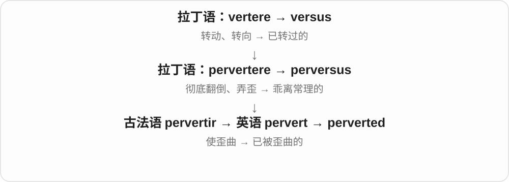

a perverted sense of justice 是扭曲的正义观。用于性相关语境时带强烈评判，不适合拿它当对别人喜好的客观分类。

**常见搭配与例句**

a perverted sense of justice；a perverted version of an ideal。

> The villain acts out of a perverted sense of justice.

这个反派按自己扭曲的正义观行事。

> The rule became a perverted version of its original purpose.

这条规则变成了对其初衷的扭曲。

**别混淆**

perverted 强调扭曲败坏；perverse 还常用于较轻的作对或反常逻辑。

### 55. diversify — 使多样化；扩展到不同领域

**音标**：英 /daɪˈvɜːsɪfaɪ/；美 /daɪˈvɜːrsəfaɪ/、/dɪˈvɜːrsəfaɪ/

**先抓住这个画面**

原本只靠一种产品、一种活动，现在多开几条路，不把全部事情压在同一种选择上。

**怎么拆**

经法语 diversifier 借入；拉丁语词族中 dīversus“不同”与 facere“使、做”结合。现代可看 diverse + -ify。

**怎么变成今天的意思**

可以及物：diversify the menu；也可不及物：diversify into tourism。它是增加不同类型，不只是把旧产品生产得更多。

**常见搭配与例句**

diversify into；diversify the business；diversify the menu。

> The farm diversified into fruit growing and tourism.

这家农场把业务扩展到了水果种植和旅游。

> The library wants to diversify its collection of authors.

图书馆希望收藏来自更多不同背景作者的作品。

**别混淆**

expand 是扩大；diversify 需要种类或方向增加，二者并不完全相同。

### 56. vertigo — 眩晕；感觉自己或周围在旋转

**音标**：英 /ˈvɜːtɪɡəʊ/；美 /ˈvɜːrtɪɡoʊ/

**先抓住这个画面**

人可能没有转，感觉却像房间在转。这与词源中的“旋转”十分贴近。

**怎么拆**

借自拉丁语 vertīgō“旋转、晕眩”，来自 vertere；不是 vert + go“往上走”。

**怎么变成今天的意思**

医学常指旋转或运动错觉，是一种症状。不是所有头晕都叫 vertigo，也不是“恐高症”的准确同义词。

**常见搭配与例句**

an episode of vertigo；experience vertigo；severe vertigo。

> She described the vertigo as a feeling that the room was spinning.

她把眩晕描述为房间仿佛在旋转。

> He told the doctor that the vertigo came in short episodes.

他告诉医生，眩晕是短时间一阵阵发作的。

**别混淆**

dizziness 范围较大，可能是头昏、失衡；vertigo 更突出转动的错觉。

### 57. avert — 避免、防止；移开目光

**音标**：英 /əˈvɜːt/；美 /əˈvɜːrt/

**先抓住这个画面**

把某物的方向转开：视线从难看的场景转开，危险也被及时从原本要发生的路线推开。

**怎么拆**

拉丁语 āvertere：ā-/ab-“离开” + vertere；经法语相关形式进入英语。

**怎么变成今天的意思**

avert your eyes 是把眼睛转向别处；avert a crisis 是阻止危机发生，不是危机发生后再处理残局。

**常见搭配与例句**

avert a disaster；avert a crisis；avert one’s gaze。

> Quick action averted a serious accident.

及时行动避免了一场严重事故。

> He averted his eyes when the screen showed the injury.

屏幕出现伤口画面时，他移开了目光。

**别混淆**

avoid 可以自己绕开；avert 常是采取行动，让坏结果没有发生。

### 58. conversational — 谈话的；像聊天一样自然的；能日常交谈的

**音标**：英 /ˌkɒnvəˈseɪʃənəl/；美 /ˌkɑːnvərˈseɪʃənəl/

**先抓住这个画面**

不是站在台上念稿，而像坐在你旁边说话：语气轻松，句子容易接上。

**怎么拆**

conversation + -al。

**怎么变成今天的意思**

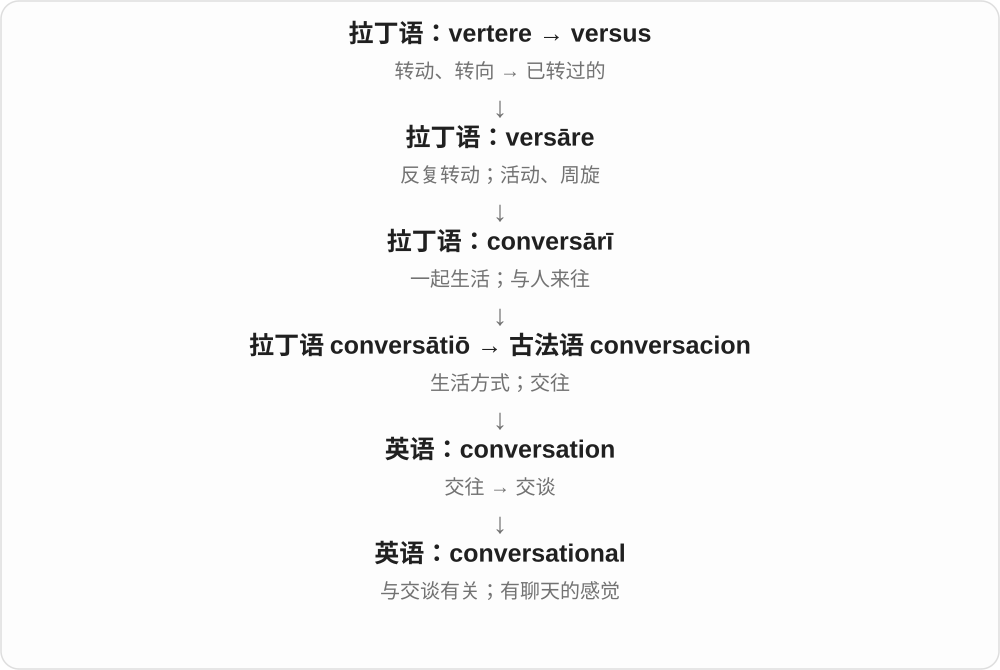

a conversational tone 描述文风；conversational Spanish 指能进行日常交流的西班牙语水平，并不自动等于能写专业论文。

**常见搭配与例句**

a conversational tone；conversational English；conversational skills。

> The guide uses a friendly, conversational tone.

这本指南用亲切、像聊天一样的语气写成。

> She speaks conversational Italian but cannot yet read legal documents.

她能用意大利语日常交谈，但还读不了法律文件。

**别混淆**

conversational 形容交谈风格或能力；conversant with 表示熟悉某事，结构不同。

### 59. averse — 不愿意的；反感、抵触的

**音标**：英 /əˈvɜːs/；美 /əˈvɜːrs/

**先抓住这个画面**

身体还没离开，心已经转向另一边：“我不想碰这个。”

**怎么拆**

借自拉丁语 āversus，是 āvertere“转离”的分词；不是 adverse 少写了一个 d。

**怎么变成今天的意思**

常用 be averse to + 名词或 -ing。not averse to 往往是委婉地说“并不介意，甚至挺愿意”。

**常见搭配与例句**

averse to risk；averse to change；not averse to…。

> She is averse to borrowing money for everyday expenses.

她不愿意借钱支付日常开支。

> I am not averse to a short break.

我倒不介意短暂休息一下。

**别混淆**

averse 描写人的态度；adverse 描写外部条件或后果不利。

### 60. subversion — 颠覆；破坏既有权威或惯例

**音标**：英 /səbˈvɜːʃən/；美 /səbˈvɜːrʒən/

**先抓住这个画面**

把“从根底下动摇它”整个过程叫作 subversion；可以涉及政治，也可以涉及艺术形式。

**怎么拆**

拉丁语 subversiō 经古法语 subversion 借入。颠覆义不是 sub-“次级” + version“版本”；“子版本”是另一个后来可用的组合义。

**怎么变成今天的意思**

普通文章里通常谈颠覆活动或观念挑战。软件 Subversion 是专名，不要据此倒推普通词的历史。

**常见搭配与例句**

political subversion；the subversion of conventions；accusations of subversion。

> The film is praised for its subversion of familiar stereotypes.

这部电影因打破熟悉的刻板印象而受到称赞。

> The historian examines accusations of subversion during the crisis.

历史学家考察了危机期间的颠覆活动指控。

**别混淆**

subversion 侧重使根基失效；criticism 只是批评，二者不能自动画等号。

### 61. convo — 聊天、谈话〔口语〕

**音标**：英 /ˈkɒnvəʊ/；美 /ˈkɑːnvoʊ/

**先抓住这个画面**

把 conversation 剪短，像熟人之间说“聊两句”，少了正式感。

**怎么拆**

conversation 的截短形式，加常见口语词尾 -o；不是古拉丁语里另有一个 convo。

**怎么变成今天的意思**

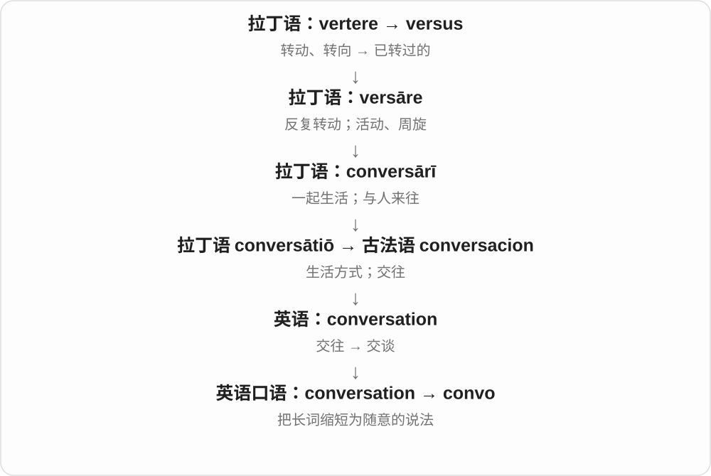

多见于聊天、社交媒体和很随意的叙述。正式报告里通常写 conversation。

**常见搭配与例句**

a quick convo；a good convo；have a convo。

> We had a quick convo before the meeting.

开会前我们简单聊了几句。

> Thanks for the convo—it helped me see the problem differently.

谢谢刚才那番聊天，让我换了个角度看问题。

**别混淆**

convo 是语体随意，不代表谈话内容一定不重要。

### 62. vertebrate — 脊椎动物；有脊柱的

**音标**：英 /ˈvɜːtɪbrət/；美 /ˈvɜːrtəbrət/

**先抓住这个画面**

用有没有脊柱这一身体结构，把动物划出一个大类；鱼、鸟和人都属于这一大类。

**怎么拆**

与拉丁语 vertebrātus“有节的”、法语 vertébré 及动物分类名称 Vertebrata 相连；现代可认 vertebr- + -ate，但词尾常弱读 /ət/。

**怎么变成今天的意思**

可以作形容词 vertebrate animals，也可作名词 a vertebrate。它按身体结构分类，不是按体形大小或聪明程度分类。

**常见搭配与例句**

vertebrate species；vertebrate anatomy；a small vertebrate。

> A frog is a vertebrate, just as a bird is.

青蛙和鸟一样，都是脊椎动物。

> The course introduces vertebrate anatomy.

这门课介绍脊椎动物解剖学。

**别混淆**

vertebra 是一块椎骨；vertebrate 是具有这类脊柱结构的动物。

### 63. subvert — 颠覆、瓦解；打破既定规则或预期

**音标**：英 /səbˈvɜːt/；美 /səbˈvɜːrt/

**先抓住这个画面**

从下面一掀，原来稳稳立着的东西倒了。引申到制度、权威，或读者以为故事一定会走的套路。

**怎么拆**

sub-“从下面” + vertere → 拉丁语 subvertere，经法语 subvertir 借入。

**怎么变成今天的意思**

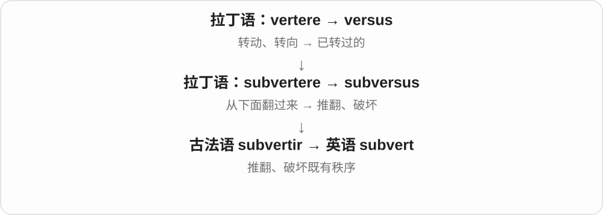

subvert democracy 带负面批评；subvert expectations 在文艺评论中常是赞扬出人意料。褒贬取决于被颠覆的对象。

**常见搭配与例句**

subvert authority；subvert expectations；subvert conventions。

> The novel subverts the usual detective-story formula.

这部小说打破了侦探故事的常见套路。

> False reports can subvert trust in a public institution.

虚假报告会破坏公众对公共机构的信任。

**别混淆**

overthrow 常指明显推翻；subvert 也可逐渐从内部削弱，或用创作改变习惯看法。

### 64. introvert — 内向的人

**音标**：英 /ˈɪntrəvɜːt/；美 /ˈɪntrəvɜːrt/

**先抓住这个画面**

注意力比较容易转向自己的思考、感受和内在体验。日常也常说这种人偏爱较安静的交流环境。

**怎么拆**

intrō“向内” + vertere“转”。英语更早有“向内转”的动词及生物学用法；现代人格名词与荣格的德语心理学术语传播有关。

**怎么变成今天的意思**

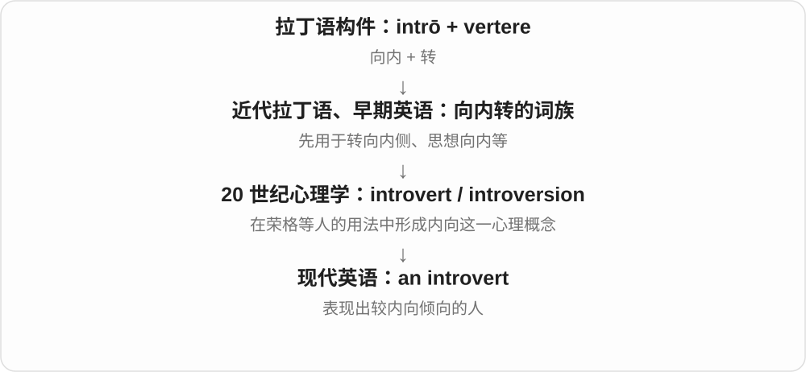

内向与外向可以看作连续的倾向，不必把每个人钉进两个格子。introvert 不等于害羞、讨厌人，也不等于不擅长演讲。

**常见搭配与例句**

an introvert；describe oneself as an introvert；introverts and extroverts。

> She is an introvert who enjoys long conversations with close friends.

她比较内向，却很喜欢和好友长谈。

> Being an introvert has not stopped him from becoming a confident speaker.

性格内向并没有妨碍他成为自信的演讲者。

**别混淆**

shy 侧重在别人面前不自在；introverted 侧重心理和行为倾向，两者可以重合也可以分开。

### 65. perversion — 歪曲、败坏；扭曲的表现；性变态〔带评判的用语〕

**音标**：英 /pəˈvɜːʒən/；美 /pərˈvɜːrʒən/

**先抓住这个画面**

把一个好原则拉歪了，最后拿它为相反的行为作借口；这份扭曲本身就是 perversion。

**怎么拆**

借自拉丁语 perversiō；与 pervertere 的分词词干 pervers- 相连。

**怎么变成今天的意思**

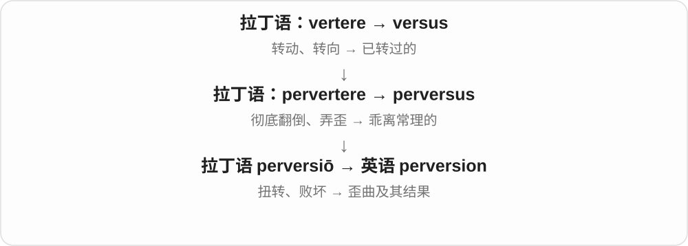

a perversion of justice 是对司法公正的歪曲。历史上的性用法受时代规范影响很大，不宜把这个词当作中性的诊断名。

**常见搭配与例句**

a perversion of justice；a perversion of the truth；a perversion of an ideal。

> Punishing the witness would be a perversion of justice.

惩罚证人将是对司法公正的歪曲。

> She called the policy a perversion of the original ideal.

她称这项政策扭曲了最初的理想。

**别混淆**

perversion 常评价某种东西被怎样扭坏；perversity 常评价行为者或制度的乖张。

### 66. inversely — 反向地；成反比地

**音标**：英 /ɪnˈvɜːsli/；美 /ɪnˈvɜːrsli/

**先抓住这个画面**

一边上升，另一边下降；若说 inversely proportional，还进一步规定了它们按反比例变化。

**怎么拆**

inverse + -ly。

**怎么变成今天的意思**

成反比不只是“大致一升一降”：固定条件下，两者乘积不变才是严格的反比例。

**常见搭配与例句**

inversely related；inversely proportional to…。

> For a fixed distance, travel time is inversely proportional to speed.

距离固定时，行程时间与速度成反比。

> The two scores were inversely related in this sample.

在这个样本中，这两个分数呈反向关系。

**别混淆**

negatively correlated 说统计上的负相关；inversely proportional 是更具体的数学关系。

### 67. introverted — 内向的；较关注内心世界的

**音标**：英 /ˈɪntrəvɜːtɪd/；美 /ˈɪntrəvɜːrtɪd/

**先抓住这个画面**

把 introvert 这个“人”的标签，换成对一个人的倾向或表现的描述。

**怎么拆**

introvert + -ed；早先词族有向内转的动作义，现代人格形容词随心理学用法普及。

**怎么变成今天的意思**

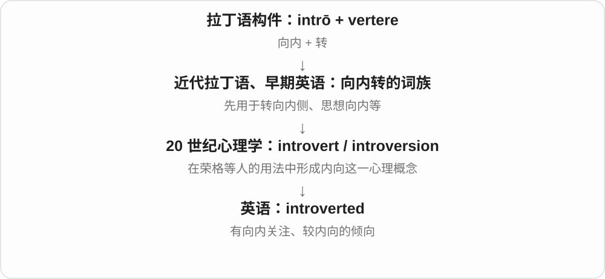

可以说 quite introverted 或 more introverted，表达程度差异。安静一天不代表性格固定，更不能据此判断人的能力。

**常见搭配与例句**

an introverted child；rather introverted；more introverted than…。

> He is introverted in large groups but talkative with his sister.

他在人多时比较内向，和姐姐在一起却很健谈。

> The class includes both outgoing and introverted students.

班上既有外向的学生，也有内向的学生。

**别混淆**

introverted 不是 withdrawn 的必然同义词；withdrawn 往往强调退缩、不愿接触的状态。

### 68. vertebral — 椎骨的；脊柱的

**音标**：英 /ˈvɜːtɪbrəl/；美 /ˈvɜːrtəbrəl/、/vərˈtiːbrəl/

**先抓住这个画面**

把镜头对准一节节椎骨组成的结构：与椎骨、脊柱有关的部分就可用 vertebral。

**怎么拆**

vertebra 的词干 vertebr- + -al；不是 vertical“竖直”的变形。

**怎么变成今天的意思**

vertebral column 就是脊柱；vertebral fracture 是椎骨骨折。具体名词要看它修饰的是骨、血管还是其他结构。

**常见搭配与例句**

vertebral column；vertebral body；vertebral fracture。

> The diagram labels the main parts of the vertebral column.

图中标出了脊柱的主要部分。

> The report describes changes in the vertebral bodies.

报告描述了椎体的变化。

**别混淆**

vertebral 描述脊柱相关；vertebrate 则可指脊椎动物，一字之差改变用法。

### 69. inadvertent — 无意的；疏忽造成的

**音标**：英 /ˌɪnədˈvɜːtənt/；美 /ˌɪnədˈvɜːrtənt/

**先抓住这个画面**

注意力没有转到这里，事情就在没留神时发生了；重点是没有打算这样做。

**怎么拆**

in-“不” + advert- 的“注意”词族。常分析为从较早 inadvertence 反构；也有词典联系中世纪拉丁语 inadvertēns。

**怎么变成今天的意思**

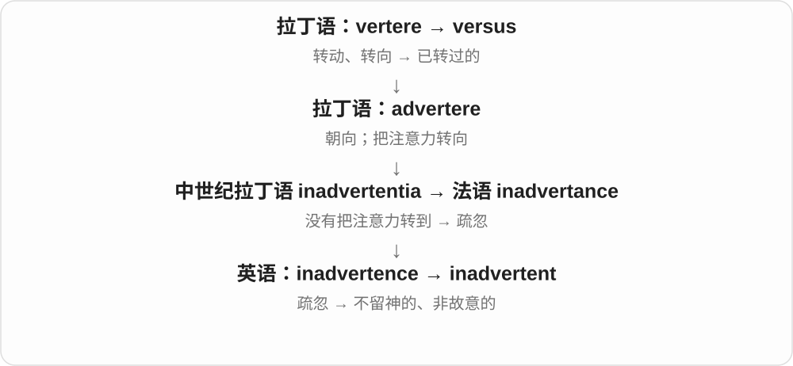

an inadvertent error 可以是漏掉一个名字、选错附件。说无意并不等于没有责任，它只解释意图。

**常见搭配与例句**

an inadvertent omission；an inadvertent error；inadvertent disclosure。

> The missing name was an inadvertent omission.

漏掉这个名字是无心的疏忽。

> The editor apologized for the inadvertent change to the quotation.

编辑为无意中改动引文而道歉。

**别混淆**

accidental 范围广；inadvertent 常让人想到疏忽或未留意造成。

### 70. inverter — 逆变器；反相器

**音标**：英 /ɪnˈvɜːtə/；美 /ɪnˈvɜːrtər/

**先抓住这个画面**

电池给出直流电，家里许多电器需要交流电；负责把这种电流形式转过去的设备就是一种 inverter。

**怎么拆**

invert + -er；技术上把“反转、变换”的动作专门化为装置名称。

**怎么变成今天的意思**

电力 inverter 常把直流变交流；数字逻辑 inverter 将 0 变 1、1 变 0。两个领域都带“把输入翻转成另一种状态”的直观联系。

**常见搭配与例句**

a solar inverter；a power inverter；a logic inverter。

> The solar panels feed electricity into an inverter.

太阳能板把电能送入逆变器。

> A logic inverter changes a high input to a low output.

逻辑反相器把高电平输入变成低电平输出。

**别混淆**

converter 是转换设备总称；inverter 指特定逆变或反相功能，不能覆盖全部转换器。

### 71. controversially — 有争议地；引发争议地

**音标**：英 /ˌkɒntrəˈvɜːʃəli/；美 /ˌkɑːntrəˈvɜːrʃəli/

**先抓住这个画面**

讲完一个决定，再提醒读者：这个做法当时引起了不少反对和争论。

**怎么拆**

controversial + -ly。

**怎么变成今天的意思**

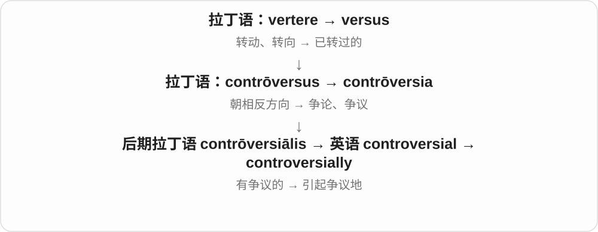

放句首时可评价整件事；放动词前时可标记某个行为受到争议。它表达的是公众分歧，不直接等于作者反对。

**常见搭配与例句**

controversially appointed；controversially banned；Controversially, … 。

> The council controversially approved the demolition.

市议会批准拆除，这个决定引发了争议。

> Controversially, the new edition removed an entire chapter.

引人争议的是，新版删掉了整整一章。

**别混淆**

allegedly 表示据称、尚未证实；controversially 表示有争议，不能替代证据状态。

### 72. vertebra — 一块椎骨

**音标**：英 /ˈvɜːtɪbrə/；美 /ˈvɜːrtəbrə/

**先抓住这个画面**

脊柱不是一根死硬的整杆，而是一节节椎骨相连。词源通常与“能转动的关节”相联系。

**怎么拆**

借自拉丁语 vertebra“关节、椎骨”；常解释为 vertere 与工具／部位名词后缀 -bra 相连，较深层分析保留可能性。

**怎么变成今天的意思**

单数 a vertebra，复数 vertebrae，常读 /ˈvɜːtɪbreɪ/（英）、/ˈvɜːrtəbreɪ/（美）。它是一块骨，不是整条脊柱或脊髓。

**常见搭配与例句**

a cervical vertebra；a lumbar vertebra；the vertebrae。

> The model shows each vertebra in a different colour.

模型用不同颜色显示每一块椎骨。

> The scan showed a fracture in one lumbar vertebra.

扫描显示一块腰椎骨折。

**别混淆**

vertebra 是椎骨；spine 是脊柱；spinal cord 是脊髓，三者不要混用。

### 73. invert — 颠倒；倒置；使反转

**音标**：英 /ɪnˈvɜːt/；美 /ɪnˈvɜːrt/

**先抓住这个画面**

把上下、内外或次序翻过来：杯子倒扣，图片黑白互换，句子把通常的词序调换。

**怎么拆**

经法语 invertir 等路线追到拉丁语 invertere；in- 在这里表示向内、相反方向，配 vertere。

**怎么变成今天的意思**

既可做物理动作，也可改变排列。语言学 invert the order 指倒装；数学 invert a matrix 指求逆，含义更专门。

**常见搭配与例句**

invert the image；invert the order；invert a container。

> Invert the bowl onto a plate and tap it gently.

把碗倒扣在盘子上，轻轻拍一拍。

> The software can invert the colours in the image.

软件可以把图像颜色反转。

**别混淆**

reverse 可泛指掉转方向；invert 常特别指上下、内外或常规排列倒置。

### 74. invertebrate — 无脊椎动物；无脊柱的

**音标**：英 /ɪnˈvɜːtɪbrət/；美 /ɪnˈvɜːrtəbrət/

**先抓住这个画面**

没有脊柱这根内在支撑轴；但并不等于没有硬结构，甲虫的外壳也很坚硬。

**怎么拆**

否定 in- + vertebrate；十九世纪动物分类语境中普及。

**怎么变成今天的意思**

昆虫、蜘蛛、软体动物等都属于广义无脊椎动物。这个大范围不是按“软不软”来定义。

**常见搭配与例句**

marine invertebrates；invertebrate species；invertebrate zoology。

> The children searched the pond for small invertebrates.

孩子们在池塘里寻找小型无脊椎动物。

> An insect is an invertebrate even though it has a hard outer skeleton.

昆虫虽然有坚硬的外骨骼，仍是无脊椎动物。

**别混淆**

invertebrate 的 in- 是“没有”；invert 的 in- 则在“翻转”一支中，不能看到 in- 都当否定。

### 75. universality — 普遍性；普适性

**音标**：英 /ˌjuːnɪvɜːˈsæləti/；美 /ˌjuːnəvɜːrˈsæləti/

**先抓住这个画面**

universality 是追问一种规律或体验能否跨过地区、时间、群体的界限，在全部相关对象上成立。

**怎么拆**

经法语 universalité 来自晚期拉丁语 ūniversālitās；现代对应 universal + -ity。

**怎么变成今天的意思**

它把 universal 的范围要求变成可以讨论和验证的性质。一个例子打动人，不等于已经证明某结论有普遍性。

**常见搭配与例句**

the universality of…；claim universality；question universality。

> The study questions the universality of that assumption.

这项研究质疑那个假设是否普遍成立。

> The film draws its power from the universality of its themes.

这部电影的感染力来自其主题的普遍性。

**别混淆**

universalism 是支持普遍原则的主张；universality 是某东西是否普遍适用的性质。

### 76. obverse — 硬币、奖章的正面；相对应的另一面

**音标**：英 /ˈɒbvɜːs/；美名词 /ˈɑːbvɜːrs/，形容词 /ɑːbˈvɜːrs/、/ˈɑːbvɜːrs/

**先抓住这个画面**

把主要图案那一面转向观察者，这就是钱币的“正面”。在抽象讨论中，也能说某事相对应的另一面。

**怎么拆**

ob-“朝向” + vertere → 拉丁语 obvertere，其分词 obversus 借入英语。

**怎么变成今天的意思**

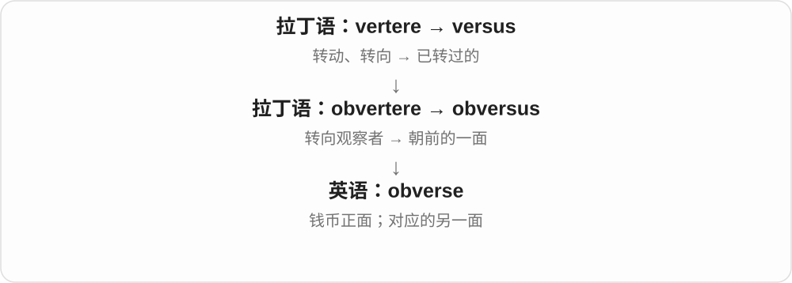

收藏、博物馆说明里常与 reverse 成对。正面按主要图案和铸币惯例区分，并非你此刻朝上放着哪一面就算哪一面。

**常见搭配与例句**

the obverse of a coin；the obverse and reverse。

> The obverse of the coin bears a portrait of the ruler.

硬币正面铸着统治者的肖像。

> The catalogue shows both the obverse and the reverse of each medal.

目录展示了每枚奖章的正反两面。

**别混淆**

coin 的 obverse 是正面，reverse 是反面；抽象用法中的 obverse 需要看具体对照关系。

### 77. prosaic — 平淡无奇的；日常实际的；散文体的

**音标**：英 /prəʊˈzeɪɪk/；美 /proʊˈzeɪɪk/

**先抓住这个画面**

以为背后有什么惊天秘密，答案却只是“电池没电了”。这种没有传奇色彩的普通解释，就是 prosaic。

**怎么拆**

经法语 prosaïque 及中世纪拉丁语 prosaicus 来自 prōsa；现代与 prose 对应，但不是照拼写简单加 -ic。

**怎么变成今天的意思**

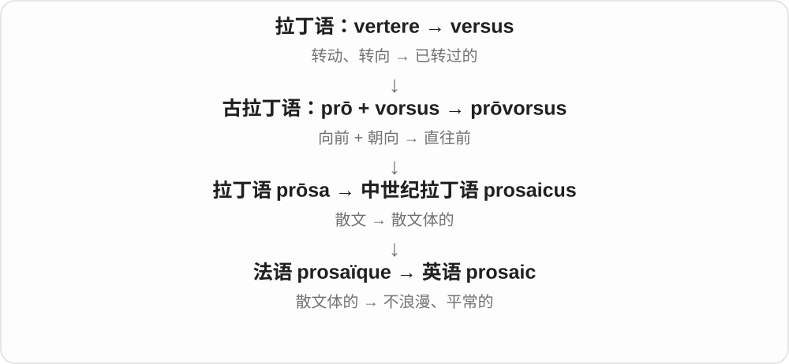

从散文与诗的对照，发展出“缺少诗意、平淡”的评价。也可以温和地说日常实际事务，不一定在批评文章质量。

**常见搭配与例句**

a prosaic explanation；prosaic details；a prosaic reason。

> The noise had a prosaic explanation: a loose window latch.

噪声的原因很普通：窗扣松了。

> After the celebration, they returned to the prosaic task of washing dishes.

庆祝结束后，他们又回到洗碗这件日常琐事上。

**别混淆**

ordinary 只是普通；prosaic 常与先前期待的浪漫、奇特或戏剧性形成落差。

### 78. reversion — 回归；恢复旧状态；财产归复

**音标**：英 /rɪˈvɜːʃən/；美 /rɪˈvɜːrʒən/

**先抓住这个画面**

把“转回去”当成一件事来谈：回到旧习惯、旧规则，或者财产按约定回归原来的所有人。

**怎么拆**

经古法语 reversion 借自拉丁语 reversiō；与 revert 同支，不是把 reverse 随手变成名词。

**怎么变成今天的意思**

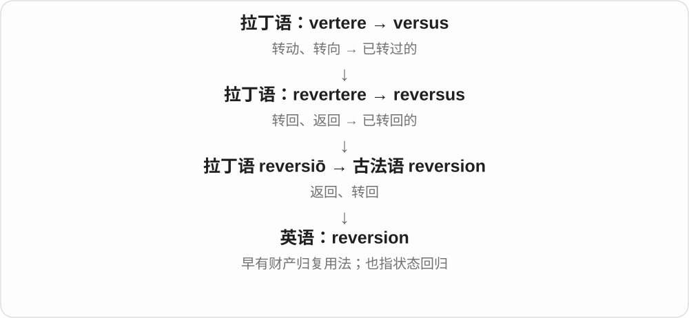

一般用 reversion to。法律中的具体归复条件依合同与制度而定；词汇学习先把握“回到原处或原主”的关系。

**常见搭配与例句**

a reversion to old habits；reversion to the original form。

> The new timetable felt like a reversion to the old routine.

新时间表让人感觉又回到了原来的作息。

> The agreement provides for the reversion of the land to the owner.

协议规定土地将归还原所有人。

**别混淆**

reversion 是回归；reversal 是反转。两者偶尔结果相近，着重点不同。

### 79. extrovert — 外向的人

**音标**：英 /ˈekstrəvɜːt/；美 /ˈekstrəvɜːrt/

**先抓住这个画面**

兴趣和注意力更容易朝外，喜欢同人互动、参与外部活动；并不意味着永远不能独处。

**怎么拆**

心理学名词由 extravert 改拼为 extrovert，o 受 introvert 影响；远源 extrā“外面” + vertere“转”。

**怎么变成今天的意思**

日常用来形容较主动社交、表达直接的人。它只是倾向，不能据此推断某人一定擅长领导或永远开心。

**常见搭配与例句**

an extrovert；a natural extrovert；introverts and extroverts。

> As an extrovert, he usually starts conversations with new neighbours.

他性格外向，通常会主动与新邻居聊天。

> Even an extrovert may want a quiet evening alone.

即使外向的人，也可能想独自安静地过一晚。

**别混淆**

extrovert 与 extravert 是同一个人格词的两种拼写，不是两种不同性格。

### 80. irreversibly — 不可逆转地；无法挽回地

**音标**：英 /ˌɪrɪˈvɜːsəbli/；美 /ˌɪrɪˈvɜːrsəbli/

**先抓住这个画面**

不仅说“变了”，还补一句：再也不能完整回到原来的样子。

**怎么拆**

irreversible + -ly；拼写上 -ible 变成 -ibly。

**怎么变成今天的意思**

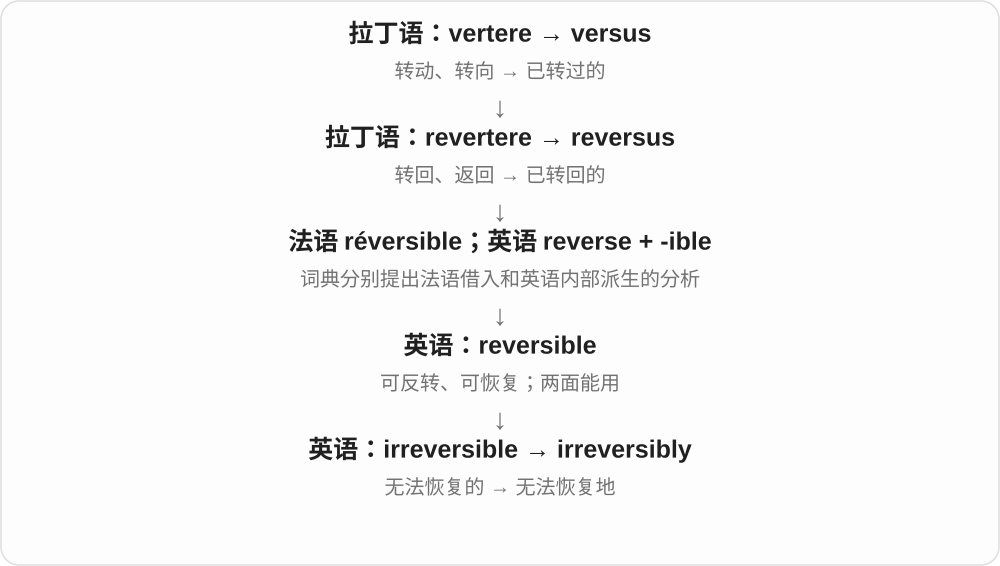

常修饰 changed、damaged、lost，突出改变的永久后果。它不是 simply “非常严重地”，轻小变化也可能不可逆。

**常见搭配与例句**

irreversibly altered；irreversibly damaged；irreversibly lost。

> The old photographs were irreversibly damaged by damp.

这些老照片被潮气毁坏，无法复原。

> The new road irreversibly altered the shape of the village.

新公路永久改变了村庄的布局，无法恢复原貌。

**别混淆**

permanently 强调持续时间永久；irreversibly 强调回退或复原不可能。

### 81. incontrovertible — 无可辩驳的；无法否认的

**音标**：英 /ˌɪnkɒntrəˈvɜːtəbəl/；美 /ˌɪnkɑːntrəˈvɜːrtəbəl/

**先抓住这个画面**

证据摆在这里，想从对面推翻它，也找不到站得住的理由。

**怎么拆**

in-“不” + controvertible“可反驳的”，后者由 controvert + -ible 构成；不是 in + controversial。

**怎么变成今天的意思**

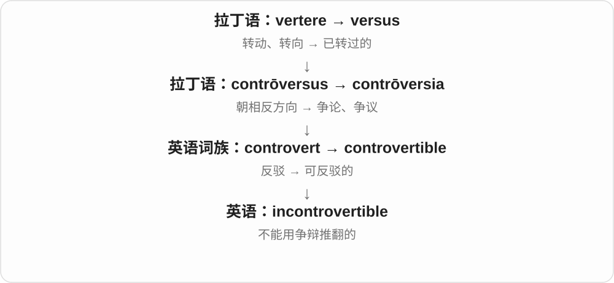

常修饰 evidence、proof、fact，语气很强。作者声称“无可辩驳”，仍要看所给证据是否真支持结论。

**常见搭配与例句**

incontrovertible evidence；incontrovertible proof；an incontrovertible fact。

> The timestamp provided incontrovertible evidence that the file existed earlier.

时间戳提供了无可辩驳的证据，表明文件更早就已存在。

> The measurement established one incontrovertible fact: the beam was too short.

测量确定了一个无法否认的事实：横梁太短。

**别混淆**

uncontroversial 是没人明显争论；incontrovertible 是声称证据无法被合理反驳。

### 82. extroverted — 外向的；喜欢与人交往的

**音标**：英 /ˈekstrəvɜːtɪd/；美 /ˈekstrəvɜːrtɪd/

**先抓住这个画面**

一个人很容易把话题接起来、主动参与人群；这里描述的是这种向外互动的倾向。

**怎么拆**

extrovert + -ed；也有 extraverted 拼写。

**怎么变成今天的意思**

可以形容性格，也可形容某一场合表现得更外向。它不等于 reckless“鲁莽”，更不意味着任何时候都不会紧张。

**常见搭配与例句**

an extroverted personality；more extroverted；friendly and extroverted。

> Her extroverted style makes it easy for newcomers to join in.

她外向的风格让新来的人很容易融入。

> He seems more extroverted when he is talking about music.

谈起音乐时，他显得更外向。

**别混淆**

outgoing 是常用日常近义词；extroverted 更容易出现在性格比较和心理学话题中。

### 83. conversant — 熟悉、通晓某事的

**音标**：英 /kənˈvɜːsənt/；美 /kənˈvɜːrsənt/

**先抓住这个画面**

经常与某件事打交道，自然熟悉它。这里的“来往”从人与人，转成了人与某一领域。

**怎么拆**

借自古法语 conversant，原是 converser“来往、生活”的现在分词。

**怎么变成今天的意思**

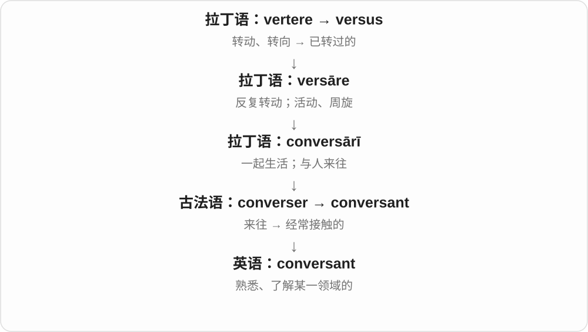

常用 be conversant with，语气较正式。它不要求你能把知识滔滔不绝讲出来，重点是知道情况、能处理相关事务。

**常见搭配与例句**

conversant with the rules；fully conversant with… 。

> All staff should be conversant with the emergency procedures.

所有员工都应熟悉应急流程。

> She is conversant with several programming languages.

她熟悉好几种编程语言。

**别混淆**

conversant 是熟悉；conversational 是交谈的。熟悉数据库是 conversant with databases。

### 84. perversely — 偏偏、反常地；故意作对地

**音标**：英 /pəˈvɜːsli/；美 /pərˈvɜːrsli/

**先抓住这个画面**

结果拧着来：越想减少的问题，偏偏越多；越告诉他别做，他偏要做。

**怎么拆**

perverse + -ly。

**怎么变成今天的意思**

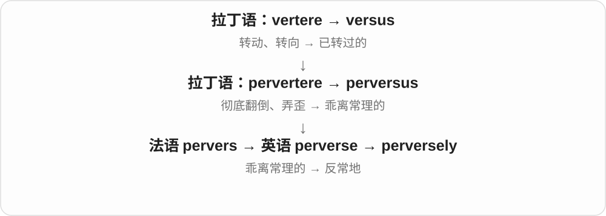

可以评价某人的故意行为，也可评价制度造成的意外反结果，不一定有人蓄意作恶。

**常见搭配与例句**

perversely pleased；perversely refuse；Perversely, … 。

> Perversely, the extra paperwork made the process less transparent.

反常的是，额外的文书工作反而让流程更不透明。

> She felt perversely pleased when the expensive gadget failed.

看到那个昂贵的小装置失灵，她竟有点莫名的高兴。

**别混淆**

deliberately 只说有意；perversely 还指出行为或结果违背常理、期待。

### 85. introversion — 内向倾向；内向性

**音标**：英 /ˌɪntrəˈvɜːʃən/；美 /ˌɪntrəˈvɜːrʒən/

**先抓住这个画面**

不是数有几个“内向的人”，而是讨论注意力更向内、偏爱怎样的活动这种倾向本身。

**怎么拆**

来自近代拉丁语 intrōversiō“向内转”，英语早有思想向内的用法；心理学意义后来形成，不是现代名词 introvert 才造出它。

**怎么变成今天的意思**

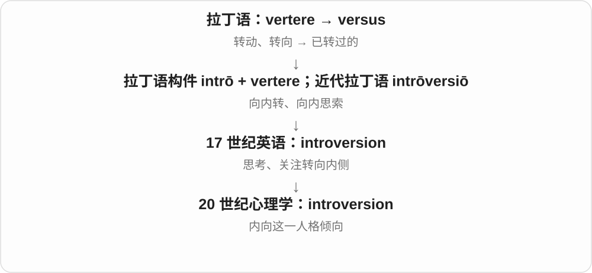

通常不可数。现代研究常把它放在内向—外向连续范围内讨论，而不是把所有安静的人看成一种固定类型。

**常见搭配与例句**

introversion and extraversion；a tendency toward introversion。

> The questionnaire measures introversion as a matter of degree.

这份问卷把内向性作为一个有程度差别的特征来测量。

> Her introversion is compatible with a busy social life.

她的内向性并不妨碍她拥有丰富的社交生活。

**别混淆**

introversion 是倾向；introspection 是反省、观察自己内心的活动，外向的人也会反省。

### 86. transversely — 横向地；横过长轴地

**音标**：英 /trænzˈvɜːsli/、/trænsˈvɜːsli/；美 /trænzˈvɜːrsli/

**先抓住这个画面**

不用顺着长条划开，而是横着穿过去或切下去。

**怎么拆**

transverse + -ly。

**怎么变成今天的意思**

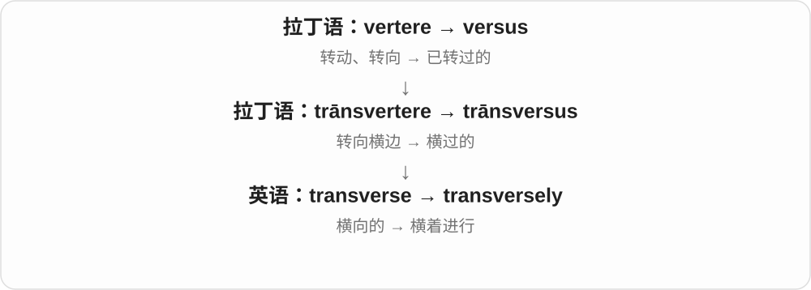

常见于描述截面、纤维、零件布局。先确定物体的长方向，才能判断什么叫 transversely。

**常见搭配与例句**

cut transversely；run transversely；arranged transversely。

> The stem was cut transversely for examination.

研究人员把茎横切开进行观察。

> Several narrow bands run transversely across the shell.

几条窄带横向穿过壳面。

**别混淆**

lengthwise 是顺长向；transversely 是横过长向，两者是相对的。

### 87. transversal — 横截线；横向的、横跨的

**音标**：英 /trænzˈvɜːsəl/、/trænsˈvɜːsəl/；美 /trænzˈvɜːrsəl/

**先抓住这个画面**

两条或多条线各走各的，一条新线横过来把它们都穿过；这条线便可叫 transversal。

**怎么拆**

经法语 transversal 来自中世纪拉丁语 trānsversālis；与 transverse 是同源的独立借词。

**怎么变成今天的意思**

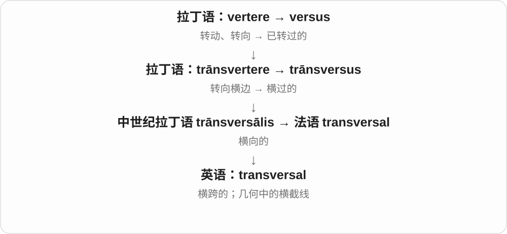

几何里常是与两条或多条线在不同点相交的线。它可以斜着穿，不要求每个交点都是直角。

**常见搭配与例句**

a transversal of parallel lines；draw a transversal。

> Draw a transversal across the two parallel lines.

画一条横截线与这两条平行线相交。

> The transversal creates several pairs of equal angles in this diagram.

图中这条横截线形成了几组相等的角。

**别混淆**

transverse 常作一般形容词；transversal 在几何里还可明确指那条横截线。

### 88. perversity — 乖张；故意作对；反常之处

**音标**：英 /pəˈvɜːsəti/；美 /pərˈvɜːrsəti/

**先抓住这个画面**

“明知道大家希望怎样，偏不那样做”的拧劲；也可指事情荒唐得总朝相反方向发展。

**怎么拆**

拉丁语 perversitās，经法语 perversité 借入；现代可联系 perverse + -ity。

**怎么变成今天的意思**

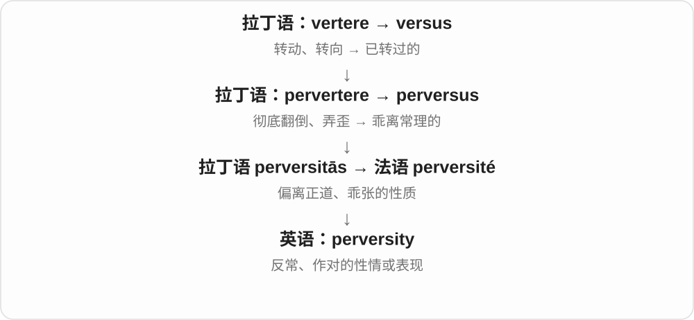

out of sheer perversity 是纯粹为了作对。谈制度的 perversity 时，通常在批评它的逻辑不合理。

**常见搭配与例句**

sheer perversity；the perversity of a system；out of perversity。

> Out of sheer perversity, he chose the option everyone had rejected.

他纯粹为了作对，选了大家都否决的方案。

> The essay exposes the perversity of rewarding failure.

文章揭示了奖励失败这一做法的荒唐。

**别混淆**

perversity 强调拧巴的倾向；perversion 更常指被扭坏的东西或歪曲行为。

### 89. versioning — 版本管理；给版本编号、保留版本的做法

**音标**：英 /ˈvɜːʃənɪŋ/、/ˈvɜːʒənɪŋ/；美 /ˈvɜːrʒənɪŋ/

**先抓住这个画面**

文件改了十次，不把旧内容一股脑覆盖，而是记住每次改动，必要时能回到某一次。

**怎么拆**

英语 version 作动词或基词，加 -ing，形成技术活动名词。

**怎么变成今天的意思**

软件版本号和文档历史记录都涉及 versioning。它描述怎么区分、追踪变化，不保证每个版本都比前一个好。

**常见搭配与例句**

file versioning；semantic versioning；enable versioning。

> Versioning allows the team to recover an earlier draft.

版本管理让团队能够找回早期草稿。

> The project adopted a clear versioning scheme.

项目采用了一套清楚的版本编号规则。

**别混淆**

version 是一个版本；versioning 是产生、标识或管理这些版本的做法。

### 90. extraversion — 外向性〔心理学常用拼写〕

**音标**：英 /ˌekstrəˈvɜːʃən/；美 /ˌekstrəˈvɜːrʒən/

**先抓住这个画面**

把注意力朝外的倾向当作一个可比较的维度：同一群人可以各有高低，而不是只能分两队。

**怎么拆**

早期借自中世纪拉丁语 extraversiō“向外转”，含 extra-“向外”与 vertere 词族；二十世纪又受德语心理学用法影响。与 extroversion 是拼写变体。

**怎么变成今天的意思**

在现代人格研究中很常见。外向性可以包含社交、活跃、表达等相关方面，词根只提供形象入口，不能替代具体测量定义。

**常见搭配与例句**

extraversion scores；a dimension of extraversion；extraversion and introversion。

> Participants completed a questionnaire about extraversion.

参与者填写了一份关于外向性的问卷。

> The researchers reported a range of extraversion scores.

研究人员报告了外向性得分的不同程度。

**别混淆**

extraversion 和 extroversion 不必按意义分开；写文章时统一一种拼法即可。

### 91. vertiginous — 令人眩晕的；眩晕的；高得、快得令人发晕的

**音标**：英 /vɜːˈtɪdʒɪnəs/；美 /vɜːrˈtɪdʒənəs/

**先抓住这个画面**

高处一望，或价格猛涨得太快，仿佛让脑袋都转了起来。

**怎么拆**

法语 vertigineux 来自拉丁语 vertīginōsus；vertīgin- 是 vertīgō 的变格词干。

**怎么变成今天的意思**

较书面。可以形容悬崖高度，也可夸张地形容增长速度、社会变化；不是每次都在说医学症状。

**常见搭配与例句**

vertiginous heights；a vertiginous rise；a vertiginous drop。

> The path runs beside a vertiginous drop.

小路旁是令人眩晕的深崖。

> The firm’s vertiginous growth caught its managers by surprise.

公司惊人的飞速增长让管理者措手不及。

**别混淆**

steep 说陡或变化幅度大；vertiginous 还带“令人发晕”的主观效果。

### 92. extroversion — 外向性；外向倾向

**音标**：英 /ˌekstrəˈvɜːʃən/；美 /ˌekstrəˈvɜːrʒən/

**先抓住这个画面**

讨论的是“倾向有多外向”，不是给所有人贴一张非此即彼的身份卡。

**怎么拆**

extro- 是 extra- 受 intro- 影响的变体。英语早有“向外翻转”的 extroversion，现代心理学用法在二十世纪普及，与 extraversion 并用。

**怎么变成今天的意思**

通常不可数，与 introversion 对照。并不是“越外向就越好”，不同环境需要不同方式参与。

**常见搭配与例句**

a measure of extroversion；levels of extroversion。

> The study looked at differences in extroversion within the group.

研究考察了这个群体内部外向程度的差异。

> The interviewer did not treat extroversion as a requirement for the job.

面试官没有把外向性当成这份工作的必要条件。

**别混淆**

extroversion 是性格倾向；sociability 侧重乐于社交，二者相关但不完全等同。

### 93. incontrovertibly — 无可辩驳地；确凿地

**音标**：英 /ˌɪnkɒntrəˈvɜːtəbli/；美 /ˌɪnkɑːntrəˈvɜːrtəbli/

**先抓住这个画面**

不仅说“证实了”，还强调已经没有合理的争辩空间。

**怎么拆**

incontrovertible 的 -ible 变 -ibly，形成副词。

**怎么变成今天的意思**

可以修饰 prove、establish，或者 true、wrong。正式论证里用词很强，不适合随便把个人偏好写成客观定论。

**常见搭配与例句**

incontrovertibly true；prove incontrovertibly；establish incontrovertibly。

> The recording incontrovertibly established who spoke first.

录音确凿地证明了谁先开口。

> The two samples are incontrovertibly different in colour.

这两个样本的颜色毫无疑问不同。

**别混淆**

clearly 是清楚地；incontrovertibly 进一步声称没有合理反驳余地。

### 94. extravert — 外向的人〔extrovert 的另一拼写〕

**音标**：英 /ˈekstrəvɜːt/；美 /ˈekstrəvɜːrt/

**先抓住这个画面**

保留 extra-“向外”的 a，更容易看见这个词的原始构件。意思仍是外向的人。

**怎么拆**

借自德语心理学 Extravert，构件来自拉丁语 extrā + vertere；英语常见变体 extrovert 受 introvert 拼写影响。

**怎么变成今天的意思**

两种拼写的发音相同。普通英语常见 extrovert，心理学文本中经常看到 extravert。

**常见搭配与例句**

an extravert；extraverts and introverts。

> The author uses the spelling extravert throughout the book.

作者在全书中都使用 extravert 这一拼写。

> An extravert can still value privacy and time alone.

外向的人同样可以重视隐私和独处时间。

**别混淆**

extravert 与 extrovert 没有必须对应的意义差别；不要另编“社交外向／精神外向”的区分。

### 95. ambivert — 兼有内向与外向特点的人

**音标**：英 /ˈæmbɪvɜːt/；美 /ˈæmbɪvɜːrt/

**先抓住这个画面**

既喜欢与人交往，也享受独处，整体不明显落在内向或外向的极端。

**怎么拆**

ambi-“两边” + -vert；二十世纪按 introvert、extrovert 的模式形成，也与较早的 ambiversion 词相连，不是古拉丁语整词借入。

**怎么变成今天的意思**

常用于性格描述。既有内向和外向特点，不表示每一刻都恰好各占一半，也不是一种必须经诊断确定的类别。

**常见搭配与例句**

an ambivert；describe oneself as an ambivert。

> She calls herself an ambivert because she enjoys company and solitude.

她说自己兼有内向与外向特点，因为既喜欢与人相处，也喜欢独处。

> The article describes an ambivert who listens carefully but speaks up when needed.

文章描述了一位兼具内外向特点的人：认真倾听，也在需要时主动发言。

**别混淆**

ambivert 是概括两种倾向兼有；不能仅凭一次聚会表现，就给人下永久结论。

### 96. controvert — 反驳；质疑、争辩

**音标**：英 /ˈkɒntrəvɜːt/；美 /ˈkɑːntrəvɜːrt/

**先抓住这个画面**

对一个说法转过身来站到对面：“我不同意，而且我要提出理由。”

**怎么拆**

与 controversy 同族；词典有中世纪拉丁语 contrōvertere 借入说，也有英语从 controversy 反构说，不能把单一路线当作已定事实。

**怎么变成今天的意思**

正式、偏书面的动词，常用于观点、证据、论断。日常交谈通常用 dispute、challenge 或 argue against。

**常见搭配与例句**

controvert a claim；controvert an argument；hard to controvert。

> The new documents controvert his account of the meeting.

这些新文件反驳了他对会议经过的说法。

> Few scholars have tried to controvert that conclusion.

很少有学者试图反驳那个结论。

**别混淆**

contradict 可以只是说相反的话；controvert 更常包含对论点的争辩或反驳。

### 97. tergiversate — 闪烁其词；反复改口；变节〔罕见、正式〕

**音标**：英 /ˈtɜːdʒɪvəseɪt/；美 /ˈtɜːrdʒɪvərseɪt/、/tɜːrˈdʒɪvərseɪt/

**先抓住这个画面**

问题正面对着你，你却转过背去躲开；立场站定了，又转身投向另一边。

**怎么拆**

拉丁语 tergum“背” + versārī“转、周旋”形成 tergiversārī；英语可分析为借其分词造词，也有从较早 tergiversation 反构的分析。

**怎么变成今天的意思**

这是很书面的词，读文章时认得即可。既可批评不肯直答，也可批评改变忠诚；具体是哪一种，靠上下文。

**常见搭配与例句**

tergiversate on an issue；continue to tergiversate。

> Asked for a clear answer, the spokesman continued to tergiversate.

被要求明确回答时，发言人仍在闪烁其词。

> The columnist accused him of tergiversating whenever public opinion changed.

专栏作者指责他每逢舆论变化就反复改口。

**别混淆**

equivocate 侧重含糊其辞；defect 侧重投向另一阵营；tergiversate 可以涉及两者。

## 这一组要分清什么

conversation“交谈”与 conversion“转换”是不同支线；verse“诗”与 version“版本”是两个独立借入的名词，不能互相硬加词尾。university 从“团体、共同体”得到大学义，不是“教授宇宙知识”。adverse 是条件不利，averse 是人不愿意。converge、diverge 直接来自另一拉丁语动词 vergere“倾斜”，不因为远源相近就在本页当作 vertere 的直接派生词。

## 串起来练习

用三幅小画面串起来：把旧车库 convert into a studio；经营不佳时 revert to the original plan；新海报 advertise the studio，把人的注意力转过来。再看一句 The conversation changed her version of events：交谈改变了她对事情的说法，两个长得相近的词各做自己的工作。
