# 0110 · cad-, -cid-, cas- — 落下、倒下；从落到某处，发展到发生、机会、衰落和脱落

[逐词精讲目录](../00_逐词精讲目录.md) · [总目录](../00_总目录_按常用程度.md)

## 核心词根与来源

**先记“落下”，再记“事情落到头上”。** 拉丁语 cadere 的基本动作是落下、倒下。向下落、越来越坏，是 decay“腐败、衰退”；落到某个人身上，就能说 accident“意外”或 incident“事件”；两件事落到同一时点，是 coincide“同时发生”。词根不是给单词硬套一个中文标签，而是帮你看见这些意思之间怎样走得通。

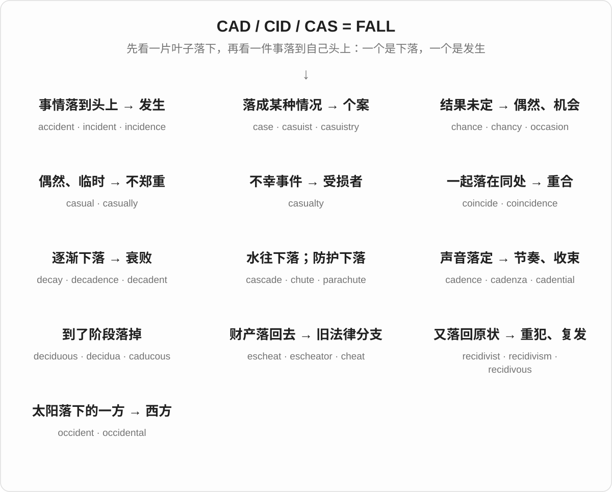

## 词形与演化规律

cad- 是较直观的样子；加前缀的拉丁复合词常把 a 变成 i，于是出现 cid-，如 in + cadere → incidere。cas- 可见于 cāsus“落下、发生的事”，因此 case、casual 虽没有 d，仍在这一族。经过法语，chance、chute、cheat 的字形变化更大。图中带 * 的古形式是语言学重建。另有 caedere“切”的 cid-/cis-，如 decide、incision，与本组的“落”不是一条线。

## 单词速览（常用到不常用）

| 单词 | 音标 | 核心意思 |
|---|---|---|
| [case](#w-1) | /keɪs/ | 情况；实例；案件；论据；语法上的格；箱盒、套壳；字母大小写 |
| [chance](#w-2) | 英 /tʃɑːns/；美 /tʃæns/ | 机会；可能性；偶然；冒险尝试 |
| [accident](#w-3) | /ˈæksɪdənt/ | 意外；事故 |
| [incident](#w-4) | /ˈɪnsɪdənt/ | 事件；事端；入射的 |
| [occasionally](#w-5) | /əˈkeɪʒənəli/ | 偶尔；有时 |
| [occasion](#w-6) | /əˈkeɪʒən/ | 某次；场合；时机；引起 |
| [casual](#w-7) | /ˈkæʒuəl/ | 随意的；非正式的；临时的；不经意的 |
| [accidentally](#w-8) | /ˌæksɪˈdentəli/ | 意外地；不小心地 |
| [occasional](#w-9) | /əˈkeɪʒənəl/ | 偶尔的；不经常的；为某个场合而作的 |
| [cheat](#w-10) | /tʃiːt/ | 作弊；欺骗；骗取；骗子 |
| [coincidence](#w-11) | 英 /kəʊˈɪnsɪdəns/；美 /koʊˈɪnsɪdəns/ | 巧合；同时发生；重合 |
| [decay](#w-12) | /dɪˈkeɪ/ | 腐烂；衰败；衰减 |
| [accidental](#w-13) | /ˌæksɪˈdentəl/ | 意外的；非故意的；偶然的；临时变音记号 |
| [casually](#w-14) | /ˈkæʒuəli/ | 随意地；不经意地；若无其事地 |
| [incidence](#w-15) | /ˈɪnsɪdəns/ | 发生情况；发生率；入射 |
| [casualty](#w-16) | /ˈkæʒuəlti/ | 伤亡者；受害者；因某事而受损的人或事物 |
| [incidentally](#w-17) | /ˌɪnsɪˈdentəli/ | 顺便说一句；附带地；偶然地 |
| [parachute](#w-18) | /ˈpærəʃuːt/ | 降落伞；跳伞；空投 |
| [coincide](#w-19) | 英 /ˌkəʊɪnˈsaɪd/；美 /ˌkoʊɪnˈsaɪd/ | 同时发生；相合；重合 |
| [cascade](#w-20) | /kæsˈkeɪd/ | 小瀑布；倾泻；接连发生的一串 |
| [incidental](#w-21) | /ˌɪnsɪˈdentəl/ | 附带的；次要的；偶然伴随的 |
| [coincidentally](#w-22) | 英 /kəʊˌɪnsɪˈdentəli/；美 /koʊˌɪnsəˈdentəli/ | 巧合地；碰巧 |
| [cheater](#w-23) | 英 /ˈtʃiːtə/；美 /ˈtʃiːtər/ | 作弊者；骗子；对伴侣不忠的人 |
| [chute](#w-24) | /ʃuːt/ | 滑槽；溜槽；狭窄通道；降落伞的简称 |
| [decaying](#w-25) | /dɪˈkeɪɪŋ/ | 正在腐烂的；日益衰败的；正在衰减的 |
| [cadence](#w-26) | /ˈkeɪdəns/ | 节奏；语调起伏；音乐的终止式 |
| [decadent](#w-27) | /ˈdekədənt/ | 颓废的；奢靡的；让人尽情享受的 |
| [deciduous](#w-28) | 英 /dɪˈsɪdʒʊəs/；美 /dɪˈsɪdʒuəs/ | 落叶的；会自然脱落的；乳齿的 |
| [coincidental](#w-29) | 英 /kəʊˌɪnsɪˈdentəl/；美 /koʊˌɪnsəˈdentəl/ | 巧合的；碰巧相同的 |
| [occidental](#w-30) | 英 /ˌɒksɪˈdentəl/；美 /ˌɑːksɪˈdentəl/ | 西方的；西部的 |
| [decadence](#w-31) | /ˈdekədəns/ | 颓废；衰败；奢靡享乐 |
| [cadaver](#w-32) | 英 /kəˈdævə/；美 /kəˈdævər/ | 尸体；供医学研究或教学的人体遗体 |
| [recidivism](#w-33) | /rɪˈsɪdɪvɪzəm/ | 再犯；累犯现象；重新陷入旧行为 |
| [coincident](#w-34) | 英 /kəʊˈɪnsɪdənt/；美 /koʊˈɪnsɪdənt/ | 同时发生的；相合的；重合的 |
| [parachuting](#w-35) | /ˈpærəʃuːtɪŋ/ | 跳伞运动；跳伞；空投 |
| [occident](#w-36) | 英 /ˈɒksɪdənt/；美 /ˈɑːksɪdənt/ | 西方；西部；西方世界 |
| [cadenza](#w-37) | /kəˈdenzə/ | 华彩乐段 |
| [parachutist](#w-38) | /ˈpærəʃuːtɪst/ | 跳伞者 |
| [chancy](#w-39) | 英 /ˈtʃɑːnsi/；美 /ˈtʃænsi/ | 没把握的；有风险的 |
| [recidivist](#w-40) | /rɪˈsɪdɪvɪst/ | 再犯者；惯于重犯的人 |
| [decidua](#w-41) | 英 /dɪˈsɪdʒʊə/；美 /dɪˈsɪdʒuə/ | 蜕膜 |
| [cadaverous](#w-42) | /kəˈdævərəs/ | 像尸体般苍白消瘦的；尸体的 |
| [casuistry](#w-43) | 英 /ˈkæzjuːɪstri/；美 /ˈkæʒuːɪstri/ | 个案伦理推理；诡辩、狡辩 |
| [escheat](#w-44) | /ɪsˈtʃiːt/ | 无继承财产等依法归回国家或领主；归回的财产 |
| [decidual](#w-45) | 英 /dɪˈsɪdʒʊəl/；美 /dɪˈsɪdʒuəl/ | 蜕膜的；与蜕膜有关的 |
| [escheator](#w-46) | 英 /esˈtʃiːtə/；美 /esˈtʃiːtər/ | 管理归回财产事务的官员 |
| [cadential](#w-47) | /keɪˈdenʃəl/ | 终止式的；与乐句收束有关的 |
| [cadaverine](#w-48) | /kəˈdævərɪn/ | 尸胺；戊烷二胺 |
| [caducous](#w-49) | 英 /kəˈdjuːkəs/；美 /kəˈduːkəs/ | 早落的；很早就脱落的；短暂的 |
| [accidence](#w-50) | /ˈæksɪdəns/ | 词形变化；词形变化学；基础知识 |
| [cadency](#w-51) | /ˈkeɪdənsi/ | 家族支系的区分；支系标记制度；古旧义：节奏 |
| [cadent](#w-52) | /ˈkeɪdənt/ | 有韵律的；古义：正在落下的 |
| [caducity](#w-53) | 英 /kəˈdjuːsɪti/；美 /kəˈduːsəti/ | 短暂易逝；衰老、衰弱 |
| [casuist](#w-54) | 英 /ˈkæzjʊɪst/；美 /ˈkæʒuːɪst/ | 个案伦理研究者；善于诡辩的人 |
| [deciduate](#w-55) | 英 /dɪˈsɪdʒʊət/；美 /dɪˈsɪdʒuət/ | 蜕膜型的；分娩时伴随母体组织脱落的 |
| [deciduation](#w-56) | /diːˌsɪdjuˈeɪʃən/ | 经期子宫内膜组织的脱落 |
| [demicadence](#w-57) | /ˌdemiˈkeɪdəns/ | 半终止 |
| [escheatable](#w-58) | /ɪsˈtʃiːtəbəl/ | 依法可能归回国家或领主的 |
| [escheatage](#w-59) | /esˈtʃiːtɪdʒ/ | 承接归回财产的权利 |
| [escheatment](#w-60) | /ɪsˈtʃiːtmənt/ | 财产依法归回国家的过程或处理 |
| [nonaccidental](#w-61) | 英 /ˌnɒnæksɪˈdentəl/；美 /ˌnɑːnæksɪˈdentəl/ | 非意外的；并非偶然的 |
| [nondeciduous](#w-62) | 英 /ˌnɒndɪˈsɪdʒʊəs/；美 /ˌnɑːndɪˈsɪdʒuəs/ | 不按季节落叶的；不属脱落型的 |
| [nonincidental](#w-63) | 英 /ˌnɒnɪnsɪˈdentəl/；美 /ˌnɑːnɪnsɪˈdentəl/ | 并非附带的；具有实质作用的 |
| [postaccident](#w-64) | 英 /ˌpəʊstˈæksɪdənt/；美 /ˌpoʊstˈæksɪdənt/ | 事故后的 |
| [procidentia](#w-65) | 英 /prəʊsɪˈdentʃə/；美 /ˌproʊsəˈdentʃə/ | 器官脱垂；常指严重子宫脱垂 |
| [recidivous](#w-66) | /rɪˈsɪdɪvəs/ | 复发的；容易重新陷入原状的 |
| [semelincident](#w-67) | /ˌseməlˈɪnsɪdənt/ | 旧医学用语：同一人只发生一次的 |

## 逐词讲解

### 1. case — 情况；实例；案件；论据；语法上的格；箱盒、套壳；字母大小写

**音标**：/keɪs/

**先抓住这个画面**

有两条主线：一条是眼前这件事、这种情况；另一条是真正把东西装起来的箱子或外壳。

**怎么拆**

情况、案件等义经古法语 cas 接拉丁 casus 发生的事，来自 cadere 落下、发生。容器义另经古北法语 casse、古法语 chasse 接拉丁 capsa 盒；两条同形路线不能合并成同一个祖先。

**怎么变成今天的意思**

**情况线：拉丁 cadere 落下、发生 → casus 发生的事、境况**  
再经古法语 cas、中古英语 cas → 英语 case 的情况、案件、语法格等义

↓

**另一独立容器线：拉丁 capsa 盒 → 古北法语 casse、古法语 chasse → 中古英语 case**  
装东西的箱盒 → 保护套壳；不接前面的 casus 线

↓

**英语 case 容器义用于盛放活字的分格字盘**  
上、下字盘的位置形成 upper case、lower case 的大小写名称

a court case 是法庭案件，a case of flu 是一例流感；make a case 是摆出理由支持主张。容器义见 a phone case 手机壳、a glasses case 眼镜盒。字母的 upper case、lower case 来自印刷活字字盘的位置；语法上的 case 主格、宾格则属于另一条境况、变化的词源线。

**常见搭配与例句**

in this case；make a case for；in case it rains；a phone case；a case of wine；upper/lower case。in case 常是以防，in that case 是既然那样。

> In this case, waiting may be the best option.

在这种情况下，等待可能是最好的选择。

> She made a convincing case for keeping the library open.

她提出了有说服力的理由，支持图书馆继续开放。

> The police reopened the case after finding new evidence.

警方找到新证据后，重新调查了这起案件。

> He put his glasses back in their case.

他把眼镜放回眼镜盒里。

> The password must contain at least one upper case letter.

密码必须包含至少一个大写字母。

**别混淆**

case 情况强调具体实例；case 容器强调装纳或保护。grammar case 语法格与 letter case 字母大小写不是同一概念，历史来源也分别接 casus 与 capsa。

### 2. chance — 机会；可能性；偶然；冒险尝试

**音标**：英 /tʃɑːns/；美 /tʃæns/

**先抓住这个画面**

事情还没落定，最后会落在哪种结果上并不确定：这就是 chance 的中心感觉。

**怎么拆**

经古法语 cheance，追到通俗拉丁语 *cadentia“落下、发生”。星号表示重建形式；不是 change 少了一个字母。

**怎么变成今天的意思**

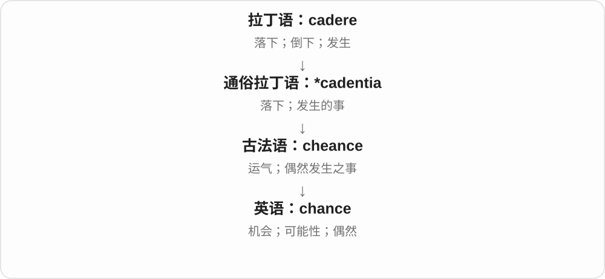

从偶然发生的事，长出三种常见用法：by chance 是碰巧；a chance of rain 是下雨的可能性；give me a chance 是给我一次能行动、能成功的机会。可以用掷骰子“落到哪一面”来记，但这只是帮助理解的画面。

**常见搭配与例句**

by chance；a good chance of…；a chance to try；take a chance；chance upon…。

> I found the old photo by chance.

我偶然找到了那张老照片。

> There is a good chance that the train will be late.

这班火车很可能晚点。

> Give her a chance to explain.

给她一个解释的机会。

**别混淆**

opportunity 偏有利的机会；chance 也能说坏事发生的可能性。chance 与 change 只是字形相近。

### 3. accident — 意外；事故

**音标**：/ˈæksɪdənt/

**先抓住这个画面**

本来没打算这样，事情却突然落到头上，这就是 accident 的基本感觉。

**怎么拆**

拉丁语 accidere 是 ad-（朝向）+ cadere（落下），其中 d 与 c 同化，cad- 在复合词中变为 cid-；经法语传入英语。

**怎么变成今天的意思**

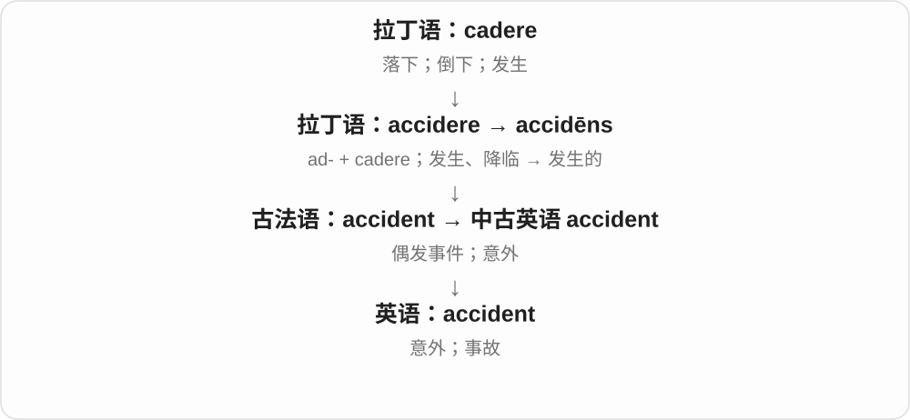

最初可泛指偶发的事，现代最常见的是造成损害的意外，如撞车、摔伤。但 by accident 只说无意中做了某事，不一定有人受伤。

**常见搭配与例句**

have an accident；a traffic accident；by accident；an accident waiting to happen。

> I deleted the photo by accident.

我不小心把照片删了。

> The road was closed after a serious accident.

发生严重事故后，这条路封闭了。

**别混淆**

incident 是发生的一件事，不保证偶然；accident 强调非预期。I did it by accident 是“我不是故意的”，不是“我因为某起事故才做”。

### 4. incident — 事件；事端；入射的

**音标**：/ˈɪnsɪdənt/

**先抓住这个画面**

从一整天、一段经历里圈出“发生的这一件事”，这件事就是 an incident。

**怎么拆**

来自拉丁语 incidēns，动词 incidere 是 in-（在……上）+ cadere（落下、发生）；经中古法语传来。

**怎么变成今天的意思**

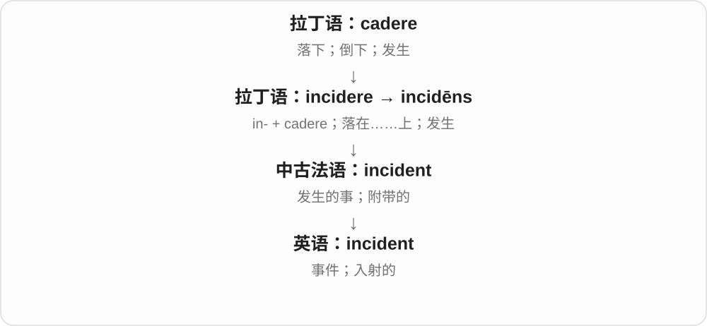

名词常指值得记录的一件事，尤其冲突或异常，但不必一定严重。物理里的 incident light 则保留“落到表面上”的方向感：光正射向某个表面。

**常见搭配与例句**

report an incident；a minor incident；without incident；incident light。

> The guard reported the incident to the manager.

保安把这件事报告给了经理。

> The journey passed without incident.

旅途中没有发生什么状况。

> The diagram shows the incident ray striking the mirror.

图中画出了入射光线射到镜面上的情形。

**别混淆**

accident 强调意外；incident 可以是有意制造的事端。incidents 是多件事件，incidence 则是发生情况或发生率。

### 5. occasionally — 偶尔；有时

**音标**：/əˈkeɪʒənəli/

**先抓住这个画面**

不是从来不做，也不是经常做，只是隔一阵子会有那么一次，用 occasionally。

**怎么拆**

occasional + -ly；把偶尔发生的性质变成频率说明。

**怎么变成今天的意思**

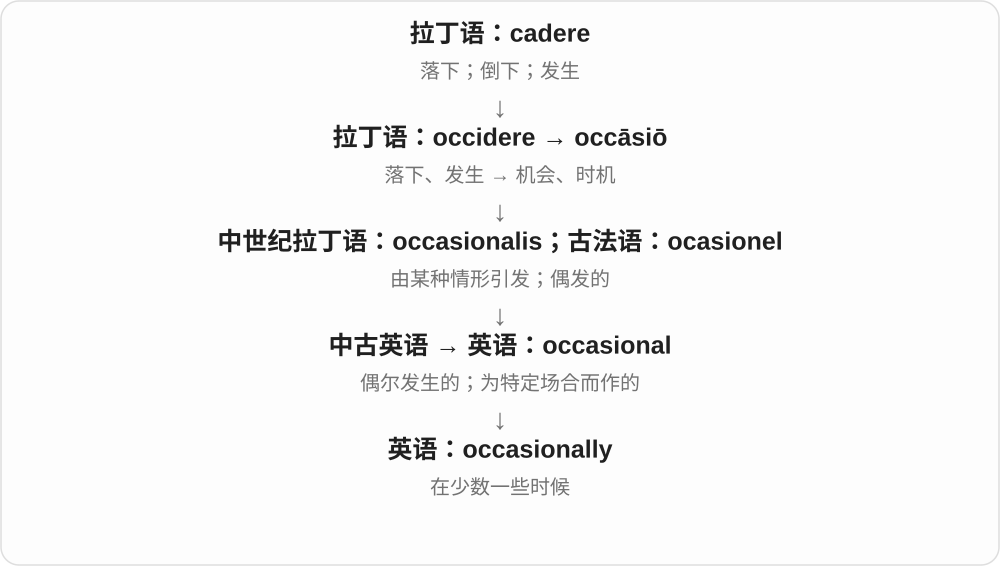

它不规定精确比例，只表明频率不高。可以放在句首，也常放在实义动词前；be 动词之后也很自然。

**常见搭配与例句**

occasionally visit；only occasionally；occasionally, …。

> We occasionally have lunch together.

我们偶尔一起吃午饭。

> The road is occasionally closed after heavy snow.

大雪之后，这条路有时会封闭。

**别混淆**

occasionally 比 often 频率低；accidentally 是不小心，不能用来表达“偶尔去吃饭”。

### 6. occasion — 某次；场合；时机；引起

**音标**：/əˈkeɪʒən/

**先抓住这个画面**

时间和情形凑到一起，形成“这一次、这个场合”，就是 occasion。

**怎么拆**

经古法语来自拉丁语 occāsiō，背后是 ob- + cadere 形成的 occidere“落下、发生”。字形里的 occ- 是前缀同化，不能拆成英语的 on + case。

**怎么变成今天的意思**

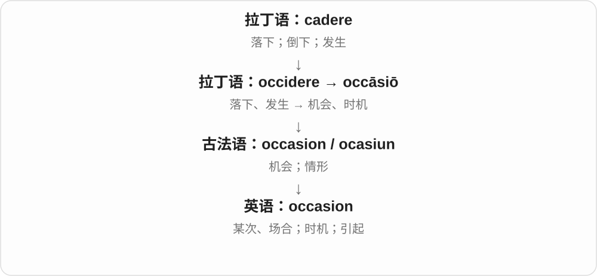

它可以是普通的一次，也可以是婚礼等值得庆祝的场合。an occasion for celebration 是让人有理由庆祝的时机。正式动词 occasion 则表示促成、引起某事。

**常见搭配与例句**

on this occasion；on several occasions；a special occasion；occasion concern。

> I have met her on several occasions.

我在几个不同场合见过她。

> We saved the bottle for a special occasion.

我们把这瓶酒留到特殊的日子再开。

> The delay occasioned considerable concern.

这次延误引起了相当大的担忧。

**别混淆**

occasion 关注某次或某个场合；opportunity 更强调做事的机会。occasion 的动词不是“偶尔做”。

### 7. casual — 随意的；非正式的；临时的；不经意的

**音标**：/ˈkæʒuəl/

**先抓住这个画面**

没有郑重安排、没有绷得很紧，衣服、态度或一次接触都可以显得 casual。

**怎么拆**

经中古法语 casuel 来自晚期拉丁语 cāsuālis“偶然发生的”，根在 cāsus“发生的事”。

**怎么变成今天的意思**

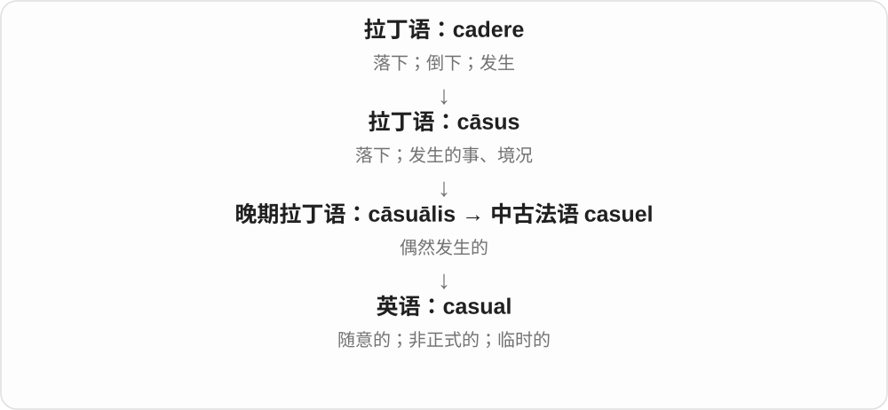

原先的“偶然、临时发生”，发展成“不固定、不郑重”的感觉：casual clothes 是休闲服；a casual remark 是随口一句；casual work 是临时、非固定的工作。语境不同，轻松也可能变成漫不经心。

**常见搭配与例句**

casual clothes；a casual conversation；a casual acquaintance；a casual attitude。

> The office allows casual clothes on Fridays.

办公室允许周五穿休闲服。

> What began as a casual conversation became a serious discussion.

原本随意的聊天，后来变成了认真讨论。

**别混淆**

casual 不等于 careless：穿得随意不代表粗心。causal“因果的”来自 cause，字母顺序不同，也不是本词的意思。

### 8. accidentally — 意外地；不小心地

**音标**：/ˌæksɪˈdentəli/

**先抓住这个画面**

你想做的是甲，手一滑、没留神却做成乙，就能用 accidentally。

**怎么拆**

accidental + -ly，把“非故意的”变成动作发生的方式。

**怎么变成今天的意思**

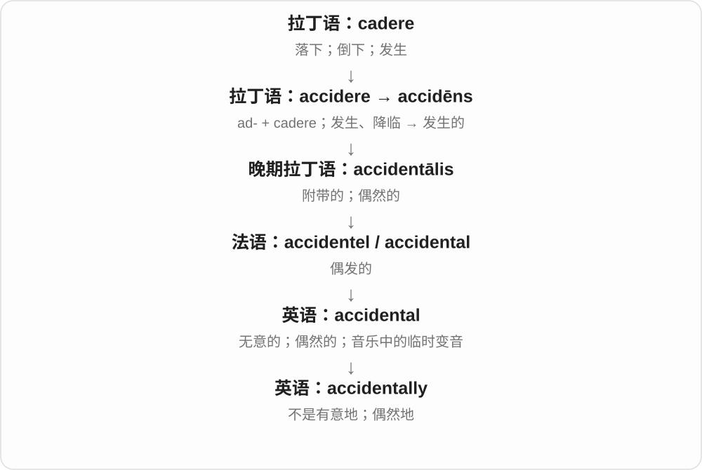

这个副词常放在动词前，说明动作没有出于本意。它只能说明意图，不能自动表示后果不严重或完全没有责任。

**常见搭配与例句**

accidentally delete；accidentally spill；accidentally discover。

> I accidentally sent the message to the wrong group.

我不小心把消息发错了群。

> She accidentally discovered a shortcut through the park.

她偶然发现了一条穿过公园的近路。

**别混淆**

mistakenly 常有判断、认知错误；accidentally 更宽，可以只是碰倒杯子。on purpose 则是故意。

### 9. occasional — 偶尔的；不经常的；为某个场合而作的

**音标**：/əˈkeɪʒənəl/

**先抓住这个画面**

大多数时候没有，只在某几次、某些场合出现，就是 occasional。

**怎么拆**

历史上有中世纪拉丁语 occasionalis、古法语 ocasionel 等前身；现代可按 occasion + -al 看。

**怎么变成今天的意思**

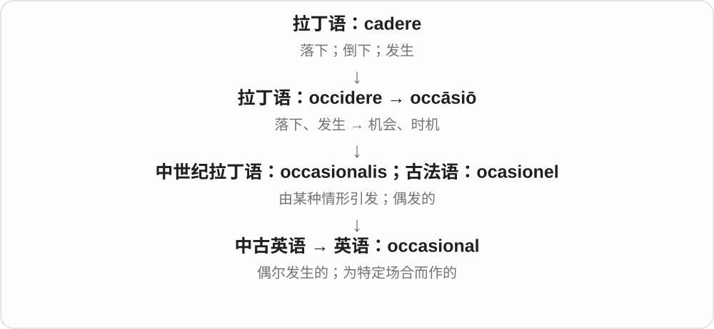

an occasional visitor 是偶尔来的人，不是完全随机出现的人。文学里的 occasional poem 指为婚礼、纪念日等特定场合写的诗，这个义仍贴着 occasion“场合”。

**常见搭配与例句**

occasional rain；an occasional visitor；occasional use；occasional poetry。

> The room is used for occasional meetings.

这个房间偶尔用来开会。

> He wrote occasional poems for family celebrations.

他为家中的庆祝活动写过一些应景诗。

**别混淆**

occasional 说频率不高或针对特定场合；accidental 说出于意外。偶尔来的朋友也可能每次都提前约好。

### 10. cheat — 作弊；欺骗；骗取；骗子

**音标**：/tʃiːt/

**先抓住这个画面**

别人按规则付出，你却偷偷走歪路拿走好处，这就是 cheat 的核心感觉。

**怎么拆**

由 escheat 一支缩短而来：原先涉及财产归回、没收，后来出现不正当地夺取，再发展为欺骗、作弊。

**怎么变成今天的意思**

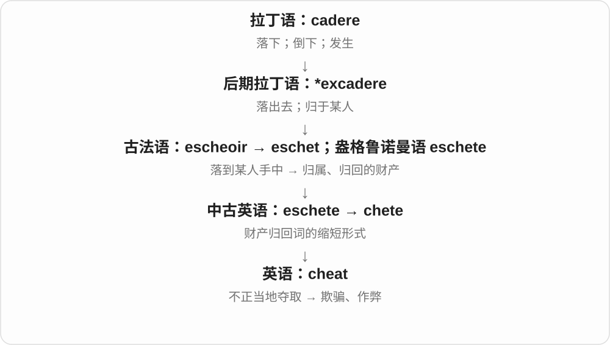

这段语义转变常被联系到旧时财产归回官的恶劣名声，但不能据此说那项制度本身就等于骗局。现代 cheat on a test 是考试作弊；cheat someone out of money 是骗走钱；cheat on a partner 是对伴侣不忠。

**常见搭配与例句**

cheat at cards；cheat on an exam；cheat someone out of…；cheat on someone。

> He was caught cheating on the exam.

他考试作弊时被抓到了。

> The scammer cheated her out of her savings.

骗子骗走了她的积蓄。

**别混淆**

deceive 强调使人相信假象；cheat 常涉及违反规则或剥夺别人应得的利益。cheat death 则是“死里逃生”的比喻。

### 11. coincidence — 巧合；同时发生；重合

**音标**：英 /kəʊˈɪnsɪdəns/；美 /koʊˈɪnsɪdəns/

**先抓住这个画面**

没有事先商量，两件本来独立的事却刚好对上了，这种“这么巧”就是 coincidence。

**怎么拆**

英语借自中古法语 coincidence，远处是 co- + incidere；现代词形可与 coincide + -ence 对照。

**怎么变成今天的意思**

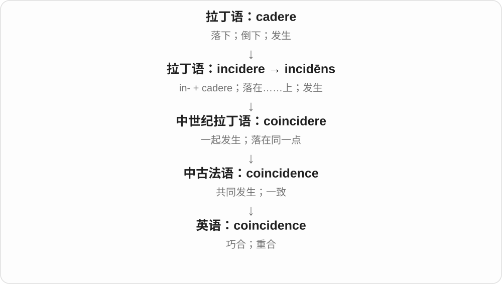

遇到同名同姓的人、朋友恰好坐在隔壁桌，都可以让人说 What a coincidence! 技术语境也可单指重合或同时发生，并不总在讨论神秘缘分。

**常见搭配与例句**

by coincidence；a strange coincidence；pure coincidence；What a coincidence!。

> By coincidence, we booked rooms in the same hotel.

碰巧我们在同一家酒店订了房间。

> It was pure coincidence that both letters arrived on the same day.

两封信同一天到达，纯属巧合。

**别混淆**

巧合不能单凭同时出现就证明因果关系。coincidence 是名词，coincide 是动词，coincidental 是形容词。

### 12. decay — 腐烂；衰败；衰减

**音标**：/dɪˈkeɪ/

**先抓住这个画面**

不是一下子摔碎，而是原有的结构、力量或状态慢慢往下掉、慢慢坏掉，就是 decay。

**怎么拆**

经盎格鲁诺曼语 decaeir，追到拉丁语 dēcidere“落下”和通俗拉丁语 *dēcadere；de- 是向下、离开，cadere 是落下。

**怎么变成今天的意思**

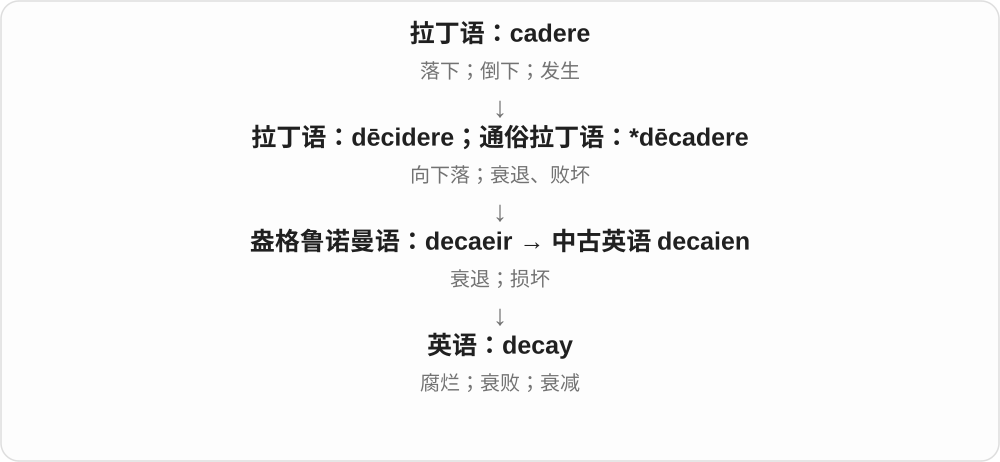

木头被分解、牙齿受损、城区逐渐破败，都能用 decay。物理中还指衰变或某个量逐渐衰减；这些技术义不是说东西像食物一样腐臭。

**常见搭配与例句**

tooth decay；urban decay；radioactive decay；fall into decay。

> The wooden fence began to decay in the damp soil.

木栅栏在潮湿土壤中开始腐烂。

> The abandoned station had fallen into decay.

这座废弃车站已经破败不堪。

**别混淆**

rot 更常指有机物腐烂；decay 还可用于社会、建筑和物理过程。decide“决定”属于 caedere“切”的另一族。

### 13. accidental — 意外的；非故意的；偶然的；临时变音记号

**音标**：/ˌæksɪˈdentəl/

**先抓住这个画面**

结果出现了，但它并不是原先安排或有意做出的，用 accidental。

**怎么拆**

历史上经法语进入英语，背后是晚期拉丁语 accidentālis；现代可对应 accident + -al，不能因此把整个历史说成英语里才加尾巴。

**怎么变成今天的意思**

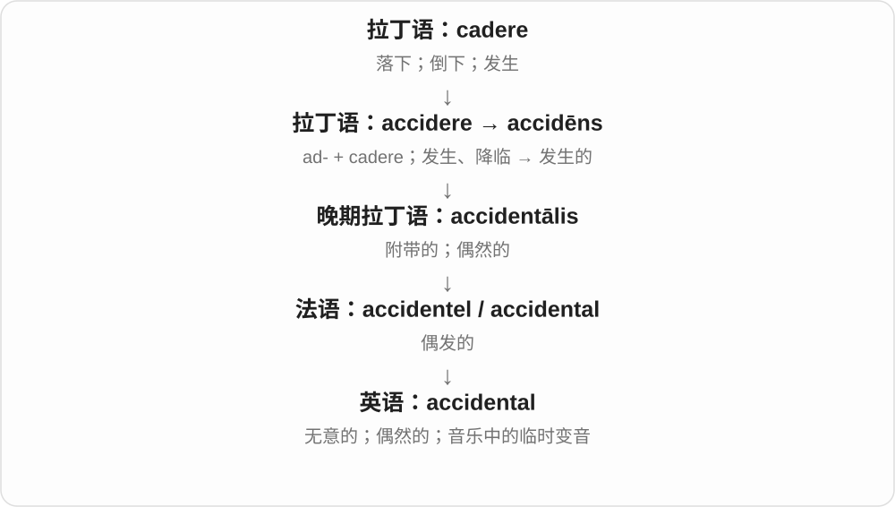

accidental damage 是意外造成的损坏，不是损坏很小。在音乐里，an accidental 指临时升降某个音的记号；这里谈的是调号之外的局部变化。

**常见搭配与例句**

accidental damage；an accidental discovery；an accidental meeting；a sharp accidental。

> The discovery was accidental, but the team recognized its value.

这一发现出于偶然，但团队意识到了它的价值。

> The score includes an accidental before the final note.

乐谱在最后一个音前标了一个临时变音记号。

**别混淆**

accidental 关注是否意外；incidental 关注是不是主要事情之外的附带部分。附带结果可能早就预料到了。

### 14. casually — 随意地；不经意地；若无其事地

**音标**：/ˈkæʒuəli/

**先抓住这个画面**

你没有摆出郑重架势，说话、走路、穿衣都很放松，可以用 casually。

**怎么拆**

casual + -ly；中古英语已经有相应副词形式，现代关系仍很清楚。

**怎么变成今天的意思**

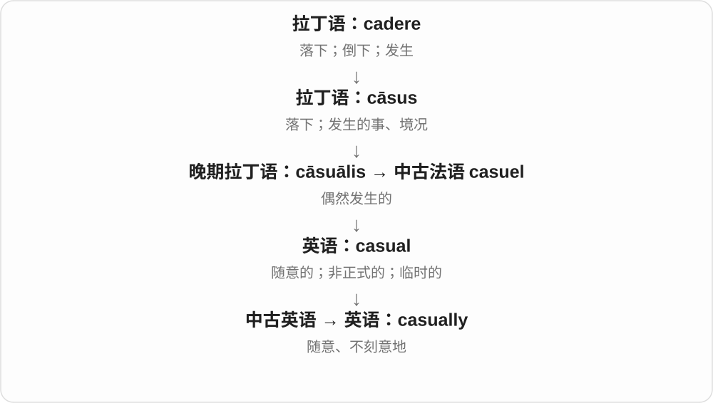

casually dressed 是穿得休闲；casually mention 是随口提起；故作镇定时也可以 act casually，外表轻松不代表内心毫不紧张。

**常见搭配与例句**

dress casually；mention casually；lean casually；act casually。

> She casually mentioned that she had lived in Brazil.

她随口提到自己在巴西住过。

> He tried to act casually as he waited for the result.

等结果时，他努力装得若无其事。

**别混淆**

accidentally 是无意发生；casually 是方式不郑重。你可以有意用很随意的语气提一个问题。

### 15. incidence — 发生情况；发生率；入射

**音标**：/ˈɪnsɪdəns/

**先抓住这个画面**

incident 是一件事；incidence 把镜头拉远，问这类事在某个人群、某段时间里发生得怎么样。

**怎么拆**

经中古法语 incidence，来自中世纪拉丁语 incidentia“落到……上、发生”，根在 incidere。

**怎么变成今天的意思**

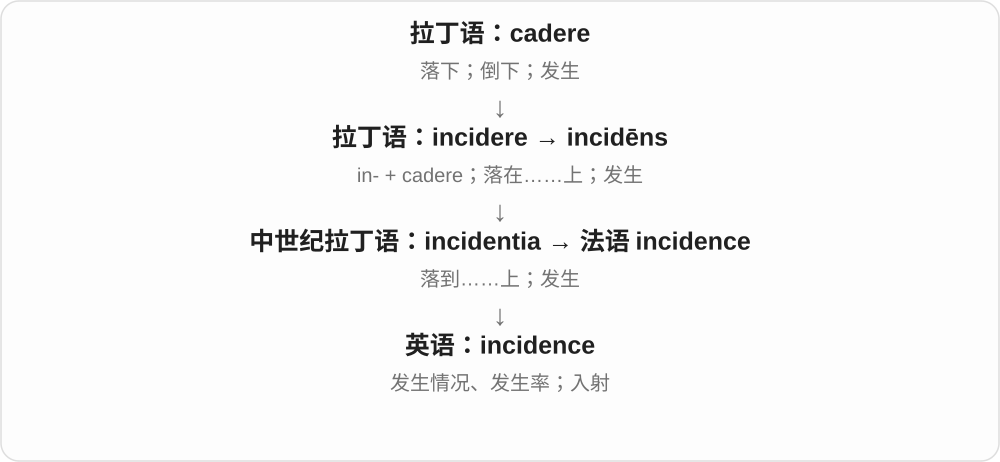

a high incidence of theft 是盗窃发生较多。流行病学里常关注一定期间内新出现的病例，具体是比例还是速率要看指标；物理里的 angle of incidence 是入射光与法线之间的角。

**常见搭配与例句**

the incidence of…；a high incidence；reduce the incidence；angle of incidence。

> The survey found a high incidence of bicycle theft in the area.

调查发现，这一带自行车失窃较多。

> The angle of incidence is measured from the normal to the surface.

入射角以表面的法线为基准测量。

**别混淆**

incidence 常看新发生；prevalence 看某时点或时期已有多少病例。incidents 是 incident 的复数，不能拿来替换发生率。

### 16. casualty — 伤亡者；受害者；因某事而受损的人或事物

**音标**：/ˈkæʒuəlti/

**先抓住这个画面**

一次冲突、事故或变化发生后，有谁受伤、失去生命或被牺牲掉，这个受损者可以叫 casualty。

**怎么拆**

casual + -ty 形成名词，中古英语写作 casuelte、caswelte；词义由偶发事件、不幸事件，发展到事件中的损失。

**怎么变成今天的意思**

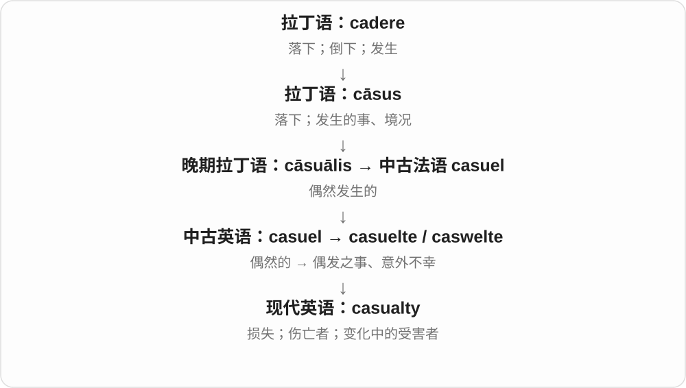

新闻中的 casualties 不只指死者，也常包括伤者；军事统计还可能包括被俘、失踪等失去行动能力者。比喻用法则说一项计划、服务在变化中“遭了殃”。

**常见搭配与例句**

civilian casualties；heavy casualties；a casualty of…；casualty figures。英式 casualty 还可指急诊科。

> The emergency team treated several casualties at the scene.

急救队在现场救治了几名伤者。

> The local library became a casualty of the budget cuts.

当地的图书馆成了预算削减的牺牲品。

**别混淆**

fatality 专指死亡或死者；casualty 范围更宽。victim 强调受害身份，不一定用于数量统计。

### 17. incidentally — 顺便说一句；附带地；偶然地

**音标**：/ˌɪnsɪˈdentəli/

**先抓住这个画面**

原来在说一件事，你顺手在旁边加上一句，用 incidentally。

**怎么拆**

incidental + -ly，先表示附带地、偶然伴随地，再常用于插入话题。

**怎么变成今天的意思**

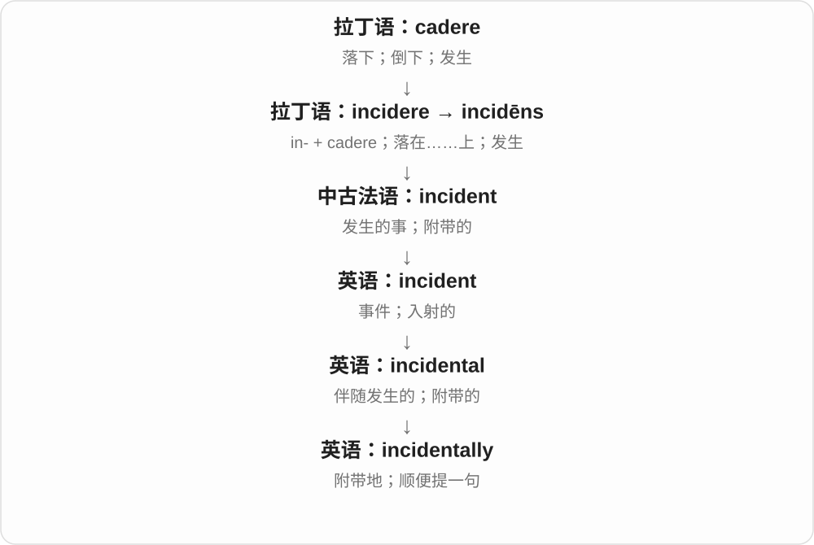

放在句首常相当于 by the way，表示这句话是顺带提起。放在动作旁边，则可真的表示某事是附带发生或偶然发现的。

**常见搭配与例句**

Incidentally, …；learn something incidentally；discover something incidentally。

> Incidentally, your umbrella is still in my car.

顺便说一句，你的伞还在我车里。

> She learned several local expressions incidentally while helping at the café.

她在咖啡馆帮忙时，顺带学会了几个当地表达。

**别混淆**

coincidentally 是巧的是，强调两个事实碰巧相合；incidentally 是顺便提一句，着重话题位置。

### 18. parachute — 降落伞；跳伞；空投

**音标**：/ˈpærəʃuːt/

**先抓住这个画面**

人或物正在下落，打开一大片伞面，让空气阻力托慢下落速度，这就是 parachute。

**怎么拆**

法语造词 para-（防护、抵御）+ chute（下落）；这里 para- 与 parasol“遮阳伞”的构词相通，不是 parallel 里“并列”的希腊前缀。

**怎么变成今天的意思**

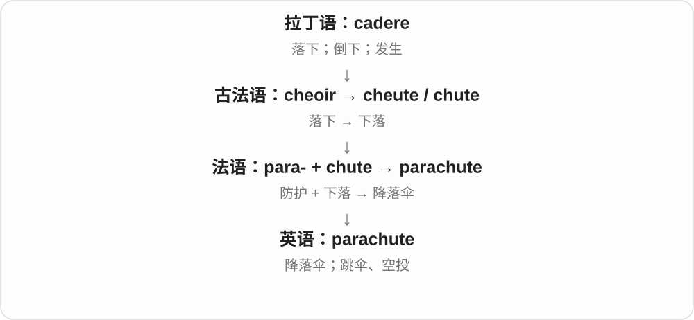

名词指装置，动词可说人跳伞或把物资空投。比喻 parachute someone into a job，是把一个外来人直接安排进某个岗位，未必经过内部成长。

**常见搭配与例句**

open a parachute；a parachute jump；parachute supplies into…；parachute someone into…。

> The parachute opened above the fields.

降落伞在田野上空打开了。

> The team parachuted supplies into the isolated village.

团队向与外界隔绝的村庄空投了物资。

**别混淆**

parachute 是用于减缓下降的装置；umbrella 主要挡雨、遮阳。外形都像伞，用途和构词路径不同。

### 19. coincide — 同时发生；相合；重合

**音标**：英 /ˌkəʊɪnˈsaɪd/；美 /ˌkoʊɪnˈsaɪd/

**先抓住这个画面**

两条线往前走，落到同一个时间、位置或看法上，就 coincide。

**怎么拆**

经法语 coïncider，来自中世纪拉丁语 coincidere：co-（一起）+ incidere（落在、发生）。

**怎么变成今天的意思**

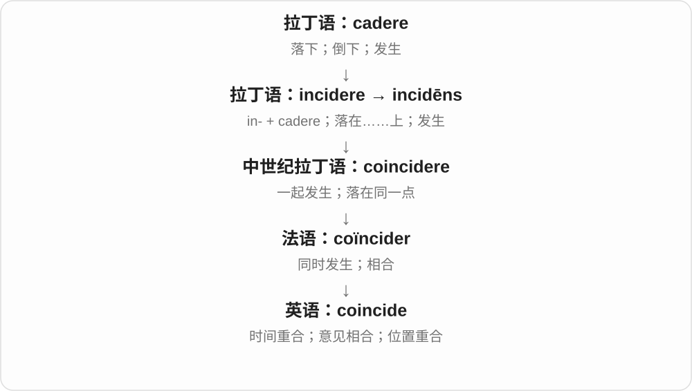

会议和生日落在同一天，是时间重合；两人的兴趣一致，是内容相合；几何中两条线完全重合，也用它。它只说明对上了，不自动断言这种重合是偶然。

**常见搭配与例句**

coincide with…；coincide in time；our interests coincide。通常不直接接宾语。

> The festival coincides with the school holidays.

这个节日正逢学校假期。

> Our views coincide on this point.

在这一点上，我们的看法一致。

**别混淆**

coincide 说吻合、重合；coincidence 在日常英语里更容易带“巧合”意味。计划好的活动也能 coincide。

### 20. cascade — 小瀑布；倾泻；接连发生的一串

**音标**：/kæsˈkeɪd/

**先抓住这个画面**

水从高处一层层落下来，是 cascade；一件事带着下一件事接连发生，也像这种层层倾泻。

**怎么拆**

法语 cascade 来自意大利语 cascata，动词 cascare“落下”更早接到通俗拉丁语 *cāsicāre，与 cadere 同源。

**怎么变成今天的意思**

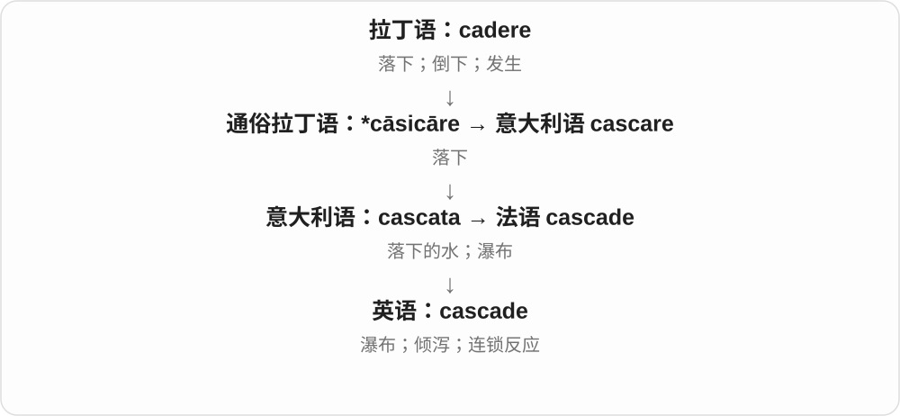

既能是看得见的瀑布、长发、纸张落下，也能是信息、故障、反应成串发生。a cascade of errors 不是一个孤立错误，而是一连串后续错误。

**常见搭配与例句**

a cascade of…；cascade down…；a cascade of failures；cascading effects。

> Water cascaded over the rocks into the pool.

水越过岩石，层层落入水潭。

> One missing file triggered a cascade of errors.

一个文件缺失，引发了一连串错误。

**别混淆**

waterfall 一般指瀑布；cascade 特别适合层层落下的画面，并容易延伸到连锁事件。

### 21. incidental — 附带的；次要的；偶然伴随的

**音标**：/ˌɪnsɪˈdentəl/

**先抓住这个画面**

你主要去做一件事，旁边顺带发生、花费或得到的东西，是 incidental。

**怎么拆**

incident + -al；从伴随发生的事，转成描述它在整体中所处的位置。

**怎么变成今天的意思**

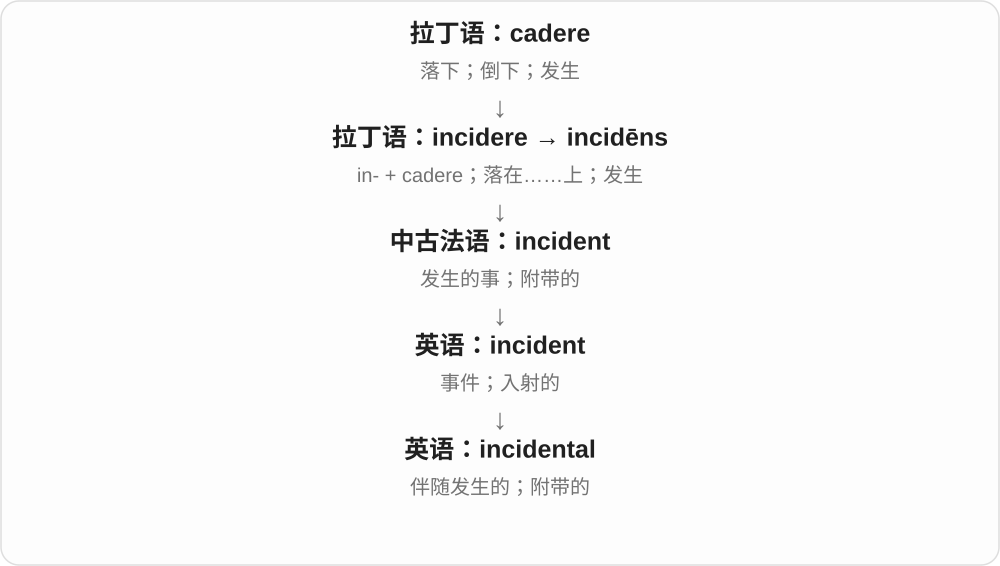

去开会时的零星开销，可以是 incidental expenses；修路时顺便发现古物，是 incidental discovery。重点在于它不是原来的主任务，不必每次都强调完全出乎意料。

**常见搭配与例句**

incidental expenses；incidental to…；an incidental benefit；incidentals（零星杂费）。

> The grant covers travel and incidental expenses.

这笔资助涵盖差旅和零星杂费。

> The extra storage space was an incidental benefit of the redesign.

额外的储物空间是这次重新设计带来的附加好处。

**别混淆**

accidental 说非故意、出于偶然；incidental 说附带、次要。一项收益可以 incidental，但也在预料之内。

### 22. coincidentally — 巧合地；碰巧

**音标**：英 /kəʊˌɪnsɪˈdentəli/；美 /koʊˌɪnsəˈdentəli/

**先抓住这个画面**

讲完一件事，发现另一件事竟然刚好与它对上，开头加 coincidentally 就是“巧的是”。

**怎么拆**

coincidental + -ly。

**怎么变成今天的意思**

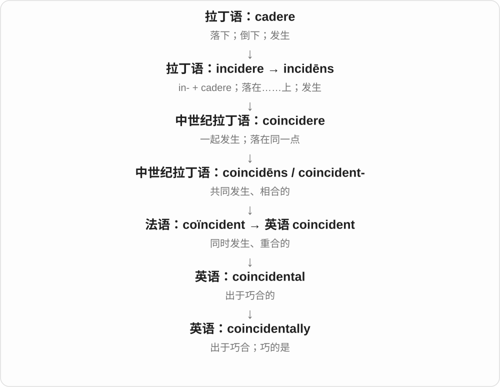

它常修饰整句话，提醒读者注意两件事的巧合关系，也可描述某种相似只是碰巧出现。

**常见搭配与例句**

Coincidentally, …；quite coincidentally；purely coincidentally。

> Coincidentally, my sister had applied for the same job.

巧的是，我姐姐也申请了同一份工作。

> We chose the same color quite coincidentally.

我们完全是碰巧选了同一种颜色。

**别混淆**

incidentally 常是插一句无关紧要的新话题；coincidentally 必须有某种巧合值得指出。

### 23. cheater — 作弊者；骗子；对伴侣不忠的人

**音标**：英 /ˈtʃiːtə/；美 /ˈtʃiːtər/

**先抓住这个画面**

cheat 是那种不守规则、骗取好处的行为；cheater 就是做这件事的人。

**怎么拆**

cheat + -er，表示施事者。

**怎么变成今天的意思**

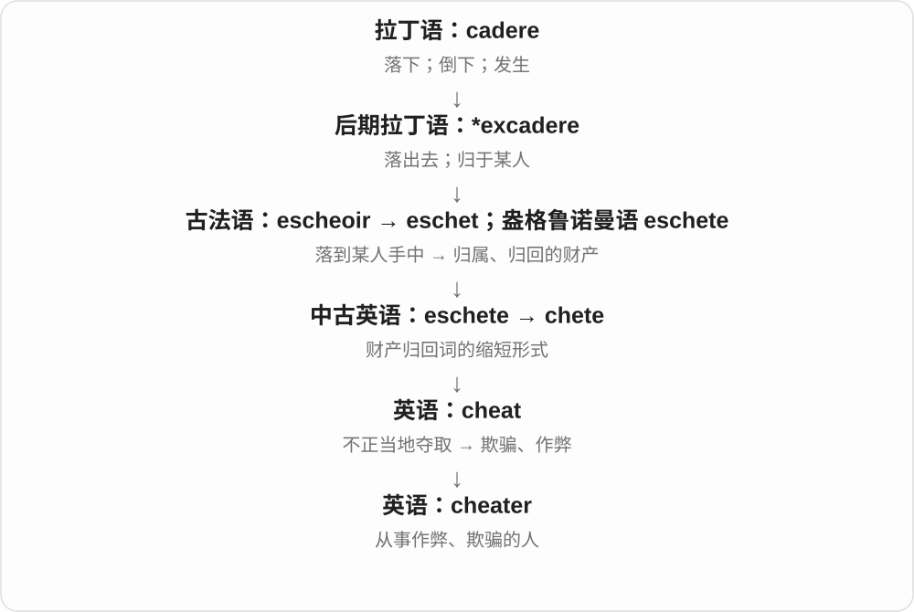

比赛中指作弊者，恋爱语境可指不忠者，要看他违背的是什么规则或关系。口语还有 cheaters 指阅读眼镜等少见俚语，不能反过来影响核心义。

**常见搭配与例句**

catch a cheater；ban cheaters；an exam cheater。

> The game removes cheaters from the rankings.

这个游戏会把作弊者从排行榜中移除。

> She refused to work with someone she regarded as a cheater.

她不愿与一个被她视为骗子的人合作。

**别混淆**

liar 说谎；cheater 作弊或欺骗。有些作弊靠偷看、违规工具，不一定靠说假话。

### 24. chute — 滑槽；溜槽；狭窄通道；降落伞的简称

**音标**：/ʃuːt/

**先抓住这个画面**

让衣物、谷物或包裹顺着一个斜槽、竖井往下滑，那条专门的通路就是 chute。

**怎么拆**

来自法语 chute“下落”，由古法语 cheoir“落下”的形式发展，根在拉丁语 cadere。表示降落伞时则是 parachute 的截短。

**怎么变成今天的意思**

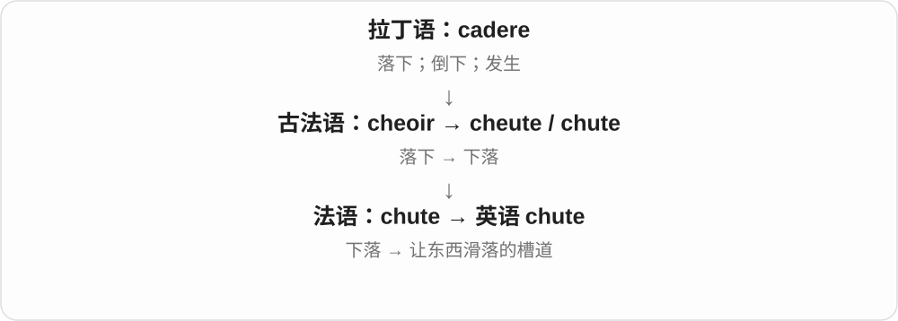

从下落、落水发展到引导物体滑下的槽道；北美用法还可指引导牲畜进入围栏的狭窄通道。a chute opened 在跳伞场景中，是降落伞打开，不是槽道突然张开。

**常见搭配与例句**

a laundry chute；a rubbish chute；a grain chute；open the chute。

> She dropped the towels down the laundry chute.

她把毛巾从洗衣投放槽扔了下去。

> The pilot’s chute opened seconds after the jump.

飞行员跳出飞机几秒后，降落伞打开了。

**别混淆**

chute 与 shoot 同音，部分历史用法相互影响，但 shoot“射击、嫩芽”不属于 cadere 这条词源线。

### 25. decaying — 正在腐烂的；日益衰败的；正在衰减的

**音标**：/dɪˈkeɪɪŋ/

**先抓住这个画面**

decay 讲变化，decaying 把镜头定在“它正在一点点坏下去”的过程中。

**怎么拆**

decay + -ing，可作现在分词、形容词，也可把腐败过程当名词来谈。词尾 y 保留。

**怎么变成今天的意思**

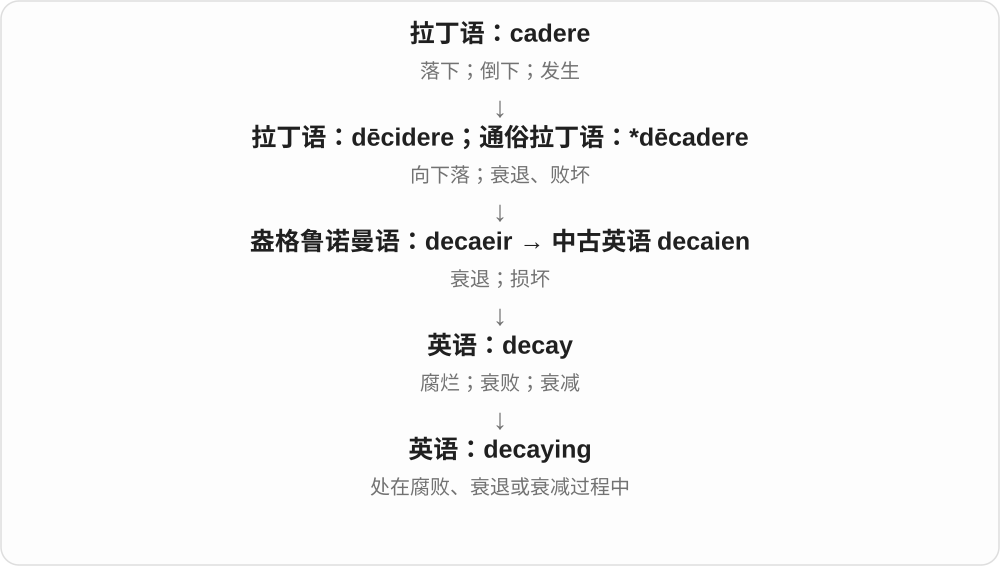

decaying leaves 是正在分解的叶子；a decaying town 是逐渐衰落的城镇。它强调过程仍在发生，不能一律翻成“已经坏完了”。

**常见搭配与例句**

decaying wood；decaying buildings；a decaying industrial town；a decaying signal。

> Decaying leaves formed a soft layer on the forest floor.

正在腐烂的落叶在林地上铺成软软的一层。

> The project aims to restore the town’s decaying buildings.

这个项目旨在修复镇上日渐破败的建筑。

**别混淆**

decayed 更容易看成已经腐坏的状态；decaying 把注意力放在变化过程。dying 则更直接说走向死亡。

### 26. cadence — 节奏；语调起伏；音乐的终止式

**音标**：/ˈkeɪdəns/

**先抓住这个画面**

一句话或一段音乐不是平直往前走，而是有轻重、起伏和落脚处；这种听得出的节奏感就是 cadence。

**怎么拆**

经法语 cadence、意大利语 cadenza，追到拉丁语 cadere“落下”；音乐中曾强调乐句落定、收束。

**怎么变成今天的意思**

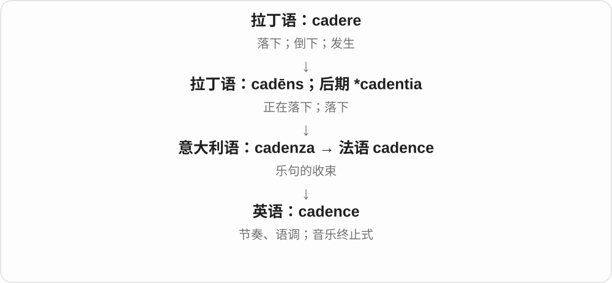

说话的 cadence 是语流的起伏节奏；音乐中的 cadence 是让乐句获得停顿或收束感的和声走向；跑步、骑车时又可指步频或踏频。别把每一种 cadence 都想成音高必须向下。

**常见搭配与例句**

the cadence of someone’s voice；a steady cadence；a musical cadence；increase cadence。

> I recognized her by the familiar cadence of her voice.

听到那熟悉的说话节奏，我就认出了她。

> The cyclist increased his cadence on the flat road.

骑车人在平路上提高了踏频。

**别混淆**

rhythm 是广义节奏；cadence 常突出可感知的语流、步伐或段落收束。tempo 更直接说音乐速度。

### 27. decadent — 颓废的；奢靡的；让人尽情享受的

**音标**：/ˈdekədənt/

**先抓住这个画面**

它一边能批评“只顾享受、向下沉”，一边也能打趣“好吃得太放纵了”。

**怎么拆**

英语借自法语 décadent；法语形容词由 décadence 反构而来。现代名词、形容词成对，但不能把历史画成英语 decadent 先造出 decadence。

**怎么变成今天的意思**

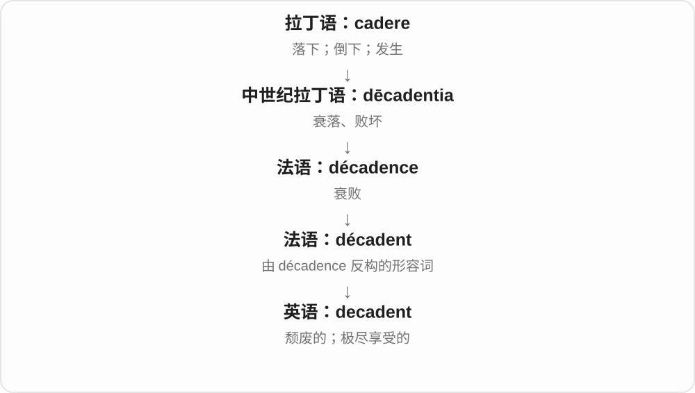

a decadent society 是带评价的社会描述；a decadent dessert 往往是商家赞美甜点浓郁、丰盛。理解时要看语气，别把点菜时的这个词硬译成“堕落的”。

**常见搭配与例句**

a decadent lifestyle；a decadent dessert；decadent luxury。

> Critics described the court as decadent and detached from ordinary life.

批评者认为宫廷奢靡颓废，脱离普通人的生活。

> We shared a decadent chocolate dessert.

我们分吃了一份浓郁丰盛的巧克力甜点。

**别混淆**

decaying 重在衰败过程；decadent 常评判生活方式，或夸张地表达享乐。

### 28. deciduous — 落叶的；会自然脱落的；乳齿的

**音标**：英 /dɪˈsɪdʒʊəs/；美 /dɪˈsɪdʒuəs/

**先抓住这个画面**

这一部分只陪身体或植物走过一段时间，到了阶段就会脱落；deciduous 抓住的是这种有周期的“掉下来”。

**怎么拆**

来自拉丁语 dēciduus“会脱落的”，背后是 dē-（向下、离开）+ cadere（落下）形成的 dēcidere。

**怎么变成今天的意思**

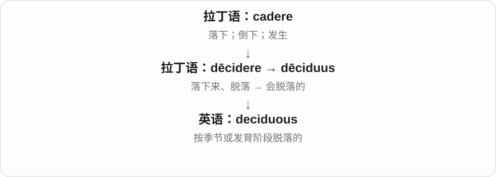

deciduous trees 常在一年中的某个季节集中落叶，不只在寒冷地区的秋天；deciduous teeth 是后来会被恒齿替换的乳齿。重点是正常生长周期中的脱落。

**常见搭配与例句**

deciduous trees；deciduous woodland；deciduous teeth。

> The hillside is covered with deciduous trees.

山坡上长满了落叶树。

> Deciduous teeth are gradually replaced by permanent teeth.

乳齿会逐渐被恒齿替换。

**别混淆**

evergreen 是常绿，并非叶片永远不脱落；caducous 更强调某个部位很早就落掉。decide 的词根是“切”，与这里的“落”不同。

### 29. coincidental — 巧合的；碰巧相同的

**音标**：英 /kəʊˌɪnsɪˈdentəl/；美 /koʊˌɪnsəˈdentəl/

**先抓住这个画面**

两个结果看起来像约好了，其实只是碰巧，用 coincidental。

**怎么拆**

coincident + -al，形成“具有重合、巧合性质”的形容词；意思与名词 coincidence 配套，但历史图不把它画成由名词简单加尾巴。

**怎么变成今天的意思**

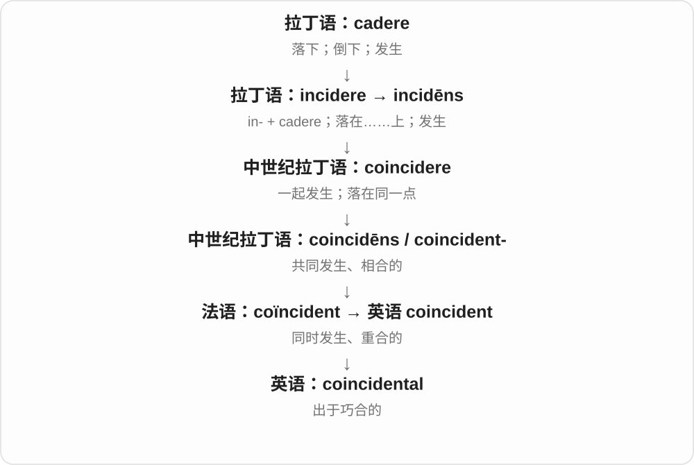

重点不是“有没有重合”，而是这份重合并非安排好的、也不一定来自直接联系。purely coincidental 表示完全是巧合。重音在 den，别被前面的 co- 带跑。

**常见搭配与例句**

purely coincidental；a coincidental similarity；appear coincidental。

> Their similar answers were entirely coincidental.

他们的答案相似，完全是巧合。

> The timing seemed too precise to be coincidental.

这个时间点太精准了，看起来不像巧合。

**别混淆**

simultaneous 只说同时；coincidental 说巧合。同时发生的事可能有计划、有因果，未必 coincidental。

### 30. occidental — 西方的；西部的

**音标**：英 /ˌɒksɪˈdentəl/；美 /ˌɑːksɪˈdentəl/

**先抓住这个画面**

把日落的一方变成一种地点或文化标签，就有了 occidental“西方的”。

**怎么拆**

经法语 occidental 或直接来自拉丁语 occidentālis，源于 occidēns“日落、西方”；现代可联系 occident + -al。

**怎么变成今天的意思**

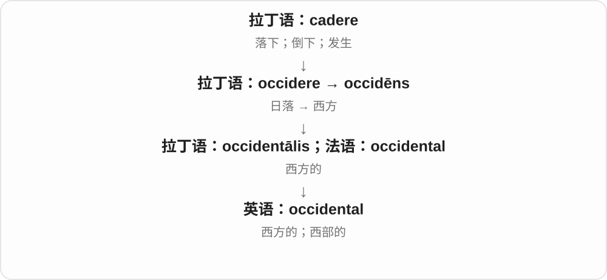

现代常见于旧著、正式文化比较或专有名称中，普通说法通常是 western。旧书也可能把 Occidental 当作名词称西方人，读时知道即可，不必拿它给现代人笼统分类。

**常见搭配与例句**

occidental traditions；occidental art；an occidental perspective。

> The exhibition compares oriental and occidental painting traditions.

这场展览比较旧称东方与西方的绘画传统。

> The author contrasts an occidental perspective with several Asian approaches.

作者将一种西方视角与几种亚洲思路作了比较。

**别混淆**

accidental 是意外的；occidental 是西方的。它们共享很远的“落”这一源头，但开头前缀和现代意义不同。

### 31. decadence — 颓废；衰败；奢靡享乐

**音标**：/ˈdekədəns/

**先抓住这个画面**

把精力都花在享受上，原先支撑一个人或社会的活力、标准却慢慢滑下去，这种状态常叫 decadence。

**怎么拆**

借自法语 décadence，往上是中世纪拉丁语 dēcadentia“衰败”，与 de- + cadere 的下落、衰退相连。

**怎么变成今天的意思**

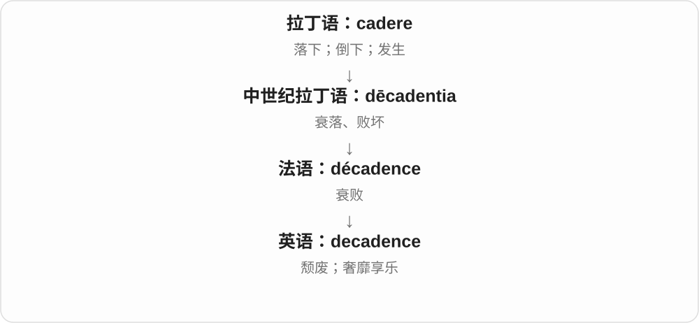

历史和社会评论中常带批评，认为生活奢靡、精神衰弱。说甜点、度假很 decadent 时，decadence 也可半开玩笑地表示放纵享受，不一定真在指控道德败坏。

**常见搭配与例句**

moral decadence；cultural decadence；an age of decadence；a touch of decadence。

> The novel portrays the decadence of a wealthy family.

这部小说描写了一个富裕家庭的奢靡与颓废。

> Breakfast in bed felt like a small act of decadence.

躺在床上吃早餐，让人觉得小小放纵了一回。

**别混淆**

decay 可是客观的物质损坏；decadence 常含人的文化或价值判断。不能看到豪华就自动断定一个社会在衰亡。

### 32. cadaver — 尸体；供医学研究或教学的人体遗体

**音标**：英 /kəˈdævə/；美 /kəˈdævər/

**先抓住这个画面**

它把已经去世的身体作为解剖、研究的对象来称呼，语气比 corpse 更偏医学和专业场合。

**怎么拆**

经中古英语来自拉丁语 cadāver“尸体”；它可能与 cadere“倒下、死去”相关，但这一步并不完全确定，不能当作已证实的拆词。

**怎么变成今天的意思**

可以借“生命倒下后留下的身体”来记这个可能的联系。现代读到 a cadaver，通常要想到医学、法医或解剖场景；不要把词源猜测写成古人把 cad 与别的词拼起来的故事。

**常见搭配与例句**

a human cadaver；cadaver dissection；study anatomy using cadavers。

> The students studied anatomy using a donated cadaver.

学生们利用捐献的遗体学习解剖学。

> The laboratory follows strict procedures for handling cadavers.

实验室遵循严格程序处理教学研究用遗体。

**别混淆**

corpse 是更一般的尸体；cadaver 更有医学用语色彩。body 的范围最宽，也能委婉指遗体。

### 33. recidivism — 再犯；累犯现象；重新陷入旧行为

**音标**：/rɪˈsɪdɪvɪzəm/

**先抓住这个画面**

关注的不是某个再犯者是谁，而是“人又回到原来的犯罪行为中”这件事或这种反复出现的现象。

**怎么拆**

与 recidivist 配套的抽象名词，-ist 换为 -ism；英语构词受到法语 récidivisme 影响，根仍是“再落回去”。

**怎么变成今天的意思**

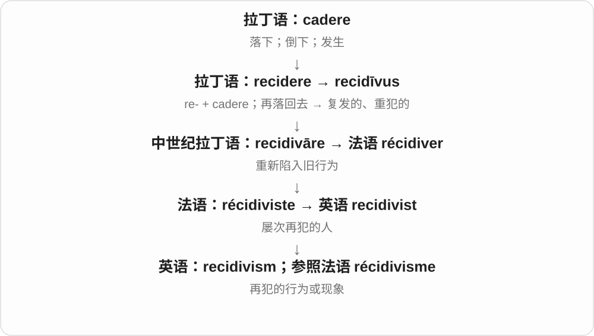

现代最常见于犯罪研究和矫治政策。recidivism rate 是某种统计口径下的再犯比例；读报告时还要看观察多久、以再次被捕还是重新定罪等作为标准。

**常见搭配与例句**

reduce recidivism；a recidivism rate；research on recidivism。

> The study examines whether job training can reduce recidivism.

这项研究考察职业培训能否减少再犯。

> The two reports use different measures of recidivism.

这两份报告采用了不同的再犯衡量标准。

**别混淆**

relapse 可用于疾病或旧习惯复发；recidivism 在现代社会研究里通常指再犯，不宜随便代替所有“又犯了”。

### 34. coincident — 同时发生的；相合的；重合的

**音标**：英 /kəʊˈɪnsɪdənt/；美 /koʊˈɪnsɪdənt/

**先抓住这个画面**

两件事在时间上对齐，或两条线的位置完全叠在一起，可以用较正式的 coincident。

**怎么拆**

来自法语 coïncident，往上是中世纪拉丁语 coincidēns 的词干 coincident-；它与 coincide 相配，但不是随意把动词词尾改一改才造出的。

**怎么变成今天的意思**

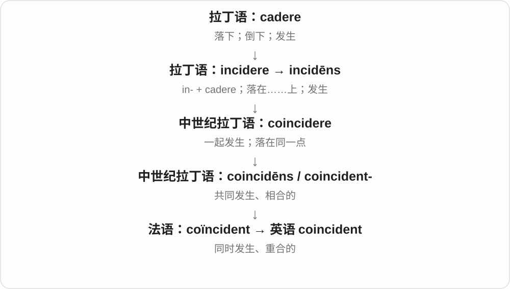

它常在技术、学术文章中描述对齐关系。coincident lines 是同一位置上的线；coincident changes 是同时发生的变化，不必暗示没有共同原因。

**常见搭配与例句**

coincident with…；coincident lines；coincident events。

> The rise in demand was coincident with the opening of the new station.

需求上升与新车站启用同时发生。

> On the graph, the two lines are coincident.

图中这两条线完全重合。

**别混淆**

coincident 侧重重合事实；coincidental 通常进一步表示出于巧合。

### 35. parachuting — 跳伞运动；跳伞；空投

**音标**：/ˈpærəʃuːtɪŋ/

**先抓住这个画面**

parachute 是那顶伞，也能表示跳伞；加上 -ing，就能把整个活动拿出来谈。

**怎么拆**

parachute 去掉末尾不发音的 e，再加 -ing。可作活动名词，也可作动词进行形式。

**怎么变成今天的意思**

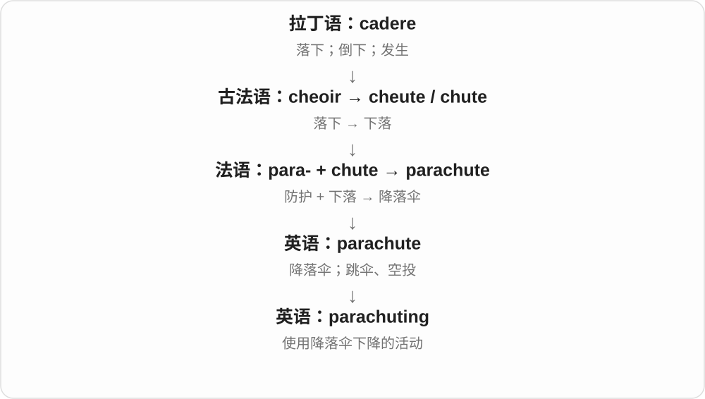

go parachuting 把跳伞当活动；were parachuting 则说当时正在跳伞或空投。并不是单词多了 -ing 就只剩一种词性。

**常见搭配与例句**

go parachuting；a parachuting course；a parachuting club。

> She joined a parachuting club at university.

她在大学加入了跳伞俱乐部。

> The rescue crew was parachuting supplies into the valley.

救援人员当时正在向山谷空投物资。

**别混淆**

skydiving 常特别强调从飞机跳出、自由落体后开伞的运动；parachuting 是较宽的使用降落伞下降。

### 36. occident — 西方；西部；西方世界

**音标**：英 /ˈɒksɪdənt/；美 /ˈɑːksɪdənt/

**先抓住这个画面**

站着看太阳往哪边落下去，那一边就是这个词最初所指的方向：西方。

**怎么拆**

经古法语 occident 或直接来自拉丁语 occidēns、词干 occident-，本来是 occidere“落下、日落”的现在分词。

**怎么变成今天的意思**

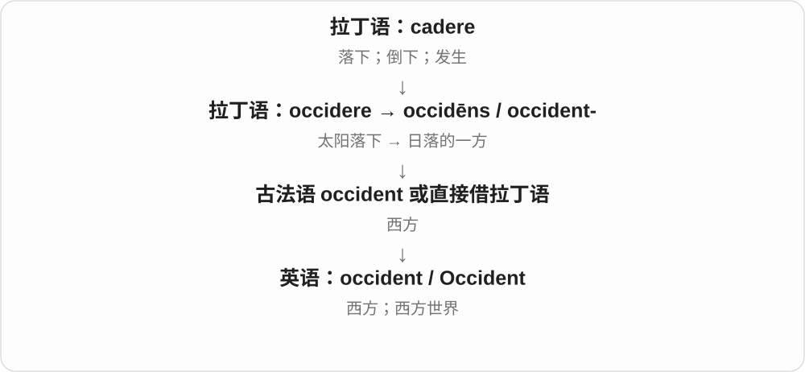

小写可指西边，大写 the Occident 常是旧式文献里的西方世界。它是历史文化称呼，范围并不始终固定；普通地理方向多用 west。

**常见搭配与例句**

the Occident；the Orient and the Occident；relations with the Occident。

> The historian examined trade between the Orient and the Occident.

历史学家考察了旧称东方与西方之间的贸易。

> The old travel account uses the Occident to refer broadly to western Europe.

那篇旧游记用 Occident 大致指代西欧。

**别混淆**

Orient 的画面是太阳升起的东方；Occident 是太阳落下的西方。occident 和 accident 不是一词的拼写变体。

### 37. cadenza — 华彩乐段

**音标**：/kəˈdenzə/

**先抓住这个画面**

乐队暂时把空间让出来，独奏者用一段自由、精彩的演奏展示技巧，这样的段落叫 cadenza。

**怎么拆**

直接借自意大利语 cadenza，与英语 cadence 是走不同借入路线的同源词；更早仍连着 cadere“落下、收束”。

**怎么变成今天的意思**

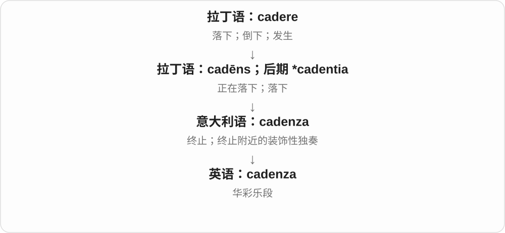

传统上常放在协奏曲乐章接近结尾的地方，可以即兴，也可以预先写定。它是音乐中的一个独奏段落，不等于整首乐曲，也不保证一定毫无伴奏。

**常见搭配与例句**

play a cadenza；improvise a cadenza；a violin cadenza。

> The pianist played a brilliant cadenza near the end of the movement.

钢琴家在乐章接近结尾时演奏了一段精彩的华彩。

> She wrote her own cadenza for the concerto.

她为这首协奏曲创作了自己的华彩乐段。

**别混淆**

cadence 是乐句的收束方式或节奏；cadenza 是供独奏者发挥的华彩段。

### 38. parachutist — 跳伞者

**音标**：/ˈpærəʃuːtɪst/

**先抓住这个画面**

背着降落伞跳下、操控伞具下降的那个人，是 parachutist。

**怎么拆**

parachute 去末尾 e，加 -ist，表示从事这一活动的人。

**怎么变成今天的意思**

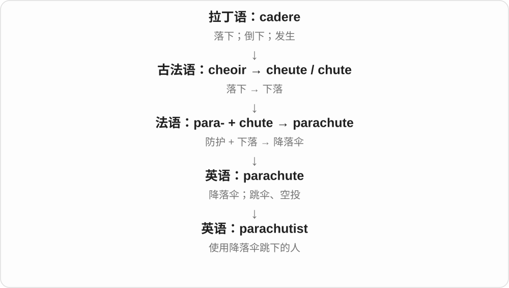

可以是运动爱好者，也可以是军人或表演者。词本身只标明活动身份，不保证此人是职业选手。

**常见搭配与例句**

an experienced parachutist；a team of parachutists；a parachutist lands。

> The parachutist landed close to the marked target.

跳伞者落在了标记目标附近。

> Several parachutists took part in the opening display.

几名跳伞者参加了开幕表演。

**别混淆**

paratrooper 专指伞兵；parachutist 不限军事身份。

### 39. chancy — 没把握的；有风险的

**音标**：英 /ˈtʃɑːnsi/；美 /ˈtʃænsi/

**先抓住这个画面**

成功与否很靠运气，你心里没底，说这件事 chancy 就很自然。

**怎么拆**

chance + -y，把“受偶然左右”变成事情的性质。

**怎么变成今天的意思**

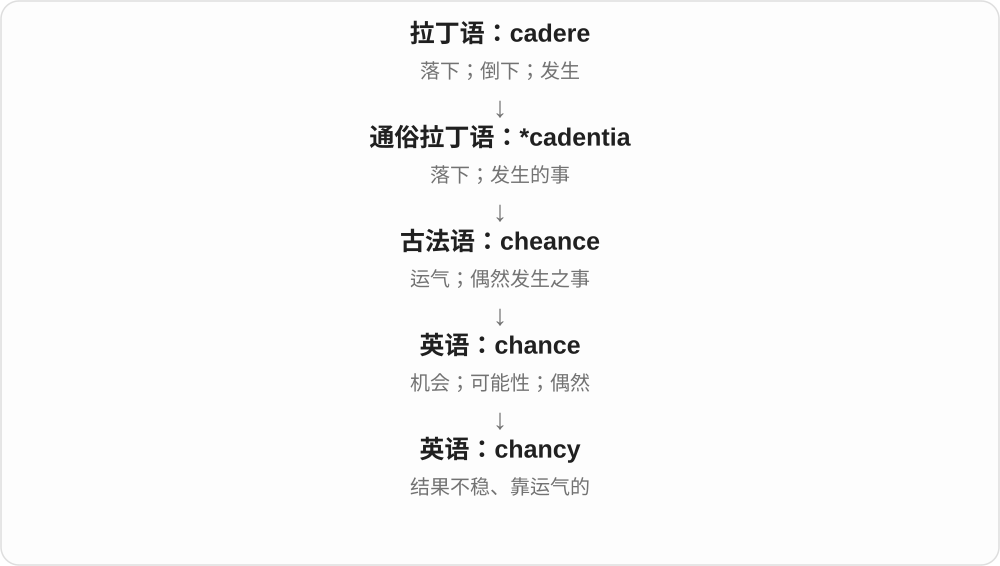

这是较口语的词。它不必意味着生命危险，也可以只是担心赶不上车、临时买不到票。少数苏格兰用法有“幸运的”意思，普通英语先掌握“悬、没把握”。

**常见搭配与例句**

a chancy business；a chancy plan；seem chancy。比较级 chancier，最高级 chanciest。

> Relying on the last bus is a chancy plan.

把希望全寄托在末班车上，这个计划不太稳妥。

> Buying tickets at the door can be chancy on a busy night.

热门场次到现场再买票，能不能买到很难说。

**别混淆**

risky 范围更广；chancy 特别突出结果难料、看运气。lucky 是走运，不能在普通语境随便用 chancy 替换。

### 40. recidivist — 再犯者；惯于重犯的人

**音标**：/rɪˈsɪdɪvɪst/

**先抓住这个画面**

曾经受过处罚或离开犯罪行为，后来又掉回老路的人，是 recidivist。

**怎么拆**

借自法语 récidiviste，背后是 récidiver“重犯”和拉丁语 recidīvus“再落回去的”：re-（再、回）+ cadere（落下）。

**怎么变成今天的意思**

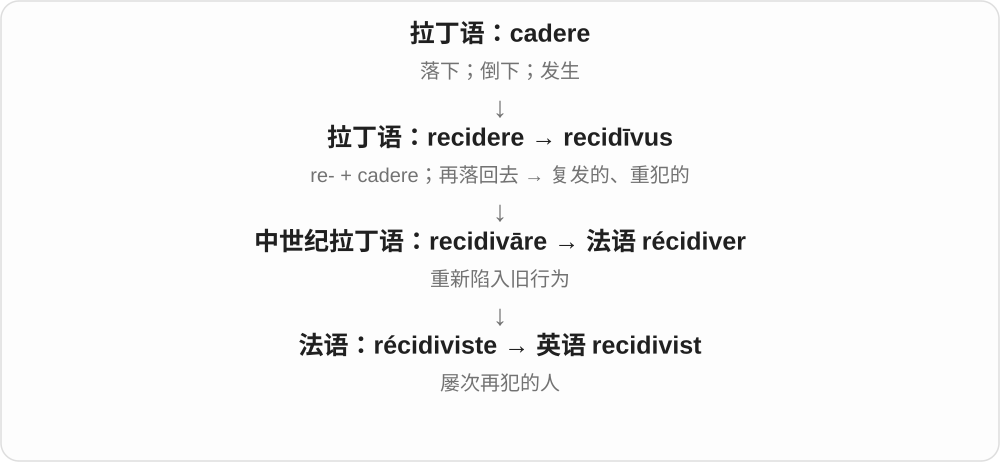

这是正式、法律和犯罪研究中的人名词，强调再次犯罪这一经历；不是任何第一次犯罪的人。它也能作形容词修饰 offender，但日常 repeat offender 更直白。

**常见搭配与例句**

a persistent recidivist；recidivist offenders；programs for recidivists。

> The program offers support to recidivists trying to rebuild their lives.

这个项目支持那些试图重建生活的再犯者。

> The report distinguishes first offenders from recidivists.

报告区分了初犯者和再犯者。

**别混淆**

criminal 泛指犯罪者；recidivist 突出再犯。不要从词尾 -ist 推断这是某种思想流派的支持者。

### 41. decidua — 蜕膜

**音标**：英 /dɪˈsɪdʒʊə/；美 /dɪˈsɪdʒuə/

**先抓住这个画面**

子宫内膜为了妊娠发生变化，像把内壁改造成更适合胚胎着床的环境；这种改变后的组织叫 decidua。

**怎么拆**

新拉丁语 membrāna dēcidua 意为“会脱落的膜”，常省去 membrāna；dēcidua 是 dēciduus 的阴性形式，根在 cadere“落下”。

**怎么变成今天的意思**

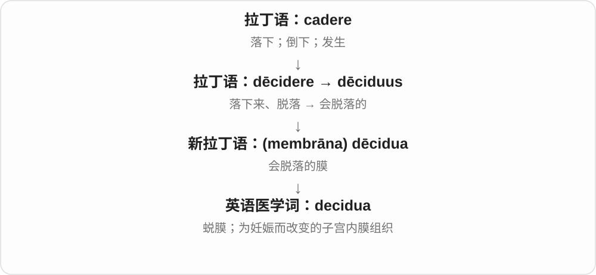

名称抓住的是这层组织会脱落的命运，现代产科更关注它在妊娠中的作用。它来自母体子宫内膜，不是胎儿自己长出的一层外皮，也不等于整个胎盘。

**常见搭配与例句**

the maternal decidua；decidua basalis；cells of the decidua。复数常见 deciduae。

> The diagram shows the embryo embedded in the decidua.

图中显示胚胎着床于蜕膜之中。

> The researchers examined cells from the maternal decidua.

研究人员检查了来自母体蜕膜的细胞。

**别混淆**

endometrium 泛指子宫内膜；decidua 指经过相应蜕膜化改变的组织。placenta 是胎盘，二者有关但不相等。

### 42. cadaverous — 像尸体般苍白消瘦的；尸体的

**音标**：/kəˈdævərəs/

**先抓住这个画面**

脸色苍白、瘦得凹陷，看起来毫无生气，文学描写里可以说 cadaverous。

**怎么拆**

来自拉丁语 cadāverōsus“尸体般的”，现代对应 cadaver + -ous；不是说人真的已经死亡。

**怎么变成今天的意思**

英语早期也有组织坏死等旧义，今天常用来夸张外表。这个词画面很强，日常当面评论别人相貌可能显得刻薄。

**常见搭配与例句**

a cadaverous face；a cadaverous appearance；look cadaverous。

> The actor used makeup to give the character a cadaverous face.

演员用化妆让角色的脸显得苍白消瘦，像尸体一般。

> In the dim light, his tired face looked almost cadaverous.

昏暗灯光下，他疲惫的脸几乎显得毫无生气。

**别混淆**

pale 只说苍白；gaunt 强调消瘦；cadaverous 把苍白、消瘦、缺乏生气揉在一起，像尸体一般。

### 43. casuistry — 个案伦理推理；诡辩、狡辩

**音标**：英 /ˈkæzjuːɪstri/；美 /ˈkæʒuːɪstri/

**先抓住这个画面**

先问“这个案例有什么特殊之处”，再决定原则怎样用，这种推理就是 casuistry；说话人也可能在批评它是在绕着弯找借口。

**怎么拆**

casuist + -ry，把研究个案的人所采用的方法、活动变成名词。

**怎么变成今天的意思**

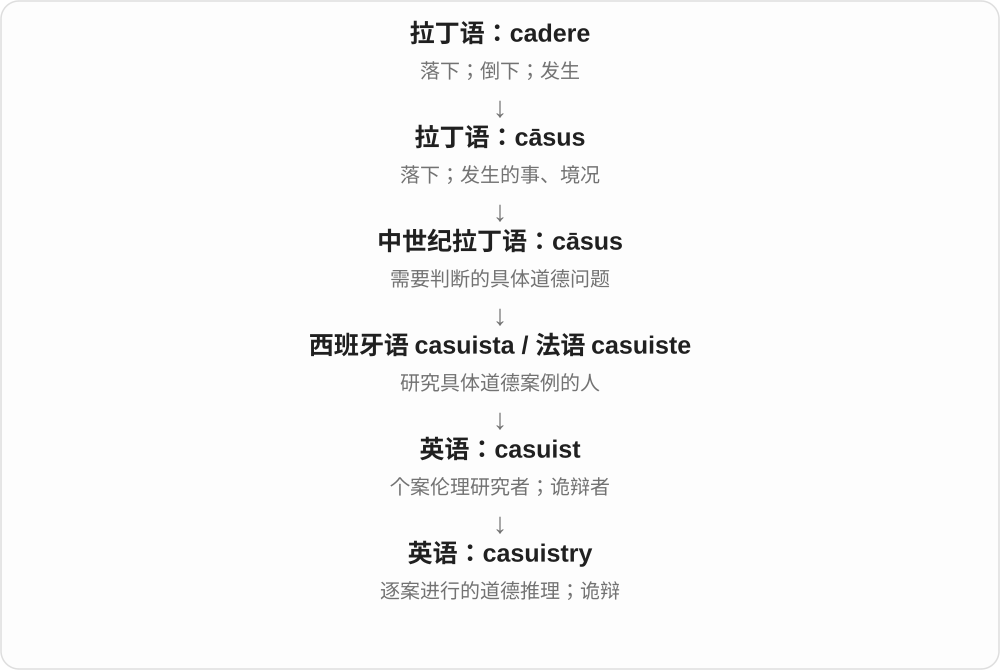

“具体问题具体分析”不必然错误；贬义出现在细微区分被拿来遮掩明显问题时。读到 an exercise in casuistry，常是在说一段解释过分绕弯、替自己开脱。

**常见搭配与例句**

moral casuistry；an exercise in casuistry；resort to casuistry。

> The seminar explored casuistry through several difficult moral cases.

研讨课通过几个棘手的道德案例讨论个案伦理推理。

> He called the elaborate excuse an exercise in casuistry.

他认为这套精心编排的借口不过是在狡辩。

**别混淆**

case study 是研究一个案例的方法；casuistry 特别连着道德判断及其可能的诡辩，并非所有案例分析的名称。

### 44. escheat — 无继承财产等依法归回国家或领主；归回的财产

**音标**：/ɪsˈtʃiːt/

**先抓住这个画面**

原来的财产权利链断了，依制度财产“落回”国家或领主手中，这种归回叫 escheat。

**怎么拆**

经盎格鲁诺曼语 eschete、古法语 eschet，往上是 *excadere“落出去、归于”；ex-（出去）+ cadere（落下）。

**怎么变成今天的意思**

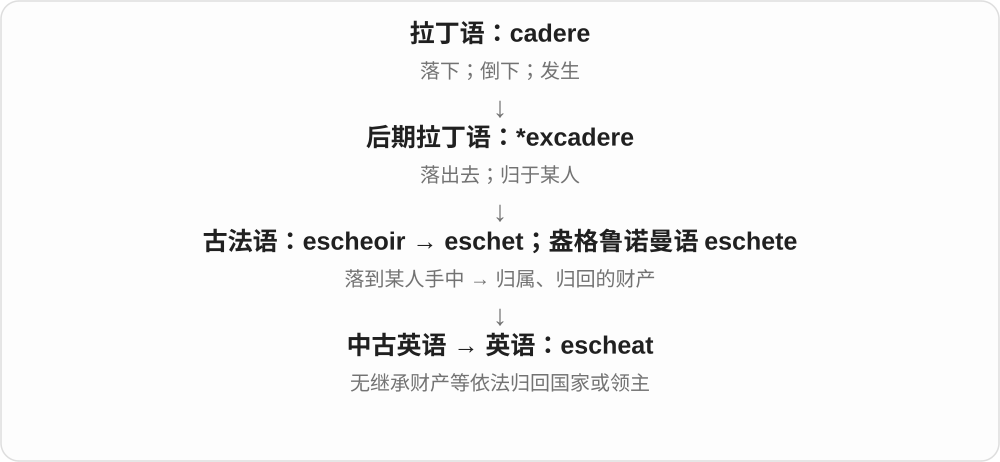

历史上常见封建土地无人合格继承后归回领主；现代也用于财产归国家的制度。它既可作名词讲过程或财产，也可作动词。具体适用条件随制度而不同。

**常见搭配与例句**

property subject to escheat；escheat to the state；the law of escheat。

> The historian traced the land’s transfer to the Crown by escheat.

历史学家追查了这块土地因归回制度转归王室的过程。

> The dispute concerned whether the property was subject to escheat.

争议在于这项财产是否适用归回国家的制度。

**别混淆**

inheritance 是继承关系；escheat 是缺少合格承接者等情况下的法定归回。它不等于一般的罚没，也不是“所有没写遗嘱的财产都归国家”。

### 45. decidual — 蜕膜的；与蜕膜有关的

**音标**：英 /dɪˈsɪdʒʊəl/；美 /dɪˈsɪdʒuəl/

**先抓住这个画面**

名词 decidua 指那层组织；decidual 就像给细胞、组织或变化贴上“属于蜕膜这一类”的标签。

**怎么拆**

decidua + -al，形成形容词。

**怎么变成今天的意思**

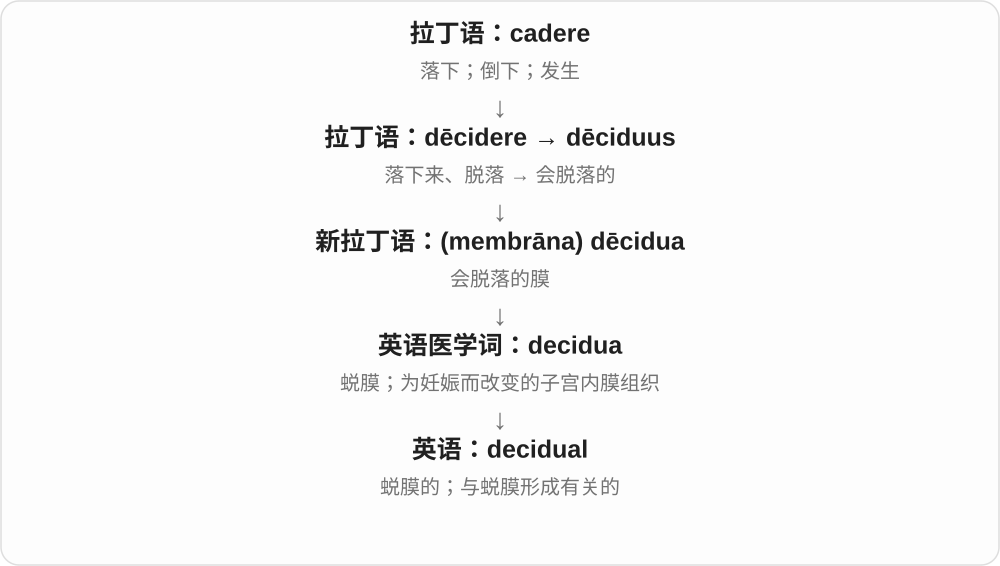

decidual cells 是蜕膜细胞；decidual changes 是内膜发生相应改变。这里没有一个独立英语词根 dual“两个”的意思，不能从词尾字母重新乱拆。

**常见搭配与例句**

decidual cells；decidual tissue；decidual changes；a decidual reaction。

> The tissue sample contained decidual cells.

这份组织样本含有蜕膜细胞。

> The study examined the signals involved in decidual changes.

这项研究考察了蜕膜变化涉及的信号。

**别混淆**

decidual 说某种组织的性质；deciduous 泛说会脱落的。植物的落叶一般用 deciduous，不用 decidual。

### 46. escheator — 管理归回财产事务的官员

**音标**：英 /esˈtʃiːtə/；美 /esˈtʃiːtər/

**先抓住这个画面**

财产是否应当归回、归回后怎样接管，需要有人调查和办理；负责这种事务的官员叫 escheator。

**怎么拆**

中古英语 eschetour 借自盎格鲁诺曼语 eschetour；现代可按 escheat + -or 理解，但这个人名词已有独立的借入历史。

**怎么变成今天的意思**

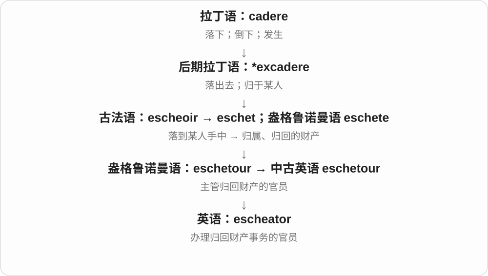

历史文献里常见王室派出的这类官员，负责调查土地权利、财产归属等事务。它是职务名称，不是对“骗子”的正式称呼。

**常见搭配与例句**

the royal escheator；appoint an escheator；an escheator’s records。

> The royal escheator recorded the estate’s boundaries.

王室财产归回官记录了这片地产的边界。

> The archive preserves letters sent to the county escheator.

档案馆保存着寄给该郡财产归回官的信件。

**别混淆**

cheater 是作弊者或骗子；escheator 是财产管理官。两者历史有联系，现代不能按字形互译。

### 47. cadential — 终止式的；与乐句收束有关的

**音标**：/keɪˈdenʃəl/

**先抓住这个画面**

音乐走到一个落脚处，那些帮助它收束的和弦、乐句或动作，可以叫 cadential。

**怎么拆**

cadence 的派生形容词，接 -ial 时按类似 substance → substantial 的模式使用 cadent-；词尾 -tial 读 /ʃəl/。

**怎么变成今天的意思**

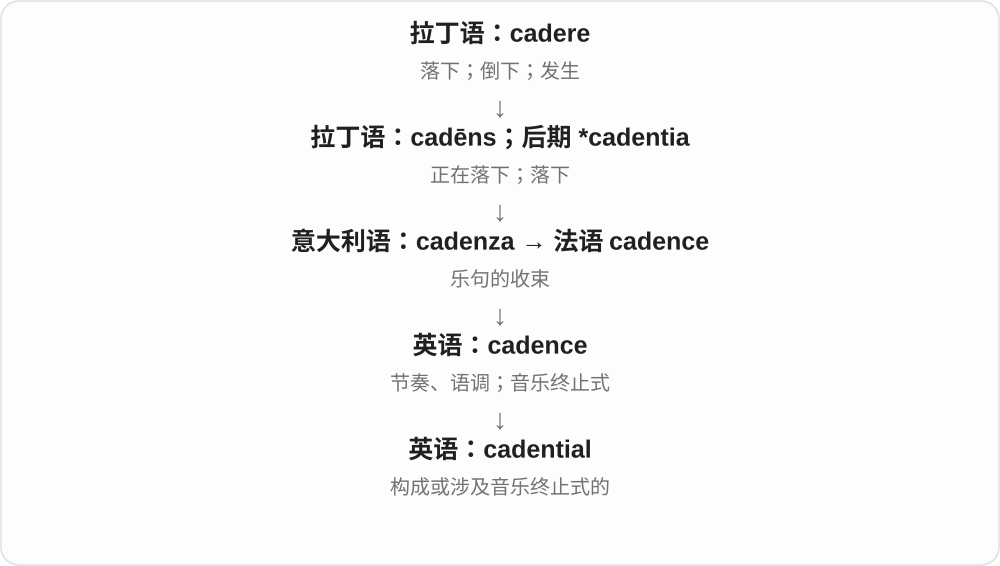

它常见于音乐分析。a cadential passage 是在结构中起收束作用的一段，不代表一定是全曲最后几小节，也不只是“听起来有节奏”。

**常见搭配与例句**

a cadential progression；a cadential passage；a cadential phrase。

> The cadential progression brings the phrase to a clear close.

这一终止式进行让乐句明确收束。

> She slowed slightly at the cadential passage.

她在收束乐句的那一段稍稍放慢了速度。

**别混淆**

cadent 可说有韵律；cadential 更专门地谈 cadence 作为音乐终止式的功能。

### 48. cadaverine — 尸胺；戊烷二胺

**音标**：/kəˈdævərɪn/

**先抓住这个画面**

这个化学名借尸体来命名，是因为它与腐败时的难闻气味有关；它指一种具体物质，不是所有尸体气味的总称。

**怎么拆**

拉丁语 cadāver“尸体”+ 化学命名后缀 -ine，形成 cadaverine。

**怎么变成今天的意思**

它是一种二胺，可由细菌把赖氨酸脱羧形成，也存在于其他生物过程中。名称容易让人只想到尸体，但它并非只会出现在尸体中。

**常见搭配与例句**

cadaverine production；detect cadaverine；cadaverine concentration。

> The analysis detected cadaverine in the sample.

分析在样本中检测到了尸胺。

> The researchers measured cadaverine production by the bacteria.

研究人员测量了这些细菌产生尸胺的量。

**别混淆**

cadaver 是遗体；cadaverine 是化合物。putrescine 是另一种胺，不能因都与腐败有关就当成同一物质。

### 49. caducous — 早落的；很早就脱落的；短暂的

**音标**：英 /kəˈdjuːkəs/；美 /kəˈduːkəs/

**先抓住这个画面**

植物刚长出某个部位，没过多久它就脱落了，这种“留不久、早早掉下”的性质叫 caducous。

**怎么拆**

来自拉丁语 cadūcus“会落下的、短暂的”，根在 cadere。

**怎么变成今天的意思**

常用于植物学，如某些托叶或萼片很早脱落。它关注脱落发生得早；文学上的短暂、无常义也沿着“留不住”这幅画面发展。

**常见搭配与例句**

caducous stipules；a caducous calyx；caducous parts。

> The plant has caducous stipules that fall soon after the leaf opens.

这种植物的托叶早落，叶片展开后不久便会脱落。

> The botanist noted that the calyx was caducous.

植物学家记录下它的花萼属于早落型。

**别混淆**

deciduous 常指叶子按生长周期脱落；caducous 特别突出某个器官形成后很早就脱落，不可直接把两者当完全同义词。

### 50. accidence — 词形变化；词形变化学；基础知识

**音标**：/ˈæksɪdəns/

**先抓住这个画面**

一个词进入句子后，会穿上不同的语法外衣：单数变复数、现在变过去、主格变宾格；研究这些变化，传统上叫 accidence。

**怎么拆**

来自拉丁语 accidentia“附带的属性、变化”，是 accidēns 的相关形式，根在 accidere“发生、附着于”；不是 accident 的复数。

**怎么变成今天的意思**

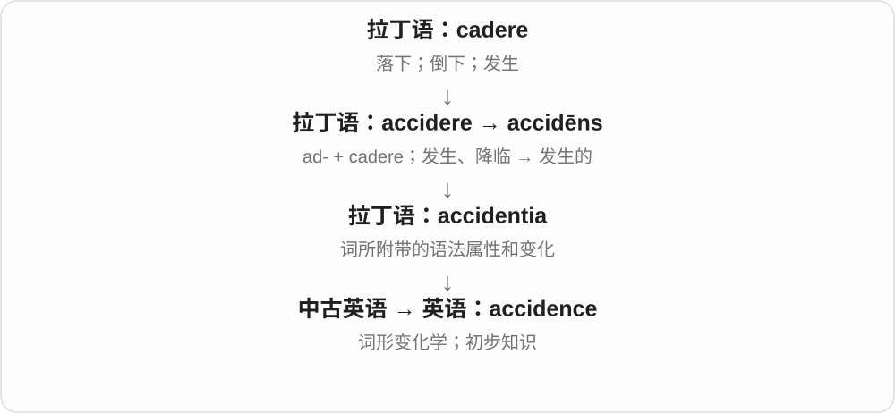

名字背后的想法是：词的基本身份还在，时态、数、格等变化“附着”在它身上。旧教材里也可泛指一门学问的入门基础，或教授这些内容的小册子。

**常见搭配与例句**

Latin accidence；English accidence；accidence and syntax；the accidence of a subject。

> The course begins with Latin accidence before introducing syntax.

这门课先讲拉丁语词形变化，再介绍句法。

> Students practiced accidence by changing verbs from present to past.

学生通过把动词从现在时变成过去时，练习词形变化。

**别混淆**

syntax 看词怎样组成句子；accidence 看词本身怎样随语法要求变形。accidents 才是“多起事故”。

### 51. cadency — 家族支系的区分；支系标记制度；古旧义：节奏

**音标**：/ˈkeɪdənsi/

**先抓住这个画面**

同一家族的人沿用相似纹章，又要看出谁属于哪个支系，cadency 就与这种分支区分有关。

**怎么拆**

cadence 的变体，-ence 改成 -ency；更早仍来自“落下”的 cadere。纹章学中的专门意思要按家族传承来理解，不能硬译成“掉下来”。

**怎么变成今天的意思**

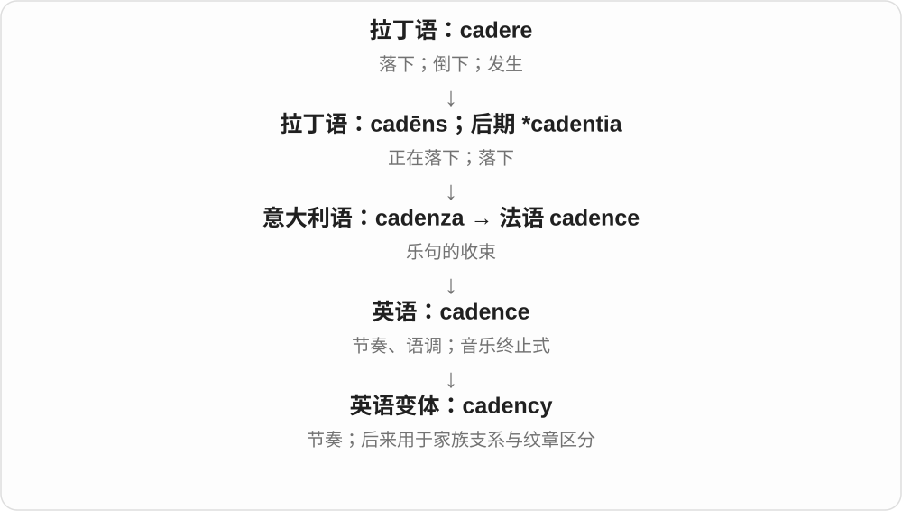

在纹章学中，可用细小的附加标记区分家族中的不同成员或支系；具体制度因传统而不同。普通文艺语境的 cadence 更常用，cadency 的节奏义如今较旧。

**常见搭配与例句**

marks of cadency；a system of cadency；heraldic cadency。

> The chart explains the marks of cadency used by the family.

这张图解释了这个家族使用的支系区分标记。

> The historian compared systems of cadency in different heraldic traditions.

历史学家比较了不同纹章传统中的家族支系区分制度。

**别混淆**

cadet branch 也是家族旁支，但 cadet 的词源走“较小的头领”那条线，不能因为含 cad 就归到本词根。

### 52. cadent — 有韵律的；古义：正在落下的

**音标**：/ˈkeɪdənt/

**先抓住这个画面**

听到声音有规律地起伏、落定，可以用文学色彩较强的 cadent；更古老的意思就是“正在落下”。

**怎么拆**

借自拉丁语 cadēns，词干 cadent-，是 cadere“落下”的现在分词。

**怎么变成今天的意思**

古文的 cadent tears 是落下的眼泪；较新的 cadent voice 是有节奏的声音。两层意思相连，但现代日常表达通常用 falling 或 rhythmic 更直接。

**常见搭配与例句**

a cadent voice；cadent phrases；cadent tears（古旧）。

> Her cadent voice gave the poem a gentle rhythm.

她有韵律的声音赋予这首诗柔和的节奏。

> The old poem describes cadent tears falling onto a letter.

那首古诗写到，泪珠一滴滴落在信上。

**别混淆**

cadent 不等于 decadent：前者讲下落或韵律，后者讲颓废、奢靡享乐。

### 53. caducity — 短暂易逝；衰老、衰弱

**音标**：英 /kəˈdjuːsɪti/；美 /kəˈduːsəti/

**先抓住这个画面**

原来坚实的东西也会变弱、消逝，这种“终究撑不住、留不长”的感觉，可以用古雅的 caducity。

**怎么拆**

经法语 caducité，来自晚期拉丁语 cadūcitās，源于 cadūcus“会落下的、短暂的”。

**怎么变成今天的意思**

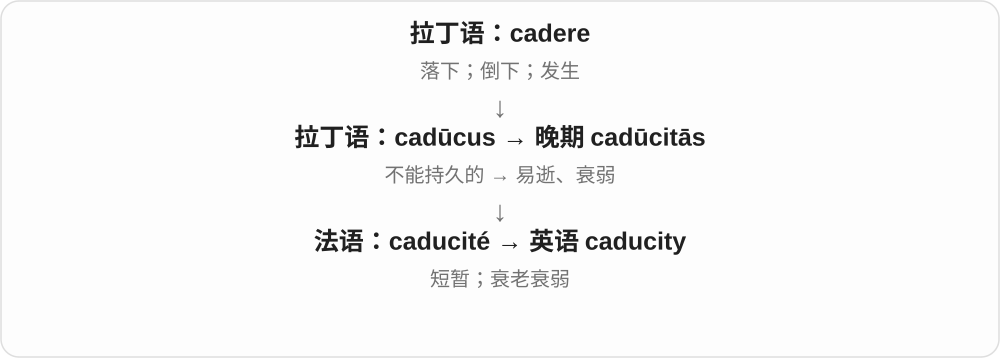

它可以谈人生或权力的无常，也可谈年老带来的衰弱。现代使用很少，尤其不是一个精确的医学诊断名称。

**常见搭配与例句**

the caducity of life；human caducity；signs of caducity。

> The poem reflects on the caducity of earthly power.

这首诗思索世俗权力的短暂易逝。

> The memoir describes old age without concealing its caducity.

这部回忆录描写晚年生活，也不掩饰衰老带来的衰弱。

**别混淆**

fragility 强调脆弱；caducity 更有时间流逝、最终衰败的意味。日常说 aging、frailty 或 transience 往往更清楚。

### 54. casuist — 个案伦理研究者；善于诡辩的人

**音标**：英 /ˈkæzjʊɪst/；美 /ˈkæʒuːɪst/

**先抓住这个画面**

遇到道德难题，不光背一条原则，而是细看“这个具体案例该怎么办”的人，原本可以叫 casuist。

**怎么拆**

经法语 casuiste 或西班牙语 casuista 一支传入；根在拉丁语 cāsus“具体情况”，这里特别是需要判断的道德个案。

**怎么变成今天的意思**

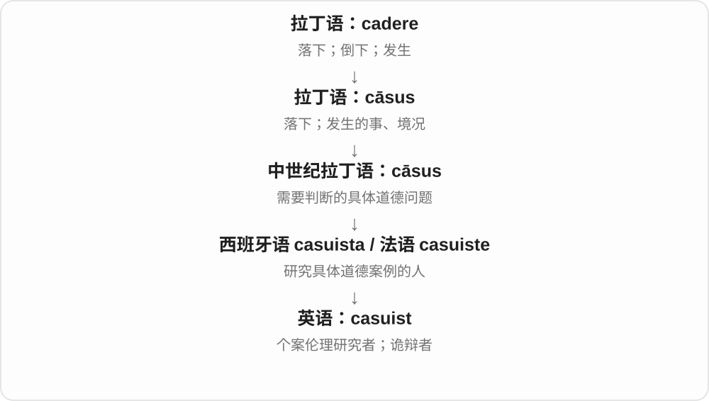

这种逐案推理本来有认真处理特殊情况的作用；如果把细节越分越细，只为了替不妥行为找借口，casuist 就有“诡辩者”的贬义。

**常见搭配与例句**

a moral casuist；a skilled casuist；the reasoning of a casuist。

> The casuist asked whether the promise still applied in these unusual circumstances.

这位个案伦理研究者追问，在这种特殊情形下，承诺是否仍然适用。

> Her opponent dismissed her as a casuist who could justify anything.

对手把她贬为一个能替任何事开脱的诡辩者。

**别混淆**

ethicist 泛指伦理学者；casuist 强调具体案例的推断。sophist 通常更直接带诡辩意味。

### 55. deciduate — 蜕膜型的；分娩时伴随母体组织脱落的

**音标**：英 /dɪˈsɪdʒʊət/；美 /dɪˈsɪdʒuət/

**先抓住这个画面**

分娩时胎盘脱离，会连带一部分母体子宫组织一起脱落；这种类型可称 deciduate。

**怎么拆**

decidua + 形容词后缀 -ate。这里形容词的词尾读弱音 /ət/，不要一见 -ate 就按动词重读 /eɪt/。

**怎么变成今天的意思**

常见于比较哺乳动物胎盘的动物学文章。deciduate mammals 是按这种特征归类的哺乳动物；名词用法也可指其中一种动物。它不是普通“会落叶”的换一种说法。

**常见搭配与例句**

a deciduate placenta；deciduate mammals；a deciduate species。

> Humans are classified as deciduate mammals.

人类被归为蜕膜型哺乳动物。

> The textbook compares deciduate and nondeciduate placentas.

这本教材比较了蜕膜型和非蜕膜型胎盘。

**别混淆**

decidual 只是“蜕膜的”；deciduate 进一步说明胎盘分离时母体组织随之脱落的类型。

### 56. deciduation — 经期子宫内膜组织的脱落

**音标**：/diːˌsɪdjuˈeɪʃən/

**先抓住这个画面**

这次重点不是那层组织叫什么，而是它从子宫内壁脱落这个过程；较少见的医学词 deciduation 用来谈这件事。

**怎么拆**

由 decidua 一支配上表示过程的 -ation 构成，更远仍是拉丁语 dēciduus“会脱落的”。

**怎么变成今天的意思**

医学词典通常用它指月经中的内膜组织脱落。这是一个专门名称，不能因为看见 decid-，就用它泛指树木秋天落叶。

**常见搭配与例句**

the process of deciduation；deciduation during menstruation。

> The chapter describes deciduation during menstruation.

这一章介绍了月经期间子宫内膜组织脱落的过程。

> The lecturer distinguished deciduation from the changes that prepare the endometrium for pregnancy.

讲师区分了内膜组织脱落，与内膜为妊娠作准备的那些变化。

**别混淆**

decidualization 是细胞和组织发生蜕膜化改变；deciduation 说组织脱落，两个过程不能互换。

### 57. demicadence — 半终止

**音标**：/ˌdemiˈkeɪdəns/

**先抓住这个画面**

音乐像说到逗号：暂时停住，却还吊着一口气，听者感觉后面应该接下去。

**怎么拆**

借自法语 demi-cadence：demi-（半）+ cadence（终止式）；这是半终止较少见的名称。

**怎么变成今天的意思**

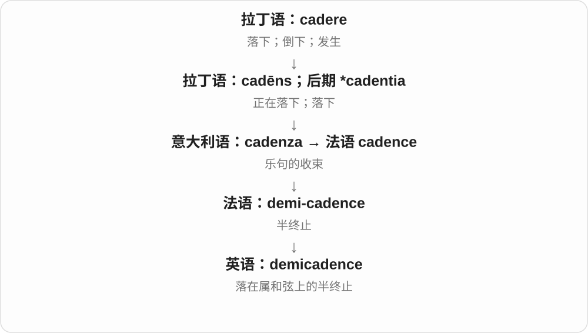

在常见调性和声里，半终止的乐句停在属和弦 V 上，没有回到最安稳的主和弦 I。因此“半”是收束感不完全，不是把乐曲删掉一半，也不要求时长减半。

**常见搭配与例句**

end with a demicadence；a phrase ending in a demicadence。现代教材更常写 half cadence。

> The first phrase ends with a demicadence, leaving the listener waiting.

第一乐句以半终止结束，让听者仍期待后续。

> In C major, the phrase’s final G major chord creates a demicadence.

在 C 大调中，这个乐句末尾的 G 大三和弦形成半终止。

**别混淆**

cadenza 是华彩独奏段；demicadence 是一种终止类型，与炫技无关。

### 58. escheatable — 依法可能归回国家或领主的

**音标**：/ɪsˈtʃiːtəbəl/

**先抓住这个画面**

财产还没实际转过去，但它符合某种可以归回的条件，就可说 escheatable。

**怎么拆**

escheat + -able，表示可以、可能受到这种处理。

**怎么变成今天的意思**

法律或行政文书用它标明财产的状态或可能适用的程序。词尾 -able 很关键：不是简单说“这已经是国家的东西”。

**常见搭配与例句**

escheatable property；escheatable assets；become escheatable。

> The audit identified assets that might be escheatable under the statute.

审计发现了一些按该法条可能适用归回程序的资产。

> The court considered whether the estate was escheatable.

法院审查了这份地产是否符合依法归回的条件。

**别混淆**

escheated 指已经发生归回的；escheatable 说可以适用归回，两者对应潜在状态与已完成状态。

### 59. escheatage — 承接归回财产的权利

**音标**：/esˈtʃiːtɪdʒ/

**先抓住这个画面**

有一笔财产要依法归回，谁有权接下它？这种承接归回财产的权利，可用旧法律词 escheatage。

**怎么拆**

escheat + -age，形成表示相关权利的名词。不要见到 -age 就猜成税费或数量。

**怎么变成今天的意思**

它非常少见，常在旧法律、封建土地制度的讨论中出现。要记清它讲“有权取得”，不是泛指一切遗产，也不是 escheat 手续的服务费。

**常见搭配与例句**

the right of escheatage；a claim to escheatage。

> The charter reserved a right of escheatage to the lord.

特许状为领主保留了承接归回财产的权利。

> The dispute centered on competing claims to escheatage.

争议集中在双方对归回财产承接权的竞争主张上。

**别混淆**

escheat 可指归回过程或归回财产；escheatage 特别说承接这类财产的权利。

### 60. escheatment — 财产依法归回国家的过程或处理

**音标**：/ɪsˈtʃiːtmənt/

**先抓住这个画面**

escheat 说财产归回；escheatment 更像把整套归回处理打包成一个程序名称。

**怎么拆**

escheat + -ment，表示行为、过程或结果。

**怎么变成今天的意思**

现代行政和财务语境可见，用来谈相关记录、通知和处理。它与 escheat 的意义高度重叠，不需要硬编出两套完全不同的制度。

**常见搭配与例句**

escheatment procedures；escheatment records；the escheatment process。

> The office keeps records of escheatment proceedings.

这个办事机构保存财产归回程序的记录。

> The handbook explains the agency’s escheatment process.

手册解释了该机构处理财产归回的流程。

**别混淆**

escheator 是经办官员；escheatment 是办理过程；escheatable 是财产可能受到这种处理。

### 61. nonaccidental — 非意外的；并非偶然的

**音标**：英 /ˌnɒnæksɪˈdentəl/；美 /ˌnɑːnæksɪˈdentəl/

**先抓住这个画面**

先排除“只是碰巧、无意发生”的解释，剩下这种性质就叫 nonaccidental。

**怎么拆**

non-（不是）+ accidental。这里否定的是意外性，不是说事情没有发生。

**怎么变成今天的意思**

既可谈有意造成的损伤，也可谈有规律、有解释的对应关系。读学术论述里的 nonaccidental connection，可以理解为这种联系有原因，并非随机碰上。

**常见搭配与例句**

nonaccidental injury；a nonaccidental pattern；a nonaccidental connection。

> The researchers looked for a nonaccidental connection between the two patterns.

研究人员寻找这两种模式之间并非偶然的联系。

> The report classified the damage as nonaccidental.

报告把这次损坏归为并非意外造成。

**别混淆**

deliberate 更直接说有意为之；nonaccidental 也可能只是指有系统原因，未必涉及某个人的主观意图。

### 62. nondeciduous — 不按季节落叶的；不属脱落型的

**音标**：英 /ˌnɒndɪˈsɪdʒʊəs/；美 /ˌnɑːndɪˈsɪdʒuəs/

**先抓住这个画面**

别的植物到某个季节会集中落叶，这一种却不这样，就可以在这种比较中叫 nondeciduous。

**怎么拆**

non-（不）+ deciduous（按周期脱落的）。

**怎么变成今天的意思**

植物语境中常接近 evergreen“常绿”，描述叶子更替方式；不是说每一片叶子都能一直活着。技术文章谈其他器官时，要跟着具体名词理解。

**常见搭配与例句**

nondeciduous plants；nondeciduous foliage；a nondeciduous shrub。

> The garden includes several nondeciduous shrubs.

花园里种了几种不按季节集中落叶的灌木。

> Nondeciduous plants can still shed individual leaves throughout the year.

非季节性落叶植物仍可能在全年陆续更换单片叶子。

**别混淆**

nondeciduous 否定落叶或脱落类型；caducous 是早落的。日常介绍常绿植物，evergreen 通常更自然。

### 63. nonincidental — 并非附带的；具有实质作用的

**音标**：英 /ˌnɒnɪnsɪˈdentəl/；美 /ˌnɑːnɪnsɪˈdentəl/

**先抓住这个画面**

看起来像旁枝末节，但其实在事情里占有明确位置，就可说它 nonincidental。

**怎么拆**

non- + incidental，否定的是“只是附带、只是次要”。

**怎么变成今天的意思**

这个较正式的词常用于分析角色、用途或作用。一项 nonincidental use 是实质用途之一，不能只当顺便带来的小用途。

**常见搭配与例句**

a nonincidental role；nonincidental use；a nonincidental part。

> Music plays a nonincidental role in the film’s narrative.

音乐在这部电影的叙事中发挥着实质作用。

> The study treats advertising as a nonincidental part of the business model.

这项研究把广告视为商业模式的重要组成部分。

**别混淆**

nonaccidental 是并非偶然；nonincidental 是并非附带。一个因素可以有意设置，却仍然只是次要的。

### 64. postaccident — 事故后的

**音标**：英 /ˌpəʊstˈæksɪdənt/；美 /ˌpoʊstˈæksɪdənt/

**先抓住这个画面**

把事故当成时间轴上的一个点，点后面的检查、调查和变化都可以叫 postaccident。

**怎么拆**

post-（在……之后）+ accident；这是透明的英语复合构词。

**怎么变成今天的意思**

它常用来给程序或记录定位时间，属于正式或技术用语。postaccident investigation 是事后调查；这个词本身不说明调查结论。

**常见搭配与例句**

a postaccident investigation；postaccident procedures；a postaccident report。

> The company reviewed its postaccident procedures.

公司审查了事故发生后的处理程序。

> The postaccident report included photographs of the damaged equipment.

事故后报告附有受损设备的照片。

**别混淆**

accidental 说事情意外；postaccident 说时间在事故以后。日常会话常直接说 after the accident。

### 65. procidentia — 器官脱垂；常指严重子宫脱垂

**音标**：英 /prəʊsɪˈdentʃə/；美 /ˌproʊsəˈdentʃə/

**先抓住这个画面**

一个器官原本待在应有的位置，现在向下移位、甚至脱出，就有了 procidentia 这幅“往前、往下掉”的画面。

**怎么拆**

医学拉丁语 procidentia 来自 procidere“向前落、垂落”：pro-（向前）+ cadere（落下），复合词中 cad- 变为 cid-。

**怎么变成今天的意思**

这是医学术语，常见于子宫脱垂的讨论，也可用于其他器官。不是“患者走路跌倒”，而是内部组织或器官偏离原位。

**常见搭配与例句**

uterine procidentia；complete procidentia；a diagnosis of procidentia。

> The case report describes complete uterine procidentia.

这篇病例报告描述了完全性子宫脱垂。

> The diagram shows how procidentia changes the position of the organ.

图中展示了脱垂怎样改变器官的位置。

**别混淆**

prolapse 是更常见、范围较广的脱垂用语；procidentia 常见于专门文献，在子宫语境里尤其常指完全脱垂。

### 66. recidivous — 复发的；容易重新陷入原状的

**音标**：/rɪˈsɪdɪvəs/

**先抓住这个画面**

好不容易走出来，又有掉回去的倾向；旧式书面语可用 recidivous 来形容。

**怎么拆**

拉丁语 recidīvus“返回、复发的”借入后配上英语 -ous；不是从现代犯罪学名词 recidivism 倒着拼出来的。

**怎么变成今天的意思**

历史上可用于疾病复发，也可说行为、状态反复。现在十分少见，阅读旧文时抓住 re- 的“再”和 cid- 的“落回”即可。

**常见搭配与例句**

a recidivous illness；recidivous symptoms；a recidivous tendency。

> The old medical account describes the fever as recidivous.

那份旧医学记录把这种发热描述为容易复发。

> The historian noted the writer’s use of recidivous to describe a return to old habits.

历史学家注意到，这位作者用 recidivous 描写重新落回旧习惯的情形。

**别混淆**

recurrent 是现代更常用的再次出现；recidivous 带古旧或专门语感。recidivist 通常指再犯的人。

### 67. semelincident — 旧医学用语：同一人只发生一次的

**音标**：/ˌseməlˈɪnsɪdənt/

**先抓住这个画面**

旧医学把某些病理解为：一个人患过一次，之后便不会再患。这种“只落到同一个人身上一次”的描述叫 semelincident。

**怎么拆**

拉丁语 semel（一次）+ incident“发生的”，后者来自 incidere：in- + cadere。semel 不是 semi-，所以不是“发生一半”。

**怎么变成今天的意思**

它用于旧时对疾病和持久免疫的分类，现在已很少使用。读这个词是在理解旧文作者的分类，不是在保证任何疾病都绝不会再次感染。

**常见搭配与例句**

a semelincident disease；classify a disease as semelincident。

> The old textbook classified the disease as semelincident.

那本旧教材把这种病归为同一个人只会患一次的疾病。

> The historian explained why earlier physicians used the term semelincident.

历史学家解释了早期医生为什么使用“只患一次”这个术语。

**别混淆**

recurrent 是反复发生；semelincident 表达旧分类中的只发生一次。semelparous“终生只繁殖一次”则谈繁殖，不是患病。

## 这一组要分清什么

**accident / incident / incidence**：意外事故；发生的一件事；这类事的发生情况或发生率。

**accidental / incidental / coincidental**：不是有意发生的；主要事情之外附带的；两个事实出于巧合地对上。

**case 的两条来源**：情况、案件、实例来自 cāsus“发生的事”；盒子、套子来自 capsa。两组同形，不该画成同一条故事。

**deciduous / decide**：会脱落的；作决定。前者来自 cadere“落”，后者来自 caedere“切”，不要只见 cid 就合并。

**cadence / cadenza**：节奏、终止式；华彩乐段。共同的“落定”背景，长出了不同的音乐用途。

**cadaver 的联系有保留**：拉丁语 cadāver“尸体”可能来自 cadere，但更深一步未完全确定；相关图从已确定的 cadāver 开始。

## 串起来练习

By **chance**, our visit **coincided** with a special **occasion**. A **casual** conversation led to an **accidental** discovery: a hidden **cascade** behind the **deciduous** trees.

碰巧，我们到访时正赶上一个特殊日子。一次随意交谈带来一个意外发现：落叶树后藏着一道小瀑布。

结果碰巧落在一起 → chance、coincide；某次场合 → occasion；不郑重 → casual；并非计划中的发现 → accidental；水落下 → cascade；叶子按季节落下 → deciduous。
