# 0115 · medi-, -midi- — 中间；居间；没有中间隔层时引申为直接

[逐词精讲目录](../00_逐词精讲目录.md) · [总目录](../00_总目录_按常用程度.md)

## 核心词根与来源

**medi-** 来自拉丁语 **medius**“中间的”。站在中间协调是 mediate；承载两端传播的是 medium；拿掉中间隔层就是 immediate。它也能进入大小、时间、地理、统计和音乐，但要看具体词怎样发展，不能所有词都只译成“中间”。

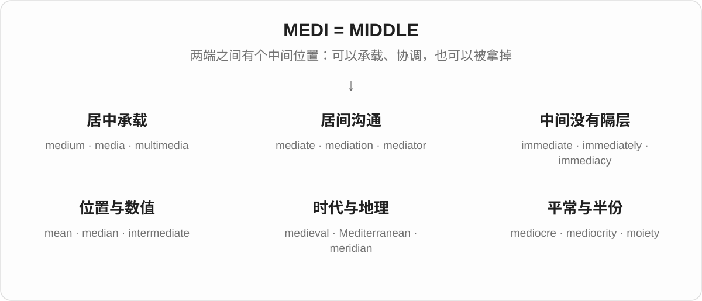

## 词形与演化规律

**mediānus** 经过不同路线留下 mean 的平均义与 median。**medium** 的复数是 media。medius 与 diēs“一天”结合发生音变，留下 meridian；与 aevum“时代”结合留下 medieval。**mean** 的“表示、打算”和“刻薄”另有来源，不属于这条拉丁词源。

## 单词速览（按词族由简到繁）

同一基础词的相关扩展放在一起，先读基础形式，再读扩展；各组之间优先读常用的。具体词源关系见各词讲解。

| 单词 | 音标 | 核心意思 |
|---|---|---|
| [mean](#w-1) | /miːn/ | 平均值；中间的；另有表示、打算及刻薄义 |
| [media](#w-2) | /ˈmiːdiə/ | 媒体；传播媒介；影音资料 |
| [multimedia](#w-10) | /ˌmʌltiˈmiːdiə/ | 多媒体；结合多种媒介的 |
| [mediate](#w-16) | 动词 /ˈmiːdieɪt/；形容词 /ˈmiːdiət/ | 调解；居中传递；间接的 |
| [mediation](#w-12) | /ˌmiːdiˈeɪʃən/ | 调解；居中协调的过程 |
| [mediator](#w-14) | 英 /ˈmiːdieɪtə/；美 /ˈmiːdieɪtər/ | 调解人；居中传递者 |
| [immediate](#w-5) | /ɪˈmiːdiət/ | 立即的；直接的；紧邻的 |
| [immediately](#w-3) | /ɪˈmiːdiətli/ | 立即；紧接着；紧邻 |
| [immediacy](#w-18) | /ɪˈmiːdiəsi/ | 直接感；即时性；迫切性 |
| [intermediate](#w-8) | 形容词 /ˌɪntəˈmiːdiət/；美 /ˌɪntərˈmiːdiət/ | 中间的；中级的；中间阶段 |
| [medium](#w-4) | /ˈmiːdiəm/ | 中等的；媒介；介质；灵媒 |
| [mediumship](#w-20) | /ˈmiːdiəmʃɪp/ | 灵媒活动；充当灵媒的身份或能力主张 |
| [median](#w-6) | /ˈmiːdiən/ | 中位数；中间的；道路中央分隔带 |
| [medieval](#w-7) | 英 /ˌmediˈiːvəl/；美 /ˌmiːdiˈiːvəl/ | 中世纪的 |
| [Mediterranean](#w-9) | /ˌmedɪtəˈreɪniən/ | 地中海；地中海地区的 |
| [mediocre](#w-11) | 英 /ˌmiːdiˈəʊkə/；美 /ˌmiːdiˈoʊkər/ | 平庸的；不出色的 |
| [mediocrity](#w-17) | 英 /ˌmiːdiˈɒkrəti/；美 /ˌmiːdiˈɑːkrəti/ | 平庸；平庸的人或作品 |
| [meridian](#w-13) | /məˈrɪdiən/ | 经线；子午线；正午相关的 |
| [postmeridian](#w-22) | 英 /ˌpəʊstməˈrɪdiən/；美 /ˌpoʊstməˈrɪdiən/ | 午后的；正午之后的 |
| [intermediary](#w-15) | 英 /ˌɪntəˈmiːdiəri/；美 /ˌɪntərˈmiːdieri/ | 中间人；中介；居间的 |
| [moiety](#w-19) | /ˈmɔɪəti/ | 一半；一份；分子中的某一部分 |
| [dimidiation](#w-21) | /dɪˌmɪdiˈeɪʃən/ | 分成两半；纹章中的各取半幅合并 |
| [submediant](#w-23) | /ˌsʌbˈmiːdiənt/ | 下中音；音阶第六级 |

## 逐词讲解

### 1. mean — 平均值；中间的；另有表示、打算及刻薄义

**音标**：/miːn/

**先抓住这个画面**

本页先抓“平均”这一支：把高低不同的数放到一条线上，用一个中间水平概括它们。mean 的其他常用意思来自另外的词源。

**怎么拆**

平均义经古法语 meien 来自拉丁语 mediānus“在中间的”。动词 mean“表示、打算”来自古英语 mǣnan；刻薄义来自古英语表示“普通、低下”的词族。

**怎么变成今天的意思**

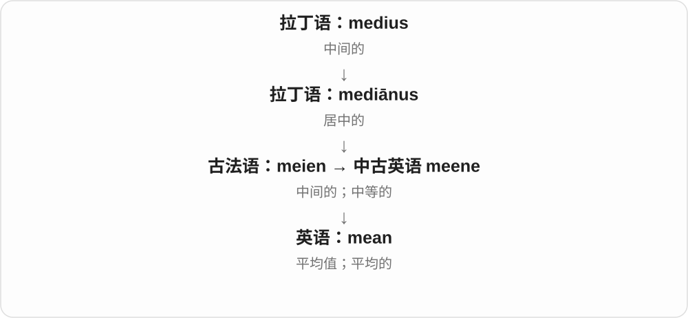

“中间水平”成为数学平均值。不能把 I mean it 或 a mean person 都讲成“在中间”：这些同形词走的是不同历史路线。

**常见搭配与例句**

the mean temperature；calculate the mean；What do you mean?；mean to do something。

> The mean of two, three and ten is five.

二、三和十的算术平均值是五。

> I did not mean to interrupt you.

我不是有意打断你的。

**别混淆**

mean 通常指加总后除以数量的算术平均值；median 是排序后居中的值。2、3、10 的 mean 是 5，median 是 3。

### 2. media — 媒体；传播媒介；影音资料

**音标**：/ˈmiːdiə/

**先抓住这个画面**

不是只有一家报纸，而是把新闻、图像和声音送到人群面前的各种渠道与机构：这些合起来是 media。

**怎么拆**

本页常见媒体义是 medium 的拉丁式复数 media；不是一个独立的 media 词根再加别的词尾。

**怎么变成今天的意思**

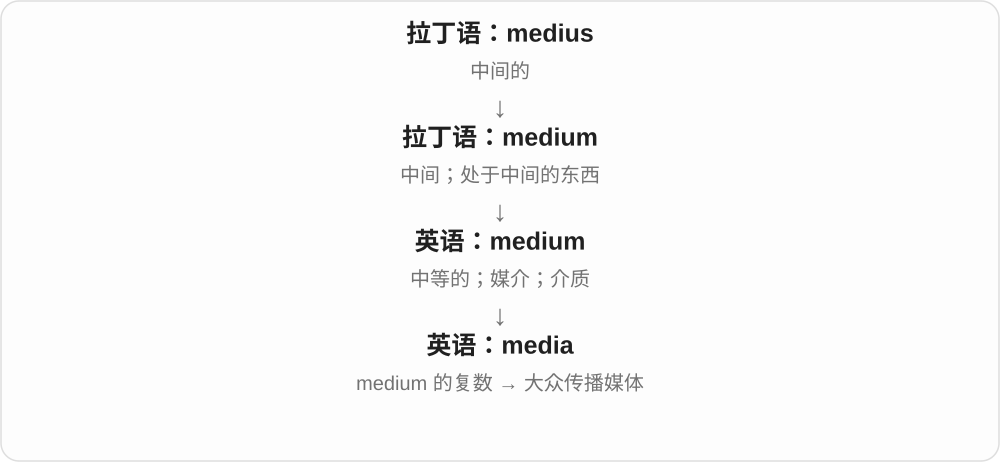

“承载传播的媒介”扩展为报刊、广播、平台及其行业。技术环境中的 media 还常指图像、声音、视频等内容。

**常见搭配与例句**

social media；the news media；media coverage；media files。

> The announcement attracted widespread media attention.

这项公告引起了媒体的广泛关注。

> Keep large media files on an external drive.

把体积较大的影音文件放在外接硬盘上。

**别混淆**

medium 是单个媒介；media 是复数来源，现代也常被当作整体。正式写作中可说 the media are；单个新闻机构直接说 outlet 更清楚。

### 3. multimedia — 多媒体；结合多种媒介的

**音标**：/ˌmʌltiˈmiːdiə/

**先抓住这个画面**

同一段内容既有文字，又有图片、声音或视频，多种表达通道一起工作。

**怎么拆**

multi-（多）+ media（媒介），是现代组合词。

**怎么变成今天的意思**

它看的是呈现手段不止一种，而不只是文件数量很多。十张纯文字页面未必值得称为 multimedia。

**常见搭配与例句**

a multimedia presentation；multimedia content；multimedia software。

> The museum created a multimedia exhibition with films and sound recordings.

博物馆制作了一场包含影片和录音的多媒体展览。

> Students prepared a multimedia presentation about their town.

学生们制作了介绍家乡的多媒体展示。

**别混淆**

audiovisual 特别强调声音与图像；multimedia 还可包括文字、互动等多种形式。

### 4. mediate — 调解；居中传递；间接的

**音标**：动词 /ˈmiːdieɪt/；形容词 /ˈmiːdiət/

**先抓住这个画面**

两边谈不拢，你站到中间，帮助他们听懂对方、找到能接受的方案。

**怎么拆**

来自拉丁语 mediāre 的相关形式 mediātus，与 medius“中间”相连。英语先有相关形容词，后来有动词。

**怎么变成今天的意思**

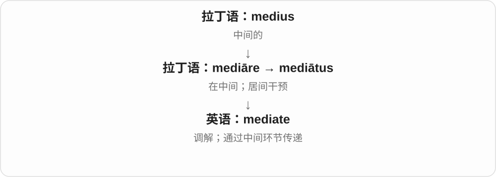

调解义把“在中间”变成沟通角色；更宽的学术用法表示作用经过一个中间环节传递。它不自动表示替双方作出强制裁决。

**常见搭配与例句**

mediate a dispute；mediate between two sides；be mediated by。

> A teacher offered to mediate between the two students.

一位老师提出帮助这两名学生调解矛盾。

> The talks were mediated by an independent organization.

会谈由一个独立组织居中协调。

**别混淆**

mediate 是帮助双方达成安排；arbitrate 通常涉及由仲裁者作决定。词尾动词 -ate 读 /eɪt/。

### 5. mediation — 调解；居中协调的过程

**音标**：/ˌmiːdiˈeɪʃən/

**先抓住这个画面**

双方先不直接对撞，而是在中间人的帮助下把问题谈开；这个过程就是 mediation。

**怎么拆**

晚期拉丁语 mediātiō 经法语 mediacion 传入。现代能看出与 mediate 和 -ion 的对应，历史上名词有自己的借入路线。

**怎么变成今天的意思**

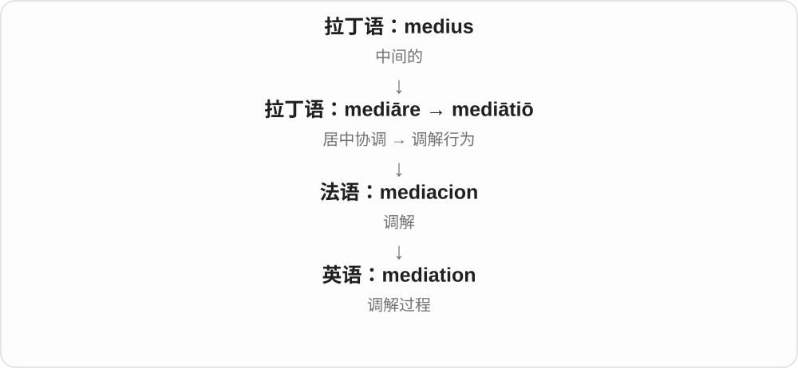

它把调解当成一种解决分歧的安排。参与 mediation 不等于最后一定达成协议。

**常见搭配与例句**

seek mediation；through mediation；a mediation session。

> The neighbours resolved their disagreement through mediation.

邻居们通过调解解决了分歧。

> Both sides agreed to attend a mediation session.

双方同意参加一次调解会。

**别混淆**

mediation 是调解；meditation 是冥想，多一个 t，而且来源不同。

### 6. mediator — 调解人；居中传递者

**音标**：英 /ˈmiːdieɪtə/；美 /ˈmiːdieɪtər/

**先抓住这个画面**

mediator 是把两边重新接上话的人：不只是递话，还帮助双方理解分歧所在。

**怎么拆**

来自拉丁语 mediātor，经法语或拉丁语借入；-or 表示从事相关行动的人。

**怎么变成今天的意思**

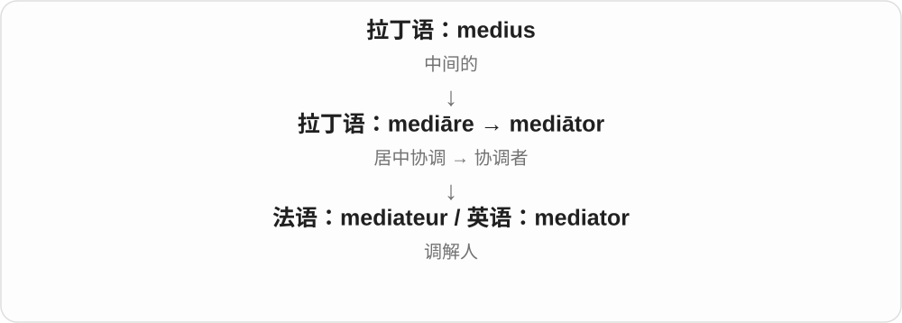

人际场景里是调解者，科学讨论中也可指在过程中起中介作用的因素。具体作用要看领域。

**常见搭配与例句**

an independent mediator；act as a mediator；appoint a mediator。

> The mediator asked each person to explain their concerns.

调解人请每个人说出自己的顾虑。

> They invited a neutral mediator to join the talks.

他们邀请一位中立调解人参与会谈。

**别混淆**

mediator 强调帮助协调；intermediary 只要处在两端之间传递、交易，也可能成立，不一定处理争端。

### 7. immediate — 立即的；直接的；紧邻的

**音标**：/ɪˈmiːdiət/

**先抓住这个画面**

中间没有再隔一层：时间上不等，关系上不绕别人，空间上就在旁边。

**怎么拆**

否定前缀 in- 在 m 前变成 im-，与“居中、间接”有关的 mediātus 组成 immediātus，再经法语传入。

**怎么变成今天的意思**

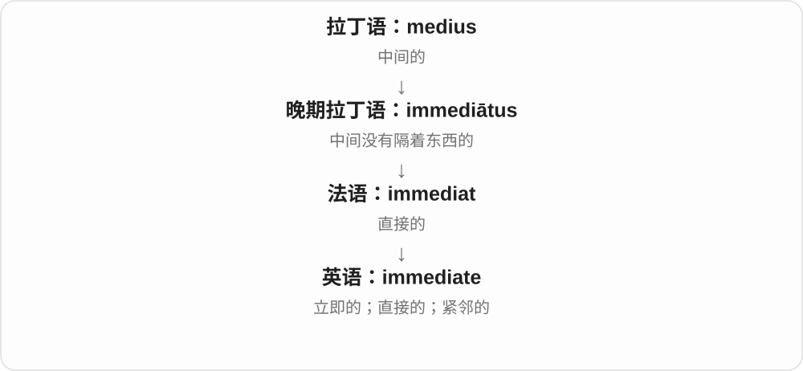

没有时间间隔就是 immediate action；没有中间级别是 immediate supervisor；没有别的地带隔开是 immediate surroundings。

**常见搭配与例句**

immediate action；an immediate response；the immediate family；the immediate area。

> The problem requires immediate attention.

这个问题需要马上处理。

> Please report the issue to your immediate supervisor.

请把问题报告给你的直属主管。

**别混淆**

immediate 不只表示快。immediate family 指最亲近的家庭成员，具体范围随语境变化，不是“立即出现的家人”。

### 8. immediately — 立即；紧接着；紧邻

**音标**：/ɪˈmiːdiətli/

**先抓住这个画面**

两个动作之间不给空档，或者两个位置之间不再隔别的东西。

**怎么拆**

immediate + -ly，描述时间或位置关系。

**怎么变成今天的意思**

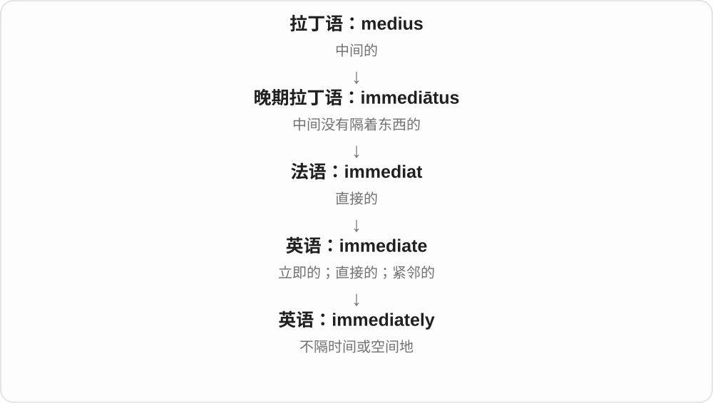

immediately after 是紧接在之后；immediately above 是就在正上方。中文并非所有地方都要翻成“马上”。

**常见搭配与例句**

leave immediately；immediately after；immediately above；immediately available。

> Please call me immediately if the plan changes.

如果计划有变，请立即给我打电话。

> Her office is immediately above mine.

她的办公室就在我的办公室正上方。

**别混淆**

soon 是不久后，仍可留一点时间；immediately 强调马上或紧挨着。

### 9. immediacy — 直接感；即时性；迫切性

**音标**：/ɪˈmiːdiəsi/

**先抓住这个画面**

一段描述让你像亲临现场，中间仿佛没有隔着纸张或屏幕，这种贴近的感觉就是 immediacy。

**怎么拆**

immediate 的词干 + -cy，将性质变成名词。

**怎么变成今天的意思**

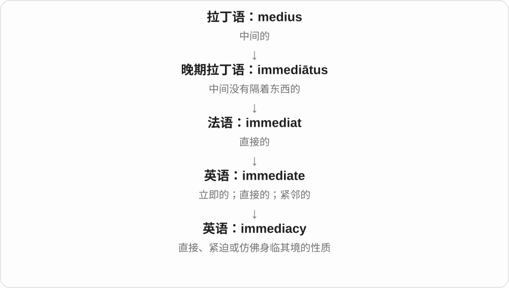

可以谈信息反馈的及时，也可以谈艺术表达带来的直接感。重点不是单纯速度，而是少了隔层或拖延。

**常见搭配与例句**

a sense of immediacy；the immediacy of live performance；emotional immediacy。

> The letters give the story a sense of immediacy.

这些信让故事有了仿佛就在眼前发生的感觉。

> Live theatre has an immediacy that recordings often lack.

现场戏剧有一种录影常常缺少的直接感染力。

**别混淆**

urgency 强调事情急迫；immediacy 还可强调体验直接鲜活，即使没有需要赶紧办的事。

### 10. intermediate — 中间的；中级的；中间阶段

**音标**：形容词 /ˌɪntəˈmiːdiət/；美 /ˌɪntərˈmiːdiət/

**先抓住这个画面**

从起点走到终点，中途还有一站；从初学到熟练，中间还有一个水平，这就是 intermediate。

**怎么拆**

来自中世纪拉丁语 intermediātus，与 inter-（之间）和 medius（中间）相关。

**怎么变成今天的意思**

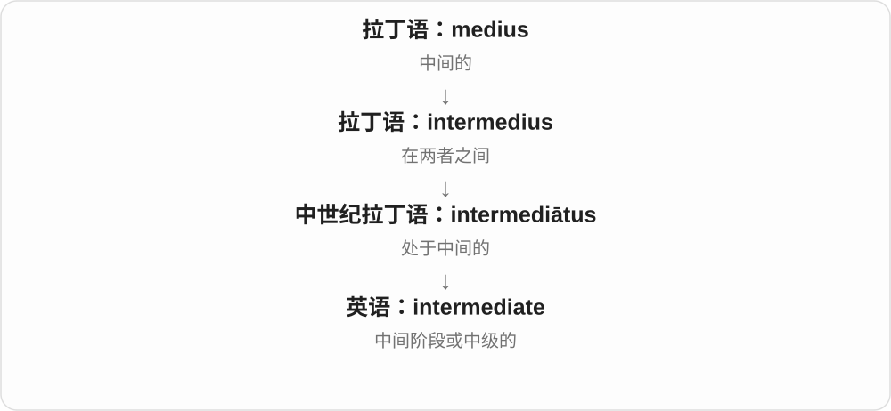

它不要求正好位于百分之五十处，只说明尚未到达两端。intermediate course 通常适合已有基础、还没到高级的学习者。

**常见搭配与例句**

an intermediate level；an intermediate stage；intermediate results。

> This course is designed for intermediate learners.

这门课是为中级学习者设计的。

> The team tested the product at each intermediate stage.

团队在每个中间阶段都测试了产品。

**别混淆**

intermediate 是阶段位置；mediocre 是质量评价。中级学习者不等于平庸学习者。

### 11. medium — 中等的；媒介；介质；灵媒

**音标**：/ˈmiːdiəm/

**先抓住这个画面**

大小上站在两端中间，就是 medium；信息从这边传到那边，夹在中间承载它的东西，也是 medium。

**怎么拆**

直接借自拉丁语 medium，是 medius“中间的”的相关名词用法。

**怎么变成今天的意思**

“居中的”保留在 medium size；“起中间作用的东西”扩展为传播媒介、物理介质、绘画材料。灵媒义则指自称在生者与亡者之间传话的人。

**常见搭配与例句**

medium size；a medium of communication；a storage medium；an artistic medium。

> I usually wear a medium, but this jacket is too small.

我通常穿中号，但这件外套太小了。

> Clay is her favourite artistic medium.

黏土是她最喜欢的创作材料。

**别混淆**

medium 描述中等尺寸通常中性；mediocre 评价质量平庸，常带失望。衣服尺码 medium 不等于衣服品质差。

### 12. mediumship — 灵媒活动；充当灵媒的身份或能力主张

**音标**：/ˈmiːdiəmʃɪp/

**先抓住这个画面**

这里选用 medium 的灵媒义：有人声称自己处在生者与亡者之间，能替双方传话。

**怎么拆**

medium（灵媒）+ -ship（身份、状态、活动），不是“中号船”。

**怎么变成今天的意思**

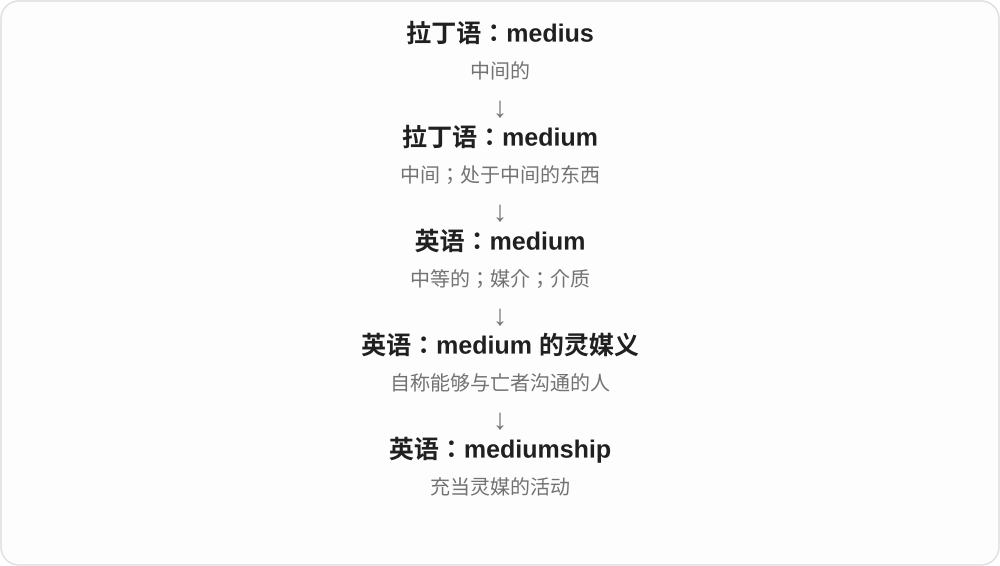

这个词用于描述相关信仰、声称的能力或表演活动。解释词义本身，并不等于确认这种能力真实存在。

**常见搭配与例句**

claims of mediumship；the history of mediumship；practise mediumship。

> The book examines mediumship in nineteenth-century Britain.

这本书研究十九世纪英国的灵媒活动。

> The investigator tested the woman’s claims of mediumship.

调查者检验了这名女子关于自己灵媒能力的说法。

**别混淆**

mediation 是调解，mediumship 是灵媒活动；两者都有“中间角色”的意象，实际领域不同。

### 13. median — 中位数；中间的；道路中央分隔带

**音标**：/ˈmiːdiən/

**先抓住这个画面**

让所有数从小到大排好队，站在队伍正中间的那个位置，就是 median 的画面。

**怎么拆**

经法语来自拉丁语 mediānus“居中的”，与 mean 的平均义同源，但现代统计概念不同。

**怎么变成今天的意思**

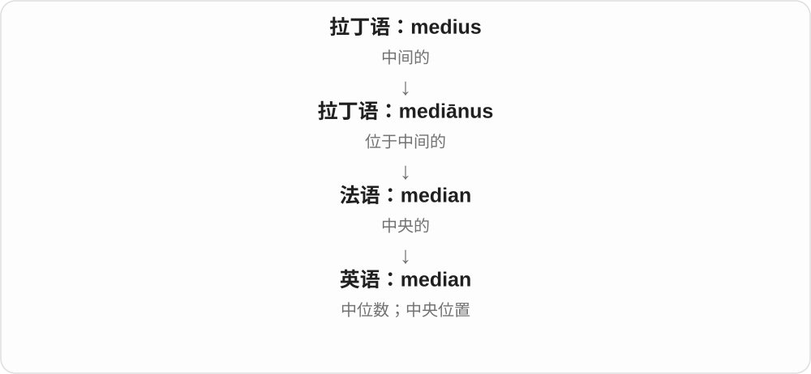

奇数个数取中间值，偶数个数通常取中间两个数的平均。道路 median 则是把两个行驶方向分开的中央地带。

**常见搭配与例句**

median income；the median value；a highway median。

> The median of two, three and ten is three.

二、三和十的中位数是三。

> A row of trees runs along the highway median.

公路中央分隔带上种着一排树。

**别混淆**

mean 易被少数极大值拉高；median 只看排序后的中央位置。二者都能概括数据，但回答的问题不同。

### 14. medieval — 中世纪的

**音标**：英 /ˌmediˈiːvəl/；美 /ˌmiːdiˈiːvəl/

**先抓住这个画面**

这里的“中间”说历史分期：在欧洲传统分期里，古代与近代之间的时代。

**怎么拆**

来自法语 médiéval，利用拉丁语 medium“中间”和 aevum“时代”构成。后半不是 evil“邪恶”。

**怎么变成今天的意思**

最基本是历史标签，可形容城堡、手稿、社会。口语里也有人拿它夸张形容落后残酷，但这不能代替严谨的历史评价。

**常见搭配与例句**

a medieval castle；medieval history；a medieval manuscript。

> The town is famous for its medieval castle.

这座城镇以其中世纪城堡闻名。

> She studies medieval manuscripts.

她研究中世纪手稿。

**别混淆**

medieval 不是泛指一切古老事物；古埃及金字塔不能只因年代久远就叫 medieval。

### 15. Mediterranean — 地中海；地中海地区的

**音标**：/ˌmedɪtəˈreɪniən/

**先抓住这个画面**

看地图：海被欧洲、非洲和亚洲的陆地围在周围，“陆地中间的海”就是名字背后的画面。

**怎么拆**

来自拉丁语 mediterrāneus“内陆的”：medius（中间）+ terra（土地）及形容词词尾，再形成英语 Mediterranean。

**怎么变成今天的意思**

这里的中间是相对周围陆地而言，不是说地中海位于整个地球正中心。作海名常用 the Mediterranean。

**常见搭配与例句**

the Mediterranean Sea；the Mediterranean coast；a Mediterranean climate。

> They sailed across the Mediterranean in summer.

他们夏天乘船横渡地中海。

> The town has a warm Mediterranean climate.

这座城镇有温暖的地中海气候。

**别混淆**

medieval 说时代；Mediterranean 说地理区域。两者开头相近，但后半成分分别是时代与土地。

### 16. mediocre — 平庸的；不出色的

**音标**：英 /ˌmiːdiˈəʊkə/；美 /ˌmiːdiˈoʊkər/

**先抓住这个画面**

期待爬上山顶，结果只到半山腰：还不算彻底失败，但远没有让人满意。这个画面能帮助记住 mediocre 的失望语气。

**怎么拆**

法语 médiocre 来自拉丁语 mediocris，通常分析为 medius“中间”与 ocris“山峰”有关。英语里不能拆成 media 加某个 -ocre 后缀。

**怎么变成今天的意思**

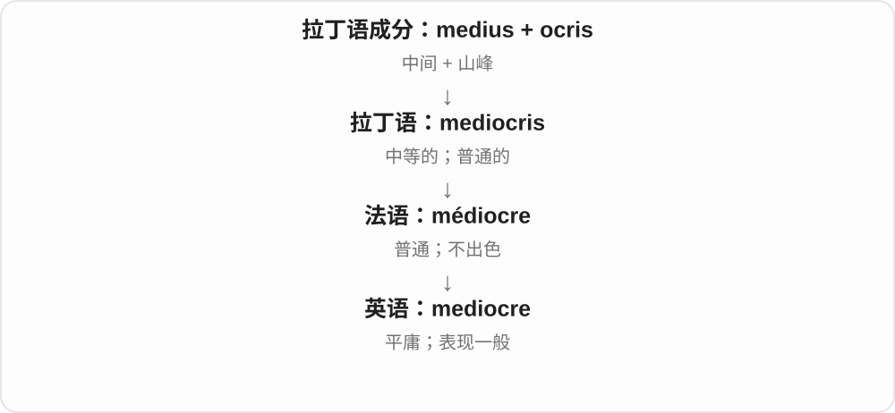

拉丁词已有中等、普通义；英语现代多用来评价质量或表现平平。“半山腰”是帮助理解词形的画面，不是在讲每次使用时都想到登山。

**常见搭配与例句**

a mediocre performance；mediocre food；a mediocre result。

> The service was friendly, but the food was mediocre.

服务很友好，但饭菜很一般。

> She was disappointed by the team’s mediocre performance.

球队平平的表现让她失望。

**别混淆**

average 可以只陈述平均水平；mediocre 通常含“不够好”的评价。夸人时不要用 mediocre。

### 17. mediocrity — 平庸；平庸的人或作品

**音标**：英 /ˌmiːdiˈɒkrəti/；美 /ˌmiːdiˈɑːkrəti/

**先抓住这个画面**

mediocre 说这次表现一般；mediocrity 把“一直没有出色之处”的状态拿出来讨论。

**怎么拆**

来自拉丁语 mediocritās，经法语等路径传入；现代与 mediocre + -ity 对应，重音移到后面的音节。

**怎么变成今天的意思**

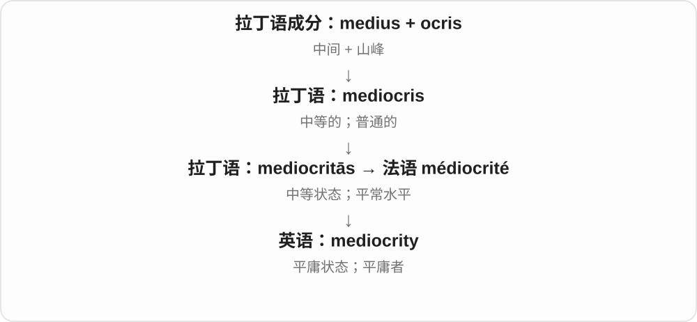

历史上可中性地表示适中，现代主要带贬义，常出现在不愿满足于平庸的语境。可数时也可指平庸的人或作品。

**常见搭配与例句**

settle for mediocrity；rise above mediocrity；a culture of mediocrity。

> The coach refused to accept mediocrity.

教练不愿接受平庸的表现。

> The film never rises above mediocrity.

这部电影始终没有超出平庸水平。

**别混淆**

modesty 是谦虚或规模不大，并不等于 mediocrity“能力、成绩平庸”。

### 18. meridian — 经线；子午线；正午相关的

**音标**：/məˈrɪdiən/

**先抓住这个画面**

名字先来自一天的中间——正午，后来与观察太阳过中天的方向相连，进入地图与天文学。

**怎么拆**

medius（中间）与 diēs（一天）组合，发生音变形成 merīdiēs“正午”，再有 merīdiānus，经法语及拉丁语进入英语。

**怎么变成今天的意思**

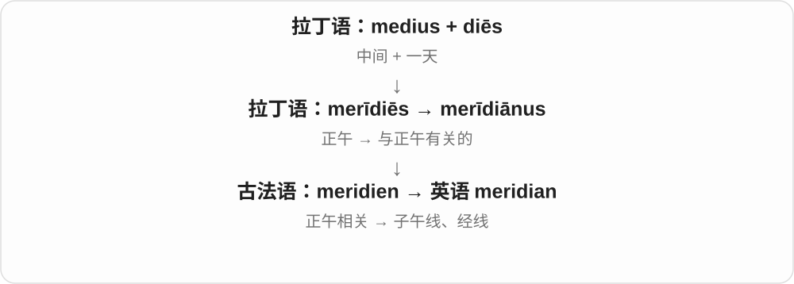

现代地理里的 meridian 是连接南北两极的经线。它不是围绕地球中部一圈的赤道；“中间”在这里首先指时间。

**常见搭配与例句**

the prime meridian；cross a meridian；the Greenwich meridian。

> The prime meridian passes through Greenwich.

本初子午线经过格林尼治。

> Every meridian runs from one pole to the other.

每条经线都从一个极点延伸到另一个极点。

**别混淆**

meridian 是经线；parallel 是纬线。median 则是中位数或中央的，少了 r，不能互换。

### 19. postmeridian — 午后的；正午之后的

**音标**：英 /ˌpəʊstməˈrɪdiən/；美 /ˌpoʊstməˈrɪdiən/

**先抓住这个画面**

把一天从正午切开，post- 让你看后面这一段。它是少见、较正式的“午后”。

**怎么拆**

拉丁语 post-（之后）+ merīdiānus（正午的）形成 postmerīdiānus；英语保留这个组合。

**怎么变成今天的意思**

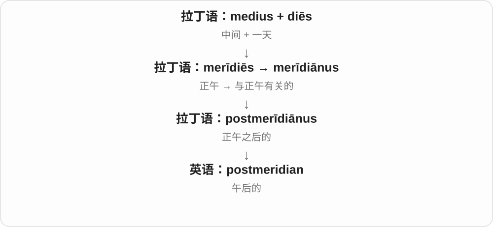

理解词时抓住 post + 正午。日常表达说 afternoon 更自然；钟表里的 p.m. 来自拉丁短语 post meridiem，不是这个英语形容词的简单缩写。

**常见搭配与例句**

postmeridian hours；a postmeridian observation。

> The old log lists separate morning and postmeridian observations.

旧日志分别列出了上午和午后的观测记录。

> The manuscript uses postmeridian to describe the hours after noon.

这份手稿用 postmeridian 描述正午之后的时段。

**别混淆**

postmeridian 是形容词，post meridiem 是拉丁短语。也不要把 meridian 理解成这里只谈跨过某条地理经线。

### 20. intermediary — 中间人；中介；居间的

**音标**：英 /ˌɪntəˈmiːdiəri/；美 /ˌɪntərˈmiːdieri/

**先抓住这个画面**

甲不直接找乙，而是通过丙传话或交易；丙就是 intermediary。

**怎么拆**

英语借自法语 intermédiaire；inter- 表示在……之间，medi- 是中间。不要把它解释成 immediate 加前缀。

**怎么变成今天的意思**

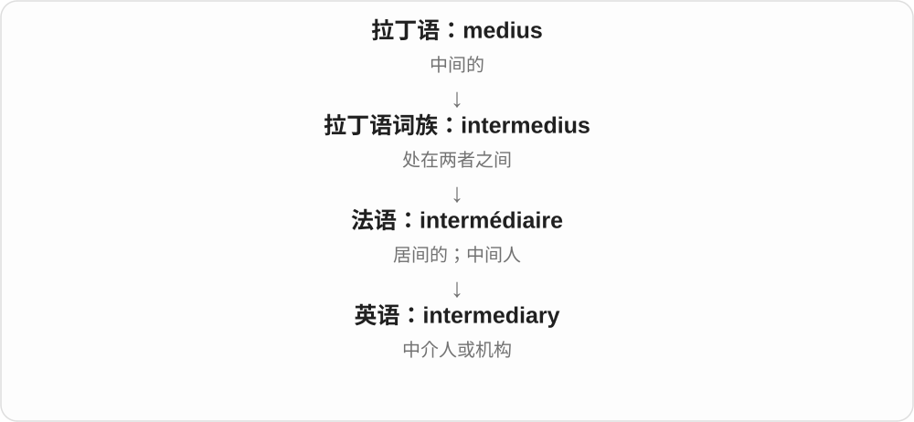

它可以是个人，也可以是帮两端接触的机构。强调所处位置，不保证其公平、不收费或没有自身利益。

**常见搭配与例句**

act as an intermediary；through an intermediary；a financial intermediary。

> We contacted the seller through an intermediary.

我们通过一位中间人联系了卖家。

> The agency acts as an intermediary between artists and clients.

这家机构在艺术家和客户之间起中介作用。

**别混淆**

intermediate 常形容中间阶段或水平；intermediary 常指承担居间角色的人、机构或事物。

### 21. moiety — 一半；一份；分子中的某一部分

**音标**：/ˈmɔɪəti/

**先抓住这个画面**

在整体中划出一块来看，早期最直接是一半，后来也可以是特定的一份。

**怎么拆**

拉丁语 medietās“中间、一半”经古法语 meitié、法语 moytié 进入英语。音变后已经看不出 medi- 的完整样子。

**怎么变成今天的意思**

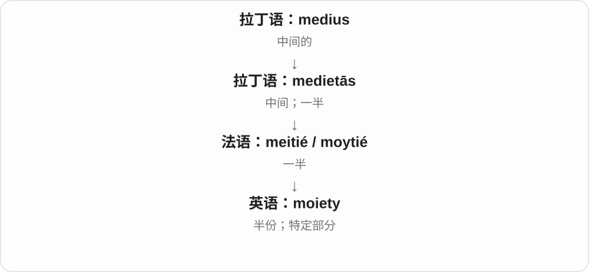

普通文章里不常见；历史法律文本可说一半份额，化学中常指分子里的某个结构片段，那里不一定刚好占一半。

**常见搭配与例句**

a moiety of the estate；a molecular moiety；a sugar moiety。

> The old deed assigned a moiety of the estate to each heir.

旧契约把遗产的一半分给了每位继承人。

> The molecule contains a sugar moiety.

这个分子含有一个糖结构片段。

**别混淆**

half 明确是二分之一；现代 moiety 的某些专业用法只说一个特定片段，不能机械换成 half。

### 22. dimidiation — 分成两半；纹章中的各取半幅合并

**音标**：/dɪˌmɪdiˈeɪʃən/

**先抓住这个画面**

把完整图形沿中间分开，两边各是一半；在纹章里，还能各取两枚徽章的一半，拼成一枚。

**怎么拆**

来自晚期拉丁语 dīmidiātiō，与 dīmidiāre“分半”和 medius“中间”相关。不是 di- 简单等于“二”再随意接词尾。

**怎么变成今天的意思**

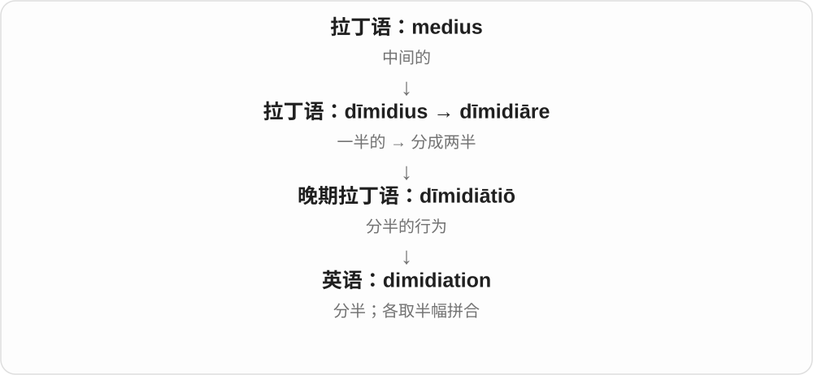

这是少见的专业词。纹章义把两个完整标志各截半幅再拼合，与把两枚完整徽章缩小并排放不同。

**常见搭配与例句**

dimidiation of arms；heraldic dimidiation。

> The diagram illustrates the dimidiation of two coats of arms.

这张图展示了两幅纹章各取一半进行拼合的方式。

> Dimidiation can make the original symbols difficult to recognize.

这种半幅拼合可能让原来的图案难以辨认。

**别混淆**

division 只说划分，不限定两半；dimidiation 强调对半及相关专业方式。

### 23. submediant — 下中音；音阶第六级

**音标**：/ˌsʌbˈmiːdiənt/

**先抓住这个画面**

在大调或小调音阶里，submediant 指第六级。以 C 大调为例，它是 A；不要按中文“中”字去猜是第四级。

**怎么拆**

sub-（下）+ mediant（中音），后者最终与拉丁语 medius“中间”相关，是音乐术语系统中的组合。

**怎么变成今天的意思**

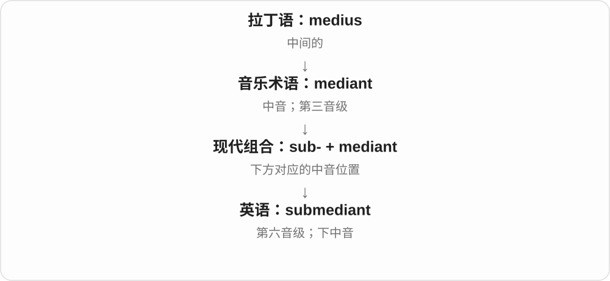

它与 mediant 形成上下方向的对应：相对高一个八度的主音往下数三度，可到第六级。名称描述音级关系，不是音量高低。

**常见搭配与例句**

the submediant of C major；a submediant chord。

> In C major, A is the submediant.

在 C 大调中，A 是下中音。

> The teacher asked us to identify the submediant in each scale.

老师让我们指出每个音阶里的下中音。

**别混淆**

submediant 是第六级；subdominant 是第四级。二者都有 sub-，仍不能只凭前缀判断音高。

## 这一组要分清什么

**mean / median**：算术平均值 / 排序后的中位数；2、3、10 的两者分别是 5 与 3。

**medium / mediocre**：中等大小常是中性信息；平庸的质量常带失望。

**mediate / meditate**：调解 / 冥想，拼写接近但词源和用法不同。

**immediate** 的 im- 是否定“有中间隔层”，所以能同时解释立即、直属、紧邻。

## 串起来练习

**An intermediary contacted a mediator, who asked both sides for an immediate reply.**

中间人联系了一位调解人，调解人请双方立即答复。intermediary 处在联络中间，mediator 帮双方协调，immediate 则不留时间间隔。
