# 0118 · mit-, miss- (MIT-) — 送出；放走；放置、交托

[逐词精讲目录](../00_逐词精讲目录.md) · [总目录](../00_总目录_按常用程度.md)

## 核心词根与来源

**mit-/miss- 的核心画面是“把手里的东西放出去”。** 这个东西可以是消息、任务、光、钱，也可以是自己的承诺。来自拉丁语 **mittere**；它的分词形式有 **missus / missum**，所以同一词族会出现 transmit / transmission、permit / permission 两套外形。学习时先画箭头：从哪里出去、送到哪里、交到谁手上。

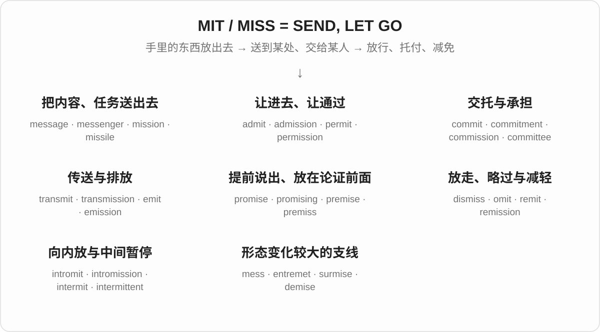

## 词形与演化规律

**mit 和 miss 是同一个拉丁语动词的不同词干形态。** 它们不是英语动词 miss“错过、想念”；submit 也不是 sub + 今天的英语 mit。拉丁语 mittere 的意思比“邮寄”宽，包括放行、放置、交出。前缀常提示方向：e-/ex- 向外，trans- 穿到另一边，ad- 到跟前，re- 回去或放松，intro- 向内。

**现代可拆，不等于历史就是这样造的。** transmission、admission、permission、submission 等名词有拉丁语或法语借入路线；图里保留这些节点，不一律画成英语动词加后缀。missile、mess、surmise 变化更大，要各看自己的历史支线。

## 单词速览（常用到不常用）

| 单词 | 音标 | 核心意思 |
|---|---|---|
| [committee](#w-1) | 通常 /kəˈmɪti/；“受托人”罕见义 /ˌkɒmɪˈtiː/ | 委员会；受托办事的小组 |
| [message](#w-2) | /ˈmesɪdʒ/ | 消息；留言；要表达的意思；发消息 |
| [commission](#w-3) | /kəˈmɪʃən/ | 委托；委员会；佣金；委托创作 |
| [mission](#w-4) | /ˈmɪʃən/ | 任务；使命；使团；传教活动 |
| [promise](#w-5) | 英 /ˈprɒmɪs/；美 /ˈprɑːmɪs/ | 承诺；答应；潜力；预示 |
| [committed](#w-6) | /kəˈmɪtɪd/ | 坚定投入的；已经承诺的；已被占用、安排的 |
| [admit](#w-7) | /ədˈmɪt/ | 承认；准许进入；接纳 |
| [mess](#w-8) | /mes/ | 混乱；烂摊子；食堂、伙食团 |
| [permission](#w-9) | 英 /pəˈmɪʃən/；美 /pərˈmɪʃən/ | 许可；允许 |
| [commissioner](#w-10) | 英 /kəˈmɪʃənə/；美 /kəˈmɪʃənər/ | 专员；委员；受委任的负责人 |
| [commitment](#w-11) | /kəˈmɪtmənt/ | 承诺；投入；承担的事务 |
| [commit](#w-12) | /kəˈmɪt/ | 投入；承诺；犯下；提交保存 |
| [transmission](#w-13) | /trænzˈmɪʃən/，也读 /trænsˈmɪʃən/ | 传输；传播；传动装置 |
| [submit](#w-14) | /səbˈmɪt/ | 提交；呈交；服从；屈从 |
| [permit](#w-15) | 动词英 /pəˈmɪt/、美 /pərˈmɪt/；名词英 /ˈpɜːmɪt/、美 /ˈpɜːrmɪt/ | 允许；使成为可能；许可证 |
| [admission](#w-16) | /ədˈmɪʃən/ | 准入；入学、入院；入场费；承认 |
| [compromise](#w-17) | 英 /ˈkɒmprəmaɪz/；美 /ˈkɑːmprəmaɪz/ | 妥协；折中；损害；使受威胁 |
| [missile](#w-18) | 英 /ˈmɪsaɪl/；美常读 /ˈmɪsəl/ | 导弹；投射物 |
| [promising](#w-19) | 英 /ˈprɒmɪsɪŋ/；美 /ˈprɑːmɪsɪŋ/ | 有前途的；有希望的；令人看好的 |
| [submission](#w-20) | /səbˈmɪʃən/ | 提交；提交的材料；服从 |
| [messenger](#w-21) | 英 /ˈmesəndʒə/；美 /ˈmesəndʒər/ | 信使；传话人；通讯工具 |
| [dismiss](#w-22) | /dɪsˈmɪs/ | 解散；让离开；解雇；不予理会；驳回 |
| [missionary](#w-23) | 英 /ˈmɪʃənəri/；美 /ˈmɪʃəneri/ | 传教士；传教的；热衷传播某种信念的 |
| [premise](#w-24) | 通常 /ˈpremɪs/；动词另可读 /prɪˈmaɪz/ | 前提；设定；以……为前提；场所、房产（复数） |
| [compromised](#w-25) | 英 /ˈkɒmprəmaɪzd/；美 /ˈkɑːmprəmaɪzd/ | 受损的；遭泄露或入侵的；因让步而改变的 |
| [dismissal](#w-26) | /dɪsˈmɪsəl/ | 解雇；解散；不予考虑；驳回 |
| [emission](#w-27) | /ɪˈmɪʃən/ | 排放；发射；排放物 |
| [transmit](#w-28) | /trænzˈmɪt/，也读 /trænsˈmɪt/ | 传送；传输；传播 |
| [demise](#w-29) | /dɪˈmaɪz/ | 死亡；终结；衰亡 |
| [transmitter](#w-30) | 英 /trænzˈmɪtə/；美 /trænzˈmɪtər/ | 发射器；传递者 |
| [subcommittee](#w-31) | /ˈsʌbkəmɪti/ | 小组委员会；下设委员会 |
| [intermittent](#w-32) | 英 /ˌɪntəˈmɪtənt/；美 /ˌɪntərˈmɪtənt/ | 间歇的；断断续续的 |
| [omission](#w-33) | 英 /əˈmɪʃən/；美也读 /oʊˈmɪʃən/ | 遗漏；省略；漏掉的东西 |
| [emit](#w-34) | /ɪˈmɪt/ | 发出；排放；散发 |
| [submissive](#w-35) | /səbˈmɪsɪv/ | 顺从的；屈从的 |
| [permissible](#w-36) | 英 /pəˈmɪsəbəl/；美 /pərˈmɪsəbəl/ | 被允许的；许可范围内的 |
| [remission](#w-37) | /rɪˈmɪʃən/ | 缓解；减免；赦免 |
| [remit](#w-38) | 动词 /rɪˈmɪt/；名词常读 /ˈriːmɪt/ | 汇付；交回处理；减免；职责范围 |
| [omit](#w-39) | /əˈmɪt/，也读英 /əʊˈmɪt/、美 /oʊˈmɪt/ | 省略；遗漏；未做 |
| [dismissive](#w-40) | /dɪsˈmɪsɪv/ | 轻视的；不屑一顾的 |
| [intermittently](#w-41) | 英 /ˌɪntəˈmɪtəntli/；美 /ˌɪntərˈmɪtəntli/ | 间歇地；断断续续地 |
| [intermission](#w-42) | 英 /ˌɪntəˈmɪʃən/；美 /ˌɪntərˈmɪʃən/ | 中场休息；间歇 |
| [emitter](#w-43) | 英 /ɪˈmɪtə/；美 /ɪˈmɪtər/ | 发射器；排放者；发射源 |
| [admissible](#w-44) | /ədˈmɪsəbəl/ | 可接纳的；可采纳的；符合准入条件的 |
| [emissary](#w-45) | 英 /ˈemɪsəri/；美 /ˈemɪseri/ | 使者；特使 |
| [commissary](#w-46) | 英 /ˈkɒmɪsəri/；美 /ˈkɑːmɪseri/ | 军需官；机构商店；食堂；受委派官员 |
| [admittance](#w-47) | /ədˈmɪtəns/ | 准许进入；进入权；导纳 |
| [inadmissible](#w-48) | /ˌɪnədˈmɪsəbəl/ | 不可采纳的；不符合准入条件的 |
| [permissive](#w-49) | 英 /pəˈmɪsɪv/；美 /pərˈmɪsɪv/ | 宽容的；放任的；许可性的 |
| [commissar](#w-50) | 英 /ˌkɒmɪˈsɑː/；美 /ˈkɑːmɪsɑːr/ | 政委；委员、人民委员等官职 |
| [surmise](#w-51) | 动词英 /səˈmaɪz/、美 /sərˈmaɪz/；名词英 /ˈsɜːmaɪz/，也可尾音节重读 | 推测；猜想 |
| [committal](#w-52) | /kəˈmɪtəl/ | 交付；收押、移交程序；下葬或火化仪式 |
| [remiss](#w-53) | /rɪˈmɪs/ | 疏忽的；未尽责的 |
| [remittance](#w-54) | /rɪˈmɪtəns/ | 汇款；汇付款项 |
| [promissory](#w-55) | 英 /ˈprɒmɪsəri/；美 /ˈprɑːmɪsɔːri/ | 承诺性的；约定支付的 |
| [commissariat](#w-56) | 英 /ˌkɒmɪˈseəriət/；美 /ˌkɑːmɪˈseriət/ | 军需部门；军需供应；某些历史官署 |
| [readmission](#w-57) | /ˌriːədˈmɪʃən/ | 重新接纳；再次入学、入院或入场 |
| [uncommitted](#w-58) | /ˌʌnkəˈmɪtɪd/ | 尚未承诺的；未表态的；未被安排用途的 |
| [missive](#w-59) | /ˈmɪsɪv/ | 信函；书面消息（正式或诙谐） |
| [transmissible](#w-60) | /trænzˈmɪsəbəl/ | 可传递的；可传播的 |
| [retransmission](#w-61) | /ˌriːtrænzˈmɪʃən/ | 重新传输；转播 |
| [impermissible](#w-62) | 英 /ˌɪmpəˈmɪsəbəl/；美 /ˌɪmpərˈmɪsəbəl/ | 不被允许的；不合规定的 |
| [resubmit](#w-63) | /ˌriːsəbˈmɪt/ | 重新提交 |
| [submitter](#w-64) | 英 /səbˈmɪtə/；美 /səbˈmɪtər/ | 提交者 |
| [admissibility](#w-65) | /ədˌmɪsəˈbɪləti/ | 可采纳性；准入资格 |
| [recommit](#w-66) | /ˌriːkəˈmɪt/ | 重新承诺、投入；再次交付 |
| [dismissively](#w-67) | /dɪsˈmɪsɪvli/ | 轻蔑地；不以为然地 |
| [committeeman](#w-68) | /kəˈmɪtimən/ | 男委员会成员；男委员 |
| [decommission](#w-69) | /ˌdiːkəˈmɪʃən/ | 使退役；停止使用；撤销运行 |
| [noncommittal](#w-70) | 英 /ˌnɒnkəˈmɪtəl/；美 /ˌnɑːnkəˈmɪtəl/ | 不表态的；不作承诺的 |
| [transmittal](#w-71) | /trænzˈmɪtəl/ | 传送；递交；随附送达说明 |
| [manumission](#w-72) | 英 /ˌmænjʊˈmɪʃən/；美 /ˌmænjəˈmɪʃən/ | 释放被奴役者；奴隶解放手续 |
| [emissivity](#w-73) | /ˌemɪˈsɪvəti/ | 发射率 |
| [permissiveness](#w-74) | 英 /pəˈmɪsɪvnəs/；美 /pərˈmɪsɪvnəs/ | 宽容；管束宽松；放任 |
| [retransmit](#w-75) | /ˌriːtrænzˈmɪt/ | 重新传输；转播 |
| [emissive](#w-76) | /ɪˈmɪsɪv/ | 能发射的；能放出的；自发光的 |
| [inadmissibility](#w-77) | /ˌɪnədmɪsəˈbɪləti/ | 不可采纳性；不具备准入条件 |
| [transmissibility](#w-78) | /trænzˌmɪsəˈbɪləti/ | 可传递性；传播能力 |
| [readmit](#w-79) | /ˌriːədˈmɪt/ | 重新接纳；允许再次进入 |
| [commissure](#w-80) | 英 /ˈkɒmɪsjʊə/；美 /ˈkɑːməʃʊr/ | 连合；连接处；交合线 |
| [remise](#w-81) | 法律动词 /rɪˈmaɪz/；击剑、旧车房名词另见 /rɪˈmiːz/ | 放弃权利；交还；再次刺击（击剑）；旧式车房 |
| [transmissive](#w-82) | /trænzˈmɪsɪv/ | 透射的；允许通过的；传输的 |
| [permittee](#w-83) | 英 /ˌpɜːmɪˈtiː/ | 许可持有人；获许可者 |
| [dismissiveness](#w-84) | /dɪsˈmɪsɪvnəs/ | 轻视；不屑一顾的态度 |
| [manumit](#w-85) | 英 /ˌmænjʊˈmɪt/；美 /ˌmænjəˈmɪt/ | 释放被奴役者；解除奴役 |
| [commissural](#w-86) | 美 /ˌkɑːməˈʃʊrəl/，也读 /ˌkɑːməˈʃɜːrəl/ | 连合的；连接两侧结构的 |
| [promisee](#w-87) | 英 /ˌprɒmɪˈsiː/；美 /ˌprɑːmɪˈsiː/ | 受诺人；承诺相对方 |
| [intromission](#w-88) | /ˌɪntrəˈmɪʃən/ | 进入；引入；插入；插入交接（生物学） |
| [premiss](#w-89) | /ˈpremɪs/ | 前提（premise 的另一拼写） |
| [demit](#w-90) | /dɪˈmɪt/ | 辞去；退出；放下（旧用） |
| [intromittent](#w-91) | /ˌɪntrəˈmɪtənt/ | 引入的；用于插入的 |
| [mittimus](#w-92) | /ˈmɪtɪməs/ | 收监令；移送令（历史法律用语） |
| [remittent](#w-93) | /rɪˈmɪtənt/ | 时轻时重的；缓和后又加重的 |
| [admissive](#w-94) | /ədˈmɪsɪv/ | 容许进入的；倾向于接纳的（少用） |
| [admittatur](#w-95) | 美 /ˌædməˈteɪtər/ | 准入证；旧时大学入学凭证 |
| [admittee](#w-96) | 美 /ædˌmɪˈtiː/ | 获准进入者；被录取者 |
| [commissive](#w-97) | /kəˈmɪsɪv/ | 使说话者承担承诺的；实施行为的 |
| [decommit](#w-98) | /ˌdiːkəˈmɪt/ | 撤回承诺；解除已作的投入 |
| [decommitment](#w-99) | /ˌdiːkəˈmɪtmənt/ | 撤回承诺；撤销投入 |
| [demiss](#w-100) | /dɪˈmɪs/ | 低下的；谦卑的；低垂的（古旧） |
| [dimissory](#w-101) | 英 /dɪˈmɪsəri/ | 准许离去的；准许转由他人授职的 |
| [dimit](#w-102) | /dɪˈmɪt/ | 辞去；退出；放走（古旧或专门用法） |
| [emissitious](#w-103) | /ˌemɪˈsɪʃəs/ | 窥探的；仔细打量的（废旧） |
| [emittent](#w-104) | /ɪˈmɪtənt/ | 发出、放射的（少用） |
| [entremet](#w-105) | 英 /ˈɒntrəmeɪ/；美 /ˈɑːntrəmeɪ/ | 菜间小食；精制甜点 |
| [fideicommissary](#w-106) | 英 /ˌfɪdɪaɪˈkɒmɪsəri/ | 遗产信托受益人；遗产信托的 |
| [fideicommissum](#w-107) | 英 /ˌfɪdɪaɪkəˈmɪsəm/ | 遗产信托；信托遗赠（历史法律用语） |
| [intermit](#w-108) | 英 /ˌɪntəˈmɪt/；美 /ˌɪntərˈmɪt/ | 暂时中断；间歇停止（少用） |
| [intromissive](#w-109) | /ˌɪntrəˈmɪsɪv/ | 引入的；与进入有关的 |
| [intromit](#w-110) | /ˌɪntrəˈmɪt/ | 引入；准许进入；干预他人事务（旧用） |
| [omissible](#w-111) | /əˈmɪsəbəl/ | 可以省略的；可以不做的 |
| [omissive](#w-112) | /əˈmɪsɪv/ | 疏漏的；由不作为造成的 |
| [permissory](#w-113) | 英 /pəˈmɪsəri/ | 容许的；可做而非必做的（少用） |
| [premit](#w-114) | /prɪˈmɪt/ | 预先提出；先说明（废旧） |
| [pretermission](#w-115) | 英 /ˌpriːtəˈmɪʃən/ | 遗漏；略过；故意不谈的修辞 |
| [pretermit](#w-116) | 英 /ˌpriːtəˈmɪt/ | 略过；忽略；未履行 |
| [promissive](#w-117) | /prəˈmɪsɪv/ | 带有承诺意味的；表承诺的 |
| [remissible](#w-118) | /rɪˈmɪsəbəl/ | 可以减免的；可以宽恕的 |
| [remissive](#w-119) | /rɪˈmɪsɪv/ | 宽恕的；减轻、缓和的（少用） |
| [remissory](#w-120) | 英 /rɪˈmɪsəri/ | 给予宽免的；用于获得减免的（少用） |
| [remittal](#w-121) | /rɪˈmɪtəl/ | 汇付；移交；减免 |
| [remittee](#w-122) | /rɪˌmɪˈtiː/ | 收款人；受汇人 |
| [remittence](#w-123) | /rɪˈmɪtəns/ | 暂时减轻；时轻时重的状态 |

## 逐词讲解

### 1. committee — 委员会；受托办事的小组

**音标**：通常 /kəˈmɪti/；“受托人”罕见义 /ˌkɒmɪˈtiː/

**先抓住这个画面**

committee 像大家把一件事交给几个人专门处理，这几个人就组成负责这件事的委员会。

**怎么拆**

通常分析为 commit（交托）+ -ee（受托的一方）；也有联系盎格鲁法语 commite 的分析，不能把一种说法说成唯一结论。

**怎么变成今天的意思**

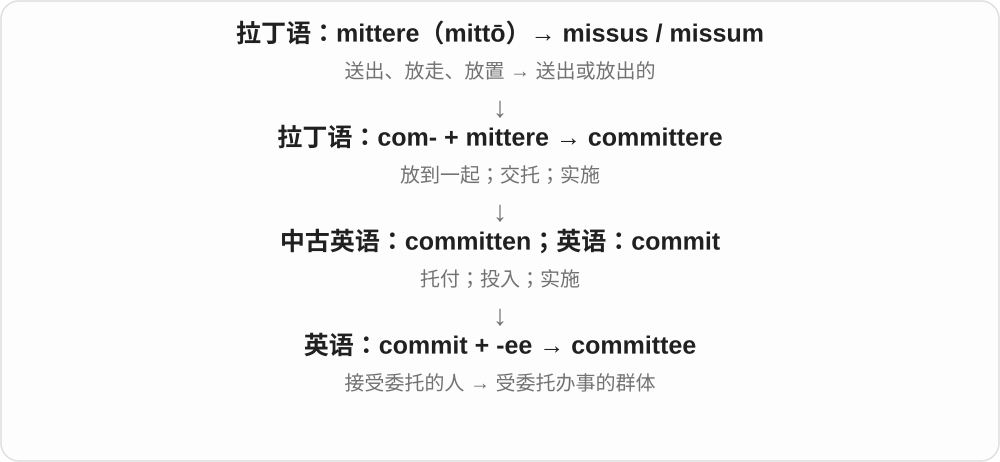

老画面是事情交给谁，现在常指共同承担调查、筹办或决策职责的一组人。普通委员会义重音在中间。

**常见搭配与例句**

serve on a committee；form a committee；a selection committee。

> She serves on the school’s planning committee.

她是学校规划委员会的一员。

> The committee will review the proposals next week.

委员会将在下周审查这些提案。

**别混淆**

committee 是受委派处理事项的群体；community 是共同体，拼写相近但词源和用途不同。

### 2. message — 消息；留言；要表达的意思；发消息

**音标**：/ˈmesɪdʒ/

**先抓住这个画面**

message 是你送到别人那里的那一段内容，既可以是一条手机消息，也可以是一部电影想让观众明白的意思。

**怎么拆**

经古法语 message 来自中古拉丁语 missāticum，远源是 mittere“送出”。

**怎么变成今天的意思**

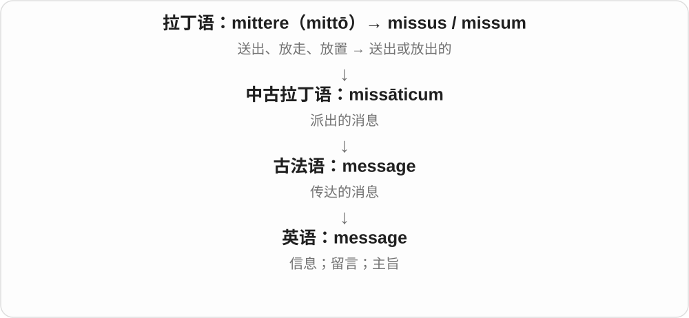

从被派送的消息发展到各种媒介承载的内容。重点通常是传达了什么，不在传送工具是什么。

**常见搭配与例句**

leave a message；send someone a message；the message of a film；message someone。

> I left a message asking her to call me back.

我留了言，请她给我回电话。

> The film’s message is that small choices can matter.

这部电影想表达的是，小小的选择也可能很重要。

**别混淆**

messenger 是传话的人或工具；message 是传出去的内容。

### 3. commission — 委托；委员会；佣金；委托创作

**音标**：/kəˈmɪʃən/

**先抓住这个画面**

commission 像正式把任务交给一方：交给艺术家是一项委托，交给一组人可以形成委员会，替人办成交易还可能得到佣金。

**怎么拆**

经古法语 commission 来自拉丁语 commissiō，与 committere“交托”同族；不是先有英语 commit 再直接加 -sion。

**怎么变成今天的意思**

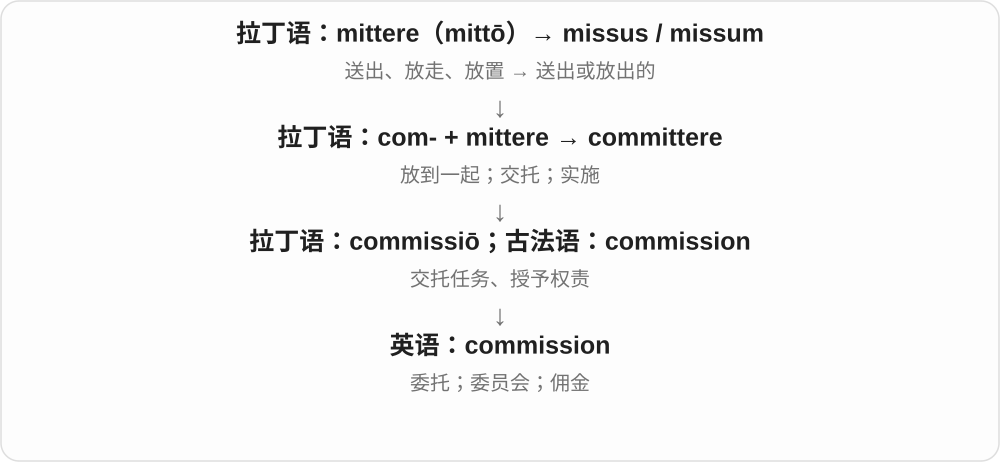

多个常用义都围绕受托办事发展，但现代搭配要分别学。sales commission 是成交带来的报酬；in commission 可以说设备在使用。

**常见搭配与例句**

commission a report；a government commission；earn commission；a commission from a client。

> The museum commissioned a mural for its entrance hall.

博物馆委托创作了一幅入口大厅壁画。

> The agent earns commission on each sale.

代理人每完成一笔销售都会获得佣金。

> An independent commission examined the incident.

一个独立委员会调查了这起事件。

**别混淆**

commission 常带正式委托或受权；request 只表示请求，不一定建立委托关系。

### 4. mission — 任务；使命；使团；传教活动

**音标**：/ˈmɪʃən/

**先抓住这个画面**

mission 像有人带着明确目的被派出去：救援、探索或外交都可以是一项 mission；人生使命则是把重要目标当作自己的任务。

**怎么拆**

来自拉丁语 missiō“派遣”，其 miss- 是 mittere 的同族词干形式。

**怎么变成今天的意思**

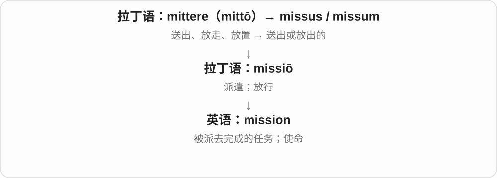

从“被派出去”发展到“被派去做的事”。英语早期有宗教派遣背景，后来扩展到外交、军事、航天和个人目标。

**常见搭配与例句**

a rescue mission；a space mission；a mission statement；be on a mission。

> The team completed its rescue mission before sunset.

队伍在日落前完成了救援任务。

> The charity’s mission is to make books available to every child.

这家慈善机构的使命是让每个孩子都能获得书籍。

**别混淆**

task 可是任何一项具体工作；mission 往往带较完整的目标、责任或行动安排。

### 5. promise — 承诺；答应；潜力；预示

**音标**：英 /ˈprɒmɪs/；美 /ˈprɑːmɪs/

**先抓住这个画面**

promise 像先把一句话放到未来：“这件事我会做。”说一个孩子 shows promise，则是今天的表现让人看见未来可能发展得很好。

**怎么拆**

来自古法语 promesse，远源为拉丁语 prōmittere“预先表示、承诺”及 prōmissum；不是 pro + 英语 miss“错过”。

**怎么变成今天的意思**

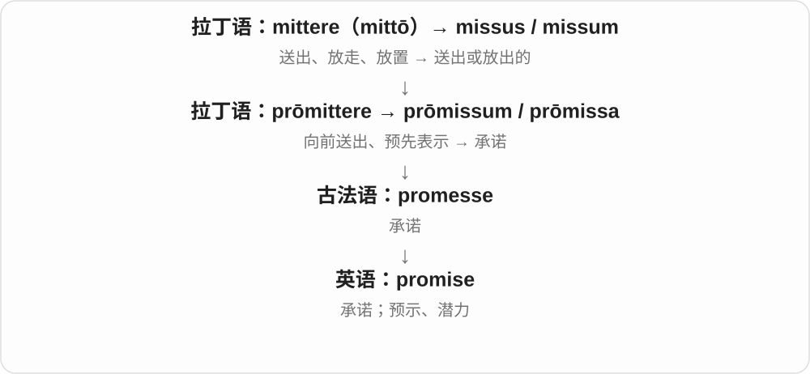

承诺是人提前表示会怎样；潜力义则是某种迹象仿佛在向未来作保证。后者不是真有人开口承诺。

**常见搭配与例句**

make / keep / break a promise；promise to do…；show promise。

> I promised to return the book on Friday.

我答应星期五归还这本书。

> Her early sketches show great promise.

她早期的素描展现出很大的潜力。

**别混淆**

promise 是承诺；guarantee 往往更强调明确保证或保障。show promise 只说有潜力，不保证成功。

### 6. committed — 坚定投入的；已经承诺的；已被占用、安排的

**音标**：/kəˈmɪtɪd/

**先抓住这个画面**

committed 像已经把时间、责任或立场交给一件事，愿意继续认真做，也可能因此不能随时改换安排。

**怎么拆**

commit + -ed，由过去分词发展出形容词用法。

**怎么变成今天的意思**

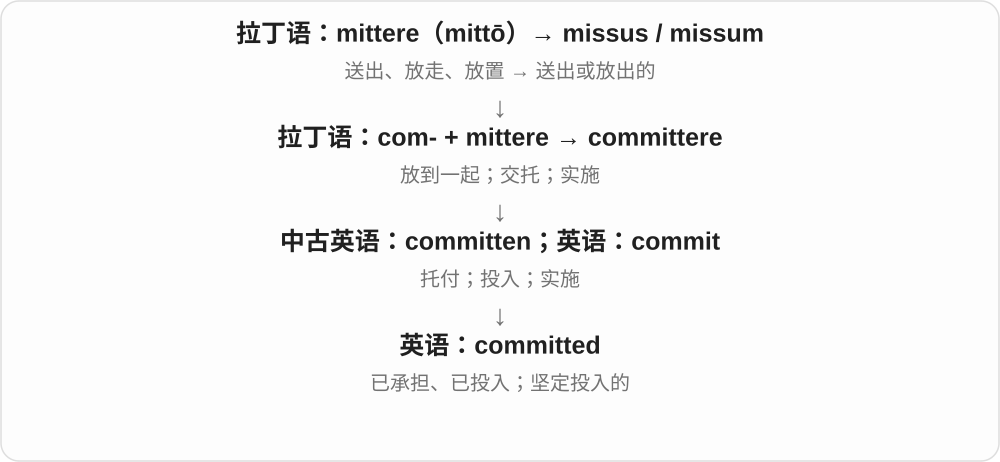

a committed teacher 说工作态度认真；committed funds 说资金已有用途。谈关系时也可说双方已承担稳定关系中的承诺。

**常见搭配与例句**

committed to doing…；a committed supporter；committed funds；a committed relationship。

> She is committed to making the course accessible to everyone.

她致力于让每个人都能学习这门课程。

> Most of the funds are already committed to existing projects.

大部分资金已经安排给现有项目。

**别混淆**

interested 是感兴趣；committed 往往愿意长期承担和行动。committed to 后接 doing，不接动词原形。

### 7. admit — 承认；准许进入；接纳

**音标**：/ədˈmɪt/

**先抓住这个画面**

admit 像打开一道门：可以让人进入场所，也可以把一个原先不想面对的事实“放进自己的承认范围”。

**怎么拆**

拉丁语 ad-（到）+ mittere（让去、送出）形成 admittere“准许进入”，经法语、中古英语发展。

**怎么变成今天的意思**

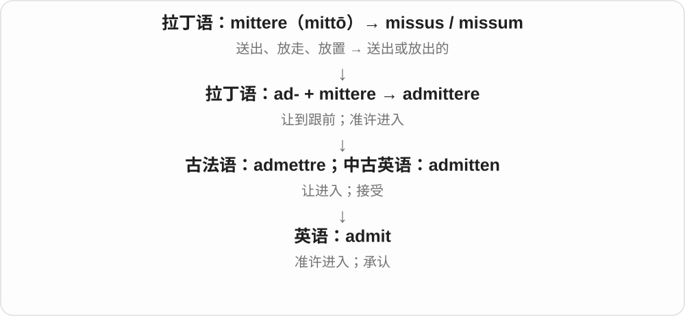

让人进门是具体接纳；承认事实是把它接纳为真。这个联系是帮助理解的画面，实际历史中两义逐步扩展。

**常见搭配与例句**

admit a mistake；admit that…；admit doing…；be admitted to… 。

> He admitted that he had misunderstood the instructions.

他承认自己误解了说明。

> The ticket admits one adult and one child.

这张票允许一位成人和一位儿童入场。

**别混淆**

admit doing 是承认做过；allow someone to do 是允许去做。不要把承认错误说成 admit to do。

### 8. mess — 混乱；烂摊子；食堂、伙食团

**音标**：/mes/

**先抓住这个画面**

mess 最常见的画面是一桌散乱东西或一件被弄得难以收拾的事；军队里的 mess 还可以指共同用餐的地方。

**怎么拆**

餐食义经古法语 mes，联系晚期拉丁语 missum / missus“端上桌的一道食物”。“杂乱”义可能经混合食物发展，也有其他来源分析。

**怎么变成今天的意思**

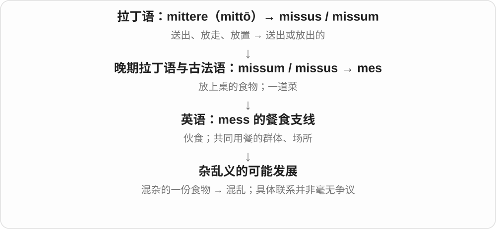

可以用“混在一团”记住日常义，但不能说杂乱义已被证明只能来自端菜。这个词的来源有交汇，学习时把常用法与历史确定程度分开。

**常见搭配与例句**

make a mess；be in a mess；mess something up；an officers’ mess。

> I made a mess of the kitchen while baking.

我烘焙时把厨房弄得一团糟。

> The officers gathered in the mess for dinner.

军官们在食堂聚集用晚餐。

**别混淆**

mess 可说凌乱状态或难处理的局面；message 是消息，不能因字母接近就当成 mess 的派生。

### 9. permission — 许可；允许

**音标**：英 /pəˈmɪʃən/；美 /pərˈmɪʃən/

**先抓住这个画面**

permission 像原本关闭的门被有权决定的人打开：“你可以做这件事。”它谈的是准许这件事本身。

**怎么拆**

经法语 permission 来自拉丁语 permissiō；与 permit 同族，但名词有自己的借入路线。

**怎么变成今天的意思**

不需要真的发出纸质证件；口头同意、系统授权也能叫 permission。普通的“许可”通常不可数。

**常见搭配与例句**

ask for permission；give permission；without permission；permission to do… 。

> Please ask for permission before using the equipment.

使用设备前请先征得许可。

> She gave us permission to quote the letter.

她允许我们引用这封信。

**别混淆**

permit 作名词常是具体许可证；permission 是允许的状态或授权。通常说 get permission，不说 get a permission。

### 10. commissioner — 专员；委员；受委任的负责人

**音标**：英 /kəˈmɪʃənə/；美 /kəˈmɪʃənər/

**先抓住这个画面**

commissioner 像某人被正式交付一块职责，代表机构调查、管理或监督某个领域。

**怎么拆**

经中古英语、盎格鲁法语 commissionaire 来自中古拉丁语 commissiōnārius；现代可表层分析为 commission + -er，但实际不是仅在英语里临时拼成。

**怎么变成今天的意思**

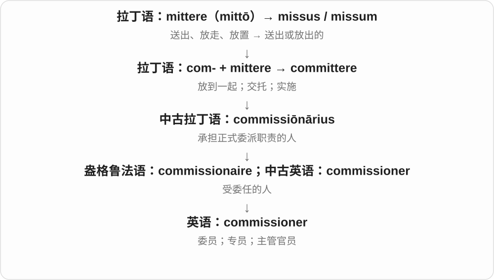

具体职权由机构决定：police commissioner、trade commissioner、sports commissioner 未必处在同一种层级。不要看到 -er 就只译为收佣金的人。

**常见搭配与例句**

a police commissioner；a trade commissioner；appoint a commissioner；the commissioner’s report。

> The commissioner published the findings of the inquiry.

专员公布了调查结果。

> She was appointed trade commissioner for the region.

她被任命为该地区的贸易专员。

**别混淆**

committee member 是委员会成员的一般说法；commissioner 可是某委员会成员，也可是独立负责一个领域的专员。

### 11. commitment — 承诺；投入；承担的事务

**音标**：/kəˈmɪtmənt/

**先抓住这个画面**

commitment 像你把一部分未来时间、精力或责任已经交给一件事，不能只停在“我觉得不错”。

**怎么拆**

commit + -ment。

**怎么变成今天的意思**

可以是持续认真的态度，也可以是具体约定：work commitments 是已经承担的工作事务，常会占用时间。

**常见搭配与例句**

commitment to…；make a commitment；a long-term commitment；work commitments。

> The project requires a serious commitment of time.

这个项目需要认真投入时间。

> I cannot attend because of a prior commitment.

我因为已有安排而无法参加。

**别混淆**

interest 是感兴趣；commitment 表示愿意投入、承担或已经作出承诺。

### 12. commit — 投入；承诺；犯下；提交保存

**音标**：/kəˈmɪt/

**先抓住这个画面**

commit 像把自己或某件事真正交出去：投入一个目标、承担一项安排，或者把某种行为付诸实行。

**怎么拆**

借自拉丁语 committere，含 com-（一起）+ mittere，历史义包括连接、交托、实施；不能用一个直译套住全部现代义。

**怎么变成今天的意思**

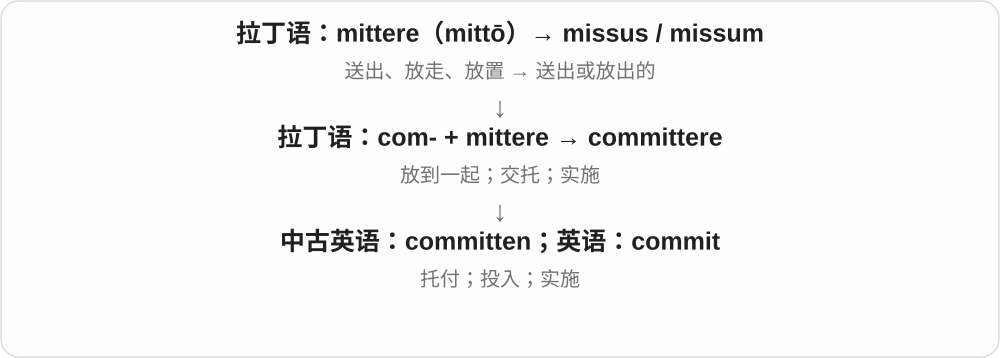

commit to a plan 是把自己与计划绑定；commit a crime 是实施罪行。计算机中的 commit 借用确定、提交这层意思，具体保存方式由系统决定。

**常见搭配与例句**

commit to doing…；commit resources；commit a crime；commit changes。

> We committed to finishing the work by June.

我们承诺在六月前完成工作。

> The company committed more resources to training.

公司向培训投入了更多资源。

> The report states that no crime was committed.

报告指出没有发生犯罪行为。

**别混淆**

promise 常是说出承诺；commit 更突出承担、投入。commit to 中的 to 常是介词，后接名词或 doing。

### 13. transmission — 传输；传播；传动装置

**音标**：/trænzˈmɪʃən/，也读 /trænsˈmɪʃən/

**先抓住这个画面**

transmission 像把东西从这一端递到另一端：可以是信号、能量、信息，也可以是感染的传播。汽车里则指传递动力的那套装置。

**怎么拆**

来自拉丁语 trānsmissiō，与 trānsmittere 同族；不能把借入名词仅画成现代英语 transmit + -ion。

**怎么变成今天的意思**

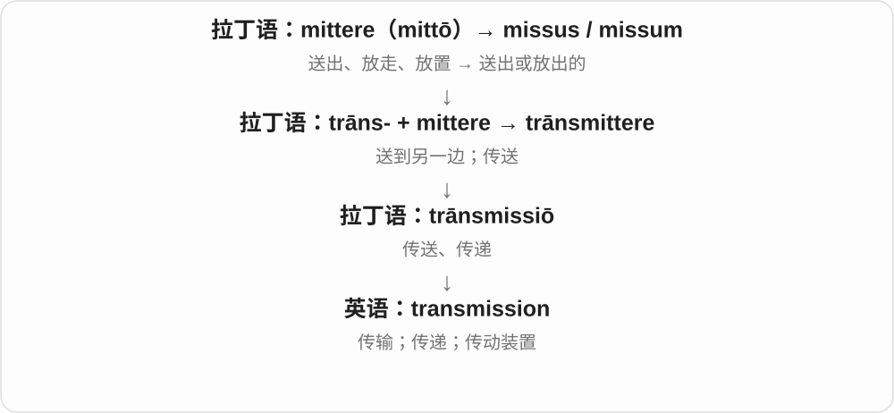

核心是跨越一段距离或一串环节把东西传过去。不同领域传的对象不同，不能都翻成电信信号。

**常见搭配与例句**

data transmission；radio transmission；power transmission；automatic transmission。

> The storm interrupted the radio transmission.

暴风雨中断了无线电传输。

> The mechanic inspected the car’s transmission.

修理工检查了汽车的变速传动装置。

**别混淆**

emission 关注从源头放出；transmission 关注传到别处。一个设备可以 emit 信号，再由系统 transmit。

### 14. submit — 提交；呈交；服从；屈从

**音标**：/səbˈmɪt/

**先抓住这个画面**

submit 像把材料放到评审者面前，请对方处理或判断；用于人时，也可以表示接受另一方的权威。

**怎么拆**

拉丁语 sub-（在下）+ mittere 形成 submittere“放在下面、交付、屈从”，英语借入。

**怎么变成今天的意思**

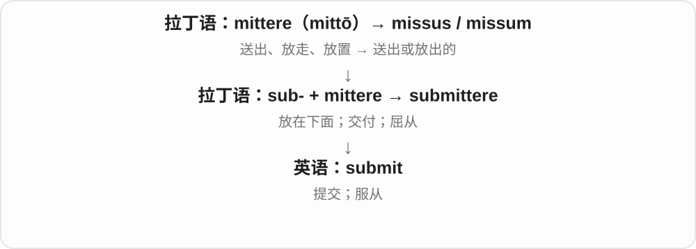

提交论文与服从安排不是两件毫无联系的事：都把对象交到某种判断或控制之下。但现代正式提交不一定带卑微语气。

**常见搭配与例句**

submit an application；submit work to…；submit to authority；submit that… 。

> Please submit your application by Monday.

请在星期一前提交申请。

> She refused to submit to pressure.

她拒绝屈服于压力。

**别混淆**

submit something 是提交东西；submit to something 常是服从、接受。介词一变，关系也变。

### 15. permit — 允许；使成为可能；许可证

**音标**：动词英 /pəˈmɪt/、美 /pərˈmɪt/；名词英 /ˈpɜːmɪt/、美 /ˈpɜːrmɪt/

**先抓住这个画面**

permit 像管理者让你通过一道门；作名词时，就是能证明你有权通过或做某事的许可证。

**怎么拆**

经法语 permettre 来自拉丁语 permittere：per-（通过）+ mittere（放行、让去）。

**怎么变成今天的意思**

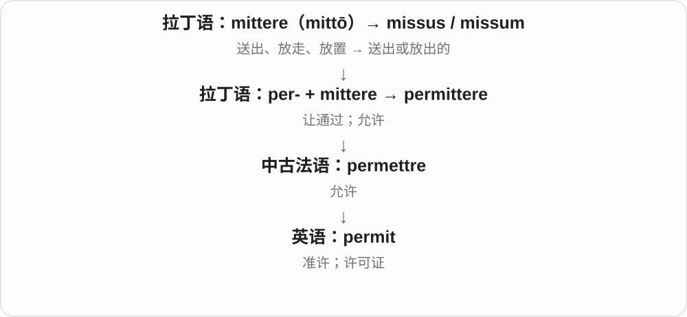

既可说规则准许，也可说客观条件容许。weather permitting 是“如果天气条件允许”，并非天气发证。

**常见搭配与例句**

permit someone to do…；permit doing…；a parking permit；weather permitting。

> The rules do not permit visitors to take photographs.

规定不允许参观者拍照。

> You need a permit to park here.

在这里停车需要许可证。

> We will eat outside, weather permitting.

如果天气允许，我们会在室外吃饭。

**别混淆**

permit 的动词重音在后，许可证名词重音在前。同形鱼名 permit 来自另一条来源，与此处放行词族无关。

### 16. admission — 准入；入学、入院；入场费；承认

**音标**：/ədˈmɪʃən/

**先抓住这个画面**

admission 像得到进入某个场所或机构的资格；把事实说出来承认，也是在给这个事实一个被接受的位置。

**怎么拆**

借自拉丁语 admissio，与 admit 同族，也有法语 admission 同族形式。

**怎么变成今天的意思**

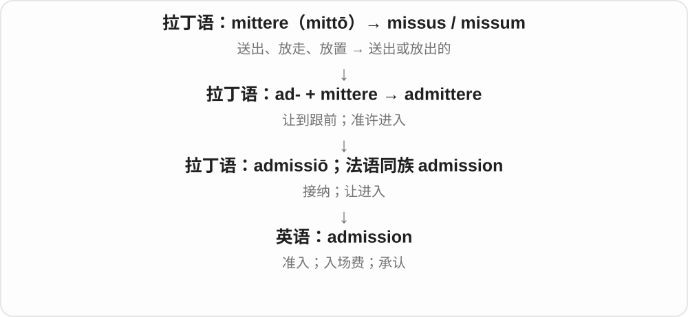

准入义可指过程或收费；承认义可数，an admission of error 是一次认错。依搭配判断，不要每次都翻成门票。

**常见搭配与例句**

admission to college；free admission；an admission of guilt；by her own admission。

> Admission to the exhibition is free.

这个展览免费入场。

> His apology included an admission that he had been wrong.

他的道歉中承认了自己错了。

**别混淆**

admission 还可说承认和入场费；admittance 更常突出实际进入，不通常承担全部这些用法。

### 17. compromise — 妥协；折中；损害；使受威胁

**音标**：英 /ˈkɒmprəmaɪz/；美 /ˈkɑːmprəmaɪz/

**先抓住这个画面**

compromise 一面是双方各让一点，找到能接受的办法；另一面是某样本该完整保护的东西被让掉一部分，因而受损。

**怎么拆**

经法语 compromis 来自拉丁语 compromissum，原先有关双方承诺接受仲裁；com-（共同）+ promittere（承诺）。

**怎么变成今天的意思**

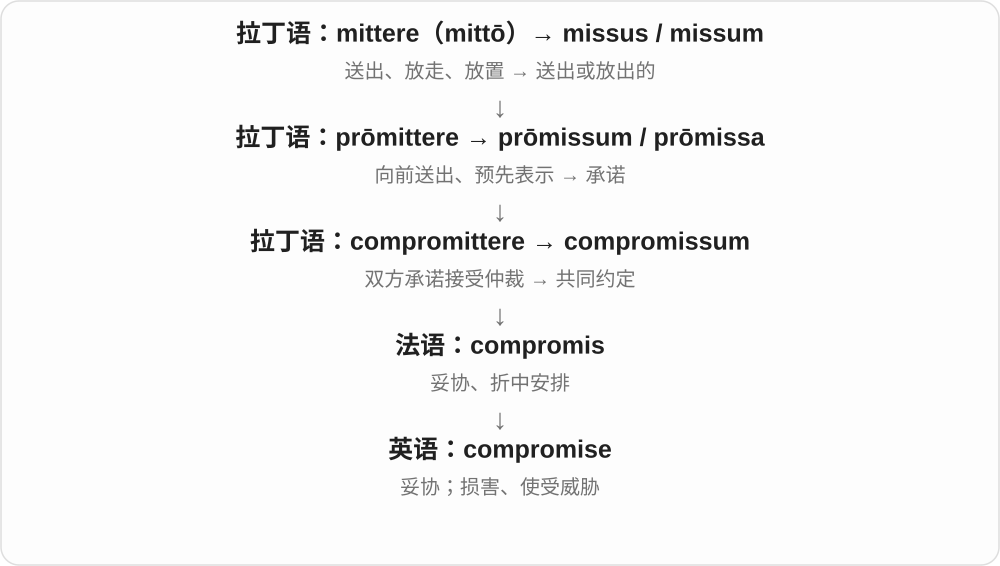

共同约定发展出折中；为了迁就而牺牲某些要求，又发展出损害、使受风险。两种常用义都要看宾语。

**常见搭配与例句**

reach a compromise；compromise on…；compromise safety；a reasonable compromise。

> We reached a compromise on the delivery date.

我们就交付日期达成了折中方案。

> The shortcut would compromise the quality of the work.

这种捷径会损害工作的质量。

**别混淆**

compromise on a date 是在日期上折中；compromise safety 是危及安全，不是让安全双方各退一步。

### 18. missile — 导弹；投射物

**音标**：英 /ˈmɪsaɪl/；美常读 /ˈmɪsəl/

**先抓住这个画面**

missile 原本是被扔出、射出的东西，现代最常让人想到具有飞行与制导能力的导弹。

**怎么拆**

来自拉丁语 missile，属于 missilis“可投掷的”一支，远源为 mittere“投出、送出”。

**怎么变成今天的意思**

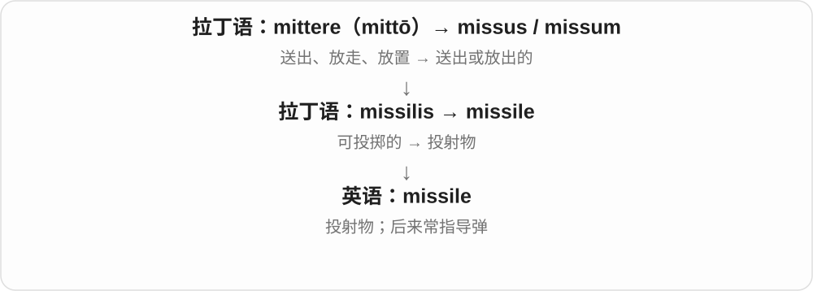

早义范围比现代军事导弹大，扔出去的石头也可能被描述为 missile。这个历史比硬拆 miss + ile 更可靠。

**常见搭配与例句**

a guided missile；a missile test；stones used as missiles。

> The museum displays an early guided missile.

博物馆展出了一枚早期制导导弹。

> The report described the thrown bottles as missiles.

报告把投掷出去的瓶子描述为投射物。

**别混淆**

rocket 关注火箭推进装置或飞行器；missile 关注投射武器等对象，不能把两词当作完全等义。

### 19. promising — 有前途的；有希望的；令人看好的

**音标**：英 /ˈprɒmɪsɪŋ/；美 /ˈprɑːmɪsɪŋ/

**先抓住这个画面**

promising 像一株长势不错的小苗：现在的表现让人看见以后可能长好的迹象，但还没有保证结果。

**怎么拆**

promise + -ing；从 promise 的“预示、显示潜力”义发展为形容词。

**怎么变成今天的意思**

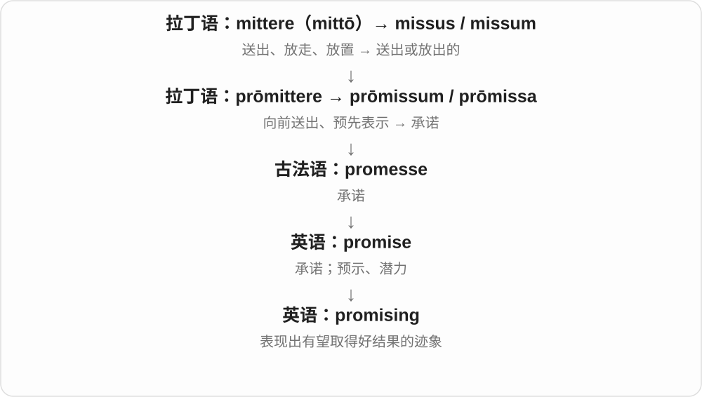

可以修饰人、方案、实验结果或开局。它说的是值得期待，而不是事情已经成功。

**常见搭配与例句**

a promising young writer；promising results；a promising start；look promising。

> The early results look promising, but more tests are needed.

早期结果看起来很有希望，但还需要更多测试。

> She is a promising young designer with a distinctive style.

她是一位风格鲜明、很有前途的年轻设计师。

**别混淆**

promising 是显出潜力；successful 是已经取得成功。一个开局可以 promising，结局仍不确定。

### 20. submission — 提交；提交的材料；服从

**音标**：/səbˈmɪʃən/

**先抓住这个画面**

submission 可以是送到评委桌上的一份作品，也可以是把自己的行动交给别人支配的服从状态。

**怎么拆**

来自古法语 soubmission、拉丁语 submissio，与 submit 同族；不是通常意义的 sub + mission“小任务”。

**怎么变成今天的意思**

提交行为可以变成提交物这个可数名词：three submissions 是三份投稿或申请。服从义通常谈权力关系。

**常见搭配与例句**

a submission deadline；review submissions；submission to… 。

> The journal received more than fifty submissions.

这本期刊收到了五十多份投稿。

> They demanded complete submission to the leader.

他们要求完全服从领导者。

**别混淆**

submission 作提交物时并不表示作者低人一等；服从义才突出接受控制。极少见“小任务”同形构词应另看语境。

### 21. messenger — 信使；传话人；通讯工具

**音标**：英 /ˈmesəndʒə/；美 /ˈmesəndʒər/

**先抓住这个画面**

messenger 是把内容从这边带到那边的人或工具，重点在负责传递，而不是内容的作者。

**怎么拆**

经古法语 messagier / messanger 来到英语；现代可联系 message + -er，但中间 n 是历史音形变化的一部分。

**怎么变成今天的意思**

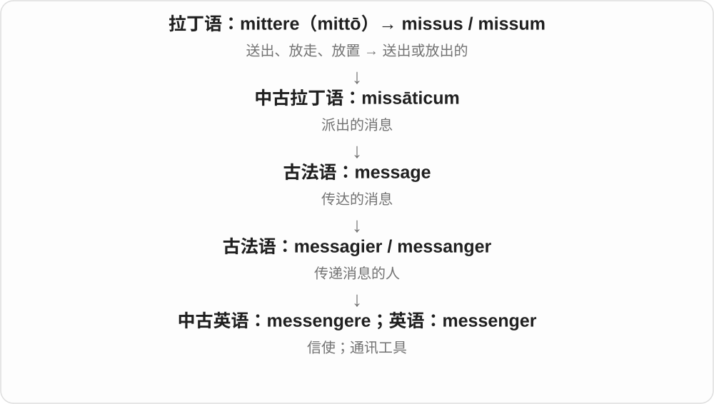

人可以跑腿送信，软件也可以承担传递消息的功能。不要把 messenger 误当 message 的不规则复数。

**常见搭配与例句**

send a messenger；a bicycle messenger；an instant messenger。

> A messenger brought the documents to our office.

一位信使把文件送到了我们办公室。

> Please do not blame the messenger for the bad news.

请不要因为坏消息而责怪传话的人。

**别混淆**

sender 是发起发送的人；messenger 可只是中间传话者，不一定认同消息内容。

### 22. dismiss — 解散；让离开；解雇；不予理会；驳回

**音标**：/dɪsˈmɪs/

**先抓住这个画面**

dismiss 像挥手让某人离开；把一个想法 dismiss，也像把它从考虑范围里挥走。

**怎么拆**

来自拉丁语 dīmissus，与 dīmittere“送走、放行”相连；英语前缀后来受 dis- 词形影响而调整。

**怎么变成今天的意思**

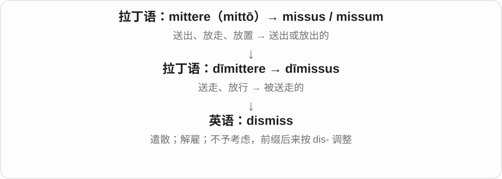

可以让学生离开、解除职务，也可以否定一项说法。法律里的驳回有具体程序含义，这里只记词义，不等于判定某人一定无罪。

**常见搭配与例句**

dismiss an employee；dismiss a suggestion；dismiss a case；dismiss something as… 。

> The teacher dismissed the class ten minutes early.

老师提前十分钟下课。

> Do not dismiss the idea before hearing the evidence.

听到证据之前，不要把这个想法一口否定。

**别混淆**

reject 是拒绝接受；dismiss 常带不再考虑、让其退出的意味，有时显得轻视。

### 23. missionary — 传教士；传教的；热衷传播某种信念的

**音标**：英 /ˈmɪʃənəri/；美 /ˈmɪʃəneri/

**先抓住这个画面**

missionary 是带着传播宗教信仰的任务前往某处的人。借喻时，也能形容迫切想让别人接受某种想法的劲头。

**怎么拆**

mission + -ary，表示从事相关使命的人或与之有关的。

**怎么变成今天的意思**

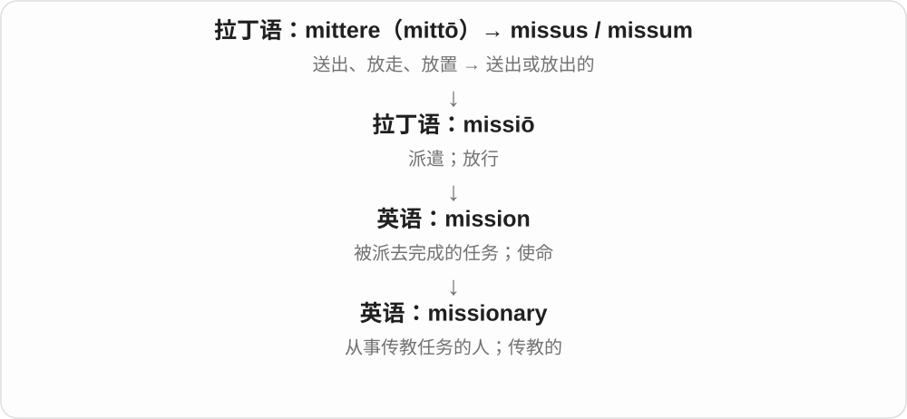

mission 曾有宗教派遣背景，这个派生词保留得最明显。不是所有出差或执行任务的人都叫 missionary。

**常见搭配与例句**

a Christian missionary；missionary work；missionary zeal。

> The archive contains letters written by a missionary.

档案馆保存了由一位传教士写下的信件。

> He promoted the new method with missionary zeal.

他以近乎传教般的热情推广这种新方法。

**别混淆**

mission 是任务；missionary 通常是特定宗教传播角色，而非任意任务执行者。

### 24. premise — 前提；设定；以……为前提；场所、房产（复数）

**音标**：通常 /ˈpremɪs/；动词另可读 /prɪˈmaɪz/

**先抓住这个画面**

premise 像先放在桌上的一块基石，后面的推理或故事都在它上面展开。the premises 却常指房屋及其所属场地。

**怎么拆**

经古法语 premisse 来自拉丁语 praemissa“预先放出的”，原来常修饰“命题”；房产义后来从法律文件中前述事项的用法发展。

**怎么变成今天的意思**

前提不是结论，而是推理先接受的起点。复数场所义经过特定文件用法产生，不能靠“前面的东西”直接猜出建筑。

**常见搭配与例句**

a false premise；be based on the premise that…；on the premises。

> The argument rests on a false premise.

这个论证建立在错误的前提上。

> Smoking is not allowed on the premises.

场所内禁止吸烟。

**别混淆**

premise 是前提；conclusion 是结论。premises 作场所时要按复数看，不是“很多论点”。

### 25. compromised — 受损的；遭泄露或入侵的；因让步而改变的

**音标**：英 /ˈkɒmprəmaɪzd/；美 /ˈkɑːmprəmaɪzd/

**先抓住这个画面**

compromised 像原本完整的防线出现缺口，安全性、可靠性或独立性已经受到影响。

**怎么拆**

compromise + -ed。

**怎么变成今天的意思**

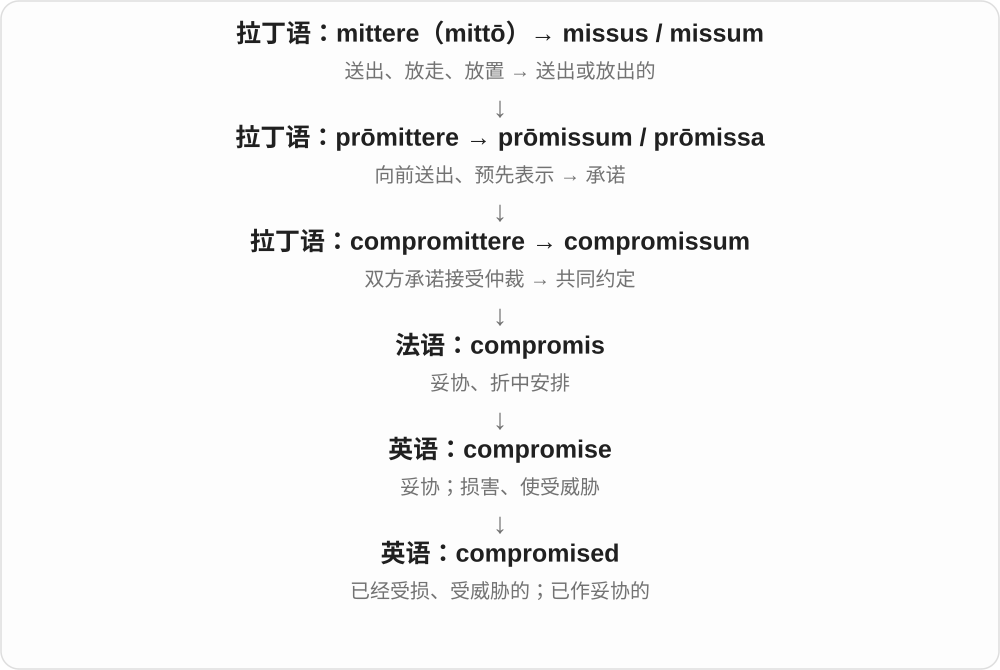

网络账户被 compromised 常指账户安全遭到破坏；判断被 compromised 则可能受利益或压力干扰。不能都按“达成妥协”翻译。

**常见搭配与例句**

a compromised account；compromised security；compromised independence。

> The notice warned users that their accounts might be compromised.

通知提醒用户，他们的账户安全可能已经受到破坏。

> Her independence was compromised by the undisclosed payment.

那笔未披露的付款损害了她的独立性。

**别混淆**

damaged 可指有形损坏；compromised 更常说保护、功能、立场或可信度受到侵蚀。

### 26. dismissal — 解雇；解散；不予考虑；驳回

**音标**：/dɪsˈmɪsəl/

**先抓住这个画面**

dismissal 是 dismiss 这个“让其退出”的动作或结果：员工被解除职务、建议被轻轻带过，或案件被驳回。

**怎么拆**

dismiss + -al，是英语中的名词构词。

**怎么变成今天的意思**

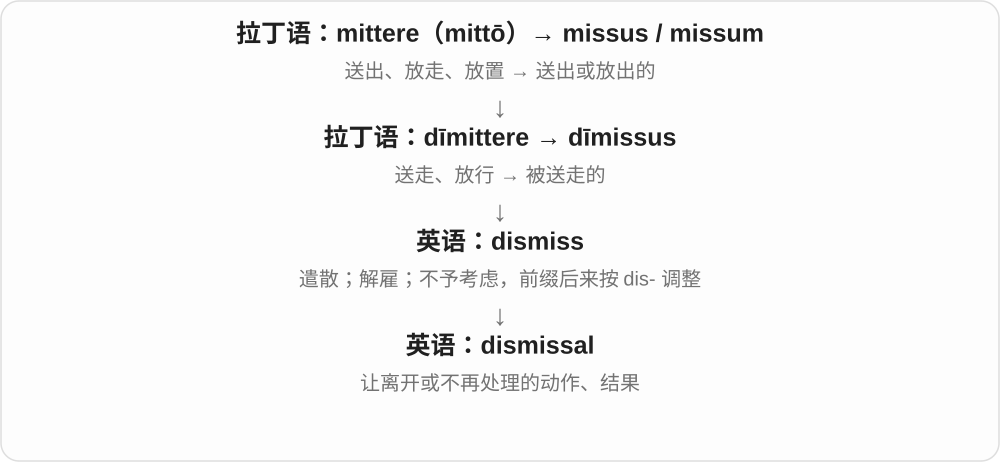

同一个名词跨多个场景，宾语决定是解雇人还是否定意见。正式案件里的 dismissal 具体效果取决于程序。

**常见搭配与例句**

dismissal from a job；the dismissal of a claim；summary dismissal。

> The employee appealed against her dismissal.

这名员工对解雇决定提出了申诉。

> His quick dismissal of the suggestion annoyed the team.

他很快就否定这个建议，让团队感到恼火。

**别混淆**

dismissal of an idea 是不予考虑；disagreement with an idea 只是不同意，可能仍认真讨论过。

### 27. emission — 排放；发射；排放物

**音标**：/ɪˈmɪʃən/

**先抓住这个画面**

emission 像东西从源头向外冒出来：汽车排气、灯发光、材料释放热辐射，都是向外放出。

**怎么拆**

经法语 émission 来自拉丁语 ēmissiō，与 ēmittere“向外送出”同族。

**怎么变成今天的意思**

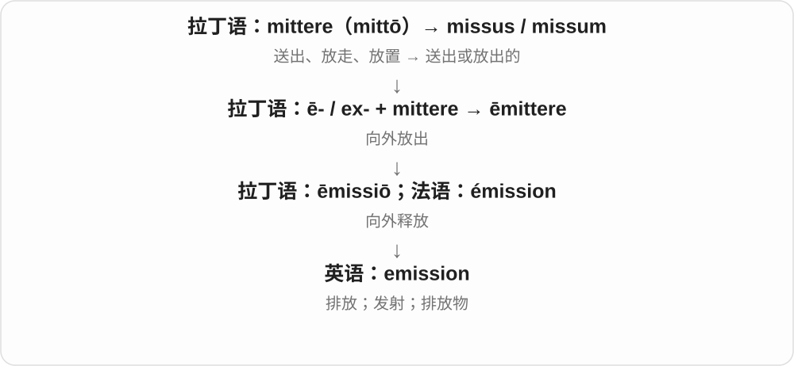

单数可讲释放过程；复数 emissions 常指排出的气体或污染物，也可用于辐射等领域。不是只有有害气体才能 emission。

**常见搭配与例句**

carbon emissions；light emission；reduce emissions；an emission spectrum。

> The city plans to reduce emissions from buses.

这座城市计划减少公交车的排放。

> The experiment measured the emission of light from the material.

实验测量了材料发出的光。

**别混淆**

omission 是遗漏；emission 是放出，一个没有被纳入，一个向外释放。

### 28. transmit — 传送；传输；传播

**音标**：/trænzˈmɪt/，也读 /trænsˈmɪt/

**先抓住这个画面**

transmit 像接力一样把东西送到另一端，可能是信号、热量、知识或病原体。

**怎么拆**

借自拉丁语 trānsmittere：trāns-（跨过）+ mittere（送出）。

**怎么变成今天的意思**

前缀给出跨越的方向，实际传的对象由宾语决定。它不要求发出者具有意识，所以材料和设备也能 transmit。

**常见搭配与例句**

transmit data；transmit signals；transmit heat；transmit knowledge。

> The sensor transmits data every ten seconds.

传感器每十秒传送一次数据。

> Stories can transmit knowledge from one generation to the next.

故事可以把知识从一代传给下一代。

**别混淆**

emit 是从源头放出；transmit 更关注让信息、能量等跨越介质或环节传过去。

### 29. demise — 死亡；终结；衰亡

**音标**：/dɪˈmaɪz/

**先抓住这个画面**

demise 像某个人、机构或制度的存在走到终点，语气通常比 die 或 end 更正式。

**怎么拆**

来自法语 démise，是 démettre“放下、交出”的分词形式；远源为拉丁语 dēmittere。

**怎么变成今天的意思**

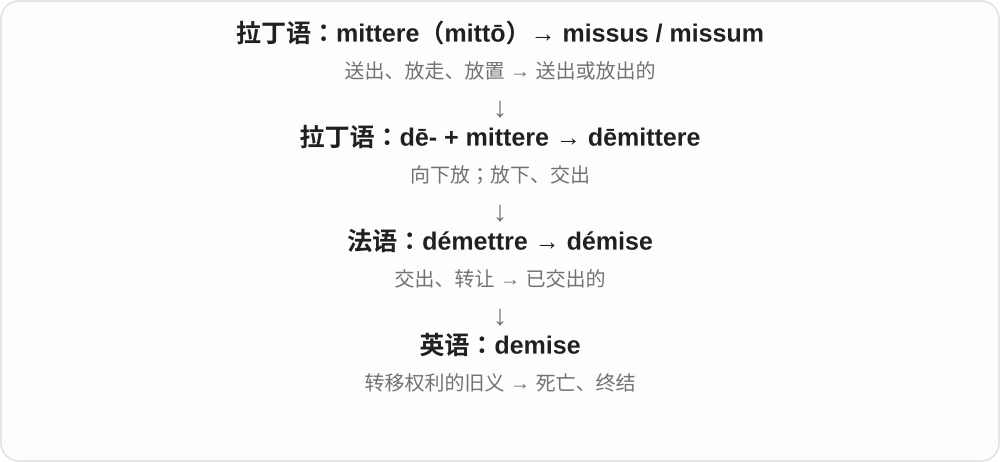

早期权利、财产移转用法与死亡时的继承转移相连，后来死亡、终结成为常用义。不是 de + 英语 miss。

**常见搭配与例句**

the demise of…；an untimely demise；the demise of a business。

> The article traces the demise of the local newspaper.

文章梳理了这家地方报纸停办的过程。

> The biography ends with the writer’s sudden demise.

传记以这位作家的突然去世结束。

**别混淆**

death 常指生命死亡；demise 还常正式地形容组织、制度或某种做法消失。

### 30. transmitter — 发射器；传递者

**音标**：英 /trænzˈmɪtə/；美 /trænzˈmɪtər/

**先抓住这个画面**

transmitter 像广播链条上把内容变成可向外传递信号的那一端；它负责发出，另一端的 receiver 负责接收。

**怎么拆**

transmit + -er。

**怎么变成今天的意思**

常见于无线电、通信和测量，也能指传递某种东西的媒介。具体功能随领域变化。

**常见搭配与例句**

a radio transmitter；a wireless transmitter；a signal transmitter。

> The transmitter sends a signal to the receiver across the room.

发射器把信号发送到房间另一端的接收器。

> The technician checked the transmitter’s power supply.

技术员检查了发射器的电源。

**别混淆**

receiver 接收；transmitter 发送。transceiver 则把发送和接收功能合在一起。

### 31. subcommittee — 小组委员会；下设委员会

**音标**：/ˈsʌbkəmɪti/

**先抓住这个画面**

subcommittee 像大委员会把一个具体问题交给内部小组深入处理，例如预算、招募或安全。

**怎么拆**

sub-（下属、分支）+ committee。

**怎么变成今天的意思**

它是组织分工，不表示成员能力更低；任务范围通常比上级委员会窄。

**常见搭配与例句**

a finance subcommittee；appoint a subcommittee；report to the full committee。

> A subcommittee will examine the budget in detail.

一个下设委员会将详细审查预算。

> She presented the subcommittee’s findings to the full committee.

她向全体委员会汇报了小组委员会的调查结果。

**别混淆**

committee 是委员会；subcommittee 特别说明它隶属于更大的委员会，不只是人少。

### 32. intermittent — 间歇的；断断续续的

**音标**：英 /ˌɪntəˈmɪtənt/；美 /ˌɪntərˈmɪtənt/

**先抓住这个画面**

intermittent 像一盏接触不良的灯，亮一阵、停一阵，或者雨下下停停。

**怎么拆**

经法语 intermittent 来自拉丁语 intermittēns，属于 intermittere“中间暂停”的现在分词。

**怎么变成今天的意思**

重点是过程被停顿隔开，不是持续不断。间隔可以有规律，也可以不规则。

**常见搭配与例句**

intermittent rain；intermittent noise；an intermittent fault。

> Intermittent rain delayed the repairs.

断断续续的雨拖延了维修。

> The connection suffers from intermittent failures.

这条连接会间歇性地出故障。

**别混淆**

continuous 是持续；intermittent 是时断时续。occasional 只说偶尔出现，不一定强调同一过程反复中断。

### 33. omission — 遗漏；省略；漏掉的东西

**音标**：英 /əˈmɪʃən/；美也读 /oʊˈmɪʃən/

**先抓住这个画面**

omission 像一张名单中间留了一个空位：某个应该或原本可以出现的内容没有被放进去。

**怎么拆**

经古法语 omission 来自晚期拉丁语 omissiō，与 omittere“略过”同族。

**怎么变成今天的意思**

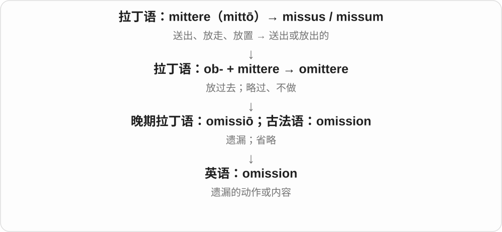

可以是有意省略，也可以是无意漏写；仅凭 omission 本身不能判断责任或动机。

**常见搭配与例句**

an omission from a list；errors and omissions；an act of omission。

> The editor noticed an important omission from the bibliography.

编辑发现参考文献表漏掉了一项重要文献。

> The omission of that detail changed the meaning of the story.

省去那个细节改变了故事的含义。

**别混淆**

commission 可说做了某事；omission 是没做或漏掉某事。two errors by omission 是漏项，不是写错两项。

### 34. emit — 发出；排放；散发

**音标**：/ɪˈmɪt/

**先抓住这个画面**

emit 像灯向外发光、设备发出声音，或管道向外排气：某物从源头释放出来。

**怎么拆**

拉丁语 ē- / ex-（向外）+ mittere 形成 ēmittere，英语借入。

**怎么变成今天的意思**

它描述放出这一动作，不预先评价放出的东西有益或有害。光、热、气味、声音都可以作宾语。

**常见搭配与例句**

emit light；emit heat；emit a sound；emit gases。

> The device emits a short beep when it is ready.

设备准备好时会发出一声短促提示音。

> The lamp emits very little heat.

这盏灯散发的热量很少。

**别混淆**

send 常可带明确发送对象；emit 更突出从源头释放，未必有指定接收者。

### 35. submissive — 顺从的；屈从的

**音标**：/səbˈmɪsɪv/

**先抓住这个画面**

submissive 像把决定权交到别人手里，表现出愿意服从、很少反抗的姿态。

**怎么拆**

以拉丁语 submiss- 词干和 -ive 形成，与 submit“屈从”同族；现代可联系 submit / submission 理解。

**怎么变成今天的意思**

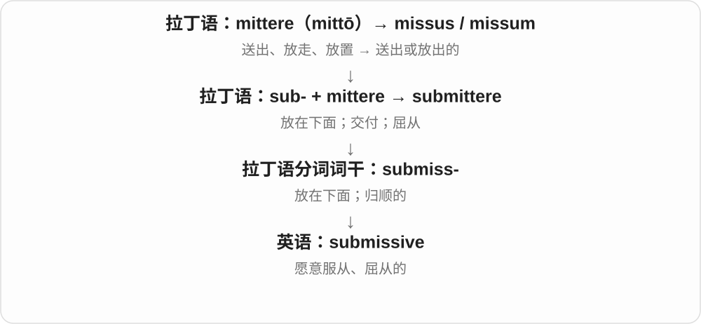

描述人与权威、强势一方之间的关系。不是所有温和、礼貌的人都 submissive，也不自动是褒义。

**常见搭配与例句**

a submissive manner；submissive behaviour；submissive to… 。

> Her quiet voice should not be mistaken for a submissive attitude.

不应把她轻声说话误认为态度顺从。

> The character becomes less submissive as the story develops.

随着故事发展，这个角色不再那么逆来顺受。

**别混淆**

cooperative 是愿意合作，仍可坚持判断；submissive 更强调顺从他人的控制。

### 36. permissible — 被允许的；许可范围内的

**音标**：英 /pəˈmɪsəbəl/；美 /pərˈmɪsəbəl/

**先抓住这个画面**

permissible 像把某种做法拿到规则旁边核对，发现它在允许范围之内。

**怎么拆**

经古法语 permissible 来自中古拉丁语 permissibilis，与 permit 的拉丁语词族相连。

**怎么变成今天的意思**

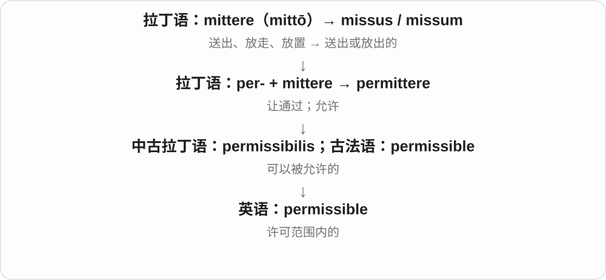

它说是否可以做，常带规则、标准或伦理判断的背景。被允许不等于被要求，也不等于一定最佳。

**常见搭配与例句**

permissible limits；a permissible action；permissible under the rules。

> Is it permissible to use a calculator during the test?

考试时允许使用计算器吗？

> The measurements remained within permissible limits.

测量值仍在允许范围内。

**别混淆**

possible 是做得到；permissible 是被允许。技术上能做，不等于规则允许做。

### 37. remission — 缓解；减免；赦免

**音标**：/rɪˈmɪʃən/

**先抓住这个画面**

remission 像原本压着人的负担或强度被放松：费用可减免，疾病表现可减轻或消失。

**怎么拆**

经法语 remission 来自拉丁语 remissiō，与 remittere“送回、放松、减轻”同族。

**怎么变成今天的意思**

疾病中的 remission 指症状或体征减少、消失等缓解状态，不能直接等同于永远治愈；非医学用法可说债务或费用减免。

**常见搭配与例句**

be in remission；a period of remission；remission of fees。

> The report states that the disease is in remission.

报告指出疾病处于缓解期。

> The scholarship includes remission of tuition fees.

这项奖学金包含学费减免。

**别混淆**

remission 是负担、症状等的减轻；remittance 是汇款，拼写接近但用途不同。

### 38. remit — 汇付；交回处理；减免；职责范围

**音标**：动词 /rɪˈmɪt/；名词常读 /ˈriːmɪt/

**先抓住这个画面**

remit 的动词画面是把款项送去、把事项送回处理，或把负担放轻；名词则是分派给某人处理的那一片范围。

**怎么拆**

来自拉丁语 remittere：re-（回、退）+ mittere（送出、放开）。

**怎么变成今天的意思**

一支强调传回、交付，另一支强调放松、减轻。名词 within my remit 指属于我负责的范围，不是钱到账。

**常见搭配与例句**

remit payment；remit a case；remit a fee；within / beyond one’s remit。

> Please remit the balance by the end of the month.

请在月底前汇付余款。

> That decision falls outside my remit.

那个决定超出了我的职责范围。

**别混淆**

remit 这个名词看职责边界；mission 看任务目标。汇款动词则比 send money 更正式。

### 39. omit — 省略；遗漏；未做

**音标**：/əˈmɪt/，也读英 /əʊˈmɪt/、美 /oʊˈmɪt/

**先抓住这个画面**

omit 像写清单时把某一项跳过去，既可能是为了简短而省掉，也可能是不小心忘了。

**怎么拆**

借自拉丁语 omittere，与 ob- + mittere 相连，历史义是放过去、略过；不是 o + 英语 miss。

**怎么变成今天的意思**

重点是某内容或动作没有被纳入。不能仅凭这个词认定是故意隐瞒，动机要另看语境。

**常见搭配与例句**

omit a detail；omit something from…；omit to mention… 。

> You may omit the final paragraph if space is limited.

如果篇幅有限，可以省略最后一段。

> She accidentally omitted one name from the list.

她不小心从名单上漏掉了一个名字。

**别混淆**

exclude 常更明确主动排除；omit 可以是有意省略，也可以是疏漏。

### 40. dismissive — 轻视的；不屑一顾的

**音标**：/dɪsˈmɪsɪv/

**先抓住这个画面**

dismissive 像别人刚开口，你就摆摆手：“这不值得谈。”重点是把对方的话轻轻推开、不认真看待。

**怎么拆**

dismiss + -ive。

**怎么变成今天的意思**

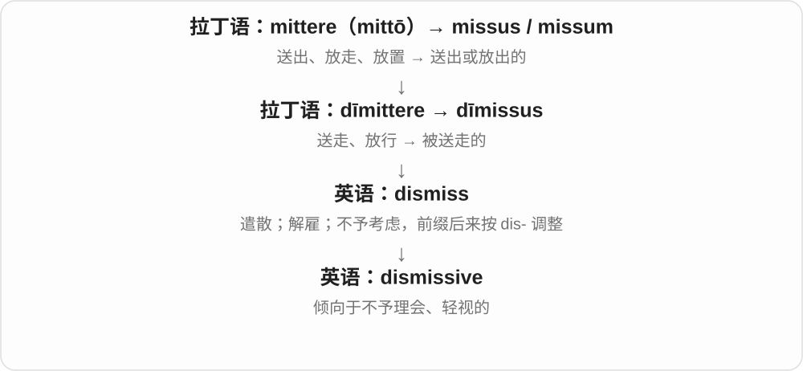

通常形容态度、语气或动作，而不是正式解雇人的手续。可以表达批评：对方没有给足认真考虑。

**常见搭配与例句**

a dismissive tone；a dismissive gesture；be dismissive of… 。

> He was dismissive of her concerns.

他对她的担忧不屑一顾。

> A dismissive shrug ended the conversation.

一个不以为然的耸肩结束了谈话。

**别混淆**

critical 可以认真分析后批评；dismissive 常带不愿仔细听、轻视的感觉。

### 41. intermittently — 间歇地；断断续续地

**音标**：英 /ˌɪntəˈmɪtəntli/；美 /ˌɪntərˈmɪtəntli/

**先抓住这个画面**

intermittently 像背景声音一会儿传来、一会儿停住，过程没有连续进行。

**怎么拆**

intermittent + -ly。

**怎么变成今天的意思**

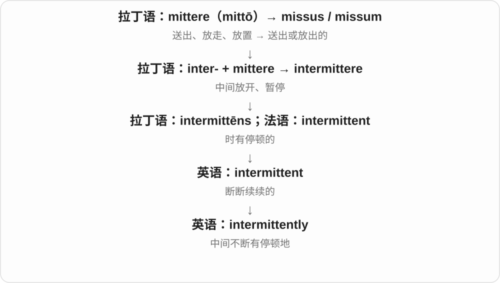

用来修饰下雨、工作、闪光或出错等动作。它不承诺固定间隔，只说明有一段一段的停顿。

**常见搭配与例句**

work intermittently；flash intermittently；rain intermittently。

> The light flashed intermittently throughout the night.

那盏灯整夜断断续续地闪烁。

> She worked on the manuscript intermittently for several years.

她断断续续地写了这部手稿好几年。

**别混淆**

occasionally 是偶尔；intermittently 更强调进行中的过程反复中断、恢复。

### 42. intermission — 中场休息；间歇

**音标**：英 /ˌɪntəˈmɪʃən/；美 /ˌɪntərˈmɪʃən/

**先抓住这个画面**

intermission 像演出中间幕布暂时落下，观众去伸伸腿，过一会儿演出还会继续。

**怎么拆**

来自拉丁语 intermissiō，与 intermittere“暂停、中断”同族；不是 inter + 英语 mission“任务之间”。

**怎么变成今天的意思**

最常见于剧场、演出等安排好的暂停。它不是整场结束，后面还有内容。

**常见搭配与例句**

during the intermission；a short intermission；without intermission。

> We bought drinks during the intermission.

我们在中场休息时买了饮料。

> The concert continued after a fifteen-minute intermission.

中场休息十五分钟后，音乐会继续进行。

**别混淆**

interval 在英式英语中也常指中场休息；intermission 更明确突出节目之间的暂停。

### 43. emitter — 发射器；排放者；发射源

**音标**：英 /ɪˈmɪtə/；美 /ɪˈmɪtər/

**先抓住这个画面**

emitter 是“东西从哪里放出来”的那个源头：可以是发光部件，也可以是排放某种气体的设施。

**怎么拆**

emit + -er。

**怎么变成今天的意思**

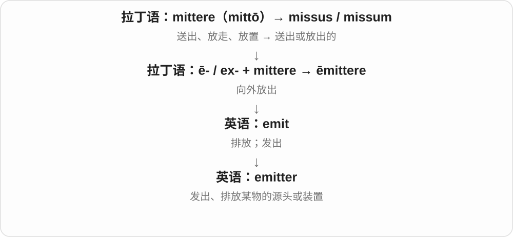

它可以是人以外的设备、材料或组织。电子元件中的 emitter 还有专门名称“发射极”，不宜把所有 emitter 都翻成广播发射机。

**常见搭配与例句**

a light emitter；a major emitter；an infrared emitter。

> The sensor contains a small infrared emitter.

这个传感器含有一个小型红外发射器。

> The report identifies the largest emitters in the region.

报告列出了这个地区最大的排放源。

**别混淆**

transmitter 常强调传送信号到接收端；emitter 只强调释放出来，未必传递消息。

### 44. admissible — 可接纳的；可采纳的；符合准入条件的

**音标**：/ədˈmɪsəbəl/

**先抓住这个画面**

admissible 像一份材料到了门口，规则检查后允许它进入讨论或证据范围。

**怎么拆**

借自法语 admissible，与拉丁语 admittere 的 admiss- 词干相连；现代对应 admit + -ible 的可接受意义。

**怎么变成今天的意思**

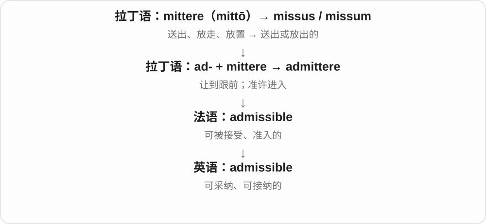

常用于证据、论点或方案是否符合规定。被允许纳入考虑，不等于已经证明内容真实或结论正确。

**常见搭配与例句**

admissible evidence；an admissible argument；admissible under the rules。

> The judge will decide whether the evidence is admissible.

法官将决定这份证据是否可以采纳。

> Only solutions satisfying all the constraints are admissible.

只有满足全部约束的解才符合准入条件。

**别混淆**

credible 是可信；admissible 是准许采纳。两者问的是不同问题。

### 45. emissary — 使者；特使

**音标**：英 /ˈemɪsəri/；美 /ˈemɪseri/

**先抓住这个画面**

emissary 是替另一方带着任务出面的人，像代表领导者前去探询、沟通或谈判的使者。

**怎么拆**

经法语 émissaire 来自拉丁语 ēmissārius，与 ēmittere“派出”相连。

**怎么变成今天的意思**

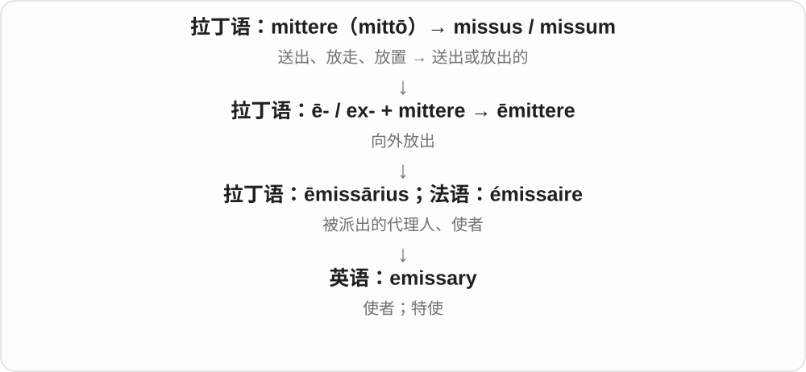

它比普通 messenger 更常带代表身份和任务，可以不只是递一封信。是否正式外交任命，要看具体情况。

**常见搭配与例句**

send an emissary；a special emissary；an emissary from… 。

> The council sent an emissary to begin talks.

理事会派了一位使者去开启会谈。

> She arrived as an emissary of the absent chair.

她作为未能到场的主席的代表前来。

**别混淆**

messenger 侧重传递消息；emissary 侧重代表派遣者执行任务。

### 46. commissary — 军需官；机构商店；食堂；受委派官员

**音标**：英 /ˈkɒmɪsəri/；美 /ˈkɑːmɪseri/

**先抓住这个画面**

commissary 的人物老义是“受托管事的人”；负责供应的工作，又让这个词指向军队或机构里的售货、供餐场所。

**怎么拆**

来自晚期或中古拉丁语 commissārius“受委派者”，与 committere“交托”同族。

**怎么变成今天的意思**

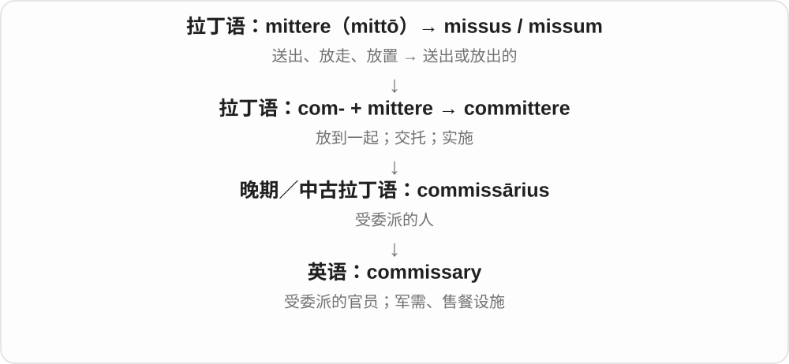

现代美式语境里常是军营等机构中的商店，影视场地里也可指食堂。看见 buy at the commissary 时，不是在向某位官员购物。

**常见搭配与例句**

a military commissary；the studio commissary；a commissary officer。

> They bought groceries at the commissary.

他们在军营商店买了食品杂货。

> The crew met for lunch in the studio commissary.

工作人员在摄影棚食堂碰面吃午饭。

**别混淆**

commissioner 通常是受任命的官员；commissary 还发展出商店、食堂等场所义。

### 47. admittance — 准许进入；进入权；导纳

**音标**：/ədˈmɪtəns/

**先抓住这个画面**

admittance 像门卫抬起栏杆让你进去，重点是能否进入；电路中借用“让电流通过”的画面形成导纳术语。

**怎么拆**

admit + -ance，是英语派生；电学意义是后来借用的专业用法。

**怎么变成今天的意思**

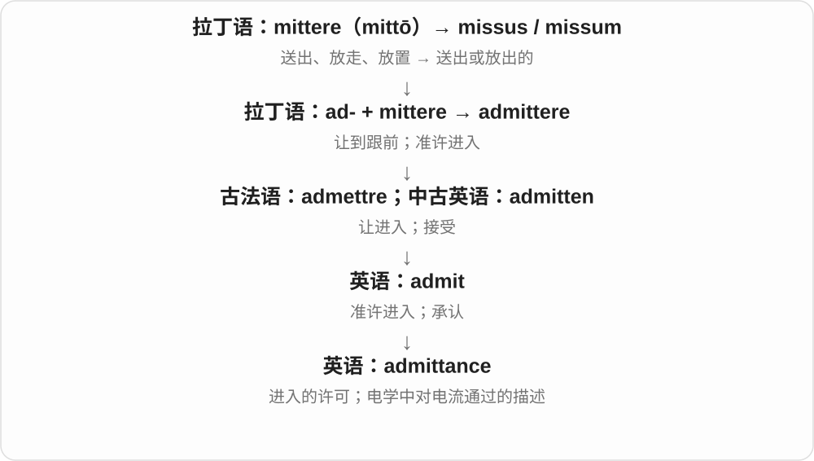

普通用法多见于门牌、正式说明。导纳与阻抗互为倒数，描述电路对交流电流的响应，不能只当成门票。

**常见搭配与例句**

no admittance；gain admittance to…；electrical admittance。

> The sign says no admittance without a pass.

牌子写着没有通行证不得进入。

> The engineer calculated the circuit’s admittance.

工程师计算了这个电路的导纳。

**别混淆**

admission 可讲承认或入场费；admittance 更专注进入本身。电学的 conductance“电导”只是导纳相关概念之一，不完全等同。

### 48. inadmissible — 不可采纳的；不符合准入条件的

**音标**：/ˌɪnədˈmɪsəbəl/

**先抓住这个画面**

inadmissible 像证据或方案被挡在正式考虑范围之外，因为它不符合相应的接纳规则。

**怎么拆**

借自法语 inadmissible；现代可拆 in-（不）+ admissible。

**怎么变成今天的意思**

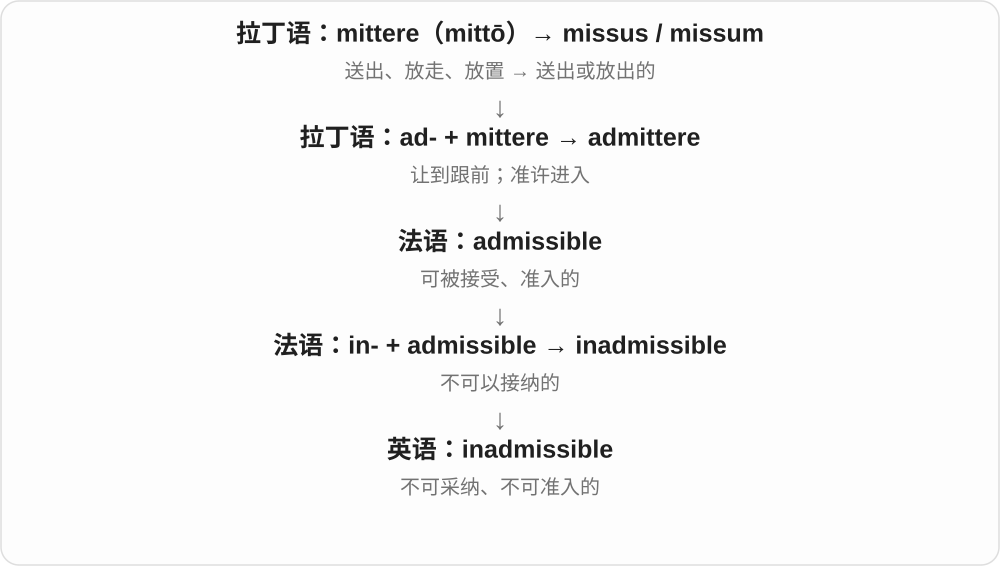

它说规则上的不合格，不自动等于内容虚假。具体是哪条规则，需要看所在的制度或问题。

**常见搭配与例句**

inadmissible evidence；an inadmissible claim；rule something inadmissible。

> The document was ruled inadmissible as evidence.

这份文件被裁定不能作为证据采纳。

> The proposed solution is inadmissible because it violates a constraint.

该方案违反了一项约束，因此不能接受。

**别混淆**

irrelevant 是无关；inadmissible 是不准采纳。无关可能是理由之一，但不是唯一可能。

### 49. permissive — 宽容的；放任的；许可性的

**音标**：英 /pəˈmɪsɪv/；美 /pərˈmɪsɪv/

**先抓住这个画面**

permissive 像一套规矩把栏杆放得较低，允许人做更多事情；说家长时，也可能暗示限制太少。

**怎么拆**

借自法语 permissif，来自 permit 所属的拉丁语 permiss- 词族；现代对应许可、放行的性质。

**怎么变成今天的意思**

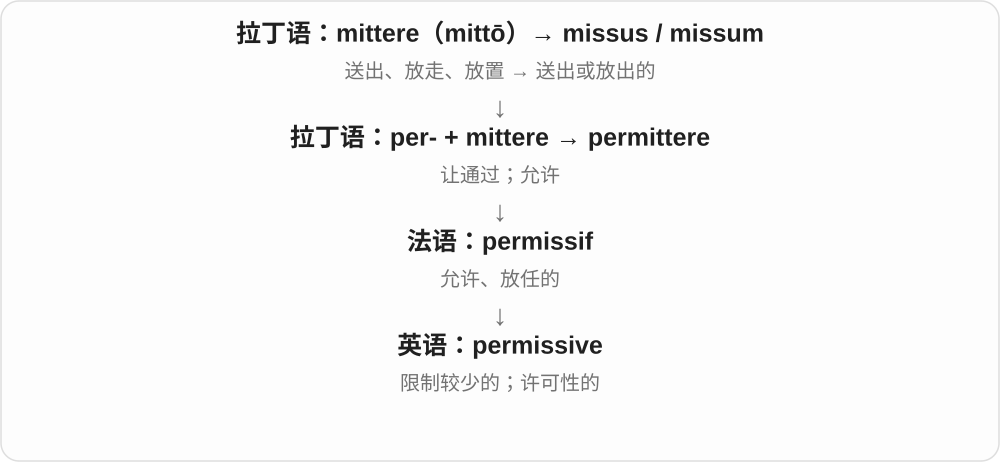

可以中性地描述规则宽松，也可以批评过于放任。软件许可中的 permissive 也指限制较少，但具体权利仍由文本决定。

**常见搭配与例句**

permissive parenting；a permissive policy；permissive rules。

> The school replaced its permissive policy with clearer limits.

学校用更清楚的界限取代了原先较宽松的政策。

> The article compares permissive and strict approaches to parenting.

文章比较了宽松与严格的养育方式。

**别混淆**

permissible 说某个行为被允许；permissive 说人、规则或环境倾向于允许。

### 50. commissar — 政委；委员、人民委员等官职

**音标**：英 /ˌkɒmɪˈsɑː/；美 /ˈkɑːmɪsɑːr/

**先抓住这个画面**

commissar 是特定历史制度中的受任命官员，常让人想到承担政治职责的委员或政委。

**怎么拆**

英语借自俄语 komissar，经德语 Kommissar 等形式追到拉丁语 commissārius“受委派者”；与 commissary 是同源借词。

**怎么变成今天的意思**

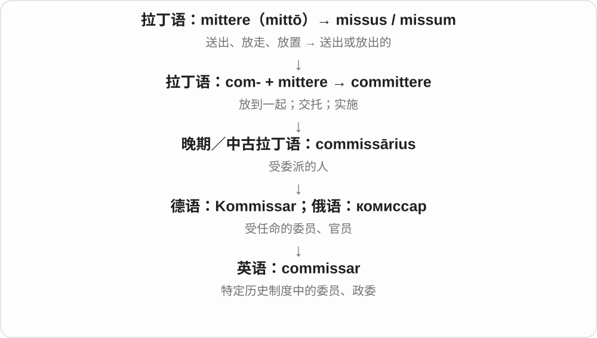

它的现代含义由具体政治与军政制度限定，不是所有国家的 commissioner 都可随意改称 commissar。

**常见搭配与例句**

a political commissar；a people’s commissar；a military commissar。

> The historian examined the role of the political commissar.

这位历史学家研究了政治委员的角色。

> The memoir describes a meeting with a commissar.

这部回忆录描述了一次与委员的会面。

**别混淆**

commissary 在现代英语常指供应机构或商店；commissar 主要指特定官职，末尾发音也不同。

### 51. surmise — 推测；猜想

**音标**：动词英 /səˈmaɪz/、美 /sərˈmaɪz/；名词英 /ˈsɜːmaɪz/，也可尾音节重读

**先抓住这个画面**

surmise 像看到桌上还温着的茶，便推想主人刚离开，但你没有亲眼看见。

**怎么拆**

来自古法语 surmis / surmise，与 surmettre“提出指控”相连；sur-（在上）+ mettre（放置），后者来自 mittere。

**怎么变成今天的意思**

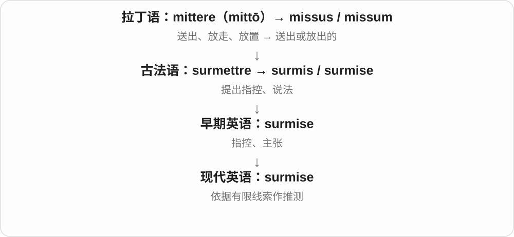

历史上先有提出说法、指控，后来才发展成尚无充分证据的推想。不能硬讲成“向上发送思想”。

**常见搭配与例句**

surmise that…；surmise from…；mere surmise。

> From the empty office, I surmised that the meeting had ended.

看着空办公室，我推测会议已经结束了。

> Without more evidence, that explanation remains a surmise.

没有更多证据，那个解释仍只是猜想。

**别混淆**

conclude 往往表示论证后得出结论；surmise 明确留有证据不足、只是推想的余地。

### 52. committal — 交付；收押、移交程序；下葬或火化仪式

**音标**：/kəˈmɪtəl/

**先抓住这个画面**

committal 把“正式交出去”作为一个动作：交给拘押程序，或在葬礼上把遗体交付安葬。

**怎么拆**

commit + -al，构成动作名词；少见的“委员会的”形容词另可联系 committee。

**怎么变成今天的意思**

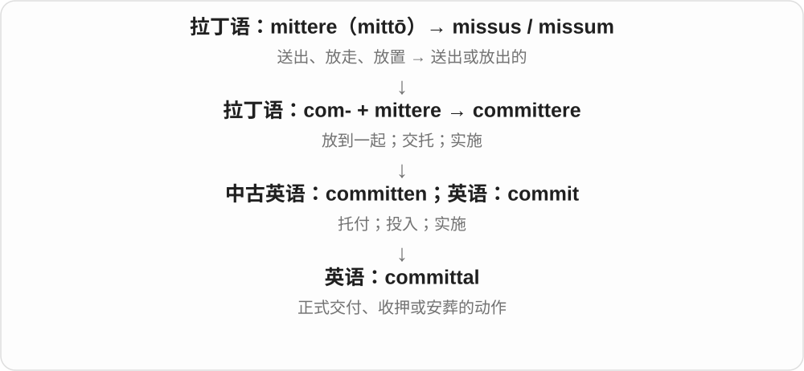

比 commitment 更常出现在正式程序和仪式中。具体法律程序依制度不同，不能把这个词当成普遍统一的程序名称。

**常见搭配与例句**

committal proceedings；a committal order；a committal service。

> The file contains records of the committal proceedings.

档案包含移交审理程序的记录。

> A short committal service was held at the graveside.

墓旁举行了简短的安葬仪式。

**别混淆**

commitment 常谈投入与承诺；committal 常谈具体的交付程序或安葬环节。

### 53. remiss — 疏忽的；未尽责的

**音标**：/rɪˈmɪs/

**先抓住这个画面**

remiss 像手里该握紧的一项责任被放松了，本来该做的检查、提醒或感谢没有认真做。

**怎么拆**

来自拉丁语 remissus“松弛的、疏忽的”，是 remittere“放松、放开”的分词形态。

**怎么变成今天的意思**

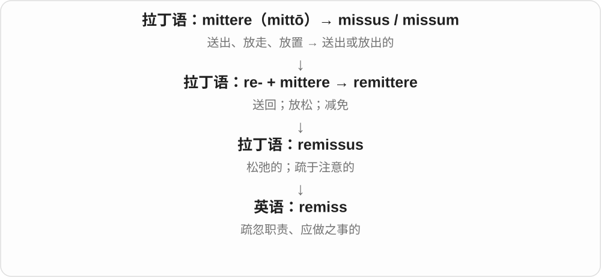

不是所有放松休息都 remiss；这个词包含本来有责任或合理期待，却没有做到的评价。

**常见搭配与例句**

be remiss in one’s duties；remiss of someone to…；I would be remiss if… 。

> I was remiss in not replying sooner.

我没能早点回复，实在疏忽了。

> The review found that the manager had been remiss in checking the figures.

审查发现经理没有尽责核对这些数字。

**别混淆**

careless 是一般粗心；remiss 更突出某件应做的事没有尽到责任。

### 54. remittance — 汇款；汇付款项

**音标**：/rɪˈmɪtəns/

**先抓住这个画面**

remittance 像把钱从你这里送到另一地点的收款人手里，既可说汇付这件事，也可说汇过去的钱。

**怎么拆**

remit + -ance。

**怎么变成今天的意思**

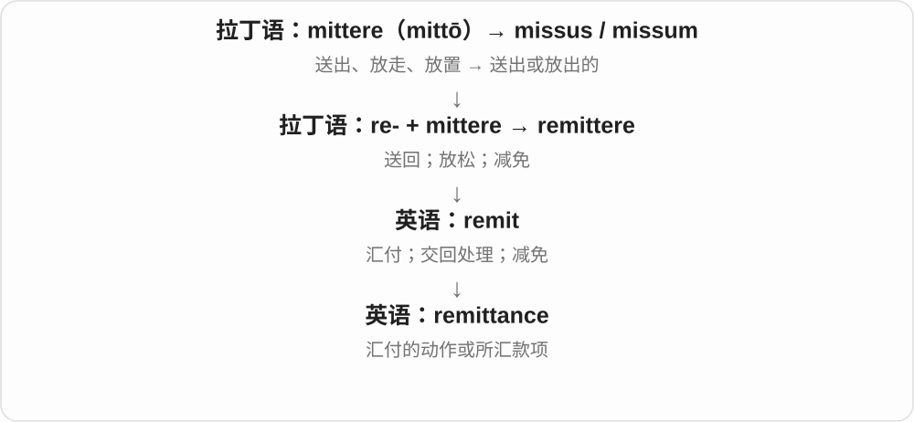

常用于正式付款、跨地区家庭汇款等语境。它专注款项转送，不是症状缓解。

**常见搭配与例句**

send a remittance；receive remittances；a remittance advice。

> She sends a monthly remittance to her family.

她每月给家人汇一笔钱。

> Please include the invoice number with your remittance.

汇款时请附上发票编号。

**别混淆**

remission 是减免或缓解；remittance 是把钱汇过去。减免费用与支付费用方向不同。

### 55. promissory — 承诺性的；约定支付的

**音标**：英 /ˈprɒmɪsəri/；美 /ˈprɑːmɪsɔːri/

**先抓住这个画面**

promissory 像把“以后我会付这笔钱”写成明确的承诺，最常见于 promissory note 这类文书名称。

**怎么拆**

来自中古拉丁语 prōmissōrius，与 prōmittere“承诺”同族；现代可联系 promise + -ory。

**怎么变成今天的意思**

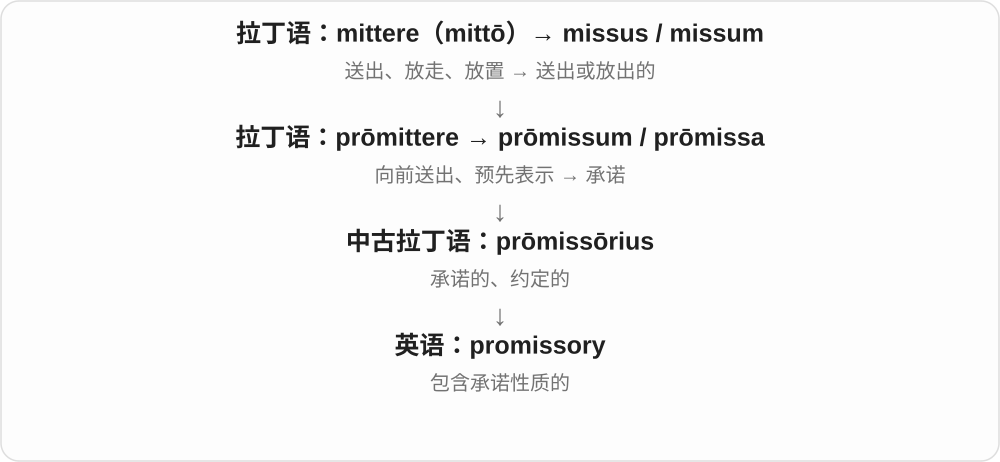

它说文字或行为具有承诺作用，并不表示某人“很有前途”。promissory note 的具体法律要求因制度而异。

**常见搭配与例句**

a promissory note；a promissory undertaking；promissory language。

> The archive contains a promissory note signed by the borrower.

档案中有一张由借款人签署的付款承诺文书。

> The letter used promissory language rather than making a mere prediction.

这封信使用了承诺性的措辞，而不只是作出预测。

**别混淆**

promising 是有潜力、令人期待；promissory 是构成承诺或付款约定，语域更正式。

### 56. commissariat — 军需部门；军需供应；某些历史官署

**音标**：英 /ˌkɒmɪˈseəriət/；美 /ˌkɑːmɪˈseriət/

**先抓住这个画面**

commissariat 像负责把粮食和物资安排到军队手中的供应部门；在特定历史里，也可指人民委员部等官署。

**怎么拆**

借自法语 commissariat，与 commissaire“受委派官员”同族，远源为拉丁语 commissārius。

**怎么变成今天的意思**

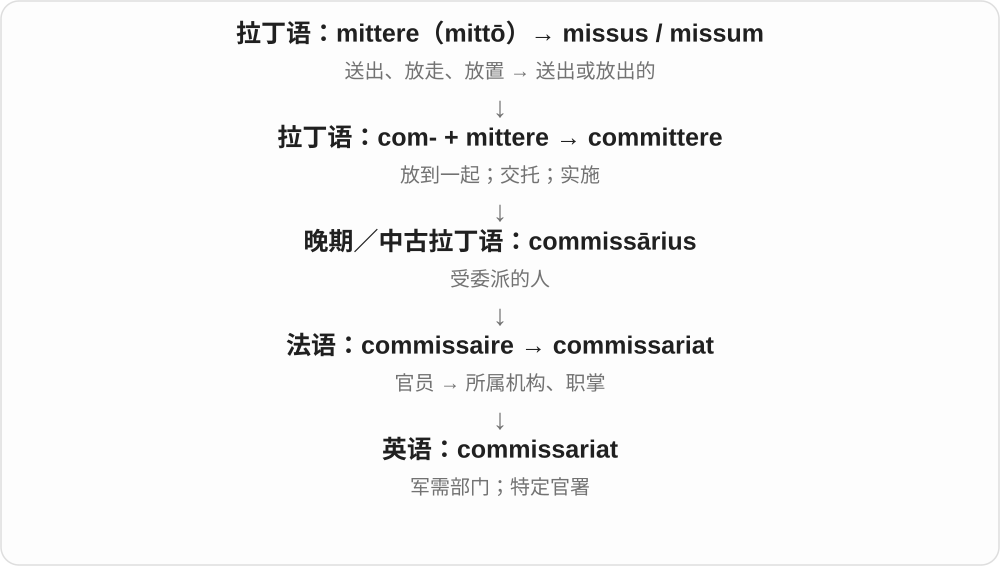

从受托者转到其负责的机构、事务。不是普通 committee 的华丽说法，常带历史或军政语境。

**常见搭配与例句**

the army commissariat；commissariat supplies；a people’s commissariat。

> The commissariat arranged food supplies for the expedition.

军需部门为这次远征安排了食品供应。

> The historian studied records from an early commissariat.

这位历史学家研究了一个早期官署的档案。

**别混淆**

commissary 可指官员或商店；commissariat 更常是供应机构、部门或其职掌。

### 57. readmission — 重新接纳；再次入学、入院或入场

**音标**：/ˌriːədˈmɪʃən/

**先抓住这个画面**

readmission 像一个人离开某机构之后，又通过准入手续重新进入。

**怎么拆**

re-（再次）+ admission。

**怎么变成今天的意思**

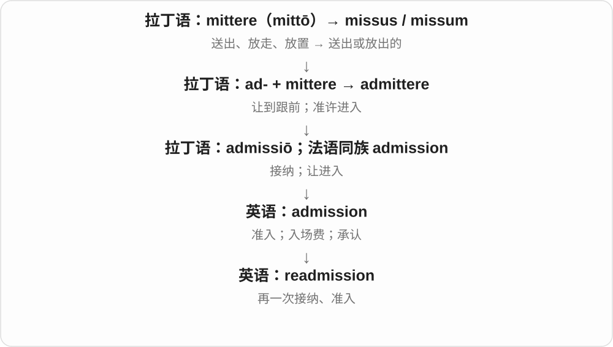

具体进入什么，由上下文决定。医院 readmission 指再次收治；学校则是重新接纳学生，不能把所有场景都译成再入院。

**常见搭配与例句**

apply for readmission；hospital readmission；readmission to the programme。

> She applied for readmission to the programme.

她申请重新进入这个项目学习。

> The report tracks hospital readmissions during the study period.

报告追踪了研究期间再次入院的情况。

**别混淆**

admission 是准入；readmission 额外指出这个人以前进入或属于过相应机构。

### 58. uncommitted — 尚未承诺的；未表态的；未被安排用途的

**音标**：/ˌʌnkəˈmɪtɪd/

**先抓住这个画面**

uncommitted 像还没有把自己的票、时间或资金交给哪一边，选择仍然留在手中。

**怎么拆**

un-（未、非）+ committed；这里的 un- 是否定前缀，不是拉丁语 ūnus“一”。

**怎么变成今天的意思**

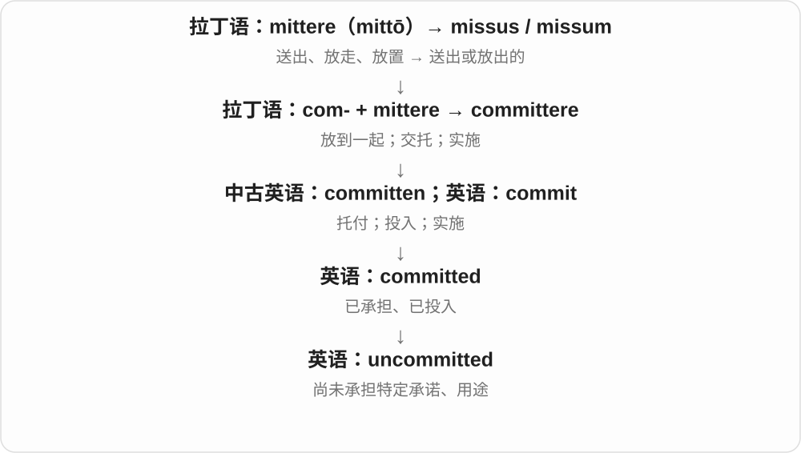

一个人可以认真考虑问题，却暂未选边；一笔资金也可以尚无指定用途。不要把未承诺一律理解为不负责任。

**常见搭配与例句**

uncommitted voters；uncommitted funds；remain uncommitted；uncommitted time。

> Several voters remained uncommitted after the debate.

辩论后仍有几位选民没有表态支持哪一方。

> We have only a small amount of uncommitted funding left.

我们只剩少量尚未安排用途的资金。

**别混淆**

undecided 侧重尚未作决定；uncommitted 侧重尚未承诺、绑定，可能心里已有倾向却未表态。

### 59. missive — 信函；书面消息（正式或诙谐）

**音标**：/ˈmɪsɪv/

**先抓住这个画面**

missive 像一封郑重发出去的信，常比普通 letter 更带书面、隆重或略带玩笑的语气。

**怎么拆**

借自中古拉丁语 missīvus“派送的”，远源为 mittere；不是 mis-（错误）+ 后缀的现代构词。

**怎么变成今天的意思**

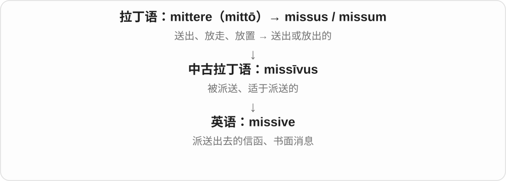

从“发出去的”转成发出的文字。现代也可能把一封很长的邮件戏称为 missive，不必真由信使递送。

**常见搭配与例句**

a lengthy missive；send a missive；an official missive。

> A lengthy missive from the head office arrived this morning.

今天早晨总公司发来了一封长长的信函。

> She ended her cheerful missive with an invitation to visit.

她在那封愉快的信末尾邀请对方来访。

**别混淆**

message 范围广且中性；missive 通常是书面内容，语气更特别。

### 60. transmissible — 可传递的；可传播的

**音标**：/trænzˈmɪsəbəl/

**先抓住这个画面**

transmissible 像某种内容、信号或病原体具备从一个载体到另一个载体的条件，重点是“能被传过去”。

**怎么拆**

与拉丁语 trānsmissus“传过去的”及 -ible 相连；现代可按 transmit 的可传递形容词理解。

**怎么变成今天的意思**

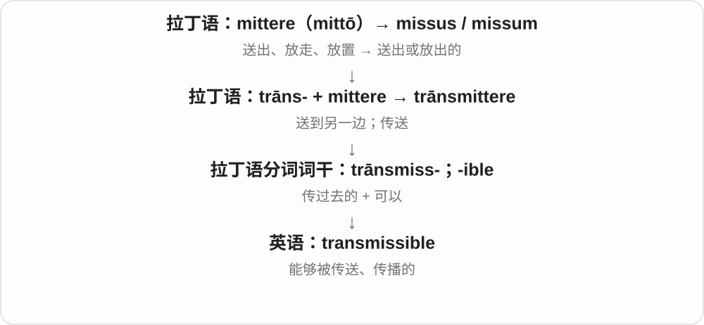

它描述可传递性，不说明具体已经传给谁，也不自动说明传播很快或很容易。

**常见搭配与例句**

a transmissible signal；transmissible information；a transmissible disease。

> The information must be encoded in a transmissible form.

信息必须编码成可以传输的形式。

> The study asks whether the organism is transmissible between hosts.

研究考察这种生物能否在宿主之间传播。

**别混淆**

transmitted 说已经传递；transmissible 说能够传递。highly transmissible 才进一步强调易传播。

### 61. retransmission — 重新传输；转播

**音标**：/ˌriːtrænzˈmɪʃən/

**先抓住这个画面**

retransmission 像一份数据第一次没送达，再送一次；也可指把收到的节目重新向别处播出。

**怎么拆**

re-（再）+ transmission。

**怎么变成今天的意思**

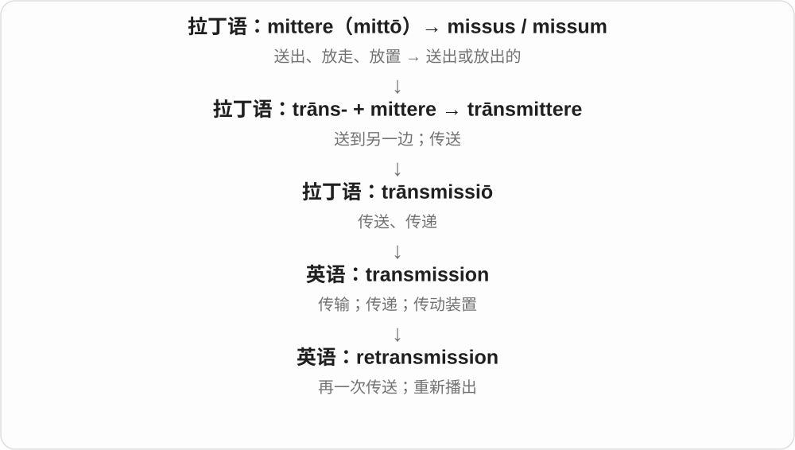

重新发生的是传输动作，不一定重新制作内容。数据通信和广播有不同具体实现，但都保留“再传”的画面。

**常见搭配与例句**

packet retransmission；request retransmission；the retransmission of a programme。

> The receiver requested retransmission of the missing packet.

接收端请求重新传输丢失的数据包。

> The agreement covered the retransmission of the programme.

协议涵盖了这个节目的转播。

**别混淆**

repetition 只说重复；retransmission 特别说传送或播出再进行一次。

### 62. impermissible — 不被允许的；不合规定的

**音标**：英 /ˌɪmpəˈmɪsəbəl/；美 /ˌɪmpərˈmɪsəbəl/

**先抓住这个画面**

impermissible 像把某种行为拿到规定前核对，得到的结果是“不可以这样做”。

**怎么拆**

im-（不，in- 在 p 前的形式）+ permissible。

**怎么变成今天的意思**

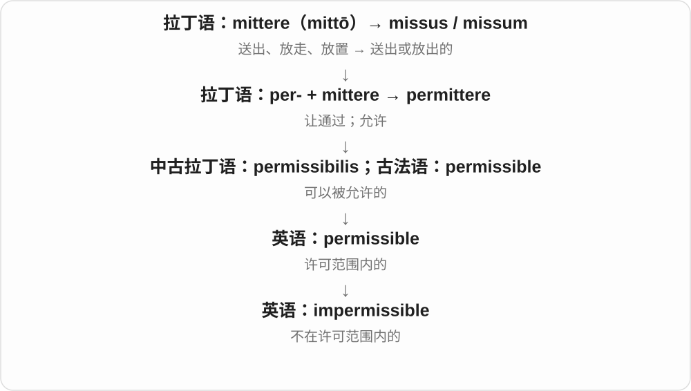

常见于正式规则、法律或伦理讨论。它讲许可，不讲物理上是否做得到。

**常见搭配与例句**

impermissible conduct；an impermissible use；impermissible under the rules。

> Copying another candidate’s answer is impermissible.

抄袭其他考生的答案是不被允许的。

> The policy lists several impermissible uses of the data.

政策列出了几种不允许的数据用途。

**别混淆**

impossible 是不可能；impermissible 是不被允许。能做到的事也可能不准做。

### 63. resubmit — 重新提交

**音标**：/ˌriːsəbˈmɪt/

**先抓住这个画面**

resubmit 像申请材料被要求补正，改好之后再送一次给原来的评审渠道。

**怎么拆**

re-（再）+ submit。

**怎么变成今天的意思**

再提交不一定代表第一次被拒，也可能是格式问题、补充内容或系统要求。关键是先前已经提交过。

**常见搭配与例句**

resubmit an application；resubmit a manuscript；resubmit after revision。

> Please correct the date and resubmit the form.

请更正日期后重新提交表格。

> The authors resubmitted the paper after revising the figures.

作者修改图表后重新提交了论文。

**别混淆**

revise 是修改；resubmit 是再交。修改完成后，还需要执行重新提交这个动作。

### 64. submitter — 提交者

**音标**：英 /səbˈmɪtə/；美 /səbˈmɪtər/

**先抓住这个画面**

submitter 就是把申请、文件或作品交上来的人，重点是提交行为，未必是材料的实际作者。

**怎么拆**

submit + -er。

**怎么变成今天的意思**

常见于表单、审核系统和工作流程。它标识一个角色，不评价提交物好坏。

**常见搭配与例句**

the submitter’s name；contact the submitter；a proposal submitter。

> The form asks for the submitter’s contact details.

表格要求填写提交者的联系方式。

> Reviewers sent their questions to the submitter.

评审者把问题发给了提交者。

**别混淆**

author 是作者；submitter 是提交者，两者可能同一人，也可能不同。

### 65. admissibility — 可采纳性；准入资格

**音标**：/ədˌmɪsəˈbɪləti/

**先抓住这个画面**

admissibility 是把“可不可以纳入正式考虑”这件事作为问题来检查。

**怎么拆**

admissible + -ity，-ible 在名词中对应 -ibility。

**怎么变成今天的意思**

经常用于证据、申请或数学候选解。判断可采纳性，与进一步判断内容价值是两个环节。

**常见搭配与例句**

the admissibility of evidence；assess admissibility；an admissibility test。

> The hearing focused on the admissibility of the documents.

听证重点讨论了这些文件是否可以采纳。

> The first check concerns the admissibility of the proposed solution.

第一项检查关注所提方案是否符合准入条件。

**别混淆**

admission 是接纳的动作或结果；admissibility 是具不具备被接纳条件的性质。

### 66. recommit — 重新承诺、投入；再次交付

**音标**：/ˌriːkəˈmɪt/

**先抓住这个画面**

recommit 像计划中断之后重新认真表态：“我仍愿意投入，并从现在继续做。”也可指把事项再次交付处理。

**怎么拆**

re-（再）+ commit。

**怎么变成今天的意思**

人的承诺义常用 recommit to；程序义可以把议案等重新交给委员会。两者都重做交付或绑定动作。

**常见搭配与例句**

recommit to a goal；recommit oneself to…；recommit a bill。

> After the break, she recommitted to her studies.

休息之后，她重新投入学习。

> The assembly voted to recommit the proposal to the committee.

大会投票决定将提案再次交回委员会处理。

**别混淆**

reconsider 是重新考虑；recommit 通常已经再次承担或交付，不只是想一想。

### 67. dismissively — 轻蔑地；不以为然地

**音标**：/dɪsˈmɪsɪvli/

**先抓住这个画面**

dismissively 像一个人没认真听完就摆手、耸肩，把别人的担忧推到一边。

**怎么拆**

dismissive + -ly。

**怎么变成今天的意思**

它评价的是说话、回应或动作的态度。未必有大声辱骂，轻轻一句话也可能很 dismissive。

**常见搭配与例句**

reply dismissively；wave dismissively；speak dismissively of… 。

> He waved dismissively at the suggestion.

他对这个建议不以为然地摆了摆手。

> She asked him not to speak so dismissively about the volunteers.

她请他不要那么轻蔑地谈论志愿者。

**别混淆**

briefly 只是简短；dismissively 包含轻视、不当回事的语气。

### 68. committeeman — 男委员会成员；男委员

**音标**：/kəˈmɪtimən/

**先抓住这个画面**

committeeman 是委员会里的一名男性成员，职位来自受委托办事的小组，而不是他一个人代表整个委员会。

**怎么拆**

committee + man。

**怎么变成今天的意思**

也常见于某些党务、地方组织的称呼。现代不需强调性别时，committee member 更通用。

**常见搭配与例句**

a local committeeman；an elected committeeman；a party committeeman。

> The committeeman raised a question about the budget.

这位男委员提出了一个预算问题。

> He served as a local party committeeman for several years.

他担任了几年地方党务委员会成员。

**别混淆**

chair 是主持委员会的人；committeeman 通常只说明成员身份，未必是负责人。

### 69. decommission — 使退役；停止使用；撤销运行

**音标**：/ˌdiːkəˈmɪʃən/

**先抓住这个画面**

decommission 像一艘船、一台设备或一套系统正式交回任务，退出日常服役和运行。

**怎么拆**

de-（撤去、逆转）+ commission（投入任务、服役）。

**怎么变成今天的意思**

常是有计划的停用过程，可能伴随移除、封存或处置，但词本身不等于当场拆毁。

**常见搭配与例句**

decommission a ship；decommission a plant；decommission a server。

> The old server will be decommissioned after the migration.

迁移完成后，旧服务器将正式停用。

> The navy decommissioned the vessel after decades of service.

这艘舰艇服役数十年后被正式退役。

**别混淆**

shut down 可以只是暂时关闭；decommission 往往是正式退出使用。

### 70. noncommittal — 不表态的；不作承诺的

**音标**：英 /ˌnɒnkəˈmɪtəl/；美 /ˌnɑːnkəˈmɪtəl/

**先抓住这个画面**

noncommittal 像别人问你赞不赞成，你只说“我再看看”，既没有明确答应，也没有明确拒绝。

**怎么拆**

non-（不）+ committal（承诺、明确承担这一支）。

**怎么变成今天的意思**

常形容回答、表情和态度。可能是谨慎，也可能是回避，不能仅凭这个词判断动机。

**常见搭配与例句**

a noncommittal answer；remain noncommittal；a noncommittal shrug。

> She gave a noncommittal answer about joining the project.

对于是否加入项目，她没有明确表态。

> He remained noncommittal until he had read the full report.

在读完整份报告之前，他一直没有表态。

**别混淆**

neutral 可是真正中立；noncommittal 主要是没有公开明确立场或承诺。

### 71. transmittal — 传送；递交；随附送达说明

**音标**：/trænzˈmɪtəl/

**先抓住这个画面**

transmittal 像正式把一包文件交给接收方，并说明里面有哪些材料、为什么送来。

**怎么拆**

transmit + -al，是英语动作名词构词。

**怎么变成今天的意思**

常见于正式文书和工程文件流转。letter of transmittal 是随材料附上的送达说明，不是主要报告本身。

**常见搭配与例句**

a letter of transmittal；a transmittal form；document transmittal。

> The package included a letter of transmittal.

包裹中附有一封材料递交说明。

> The office recorded the date of transmittal.

办公室记录了送达日期。

**别混淆**

transmission 范围广，常用于信号、动力；transmittal 更常见于正式文件递交，二者部分重叠。

### 72. manumission — 释放被奴役者；奴隶解放手续

**音标**：英 /ˌmænjʊˈmɪʃən/；美 /ˌmænjəˈmɪʃən/

**先抓住这个画面**

manumission 的老画面是从控制者的手中放开一个人，指对某个被奴役者解除奴役、给予自由。

**怎么拆**

来自拉丁语 manūmissiō，经法语等进入英语；manū 与 manus“手”相连，miss- 来自 mittere“释放”。

**怎么变成今天的意思**

这是历史制度术语。一个人的 manumission 不等于整个社会已废除奴隶制。

**常见搭配与例句**

a deed of manumission；records of manumission；grant manumission。

> The archive preserves several documents of manumission.

档案馆保存了几份释放被奴役者的文书。

> The chapter distinguishes individual manumission from the abolition of slavery.

这一章区分了个人获得自由与废除奴隶制。

**别混淆**

abolition 指废除制度；manumission 常是具体个人获得自由的行为。

### 73. emissivity — 发射率

**音标**：/ˌemɪˈsɪvəti/

**先抓住这个画面**

emissivity 像在相同温度和相同观察条件下，把一种表面向外辐射的能力与理想黑体作比较，看看它有多擅长“向外放热辐射”。

**怎么拆**

emissive（能发射的）+ -ity。

**怎么变成今天的意思**

它是相对量，不是温度本身。具体数值还与波长、方向、表面状况等有关，不能只凭外观看上去多黑来判断全部情况。

**常见搭配与例句**

surface emissivity；spectral emissivity；an emissivity value。

> The calculation uses the surface’s emissivity at the relevant wavelength.

计算使用了该表面在相关波长下的发射率。

> Changing the coating can change the emissivity of the surface.

改变涂层可以改变表面的发射率。

**别混淆**

emission 是发出的过程或辐射；emissivity 是在规定条件下衡量发射能力的性质。

### 74. permissiveness — 宽容；管束宽松；放任

**音标**：英 /pəˈmɪsɪvnəs/；美 /pərˈmɪsɪvnəs/

**先抓住这个画面**

permissiveness 像把“允许”的门开得很宽：少限制、少干预，可以被赞为宽容，也可能被批评为放任。

**怎么拆**

permissive + -ness，把允许、宽松的性质变成名词。

**怎么变成今天的意思**

语气由说话者评价决定。讨论教育或组织管理时，不仅要问规则多不多，还要问有没有清楚的边界。

**常见搭配与例句**

parental permissiveness；excessive permissiveness；a culture of permissiveness。

> She worried that the new policy might encourage excessive permissiveness.

她担心新政策可能助长过度放任。

> The discussion focused on the balance between permissiveness and clear boundaries.

讨论集中在宽松管理与明确边界之间如何取得平衡。

**别混淆**

tolerance 可以是在保有边界时容纳差异；permissiveness 往往更强调少设限制，未必表示赞同一切。

### 75. retransmit — 重新传输；转播

**音标**：/ˌriːtrænzˈmɪt/

**先抓住这个画面**

retransmit 像第一次信息没到，再发一遍；也像接力站把收到的信号继续发出去。

**怎么拆**

re-（再）+ transmit。

**怎么变成今天的意思**

重新传送可以补救丢失，也可以扩大接收范围。它不意味着内容一定被编辑或改写。

**常见搭配与例句**

retransmit a packet；retransmit a signal；retransmit a broadcast。

> The system retransmits any packet that is not acknowledged.

系统会重新传输未获确认的数据包。

> The station retransmits the signal to nearby villages.

这个站把信号转发到附近村庄。

**别混淆**

resubmit 常把材料再次交给评审或处理方；retransmit 强调传输过程再做一次。

### 76. emissive — 能发射的；能放出的；自发光的

**音标**：/ɪˈmɪsɪv/

**先抓住这个画面**

emissive 像一个像素自己把光发出来，或一种表面向外释放辐射，重点是它担当发射源。

**怎么拆**

与拉丁语 ēmissīvus“向外发出的”相连；也有按 emission + -ive 分析英语形成的词源解释。

**怎么变成今天的意思**

常见于光、电、热辐射材料。它可以描述会发光的显示部件，但不意味着所有发射物都可见。

**常见搭配与例句**

an emissive layer；emissive materials；an emissive display。

> The display uses an emissive layer to produce light.

显示屏通过发射层产生光。

> The researchers compared the emissive properties of two coatings.

研究者比较了两种涂层的辐射发射性质。

**别混淆**

transmissive 主要让光等通过；emissive 自己发出。两种机制可以出现在不同装置中。

### 77. inadmissibility — 不可采纳性；不具备准入条件

**音标**：/ˌɪnədmɪsəˈbɪləti/

**先抓住这个画面**

inadmissibility 是把“为什么不能进入正式考虑范围”这个状态拿出来讨论。

**怎么拆**

inadmissible + -ity，也可从 in- + admissibility 理解。

**怎么变成今天的意思**

常见于证据、申请或技术条件的讨论。它不是说对象从此毫无价值，而是指在当前规则下不能纳入。

**常见搭配与例句**

the inadmissibility of evidence；grounds for inadmissibility；a finding of inadmissibility。

> The decision explained the inadmissibility of the recording.

决定说明了这段录音不能被采纳的原因。

> The report lists the grounds for the application’s inadmissibility.

报告列出了这份申请不予受理的理由。

**别混淆**

inadmissible 是形容词；inadmissibility 是对应的抽象名词，常接 of。

### 78. transmissibility — 可传递性；传播能力

**音标**：/trænzˌmɪsəˈbɪləti/

**先抓住这个画面**

transmissibility 是问“它有多容易从这一端传到另一端”，可谈信号、感染或振动等不同对象。

**怎么拆**

transmissible + -ity，形容词词尾 -ible 对应名词 -ibility。

**怎么变成今天的意思**

是一个性质或指标名，不同学科测量方式不同。传播能力高，不自动等于后果更严重，两件事要分开。

**常见搭配与例句**

the transmissibility of a pathogen；vibration transmissibility；measure transmissibility。

> The study compares the transmissibility of the two strains.

研究比较了这两种菌株或毒株的传播能力。

> The test measured vibration transmissibility through the mounting system.

测试测量了振动经安装系统传递的比例。

**别混淆**

transmission 是具体传递过程；transmissibility 是传递的可能性、能力或按领域定义的传递比例。

### 79. readmit — 重新接纳；允许再次进入

**音标**：/ˌriːədˈmɪt/

**先抓住这个画面**

readmit 像先前离开的人重新回到入口，机构再次允许他进来。

**怎么拆**

re-（再）+ admit。

**怎么变成今天的意思**

可以说学校、医院、协会等重新接纳，宾语和目的地要看清楚。不是 read + mit。

**常见搭配与例句**

readmit a student；readmit someone to…；be readmitted。

> The college agreed to readmit her the following year.

学院同意在下一年重新接纳她入学。

> The museum would not readmit visitors without their tickets.

博物馆不允许没有票的参观者再次进入。

**别混淆**

revisit 是自己再次到访；readmit 是某方允许你再次进入，主语角色不同。

### 80. commissure — 连合；连接处；交合线

**音标**：英 /ˈkɒmɪsjʊə/；美 /ˈkɑːməʃʊr/

**先抓住这个画面**

commissure 像两侧结构之间的一道连接桥，解剖里可以是连接脑部两侧的纤维束，也可以是嘴角等接合处。

**怎么拆**

来自拉丁语 commissūra“接合”，由 committere 的 commiss- 词干发展；这里走的是“连在一起”义。

**怎么变成今天的意思**

不要把本族每个词都机械理解成派一个人出去。committere 本来就有连接、结合含义，这个名词保留了它。

**常见搭配与例句**

the anterior commissure；a commissure of nerve fibres；the labial commissure。

> The diagram labels the anterior commissure.

图中标出了前连合。

> The anatomy lesson identified the commissure at the corner of the mouth.

解剖课指出了嘴角的接合处。

**别混淆**

nerve 是神经；commissure 特别强调跨接或两侧接合的结构位置，不是所有神经都这样称呼。

### 81. remise — 放弃权利；交还；再次刺击（击剑）；旧式车房

**音标**：法律动词 /rɪˈmaɪz/；击剑、旧车房名词另见 /rɪˈmiːz/

**先抓住这个画面**

remise 的几个专门义保留“放回、再放一次”的感觉：文书里放弃一项权利，击剑中则紧接着再出一次攻击。

**怎么拆**

来自法语 remis / remise，与 remettre“放回、交还”相连，远源为拉丁语 remittere。

**怎么变成今天的意思**

这是多条专业或历史用法并存的词。旧车房义联系停放马车的地方；现代普通“汇款”仍用 remit，不随意换成 remise。

**常见搭配与例句**

remise a claim；a remise in fencing；a carriage remise（历史用法）。

> The deed stated that the owner would remise the claim.

契据写明所有者将放弃该项权利主张。

> The coach identified the second attack as a remise.

教练把第二次攻击认定为 remise，即紧接着再次出击。

**别混淆**

remise 与 demise“死亡、终结”不是一个词。击剑的 remise 也不等于先防守再反击的所有动作。

### 82. transmissive — 透射的；允许通过的；传输的

**音标**：/trænzˈmɪsɪv/

**先抓住这个画面**

transmissive 像玻璃让光从一侧穿到另一侧，重点是媒介让某种东西通过。

**怎么拆**

由 transmit 所属的 transmiss- 词干与 -ive 相连，现代用于描述传输或透射性质。

**怎么变成今天的意思**

常用于光学材料和显示技术。它说光能穿过材料，不保证看过去一定清晰，也不保证所有波长都能通过。

**常见搭配与例句**

a transmissive layer；transmissive optics；a transmissive display。

> The panel includes a transmissive layer.

这块面板包含一层透射层。

> The material is transmissive at the wavelength used in the experiment.

这种材料能透过实验所用波长的光。

**别混淆**

transparent 通常强调能清楚看透；transmissive 强调有光等通过，可以存在散射。

### 83. permittee — 许可持有人；获许可者

**音标**：英 /ˌpɜːmɪˈtiː/

**先抓住这个画面**

permittee 是拿到某项许可的那一方，像许可证上被写明有权进行活动的人或机构。

**怎么拆**

permit + -ee，表示接受许可的一方。

**怎么变成今天的意思**

多用于正式行政、合同或管理文件。是许可关系中的身份，不是发证机关。

**常见搭配与例句**

the permittee’s obligations；a named permittee；notify the permittee。

> The permittee must keep a copy of the permit on site.

许可持有人须在现场保留许可证副本。

> The notice was sent to the named permittee.

通知被寄给了列名的许可持有人。

**别混淆**

issuer 是发证者；permittee 是获证或获准的一方，方向相反。

### 84. dismissiveness — 轻视；不屑一顾的态度

**音标**：/dɪsˈmɪsɪvnəs/

**先抓住这个画面**

dismissiveness 像别人刚提出问题，你就把它挥到一边，连认真听完、研究一下都觉得没必要。

**怎么拆**

dismissive + -ness，把不予认真考虑的态度名词化。

**怎么变成今天的意思**

它常使人感到自己或自己的意见没有被尊重。不同意别人并不必然 dismissive，关键在有没有认真对待。

**常见搭配与例句**

dismissiveness toward concerns；a tone of dismissiveness；respond with dismissiveness。

> His dismissiveness made the team less willing to raise concerns.

他那不当回事的态度让团队更不愿提出担忧。

> She criticized the report without showing dismissiveness toward its authors.

她批评了报告，但没有对作者表现出轻视。

**别混淆**

disagreement 是观点不同；dismissiveness 是以轻视的态度把问题打发掉。可以坚定反对，也仍认真倾听。

### 85. manumit — 释放被奴役者；解除奴役

**音标**：英 /ˌmænjʊˈmɪt/；美 /ˌmænjəˈmɪt/

**先抓住这个画面**

manumit 的画面是把一个人从控制者的手中放开，在历史制度里指解除对具体个人的奴役。

**怎么拆**

来自拉丁语 manūmittere，更早的构成可见 manū ēmittere“从手中放出”；manū 与 manus“手”同族。

**怎么变成今天的意思**

这个词解释的是历史中的权力与法律行为，不表示被奴役的人本来应当归谁拥有。现代一般的释放不必用这个专门词。

**常见搭配与例句**

manumit an enslaved person；a formerly enslaved person who was manumitted。

> The document records a decision to manumit two enslaved people.

这份文件记录了释放两名被奴役者的决定。

> The historian studied the conditions under which people were manumitted.

这位历史学家研究了人们在什么条件下获得奴役解除。

**别混淆**

free 是一般使自由；manumit 特别用于解除奴役的历史行为。

### 86. commissural — 连合的；连接两侧结构的

**音标**：美 /ˌkɑːməˈʃʊrəl/，也读 /ˌkɑːməˈʃɜːrəl/

**先抓住这个画面**

commissural 是 commissure 的形容词，像给跨接两侧的纤维或通路贴上“连合结构”的标签。

**怎么拆**

commissure + -al。

**怎么变成今天的意思**

常见于神经解剖。它描述结构关系，不能因为含 commission 一样的字母就译成委员会的。

**常见搭配与例句**

commissural fibres；a commissural pathway；commissural connections。

> The diagram distinguishes commissural fibres from other pathways.

图示把连合纤维与其他通路区分开来。

> The article describes commissural connections between the two sides.

文章描述了两侧之间的连合连接。

**别混淆**

commissure 是连接结构本身；commissural 修饰属于这种结构的纤维、通路等。

### 87. promisee — 受诺人；承诺相对方

**音标**：英 /ˌprɒmɪˈsiː/；美 /ˌprɑːmɪˈsiː/

**先抓住这个画面**

promisee 是别人对他说“我答应你”的那一方，强调承诺朝谁作出。

**怎么拆**

promise + -ee，表示接受承诺的一方。

**怎么变成今天的意思**

主要用于合同和法律讨论。是否具有具体权利，需要依法律关系判断，词本身先标明角色。

**常见搭配与例句**

the promisor and promisee；a promise made to the promisee。

> The example identifies Maya as the promisee.

这个例子把玛雅确定为受诺人。

> The promisee asked the promisor to clarify the undertaking.

受诺人请承诺人说明承诺的具体内容。

**别混淆**

promisor 作出承诺；promisee 接受承诺。-or 与 -ee 分别指两个方向。

### 88. intromission — 进入；引入；插入；插入交接（生物学）

**音标**：/ˌɪntrəˈmɪʃən/

**先抓住这个画面**

intromission 像把某物引到内部，或者允许它越过入口。生物学中也用于生殖过程的插入阶段。

**怎么拆**

来自中古拉丁语 intrōmissiō，与 intrōmittere“送入、让进入”同族；intrō- 表向内。

**怎么变成今天的意思**

这是偏专业的名词，普通进门通常说 entry。它在历史视觉理论中也可指光进入眼睛的解释，具体含义由领域限定。

**常见搭配与例句**

intromission of light；intromission into…；intromission in reproduction。

> The chapter explains an intromission theory of vision.

这一章解释了一种把光进入眼睛作为基础的视觉理论。

> The biology text describes intromission as one stage of reproduction.

生物学教材把插入交接描述为生殖过程的一个阶段。

**别混淆**

intermission 是中场间歇；intromission 是引入、进入，前缀 inter- 与 intro- 不同。

### 89. premiss — 前提（premise 的另一拼写）

**音标**：/ˈpremɪs/

**先抓住这个画面**

premiss 是推理起跑前先放在那里的条件：暂时接受它，再看能从它推出什么。

**怎么拆**

是 premise 的拼写变体，同样经古法语 premisse 来自拉丁语 praemittere 所属的“预先提出”词族。

**怎么变成今天的意思**

主要在逻辑与书面论证中见到。前提可能真也可能假；一个推理结构成立，不自动证明前提本身真实。

**常见搭配与例句**

a major premiss；a minor premiss；a false premiss；accept the premiss。

> The argument depends on a premiss that has not been established.

这个论证依赖于一个尚未得到确立的前提。

> If we reject the first premiss, the conclusion no longer follows.

如果我们否定第一个前提，结论就不能再由此推出。

**别混淆**

premiss 不是单独一种不同逻辑对象；它是 premise 的变体。说房屋、营业场所通常写 premises，不套这个变体。

### 90. demit — 辞去；退出；放下（旧用）

**音标**：/dɪˈmɪt/

**先抓住这个画面**

demit 像把手中的职位放下，表示不再承担某个职务或某种成员身份。

**怎么拆**

来自拉丁语 dēmittere：dē-（向下）+ mittere（放、送）。

**怎么变成今天的意思**

“放下”可以从具体物体转到身份和职责。现代常见于正式、历史或特定组织语境；日常辞职通常用 resign。

**常见搭配与例句**

demit office；demit a position；demit from an organization。

> The officer decided to demit office at the end of the year.

这位官员决定在年底辞职。

> The letter records his request to demit from the lodge.

这封信记录了他退出会所的请求。

**别混淆**

demit 强调自己辞去或退出；dismiss 常是别人把你解雇或遣散，行动者不同。

### 91. intromittent — 引入的；用于插入的

**音标**：/ˌɪntrəˈmɪtənt/

**先抓住这个画面**

intromittent 像一个把东西送进内部的结构，生物学里常修饰在交配时起插入、输送作用的器官。

**怎么拆**

联系拉丁语 intrōmittere“送入”的现在分词 intrōmittēns；-ent 对应“进行这种动作的”。

**怎么变成今天的意思**

这是说明结构作用的技术形容词。其 intro- 是“向内”，不能看成 inter- 的“在中间”。

**常见搭配与例句**

an intromittent organ；an intromittent structure。

> The diagram labels the intromittent organ of the animal.

图中标出了该动物的交接器官。

> The paper compares intromittent structures in several species.

论文比较了几个物种中具有插入功能的结构。

**别混淆**

intromittent 说引入或插入功能；intermittent 说时断时续，只有几个字母不同，意思却不同。

### 92. mittimus — 收监令；移送令（历史法律用语）

**音标**：/ˈmɪtɪməs/

**先抓住这个画面**

mittimus 原来就是“我们送出”。这句话出现在文书开头，后来整张发出移送命令的文书也被叫作 mittimus。

**怎么拆**

直接借自拉丁语 mittimus，即 mittere 的第一人称复数现在时：“我们送”。

**怎么变成今天的意思**

这类词是拿文书里的标志性用语来命名文书。具体文书作用随历史与司法制度而变，不应当作各地现行统一手续名。

**常见搭配与例句**

a writ of mittimus；issue a mittimus；the original mittimus。

> The archive contains a copy of the mittimus.

档案中保存着那份收监令的副本。

> The historian compared the mittimus with the prison register.

历史学家把收监令与监狱登记册作了比较。

**别混淆**

commitment 可以指收监行为或相关命令；mittimus 是特定文书名称，不是所有 arrest warrants 的通称。

### 93. remittent — 时轻时重的；缓和后又加重的

**音标**：/rɪˈmɪtənt/

**先抓住这个画面**

remittent 像曲线有高峰低谷，但低谷还没有降到零：症状会减轻，却没有在间歇期完全消失。

**怎么拆**

来自拉丁语 remittēns，是 remittere“减轻、放松”的现在分词形式。

**怎么变成今天的意思**

旧医学描述中常见 remittent fever。这里学的是描述词，不是凭一种发热形态判断具体疾病。

**常见搭配与例句**

remittent fever；a remittent course；remittent symptoms。

> The old report describes the fever as remittent.

旧报告把这种发热描述为时轻时重、未完全退去。

> The glossary contrasts remittent symptoms with intermittent symptoms.

词汇表把减轻但未消失的症状与间歇性症状作了区分。

**别混淆**

intermittent 通常有停止后再出现的间隔；remittent 强调减轻但没有完全停止。

### 94. admissive — 容许进入的；倾向于接纳的（少用）

**音标**：/ədˈmɪsɪv/

**先抓住这个画面**

admissive 像一扇愿意让人或事物进来的门，描述接纳的一方具有开放、允许的倾向。

**怎么拆**

同族 admiss-（来自 admittere 的分词词干）+ -ive；构词上表示有接纳作用或倾向。

**怎么变成今天的意思**

重点在“会接纳”，不是被接纳的对象是否合格。现代普通表达更常用 welcoming、accepting 或 permissive，取决于语境。

**常见搭配与例句**

an admissive attitude；an admissive policy（少用、书面）。

> The essay calls for a more admissive attitude toward unfamiliar ideas.

这篇文章呼吁以更愿意接纳的态度看待陌生想法。

> The author describes the policy as admissive rather than restrictive.

作者把这项政策描述为允许接纳，而非限制准入。

**别混淆**

admissible 是某物可以被接纳；admissive 是某人、政策等倾向于接纳，方向相反。

### 95. admittatur — 准入证；旧时大学入学凭证

**音标**：美 /ˌædməˈteɪtər/

**先抓住这个画面**

admittatur 像证书上写着一句批准语：“准其入内。”这句拉丁语后来成了凭证的名称。

**怎么拆**

直接来自拉丁语 admittātur，是 admittere 的被动虚拟式，用在此处表达“准予进入”。

**怎么变成今天的意思**

见于历史中的大学等机构，并非现代所有学校录取通知书的普通名称。先理解它是批准准入的文件，再认识其时代背景。

**常见搭配与例句**

an admittatur；issue an admittatur；a college admittatur。

> The museum displayed a student’s admittatur from the nineteenth century.

博物馆展出了一名十九世纪学生的入学凭证。

> The researcher found the admittatur among the family papers.

研究者在家族文书中找到了那份准入证。

**别混淆**

admittee 是被准许进入的人；admittatur 是历史上的凭证，-atur 不是英语“人”的后缀。

### 96. admittee — 获准进入者；被录取者

**音标**：美 /ædˌmɪˈtiː/

**先抓住这个画面**

admittee 是门已经为他打开的那个人，大学招生里常指已经获得录取资格的人。

**怎么拆**

admit + -ee，-ee 表示接受动作的一方。

**怎么变成今天的意思**

录取不等于最后决定入学，因此 admittees 和 enrolled students 的人数未必相同。

**常见搭配与例句**

college admittees；a newly admitted student / new admittee；an admittee list。

> Each admittee received an invitation to visit the campus.

每位被录取者都收到了参观校园的邀请。

> Not every admittee accepted the offer.

并不是每位被录取者都接受了录取。

**别混淆**

applicant 是申请者；admittee 已获准进入或录取；enrolled student 则已经注册入学。

### 97. commissive — 使说话者承担承诺的；实施行为的

**音标**：/kəˈmɪsɪv/

**先抓住这个画面**

commissive 像你一句话出口，就把未来某个行动交到自己名下：“我会帮你。”语言学把这种使自己承担未来行动的话称为 commissive。

**怎么拆**

以 committere 的 commiss- 词干联系“实施、使承担”，与 -ive 结合；语言学中的专义围绕承诺发展。

**怎么变成今天的意思**

承诺是典型例子；威胁也可能把说话者与未来行动绑定。另有“通过实施动作产生”的一般义，与不采取行动相对。

**常见搭配与例句**

a commissive speech act；a commissive utterance；a commissive act。

> The lecturer classified “I will help you” as a commissive.

讲师把“我会帮你”归为承诺类言语行为。

> The analysis distinguishes commissive acts from failures to act.

这项分析把主动实施的行为与未采取行动作了区分。

**别混淆**

directive 试图让听者做事；commissive 使说话者自己承担行动。promise 是具体行为，commissive 是较大的分类。

### 98. decommit — 撤回承诺；解除已作的投入

**音标**：/ˌdiːkəˈmɪt/

**先抓住这个画面**

decommit 像原来已经把自己或资源交给一个计划，现在又把这项绑定撤回。

**怎么拆**

de-（撤销、解除）+ commit。

**怎么变成今天的意思**

常出现在项目资源和招生承诺等语境。不是一开始从未答应，而是有过安排后撤回；究竟能否撤回取决于实际关系。

**常见搭配与例句**

decommit from a programme；decommit resources；decommit from an agreement。

> The athlete decided to decommit from the programme.

这名运动员决定撤回加入该项目的承诺。

> The team could not decommit those resources without revising the plan.

团队不修改计划，就无法撤回那些已经投入的资源。

**别混淆**

decline 是拒绝接受；decommit 通常已有承诺或配置，再撤销它。

### 99. decommitment — 撤回承诺；撤销投入

**音标**：/ˌdiːkəˈmɪtmənt/

**先抓住这个画面**

decommitment 是把原先锁定的承诺或资源松开的这件事，也可以指松开后产生的变动。

**怎么拆**

decommit + -ment；也可从 de- + commitment 理解其现代结构。

**怎么变成今天的意思**

常用于正式计划、资源安排与组织关系。要看上下文到底撤回的是人的承诺、资金，还是其他配置。

**常见搭配与例句**

a decommitment of funds；announce a decommitment；the effect of decommitment。

> The decommitment left a gap in the project’s funding.

撤回投入使项目资金出现了缺口。

> The athlete announced the decommitment in a brief statement.

这名运动员用一份简短声明宣布撤回承诺。

**别混淆**

commitment 是已经承担或投入；decommitment 是解除这项安排，不只是拖延履行。

### 100. demiss — 低下的；谦卑的；低垂的（古旧）

**音标**：/dɪˈmɪs/

**先抓住这个画面**

demiss 像把身段、目光或声音放低，旧文中可表示谦卑，也可带低落、卑下的意味。

**怎么拆**

来自拉丁语 dēmissus，是 dēmittere“放下”的过去分词。

**怎么变成今天的意思**

这是读旧文时认识的形容词，现代一般说 humble、subdued 或 downcast。具体是谦逊还是低落，要看句子。

**常见搭配与例句**

a demiss manner；a demiss voice；demiss eyes（古旧语气）。

> In the old tale, the servant answers in a demiss voice.

在这则旧故事里，仆人用低声谦卑的语气回答。

> The poet describes the figure as demiss and silent.

诗人把这个人物描绘得低垂着头、沉默不语。

**别混淆**

demiss 是形容词；dismiss 是遣散、不予理会的动词，不能相互代用。

### 101. dimissory — 准许离去的；准许转由他人授职的

**音标**：英 /dɪˈmɪsəri/

**先抓住这个画面**

dimissory 像原来的主管写一封放行信，让某人离开自己的管辖，或交由另一位有权者办理授职。

**怎么拆**

来自拉丁语 dīmissōrius，与 dīmittere“送走、放行”同族；不是英语 dim“暗淡”加后缀。

**怎么变成今天的意思**

常见于教会文书中的 letters dimissory，可涉及由另一位主教按规定授职的许可。它是特定制度用语。

**常见搭配与例句**

letters dimissory；a dimissory letter。

> The archive preserves the bishop’s letters dimissory.

档案保存着这位主教签发的准许转授职文书。

> The historian explained why a dimissory letter was required.

历史学家解释了当时为何需要一封放行文书。

**别混淆**

dismissal 常让人想到解雇或不予受理；dimissory 说正式准许转出，不必带惩罚。

### 102. dimit — 辞去；退出；放走（古旧或专门用法）

**音标**：/dɪˈmɪt/

**先抓住这个画面**

dimit 像解除原有的组织联系，让自己从某个职位或成员关系中退出。

**怎么拆**

来自拉丁语 dīmittere“送走、放开”，dī- 对应 dis- 的分开义；与 demit 在部分用法上交叠。

**怎么变成今天的意思**

现代零星见于特定组织文书，既可作动词，也可作表示退出手续的名词。普通辞职仍优先使用 resign。

**常见搭配与例句**

dimit from a lodge；a request to dimit；a letter of dimit。

> He wrote to the lodge asking to dimit.

他写信给会所，请求退出。

> The record includes a letter of dimit.

记录中包括一封退会文书。

**别混淆**

dimit 与 demit 有历史和用法上的交叠；不要把两种拼写强行分成完全互不相关的义。

### 103. emissitious — 窥探的；仔细打量的（废旧）

**音标**：/ˌemɪˈsɪʃəs/

**先抓住这个画面**

emissitious 像把目光探出去，紧盯着别人或细节。这是旧词，现代通常说 prying 或 inquisitive。

**怎么拆**

来自拉丁语 ēmissitius，也写 ēmissicius“送出的”，同族于 ēmittere；拉丁语曾用相关形式描写向外窥看的眼睛。

**怎么变成今天的意思**

这里的“送出”落在目光上，便能理解为何词义与窥视有关。不要按今天的 emission 误解成排放污染物。

**常见搭配与例句**

emissitious eyes；an emissitious glance（模仿旧文的表达）。

> The old narrator describes the visitor’s eyes as emissitious.

旧式叙述者把来客的眼睛描写得四处窥探。

> Her emissitious glance searched every corner of the room.

她那窥探的目光扫遍了房间的每个角落。

**别混淆**

emissive 是发出、发射的；emissitious 的旧用法侧重窥探，词形相近而范围不同。

### 104. emittent — 发出、放射的（少用）

**音标**：/ɪˈmɪtənt/

**先抓住这个画面**

emittent 像一个正在往外释放东西的源头，灯放光、物体放热都可以帮助理解这个少用词。

**怎么拆**

来自拉丁语 ēmittēns，即 ēmittere“发出”的现在分词。

**怎么变成今天的意思**

现代一般用 emitting 或 emissive；遇见 emittent 时，抓住它是描述发出这一侧即可。

**常见搭配与例句**

an emittent body；an emittent source（旧式或专门表达）。

> The old text refers to the hot surface as an emittent body.

旧文把那个热表面称为发射体。

> The diagram marks the emittent source and the receiving screen.

图中标出了发射源和接收屏。

**别混淆**

emittent 指发出；eminent 指杰出、显赫，后者不属于这里的 mittere 词族。

### 105. entremet — 菜间小食；精制甜点

**音标**：英 /ˈɒntrəmeɪ/；美 /ˈɑːntrəmeɪ/

**先抓住这个画面**

entremet 的老画面是正式菜品之间端上来的一道小食；如今在烘焙语境里，常让人想到有慕斯、蛋糕和夹层的精致甜点。

**怎么拆**

英语 entremet 常由 entremets 去掉被看成复数标记的 s 形成；法语 entremets 本来单数也带 s。其 mets“菜肴”远源与 mittere 的“端上、放置”相连。

**怎么变成今天的意思**

现代甜点义经过餐饮习惯变化，并不是拉丁语 mittere 本身就有慕斯蛋糕的意思。英文可见两种拼写；法语中不能据单复数随便删去 s。

**常见搭配与例句**

a chocolate entremet；a layered entremet；serve an entremet。

> The pastry chef made a chocolate entremet with a crisp base.

糕点师做了一款以酥脆底层搭配的巧克力精制甜点。

> The historical menu lists an entremet between the main courses.

这份历史菜单在几道主菜之间列出了一道菜间小食。

**别混淆**

dessert 是甜点的大类；entremet 在现代糕点话题里常指特定精制层次甜点，但历史用法并不限于甜食。

### 106. fideicommissary — 遗产信托受益人；遗产信托的

**音标**：英 /ˌfɪdɪaɪˈkɒmɪsəri/

**先抓住这个画面**

fideicommissary 的画面是遗产先交给一人，再由他按嘱托让另一人受益。这个词可指受益的那一方，也可修饰这种遗嘱安排。

**怎么拆**

源自晚期拉丁语 fidēī commissārius，联系 fidēī commissum“凭信托付之物”；fidēs 是信用、信赖，committere 是交托。

**怎么变成今天的意思**

它属于罗马法和受其影响的制度中的专门词。可用“通过别人按嘱托获得利益”帮助理解，但不可把各时代法律细节都当成一样。

**常见搭配与例句**

a fideicommissary gift；a fideicommissary beneficiary；the named fideicommissary。

> The textbook identifies the grandchild as the fideicommissary.

教材把孙辈列为这项遗产信托的受益人。

> The historian examined the fideicommissary gift described in the will.

历史学家研究了遗嘱中所述的遗产信托赠与。

**别混淆**

fiduciary 是较广泛的信义关系用语；fideicommissary 特别联系 fideicommissum，不是所有 trustee 的同义词。

### 107. fideicommissum — 遗产信托；信托遗赠（历史法律用语）

**音标**：英 /ˌfɪdɪaɪkəˈmɪsəm/

**先抓住这个画面**

fideicommissum 像遗嘱人说：“我把财产先交给你，请你再照安排使某人受益。”重点是借受托的一方完成遗赠。

**怎么拆**

借自拉丁语 fidēī commissum，字面是“托付给信赖的东西”；包含 fidēs“信用”和 committere 的分词形式。

**怎么变成今天的意思**

理解时可以抓“先受托，再按嘱托转益”这条线。它是历史和比较法中的制度名，不能直接套进现代任何国家的信托规则。

**常见搭配与例句**

a Roman fideicommissum；establish a fideicommissum；the terms of a fideicommissum。

> The lecture traced the development of the Roman fideicommissum.

讲座梳理了罗马法中信托遗赠的发展。

> The will directed the heir to carry out a fideicommissum.

这份遗嘱要求继承人履行一项信托遗赠安排。

**别混淆**

will 是遗嘱整体；fideicommissum 是一种具体遗赠安排，不等于每一份遗嘱。

### 108. intermit — 暂时中断；间歇停止（少用）

**音标**：英 /ˌɪntəˈmɪt/；美 /ˌɪntərˈmɪt/

**先抓住这个画面**

intermit 像在连续进行的事情中间松一下手，让它停一会儿，再有可能继续。

**怎么拆**

来自拉丁语 intermittere：inter-（中间）+ mittere（放开）；英语直接借入这一支线。

**怎么变成今天的意思**

现代动词不常用，形容词 intermittent 却很常见。可以把它们连起来：事情 intermit，表现出来就是 intermittent。

**常见搭配与例句**

intermit an activity；intermit for a time；the work intermitted（较旧式）。

> The old account says that work intermitted during the winter.

旧记述说工作在冬季暂时停了下来。

> The letter asks the readers to intermit their studies for a day.

这封信请读者把学习暂时停一天。

**别混淆**

interrupt 常强调打断进行中的动作；intermit 着重暂时停止或间歇，并不必然有外来干扰。

### 109. intromissive — 引入的；与进入有关的

**音标**：/ˌɪntrəˈmɪsɪv/

**先抓住这个画面**

intromissive 的方向箭头是从外面指向里面，描述向内进入或把东西引入的作用。

**怎么拆**

以 intrōmittere 的 intromiss- 词干加 -ive 构成，联系 intromission“引入、进入”。

**怎么变成今天的意思**

这是少用的学术词。历史视觉理论里，intromissive 描述由外界进入眼睛的解释方向，而不是眼睛主动发出视觉射线。

**常见搭配与例句**

an intromissive theory of vision；an intromissive account。

> The chapter presents an intromissive account of vision.

这一章提出了一种以外界作用进入眼睛来解释视觉的说法。

> The diagram contrasts emissive and intromissive models.

图中对比了向外发射和向内进入的两类模型。

**别混淆**

emissive 的方向向外；intromissive 的方向向内。它们说机制方向，不是声音大小或光线强弱。

### 110. intromit — 引入；准许进入；干预他人事务（旧用）

**音标**：/ˌɪntrəˈmɪt/

**先抓住这个画面**

intromit 像把东西从门口送进内部，旧文里也能表示让一个人入内。

**怎么拆**

来自拉丁语 intrōmittere：intrō-（向内）+ mittere（送、让去）。

**怎么变成今天的意思**

现代日常通常用 admit、let in 或 insert。另在苏格兰旧用法中可指介入、处理他人的财物事务，需结合语境理解。

**常见搭配与例句**

intromit air；intromit a visitor；intromit with another person’s goods（旧用）。

> The old description says that the opening intromits air.

旧描述说这个开口让空气进入。

> The record accuses him of intromitting with another person’s goods.

这份记录指称他擅自经手他人的财物。

**别混淆**

introduce 可以把人介绍给别人；intromit 的“引入”主要关乎实际进入或介入，不是普通社交介绍。

### 111. omissible — 可以省略的；可以不做的

**音标**：/əˈmɪsəbəl/

**先抓住这个画面**

omissible 像一段说明中的可选小节，删去后仍可完成当前目的，表示“这部分可以略掉”。

**怎么拆**

与拉丁语 omittere 的 omiss- 词干相连，加 -ible 表“可以被……的”；现代也可用 omittable。

**怎么变成今天的意思**

这个少用词强调可省略性；是否真能省略取决于语境，不代表本身毫无价值。

**常见搭配与例句**

an omissible detail；an omissible step；be omissible in… 。

> The editor marked the repeated explanation as omissible.

编辑把重复的解释标为可以省略。

> That step is omissible only in the simplified demonstration.

只有在简化演示中，那一步才可以略去。

**别混淆**

omitted 是已经被省略；omissible 是可以省略，事实和可能性不同。

### 112. omissive — 疏漏的；由不作为造成的

**音标**：/əˈmɪsɪv/

**先抓住这个画面**

omissive 像一项该做的事留下了空格，重点不是做错了什么，而是某件事没有被做。

**怎么拆**

由 omittere 的 omiss- 词干与 -ive 相连。

**怎么变成今天的意思**

用于较正式的分析：不回复、不报告、不执行可能成为讨论的对象。不要把所有主动造成的错误都称为 omissive。

**常见搭配与例句**

an omissive failure；omissive conduct；omissive responsibility。

> The analysis treats the failure to report as omissive conduct.

这项分析把未报告视为不作为行为。

> The chapter distinguishes omissive failures from harmful actions.

这一章把因未做某事造成的失误与有害的主动行为区分开。

**别混淆**

commissive 强调实施动作；omissive 强调遗漏或不作为。两者是在区分做了与没做。

### 113. permissory — 容许的；可做而非必做的（少用）

**音标**：英 /pəˈmɪsəri/

**先抓住这个画面**

permissory 像规定写着“可以这样做”，给了选择，却没有把它变成必须完成的任务。

**怎么拆**

permiss- 是 permittere“允许”的同族分词词干，-ory 表相关性质；现代可联系 permit / permission 理解。

**怎么变成今天的意思**

常见于旧式或专门的规则分析。它比一般 permissive 更适合用来强调“被允许，但不强制”。

**常见搭配与例句**

a permissory rule；a permissory provision；a permissory instruction。

> The author reads the clause as permissory, not mandatory.

作者把该条款理解为授权选择，而非强制要求。

> A permissory rule leaves the choice to the individual.

一项允许性规则把是否去做的选择留给个人。

**别混淆**

mandatory 要求必须做；permissory 允许做。permissive 还可形容人或社会管得宽松，范围更广。

### 114. premit — 预先提出；先说明（废旧）

**音标**：/prɪˈmɪt/

**先抓住这个画面**

premit 像开始正式论证前，先把要用的条件放到桌面上。

**怎么拆**

来自拉丁语 praemittere：prae-（在前）+ mittere（放出、送出）；是 premise 的远亲动词形式。

**怎么变成今天的意思**

这是旧词，现在通常说 state beforehand、begin by stating 或 premise。它和 permit 只交换了两个字母的位置，却不是“允许”。

**常见搭配与例句**

premit a remark；premit a proposition；let me premit…（旧式）。

> The old author begins, “Let me premit one observation.”

这位旧时作者开头写道：“容我先提出一个观察。”

> Before the argument, she premits a definition of the term.

在展开论证前，她先说明了该术语的定义。

**别混淆**

premit 是预先提出；permit 是允许，前缀分别对应 prae- 和 per-。

### 115. pretermission — 遗漏；略过；故意不谈的修辞

**音标**：英 /ˌpriːtəˈmɪʃən/

**先抓住这个画面**

pretermission 像把某一项从讨论清单中跨过去；修辞中还可能嘴上说“不提了”，实际上已经提醒了读者。

**怎么拆**

来自拉丁语 praetermissiō，与 praetermittere“放过、略过”同族；praeter- 表越过。

**怎么变成今天的意思**

一般义是省略或未履行；修辞义需要真的利用“我不说”来引人注意，不是所有删减都算修辞。

**常见搭配与例句**

the pretermission of a duty；rhetorical pretermission；an instance of pretermission。

> The report criticizes the pretermission of an essential duty.

报告批评了一项重要职责未被履行。

> “I will not mention his repeated delays” is an example of pretermission.

“我就不提他一再拖延了”是一种以不提为名提起的修辞例子。

**别混淆**

omission 是通用的遗漏；pretermission 更书面，也可指特定修辞用法。

### 116. pretermit — 略过；忽略；未履行

**音标**：英 /ˌpriːtəˈmɪt/

**先抓住这个画面**

pretermit 像沿着清单往下走，却把其中一项跳过去，可以是有意不谈，也可以是未尽职责。

**怎么拆**

来自拉丁语 praetermittere：praeter-（越过）+ mittere（放、送）。

**怎么变成今天的意思**

这是正式或旧式表达，日常 omit、skip、neglect 更常见。是否故意略去，单靠这个词未必能判断。

**常见搭配与例句**

pretermit a detail；pretermit a duty；pretermit discussion of… 。

> The author chose to pretermit details that did not affect the argument.

作者选择略去不影响论证的细节。

> The complaint alleged that the official had pretermitted a duty.

投诉称这位官员未履行一项职责。

**别混淆**

postpone 是把事情挪到以后；pretermit 是当前直接略去或未做，不一定留下后续安排。

### 117. promissive — 带有承诺意味的；表承诺的

**音标**：/prəˈmɪsɪv/

**先抓住这个画面**

promissive 像一句话已经朝未来伸出保证：“我会做。”它描述这句话具有承诺的作用。

**怎么拆**

与 prōmittere 的 promiss- 词干相连，加 -ive 表相关作用；现代可联系 promise 理解。

**怎么变成今天的意思**

常用于语言、语气或话语分析。will 并非每次都在承诺；要结合是谁说、对谁说、说话目的是什么。

**常见搭配与例句**

a promissive use of will；a promissive statement；promissive force。

> The teacher explained the promissive use of “will” in this sentence.

老师解释了这句话中 will 表达承诺的用法。

> In context, her reply has a clear promissive force.

结合语境，她的答复具有明显的承诺意味。

**别混淆**

promising 是有前途、令人看到希望；promissive 是话语带有承诺作用，两者不等同。

### 118. remissible — 可以减免的；可以宽恕的

**音标**：/rɪˈmɪsəbəl/

**先抓住这个画面**

remissible 像一笔可被划掉的债，或一种可以获得宽恕的过失，表示存在被免除、放过的可能。

**怎么拆**

remittere 的 remiss- 词干 + -ible，表示可以被减免、宽恕。

**怎么变成今天的意思**

这是少用书面词。它说可以减免，不等于已经免掉，也不说明一定会获批。

**常见搭配与例句**

a remissible penalty；a remissible debt；remissible offences。

> The historical code treated some penalties as remissible.

这部历史法典把某些处罚列为可减免。

> The author asks whether the offence should be regarded as remissible.

作者讨论这种过失是否应被视为可以宽恕。

**别混淆**

remitted 是已经减免；remissible 是可以减免。forgivable 在日常的宽恕话题里更常见。

### 119. remissive — 宽恕的；减轻、缓和的（少用）

**音标**：/rɪˈmɪsɪv/

**先抓住这个画面**

remissive 像把对一个人的追责松开，或让某种压力减轻，强调减免、宽恕的作用。

**怎么拆**

来自拉丁语 remissīvus，与 remittere“放松、宽免”同族。

**怎么变成今天的意思**

旧式文字中可描述宽恕的态度或带来缓和的行动。现代宽恕常用 forgiving，具体减免则把对象说清楚。

**常见搭配与例句**

a remissive attitude；a remissive act；remissive treatment（旧式表达）。

> The old sermon urges a remissive attitude toward past faults.

这篇旧布道劝人以宽恕的态度对待过去的过失。

> The commentator describes the ruler’s decision as remissive.

评论者把统治者的决定形容为宽免性的。

**别混淆**

remiss 是疏忽、未尽责；remissive 是具有宽免或缓和作用，不要混同。

### 120. remissory — 给予宽免的；用于获得减免的（少用）

**音标**：英 /rɪˈmɪsəri/

**先抓住这个画面**

remissory 像一份用来免除责任或处罚的文件，着重说它服务于宽免这件事。

**怎么拆**

与 remittere 的 remiss- 词干和 -ory 相连，表示与减免、宽恕有关。

**怎么变成今天的意思**

这是旧式、专门词。看搭配判断是宽免本身、证明宽免的文件，还是用于争取宽免的事项，不机械译成汇款。

**常见搭配与例句**

a remissory letter；a remissory act；a remissory petition（历史用法）。

> The archive contains a remissory letter concerning the penalty.

档案中有一封涉及那项处罚的宽免文书。

> The historian discusses the remissory purpose of the petition.

历史学家讨论了这份请愿书争取减免的目的。

**别混淆**

promissory 关乎承诺；remissory 关乎宽免。二者都含 miss，但前面的历史成分不同。

### 121. remittal — 汇付；移交；减免

**音标**：/rɪˈmɪtəl/

**先抓住这个画面**

remittal 是 remit 这个动作的名词，像把钱汇走、把事情交回处理，或把负担减掉。

**怎么拆**

英语 remit + -al，双写 t 后接名词后缀。

**怎么变成今天的意思**

这是偏正式的名词，具体意思需要看被 remit 的是什么。比起孤立背“退回”，把对象连在一起记更可靠。

**常见搭配与例句**

remittal of money；remittal of a case；remittal of a penalty。

> The record notes the remittal of the funds to the recipient.

记录注明资金已汇付给收款方。

> The summary discusses the remittal of the matter for reconsideration.

摘要讨论了把事项交回重新考虑这一步。

**别混淆**

remittance 多指汇款及汇款额；remittal 可保留 remit 的其他正式动作义，不只指钱。

### 122. remittee — 收款人；受汇人

**音标**：/rɪˌmɪˈtiː/

**先抓住这个画面**

remittee 是钱汇出去以后到达的那一方，像汇款单“收款人”一栏里的名字。

**怎么拆**

remit + -ee，表示接受汇付的人。

**怎么变成今天的意思**

这是比 recipient 更专门的汇款角色词。它标明接收方向，不表示款项的来源或用途。

**常见搭配与例句**

the name of the remittee；the remittee’s account；notify the remittee。

> Please check the remittee’s name before sending the payment.

付款前请核对收款人的姓名。

> The remittee confirmed that the funds had arrived.

收款人确认款项已经到账。

**别混淆**

remitter 是汇款人；remittee 是收款人。把钱的箭头画出来，就不容易混淆。

### 123. remittence — 暂时减轻；时轻时重的状态

**音标**：/rɪˈmɪtəns/

**先抓住这个画面**

remittence 像浪峰之间出现低谷：一件持续存在的事暂时减弱，并没有完全停止。

**怎么拆**

来自 remittent 所属的“减轻、缓和”支线，-ence 把状态名词化；与 remittance 的拼写、常用义需分开。

**怎么变成今天的意思**

常用于旧式或专业描述。它跟汇款 remittance 只差一个元音，但这里说的是强弱变化，不是金额。

**常见搭配与例句**

periods of remittence；the remittence of symptoms；remittence and recurrence。

> The old report notes brief periods of remittence.

旧报告记录了几段短暂减轻期。

> The author uses remittence to describe a decrease in severity without complete cessation.

作者用 remittence 描述严重程度下降、却没有完全停止的情况。

**别混淆**

remittence 是减轻的状态；remittance 是汇付的钱或汇款行为。读音相近，更要凭语境辨认。

## 这一组要分清什么

**admit / permit / submit**：admit 让人或事实进来；permit 让某件事可以做；submit 把材料交上去，或接受某种权威。三者不是“发送”的机械同义词。

**emit / transmit**：emit 看源头向外释放；transmit 看跨越距离或环节传到另一端。灯 emit light，光学材料可以 transmit light。

**promise / promising / promissory**：promise 是承诺，也可说潜力；promising 是表现出希望；promissory 常修饰正式承诺文书。promissive 则常用于分析一句话的承诺作用。

**commit / committee / commission**：commit 是交托、投入或实施；committee 是受委托办事的小组；commission 可以是正式委托、委员会，也可以是完成受托交易的佣金。

**omit / dismiss / remit**：omit 把内容略掉；dismiss 把人遣散，或把意见打发掉；remit 可以汇款，也可以交回、减免。先看动作对象，不凭一个中文义硬套。

**intermittent / remittent / intromittent**：intermittent 有停顿；remittent 减轻却未完全停止；intromittent 是向内引入或插入的。inter-、re-、intro- 决定了不同方向。

**mess / message**：餐食 mess 与被派送的 message 远处联系 mittere，但 message 不是英语 mess 加 -age。“杂乱”这一 mess 义的具体来源存在不同分析。surmise 也经过“提出指控”到“推测”的变化，不能只靠拆字猜。

## 串起来练习

把一次项目汇报串起来：**We submitted a proposal, received permission, and committed to the mission. The sensor transmitted a message when the device emitted a signal.**

我们提交了方案，取得许可，并承诺投入这项任务。设备发出信号时，传感器传来一条消息。试着指出每个词的箭头：材料交给谁，许可放行什么，承诺交到哪里，信号从哪里出来，消息又传到哪里。
