# 0119 · duc-, duct- — 带领；引导；拉出

[逐词精讲目录](../00_逐词精讲目录.md) · [总目录](../00_总目录_按常用程度.md)

## 核心词根与来源

拉丁语 **dūcere** 是“带领、引导”。先想象一个人把你往某个方向带：**introduce** 带进来，**produce** 带出来，**reduce** 的历史起点是带回去，**abduct** 带离原处。方向还可以抽象化：把证据带进讨论是 adduce，从证据带出结论是 deduce。

**DUC / DUCT = LEAD**

同一个“带”的动作，换个方向就长出不同意思

- **把东西带出来**：produce · product · production
- **把新人、新物带进来**：introduce · introduction · induction
- **把程度往回调**：reduce · reduction · reducible
- **带着过程进行**：conduct · conductor · conduction
- **把推理引向结论**：deduce · deduction · adduce
- **离开原路或中线**：seduce · abduct · abduction
- **培养与教育**：educate · education · educator
- **product → products：产物、产品和乘积**：product · products
- **produce → produced：带出来、做出来**：produce · produced
- **introduce → introduced：带进来、引进与介绍**：introduce · introduced
- **reduce → reduced：带回、降到较小状态**：reduce · reduced
- **conduct → conducted：引领、实施与传导**：conduct · conducted
- **produce → producing：把成果带出来**：produce · producing
- **produce → producer → producers：生产、制作的承担者**：produce · producer · producers
- **reduce → reducing：带到较低数量或状态**：reduce · reducing
- **introduce → introducing：带进来、第一次让人认识**：introduce · introduced · introducing · introduction
- **produce → produces：把结果带出来**：produce · produces
- **induce → induced：带进某个结果**：induce · induced
- **reduce → reduces：带回、带到较小状态**：reduce · reduces
- **conduct → conducting：引导、开展、指挥与传导**：conduct · conducting
- **produce、production → productions：制作出来的作品**：produce · production · productions
- **introduction → introductions：引入、介绍、导论**：introduction · introductions
- **conduct 的引导、指挥、传导与相应人物器物**：conduct · conducts · conductor · conductors
- **养育、教导 → educator → educators**：educators
- **intro- 向里 + duc- 带领 → introduces**：introduces
- **re- 回 + duct- 引导 → reductions**：reductions

## 词形与演化规律

**duc- 与 duct- 是拉丁语词形变化留下的对应。** dūcere 的分词是 ductus；很多英语名词和形容词保留 duct-，例如 introduce / introduction、produce / product。它不是英语里可以任意把 ce 改成 ct 的万能规则。produce、conduct、adduct 的名词与动词还可能改变重音。

product 接拉丁 producere 带出、产生的分词；products 是现代复数，数学语境另看乘法。

produce 接拉丁 pro- 加 ducere 带，produced 是动词过去形式，词尾读 /st/。

intro- 向内与 ducere 带领构成早期词；introduced 词尾读 t。

由较早带回、转到另一状态的意义，发展为减少、降低。

带领词族发展到使过程向前运行。

拉丁向前带领的词族，扩展到生产、创作与拿出。

produce 去 e 加人物 er，再有英语规则复数。

拉丁往回与带领的组合，现代主要表达减少。

拉丁 intro- 与 ducere；英语动词有拉丁借入或较早 introduction 逆构分析，ing 形式去 e。

拉丁 pro- 与 ducere 到 producere；三单沿动词后重音，农产品名词通常不可数。

拉丁 in 与 ducere 的带入词族，英语表示促使、引起。

拉丁 reducere 经法语等路线，现代三单 /s/ 后多 /ɪz/ 音节。

拉丁 con- 一起与 ducere 带领形成 conducere，动词后重音保持。

production 经法语、拉丁名词独立借入，复数常数影视舞台作品，不是生产过程随意加 s。

拉丁 introductio 经法语传入，duct 的词形与 introduce 同族，但不是随意替换英语 ce 的拼写规则。

con- 一起 + ducere 带领的拉丁词族，音乐指挥、列车员、导体各自按用途理解；conductor 也有法语、拉丁整词借入历史。

educator 借拉丁 educator，接 educare 养育、教育，与 educere 引出有历史联系；不把引出潜能的现代口号写成唯一原义。现代复数词尾 /z/。

introduce 接拉丁 introducere 引入，也有从 introduction 逆构的分析。现代保留 e 加 -s，/s/ 后读 /ɪz/；不是 introduce 再加 -es 写成 introducees。

reduction 经法语、拉丁 reductio 接 reducere 引回，后说减少。复数可数降幅、减价等；化学还原是专门义，不能只按数量变少解释。

## 单词速览（按词族由简到繁）

同一基础词的相关扩展放在一起，先读基础形式，再读扩展；各组之间优先读常用的。具体词源关系见各词讲解。

| 单词 | 音标 | 核心意思 |
|---|---|---|
| [educate](#w-14) | 英 /ˈedʒʊkeɪt/；美 /ˈedʒəkeɪt/ | 教育；培养；使了解 |
| [education](#w-1) | 英 /ˌedʒʊˈkeɪʃən/；美 /ˌedʒəˈkeɪʃən/ | 教育；受教育的经历或过程 |
| [educational](#w-6) | 英 /ˌedʒʊˈkeɪʃənəl/；美 /ˌedʒəˈkeɪʃənəl/ | 教育的；能学到东西的 |
| [educator](#w-19) | 英 /ˈedʒʊkeɪtə/；美 /ˈedʒəkeɪtər/ | 教育者；教育工作者 |
| [educators](#w-60) | 英 /ˈedʒʊkeɪtəz/；美 /ˈedʒəkeɪtɚz/ | 教育工作者；从事教导、教育的人〔复数〕 |
| [produce](#w-4) | 动词 英 /prəˈdjuːs/、美 /prəˈduːs/；名词 英 /ˈprɒdjuːs/、美 /ˈproʊduːs/ | 生产；产生；拿出；农产品 |
| [production](#w-2) | /prəˈdʌkʃən/ | 生产；制作；一部演出或影视作品 |
| [productions](#w-56) | /prəˈdʌkʃənz/ | 制作、演出作品；影视、舞台作品〔复数〕 |
| [product](#w-3) | 英 /ˈprɒdʌkt/；美 /ˈprɑːdʌkt/ | 产品；产物；乘积 |
| [products](#w-43) | /ˈprɒdʌkts/〔英〕；/ˈprɑːdʌkts/〔美〕 | 产品、产物；乘积；product 的复数 |
| [productive](#w-12) | /prəˈdʌktɪv/ | 有成效的；产出多的 |
| [productivity](#w-13) | 英 /ˌprɒdʌkˈtɪvəti/；美 /ˌprɑːdʌkˈtɪvəti/ | 生产率；工作效率；产出能力 |
| [produced](#w-44) | 英 /prəˈdjuːst/；美 /prəˈduːst/ | 生产了；产生了；拿出了；制作了；produce 的过去式和过去分词 |
| [producing](#w-48) | 英 /prəˈdjuːsɪŋ/；美 /prəˈduːsɪŋ/ | 生产、创作、产生；拿出〔现在分词、动名词〕 |
| [producer](#w-9) | 英 /prəˈdjuːsə/；美 /prəˈduːsər/ | 生产者；制作人；制片人 |
| [producers](#w-49) | 英 /prəˈdjuːsəz/；美 /prəˈduːsərz/ | 生产者、生产企业；制片人、制作人〔复数〕 |
| [produces](#w-52) | 英 /prəˈdjuːsɪz/；美 /prəˈduːsɪz/ | 生产、产生；出示、制作〔第三人称单数〕 |
| [reduce](#w-5) | 英 /rɪˈdjuːs/；美 /rɪˈduːs/ | 减少；降低；使变为 |
| [reduced](#w-46) | 英 /rɪˈdjuːst/；美 /rɪˈduːst/ | 减少、降低了；缩减的、优惠的；reduce 的过去式和过去分词 |
| [reduction](#w-10) | /rɪˈdʌkʃən/ | 减少；降低；缩减的量 |
| [reductions](#w-62) | 英、美 /rɪˈdʌkʃənz/ | 减少；降幅；减价〔复数〕 |
| [reducing](#w-50) | 英 /rɪˈdjuːsɪŋ/；美 /rɪˈduːsɪŋ/ | 减少、降低；使变成某种状态〔现在分词、动名词〕 |
| [reduces](#w-54) | 英 /rɪˈdjuːsɪz/；美 /rɪˈduːsɪz/ | 减少、降低；使变成较小状态〔第三人称单数〕 |
| [reducer](#w-33) | 英 /rɪˈdjuːsə/；美 /rɪˈduːsər/ | 减小量或速度的装置；变径接头；归约函数 |
| [reducible](#w-36) | 英 /rɪˈdjuːsəbəl/；美 /rɪˈduːsəbəl/ | 可减少的；可化简的；可归结为的 |
| [introduce](#w-11) | 英 /ˌɪntrəˈdjuːs/；美 /ˌɪntrəˈduːs/ | 介绍；引进；开始采用 |
| [introduced](#w-45) | 英 /ˌɪntrəˈdjuːst/；美 /ˌɪntrəˈduːst/ | 介绍了；引进、推出；开始采用；introduce 的过去式和过去分词 |
| [introduction](#w-8) | /ˌɪntrəˈdʌkʃən/ | 介绍；引言；引入 |
| [introductions](#w-57) | /ˌɪntrəˈdʌkʃənz/ | 介绍、引言、入门读物〔复数〕 |
| [introducing](#w-51) | 英 /ˌɪntrəˈdjuːsɪŋ/；美 /ˌɪntrəˈduːsɪŋ/ | 介绍、引入；首次推出〔现在分词、动名词〕 |
| [introduces](#w-61) | 英 /ˌɪntrəˈdjuːsɪz/；美 /ˌɪntrəˈduːsɪz/ | 介绍；引入；推出〔第三人称〕 |
| [reintroduce](#w-30) | 英 /ˌriːɪntrəˈdjuːs/；美 /ˌriːɪntrəˈduːs/ | 重新引入；再次介绍 |
| [conduce](#w-40) | 英 /kənˈdjuːs/；美 /kənˈduːs/ | 有助于；促成 |
| [conduct](#w-7) | 动词 /kənˈdʌkt/；名词 英 /ˈkɒndʌkt/、美 /ˈkɑːndʌkt/ | 进行；指挥；传导；行为 |
| [conducted](#w-47) | /kənˈdʌktɪd/ | 开展、实施；指挥；传导〔conduct 的过去式、过去分词〕 |
| [conducting](#w-55) | /kənˈdʌktɪŋ/ | 开展、实施；指挥、引导、传导〔现在分词、动名词〕 |
| [conductor](#w-15) | 英 /kənˈdʌktə/；美 /kənˈdʌktər/ | 指挥；列车员；导体 |
| [conductors](#w-59) | 英 /kənˈdʌktəz/；美 /kənˈdʌktərz/ | 指挥；列车员；导体〔复数〕 |
| [conducts](#w-58) | /kənˈdʌkts/ | 指挥、开展、传导〔第三人称单数〕 |
| [conductive](#w-26) | /kənˈdʌktɪv/ | 导电的；导热的 |
| [conduction](#w-27) | /kənˈdʌkʃən/ | 传导 |
| [conducive](#w-22) | 英 /kənˈdjuːsɪv/；美 /kənˈduːsɪv/ | 有助于……的；有利于……的 |
| [induce](#w-18) | 英 /ɪnˈdjuːs/；美 /ɪnˈduːs/ | 引起；促使；劝诱 |
| [induced](#w-53) | 英 /ɪnˈdjuːst/；美 /ɪnˈduːst/ | 引起、促使了；被诱发的〔过去式、过去分词〕 |
| [induction](#w-16) | /ɪnˈdʌkʃən/ | 入职引导；归纳；感应；诱导 |
| [inducement](#w-31) | 英 /ɪnˈdjuːsmənt/；美 /ɪnˈduːsmənt/ | 诱因；促使人行动的好处 |
| [inducible](#w-35) | 英 /ɪnˈdjuːsəbəl/；美 /ɪnˈduːsəbəl/ | 可诱导的；能够被引发的 |
| [inducer](#w-37) | 英 /ɪnˈdjuːsə/；美 /ɪnˈduːsər/ | 诱导因素；诱导物；诱导者 |
| [duct](#w-17) | /dʌkt/ | 管道；导管 |
| [deduce](#w-28) | 英 /dɪˈdjuːs/；美 /dɪˈduːs/ | 推断；推导出 |
| [deduction](#w-20) | /dɪˈdʌkʃən/ | 推断；演绎；扣除；扣除额 |
| [deduct](#w-25) | /dɪˈdʌkt/ | 扣除；减去 |
| [abduce](#w-42) | 英 /əbˈdjuːs/；美 /əbˈduːs/ | 引出推断；带离（旧用法） |
| [abduct](#w-29) | /əbˈdʌkt/ | 绑架；劫走；使外展 |
| [abduction](#w-21) | /əbˈdʌkʃən/ | 绑架；外展；溯因推理 |
| [seduce](#w-23) | 英 /sɪˈdjuːs/；美 /sɪˈduːs/ | 引诱；诱惑；勾引 |
| [seduction](#w-24) | /sɪˈdʌkʃən/ | 诱惑；引诱；勾引 |
| [seducer](#w-32) | 英 /sɪˈdjuːsə/；美 /sɪˈduːsər/ | 引诱者；勾引者 |
| [adduce](#w-39) | 英 /əˈdjuːs/；美 /əˈduːs/ | 引证；举出作为根据 |
| [adduct](#w-38) | 动词 /əˈdʌkt/；名词 /ˈædʌkt/ | 使内收；加合物 |
| [adductor](#w-34) | 英 /əˈdʌktə/；美 /əˈdʌktər/ | 内收肌 |
| [traduce](#w-41) | 英 /trəˈdjuːs/；美 /trəˈduːs/ | 诋毁；恶意歪曲 |

## 逐词讲解

### 1. educate — 教育；培养；使了解

**音标**：英 /ˈedʒʊkeɪt/；美 /ˈedʒəkeɪt/

**先抓住这个画面**

educate 像长期带着一个人认识世界、学会判断和做事。它也可指让公众了解某个原本不熟悉的问题。

**怎么拆**

直接来自拉丁语 ēducāre“养育、培养、训练”及其分词 ēducātus；ēducāre 与 ēdūcere“带出、养育”有关。

**怎么变成今天的意思**

这确实属于“带领”词族，但“教育本义就是引出内心潜能”是一种现代解释，不能当作已经证实的古代定义。先记真实的养育、训练路线。

**常见搭配与例句**

educate children（教育孩子）；educate the public about…（使公众了解……）；educate oneself（自学）。

> The program educates children about local wildlife.

这个项目让孩子们了解当地野生动物。

> She used the library to educate herself.

她利用图书馆自学。

**别混淆**

teach 可教一项具体知识或技能；educate 常指更广的培养和知识发展。

### 2. education — 教育；受教育的经历或过程

**音标**：英 /ˌedʒʊˈkeɪʃən/；美 /ˌedʒəˈkeɪʃən/

**先抓住这个画面**

education 是一个人被培养、不断学会理解和做事的过程。学校教育是其中一部分，也可以谈职业训练和终身学习。

**怎么拆**

来自拉丁语 ēducātiō“养育、训练”，经法语等路线进入英语；现代与 educate 对照理解。

**怎么变成今天的意思**

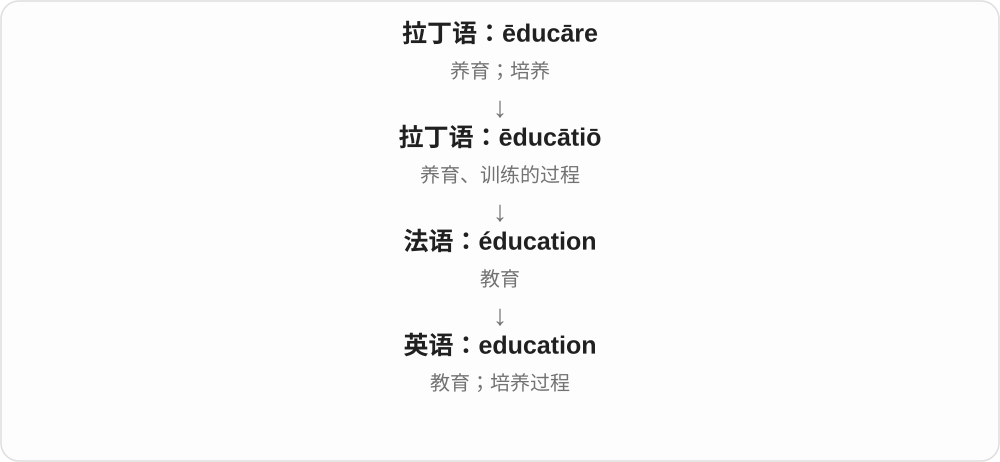

它从培养、养育发展到系统教学，也能指某人的教育背景。an education 可指某一段或某一种教育经历；泛指教育常不可数。

**常见搭配与例句**

higher education（高等教育）；access to education（受教育机会）；a good education（良好教育）。

> Everyone should have access to a good education.

每个人都应有机会接受良好教育。

> His education continued long after he left school.

离开学校很久以后，他仍在不断学习。

**别混淆**

education 是教育过程和经历；qualification 是取得的资历或资格。受过教育不等于一定持有某张证书。

### 3. educational — 教育的；能学到东西的

**音标**：英 /ˌedʒʊˈkeɪʃənəl/；美 /ˌedʒəˈkeɪʃənəl/

**先抓住这个画面**

educational 既能说一件事属于教育领域，也能说它让你学到了东西。参观工厂觉得长见识，就是 an educational visit。

**怎么拆**

education + -al，把名词“教育”变成形容词。

**怎么变成今天的意思**

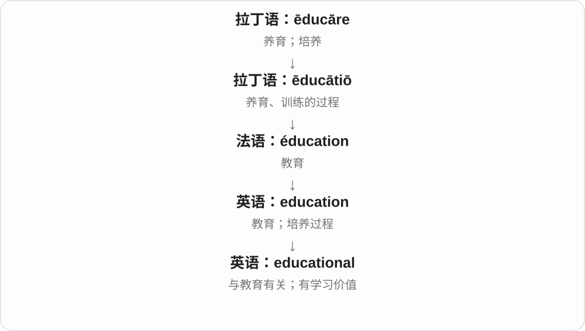

educational policy 是教育政策；educational game 则强调游戏有学习用途。前者是领域关系，后者是实际作用。

**常见搭配与例句**

educational resources（教育资源）；an educational visit（有教育意义的参观）；educational opportunities（教育机会）。

> The website offers free educational resources.

这个网站提供免费的教育资源。

> Our visit to the workshop was surprisingly educational.

这次参观车间出乎意料地让我们学到了很多。

**别混淆**

educational 形容活动或材料有教育性质；educated 形容人受过教育，不能互换。

### 4. educator — 教育者；教育工作者

**音标**：英 /ˈedʒʊkeɪtə/；美 /ˈedʒəkeɪtər/

**先抓住这个画面**

educator 是以培养他人、帮助学习为工作的人。它可以是教师，也可以是设计课程或从事其他教育工作的人。

**怎么拆**

来自拉丁语 ēducātor“培养者”；现代可看成 educate 与 -or 对应。

**怎么变成今天的意思**

-or 把培养这一动作变成角色。词的范围比某一个课堂岗位宽，也常带对专业教育工作的强调。

**常见搭配与例句**

an experienced educator（有经验的教育工作者）；teacher educators（教师培训者）；parents and educators（家长与教育工作者）。

> Educators helped design the museum’s learning activities.

教育工作者参与设计了博物馆的学习活动。

> She has worked as an educator for twenty years.

她从事教育工作已有二十年。

**别混淆**

teacher 通常指直接授课的教师；educator 可以覆盖更广的教育角色。不是所有场景都需要把 teacher 换成这个较正式的词。

### 5. educators — 教育工作者；从事教导、教育的人〔复数〕

**音标**：英 /ˈedʒʊkeɪtəz/；美 /ˈedʒəkeɪtɚz/

**先抓住这个画面**

帮助别人学习、成长，并把教育当作工作、职责的人，可以叫 educators。范围常比某一间教室的任课老师更广。

**怎么拆**

educator + -s → educators；现代可与 educate、表示人的 -or 对照，历史直接接拉丁 educator 养育者、教导者，接 educare 养育、教育。

**怎么变成今天的意思**

**拉丁 educare 养育、教导 → educator 养育、教导者**  
与 educere 引出有历史联系，但不据此把引出潜能当唯一原义

↓

**英语 educator → educators**  
现代复数，词尾 /z/

experienced educators 是有经验的教育工作者；museum educators 是博物馆教育人员；educators and parents 是教育工作者与家长。

**常见搭配与例句**

experienced educators；museum educators；educators and parents。

> The workshop brought together educators and parents.

这场工作坊让教育工作者和家长聚到一起。

> Museum educators helped the children explore the exhibition.

博物馆教育人员帮助孩子们了解展览。

**别混淆**

teacher 常指具体教课的人；educator 可以覆盖课程设计、教育组织等更广的教育工作语境，实际头衔仍看机构。

### 6. produce — 生产；产生；拿出；农产品

**音标**：动词 英 /prəˈdjuːs/、美 /prəˈduːs/；名词 英 /ˈprɒdjuːs/、美 /ˈproʊduːs/

**先抓住这个画面**

produce 的画面是把东西“带出来”：工厂带出产品，努力带出结果，也可以从包里拿出证件。

**怎么拆**

拉丁语 prō-（向前、向外）+ dūcere（带领），成为 prōdūcere。

**怎么变成今天的意思**

“带出”扩展为产生、制作；名词 produce 常专指水果、蔬菜等农产品。名词重音在前，动词重音在后。

**常见搭配与例句**

produce results（产生效果）；produce evidence（拿出证据）；fresh produce（新鲜农产品）。

> The new method produced better results.

新方法带来了更好的结果。

> The market sells fresh local produce.

这个市场出售当地的新鲜农产品。

**别混淆**

product 是可数的产品；produce 表示农产品时通常不可数。produce 也比 manufacture 广，后者通常指工业制造。

### 7. production — 生产；制作；一部演出或影视作品

**音标**：/prəˈdʌkʃən/

**先抓住这个画面**

production 是把东西做出来的整套过程。工厂生产食品，剧组制作影片，剧院呈现一台演出，都可以用它。

**怎么拆**

经法语来自拉丁语 prōductiō，与 prōdūcere“带出、产生”相连；现代对应 produce 的动作名词。

**怎么变成今天的意思**

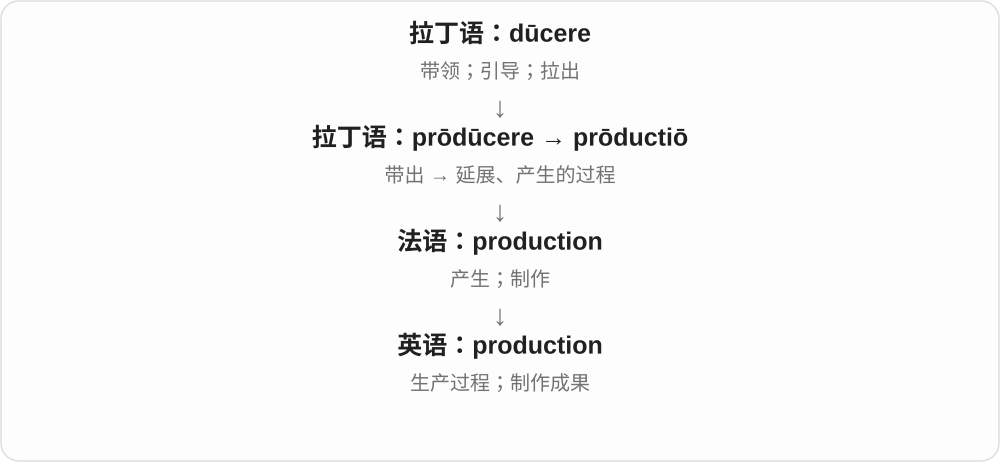

泛指生产时通常不可数；a production 可指某一部戏剧或影视制作。a stage production 就是一台具体舞台演出。

**常见搭配与例句**

increase production（增加产量）；go into production（投产）；a stage production（舞台演出）。

> The factory increased production last month.

工厂上个月提高了产量。

> We saw a new production of the play.

我们看了这部戏的一版新制作。

**别混淆**

product 是一个产物；production 可能是过程、产量或一整部制作。根据搭配判断，别统一译成“生产”。

### 8. productions — 制作、演出作品；影视、舞台作品〔复数〕

**音标**：/prəˈdʌkʃənz/

**先抓住这个画面**

制作过程最后呈现出来的一部舞台剧、一部影片等，可以是 a production。几部具体制作出来的作品，就是 productions。

**怎么拆**

production 经法语接拉丁 productio，连 producere 带出、产生，较早 pro- 向前 + ducere 带领。现代名词直接加 -s，/n/ 后读 /z/。

**怎么变成今天的意思**

**拉丁 producere、productio → 法语、英语 production**  
带出、产生 → 制作过程及成果

↓

**production + -s → productions**  
多部具体制作、演出的作品

theatre productions 舞台制作、演出；film productions 电影作品；local productions 当地制作的作品。

**常见搭配与例句**

three productions 三部制作作品；school productions 学校排演的作品。

> The theatre stages three productions each year.

剧院每年排演三部作品。

> She has worked on several school productions.

她参与过几部学校演出作品的制作。

**别混淆**

production 泛说生产过程常不可数；productions 通常数具体制作或作品。不是只因工厂生产了很多东西，就把生产过程任意写成 productions。

### 9. product — 产品；产物；乘积

**音标**：英 /ˈprɒdʌkt/；美 /ˈprɑːdʌkt/

**先抓住这个画面**

product 是一个过程最后“带出来”的东西：工厂带出商品，某种环境带出结果，乘法运算带出乘积。

**怎么拆**

来自拉丁语 prōductus，是 prōdūcere“带出、产生”的分词形式。英语早期已有数学用法。

**怎么变成今天的意思**

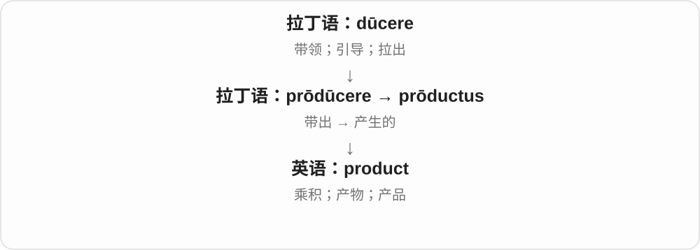

产品不只是一件能买卖的物品。a product of its time 指某事物由那个时代的条件塑造而成。

**常见搭配与例句**

launch a product（推出产品）；the product of three and four（三与四的乘积）；a product of experience（经验产生的结果）。

> The company is developing a new product.

公司正在开发一种新产品。

> Twelve is the product of three and four.

十二是三与四的乘积。

**别混淆**

product 是产出的东西；production 是生产过程。produce 作名词时常指农产品，别与 products 混用。

### 10. products — 产品、产物；乘积；product 的复数

**音标**：/ˈprɒdʌkts/〔英〕；/ˈprɑːdʌkts/〔美〕

**先抓住这个画面**

经过某个过程，最后产出了什么，就是 products。工厂产出商品，化学反应生成物质，乘法运算得到乘积。

**怎么拆**

product + -s，/t/ 后读 /s/。拉丁 producere 带出、产生的分词 productus 提供历史材料；product 不是把英语 produce 任意截短再拼一个 t。

**怎么变成今天的意思**

**拉丁 pro- + ducere → producere／productus → product**  
带出来、产生 → 产出的东西

↓

**product + -s → products**  
多个产品、产物或乘积

dairy products 乳制品；household products 家用品；finished products 成品；reaction products 反应产物；products of two numbers 两个数的乘积等数学表达。

**常见搭配与例句**

new products；products made locally。

> The shop sells products made by local artists.

这家店出售当地艺术家制作的产品。

> The students compared the products of several pairs of numbers.

学生们比较了几组数相乘得到的乘积。

**别混淆**

produce 作农产品集合名词时通常不可数，products 可数，指一件件或一类类产品。product 在数学里是乘积，sum 才是加法所得的和。

### 11. productive — 有成效的；产出多的

**音标**：/prəˈdʌktɪv/

**先抓住这个画面**

productive 关心“忙过以后留下了什么”。讨论解决了问题、工作交出了成果，才叫 productive，不只是一直在动。

**怎么拆**

来自晚期拉丁语 prōductīvus，与 product、produce 同族；-ive 表示具有相关作用或倾向。

**怎么变成今天的意思**

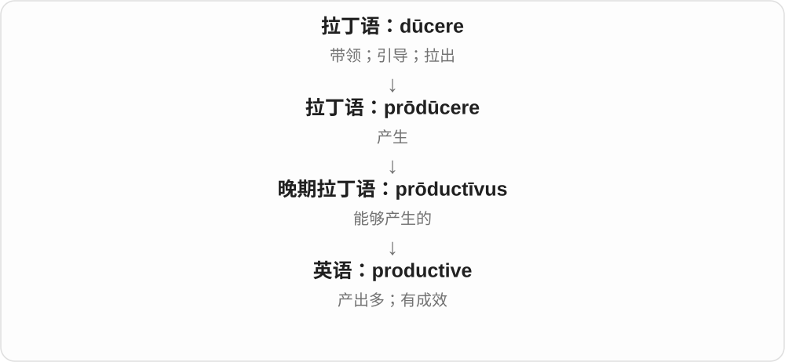

可形容人、土地、会议或一天的工作。重点是实际产出；在语言学中也可说一种构词方式能不断产生新词。

**常见搭配与例句**

a productive meeting（有成效的会议）；a productive day（成果充实的一天）；productive land（高产土地）。

> We had a productive meeting and agreed on the next steps.

会议很有成效，我们确定了下一步安排。

> She is most productive early in the morning.

她清晨工作最有成效。

**别混淆**

busy 是忙；productive 是有产出。efficiency 还涉及花了多少投入，同样多的产出也可能消耗不同时间。

### 12. productivity — 生产率；工作效率；产出能力

**音标**：英 /ˌprɒdʌkˈtɪvəti/；美 /ˌprɑːdʌkˈtɪvəti/

**先抓住这个画面**

productivity 问的是“投入这么多时间、人力或资源，做出了多少”。不是只数忙了几小时，而是看这些投入带来了什么。

**怎么拆**

productive + -ity，去掉词尾 e，形成表示性质或程度的名词。

**怎么变成今天的意思**

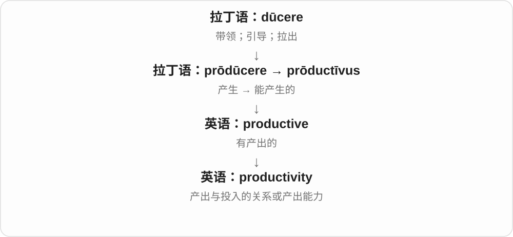

经济分析里常按单位投入衡量产出；日常也泛指完成工作的能力。讨论时最好说清楚自己衡量的是数量、质量还是某个具体结果。

**常见搭配与例句**

improve productivity（提高生产率）；labor productivity（劳动生产率）；productivity gains（效率提升）。

> Better tools increased productivity without extending working hours.

更好的工具提高了效率，而没有延长工时。

> The report measures productivity as output per worker.

报告用每位员工的产出衡量生产率。

**别混淆**

production 可以只是总产量；productivity 更关心产量相对于投入。多雇一倍人、多产一倍，不一定提高生产率。

### 13. produced — 生产了；产生了；拿出了；制作了；produce 的过去式和过去分词

**音标**：英 /prəˈdjuːst/；美 /prəˈduːst/

**先抓住这个画面**

把东西带到眼前、做成可用成果，是 produced。工厂产出产品，原因产生结果，人拿出证件，都可以这么说。

**怎么拆**

produce 去末尾 e，加完整 -ed；原词 /s/ 后读 /t/，结尾 /st/。拉丁 pro- 向前、向外 + dūcere 带形成 producere，经借入成为英语动词。

**怎么变成今天的意思**

**拉丁 pro- + ducere → producere → produce**  
向前带出 → 产生、生产、拿出

↓

**produce 去 e + -ed → produced**  
过去生产、产生、拿出、制作

produced goods 生产了商品；produced a result 产生结果；produced a ticket 出示票；produced a film 制作影片。

**常见搭配与例句**

produced locally；produced by the team。

> The workshop produced twenty chairs that week.

作坊那周做出了二十把椅子。

> She produced the missing key from her coat pocket.

她从外套口袋里拿出了那把丢失的钥匙。

**别混淆**

produced 属于动词的变化，主重音落在后面的 /djuːs／duːs/。produce 作农产品名词时，常另重读第一音节；先分词性，读音更清楚。

### 14. producing — 生产、创作、产生；拿出〔现在分词、动名词〕

**音标**：英 /prəˈdjuːsɪŋ/；美 /prəˈduːsɪŋ/

**先抓住这个画面**

把原先没有摆在面前的东西带出来：工厂做出产品，作家写出作品，措施带来结果，都可以是 producing。

**怎么拆**

produce 去词尾不发音的 e，加 -ing。底词接拉丁 prō- 向前、向外 + dūcere 带领 → prōdūcere 带出来，经法语等进入英语。

**怎么变成今天的意思**

**拉丁 prōdūcere → 英语 produce**  
带出、呈现 → 生产、产生、拿出

↓

**produce 去 e + -ing → producing**  
正在生产；把生产这件事作一个过程谈

生产不限于工厂制造：producing a report 是写出报告，producing results 是产生效果；producing a ticket 是把票拿出来。

**常见搭配与例句**

producing electricity 发电；producing clear results 产生明确效果。

> The farm is producing more food with less water.

这个农场正在用更少的水生产更多食物。

> The new approach is producing better results.

新方法正在带来更好的结果。

**别混淆**

这里用动词 produce 的后重音；名词 produce 农产品常是前重音。producing something 强调做出或拿出什么。

### 15. producer — 生产者；制作人；制片人

**音标**：英 /prəˈdjuːsə/；美 /prəˈduːsər/

**先抓住这个画面**

producer 是把东西做出来的一方。农业里可以是生产商；电影、音乐里常是组织制作、把项目推进完成的人。

**怎么拆**

produce + -er，表示实施生产或制作的人、企业。

**怎么变成今天的意思**

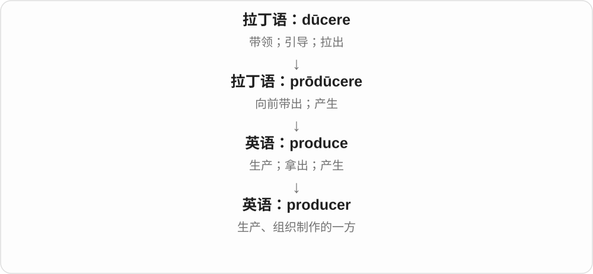

影视制作人的具体职责因项目而异，核心是把制作组织起来。生态学中 producer 又指能制造有机物的生产者，是专业用法。

**常见搭配与例句**

a food producer（食品生产商）；a film producer（电影制片人）；a music producer（音乐制作人）。

> The region is a major producer of olive oil.

这个地区是重要的橄榄油产区。

> The producer found funding for the documentary.

制片人为纪录片筹到了资金。

**别混淆**

producer 不等于 director：后者是导演，主要负责创作和拍摄指导；两种职责有时由同一个人承担。

### 16. producers — 生产者、生产企业；制片人、制作人〔复数〕

**音标**：英 /prəˈdjuːsəz/；美 /prəˈduːsərz/

**先抓住这个画面**

承担把成果做出来这件事的一方，是 producers。农业中是生产者，影视、音乐中则常是统筹制作的人。

**怎么拆**

produce 去 e + -er → producer，再加 -s，末尾读 /z/。produce 较早接拉丁 prō- 向前 + dūcere 带领 → prōdūcere 带出来；er 命名承担生产、制作的人或机构。

**怎么变成今天的意思**

**拉丁 prōdūcere → produce；加 -er → producer**  
带出来、产出 → 生产、制作的承担者

↓

**producer + -s → producers**  
多个生产方或制作人

food producers 食品生产者；film producers 电影制片人；local producers 当地生产者。

**常见搭配与例句**

producers of the programme 节目制作人；independent producers 独立制作人、独立生产商。

> Local producers sell their food at the market.

当地生产者在市场出售食品。

> The producers worked with the director to plan the film.

制片人与导演一起筹划这部电影。

**别混淆**

电影 producer 常统筹资金、人员、制作安排，director 则是导演；具体分工因项目而异。producers 的重音随动词 produce 在后部。

### 17. produces — 生产、产生；出示、制作〔第三人称单数〕

**音标**：英 /prəˈdjuːsɪz/；美 /prəˈduːsɪz/

**先抓住这个画面**

从一套原料、过程或能力里，把结果带出来，就是 produces。工厂有产品，树有果实，创作团队有作品。

**怎么拆**

produce + -s，末尾 /s/ 后读 /ɪz/，沿动词后重音。拉丁 pro- 向前、向外与 ducere 带领形成 producere，英语接相关形式。

**怎么变成今天的意思**

**拉丁 producere → 英语 produce**  
向前带出 → 生产、产生、拿出

↓

**produce + -s → produces**  
第三人称主语产出、制作或出示

produces fruit 结果实；produces electricity 发电；produces films 制作电影。

**常见搭配与例句**

produces a result 产生结果；produces a ticket 出示票据。

> The tree produces small yellow fruit.

这棵树结黄色的小果子。

> The studio produces educational videos.

工作室制作教育视频。

**别混淆**

produces 这里读动词的后重音；农产品名词 produce 前重音且通常不可数，不把 produces 当它的日常普通复数来背。

### 18. reduce — 减少；降低；使变为

**音标**：英 /rɪˈdjuːs/；美 /rɪˈduːs/

**先抓住这个画面**

reduce 像把一个过高的刻度往下调：减少花费、降低速度，或者把复杂问题收拢成更简单的形式。

**怎么拆**

拉丁语 re-（往回）+ dūcere（带领）。原义是“带回”，后来有把事物带到另一状态、较低状态等用法。

**怎么变成今天的意思**

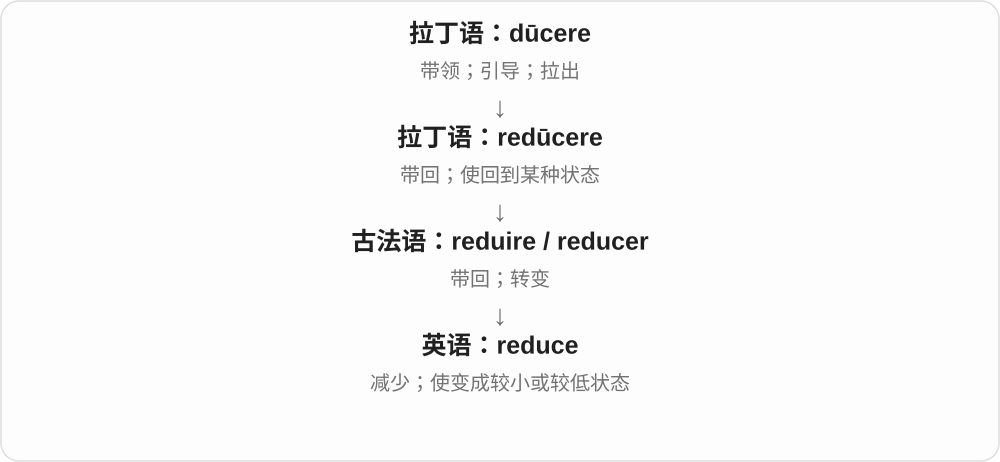

今天最常用的是“使更少、更低”。reduce to 说降到哪里，reduce by 说减少多少；词根画面不能替代这两个介词的区别。

**常见搭配与例句**

reduce costs（降低成本）；reduce by 20%（减少百分之二十）；reduce to a minimum（降到最低）。

> We reduced the price from fifty dollars to forty.

我们把价格从五十美元降到四十美元。

> A clear diagram can reduce a complex problem to a few simple steps.

一张清晰的图能把复杂问题化成几个简单步骤。

**别混淆**

reduce 是使数量或程度变小；remove 是移除。减少问题不等于彻底去掉问题。

### 19. reduced — 减少、降低了；缩减的、优惠的；reduce 的过去式和过去分词

**音标**：英 /rɪˈdjuːst/；美 /rɪˈduːst/

**先抓住这个画面**

把数量、程度往较小的位置带，是 reduced；票价降下来、噪声低下来，都能这样说。

**怎么拆**

reduce 末尾已有 e，加 -d，/s/ 后词尾读 /t/。reduce 经法语等接拉丁 redūcere，re- 往回与 dūcere 带领组成带回、转到某状态，后来常用于使更少、更低。

**怎么变成今天的意思**

**拉丁 re- + dūcere → redūcere → 法语、英语 reduce**  
带回、转变状态 → 减少、降低

↓

**reduce 去 e + -ed → reduced**  
已经降低；较低、缩减后的

reduced the noise 降低噪声；reduced prices 优惠价格、降价后的价格；reduced to ten 降到十；reduced by ten 减少十。

**常见搭配与例句**

greatly reduced；a reduced ticket price。

> The new windows reduced the noise from the street.

新窗户降低了街上传来的噪声。

> The price was reduced from fifty pounds to forty.

价格从五十英镑降到了四十英镑。

**别混淆**

reduced to 指最后降到的数，reduced by 指减少的量。reduced a problem to two questions 则是把复杂问题归结、化简成两个问题。

### 20. reduction — 减少；降低；缩减的量

**音标**：/rɪˈdʌkʃən/

**先抓住这个画面**

reduction 是“降下来”这件事或降下来的那部分。原价一百，现在八十，少掉的二十就是价格 reduction 的体现。

**怎么拆**

来自拉丁语 reductiō，经法语传入；与 reduce 同族，使用 reduct- 词干。

**怎么变成今天的意思**

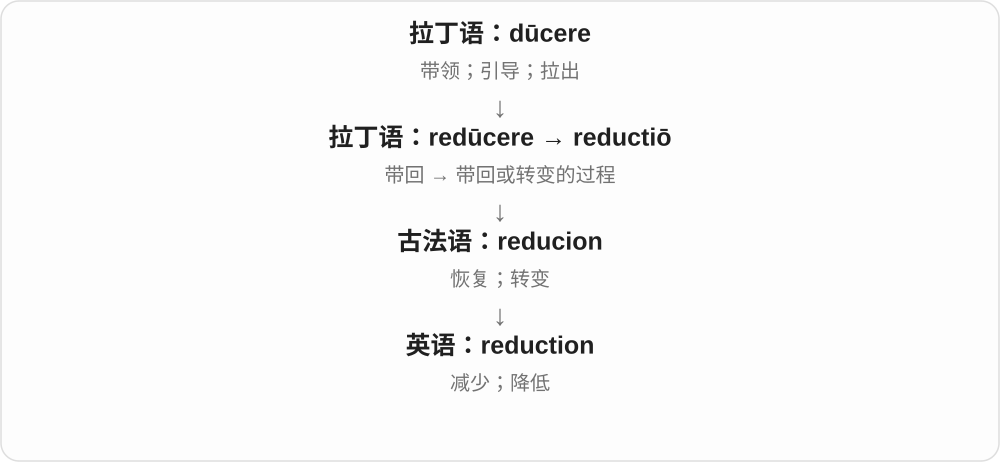

一般语境谈数量变少；化学中的 reduction“还原”是专门术语，不能机械理解为物质数量减少。

**常见搭配与例句**

a reduction in costs（成本下降）；a price reduction（降价）；a reduction of ten percent（降低百分之十）。

> The changes led to a reduction in waste.

这些变化减少了浪费。

> The store announced a ten percent reduction in prices.

商店宣布降价百分之十。

**别混淆**

reduction 表示下降，不说明必然降到零。reduction in 之后常放下降的项目；of 之后常放下降幅度。

### 21. reductions — 减少；降幅；减价〔复数〕

**音标**：英、美 /rɪˈdʌkʃənz/

**先抓住这个画面**

原来数量、尺寸或价格较大，现在往下调了，这些变化可以叫 reductions。它可以数不同项目的减少，也可以数一次次降价。

**怎么拆**

reduction + -s → reductions。经法语、拉丁 reductio 引回，接 re- 回 + ducere 引导 → reducere，分词词干 reduct-；动作名词后来常说减少。

**怎么变成今天的意思**

**拉丁引回、恢复 → reductio → reduction**  
原始方向是带回某种状态

↓

**减到较低程度的意义发展 → reductions**  
现代常数减量、降幅与减价措施

price reductions 是降价；reductions in waste 是废弃物的减少；reductions of ten per cent 是百分之十的降幅。

**常见搭配与例句**

price reductions；reductions in；reductions of。

> The shop announced price reductions on several items.

店铺宣布几种商品降价。

> The report records reductions in paper use across all departments.

报告记录了各部门用纸量的减少情况。

**别混淆**

reductions 与 discounts 都能谈减价，但 reductions 还广泛用于数量、尺寸等减少。化学 reduction 另有还原这一专门义，不能只理解成分量变少。

### 22. reducing — 减少、降低；使变成某种状态〔现在分词、动名词〕

**音标**：英 /rɪˈdjuːsɪŋ/；美 /rɪˈduːsɪŋ/

**先抓住这个画面**

把数量、程度往下带，就是 reducing 的常见画面。也可以把东西带到更简化、更基本的样子。

**怎么拆**

reduce 去 e + -ing → reducing，c 在 i 前仍读 /s/。拉丁 re- 往回 + dūcere 带领 → redūcere 带回，英语后来扩展到降低、简化等状态变化。

**怎么变成今天的意思**

**拉丁 redūcere → reduce**  
带回、带到另一状态 → 减少、简化

↓

**reduce 去 e + -ing → reducing**  
正在降低；使变到某状态的过程

reducing waste 减少浪费；reducing the price 降价；reducing the problem to a simple question 把问题简化为一个简单提问。

**常见搭配与例句**

reducing energy use 减少能源使用；reducing costs by ten per cent 降低百分之十的成本。

> The team is reducing waste in the workshop.

团队正在减少车间浪费。

> Walking to work is one way of reducing car use.

步行上班是减少用车的一种办法。

**别混淆**

reduce by 给减少的幅度，reduce to 给剩下的数值。reducing a price by ten 是少十，reducing it to ten 是降到十。

### 23. reduces — 减少、降低；使变成较小状态〔第三人称单数〕

**音标**：英 /rɪˈdjuːsɪz/；美 /rɪˈduːsɪz/

**先抓住这个画面**

把多的带到少，把高的带到低，是 reduces。词源先有带回来的动作，现代常看结果缩小、降低。

**怎么拆**

reduce + -s，/s/ 后读 /ɪz/。reduce 接拉丁 reducere，re- 回与 ducere 带领，经法语相应形式进入英语。

**怎么变成今天的意思**

**拉丁 re- + ducere → reducere → 法语、英语 reduce**  
带回 → 带到另一状态，后来常指较低状态

↓

**reduce + -s → reduces**  
某因素使数量、程度下降

reduces waste 减少废物；reduces the cost 降低成本；reduces something to a simpler form 化为较简单的形式。

**常见搭配与例句**

reduces by half 减半；reduces to half 减到一半。

> The new layout reduces the amount of walking.

新布局减少了来回走动。

> The program reduces the image to half its size.

程序把图像缩到原来的一半。

**别混淆**

reduces 常有被降低的对象，the change reduces costs 的 change 是起作用的原因。reduce by 后说减少量，reduce to 后说最终值，两者要分清。

### 24. reducer — 减小量或速度的装置；变径接头；归约函数

**音标**：英 /rɪˈdjuːsə/；美 /rɪˈduːsər/

**先抓住这个画面**

reducer 就是负责“把东西减小或归并”的那个部件。它可以让速度降低，也可以把大管径接到小管径。

**怎么拆**

reduce + -er，表示做这件事的人或物；多数常见技术用法指装置、部件或函数。

**怎么变成今天的意思**

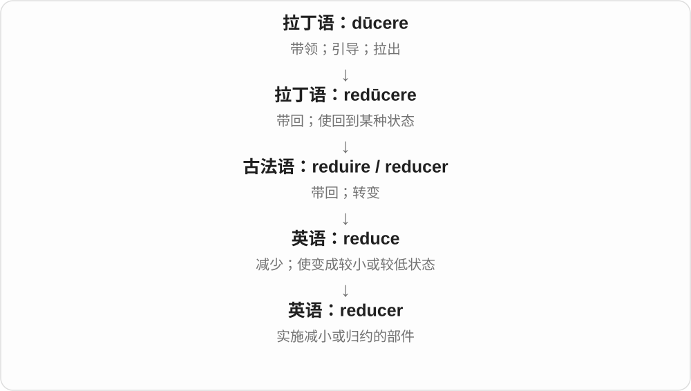

同一个名字会随领域变化。编程里的 reducer 常把当前结果和新输入合成一个新结果；这时“归约”不必是数值变小。

**常见搭配与例句**

a speed reducer（减速器）；a pipe reducer（变径接头）；a reducer function（归约函数）。

> A reducer connects the wider pipe to the narrower one.

一个变径接头把粗管与细管接起来。

> The reducer combines each value with the running total.

这个归约函数把每个值与当前累计总和合并。

**别混淆**

reducer 是执行作用的东西；reduction 是作用过程或结果。先看所在领域，别统一译成“减少者”。

### 25. reducible — 可减少的；可化简的；可归结为的

**音标**：英 /rɪˈdjuːsəbəl/；美 /rɪˈduːsəbəl/

**先抓住这个画面**

reducible 表示可以把一个大问题收拢成更小、更简单的东西。常见的 reducible to 就是“可以归结为”。

**怎么拆**

与 reduce + -ible 对应；这一词形在中世纪拉丁语 reducibilis、古法语 redusible 中已有相关形式。

**怎么变成今天的意思**

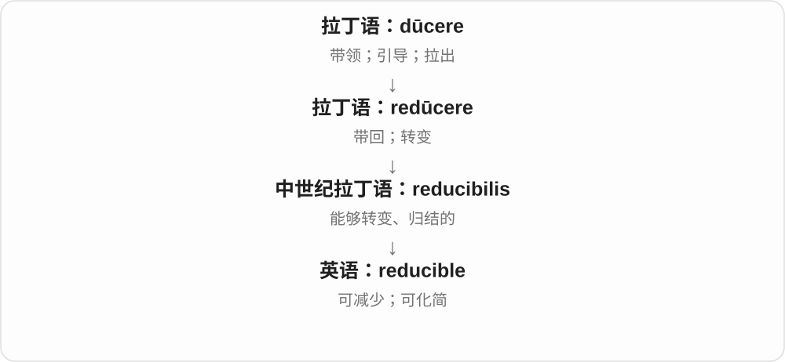

说 a problem is reducible to two choices，意思是复杂表面之下，只需处理两个选择。不同专业里的“可约”有各自严格定义。

**常见搭配与例句**

reducible to…（可归结为……）；a reducible fraction（可约分的分数）；reducible costs（可削减的成本）。

> The fraction is reducible to one half.

这个分数可以约成二分之一。

> Human behavior is not always reducible to a single motive.

人的行为并不总能归结为单一动机。

**别混淆**

reducible 说能够化简；reductive 常批评解释把事情过分简单化。可以简化，不代表任何简化都合理。

### 26. introduce — 介绍；引进；开始采用

**音标**：英 /ˌɪntrəˈdjuːs/；美 /ˌɪntrəˈduːs/

**先抓住这个画面**

introduce 就是“带进来”：把一个陌生人带进你的认识范围，把一个新点子或新制度带进某个场景。

**怎么拆**

较早拉丁 intrō- 向内 + dūcere 带领形成 intrōdūcere。英语 introduce 有直接接拉丁动词或从 introduction 逆构的分析；intro- 的核心是向内、引入。

**怎么变成今天的意思**

**拉丁语：dūcere**  
带领；引导；拉出

↓

**拉丁语：intrōdūcere**  
带到里面

↓

**英语 introduce：接拉丁动词或从 introduction 逆构**  
引入、带进来 → 介绍、引进

介绍人、介绍话题、引进产品都保留引入的感觉。introduce someone to something 也可表示让某人初次接触一种活动或知识。

**常见搭配与例句**

introduce A to B（把 A 介绍给 B）；introduce a new rule（引入新规则）；introduce a topic（引出话题）。

> Let me introduce you to my colleague.

让我把你介绍给我的同事。

> The school introduced a new reading program.

学校开始实行一项新的阅读计划。

**别混淆**

introduce 强调开始接触或进入；explain 强调讲明白。介绍了一个概念，不一定已经解释清楚。

### 27. introduced — 介绍了；引进、推出；开始采用；introduce 的过去式和过去分词

**音标**：英 /ˌɪntrəˈdjuːst/；美 /ˌɪntrəˈduːst/

**先抓住这个画面**

把人、话题或新办法带进一个原来还没接触它的圈子，就是 introduced：介绍朋友、引出主题、采用新制度都能用。

**怎么拆**

introduce 末尾已有 e，加 -d，/s/ 后词尾读 /t/。较早拉丁 intrō- 向内与 dūcere 带领构成 intrōdūcere；英语 introduce 有接拉丁动词或从 introduction 逆构的分析。

**怎么变成今天的意思**

**拉丁 intrō- + dūcere → intrōdūcere；英语 introduce**  
向内带入；直接拉丁联系或 introduction 逆构

↓

**introduce 去 e + -ed → introduced**  
介绍过、引进过；被推出的

introduced me to her friend 把我介绍给她的朋友；introduced a rule 开始采用一条规则；introduced a topic 引出话题。

**常见搭配与例句**

newly introduced；was introduced to the idea。

> She introduced me to the rest of the team.

她把我介绍给了团队里的其他人。

> The school introduced a new reading programme.

学校开始采用一项新的阅读计划。

**别混淆**

introduce A to B 常说把 A 介绍给 B，或让 A 接触 B。introduced 表示引入，不自动表示对方已理解、接受了全部内容。

### 28. introduction — 介绍；引言；引入

**音标**：/ˌɪntrəˈdʌkʃən/

**先抓住这个画面**

introduction 像在门口有人领你进去：认识一个人、开始接触一门知识，或在文章开头知道接下来要讲什么。

**怎么拆**

来自拉丁语 intrōdūctiō，经法语传入。它与 introduce 对应，使用拉丁语的 duct- 词形，并非随意把英语 ce 改成 ction。

**怎么变成今天的意思**

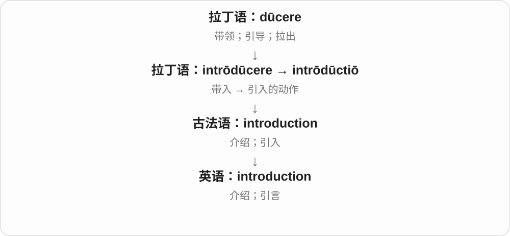

人际 introduction 帮人认识彼此；书的 introduction 把读者带进主题；新制度的 introduction 则是把制度引入现实使用。

**常见搭配与例句**

an introduction to physics（物理入门）；a brief introduction（简短介绍）；the introduction of a new system（新系统的引入）。

> The book provides a clear introduction to astronomy.

这本书清楚地介绍了天文学的入门知识。

> The introduction of the new system took several months.

引入新系统花了几个月。

**别混淆**

introduction 帮你进入主题；conclusion 在最后收束。书名 An Introduction to… 常是入门教材。

### 29. introductions — 介绍、引言、入门读物〔复数〕

**音标**：/ˌɪntrəˈdʌkʃənz/

**先抓住这个画面**

把人带到彼此面前，把读者带进一个主题，都可形成 introductions。核心是把后面要认识的对象引进来。

**怎么拆**

introduction 借法语、拉丁 introductio，与 introduce 同族；现代加 -s，/n/ 后读 /z/。duct- 接拉丁带领材料。

**怎么变成今天的意思**

**拉丁 introductio → 法语 → introduction**  
引入、带进；介绍、导论

↓

**introduction + -s → introductions**  
多次介绍、多篇引言等

make introductions 介绍大家认识；introductions to the subject 主题入门读物。

**常见搭配与例句**

book introductions 书的引言；brief introductions 简短介绍。

> After the introductions, the meeting began.

大家相互介绍后，会议开始了。

> The books offer clear introductions to the subject.

这些书为这个主题提供了清楚的入门介绍。

**别混淆**

introduction 可以开主题、介绍人，也可指入门书；introductory 则是相应性质形容词。

### 30. introducing — 介绍、引入；首次推出〔现在分词、动名词〕

**音标**：英 /ˌɪntrəˈdjuːsɪŋ/；美 /ˌɪntrəˈduːsɪŋ/

**先抓住这个画面**

原来在这个圈子外面，把人、想法或新方法带进来，是 introducing。第一次让别人认识，也就成了介绍、推出。

**怎么拆**

introduce 去 e 加 -ing。较早拉丁 intro- 向内与 ducere 带领形成 introducere；英语动词有接拉丁动词或从较早 introduction 逆构的分析。

**怎么变成今天的意思**

**拉丁 introducere；introduction 等 → 英语 introduce**  
带进来 → 介绍、引进；英语来源有不同分析

↓

**introduce 去 e 加 -ing → introducing**  
正在介绍、推出或引入

introducing a new product 推出新产品；introducing someone to a friend 把某人介绍给朋友；introducing a new method 引入新方法。

**常见搭配与例句**

introducing the topic 引入话题；a book introducing basic ideas 一本介绍基础概念的书。

> The teacher is introducing a new topic today.

老师今天正在引入一个新话题。

> The library is introducing a simpler borrowing system.

图书馆正在引入更简单的借阅系统。

**别混淆**

introducing 可以是让双方认识，也可以是第一次把某事加入已有环境。introduced to 可介绍人或初次接触领域，具体宾语决定关系。

### 31. introduces — 介绍；引入；推出〔第三人称〕

**音标**：英 /ˌɪntrəˈdjuːsɪz/；美 /ˌɪntrəˈduːsɪz/

**先抓住这个画面**

把一个原来不在这个圈子里的人、想法、东西带进来，让大家认识，就是 introduces。书介绍概念，公司推出产品，也能用。

**怎么拆**

introduce + -s → introduces，保留已有的 e，/s/ 后词尾读 /ɪz/。远接拉丁 intro- 向里 + ducere 带领，英语动词有借入或从 introduction 逆构的分析。

**怎么变成今天的意思**

**拉丁 intro- + ducere → introducere 带进来、引入**  
introduction 等名词有自己的较早借入路径

↓

**英语 introduce + -s → introduces**  
现代第三人称，字母加 -s，读音增加 /ɪz/

introduces a speaker 是介绍发言人；introduces a concept 是引入概念；introduces a product 是推出产品。

**常见搭配与例句**

introduces a speaker；introduces a concept；introduces a new design。

> The first chapter introduces the main characters.

第一章介绍主要人物。

> She introduces the guest speaker before the talk.

演讲前，她介绍了嘉宾讲者。

**别混淆**

introduces 不限于自我介绍。向别人作介绍时说 introduces someone to someone；书、课程作主语时常是介绍、引入内容。

### 32. reintroduce — 重新引入；再次介绍

**音标**：英 /ˌriːɪntrəˈdjuːs/；美 /ˌriːɪntrəˈduːs/

**先抓住这个画面**

reintroduce 是把曾经有过、后来离开的东西带回来：恢复一种产品，重新推出旧制度，或让消失的物种回到原栖息地。

**怎么拆**

re-（再次）+ introduce（引入）。这是英语直接可见的派生。

**怎么变成今天的意思**

**拉丁语：dūcere**  
带领；引导；拉出

↓

**拉丁语：intrōdūcere**  
带到里面

↓

**英语 introduce：接拉丁动词或从 introduction 逆构**  
引入、带进来 → 介绍、引进

↓

**英语：reintroduce**  
再一次引入

re- 告诉你这不是第一次。也可用于再次介绍某个人，但最常见的画面是让某事物重回一个场景。

**常见搭配与例句**

reintroduce a product（重新推出产品）；reintroduce a species（重新引入物种）；reintroduce someone to…（再次介绍）。

> The company plans to reintroduce the popular model.

公司计划重新推出那款受欢迎的型号。

> The project reintroduced native plants to the wetland.

这个项目把本地植物重新引入湿地。

**别混淆**

introduce 首次引入或一般地引入；reintroduce 明确表示又一次。restore 只说恢复，不一定涉及引入动作。

### 33. conduce — 有助于；促成

**音标**：英 /kənˈdjuːs/；美 /kənˈduːs/

**先抓住这个画面**

conduce 表示某个条件把事情往一个结果推了一把。它较正式、少见，最值得认的是 conduce to。

**怎么拆**

拉丁语 con-（一起）+ dūcere（带领）形成 condūcere，古代已有“有用、有助于”的意思。

**怎么变成今天的意思**

具体的“带到一起”与抽象的“促成结果”在这一词族里相连。现代读到 conduce to，通常直接理解成“有助于”即可。

**常见搭配与例句**

conduce to success（有助于成功）；conduce to understanding（增进理解）。

> Clear rules conduce to mutual trust.

清楚的规则有助于建立相互信任。

> Such an arrangement may conduce to greater efficiency.

这样的安排可能有助于提高效率。

**别混淆**

conduce 是动词，conducive 是形容词。日常更常说 help 或 contribute to；不要把它当成 conduct 的任意拼写变体。

### 34. conduct — 进行；指挥；传导；行为

**音标**：动词 /kənˈdʌkt/；名词 英 /ˈkɒndʌkt/、美 /ˈkɑːndʌkt/

**先抓住这个画面**

conduct 的画面是“把一个过程带着走”：带领乐队演奏，组织调查进行，让电流通过材料；名词则说一个人怎样行事。

**怎么拆**

来自拉丁语 condūcere 及 conductus，con-（一起）+ dūcere（带领）。不是英语 con“骗局”加 duct。

**怎么变成今天的意思**

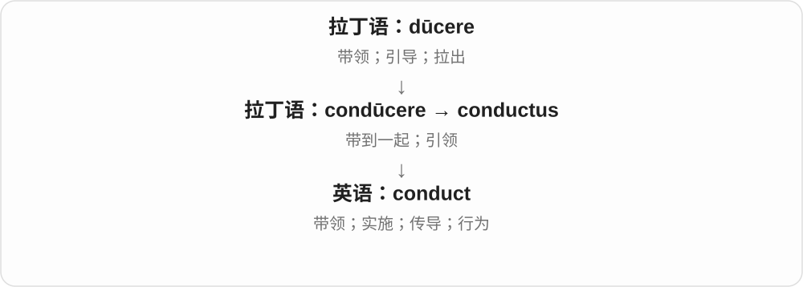

同一引导画面在不同对象上形成不同意思：人和活动被组织，热或电被传导。conduct oneself 是支配自己的举止，名词 conduct 因而是行为。

**常见搭配与例句**

conduct a survey（开展调查）；conduct an orchestra（指挥乐队）；conduct electricity（导电）；professional conduct（职业行为）。

> The team conducted a survey of local residents.

团队对当地居民开展了一项调查。

> His conduct during the meeting was calm and respectful.

他在会上表现得冷静而尊重他人。

**别混淆**

动词重音在后，名词在前。conduct an experiment 是实施实验，不是介绍实验。

### 35. conducted — 开展、实施；指挥；传导〔conduct 的过去式、过去分词〕

**音标**：/kənˈdʌktɪd/

**先抓住这个画面**

把人或过程带着向前运行，是 conducted 的引导画面：开展研究、指挥演出、让热或电通过，都有各自的现代用法。

**怎么拆**

动词 conduct + -ed，/t/ 后读 /ɪd/。拉丁 con- 一起与 dūcere 带领形成 condūcere、conductus，经借入发展为英语词族；动词重音在后。

**怎么变成今天的意思**

**拉丁 con- + dūcere → condūcere、conductus → conduct**  
带到一起、引领 → 实施、传导

↓

**conduct + -ed → conducted**  
实施过、被进行；传导过

conducted a study 开展研究；conducted interviews 进行访谈；conducted the orchestra 指挥乐团；conducted heat 传热。

**常见搭配与例句**

conducted by the research team；conducted through the metal。

> The team conducted interviews with local residents.

团队访谈了当地居民。

> The metal conducted heat quickly.

这种金属传热很快。

**别混淆**

conducted 在研究语境常是开展、实施，比 done 正式；名词 conduct 行为重音在前 /ˈkɒndʌkt/ 等，动词 conducted 延续后重音。

### 36. conducting — 开展、实施；指挥、引导、传导〔现在分词、动名词〕

**音标**：/kənˈdʌktɪŋ/

**先抓住这个画面**

把人、步骤或流动带着往前走，是 conducting 的共同方向。研究有人组织着做，乐队有人指挥，材料也能传导热或电。

**怎么拆**

conduct 接拉丁 conducere、conductus：con- 一起 + ducere 带领。现代直接加完整 -ing，仍用动词后重音，不沿用行为名词的前重音。

**怎么变成今天的意思**

**拉丁 con- + ducere → conducere、conductus → conduct**  
带到一起、引领 → 实施、指挥、传导

↓

**conduct + -ing → conducting**  
正在开展、指挥；传导过程

conducting a survey 开展调查；conducting an orchestra 指挥管弦乐队；conducting heat 传热。

**常见搭配与例句**

conducting an experiment 做实验；conducting visitors around the building 带访客参观楼房。

> The students are conducting a survey.

学生们正在做一项调查。

> She is conducting the orchestra tonight.

今晚由她指挥管弦乐队。

**别混淆**

conducting a survey 说组织、实施调查，不是调查这件事有某种行为品德。conduct 的名词行为义与动词任务义，要靠词性和重音分清。

### 37. conductor — 指挥；列车员；导体

**音标**：英 /kənˈdʌktə/；美 /kənˈdʌktər/

**先抓住这个画面**

conductor 是带着某个东西走的一方：指挥带领乐队，列车员协助乘客乘车，导体让热或电通过。

**怎么拆**

经法语 conductour 等形式来自拉丁语 conductor。现代可看成 conduct + -or，表示执行引导或传导的一方。

**怎么变成今天的意思**

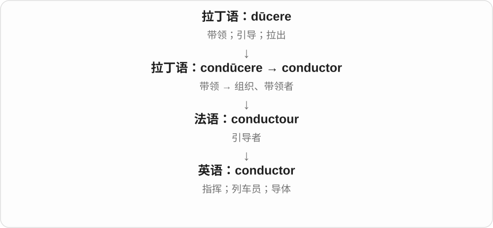

别把三个中文义当成互不相干。共同点都是引导、传递；只是乐队、交通服务和物理学给了它不同角色。

**常见搭配与例句**

an orchestra conductor（乐队指挥）；a train conductor（列车员）；a good conductor of heat（热的良导体）。

> The conductor raised her hands and the orchestra began.

指挥抬起双手，乐队开始演奏。

> Copper is a good conductor of electricity.

铜是电的良导体。

**别混淆**

conductor 让热或电容易通过；insulator 阻碍它们传递。音乐里的 conductor 与作曲者 composer 也不是同一角色。

### 38. conductors — 指挥；列车员；导体〔复数〕

**音标**：英 /kənˈdʌktəz/；美 /kənˈdʌktərz/

**先抓住这个画面**

乐队有人带着走，乘客有人引导查票，电流也有材料让它通过。conductors 把引导、传导这幅画面落到不同对象上。

**怎么拆**

conductor + -s。现代对应 conduct + -or，历史另有法语 conductour、拉丁 conductor 的整词借入路线。

**怎么变成今天的意思**

**拉丁 con- + ducere → conducere、conductus**  
带到一起、引领

↓

**conduct、拉丁 conductor 及法语相关人物名 → 英语词族**  
指挥、实施、传导；指挥者、列车员、导体

↓

**conductor + -s → conductors**  
多个执行引导或传导作用的人、物

orchestral conductors 是乐团指挥，train conductors 是列车员，electrical conductors 是导电物。

**常见搭配与例句**

good conductors of electricity 良好的电导体；guest conductors 客座指挥。

> The orchestra worked with three guest conductors.

乐团与三位客座指挥合作。

> Copper and aluminium are good conductors of electricity.

铜和铝是良好的电导体。

**别混淆**

-or 不保证是人：metal conductors 是导体；看被引导、被传导的对象，意义就容易对上。

### 39. conducts — 指挥、开展、传导〔第三人称单数〕

**音标**：/kənˈdʌkts/

**先抓住这个画面**

把人、活动或能量引着往前走：他指挥乐队，她开展研究，金属传导热，都可用 conducts。

**怎么拆**

conduct + -s，/t/ 后读 /s/。它是后重音动词形式，拉丁 con- 一起与 ducere 带领的材料保留在基础词历史里。

**怎么变成今天的意思**

**拉丁 con- + ducere → conducere、conductus**  
带到一起、引领

↓

**conduct、拉丁 conductor 及法语相关人物名 → 英语词族**  
指挥、实施、传导；指挥者、列车员、导体

↓

**动词 conduct + -s → conducts**  
他、她、它指挥、开展或传导

conducts an orchestra 是指挥乐队，conducts research 是开展研究，conducts heat 是传热。

**常见搭配与例句**

conducts experiments 做实验；conducts electricity 导电。

> She conducts the orchestra with clear gestures.

她用清晰的手势指挥乐队。

> This material conducts heat well.

这种材料导热良好。

**别混淆**

名词 conduct 行为常前重音，动词 conducts 后重音；主语、宾语能帮你判断是实施还是传导。

### 40. conductive — 导电的；导热的

**音标**：/kənˈdʌktɪv/

**先抓住这个画面**

conductive 形容一条通得过去的路：某种材料能让电或热通过。

**怎么拆**

conduct + -ive，形成形容词。这里的 conduct 用的是“传导”义。

**怎么变成今天的意思**

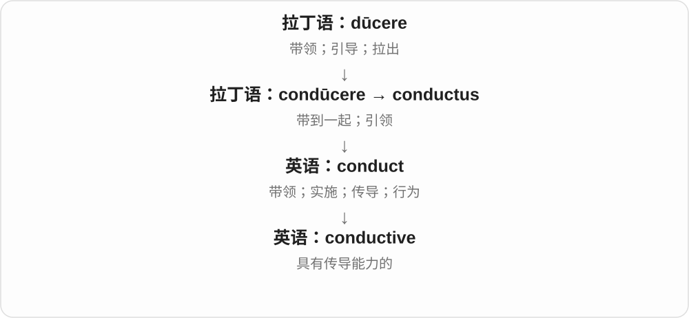

常见于材料说明。electrically conductive 指导电；thermally conductive 指导热，最好看清修饰词。

**常见搭配与例句**

conductive material（导电或导热材料）；conductive ink（导电油墨）；thermally conductive（导热的）。

> The sensor uses a thin layer of conductive ink.

传感器使用了一层薄薄的导电油墨。

> The design requires a thermally conductive material.

这项设计需要一种导热材料。

**别混淆**

conductive 谈传导性能；conducive to 谈某个条件有利于某种结果。不能说 a conducive wire 表示导线导电。

### 41. conduction — 传导

**音标**：/kənˈdʌkʃən/

**先抓住这个画面**

conduction 像把接力棒一段段传过去：热、电或神经信号通过某种材料或组织传递。

**怎么拆**

来自拉丁语 conductiō“带到一起”，现代可对照 conduct + -ion 理解。

**怎么变成今天的意思**

最常见的学习场景是热传导和电传导。把它想成“通过接触或介质内部传递”有帮助，但具体机制依领域而异。

**常见搭配与例句**

heat conduction（热传导）；electrical conduction（电传导）；nerve conduction（神经传导）。

> Heat reaches the handle by conduction through the metal.

热量通过金属传导到把手上。

> The experiment compared electrical conduction in two materials.

实验比较了两种材料的导电情况。

**别混淆**

conduction 是过程；conductor 是材料或参与传导的对象。convection“对流”依靠流体整体运动，是另一种传热方式。

### 42. conducive — 有助于……的；有利于……的

**音标**：英 /kənˈdjuːsɪv/；美 /kənˈduːsɪv/

**先抓住这个画面**

conducive 像一条顺路的坡：环境让某件事更容易发生。安静有助于专注，就可以说 conducive to concentration。

**怎么拆**

conduce（有助于）+ -ive（形容词），追溯到 condūcere。这里重点是“把事情带向某个结果”。

**怎么变成今天的意思**

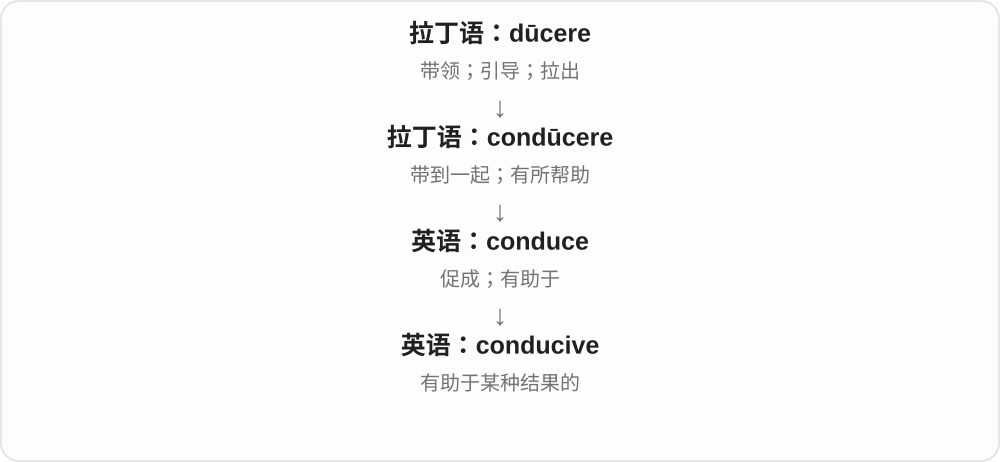

通常不是保证结果一定发生，而是条件有利。to 在这里是介词，因此后面可接名词或 doing。

**常见搭配与例句**

conducive to learning（有利于学习）；an atmosphere conducive to discussion（有利于讨论的氛围）。

> A quiet room is conducive to careful reading.

安静的房间有利于仔细阅读。

> The schedule is not conducive to getting enough rest.

这个日程不利于获得足够休息。

**别混淆**

conducive 是有利于；conductive 是能传导热或电的。多一个 t，含义就不同。

### 43. induce — 引起；促使；劝诱

**音标**：英 /ɪnˈdjuːs/；美 /ɪnˈduːs/

**先抓住这个画面**

induce 像把一件事推到发生的状态：某个因素引起变化，某种好处促使一个人行动。

**怎么拆**

in-（进入）+ dūcere（带领），形成拉丁语 indūcere“带入、引起”。

**怎么变成今天的意思**

可以引起一个反应，也可以促使一个人做事。与人搭配常用 induce someone to do；与结果搭配则直接接名词。

**常见搭配与例句**

induce a change（引起变化）；induce someone to agree（促使某人同意）；induce sleep（引发睡意，语词搭配）。

> The bonus induced several workers to stay.

奖金促使几名员工留下来。

> A change in temperature can induce a change in color.

温度变化可能引起颜色变化。

**别混淆**

induce 比 cause 更正式，有时强调诱发或促动。introduce 是引入新人或新事物，不能在所有场景中替换 induce。

### 44. induced — 引起、促使了；被诱发的〔过去式、过去分词〕

**音标**：英 /ɪnˈdjuːst/；美 /ɪnˈduːst/

**先抓住这个画面**

有一个因素把事情带进某个结果，或让人开始做某事，就是 induced。先看是什么把什么带出来。

**怎么拆**

induce 去 e 加完整 -ed。原词结尾 /s/ 后读 /t/，合起来 /st/；induce 接拉丁 inducere，in- 进入与 ducere 带领形成带入、引起。

**怎么变成今天的意思**

**拉丁 in- + ducere → inducere → induce**  
带入 → 引起、促使

↓

**induce 去 e + -ed → induced**  
某因素已经引起结果；被引起的

induced a change 引起变化；induced someone to do something 促使某人做某事。

**常见搭配与例句**

induced by a factor 由某因素引起；an induced current 感应电流。

> The announcement induced a change in the schedule.

公告促使日程发生了变化。

> The demonstration showed how movement induced a current.

演示展示了运动如何产生感应电流。

**别混淆**

induced 通常突出有原因、条件促成结果，未必是强迫。induced someone to do 的人是被促使者，by 后面常是促成因素。

### 45. induction — 入职引导；归纳；感应；诱导

**音标**：/ɪnˈdʌkʃən/

**先抓住这个画面**

induction 有几种常见场景：把新人带进工作，把观察带向一般判断，或通过某种作用引出一个反应。

**怎么拆**

经法语来自拉丁语 inductiō，与 indūcere“带入、引起”相连。用 induct- 看出它和 induce 的关系即可。

**怎么变成今天的意思**

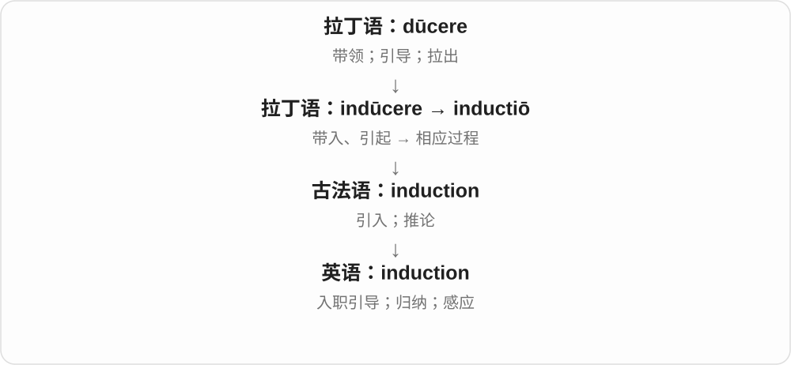

入职培训是让人进入角色；归纳是从具体观察形成较一般的判断；电磁感应是另一种专门用法。这些意思不能只背一个“引入”就代替实际理解。

**常见搭配与例句**

an induction course（入职培训课程）；inductive reasoning / induction（归纳推理）；electromagnetic induction（电磁感应）。

> All new staff attend an induction course.

所有新员工都参加入职培训。

> The class compared induction with deduction.

课堂上比较了归纳推理和演绎推理。

**别混淆**

普通经验归纳不能保证结论必然为真；数学里的 mathematical induction“数学归纳法”是严格证明方法，要另行学习。

### 46. inducement — 诱因；促使人行动的好处

**音标**：英 /ɪnˈdjuːsmənt/；美 /ɪnˈduːsmənt/

**先抓住这个画面**

inducement 是摆在面前、让人愿意改变决定的那点好处：奖金、折扣、便利或某种承诺。

**怎么拆**

induce + -ment，把“促使行动”变成促动因素或引诱的名词。

**怎么变成今天的意思**

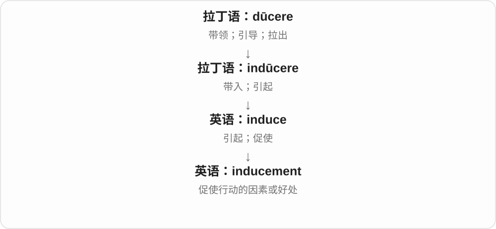

它常回答“对方给了什么，让你愿意做这件事”。语气较正式，有时暗示不太妥当的诱惑，但不天然等于贿赂。

**常见搭配与例句**

offer an inducement（提供诱因）；an inducement to stay（促使留下来的好处）；a financial inducement（金钱方面的激励）。

> Free training was an inducement to join the company.

免费培训是吸引人加入这家公司的一个条件。

> They offered no inducement for customers to renew.

他们没有提供吸引顾客续订的优惠条件。

**别混淆**

incentive 也表示激励，较常见且较中性；inducement 更突出有人提出条件来促动行为。

### 47. inducible — 可诱导的；能够被引发的

**音标**：英 /ɪnˈdjuːsəbəl/；美 /ɪnˈduːsəbəl/

**先抓住这个画面**

inducible 像一盏可以被开关触发的灯：给出合适条件，某种活动或反应就能启动。

**怎么拆**

induce + -ible；去掉末尾 e，表示“能够被引起的”。

**怎么变成今天的意思**

科学文字常用它描述可以受某个信号诱导的过程或系统。它说能被触发，并没有说已经触发，更没有说任何条件都能触发。

**常见搭配与例句**

an inducible response（可诱导反应）；an inducible system（可诱导系统）；an inducible gene（表达可受诱导的基因）。

> The researchers tested whether the response was inducible.

研究人员测试了这种反应能否被诱导。

> The inducible system remained inactive until the signal arrived.

这个可诱导系统一直没有启动，直到信号到来。

**别混淆**

inducible 是可以被诱导；induced 是已经受到诱导。后缀 -ible 标记可能性。

### 48. inducer — 诱导因素；诱导物；诱导者

**音标**：英 /ɪnˈdjuːsə/；美 /ɪnˈduːsər/

**先抓住这个画面**

inducer 是按下“触发开关”的一方：某种物质、条件或人，让另一个过程开始。

**怎么拆**

induce + -er。-er 可以表示人，也可以表示起作用的物质或装置。

**怎么变成今天的意思**

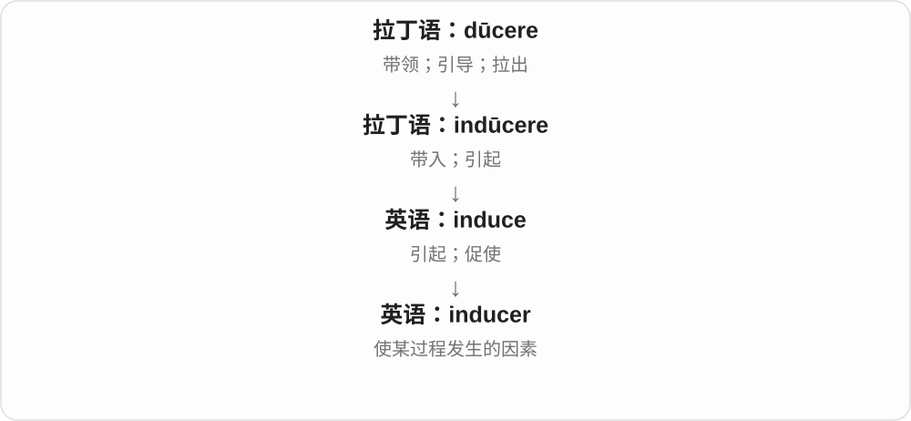

科学语境里，inducer 常是诱导某种反应或基因表达的物质。核心角色是触发者，具体机制要看研究对象。

**常见搭配与例句**

an inducer of gene expression（基因表达诱导物）；add an inducer（加入诱导物）；a potent inducer（强效诱导物）。

> The researchers added an inducer to activate the system.

研究人员加入诱导物来启动系统。

> Without the inducer, the signal remained weak.

没有诱导物时，信号一直很弱。

**别混淆**

inducer 是触发因素，inducement 常是促使人行动的好处或条件。二者不是只差一个结尾的同义词。

### 49. duct — 管道；导管

**音标**：/dʌkt/

**先抓住这个画面**

duct 就是一条把空气、液体等带到别处的通道。通风系统里的风管，是最容易看见的例子。

**怎么拆**

来自拉丁语 ductus“引导、输送”，后来的拉丁语也用它表示水渠、通道；根源是 dūcere。

**怎么变成今天的意思**

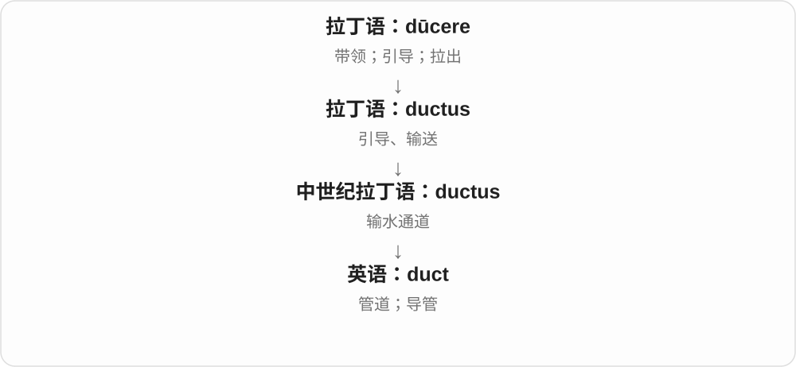

原来表示引导的动作，后来也指执行输送功能的通道。身体里的导管和楼里的风管都保留这个画面。

**常见搭配与例句**

an air duct（风管）；a ventilation duct（通风管）；a tear duct（泪道）。

> Dust had collected inside the air duct.

风管内部积了灰。

> The diagram shows the path of the ventilation ducts.

图中显示了通风管道的走向。

**别混淆**

duct 强调输送通道，形状不必是圆的；pipe 常指管状构件。duck“鸭子”与这个词根无关。

### 50. deduce — 推断；推导出

**音标**：英 /dɪˈdjuːs/；美 /dɪˈduːs/

**先抓住这个画面**

deduce 像沿着几条线索走，最后走到一个结论。不是凭空猜，而是能指出“我是根据这些信息判断的”。

**怎么拆**

拉丁语 dē-（从……、离开）+ dūcere（引导），产生“引出、推导”的意思。

**怎么变成今天的意思**

日常 deduce 常是根据迹象推断；严格逻辑演绎要求结论由前提必然推出。不要把所有日常推断都当成数学证明。

**常见搭配与例句**

deduce that…（推断……）；deduce something from evidence（从证据推断某事）。

> From the wet coats, I deduced that it was raining outside.

从湿外套我推断外面正在下雨。

> What can we deduce from these figures?

我们能从这些数字推断出什么？

**别混淆**

deduce 是推断；deduct 是扣除。guess 可以没有充分线索，deduce 则突出根据。

### 51. deduction — 推断；演绎；扣除；扣除额

**音标**：/dɪˈdʌkʃən/

**先抓住这个画面**

deduction 一头是“从已有信息引出结论”，另一头是“从总数拿掉一部分”。所以它既能是推断，也能是扣款。

**怎么拆**

来自法语 déduction、拉丁语 dēductiō。它与 deduce“推断”和 deduct“扣除”共享来源，两种现代动词不能互换。

**怎么变成今天的意思**

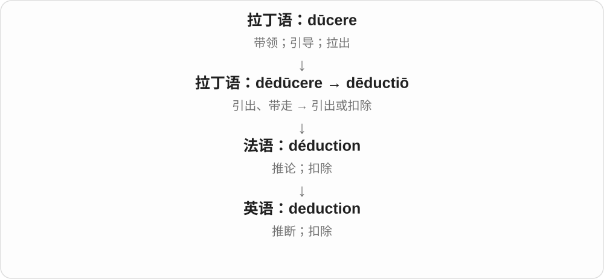

读句子时看周围：logical deduction 谈推理；a deduction from pay 谈钱。一个名词保留两条意思，不代表所有同族动词也有两条。

**常见搭配与例句**

make a deduction（作出推断）；logical deduction（逻辑演绎）；a deduction from wages（工资扣款）。

> Your deduction fits all the facts we know.

你的推断与我们已知的事实都相符。

> The receipt shows a deduction of twenty dollars.

收据显示扣除了二十美元。

**别混淆**

deduce a conclusion 是推出结论；deduct a fee 是扣掉费用。两者的名词都可用 deduction。

### 52. deduct — 扣除；减去

**音标**：/dɪˈdʌkt/

**先抓住这个画面**

deduct 就是从一个总数里拿掉一部分。账单原来一百，扣去十元优惠，剩下九十。

**怎么拆**

借自拉丁语 dēductus，是 dēdūcere“引走、带离”的分词形式。与 deduce 同源，但现代分工不同。

**怎么变成今天的意思**

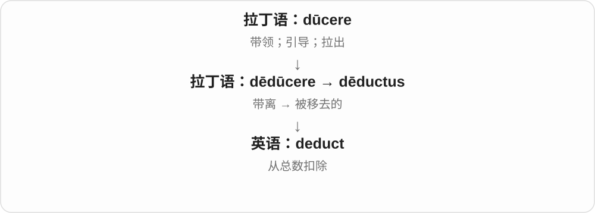

这里“带离”的画面直接落在数字上。常用 deduct A from B，A 是扣掉的部分，B 是原来的总额。

**常见搭配与例句**

deduct a fee（扣费）；deduct ten from fifty（从五十减去十）；deduct expenses from income（从收入中扣除支出）。

> The hotel deducted the deposit from the final bill.

酒店从最终账单中扣除了已付押金。

> Deduct five points for each incorrect answer.

每答错一道题扣五分。

**别混淆**

deduct 是扣除；deduce 是推断。数学一般减法也常用 subtract，deduct 在账目、费用中尤其常见。

### 53. abduce — 引出推断；带离（旧用法）

**音标**：英 /əbˈdjuːs/；美 /əbˈduːs/

**先抓住这个画面**

abduce 是少见词。旧义是“带离”，在一些逻辑讨论中则用于引出一个解释或结论，不是日常最自然的“推断”。

**怎么拆**

来自拉丁语 abdūcere，ab-（离开）+ dūcere（带领）。它与 abduct 同源，但现代常用范围不同。

**怎么变成今天的意思**

可以把它放在 abduction 的推理用法旁边认识，但不同作者对这类术语的使用并不完全一致。普通写作一般用 infer、deduce 或 propose an explanation 更清楚。

**常见搭配与例句**

abduce an explanation（引出一种解释）；abduce a conclusion（引出结论，少见用法）。

> From these clues, the researcher abduced a possible explanation.

研究者根据这些线索提出了一种可能的解释。

> An abduced explanation still needs to be tested.

推导出的解释仍需检验。

**别混淆**

abduct 通常是绑走或外展；abduce 的带走义已经古旧。不能在日常新闻里随意替换 abduct。

### 54. abduct — 绑架；劫走；使外展

**音标**：/əbˈdʌkt/

**先抓住这个画面**

abduct 是把人强行带离原处；在解剖学里，则是让身体部位远离身体中线。共同的方向是“向外、离开”。

**怎么拆**

来自拉丁语 abductus，与 ab-（离开）+ dūcere（带领）相连。解剖学的动词用法也受 abduction 影响。

**怎么变成今天的意思**

一般叙事中的 abduct 常等于绑走；身体动作中的 abduct 是方向描述，本身不表示绑架。

**常见搭配与例句**

abduct a person（绑架某人）；be abducted（被绑走）；abduct the arm（使手臂外展）。

> In the story, the scientist is abducted on her way home.

故事中，那位科学家在回家路上被绑架。

> The model shows which muscles abduct the arm.

模型展示了哪些肌肉使手臂外展。

**别混淆**

abduct 与 kidnap 在绑架义上接近；adduct 只有 a 而没有 b，表示向身体中线靠拢。

### 55. abduction — 绑架；外展；溯因推理

**音标**：/əbˈdʌkʃən/

**先抓住这个画面**

abduction 的字面画面是“带离”。人被强行带走，是绑架；手臂离开身体中线，是外展。

**怎么拆**

拉丁语 ab-（离开）+ dūcere（带领），形成 abdūctiō 等词形。现代与 abduct 对照记忆。

**怎么变成今天的意思**

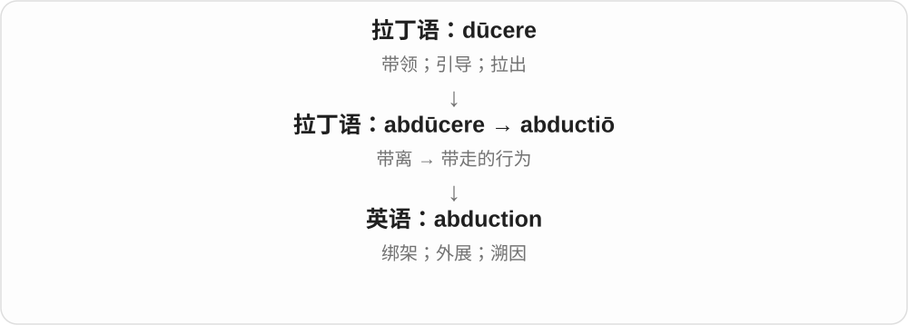

推理中的 abduction 是根据现象提出较能解释它的假设，常译“溯因推理”。这是专门术语，不能理解为结论已经得到必然证明。

**常见搭配与例句**

an abduction case（绑架案件）；arm abduction（手臂外展）；abductive reasoning / abduction（溯因推理）。

> The novel begins with an abduction.

小说以一起绑架事件开场。

> The diagram illustrates abduction of the arm.

图中展示了手臂外展。

**别混淆**

abduction 是离开身体中线；adduction 是靠近身体中线。绑架与关节动作是不同语境，不要混在一起。

### 56. seduce — 引诱；诱惑；勾引

**音标**：英 /sɪˈdjuːs/；美 /sɪˈduːs/

**先抓住这个画面**

seduce 像用吸引人的东西把人从原来的打算上带开。可以是情欲上的引诱，也可以是低价、名气或美好承诺的诱惑。

**怎么拆**

拉丁语 sē-（分开、到一旁）+ dūcere（带领），形成 sēdūcere“引离、引入歧途”。

**怎么变成今天的意思**

今天不一定都有道德谴责，但常带“吸引力让人放松判断或改变打算”的感觉。普通的“吸引人”不总适合用这个词。

**常见搭配与例句**

be seduced by promises（被承诺诱惑）；seduce someone into doing…（诱使某人做……）。

> We were seduced by the promise of an easy solution.

我们被轻松解决问题的承诺诱惑了。

> The advertisement tries to seduce shoppers into spending more.

这则广告试图诱使顾客多花钱。

**别混淆**

attract 是广义吸引；seduce 更有诱惑、使人动心的意味，谈人际关系时常带性意味。

### 57. seduction — 诱惑；引诱；勾引

**音标**：/sɪˈdʌkʃən/

**先抓住这个画面**

seduction 是吸引力一步步把人拉过去的过程。它也可指某种很难抵挡的魅力，如权力、奢华或成名的诱惑。

**怎么拆**

来自法语 séduction、拉丁语 sēductiō，与 seduce 同源。duct- 是对应词干，不另有“鸭子”之类的意思。

**怎么变成今天的意思**

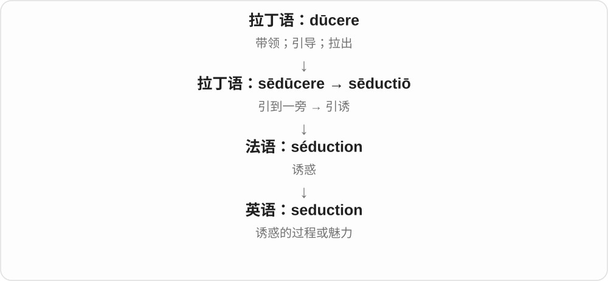

动词 seduce 说谁引诱谁；名词 seduction 把这个过程或吸引力拿出来讨论。具体是否有性意味，需要看对象和上下文。

**常见搭配与例句**

the seduction of power（权力的诱惑）；a tale of seduction（关于诱惑或勾引的故事）。

> The novel explores the seduction of fame.

这部小说探讨了名声的诱惑。

> The film tells a story of seduction and betrayal.

这部电影讲述了一个关于引诱与背叛的故事。

**别混淆**

persuasion 可通过理由说服；seduction 更突出欲望和吸引力。两者不完全相同。

### 58. seducer — 引诱者；勾引者

**音标**：英 /sɪˈdjuːsə/；美 /sɪˈduːsər/

**先抓住这个画面**

seducer 是靠魅力、承诺或欲望让别人动心的人。文学中常指勾引他人的角色，语气比“有魅力的人”重。

**怎么拆**

seduce 去末尾 e，加完整表人后缀 -er。

**怎么变成今天的意思**

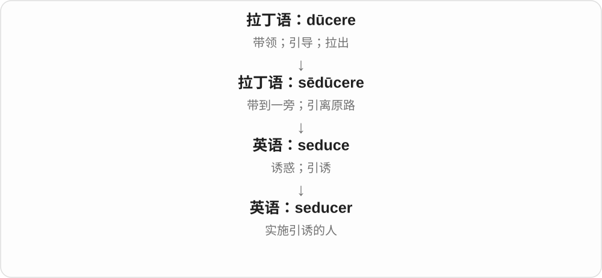

-er 把动作换成做动作的人。它强调这个人对别人施加诱惑，不能因为某人长得好看就直接称他 seducer。

**常见搭配与例句**

a charming seducer（迷人的勾引者）；play the seducer（扮演引诱者）。

> The actor plays a charming but unreliable seducer.

这名演员扮演一个迷人却不可靠的勾引者。

> The novel exposes the seducer’s empty promises.

小说揭露了引诱者的空头承诺。

**别混淆**

admirer 是爱慕者；seducer 是试图引诱的一方。两者的主动行为和语气不同。

### 59. adduce — 引证；举出作为根据

**音标**：英 /əˈdjuːs/；美 /əˈduːs/

**先抓住这个画面**

adduce 像把一份证据放到桌面上：“请看这个，它能支持我的判断。”这是正式论述里的词。

**怎么拆**

来自拉丁语 addūcere，ad-（向、到）+ dūcere（带领），字面是把东西带到眼前。

**怎么变成今天的意思**

被带出来的通常是证据、理由、例子。举出了材料不代表材料一定充分；adduce 描述的是提出材料的动作。

**常见搭配与例句**

adduce evidence（援引证据）；adduce reasons（提出理由）；adduce an example（举例作为根据）。

> The author adduces several letters in support of her argument.

作者援引了几封信来支持她的论点。

> No clear evidence was adduced for the claim.

没有人为这项主张提出明确证据。

**别混淆**

adduce 是拿出根据，deduce 是从根据推出结论。一个向讨论中加入材料，一个由材料引出判断。

### 60. adduct — 使内收；加合物

**音标**：动词 /əˈdʌkt/；名词 /ˈædʌkt/

**先抓住这个画面**

adduct 作动词是把身体部位向中线带近；作化学名词是两种成分加到一起形成的产物。共同画面是“带到一起”。

**怎么拆**

拉丁语 ad-（向、到）+ dūcere（带领）形成 addūcere，其分词 adductus 被借入英语。

**怎么变成今天的意思**

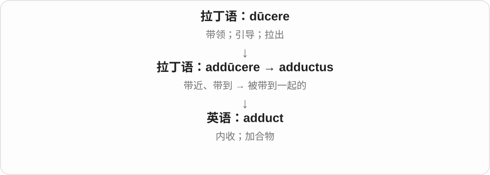

动词重音在后，名词重音在前。化学里的 adduct 不是简单把两种粉末放在同一杯里，而是加成形成的化学产物。

**常见搭配与例句**

adduct the arm（使手臂内收）；form an adduct（形成加合物）；an adduct of two molecules（两种分子形成的加合物）。

> These muscles help adduct the leg.

这些肌肉帮助腿部内收。

> The two compounds formed a stable adduct.

这两种化合物形成了稳定的加合物。

**别混淆**

adduct 向中线；abduct 离开中线。化学名词 adduct 则与这个动作义分开使用。

### 61. adductor — 内收肌

**音标**：英 /əˈdʌktə/；美 /əˈdʌktər/

**先抓住这个画面**

adductor 是把身体部位往身体中线拉近的肌肉。把张开的腿收回来，就容易想象“向中间带”的方向。

**怎么拆**

来自拉丁语 addūcere（带到、拉近）；现代可看成 adduct + -or，表示执行内收动作的结构。

**怎么变成今天的意思**

这里 ad- 表示朝向。肌肉名称描述动作功能，不是任意的专业标签；贝类把两片壳拉拢的闭壳肌也叫 adductor。

**常见搭配与例句**

the thigh adductors（大腿内收肌）；an adductor muscle（内收肌）；the adductor muscle of a clam（蛤的闭壳肌）。

> The diagram labels the adductor muscles of the thigh.

图中标出了大腿内收肌。

> The clam uses its adductor muscles to close its shell.

蛤利用闭壳肌合拢贝壳。

**别混淆**

adductor 向中间拉；abductor 向外带。ad- 和 ab- 的方向差异在这里非常具体。

### 62. traduce — 诋毁；恶意歪曲

**音标**：英 /trəˈdjuːs/；美 /trəˈduːs/

**先抓住这个画面**

traduce 像把一个人拉到众人面前故意丑化，让别人看不起他。现代主要指用话语歪曲、败坏名声。

**怎么拆**

拉丁语 trāns（跨过）+ dūcere（带领）形成 trādūcere；拉丁语已有带着示众、使受辱的引申义。

**怎么变成今天的意思**

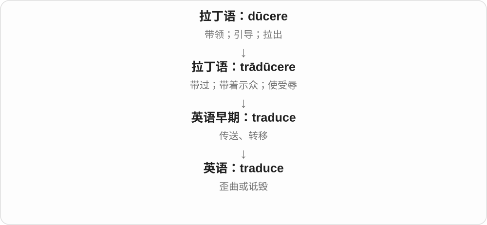

“带着示众”到“羞辱、诋毁”的联系有历史依据。今天这是较书面的强烈词，不能只因为别人批评了某人就说 traduce。

**常见搭配与例句**

traduce someone’s character（诋毁某人的品格）；be unfairly traduced（遭不公正诋毁）。

> The article traduced her character with unsupported claims.

这篇文章用没有根据的说法诋毁了她的品格。

> He felt that his work had been unfairly traduced.

他觉得自己的工作遭到了不公正的歪曲。

**别混淆**

criticize 可以合理指出问题；traduce 带有恶意或不公正歪曲。法语 traduire 常表示翻译，英语 traduce 不能照搬这个意思。

## 这一组要分清什么

**deduce 与 deduct**：前者推断结论，后者扣除数量；两者的名词都可能是 deduction。

**conducive 与 conductive**：前者说条件有利，后者说材料可以传导。安静环境 conducive to study，铜是 conductive material。

**教育词族不能硬讲成口号。** educate 直接连着 ēducāre“养育、训练”，它与 ēdūcere 有历史关系，但“教育原本就是引出潜能”不能当作已经证明的古代定义。

**ab- 与 ad- 的方向很具体。** abduct / abduction 离开身体中线；adduct / adductor 向中线靠近。这是解剖语境的用法，与绑架义分开理解。

## 串起来练习

串成一件事：**Introduce a clearer process, conduct a small trial, and deduce what helps reduce waste.**

引入更清楚的流程，开展一次小规模试验，再推断哪些做法有助于减少浪费。四个“带”的方向分别是引进、带着做、推出结论和把数量降下来。
