# 0121 · plat- — 宽、平、展开；宽阔的地方；扁平的物体

[逐词精讲目录](../00_逐词精讲目录.md) · [总目录](../00_总目录_按常用程度.md)

## 核心词根与来源

**plat- / platy-** 的可靠起点是希腊语 **platýs**“宽、平”。“宽阔的路”经拉丁语进入法语、西班牙语、意大利语，分别留下 place、plaza、piazza。另一条“平薄物体”的词族连着 plate、plateau、platform；platy- 则直接用于扁脚、扁虫、宽薄肌肉等科学名称。

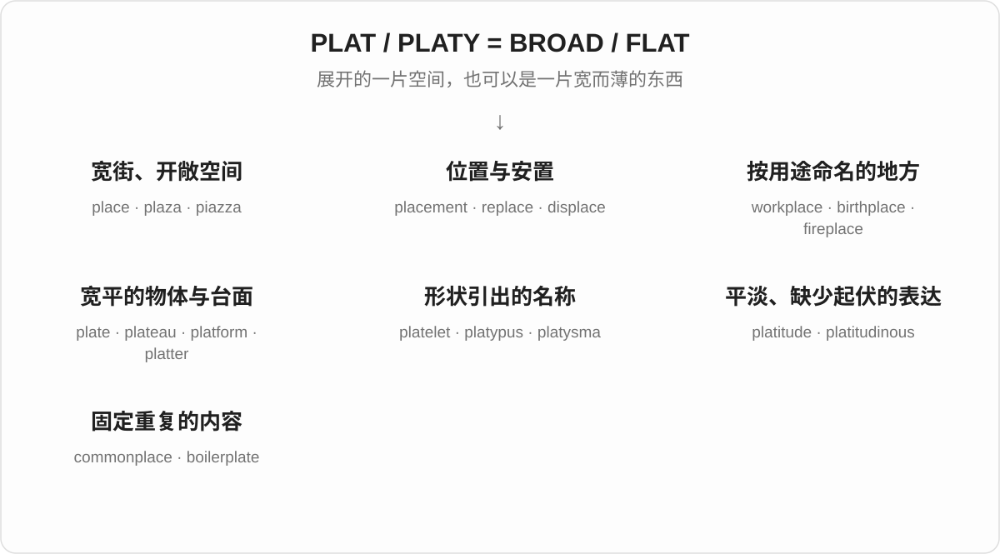

## 词形与演化规律

**plateîa hodós → plateîa → 拉丁语 platēa**：原先说“宽阔的路”，后来省掉“路”，留下表示街道、开敞空间的名词。**place / plaza / piazza** 是平行的借入支线，不是一个英语词依次变成另外两个。

**plate、plateau 等词的远源** 通常联系通俗拉丁语重建形式 *plattus 与希腊语 platýs；星号标的是重建形式。**plaice** 更深处与 platýs 的联系也并非完全确定，逐词图保留这个区别。

**platform** 的 forme 来自另一词根 forma；**platypus** 的 -pus 是希腊语 poús“脚”；**platyhelminth** 的 helminth 是“虫”。合成词的两部分是组合，不是前半段变成后半段。

## 单词速览（按词族由简到繁）

同一基础词的相关扩展放在一起，先读基础形式，再读扩展；各组之间优先读常用的。具体词源关系见各词讲解。

| 单词 | 音标 | 核心意思 |
|---|---|---|
| [place](#w-1) | 英 /pleɪs/；美 /pleɪs/ | 地方；位置；名次；放置 |
| [placement](#w-6) | 英 /ˈpleɪsmənt/；美 /ˈpleɪsmənt/ | 放置；位置安排；岗位安置；实习安排 |
| [replace](#w-3) | 英 /rɪˈpleɪs/；美 /rɪˈpleɪs/ | 替换；接替；放回原处 |
| [replacement](#w-5) | 英 /rɪˈpleɪsmənt/；美 /rɪˈpleɪsmənt/ | 替换；替代品；接替者 |
| [workplace](#w-7) | 英 /ˈwɜːkpleɪs/；美 /ˈwɜːrkpleɪs/ | 工作场所；职场 |
| [marketplace](#w-10) | 英 /ˈmɑːkɪtpleɪs/；美 /ˈmɑːrkɪtpleɪs/ | 集市；市场；交易平台 |
| [fireplace](#w-14) | 英 /ˈfaɪəpleɪs/；美 /ˈfaɪərpleɪs/ | 壁炉；室内炉火的位置 |
| [birthplace](#w-17) | 英 /ˈbɜːθpleɪs/；美 /ˈbɜːrθpleɪs/ | 出生地；发源地 |
| [displace](#w-21) | 英 /dɪsˈpleɪs/；美 /dɪsˈpleɪs/ | 移离原位；迫使离开；取代 |
| [displaced](#w-11) | 英 /dɪsˈpleɪst/；美 /dɪsˈpleɪst/ | 被移离原位的；流离失所的 |
| [displacement](#w-12) | 英 /dɪsˈpleɪsmənt/；美 /dɪsˈpleɪsmənt/ | 移位；流离失所；位移；排开量 |
| [misplace](#w-25) | 英 /mɪsˈpleɪs/；美 /mɪsˈpleɪs/ | 放错地方；一时找不到 |
| [misplaced](#w-16) | 英 /mɪsˈpleɪst/；美 /mɪsˈpleɪst/ | 放错位置的；用错对象的；不合时宜的 |
| [platform](#w-2) | 英 /ˈplætfɔːm/；美 /ˈplætfɔːrm/ | 站台；平台；施展或交流的载体；纲领 |
| [plate](#w-4) | 英 /pleɪt/；美 /pleɪt/ | 盘子；薄板；板块；镀上金属层 |
| [plating](#w-20) | 英 /ˈpleɪtɪŋ/；美 /ˈpleɪtɪŋ/ | 镀层；覆镀；金属板覆盖；摆盘 |
| [platelet](#w-22) | 英 /ˈpleɪtlət/；美 /ˈpleɪtlət/ | 血小板；小板片 |
| [platen](#w-28) | 英 /ˈplætən/；美 /ˈplætən/ | 压印板；承纸辊；机器承压台 |
| [plateful](#w-29) | 英 /ˈpleɪtfʊl/；美 /ˈpleɪtfʊl/ | 一盘的量；满满一盘 |
| [boilerplate](#w-24) | 英 /ˈbɔɪləpleɪt/；美 /ˈbɔɪlərpleɪt/ | 锅炉钢板；可反复套用的固定文字或代码 |
| [platinum](#w-8) | 英 /ˈplætɪnəm/；美 /ˈplætɪnəm/ | 铂；白金；白金级的 |
| [plaza](#w-9) | 英 /ˈplɑːzə/；美 /ˈplɑːzə/，也读 /ˈplæzə/ | 广场；商业广场 |
| [plateau](#w-13) | 英 /ˈplætəʊ/；美 /plæˈtoʊ/ | 高原；稳定平台期；进入平台期 |
| [commonplace](#w-15) | 英 /ˈkɒmənpleɪs/；美 /ˈkɑːmənpleɪs/ | 常见的；平常的；老生常谈 |
| [platter](#w-18) | 英 /ˈplætə/；美 /ˈplætər/ | 大浅盘；一大盘食物；硬盘盘片 |
| [piazza](#w-19) | 英 /piˈætsə/；美 /piˈɑːtsə/，也有 /piˈætsə/ 等读法 | 意大利式广场；门廊（部分美式用法） |
| [platypus](#w-23) | 英 /ˈplætɪpəs/；美 /ˈplætɪpəs/ | 鸭嘴兽 |
| [platitude](#w-26) | 英 /ˈplætɪtjuːd/；美 /ˈplætɪtuːd/ | 陈词滥调；空泛套话 |
| [plaice](#w-27) | 英 /pleɪs/；美 /pleɪs/ | 鲽鱼；一种食用比目鱼 |
| [platitudinous](#w-30) | 英 /ˌplætɪˈtjuːdɪnəs/；美 /ˌplætɪˈtuːdənəs/ | 满是陈词滥调的；空泛平庸的 |
| [platysma](#w-31) | 英 /pləˈtɪzmə/；美 /pləˈtɪzmə/ | 颈阔肌 |
| [platyhelminth](#w-32) | 英 /ˌplætɪˈhelmɪnθ/；美 /ˌplætɪˈhelmɪnθ/ | 扁形动物；扁虫 |

## 逐词讲解

### 1. place — 地方；位置；名次；放置

**音标**：英 /pleɪs/；美 /pleɪs/

**先抓住这个画面**

先是可以站人、通行的一片空间，再是某个东西在其中占的位置。位置也能变成顺序、身份或职责。

**怎么拆**

经法语 place 来自拉丁语 platēa，远源是希腊语 plateîa hodós“宽阔的路”。古英语也曾借入相关形式，现代词主要沿法语再借入。

**怎么变成今天的意思**

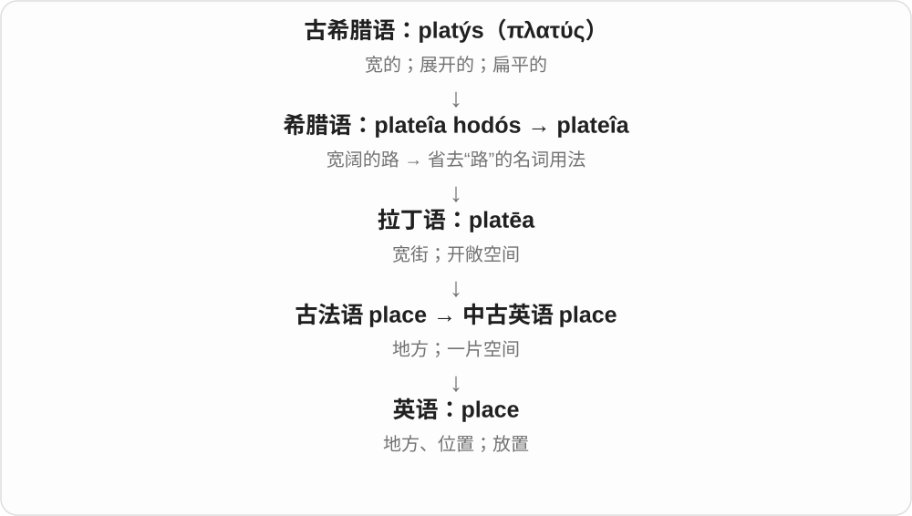

a quiet place 是安静的地方；first place 是第一名；place the cup on the table 是把杯子放到桌上。take place 整体表示发生。

**常见搭配与例句**

in place；out of place；take place；place an order。

> Please place the keys on the table.

请把钥匙放在桌上。

> The concert will take place in the town square.

音乐会将在镇上的广场举行。

**别混淆**

place 常指出一个位置、场所或名额；space 更强调空间和余地。a place to sit 与 enough space to sit 关注点不同。

### 2. placement — 放置；位置安排；岗位安置；实习安排

**音标**：英 /ˈpleɪsmənt/；美 /ˈpleɪsmənt/

**先抓住这个画面**

不仅有一个地方，还要把合适的东西或人安排到那个地方。

**怎么拆**

place 动词 + -ment，表示放置的行为、安排或结果。

**怎么变成今天的意思**

placement of furniture 是家具摆放；job placement 是就业安置；英式 work placement 常指实习安排。product placement 指影视等内容中的品牌植入。

**常见搭配与例句**

job placement；a work placement；product placement。

> The placement of the lights changes the mood of the room.

灯的位置安排改变了房间的氛围。

> She completed a work placement at a local museum.

她在当地博物馆完成了一段实习。

**别混淆**

placement 关注安排到某处；replacement 关注换一个来接替原来的。

### 3. replace — 替换；接替；放回原处

**音标**：英 /rɪˈpleɪs/；美 /rɪˈpleɪs/

**先抓住这个画面**

原来的位置空出来，由另一个东西接上；有时也是真把原物放回去。

**怎么拆**

re- 再、回 + place 放置；由重新放置发展出替换、接替义。

**怎么变成今天的意思**

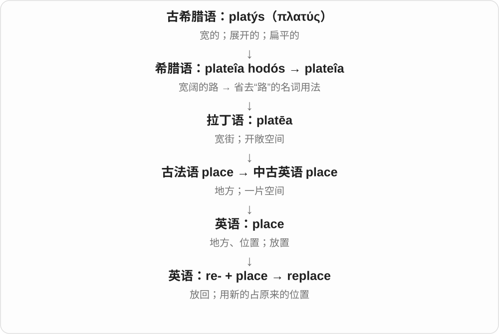

replace A with B 是拿 B 替换 A；replace the lid 可以是把盖子盖回去，不必是换新盖子。

**常见搭配与例句**

replace the battery；replace A with B；replace the lid。

> We replaced the old sofa with a smaller one.

我们把旧沙发换成了一张更小的。

> Please replace the lid after use.

用后请把盖子盖回去。

**别混淆**

replace A with B 的 A 是被换掉的；不要把两个对象的角色弄反。

### 4. replacement — 替换；替代品；接替者

**音标**：英 /rɪˈpleɪsmənt/；美 /rɪˈpleɪsmənt/

**先抓住这个画面**

旧的不能继续用了，接上来的那一个，或这个换上的过程，就是 replacement。

**怎么拆**

replace + -ment。

**怎么变成今天的意思**

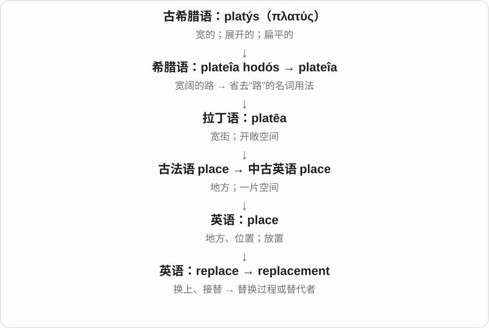

a replacement for the broken part 是坏零件的替代品；replacement costs 是更换成本。它不保证新东西与原物完全相同。

**常见搭配与例句**

a replacement part；a replacement for someone；need replacement。

> The company sent a replacement for the damaged lamp.

公司寄来一盏灯，替换损坏的那盏。

> The manager is looking for a replacement for the departing employee.

经理正在找人接替即将离职的员工。

**别混淆**

replacement 可指动作也可指新东西；substitute 更容易强调代用品或临时代替者，但用法有重叠。

### 5. workplace — 工作场所；职场

**音标**：英 /ˈwɜːkpleɪs/；美 /ˈwɜːrkpleɪs/

**先抓住这个画面**

人们做工作的地方；进一步也包括那里的关系、规则和氛围。

**怎么拆**

work 工作 + place 地方。

**怎么变成今天的意思**

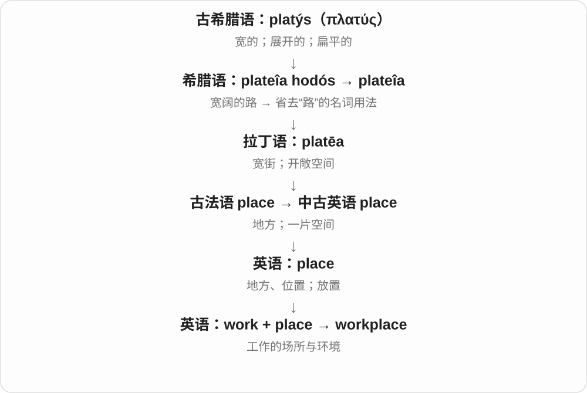

可以是办公室、工厂、店铺等。workplace culture 不只说房间布置，而是大家怎么一起做事。

**常见搭配与例句**

workplace safety；workplace culture；in the workplace。

> The company wants to improve communication in the workplace.

公司希望改善职场中的沟通。

> Good lighting makes the workplace more comfortable.

良好的照明让工作场所更舒适。

**别混淆**

workplace 是工作的场所或环境；workstation 是个人工作位或计算机工作站。

### 6. marketplace — 集市；市场；交易平台

**音标**：英 /ˈmɑːkɪtpleɪs/；美 /ˈmɑːrkɪtpleɪs/

**先抓住这个画面**

买东西的人和卖东西的人聚到一起，交换货物、价格和信息。后来这个“地方”也能搬到网上。

**怎么拆**

market 市场 + place 地方。

**怎么变成今天的意思**

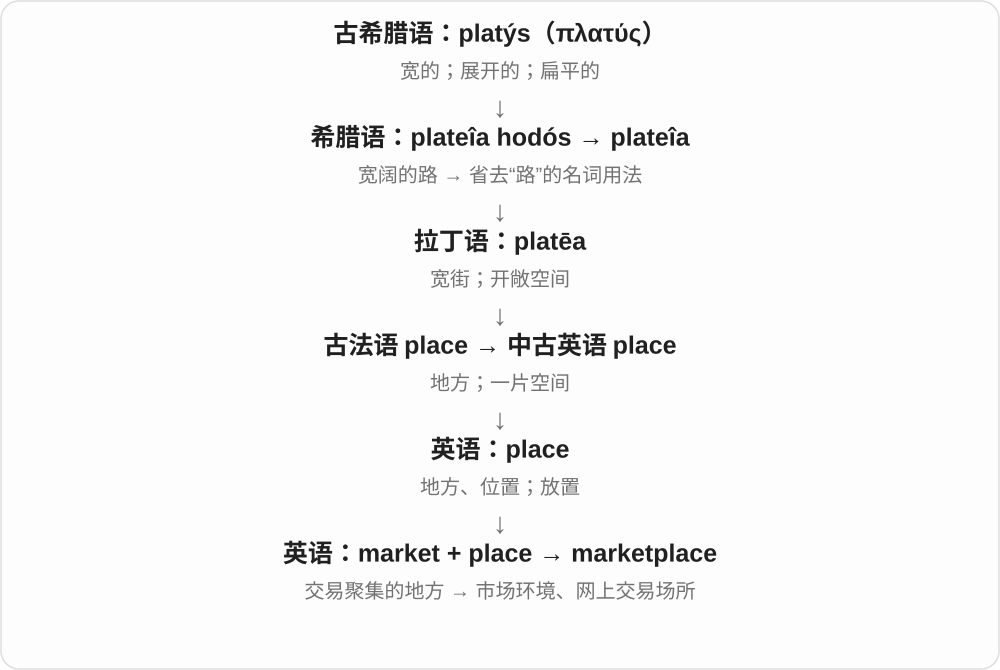

既可指街上的集市，也可说 online marketplace；the global marketplace 强调整体竞争与交易环境。

**常见搭配与例句**

an online marketplace；compete in the marketplace；a crowded marketplace。

> The marketplace was full of stalls selling fresh produce.

集市上满是卖新鲜农产品的摊位。

> The website connects buyers and sellers in an online marketplace.

网站通过一个线上市场连接买家和卖家。

**别混淆**

marketplace 通常强调买卖双方聚集交易；一家公司自己的单一商品页面未必体现这个含义。

### 7. fireplace — 壁炉；室内炉火的位置

**音标**：英 /ˈfaɪəpleɪs/；美 /ˈfaɪərpleɪs/

**先抓住这个画面**

房间里专门留出一处，让火在里面燃烧并给人取暖。

**怎么拆**

fire 火 + place 地方，现代英语复合词。

**怎么变成今天的意思**

传统上常嵌在墙内、接烟道；现代也有燃气或电壁炉。词义按用途发展，不是任意着火的地点。

**常见搭配与例句**

sit by the fireplace；an open fireplace；a stone fireplace。

> They sat by the fireplace and talked late into the evening.

他们坐在壁炉旁聊天，直到夜深。

> The room has an old stone fireplace.

房间里有一座老石壁炉。

**别混淆**

fireplace 是壁炉这一设施或空间；fire 指其中的火；chimney 是排烟的烟囱。

### 8. birthplace — 出生地；发源地

**音标**：英 /ˈbɜːθpleɪs/；美 /ˈbɜːrθpleɪs/

**先抓住这个画面**

一个人开始生命的地方，也能比喻某种运动、思想或发明最初形成的地方。

**怎么拆**

birth 出生 + place 地方，英语复合词。

**怎么变成今天的意思**

人的 birthplace 不一定是后来长大的地方。比喻某城是艺术运动的 birthplace，强调它在起源中的地位。

**常见搭配与例句**

someone’s birthplace；the birthplace of an idea。

> She returned to her birthplace for the first time in thirty years.

三十年来，她第一次回到了出生地。

> The city is often described as the birthplace of the movement.

这座城市常被称为那场运动的发源地。

**别混淆**

birthplace 是出生地；hometown 通常是成长或视为家乡的城镇，二者可能不同。

### 9. displace — 移离原位；迫使离开；取代

**音标**：英 /dɪsˈpleɪs/；美 /dɪsˈpleɪs/

**先抓住这个画面**

把原来占着位置的东西挤开，让它不再待在原处。

**怎么拆**

来自法语 desplacer，现代法语 déplacer；des- 分离、移开 + placer 放置。现代英语可看出 dis- + place。

**怎么变成今天的意思**

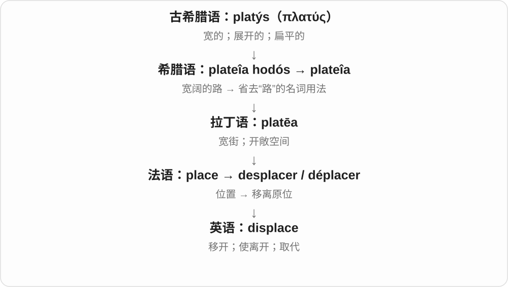

物体排开水、技术替代旧方式、灾害使人离开家园，都可以围绕“离开原位”来理解。

**常见搭配与例句**

displace residents；displace older technology；displace water。

> The flood displaced hundreds of residents.

洪水迫使数百名居民离开家园。

> The stone displaces some water when it is lowered into the container.

石头放进容器时，会排开一些水。

**别混淆**

replace 常强调谁接上来；displace 更强调原来的谁被挤开、移走，不一定已有合适的新安排。

### 10. displaced — 被移离原位的；流离失所的

**音标**：英 /dɪsˈpleɪst/；美 /dɪsˈpleɪst/

**先抓住这个画面**

东西不在原处了；用在人身上，常是原本的家园已无法继续居住。

**怎么拆**

displace + -ed，过去分词描述被移走后的状态。

**怎么变成今天的意思**

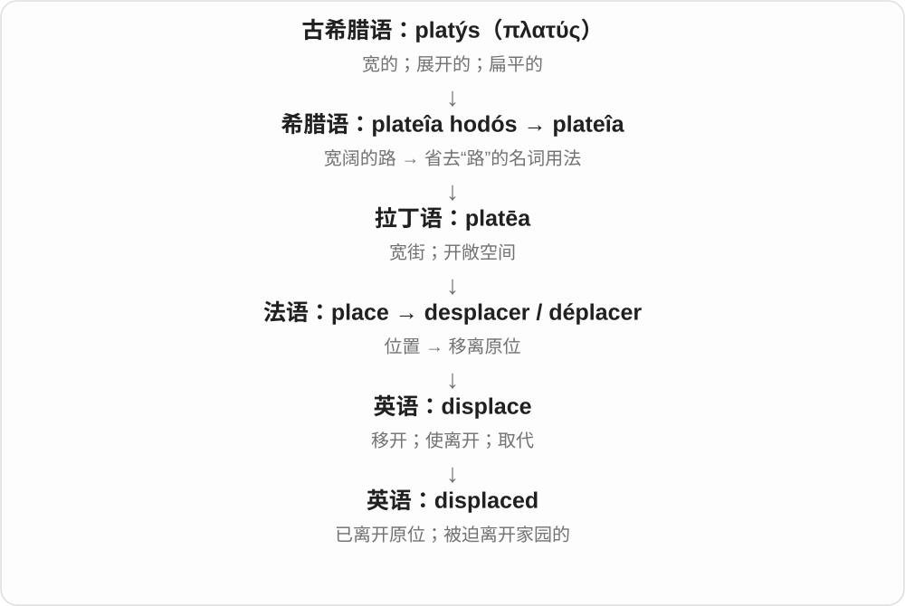

displaced people 常用于因冲突或灾害被迫迁离的人。它本身不要求已经越过国界。

**常见搭配与例句**

displaced families；a displaced object；internally displaced people。

> Local groups provided temporary housing for displaced families.

当地团体为流离失所的家庭提供临时住所。

> The technician returned the displaced component to its proper position.

技术员把移位的部件放回正确位置。

**别混淆**

displaced 的范围不等于 refugee；后者在法律和国际保护中有专门条件。

### 11. displacement — 移位；流离失所；位移；排开量

**音标**：英 /dɪsˈpleɪsmənt/；美 /dɪsˈpleɪsmənt/

**先抓住这个画面**

抓住“从原处挪开”这一点，再看具体问的是人搬离、物体位置改变，还是水被排开多少。

**怎么拆**

与 displace + -ment 对应；词典也记录法语 déplacement 的借入联系，名词不必经过现代英语的一次临时造词。

**怎么变成今天的意思**

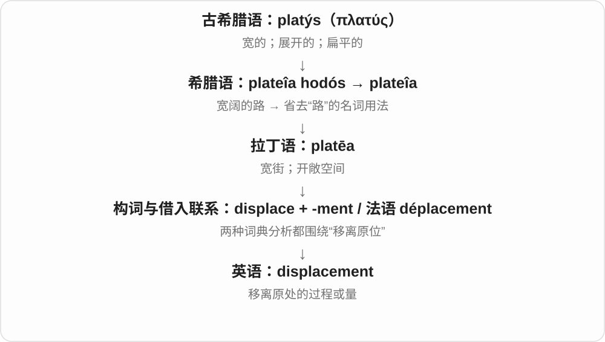

物理 displacement 是从起点到终点的带方向位置变化，不等于走过的总路程。人口 displacement 是被迫离开原住处。

**常见搭配与例句**

population displacement；water displacement；net displacement。

> After a complete lap, the runner’s displacement is zero.

完整跑一圈回到起点后，跑步者的位移为零。

> The report examines displacement caused by the earthquake.

报告考察了地震造成的人口迁离。

**别混淆**

绕操场一圈回到起点，distance 不为零，displacement 却为零。

### 12. misplace — 放错地方；一时找不到

**音标**：英 /mɪsˈpleɪs/；美 /mɪsˈpleɪs/

**先抓住这个画面**

东西还在某处，只是你放下时没有把位置记对，现在找不着了。

**怎么拆**

mis- 错误 + place 放置，英语派生。

**怎么变成今天的意思**

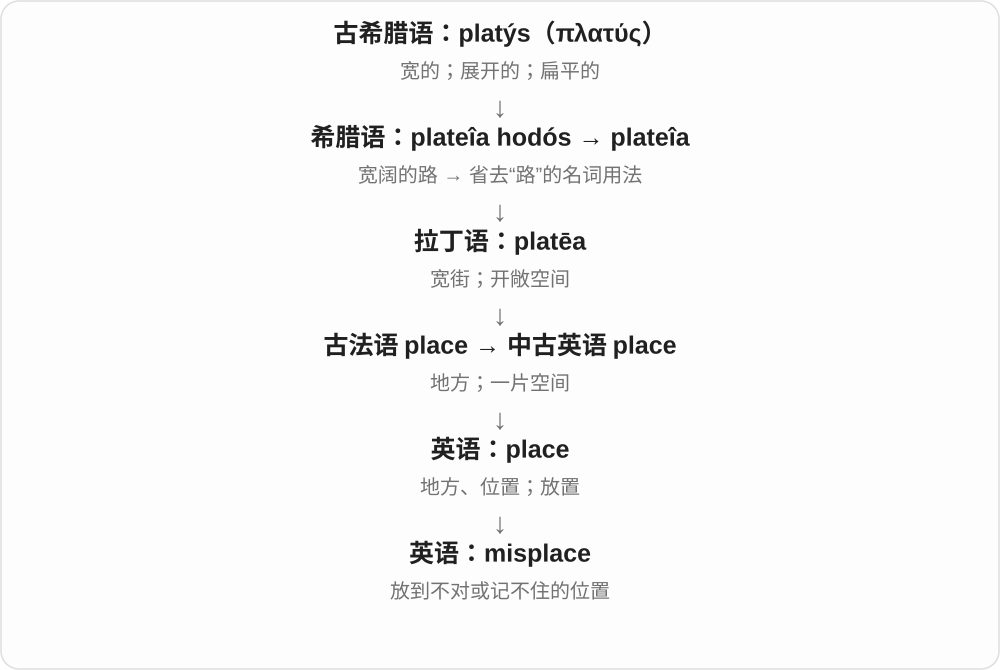

常说 misplace keys、glasses、documents，语气通常比 lose 温和，暗示可能还在附近。

**常见搭配与例句**

misplace your keys；misplace a document。

> I seem to have misplaced my glasses again.

我好像又把眼镜放到不记得的地方了。

> She misplaced the receipt but found it in her coat later.

她一时找不到收据，后来在外套里找到了。

**别混淆**

misplace 常是放错后找不到；displace 是移开原位，不含“忘了放哪”的必要意思。

### 13. misplaced — 放错位置的；用错对象的；不合时宜的

**音标**：英 /mɪsˈpleɪst/；美 /mɪsˈpleɪst/

**先抓住这个画面**

东西放错地方，信任也可能“放错地方”：把希望、信心或责备用在不该用的人和事上。

**怎么拆**

misplace + -ed，实物位置错误进一步扩展到判断和感情对象不合适。

**怎么变成今天的意思**

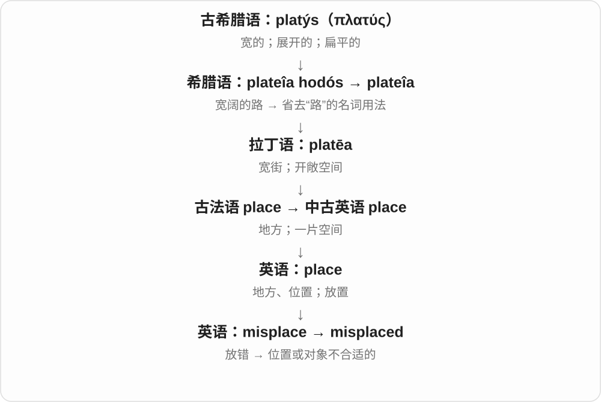

misplaced keys 是放错地方的钥匙；misplaced confidence 是不该有的信心；misplaced anger 是迁错对象的愤怒。

**常见搭配与例句**

misplaced trust；misplaced optimism；a misplaced comma。

> Her trust in the dishonest supplier was misplaced.

她信任那个不诚实的供应商，实在信错了人。

> A misplaced comma changed the meaning of the sentence.

一个位置放错的逗号改变了句子的意思。

**别混淆**

misplaced trust 不是“不知道信任在哪”，而是信任给错了对象。

### 14. platform — 站台；平台；施展或交流的载体；纲领

**音标**：英 /ˈplætfɔːm/；美 /ˈplætfɔːrm/

**先抓住这个画面**

先有一个稳稳的台面，人或设备站在上面做事；后来也把让别人做事、发声的环境叫平台。

**怎么拆**

来自法语 plateforme：plate“平的”+ forme“形状、形式”，两部分并列构词，后者另有拉丁语 forma 来源。

**怎么变成今天的意思**

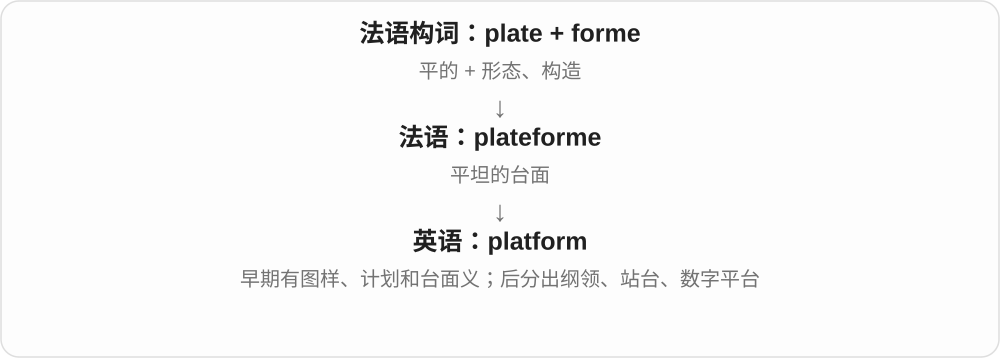

早期英语也有“图样、计划”义。railway platform 是站台；online platform 让人发布内容或交易；a political platform 是一套公开主张，这几项不是依次演变的单线。

**常见搭配与例句**

on the platform；a digital platform；a platform for debate。

> The train leaves from platform six.

列车从六号站台发车。

> The forum provides a platform for local artists.

这个论坛为当地艺术家提供了交流展示的平台。

**别混淆**

platform 可指让活动开展的整体环境；一个单独网页未必足以体现它的功能。

### 15. plate — 盘子；薄板；板块；镀上金属层

**音标**：英 /pleɪt/；美 /pleɪt/

**先抓住这个画面**

抓住一片比较平、比较宽的东西：能盛菜的是盘子，能盖住表面的是板片。

**怎么拆**

经古法语 plate 来自中世纪拉丁语 plata“金属薄片”，更早通常联系重建的 *plattus 与希腊语 platýs。

**怎么变成今天的意思**

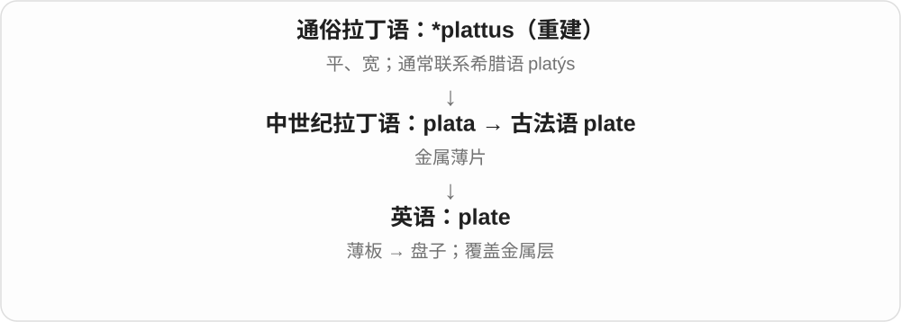

a dinner plate 是餐盘；a metal plate 是金属板；a tectonic plate 是岩石圈板块。动词 plate 指覆上金属层，也可指给食物摆盘。

**常见搭配与例句**

a plate of food；metal plates；plate the dessert。

> She put the sliced fruit on a white plate.

她把切好的水果放在白盘子上。

> A metal plate covers the opening.

一块金属板盖住了开口。

**别混淆**

plate 通常较浅、展开；bowl 通常较深。地质 plate 是专业延伸，不是漂在液态海洋上的普通餐盘。

### 16. plating — 镀层；覆镀；金属板覆盖；摆盘

**音标**：英 /ˈpleɪtɪŋ/；美 /ˈpleɪtɪŋ/

**先抓住这个画面**

给表面覆上一层薄金属；在厨房里，又可以是把食物安排到盘面上。

**怎么拆**

这里的覆镀、摆盘等常用义由 plate 动词 + -ing 形成；不同义项跟着 plate 的不同用法走。

**怎么变成今天的意思**

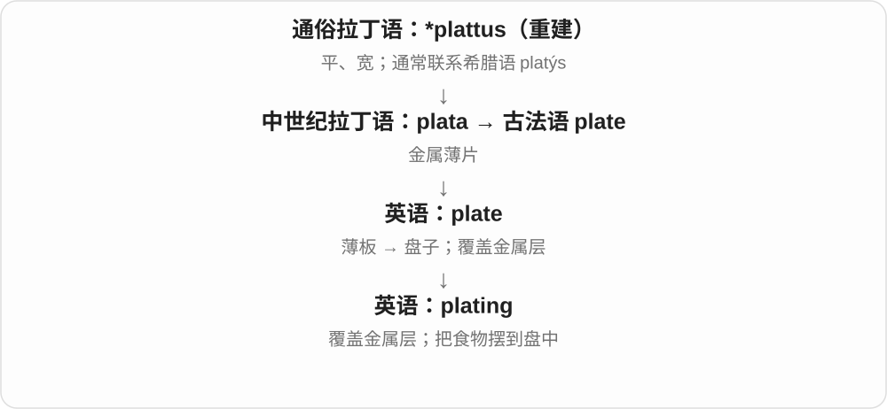

gold plating 是镀金层或镀金过程；food plating 是摆盘。名字相同，不表示食物表面需要镀金。

**常见搭配与例句**

chrome plating；gold plating；careful plating。

> The gold plating had worn away around the edges.

边缘处的镀金层已经磨掉了。

> The chef paid as much attention to plating as to flavour.

厨师对摆盘和味道同样重视。

**别混淆**

plating 可是过程，也可是覆层；plate 还可以是整块金属板，厚度与结构要看上下文。

### 17. platelet — 血小板；小板片

**音标**：英 /ˈpleɪtlət/；美 /ˈpleɪtlət/

**先抓住这个画面**

名字像“小盘片”；在血液里，这些很小的细胞碎片参与形成凝块，帮助堵住出血处。

**怎么拆**

plate 板片 + -let 小，先抓住小而扁的形状，再联系血液里的专门含义。

**怎么变成今天的意思**

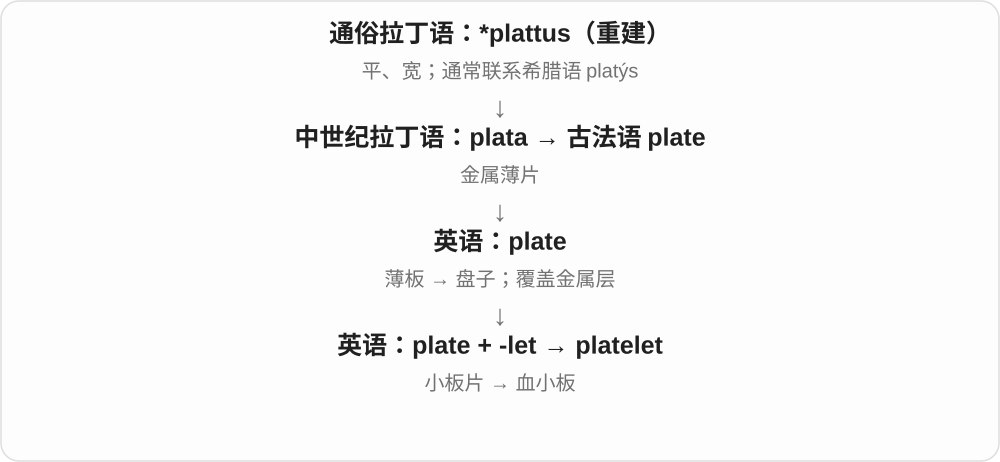

最常见于 platelet count“血小板计数”。血小板不是红细胞，也不是负责携氧的那一类血液成分。

**常见搭配与例句**

platelet count；blood platelets；platelet function。

> The blood test included a platelet count.

这次血液检查包括血小板计数。

> Platelets help form clots at the site of an injury.

血小板帮助在受损部位形成凝块。

**别混淆**

platelet 主要按形状命名；另一个术语 thrombocyte 更突出血凝块这一功能联系。

### 18. platen — 压印板；承纸辊；机器承压台

**音标**：英 /ˈplætən/；美 /ˈplætən/

**先抓住这个画面**

纸或材料靠在一个支撑面上，压力或印字才能稳稳地作用上去；这个部件就是 platen。

**怎么拆**

借自法语 platine，与 plat“平的”同族。机械名称沿用途扩展，形状不总是平板。

**怎么变成今天的意思**

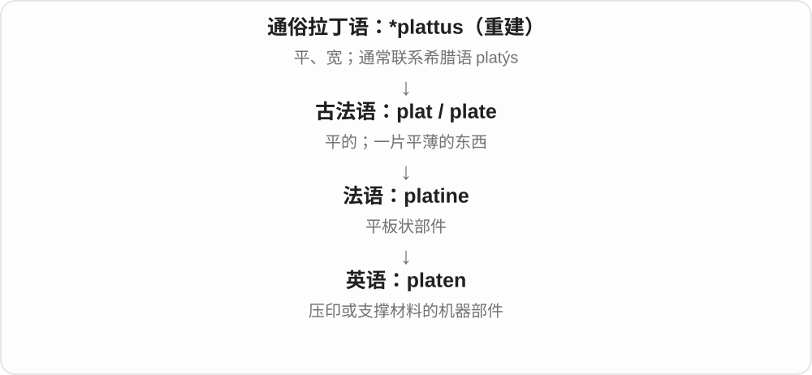

印刷机里可指压纸的板，打字机里常指承纸的圆辊，扫描仪里也可指放置原稿的玻璃台。

**常见搭配与例句**

the printer’s platen；a glass platen；a rubber platen。

> The technician cleaned the typewriter’s rubber platen.

技术员清洁了打字机的橡胶承纸辊。

> Place the document face down on the scanner’s glass platen.

把文件正面朝下放在扫描仪的玻璃台上。

**别混淆**

platen 是机器里的功能部件；plate 是更宽泛的板或盘，不能在说明书里任意互换。

### 19. plateful — 一盘的量；满满一盘

**音标**：英 /ˈpleɪtfʊl/；美 /ˈpleɪtfʊl/

**先抓住这个画面**

不数有多少克，直接拿一个盘子作为这一份食物的大小。

**怎么拆**

plate 盘子 + -ful 一容器的量；这个后缀只写一个 l。

**怎么变成今天的意思**

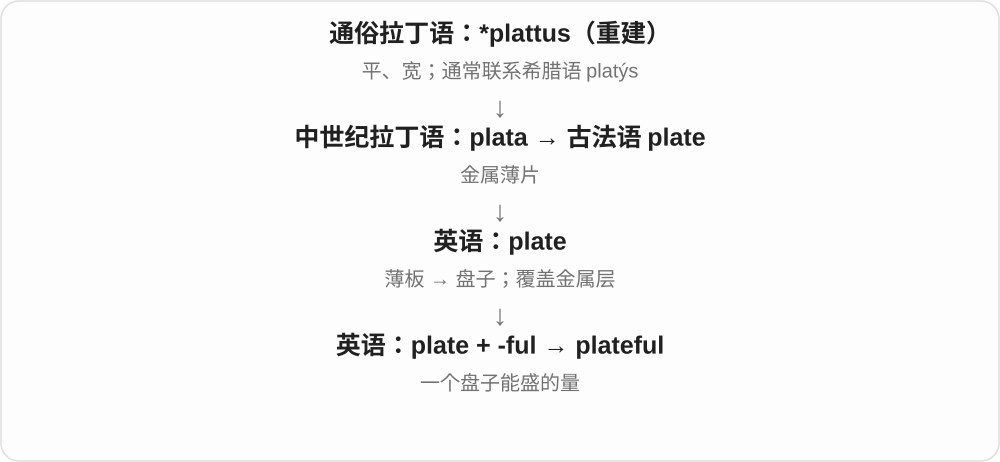

a plateful of rice 是一盘米饭；复数通常是 platefuls。实际分量随盘子大小和盛法变化。

**常见搭配与例句**

a plateful of vegetables；two platefuls of food。

> He ate a plateful of vegetables before touching the dessert.

他吃了一盘蔬菜，才开始吃甜点。

> She brought two platefuls of sandwiches to the table.

她端了两盘三明治上桌。

**别混淆**

plateful 说的是盘中食物的量；plate 是容器本身，也可借指一份食物。

### 20. boilerplate — 锅炉钢板；可反复套用的固定文字或代码

**音标**：英 /ˈbɔɪləpleɪt/；美 /ˈbɔɪlərpleɪt/

**先抓住这个画面**

同一块版反复印相同内容，后来就像把一段现成文字复制到很多文件里。

**怎么拆**

boiler 锅炉 + plate 金属板；原指制造锅炉的板材，后与可重复用于印刷的预制版片相联，发展出套话、固定模板内容义。

**怎么变成今天的意思**

常见于合同、新闻稿、程序代码。它可以高效地处理固定结构，也可能显得没有针对性。

**常见搭配与例句**

boilerplate language；boilerplate code；standard boilerplate。

> The letter was mostly boilerplate, with only the name changed.

信里大多是固定套用的文字，只改了名字。

> The framework generates the boilerplate code for new projects.

框架为新项目生成通用的基础代码。

**别混淆**

boilerplate 重复使用，未必没有用；platitude 多指看似有道理却空泛的陈词。

### 21. platinum — 铂；白金；白金级的

**音标**：英 /ˈplætɪnəm/；美 /ˈplætɪnəm/

**先抓住这个画面**

一种银白色金属；历史名称把它与银联系起来，但它是另一种元素。

**怎么拆**

来自近代拉丁语 platinum，改造自西班牙语 platina；platina 是 plata“银”的小称。plata 本有金属薄片一支，属于 plate 的同源网络。

**怎么变成今天的意思**

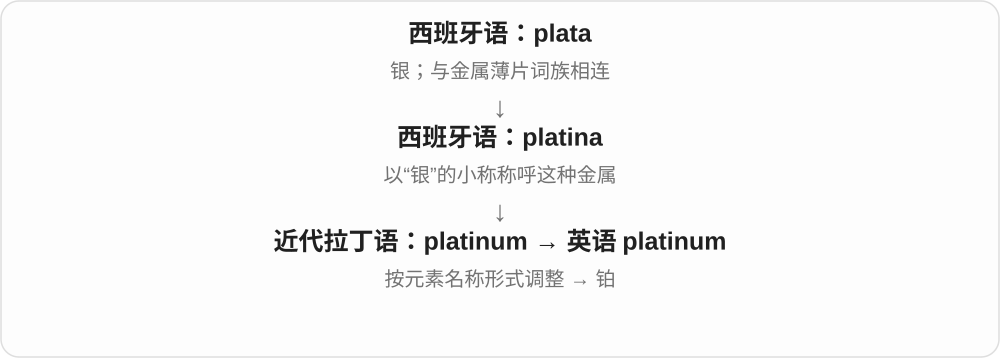

化学符号 Pt。platinum blonde 是浅得近乎银白的金发；platinum album 是白金唱片称号，具体认证门槛因地区和制度不同。

**常见搭配与例句**

a platinum ring；platinum blonde hair；a platinum album。

> The ring is made of platinum.

这枚戒指是铂金做的。

> Her latest album went platinum.

她最新的专辑获得了白金唱片认证。

**别混淆**

platinum 是铂；white gold 是白色金合金，不是同一种材料。

### 22. plaza — 广场；商业广场

**音标**：英 /ˈplɑːzə/；美 /ˈplɑːzə/，也读 /ˈplæzə/

**先抓住这个画面**

城市里留出一块开敞空间，人们能在那里会合、走动、休息。

**怎么拆**

借自西班牙语 plaza，与 place 一样追到拉丁语 platēa“宽街、开敞处”。

**怎么变成今天的意思**

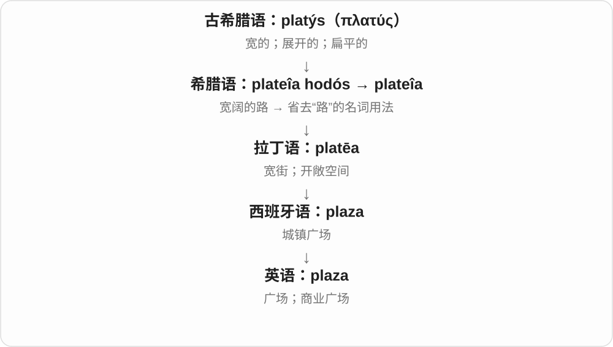

可指传统城市广场，也常出现在 shopping plaza 等商业建筑名称中；后者未必真的有一大片露天广场。

**常见搭配与例句**

a public plaza；a shopping plaza；gather in the plaza。

> People gathered in the plaza to watch the performance.

人们聚在广场上观看演出。

> A small café stands at the corner of the plaza.

广场一角有一家小咖啡馆。

**别混淆**

place 是最普通的地方；plaza 通常强调广场或相关商业场所。

### 23. plateau — 高原；稳定平台期；进入平台期

**音标**：英 /ˈplætəʊ/；美 /plæˈtoʊ/

**先抓住这个画面**

地势抬高了，上面却相对平；一条增长曲线爬了一段后变平，也像到了这样的台面。

**怎么拆**

借自法语 plateau，与古法语 platel“小平片”、plat“平面”相关，深层通常联系希腊语 platýs。

**怎么变成今天的意思**

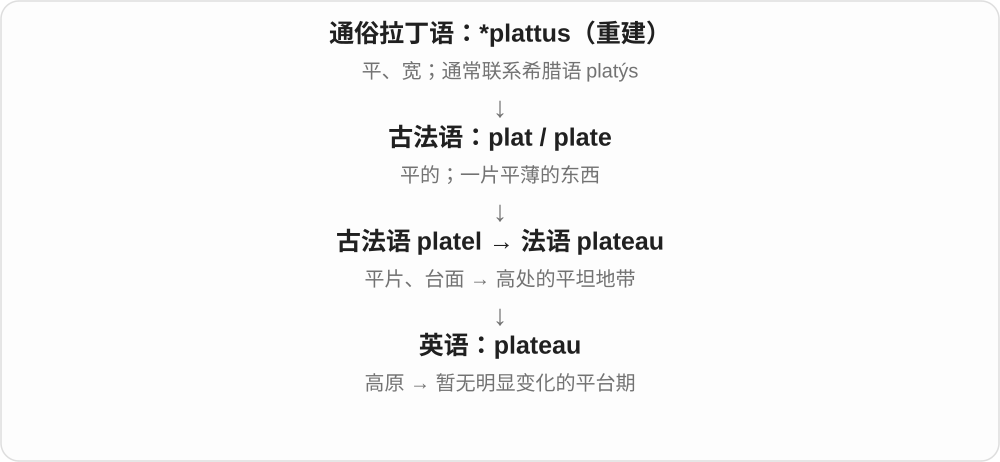

既能谈地貌，也能说学习、销量、表现进入平台期。动词 plateau 表示趋于稳定，不自动表示永远不再进步。

**常见搭配与例句**

reach a plateau；a high plateau；sales plateau。

> The road climbs onto a broad plateau.

公路向上延伸，进入一片宽阔的高原。

> After months of rapid improvement, her progress reached a plateau.

快速进步几个月后，她进入了平台期。

**别混淆**

a plateau 是一段相对平稳的阶段；a peak 是最高点，不一定随后保持平稳。

### 24. commonplace — 常见的；平常的；老生常谈

**音标**：英 /ˈkɒmənpleɪs/；美 /ˈkɑːmənpleɪs/

**先抓住这个画面**

一种想法或东西常常出现在大家面前，不再让人觉得新鲜。

**怎么拆**

common + place 是对拉丁语 locus communis“通用论题”的意译，后者又承接希腊语 koinos topos。这里讲的是观念翻译，不是拉丁字母逐步变成英语。

**怎么变成今天的意思**

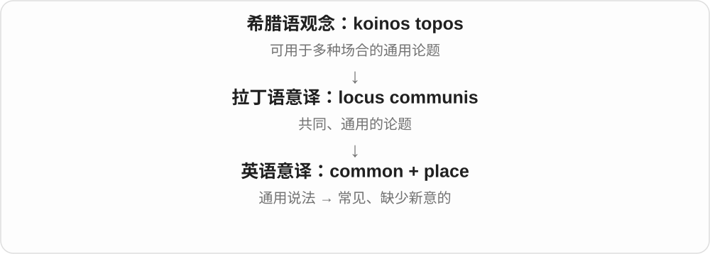

形容词可以只是中性地说常见，也可说平庸；名词 a commonplace 常指惯常说法。a commonplace book 是摘录有用文字的笔记本，并非“很普通的书”。

**常见搭配与例句**

become commonplace；a commonplace observation；a commonplace book。

> Online meetings have become commonplace.

线上会议已经变得很常见。

> She filled her commonplace book with quotations and observations.

她在摘录笔记本里写满了引文和观察。

**别混淆**

commonplace 说常见，未必无用；platitude 通常更强烈地批评一句话空泛、无新意。

### 25. platter — 大浅盘；一大盘食物；硬盘盘片

**音标**：英 /ˈplætə/；美 /ˈplætər/

**先抓住这个画面**

比个人餐盘更适合端到桌上供大家分食的宽大盘子。

**怎么拆**

来自古法语 platel、盎格鲁诺曼语 plater 一支，与 plateau 同源，但不是现代英语 plate 直接加表示人的 -er。

**怎么变成今天的意思**

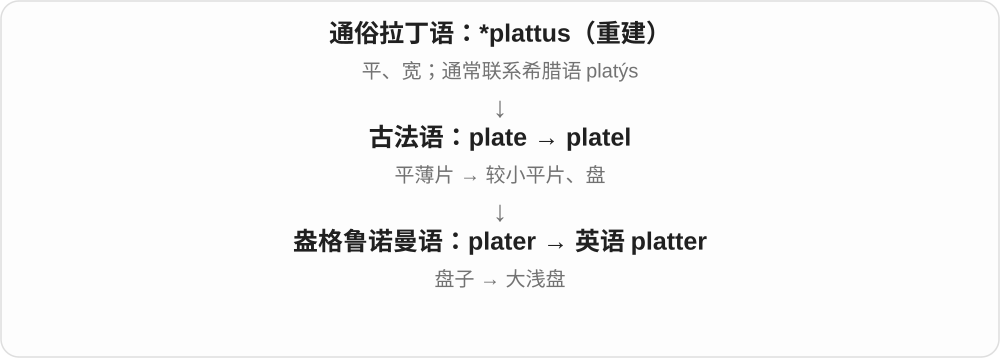

a platter of cheese 可以指盛奶酪的大盘，也可连带指整盘食物。计算机语境的 platter 是硬盘内部盘片。

**常见搭配与例句**

a serving platter；a seafood platter；a hard disk platter。

> They brought out a large platter of grilled vegetables.

他们端来一大盘烤蔬菜。

> She arranged the sandwiches on a serving platter.

她把三明治摆在一个上菜用的大盘里。

**别混淆**

platter 通常比普通 plate 大，多用于上菜、分享；不是所有平盘都非得叫 platter。

### 26. piazza — 意大利式广场；门廊（部分美式用法）

**音标**：英 /piˈætsə/；美 /piˈɑːtsə/，也有 /piˈætsə/ 等读法

**先抓住这个画面**

想象意大利城镇中央的开敞广场，周围是建筑、咖啡馆，人们在中间散步。

**怎么拆**

借自意大利语 piazza，来自拉丁语 platēa；与 place、plaza 是沿不同语言路线进入英语的同源词。

**怎么变成今天的意思**

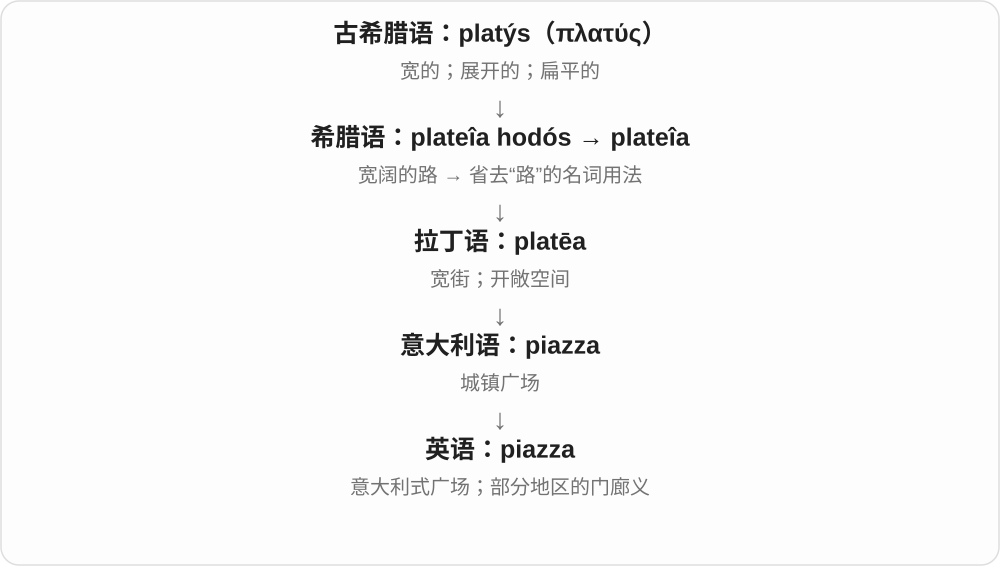

最常说意大利或具有意大利风格的广场；某些美国地区的旧用法指长门廊，阅读地方性作品时要留意。

**常见搭配与例句**

a crowded piazza；a café on the piazza。

> We sat in the piazza and watched people pass by.

我们坐在广场上，看人们来来往往。

> The hotel overlooks a small Italian piazza.

这家酒店俯瞰一座小小的意大利广场。

**别混淆**

pizza 是披萨，piazza 是广场，拼写和读音都不同。

### 27. platypus — 鸭嘴兽

**音标**：英 /ˈplætɪpəs/；美 /ˈplætɪpəs/

**先抓住这个画面**

它有鸭嘴般的嘴和适合游泳的蹼足；英文这个名字实际抓住的是“扁宽的脚”。

**怎么拆**

来自近代拉丁语属名 Platypus，依据希腊语 platýpous：platýs 宽平 + poús 脚。不是英语 plate + pus。

**怎么变成今天的意思**

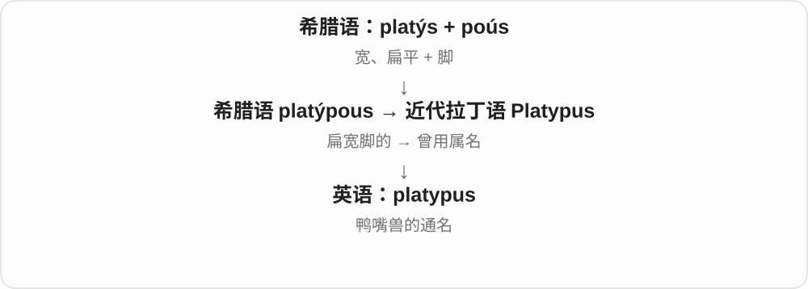

是澳大利亚产的产卵哺乳动物。原属名与已用的甲虫属名冲突，分类名后来改动，但 platypus 留作普通名称。

**常见搭配与例句**

a wild platypus；platypus habitat；platypuses。

> We saw a platypus swimming near the riverbank.

我们看见一只鸭嘴兽在河岸附近游泳。

> The guide explained that the platypus is an egg-laying mammal.

向导解释说，鸭嘴兽是一种产卵哺乳动物。

**别混淆**

中文名抓“鸭嘴”，英文名抓“扁脚”；两种命名可以看同一动物的不同特征。

### 28. platitude — 陈词滥调；空泛套话

**音标**：英 /ˈplætɪtjuːd/；美 /ˈplætɪtuːd/

**先抓住这个画面**

话听起来四平八稳，却没有给眼前的问题增加什么理解，就像一块没有起伏的平面。

**怎么拆**

借自法语 platitude“平淡、乏味”，来自 plat“平的”；不是把英语 plate 盘子直接加一个后缀。

**怎么变成今天的意思**

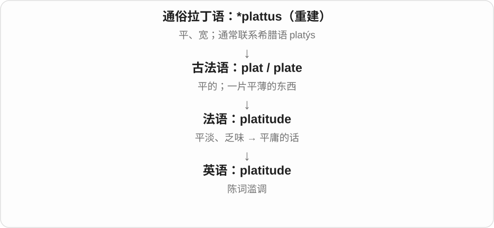

常批评把人人早已知道的空话说得像重大启发。比如别人需要具体办法，你只说“努力就会成功”，在那个场景中就可能是 platitude。

**常见搭配与例句**

empty platitudes；offer platitudes；repeat a platitude。

> She wanted practical advice, not empty platitudes.

她想要实际建议，不是空泛套话。

> The speech was full of platitudes about working together.

演讲充满了关于携手合作的陈词滥调。

**别混淆**

a proverb 是谚语，未必空泛；platitude 强调眼下这句话陈旧、没提供帮助。

### 29. plaice — 鲽鱼；一种食用比目鱼

**音标**：英 /pleɪs/；美 /pleɪs/

**先抓住这个画面**

一条身体扁平、贴近海底活动的鱼，名字通常被联系到“宽、扁”的形状。

**怎么拆**

经古法语 plaiz / plaise 来自后期拉丁语 platessa；platessa 与希腊语 platýs 的联系常被提出，但更深这一步并不完全确定。

**怎么变成今天的意思**

常见于海洋生物、菜市场和菜单。作为鱼名，复数常仍用 plaice；不同地区可能指具体不同的相关鱼种。

**常见搭配与例句**

grilled plaice；a fillet of plaice；catch plaice。

> The restaurant serves grilled plaice with lemon.

餐厅供应配柠檬的烤鲽鱼。

> The plaice rested on the sandy seabed.

那条鲽鱼停在沙质海底。

**别混淆**

plaice 与 place 同音，但一个是鱼，一个是地方；历史路线也不同。

### 30. platitudinous — 满是陈词滥调的；空泛平庸的

**音标**：英 /ˌplætɪˈtjuːdɪnəs/；美 /ˌplætɪˈtuːdənəs/

**先抓住这个画面**

不是偶尔冒出一句套话，而是整段表达都在重复那些听过无数次、又没有具体内容的话。

**怎么拆**

platitude 的派生形容词，采用 platitudin- 词干形式 + -ous；不是独立的拉丁古词原封不动进入英语。

**怎么变成今天的意思**

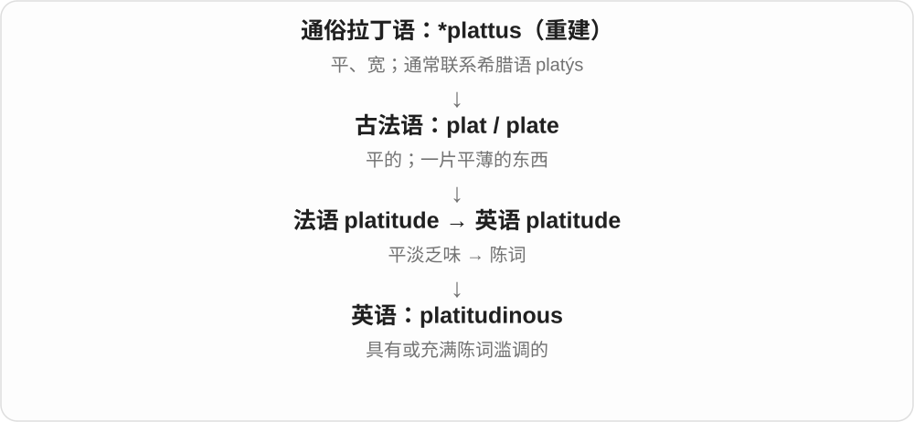

较书面、明显贬义，可修饰 speech、remarks、advice。学习时可先掌握更常见的 platitude。

**常见搭配与例句**

platitudinous remarks；a platitudinous speech。

> The review dismissed the ending as sentimental and platitudinous.

评论认为结尾煽情而且充满套话。

> His platitudinous advice did little to solve the problem.

他的空泛建议对解决问题几乎没有帮助。

**别混淆**

plain 是朴素明白；platitudinous 是空泛陈旧。大白话也能有具体内容，并不等于套话。

### 31. platysma — 颈阔肌

**音标**：英 /pləˈtɪzmə/；美 /pləˈtɪzmə/

**先抓住这个画面**

颈部浅层的一片宽而薄的肌肉，像展开的薄片，这就是名称抓住的形状。

**怎么拆**

借自新拉丁语 platysma，来自希腊语 plátysma“平展开的东西”，与 platýnō“使宽”、platýs“宽”相关。

**怎么变成今天的意思**

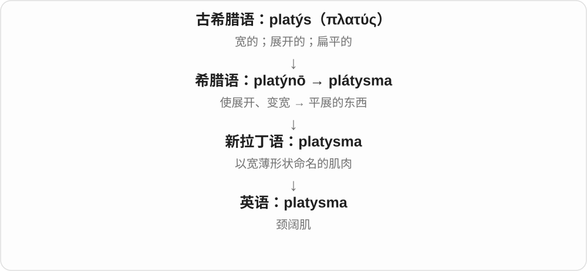

见于解剖学材料，描述颈部浅层肌肉；不要把它当作整条颈部所有肌肉的统称。

**常见搭配与例句**

the platysma muscle；contraction of the platysma。

> The diagram labels the platysma at the front of the neck.

图示标出了颈前部的颈阔肌。

> The anatomy class examined the thin sheet of the platysma.

解剖课观察了颈阔肌这层薄薄的肌肉。

**别混淆**

platy- 在这里说宽薄，不是 plate“餐盘”的缩写；它与许多形状术语共享希腊来源。

### 32. platyhelminth — 扁形动物；扁虫

**音标**：英 /ˌplætɪˈhelmɪnθ/；美 /ˌplætɪˈhelmɪnθ/

**先抓住这个画面**

名字把两块意思直接摆出来：“扁平”加“虫”。看身体形态就能找到记忆入口。

**怎么拆**

来自分类名称 Platyhelminthes，使用希腊来源 platy- 宽、扁 + helminth- 虫。

**怎么变成今天的意思**

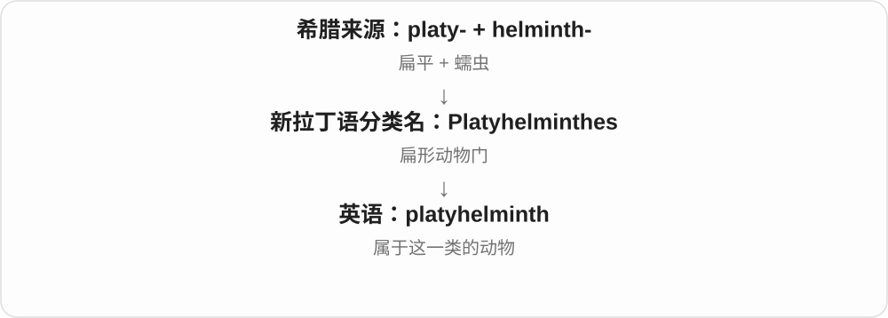

是 flatworm 的专业对应词。这个类群有自由生活的成员，也有寄生的成员，不能一概等于寄生虫。

**常见搭配与例句**

a platyhelminth；platyhelminth anatomy；parasitic platyhelminths。

> The specimen was identified as a platyhelminth.

这个标本被鉴定为扁形动物。

> The course compares free-living and parasitic platyhelminths.

课程比较自由生活与寄生生活的扁形动物。

**别混淆**

flatworm 用日常英语成分，platyhelminth 用希腊来源成分；它们都抓住扁平的虫这一画面。

## 这一组要分清什么

**place / plaza / piazza**：普通的地方、位置 / 广场或商业广场 / 常指意大利式广场。

**replace / displace / misplace**：换上或放回 / 移开、挤走 / 放错地方。

**plate / platter / platen / plateau**：盘或薄板 / 大浅盘 / 机器承压或承纸部件 / 高原、平台期。

**platitude / commonplace / boilerplate**：空泛陈词 / 常见事物或惯常说法 / 可重复使用的固定文字或代码；后两者不一定没有用。

**platypus** 的名字说“扁脚”，不是“鸭嘴”。**plaice / place** 同音，但一个说鱼，一个说地方。

## 串起来练习

**Please replace the cracked plate and place the sandwiches on the platter.**

请换掉裂了的盘子，再把三明治摆到上菜用的大盘里。replace 是换掉，place 是放置，plate 是盘，platter 是供大家分食的大浅盘。
