# 0128 · man-, manu- — 手；用手处理、掌控、交付

[逐词精讲目录](../00_逐词精讲目录.md) · [总目录](../00_总目录_按常用程度.md)

## 核心词根与来源

这一族来自拉丁语 manus“手”，不是英语 man“人”。先抓住几个真实分支：用手做是 manual、manufacture；握住是 maintain；驾驭马匹再到处理事务是 manage；把职责交出去是 mandate。不同词借入英语的时间、语言和形式不同，不要只按现代拼写硬拆。

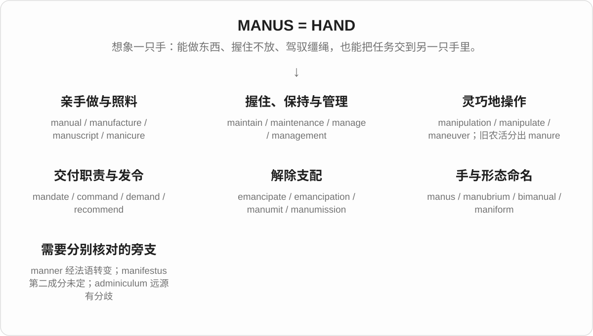

## 词形与演化规律

**man- / manu- / mani-**：manus 及其构词形式；可见于 manual、manipulation、manicure

**main-**：拉丁 manus 经法语音变后的形式；见 maintain、mortmain

**mand-**：mandāre“委托、命令”这一支，传统解释联系把事交到手里

**manus 与 man**：拉丁“手”与日耳曼“人”来源不同；man-made、manhood 不能因此归进来

## 单词速览（按词族由简到繁）

同一基础词的相关扩展放在一起，先读基础形式，再读扩展；各组之间优先读常用的。具体词源关系见各词讲解。

| 单词 | 音标 | 核心意思 |
|---|---|---|
| [manage](#w-10) | /ˈmænɪdʒ/ | 管理；处理；设法做到；勉强应付 |
| [management](#w-1) | /ˈmænɪdʒmənt/ | 管理；经营；管理层 |
| [mismanagement](#w-36) | /ˌmɪsˈmænɪdʒmənt/ | 管理不善；经营失当 |
| [manager](#w-2) | 英 /ˈmænɪdʒə/；美 /ˈmænɪdʒər/ | 经理；主管；管理程序 |
| [managerial](#w-25) | 英 /ˌmænɪˈdʒɪəriəl/；美 /ˌmænɪˈdʒɪriəl/ | 管理方面的；经理、主管的 |
| [manageable](#w-28) | /ˈmænɪdʒəbəl/ | 能处理的；可以控制的；难度适中的 |
| [unmanageable](#w-46) | /ʌnˈmænɪdʒəbəl/ | 难以处理的；无法控制的 |
| [micromanage](#w-51) | 英 /ˈmaɪkrəʊˌmænɪdʒ/；美 /ˈmaɪkroʊˌmænɪdʒ/ | 过细管理；对细节过度干预 |
| [micromanagement](#w-55) | /ˌmaɪkrəʊˈmænɪdʒmənt/；美 /ˌmaɪkroʊˈmænɪdʒmənt/ | 过细管理；事事插手的管理 |
| [mismanage](#w-65) | /ˌmɪsˈmænɪdʒ/ | 管理不善；处理失当 |
| [demand](#w-3) | 英 /dɪˈmɑːnd/；美 /dɪˈmænd/ | 强烈要求；需要；需求 |
| [demanding](#w-14) | 英 /dɪˈmɑːndɪŋ/；美 /dɪˈmændɪŋ/ | 要求高的；费力的；苛求的 |
| [command](#w-4) | 英 /kəˈmɑːnd/；美 /kəˈmænd/ | 命令；指挥；控制；掌握；赢得 |
| [commander](#w-11) | 英 /kəˈmɑːndə/；美 /kəˈmændər/ | 指挥官；统领；某些军种的中校军衔 |
| [commandant](#w-33) | 英 /ˌkɒmənˈdɑːnt/；美 /ˌkɑːmənˈdænt/ | 司令；驻地或训练机构负责人 |
| [commandment](#w-35) | 英 /kəˈmɑːndmənt/；美 /kəˈmændmənt/ | 诫命；戒律；郑重的命令 |
| [maintain](#w-5) | /meɪnˈteɪn/ | 维持；维护；保养；坚持说 |
| [maintainable](#w-53) | /meɪnˈteɪnəbəl/ | 能够维持的；便于维护的 |
| [maintainability](#w-54) | /meɪnˌteɪnəˈbɪləti/ | 可维护性；维护难易程度 |
| [commend](#w-31) | /kəˈmend/ | 赞扬；推荐；郑重托付 |
| [commendation](#w-39) | 英 /ˌkɒmenˈdeɪʃən/；美 /ˌkɑːmenˈdeɪʃən/ | 表扬；嘉奖；推荐、赞许 |
| [recommend](#w-6) | /ˌrekəˈmend/ | 推荐；建议 |
| [recommendation](#w-16) | /ˌrekəmenˈdeɪʃən/ | 建议；推荐；推荐信、推荐意见 |
| [manufacture](#w-17) | /ˌmænjuˈfækt͡ʃɚ/ | 制造；编造 |
| [manufacturing](#w-7) | 英 /ˌmænjʊˈfæktʃərɪŋ/；美 /ˌmænjəˈfæktʃərɪŋ/ | 制造；制造业；生产方面的 |
| [manufacturer](#w-13) | /ˌmænjʊˈfæktʃəɹə/ | 制造商 |
| [maintenance](#w-8) | /ˈmeɪntənəns/ | 维护；保养；生活供养 |
| [manner](#w-9) | 英 /ˈmænə/；美 /ˈmænər/ | 方式；态度、举止；复数 manners：礼貌 |
| [mannered](#w-37) | 英 /ˈmænəd/；美 /ˈmænərd/ | 做作的；刻意雕琢的；具有某种举止的 |
| [mannerism](#w-50) | 英 /ˈmænərɪzəm/；美 /ˈmænərɪzəm/ | 习惯性的小动作或说话方式；矫饰；风格主义 |
| [mannerly](#w-64) | 英 /ˈmænəli/；美 /ˈmænərli/ | 有礼貌的；举止得体的 |
| [unmannerly](#w-72) | 英 /ʌnˈmænəli/；美 /ʌnˈmænərli/ | 无礼的；不懂礼貌的 |
| [manual](#w-12) | /ˈmænjuəl/ | 手动的；人工的；体力劳动的；说明手册 |
| [manually](#w-21) | /ˈmænjuəli/ | 手动地；人工地 |
| [bimanual](#w-70) | /baɪˈmænjuəl/ | 双手的；需要双手配合的 |
| [mandate](#w-18) | /ˈmændeɪt/ | 正式命令；授权、委托；要求、授权 |
| [mandatory](#w-15) | 英 /ˈmændətəri/；美 /ˈmændəˌtɔːri/ | 强制的；必须遵守的 |
| [manuscript](#w-19) | /ˈmænjəskrɪpt/ | 手稿；尚未出版的文稿 |
| [maniple](#w-67) | 英 /ˈmænɪpəl/；美 /ˈmænəpəl/ | 古罗马军队小单位；宗教礼服的臂带；旧：一把 |
| [manipulate](#w-22) | 英 /məˈnɪpjʊleɪt/；美 /məˈnɪpjəleɪt/ | 操作、摆弄；操控；篡改 |
| [manipulation](#w-20) | 英 /məˌnɪpjuˈleɪʃən/；美 /məˌnɪpjəˈleɪʃən/ | 操作、处理；操纵、摆布 |
| [manipulative](#w-32) | 英 /məˈnɪpjələtɪv/；美 /məˈnɪpjəleɪtɪv/ | 善于操控他人的；操作性的；数学操作教具 |
| [manipulator](#w-43) | 英 /məˈnɪpjʊleɪtə/；美 /məˈnɪpjəleɪtər/ | 操纵者；机械操作臂；操作装置 |
| [manifest](#w-23) | /ˈmænɪfest/ | 明显的；显现、表明；货物或乘客清单 |
| [manifestation](#w-27) | /ˌmænɪfeˈsteɪʃən/ | 表现；显现；体现出来的迹象 |
| [manifestly](#w-47) | /ˈmænɪfestli/ | 明显地；显然 |
| [manifesto](#w-24) | 英 /ˌmænɪˈfestəʊ/；美 /ˌmænɪˈfestoʊ/ | 宣言；公开的原则、主张说明 |
| [maneuver](#w-26) | 英 /məˈnuːvə/；美 /məˈnuːvər/ | 巧妙移动、操控；策略；调动、演习 |
| [maneuverable](#w-49) | 英 /məˈnuːvərəbəl/；美 /məˈnuːvərəbəl/ | 容易操控转向的；机动灵活的 |
| [maneuverability](#w-48) | /məˌnuːvərəˈbɪləti/ | 机动性；操控灵活性 |
| [commando](#w-29) | 英 /kəˈmɑːndəʊ/；美 /kəˈmændoʊ/ | 突击队员；突击队 |
| [emancipate](#w-52) | 英 /ɪˈmænsɪpeɪt/；美 /ɪˈmænsəpeɪt/ | 解放；使摆脱控制或束缚 |
| [emancipation](#w-30) | /ɪˌmænsɪˈpeɪʃən/ | 解放；摆脱束缚；获得独立地位 |
| [emancipated](#w-45) | 英 /ɪˈmænsɪpeɪtɪd/；美 /ɪˈmænsəpeɪtɪd/ | 获得解放的；摆脱束缚的 |
| [emancipatory](#w-60) | 英 /ɪˈmænsɪpeɪtəri/；美 /ɪˈmænsəpəˌtɔːri/ | 旨在解放的；有助于摆脱束缚的 |
| [emancipator](#w-63) | 英 /ɪˈmænsɪpeɪtə/；美 /ɪˈmænsəpeɪtər/ | 解放者；倡导解放的人 |
| [manure](#w-34) | 英 /məˈnjʊə/；美 /məˈnʊr/ | 粪肥；施肥 |
| [manoeuvre](#w-38) | 英 /məˈnuːvə/；美 /məˈnuːvər/ | 巧妙移动、操控；策略；演习 |
| [manoeuvrable](#w-59) | /məˈnuːvərəbəl/ | 操控灵活的；容易调整位置的 |
| [manicure](#w-40) | 英 /ˈmænɪkjʊə/；美 /ˈmænɪkjʊr/ | 修甲；手部指甲护理 |
| [manicured](#w-44) | 英 /ˈmænɪkjʊəd/；美 /ˈmænɪkjʊrd/ | 修整精致的；做过护理的 |
| [manicurist](#w-58) | 英 /ˈmænɪkjʊərɪst/；美 /ˈmænɪkjʊrɪst/ | 美甲师；修甲师 |
| [remand](#w-41) | 英 /rɪˈmɑːnd/；美 /rɪˈmænd/ | 发回重审或进一步处理；使候审；还押 |
| [manus](#w-42) | 英 /ˈmeɪnəs/，也 /ˈmænəs/；美 /ˈmeɪnəs/ | 手；脊椎动物前肢末端；古罗马的特定家族支配权 |
| [mandamus](#w-56) | /mænˈdeɪməs/ | 履行职责令；强制履行令 |
| [manumit](#w-71) | 英 /ˌmænjʊˈmɪt/；美 /ˌmænjəˈmɪt/ | 释放被奴役者；解除奴役 |
| [manumission](#w-57) | 英 /ˌmænjʊˈmɪʃən/；美 /ˌmænjəˈmɪʃən/ | 释放被奴役者；奴隶解放手续 |
| [amanuensis](#w-61) | /əˌmænjuˈensɪs/ | 代笔记录者；听写员；抄写助手 |
| [countermand](#w-62) | 英 /ˌkaʊntəˈmɑːnd/；美 /ˈkaʊntərˌmænd/ | 撤销命令；下反令取消 |
| [mortmain](#w-66) | 英 /ˈmɔːtmeɪn/；美 /ˈmɔːrtmeɪn/ | 永久法人持产；旧制下的“死手”持有 |
| [manacle](#w-68) | /ˈmænəkəl/ | 手铐；束缚；给……戴上手铐 |
| [manubrium](#w-69) | 英 /məˈnjuːbriəm/；美 /məˈnuːbriəm/ | 柄状部分；胸骨柄；水母的垂管 |
| [adminicle](#w-73) | /ædˈmɪnɪkəl/ | 辅助物；佐证；旧：支撑物 |
| [bimanous](#w-74) | /ˈbɪmənəs/，也 /baɪˈmeɪnəs/ | 有两只手的；旧分类中的双手类的 |
| [mainour](#w-75) | 英 /ˈmeɪnə/；美 /ˈmeɪnər/ | 旧：当场从窃贼身上查获的赃物 |
| [manifer](#w-76) | 美 /ˈmænəˌfer/，也 /ˈmænəfər/ | 骑士护手铁套；持缰手的护手 |
| [maniform](#w-77) | 英 /ˈmænɪˌfɔːm/；美 /ˈmænəˌfɔːrm/ | 手形的；形似手的 |
| [maniraptoran](#w-78) | 构词参考读法 /ˌmænɪˈræptərən/ | 手盗龙类的；手盗龙类成员 |
| [maniraptoriform](#w-79) | 构词参考读法 /ˌmænɪˈræptərɪfɔːrm/ | 手盗龙形类的；手盗龙形类成员 |
| [mansuetude](#w-80) | 英 /ˈmænswɪtʃuːd/；美 /ˈmænswɪtuːd/ | 温顺；温和；柔顺 |
| [manuary](#w-81) | 美 /ˈmænjəˌweri/ | 旧：手工的；靠手工作的；手工劳动者 |
| [manubrial](#w-82) | 英 /məˈnjuːbriəl/；美 /məˈnuːbriəl/ | 胸骨柄的；柄状结构的 |
| [manuduction](#w-83) | 美 /ˌmænjəˈdʌkʃən/ | 旧：引导；入门指引 |
| [manuport](#w-84) | 构词参考读法 /ˈmænjuˌpɔːrt/ | 人为搬运而未加工的天然物 |
| [manège](#w-85) | /mæˈneʒ/，也 /məˈneɪʒ/ | 骑术训练场；骑术；训马术 |
| [quadrumanous](#w-86) | 美 /kwɑːˈdruːmənəs/ | 四手的；旧：有四个抓握性肢端的 |

## 逐词讲解

### 1. manage — 管理；处理；设法做到；勉强应付

**音标**：/ˈmænɪdʒ/

**先抓住这个画面**

manage 的老场景是手里握着缰绳驾驭马；今天像把难办的事抓在手里，调整着把它做成。

**怎么拆**

经意大利 maneggiare、maneggio 和法语 manège，与 manus“手”相连；不是 man + age。

**怎么变成今天的意思**

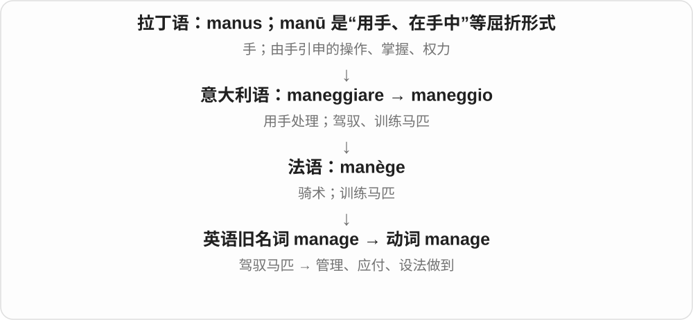

manage a team 是管团队；manage to finish 是终于设法完成；I can manage 是我应付得来。manage to lose your keys 又可能带“你竟然还能弄丢”的反讽。

**常见搭配与例句**

manage a project；manage to do；manage without help；manage on a small budget。

> She manages a team of six people.

她管理着一个六人团队。

> We managed to catch the last train.

我们设法赶上了末班车。

> I can manage without a car for a few days.

几天没有车，我还应付得来。

**别混淆**

try to do 只表示尝试；manage to do 通常表示已经成功，常暗含有困难。

### 2. management — 管理；经营；管理层

**音标**：/ˈmænɪdʒmənt/

**先抓住这个画面**

management 像把人、时间和资源协调到一起，让事情按计划运转；也能指负责这样做的那群人。

**怎么拆**

manage + -ment；manage 最初的驾驭画面经意大利语、法语而来。

**怎么变成今天的意思**

time management 是管理时间；senior management 是高层管理人员。第二种用法指人，不是抽象制度。

**常见搭配与例句**

project management；time management；senior management。

> Good time management leaves room for unexpected tasks.

把时间安排好，就能给突发任务留出余地。

> The staff raised the issue with management.

员工把问题反映给了管理层。

**别混淆**

administration 常偏制度运行、日常行政；management 更突出组织资源并负责结果，实际有重叠。

### 3. mismanagement — 管理不善；经营失当

**音标**：/ˌmɪsˈmænɪdʒmənt/

**先抓住这个画面**

mismanagement 像资源明明在手，却因为安排混乱、判断失误或不当使用而把事情弄糟。

**怎么拆**

mis-（错误、不当）+ management。

**怎么变成今天的意思**

可指组织、资金或项目管理失当。它描述问题的性质，不自动证明每次都出于故意。

**常见搭配与例句**

financial mismanagement；serious mismanagement；accusations of mismanagement。

> Poor records contributed to financial mismanagement.

记录混乱加剧了财务管理不善。

> The report blamed the delay on mismanagement of the project.

报告把延误归因于项目管理不善。

**别混淆**

misconduct 强调不当行为；mismanagement 具体指管理出了问题，可能是能力差也可能涉及不当行为。

### 4. manager — 经理；主管；管理程序

**音标**：英 /ˈmænɪdʒə/；美 /ˈmænɪdʒər/

**先抓住这个画面**

manager 是负责把某件事管起来的人：安排工作、协调问题，通常还要对结果负责。

**怎么拆**

manage + -er，去掉结尾 e 再加 -er。

**怎么变成今天的意思**

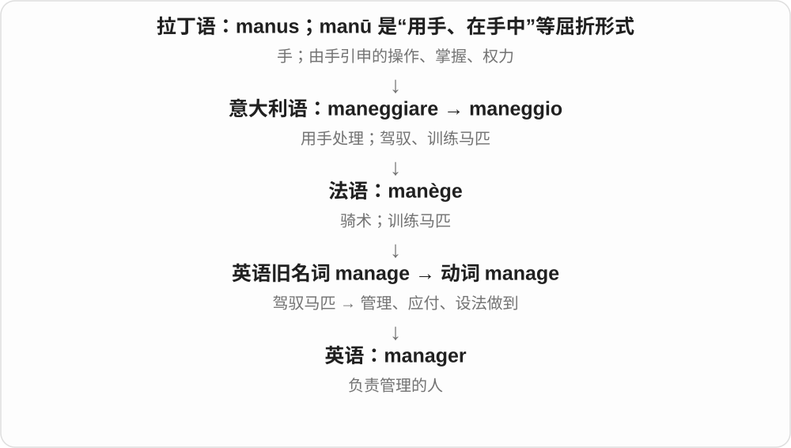

不只公司有 manager，球队、艺人和项目也有。file manager 是管理文件的程序，名称从人的职责转到软件功能。

**常见搭配与例句**

a project manager；a store manager；a file manager。

> The manager adjusted the schedule after two people called in sick.

两个人请病假后，经理调整了排班。

> Open the file manager to find the downloaded document.

打开文件管理器，找到下载的文档。

**别混淆**

owner 是所有者；manager 是管理者。老板可以亲自管理，也可以另外聘请经理。

### 5. managerial — 管理方面的；经理、主管的

**音标**：英 /ˌmænɪˈdʒɪəriəl/；美 /ˌmænɪˈdʒɪriəl/

**先抓住这个画面**

managerial 把注意力放在“管人、管事”的职责上，像排计划、协调资源、作出组织决定。

**怎么拆**

manager + -ial，形成与管理者、管理职责相关的形容词。

**怎么变成今天的意思**

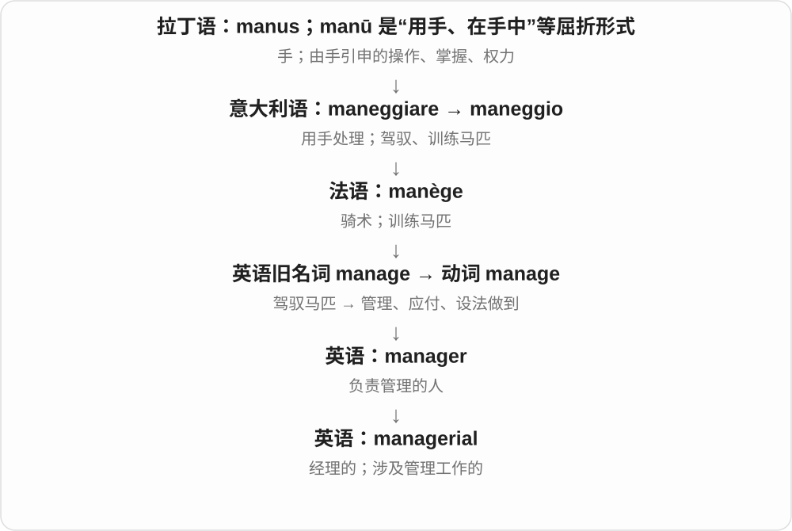

managerial skills 是管理能力；a managerial position 是管理岗位，不要求职位名称一定写 manager。

**常见搭配与例句**

managerial responsibility；managerial skills；a managerial role。

> The promotion brought new managerial responsibilities.

晋升带来了新的管理职责。

> She has technical expertise but little managerial experience.

她有专业技术知识，但管理经验不多。

**别混淆**

technical skills 是专业技术能力；managerial skills 是组织协调能力，一个岗位可能同时需要两者。

### 6. manageable — 能处理的；可以控制的；难度适中的

**音标**：/ˈmænɪdʒəbəl/

**先抓住这个画面**

manageable 像把一大堆工作分成几小块，每块都在你现在能处理的范围内。

**怎么拆**

manage + -able；保留 e，帮助维持 g 的软音。

**怎么变成今天的意思**

可说工作量、费用、症状或头发。manageable 不一定轻松，只是尚能处理。

**常见搭配与例句**

a manageable workload；manageable costs；manageable steps。

> Break the project into manageable tasks.

把项目拆成可以应付的小任务。

> The monthly cost is high but still manageable.

每月费用较高，但仍在可以承担的范围内。

**别混淆**

easy 是容易；manageable 是应付得了，事情仍可能需要努力。

### 7. unmanageable — 难以处理的；无法控制的

**音标**：/ʌnˈmænɪdʒəbəl/

**先抓住这个画面**

unmanageable 像任务多到已经抓不住，或头发怎么梳都不服帖：现有办法难以把它管好。

**怎么拆**

un-（不）+ manageable。

**怎么变成今天的意思**

可以形容规模、工作量、行为或物品状态。常说明相对当前能力和条件来说难以处理，不一定永远无解。

**常见搭配与例句**

an unmanageable workload；unmanageable debt；unmanageable hair。

> The growing workload became unmanageable.

不断增加的工作量变得难以应付。

> The small team could not cope with such an unmanageable system.

这个小团队应付不了如此难以管理的系统。

**别混淆**

unmanaged 是没有在管理；unmanageable 是很难管得住，不能仅凭前缀就当成同一种状态。

### 8. micromanage — 过细管理；对细节过度干预

**音标**：英 /ˈmaɪkrəʊˌmænɪdʒ/；美 /ˈmaɪkroʊˌmænɪdʒ/

**先抓住这个画面**

micromanage 就像把任务交出去后，仍攥着对方的每根手指，规定每一步怎么动。

**怎么拆**

现代可拆 micro- + manage；实际先有 micromanagement，再去掉名词尾部逆构成动词。

**怎么变成今天的意思**

常说 micromanage someone 或 micromanage a project；关注的是过度控制执行过程。

**常见搭配与例句**

micromanage a team；micromanage every detail；stop micromanaging。

> Give the team a clear goal without micromanaging every step.

把目标说清楚就好，别对团队的每一步都指手画脚。

> She trusts her staff and rarely micromanages them.

她信任员工，很少事事干预。

**别混淆**

manage 是管理；micromanage 通常是在批评管理者管得过细。

### 9. micromanagement — 过细管理；事事插手的管理

**音标**：/ˌmaɪkrəʊˈmænɪdʒmənt/；美 /ˌmaɪkroʊˈmænɪdʒmənt/

**先抓住这个画面**

micromanagement 像把显微镜架在每个员工手边，连很小的步骤都要过问，让人没有自主空间。

**怎么拆**

micro-（微小）+ management；英语动词 micromanage 是由这个名词逆构出来的。

**怎么变成今天的意思**

通常带批评意味，问题在于干预到不必要的程度，并不是说所有细节检查都不好。

**常见搭配与例句**

avoid micromanagement；excessive micromanagement；a culture of micromanagement。

> Constant approval requests turned routine work into an exercise in micromanagement.

不断要求请示批准，让日常工作变成了事事受管的流程。

> Clear goals can reduce the need for micromanagement.

目标明确后，就不必事事盯着细节管。

**别混淆**

supervision 是监督；micromanagement 强调过度紧盯细节、削弱执行者自主权。

### 10. mismanage — 管理不善；处理失当

**音标**：/ˌmɪsˈmænɪdʒ/

**先抓住这个画面**

mismanage 像握着缰绳却乱拉，资源和人手没有被妥善安排，结果偏离了本来可以达到的目标。

**怎么拆**

mis-（错误、不当）+ manage。

**怎么变成今天的意思**

常接 business、funds、project 等对象。既可能是无能失误，也可能涉及不当管理，词本身不自动指控犯罪。

**常见搭配与例句**

mismanage funds；mismanage a business；badly mismanaged。

> The committee mismanaged the limited budget.

委员会没有管好有限的预算。

> The project failed because it was badly mismanaged.

项目因为管理严重失当而失败。

**别混淆**

misunderstand 是理解错；mismanage 是管理或安排出了问题，即使理解了目标也可能管理不善。

### 11. demand — 强烈要求；需要；需求

**音标**：英 /dɪˈmɑːnd/；美 /dɪˈmænd/

**先抓住这个画面**

demand 像把一项需要推到对方面前：“这件事必须满足。”放到市场里，就是人们愿意购买的需要。

**怎么拆**

拉丁 dēmandāre“委托、交付”，经法语 demander“询问、要求”进入英语；名词另经法语 demande 借入；de- 在此不能机械译成“向下”。

**怎么变成今天的意思**

demand an explanation 是强烈要求解释；a job demands patience 是工作需要耐心；in demand 是很抢手。

**常见搭配与例句**

demand that；demand an answer；supply and demand；in demand。

> The residents demanded an explanation for the delay.

居民强烈要求解释延误的原因。

> The work demands patience and careful attention.

这项工作需要耐心和细心。

> Demand for smaller apartments has increased.

对小户型公寓的需求增加了。

**别混淆**

ask 可以礼貌询问；demand 通常更强硬。need 表示需要，demand 还可体现外部压力或购买需求。

### 12. demanding — 要求高的；费力的；苛求的

**音标**：英 /dɪˈmɑːndɪŋ/；美 /dɪˈmændɪŋ/

**先抓住这个画面**

demanding 像一个不断伸手向你要时间、精力或注意力的任务，也可以形容不断向别人提要求的人。

**怎么拆**

demand + -ing，分词转成形容词。

**怎么变成今天的意思**

a demanding job 是工作很费力；a demanding customer 是顾客要求多。前者不一定负面，后者常含难伺候的评价。

**常见搭配与例句**

physically demanding；a demanding task；a demanding audience。

> The hike was physically demanding but rewarding.

这次徒步很耗体力，但收获很大。

> The team had to satisfy a particularly demanding client.

团队必须满足一位要求特别多的客户。

**别混淆**

difficult 是困难；demanding 更突出它要求你投入很多能力、时间或精力。

### 13. command — 命令；指挥；控制；掌握；赢得

**音标**：英 /kəˈmɑːnd/；美 /kəˈmænd/

**先抓住这个画面**

command 的中心是“有能力或权力让事情照自己的指令运转”，可以是命令部队，也可以是熟练掌握语言。

**怎么拆**

经法语和晚期拉丁 commandāre，远连 commendāre、mandāre；名词也经古法语 comand 借入；这里 com- 的历史不是现代英语 come。

**怎么变成今天的意思**

give a command 是发命令；in command 是掌权；a good command of English 是熟练掌握英语；command respect 是赢得敬重。

**常见搭配与例句**

under someone’s command；a command line；command respect；a command of。

> The captain gave the command to stop.

船长下令停下。

> She has an excellent command of written English.

她很擅长运用书面英语。

> His calm response commanded respect.

他镇定的回应赢得了尊重。

**别混淆**

order 常指具体命令；command 还能指指挥权、掌控能力，语气常更正式。

### 14. commander — 指挥官；统领；某些军种的中校军衔

**音标**：英 /kəˈmɑːndə/；美 /kəˈmændər/

**先抓住这个画面**

commander 是负责发出指令并统筹行动的人，像把各支力量协调到一个方向。

**怎么拆**

现代可拆 command + -er；历史经古法语 comandeor / cumandeur 和中古英语 comaundour 独立借入。

**怎么变成今天的意思**

可指职位，也可指某些海军体系中的特定军衔。不同国家与军种的军衔不能只凭同一个英文词机械对应。

**常见搭配与例句**

a unit commander；a mission commander；the commanding officer。

> The commander briefed the team before the exercise.

指挥官在演习前向团队说明了情况。

> The mission commander made the final decision.

任务指挥官作出了最终决定。

**别混淆**

captain 也可任指挥官，但首先可能是军衔、船长等身份；commander 更直接突出指挥职责。

### 15. commandant — 司令；驻地或训练机构负责人

**音标**：英 /ˌkɒmənˈdɑːnt/；美 /ˌkɑːmənˈdænt/

**先抓住这个画面**

commandant 常是某个营地、军事院校或机构的最高负责人，重点是这个特定管理岗位。

**怎么拆**

借法语 commandant，原为 commander“指挥”的现在分词，后来作负责人名称；与英语 commander 是平行借词。

**怎么变成今天的意思**

具体头衔与军衔依国家和机构而异。不要看到词尾不同就假定 commandant 一定比 commander 高一级。

**常见搭配与例句**

the commandant of an academy；a camp commandant。

> The academy’s commandant welcomed the new students.

学院负责人欢迎了新学员。

> The letter was addressed to the commandant of the camp.

这封信是寄给营地负责人的。

**别混淆**

commander 泛指指挥者及特定军衔；commandant 常是某类机构的职务称号。

### 16. commandment — 诫命；戒律；郑重的命令

**音标**：英 /kəˈmɑːndmənt/；美 /kəˈmændmənt/

**先抓住这个画面**

commandment 像把一条命令刻成必须遵守的准则，最熟悉的场景是宗教诫命。

**怎么拆**

借自古法语 comandement，经中古英语 comaundement；与 command 共享法语动词祖先，不能倒画成英语动词生出法语名词。

**怎么变成今天的意思**

the Ten Commandments 指《圣经》十诫。普通比喻中也能称某领域奉为铁律的规则，但带庄重或戏谑色彩。

**常见搭配与例句**

the Ten Commandments；keep a commandment；break a commandment。

> The lesson discusses the meaning of the first commandment.

这一课讨论第一条诫命的含义。

> He treated that rule as an absolute commandment.

他把那条规则当成不可违背的戒律。

**别混淆**

command 可是一次性的命令；commandment 更像长期遵守的规范，尤其宗教准则。

### 17. maintain — 维持；维护；保养；坚持说

**音标**：/meɪnˈteɪn/

**先抓住这个画面**

maintain 像用手扶着一个状态，不让它垮下去：让机器好用、让联系不断，也可以坚持一个说法不松口。

**怎么拆**

古法语 maintenir 来自晚期拉丁语 manūtenēre，包含 manū“用手”和 tenēre“握住”。

**怎么变成今天的意思**

物品需要维护，关系需要维持，观点也可被坚持。maintain that… 通常是“坚持声称”，不是修理某物。

**常见搭配与例句**

maintain contact；maintain a balance；maintain equipment；maintain that… 。

> Regular checks help maintain the equipment in good condition.

定期检查有助于让设备保持良好状态。

> She maintains that the original plan is still workable.

她坚持认为原计划仍然可行。

**别混淆**

repair 是坏了之后修复；maintain 常是持续照料，让它保持良好状态。

### 18. maintainable — 能够维持的；便于维护的

**音标**：/meɪnˈteɪnəbəl/

**先抓住这个画面**

maintainable 像一台零件容易找到、结构看得明白的机器，出了问题能照料、修改，长期用下去也撑得住。

**怎么拆**

maintain + -able。

**怎么变成今天的意思**

在软件和工程中常特别强调容易维护；在其他语境也可说某个水平或状态能持续保持。

**常见搭配与例句**

maintainable software；a maintainable system；a maintainable level。

> Clear naming makes the code more maintainable.

清楚的命名让代码更容易维护。

> The team chose a design that would remain maintainable for years.

团队选择了一种多年后仍能维护的设计。

**别混淆**

reliable 是运行可靠；maintainable 是便于维护。一个系统暂时可靠，也可能很难修改。

### 19. maintainability — 可维护性；维护难易程度

**音标**：/meɪnˌteɪnəˈbɪləti/

**先抓住这个画面**

maintainability 是问“以后修、改、检查它费不费劲”，不是只看今天能不能运行。

**怎么拆**

maintain + -ability；也可联系 maintainable 对应的名词形式。

**怎么变成今天的意思**

常用于设备、软件和工程设计。零件可更换、结构清晰、文档好，通常都能帮助维护。

**常见搭配与例句**

improve maintainability；design for maintainability；software maintainability。

> The redesign improved the maintainability of the engine.

重新设计提高了发动机的可维护性。

> The review considered readability and maintainability, not just speed.

评审考虑了可读性和可维护性，而不只看速度。

**别混淆**

availability 看此刻或一段时间是否可用；maintainability 看需要维护时容易不容易。

### 20. commend — 赞扬；推荐；郑重托付

**音标**：/kəˈmend/

**先抓住这个画面**

commend 像把一个人的表现郑重放到别人面前，告诉大家“这值得肯定”；旧一点的用法也能把人托付给别人照顾。

**怎么拆**

com- 加拉丁 mandāre“托付”，形成 commendāre，经法语 comender 和中古英语 commenden 而来；与 command 同源但分化。

**怎么变成今天的意思**

commend someone for something 是因某事表扬某人；commend something to someone 是请某人认真考虑某事，较正式。

**常见搭配与例句**

commend someone for；highly commended；commend to your attention。

> The director commended the team for its careful work.

主管表扬了团队认真细致的工作。

> I commend this thoughtful essay to your attention.

我郑重推荐你关注这篇思考深入的文章。

**别混淆**

recommend 更常是提出选择建议；commend 更常是郑重称赞，也保留托付义。

### 21. commendation — 表扬；嘉奖；推荐、赞许

**音标**：英 /ˌkɒmenˈdeɪʃən/；美 /ˌkɑːmenˈdeɪʃən/

**先抓住这个画面**

commendation 像一份公开的肯定：可以是一段赞扬，也可以是正式颁发的嘉奖。

**怎么拆**

拉丁 commendātiō 经古法语 commendacion、中古英语 commendacioun 借入；现代对应 commend + -ation，但并非英语动词造出拉丁名词。

**怎么变成今天的意思**

receive a commendation 常指受到正式嘉奖；a letter of commendation 是表扬信。不要与 condemnation“谴责”看混。

**常见搭配与例句**

an official commendation；a letter of commendation；receive a commendation。

> The volunteer received a commendation for years of service.

这位志愿者因多年服务而获嘉奖。

> The letter of commendation praised her calm response.

表扬信赞扬了她镇定的应对。

**别混淆**

recommendation 常帮助别人作选择；commendation 更突出对已有表现的肯定。

### 22. recommend — 推荐；建议

**音标**：/ˌrekəˈmend/

**先抓住这个画面**

recommend 像把一个你认为可靠的人或选择放到别人面前：“这个值得考虑。”

**怎么拆**

re- 在这里常解释为加强作用，具体早期作用尚不完全明确；接拉丁 commendāre“托付、赞许”，经法语和中古英语而来；不是只能指“再次命令”。

**怎么变成今天的意思**

recommend a book 是推荐书；recommend doing 是建议做；recommend that someone do 是建议某人采取行动。

**常见搭配与例句**

recommend something to someone；recommend doing；highly recommend。

> Can you recommend a book for someone new to the subject?

你能给刚接触这个主题的人推荐一本书吗？

> I recommend saving a copy before you edit the file.

我建议编辑文件前先保存一份副本。

**别混淆**

command 是下命令；recommend 是提出值得采纳的选择，对方通常仍有决定空间。

### 23. recommendation — 建议；推荐；推荐信、推荐意见

**音标**：/ˌrekəmenˈdeɪʃən/

**先抓住这个画面**

recommendation 是递到你面前的一条选择意见，或某人替你作出的正面评价。

**怎么拆**

借自盎格鲁法语 recomendacion，远源中古拉丁 recommendātiō；现代可对应 recommend + -ation，但名词有自己的借入路线。

**怎么变成今天的意思**

a recommendation for a restaurant 是餐厅推荐；a letter of recommendation 是推荐信；accept a recommendation 是采纳建议。

**常见搭配与例句**

make a recommendation；on someone’s recommendation；a letter of recommendation。

> We chose the restaurant on her recommendation.

我们听了她的推荐，选了这家餐厅。

> The report makes three practical recommendations.

报告提出了三条切实可行的建议。

**别混淆**

requirement 是要求；recommendation 是建议或推荐，不一定具有强制性。

### 24. manufacture — 制造；编造

**音标**：/ˌmænjuˈfækt͡ʃɚ/

**先抓住这个画面**

一批原料按照步骤变成同样规格的产品，就是 manufacture。它也可批评人把借口或证据“加工”出来。

**怎么拆**

manu（用手）+ factus（做成的），经中世纪拉丁语和法语进入英语。

**怎么变成今天的意思**

起点是手工制作，工业化后扩展为大规模生产。比喻义把不真实的信息也看作人为做出来的东西。

**常见搭配与例句**

manufacture goods；manufacturing costs；manufacture an excuse。

> The company manufactures kitchen equipment.

这家公司生产厨房设备。

> He manufactured an excuse for missing the meeting.

他编了个借口解释为什么没参会。

**别混淆**

make 很通用；manufacture 常带有生产流程、规模或人为加工感。

### 25. manufacturing — 制造；制造业；生产方面的

**音标**：英 /ˌmænjʊˈfæktʃərɪŋ/；美 /ˌmænjəˈfæktʃərɪŋ/

**先抓住这个画面**

manufacturing 像一条把材料一步步变成产品的生产线：关注实际制造过程，也可说整个制造行业。

**怎么拆**

manufacture + -ing；manufacture 的远源含 manū“用手”与 facere“做”，现代制造完全可以由机器完成。

**怎么变成今天的意思**

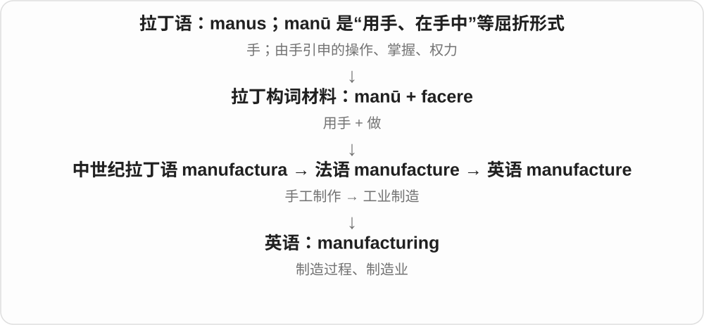

manufacturing costs 是制造成本；manufacturing jobs 是制造业岗位。词根里的“手”是历史来源，不是现代必须手工生产的限制。

**常见搭配与例句**

manufacturing industry；manufacturing process；manufacturing costs。

> The company moved part of its manufacturing to a larger factory.

公司把一部分制造业务迁到了更大的工厂。

> The new design reduces manufacturing costs.

新设计降低了制造成本。

**别混淆**

production 可涵盖电影、能源等广泛产出；manufacturing 通常更具体地指实物产品的制造。

### 26. manufacturer — 制造商

**音标**：/ˌmænjʊˈfæktʃəɹə/

**先抓住这个画面**

商店把商品卖给你，manufacturer 则负责把商品生产出来。它通常是企业，也可以泛指制造者。

**怎么拆**

manufacture + -er；末尾 e 保留后接 r，形成表示执行者的名词。

**怎么变成今天的意思**

原来用手做的动作发展为工业制造，-er 把焦点转到承担制造工作的主体。词长，但可以抓住 manufacture 与人、机构的关系。

**常见搭配与例句**

a car manufacturer；the original manufacturer；manufacturer’s instructions。

> Contact the manufacturer for a replacement part.

联系制造商获取替换零件。

> Several manufacturers use the same component.

几家制造商都使用同一种零件。

**别混淆**

seller 是卖方，manufacturer 是生产方；同一家公司可兼任两者。

### 27. maintenance — 维护；保养；生活供养

**音标**：/ˈmeɪntənəns/

**先抓住这个画面**

maintenance 像隔一段时间给机器检查、清洁、调整，让它继续好好工作；对人的供养也是持续把生活撑住。

**怎么拆**

借自古法语 maintenance，与 maintenir 同族。它保留 -ten-，英语 maintain 的拼写和发音后来走了不同变化。

**怎么变成今天的意思**

一般说的是维持状态所需的一系列工作或费用，未必有东西已经损坏。语境中也可指家庭生活供养。

**常见搭配与例句**

routine maintenance；maintenance costs；building maintenance；maintenance payments。

> The lift is closed for routine maintenance.

电梯因例行维护暂停使用。

> The budget includes the maintenance of the garden.

预算包括花园的维护费用。

**别混淆**

maintenance 是保养维护；repair 是修复具体损坏。保养得好，可能少做 repair。

### 28. manner — 方式；态度、举止；复数 manners：礼貌

**音标**：英 /ˈmænə/；美 /ˈmænər/

**先抓住这个画面**

manner 可以从“你怎样着手做一件事”理解：步骤是方式，对人说话的样子是态度，待人接物的规矩是礼貌。

**怎么拆**

经法语 maniere 来自与 manus“手”相关的拉丁 manuārius；中间常重构为 *manāria。不是 man“人”直接加 -er。

**怎么变成今天的意思**

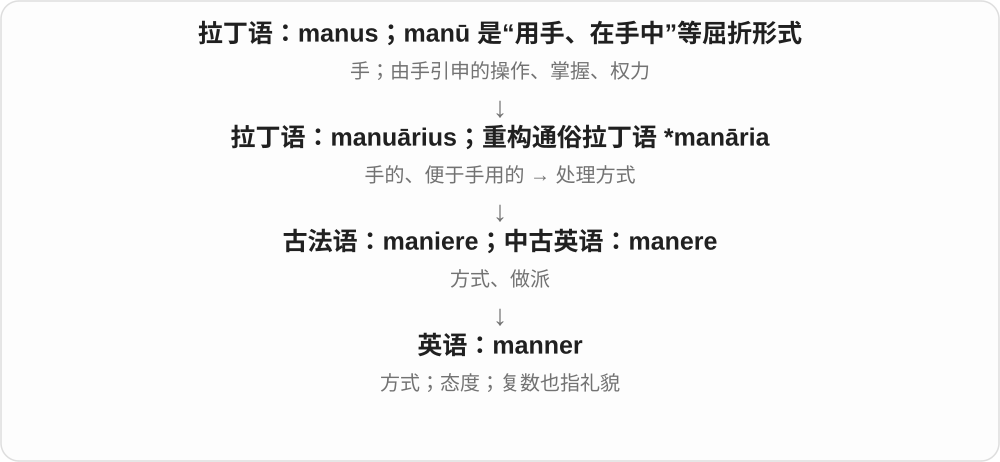

in this manner 是以这种方式；a friendly manner 是友好的态度；good manners 通常用复数。很少见的组合词中另有 man + -er，不能混同。

**常见搭配与例句**

in a careful manner；a relaxed manner；table manners；all manner of。

> She explained the problem in a calm manner.

她用平静的态度解释了问题。

> The children are learning table manners.

孩子们正在学习餐桌礼仪。

**别混淆**

method 更像可说明的步骤；manner 更泛指做事、说话或表现出来的方式。

### 29. mannered — 做作的；刻意雕琢的；具有某种举止的

**音标**：英 /ˈmænəd/；美 /ˈmænərd/

**先抓住这个画面**

mannered 像一个人说话、动作都排练得太精心，让人注意到“他在摆姿态”。

**怎么拆**

manner + -ed，表示具有某种举止、风格；中古英语已有 manered。

**怎么变成今天的意思**

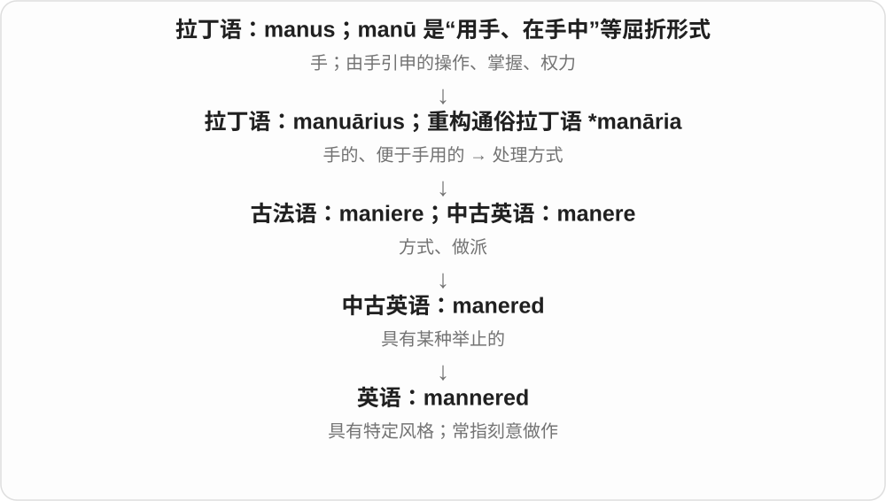

单独用时常带刻意、不自然的评价；在修饰性组合里也可中性说明举止类型。文学和表演评论中较常见。

**常见搭配与例句**

a mannered performance；mannered prose；a mannered style。

> The dialogue sounded too mannered to feel natural.

对话听起来太刻意，不够自然。

> The reviewer admired the design but found the acting mannered.

评论者欣赏设计，却觉得表演有些做作。

**别混淆**

mannerly 是礼貌；mannered 单独用往往是做作，并不等于“很有礼貌”。

### 30. mannerism — 习惯性的小动作或说话方式；矫饰；风格主义

**音标**：英 /ˈmænərɪzəm/；美 /ˈmænərɪzəm/

**先抓住这个画面**

mannerism 像一个人每次思考都摸下巴、说话总拖长某个音，那些反复出现的小特点成了他的标记。

**怎么拆**

manner + -ism；艺术史中 Mannerism 又成为特定风格名称。

**怎么变成今天的意思**

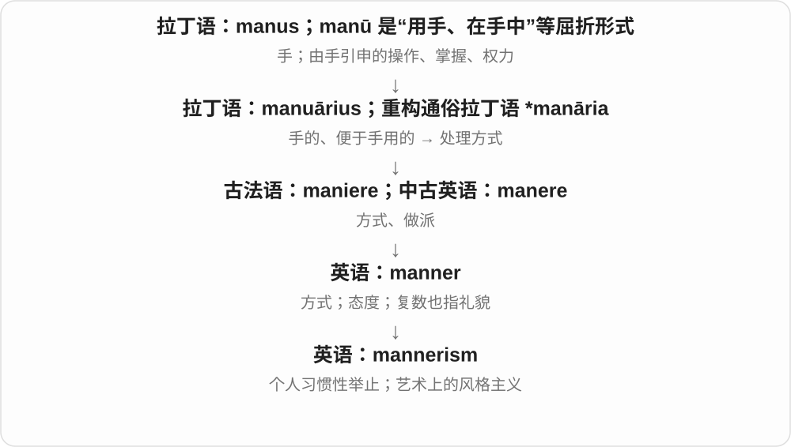

日常常用复数 mannerisms。艺术史的 Mannerism 通常指欧洲文艺复兴后期的一类风格，不能仅译成艺术家的小习惯。

**常见搭配与例句**

a nervous mannerism；copy someone’s mannerisms；artistic Mannerism。

> The actor copied the politician’s gestures and mannerisms.

演员模仿了那位政治人物的手势和习惯性举止。

> Tapping the pen was one of her nervous mannerisms.

敲笔是她紧张时的习惯性小动作之一。

**别混淆**

habit 可是各种习惯；mannerism 多指表现出来、别人能看见听见的细小举止或说话特点。

### 31. mannerly — 有礼貌的；举止得体的

**音标**：英 /ˈmænəli/；美 /ˈmænərli/

**先抓住这个画面**

mannerly 像在人际交往中懂得留一点空间：听人说完、适当地致谢、顾及他人的感受。

**怎么拆**

manner 的礼貌、举止义 + -ly；这里 -ly 可以构成形容词，不一定是副词。

**怎么变成今天的意思**

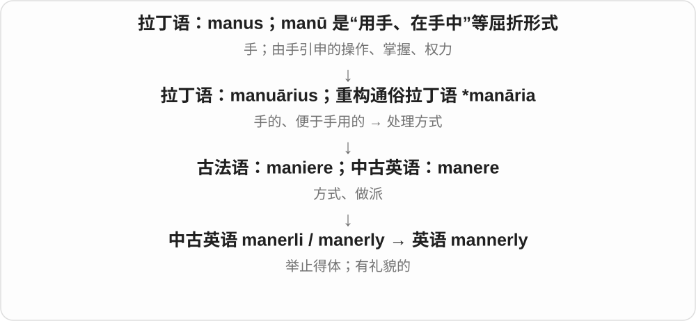

语气比 polite 稍旧式、书面。可以直接说 a mannerly child，不能因为看到 -ly 就排除它作定语。

**常见搭配与例句**

a mannerly response；a mannerly child；quiet and mannerly。

> The children were mannerly and waited their turn.

孩子们很有礼貌，等着轮到自己。

> She gave a mannerly reply despite her annoyance.

尽管有些恼火，她仍作了得体的回应。

**别混淆**

mannered 常批评做作；mannerly 通常称赞礼貌，词尾不同，评价也不同。

### 32. unmannerly — 无礼的；不懂礼貌的

**音标**：英 /ʌnˈmænəli/；美 /ʌnˈmænərli/

**先抓住这个画面**

unmannerly 像在人际互动里失了分寸：打断、粗声回应、不给别人应有的尊重。

**怎么拆**

un-（不）+ mannerly；中古英语已有 unmanerli，不是近年临时创造的词。

**怎么变成今天的意思**

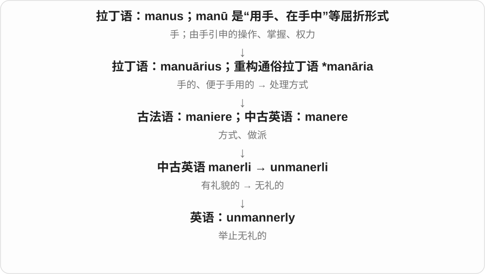

比 rude 更旧式、书面，仍可用于评价举止。古文里也能作副词，现代最常当形容词理解。

**常见搭配与例句**

an unmannerly interruption；unmannerly behaviour。

> He apologized for his unmannerly interruption.

他为自己无礼的打断道了歉。

> The narrator condemns the guests’ unmannerly behaviour.

叙述者批评了客人们失礼的举止。

**别混淆**

unfriendly 是不友好；unmannerly 是礼数上失当，两者不完全相同。

### 33. manual — 手动的；人工的；体力劳动的；说明手册

**音标**：/ˈmænjuəl/

**先抓住这个画面**

manual 的画面是人的手直接参与：手动调节、动手劳动；名词则是可以拿在手边查用的手册。

**怎么拆**

形容词来自拉丁 manuālis，名词手册来自晚期拉丁 manuāle，分别经法语进入英语；都连着 manus“手”。

**怎么变成今天的意思**

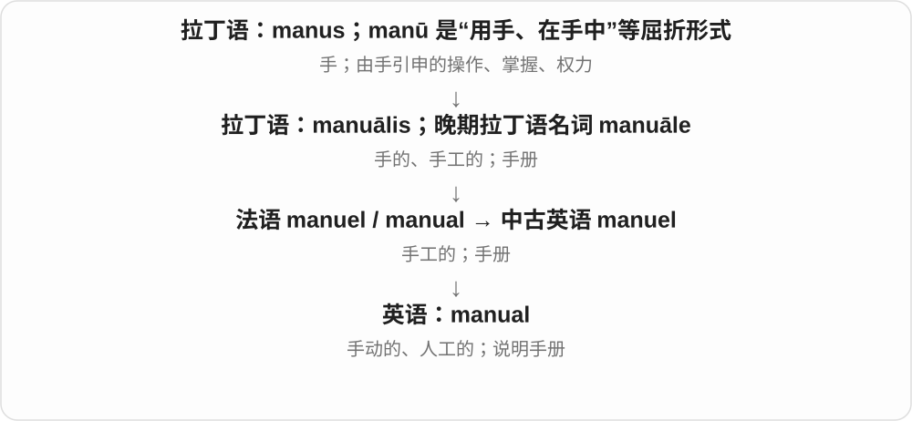

manual mode 是手动模式，manual work 是体力或手工工作；read the manual 是读说明书。管风琴的 manual 还指手键盘，与脚键盘相对。

**常见搭配与例句**

manual control；manual labour；a user manual；a manual gearbox。

> Switch to manual mode if you want to adjust the settings yourself.

如果想自己调节设置，就切到手动模式。

> The manual explains how to clean the filter.

说明书介绍了怎样清洁过滤器。

**别混淆**

automatic 强调自动运行；manual 强调人直接操作。manual 的名词义不能译成“手动”。

### 34. manually — 手动地；人工地

**音标**：/ˈmænjuəli/

**先抓住这个画面**

manually 像系统没有替你按下按钮，需要你自己伸手操作或逐项处理。

**怎么拆**

manual + -ly，接形容词“手动、人工的”这一义。

**怎么变成今天的意思**

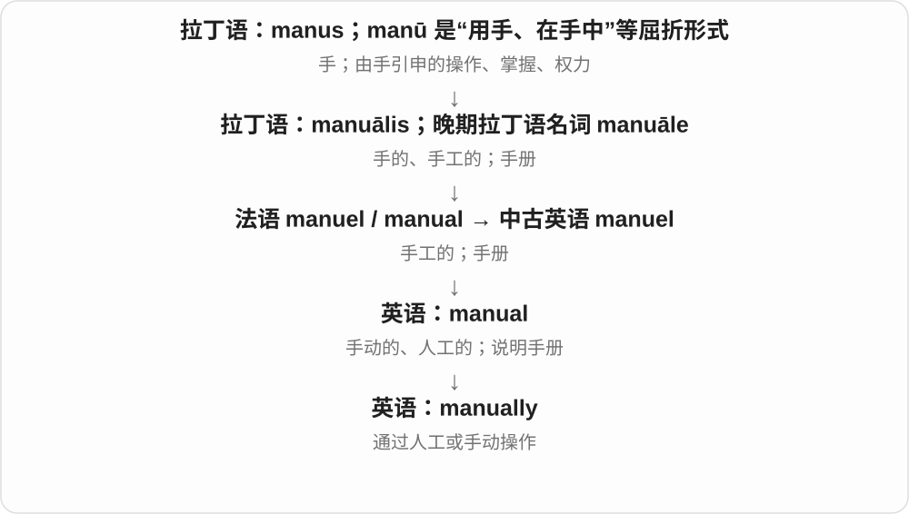

manually enter data 是人工输入数据，不一定拿笔写；用键盘逐条输入也算 manually。

**常见搭配与例句**

enter data manually；adjust manually；manually operated。

> Enter the missing values manually.

请手动输入缺少的数值。

> The seat can be adjusted manually.

座椅可以手动调节。

**别混淆**

by hand 有时特别指手工制作；manually 在技术语境常用来与自动化过程相对。

### 35. bimanual — 双手的；需要双手配合的

**音标**：/baɪˈmænjuəl/

**先抓住这个画面**

bimanual 像一手稳住瓶子、一手旋开瓶盖：两只手共同参与一个动作。

**怎么拆**

bi-（二）+ manual（手的）；manual 远源 manus。

**怎么变成今天的意思**

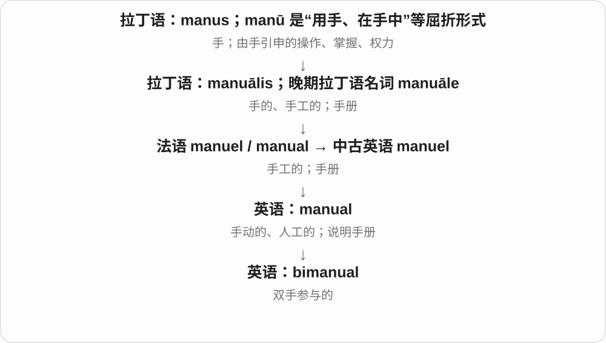

常用于动作研究、技能训练等语境。两手可以做不同的事，也可以一起做相同动作。

**常见搭配与例句**

bimanual coordination；a bimanual task；bimanual movements。

> Opening the jar is a bimanual task.

打开这个罐子需要双手配合。

> The exercise tests bimanual coordination.

这项练习测试双手的协调能力。

**别混淆**

ambidextrous 是左右手都能熟练使用；bimanual 只说动作涉及两只手，不保证两手一样灵巧。

### 36. mandate — 正式命令；授权、委托；要求、授权

**音标**：/ˈmændeɪt/

**先抓住这个画面**

mandate 像把一份正式任务交到你手里：既可能是必须做的命令，也可能是允许你代表别人行动的授权。

**怎么拆**

来自拉丁 mandātum，联系 mandāre“委托、命令”；传统分析把更早构成联系到 manus“手”及交付、放置的成分。不是 man + date。

**怎么变成今天的意思**

a mandate to negotiate 是谈判授权；a government mandate 是正式要求；选举里的 mandate 指被视为由选民赋予的政治授权。

**常见搭配与例句**

a clear mandate；a mandate to do；mandate training；within its mandate。

> The committee has a mandate to review the process.

委员会获授权审查这一流程。

> The new policy mandates annual safety training.

新政策要求每年接受安全培训。

**别混淆**

permission 是获准做；mandate 往往连带正式职责、权力或要求。具体是命令还是授权，要看上下文。

### 37. mandatory — 强制的；必须遵守的

**音标**：英 /ˈmændətəri/；美 /ˈmændəˌtɔːri/

**先抓住这个画面**

mandatory 像事项旁盖上“必须”的印章：它不是建议，而是规则要求你做。

**怎么拆**

来自晚期拉丁 mandātōrius，联系 mandātor“发令者”和 mandāre；现代可联想 mandate + -ory。

**怎么变成今天的意思**

a mandatory course 是必修课；mandatory attendance 是要求出席。历史文本也有委任统治相关名词义。

**常见搭配与例句**

mandatory training；mandatory attendance；a mandatory requirement。

> Attendance at the safety briefing is mandatory.

安全说明会必须参加。

> The form marks mandatory fields with an asterisk.

表格用星号标出必填项。

**别混淆**

recommended 表示建议采用；mandatory 表示规则要求执行。

### 38. manuscript — 手稿；尚未出版的文稿

**音标**：/ˈmænjəskrɪpt/

**先抓住这个画面**

manuscript 原来是手写出来的文本。今天作者交给编辑的稿件即使在电脑上写成，也仍然可以叫 manuscript。

**怎么拆**

中世纪拉丁语 manū（用手）+ scrīptus（写成的）形成 manūscrīptus 等形式，不是古典拉丁语里早已有的完整词。

**怎么变成今天的意思**

“手写”是历史起点，现代出版用法则按稿件所处阶段命名，不再要求真的用笔写。古文献语境仍常保留手写本的含义。

**常见搭配与例句**

submit a manuscript（提交稿件）；a medieval manuscript（中世纪手抄本）；the original manuscript（原稿）。

> She sent the completed manuscript to her editor.

她把完成的书稿交给了编辑。

> The library preserves several medieval manuscripts.

图书馆保存着几份中世纪手抄本。

**别混淆**

manuscript 是稿件或手抄本文献；published book 是已经出版的书。typescript 强调用打字方式形成。

### 39. maniple — 古罗马军队小单位；宗教礼服的臂带；旧：一把

**音标**：英 /ˈmænɪpəl/；美 /ˈmænəpəl/

**先抓住这个画面**

maniple 从“一手抓起的一束”发展出“一小组士兵”；礼服义则是一条搭在左前臂上的带状饰物。

**怎么拆**

来自法语 maniple / manipule，远源拉丁 manipulus“一把、一束”；其构成联系 manus“手”和表示充满的成分。

**怎么变成今天的意思**

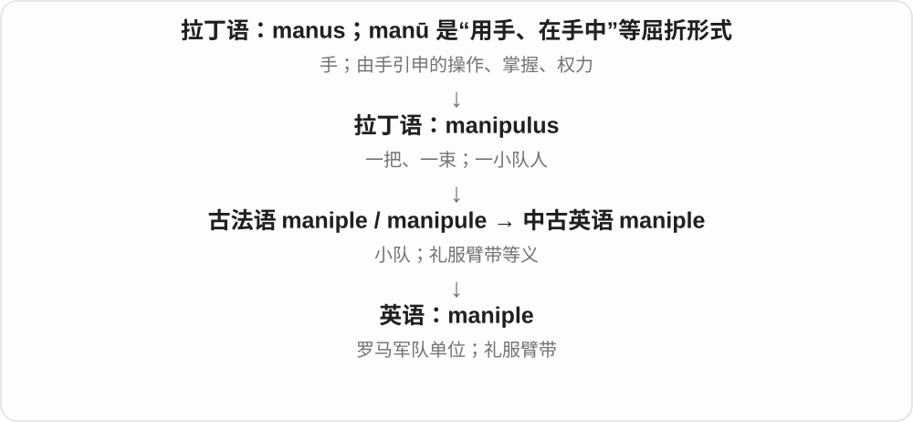

军队义是历史编制名，人数随时期和兵种而异；礼服义常解释为从手持布巾演来。两个场景不同，别把一条臂带想成军队。

**常见搭配与例句**

a Roman maniple；a liturgical maniple；wear a maniple。

> The map shows the position of each Roman maniple.

地图标出了各个古罗马步兵小队的位置。

> The old portrait shows a maniple draped over the priest’s left forearm.

旧肖像里，一条礼服臂带搭在神父左前臂上。

**别混淆**

manipulation 虽也连到“一把”，今天指操作或操纵；maniple 保留的是特定历史、礼仪名物。

### 40. manipulate — 操作、摆弄；操控；篡改

**音标**：英 /məˈnɪpjʊleɪt/；美 /məˈnɪpjəleɪt/

**先抓住这个画面**

manipulate 像灵巧地拨弄手里的东西；对象变成人或数据时，可能是为了自己的目的暗中改变它们。

**怎么拆**

由 manipulation 逆构成动词；远连拉丁 manipulus“一把”。不能因为现代有 manipulate + -ion 的对应，就把历史次序倒过来。

**怎么变成今天的意思**

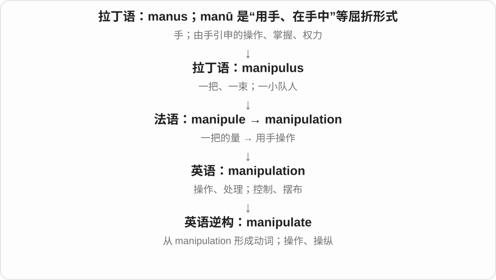

manipulate a tool 可是中性操作；manipulate someone 常是操控；manipulate figures 可能暗示篡改数字，需看上下文。

**常见搭配与例句**

manipulate an object；manipulate data；manipulate someone into doing something。

> The robot can manipulate small objects with great precision.

这个机器人能非常精确地操作小物体。

> He tried to manipulate her into accepting the blame.

他试图操控她，让她承担责任。

**别混淆**

handle 强调处理、拿用；manipulate 更突出细致控制，也更容易含暗中摆布的意味。

### 41. manipulation — 操作、处理；操纵、摆布

**音标**：英 /məˌnɪpjuˈleɪʃən/；美 /məˌnɪpjəˈleɪʃən/

**先抓住这个画面**

manipulation 像手指拨动零件，也像有人躲在后面拨动别人选择的方向；前者可以中性，后者常有欺骗意味。

**怎么拆**

借自法语 manipulation，远连拉丁 manipulus“一把”；英语 manipulate 反而由这个名词逆构，别把历史顺序画反。

**怎么变成今天的意思**

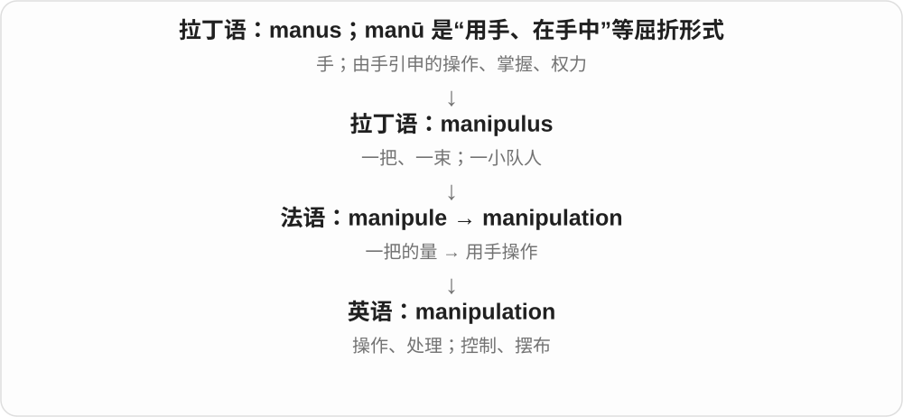

data manipulation 可以只是整理、转换数据；emotional manipulation 常是利用情绪控制他人。不要见到这个词就一律判成造假。

**常见搭配与例句**

data manipulation；image manipulation；emotional manipulation。

> The software allows basic image manipulation.

这款软件支持基本图像处理。

> She recognized the repeated guilt trips as emotional manipulation.

她意识到，对方反复让她内疚是在操控她的情绪。

**别混淆**

operation 是一般操作；manipulation 更突出细致调整，有时突出为了自己的目的控制或篡改。

### 42. manipulative — 善于操控他人的；操作性的；数学操作教具

**音标**：英 /məˈnɪpjələtɪv/；美 /məˈnɪpjəleɪtɪv/

**先抓住这个画面**

manipulative 形容人时像暗中拉线，让别人照自己的意思走；教学中则可能是可以拿在手里摆弄的实物。

**怎么拆**

manipulate + -ive；动词本身由 manipulation 逆构。

**怎么变成今天的意思**

a manipulative person 常含贬义；math manipulatives 是积木、计数片等教具，名词复数没有阴险的意思。

**常见搭配与例句**

manipulative behaviour；a manipulative tactic；math manipulatives。

> The message used a manipulative appeal to guilt.

那条消息利用内疚感来操控对方。

> The teacher used manipulatives to explain fractions.

老师用实物教具解释分数。

**别混淆**

persuasive 是有说服力；manipulative 往往暗示绕过别人清楚、自主的判断，为自己谋求结果。

### 43. manipulator — 操纵者；机械操作臂；操作装置

**音标**：英 /məˈnɪpjʊleɪtə/；美 /məˈnɪpjəleɪtər/

**先抓住这个画面**

manipulator 可以是暗中摆布人的人，也可以是替人抓取、移动物体的机械“手”。

**怎么拆**

manipulate 去 e 加 -or，表示执行操作的人或装置。

**怎么变成今天的意思**

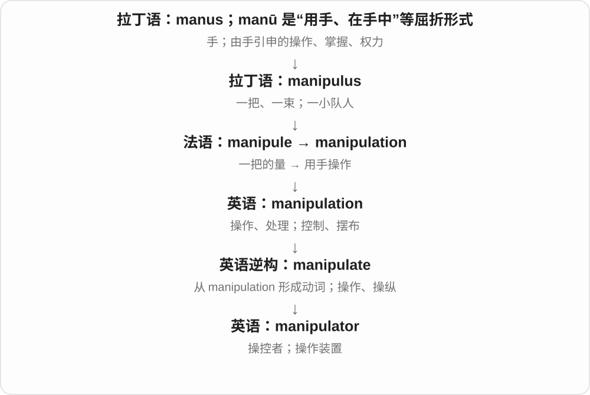

人物评价里常是贬义；robotic manipulator 是机械学中性名称，不能译成阴谋家。

**常见搭配与例句**

a skilled manipulator；a robotic manipulator；a remote manipulator。

> The robotic manipulator moved the sample into the chamber.

机械操作臂把样品移进了舱室。

> The novel gradually reveals him as a skilled manipulator.

小说逐渐揭示出他是个善于操控他人的人。

**别混淆**

operator 常指操作设备的人；manipulator 既可能是人，也可能是实际执行抓取动作的机械装置。

### 44. manifest — 明显的；显现、表明；货物或乘客清单

**音标**：/ˈmænɪfest/

**先抓住这个画面**

manifest 像把藏着的东西摆到眼前：形容词说已经很明显，动词说让它表现出来，运输清单则把所载内容明列出来。

**怎么拆**

来自拉丁 manifestus，通常联系 manus“手”，但第二成分的确切来历未定。动词另可联系 manifestāre；名词经历公开声明等用法，不能把 -fest 硬译成确定动作。

**怎么变成今天的意思**

a manifest error 是明显错误；manifest itself 是显现出来；a cargo manifest 是货物清单。现代口语的“靠意念实现”义描述一种说法，不意味着念想本身能保证结果。

**常见搭配与例句**

manifest concern；manifest itself in；a manifest error；a passenger manifest。

> Her frustration manifested itself in short, impatient replies.

她简短而不耐烦的回答显出了沮丧。

> The officer checked the passenger manifest.

工作人员核对了乘客名单。

> The report contains a manifest error.

报告里有一个明显错误。

**别混淆**

obvious 主要是明显的；manifest 还能作动词或名词，词性决定了该怎样理解。

### 45. manifestation — 表现；显现；体现出来的迹象

**音标**：/ˌmænɪfeˈsteɪʃən/

**先抓住这个画面**

manifestation 像看见水面上的波纹，才知道水下发生了什么：内在的状态通过可观察的现象表现出来。

**怎么拆**

借自晚期拉丁 manifestātiō，来自 manifestāre“使显露”；现代可对应 manifest + -ation，但名词有独立借入路线。

**怎么变成今天的意思**

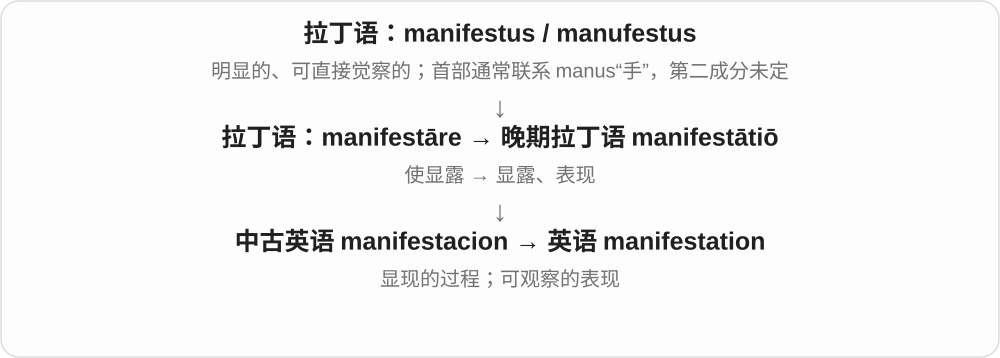

a manifestation of anxiety 是焦虑的一种表现，不是焦虑本身的全部。某些政治语境还指示威，受法语用法影响。

**常见搭配与例句**

a manifestation of；physical manifestations；an outward manifestation。

> The tension was a manifestation of deeper disagreements.

这种紧张气氛体现了更深层的分歧。

> The exhibition explores different manifestations of the same idea.

展览探讨了同一个观念的不同表现形式。

**别混淆**

cause 是原因；manifestation 是某种状态显露出来的形式，两者方向不同。

### 46. manifestly — 明显地；显然

**音标**：/ˈmænɪfestli/

**先抓住这个画面**

manifestly 像把证据放到灯下：说话者认为情况清清楚楚，不需要绕着猜。

**怎么拆**

manifest 的形容词用法 + -ly；不要接到货单名词义上理解。

**怎么变成今天的意思**

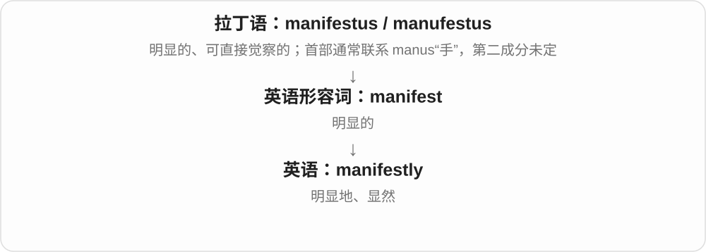

常用于正式评价，如 manifestly unfair。它表明说话者认为明显，不等于所有读者一定同意。

**常见搭配与例句**

manifestly wrong；manifestly unfair；manifestly inadequate。

> The two descriptions are manifestly inconsistent.

这两种描述明显互相矛盾。

> The available space was manifestly inadequate.

现有空间显然不够。

**别混淆**

apparently 可能保留“看起来如此”的余地；manifestly 通常表示更强的确定态度。

### 47. manifesto — 宣言；公开的原则、主张说明

**音标**：英 /ˌmænɪˈfestəʊ/；美 /ˌmænɪˈfestoʊ/

**先抓住这个画面**

manifesto 像公开把自己的旗帜立出来：“我们主张这些，准备这样做。”

**怎么拆**

从意大利 manifesto“公开声明”借入，远源拉丁 manifestus“明显、公开的”；不是英语 manifest 后随意加 o。

**怎么变成今天的意思**

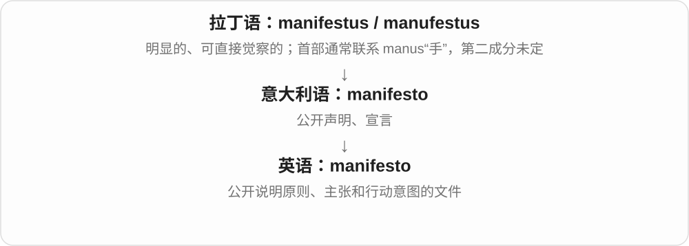

政党可以发布竞选宣言，艺术家也能发布创作宣言。它突出立场和方向，不保证每条都已经落实。

**常见搭配与例句**

publish a manifesto；an election manifesto；an artistic manifesto。

> The party published its election manifesto.

这个政党公布了竞选宣言。

> The essay reads like a manifesto for simpler design.

这篇文章读起来像一份倡导简洁设计的宣言。

**别混淆**

manifest 的运输名词义是清单；manifesto 通常是表达原则与主张的宣言。

### 48. maneuver — 巧妙移动、操控；策略；调动、演习

**音标**：英 /məˈnuːvə/；美 /məˈnuːvər/

**先抓住这个画面**

maneuver 像把车一点点倒进狭窄车位：不是随便移动，而是看空间、调方向，设法达到目的。

**怎么拆**

经法语 manœuvre / manœuvrer 来自“手工操作”这一支；远连 manū“用手”与表示工作、劳作的拉丁成分。英式通常拼 manoeuvre。

**怎么变成今天的意思**

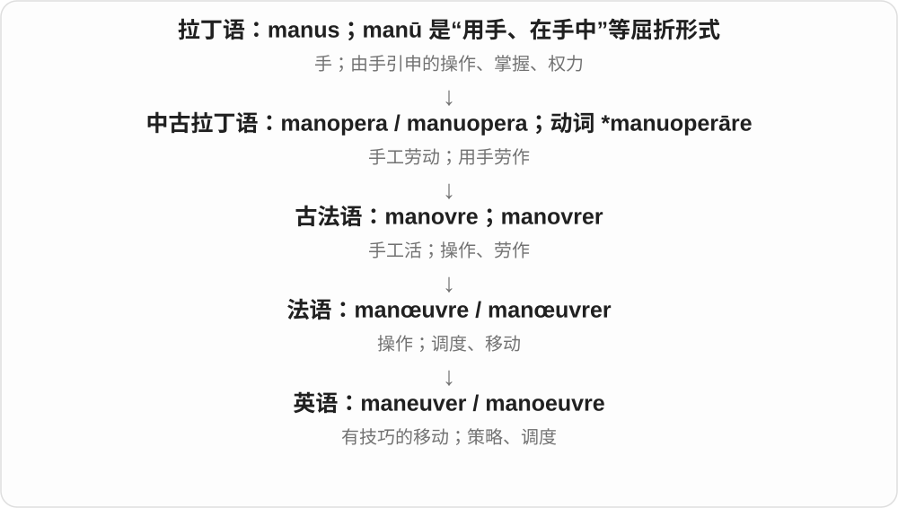

可以是身体、车辆的动作，也可以是政治或工作中的策略安排。military maneuvers 常指演习。

**常见搭配与例句**

maneuver into position；a parking maneuver；room to maneuver；a political maneuver。

> She maneuvered the trolley through the narrow doorway.

她小心调整手推车的方向，让它通过窄门。

> The proposal gives the team more room to maneuver.

这个提案给团队留下了更大的调整余地。

**别混淆**

move 是一般移动；maneuver 常强调空间有限、有技巧或有策略地调整位置。

### 49. maneuverable — 容易操控转向的；机动灵活的

**音标**：英 /məˈnuːvərəbəl/；美 /məˈnuːvərəbəl/

**先抓住这个画面**

maneuverable 像一辆能在窄处轻松转弯的小车，能按需要迅速改变位置或方向。

**怎么拆**

maneuver + -able；对应英式 manoeuvrable。

**怎么变成今天的意思**

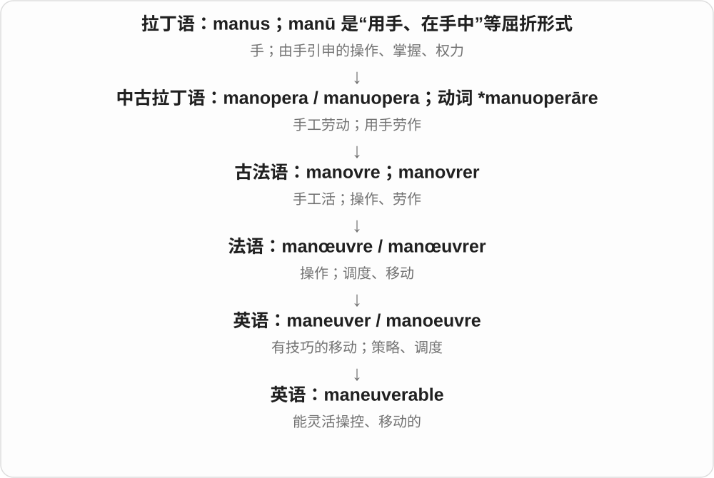

常描述车辆、船只、器材等的操控表现，不只是说它能够向前走。

**常见搭配与例句**

a maneuverable vehicle；highly maneuverable；light and maneuverable。

> The compact cart is easy to push and highly maneuverable.

这辆小推车很好推，转向也很灵活。

> The smaller boat is more maneuverable in narrow channels.

较小的船在狭窄水道里更容易操控。

**别混淆**

mobile 是可以移动；maneuverable 进一步说转向、调整位置是否容易。

### 50. maneuverability — 机动性；操控灵活性

**音标**：/məˌnuːvərəˈbɪləti/

**先抓住这个画面**

maneuverability 是把“转得开、挪得动、调得准”看作一种性能，比较设备在空间里的灵活程度。

**怎么拆**

maneuverable 对应的 -ability 名词；英式拼作 manoeuvrability。

**怎么变成今天的意思**

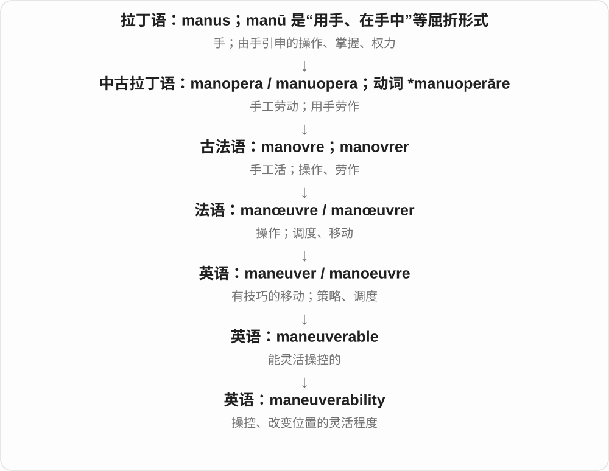

可用于船、车、推车等，也能比喻策略调整余地。不能只拿最高速度来判断 maneuverability。

**常见搭配与例句**

improve maneuverability；excellent maneuverability；limited maneuverability。

> The shorter wheelbase improves maneuverability in tight spaces.

较短的轴距提高了在狭小空间里的操控灵活性。

> The test compared the two carts for stability and maneuverability.

测试比较了两辆推车的稳定性和操控灵活性。

**别混淆**

mobility 关注能否移动及移动范围；maneuverability 更关注改变位置、方向时的灵活性。

### 51. commando — 突击队员；突击队

**音标**：英 /kəˈmɑːndəʊ/；美 /kəˈmændoʊ/

**先抓住这个画面**

commando 的现代画面是受过专门训练、执行特殊突击任务的小队或队员。

**怎么拆**

经南非荷兰语 kommando，联系葡萄牙语 comando“命令、指挥”，远源拉丁 commendāre / commandāre；不是英语 command 临时加 o。

**怎么变成今天的意思**

这个词经过南非武装队伍语境，再发展出现代突击部队用法。名词可以指一人，也可以指一支部队，需看句子。

**常见搭配与例句**

a commando unit；commando training；a commando raid。

> The exhibit describes the equipment carried by a commando.

展览介绍了一名突击队员携带的装备。

> The documentary follows a commando unit during training.

纪录片跟拍了一支突击队的训练。

**别混淆**

soldier 是士兵总称；commando 指特定训练和任务背景下的队员或部队。

### 52. emancipate — 解放；使摆脱控制或束缚

**音标**：英 /ɪˈmænsɪpeɪt/；美 /ɪˈmænsəpeɪt/

**先抓住这个画面**

emancipate 的历史画面是把一个人从别人的支配权下放出来，今天也可说摆脱社会观念或制度的束缚。

**怎么拆**

e- / ex-（向外）+ 拉丁 mancipāre“转交支配权”，后者远连 manus“手”与 capere“取得”；英语借其分词词干。

**怎么变成今天的意思**

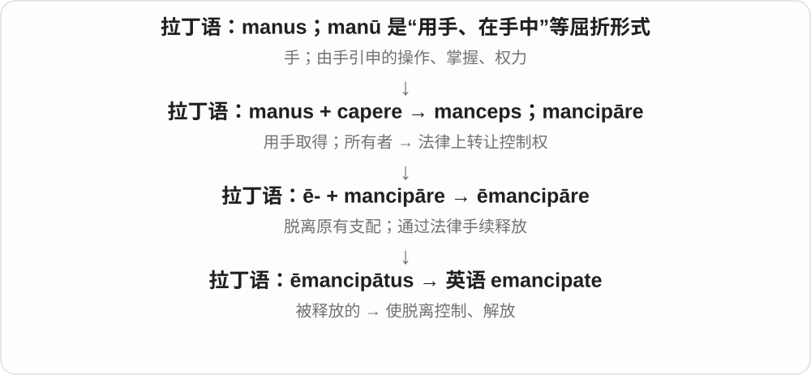

历史上涉及古罗马家长权和奴役制度，现代常见 emancipate someone from something。它比普通的 let go 更正式、更强调独立地位。

**常见搭配与例句**

emancipate enslaved people；emancipate someone from；emancipate oneself。

> The movement sought to emancipate workers from oppressive conditions.

这场运动希望让工人摆脱压迫性的处境。

> She tried to emancipate herself from other people’s expectations.

她努力摆脱别人对她的期待所带来的束缚。

**别混淆**

liberate 适用范围较宽；emancipate 常突出摆脱法律、社会或思想上的支配。

### 53. emancipation — 解放；摆脱束缚；获得独立地位

**音标**：/ɪˌmænsɪˈpeɪʃən/

**先抓住这个画面**

emancipation 是把支配关系松开的那一步，或人们逐渐获得独立地位的过程。

**怎么拆**

经法语 émancipation 借自拉丁 ēmancipātiō，来自 ēmancipāre；名词独立借入，不能画成英语 emancipate 先造出拉丁名词。

**怎么变成今天的意思**

可以用于奴隶解放史，也能谈社会、思想等方面的解放。具体法律含义须按相应历史和制度理解。

**常见搭配与例句**

emancipation from；economic emancipation；the struggle for emancipation。

> The exhibition traces the long struggle for emancipation.

展览梳理了争取解放的漫长历程。

> For her, education was a path towards economic emancipation.

对她来说，教育是通向经济独立的一条路。

**别混淆**

independence 是独立状态；emancipation 更突出从既有约束或支配中摆脱出来。

### 54. emancipated — 获得解放的；摆脱束缚的

**音标**：英 /ɪˈmænsɪpeɪtɪd/；美 /ɪˈmænsəpeɪtɪd/

**先抓住这个画面**

emancipated 像原先被牵制的人终于可以自己决定道路，重点在已经获得某种自主空间。

**怎么拆**

emancipate + -ed，过去分词转作形容词。

**怎么变成今天的意思**

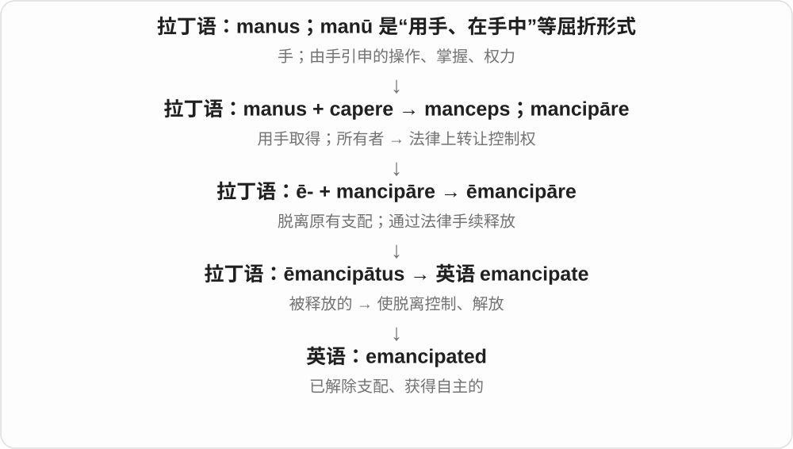

可指摆脱奴役，也可描述不再受传统社会规范限制的人。词义随历史语境变化，不是简单说一个人性格大胆。

**常见搭配与例句**

newly emancipated；an emancipated person；emancipated from。

> The chapter follows the lives of newly emancipated people.

这一章追踪了刚获得解放的人们的生活。

> She felt emancipated from the rigid expectations of her childhood.

她觉得自己摆脱了童年时那些刻板期待的束缚。

**别混淆**

independent 常是现状描述；emancipated 更容易让人想到先前存在而如今被解除的束缚。

### 55. emancipatory — 旨在解放的；有助于摆脱束缚的

**音标**：英 /ɪˈmænsɪpeɪtəri/；美 /ɪˈmænsəpəˌtɔːri/

**先抓住这个画面**

emancipatory 像一把试图打开枷锁的钥匙，形容观念、制度或教育具有让人获得自主的方向。

**怎么拆**

emancipate 的词干 + -ory，形成与解放作用相关的形容词。

**怎么变成今天的意思**

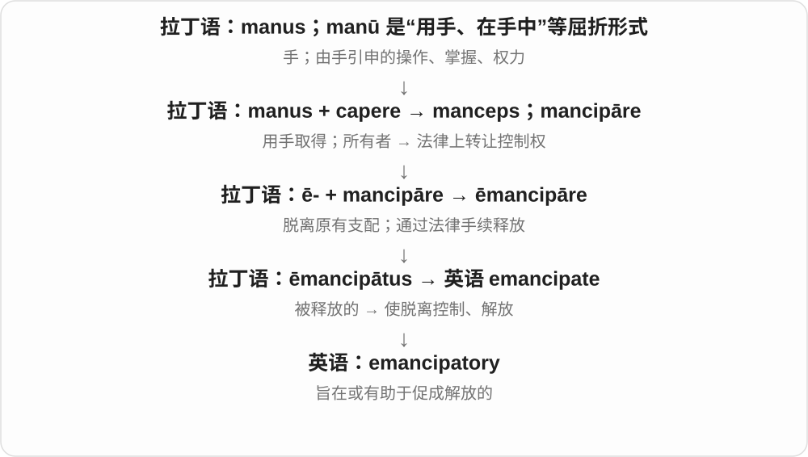

常用于社会理论、教育等正式讨论。说一种方法有 emancipatory potential，指它有这种潜力，不等于已经达成效果。

**常见搭配与例句**

emancipatory education；emancipatory potential；an emancipatory project。

> The essay explores the emancipatory potential of education.

文章探讨了教育帮助人摆脱束缚的潜力。

> The reform was presented as an emancipatory measure.

这项改革被描述为一项促进解放的举措。

**别混淆**

emancipated 说已解放的状态；emancipatory 说促成解放的倾向或作用。

### 56. emancipator — 解放者；倡导解放的人

**音标**：英 /ɪˈmænsɪpeɪtə/；美 /ɪˈmænsəpeɪtər/

**先抓住这个画面**

emancipator 是促成或倡导解除束缚的人，像推动别人从被支配的位置走向自主的位置。

**怎么拆**

现代可对应 emancipate + -or；历史也直接联系晚期拉丁 ēmancipātor，不能把拉丁名词接在英语动词之后当作后代。

**怎么变成今天的意思**

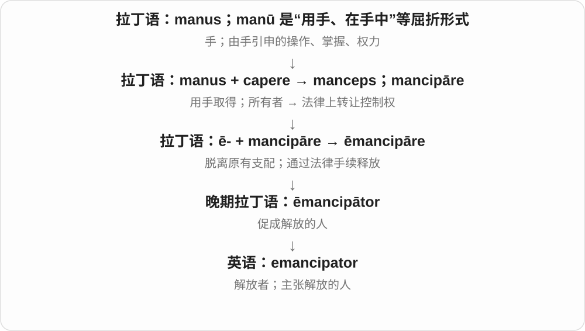

常见于历史叙述与纪念称号。谁被称为 emancipator，反映的是叙述中的历史评价，不意味着个人独力完成全部改变。

**常见搭配与例句**

an emancipator of；remembered as an emancipator。

> The monument honours a leader remembered as an emancipator.

这座纪念碑纪念一位被视为解放者的领袖。

> The historian examines how the image of the emancipator was created.

历史学家研究了这位解放者的形象是怎样形成的。

**别混淆**

reformer 是改革者，不一定涉及解放；emancipator 特别围绕解除束缚与支配。

### 57. manure — 粪肥；施肥

**音标**：英 /məˈnjʊə/；美 /məˈnʊr/

**先抓住这个画面**

manure 的历史像沿着农活走了一段路：用手耕作 → 改良土地 → 给土地施肥 → 施进去的肥料。

**怎么拆**

从法语 manovrer 一路进入中古英语 manuren，远源“用手工作”；与后来借入的 maneuver 同源，词义已分流。

**怎么变成今天的意思**

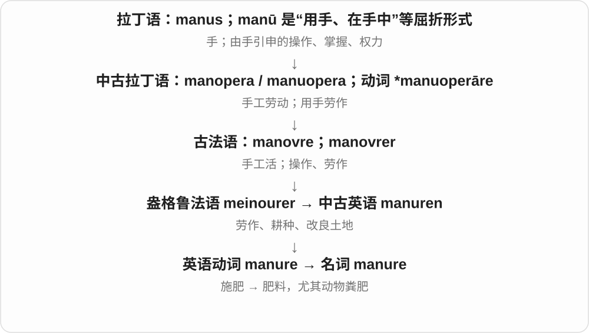

今天名词通常是用于肥田的动物粪便；green manure 指绿肥作物，不能一律按动物排泄物理解。

**常见搭配与例句**

farmyard manure；spread manure；manure the soil；green manure。

> The farm uses manure to improve the soil.

农场用粪肥改良土壤。

> The gardener spread well-rotted manure around the plants.

园丁在植物周围铺上了充分腐熟的粪肥。

**别混淆**

fertilizer 是肥料总称；manure 常突出农家粪肥，范围更具体。

### 58. manoeuvre — 巧妙移动、操控；策略；演习

**音标**：英 /məˈnuːvə/；美 /məˈnuːvər/

**先抓住这个画面**

manoeuvre 像在有限空间里找到一个巧妙的走法，既能说车怎样转，也能说人怎样安排策略。

**怎么拆**

这是英式常用拼法，对应美式 maneuver；经法语 manœuvre，远源“用手工作”。

**怎么变成今天的意思**

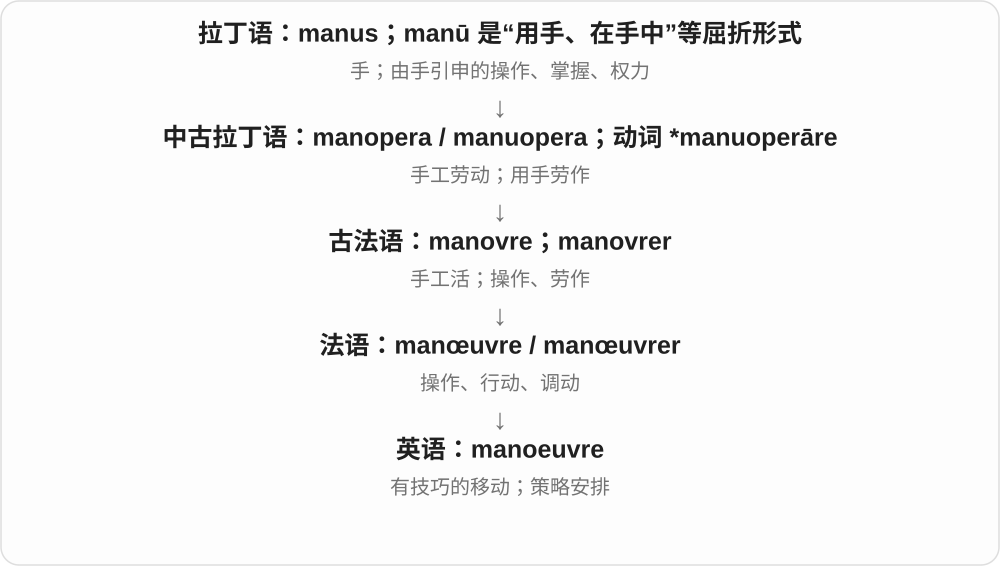

拼写中的 oeuv 不按几个普通英语小块分别读。room for manoeuvre 是可调整、周旋的余地。

**常见搭配与例句**

a delicate manoeuvre；manoeuvre through；room for manoeuvre。

> The driver completed the manoeuvre without touching the wall.

司机完成了这次转向操作，没有碰到墙。

> The deadline leaves us little room for manoeuvre.

截止日期几乎不给我们调整余地。

**别混淆**

manoeuvre 与 maneuver 是地区拼法差别，核心用法相同；不是两个不同词根。

### 59. manoeuvrable — 操控灵活的；容易调整位置的

**音标**：/məˈnuːvərəbəl/

**先抓住这个画面**

manoeuvrable 像一把轻巧的推椅，遇到狭窄拐角也能轻松调整方向。

**怎么拆**

manoeuvre 去末尾 e 加 -able；英式拼法，对应 maneuverable。

**怎么变成今天的意思**

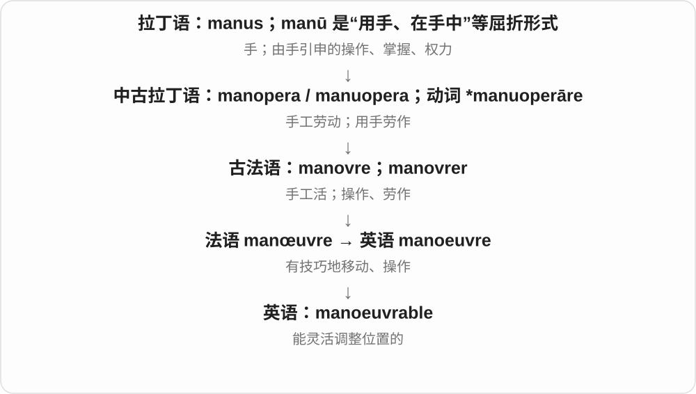

形容设备、车辆等移动时的灵活程度，和最高速度不是一回事。

**常见搭配与例句**

highly manoeuvrable；a manoeuvrable chair；a manoeuvrable craft。

> The wheelchair is light and manoeuvrable indoors.

这辆轮椅轻便，在室内转向灵活。

> The design makes the boat more manoeuvrable.

这个设计使船更容易操控转向。

**别混淆**

fast 是快；manoeuvrable 是容易转向、挪动，速度快的设备未必灵活。

### 60. manicure — 修甲；手部指甲护理

**音标**：英 /ˈmænɪkjʊə/；美 /ˈmænɪkjʊr/

**先抓住这个画面**

把手部指甲修整干净、整理形状，常还包括上色，这种护理叫 manicure。

**怎么拆**

经法语 manucure，由拉丁语 manus（手）与 cūra（照料）组成。

**怎么变成今天的意思**

名字直接点出护理部位。现代还可作动词，表示给手指甲做护理；manicured lawn 则借来形容草坪修剪得精细。

**常见搭配与例句**

get a manicure；a manicure kit；manicured nails。

> She booked a manicure before the wedding.

她在婚礼前预约了美甲护理。

> The kit contains the basic tools for a manicure.

套装里包含修甲的基本工具。

**别混淆**

manicure 护理手部指甲；pedicure 护理脚部。nail polish 只是指甲油，不是整个护理过程。

### 61. manicured — 修整精致的；做过护理的

**音标**：英 /ˈmænɪkjʊəd/；美 /ˈmænɪkjʊrd/

**先抓住这个画面**

manicured 像指甲边缘刚被精心修齐；借到草坪、花园上，就是每个边边角角都被认真打理过。

**怎么拆**

manicure 的过去分词，后作形容词；从手部护理延伸到精细修整其他事物。

**怎么变成今天的意思**

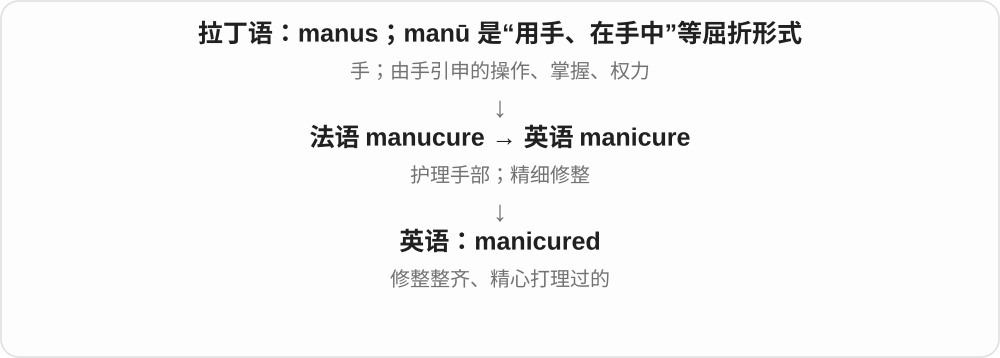

manicured nails 是护理好的指甲；manicured lawns 是修剪整齐的草坪。草坪并不因此与“指甲”有真实物理联系，这是比喻迁移。

**常见搭配与例句**

neatly manicured nails；a manicured garden；perfectly manicured lawns。

> Her neatly manicured nails were painted a pale pink.

她修整整齐的指甲涂成了淡粉色。

> A manicured lawn surrounded the house.

房子周围是一片精心修剪的草坪。

**别混淆**

trimmed 只说剪修过；manicured 更突出整洁精细、经过照料的外观。

### 62. manicurist — 美甲师；修甲师

**音标**：英 /ˈmænɪkjʊərɪst/；美 /ˈmænɪkjʊrɪst/

**先抓住这个画面**

manicurist 就是专门替人护理手部和指甲的人，工作不是只涂一层指甲油。

**怎么拆**

manicure 去 e 加 -ist，表示从事这种服务的人。

**怎么变成今天的意思**

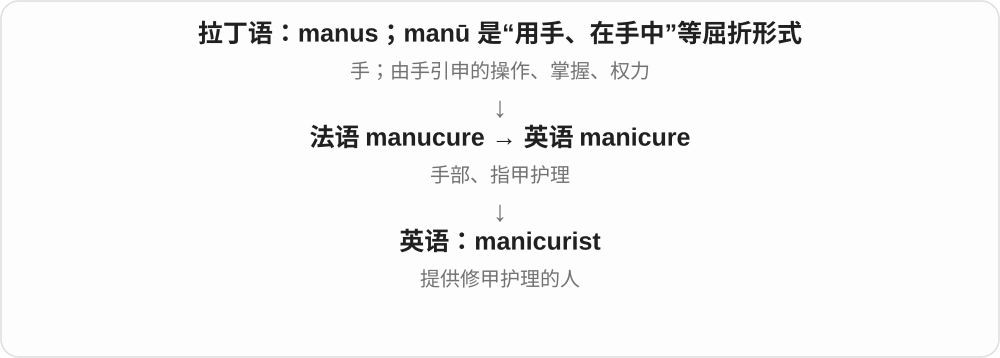

通常是职业名称；提供什么服务取决于实际工作范围。要表达给脚做护理，相关词是 pedicurist。

**常见搭配与例句**

a professional manicurist；work as a manicurist。

> The manicurist asked what nail shape she preferred.

美甲师问她喜欢什么指甲形状。

> She trained as a manicurist before opening her own salon.

她接受了美甲师培训，之后开了自己的店。

**别混淆**

manicure 是服务；manicurist 是提供服务的人。

### 63. remand — 发回重审或进一步处理；使候审；还押

**音标**：英 /rɪˈmɑːnd/；美 /rɪˈmænd/

**先抓住这个画面**

remand 的核心画面是“按正式命令送回去”：案子可送回下级法院处理，被告也可被安排候审。

**怎么拆**

re-（回）+ 拉丁 mandāre“命令”，经法语 remander 和中古英语 remaunden 进入英语。

**怎么变成今天的意思**

remand a case 是发回案件；remand someone in custody 是还押候审。英式还可说 remand on bail，所以不能把所有 remand 都翻成关进牢里。

**常见搭配与例句**

remand a case；remand in custody；on remand。

> The appeals court remanded the case for further consideration.

上诉法院将案件发回进一步审理。

> The report says the defendant was remanded on bail.

报道说，被告获准保释候审。

**别混淆**

convict 是定罪；remand 常发生在程序尚未结束时，不等于判定有罪。

### 64. manus — 手；脊椎动物前肢末端；古罗马的特定家族支配权

**音标**：英 /ˈmeɪnəs/，也 /ˈmænəs/；美 /ˈmeɪnəs/

**先抓住这个画面**

manus 是把“手”作为正式的解剖名称来用，也能在古罗马制度里表示一种支配权。

**怎么拆**

直接借拉丁 manus“手”；英语里读的是借词音，不是把拉丁语发音原样照搬。

**怎么变成今天的意思**

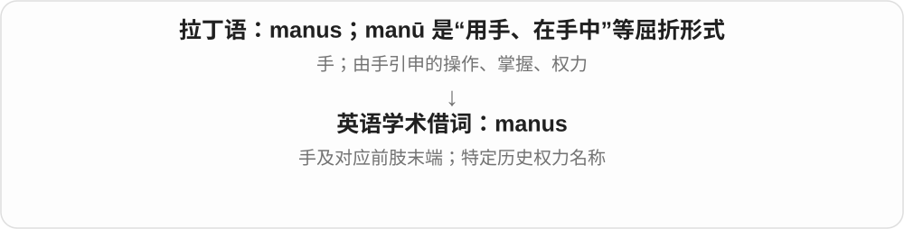

比较动物骨骼时，manus 包括腕部及其远端的掌、指对应结构。罗马制度语境里的 manus 则需要按当时法律术语理解。

**常见搭配与例句**

the bones of the manus；a fossil manus；Roman manus。

> The diagram labels the bones of the manus.

图中标出了手部骨骼。

> The fossil preserves a nearly complete manus.

这件化石保存了一只几乎完整的前肢末端。

**别混淆**

hand 是日常词；manus 是学术名称。man“人”是另一条日耳曼来源，不能用它解释这里的 manus。

### 65. mandamus — 履行职责令；强制履行令

**音标**：/mænˈdeɪməs/

**先抓住这个画面**

mandamus 像法院对负有职责的人说：“这项职责该履行，请去做。”

**怎么拆**

直接借拉丁 mandāmus，意思是“我们命令”，是 mandāre 的第一人称复数形式；不是 mand + amus 随意拼接。

**怎么变成今天的意思**

在普通法制度语境中，它指特定的司法救济名称；适用条件因制度而异，不是所有法院命令的总称。

**常见搭配与例句**

a writ of mandamus；seek mandamus；a petition for mandamus。

> The petition asked the court to issue a writ of mandamus.

申请书请求法院发出履行职责令。

> The judgment explains why mandamus was unavailable in that case.

判决解释了为什么该案不适用这种履行职责令。

**别混淆**

injunction 也是法院命令的一类，但 mandamus 特别围绕要求履行某项职责。

### 66. manumit — 释放被奴役者；解除奴役

**音标**：英 /ˌmænjʊˈmɪt/；美 /ˌmænjəˈmɪt/

**先抓住这个画面**

manumit 的画面是把一个人从控制者的手中放开，在历史制度里指解除对具体个人的奴役。

**怎么拆**

来自拉丁语 manūmittere，更早的构成可见 manū ēmittere“从手中放出”；manū 与 manus“手”同族。

**怎么变成今天的意思**

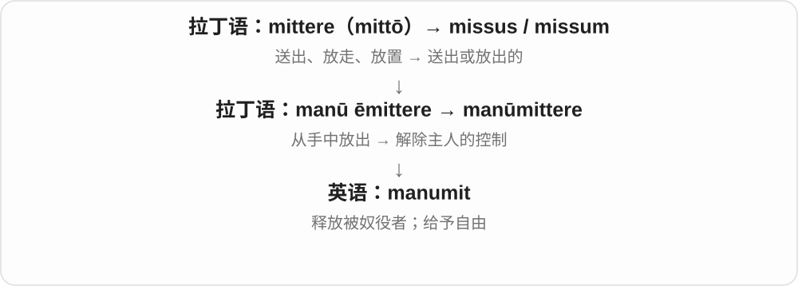

这个词解释的是历史中的权力与法律行为，不表示被奴役的人本来应当归谁拥有。现代一般的释放不必用这个专门词。

**常见搭配与例句**

manumit an enslaved person；a formerly enslaved person who was manumitted。

> The document records a decision to manumit two enslaved people.

这份文件记录了释放两名被奴役者的决定。

> The historian studied the conditions under which people were manumitted.

这位历史学家研究了人们在什么条件下获得奴役解除。

**别混淆**

free 是一般使自由；manumit 特别用于解除奴役的历史行为。

### 67. manumission — 释放被奴役者；奴隶解放手续

**音标**：英 /ˌmænjʊˈmɪʃən/；美 /ˌmænjəˈmɪʃən/

**先抓住这个画面**

manumission 的老画面是从控制者的手中放开一个人，指对某个被奴役者解除奴役、给予自由。

**怎么拆**

来自拉丁语 manūmissiō，经法语等进入英语；manū 与 manus“手”相连，miss- 来自 mittere“释放”。

**怎么变成今天的意思**

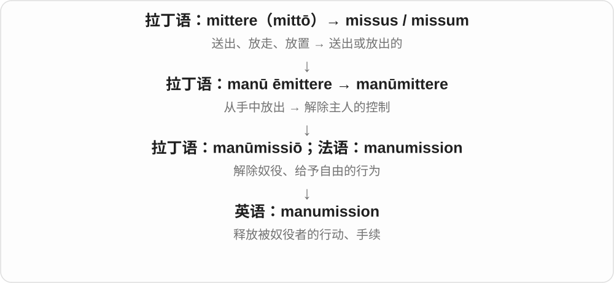

这是历史制度术语。一个人的 manumission 不等于整个社会已废除奴隶制。

**常见搭配与例句**

a deed of manumission；records of manumission；grant manumission。

> The archive preserves several documents of manumission.

档案馆保存了几份释放被奴役者的文书。

> The chapter distinguishes individual manumission from the abolition of slavery.

这一章区分了个人获得自由与废除奴隶制。

**别混淆**

abolition 指废除制度；manumission 常是具体个人获得自由的行为。

### 68. amanuensis — 代笔记录者；听写员；抄写助手

**音标**：/əˌmænjuˈensɪs/

**先抓住这个画面**

amanuensis 像借出自己的一只手：别人说话或提供内容，他负责写下来。

**怎么拆**

来自拉丁 āmanuēnsis，联系短语 a manu“担任书写工作”与 manus“手”，-ensis 形成身份名称；不能把 a- 解成“没有”。

**怎么变成今天的意思**

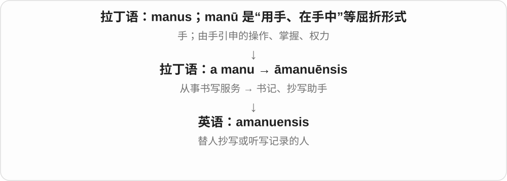

这是较正式、偏历史的词。复数常为 amanuenses；职责重在记录内容，不必负责创作内容。

**常见搭配与例句**

serve as an amanuensis；dictate to an amanuensis。

> The author dictated the final chapter to an amanuensis.

作者口述最后一章，由一位代笔记录员写下。

> She worked as an amanuensis, copying letters for the scholar.

她担任抄写助手，为那位学者抄录信件。

**别混淆**

author 是作者；amanuensis 是记录或抄写助手，两者可能是不同的人。

### 69. countermand — 撤销命令；下反令取消

**音标**：英 /ˌkaʊntəˈmɑːnd/；美 /ˈkaʊntərˌmænd/

**先抓住这个画面**

countermand 像刚发出“开始”，又发出一个有权覆盖它的“取消”：后一道命令把前一道撤回。

**怎么拆**

经古法语 contremander，远源中古拉丁 contrāmandāre；contra（反向）+ mandāre（命令）。

**怎么变成今天的意思**

通常是有相应权力的人撤销此前指令。它不是一般提出不同意见，而是改变命令的效力。

**常见搭配与例句**

countermand an order；countermand instructions。

> The supervisor countermanded the instruction to close the office.

主管撤销了关闭办公室的指令。

> No one was authorized to countermand the captain’s order.

没有人获授权撤销船长的命令。

**别混淆**

contradict 是反驳、说相反的话；countermand 是以命令取消先前命令。

### 70. mortmain — 永久法人持产；旧制下的“死手”持有

**音标**：英 /ˈmɔːtmeɪn/；美 /ˈmɔːrtmeɪn/

**先抓住这个画面**

mortmain 的字面画面是“不会松开的死手”：土地进入持续存在的法人或宗教机构名下，不再像个人财产那样随人的死亡转移。

**怎么拆**

法语 mort（死）+ main（手）；盎格鲁法语 mortmayn 对应拉丁 mortua manus“死手”。

**怎么变成今天的意思**

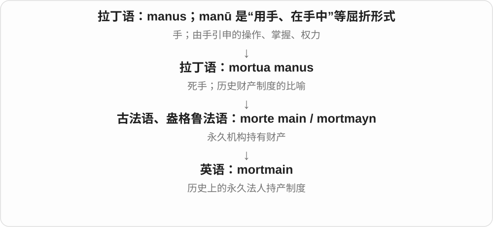

主要出现在法律史、土地制度史中。dead hand 也能作一般比喻，表示旧制度长期束缚现在，但 mortmain 首先是历史制度词。

**常见搭配与例句**

land held in mortmain；the statutes of mortmain。

> The historian examined land held in mortmain by religious institutions.

历史学家考察了宗教机构以永久法人形式持有的土地。

> The chapter explains the medieval restrictions on mortmain.

这一章解释了中世纪对永久法人持产的限制。

**别混淆**

inheritance 关注继承；mortmain 关注财产被持续存在的机构长期持有这一状态。

### 71. manacle — 手铐；束缚；给……戴上手铐

**音标**：/ˈmænəkəl/

**先抓住这个画面**

manacle 的画面是手腕被金属圈锁住，伸手做事的自由被限制了。

**怎么拆**

拉丁 manicula 是 manus“手”的指小形式，经法语 manicle 和中古英语进入英语；不是 man + uncle。

**怎么变成今天的意思**

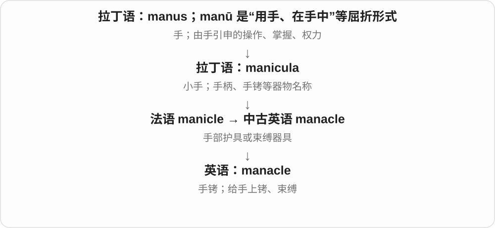

名词常用复数 manacles。动词一般可按名词转用理解；早期动词记录略早，不能把现代拆解当成确证的出现先后。

**常见搭配与例句**

iron manacles；wear manacles；manacle someone to something。

> The museum displayed a pair of iron manacles.

博物馆展出了一副铁手铐。

> The prisoner’s hands were manacled behind his back.

囚犯的双手被铐在背后。

**别混淆**

handcuffs 是常用的手铐名称；manacles 较书面，也常带旧式镣铐的画面。

### 72. manubrium — 柄状部分；胸骨柄；水母的垂管

**音标**：英 /məˈnjuːbriəm/；美 /məˈnuːbriəm/

**先抓住这个画面**

manubrium 的原意是“把手”，解剖命名把这个形状借给了器官上像柄的部分。

**怎么拆**

直接借拉丁 manubrium“柄”，远连 manus“手”；不要把英语词尾硬拆成独立的 brium。

**怎么变成今天的意思**

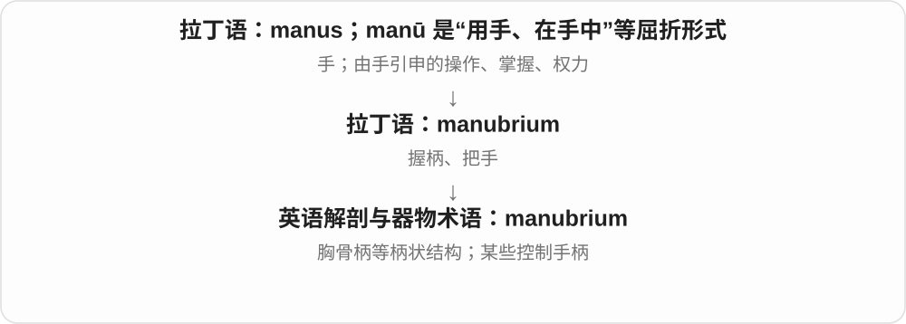

在人类骨骼里，胸骨上端较宽的部分叫 manubrium；在水母研究中，它又指伞体下方与口相关的垂管。对象不同，位置也不同。

**常见搭配与例句**

the manubrium of the sternum；a jellyfish manubrium。

> The diagram marks the manubrium at the upper end of the sternum.

图中标出了胸骨上端的胸骨柄。

> The drawing shows the jellyfish’s manubrium beneath the bell.

图画展示了水母伞体下方的垂管。

**别混淆**

manus 是手或前肢末端；manubrium 是借“手柄”命名的结构，不是手本身。

### 73. adminicle — 辅助物；佐证；旧：支撑物

**音标**：/ædˈmɪnɪkəl/

**先抓住这个画面**

adminicle 像给藤蔓搭的一根小支柱：它不是主干，却能在旁边撑一把；引申到论证里就是补充支持。

**怎么拆**

借自拉丁 adminiculum“支柱、辅助”。其更早成分有不同分析，不能肯定拆成 ad- + manus；这里保留词根表的关联，同时从可确认的拉丁词起图。

**怎么变成今天的意思**

这是少见的旧式词，法律史等文本中可指辅助证据。普通写作更常用 support 或 supporting evidence。

**常见搭配与例句**

an adminicle of evidence；an adminicle of support。

> The letter served as an adminicle of evidence in the old account.

在那份旧记述中，这封信被当作一项辅助证据。

> The historian treated the small inscription as an adminicle of support for the dating.

历史学家把那段短铭文当作断代的辅助依据。

**别混淆**

evidence 可以是证据总称；adminicle 常强调在主要证据旁补上一点支持。

### 74. bimanous — 有两只手的；旧分类中的双手类的

**音标**：/ˈbɪmənəs/，也 /baɪˈmeɪnəs/

**先抓住这个画面**

bimanous 是在数“有几只手”：旧时分类者用它描述具有两只手的形态。

**怎么拆**

bi-（二）与 manus（手）构成这一组科学名称；英语经法语 bimane 加 -ous。

**怎么变成今天的意思**

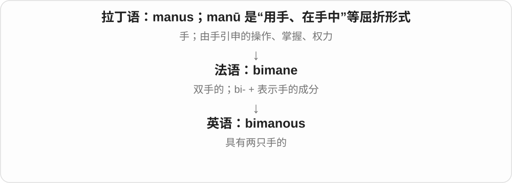

常见于旧式动物分类和历史文献。Bimana 是相关的旧分类名，不能直接当成现代通行的分类等级。

**常见搭配与例句**

a bimanous form；bimanous anatomy；the bimanous condition。

> The old classification described humans as bimanous.

旧分类把人描述为双手类。

> The author contrasted bimanous and quadrumanous forms.

作者对比了双手型与所谓四手型的形态。

**别混淆**

bimanual 常说活动用了双手；bimanous 主要描述形态上有两只手。

### 75. mainour — 旧：当场从窃贼身上查获的赃物

**音标**：英 /ˈmeɪnə/；美 /ˈmeɪnər/

**先抓住这个画面**

mainour 的场景是盗贼被抓住时，赃物还带在身上，物证与人就在一起。

**怎么拆**

经盎格鲁法语 mainoure / meinoure 和中古英语而来，联系古法语 manuevre“手工劳动”；属于 manus + 工作这一远源分支。

**怎么变成今天的意思**

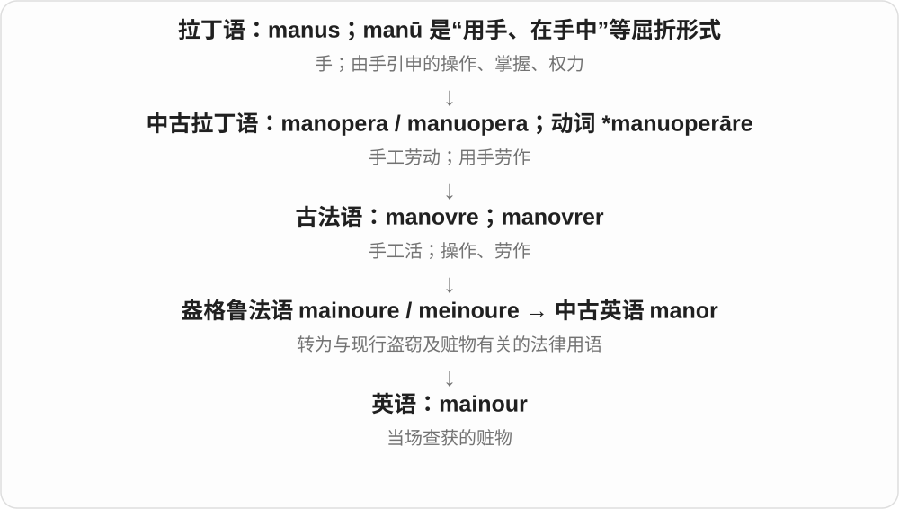

这是法律史旧词，常见 taken with the mainour。具体语义中间怎样变化并不宜仅凭“手”去补出故事，记住赃物在身的使用场景即可。

**常见搭配与例句**

taken with the mainour；caught with the mainour。

> The old record says the thief was taken with the mainour.

旧记录说，窃贼被人赃俱获。

> A glossary explains mainour as stolen property found on the thief.

词汇表把 mainour 解释为从窃贼身上查获的赃物。

**别混淆**

stolen goods 是一般赃物；mainour 特别联系现场抓获、赃物随身的旧法律说法。

### 76. manifer — 骑士护手铁套；持缰手的护手

**音标**：美 /ˈmænəˌfer/，也 /ˈmænəfər/

**先抓住这个画面**

manifer 像给握缰绳的那只手套上一层铁壳，既护住手，也保留持缰的姿势。

**怎么拆**

通常解释为中古法语 main de fer“铁手”的变形；main 来自 manus，fer 表示铁。

**怎么变成今天的意思**

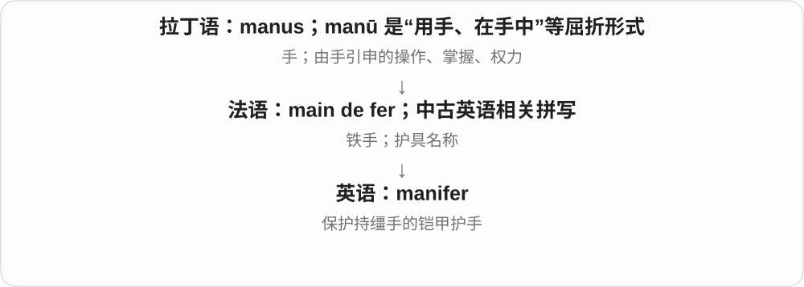

主要用于历史铠甲描述，常指比一般护手更厚重、用于骑乘比武的左手护具。近形的马颈甲名称历史有混用，不能直接混成同一器物。

**常见搭配与例句**

a jousting manifer；a left-hand manifer。

> The suit of armour includes a heavy manifer for the left hand.

这套铠甲带有一只保护左手的厚重护手铁套。

> The label explains how the manifer protected the hand holding the reins.

标签解释了这种护手怎样保护握缰绳的手。

**别混淆**

gauntlet 是护手、长手套的较大类；manifer 是更具体的历史甲具名。

### 77. maniform — 手形的；形似手的

**音标**：英 /ˈmænɪˌfɔːm/；美 /ˈmænəˌfɔːrm/

**先抓住这个画面**

maniform 像把手掌张开，再看某个物体的轮廓是不是也有掌部和指状伸出物。

**怎么拆**

mani-（手，来自 manus）+ -form（形状）；英语联系新拉丁语 maniformis“手形的”。

**怎么变成今天的意思**

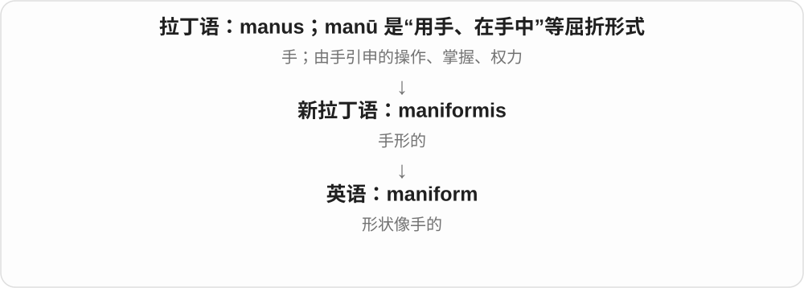

这是少见的形态描述词。它只比较外形，不说明这个结构是否真的有抓握功能。

**常见搭配与例句**

a maniform structure；a maniform outline。

> The specimen has a broad, maniform outline.

这个标本有宽阔的手形轮廓。

> The drawing emphasizes the maniform shape of the structure.

图画突出了这个结构的手形外观。

**别混淆**

manual 说与手或手工有关；maniform 只说形状像手。

### 78. maniraptoran — 手盗龙类的；手盗龙类成员

**音标**：构词参考读法 /ˌmænɪˈræptərən/

**先抓住这个画面**

maniraptoran 的名字可以想成“用手抓取的一支”，实际用法是在恐龙家谱上标出手盗龙类这条分支，包括鸟类及若干近亲。

**怎么拆**

科学分类名 Maniraptora + -an；名称由拉丁 manus“手”与 raptor“抓取者”构成。

**怎么变成今天的意思**

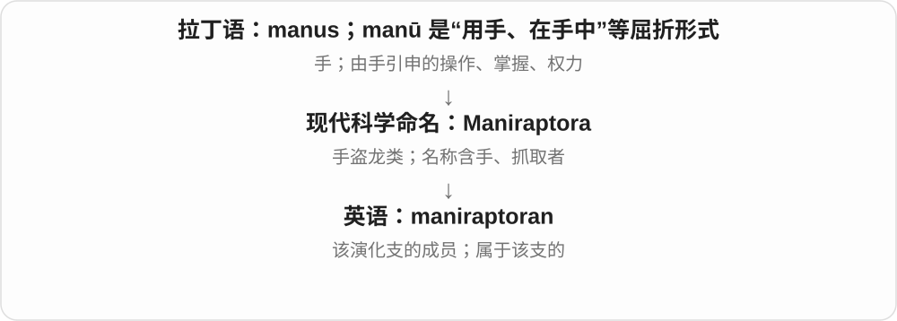

这是亲缘分类名称，不是“所有靠手捕食的动物”。成员有不同食性；某物种属于这一支，也不等于它就是现代鸟类的直接祖先。

**常见搭配与例句**

a maniraptoran dinosaur；maniraptoran evolution。

> Birds are living maniraptorans.

鸟类是现生的手盗龙类成员。

> The study compares wrist bones in several maniraptoran dinosaurs.

这项研究比较了几种手盗龙类恐龙的腕骨。

**别混淆**

theropod 是范围更大的兽脚类；maniraptoran 指其中包含鸟类的一支。

### 79. maniraptoriform — 手盗龙形类的；手盗龙形类成员

**音标**：构词参考读法 /ˌmænɪˈræptərɪfɔːrm/

**先抓住这个画面**

maniraptoriform 像在恐龙家谱上画一个更大的圈：除了手盗龙类，还把似鸟龙类等相关分支包含进来。

**怎么拆**

对应科学分类名 Maniraptoriformes；mani-（手）+ raptor（抓取者）+ form（形态）属于命名成分，不是看着像手就能归入。

**怎么变成今天的意思**

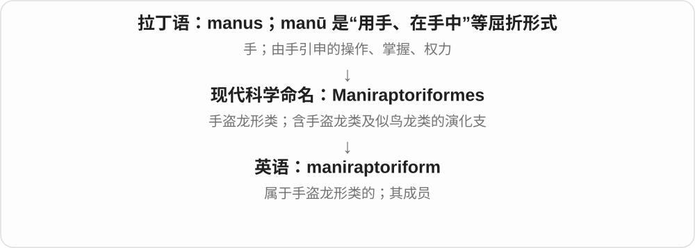

它比 maniraptoran 的范围更广。名称中的 form 不表示仅凭外形判定，现代分类依赖亲缘证据。这里给的是构词参考读法。

**常见搭配与例句**

a maniraptoriform theropod；maniraptoriform relationships。

> The diagram places ornithomimosaurs within the maniraptoriform group.

这张图把似鸟龙类放在手盗龙形类之内。

> The paper discusses relationships among maniraptoriform theropods.

论文讨论了手盗龙形类兽脚动物之间的亲缘关系。

**别混淆**

maniraptoran 与 maniraptoriform 不是两个随意互换的拼法：前者所在分支通常包含在后者之内。

### 80. mansuetude — 温顺；温和；柔顺

**音标**：英 /ˈmænswɪtʃuːd/；美 /ˈmænswɪtuːd/

**先抓住这个画面**

mansuetude 的老画面是动物慢慢习惯人的手，不再惊跳抗拒；引申到人，就是温和柔顺的性情。

**怎么拆**

拉丁 manus（手）+ suēscere（习惯）→ mansuētus（驯顺的）→ mansuētūdō；经法语或直接进入英语。

**怎么变成今天的意思**

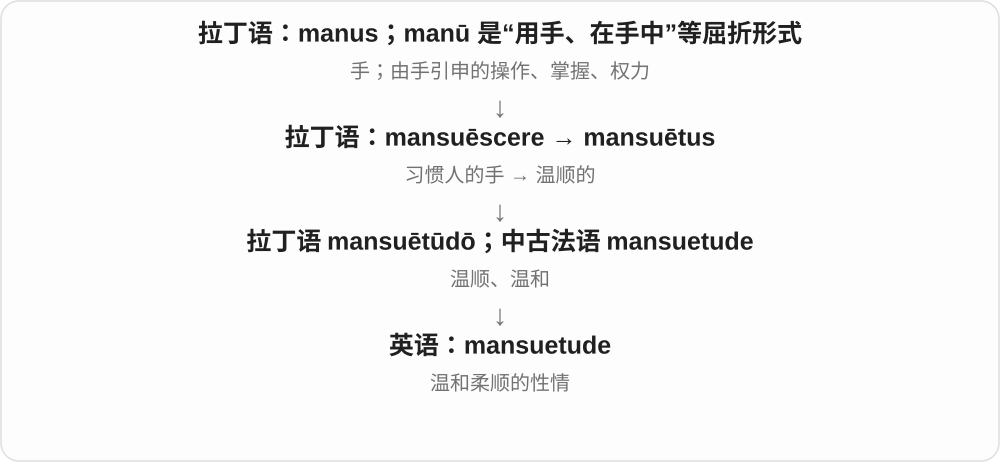

文学和较古雅的文字中才常遇见。语气可以赞美温和，也可能暗含过分顺从，要看作者态度。

**常见搭配与例句**

gentleness and mansuetude；an air of mansuetude。

> The narrator contrasts the ruler’s anger with the servant’s mansuetude.

叙述者把统治者的愤怒与仆人的温顺作了对比。

> His quiet reply was marked by unexpected mansuetude.

他平静的回答显出令人意外的温和。

**别混淆**

gentleness 是日常可用的温和；mansuetude 更古雅，也更容易带驯顺、柔顺的色彩。

### 81. manuary — 旧：手工的；靠手工作的；手工劳动者

**音标**：美 /ˈmænjəˌweri/

**先抓住这个画面**

manuary 把人和工作都拉回“亲手做”的场景：用手劳动的，可以是工作，也可以是做这工作的人。

**怎么拆**

借自拉丁 manuārius“手的、手工的”，由 manus 与形容词后缀构成。

**怎么变成今天的意思**

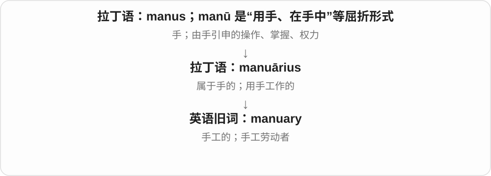

这是旧词，现代一般写 manual 或 manual worker。阅读旧文献时再把它认出来即可，不必刻意替换常用词。

**常见搭配与例句**

manuary work；manuary labour；a manuary。

> The old essay distinguishes intellectual work from manuary labour.

那篇旧文章区分了脑力工作与手工劳动。

> The glossary identifies a manuary as a worker who labours with the hands.

词汇表把 manuary 解释为靠双手劳动的人。

**别混淆**

manual 仍很常用；manuary 主要保留在历史文本中。

### 82. manubrial — 胸骨柄的；柄状结构的

**音标**：英 /məˈnjuːbriəl/；美 /məˈnuːbriəl/

**先抓住这个画面**

manubrial 是在 manubrium“柄状部分”旁贴上一个关系标签：位置、表面或连接与这个柄状结构有关。

**怎么拆**

manubrium 去掉拉丁式结尾 -um，加 -al，形成关系形容词。

**怎么变成今天的意思**

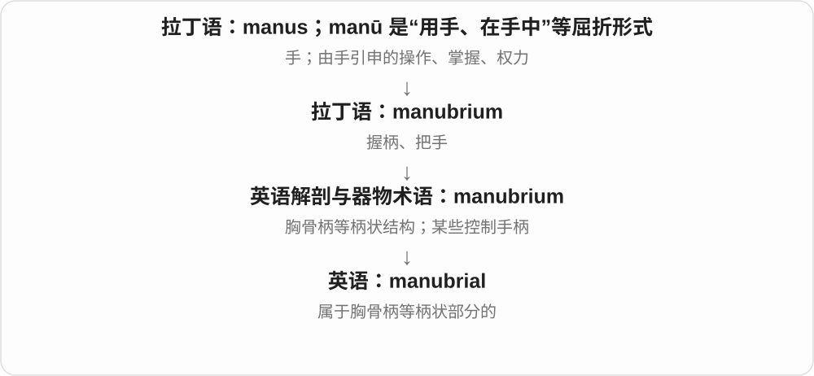

在人类解剖文本中多指胸骨柄；其他生物学语境需先看 manubrium 指哪一个结构。

**常见搭配与例句**

the manubrial surface；a manubrial feature；the manubrial region。

> The illustration marks the manubrial region of the sternum.

插图标出了胸骨的柄部区域。

> The description compares the manubrial surfaces of the specimens.

这段描述比较了各标本胸骨柄的表面。

**别混淆**

sternal 涵盖胸骨相关；manubrial 往往更具体地指胸骨上部的柄。

### 83. manuduction — 旧：引导；入门指引

**音标**：美 /ˌmænjəˈdʌkʃən/

**先抓住这个画面**

manuduction 像牵着新手的手，带他一步步走进一个陌生领域。

**怎么拆**

拉丁 manū（用手）+ ductiō（引领），形成晚期或中古拉丁 manuductio，再借入英语。

**怎么变成今天的意思**

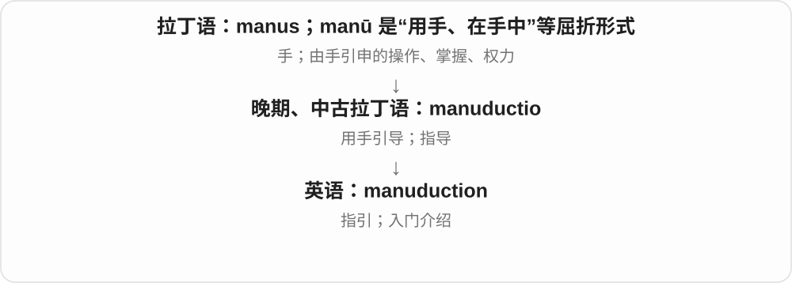

常见于旧书题名或学术史，意思接近 introduction 或 guide。这个词的“手”比喻指导，不要求真的拉住对方。

**常见搭配与例句**

a manuduction to a subject；offer manuduction。

> The old textbook presents itself as a manuduction to logic.

这本旧教科书把自己定位为逻辑学入门指引。

> The preface promises a gentle manuduction for new readers.

前言承诺为新读者提供循序渐进的引导。

**别混淆**

instruction 泛指教导；manuduction 尤其容易带着牵引初学者入门的画面。

### 84. manuport — 人为搬运而未加工的天然物

**音标**：构词参考读法 /ˈmænjuˌpɔːrt/

**先抓住这个画面**

manuport 像有人从河边捡起一块天然石头带回住处：改变的是位置，石头本身并没有被打磨成工具。

**怎么拆**

现代考古命名，取拉丁 manū“用手”与 portāre“搬运”的成分；不是英语 man“人”加 port。

**怎么变成今天的意思**

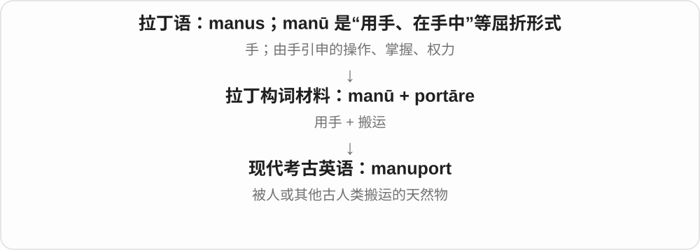

判断重点是人为搬运的证据与未经加工的状态。不能因为遗址里有块天然石头，就直接断定它是 manuport，更不能直接断定它是艺术品。

**常见搭配与例句**

a possible manuport；identify a stone as a manuport。

> The pebble may be a manuport brought from a distant stream.

这块卵石可能是从远处溪流带来的天然搬运物。

> The researchers looked for evidence that the shell was a manuport.

研究者寻找证据，判断这枚贝壳是否是被人带到这里的。

**别混淆**

artifact 通常涉及人为制作或加工；manuport 关键在搬运，不要求留下加工痕迹。

### 85. manège — 骑术训练场；骑术；训马术

**音标**：/mæˈneʒ/，也 /məˈneɪʒ/

**先抓住这个画面**

manège 把我们带回这组词的马术起点：人在训练场里用缰绳、姿势和指令引导马。

**怎么拆**

借法语 manège，源于意大利 maneggio“驾驭、训马”，远连 manus“手”；也拼 manege。

**怎么变成今天的意思**

在马术场景可以指训练场，也可指骑术、训练动作。法语里的其他义不一定都随借词进入英语。

**常见搭配与例句**

an indoor manège；train in the manège；the art of manège。

> The riders practised turns in the indoor manège.

骑手们在室内骑术训练场练习转向。

> The old book discusses the art of manège.

这本旧书讨论了训马与骑术。

**别混淆**

manage 已广泛发展为管理；manège 更保留马术、训马的专门场景。

### 86. quadrumanous — 四手的；旧：有四个抓握性肢端的

**音标**：美 /kwɑːˈdruːmənəs/

**先抓住这个画面**

quadrumanous 的旧式画面是把会抓握的脚也看成“手”，于是动物好像有四只手。

**怎么拆**

quadru-（四）+ 与 manus“手”相关的成分 + -ous；也联系旧分类名 Quadrumana。

**怎么变成今天的意思**

常见于较早的灵长类分类文字。脚并没有因此真正变成手，不同动物的抓握结构也不相同；不要把这个旧名当成现代分类结论。

**常见搭配与例句**

quadrumanous animals；the old quadrumanous grouping。

> The old book described some primates as quadrumanous.

旧书把某些灵长类描述为四手类。

> The museum explains why the quadrumanous classification is historical.

博物馆解释了为什么四手类属于历史分类概念。

**别混淆**

quadrupedal 是用四肢行走；quadrumanous 是把四个肢端都描述为能抓握的“手”，不是同一标准。

## 这一组要分清什么

manual 指人的手或人工操作；maniform 指形状像手，不能互换。

manage 是管理、应付；manipulate 可能是细致操作，也可能是操控别人；maneuver 强调巧妙调整位置或策略。

mandate、command 可含正式命令；recommend 提出值得考虑的建议。

manufacture 与 manuscript 保留不同动作：前者做成，后者写成。工业化后 manufacture 并不要求手工。

manifest 的远源通常联系 manus，但第二部分尚无定论；adminicle 的更早成分分析也有分歧，图从确定节点起。

## 串起来练习

用 manage a team、manage to finish 各造一句，体会“管理”与“设法做到”。

把 mandatory、recommended 放到同一份活动说明里，区分必须做和建议做。

想象一手握罐身、一手拧盖，解释 bimanual；再解释为何它不等于 ambidextrous。

看到 manicured lawn，先想精细修整，再把比喻从指甲转到草坪。
