# 0130 · fin- — 边界；终点

[逐词精讲目录](../00_逐词精讲目录.md) · [总目录](../00_总目录_按常用程度.md)

## 核心词根与来源

**fin- 的核心是一条界线。** 拉丁语 **fīnis** 既是空间的边界，也是事情的终点。于是 final 是到最后，finish 是把事做完，define 是把边界说清。finance 看起来离得很远，背后却连着“把应付的钱结清，让这件事结束”。

**FIN = END / LIMIT**

一条线：事情到这里结束，范围到这里为止

- **到达终点**：final · finish · finale
- **划清范围**：define · definition · confine
- **有没有尽头**：finite · infinite · infinitely
- **结清与钱款**：fine · finance · financial
- **做到精纯**：refine · refinement · refinery
- **边界相接**：affinity
- **finished：走到终点与做完的状态**：finish · finished
- **define／definition → definitions：划清词义边界**：definition · definitions
- **define → defined：划边界与界定**：define · defined
- **final → finals：终点、最后一轮与期末考试**：final · finals
- **finish → finishing：做到终点**：finish · finishing
- **fine → finest：更精细、更优质到最高级**：fine · finer · finest
- **finance → financing：为项目准备资金**：finance · financing
- **define → defining：把边界、含义讲清楚**：define · defining
- **finis 结束词族两支：finance、finish 及扩展**：finance · finances · finish · finishes
- **define → defines：划界到说清意思**：defines
- **fine 精纯 → refine → refined**：refined
- **边界 → confined；没有边界 → infinity**：confined · infinity
- **finis 结束 → fine → fines：罚款**：fines
- **fin- 界限、终结：confines 与 fined**：confines · fined
- **fin- 结束、结清 → financed**：financed

## 词形与演化规律

**fin-、finit- 是同族的不同词形。** fīnis“终点”形成 fīnīre“结束、划界”，其分词 fīnītus 提供 finit-。英语 finite 与 infinite 的发音不完全对应，不要只看字母套读音。finish 的 -ish 来自法语动词词形，不能当作 childish 那种后缀。

finish 接拉丁 finis 边界、终点词族；finished 分别可说完成的产品、结束工作及处境完了。

边界、界定词族，连接定义与轮廓清晰度。

边界词族扩展为讲清范围、内容和特征。

拉丁终点材料形成形容词，英语名词化后数最终场次、考试。

法语 finiss 形态接拉丁 finis 终点，ish 不同于性质后缀。

古法语 fin 的优质等义常连拉丁 finis、finire，远源具体路径未完全确定；est 最高级。

法语结清、终点的词族到 finance，现代去 e 加 ing。

拉丁 definire 经法语，现代形容词可说决定性质、身份的关键。

结清款项到财务；做到终点到完成。英语不是由 finish 现场造 finance。

拉丁 de- 加强 + finire 划界 → define；单数主语后加 -s，保留 e，读 /z/。把含义、范围画清楚的图景可串起现代用法。

refine 的 re- 在此可能加强，不必是再做一次；后接旧动词 fine 使精纯。refined 是去 e 加完整 -ed 的过去形式，也可形容精制、文雅、经过打磨。

confine 的边界、限制词史与拉丁 finis 末端、边界有关；infinity 经法语、拉丁无限名词进入英语，in- 在此是否定。一个设界限，一个说无界限。

罚款 fine 接法语、拉丁结束、结清与付结案款的词义联系；fine 好的、精细的有另一路发展。现代 fines 可数罚款或作处以罚款动词，/nz/。

confines 的边界名词与 confine 动词来源互有关联；fine 罚款经付款了结事情的词线发展。现代词尾分别 /nz/、/nd/，不能把 fined 套成 fine 好的形容词变化。

finance 经法语结清债务、支付词族发展，现代 finance 去 e 加完整 -ed，末尾 /st/。资助与融资被动形式常见。

## 单词速览（按词族由简到繁）

同一基础词的相关扩展放在一起，先读基础形式，再读扩展；各组之间优先读常用的。具体词源关系见各词讲解。

| 单词 | 音标 | 核心意思 |
|---|---|---|
| [fine](#w-2) | /faɪn/ | 好的；精细的；罚款 |
| [final](#w-1) | /ˈfaɪnəl/ | 最后的；最终的；决赛 |
| [finally](#w-3) | /ˈfaɪnəli/ | 终于；最后 |
| [finals](#w-33) | /ˈfaɪnəlz/ | 决赛阶段、总决赛；期末或毕业考试〔final 的名词复数〕 |
| [finalist](#w-15) | /ˈfaɪnəlɪst/ | 决赛选手；最终入围者 |
| [finalize](#w-24) | /ˈfaɪnəlaɪz/ | 最终敲定；定稿 |
| [finality](#w-25) | /faɪˈnæləti/ | 终局性；不可更改的意味 |
| [semifinal](#w-17) | /ˌsemɪˈfaɪnəl/ | 半决赛 |
| [quarterfinal](#w-23) | 英 /ˌkwɔːtəˈfaɪnəl/；美 /ˌkwɔːrtərˈfaɪnəl/ | 四分之一决赛 |
| [finish](#w-5) | /ˈfɪnɪʃ/ | 完成；结束；表面处理效果 |
| [finished](#w-30) | /ˈfɪnɪʃt/ | 完成的、做完了的；结束了、完了；finish 的过去式、过去分词 |
| [finishing](#w-34) | /ˈfɪnɪʃɪŋ/ | 完成、结束；收尾、表面加工〔现在分词、动名词〕 |
| [finishes](#w-40) | /ˈfɪnɪʃɪz/ | 完成、结束〔第三人称单数〕；表面处理效果、终局〔复数〕 |
| [finisher](#w-19) | 英 /ˈfɪnɪʃə/；美 /ˈfɪnɪʃər/ | 完成者；跑完全程的人；善于得分的人 |
| [finance](#w-6) | /ˈfaɪnæns/；也读 /faɪˈnæns/ | 资金；金融；为……提供资金 |
| [financial](#w-4) | /faɪˈnænʃəl/；也读 /fɪˈnænʃəl/ | 财务的；金融的 |
| [financing](#w-37) | /ˈfaɪnænsɪŋ/，也读 /faɪˈnænsɪŋ/ | 筹资、提供资金；融资安排〔现在分词、动名词及相关名词〕 |
| [finances](#w-39) | /ˈfaɪnænsɪz/，也读 /faɪˈnænsɪz/ | 财务状况、财力、资金〔复数名词〕；资助〔第三人称单数〕 |
| [financed](#w-48) | 英、美 /ˈfaɪnænst/ | 资助了；提供了资金；由资金支持的 |
| [microfinance](#w-26) | /ˈmaɪkrəʊˌfaɪnæns/ | 小额金融服务 |
| [finest](#w-35) | /ˈfaɪnɪst/ | 最好的、最优质的；最细的〔最高级〕 |
| [fines](#w-45) | 英、美 /faɪnz/ | 罚款〔复数〕；处以罚款〔第三人称〕 |
| [fined](#w-46) | 英、美 /faɪnd/ | 处以罚款了；被罚款的〔过去形式〕 |
| [finer](#w-36) | 英 /ˈfaɪnə/；美 /ˈfaɪnər/ | 更好、更优质；更细、更精细〔比较级〕 |
| [define](#w-8) | /dɪˈfaɪn/ | 定义；明确；界定 |
| [definition](#w-7) | /ˌdefɪˈnɪʃən/ | 定义；清晰度 |
| [definitions](#w-31) | /ˌdefɪˈnɪʃənz/ | 定义；释义；清晰度、界定方式〔具体语境，复数〕 |
| [defined](#w-32) | /dɪˈfaɪnd/ | 定义、界定；确定特征〔过去式、过去分词〕；清楚划定的 |
| [defining](#w-38) | /dɪˈfaɪnɪŋ/ | 界定、定义、明确〔现在分词〕；决定性质的、标志性的〔形容词〕 |
| [defines](#w-41) | 英、美 /dɪˈfaɪnz/ | 定义；界定；决定其特点〔第三人称〕 |
| [definable](#w-27) | /dɪˈfaɪnəbəl/ | 可定义的；可明确界定的 |
| [redefine](#w-20) | /ˌriːdɪˈfaɪn/ | 重新定义；改变对……的理解 |
| [refine](#w-16) | /rɪˈfaɪn/ | 提纯；改进；使更精细 |
| [refined](#w-42) | 英、美 /rɪˈfaɪnd/ | 精制的；文雅的；经过改进的；提纯、改进了〔过去式、过去分词〕 |
| [refinery](#w-14) | /rɪˈfaɪnəri/ | 精炼厂；炼油厂 |
| [refinement](#w-18) | /rɪˈfaɪnmənt/ | 改进；提纯；精致 |
| [refinance](#w-22) | /ˌriːˈfaɪnæns/ | 再融资；重新安排借款 |
| [refiner](#w-29) | 英 /rɪˈfaɪnə/；美 /rɪˈfaɪnər/ | 精炼者；精炼企业；精炼设备 |
| [finite](#w-11) | /ˈfaɪnaɪt/ | 有限的 |
| [finitely](#w-28) | /ˈfaɪnaɪtli/ | 有限地；在有限范围内 |
| [infinite](#w-9) | /ˈɪnfɪnət/ | 无限的；无穷的 |
| [infinity](#w-44) | 英、美 /ɪnˈfɪnɪti/ | 无限；无穷 |
| [infinitely](#w-13) | /ˈɪnfɪnətli/ | 无限地；大得多地 |
| [finale](#w-10) | /fɪˈnɑːli/ | 终曲；最后一集；收尾部分 |
| [confine](#w-21) | 动词 /kənˈfaɪn/ | 限制；把……局限于 |
| [confined](#w-43) | 英、美 /kənˈfaɪnd/ | 限制在某处的；范围有限的；受限的〔过去式、过去分词〕 |
| [confines](#w-47) | 名词：英 /ˈkɒnfaɪnz/、美 /ˈkɑːnfaɪnz/；动词：英、美 /kənˈfaɪnz/ | 范围、界限〔名词复数〕；限制于〔第三人称单数〕 |
| [affinity](#w-12) | /əˈfɪnəti/ | 亲近感；契合；密切关系 |

## 逐词讲解

### 1. fine — 好的；精细的；罚款

**音标**：/faɪn/

**先抓住这个画面**

fine 要分两条线记。形容词像一件已经打磨好的作品：精细、优质，也能随口表示“还好”。罚款义则像付一笔钱，让处罚这件事得到结算。

**怎么拆**

不要拆成 f + ine。罚款义经法语 fin 来自 fīnis“结束、结清”。“精细、优质”义来自古法语 fin，通常也与 fīnis 或 fīnīre 联系，但更早的具体路线并不完全确定。

**怎么变成今天的意思**

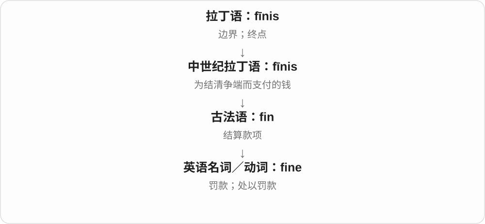

图里画的是较清楚的“罚款”路线。形容词可以用“加工到位 → 精良、精细”帮助理解，但不要把这个画面当成所有细节都已证实的历史。fine hair 是细发，fine wine 是佳酿，I’m fine 常只是说“我还好”。

**常见搭配与例句**

fine details（细节）；fine weather（好天气）；pay a fine（交罚款）；fine someone for…（因……罚某人款）。

> The camera can capture very fine details.

这台相机能拍出非常细微的细节。

> He paid a fine for parking in the wrong place.

他因停车位置不当交了罚款。

**别混淆**

I’m fine 不一定等于“我特别开心”，语气可能只是“没事”。a fine 是罚款，a fine meal 中的 fine 才是形容词。

### 2. final — 最后的；最终的；决赛

**音标**：/ˈfaɪnəl/

**先抓住这个画面**

把一件事想成一条路，final 就是路的尽头：到这里，后面没有下一轮了。a final decision 还带有“已经定下，不准备再改”的意思。

**怎么拆**

fin-（终点）+ 形容词成分 -al。这个组合在拉丁语 fīnālis 中已存在，后来经法语进入英语。

**怎么变成今天的意思**

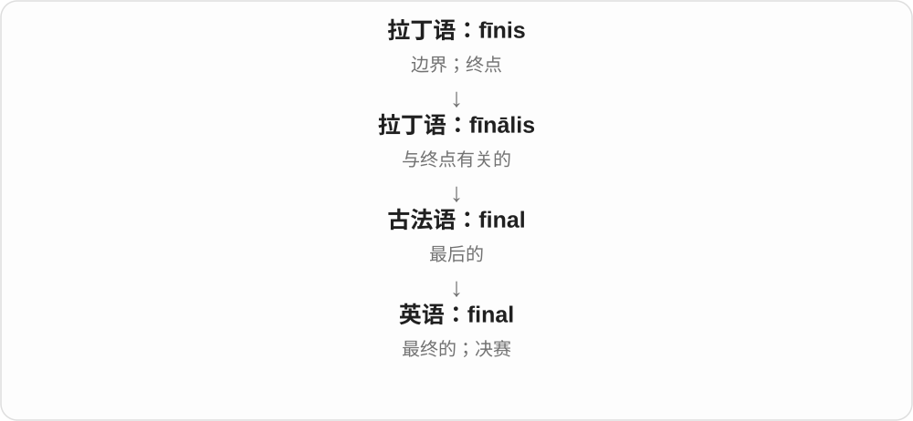

先是“与终点有关的”，再成为“最后的”。比赛的最后一轮叫 the final；课程结束时的考试也可叫 a final。这里不需要硬记三个互不相干的中文意思。

**常见搭配与例句**

the final round（最后一轮）；a final decision（最终决定）；reach the final（进入决赛）。

> This is your final chance to change the booking.

这是你修改预订的最后机会。

> Our team reached the final after a difficult match.

经过一场艰难的比赛，我们队进入了决赛。

**别混淆**

last 只说明排列在最后；final 常进一步表示这一过程到此结束。final 与 finale 同源，但用法和读音不同。

### 3. finally — 终于；最后

**音标**：/ˈfaɪnəli/

**先抓住这个画面**

finally 像在一串过程后画上句号。等了很久后事情发生，是“终于”；按顺序说到最后一步，是“最后”。

**怎么拆**

final + -ly，把“最后的”变成描述动作或安排顺序的副词。

**怎么变成今天的意思**

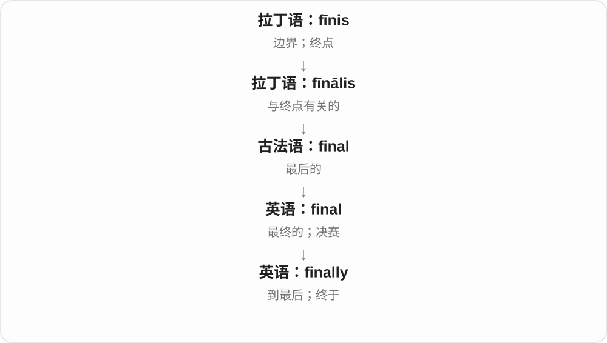

词根仍是终点，但终点有两种看法：回头看漫长等待，强调“总算到了”；往前安排步骤，表示“最后做这一件”。

**常见搭配与例句**

finally arrive（终于到达）；finally understand（终于明白）；first… then… finally…（先……再……最后……）。

> After three attempts, she finally opened the door.

试了三次后，她终于打开了门。

> Finally, add the salt and stir the soup.

最后，加盐并搅拌汤。

**别混淆**

finally 可以在列举时表示最后一点；eventually 更常说经过一段时间后出现的结果，不通常用来引出列表最后一项。

### 4. finals — 决赛阶段、总决赛；期末或毕业考试〔final 的名词复数〕

**音标**：/ˈfaɪnəlz/

**先抓住这个画面**

比赛一路筛到最后的阶段，是 finals；一轮课程学到最后，要考最终掌握情况，也可以叫 finals。两者都抓住最后这一层。

**怎么拆**

final + -s，/l/ 后读 /z/。拉丁 fīnis 终点形成 fīnālis 最后的，经法语进入英语；英语把形容词名词化，省略 match、examination 等所指活动后形成不同名称。

**怎么变成今天的意思**

**拉丁 fīnis → fīnālis → 法语、英语 final**  
终点 → 最后的

↓

**final 名词化 + -s → finals**  
最终比赛阶段；课程或学业末段考试

reach the finals 进入决赛阶段；prepare for finals 准备期末考试；university finals 大学毕业阶段考试〔具体看学校用法〕。

**常见搭配与例句**

finals held in the main stadium；revising for her finals。

> The team reached the finals of the tournament.

球队进入了锦标赛决赛阶段。

> She is preparing for her finals at the library.

她正在图书馆准备期末考试。

**别混淆**

体育语境的 finals 可说多场最终比赛或最终阶段；学校语境多说最终考试。单场决赛也常用 the final，按赛事格式与句子判断。

### 5. finalist — 决赛选手；最终入围者

**音标**：/ˈfaɪnəlɪst/

**先抓住这个画面**

finalist 是一路过关，走到最后一轮的人或作品。进入决赛很厉害，但不等于已经拿到冠军。

**怎么拆**

final + -ist，-ist 在这里表示参与这一阶段的人。

**怎么变成今天的意思**

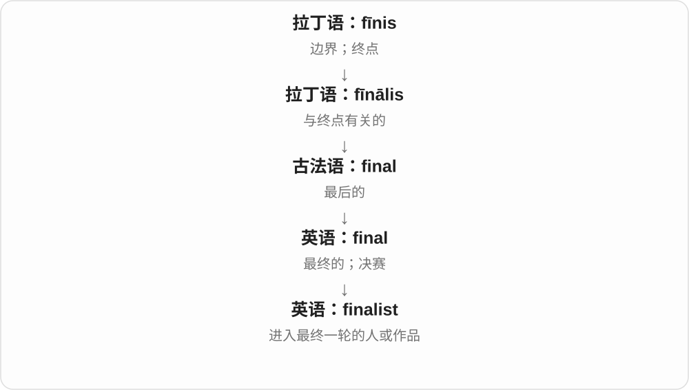

final 是最后一轮，finalist 就是处在这一轮的参与者。评奖时也常用来指最终入围的书、设计或项目。

**常见搭配与例句**

a finalist in a competition（比赛决赛选手）；one of the finalists（最终入围者之一）。

> She was one of six finalists in the singing competition.

她是歌唱比赛的六名决赛选手之一。

> The novel was a finalist for a major literary prize.

这部小说入围了一个重要文学奖的最终评选。

**别混淆**

finalist 可能最终落选；winner 才是获胜者。semifinalist 则只到半决赛阶段。

### 6. finalize — 最终敲定；定稿

**音标**：/ˈfaɪnəlaɪz/

**先抓住这个画面**

finalize 是把还在讨论、修改的东西敲定下来：“就按这个版本办。”它强调最后确认，而不仅是手头动作做完。

**怎么拆**

final + -ize，-ize 常表示“使成为……”。这里就是使安排进入最终状态。

**怎么变成今天的意思**

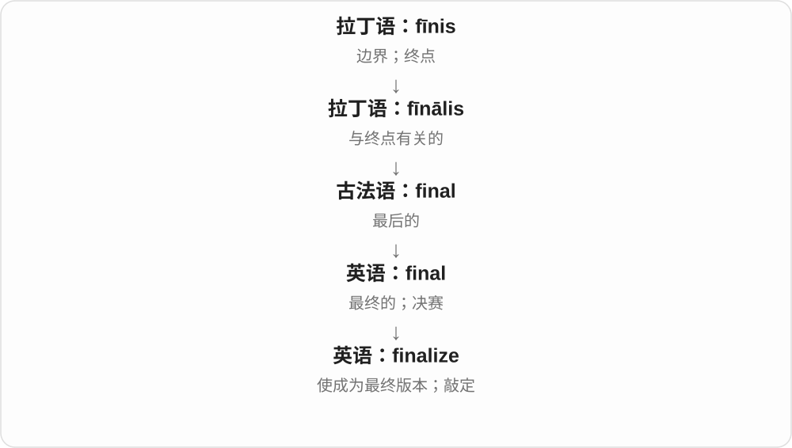

final 是最终的，finalize 把这个状态变成动作。合同、计划、名单和日程都可以被 finalize。

**常见搭配与例句**

finalize the details（敲定细节）；finalize an agreement（最终确定协议）；finalize the schedule（确定最终日程）。

> We will finalize the schedule tomorrow.

我们明天会敲定最终日程。

> The two sides are still finalizing the details of the agreement.

双方仍在敲定协议的细节。

**别混淆**

finish 是一般的完成；finalize 更强调从草案或待定状态变成正式、最终的版本。

### 7. finality — 终局性；不可更改的意味

**音标**：/faɪˈnæləti/

**先抓住这个画面**

finality 是“这事到此为止”的感觉。一个人说话带着 finality，听起来就像门已经关上，不再留讨论空间。

**怎么拆**

final + -ity 可说明现代构词关系；历史上也经法语 finalité 传入。-ity 把“最终的”变成一种性质。

**怎么变成今天的意思**

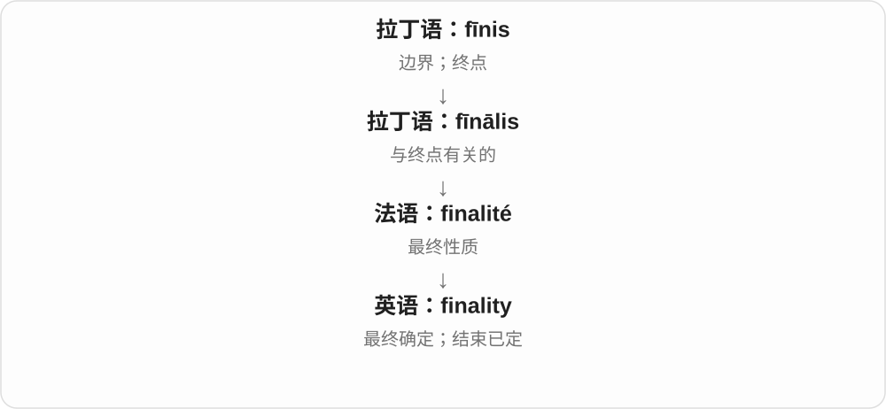

重点不是最后一件东西，而是“结束得多么彻底”。with finality 常用来描写语气、动作或某个决定给人的感受。

**常见搭配与例句**

a sense of finality（彻底结束的感觉）；speak with finality（斩钉截铁地说）；the finality of a decision（决定的终局性）。

> “We are not moving,” she said with finality.

“我们不搬家。”她斩钉截铁地说。

> Closing the empty office gave him a sense of finality.

关上空办公室的门，让他感到一切彻底结束了。

**别混淆**

finale 是收尾部分，finality 是结束已定、不能再改的性质。

### 8. semifinal — 半决赛

**音标**：/ˌsemɪˈfaɪnəl/

**先抓住这个画面**

semifinal 是通往决赛的前一轮。常见淘汰赛里，剩下四名选手或四支队伍，两场比赛各选出一方进决赛。

**怎么拆**

semi-（半）+ final（决赛）。它是一个完整单词，不需要连字符。

**怎么变成今天的意思**

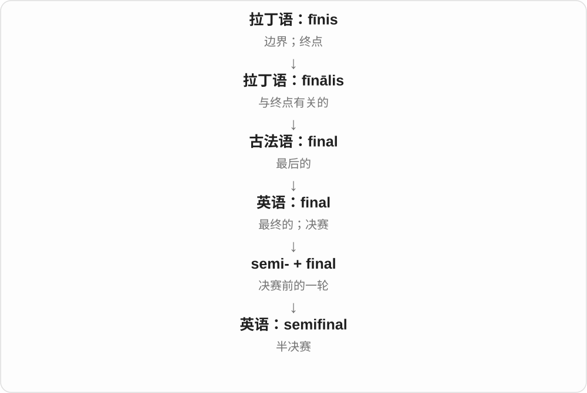

“半”不是说比赛只打半场，而是比赛已经逼近最后的决赛阶段。这个词通常可以作名词，也能放在名词前修饰一场比赛。

**常见搭配与例句**

reach the semifinal（进入半决赛）；win a semifinal（赢下半决赛）；a semifinal match（半决赛）。

> They reached the semifinal after winning on penalties.

他们在点球大战获胜后进入了半决赛。

> The semifinal will be played on Saturday.

半决赛将在周六举行。

**别混淆**

quarterfinal 是再前一轮的四分之一决赛；semifinal 胜出后才到 final。具体赛制也可能有所不同。

### 9. quarterfinal — 四分之一决赛

**音标**：英 /ˌkwɔːtəˈfaɪnəl/；美 /ˌkwɔːrtərˈfaɪnəl/

**先抓住这个画面**

常见淘汰赛剩八方时，四场比赛选出四方进入半决赛。quarterfinal 就是这一轮，常被简称“八强赛”。

**怎么拆**

quarter（四分之一）+ final（决赛），是英语复合词。

**怎么变成今天的意思**

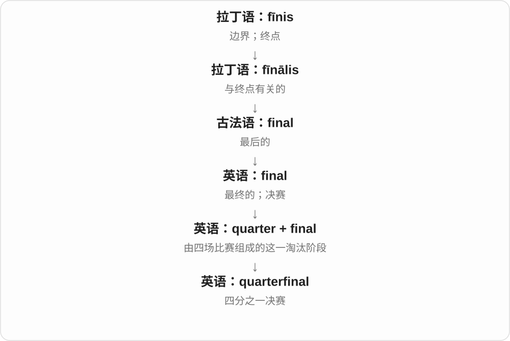

名称说的是比赛进程中的阶段，不是比赛时长只有正常的四分之一。学这个词时，把 quarterfinal → semifinal → final 作为赛程顺序记住。

**常见搭配与例句**

reach the quarterfinals（进入八强）；a quarterfinal match（四分之一决赛）；lose in the quarterfinals（止步八强）。

> She won her quarterfinal in straight sets.

她直落两盘赢下了四分之一决赛。

> The team was eliminated in the quarterfinals.

球队在四分之一决赛中被淘汰。

**别混淆**

quarterfinalist 是进入该阶段的选手；quarterfinal 是比赛或轮次。

### 10. finish — 完成；结束；表面处理效果

**音标**：/ˈfɪnɪʃ/

**先抓住这个画面**

finish 是把正在做的事推到终点：作业做完、比赛跑完、饭吃完。它强调这件事不再继续，而不只是暂停一下。

**怎么拆**

fin- 来自 fīnis“终点”。英语的 -ish 这里来自古法语动词变化里的 finiss-，不是 childish 中表示“像……的”后缀。

**怎么变成今天的意思**

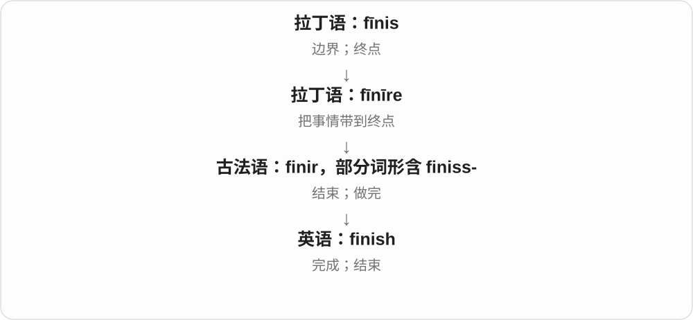

终点既可以是一项任务的完成，也可以是制作过程最后留下的效果，所以家具的 finish 可以指漆面、光泽或表面处理。

**常见搭配与例句**

finish doing something（做完某事）；finish a task（完成任务）；a smooth finish（光滑的表面效果）。

> I’ll call you when I finish cooking.

我做完饭就给你打电话。

> The wooden table has a smooth finish.

这张木桌的表面处理得很光滑。

**别混淆**

finish doing 是做完一件事；stop doing 只说明停下来，可能还没做完。通常不说 finish to do。

### 11. finished — 完成的、做完了的；结束了、完了；finish 的过去式、过去分词

**音标**：/ˈfɪnɪʃt/

**先抓住这个画面**

一路做到终点，剩下的工作已经没有了。a finished product 是做好了的成品；I’m finished 具体是做完还是完蛋，要听上下文。

**怎么拆**

finish + -ed，/ʃ/ 后结尾读 /t/。finish 经法语 finir 等接拉丁 finire 划定边界、结束，上接 finis 边界、终点；完成与结束的范围不断扩大。

**怎么变成今天的意思**

**拉丁 finis → finire → finish**  
边界、终点 → 使结束、完成

↓

**finish + -ed → finished**  
做完的；已结束的状态

a finished product 成品；be finished with something 用完、处理完某物；Are you finished? 你做完了吗；finished goods 制成品。

**常见搭配与例句**

the finished article；finished with the scissors。

> The finished product looks very different from the first sketch.

成品与最初的草图看起来很不一样。

> Are you finished with the scissors?

剪刀你用完了吗？

**别混淆**

I’m finished with the report 通常说报告处理完了。If they find out, I’m finished 则是事情败露我就完了，语气依情境判断。

### 12. finishing — 完成、结束；收尾、表面加工〔现在分词、动名词〕

**音标**：/ˈfɪnɪʃɪŋ/

**先抓住这个画面**

已经向终点推进，正把最后的部分做好，是 finishing。做完任务、跑到终点、给家具补上最后的表面处理，都在收尾。

**怎么拆**

finish + -ing → finishing。finish 经古法语 finiss- 动词形式接拉丁 fīnīre 结束，较早 fīnis 边界、终点；这里 ish 来自法语词形，与 childish 的性质后缀不同。

**怎么变成今天的意思**

**拉丁 fīnis、fīnīre → 法语 finiss- → finish**  
终点、设限 → 做完、结束

↓

**finish + -ing → finishing**  
正在完成；把成品最后处理好的工序

finishing the report 完成报告；finishing touches 最后的修饰；finishing line 终点线〔常见英式〕。

**常见搭配与例句**

finishing work on the model 完成模型收尾；finishing a meal 吃完饭。

> She is finishing the last section of the report.

她正在完成报告的最后一部分。

> The team is adding the finishing touches to the display.

团队正在给展陈补上最后的细节。

**别混淆**

finish doing 表示把某事做完；finishing touches 是让东西更完整的最后几处细节。finish 的 -ish 不能按稍微、像某种性质来译。

### 13. finishes — 完成、结束〔第三人称单数〕；表面处理效果、终局〔复数〕

**音标**：/ˈfɪnɪʃɪz/

**先抓住这个画面**

事情做到终点，是 finishes。木材或金属加工到最后，外表呈现的那一层效果，也能叫 finishes，比如哑光、亮光效果。

**怎么拆**

finish 经法语 finir 的 finiss- 等材料，接拉丁 finire 结束、finis 终点。词内 -ish 不是 childish 的现代形容词后缀。现代加 -es，/ʃ/ 后读 /ɪz/。

**怎么变成今天的意思**

**拉丁 finis、finire → 法语 finir → 英语 finish**  
到终点 → 完成、收尾

↓

**finish + -es → finishes**  
某事结束；多种最终表面效果或结尾

finishes work 完成工作、下班；different finishes 不同表面处理效果；close finishes 胜负接近的结局。

**常见搭配与例句**

finishes at six 六点结束；wood finishes 木材表面涂饰、处理效果。

> Her class finishes at four.

她的课四点结束。

> The table is available in several different finishes.

这款桌子有几种不同的表面处理效果可选。

**别混淆**

finish 作名词不只等于 end。家具的 finish 说外表处理，a smooth finish 是摸起来或看起来平滑的表面效果。

### 14. finisher — 完成者；跑完全程的人；善于得分的人

**音标**：英 /ˈfɪnɪʃə/；美 /ˈfɪnɪʃər/

**先抓住这个画面**

finisher 是把事情做到底的人。马拉松里能跑过终点就是 finisher；足球里善于把机会变成进球的人也可这样称呼。

**怎么拆**

finish + -er，-er 表示做这个动作的人，也可能指完成最后加工的工人或工具。

**怎么变成今天的意思**

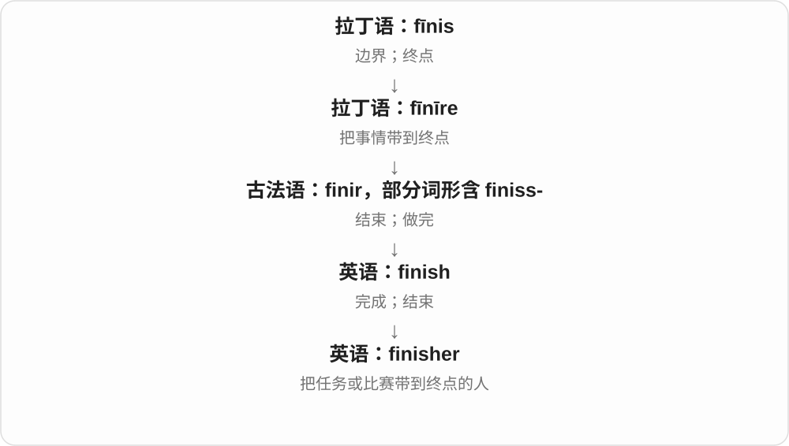

核心不是“参加过”，而是“完成了最后那一下”。因此比赛完赛者、收尾加工者和临门一脚厉害的球员可以共用这个词。

**常见搭配与例句**

a marathon finisher（马拉松完赛者）；a strong finisher（收尾强劲的人）；a clinical finisher（临门一脚稳准的球员）。

> Every finisher received a medal.

每位完赛者都获得了一枚奖牌。

> The striker is a calm and accurate finisher.

这名前锋临门一脚冷静而准确。

**别混淆**

starter 负责开始或指起跑者，finisher 强调完成。完赛并不要求名次靠前。

### 15. finance — 资金；金融；为……提供资金

**音标**：/ˈfaɪnæns/；也读 /faɪˈnæns/

**先抓住这个画面**

想象账本上一笔欠款：把钱付清，这笔账就“结束”了。这是 finance 与“终点”联系的入口。今天它谈的范围扩大为筹钱、用钱、管钱。

**怎么拆**

来自法语 finance，与 finer“结束、结清”及 fin“终点”有关；不是现代英语的 fine“好的”再加一个随意的后缀。

**怎么变成今天的意思**

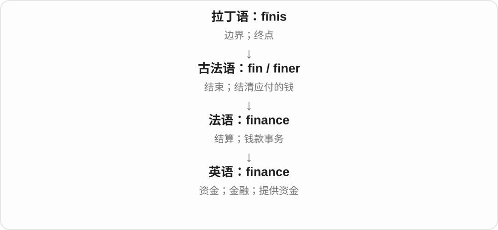

从“结清一笔应付的钱”到“处理钱款”，再到资金和金融事务。作动词时，finance a project 就是把项目所需的钱安排到位。

**常见搭配与例句**

raise finance（筹集资金）；personal finance（个人理财）；finance a project（为项目提供资金）。

> The company borrowed money to finance the new factory.

公司借钱为新工厂提供资金。

> He took a course in personal finance.

他上了一门个人理财课程。

**别混淆**

finance 不等于 profit：finance 关心钱从哪来、怎么安排；profit 是收入扣除成本后的利润。

### 16. financial — 财务的；金融的

**音标**：/faɪˈnænʃəl/；也读 /fɪˈnænʃəl/

**先抓住这个画面**

financial 就是“与钱怎样进来、出去、筹到和管理有关”。financial trouble 不是钱包难用，而是钱周转出了问题。

**怎么拆**

finance + -ial，去掉词末 e，再形成形容词。末尾这部分读 /ʃəl/，不是把 finance 原样读完再加一个音节。

**怎么变成今天的意思**

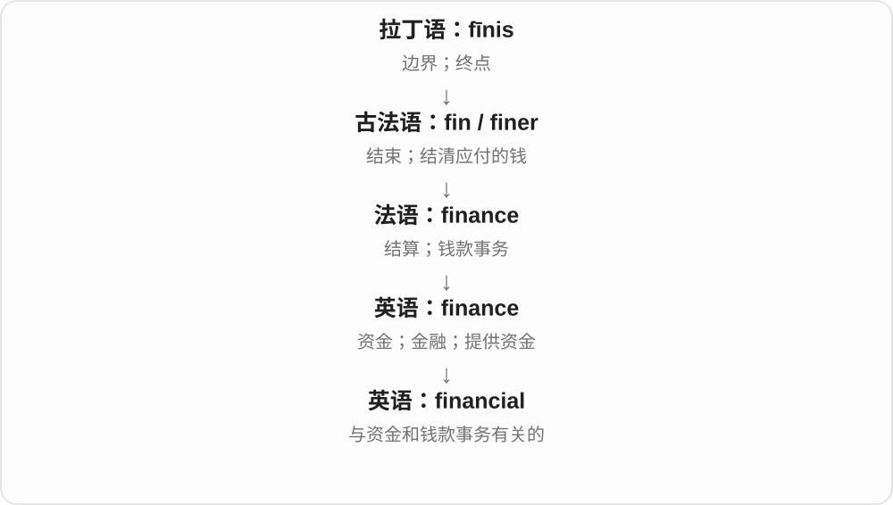

finance 已从“结清钱款”发展到资金管理；financial 再把它变成描述某种状况、机构或活动的词。

**常见搭配与例句**

financial support（资金支持）；financial problems（财务问题）；a financial report（财务报告）。

> The project needs financial support from several organizations.

这个项目需要几个组织提供资金支持。

> She reads the financial report before each meeting.

每次开会前，她都会阅读财务报告。

**别混淆**

financial 常聚焦资金、账目和融资；economic 更常谈经济活动、生产消费和整体经济状况。

### 17. financing — 筹资、提供资金；融资安排〔现在分词、动名词及相关名词〕

**音标**：/ˈfaɪnænsɪŋ/，也读 /faɪˈnænsɪŋ/

**先抓住这个画面**

项目要真正开始，需要有人把钱安排到位，这个筹集、提供资金的过程就是 financing。

**怎么拆**

finance 去 e 加 -ing，c 仍读 /s/。finance 接法语 finance，与 fin 终点、finer 结束、结清的历史词族相连。

**怎么变成今天的意思**

**法语 finance → 英语 finance**  
结清、付款的背景 → 资金、财务及提供资金

↓

**finance 去 e 加 -ing → financing**  
正在资助；也指筹资、融资过程或安排

financing a project 为项目提供资金；seeking financing 寻求资金；financing for an extension 扩建所需融资。

**常见搭配与例句**

project financing 项目融资；financing the workshop 为工作坊提供资金。

> The museum is seeking financing for the extension.

博物馆正在为扩建寻求资金。

> Several organisations are financing the workshop.

几个组织正在为工作坊提供资金。

**别混淆**

financing 是把所需资金筹、供到位；finance 还可笼统说财务、资金领域。具体钱来自资助、借款还是别的方式，要由句子补充。

### 18. finances — 财务状况、财力、资金〔复数名词〕；资助〔第三人称单数〕

**音标**：/ˈfaɪnænsɪz/，也读 /faɪˈnænsɪz/

**先抓住这个画面**

一个人或机构有多少钱、要付多少钱、钱安排得怎样，合起来是 finances。动词 finances 则说谁提供资金，让一件事办得成。

**怎么拆**

finance 经法语 finance，接 finer 结清、结束，较早 fin、拉丁 finis 终点。结清款项走向资金、财务。现代加 -s，/s/ 后读 /ɪz/；词首或词尾重音都存在，不能简单按名词、动词一刀切。

**怎么变成今天的意思**

**拉丁 finis → 法语结清款项材料 → finance**  
结束、结清 → 资金与财务

↓

**finance + -s → finances**  
整体财务状况；某主体提供资金

personal finances 个人财务；the club’s finances 俱乐部财务；finances the project 为项目提供资金。

**常见搭配与例句**

manage the finances 管理财务；review the finances 查看收支、财务状况。

> She looks after the club’s finances.

她负责俱乐部的财务。

> The foundation finances the art project.

基金会为这个艺术项目提供资金。

**别混淆**

finances 常把收支和资金状况一起说，不只是手头现金。finance 作不可数名词也能讲金融或资金安排，复数不是所有语境都能替换。

### 19. financed — 资助了；提供了资金；由资金支持的

**音标**：英、美 /ˈfaɪnænst/

**先抓住这个画面**

一个计划要落地，总得有人把钱拿出来。说项目 was financed by donations，就是它由捐款提供资金支持。

**怎么拆**

finance 去末尾 e，加完整 -ed → financed，原词末尾 /s/，后缀读 /t/。finance 经法语支付、结清债务词族发展，fin- 的结束可联系把欠款结清。

**怎么变成今天的意思**

**法语 fin 结束 → finer 结清 → finance 支付、结算 → 英语 finance**  
后来形成资金管理与提供资金的用法

↓

**finance 提供资金 + -ed → financed**  
现代叙述谁出了钱、项目靠什么资金完成

financed by donations 是由捐款资助；publicly financed 是由公共资金支持；financed the project 是为项目提供资金。

**常见搭配与例句**

financed by donations；financed the project；privately financed。

> The small library was financed by local donations.

这座小图书馆由当地捐款资助建成。

> The foundation financed the restoration of the old hall.

基金会资助了旧会堂的修复。

**别混淆**

financed 说资金来源、资金支持；paid for 也可说付了钱，但范围更广。financed a project 不直接说明资金是借款、投资还是捐款，需要句子补充。

### 20. microfinance — 小额金融服务

**音标**：/ˈmaɪkrəʊˌfaɪnæns/

**先抓住这个画面**

microfinance 像把原本门槛很高的金融服务缩小到更小的资金需求：不仅可能有小额贷款，也可以包括储蓄和其他基本服务。

**怎么拆**

micro-（小）+ finance（金融服务）。是现代组合，不能把古希腊语 micro- 与拉丁语 fin- 当作古代已有的完整词。

**怎么变成今天的意思**

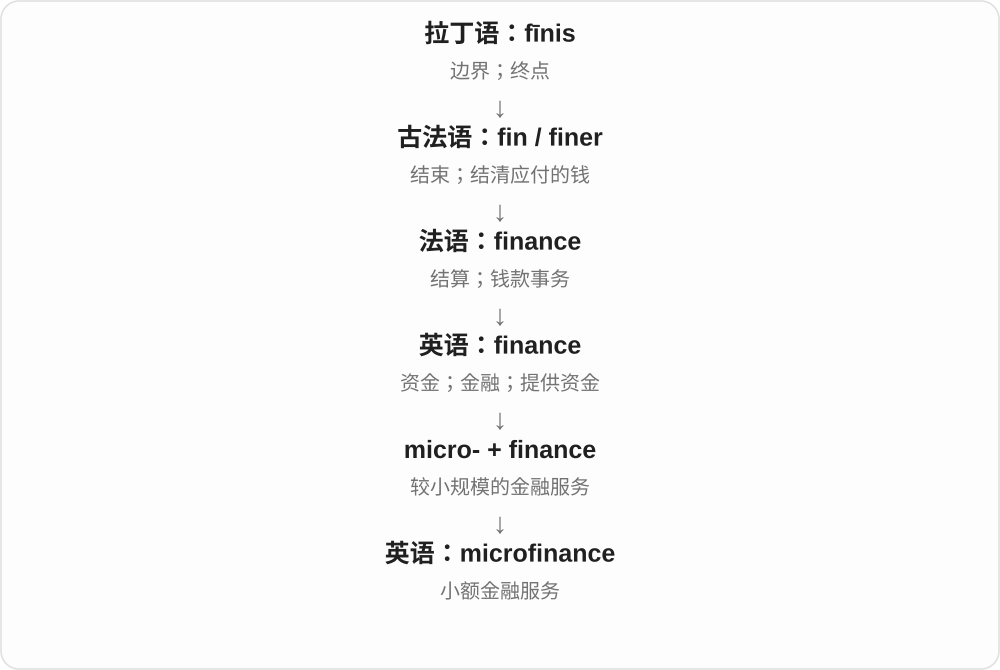

这里“小”主要指服务的资金规模和对象需求，而不是“金融学的一小部分”。这类词说明古典构词成分今天仍能用于命名新事物。

**常见搭配与例句**

a microfinance institution（小额金融机构）；microfinance services（小额金融服务）；a microfinance program（小额金融项目）。

> The organization offers microfinance services to small businesses.

该组织向小企业提供小额金融服务。

> The study compared several microfinance programs.

这项研究比较了几个小额金融项目。

**别混淆**

microcredit 主要指小额信贷；microfinance 范围更广。词本身也不保证某个项目一定低风险或有效。

### 21. finest — 最好的、最优质的；最细的〔最高级〕

**音标**：/ˈfaɪnɪst/

**先抓住这个画面**

把质量推到最好的那一档，或把粗细推到最精细的一端，就是 finest。具体是哪条尺度，要看后面的东西。

**怎么拆**

fine 去 e 加完整最高级后缀 -est → finest。优质、精细的 fine 经古法语 fin，通常与拉丁 finis、finire 相连，但更早具体路线并不完全确定。

**怎么变成今天的意思**

**古法语 fin → 英语 fine**  
完善、优质、精细等性质；远源路径有不同分析

↓

**fine + -est 的拼写变化 → finest**  
在某个范围中最好、最优质或最细

the finest work 最佳作品；the finest materials 最优质材料；the finest threads 最细的线。

**常见搭配与例句**

one of the finest examples 最好的例子之一；at its finest 处于最佳表现。

> This is one of her finest paintings.

这是她最出色的画作之一。

> The cloth is made with the finest threads.

布料由最细的线织成。

**别混淆**

finest 是最高级，finer 是比较级。one of the finest 后面常用复数名词，因为是从一组最佳对象里选一个。

### 22. fines — 罚款〔复数〕；处以罚款〔第三人称〕

**音标**：英、美 /faɪnz/

**先抓住这个画面**

因为违规而被要求支付的一笔笔钱，是 fines；某机构 fines someone，则是在说它对某人处以罚款。

**怎么拆**

fine 保留末尾 e，加 -s → fines，/n/ 后读 /z/。罚款名词接法语 fin 与拉丁 finis 结束、结清，后来有以支付来结案、承担罚金的词义联系。

**怎么变成今天的意思**

**拉丁 finis 结束 → 法语 fin 结束、结清款等**  
以一笔支付结束、处理事项的历史材料

↓

**英语 fine 罚款及处以罚款动词 → fines**  
现代名词复数、动词第三人称同形

parking fines 是违停罚款；pay fines 是缴纳罚款；fines someone for a violation 是因违规对某人罚款。

**常见搭配与例句**

parking fines；pay fines；fines someone for a violation。

> The report lists the fines paid during the year.

报告列出了这一年缴纳的罚款。

> In the story, the council fines a shop for breaking the rules.

故事里，议事机构因一家店违规而对它处以罚款。

**别混淆**

fine 好的、精细的与罚款 fine 有较远词族联系，但现代义项分开学；fines 这里不是很多个好的的复数。

### 23. fined — 处以罚款了；被罚款的〔过去形式〕

**音标**：英、美 /faɪnd/

**先抓住这个画面**

某人违反规定，被要求缴一笔钱作为处罚，就是 fined。它说的是施加罚款的动作，与 fine 天气好、很不错的形容词用法分开读。

**怎么拆**

fine 动词去末尾 e，加完整 -ed → fined，/n/ 后读 /d/。罚金名词经法语 fin、拉丁 finis 结束，沿用付款了结事情的词线，后来形成处罚动词。

**怎么变成今天的意思**

**拉丁 finis 结束 → 法语了结、付款 → fine 罚金**  
用付款结束争议、履行应付责任的意义发展

↓

**fine 动词处罚 + -ed → fined**  
现代主动态是处以罚款，被动是遭罚款

was fined for 是因某事被罚款；fined the company 是对公司罚款；heavily fined 是被处以高额罚款。

**常见搭配与例句**

was fined for；fined the company；heavily fined。

> In the story, the driver was fined for blocking the gate.

故事里，司机因为挡住大门被罚款了。

> The court fined the company.

法院对这家公司处以罚款。

**别混淆**

fined 与 find 找到同音，词形、语法不同：was fined 是被罚款，did find 是确实找到了。fine 作为形容词又不参加这条过去式变化。

### 24. finer — 更好、更优质；更细、更精细〔比较级〕

**音标**：英 /ˈfaɪnə/；美 /ˈfaɪnər/

**先抓住这个画面**

沿着 fine 的同一条尺度再往前一点：质量更好，线条更细，差别更精微，都可以是 finer。

**怎么拆**

fine 去不发音 e 加完整比较级后缀 -er → finer。fine 的优质、精细义经古法语 fin，常与拉丁 finis、finire 联系，具体更远路径有不同分析。

**怎么变成今天的意思**

**古法语 fin → 英语 fine**  
优质、精细等性质

↓

**fine 去 e 加 -er → finer**  
在质量、粗细或精微程度上作比较

finer lines 更细的线；finer details 更精细的细节；finer than 比……更好、细。

**常见搭配与例句**

a finer brush 更细的画笔；a finer distinction 更细微的区别。

> The second brush gives finer lines.

第二支画笔画出的线更细。

> We need to look at the finer details.

我们需要看看更细微的地方。

**别混淆**

finer 是比较级，finest 是最高级。实际比较的是质量还是粗细，要看后面的名词；不是每处 finer 都只能译为更好。

### 25. define — 定义；明确；界定

**音标**：/dɪˈfaɪn/

**先抓住这个画面**

define 就是把模糊的边界画清楚。“成功”究竟算什么？这个岗位负责到哪里？把范围说清楚，就是在 define。

**怎么拆**

历史上是 dē- + fīnīre“划出界限”。这里不要把 de- 一律翻成“取消”；整个拉丁词已经表示明确界定。

**怎么变成今天的意思**

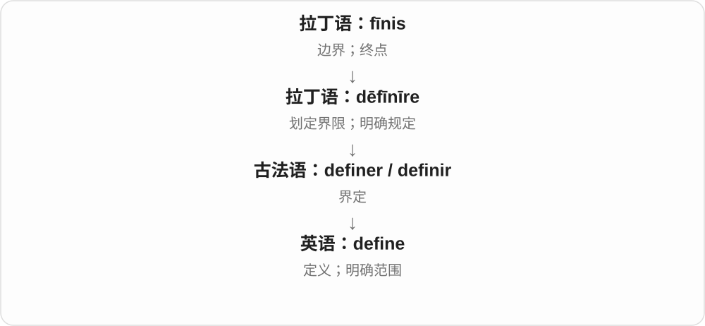

一开始的边界可以是空间上的，后来也可以是概念、职责和身份的边界。define a role 是明确职责，define a term 是说明一个词的意思。

**常见搭配与例句**

define a term（给术语下定义）；clearly define roles（明确职责）；be defined by…（由……塑造或界定）。

> We need to define each person’s role before we begin.

开始前，我们需要明确每个人的职责。

> Your job does not have to define your whole identity.

你的工作不必定义你整个人的身份。

**别混淆**

describe 描述一个东西是什么样；define 需要抓住决定“它是什么”的边界或特征。

### 26. definition — 定义；清晰度

**音标**：/ˌdefɪˈnɪʃən/

**先抓住这个画面**

definition 像给一个概念画圈：圈内哪些算它，圈外哪些不算。图像的 definition 则关心轮廓能不能清清楚楚分开。

**怎么拆**

来自拉丁语 dēfīnītiō，经法语传入。现代可把它与 define 联系，但拼写不是直接写 define + tion；词形对应为 define → definition。

**怎么变成今天的意思**

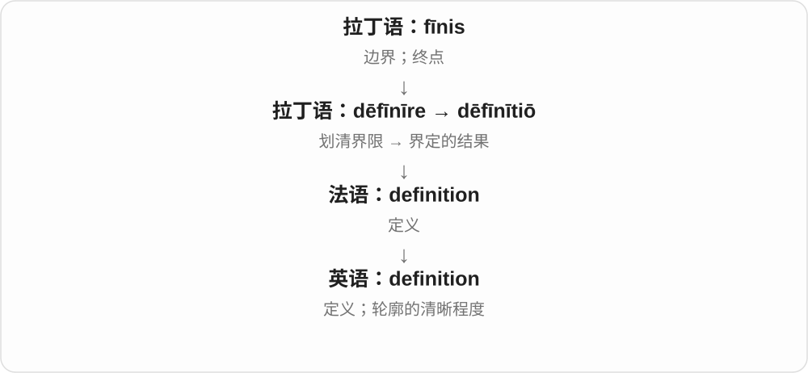

“界限清楚”同时解释了两个常见意思：定义让概念边界清楚，图像清晰度让物体轮廓清楚。high definition 因而是高清晰度。

**常见搭配与例句**

the definition of…（……的定义）；by definition（按照定义）；high definition（高清晰度）。

> Can you give me a simple definition of the word?

你能用简单的话解释这个词的定义吗？

> The new screen shows the image in high definition.

新屏幕能以高清晰度显示这幅图像。

**别混淆**

definition 说明一个概念到底指什么；example 给出它的一个实例。一个好例子很有帮助，但不一定能代替完整定义。

### 27. definitions — 定义；释义；清晰度、界定方式〔具体语境，复数〕

**音标**：/ˌdefɪˈnɪʃənz/

**先抓住这个画面**

用话给一个概念画清边界，让别人知道它包括什么、怎样理解，这样的一条条界定就是 definitions。

**怎么拆**

definition + -s，/n/ 后读 /z/。definition 经法语接拉丁 dēfīnītiō，来自 dēfīnīre 划清界限，较早是 fīnis 边界、终点词族；与 define 对应，但不是英语 define 后原样拼上 tion。

**怎么变成今天的意思**

**拉丁 fīnis、dēfīnīre、dēfīnītiō → 法语、英语 definition**  
边界 → 划清边界 → 定义、界定

↓

**definition + -s → definitions**  
多条定义、释义；不同界定方式

dictionary definitions 词典释义；clear definitions 清楚的定义；definitions of key terms 关键术语的定义；different definitions 不同界定。

**常见搭配与例句**

compare the definitions；agree on definitions。

> The book gives clear definitions of the main terms.

这本书清楚解释了主要术语的定义。

> The two studies use different definitions of the same concept.

两项研究对同一个概念采用了不同定义。

**别混淆**

definition 说明一个词、概念如何被界定；example 给一个具体例子。定义与例子一起看更容易理解。high definition 高清的 definition 则是轮廓、影像清晰度这一分支。

### 28. defined — 定义、界定；确定特征〔过去式、过去分词〕；清楚划定的

**音标**：/dɪˈfaɪnd/

**先抓住这个画面**

给一个概念画清边界，说明它包括什么、范围到哪里，就是 defined；形状、职责划得清楚，也能说 clearly defined。

**怎么拆**

define 已有 e，加 -d，/n/ 后读 /d/。拉丁 fīnis 边界形成 fīnīre 划界，再有 dēfīnīre 明确规定，经古法语相关形式借入英语。

**怎么变成今天的意思**

**拉丁 fīnis → fīnīre、dēfīnīre → 法语 → define**  
边界 → 划界、明确规定

↓

**define 去 e + -ed → defined**  
界定过；边界或内容明确的

defined the term 定义术语；clearly defined roles 明确的职责；defined by 由……界定或以……为特征。

**常见搭配与例句**

a clearly defined area；defined in the opening paragraph。

> The report defined the main goals of the project.

报告明确界定了项目的主要目标。

> Each team member has a clearly defined role.

每位团队成员都有明确的职责。

**别混淆**

defined 常关乎范围、内容、特征；解释一个词怎么用可用 explain，给出这个词的明确含义则可用 define。二者在具体任务中也会结合。

### 29. defining — 界定、定义、明确〔现在分词〕；决定性质的、标志性的〔形容词〕

**音标**：/dɪˈfaɪnɪŋ/

**先抓住这个画面**

给一个意思、范围划出清楚边界，是 defining；一件事让你特别认出某人、某阶段的性质，也就有标志性、决定性的意思。

**怎么拆**

define 去 e 加完整 -ing。define 经法语接拉丁 definire，de- 加强与 finire 划界组合，finis 是边界、终点。

**怎么变成今天的意思**

**拉丁 finis、definire → 法语 → define**  
划定界限 → 定义、明确范围

↓

**define 去 e + -ing → defining**  
正在界定；让性质、方向清楚显出的

defining a term 定义术语；a defining moment 决定性时刻；a defining feature 标志性特点。

**常见搭配与例句**

defining the scope 明确范围；defining characteristics 决定性质的特征。

> We began by defining the main terms.

我们先界定几个主要术语。

> The journey became a defining moment in her life.

那次旅程成了她人生中的关键时刻。

**别混淆**

defining a word 是动作，a defining moment 里的 defining 是形容词，说这个时刻对后来的身份、走向有关键作用，不只是在写一个定义。

### 30. defines — 定义；界定；决定其特点〔第三人称〕

**音标**：英、美 /dɪˈfaɪnz/

**先抓住这个画面**

把一个词、一份工作、一个范围的边界说清楚，就是 define。某个特点 defines a place，则是这个特点让地方显得独特。

**怎么拆**

define + -s → defines，保留末尾 e，/n/ 后读 /z/。define 接拉丁 de- 加强 + finire 划界，远有 finis 边界、终点。

**怎么变成今天的意思**

**拉丁 finis 边界 → finire 划界 → definire**  
加强划定范围、说清含义

↓

**法语、拉丁材料 → 英语 define → defines**  
现代动词第三人称，词尾 /nz/

defines the term 是给术语下定义；defines the role 是界定角色；defines the character of the place 是决定那地方的特点。

**常见搭配与例句**

defines the term；defines the role；defines the limits。

> The first paragraph defines the main term.

第一段给主要术语下了定义。

> The river defines the western edge of the town.

这条河界定了镇子的西侧边界。

**别混淆**

define 的界定不一定是字典里写释义，也能说划清职责、范围，或指出让某物成为它的关键特点。

### 31. definable — 可定义的；可明确界定的

**音标**：/dɪˈfaɪnəbəl/

**先抓住这个画面**

definable 表示一件事的边界可以说清楚：有明确的条件，能够判断什么算它、什么不算它。

**怎么拆**

define + -able；去掉末尾 e 再加 -able，表示“可以被界定的”。

**怎么变成今天的意思**

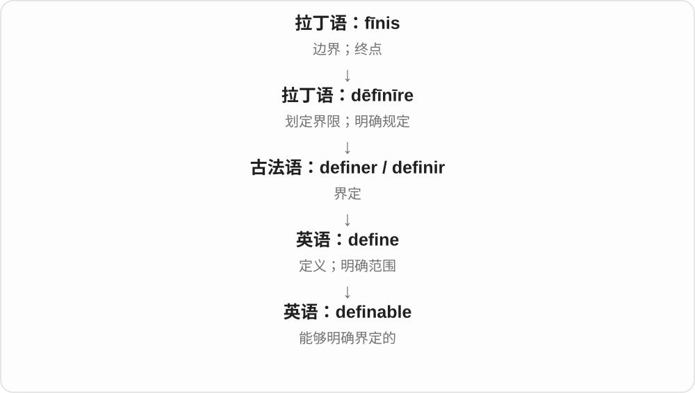

define 是画边界，definable 是这条边界能画出来。a clearly definable goal 因而是一个能把具体要求说清楚的目标。

**常见搭配与例句**

a definable goal（可明确界定的目标）；clearly definable limits（能够清楚界定的界限）。

> We need a clearly definable goal for the first stage.

第一阶段需要一个能够明确界定的目标。

> The boundary between the two styles is not easily definable.

这两种风格之间的界限不容易说清。

**别混淆**

definable 说“可以界定”；defined 说“已经界定”。有能力做和已经做完不是一回事。

### 32. redefine — 重新定义；改变对……的理解

**音标**：/ˌriːdɪˈfaɪn/

**先抓住这个画面**

redefine 就是把原来画好的圈重新画一遍。标准、范围或理解发生变化，原来的“什么算它”也随之改变。

**怎么拆**

re-（重新）+ define（界定）。这是现代英语里清楚可见的构词。

**怎么变成今天的意思**

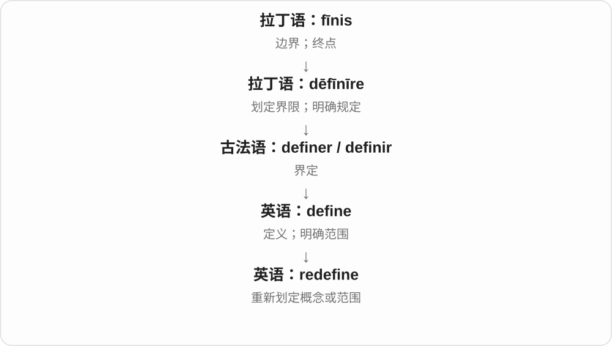

既可以真的重写一个定义，也可以比喻某种变化改变了人们的旧认识。redefine success 就是在重新思考“怎样才算成功”。

**常见搭配与例句**

redefine a role（重新界定角色）；redefine success（重新定义成功）；redefine the relationship（重新界定关系）。

> Becoming a parent made her redefine success.

成为母亲让她重新思考什么才算成功。

> The agreement redefines the responsibilities of each team.

协议重新界定了各团队的职责。

**别混淆**

redefine 改的是定义或理解框架；rename 只说明改名字，名字改了，含义可能没变。

### 33. refine — 提纯；改进；使更精细

**音标**：/rɪˈfaɪn/

**先抓住这个画面**

想象把粗糙的东西再打磨一遍，把杂质去掉、细节做好。这就是 refine：东西已经有了，现在把它变得更好。

**怎么拆**

re- + fine“使精细、使纯净”。这里的 re- 有加强或进一步加工的意味，不必机械译成“重新”。

**怎么变成今天的意思**

最容易看到的例子是提炼金属或石油；同一个动作也能比喻打磨方案、想法和技巧。它强调改良已有的东西。

**常见搭配与例句**

refine oil（炼油）；refine an idea（完善想法）；refine a technique（改进技法）。

> We need to refine the design before building a prototype.

制作原型前，我们需要进一步完善设计。

> The plant refines crude oil into usable products.

这家工厂把原油加工成可用产品。

**别混淆**

refine 通常是在已有基础上改进；replace 是换掉。一个方案可以不断被 refine，而不必从零重做。

### 34. refined — 精制的；文雅的；经过改进的；提纯、改进了〔过去式、过去分词〕

**音标**：英、美 /rɪˈfaɪnd/

**先抓住这个画面**

去掉粗糙、多余的部分，让东西更纯、做法更细致，是 refined 的共同理解画面。可以说物质，也可以说举止、方法。

**怎么拆**

refine 去末尾 e，加完整 -ed → refined，/n/ 后读 /d/。re- 在此可能是加强，后接旧动词 fine 使精纯，不必理解为已经做过又做一次。

**怎么变成今天的意思**

**fine 精纯、精细 → refine 提纯、使精细**  
与法语等相应形式有联系

↓

**refine + -ed → refined**  
现代过去形式、形容词，表示精制、文雅、经过打磨

refined sugar 是精制糖；refined manners 是文雅举止；a refined method 是改进、细化后的方法。

**常见搭配与例句**

refined sugar；refined manners；a refined method。

> The team refined the design after the first trial.

首次试验后，团队改进了设计。

> The novel describes her quiet voice and refined manners.

小说描写了她轻柔的声音和文雅的举止。

**别混淆**

refined 说经过提纯、打磨或显得文雅，并不自动说明所有方面都更好。具体评价仍看用途和句子。

### 35. refinery — 精炼厂；炼油厂

**音标**：/rɪˈfaɪnəri/

**先抓住这个画面**

refinery 就是专门做 refine 的地方：原料运进去，经过加工后成为更纯净或更有用的产品。

**怎么拆**

refine + -ery，词末 e 与后缀的 e 合并。词典也常记成 refine + -ry；两种记法都指这一“加工地点”关系。

**怎么变成今天的意思**

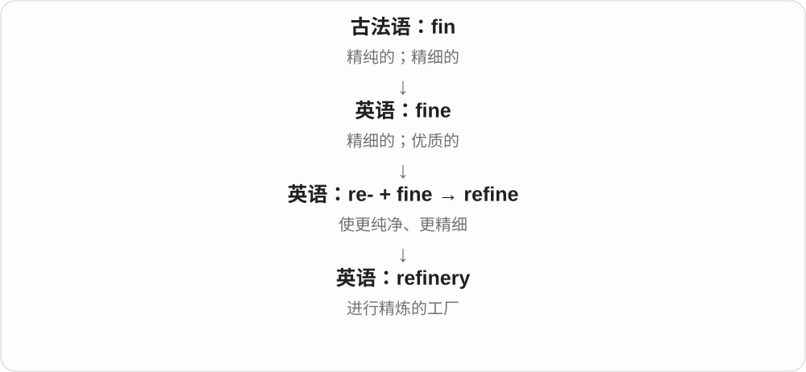

动作 refine 变成地点名词 refinery。它不只限于石油：糖、金属等也可以在相应的 refinery 里精炼。

**常见搭配与例句**

an oil refinery（炼油厂）；a sugar refinery（炼糖厂）；work at a refinery（在精炼厂工作）。

> The refinery processes oil from several nearby fields.

这家炼油厂加工附近几个油田的原油。

> Her father worked at a sugar refinery.

她父亲曾在一家炼糖厂工作。

**别混淆**

refinery 是工厂；refinement 是加工或改进的过程、结果。结尾不同，指的东西也不同。

### 36. refinement — 改进；提纯；精致

**音标**：/rɪˈfaɪnmənt/

**先抓住这个画面**

refinement 可以是打磨的过程，也可以是其中一次小改进。它往往让东西更细、更顺、更成熟，不一定是一次彻底重做。

**怎么拆**

refine + -ment，形成动作、结果或状态名词。

**怎么变成今天的意思**

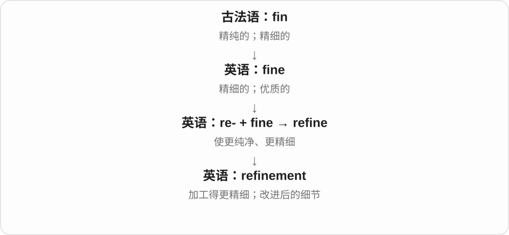

从去掉原料中的杂质，扩展到改进设计和方法，再扩展到举止、品位上的精致。这里的多个义项都能围绕“由粗到细”理解。

**常见搭配与例句**

further refinement（进一步改进）；a refinement to the design（设计的一处改进）；refinement of a method（方法的完善）。

> The latest model includes several small refinements.

最新型号包含几项细小的改进。

> The technique still needs further refinement.

这项技术仍需进一步完善。

**别混淆**

refinement 常是细化和优化；revolution 强调根本性变化。a refinement 可数，表示一项具体改进。

### 37. refinance — 再融资；重新安排借款

**音标**：/ˌriːˈfaɪnæns/

**先抓住这个画面**

refinance 像把旧的借钱安排换成一套新的安排：可能换贷款方、期限或条件。重点是现有债务或资金安排被重新组织。

**怎么拆**

re-（重新）+ finance（筹资、融资）。它不是 refine“提纯”的名词形式。

**怎么变成今天的意思**

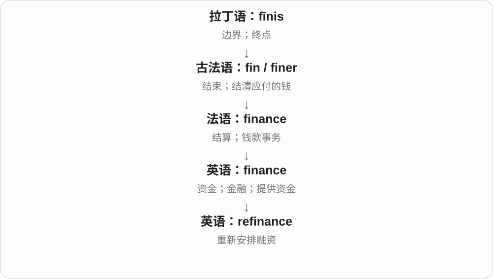

fin- 到 finance 的历史已经是“结账 → 钱款管理”；这里再加 re-，只是在英语层面表示把融资再做一次。

**常见搭配与例句**

refinance a loan（重新安排贷款）；refinance a mortgage（为按揭再融资）；refinance existing debt（重组现有债务融资）。

> The company plans to refinance its existing debt.

公司计划为现有债务重新安排融资。

> They asked the bank about refinancing their mortgage.

他们向银行咨询了按揭再融资的事。

**别混淆**

refinance 不一定等于 repay“还清债务”。旧贷款可能结束，但新的贷款仍然存在。

### 38. refiner — 精炼者；精炼企业；精炼设备

**音标**：英 /rɪˈfaɪnə/；美 /rɪˈfaɪnər/

**先抓住这个画面**

refiner 是做 refine 这件事的人、企业或设备。看到 oil refiner，可以想成把原油加工为可用产品的一方。

**怎么拆**

refine 去末尾 e，加完整表人或器物后缀 -er。-er 不限于表示人，也能表示企业和机器。

**怎么变成今天的意思**

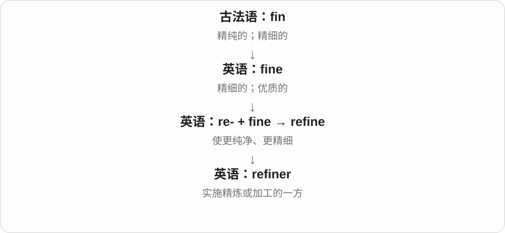

这是“动作 → 做动作的人或物”的普通英语派生。新闻中的 refiner 往往指公司，而 refinery 指工厂地点。

**常见搭配与例句**

an oil refiner（炼油企业）；a gold refiner（黄金精炼商）；a sugar refiner（炼糖企业）。

> The refiner buys crude oil from several suppliers.

这家炼油企业从几个供应商那里购买原油。

> The gold refiner checks the purity of each batch.

黄金精炼商检查每一批产品的纯度。

**别混淆**

refiner 是加工者，refinery 是加工厂；同一家 refiner 可以经营多家 refineries。

### 39. finite — 有限的

**音标**：/ˈfaɪnaɪt/

**先抓住这个画面**

finite 就是“再多也有个数，再长也有个边”。一天的时间、仓库的空间、账户的钱，都是有限的。

**怎么拆**

来自拉丁语 fīnītus“已划定界限的”，与 fīnis“边界”同族。现代不要把它读成 finish 的开头；常见读音中两个主要元音都是 /aɪ/。

**怎么变成今天的意思**

“已被划出边界”转成“范围或数量有限”。语法中的 finite verb“限定动词”是专门用法，指承担时态等句法限制的动词形式。

**常见搭配与例句**

finite resources（有限资源）；a finite number of…（有限数量的……）；a finite set（有限集）。

> We have a finite amount of time to solve the problem.

我们解决这个问题的时间是有限的。

> The game has a finite number of possible moves.

这个游戏可采取的走法数量是有限的。

**别混淆**

finite 不代表少：一万亿也仍是有限数。small 才说明数量或体积小。

### 40. finitely — 有限地；在有限范围内

**音标**：/ˈfaɪnaɪtli/

**先抓住这个画面**

finitely 多见于数学和逻辑，意思是数量或过程到某处就会停下来，不会无限延伸。

**怎么拆**

finite + -ly。注意它保留 finite 的两个 /aɪ/，与 infinitely 的读音节奏不同。

**怎么变成今天的意思**

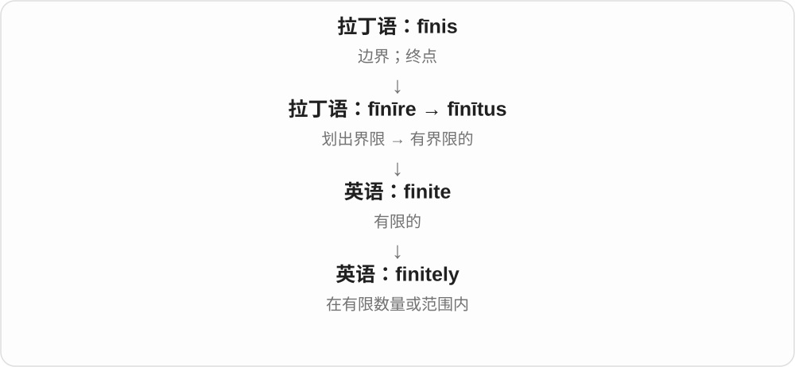

finite 描述对象有限；finitely 把这个性质放到数量或操作方式上。finitely many 就是“有限多个”，数量可以很大。

**常见搭配与例句**

finitely many（有限多个）；finitely generated（有限生成的）；finitely bounded（有有限界限的）。

> The equation has finitely many solutions.

这个方程只有有限多个解。

> Only finitely many cases need to be checked.

需要检查的情况只有有限多种。

**别混淆**

finitely many 不等于 a few“几个”。前者只保证数量有限，没有说它少。

### 41. infinite — 无限的；无穷的

**音标**：/ˈɪnfɪnət/

**先抓住这个画面**

想象一直往前走，却找不到尽头。infinite 就是没有有限边界；日常夸张时，也可以说多得仿佛没有尽头。

**怎么拆**

in-（不）+ finite（有限的）。历史上的拉丁语 īnfīnītus 也包含这个否定关系。

**怎么变成今天的意思**

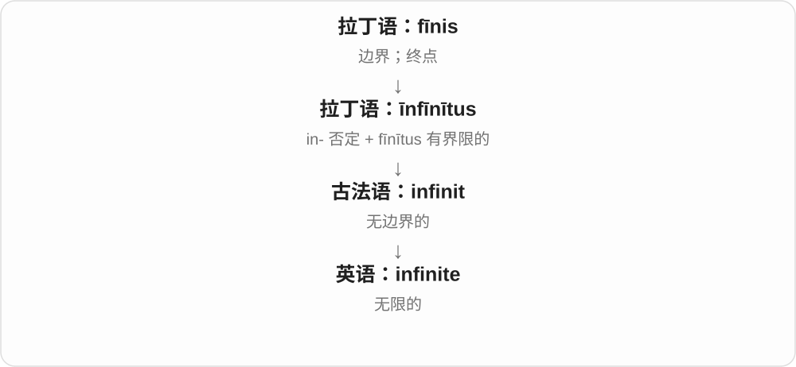

fin- 提供“终点”，in- 把终点否定。严格的数学无限与生活中说 infinite patience“无穷耐心”不是同一种精确程度。

**常见搭配与例句**

an infinite number of…（无穷多个……）；infinite space（无限空间）；infinite patience（极大的耐心）。

> There are infinitely many prime numbers, so the set is infinite.

质数有无穷多个，因此这个集合是无限集。

> She seemed to have infinite patience with the children.

她对孩子们似乎有用不完的耐心。

**别混淆**

infinite 不是“特别大的有限数”。enormous 是很大，finite 是终究有界限，infinite 在严格意义上没有这个上限。

### 42. infinity — 无限；无穷

**音标**：英、美 /ɪnˈfɪnɪti/

**先抓住这个画面**

不论往前走多少步，都没有最后那个尽头，可以用 infinity 来想象。它说的是无界限，不只是一个特别大的普通数。

**怎么拆**

可对应 in- 不 + finite 有界限与 -ity 状态名词；实际历史经法语 infinité 接拉丁 infinitas，来自 infinitus 无边界，远连 finis 末端。

**怎么变成今天的意思**

**拉丁 in- 否定 + finitus 有界限 → infinitus 无限**  
否定边界、尽头

↓

**拉丁 infinitas → 法语 infinité → 英语 infinity**  
现代无限、无穷名词，与 infinite 对照

stretch to infinity 是延伸到无穷；the symbol for infinity 是无穷符号；数学中具体性质要按对象、定义理解。

**常见搭配与例句**

to infinity；the symbol for infinity；the concept of infinity。

> The lines seem to stretch to infinity.

这些线仿佛一直延伸到无穷远。

> The teacher drew the symbol for infinity on the board.

老师在黑板上画了无穷符号。

**别混淆**

infinity 不是某个再加一就能得到的最大普通实数；日常说 an infinity of 可夸张表示极多，数学用法更严格。

### 43. infinitely — 无限地；大得多地

**音标**：/ˈɪnfɪnətli/

**先抓住这个画面**

infinitely 把“没有尽头”用来修饰程度。数学中可指真正的无限；日常说 infinitely better，通常是在强调“好太多了”。

**怎么拆**

infinite + -ly，构成副词。别按有限的 finite 那套重音和元音直接拼读整个词。

**怎么变成今天的意思**

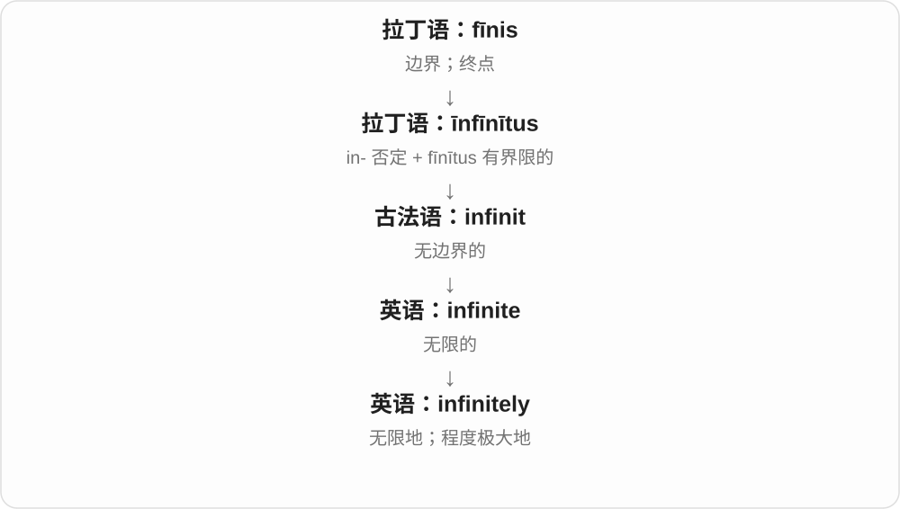

在普通说话中，人会用没有上限的画面来放大差别，所以 infinitely more useful 常是强烈赞同，不是计算出来的无限倍。

**常见搭配与例句**

infinitely better（好得多）；infinitely small（无限小的）；infinitely many（无穷多个）。

> This explanation is infinitely easier to follow.

这个解释好懂多了。

> A line contains infinitely many points.

一条直线包含无穷多个点。

**别混淆**

infinitely 比 very 强烈，也更容易带夸张。正式数量分析里，不能把“非常多”随便写成“无限”。

### 44. finale — 终曲；最后一集；收尾部分

**音标**：/fɪˈnɑːli/

**先抓住这个画面**

finale 是专门留给最后的那一段：音乐会的终曲、电视剧的季终集、节目最后的收尾。它往往是一个有分量的结尾。

**怎么拆**

从意大利语 finale 借入，与 final 同源。末尾 e 要发音，整个词通常有三个音节，重音在中间。

**怎么变成今天的意思**

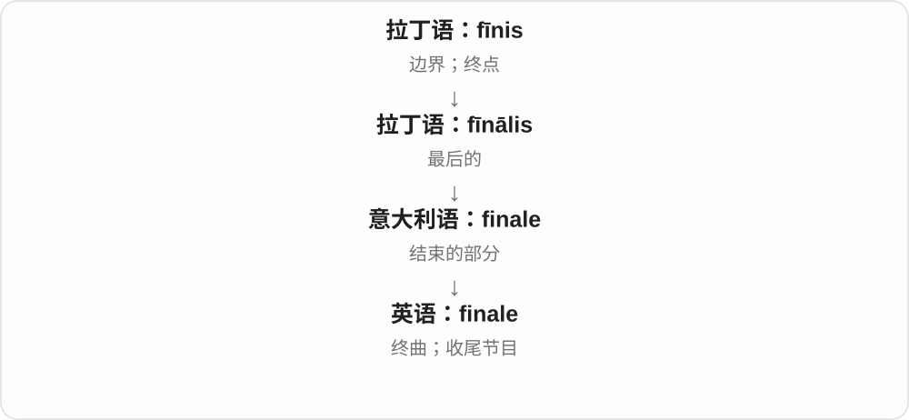

同一个拉丁来源经过不同语言进入英语：经法语形成 final，后来从意大利语借来的 finale 常用于艺术、演出和叙事的结尾。

**常见搭配与例句**

the grand finale（压轴收尾）；the season finale（季终集）；a dramatic finale（戏剧性的结尾）。

> The orchestra saved its most exciting piece for the finale.

乐团把最精彩的曲目留作终曲。

> We watched the season finale together.

我们一起看了这一季的最后一集。

**别混淆**

final 常作“最后的”或指决赛；finale 通常是某个作品、节目或活动的收尾部分。

### 45. confine — 限制；把……局限于

**音标**：动词 /kənˈfaɪn/

**先抓住这个画面**

想象在一个范围外画线：“你只能待在这里，不能越过去。”confine 可以限制人的活动，也可以限制讨论的内容。

**怎么拆**

与拉丁语 con- + fīnis“边界”有关，经 confīnis、confīnium 和法语 confiner 等词形传来。现代不能拆成 con + fine“好”。

**怎么变成今天的意思**

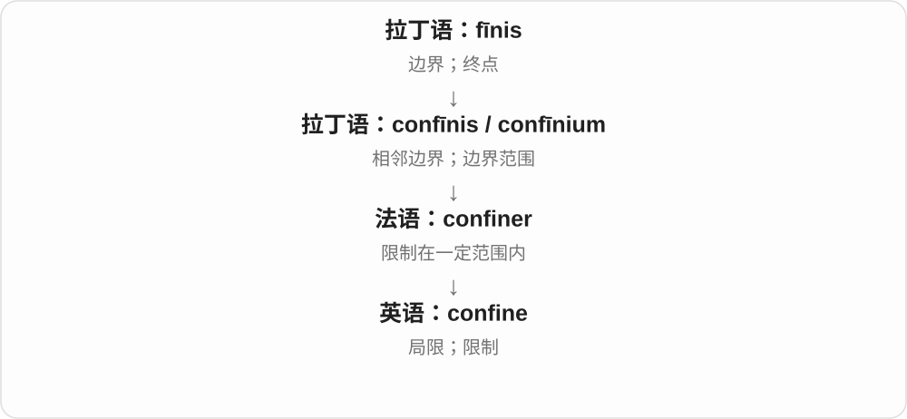

把范围圈住，就是不让人或事超出边界。confine the discussion to one issue 是把话题限定为一个问题，不涉及实际的围墙。

**常见搭配与例句**

confine something to…（把……限制在……）；be confined to bed（卧床）；within the confines of…（在……范围内）。

> Please confine your comments to the main issue.

请把评论限定在主要问题上。

> Heavy snow confined us to the house for two days.

大雪让我们两天都只能待在屋里。

**别混淆**

confine 不等于 confirm“确认”。名词复数 confines 指界限或范围，常把重音放在前面。

### 46. confined — 限制在某处的；范围有限的；受限的〔过去式、过去分词〕

**音标**：英、美 /kənˈfaɪnd/

**先抓住这个画面**

给事物画个边框，让它待在这个范围内，就是 confined。可以限制位置，也可以限制话题、影响范围。

**怎么拆**

confine 去末尾 e，加完整 -ed → confined，/n/ 后读 /d/。词史接法语 confiner、中世纪拉丁边界材料，远含 con- 与 finis 边界、末端。

**怎么变成今天的意思**

**拉丁 finis 边界与共同边界的复合词族 → 法语 confiner**  
较早有相邻、接界、围住的材料

↓

**英语 confine 限于某范围 → confined**  
现代常见 confined to、a confined space

confined to one room 是局限在一间屋内；confined to a topic 是只限某话题；a confined space 是狭小、封闭的空间。

**常见搭配与例句**

confined to one room；confined to one topic；a confined space。

> Our discussion was confined to the first chapter.

我们的讨论只限于第一章。

> The model shows how light behaves in a confined space.

模型展示了光在有限空间里的表现。

**别混淆**

confined 不一定表示有人被关押；讨论范围、问题影响、活动区域都可以受到限制。

### 47. confines — 范围、界限〔名词复数〕；限制于〔第三人称单数〕

**音标**：名词：英 /ˈkɒnfaɪnz/、美 /ˈkɑːnfaɪnz/；动词：英、美 /kənˈfaɪnz/

**先抓住这个画面**

把一件事圈在某个范围里，是 confines 这个动词；那圈范围、边界，就是 the confines 这个名词复数。空间、讨论内容都可以有界限。

**怎么拆**

confine + -s → confines，/n/ 后读 /z/。法语 confiner、confins 与拉丁 con- 共同 + finis 边界的词族相连；英语名词常前重音，动词后重音。

**怎么变成今天的意思**

**拉丁共同边界的词族 → 法语 confins、confiner**  
名词边界与接界、限制动词互有关联

↓

**英语 confines**  
名词说范围界限，动词说把对象限在某处

within the confines of 是在某范围内；the confines of a room 是房间的有限空间；confines the discussion to 是把讨论限于。

**常见搭配与例句**

within the confines of；the confines of a room；confines the discussion to。

> The story unfolds within the confines of a small room.

故事在一间小屋的有限空间内展开。

> The author confines the discussion to the first chapter.

作者把讨论范围限于第一章。

**别混淆**

within the confines of a room 中是名词；the author confines the story to one day 中是动词。名词前常有 the，动词后通常可找到被限制的对象。

### 48. affinity — 亲近感；契合；密切关系

**音标**：/əˈfɪnəti/

**先抓住这个画面**

想象两块土地边界挨着，人也像住得很近的邻居。affinity 描述“很合得来、自然靠得近”的感觉，也可说事物之间性质相合。

**怎么拆**

历史上 ad-（靠向）+ fīnis（边界）形成 affīnis“相邻的”，ad- 的 d 同化为 f。affīnitās 是表示关系的名词。

**怎么变成今天的意思**

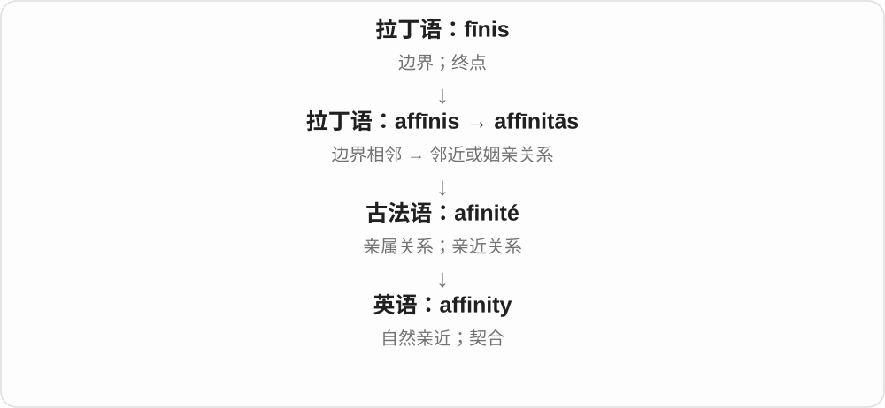

早期常指因婚姻形成的亲属关系，后来扩展到没有血缘却感觉亲近、性格或性质相投。这是“边界挨着”走向“关系靠近”的一支。

**常见搭配与例句**

feel an affinity with someone（与某人有亲近感）；have an affinity for music（对音乐有天然爱好）。

> She felt an immediate affinity with the new teacher.

她一见到新老师就有一种亲近感。

> He has a natural affinity for languages.

他对语言有一种天然的亲近感。

**别混淆**

affinity 是相合或亲近，不等于已经建立的 friendship。可以对一个刚认识的人产生 affinity，也可以对某种艺术产生 affinity。

## 这一组要分清什么

**fine 的不同义项要分开看。** “罚款”有清楚的结清、终结案件的联系；“优质、精细”来自古法语 fin，更深处与 fīnis / fīnīre 的关系常被提出，但具体发展并不完全确定。refine 一支从这个形容词继续发展，不能把推测硬说成定论。

**affinity 的起点是相邻。** 边界挨在一起，后来联系到婚姻亲属、自然联系和亲近感。它不是把 fine 加上一个前缀变成“非常好”。

**finite 不等于少，infinite 也不总是数学概念。** 有限的数量可以大得惊人；日常 infinite patience 则常是夸张地说耐心很足。

## 串起来练习

连起来想：**Define a finite goal, refine the plan, and finally finish the work.**

先定一个有边界的目标，再把方案打磨好，最后把工作做完。define 画界线，finite 表示有界限，refine 打磨细节，finally 与 finish 把事情带到终点。
