# 0130 · serv- — 服侍、效力；另一支是看守、保全

[逐词精讲目录](../00_逐词精讲目录.md) · [总目录](../00_总目录_按常用程度.md)

## 核心词根与来源

**serv-** 在这里分两条拉丁语路线：**servus → servīre** 是奴仆、服侍，留下 serve、servant；**servāre** 是看守、保全，留下 preserve、reserve、observe。更早的联系有不同分析，学习时先把这两条可靠路线分清。

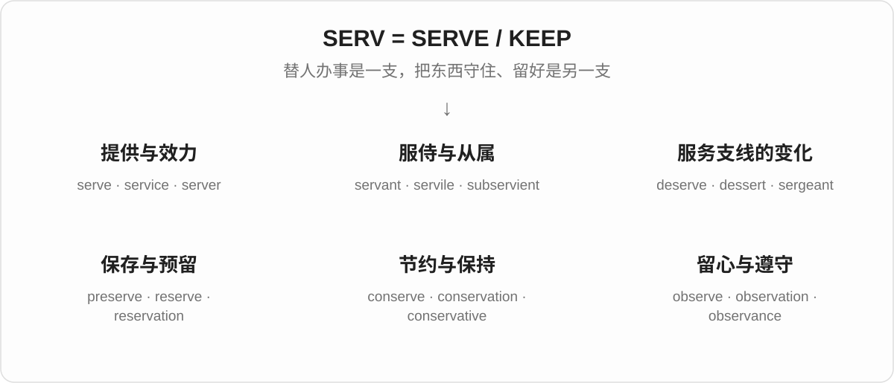

## 词形与演化规律

**serve / service / servant** 经过法语进入英语，所以拼写尾部不必都当成现代英语随意加的后缀。**serf** 和 **sergeant** 虽然不再明显写出 serv，仍能追到这条服侍词族。

另一支中，**preserve** 是保全，**reserve** 是留下备用，**conserve** 是保存、节约；**observe** 既有留心看，也有把规定守住的意思。**deserve** 的 de- 是加强效劳，**dessert** 的 des- 则是撤去餐食，不能把两个前缀功能一概而论。

## 单词速览（按词族由简到繁）

同一基础词的相关扩展放在一起，先读基础形式，再读扩展；各组之间优先读常用的。具体词源关系见各词讲解。

| 单词 | 音标 | 核心意思 |
|---|---|---|
| [service](#w-1) | 英 /ˈsɜːvɪs/；美 /ˈsɜːrvɪs/ | 服务；公共服务系统；检修；礼拜 |
| [serviceable](#w-28) | 英 /ˈsɜːvɪsəbəl/；美 /ˈsɜːrvɪsəbəl/ | 可用的；能满足基本需要的 |
| [disservice](#w-29) | 英 /dɪsˈsɜːvɪs/；美 /dɪsˈsɜːrvɪs/ | 伤害；帮倒忙；不公正的对待 |
| [serve](#w-2) | 英 /sɜːv/；美 /sɜːrv/ | 服务；端上；供给；起作用；发球 |
| [serving](#w-3) | 英 /ˈsɜːvɪŋ/；美 /ˈsɜːrvɪŋ/ | 一份食物；供餐；在职的 |
| [server](#w-7) | 英 /ˈsɜːvə/；美 /ˈsɜːrvər/ | 服务员；服务器；发球者 |
| [servant](#w-13) | 英 /ˈsɜːvənt/；美 /ˈsɜːrvənt/ | 仆人；服务者 |
| [manservant](#w-38) | 英 /ˈmænsɜːvənt/；美 /ˈmænsɜːrvənt/ | 男仆 |
| [maidservant](#w-39) | 英 /ˈmeɪdsɜːvənt/；美 /ˈmeɪdsɜːrvənt/ | 女仆 |
| [servitude](#w-27) | 英 /ˈsɜːvɪtjuːd/；美 /ˈsɜːrvɪtuːd/ | 奴役状态；受束缚的服役 |
| [reserve](#w-5) | 英 /rɪˈzɜːv/；美 /rɪˈzɜːrv/ | 预留；储备；保护区；克制 |
| [reserved](#w-10) | 英 /rɪˈzɜːvd/；美 /rɪˈzɜːrvd/ | 已预订的；保留的；内敛的 |
| [reservation](#w-16) | 英 /ˌrezəˈveɪʃən/；美 /ˌrezərˈveɪʃən/ | 预订；保留意见；保留地 |
| [reservist](#w-33) | 英 /rɪˈzɜːvɪst/；美 /rɪˈzɜːrvɪst/ | 预备役人员 |
| [deserve](#w-6) | 英 /dɪˈzɜːv/；美 /dɪˈzɜːrv/ | 应得；值得 |
| [preserve](#w-9) | 英 /prɪˈzɜːv/；美 /prɪˈzɜːrv/ | 保存；保护；维持；蜜饯或果酱 |
| [preservation](#w-15) | 英 /ˌprezəˈveɪʃən/；美 /ˌprezərˈveɪʃən/ | 保存；保护；维持原状 |
| [preserver](#w-36) | 英 /prɪˈzɜːvə/；美 /prɪˈzɜːrvər/ | 保护者；保存者；救生用品 |
| [conserve](#w-20) | 动词：英 /kənˈsɜːv/、美 /kənˈsɜːrv/；食品名词常 /ˈkɒnsɜːv/（英） | 节约；保护；保存；果酱 |
| [conservative](#w-4) | 英 /kənˈsɜːvətɪv/；美 /kənˈsɜːrvətɪv/ | 保守的；审慎的；保守派 |
| [conservation](#w-8) | 英 /ˌkɒnsəˈveɪʃən/；美 /ˌkɑːnsərˈveɪʃən/ | 保护；节约；守恒 |
| [conservancy](#w-25) | 英 /kənˈsɜːvənsi/；美 /kənˈsɜːrvənsi/ | 自然资源保护；保护管理机构或区域 |
| [observe](#w-14) | 英 /əbˈzɜːv/；美 /əbˈzɜːrv/ | 观察；遵守；庆祝或纪念；评论说 |
| [observation](#w-11) | 英 /ˌɒbzəˈveɪʃən/；美 /ˌɑːbzərˈveɪʃən/ | 观察；观察结果；评论 |
| [observational](#w-22) | 英 /ˌɒbzəˈveɪʃənəl/；美 /ˌɑːbzərˈveɪʃənəl/ | 观察的；基于观察的 |
| [observer](#w-17) | 英 /əbˈzɜːvə/；美 /əbˈzɜːrvər/ | 观察者；旁观者；观摩人员 |
| [observatory](#w-19) | 英 /əbˈzɜːvətri/；美 /əbˈzɜːrvətɔːri/ | 天文台；观测台 |
| [observance](#w-23) | 英 /əbˈzɜːvəns/；美 /əbˈzɜːrvəns/ | 遵守；奉行；纪念或宗教仪式 |
| [observable](#w-24) | 英 /əbˈzɜːvəbəl/；美 /əbˈzɜːrvəbəl/ | 可观察到的；可检测的 |
| [observant](#w-26) | 英 /əbˈzɜːvənt/；美 /əbˈzɜːrvənt/ | 善于观察的；留心的；遵守宗教戒律的 |
| [sergeant](#w-12) | 英 /ˈsɑːdʒənt/；美 /ˈsɑːrdʒənt/ | 军士；警佐等相应警衔人员 |
| [dessert](#w-18) | 英 /dɪˈzɜːt/；美 /dɪˈzɜːrt/ | 餐后甜点 |
| [conservator](#w-32) | 英 /kənˈsɜːvətə/；美 /kənˈsɜːrvətər/ | 文物保护修复人员；受托管理者 |
| [conservatory](#w-21) | 英 /kənˈsɜːvətri/；美 /kənˈsɜːrvətɔːri/ | 玻璃暖房；温室；音乐学院 |
| [subservient](#w-30) | 英 /səbˈsɜːviənt/；美 /səbˈsɜːrviənt/ | 过分顺从的；从属的 |
| [subservience](#w-37) | 英 /səbˈsɜːviəns/；美 /səbˈsɜːrviəns/ | 屈从；过度顺从；从属地位 |
| [preservative](#w-31) | 英 /prɪˈzɜːvətɪv/；美 /prɪˈzɜːrvətɪv/ | 防腐剂；有保存作用的 |
| [servile](#w-34) | 英 /ˈsɜːvaɪl/；美 /ˈsɜːrvəl/，也读 /ˈsɜːrvaɪl/ | 卑躬屈膝的；奴性的 |
| [serf](#w-35) | 英 /sɜːf/；美 /sɜːrf/ | 农奴 |

## 逐词讲解

### 1. service — 服务；公共服务系统；检修；礼拜

**音标**：英 /ˈsɜːvɪs/；美 /ˈsɜːrvɪs/

**先抓住这个画面**

你需要交通、维修或帮助，有人或一套系统持续把这件事提供给你。

**怎么拆**

经法语 servise 来自拉丁语 servitium，与 servīre 同族；不是必须由英语 serve 加 -ice 造出。

**怎么变成今天的意思**

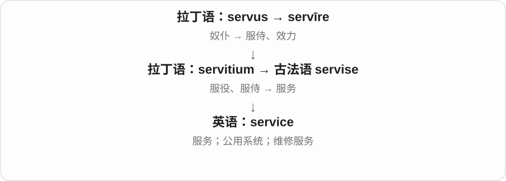

bus service 是公交服务；a service 可以是一次车辆保养或宗教礼拜。service 作动词常指给机器检修保养。

**常见搭配与例句**

customer service；bus services；a church service；service a car。

> The village has a regular bus service.

村里有定时公交服务。

> We had the car serviced before the trip.

出发前我们给汽车做了保养。

**别混淆**

service 更突出服务内容、系统或一次维护；serve 是服务、供给的动作。

### 2. serviceable — 可用的；能满足基本需要的

**音标**：英 /ˈsɜːvɪsəbəl/；美 /ˈsɜːrvɪsəbəl/

**先抓住这个画面**

可能不漂亮、不先进，但交给它的基本任务还能完成。

**怎么拆**

经古法语 servisable 来自 service 词族；现代可看成 service + -able。

**怎么变成今天的意思**

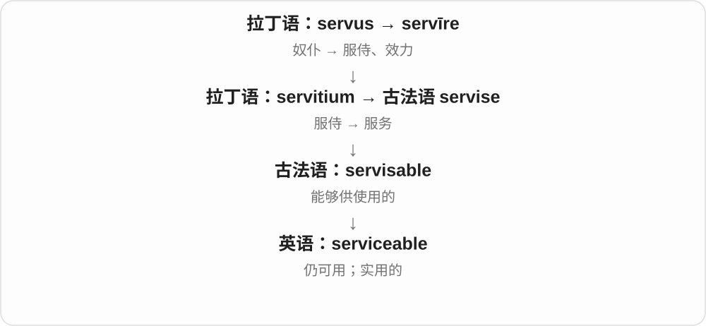

评价常比较朴素：够用、可靠，不是夸到顶。a serviceable coat 是还穿得住的外套。

**常见搭配与例句**

a serviceable tool；perfectly serviceable；a serviceable replacement。

> The old bicycle is still perfectly serviceable.

这辆旧自行车仍然完全能用。

> It is a serviceable solution, though not an elegant one.

这个解决办法能用，虽然算不上巧妙。

**别混淆**

serviceable 是能用；service 服务，servile 卑躬屈膝。三个词的感情色彩完全不同。

### 3. disservice — 伤害；帮倒忙；不公正的对待

**音标**：英 /dɪsˈsɜːvɪs/；美 /dɪsˈsɜːrvɪs/

**先抓住这个画面**

本来该提供帮助，结果让对方更吃亏，或让人对他产生不公正的印象。

**怎么拆**

dis- + service，把有益的服务转成相反效果。

**怎么变成今天的意思**

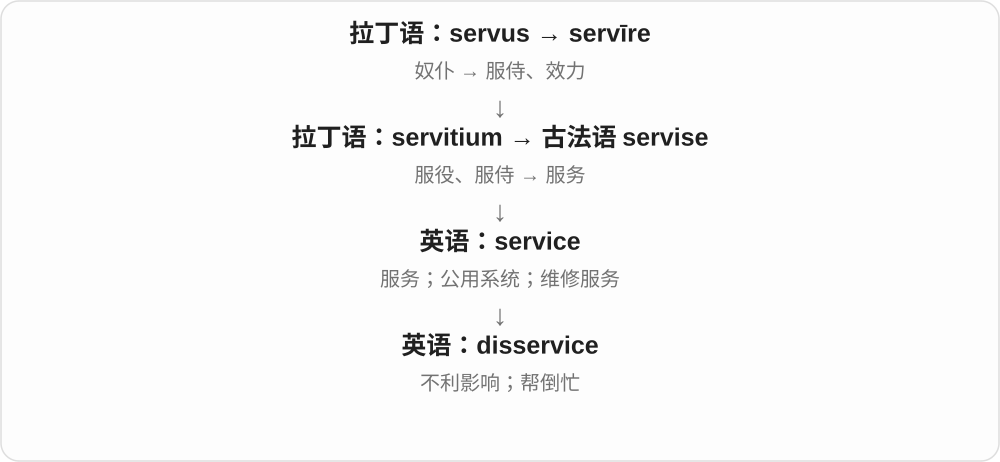

常用 do someone a disservice，可能是有意，也可能出于好心。还可说某种描述低估了对象。

**常见搭配与例句**

do someone a disservice；a serious disservice；a disservice to…。

> Doing all the homework for him would do him a disservice.

把作业全替他做完，反而会害了他。

> Calling it a simple toy does the design a disservice.

把它说成一个简单玩具，低估了这个设计。

**别混淆**

disservice 不只是没帮上忙，通常表示确实造成不利影响或不公平评价。

### 4. serve — 服务；端上；供给；起作用；发球

**音标**：英 /sɜːv/；美 /sɜːrv/

**先抓住这个画面**

把自己的行动、食物或功能提供出去，满足别人或某项任务的需要。

**怎么拆**

经古法语 servir 来自拉丁语 servīre“服侍”，与 servus“奴仆”相连。现代服务义不含被奴役的意思。

**怎么变成今天的意思**

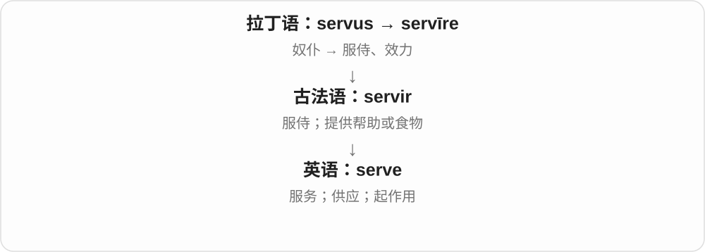

服务顾客、端菜、服役都能连到为某人或某事效力。A box serves as a table 是箱子临时起桌子的作用；球类中还指发球。

**常见搭配与例句**

serve customers；serve dinner；serve as；serve a purpose。

> This room serves as both an office and a library.

这个房间既当办公室，也当书房。

> Dinner will be served at seven.

晚饭七点上桌。

**别混淆**

serve someone 是为某人提供服务；serve as something 是充当某种角色。不能把所有 serve 都译成服侍。

### 5. serving — 一份食物；供餐；在职的

**音标**：英 /ˈsɜːvɪŋ/；美 /ˈsɜːrvɪŋ/

**先抓住这个画面**

一锅汤分到一个人碗里的那一份，就是 a serving；另外也可以描述正在任职或服务。

**怎么拆**

serve + -ing，由端上食物的动作发展出一次供给的分量。

**怎么变成今天的意思**

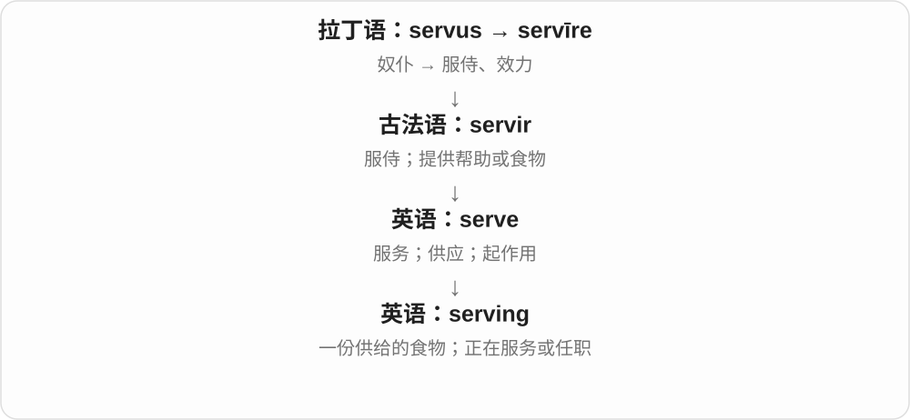

食谱写 serves four 或 four servings，是够四份。a serving officer 则是目前在职的人员，不能套用食物义。

**常见搭配与例句**

a serving of rice；serving size；four servings；a serving officer。

> The recipe makes six servings.

这份食谱可做六人份。

> One serving of rice is enough for me.

一份米饭对我就够了。

**别混淆**

serving 和 portion 都能说食物分量；serving 常按一次给一个人的量计算，不保证人人实际吃得一样多。

### 6. server — 服务员；服务器；发球者

**音标**：英 /ˈsɜːvə/；美 /ˈsɜːrvər/

**先抓住这个画面**

谁把你请求的东西送过来，谁就是这一环节里的 server：餐厅送餐，网络送数据。

**怎么拆**

serve + -er，原指提供服务的人，后来扩展到提供计算服务的程序或机器。

**怎么变成今天的意思**

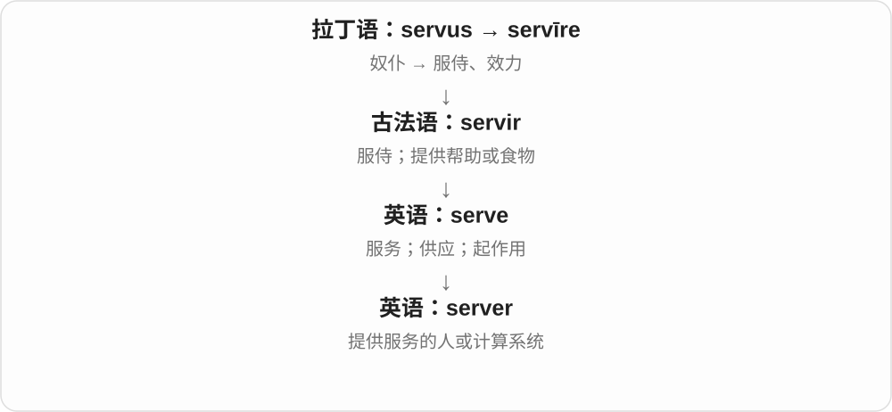

技术语境中的 server 可以指软件，也可以指运行软件的计算机；不一定是一台巨大的独立机器。

**常见搭配与例句**

a restaurant server；a web server；connect to a server。

> The server brought us a jug of water.

服务员给我们端来一壶水。

> The app sends the request to a server.

应用把请求发送到服务器。

**别混淆**

client 发出请求、使用服务；server 接收请求并提供服务。这是角色区别，不只看设备大小。

### 7. servant — 仆人；服务者

**音标**：英 /ˈsɜːvənt/；美 /ˈsɜːrvənt/

**先抓住这个画面**

传统家庭中专门替主人做家务、服侍起居的人；某些固定搭配里则是为公众办事的人。

**怎么拆**

来自古法语 servant，即 servir“服侍”的现在分词；现代能看出 serve 与 -ant。

**怎么变成今天的意思**

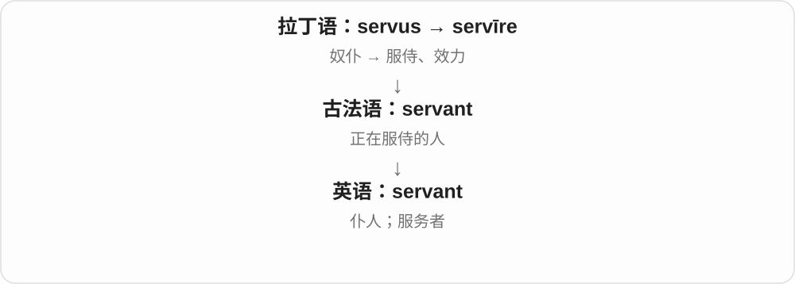

普通 servant 带旧式主仆关系的色彩。civil servant 是公务员，不是私人家仆。现代职业名称通常用更具体的职位。

**常见搭配与例句**

a household servant；a civil servant；a public servant。

> The novel describes the daily life of a household servant.

小说描写了一名家仆的日常生活。

> She worked as a civil servant for many years.

她做了多年公务员。

**别混淆**

employee 是受雇员工的通称；servant 不适合随便称呼所有员工。

### 8. manservant — 男仆

**音标**：英 /ˈmænsɜːvənt/；美 /ˈmænsɜːrvənt/

**先抓住这个画面**

旧式大宅中受雇服侍起居、料理家务的男性仆人。

**怎么拆**

man + servant，英语复合词；传统复数是 menservants。

**怎么变成今天的意思**

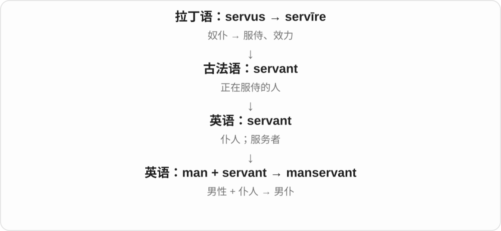

多见于历史或文学语境。它说明性别与服务身份，并不专指某一套职务。

**常见搭配与例句**

a personal manservant；the household’s manservant；menservants。

> In the novel, a manservant opens the door.

小说中，一名男仆打开了门。

> The household employed two menservants.

这户人家雇了两名男仆。

**别混淆**

butler 常是负责特定管家事务的男管家；manservant 是更宽的男仆称呼。

### 9. maidservant — 女仆

**音标**：英 /ˈmeɪdsɜːvənt/；美 /ˈmeɪdsɜːrvənt/

**先抓住这个画面**

旧式家庭里承担清洁、起居照料等工作的女性仆人。

**怎么拆**

maid + servant，两个成分共同限定服务者。

**怎么变成今天的意思**

带明显旧式用语色彩，历史叙述和小说较多。现代工作场景宜用具体职位名称。

**常见搭配与例句**

a young maidservant；the family’s maidservant。

> The diary records the wages paid to a maidservant.

日记记录了付给一名女仆的工资。

> A maidservant carried fresh linen upstairs.

一名女仆把干净床单抱上楼。

**别混淆**

maidservant 不等于所有女性服务人员，更不是“女服务员”的通用现代称呼。

### 10. servitude — 奴役状态；受束缚的服役

**音标**：英 /ˈsɜːvɪtjuːd/；美 /ˈsɜːrvɪtuːd/

**先抓住这个画面**

工作不只是辛苦，而是人失去自由，长期被迫为别人效力。

**怎么拆**

经法语 servitude 来自拉丁语 servitūdō，来自 servus“奴仆”。

**怎么变成今天的意思**

通常用于历史、社会或法律讨论。不是给所有忙碌工作起的普通名称；修辞中也可比喻长期受某物支配。

**常见搭配与例句**

forced servitude；escape servitude；a life of servitude。

> The book describes people struggling to escape servitude.

这本书描写人们努力摆脱奴役的经历。

> The exhibition traces the history of forced servitude.

展览梳理了被迫服役与奴役的历史。

**别混淆**

service 可以是自愿、专业、有报酬的服务；servitude 突出自由被剥夺或严重受支配。

### 11. reserve — 预留；储备；保护区；克制

**音标**：英 /rɪˈzɜːv/；美 /rɪˈzɜːrv/

**先抓住这个画面**

先别全部用掉，留下一个座位、一部分资源，或心里一些话，等合适的时候再拿出来。

**怎么拆**

来自拉丁语 reservāre，经古法语；re- 在这个词里帮助表达留住、保留下来，词根是 servāre。

**怎么变成今天的意思**

reserve a table 是预订；oil reserves 是石油储量；a reserve 是保护区。说人有 reserve，是不轻易显露感情的克制。

**常见搭配与例句**

reserve a seat；keep in reserve；nature reserves；with reserve。

> We reserved a table for four.

我们预订了一张四人桌。

> Keep some water in reserve for the journey back.

留一些水供返程使用。

**别混淆**

reserve 强调留作某人、某事或以后使用；preserve 强调让东西完好留存。

### 12. reserved — 已预订的；保留的；内敛的

**音标**：英 /rɪˈzɜːvd/；美 /rɪˈzɜːrvd/

**先抓住这个画面**

位置留给特定的人；感情留在自己心里，不轻易外露。

**怎么拆**

reserve + -ed，由保留动作的结果发展出内敛的性格义。

**怎么变成今天的意思**

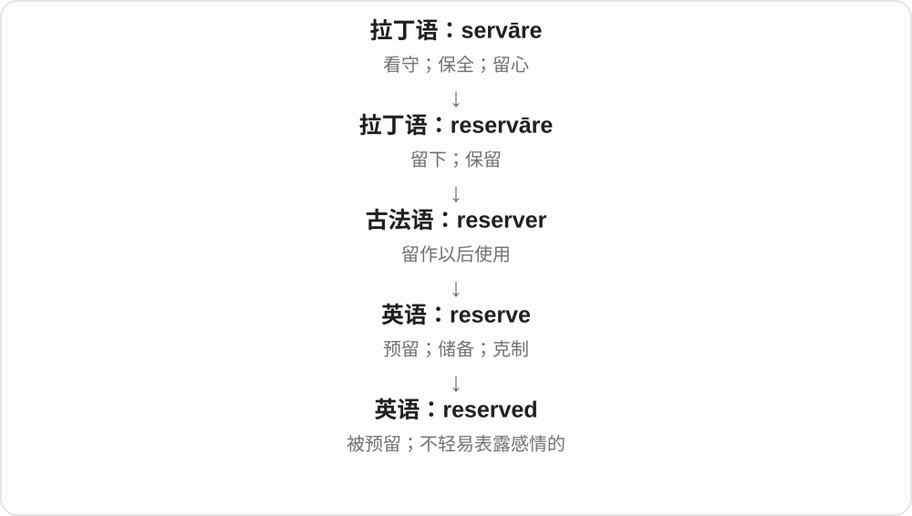

牌子上 Reserved 是已预订。a reserved person 往往话不多、不轻易显露心情，并不一定不友好。

**常见搭配与例句**

a reserved seat；reserved for staff；a reserved manner。

> These seats are reserved for guests.

这些座位是为来宾预留的。

> He is reserved at first but friendly once you know him.

他起初比较内敛，熟悉后却很友好。

**别混淆**

reserved 是克制、内敛；shy 常包含害羞、不自在。内敛的人可以很有自信。

### 13. reservation — 预订；保留意见；保留地

**音标**：英 /ˌrezəˈveɪʃən/；美 /ˌrezərˈveɪʃən/

**先抓住这个画面**

留住一个房间是预订；把一部分赞同留着不给，是保留意见。两种意思都抓住“还留下一点”。

**怎么拆**

来自法语 reservation，深连拉丁语 reservātiō；现代对应 reserve + -ation。

**怎么变成今天的意思**

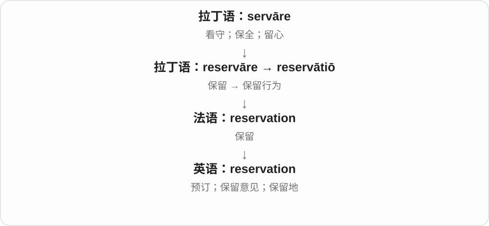

I have reservations 是我有顾虑，不是我订了好几间房。reservation 的土地义也用于一些国家的原住民保留地。

**常见搭配与例句**

make a reservation；have reservations about；without reservation。

> I made a reservation for Friday night.

我预订了星期五晚上的位置。

> She has reservations about the proposed schedule.

她对拟议的日程安排有些顾虑。

**别混淆**

reservation 单数常是一次预订；reservations 也经常是顾虑。必须看宾语与语境。

### 14. reservist — 预备役人员

**音标**：英 /rɪˈzɜːvɪst/；美 /rɪˈzɜːrvɪst/

**先抓住这个画面**

平时未必在全日制军队岗位，但作为后备力量保持相应身份，必要时可被召集。

**怎么拆**

reserve + -ist，指属于预备力量的人。

**怎么变成今天的意思**

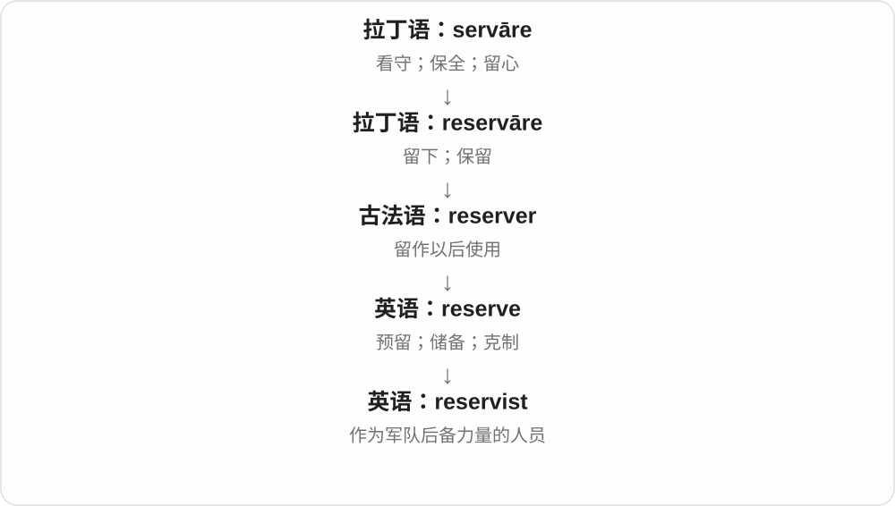

具体训练、召集和服役制度因地区而异。词本身说身份，不等于已经退休或永远不会服役。

**常见搭配与例句**

an army reservist；call up reservists；reservist training。

> The reservists attended a training exercise.

预备役人员参加了一次训练演习。

> She works as a teacher and is also a reservist.

她是一名教师，同时也是预备役人员。

**别混淆**

veteran 强调曾经服役的经历；reservist 强调目前的预备役身份，两者可能重合。

### 15. deserve — 应得；值得

**音标**：英 /dɪˈzɜːv/；美 /dɪˈzɜːrv/

**先抓住这个画面**

看一个人做了什么、付出了什么，觉得某种回报或对待与他相称。

**怎么拆**

拉丁语 dēservīre“尽力服务”，dē- 在这里加强，不是表示不服务；经法语发展出值得、应得。

**怎么变成今天的意思**

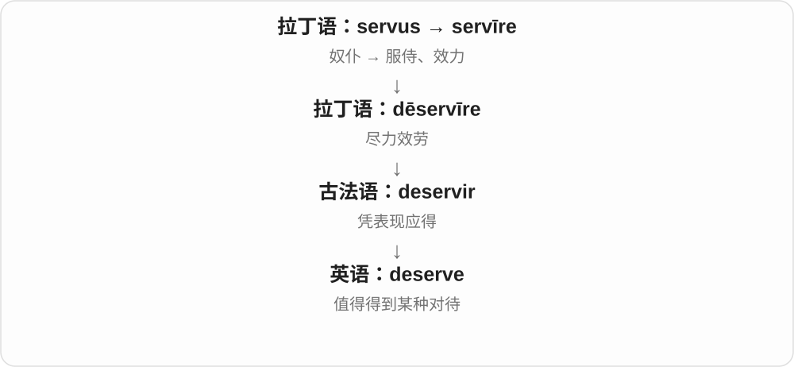

从服务应得回报，扩大到行为应得任何评价或对待。可以 deserve praise，也可以 deserve criticism；不是只配好东西。

**常见搭配与例句**

deserve a rest；deserve praise；deserve to know；deserve better。

> You deserve a rest after all that work.

做了那么多工作，你该休息一下了。

> Everyone deserves to be treated with respect.

每个人都值得被尊重地对待。

**别混淆**

earn 偏实际取得或通过努力挣到；deserve 是评价“理应得到”，现实未必已经得到。

### 16. preserve — 保存；保护；维持；蜜饯或果酱

**音标**：英 /prɪˈzɜːv/；美 /prɪˈzɜːrv/

**先抓住这个画面**

旧照片会褪色，食物会变质，习俗会失传；你采取办法，让它们继续好好留着。

**怎么拆**

后期拉丁语 prae- 事先 + servāre 保全，形成 praeservāre，经法语进入。

**怎么变成今天的意思**

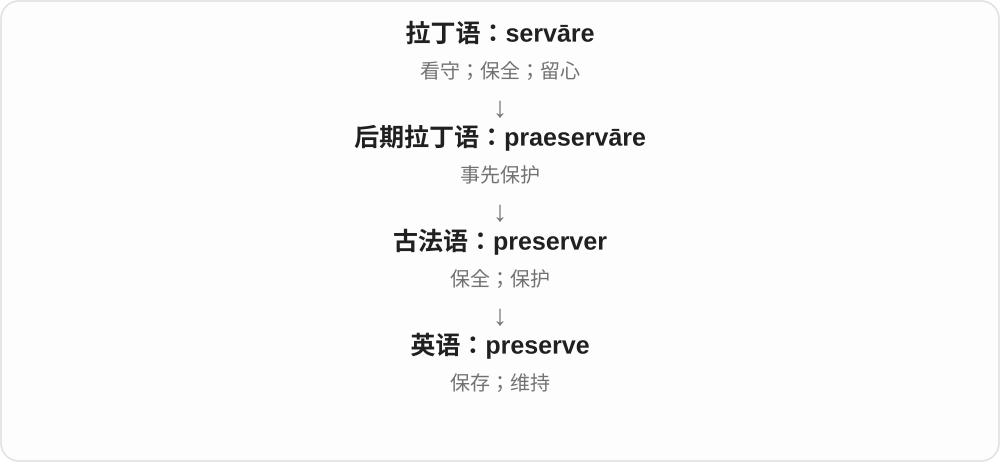

可以保护具体物品，也可以维持尊严、传统或状态。preserves 作食品名词常指用糖保存的水果制品。

**常见搭配与例句**

preserve food；preserve a tradition；preserve the original appearance。

> The museum works to preserve the original paintings.

博物馆努力保存原画。

> Drying is one way to preserve food.

干燥是保存食物的一种方式。

**别混淆**

preserve 侧重防止损坏、流失或改变；reserve 侧重预留。保存旧票根是 preserve，预订车票是 reserve。

### 17. preservation — 保存；保护；维持原状

**音标**：英 /ˌprezəˈveɪʃən/；美 /ˌprezərˈveɪʃən/

**先抓住这个画面**

把东西长期留好，不让时间、环境或使用把它毁掉的过程。

**怎么拆**

古法语 preservacion 来自中世纪拉丁语 praeservātiō；现代对应 preserve + -ation。

**怎么变成今天的意思**

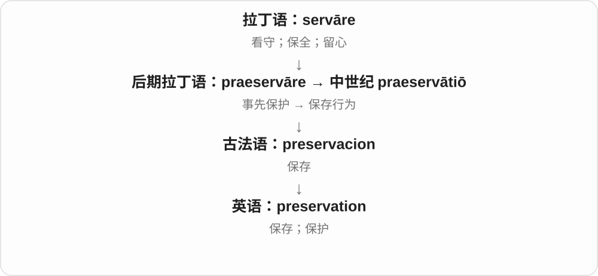

可以讨论档案、建筑、食物或自然环境的保存。词义偏持续留存，不只一次临时防护。

**常见搭配与例句**

food preservation；the preservation of records；historic preservation。

> Low humidity helps with the preservation of old documents.

较低湿度有助于保存旧文献。

> The group supports the preservation of historic buildings.

这个团体支持保护历史建筑。

**别混淆**

preservation 强调留存；restoration 是修复到某种较早状态。保存可能需要修复，但两词不完全相同。

### 18. preserver — 保护者；保存者；救生用品

**音标**：英 /prɪˈzɜːvə/；美 /prɪˈzɜːrvər/

**先抓住这个画面**

那个让事物免于毁坏、继续存在的人或工具。

**怎么拆**

preserve + -er，既能指做事的人，也能指发挥保护作用的物。

**怎么变成今天的意思**

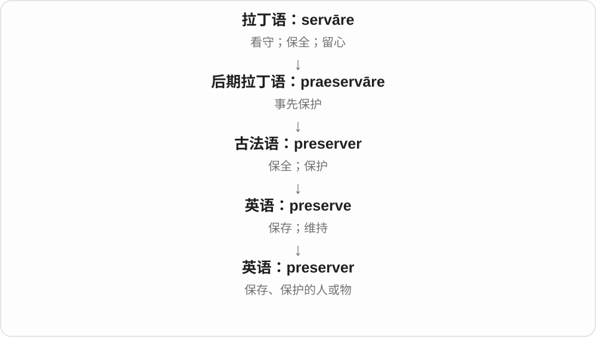

a preserver of traditions 是传统的守护者；life preserver 是救生用具，常指救生圈或救生衣等。

**常见搭配与例句**

a preserver of history；a life preserver；preservers of tradition。

> The archive acts as a preserver of local history.

这座档案馆保存着当地历史。

> A life preserver hung beside the boat’s cabin.

船舱旁挂着一个救生圈。

**别混淆**

preserver 常指人或保护工具；preservative 常指防腐成分。

### 19. conserve — 节约；保护；保存；果酱

**音标**：动词：英 /kənˈsɜːv/、美 /kənˈsɜːrv/；食品名词常 /ˈkɒnsɜːv/（英）

**先抓住这个画面**

手里的水、体力和自然资源都有限，别白白消耗，让它们留得更久。

**怎么拆**

拉丁语 cōnservāre，经法语 conserver；con- 在这里加强保全的动作，不必逐字译成一起服务。

**怎么变成今天的意思**

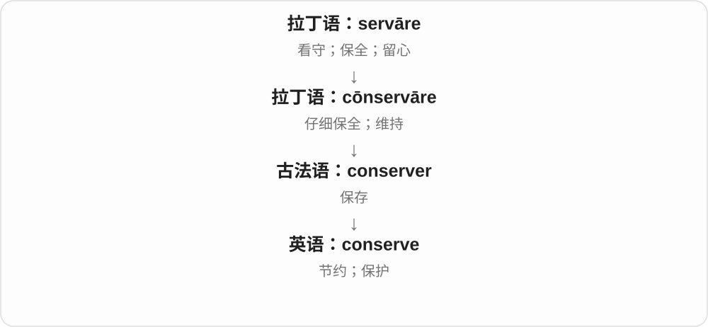

conserve water 是节约水，conserve wildlife 是保护野生生物。食品名词 conserve 是一种果酱，沿保存食物的意思发展。

**常见搭配与例句**

conserve energy；conserve water；conserve natural habitats。

> We turned off the lights to conserve energy.

我们关掉灯以节约能源。

> The project aims to conserve the wetland habitat.

这个项目旨在保护湿地栖息地。

**别混淆**

conserve 常突出节制使用、妥善管理；preserve 常突出保持完整。实际搭配可以有重叠。

### 20. conservative — 保守的；审慎的；保守派

**音标**：英 /kənˈsɜːvətɪv/；美 /kənˈsɜːrvətɪv/

**先抓住这个画面**

变化来了，先倾向保住现有做法；估数字时，则宁愿稳一点，不把结果说得过大。

**怎么拆**

经法语 conservatif 来自拉丁语 cōnservāre“保持”；现代可联系 conserve 与 -ative。

**怎么变成今天的意思**

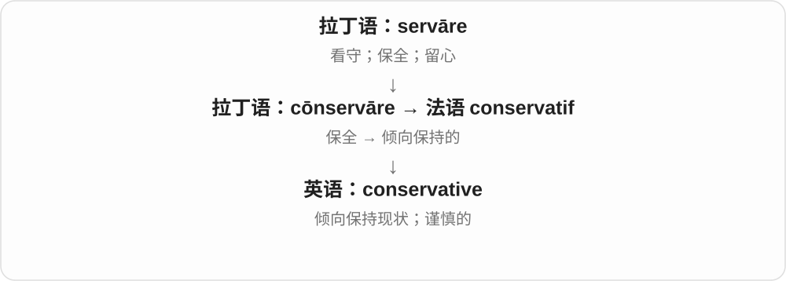

可指政治立场、传统风格或审慎估计。a conservative estimate 是偏稳妥的估计，不是有政治立场的估计。

**常见搭配与例句**

conservative views；conservative clothing；a conservative estimate。

> That is a conservative estimate of the time required.

这是对所需时间的一个谨慎估计。

> He prefers conservative styles of clothing.

他偏爱传统稳重的衣着风格。

**别混淆**

conservation 是保护；conservative 是保守或审慎。环保工作者不因此自动属于某种政治保守派。

### 21. conservation — 保护；节约；守恒

**音标**：英 /ˌkɒnsəˈveɪʃən/；美 /ˌkɑːnsərˈveɪʃən/

**先抓住这个画面**

把资源和事物好好留下来；物理学里则是某个量在规定条件下总量保持不变。

**怎么拆**

经法语来自拉丁语 cōnservātiō，与 cōnservāre 同族；现代对应 conserve + -ation。

**怎么变成今天的意思**

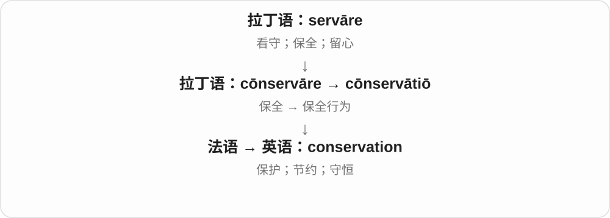

wildlife conservation 是保护野生生物；energy conservation 在日常用法是节能，在物理学中也指能量守恒。

**常见搭配与例句**

nature conservation；water conservation；conservation of energy。

> The school runs a water conservation programme.

学校开展节水项目。

> The lesson explains the conservation of energy in an isolated system.

这一课讲解孤立系统中的能量守恒。

**别混淆**

conservation 不是 conversation“谈话”。energy conservation 的两种意思要按生活或物理语境区分。

### 22. conservancy — 自然资源保护；保护管理机构或区域

**音标**：英 /kənˈsɜːvənsi/；美 /kənˈsɜːrvənsi/

**先抓住这个画面**

给一片土地或一条河安排长期看护，让保护成为一项持续的工作。

**怎么拆**

更早的 conservancie 借自中世纪拉丁语 conservantia，与 conservāre“保全”相连；现代能看出 conserve 与 -ancy，但不把它冒充全部历史。

**怎么变成今天的意思**

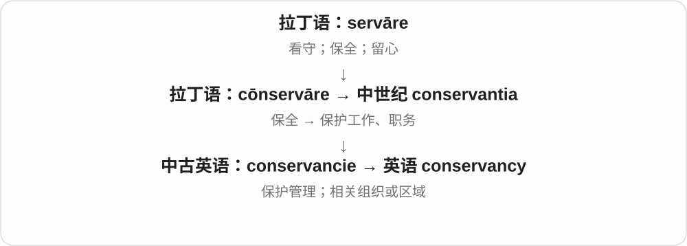

常见于机构和保护项目名称；具体是组织、工作还是管理区，需要看上下文。

**常见搭配与例句**

a river conservancy；a local conservancy；land conservancy。

> The local conservancy maintains trails through the wetland.

当地保护组织维护着穿过湿地的小径。

> She volunteers with a land conservancy.

她在一家土地保护组织做志愿者。

**别混淆**

conservation 较常指保护工作本身；conservancy 更常见于承担保护工作的组织、区域或管理体系。

### 23. observe — 观察；遵守；庆祝或纪念；评论说

**音标**：英 /əbˈzɜːv/；美 /əbˈzɜːrv/

**先抓住这个画面**

把注意力守在某件事上：守着现象看，就能观察；把规定放在心上，就能遵守。

**怎么拆**

拉丁语 ob- 在面前 + servāre 看守，形成 observāre，经法语进入。

**怎么变成今天的意思**

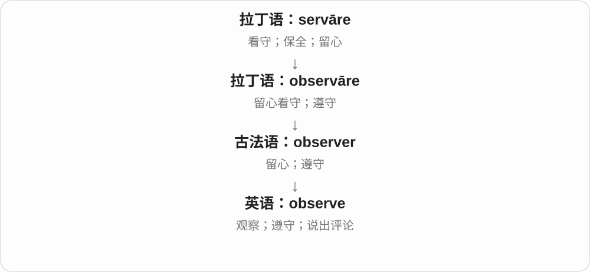

现代可以 observe birds，也可以 observe rules。observe a holiday 是按惯例庆祝或纪念；she observed that… 是她评论说。历史上的遵守义进入英语较早，不能把所有意义排成“先科学观察，再守规则”。

**常见搭配与例句**

observe a change；observe the rules；observe a holiday；observe that…。

> We observed the birds from a distance.

我们在远处观察鸟。

> All visitors must observe the safety rules.

所有访客都必须遵守安全规定。

**别混淆**

watch 偏看着过程；observe 常多一层留心、注意细节。遇到 rules 时是遵守，不是站着看规则。

### 24. observation — 观察；观察结果；评论

**音标**：英 /ˌɒbzəˈveɪʃən/；美 /ˌɑːbzərˈveɪʃən/

**先抓住这个画面**

认真看见了什么，把那个发现记下来或说出来；过程和发现都可以叫 observation。

**怎么拆**

经法语来自拉丁语 observātiō；与 observe 同族，现代对应 observe + -ation。

**怎么变成今天的意思**

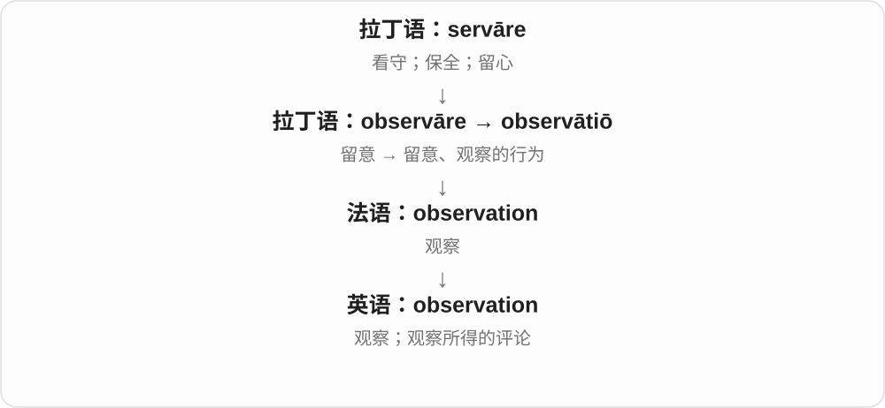

under observation 是处于观察中。make an observation 可以提出一个看法，不一定拿着仪器测量。

**常见搭配与例句**

careful observation；make an observation；under observation；an observation about…。

> Careful observation revealed a change in the colour.

仔细观察发现颜色有了变化。

> She made a useful observation about the design.

她对设计提出了一个有用的看法。

**别混淆**

observation 是观察或评论；observance 主要是遵守、纪念活动。

### 25. observational — 观察的；基于观察的

**音标**：英 /ˌɒbzəˈveɪʃənəl/；美 /ˌɑːbzərˈveɪʃənəl/

**先抓住这个画面**

先看真实情况怎样发生，收集观察到的内容来研究或创作。

**怎么拆**

observation + -al。

**怎么变成今天的意思**

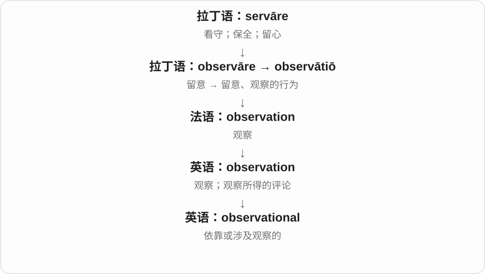

observational study 通常观察既有情况；observational comedy 从生活中常见的小细节提炼笑点。

**常见搭配与例句**

observational data；an observational study；observational comedy。

> The researchers collected observational data from the field.

研究人员在现场收集了观察数据。

> Her observational comedy focuses on everyday habits.

她的生活观察类喜剧围绕人们的日常习惯展开。

**别混淆**

experimental 常有主动安排的干预；observational 常观察已有情况。观察到关联本身不等于证明原因。

### 26. observer — 观察者；旁观者；观摩人员

**音标**：英 /əbˈzɜːvə/；美 /əbˈzɜːrvər/

**先抓住这个画面**

站在一旁留心看发生了什么，可能作记录，但不一定直接参与决定。

**怎么拆**

observe + -er。

**怎么变成今天的意思**

可以是普通目击者，也可以是正式派出的监督观察人员。observer status 表示可观察、参与某些活动，但权利不等同正式成员。

**常见搭配与例句**

an independent observer；a casual observer；observer status。

> An independent observer attended the counting process.

一名独立观察员到场观察了计票过程。

> To a casual observer, the two machines look identical.

在随便看一眼的人看来，这两台机器一模一样。

**别混淆**

participant 直接参与活动；observer 重点在观察。一个人也可能在不同阶段承担两种角色。

### 27. observatory — 天文台；观测台

**音标**：英 /əbˈzɜːvətri/；美 /əbˈzɜːrvətɔːri/

**先抓住这个画面**

把仪器和观察人员安置在一个专门地点，让他们长期看天空、天气或其他自然现象。

**怎么拆**

借自法语 observatoire，属于 observer 的观测词族；现代对应 observe 与表示场所的 -atory。

**怎么变成今天的意思**

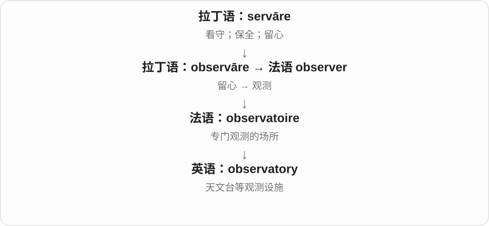

典型形象是山顶带圆顶和望远镜的建筑，但不只天文观测可以使用这个词。

**常见搭配与例句**

an astronomical observatory；a mountain observatory；visit an observatory。

> The observatory is far from the city’s bright lights.

天文台远离城市的强光。

> Students visited the observatory to learn about its telescopes.

学生们参观天文台，了解那里的望远镜。

**别混淆**

laboratory 是实验室；observatory 突出对外界现象进行观测，未必主动改变对象。

### 28. observance — 遵守；奉行；纪念或宗教仪式

**音标**：英 /əbˈzɜːvəns/；美 /əbˈzɜːrvəns/

**先抓住这个画面**

把规定或重要日子认真放在行动里：该遵循的遵循，该纪念的举行仪式。

**怎么拆**

经古法语 observance 来自拉丁语 observantia，承接 observāre 的遵守义。

**怎么变成今天的意思**

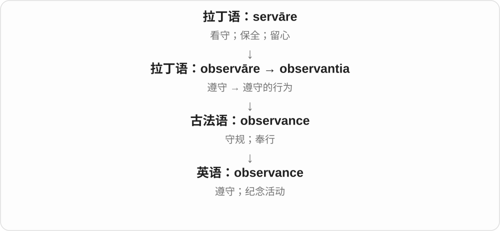

observance of rules 是遵守规定；religious observances 可指宗教仪式或习惯性活动。

**常见搭配与例句**

observance of the rules；religious observance；in observance of…。

> Strict observance of the rules is required.

必须严格遵守规定。

> The office is closed in observance of the holiday.

办公室因纪念这个节日而休息。

**别混淆**

observation 是观察；observance 是照着规定或惯例做，不能只凭相同词根互换。

### 29. observable — 可观察到的；可检测的

**音标**：英 /əbˈzɜːvəbəl/；美 /əbˈzɜːrvəbəl/

**先抓住这个画面**

变化已经不是凭空猜想，而是能通过眼睛、仪器或系统记录看出来。

**怎么拆**

observe + -able，能被观察到的。

**怎么变成今天的意思**

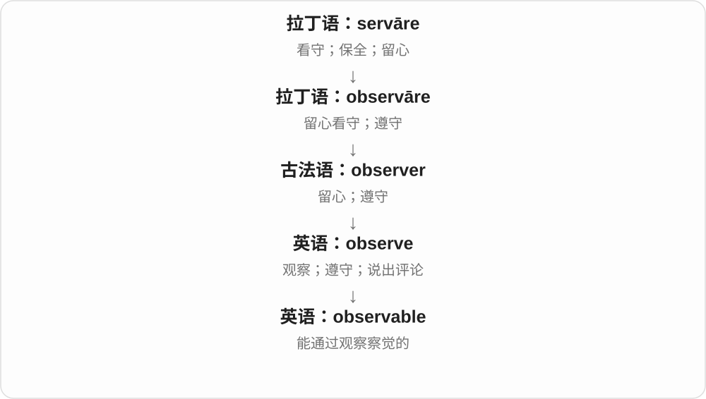

不一定肉眼可见；仪器检测到的变化也可以 observable。它说能否观察，不自动说明原因已经查清。

**常见搭配与例句**

an observable change；observable effects；directly observable。

> There was no observable change in the sample.

样本没有出现可观察到的变化。

> The effect is observable only with special equipment.

这种效应只能借助专门设备观察到。

**别混淆**

obvious 是显而易见；observable 只是可观察到，仍可能需要精密设备。

### 30. observant — 善于观察的；留心的；遵守宗教戒律的

**音标**：英 /əbˈzɜːvənt/；美 /əbˈzɜːrvənt/

**先抓住这个画面**

别人走过没注意，你却看见门把手换了、语气变了，说明你很 observant。

**怎么拆**

与法语 observant 和英语 observe + -ant 相关；承接 observe 留心与遵守两条意思。

**怎么变成今天的意思**

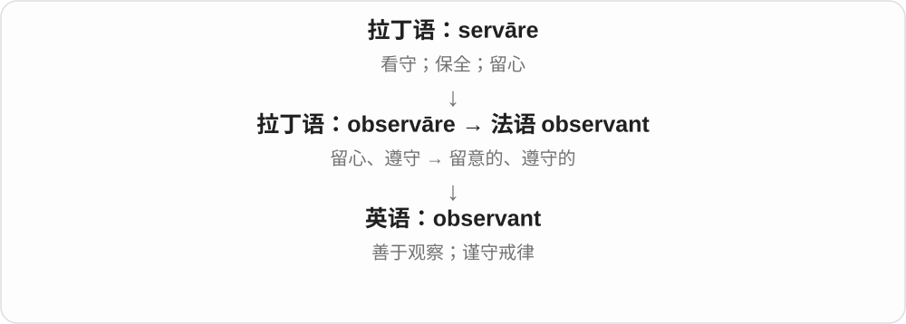

日常常夸人细心。宗教语境可指认真遵循有关规定，而不是说此人眼力好。

**常见搭配与例句**

an observant child；highly observant；religiously observant。

> An observant child noticed the tiny crack.

一个细心的孩子发现了那条小裂缝。

> The biography describes a religiously observant family.

传记描写了一个认真遵循宗教戒律的家庭。

**别混淆**

observant 说人善于观察或守规；observable 说事物能被观察，主客体方向相反。

### 31. sergeant — 军士；警佐等相应警衔人员

**音标**：英 /ˈsɑːdʒənt/；美 /ˈsɑːrdʒənt/

**先抓住这个画面**

从给人效力的角色，发展成军队或警察组织中一个明确的职级。

**怎么拆**

拉丁语 serviēns“正在服役的人”经古法语 sergent 变来；与 servant 是同源的不同路线，拼写 er 却读 /ɑː/。

**怎么变成今天的意思**

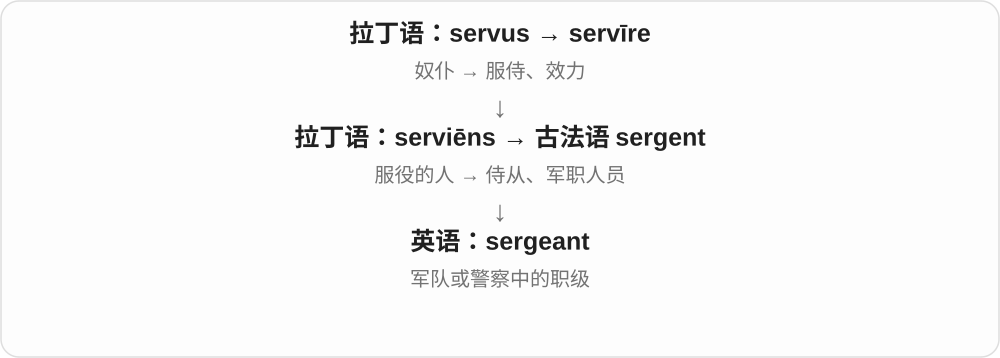

具体对应中文哪个衔级要看国家和组织。学习时先记它是一种军警职级，不要直接按 servant 当仆人理解。

**常见搭配与例句**

a police sergeant；a staff sergeant；promoted to sergeant。

> The sergeant checked that everyone had returned.

那位军士确认所有人都已返回。

> She was promoted to police sergeant.

她晋升到了警佐这一警衔。

**别混淆**

sergeant 不是 surgeon“外科医生”；两者拼写和读音都要分清。

### 32. dessert — 餐后甜点

**音标**：英 /dɪˈzɜːt/；美 /dɪˈzɜːrt/

**先抓住这个画面**

主菜吃完、餐桌收过一轮，接着端来的水果或甜食。

**怎么拆**

借自法语 dessert，来自 desservir“撤下已上桌的东西”，由 des- 撤去 + servir 上菜构成。

**怎么变成今天的意思**

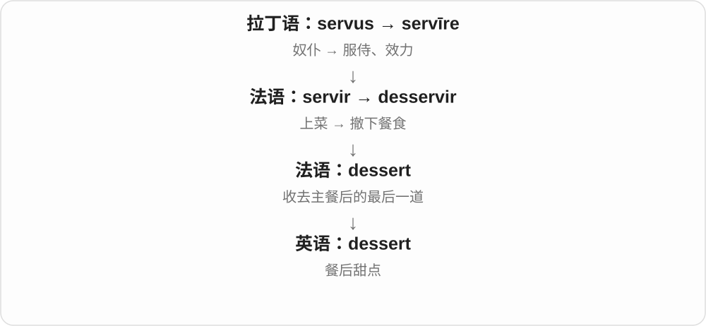

名称连到上菜和撤桌的次序，不是因为“应得一份甜食”。甜点可以是蛋糕、冰淇淋，也可以是水果。

**常见搭配与例句**

have dessert；for dessert；the dessert menu。

> We had fresh fruit for dessert.

我们餐后吃了新鲜水果。

> Would you like to see the dessert menu?

你想看看甜点菜单吗？

**别混淆**

dessert 两个 s 是甜点；desert 一个 s 作“沙漠”时重音在前。just deserts“应得的报应”也不是甜点。

### 33. conservator — 文物保护修复人员；受托管理者

**音标**：英 /kənˈsɜːvətə/；美 /kənˈsɜːrvətər/

**先抓住这个画面**

面对老画、文献或器物，这个人的工作是尽量保存它们，必要时谨慎修复。

**怎么拆**

经法语 conservatour 来自拉丁语 cōnservātor，是 cōnservāre“保全”的施事名词。

**怎么变成今天的意思**

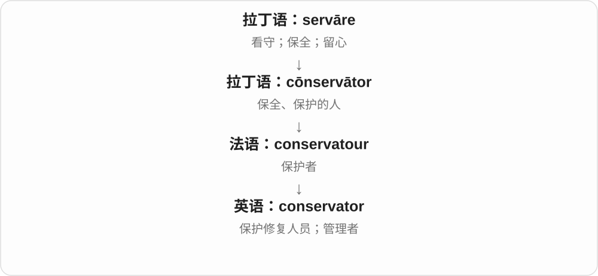

博物馆语境常指保护修复专业人员；某些法律语境另有管理他人财产或事务的角色。具体职责随制度变化。

**常见搭配与例句**

a museum conservator；a painting conservator；conservators at work。

> A conservator examined the damaged painting.

一位保护修复人员检查了受损油画。

> The conservator tested the paper before beginning repairs.

修复人员在修补之前测试了纸张。

**别混淆**

curator 常负责藏品研究、选择与展览；conservator 更偏材料保存和修复，工作可能合作但不相同。

### 34. conservatory — 玻璃暖房；温室；音乐学院

**音标**：英 /kənˈsɜːvətri/；美 /kənˈsɜːrvətɔːri/

**先抓住这个画面**

一边是把植物保护起来的玻璃空间；另一边是历史上收容并培养孩子、后来发展音乐教育的机构。

**怎么拆**

温室义沿 conserve“保存”发展；音乐学院义经意大利语 conservatorio、法语 conservatoire，连到中世纪拉丁语 conservatorium“保护之处”。

**怎么变成今天的意思**

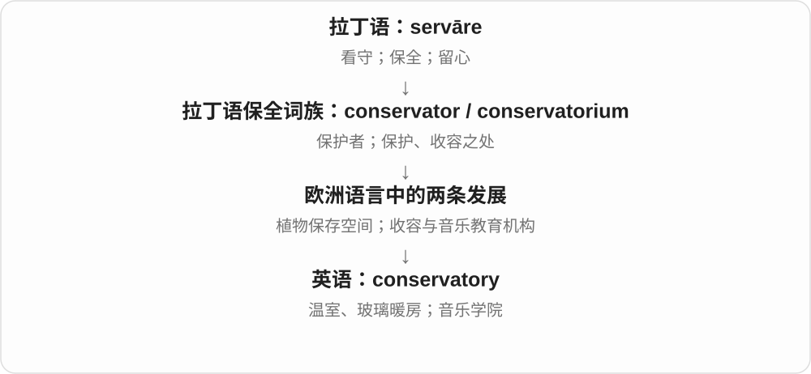

音乐学院不是因为“保存音乐”这个现代联想才得名，历史上有收容机构提供音乐训练的背景。英式日常还常指住宅相连的玻璃暖房。

**常见搭配与例句**

a glass conservatory；a music conservatory；study at a conservatory。

> They grow tender plants in the conservatory.

他们在玻璃温室里种怕冷的植物。

> She studied piano at a conservatory.

她在音乐学院学钢琴。

**别混淆**

observatory 是天文台等观测场所；conservatory 是暖房或音乐学院。

### 35. subservient — 过分顺从的；从属的

**音标**：英 /səbˈsɜːviənt/；美 /səbˈsɜːrviənt/

**先抓住这个画面**

把自己放在别人的意志下面，或把一个目标放在另一个目标之下。

**怎么拆**

拉丁语 sub- 在下 + servīre 服事，形成 subservīre，其分词 subserviēns 借入英语。

**怎么变成今天的意思**

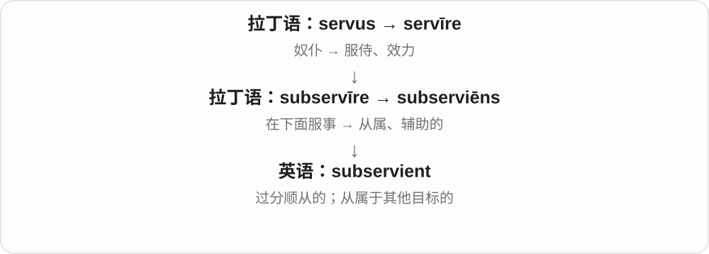

说人常带贬义：过度听命。说目标时可以较中性，如让设计服从功能。

**常见搭配与例句**

subservient to；a subservient role；subservient behaviour。

> She refused to be subservient to her supervisor.

她拒绝对主管唯命是从。

> The decoration is subservient to the building’s function.

装饰服从于建筑的功能。

**别混淆**

subordinate 常中性地表示层级较低；subservient 形容人时更容易带不该如此顺从的评价。

### 36. subservience — 屈从；过度顺从；从属地位

**音标**：英 /səbˈsɜːviəns/；美 /səbˈsɜːrviəns/

**先抓住这个画面**

不只某一次听话，而是长期把自己的判断放在别人下面的状态。

**怎么拆**

subservient 的 -ent 对应名词 -ence，表示这种状态或态度。

**怎么变成今天的意思**

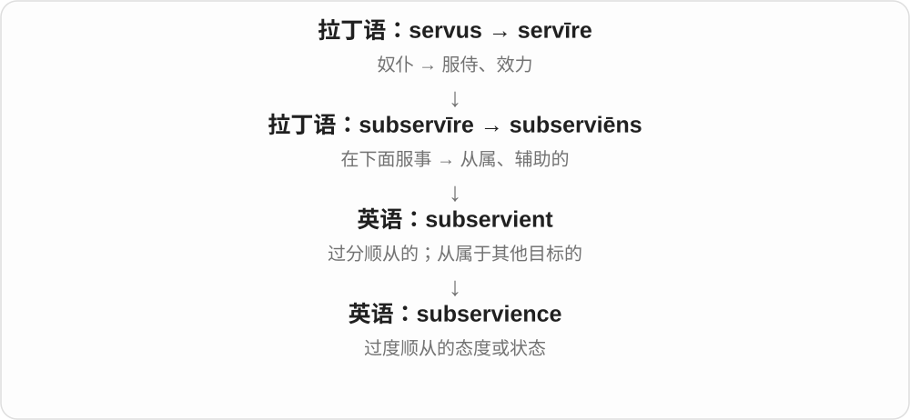

常批评权力关系中的盲目服从。用于目标关系时，也可说某事从属于另一事。

**常见搭配与例句**

subservience to authority；an attitude of subservience。

> The novel criticizes unquestioning subservience to authority.

小说批评对权威不加质疑的屈从。

> Her silence was mistaken for subservience.

她的沉默被误认为是顺从。

**别混淆**

cooperation 是合作；subservience 是把判断权让到别人之下，尤其可能违背自身判断。

### 37. preservative — 防腐剂；有保存作用的

**音标**：英 /prɪˈzɜːvətɪv/；美 /prɪˈzɜːrvətɪv/

**先抓住这个画面**

在容易腐坏的材料里加入一种成分，让它不那么快变坏。

**怎么拆**

来自法语 preservatif、中世纪拉丁语 praeservātīvus，与 preserve 同族；现代对应 preserve 与 -ative。

**怎么变成今天的意思**

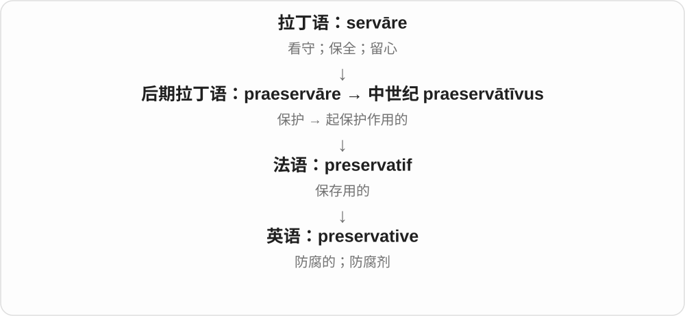

可以说食品中的防腐成分，也可以说木材保护剂。词本身描述功能，不能单凭名称判断具体成分的安全性或效果。

**常见搭配与例句**

food preservatives；a wood preservative；preservative treatment。

> The label lists the preservative used in the product.

标签列出了产品使用的防腐剂。

> The timber received a preservative treatment.

这批木材做了防腐处理。

**别混淆**

preservation 是保存过程；preservative 是发挥保存作用的物质或性质。

### 38. servile — 卑躬屈膝的；奴性的

**音标**：英 /ˈsɜːvaɪl/；美 /ˈsɜːrvəl/，也读 /ˈsɜːrvaɪl/

**先抓住这个画面**

为了讨好有权势的人，把自己的判断和尊严放得很低，什么都顺着对方。

**怎么拆**

经法语 servile 来自拉丁语 servīlis“奴仆的”，基础是 servus。

**怎么变成今天的意思**

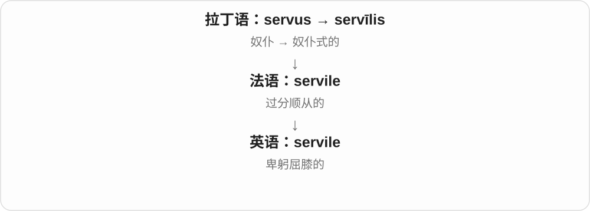

现代常带强烈贬义，批评奴颜婢膝的态度。它不是描述提供服务这一职业本身。

**常见搭配与例句**

a servile attitude；servile obedience；servile flattery。

> She disliked his servile flattery of the manager.

她不喜欢他对经理卑躬屈膝的奉承。

> Respect does not require servile obedience.

尊重并不要求毫无原则地服从。

**别混淆**

polite 是礼貌；servile 是失去独立和尊严的讨好。尊重别人不需要卑躬屈膝。

### 39. serf — 农奴

**音标**：英 /sɜːf/；美 /sɜːrf/

**先抓住这个画面**

人在土地上劳动，却不能像自由雇工一样随意离开，受到领主和土地制度的束缚。

**怎么拆**

古法语 serf 来自拉丁语 servus“奴仆”，与 servant 同族，但走了不同词形路线。

**怎么变成今天的意思**

说的是特定历史身份，不是收入低的农民的通称。不同地区时期的义务和权利并不完全一样。

**常见搭配与例句**

a medieval serf；the obligations of serfs；a serf’s labour。

> The historian studied the obligations of medieval serfs.

历史学家研究了中世纪农奴的义务。

> The story follows a serf seeking freedom.

故事讲述一名农奴寻求自由的经历。

**别混淆**

peasant 是农民这一较宽类别；serf 特别强调人身与土地制度上的束缚。

## 这一组要分清什么

**preserve / reserve / conserve**：完好保存 / 留作特定用途或以后使用 / 妥善保护并节约资源。

**observation / observance**：观察或评论 / 遵守、纪念活动。

**observant / observable**：人善于观察 / 事物可被观察。

**conservatory / observatory**：暖房或音乐学院 / 天文台等观测场所。

**serviceable / servile**：东西实用 / 人卑躬屈膝。不要把工作服务和奴性混为一谈。

## 串起来练习

**Observant volunteers help conserve the wetland, preserve its records, and reserve space for nesting birds.**

细心的志愿者帮助保护湿地、保存记录，并为筑巢的鸟预留空间。observe 留心看，conserve 妥善保护，preserve 保存完好，reserve 留出备用。
