# 0133 · curr-, curs- — 跑；流动；沿路线发展

[逐词精讲目录](../00_逐词精讲目录.md) · [总目录](../00_总目录_按常用程度.md)

## 核心词根与来源

**curr-/curs-** 来自拉丁语 **currere**“跑”，相关形式有 **cursus**。水流在跑是 current，钱在人群中流通是 currency，学习沿路线推进是 course、curriculum。再加方向：recur 跑回来，incur 跑进一笔负担，concur 跑到同一个判断上。

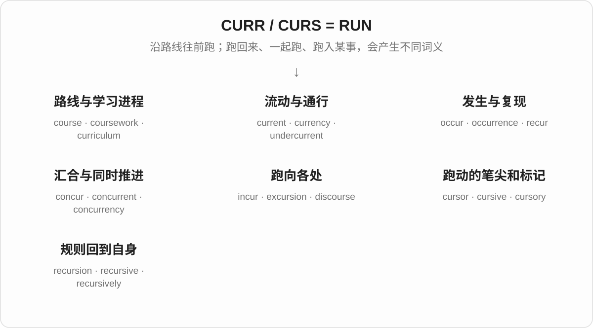

## 词形与演化规律

**curr-** 常见于 occur、recur、current；**curs-** 常见于 cursor、cursive、recursion。它们属于拉丁语同一词族的不同形式。法语音变又留下 course、courier 等。**cur-**“照料”是另一条词根，不能因为拼写相像就把 cure、curious 全拉进来。

## 单词速览（常用到不常用）

| 单词 | 音标 | 核心意思 |
|---|---|---|
| [course](#w-1) | 英 /kɔːs/；美 /kɔːrs/ | 路线；过程；课程；一道菜 |
| [current](#w-2) | 英 /ˈkʌrənt/；美 /ˈkɜːrənt/ | 当前的；通行的；水流；电流 |
| [currently](#w-3) | 英 /ˈkʌrəntli/；美 /ˈkɜːrəntli/ | 目前；现在 |
| [occur](#w-4) | 英 /əˈkɜː/；美 /əˈkɜːr/ | 发生；出现；被想到 |
| [currency](#w-5) | 英 /ˈkʌrənsi/；美 /ˈkɜːrənsi/ | 货币；流通；广泛接受 |
| [curriculum](#w-6) | 英 /kəˈrɪkjʊləm/；美 /kəˈrɪkjələm/ | 课程体系；教学内容安排 |
| [corridor](#w-7) | 英 /ˈkɒrɪdɔː/；美 /ˈkɔːrɪdɔːr/ | 走廊；通道；狭长地带 |
| [discourse](#w-8) | 名词：英 /ˈdɪskɔːs/、美 /ˈdɪskɔːrs/；动词：英 /dɪsˈkɔːs/、美 /dɪsˈkɔːrs/ | 论述；话语；正式讨论 |
| [occurrence](#w-9) | 英 /əˈkʌrəns/；美 /əˈkɜːrəns/ | 发生；出现的事件 |
| [courier](#w-10) | 英 /ˈkʊriə/；美 /ˈkʊriər/ | 快递员；信使；递送服务 |
| [concurrent](#w-11) | 英 /kənˈkʌrənt/；美 /kənˈkɜːrənt/ | 同时发生的；同时进行的 |
| [precursor](#w-12) | 英 /prɪˈkɜːsə/；美 /prɪˈkɜːrsər/ | 先驱；前身；前体 |
| [excursion](#w-13) | 英 /ɪkˈskɜːʃən/；美 /ɪkˈskɜːrʒən/ | 短途出游；离开通常范围的尝试 |
| [cryptocurrency](#w-14) | 英 /ˈkrɪptəʊˌkʌrənsi/；美 /ˌkrɪptoʊˈkɜːrənsi/ | 加密货币 |
| [incur](#w-15) | 英 /ɪnˈkɜː/；美 /ɪnˈkɜːr/ | 招致；产生需承担的费用或后果 |
| [concurrently](#w-16) | 英 /kənˈkʌrəntli/；美 /kənˈkɜːrəntli/ | 同时地；在重叠时段内 |
| [recurrent](#w-17) | 英 /rɪˈkʌrənt/；美 /rɪˈkɜːrənt/ | 反复发生的；屡次出现的 |
| [recurrence](#w-18) | 英 /rɪˈkʌrəns/；美 /rɪˈkɜːrəns/ | 再次发生；复现 |
| [concur](#w-19) | 英 /kənˈkɜː/；美 /kənˈkɜːr/ | 同意；意见一致；同时发生 |
| [cursor](#w-20) | 英 /ˈkɜːsə/；美 /ˈkɜːrsər/ | 光标；指示位置的游标 |
| [coursework](#w-21) | 英 /ˈkɔːswɜːk/；美 /ˈkɔːrswɜːrk/ | 课程作业；平时课程任务 |
| [racecourse](#w-22) | 英 /ˈreɪskɔːs/；美 /ˈreɪskɔːrs/ | 赛马场；赛道 |
| [extracurricular](#w-23) | 英 /ˌekstrəkəˈrɪkjʊlə/；美 /ˌekstrəkəˈrɪkjələr/ | 课外的；课程安排之外的 |
| [cursory](#w-24) | 英 /ˈkɜːsəri/；美 /ˈkɜːrsəri/ | 匆匆的；粗略的；不深入的 |
| [cursive](#w-25) | 英 /ˈkɜːsɪv/；美 /ˈkɜːrsɪv/ | 连笔书写的；草写体 |
| [recursive](#w-26) | 英 /rɪˈkɜːsɪv/；美 /rɪˈkɜːrsɪv/ | 递归的；自我引用的 |
| [undercurrent](#w-27) | 英 /ˈʌndəkʌrənt/；美 /ˈʌndərˌkɜːrənt/ | 暗流；表面之下的情绪或趋势 |
| [recur](#w-28) | 英 /rɪˈkɜː/；美 /rɪˈkɜːr/ | 再次发生；反复出现 |
| [recursion](#w-29) | 英 /rɪˈkɜːʒən/；美 /rɪˈkɜːrʒən/ | 递归；在定义或求解中再次用到自身 |
| [concurrency](#w-30) | 英 /kənˈkʌrənsi/；美 /kənˈkɜːrənsi/ | 并发；同时发生的状态 |
| [watercourse](#w-31) | 英 /ˈwɔːtəkɔːs/；美 /ˈwɔːtərkɔːrs/ | 水道；河道 |
| [recursively](#w-32) | 英 /rɪˈkɜːsɪvli/；美 /rɪˈkɜːrsɪvli/ | 以递归方式 |

## 逐词讲解

### 1. course — 路线；过程；课程；一道菜

**音标**：英 /kɔːs/；美 /kɔːrs/

**先抓住这个画面**

从起点到终点画出一条路线：船沿它航行，事情沿它发展，学生沿它学完一段内容。

**怎么拆**

拉丁语 currere“跑”产生 cursus“跑程、路线”，经古法语 cours 进入英语。

**怎么变成今天的意思**

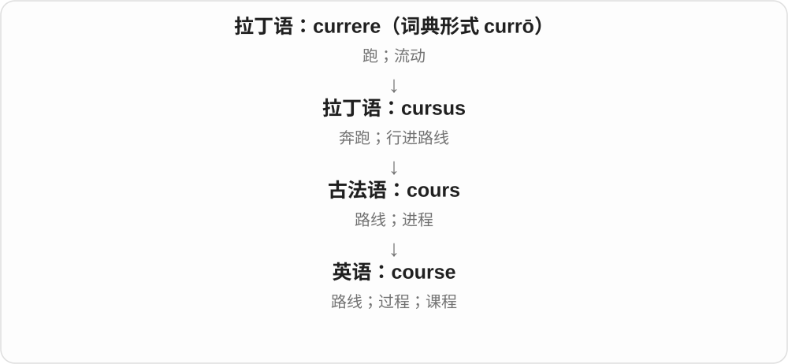

从行进路线发展到事件进程与学习安排。一餐中的 course 则是按顺序端上来的一个阶段，比如主菜，不是所有食物混成的一盘。

**常见搭配与例句**

a language course；change course；in the course of；the main course。

> The ship changed course to avoid the storm.

船改变航线以避开风暴。

> I am taking a course in photography.

我正在上一门摄影课。

**别混淆**

course 与 coarse“粗糙的”同音但不同源。a course 可以是整门课，lesson 通常是其中一节。

### 2. current — 当前的；通行的；水流；电流

**音标**：英 /ˈkʌrənt/；美 /ˈkɜːrənt/

**先抓住这个画面**

一股东西正在往前走：水在流、电荷在动；时间线走到眼前，这一刻正在用的就是 current。

**怎么拆**

古法语 curant 是“正在跑、流动”的形式，来自拉丁语 currere。名词与形容词都保留运动和通行的联系。

**怎么变成今天的意思**

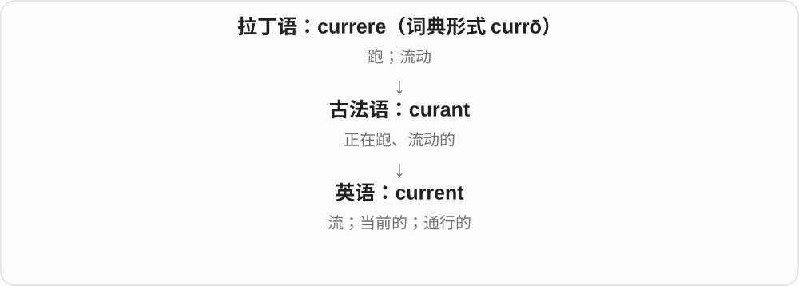

名词可指水、空气或电的流动；形容词从正在流行、通行走向目前有效。current address 是你现在的地址。

**常见搭配与例句**

a strong current；electric current；current affairs；the current version。

> The river current was too strong for us to cross.

河里的水流太急，我们过不去。

> Please give us your current address.

请提供你目前的住址。

**别混淆**

current 说现在有效；latest 说最近一次或最新。当前仍使用的版本不一定是最新发布的版本。

### 3. currently — 目前；现在

**音标**：英 /ˈkʌrəntli/；美 /ˈkɜːrəntli/

**先抓住这个画面**

沿时间线把指针停在“现在”，currently 只告诉你此刻的状态，之后可能改变。

**怎么拆**

current + -ly。

**怎么变成今天的意思**

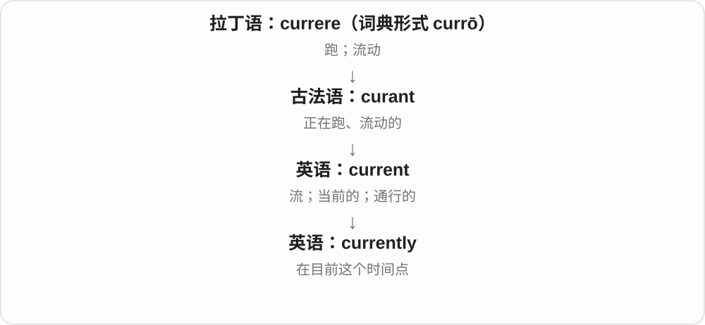

常用于报告现状，如正在维修、目前开放。它不表示过去一直如此，也不保证未来继续如此。

**常见搭配与例句**

currently available；currently working；currently under review。

> The library is currently closed for repairs.

图书馆目前因维修而关闭。

> She is currently working on her second novel.

她目前正在写第二部小说。

**别混淆**

currently 是目前；actually 是实际上。中文“现在”和“实际”不能混用到这两个副词里。

### 4. occur — 发生；出现；被想到

**音标**：英 /əˈkɜː/；美 /əˈkɜːr/

**先抓住这个画面**

一件事来到你的面前，或一个念头突然来到脑中。它是“发生了、出现了”，不一定有人故意安排。

**怎么拆**

拉丁语 ob-（向着、迎面）在 c 前变形，与 currere“跑”形成 occurrere，经法语传入。

**怎么变成今天的意思**

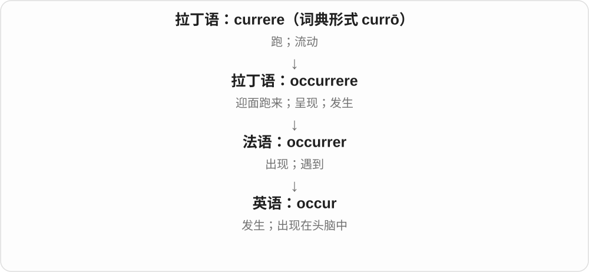

“迎面到来”引申为事件发生。it occurred to me 是念头来到我脑中；occur to 不是“对某人发生事故”的固定直译。

**常见搭配与例句**

an error occurs；occur naturally；occur to someone；It occurred to me that…。

> The error occurs when the file is empty.

文件为空时会出现这个错误。

> It suddenly occurred to me that I had left the window open.

我突然想到自己忘了关窗。

**别混淆**

occur 不及物，不说 was occurred。happen 更日常；occur 常用于书面报告和说明。

### 5. currency — 货币；流通；广泛接受

**音标**：英 /ˈkʌrənsi/；美 /ˈkɜːrənsi/

**先抓住这个画面**

钱从这个人手里传到那个人手里，被大家接着使用；一种说法也能这样在人群中流传。

**怎么拆**

属于拉丁语 currere、currēns“跑、流动”的词族，与 current 相关，词形可联系 current + -cy；历史名词形式有 currentia。

**怎么变成今天的意思**

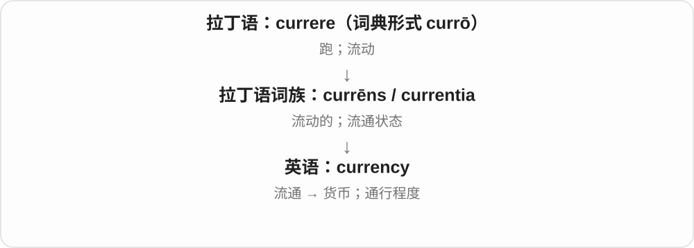

从流动、流通状态发展成用于交换的货币，也保留 gain currency“逐渐被广泛使用、接受”。不是所有 currency 都在谈钱。

**常见搭配与例句**

foreign currency；local currency；gain currency；a currency exchange。

> You can exchange foreign currency at the bank.

你可以在银行兑换外币。

> The phrase gained currency during the debate.

这个说法在辩论期间逐渐流行起来。

**别混淆**

money 泛指钱；currency 常说某地区使用的货币体系，或传播的通行程度。

### 6. curriculum — 课程体系；教学内容安排

**音标**：英 /kəˈrɪkjʊləm/；美 /kəˈrɪkjələm/

**先抓住这个画面**

把学生将走过的学习路线画成一张图：学什么、怎样衔接，组成了 curriculum。

**怎么拆**

拉丁语 curriculum 原指跑程、行进路线，来自 currere；教育领域把它用于安排好的学习进程。

**怎么变成今天的意思**

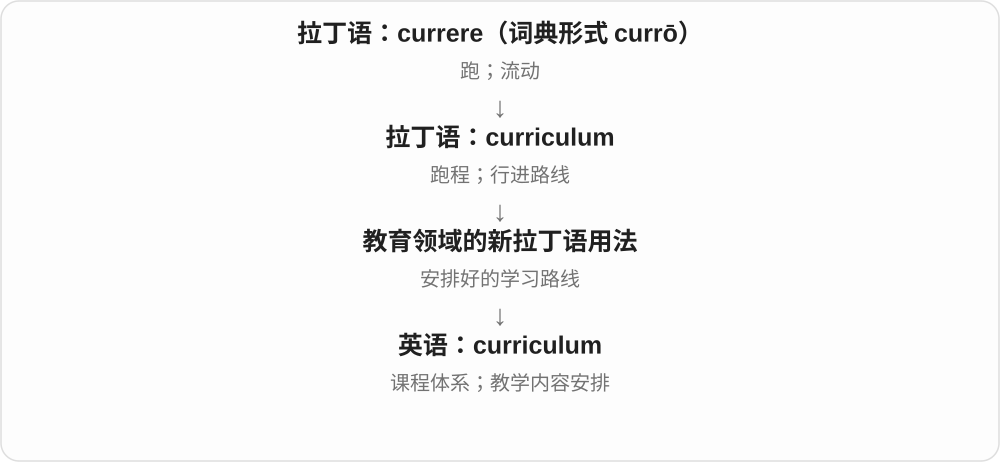

它通常比单独一门 course 范围更大，可指学校或专业整体的教学内容。复数可用 curricula，也可用 curriculums。

**常见搭配与例句**

the school curriculum；curriculum design；part of the curriculum。

> The school added environmental studies to its curriculum.

学校把环境研究加入课程体系。

> Teachers helped design the new curriculum.

教师们参与设计了新的课程安排。

**别混淆**

curriculum 是总体学习安排；syllabus 常是某门课的教学大纲。实际用法有重叠，仍要看所指范围。

### 7. corridor — 走廊；通道；狭长地带

**音标**：英 /ˈkɒrɪdɔː/；美 /ˈkɔːrɪdɔːr/

**先抓住这个画面**

把几个房间或区域接起来，人能沿着它快速走过去，这条长通道就是 corridor。

**怎么拆**

意大利语 corridore“长通道”与 correre“跑”相关，经法语 corridor 借入英语。

**怎么变成今天的意思**

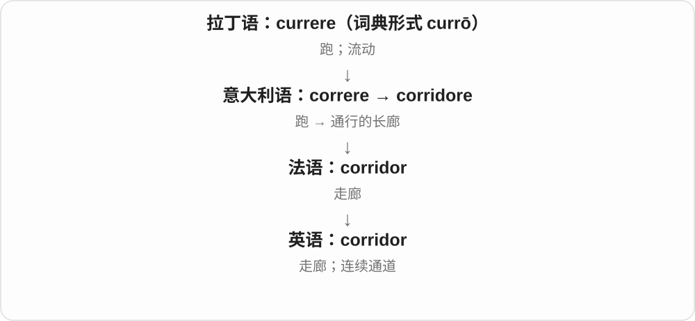

从楼里的通道扩展到连接地区的交通或生态走廊。核心是供移动通过的连续狭长区域，不一定有墙和屋顶。

**常见搭配与例句**

a long corridor；a transport corridor；a wildlife corridor。

> Her office is at the end of the corridor.

她的办公室在走廊尽头。

> The forest strip forms a corridor for wildlife.

这条林带为野生动物形成了一条通行走廊。

**别混淆**

corridor 常是两侧连接房间的长通道；hall 可指大厅，也可在某些英语变体里指走廊，范围更宽。

### 8. discourse — 论述；话语；正式讨论

**音标**：名词：英 /ˈdɪskɔːs/、美 /ˈdɪskɔːrs/；动词：英 /dɪsˈkɔːs/、美 /dɪsˈkɔːrs/

**先抓住这个画面**

思路沿着一个主题展开，从这一点走到另一点；discourse 把这整段表达或讨论方式作为对象。

**怎么拆**

拉丁语 dis-（分散、向各处）+ currere（跑）形成 discurrere，再有 discursus，经过法语传入。

**怎么变成今天的意思**

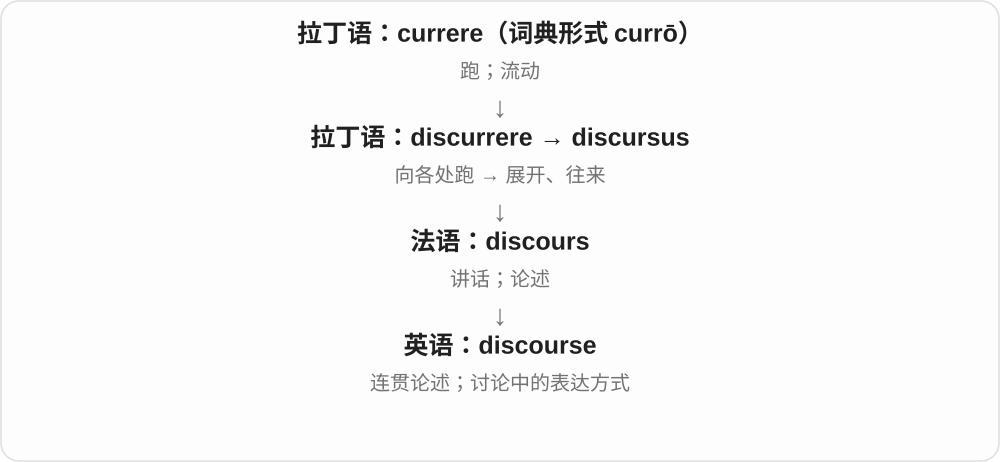

“思路展开”的画面帮助理解论述，但现代 academic discourse 还包括一个群体惯用的概念和表达方式，不只是一场演讲。

**常见搭配与例句**

public discourse；political discourse；discourse on a subject。

> The article examines how technology shapes public discourse.

这篇文章考察技术怎样影响公共讨论。

> She discoursed on the history of the city for an hour.

她就这座城市的历史讲述了一个小时。

**别混淆**

conversation 通常是具体交谈；discourse 较正式，也可以概括一整个领域如何谈论问题。注意名词与动词重音不同。

### 9. occurrence — 发生；出现的事件

**音标**：英 /əˈkʌrəns/；美 /əˈkɜːrəns/

**先抓住这个画面**

occur 是事情出现；occurrence 把那次出现单独框起来，作为一个事件来谈。

**怎么拆**

经法语 occurrence 来自中世纪拉丁语 occurrentia，与 occurrere 同族；现代词形是 occur + -ence 的对应。

**怎么变成今天的意思**

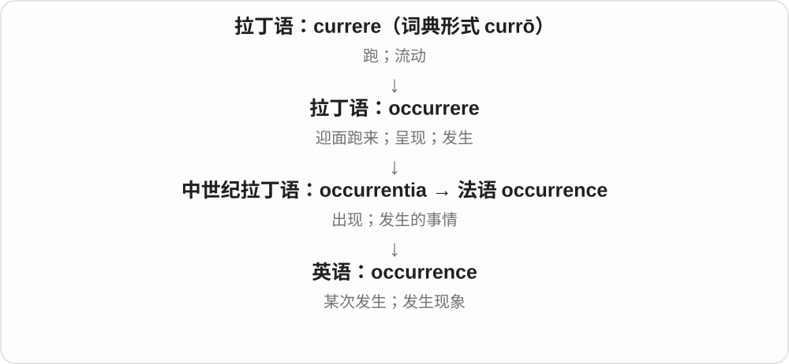

a common occurrence 表示经常出现的一类事情；the occurrence of an error 侧重错误发生这一事实。注意双写 rr。

**常见搭配与例句**

a rare occurrence；a common occurrence；the occurrence of…。

> Snow in April is a rare occurrence here.

这里四月下雪很少见。

> The report records each occurrence of the fault.

报告记录了每一次故障发生的情况。

**别混淆**

occurrence 是事件或发生；recurrence 是同类事情再度发生，多了 re- 的“回来”。

### 10. courier — 快递员；信使；递送服务

**音标**：英 /ˈkʊriə/；美 /ˈkʊriər/

**先抓住这个画面**

信息或包裹不自己过去，由一个专门“跑腿的人”把它从这一端送到另一端。

**怎么拆**

法语 coreor、courrier 与意大利语 corriere 等相关形式共同影响英语，往前都属于“跑”的词族。

**怎么变成今天的意思**

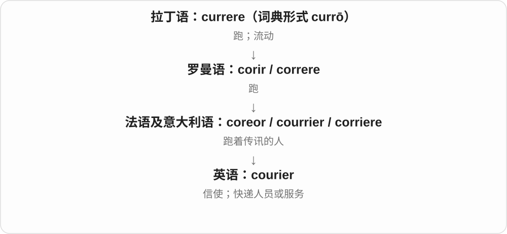

从传递消息的人发展为递送文件、包裹的人或服务。现代不要求本人跑步，也可骑车、开车或使用运输网络。

**常见搭配与例句**

send by courier；a courier service；a bicycle courier。

> We sent the signed documents by courier.

我们用快递寄出了签好的文件。

> The courier arrived while I was in a meeting.

快递员到时我正在开会。

**别混淆**

carrier 是更宽的承运者；courier 通常让人想到专门递送包裹或文件的服务。

### 11. concurrent — 同时发生的；同时进行的

**音标**：英 /kənˈkʌrənt/；美 /kənˈkɜːrənt/

**先抓住这个画面**

时间轴上摆着两条进程，它们有一段时间重叠，这就是 concurrent。

**怎么拆**

拉丁语 concurrēns“共同发生的”经古法语传入，con- 是一起，curr- 是跑。

**怎么变成今天的意思**

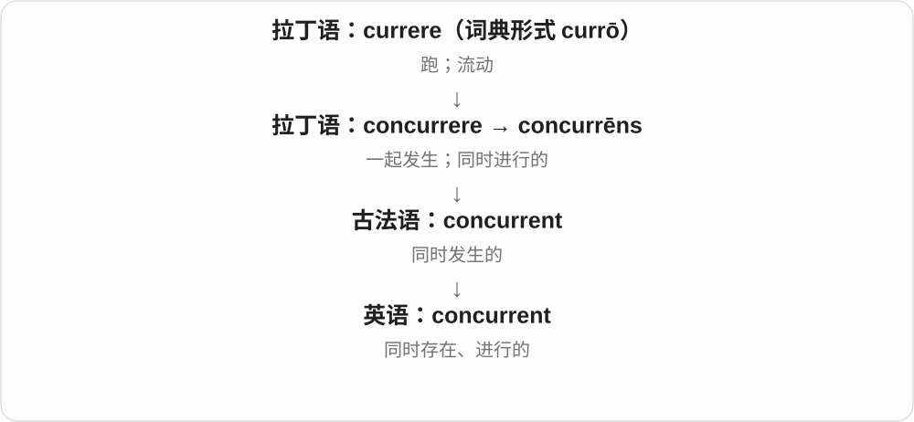

日常可说两场会议同时举行；技术语境中可说多个任务在同一时段推进，未必每一瞬间都真正同时执行。

**常见搭配与例句**

concurrent events；concurrent tasks；concurrent with。

> The conference offers three concurrent sessions.

会议同时安排了三场分会。

> The system can manage several concurrent tasks.

这个系统能管理多项并发任务。

**别混淆**

concurrent 强调时间重叠；consecutive 是先后相接。计算机里的 concurrent 也不必等于 parallel“实际并行”。

### 12. precursor — 先驱；前身；前体

**音标**：英 /prɪˈkɜːsə/；美 /prɪˈkɜːrsər/

**先抓住这个画面**

一个东西先跑到前面，为后来出现的东西开路，或逐步变成它。

**怎么拆**

拉丁语 prae-（在前）+ cursor（跑者）形成 praecursor，经法语或拉丁语路径进入英语。

**怎么变成今天的意思**

可以是后来技术的早期版本，也可以是形成另一物质前的材料。并非只要时间更早就能叫 precursor，还要有先导或形成关系。

**常见搭配与例句**

a precursor to modern computers；a precursor of；a chemical precursor。

> This device was a precursor to modern computers.

这种设备是现代计算机的前身之一。

> The material serves as a precursor for the final compound.

这种材料是最终化合物的前体。

**别混淆**

predecessor 常是同一职位或系列的上一任；precursor 更强调给后来发展铺路，未必只紧挨着前一代。

### 13. excursion — 短途出游；离开通常范围的尝试

**音标**：英 /ɪkˈskɜːʃən/；美 /ɪkˈskɜːrʒən/

**先抓住这个画面**

从日常路线里往外走一小段，去看看别处，然后通常再回来。

**怎么拆**

拉丁语 ex-（向外）+ currere（跑）形成 excurrere，再有 excursiō，借入英语。

**怎么变成今天的意思**

旅游义常是一日或较短的外出；比喻义如 an excursion into fiction，是作者暂时尝试另一个创作领域。

**常见搭配与例句**

a day excursion；an excursion to the coast；an excursion into history。

> We took a short excursion to the nearby island.

我们到附近的小岛短途游览了一趟。

> The essay includes a brief excursion into local history.

这篇文章也简短谈及了当地历史。

**别混淆**

journey 强调从一地到另一地的旅程；excursion 更常是短期出游或从原范围岔出去一段。

### 14. cryptocurrency — 加密货币

**音标**：英 /ˈkrɪptəʊˌkʌrənsi/；美 /ˌkrɪptoʊˈkɜːrənsi/

**先抓住这个画面**

它也是在用户之间转移的数字资产，但记录和验证依靠密码学相关技术；crypto- 点出了这项技术特征。

**怎么拆**

crypto-（这里指密码学相关）+ currency（货币），现代技术组合词。

**怎么变成今天的意思**

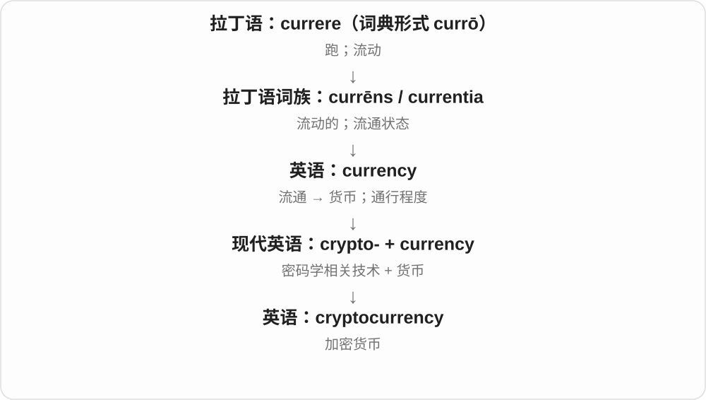

crypto- 更早有隐藏的意思，但现代词不是“把现金藏起来”。具体系统的运行方式各异，词义也不保证交易匿名。

**常见搭配与例句**

a cryptocurrency exchange；cryptocurrency transactions；a cryptocurrency wallet。

> The article explains how cryptocurrency transactions are recorded.

这篇文章解释了加密货币交易如何被记录。

> She is comparing the terminology used by different cryptocurrency projects.

她正在比较不同加密货币项目使用的术语。

**别混淆**

digital currency 的范围更广，不能把所有电子账户余额都称作 cryptocurrency。

### 15. incur — 招致；产生需承担的费用或后果

**音标**：英 /ɪnˈkɜː/；美 /ɪnˈkɜːr/

**先抓住这个画面**

你采取行动，接着“跑进”一笔费用或一种责任里，最后要由自己承担。

**怎么拆**

拉丁语 in-（进入）+ currere（跑）形成 incurrere，经法语进入英语。

**怎么变成今天的意思**

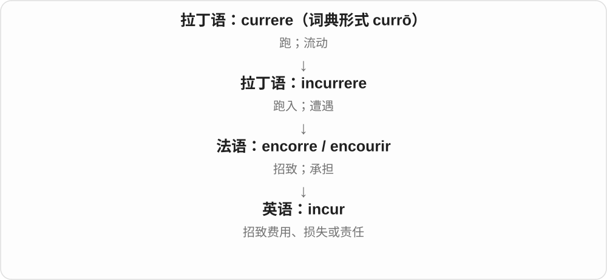

现代通常接 cost、debt、loss 等负担，也可以接 anger“招惹愤怒”。并非主动想要结果，只是行动带来了它。

**常见搭配与例句**

incur costs；incur a debt；incur losses；incur someone’s anger。

> Changing the booking may incur an extra fee.

更改预订可能产生额外费用。

> The business incurred heavy losses last year.

这家企业去年遭受了严重亏损。

**别混淆**

occur 是某事发生，不及物；incur 是某人或机构招致某事，需要宾语。Costs occurred 不如 costs were incurred 符合常见搭配。

### 16. concurrently — 同时地；在重叠时段内

**音标**：英 /kənˈkʌrəntli/；美 /kənˈkɜːrəntli/

**先抓住这个画面**

两项工作不是等一项全部结束才开始另一项，而是在一段时间里一起往前推进。

**怎么拆**

concurrent + -ly。

**怎么变成今天的意思**

描述事件或进程的时间安排。技术语境可能是交替调度的并发，不一定每一条指令都同时跑。

**常见搭配与例句**

run concurrently；work concurrently；occur concurrently。

> The two exhibitions will run concurrently for a month.

这两场展览将在同一个月内同时举行。

> The team developed the website and the mobile app concurrently.

团队同时推进网站与手机应用的开发。

**别混淆**

consecutively 是连续按顺序；concurrently 是时间有重叠。

### 17. recurrent — 反复发生的；屡次出现的

**音标**：英 /rɪˈkʌrənt/；美 /rɪˈkɜːrənt/

**先抓住这个画面**

问题不是孤零零来一次，而是隔一阵又来，已经形成反复出现的特征。

**怎么拆**

来自拉丁语 recurrēns，是 recurrere“返回”的相关形式；现代可联系 recur + -ent。

**怎么变成今天的意思**

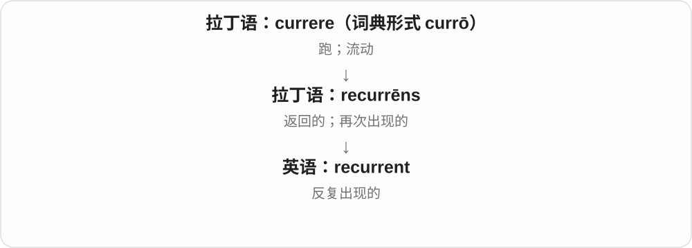

它形容现象本身有反复性，例如 recurrent delays。没有保证发生间隔规律，也没有保证每次严重程度一样。

**常见搭配与例句**

a recurrent problem；recurrent delays；a recurrent theme。

> The team investigated a recurrent software fault.

团队调查了一项反复出现的软件故障。

> Isolation is a recurrent theme in her novels.

孤独是她小说中反复出现的主题。

**别混淆**

frequent 是频繁，未必强调同一种事情重现；recurrent 强调相同或相似的现象又回来。

### 18. recurrence — 再次发生；复现

**音标**：英 /rɪˈkʌrəns/；美 /rɪˈkɜːrəns/

**先抓住这个画面**

把“它又来了”这件事当作一个名词：我们可以记录这次复现，也可以设法防止下一次。

**怎么拆**

recurrent 的词干与 -ence 对应，属于 recurrere“返回”词族。

**怎么变成今天的意思**

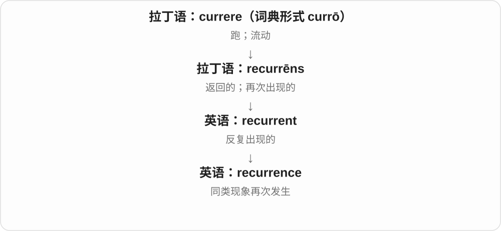

常用于问题、错误、事件的重复出现。它不是简单的 occurrence，因为已经包含一次“再”。

**常见搭配与例句**

prevent a recurrence；a recurrence of the problem；reduce recurrence。

> We changed the process to prevent a recurrence of the error.

我们修改了流程，防止错误再次发生。

> The report notes a recurrence of the same pattern.

报告指出同一种模式再次出现。

**别混淆**

recurrence 说事情又出现；recursion 是递归关系，不是泛指重复。

### 19. concur — 同意；意见一致；同时发生

**音标**：英 /kənˈkɜː/；美 /kənˈkɜːr/

**先抓住这个画面**

原本各走各路的判断跑到同一点：你同意我的看法。另一个分支是事情在同一时段相遇。

**怎么拆**

拉丁语 con-（一起）+ currere（跑）形成 concurrere。

**怎么变成今天的意思**

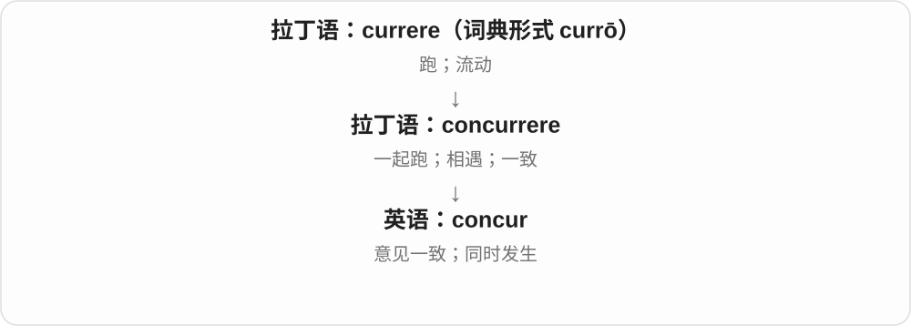

“一起跑、汇合”走向意见相合。现代 concur with someone 常是较正式的同意；不需要真的跟着别人跑。

**常见搭配与例句**

concur with someone；concur in a decision；I concur。

> I concur with your assessment of the problem.

我同意你对这个问题的判断。

> The two reviewers concurred that the paper needed revision.

两位审稿人一致认为论文需要修改。

**别混淆**

agree 是更日常的同意；concur 常见于正式判断或会议表达，不是 conquer“征服”。

### 20. cursor — 光标；指示位置的游标

**音标**：英 /ˈkɜːsə/；美 /ˈkɜːrsər/

**先抓住这个画面**

屏幕上那个能移动、告诉你下一步输入或操作落在哪里的小标记，像一个在页面上跑动的定位点。

**怎么拆**

借自拉丁语 cursor“跑者”，由 currere 的相关词干与表示施事者的成分构成。

**怎么变成今天的意思**

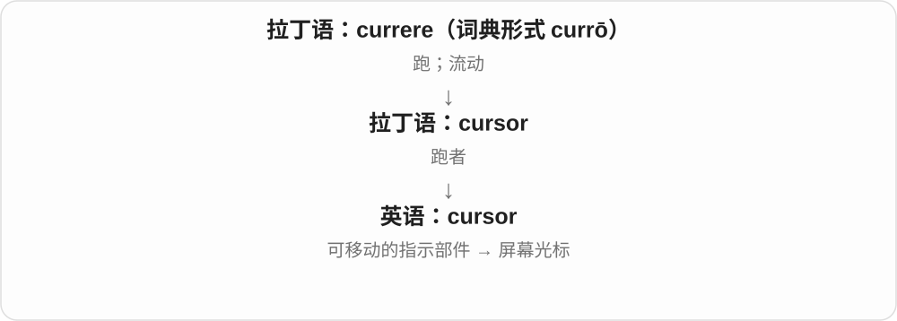

这个词先可用于仪器上的移动指示件，后来进入计算机。文本光标常是一条竖线，不必总是箭头。

**常见搭配与例句**

move the cursor；place the cursor；a blinking cursor。

> Place the cursor at the end of the sentence.

把光标放在句末。

> A blinking cursor appeared in the empty box.

空白框里出现了闪烁的光标。

**别混淆**

cursor 是显示当前位置的标记；mouse 是控制设备。触屏或键盘操作也可能移动 cursor。

### 21. coursework — 课程作业；平时课程任务

**音标**：英 /ˈkɔːswɜːk/；美 /ˈkɔːrswɜːrk/

**先抓住这个画面**

一门课不是只在最后考一次，过程中交的报告、项目、练习等工作，统称 coursework。

**怎么拆**

course（课程）+ work（工作、任务）。

**怎么变成今天的意思**

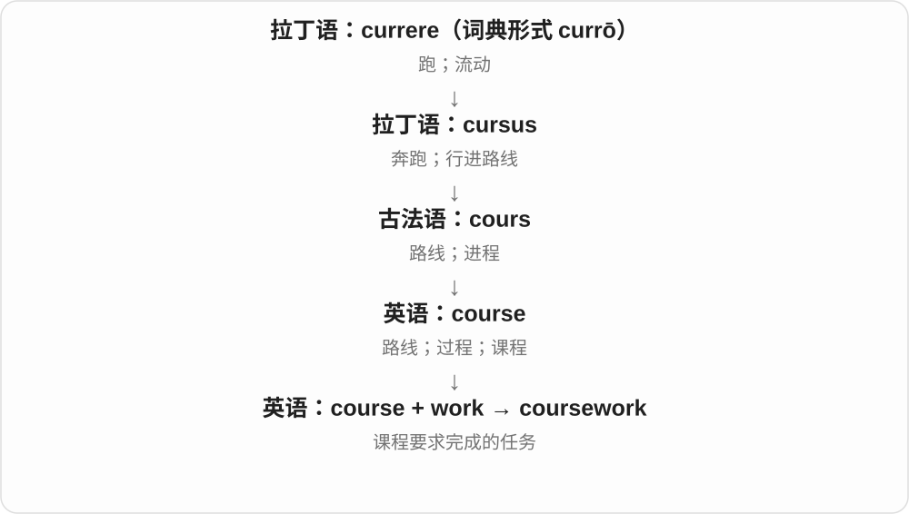

常与最终考试相对，涉及学习期间完成并可能评分的任务。一般作不可数名词。

**常见搭配与例句**

complete coursework；coursework assignments；coursework marks。

> Half of the final grade is based on coursework.

总评成绩的一半依据平时课程作业。

> I need to finish my coursework before the holiday.

我需要在假期前完成课程作业。

**别混淆**

homework 常是课后作业；coursework 更强调一门课程正式要求完成的任务，不一定都在家做。

### 22. racecourse — 赛马场；赛道

**音标**：英 /ˈreɪskɔːs/；美 /ˈreɪskɔːrs/

**先抓住这个画面**

把一条供比赛跑完的路线及周边场地专门圈出来，就是 racecourse，现代尤其常指赛马场。

**怎么拆**

race（竞赛）+ course（路线）。

**怎么变成今天的意思**

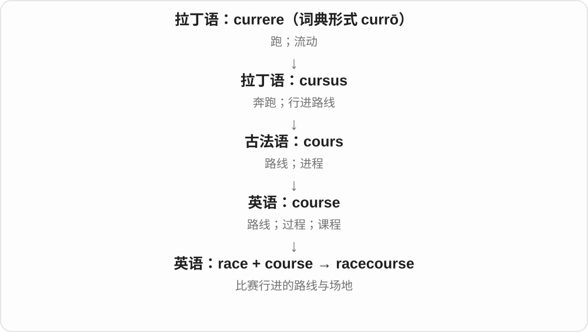

course 的路线义在这里很具体：选手沿预定路径比赛。赛马语境最常见，但不是课程培训地点。

**常见搭配与例句**

at the racecourse；a famous racecourse；the racecourse entrance。

> Thousands of spectators arrived at the racecourse.

成千上万名观众来到赛马场。

> The old racecourse is now used for public events.

旧赛马场现在用来举办公众活动。

**别混淆**

racecourse 常说赛马场；running track 更常说田径跑道。racecourse 不是“比赛课程”。

### 23. extracurricular — 课外的；课程安排之外的

**音标**：英 /ˌekstrəkəˈrɪkjʊlə/；美 /ˌekstrəkəˈrɪkjələr/

**先抓住这个画面**

正式课表是一条规定路线，extra- 把你带到这条路线之外：社团、运动队等活动可以在这里。

**怎么拆**

extra-（在……之外）+ curricular（课程的），curricular 来自 curriculum。

**怎么变成今天的意思**

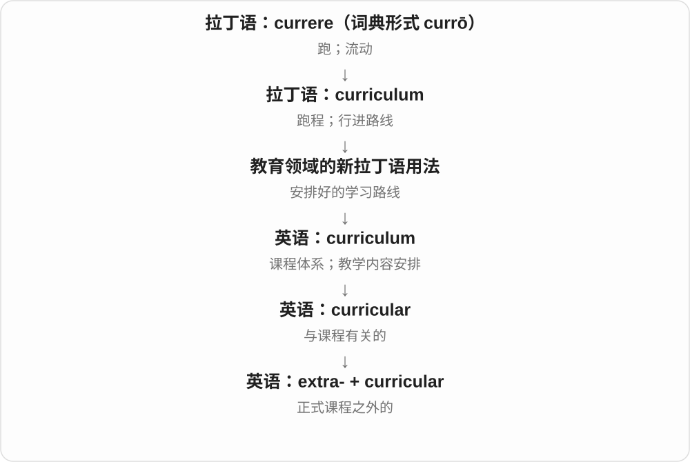

它说的是不属于正式课程安排，不只是地点在教室外。校内举行的社团活动也可以 extracurricular。

**常见搭配与例句**

extracurricular activities；an extracurricular club；extracurricular interests。

> The school offers music and sport as extracurricular activities.

学校提供音乐和体育等课外活动。

> She balanced her studies with several extracurricular interests.

她兼顾学习和几项课外兴趣。

**别混淆**

homework 虽在课后做，通常仍是课程要求，不因此自动成为 extracurricular。

### 24. cursory — 匆匆的；粗略的；不深入的

**音标**：英 /ˈkɜːsəri/；美 /ˈkɜːrsəri/

**先抓住这个画面**

目光像跑步一样从页面上掠过，没有停下来仔细检查，因此只能看个大概。

**怎么拆**

拉丁语 cursōrius“与跑有关的、匆促的”经法语 cursoire 进入英语。

**怎么变成今天的意思**

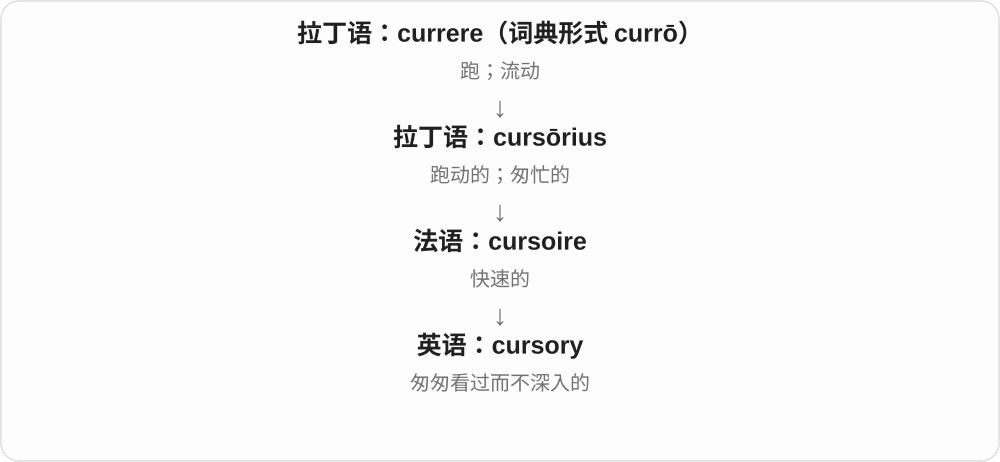

常形容 glance、inspection、reading。语气通常暗示检查不够细，不能只当成“高效快速”。

**常见搭配与例句**

a cursory glance；a cursory inspection；a cursory reading。

> He gave the report only a cursory glance.

他只是草草瞥了一眼报告。

> A cursory inspection failed to reveal the damage.

粗略检查没能发现损坏。

**别混淆**

quick 只说明快；cursory 还指出浅、不充分。一次快速检查可以很专业，但 cursory 常带保留。

### 25. cursive — 连笔书写的；草写体

**音标**：英 /ˈkɜːsɪv/；美 /ˈkɜːrsɪv/

**先抓住这个画面**

笔尖一路往前走，字母之间尽量连着，减少一次次抬笔，这就是 cursive 的画面。

**怎么拆**

法语 cursif 来自中世纪拉丁语 cursīvus，与 cursus“奔跑、流动”相连。

**怎么变成今天的意思**

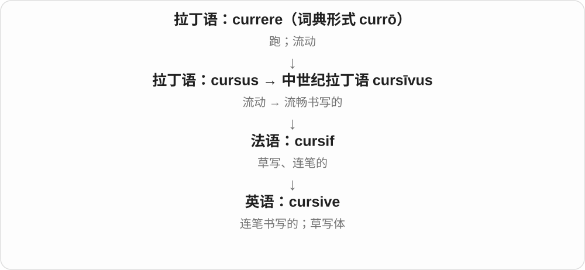

“跑动”在这里形容笔画连续。它指一种书写方式，不等于字迹潦草到读不清。

**常见搭配与例句**

cursive handwriting；write in cursive；cursive letters。

> My grandmother wrote all her letters in cursive.

祖母写信都用连笔字。

> The children practised joining letters in cursive handwriting.

孩子们练习在连笔书写中把字母接起来。

**别混淆**

cursive 是连笔写法；cursory 是匆匆粗略。写 cursive 也可以写得非常认真。

### 26. recursive — 递归的；自我引用的

**音标**：英 /rɪˈkɜːsɪv/；美 /rɪˈkɜːrsɪv/

**先抓住这个画面**

这条规则在解释自己时，又会用到自己的一小份。比如函数处理子文件夹时，再调用同一个函数。

**怎么拆**

来自新拉丁语 recursīvus，与拉丁语 recurrere“返回”同族；现代可联系 recurse + -ive。

**怎么变成今天的意思**

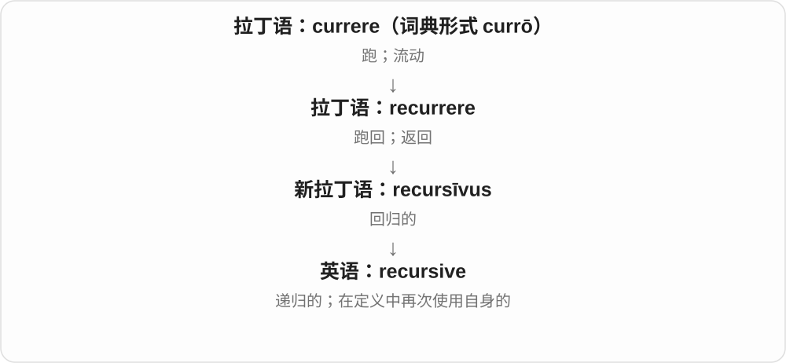

形容定义、算法或结构有自我引用关系。递归常见于程序，但也可用于数学定义和语言结构。

**常见搭配与例句**

a recursive function；a recursive definition；a recursive algorithm。

> A recursive function may call itself with a smaller input.

递归函数可以用更小的输入再次调用自身。

> The book gives a recursive definition of the sequence.

书中给出了这个数列的递归定义。

**别混淆**

recurrent 是某个现象反复出现；recursive 是内部规则再次用到自身，二者不等同。

### 27. undercurrent — 暗流；表面之下的情绪或趋势

**音标**：英 /ˈʌndəkʌrənt/；美 /ˈʌndərˌkɜːrənt/

**先抓住这个画面**

水面看着平静，下面却有一股水在动；气氛表面友好，底下也可能有不满。

**怎么拆**

under-（在下面）+ current（流）。

**怎么变成今天的意思**

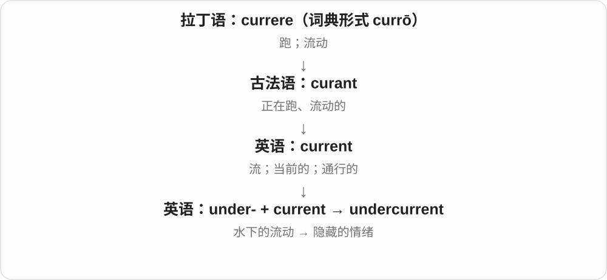

字面义是下面的水流；比喻义保留“未摆在表面，却在影响局面”的特点。

**常见搭配与例句**

an undercurrent of anger；a strong undercurrent；detect an undercurrent。

> There was an undercurrent of tension in the room.

房间里隐隐有一股紧张气氛。

> The sign warned swimmers about strong undercurrents.

告示提醒游泳者注意强劲暗流。

**别混淆**

undercurrent 不一定很猛烈；它强调不明显或在表面以下。undertow 是更具体的一种水流现象，不宜全部混称。

### 28. recur — 再次发生；反复出现

**音标**：英 /rɪˈkɜː/；美 /rɪˈkɜːr/

**先抓住这个画面**

你以为事情已经走远，过一阵它又跑回来了；同样的问题再次出现，就是 recur。

**怎么拆**

re-（回来、再次）+ 拉丁语 currere（跑），构成 recurrere，借入英语。

**怎么变成今天的意思**

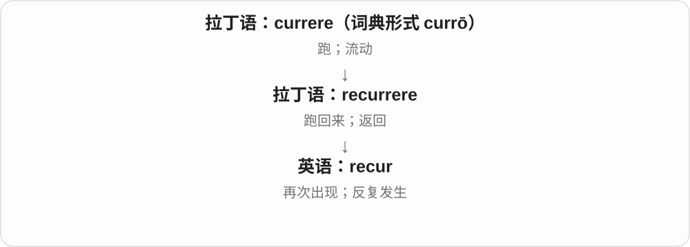

可以说问题、主题或现象再次出现，不要求每隔完全相同的时间。recur 的现在分词和过去式要双写 r：recurring、recurred。

**常见搭配与例句**

the problem recurs；recur throughout a book；a recurring theme。

> If the problem recurs, restart the application.

如果问题再次出现，请重新启动应用。

> The same image recurs throughout the poem.

同一个意象在整首诗中反复出现。

**别混淆**

occur 是发生一次也成立；recur 包含再次或反复。reoccur 也可指再发生，recur 更常用于反复现象。

### 29. recursion — 递归；在定义或求解中再次用到自身

**音标**：英 /rɪˈkɜːʒən/；美 /rɪˈkɜːrʒən/

**先抓住这个画面**

打开一个盒子，里面的小盒子还按同样规则打开。解决大问题时，回头使用同一套方法处理更小的同类问题，就是常见递归画面。

**怎么拆**

来自拉丁语 recursiō“跑回、返回”，与 recurrere 同族，后来形成数学和计算中的专门意义。

**怎么变成今天的意思**

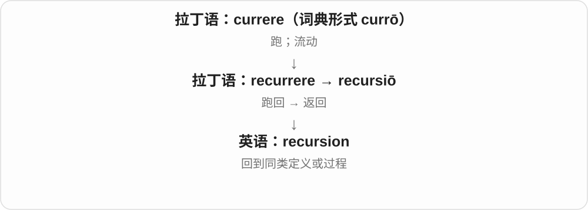

递归的关键是定义或过程又引用自身，不只是把同一动作重复很多次。实际程序常设一个能直接回答的基本情况，以结束逐层调用。

**常见搭配与例句**

use recursion；a recursion depth；recursion with a base case。

> The function uses recursion to process nested folders.

这个函数用递归处理层层嵌套的文件夹。

> The teacher explained recursion by breaking a large problem into smaller versions of itself.

老师把大问题拆成同类的小问题来解释递归。

**别混淆**

repetition 是泛指重复；recursion 有自我引用结构。循环十次打印文字，不必使用递归。

### 30. concurrency — 并发；同时发生的状态

**音标**：英 /kənˈkʌrənsi/；美 /kənˈkɜːrənsi/

**先抓住这个画面**

看的是系统能不能在同一时段照顾多个正在进行的任务，而不是只盯住一项直到结束。

**怎么拆**

concurrent 对应的性质名词，词尾 -ent 变为 -ency。

**怎么变成今天的意思**

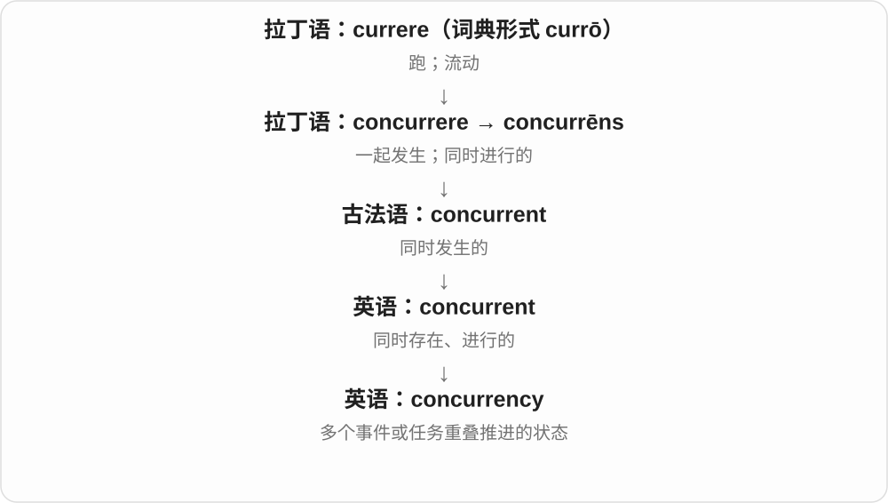

在计算中，concurrency 常涉及任务如何交错、协调。它可以存在于单个处理核心上；parallelism 才特别强调实际同时执行。

**常见搭配与例句**

support concurrency；concurrency control；a concurrency problem。

> The design improves concurrency by allowing tasks to wait independently.

这种设计让任务可以独立等待，从而改善了并发能力。

> The chapter explains concurrency with a simple queue example.

这一章用一个简单队列例子解释并发。

**别混淆**

concurrency 是并发状态或能力；currency 是货币或流通，少了 con-，不能混读。

### 31. watercourse — 水道；河道

**音标**：英 /ˈwɔːtəkɔːs/；美 /ˈwɔːtərkɔːrs/

**先抓住这个画面**

水不是随便铺一地，而是沿一条通路流过去；这条流动路线就是 watercourse。

**怎么拆**

water（水）+ course（行进路线），中古英语已有相应组合。

**怎么变成今天的意思**

可指河流、溪流等水道，强调排水和流动的路径，常见于地理和规划文字。

**常见搭配与例句**

a natural watercourse；block a watercourse；nearby watercourses。

> The fallen tree blocked the narrow watercourse.

倒下的树堵住了狭窄水道。

> The map shows every watercourse in the valley.

地图标出了山谷中的每条水道。

**别混淆**

waterway 常强调水上通行路线；watercourse 更侧重水流经过的沟渠或河道，未必可航行。

### 32. recursively — 以递归方式

**音标**：英 /rɪˈkɜːsɪvli/；美 /rɪˈkɜːrsɪvli/

**先抓住这个画面**

先处理这一层，再按同一规则进入下一层，层层往里走；recursively 描述采用这种自我调用方式。

**怎么拆**

recursive + -ly。

**怎么变成今天的意思**

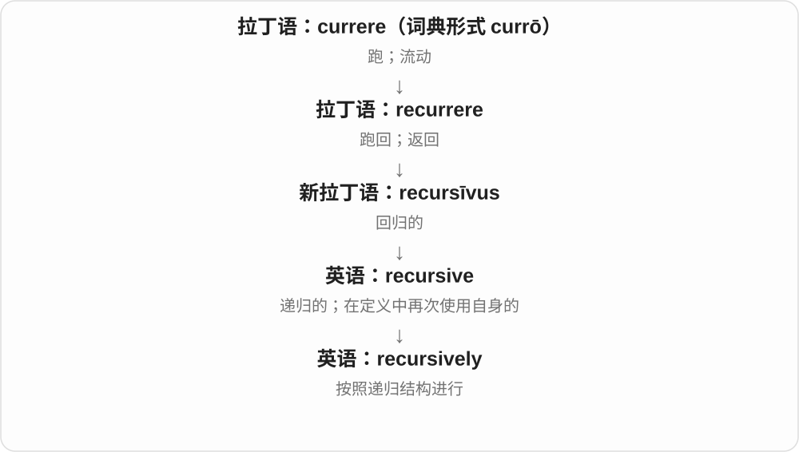

常见于遍历嵌套结构的说明。search recursively 通常意味着搜索当前文件夹后继续深入各级子文件夹。

**常见搭配与例句**

search recursively；define recursively；process recursively。

> The tool searches the folders recursively.

这个工具会递归搜索各级文件夹。

> Each value is defined recursively from earlier values.

每个值都根据前面的值以递归方式定义。

**别混淆**

recursively 不是 blindly“盲目地”，也不是 simply repeatedly“重复地”；关键是重复中有嵌套或自我引用结构。

## 这一组要分清什么

**occur / incur / recur**：事情发生 / 某人招致负担 / 事情再次发生。

**concurrent / consecutive**：时间重叠 / 接连先后。

**cursive / cursory**：连笔书写 / 草草看过；认真写连笔字完全可以。

**recurrence / recursion**：事件复现 / 规则或过程自我引用，不是同一个“重复”。

## 串起来练习

**The error occurred during two concurrent tasks; we changed the process to prevent its recurrence.**

错误在两项并发任务进行时出现；我们修改了流程，防止它再次发生。occur 是出现，concurrent 是一起进行，recurrence 是再次出现。
