# 0134 · poli- — 城邦；公民与公共治理；城市

[逐词精讲目录](../00_逐词精讲目录.md) · [总目录](../00_总目录_按常用程度.md)

## 核心词根与来源

**poli-** 的本质不只是“楼房很多的地方”，而是希腊语 **pólis：一群人组成的城邦**。从这里很自然地分出两条线：一条谈城市的形态与范围，如 metropolis；另一条谈公民怎样一起生活、谁作决定、规则怎样执行，于是出现 politics、policy、police。先看懂这幅画面，再分别记每个词实际走过的历史。

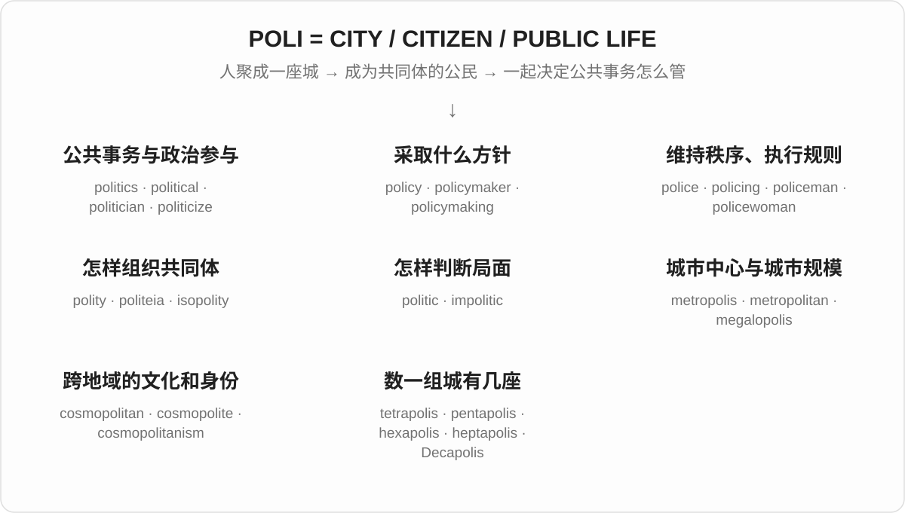

## 词形与演化规律

**pólis → polítēs → politikós**：城邦 → 公民 → 与公民、公共事务有关的。politic、political、politics 属于这一支。

**politeía → 拉丁语 polītīa → 不同法语借词路线**，分出 policy、police、polity。它们是同源分支，不是“政策变成警察，再变成政体”。

**-polis** 常保留城市义：acro- 高处，metro- 在这里是母亲，mega- / megalo- 巨大，cosmo- 世界；前半部分改变我们怎样看这座城。现代人也继续用希腊语材料造新词。

**三个边界要记住**：policy 的“保险合同”义来自另一条“证明、凭证”的路线；polite“礼貌”和 polish“抛光”属于拉丁语 polīre / polītus，不在本族；poly-“多”也不是 poli-“城邦”。

## 单词速览（常用到不常用）

| 单词 | 音标 | 核心意思 |
|---|---|---|
| [police](#w-1) | 英、美 /pəˈliːs/ | 警察；警察机关；维持秩序、监督执行 |
| [political](#w-2) | 英 /pəˈlɪtɪkəl/；美 /pəˈlɪtɪkəl/、/pəˈlɪtəkəl/ | 政治的；涉及权力关系的 |
| [policy](#w-3) | 英 /ˈpɒləsi/；美 /ˈpɑːləsi/ | 政策、方针；行事原则；保险单、保险合同 |
| [politics](#w-4) | 英 /ˈpɒlətɪks/；美 /ˈpɑːlətɪks/ | 政治；政治活动；政治立场；权力周旋 |
| [metropolitan](#w-5) | 英 /ˌmetrəˈpɒlɪtən/；美 /ˌmetrəˈpɑːlɪtən/ | 大都市的；都市圈的；宗主国本土的；〔教会〕都主教 |
| [politician](#w-6) | 英 /ˌpɒləˈtɪʃən/；美 /ˌpɑːləˈtɪʃən/ | 政治人物；从政者 |
| [politically](#w-7) | 英 /pəˈlɪtɪkli/；美 /pəˈlɪtɪkli/、/pəˈlɪtəkli/ | 在政治上；从政治角度；出于政治考虑 |
| [policeman](#w-8) | 英、美 /pəˈliːsmən/ | 男警察 |
| [policing](#w-9) | 英、美 /pəˈliːsɪŋ/ | 警务工作；维持秩序；监督管控 |
| [metropolis](#w-10) | 英 /mɪˈtrɒpəlɪs/；美 /məˈtrɑːpəlɪs/ | 大都市；主要城市；〔古代〕母城 |
| [cosmopolitan](#w-11) | 英 /ˌkɒzməˈpɒlɪtən/；美 /ˌkɑːzməˈpɑːlɪtən/ | 世界性的；多元文化的；见多识广、适应各地生活的 |
| [Tripoli](#w-12) | 英、美 /ˈtrɪpəli/ | 的黎波里；多个城市使用的地名 |
| [geopolitical](#w-13) | 英 /ˌdʒiːəʊpəˈlɪtɪkəl/；美 /ˌdʒiːoʊpəˈlɪtəkəl/ | 地缘政治的 |
| [polity](#w-14) | 英 /ˈpɒləti/；美 /ˈpɑːləti/ | 政治共同体；政体、治理制度 |
| [geopolitics](#w-15) | 英 /ˌdʒiːəʊˈpɒlətɪks/；美 /ˌdʒiːoʊˈpɑːlətɪks/ | 地缘政治；地缘政治学 |
| [politicized](#w-16) | 英 /pəˈlɪtɪsaɪzd/；美 /pəˈlɪtəsaɪzd/ | 被政治化的；有政治意识、积极参与政治的 |
| [politburo](#w-17) | 英 /ˈpɒlɪtˌbjʊərəʊ/；美 /ˈpɑːlətˌbjʊroʊ/、/ˈpoʊlətˌbjʊroʊ/ | 政治局 |
| [politic](#w-18) | 英 /ˈpɒlətɪk/；美 /ˈpɑːlətɪk/ | 明智、讲策略的；处事得体的；政治的〔旧义或固定搭配〕 |
| [apolitical](#w-19) | 英 /ˌeɪpəˈlɪtɪkəl/；美 /ˌeɪpəˈlɪtəkəl/ | 不关心政治的；不涉政治、保持政治中立的 |
| [polis](#w-20) | 英 /ˈpɒlɪs/；美 /ˈpɑːlɪs/、/ˈpoʊlɪs/ | 〔古希腊〕城邦 |
| [acropolis](#w-21) | 英 /əˈkrɒpəlɪs/；美 /əˈkrɑːpəlɪs/ | 卫城；古希腊城市的高处城堡区 |
| [policymaking](#w-22) | 英 /ˈpɒləsiˌmeɪkɪŋ/；美 /ˈpɑːləsiˌmeɪkɪŋ/ | 政策制定；方针形成过程 |
| [policewoman](#w-23) | 英、美 /pəˈliːsˌwʊmən/ | 女警察 |
| [politicization](#w-24) | 英 /pəˌlɪtɪsaɪˈzeɪʃən/；美 /pəˌlɪtəsəˈzeɪʃən/ | 政治化；政治意识或参与的增强 |
| [politicking](#w-25) | 英 /ˈpɒlətɪkɪŋ/；美 /ˈpɑːlətɪkɪŋ/ | 政治活动、竞选运作；争权周旋 |
| [politicize](#w-26) | 英 /pəˈlɪtɪsaɪz/；美 /pəˈlɪtəsaɪz/ | 使政治化；使人产生政治意识、参与政治 |
| [cosmopolitanism](#w-27) | 英 /ˌkɒzməˈpɒlɪtənɪzəm/；美 /ˌkɑːzməˈpɑːlɪtənɪzəm/ | 世界主义；世界公民观念；多元开放的特点 |
| [megalopolis](#w-28) | 英 /ˌmeɡəˈlɒpəlɪs/；美 /ˌmeɡəˈlɑːpəlɪs/ | 巨型都市；连成片的都市带 |
| [propolis](#w-29) | 英 /ˈprɒpəlɪs/；美 /ˈprɑːpəlɪs/ | 蜂胶 |
| [policymaker](#w-30) | 英 /ˈpɒləsiˌmeɪkə/；美 /ˈpɑːləsiˌmeɪkər/ | 政策制定者；方针决策者 |
| [geopolitically](#w-31) | 英 /ˌdʒiːəʊpəˈlɪtɪkli/；美 /ˌdʒiːoʊpəˈlɪtəkli/ | 从地缘政治角度；在地缘政治上 |
| [cosmopolis](#w-32) | 英 /kɒzˈmɒpəlɪs/；美 /kɑːzˈmɑːpəlɪs/ | 国际都市；多元文化汇聚的城市 |
| [nonpolitical](#w-33) | 英 /ˌnɒnpəˈlɪtɪkəl/；美 /ˌnɑːnpəˈlɪtəkəl/ | 非政治的；与政治无关的 |
| [impolitic](#w-34) | 英 /ɪmˈpɒlətɪk/；美 /ɪmˈpɑːlətɪk/ | 不明智的；考虑不周、不得体的 |
| [biopolitics](#w-35) | 英 /ˌbaɪəʊˈpɒlətɪks/；美 /ˌbaɪoʊˈpɑːlətɪks/ | 生命政治；生物学与政治的交叉研究 |
| [megapolis](#w-36) | /məˈɡæpəlɪs/ | 巨型城市；庞大的都市区域 |
| [Decapolis](#w-37) | 英、美 /dɪˈkæpəlɪs/ | 德卡波利斯；十城地区、十城联盟的名称 |
| [politeia](#w-38) | /ˌpɒlɪˈtiːə/ | 〔古希腊思想〕公民身份；政体、政治组织方式 |
| [cosmopolite](#w-39) | 英 /kɒzˈmɒpəlaɪt/；美 /kɑːzˈmɑːpəlaɪt/ | 世界公民；能自在融入各地的人 |
| [depoliticize](#w-40) | 英、美 /ˌdiːpəˈlɪtəsaɪz/ | 使非政治化；减少政治影响 |
| [depoliticization](#w-41) | 英 /ˌdiːpəˌlɪtɪsaɪˈzeɪʃən/；美 /ˌdiːpəˌlɪtəsəˈzeɪʃən/ | 去政治化；政治影响或政治参与的减弱 |
| [pentapolis](#w-42) | /penˈtæpəlɪs/ | 五城地区；五城联盟 |
| [ecumenopolis](#w-43) | 英 /ˌekjuːmeˈnɒpəlɪs/ | 全球城市系统；〔科幻〕覆盖整颗星球的城市 |
| [eperopolis](#w-44) | 构词参考读法：英 /ˌepəˈrɒpəlɪs/；美 /ˌepəˈrɑːpəlɪs/ | 大陆尺度的城市系统；大陆城市 |
| [heptapolis](#w-45) | 传统英语化参考读法 /hepˈtæpəlɪs/ | 七城地区；七城组合 |
| [hexapolis](#w-46) | /hekˈsæpəlɪs/ | 六城地区；六城联盟 |
| [isopolity](#w-47) | 英 /ˌaɪsəʊˈpɒlɪti/；美 /ˌaɪsəˈpɑːlɪti/ | 公民权平等；城邦之间互授公民权 |
| [politologist](#w-48) | 构词参考读法：英 /ˌpɒlɪˈtɒlədʒɪst/；美 /ˌpɑːlɪˈtɑːlədʒɪst/ | 政治学研究者〔少见名称〕 |
| [politology](#w-49) | 构词参考读法：英 /ˌpɒlɪˈtɒlədʒi/；美 /ˌpɑːlɪˈtɑːlədʒi/ | 政治学〔少见名称〕 |
| [politonym](#w-50) | 构词参考读法 /pəˈlɪtənɪm/ | 政治共同体成员的称呼〔名称学术语〕 |
| [tetrapolis](#w-51) | /teˈtræpəlɪs/ | 四城地区；四城组合 |

## 逐词讲解

### 1. police — 警察；警察机关；维持秩序、监督执行

**音标**：英、美 /pəˈliːs/

**先抓住这个画面**

一群人共同生活，需要有人维持公共秩序。这个词从广义的“治理社会”，逐渐收窄到负责治安的人和机构。

**怎么拆**

经法语 police、拉丁语 polītīa，追到希腊语 politeía；不能把现代 police 拆成 poli + ce 来解释。

**怎么变成今天的意思**

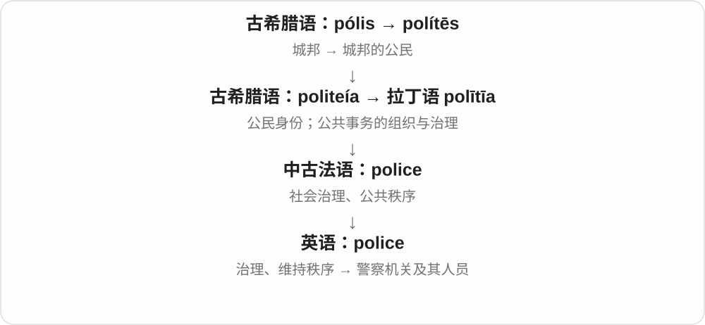

the police 通常作复数：The police are here。说一名警察用 a police officer。动词 police 还能说监督规则执行，如 police online forums。

**常见搭配与例句**

call the police；a police officer；police an event；police the rules。

> The police are asking witnesses to contact them.

警方正在请目击者与他们联系。

> Moderators police the forum to keep personal attacks out.

版主监督论坛秩序，防止人身攻击。

**别混淆**

police 是执法人员或执法监督；policy 是做事方针。二者是同源分支，不是一个词拼错了。

### 2. political — 政治的；涉及权力关系的

**音标**：英 /pəˈlɪtɪkəl/；美 /pəˈlɪtɪkəl/、/pəˈlɪtəkəl/

**先抓住这个画面**

问的不是一个人喜不喜欢某事，而是谁能作决定、谁的利益受到影响、大家怎样分配公共资源。

**怎么拆**

英语 politic + -al。politic 早先已有“政治的”意思，后来这一常用义主要由 political 承担。

**怎么变成今天的意思**

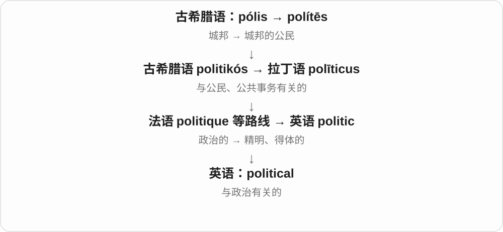

既能客观描述 political history，也能暗示某决定出于争取支持或权力盘算。形容人很 political，还可说此人关心政治、政治意识强。

**常见搭配与例句**

political debate；political power；a political decision；political science。

> The course examines the political history of the region.

这门课研究该地区的政治史。

> She felt that the appointment was a political decision.

她觉得这次任命是出于政治考虑。

**别混淆**

political 是政治相关；politic 多说做法明智、懂得分寸；polite 是有礼貌，属于另一词源。

### 3. policy — 政策、方针；行事原则；保险单、保险合同

**音标**：英 /ˈpɒləsi/；美 /ˈpɑːləsi/

**先抓住这个画面**

处理一类事情之前，先定好“我们一贯按什么办法办”。但保险语境中的 policy 是另一来源的“书面合同”。

**怎么拆**

方针义经古法语 policie、拉丁语 polītīa 来自 politeía。保险单义则经法语 police、意大利语 polizza、中世纪拉丁语 apodissa，来自希腊语 apódeixis“证明”；两条线最后拼成同一个英语词。

**怎么变成今天的意思**

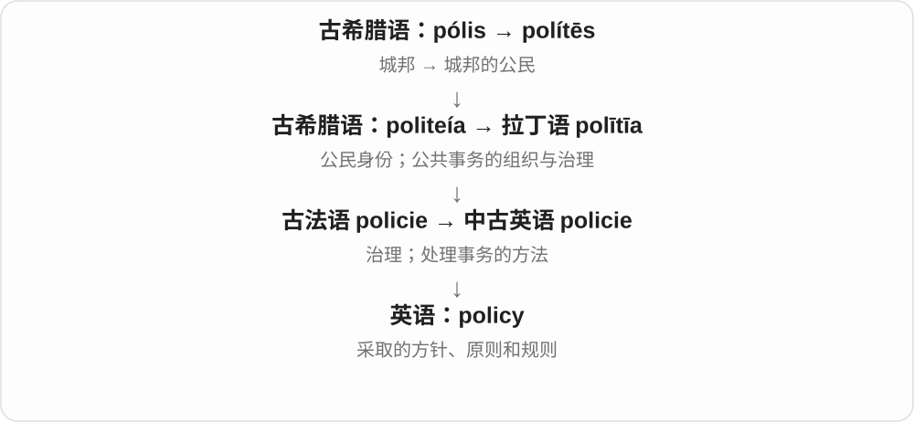

公司有退款 policy，政府有教育 policy，个人也可以有“不借钱给熟人”的 policy。保险单义请另记“证明 → 凭证 → 合同”，不是“政府政策 → 保险单”。

**常见搭配与例句**

a refund policy；foreign policy；as a matter of policy；an insurance policy。

> The shop changed its return policy last month.

这家店上个月调整了退货规则。

> I make it a policy to answer important emails before lunch.

我给自己定了个原则：午饭前回复重要邮件。

> Keep a copy of your insurance policy in a safe place.

把保险单副本放在安全的地方。

**别混淆**

policy 是具体方针；politics 是政治活动和权力关系。a travel insurance policy 指旅行保险合同，不是旅游政策。

### 4. politics — 政治；政治活动；政治立场；权力周旋

**音标**：英 /ˈpɒlətɪks/；美 /ˈpɑːlətɪks/

**先抓住这个画面**

大家生活在同一个共同体里，却不一定想要同样的规则。围绕“谁说了算、事情怎么办”展开的讨论、竞争和协商，就是 politics。

**怎么拆**

来自 politic 这一词族；-s 的形式受到希腊语 tà politiká“公共事务”及相关著作名称影响，不是简单把几个“政治”数成复数。

**怎么变成今天的意思**

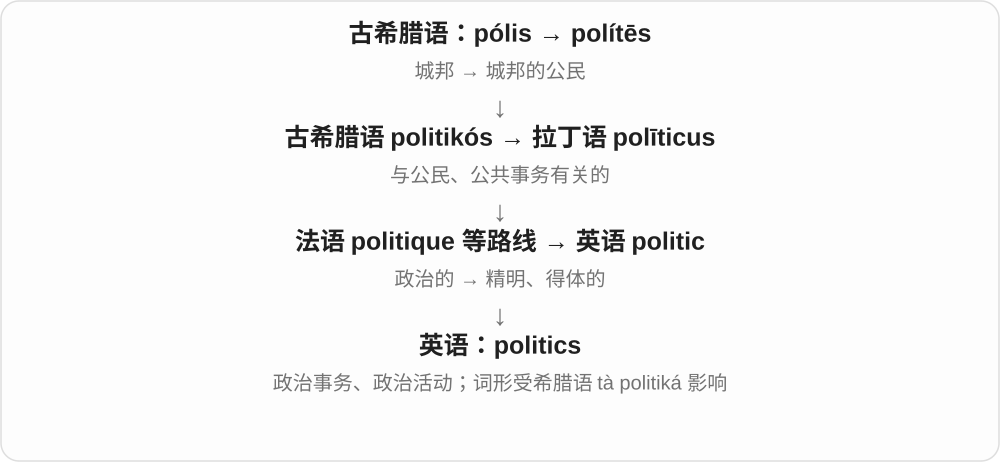

表示学科或活动常接单数动词：Politics is…。表示某人的一套政治观点，可用复数搭配：Her politics are…。office politics 则是职场里的权力关系和人际周旋。

**常见搭配与例句**

go into politics；discuss politics；office politics；someone’s politics。

> Politics is a frequent topic at their dinner table.

他们吃饭时经常聊政治。

> His politics are different from those of his parents.

他的政治观点与父母不同。

> She enjoys the work but dislikes office politics.

她喜欢这份工作，却不喜欢办公室里的权力周旋。

**别混淆**

politics 谈权力和公共事务的过程；policy 谈具体采用的办法；politician 才是从政的人。

### 5. metropolitan — 大都市的；都市圈的；宗主国本土的；〔教会〕都主教

**音标**：英 /ˌmetrəˈpɒlɪtən/；美 /ˌmetrəˈpɑːlɪtən/

**先抓住这个画面**

把视野从市中心放大：周围与它紧密相连的郊区、通勤城镇，也可能属于同一个 metropolitan area。

**怎么拆**

借自后期拉丁语 metropolitānus，承接希腊语 mētrópolis / mētropolítēs 的词族；不是英语 metropolis 加普通 -an 的简单现造词。

**怎么变成今天的意思**

英语早期有教会职位义，后来发展出城市相关用法。metropolitan France 里的词义是法国本土，与海外地区相对，不是“法国所有大城市”。

**常见搭配与例句**

a metropolitan area；metropolitan transport；metropolitan France；a metropolitan bishop。

> The rail network serves the entire metropolitan area.

这张铁路网服务整个都市圈。

> The article compares transport in rural and metropolitan areas.

这篇文章比较乡村地区与大都市地区的交通。

**别混淆**

urban 泛指城市的；metropolitan 更强调一个大城市及其联系紧密的区域。

### 6. politician — 政治人物；从政者

**音标**：英 /ˌpɒləˈtɪʃən/；美 /ˌpɑːləˈtɪʃən/

**先抓住这个画面**

把参与公共事务、争取支持、进入政府或议会当作主要工作的人。

**怎么拆**

politic 的词干 + -ian“从事某事的人”；词尾 -cian 在这里读 /ʃən/，重音也移到后部。

**怎么变成今天的意思**

这个词本身可以中性，也可能在语境里带“善于权衡、说场面话”的批评。单凭 politician 并不能判断此人的品德。

**常见搭配与例句**

a local politician；an elected politician；a career politician。

> A local politician attended the public meeting.

一位当地政治人物参加了公开会议。

> The journalist asked the politician to explain the proposal in plain language.

记者请这位政治人物用大白话解释提案。

**别混淆**

politician 从事政治活动；political scientist 研究政治，两者可能重合，也可能完全不同。

### 7. politically — 在政治上；从政治角度；出于政治考虑

**音标**：英 /pəˈlɪtɪkli/；美 /pəˈlɪtɪkli/、/pəˈlɪtəkli/

**先抓住这个画面**

给一句话加上观察角度：论的是政治立场、权力影响或支持者反应。

**怎么拆**

political + -ly；-ically 通常压缩读成 /ɪkli/ 或 /əkli/，不必一字母一音地读。

**怎么变成今天的意思**

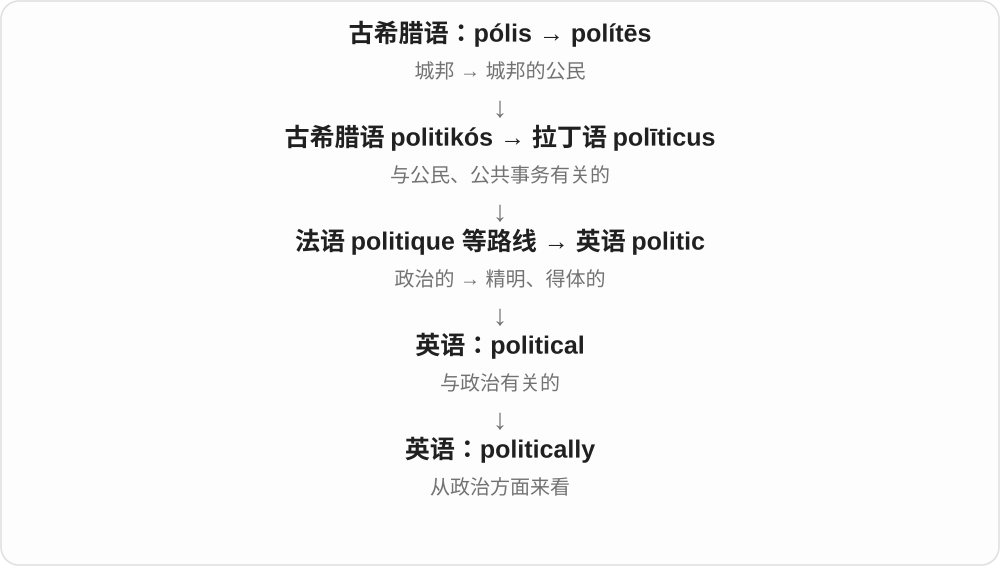

politically active 是积极参与政治；politically sensitive 是牵动政治利益、容易引发争议。它不等于“用政客腔说话”。

**常见搭配与例句**

politically active；politically sensitive；politically motivated。

> The students became politically active during the campaign.

学生们在这次运动中开始积极参与政治活动。

> The two friends disagree politically but still respect each other.

这两个朋友政治立场不同，但仍相互尊重。

**别混淆**

politically 限定政治方面；personally 限定个人方面。一个人可私下友好，政治立场却相反。

### 8. policeman — 男警察

**音标**：英、美 /pəˈliːsmən/

**先抓住这个画面**

police 后面加上 man，把警察机关这群人中的一名男性单独指出来。

**怎么拆**

英语 police + man；复数 policemen，第二部分通常读 /mən/，单复数靠拼写和上下文分辨。

**怎么变成今天的意思**

这个词明确带男性含义。只想说明职业时，police officer 更通用。

**常见搭配与例句**

a uniformed policeman；a plainclothes policeman。

> A policeman helped the child find her father.

一名男警察帮助那个孩子找到了父亲。

> The witness gave her account to a policeman at the scene.

目击者向现场一名男警察讲述了经过。

**别混淆**

a policeman 是一个人；the police 是警方或警察群体。标准用法中不把单个人称为 a police。

### 9. policing — 警务工作；维持秩序；监督管控

**音标**：英、美 /pəˈliːsɪŋ/

**先抓住这个画面**

把 police 看作一个正在做的动作：巡逻、处理事件，或检查某套规则有没有被遵守。

**怎么拆**

police 去掉词尾不发音的 e 加 -ing；既是动词形式，也可作活动名词。

**怎么变成今天的意思**

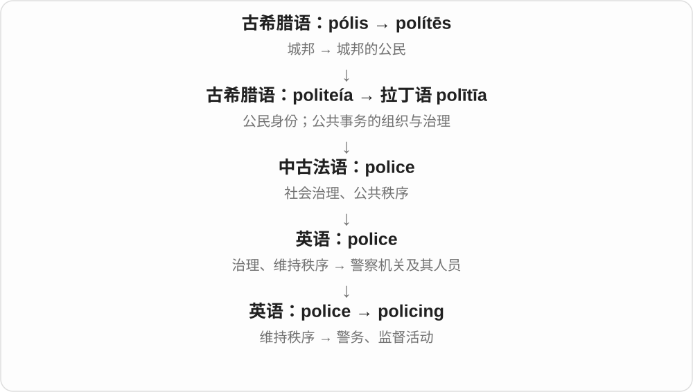

community policing 是社区警务；policing content 可说对内容的检查和限制。后一种用法不一定真的有警察参与。

**常见搭配与例句**

community policing；the policing of protests；policing online content。

> The council discussed the cost of policing large events.

委员会讨论了大型活动的警务保障成本。

> Policing every comment would require a much larger team.

要监督每一条评论，就需要大得多的团队。

**别混淆**

policing 侧重实施监督；policy 侧重规则怎么定。先有规则并不等于已经有人有效执行。

### 10. metropolis — 大都市；主要城市；〔古代〕母城

**音标**：英 /mɪˈtrɒpəlɪs/；美 /məˈtrɑːpəlɪs/

**先抓住这个画面**

周围许多活动都向一座城市集中：工作、贸易、交通、文化，它就像一个地区的中心。

**怎么拆**

希腊语 mḗtēr“母亲” + pólis“城邦”组成 mētrópolis，原可指建立殖民城邦的母城；经后期拉丁语借入英语。这里的 metro- 不是“测量”。

**怎么变成今天的意思**

英语早期也用于教会的中心城市，后来广泛指主要城市或大都市。今天说 a bustling metropolis，通常让人想到繁忙、庞大、活动密集的城市。

**常见搭配与例句**

a bustling metropolis；a modern metropolis；a major metropolis。

> The quiet town grew into a busy metropolis.

这个安静的小镇发展成了一座繁忙的大都市。

> The museum shows how each colony maintained ties with its metropolis.

博物馆展示了各殖民城邦如何与自己的母城保持联系。

**别混淆**

metropolis 强调大城市或中心城市；capital 必须是政治首都、首府。一个 metropolis 不一定是 capital。

### 11. cosmopolitan — 世界性的；多元文化的；见多识广、适应各地生活的

**音标**：英 /ˌkɒzməˈpɒlɪtən/；美 /ˌkɑːzməˈpɑːlɪtən/

**先抓住这个画面**

走进一条街，听到多种语言、闻到不同地方的食物香味；或一个人到不同文化里都能自在相处。

**怎么拆**

英语 cosmopolite“世界公民” + -an，形式受到 metropolitan 等词影响；远源是希腊语 kósmos“世界” + polítēs“公民”。

**怎么变成今天的意思**

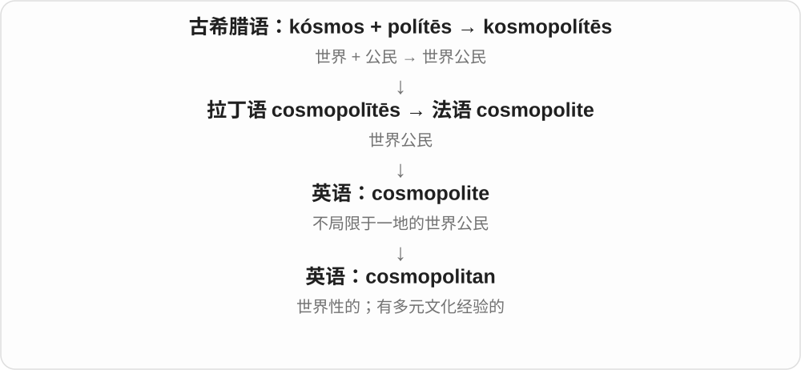

形容城市，常说来自各地的人和文化在这里相遇；形容人，常说有国际经验、视野不局限一地。生物学中还表示分布广泛；名词也可指世界公民或一种鸡尾酒。

**常见搭配与例句**

a cosmopolitan city；a cosmopolitan outlook；a cosmopolitan species。

> The market reflects the city’s cosmopolitan character.

这座市场体现了城市的多元文化特点。

> Years of living abroad gave her a cosmopolitan outlook.

多年海外生活让她有了不局限于一国的视野。

**别混淆**

cosmopolitan 强调文化或地理范围广；metropolitan 强调大城市及其区域。大城市不一定同样多元。

### 12. Tripoli — 的黎波里；多个城市使用的地名

**音标**：英、美 /ˈtrɪpəli/

**先抓住这个画面**

名字里藏着“把三座城市放在一起看”的历史记忆，但今天叫 Tripoli 的地方不止一个。

**怎么拆**

英语常见名称经意大利语 Tripoli、拉丁语 Tripolis，追到希腊语 tri-“三” + pólis“城市”。这里讲利比亚、黎巴嫩等相关地名；各地的具体命名史不能简单互套。

**怎么变成今天的意思**

利比亚这一名称与 Oea、Sabratha、Leptis Magna 三城有关，其中 Oea 发展成今天的的黎波里；不是三座古城都搬到一起合并了。黎巴嫩也有同名城市。

**常见搭配与例句**

Tripoli in Libya；Tripoli in Lebanon；the old city of Tripoli。

> The map distinguishes Tripoli in Libya from Tripoli in Lebanon.

地图区分了利比亚的的黎波里和黎巴嫩的的黎波里。

> Her travel notes include a chapter on the old city of Tripoli.

她的旅行笔记中有一章写的是的黎波里老城。

**别混淆**

Tripoli 是专名；tri- + -polis 能帮助读懂名字，却不能单靠词形确定它指哪座城市。

### 13. geopolitical — 地缘政治的

**音标**：英 /ˌdʒiːəʊpəˈlɪtɪkəl/；美 /ˌdʒiːoʊpəˈlɪtəkəl/

**先抓住这个画面**

某个港口的重要性，不仅是货物多，还因为它的位置会影响国家之间的控制力和关系；这种重要性就是 geopolitical。

**怎么拆**

geo- + political，是 geopolitics 对应的形容词。不要机械写成 geopolitics + -al，实际词形是 political 这套形容词结构。

**怎么变成今天的意思**

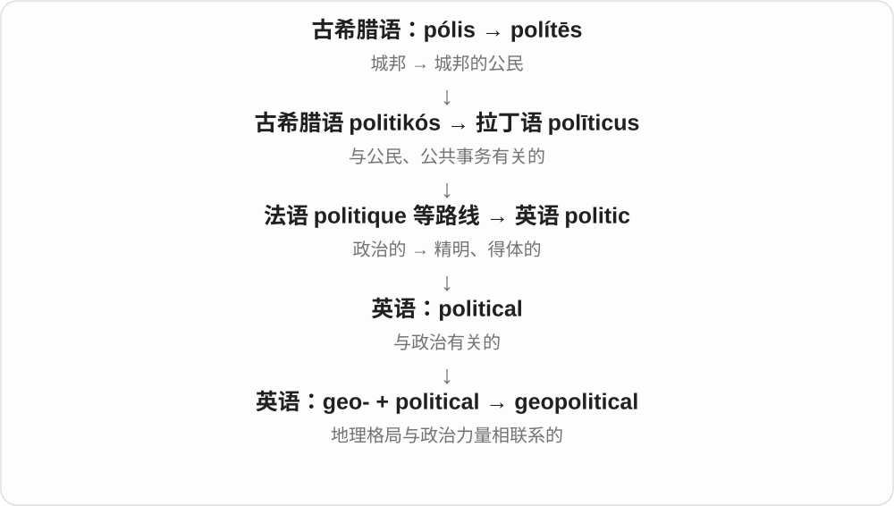

常修饰 tensions、interests、risk、importance。范围既能涉及安全，也能涉及资源、交通和经济联系。

**常见搭配与例句**

geopolitical tensions；geopolitical interests；geopolitical importance。

> The canal has considerable geopolitical importance.

这条运河具有相当大的地缘政治意义。

> The report separates commercial risks from geopolitical risks.

报告把商业风险与地缘政治风险分开讨论。

**别混淆**

geographical 只说地理方面；geopolitical 必须还牵涉权力或国家关系。

### 14. polity — 政治共同体；政体、治理制度

**音标**：英 /ˈpɒləti/；美 /ˈpɑːləti/

**先抓住这个画面**

把一个社会看成“按某套规则组织起来的一群人”，或看它究竟用哪套办法治理。

**怎么拆**

经法语 politie 或拉丁语 polītīa 借入，远源 politeía；不是在现代 policy 后简单换一个字母。

**怎么变成今天的意思**

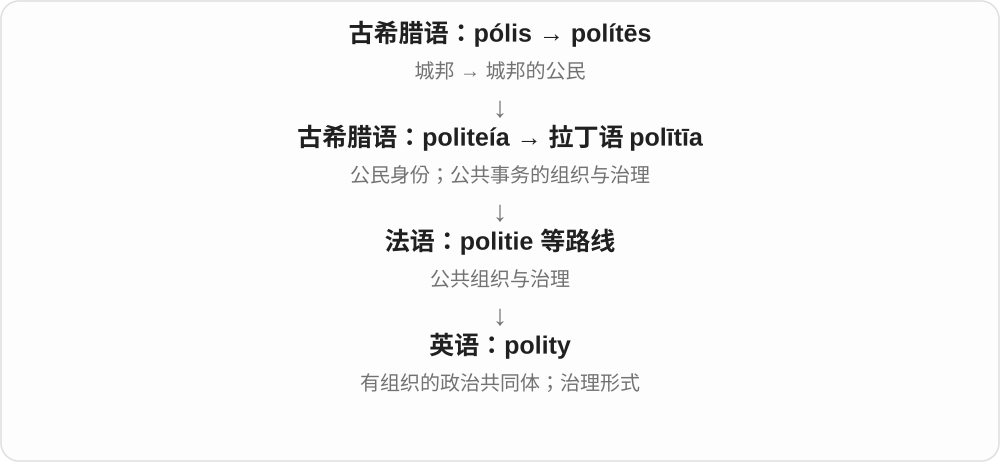

可数时 a polity 常是一种国家或其他政治实体；church polity 则谈教会的组织和治理方式。它比 country 更抽象，不要求一定是现代民族国家。

**常见搭配与例句**

a democratic polity；ancient polities；church polity。

> The valley contained several independent polities.

这座山谷里曾存在几个独立的政治共同体。

> The book compares different forms of church polity.

这本书比较不同的教会治理制度。

**别混淆**

polity 是共同体或它的制度；politics 是其中的权力活动；policy 是采用的具体方针。

### 15. geopolitics — 地缘政治；地缘政治学

**音标**：英 /ˌdʒiːəʊˈpɒlətɪks/；美 /ˌdʒiːoʊˈpɑːlətɪks/

**先抓住这个画面**

把地图放在政治讨论旁边：谁靠海、谁掌握通道、资源在哪里，这些位置关系怎样影响国家之间的力量。

**怎么拆**

geo-“土地、地理” + politics；英语名称对应瑞典语 geopolitik 等欧洲学术用语，不是古希腊时期就有的完整英语词。

**怎么变成今天的意思**

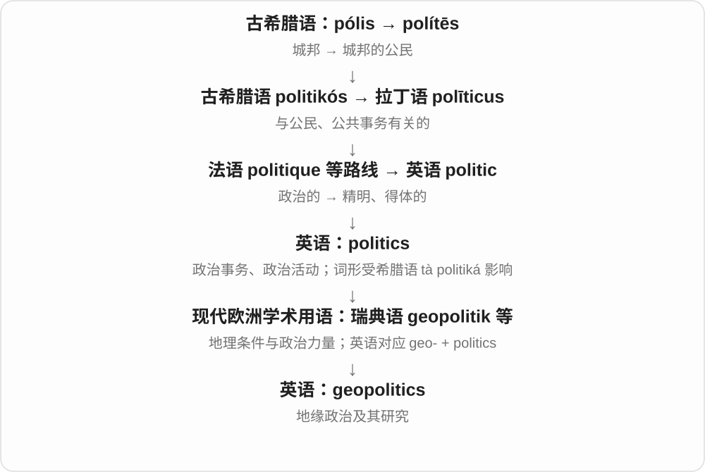

可指研究视角，也可指实际的地区权力关系。地理提供条件，不等于地形能机械决定所有政治结果。

**常见搭配与例句**

regional geopolitics；the geopolitics of energy；study geopolitics。

> The course explores the geopolitics of major shipping routes.

这门课探讨主要航运路线的地缘政治。

> Energy supplies have changed the geopolitics of the region.

能源供应改变了该地区的地缘政治格局。

**别混淆**

geography 研究地点和空间关系；geopolitics 特别关注它们与政治力量、国家关系的联系。

### 16. politicized — 被政治化的；有政治意识、积极参与政治的

**音标**：英 /pəˈlɪtɪsaɪzd/；美 /pəˈlɪtəsaɪzd/

**先抓住这个画面**

重点是已经发生的变化：事情开始被按政治立场看待，或人开始主动关注公共事务。

**怎么拆**

politicize + -ed；词尾读 /zd/。既是过去分词，也可作为形容词。

**怎么变成今天的意思**

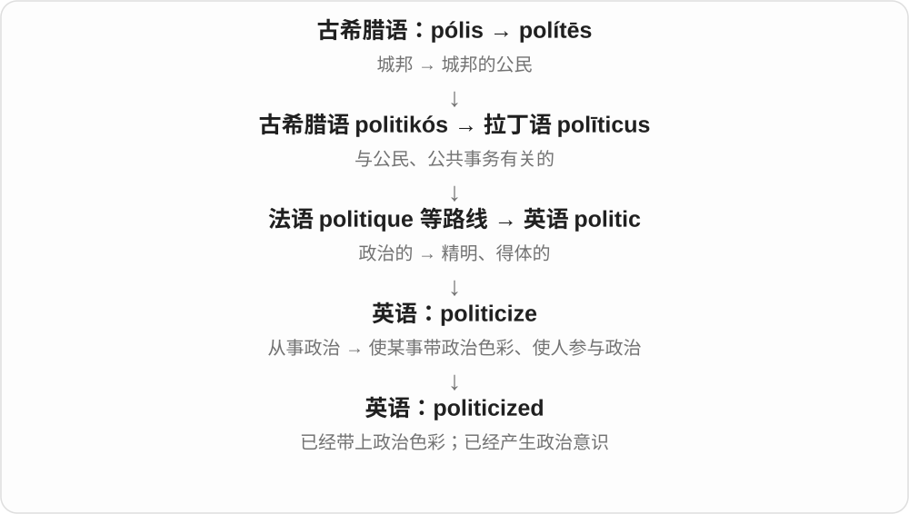

a politicized debate 常指争论受政治立场牵动；politicized students 则可说学生积极参与政治，两种含义的评价不一样。

**常见搭配与例句**

a highly politicized issue；politicized students；become politicized。

> The decision became part of a highly politicized debate.

这个决定卷入了一场高度政治化的争论。

> The newly politicized students began attending council meetings.

这些刚开始积极关心政治的学生开始旁听市议会会议。

**别混淆**

political 只说政治相关；politicized 往往突出“被带进政治争论”或“政治意识增强”的过程。

### 17. politburo — 政治局

**音标**：英 /ˈpɒlɪtˌbjʊərəʊ/；美 /ˈpɑːlətˌbjʊroʊ/、/ˈpoʊlətˌbjʊroʊ/

**先抓住这个画面**

一个政党中负责重要决策的领导机构，名称相当于“政治事务的局、办公室”。

**怎么拆**

借自俄语 Politbyuró，是 politícheskoye byuró“政治局”的缩合。polit- 最终属于政治词族，但英语不是直接把 politic 和 bureau 随手拼成了这个词。

**怎么变成今天的意思**

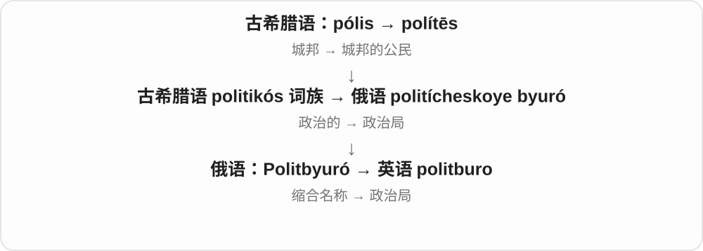

通常在特定政党的组织结构里使用。具体成员构成和权限随政党而不同，不能只靠名字推定。

**常见搭配与例句**

a politburo member；the party’s politburo；a politburo meeting。

> The proposal was discussed at a politburo meeting.

这项提案在政治局会议上进行了讨论。

> The historian studied how the party’s politburo made decisions.

这位历史学家研究了该党政治局如何作出决策。

**别混淆**

politburo 是党内机构名称，不等于 parliament“议会”，也不自动等于整个政府。

### 18. politic — 明智、讲策略的；处事得体的；政治的〔旧义或固定搭配〕

**音标**：英 /ˈpɒlətɪk/；美 /ˈpɑːlətɪk/

**先抓住这个画面**

一句话可能是真话，但当着所有人的面说出来会把事情搞僵。politic 关心的是“这样做，对局面是否合适”。

**怎么拆**

来自法语 politique 和拉丁语 polīticus，最早是“公共事务的”。从治理需要策略，发展出“审慎、会拿捏分寸”。

**怎么变成今天的意思**

It would be politic to… 是“明智的做法是……”，语气较正式。the body politic 保留“政治共同体、国家整体”的旧义。

**常见搭配与例句**

a politic response；it would be politic to…；the body politic。

> It seemed politic to hear both sides before commenting.

先听听双方的意见再发表评论，似乎更明智。

> She gave a politic answer that avoided a public argument.

她回答得很有分寸，避免了当众争吵。

**别混淆**

politic 评价是否明智、合策略；polite 评价是否有礼貌。一个回答可以很客气，却并不明智。

### 19. apolitical — 不关心政治的；不涉政治、保持政治中立的

**音标**：英 /ˌeɪpəˈlɪtɪkəl/；美 /ˌeɪpəˈlɪtəkəl/

**先抓住这个画面**

没有把自己放进政治争论里：可能是没兴趣，也可能是机构刻意不站政治队。

**怎么拆**

a-“无、不” + political。这里的 a- 来自希腊语否定组合形式，不是英语不定冠词。

**怎么变成今天的意思**

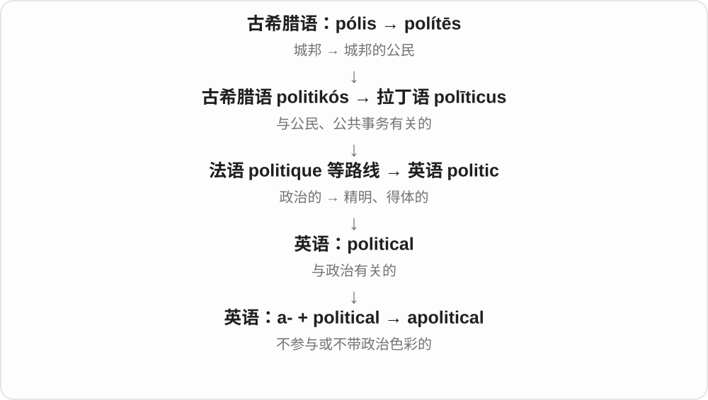

形容人时常指不关心政治；形容机构时常指不涉党派或保持中立。具体是“没兴趣”还是“保持距离”，要看语境。

**常见搭配与例句**

remain apolitical；an apolitical organization；largely apolitical。

> He used to be apolitical, but the local dispute changed that.

他以前不关心政治，但当地这场争议改变了他的态度。

> The charity describes itself as apolitical.

这家慈善机构称自己不涉政治。

**别混淆**

apolitical 不等于反对政治，也不等于没有任何价值观；nonpartisan 更明确强调不偏向某党派。

### 20. polis — 〔古希腊〕城邦

**音标**：英 /ˈpɒlɪs/；美 /ˈpɑːlɪs/、/ˈpoʊlɪs/

**先抓住这个画面**

不要只想一片房屋。这里的“城”还是一个有公民、制度和周边土地的政治共同体。

**怎么拆**

借用古希腊语 pólis 的形式。poli-、polit-、-polis 是不同词里留下的相关构词形态，不是所有字母 poli 都属于它。

**怎么变成今天的意思**

主要用于古典史和政治思想史。复数常用 poleis；古代公民资格有限，不能把“公民共同体”理解为所有居民都平等参与。

**常见搭配与例句**

the Greek polis；an independent polis；the institutions of a polis。

> The polis included both the urban centre and surrounding farmland.

城邦包括城市中心及周边农田。

> The lecture compared citizenship in different Greek poleis.

这场讲座比较了不同希腊城邦中的公民资格。

**别混淆**

city 主要是现代城市概念；polis 把城市与政治共同体连在一起。

### 21. acropolis — 卫城；古希腊城市的高处城堡区

**音标**：英 /əˈkrɒpəlɪs/；美 /əˈkrɑːpəlɪs/

**先抓住这个画面**

一座城里较高、较易防守的那片地方，像城市抬起的一块高台，常有堡垒和重要神庙。

**怎么拆**

借自希腊语 akrópolis：ákros“最高处、顶端” + pólis“城市”。acro- 不是表示面积大，而是位置高。

**怎么变成今天的意思**

小写可泛指不同城市的卫城；the Acropolis 常特指雅典卫城。它不是一座神庙的名称，雅典的帕特农神庙位于卫城上。

**常见搭配与例句**

an ancient acropolis；the Acropolis of Athens；the walls of the acropolis。

> The path climbed steeply toward the acropolis.

小路陡陡地向卫城爬升。

> Several important temples stood on the acropolis.

卫城上曾矗立着几座重要神庙。

**别混淆**

acropolis 是高处的一片城堡、宗教建筑区域；temple 是其中可能存在的单座神庙。

### 22. policymaking — 政策制定；方针形成过程

**音标**：英 /ˈpɒləsiˌmeɪkɪŋ/；美 /ˈpɑːləsiˌmeɪkɪŋ/

**先抓住这个画面**

一条规则从“有个想法”，经过调查、讨论、取舍，最后变成决定；整个过程就是 policymaking。

**怎么拆**

policy + making；making 在这里是制定、形成，不是生产一张纸。

**怎么变成今天的意思**

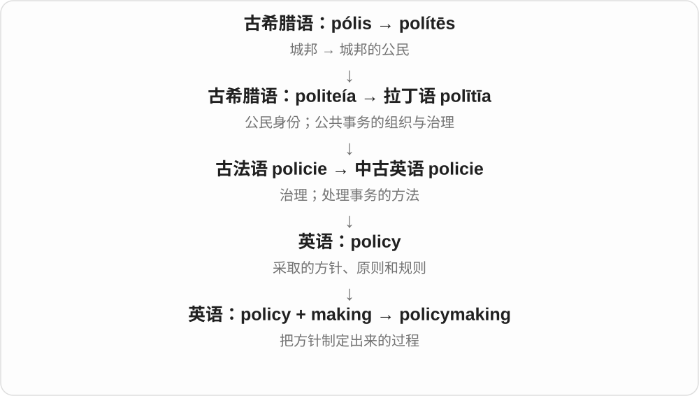

通常作不可数名词，也可作定语，如 policymaking process。讨论的不只是最终文件，还包括谁参与、依据什么作决定。

**常见搭配与例句**

public policymaking；the policymaking process；participate in policymaking。

> Reliable data can improve policymaking.

可靠的数据可以改善政策制定。

> The course looks at public participation in policymaking.

这门课考察公众如何参与政策制定。

**别混淆**

policymaking 是制定阶段；implementation 是执行阶段。二者会相互影响，但不能混成一个动作。

### 23. policewoman — 女警察

**音标**：英、美 /pəˈliːsˌwʊmən/

**先抓住这个画面**

和 policeman 同样的组合方式，只是明确说这位警察是女性。

**怎么拆**

police + woman；复数 policewomen 中 women 读 /ˈwɪmɪn/，与单数不同。

**怎么变成今天的意思**

需要说明性别时可用；职业本身用 police officer 也能表达，不限性别。

**常见搭配与例句**

a uniformed policewoman；speak to a policewoman。

> A policewoman directed traffic near the school.

一名女警察在学校附近指挥交通。

> The policewoman wrote down the registration number.

这名女警察记下了车牌号。

**别混淆**

policewoman 的职责不会因为词里的 woman 而自动变成某一专门岗位；它只说明性别。

### 24. politicization — 政治化；政治意识或参与的增强

**音标**：英 /pəˌlɪtɪsaɪˈzeɪʃən/；美 /pəˌlɪtəsəˈzeɪʃən/

**先抓住这个画面**

把变化当成一个过程来谈：一个问题怎样开始牵动政治立场，一群人又怎样开始参与公共事务。

**怎么拆**

politicize 去掉词尾 e 加 -ation；英式也写 politicisation。

**怎么变成今天的意思**

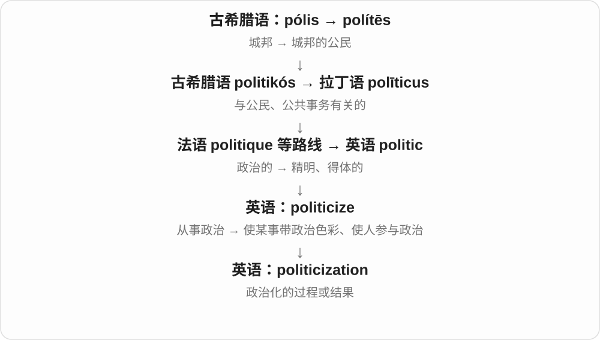

可批评机构受到党派影响，也可研究公众政治意识的形成。词本身不自动表示好或坏。

**常见搭配与例句**

the politicization of education；increasing politicization；youth politicization。

> The report examines the politicization of school appointments.

报告考察了学校人事任命的政治化。

> The historian traces the politicization of young workers.

这位历史学家追溯了年轻工人政治意识增强的过程。

**别混淆**

politicization 指政治因素进入或增强；polarization 指立场向两端分化，二者可能相关，但不是同一个过程。

### 25. politicking — 政治活动、竞选运作；争权周旋

**音标**：英 /ˈpɒlətɪkɪŋ/；美 /ˈpɑːlətɪkɪŋ/

**先抓住这个画面**

不只是谈观点，而是在拜访、拉票、争取支持、与各方周旋；有时还让人觉得把心思都花在争位置上。

**怎么拆**

来自动词 politic / politick 的 -ing 形式；该动词可由 politics 反构而来。拼写加 k 保住 /k/ 音，像 panic → panicking。

**怎么变成今天的意思**

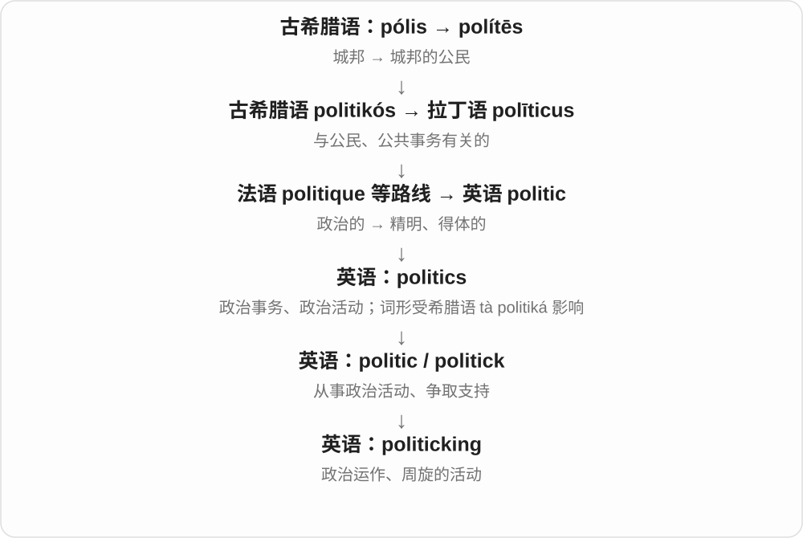

语境可以是竞选活动，也可以是公司内部争夺职位。它常比 politics 带更多“忙于算计和争取”的意味。

**常见搭配与例句**

party politicking；office politicking；behind-the-scenes politicking。

> The candidate spent the weekend politicking in small towns.

候选人整个周末都在小镇上奔走拉票。

> Office politicking distracted the team from its main task.

办公室里的争权周旋让团队偏离了主要任务。

**别混淆**

politicking 是政治运作；policy discussion 可以只是认真讨论方案，两者并非总能互换。

### 26. politicize — 使政治化；使人产生政治意识、参与政治

**音标**：英 /pəˈlɪtɪsaɪz/；美 /pəˈlɪtəsaɪz/

**先抓住这个画面**

原先被当作技术或生活问题的事情，开始被放进立场、权力和公共选择里讨论；也可以是一个人因此开始关心政治。

**怎么拆**

politic / politics 词族 + -ize；较早可表示从事政治，后来常用为及物动词“使……政治化”。

**怎么变成今天的意思**

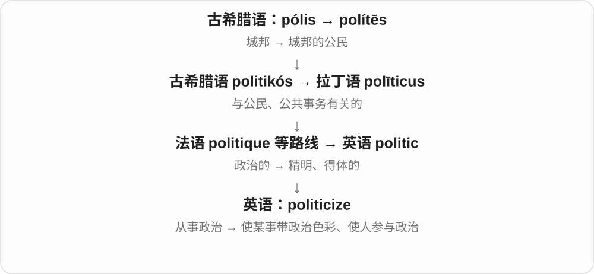

有时带批评：把救灾争论变成党派争斗；也可中性描述：经历让年轻人意识到公共决策与自己有关。不要把所有 politicize 都译成负面的“政治炒作”。

**常见搭配与例句**

politicize an issue；politicize a debate；politicize a generation。

> The mayor urged both parties not to politicize the rescue effort.

市长敦促双方不要把救援工作变成党派争斗。

> The campaign politicized many students who had never followed public affairs.

这场运动让许多原本不关注公共事务的学生有了政治意识。

**别混淆**

politicize 是让政治含义突出；politicking 是实际争取支持、进行政治周旋。

### 27. cosmopolitanism — 世界主义；世界公民观念；多元开放的特点

**音标**：英 /ˌkɒzməˈpɒlɪtənɪzəm/；美 /ˌkɑːzməˈpɑːlɪtənɪzəm/

**先抓住这个画面**

先把别人当作同一个世界里的人，再看国籍和地方差异；也可描述一个地方容纳多种文化的气质。

**怎么拆**

cosmopolitan + -ism；-ism 把人的特点或立场变成一种观念、取向。

**怎么变成今天的意思**

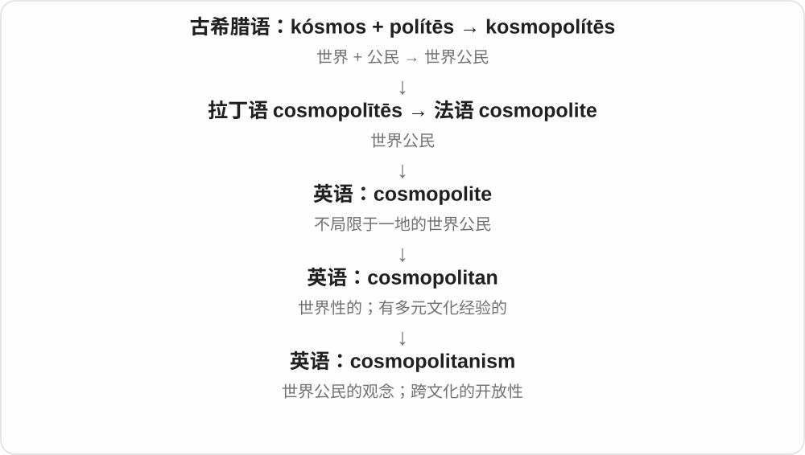

哲学讨论中常关注对全人类的道德责任；文化讨论中可说开放、多元。它不只有一种理论版本，也不必然要求人放弃家乡和本地联系。

**常见搭配与例句**

moral cosmopolitanism；cultural cosmopolitanism；a spirit of cosmopolitanism。

> The seminar asks whether cosmopolitanism can coexist with strong local ties.

研讨课讨论世界主义能否与深厚的地方联系并存。

> The port’s history of migration encouraged a culture of cosmopolitanism.

这座港口的移民历史促成了开放多元的文化。

**别混淆**

globalization 是全球联系加强的过程；cosmopolitanism 是对身份、文化或责任的一种态度与理论。

### 28. megalopolis — 巨型都市；连成片的都市带

**音标**：英 /ˌmeɡəˈlɒpəlɪs/；美 /ˌmeɡəˈlɑːpəlɪs/

**先抓住这个画面**

沿交通干线走出一座城市，却很快进入另一座；多个都市扩张、联系起来，形成比单个大城市更大的城市区域。

**怎么拆**

megalo-“巨大” + -polis“城市”，材料来自希腊语 mégas / megal- 与 pólis。古代也有同形地名，英语通名后来发展出都市带的专门用法。

**怎么变成今天的意思**

日常可泛指极大的城市；城市地理中常指多个都市区相连的大区域。不同研究对范围的划法可能不同，不宜背一个到处通用的人口门槛。

**常见搭配与例句**

an urban megalopolis；a coastal megalopolis；the growth of a megalopolis。

> The railway links several cities across the megalopolis.

这条铁路把这片都市带内的几座城市连接起来。

> Planners studied water demand across the growing megalopolis.

规划人员研究了不断扩张的都市带整体的用水需求。

**别混淆**

metropolis 常是一个中心大城市；megalopolis 在常见专门用法中把多个都市区一起看。

### 29. propolis — 蜂胶

**音标**：英 /ˈprɒpəlɪs/；美 /ˈprɑːpəlɪs/

**先抓住这个画面**

把蜂巢想成蜜蜂的“城”：它们用这种黏性的材料填缝、封边、整理巢内结构。

**怎么拆**

经拉丁语和中世纪借入路线来自希腊语 própolis，中古英语有 propoleos 等形式；构词为 pro-“在前” + pólis“城”。名称通常联系到蜂巢入口或城前的防护，不宜把这幅比喻讲成唯一确定的命名故事。

**怎么变成今天的意思**

蜂胶由蜜蜂采集的植物树脂等材料形成，与蜂蜡和蜂蜜不是同一种东西。这里的 polis 是把蜂群住处比作城，和警察职业没有关系。

**常见搭配与例句**

collect propolis；a layer of propolis；propolis in the hive。

> The bees used propolis to seal a narrow gap in the hive.

蜜蜂用蜂胶封住了蜂箱里的一条窄缝。

> The beekeeper removed a sticky layer of propolis from the frame.

养蜂人从巢框上清除了一层黏黏的蜂胶。

**别混淆**

propolis 是蜂胶；beeswax 是蜂蜡；honey 是蜂蜜。三者可以出现在同一个蜂巢里，性质和用途不同。

### 30. policymaker — 政策制定者；方针决策者

**音标**：英 /ˈpɒləsiˌmeɪkə/；美 /ˈpɑːləsiˌmeɪkər/

**先抓住这个画面**

坐在“规则怎么定”的位置上的人：要决定目标、取舍，以及具体采用什么办法。

**怎么拆**

policy“方针” + maker“制定者”；这里用的是 polis 一支的 policy，不是保险单义。

**怎么变成今天的意思**

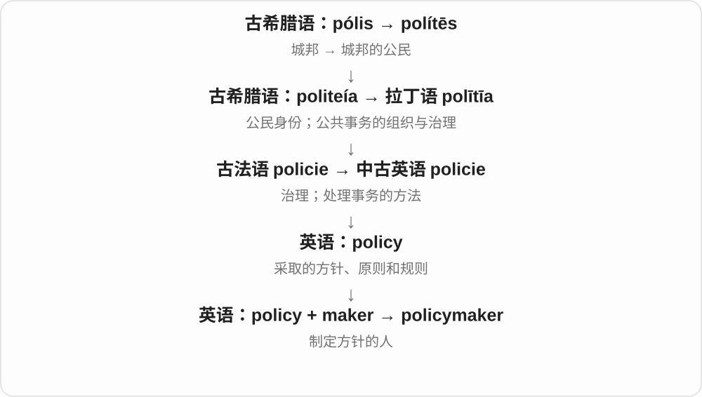

可指政府、机构或其他组织里的决策人员。研究者给出证据，policymaker 则还需要在多个目标之间作选择。

**常见搭配与例句**

government policymakers；advise policymakers；a senior policymaker。

> The report gives policymakers several options for improving public transport.

报告为政策制定者提供了几种改善公共交通的选择。

> Policymakers met residents before revising the housing plan.

决策者在修改住房规划前与居民见了面。

**别混淆**

policymaker 制定方针；administrator 常负责落实和日常管理。一个岗位也可能兼有两种职责。

### 31. geopolitically — 从地缘政治角度；在地缘政治上

**音标**：英 /ˌdʒiːəʊpəˈlɪtɪkli/；美 /ˌdʒiːoʊpəˈlɪtəkli/

**先抓住这个画面**

给“重要、敏感、相互接近”等判断补上角度：说的是地理位置与政治力量之间的联系。

**怎么拆**

geopolitical + -ly，-ically 常读 /ɪkli/ 或 /əkli/。

**怎么变成今天的意思**

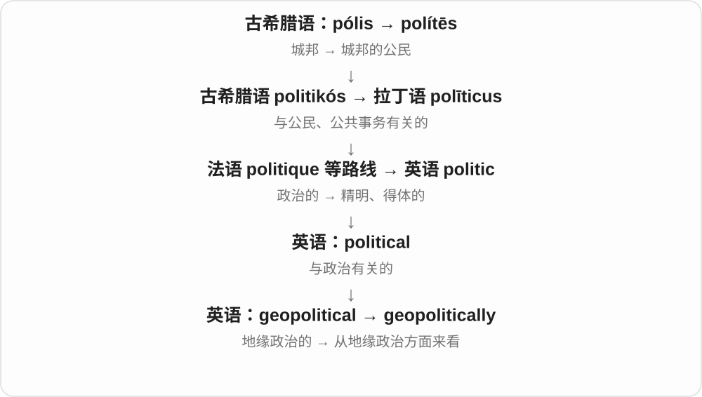

常放在形容词前，如 geopolitically important；也可修饰整句，先说明分析的角度。

**常见搭配与例句**

geopolitically important；geopolitically sensitive；geopolitically significant。

> The port is small but geopolitically important.

这个港口虽小，在地缘政治上却很重要。

> The analyst described the border region as geopolitically sensitive.

分析人士认为这一边境地区在地缘政治上很敏感。

**别混淆**

geopolitically 与 economically 可以给出不同结论：某处经济产出不大，也可能在地缘政治上重要。

### 32. cosmopolis — 国际都市；多元文化汇聚的城市

**音标**：英 /kɒzˈmɒpəlɪs/；美 /kɑːzˈmɑːpəlɪs/

**先抓住这个画面**

仿佛把世界缩进一座城市：许多国家、语言和生活方式在同一处相遇。

**怎么拆**

现代构词 cosmo-“世界” + -polis“城市”，以 metropolis 等词为参照；不是从现代 cosmopolitan 去掉结尾就能说明全部历史。

**怎么变成今天的意思**

是书面色彩较强的城市名词，常见于文学、文化和城市研究。它强调人群与文化的国际性，不要求城市覆盖全球。

**常见搭配与例句**

a modern cosmopolis；a thriving cosmopolis；transform into a cosmopolis。

> The port developed into a cosmopolis shaped by successive waves of migration.

这座港口在一波波移民的影响下发展成了国际都市。

> The writer portrays the city as a lively cosmopolis.

作者把这座城市描绘成充满活力的多元国际都市。

**别混淆**

cosmopolis 是一座多元国际城市；ecumenopolis 是覆盖世界的城市系统设想，范围完全不同。

### 33. nonpolitical — 非政治的；与政治无关的

**音标**：英 /ˌnɒnpəˈlɪtɪkəl/；美 /ˌnɑːnpəˈlɪtəkəl/

**先抓住这个画面**

给事情划定范围：这次活动谈音乐、生活或技术，不以政治议题为内容。

**怎么拆**

non-“非、不属于” + political；连写形式在词典中有独立收录。

**怎么变成今天的意思**

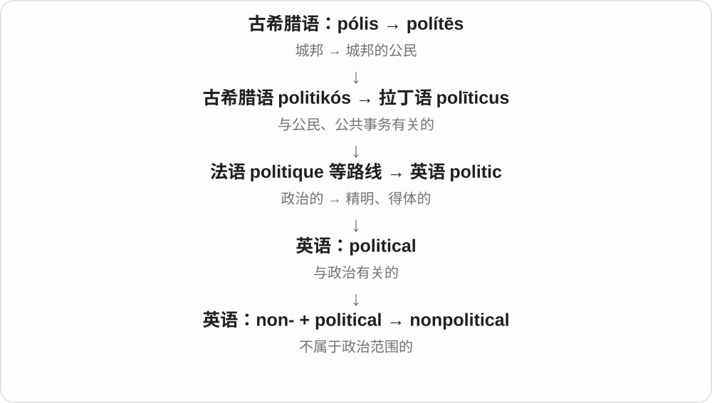

常修饰 activities、subjects、organization。称某事 nonpolitical 是对其性质或范围的描述，不保证它绝不会产生政治影响。

**常见搭配与例句**

nonpolitical activities；a nonpolitical discussion；nonpolitical reasons。

> The club hosts nonpolitical events such as concerts and book swaps.

俱乐部举办音乐会、换书等非政治活动。

> They chose a nonpolitical topic for the opening conversation.

他们选了一个与政治无关的话题来开场。

**别混淆**

nonpolitical 更直接说“内容不涉及政治”；apolitical 也常描写人对政治缺少兴趣。

### 34. impolitic — 不明智的；考虑不周、不得体的

**音标**：英 /ɪmˈpɒlətɪk/；美 /ɪmˈpɑːlətɪk/

**先抓住这个画面**

做法可能一时痛快，却没有顾及后果，把原本能谈的局面弄僵了。

**怎么拆**

im- 是 in-“不”的同化形式，加 politic“明智、有策略的”；不是 im + political 的缩写。

**怎么变成今天的意思**

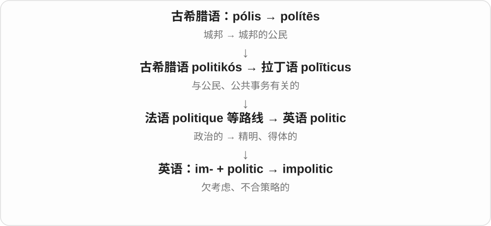

正式用词，常形容 remarks、decision、move。它批评判断或时机，不一定批评道德。

**常见搭配与例句**

an impolitic remark；an impolitic decision；it would be impolitic to…。

> It would be impolitic to announce the decision before consulting the team.

没先征求团队意见就公布决定，会显得考虑不周。

> His impolitic joke made the negotiations more difficult.

他那个不得体的玩笑让谈判更难进行了。

**别混淆**

impolitic 是不明智；impolite 是不礼貌。对对方礼貌地许下做不到的承诺，仍可能 impolitic。

### 35. biopolitics — 生命政治；生物学与政治的交叉研究

**音标**：英 /ˌbaɪəʊˈpɒlətɪks/；美 /ˌbaɪoʊˈpɑːlətɪks/

**先抓住这个画面**

出生、健康、寿命原本像是个人身体的事；当机构把整个人口的这些现象统计起来、制定规则加以管理，就出现了生命与政治的交叉。

**怎么拆**

bio-“生命、生物” + politics，是现代学术合成词。福柯发展了其中很有影响的一种理论用法，但不是这组字母第一次出现都由他创造。

**怎么变成今天的意思**

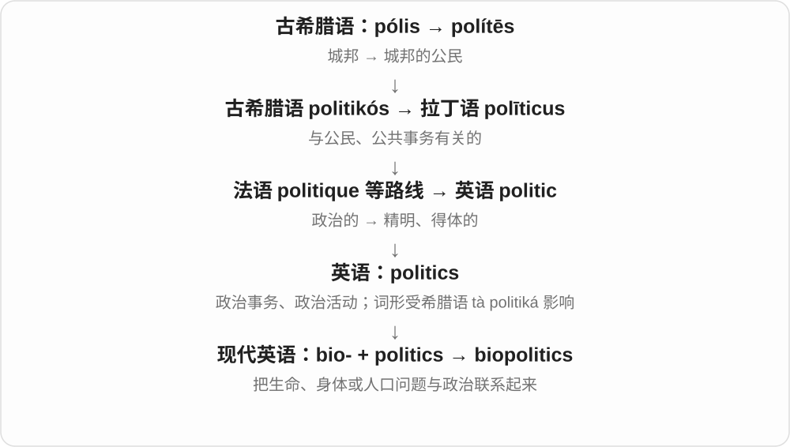

在福柯相关论述中，常关注权力如何管理人口生命；在其他研究里也可泛指生物学与政治学的交叉。先看作者的理论框架，不能固定翻成“生物决定政治”。

**常见搭配与例句**

the biopolitics of population；a study of biopolitics；Foucauldian biopolitics。

> The seminar explores biopolitics through the history of population statistics.

研讨课通过人口统计史来探讨生命政治。

> The author uses biopolitics to examine how institutions classify and manage bodies.

作者用生命政治这一视角考察机构如何分类和管理人的身体。

**别混淆**

bioethics 重点讨论生命医学中的伦理判断；biopolitics 重点关注生命如何进入权力和治理，两者会相交。

### 36. megapolis — 巨型城市；庞大的都市区域

**音标**：/məˈɡæpəlɪs/

**先抓住这个画面**

把一座城市的规模往大处想：人多、建筑密集、交通复杂，是一个巨大都市整体。

**怎么拆**

mega-“巨大” + -polis“城市”，与 megalopolis 用的是同一组希腊语材料的不同构词形式。

**怎么变成今天的意思**

比 metropolis 和 megalopolis 少见；可指一个大都市，也可泛指庞大的城市区域。它不是有统一人口线的正式城市等级。

**常见搭配与例句**

a vast megapolis；a modern megapolis；the centre of a megapolis。

> The novel is set in a crowded megapolis.

这部小说以一座拥挤的巨型城市为背景。

> The map shows the roads linking the districts of the megapolis.

地图标出了连接这座巨型城市各区的道路。

**别混淆**

megapolis 与 megalopolis 的实际使用有重叠；不要仅凭少了两个字母，就断定一定指较小的城市。

### 37. Decapolis — 德卡波利斯；十城地区、十城联盟的名称

**音标**：英、美 /dɪˈkæpəlɪs/

**先抓住这个画面**

把十座有共同联系的城市看成一组，于是用“十城”给这一组起名。

**怎么拆**

希腊语 déka“十” + pólis“城市”组成 Dekápolis，经拉丁语 Decapolis 进入英语历史用语。

**怎么变成今天的意思**

常见于古代黎凡特的城市史和《新约》相关地理。这个名称也用于中世纪阿尔萨斯的十城联盟；读书时需要看地点和年代，不能把同名地区合成一个。

**常见搭配与例句**

cities of the Decapolis；the Decapolis region；the Alsatian Decapolis。

> The exhibition includes coins from cities of the Decapolis.

展览包括德卡波利斯各城的硬币。

> This chapter concerns the Alsatian Decapolis, not the ancient Levantine cities.

这一章讲的是阿尔萨斯十城联盟，而非古代黎凡特的那组城市。

**别混淆**

deca- 是十，penta- 是五；名称里的数字说明命名结构，不保证所有时代的城市名单都完全不变。

### 38. politeia — 〔古希腊思想〕公民身份；政体、政治组织方式

**音标**：/ˌpɒlɪˈtiːə/

**先抓住这个画面**

从“我是不是这个共同体的一员”，进一步问“这群公民怎样组织、谁拥有权力”；古希腊这个词能覆盖这些相关问题。

**怎么拆**

直接保留希腊语 politeía 的转写形式，来自 polítēs“公民”。police、policy、polity 经其他借入路线也追到它。

**怎么变成今天的意思**

在古典研究里，译成 citizenship、constitution 或 polity 要看作者和上下文。柏拉图《理想国》的希腊语书名也是 Politeía，不能把所有出现处都当成书名。

**常见搭配与例句**

Aristotle’s account of politeia；the meaning of politeia；translate politeia。

> The translator explains why politeia has several possible English equivalents.

译者解释了为什么 politeia 有几种可能的英语译法。

> The seminar examines how Aristotle uses the word politeia.

研讨课考察亚里士多德如何使用 politeia 这个词。

**别混淆**

politeia 不等于今天常说的一部成文 constitution，也与 polite“礼貌的”没有同一条词源。

### 39. cosmopolite — 世界公民；能自在融入各地的人

**音标**：英 /kɒzˈmɒpəlaɪt/；美 /kɑːzˈmɑːpəlaɪt/

**先抓住这个画面**

不把自己的人生只框在一个地方，到了别处也愿意理解当地的人和生活。

**怎么拆**

经法语 cosmopolite、拉丁语 cosmopolītēs，来自希腊语 kosmopolítēs“世界公民”。最后的 -polite 是“公民”这一支，不是英语 polite“礼貌”。

**怎么变成今天的意思**

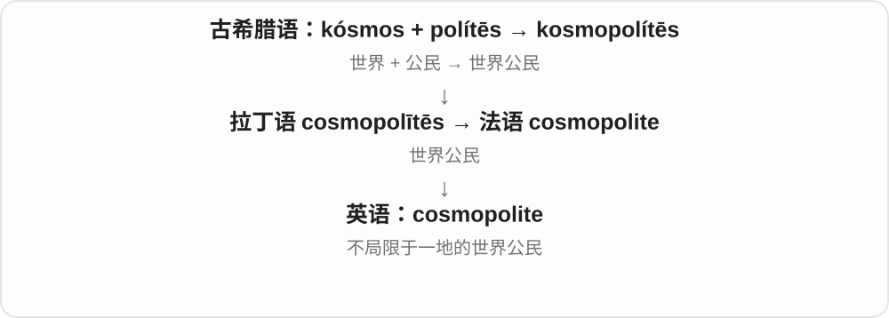

较有书面色彩，通常说人；现代更常见 cosmopolitan 或 citizen of the world。它是一种身份、经验或自我理解，不是法律上的世界国籍。

**常见搭配与例句**

a true cosmopolite；an experienced cosmopolite。

> She considered herself a cosmopolite, at home in several cultures.

她认为自己是个世界公民，在几种文化中都能自在生活。

> The novel’s narrator is a cosmopolite with no permanent home.

小说的叙述者是一位没有固定住所的世界公民。

**别混淆**

a traveller 是旅行者；a cosmopolite 强调跨文化的自在感和视野，不只记录去过多少地方。

### 40. depoliticize — 使非政治化；减少政治影响

**音标**：英、美 /ˌdiːpəˈlɪtəsaɪz/

**先抓住这个画面**

把原来按政治立场争论的事情，转交给规则、技术标准或独立程序处理，希望减少政治干预。

**怎么拆**

de-“去掉、消除” + politicize；这是现代英语的组合。

**怎么变成今天的意思**

常用于机构、人事或某项议题。说要 depoliticize，是表达目标或做法；是否真的中立，仍需看实际安排。

**常见搭配与例句**

depoliticize appointments；depoliticize an issue；depoliticize the debate。

> The committee proposed clearer criteria to depoliticize appointments.

委员会提议采用更清楚的标准，以减少人事任命中的政治干预。

> The mediator tried to depoliticize the discussion by focusing on practical needs.

调解人把讨论集中到实际需求上，试图淡化政治色彩。

**别混淆**

depoliticize 不等于解决争议：把决定交给专家，也可能仍然涉及利益取舍。

### 41. depoliticization — 去政治化；政治影响或政治参与的减弱

**音标**：英 /ˌdiːpəˌlɪtɪsaɪˈzeɪʃən/；美 /ˌdiːpəˌlɪtəsəˈzeɪʃən/

**先抓住这个画面**

把“移开政治因素”整个过程打包成名词：某些决定不再公开争论，或人们越来越少参与政治。

**怎么拆**

depoliticize + -ation；英式也写 depoliticisation。

**怎么变成今天的意思**

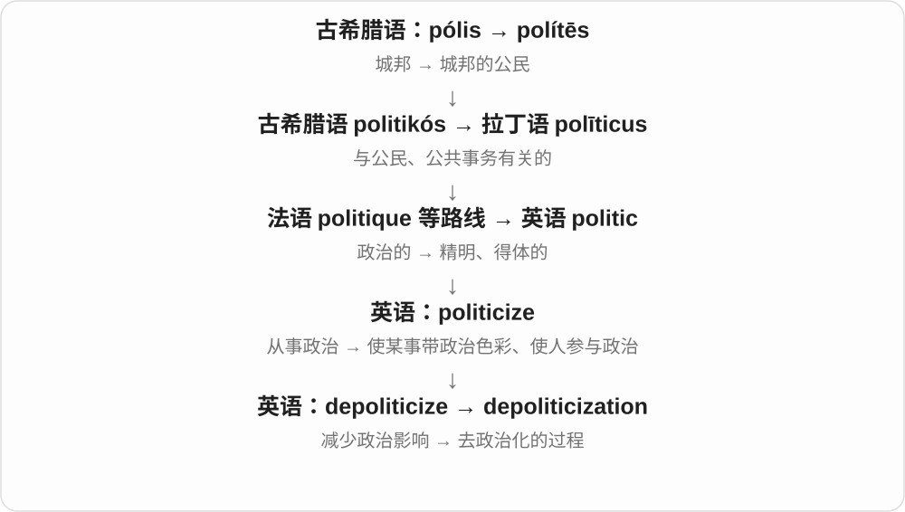

可被用来称赞减少党派干预，也可批评把公共选择包装成“只有一种技术答案”。阅读时先看作者具体在说哪一种变化。

**常见搭配与例句**

the depoliticization of institutions；a process of depoliticization。

> The study examines the depoliticization of economic decision-making.

这项研究考察了经济决策的去政治化。

> Some participants feared that depoliticization would weaken public debate.

一些参与者担心，去政治化会削弱公众讨论。

**别混淆**

apolitical 描述状态；depoliticization 关注怎样从有政治参与或争论，变成政治因素较少的状态。

### 42. pentapolis — 五城地区；五城联盟

**音标**：/penˈtæpəlɪs/

**先抓住这个画面**

五座城市因为地理、政治或历史联系，被放在同一组里谈，便可称为一个“五城”组合。

**怎么拆**

来自希腊语 pentápolis，penta-“五” + pólis“城市”；英语历史用法沿用这一名称。

**怎么变成今天的意思**

它说的是五座城的组合，不是城市有五个区。指某一特定历史地区时常大写 Pentapolis，不同史料所指的五城不一定相同。

**常见搭配与例句**

an ancient pentapolis；the cities of the Pentapolis；the Doric Pentapolis。

> The historian mapped the five cities of the pentapolis.

这位历史学家在地图上标出了五城地区的五座城市。

> The text explains why the former Hexapolis became a Pentapolis.

文中解释了原来的六城联盟为什么变成了五城联盟。

**别混淆**

pentapolis 数的是城市；pentagon 的五指五条边。共同的 penta- 不能把后半部分的含义也混掉。

### 43. ecumenopolis — 全球城市系统；〔科幻〕覆盖整颗星球的城市

**音标**：英 /ˌekjuːmeˈnɒpəlɪs/

**先抓住这个画面**

把城市之间的联系不断放大，最后想象整个有人居住的世界都连成一个城市系统。科幻里又常把它画成铺满星球的都市。

**怎么拆**

现代术语由 ecumene“有人居住的世界” + -polis“城市”组成，使用希腊语材料；城市规划学者 Doxiadis 提出并发展了这一名称和概念。

**怎么变成今天的意思**

Doxiadis 的原构想包含必要的开放土地，并非每平方米都盖上楼。它是理论与未来设想，不是已经普遍实现的城市等级。

**常见搭配与例句**

a future ecumenopolis；a planetary ecumenopolis；the concept of ecumenopolis。

> The planner imagined an ecumenopolis connected by extensive transport networks.

这位规划者设想了一个由广泛交通网络连接的全球城市系统。

> In the novel, the capital planet has become an ecumenopolis.

小说里，首都所在的星球已经变成了一座覆盖全球的城市。

**别混淆**

cosmopolis 是文化国际化的一座城市；ecumenopolis 强调覆盖世界的尺度。

### 44. eperopolis — 大陆尺度的城市系统；大陆城市

**音标**：构词参考读法：英 /ˌepəˈrɒpəlɪs/；美 /ˌepəˈrɑːpəlɪs/

**先抓住这个画面**

先把若干都市带连起来，再把视野放到一整个大陆的城市网络；这是比普通都市带更大的理论尺度。

**怎么拆**

现代规划术语取希腊语 ēpeiros“大陆、陆地”与 pólis“城市”的构词材料；Doxiadis 的术语表将 Eperopolis 对应为“城市化的大陆”。

**怎么变成今天的意思**

主要用于特定规划理论和未来设想；这里的音标是按构词给出的参考读法。这不是今天各国通用的法定城市分类，也不要求大陆每处都成为建筑区。

**常见搭配与例句**

a continental eperopolis；the concept of eperopolis；an emerging eperopolis。

> The model links several urban regions into a proposed eperopolis.

这个模型把几个城市区域连接成一个设想中的大陆城市系统。

> The essay compares the eperopolis with the still larger ecumenopolis.

文章比较了大陆城市系统与尺度更大的全球城市系统。

**别混淆**

在这套理论中，megalopolis 是大都市带，eperopolis 放大到大陆尺度，ecumenopolis 则放大到全球；这是概念尺度，不是单词互相变出来的历史链。

### 45. heptapolis — 七城地区；七城组合

**音标**：传统英语化参考读法 /hepˈtæpəlɪs/

**先抓住这个画面**

七座城一起构成一个被命名的地区或群体；先看懂“七城”，再去判断史料具体指哪七座。

**怎么拆**

希腊语 hepta-“七” + pólis“城市”。Heptapolis 在旧地理著作中用于埃及相关地区；小写形式可用于解释这个七城构词。

**怎么变成今天的意思**

极少见，主要用于历史地理。与 Heptanomis“七州、七区”有关，但 -polis 指城，-nomis 指行政区，两种名称不能逐字译成同一个东西。

**常见搭配与例句**

the Egyptian Heptapolis；the name Heptapolis。

> The old gazetteer uses the name Heptapolis for part of Egypt.

这本旧地名辞典把埃及的一部分地区称为 Heptapolis。

> The lecturer explained that Heptapolis literally means seven cities.

讲师解释说，Heptapolis 的字面意思是七座城市。

**别混淆**

hepta- 是七；hexa- 是六。古地名的边界和成员要结合年代，不能用一个数字替代历史考证。

### 46. hexapolis — 六城地区；六城联盟

**音标**：/hekˈsæpəlɪs/

**先抓住这个画面**

六座城市被放进同一个历史组合里，名称就像给这组城市贴上一张“六城”的标签。

**怎么拆**

希腊语 héx“六”的组合形式 hexa- + pólis“城市”；Hexapolis 作为古代地名或联盟名进入英语历史著作。

**怎么变成今天的意思**

著名用法是多里安六城联盟。希罗多德提到其中一城被排除后，剩下的称为 Pentapolis；这让数字前缀的作用十分直观。

**常见搭配与例句**

the Doric Hexapolis；the six cities of the Hexapolis。

> The chapter introduces the six cities of the Doric Hexapolis.

这一章介绍了多里安六城联盟的六座城市。

> After one city was excluded, the Hexapolis became a Pentapolis.

一座城市被排除后，六城联盟就变成了五城联盟。

**别混淆**

hexapolis 的 hexa- 是六；hexagon 是六边形。这里并不是说城市地图一定呈六角形。

### 47. isopolity — 公民权平等；城邦之间互授公民权

**音标**：英 /ˌaɪsəʊˈpɒlɪti/；美 /ˌaɪsəˈpɑːlɪti/

**先抓住这个画面**

两个城邦仍然各自存在，但约定：对方的公民在一定条件下，可以获得本城邦公民的权利。

**怎么拆**

可分析 iso-“相等” + polity；对应希腊语 isopoliteía，其基础是 ísos“相同”与 polítēs“公民”。不是把两个城市合并成一座。

**怎么变成今天的意思**

主要用于古代政治制度研究。具体权利、获得条件和实际执行需按条约、时代分别理解；不能直接套成现代通用国籍制度。

**常见搭配与例句**

a treaty of isopolity；grant isopolity；reciprocal isopolity。

> The inscription records a treaty of isopolity between the two cities.

这块铭文记录了两城之间互授公民权的条约。

> The historian distinguishes isopolity from the political merger of communities.

这位历史学家把互授公民权与共同体的政治合并区分开来。

**别混淆**

isopolity 关注公民身份或权利的互通；alliance 只是联盟，不一定互相给予公民权。

### 48. politologist — 政治学研究者〔少见名称〕

**音标**：构词参考读法：英 /ˌpɒlɪˈtɒlədʒɪst/；美 /ˌpɑːlɪˈtɑːlədʒɪst/

**先抓住这个画面**

站在研究者的位置，调查和解释政治制度、选民行为与权力关系的人。

**怎么拆**

politology 对应的研究者名称，可分析 polit- + -ologist，或 politology 的词干加 -ist；不是“从政者”的普通叫法。

**怎么变成今天的意思**

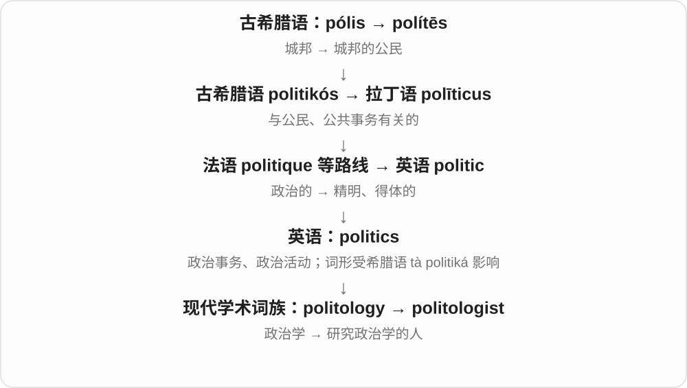

主要见于较少见的学术表达或跨语言语境；常用英语 political scientist 更容易让人理解。这里的音标为构词参考读法。

**常见搭配与例句**

a university politologist；a comparative politologist。

> The politologist presented a study of electoral systems.

这位政治学研究者介绍了一项选举制度研究。

> A politologist may study a party without supporting it.

研究某个政党的政治学者不一定支持它。

**别混淆**

politologist / political scientist 研究政治；politician 直接从事政治活动。

### 49. politology — 政治学〔少见名称〕

**音标**：构词参考读法：英 /ˌpɒlɪˈtɒlədʒi/；美 /ˌpɑːlɪˈtɑːlədʒi/

**先抓住这个画面**

把政治当作可以系统研究的对象：怎样取得权力、制度怎样运行、人为什么参与或不参与。

**怎么拆**

取 politics 的 polit- 部分，加 -ology“研究、学科”；是现代学术构词，可对照德语 Politologie，不能据此断定每次英语使用都直接借自德语。

**怎么变成今天的意思**

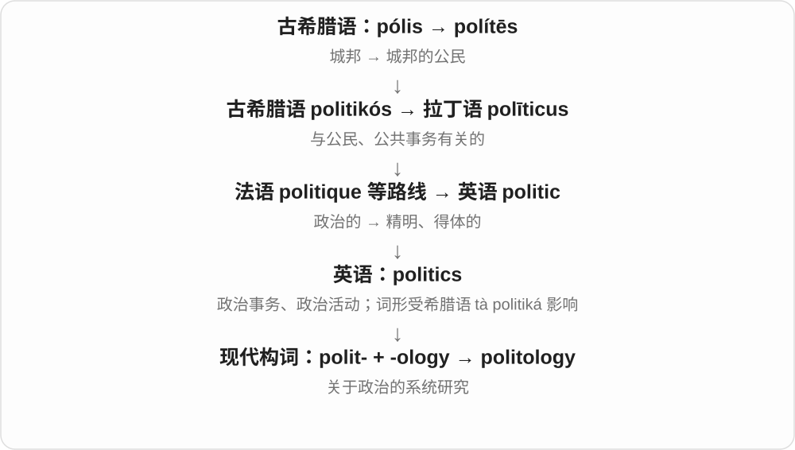

英语里少见，通常说 political science 更自然。这里给的是按构词得到的参考读法；阅读时识别即可，不需要为了显得专业而替换常用名称。

**常见搭配与例句**

a course in politology；research in politology。

> The university catalogue uses politology as another name for political science.

这所大学的课程目录用 politology 作为政治学的另一名称。

> Her research in politology focuses on voter participation.

她的政治学研究主要关注选民参与。

**别混淆**

politology 是研究政治的学科，不是“耍政治手段”；后者在批评语境里可能用 politicking。

### 50. politonym — 政治共同体成员的称呼〔名称学术语〕

**音标**：构词参考读法 /pəˈlɪtənɪm/

**先抓住这个画面**

一个称呼把人归到某个国家或政治共同体里，关注的是“属于哪个政治单位”，不一定说共同血缘或族群。

**怎么拆**

取 politics / polit- 这一词族的材料，加连接元音 -o- 与 -nym“名称”；是现代术语，不是古希腊语 pólis 直接改拼写。

**怎么变成今天的意思**

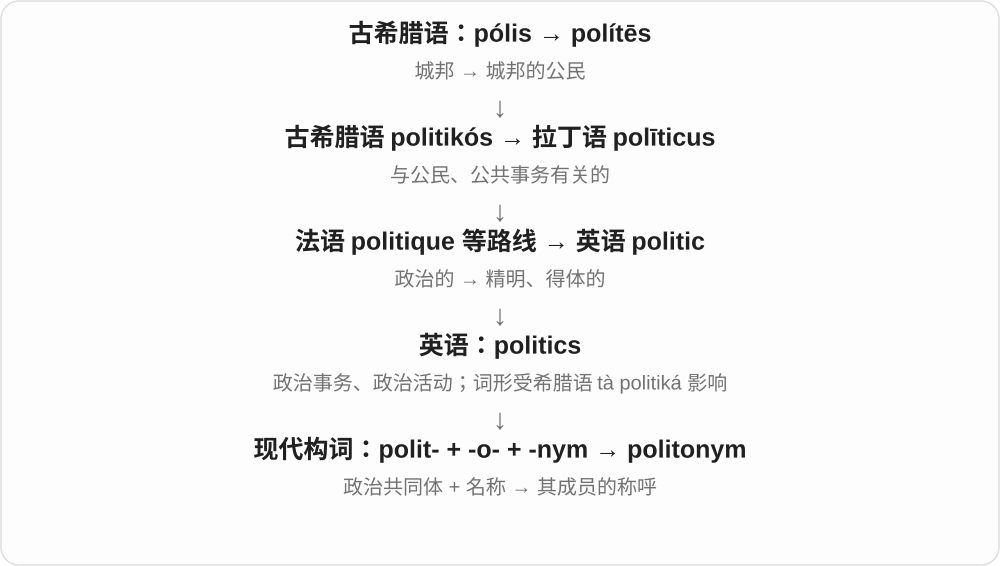

极少见，主要用于名称学和身份研究，具体范围以作者定义为准。此处采用“政治共同体成员的称呼”这一义项；音标为构词参考读法。

**常见搭配与例句**

use a name as a politonym；distinguish a politonym from an ethnonym。

> In this study, the label is treated as a politonym rather than an ethnic name.

这项研究把该称呼看作政治共同体成员的名称，而非族名。

> The author asks when the name began to function as a politonym.

作者追问这个名称从何时开始具有标识政治共同体成员的作用。

**别混淆**

politonym 强调政治身份；ethnonym 是族群名称；toponym 是地名。同一个词在不同语境下可能有不止一种作用。

### 51. tetrapolis — 四城地区；四城组合

**音标**：/teˈtræpəlɪs/

**先抓住这个画面**

地图上四座城被某种共同关系连起来，历史作者把这一个组合称为“四城”。

**怎么拆**

借自希腊语 tetrápolis：tetra-“四” + pólis“城市”。

**怎么变成今天的意思**

是少见的历史地理词。它说明城市的数量，未单凭词形说明四城之间是否有统一政府、共同宗教活动或只是地域联系。

**常见搭配与例句**

an ancient tetrapolis；the cities of a tetrapolis；a regional tetrapolis。

> The map identifies the four settlements of the tetrapolis.

地图标出了四城地区的四处聚落。

> The article examines religious links within the tetrapolis.

文章考察了这一四城组合内部的宗教联系。

**别混淆**

tetrapolis 与 metropolis 不是按规模排的两个等级：前者说四城组合，后者说大城市或中心城市。

## 这一组要分清什么

**politics / policy / polity**：围绕公共事务和权力的活动 / 采用的方针 / 按制度组织的共同体或其治理形式。

**political / politic / polite**：与政治有关 / 做法明智、有分寸 / 有礼貌。前两个同族；第三个另源。

**metropolis / megalopolis / cosmopolis**：中心大城市 / 常指相连的广大都市带 / 不同文化汇聚的国际城市。

**apolitical / impolitic**：不涉政治或不关心政治 / 不明智、考虑不周。

**polis / police**：古希腊城邦概念 / 警方与执法监督。polis 不是 police 的英语单数。

## 串起来练习

**A politician proposed a new transport policy for the metropolitan area, but the debate soon became highly politicized.**

一位政治人物为都市圈提出了一项新的交通政策，但讨论很快就带上了强烈的政治色彩。politician 是人，policy 是办法，metropolitan 说地区，politicized 说讨论发生的变化。
