# 0135 · cern-, cer- — 筛分、分开；辨清、判定

[逐词精讲目录](../00_逐词精讲目录.md) · [总目录](../00_总目录_按常用程度.md)

## 核心词根与来源

这一族以拉丁语 cernere“筛分、分辨、决定”为中心。discern 保留辨别动作，discrete 保留分开的结果，certain 把判断推到确定，secret 把一部分单独藏起。不能仅凭共同字母套意思：concert 一支的更早历史仍有争议，图从能确认的意大利语节点起。

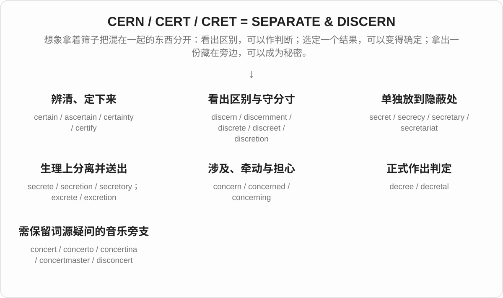

## 词形与演化规律

**cern-**：cernere 及复合动词，如 discern、secern；concerning 的现在分词来自 concern。

**cret-**：分词等相关形式，如 discrētus、sēcrētus、dēcrētum，对应 discrete、secret、decree。

**cert-**：certus“确定的”与 cernere 的传统词源联系，见 certain、certify；不是把所有 -cert 都机械翻成筛子。

**concert-**：可确认意大利 concertare、concerto 与法语诸词的传播；更早“争执”如何转成“协同”有多种分析，本页保留不确定性。

## 单词速览（按词族由简到繁）

同一基础词的相关扩展放在一起，先读基础形式，再读扩展；各组之间优先读常用的。具体词源关系见各词讲解。

| 单词 | 音标 | 核心意思 |
|---|---|---|
| [certain](#w-1) | 英 /ˈsɜːtən/；美 /ˈsɜːrtən/ | 确定的；确信的；某个、某些 |
| [certainly](#w-2) | 英 /ˈsɜːtənli/；美 /ˈsɜːrtənli/ | 肯定；无疑；当然可以 |
| [certainty](#w-16) | 英 /ˈsɜːtənti/；美 /ˈsɜːrtənti/ | 确定性；确信；确定无疑的事 |
| [uncertain](#w-13) | 英 /ʌnˈsɜːtən/；美 /ʌnˈsɜːrtən/ | 不确定的；拿不准的；没有保障的 |
| [uncertainty](#w-11) | 英 /ʌnˈsɜːtənti/；美 /ʌnˈsɜːrtənti/ | 不确定；疑虑；未定因素 |
| [secrete](#w-38) | /sɪˈkriːt/ | 分泌；把东西藏起来 |
| [secretary](#w-3) | 英 /ˈsekrətəri/；美 /ˈsekrəteri/ | 秘书；干事；书记；某些部门的部长 |
| [secretarial](#w-37) | 英 /ˌsekrəˈteəriəl/；美 /ˌsekrəˈteriəl/ | 秘书工作的；文秘的 |
| [secretion](#w-28) | /sɪˈkriːʃən/ | 分泌；分泌物 |
| [secret](#w-4) | /ˈsiːkrət/ | 秘密；秘密的；诀窍 |
| [secretly](#w-12) | /ˈsiːkrətli/ | 秘密地；瞒着别人地；心里暗自 |
| [secrecy](#w-18) | /ˈsiːkrəsi/ | 保密；隐秘状态 |
| [secretive](#w-26) | /ˈsiːkrətɪv/ | 遮遮掩掩的；不愿透露情况的 |
| [concern](#w-6) | 英 /kənˈsɜːn/；美 /kənˈsɜːrn/ | 涉及；使担心；关切；问题、事务；企业 |
| [concerned](#w-5) | 英 /kənˈsɜːnd/；美 /kənˈsɜːrnd/ | 担心的；关切的；有关的、涉及的 |
| [concerning](#w-8) | 英 /kənˈsɜːnɪŋ/；美 /kənˈsɜːrnɪŋ/ | 关于；涉及；令人担忧的 |
| [unconcern](#w-54) | 英 /ˌʌnkənˈsɜːn/；美 /ˌʌnkənˈsɜːrn/ | 不在意；漠不关心；从容无忧 |
| [unconcerned](#w-36) | 英 /ˌʌnkənˈsɜːnd/；美 /ˌʌnkənˈsɜːrnd/ | 不担心的；不在意的；无关的 |
| [concert](#w-7) | 名词：英 /ˈkɒnsət/；美 /ˈkɑːnsərt/。动词：英 /kənˈsɜːt/；美 /kənˈsɜːrt/ | 音乐会；协同、一致；共同商定 |
| [concerted](#w-23) | 英 /kənˈsɜːtɪd/；美 /kənˈsɜːrtɪd/ | 共同协调的；一致的；努力集中的 |
| [concertina](#w-45) | 英 /ˌkɒnsəˈtiːnə/；美 /ˌkɑːnsərˈtiːnə/ | 六角手风琴；像手风琴一样伸缩、折叠 |
| [concertmaster](#w-48) | 英 /ˈkɒnsətˌmɑːstə/；美 /ˈkɑːnsərtˌmæstər/ | 乐队首席；通常指交响乐团第一小提琴首席 |
| [disconcert](#w-53) | 英 /ˌdɪskənˈsɜːt/；美 /ˌdɪskənˈsɜːrt/ | 使慌乱；使不知所措；扰乱镇定 |
| [disconcerting](#w-33) | 英 /ˌdɪskənˈsɜːtɪŋ/；美 /ˌdɪskənˈsɜːrtɪŋ/ | 令人不安、尴尬或不知所措的 |
| [disconcerted](#w-49) | 英 /ˌdɪskənˈsɜːtɪd/；美 /ˌdɪskənˈsɜːrtɪd/ | 不知所措的；失去镇定的；感到不自在的 |
| [certificate](#w-9) | 名词：英 /səˈtɪfɪkət/；美 /sərˈtɪfɪkət/。动词：英 /səˈtɪfɪkeɪt/；美 /sərˈtɪfɪkeɪt/ | 证书；证明文件；发证认证 |
| [certification](#w-14) | 英 /ˌsɜːtɪfɪˈkeɪʃən/；美 /ˌsɜːrtɪfɪˈkeɪʃən/ | 认证；资格认证；正式证明 |
| [certify](#w-29) | 英 /ˈsɜːtɪfaɪ/；美 /ˈsɜːrtɪfaɪ/ | 正式证明；认证；确认符合要求 |
| [certified](#w-10) | 英 /ˈsɜːtɪfaɪd/；美 /ˈsɜːrtɪfaɪd/ | 经认证的；有资格证明的；经核证的 |
| [certifiable](#w-46) | 英 /ˈsɜːtɪfaɪəbəl/；美 /ˈsɜːrtɪfaɪəbəl/ | 可正式证明、可认证的；口语也可讥称疯狂的 |
| [discreet](#w-21) | /dɪˈskriːt/ | 谨慎得体的；能守秘密的；不张扬的 |
| [discretion](#w-15) | /dɪˈskreʃən/ | 审慎；保密分寸；自行决定的权力 |
| [discretionary](#w-25) | 英 /dɪˈskreʃənəri/；美 /dɪˈskreʃəneri/ | 可酌情决定的；非必需的 |
| [indiscretion](#w-40) | /ˌɪndɪˈskreʃən/ | 失言、失检点；不谨慎；不慎之举 |
| [discreetly](#w-30) | /dɪˈskriːtli/ | 谨慎得体地；不引人注意地 |
| [indiscreet](#w-41) | /ˌɪndɪˈskriːt/ | 言行不谨慎的；泄露隐私的；失分寸的 |
| [decree](#w-17) | /dɪˈkriː/ | 法令；正式裁决；颁令、裁定 |
| [discrete](#w-19) | /dɪˈskriːt/ | 分开的；各自独立的；离散的 |
| [discretely](#w-43) | /dɪˈskriːtli/ | 分别地；离散地；作为独立部分地 |
| [secretariat](#w-20) | 英 /ˌsekrəˈteəriət/；美 /ˌsekrəˈteriət/ | 秘书处；书记处；负责行政协调的机构 |
| [ascertain](#w-22) | 英 /ˌæsəˈteɪn/；美 /ˌæsərˈteɪn/ | 查明；弄清；确认 |
| [ascertainment](#w-52) | 英 /ˌæsəˈteɪnmənt/；美 /ˌæsərˈteɪnmənt/ | 查明；确认的过程 |
| [concerto](#w-24) | 英 /kənˈtʃeətəʊ/；美 /kənˈtʃertoʊ/ | 协奏曲 |
| [discern](#w-27) | 英 /dɪˈsɜːn/；美 /dɪˈsɜːrn/ | 辨认出；看出；察觉 |
| [discerning](#w-31) | 英 /dɪˈsɜːnɪŋ/；美 /dɪˈsɜːrnɪŋ/ | 有眼力的；善于辨别的 |
| [discernible](#w-32) | 英 /dɪˈsɜːnəbəl/；美 /dɪˈsɜːrnəbəl/ | 能辨认的；察觉得到的 |
| [discernment](#w-35) | 英 /dɪˈsɜːnmənt/；美 /dɪˈsɜːrnmənt/ | 辨别力；判断力；眼力 |
| [indiscernible](#w-51) | 英 /ˌɪndɪˈsɜːnəbəl/；美 /ˌɪndɪˈsɜːrnəbəl/ | 无法辨认的；难以分辨的 |
| [excrement](#w-34) | /ˈekskrəmənt/ | 粪便；排泄物 |
| [excrete](#w-44) | /ɪkˈskriːt/ | 排泄；把废物或多余物质排出体外 |
| [excretion](#w-39) | /ɪkˈskriːʃən/ | 排泄；排出；排泄物 |
| [secretory](#w-42) | 英 /sɪˈkriːtəri/；美 /ˈsiːkrətɔːri/ | 分泌的；有分泌功能的 |
| [certitude](#w-47) | 英 /ˈsɜːtɪtjuːd/；美 /ˈsɜːrtɪtuːd/ | 确信；坚定的确定感 |
| [excretory](#w-50) | /ɪkˈskriːtəri/，也 /ˈekskrətɔːri/ | 排泄的；有排泄功能的 |
| [decretal](#w-55) | /dɪˈkriːtəl/，也 /ˈdekrɪtəl/ | 教皇教令；法令的、裁决的 |
| [secern](#w-56) | 英 /sɪˈsɜːn/；美 /səˈsɜːrn/ | 分开；辨别；旧用法也指分泌 |

## 逐词讲解

### 1. certain — 确定的；确信的；某个、某些

**音标**：英 /ˈsɜːtən/；美 /ˈsɜːrtən/

**先抓住这个画面**

certain 像从一堆可能里把答案挑出来、钉住：我已认定它。不过 a certain person 是“特定的某个人”，只是没有说出姓名。

**怎么拆**

经古法语 certain，追溯拉丁 certus“已确定的”，与 cernere“辨清、判定”相连；中间 *certānus 是重构词形。

**怎么变成今天的意思**

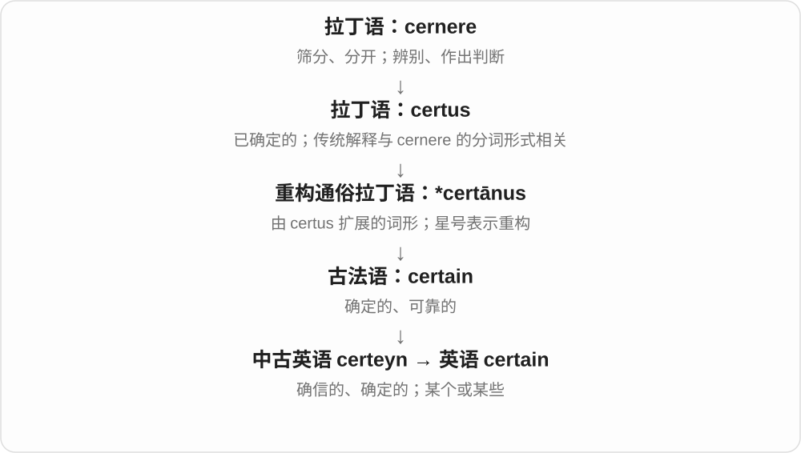

be certain that 表示确信；be certain to happen 表示必定发生；certain people 表示某些人，不能译成“确定的人”。

**常见搭配与例句**

be certain of；for certain；make certain；a certain amount。

> I am certain that I left the key on the desk.

我确信把钥匙留在桌上了。

> Only certain parts of the building are open to visitors.

只有建筑的某些部分对游客开放。

> The work requires a certain amount of patience.

这项工作需要一定的耐心。

**别混淆**

sure 日常说法更普遍；certain 常更郑重。a certain 与 some 可接近，但前者常有“特定但不点名”的意味。

### 2. certainly — 肯定；无疑；当然可以

**音标**：英 /ˈsɜːtənli/；美 /ˈsɜːrtənli/

**先抓住这个画面**

certainly 像说话时把一个勾打得很明确：“这一点我认定。”回应请求时，则是爽快地说“当然可以”。

**怎么拆**

certain + -ly，中古英语已有 certeynly，后来延续为现代拼写。

**怎么变成今天的意思**

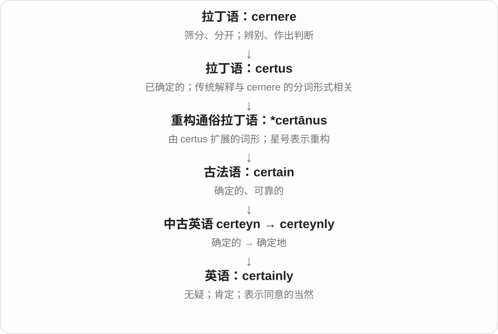

It certainly helps 是肯定有帮助；Certainly! 是礼貌同意；certainly not 可以坚定否认。

**常见搭配与例句**

certainly true；will certainly；certainly not；Certainly, please come in。

> The extra practice certainly helped.

额外练习确实起了作用。

> “May I use this chair?” “Certainly.”

“我能用这把椅子吗？”“当然可以。”

**别混淆**

probably 是大概；certainly 表示说话者把握很强。它表达态度强度，并不会让错误判断自动变真。

### 3. certainty — 确定性；确信；确定无疑的事

**音标**：英 /ˈsɜːtənti/；美 /ˈsɜːrtənti/

**先抓住这个画面**

certainty 是心里不再摇摆的那种确定，或已经能被当作定局的一件事。

**怎么拆**

经法语和中古英语借入，远源拉丁 certus；现代可联系 certain + -ty，但这个名词有自己的借入历史。

**怎么变成今天的意思**

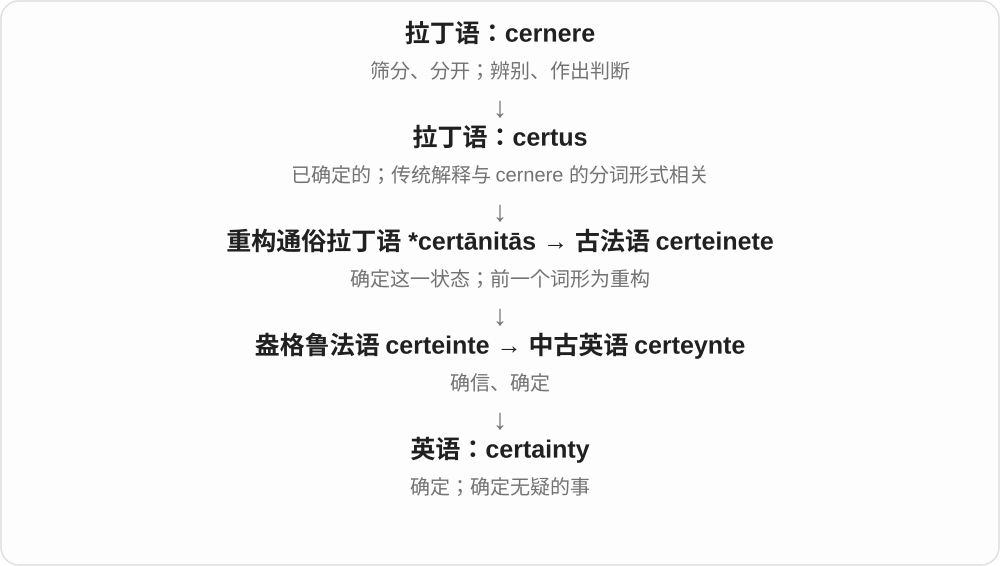

with certainty 是有把握地；a certainty 是确定会发生的事；a degree of certainty 是把握程度，常用于研究或预测。

**常见搭配与例句**

with absolute certainty；a virtual certainty；a degree of certainty。

> We cannot identify the artist with complete certainty.

我们还不能完全确定作者是谁。

> By Friday, cancellation seemed a virtual certainty.

到了周五，取消似乎已几乎成定局。

**别混淆**

confidence 是信心、把握；certainty 把程度推向确定，日常也可被人夸张使用。

### 4. uncertain — 不确定的；拿不准的；没有保障的

**音标**：英 /ʌnˈsɜːtən/；美 /ʌnˈsɜːrtən/

**先抓住这个画面**

uncertain 像答案还没钉住，几个可能仍在摇摆：事情未定，人也可能心里没底。

**怎么拆**

un-（不）+ certain；中古英语已有 uncerteyn。

**怎么变成今天的意思**

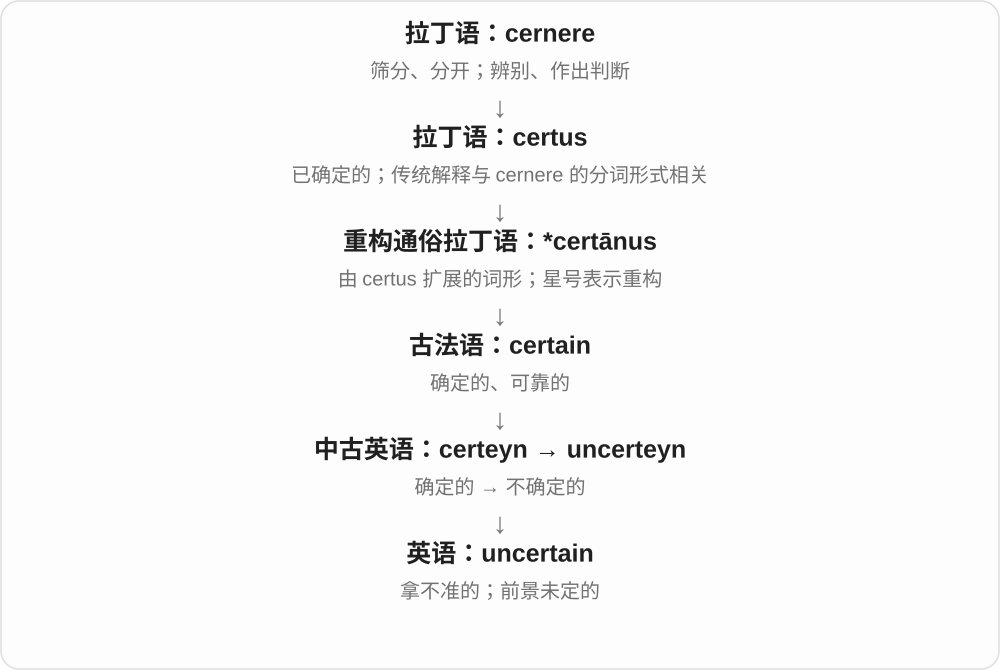

uncertain about a choice 是拿不准选择；an uncertain future 是未来没保障；in no uncertain terms 反而是非常明确地。

**常见搭配与例句**

uncertain about；uncertain whether；an uncertain future；in no uncertain terms。

> She was uncertain whether to accept the offer.

她拿不准是否接受这个机会。

> The project faces an uncertain future.

项目面临不确定的未来。

**别混淆**

unsure 多说人的把握不足；uncertain 也经常形容未来、结果、时间等本身未定。

### 5. uncertainty — 不确定；疑虑；未定因素

**音标**：英 /ʌnˈsɜːtənti/；美 /ʌnˈsɜːrtənti/

**先抓住这个画面**

uncertainty 是“还有几种可能没排除”的空间，既可能在人的心里，也可能真的存在于事情的发展中。

**怎么拆**

中古英语 uncerteynte；现代可拆 un- + certainty，或联系 uncertain + -ty。

**怎么变成今天的意思**

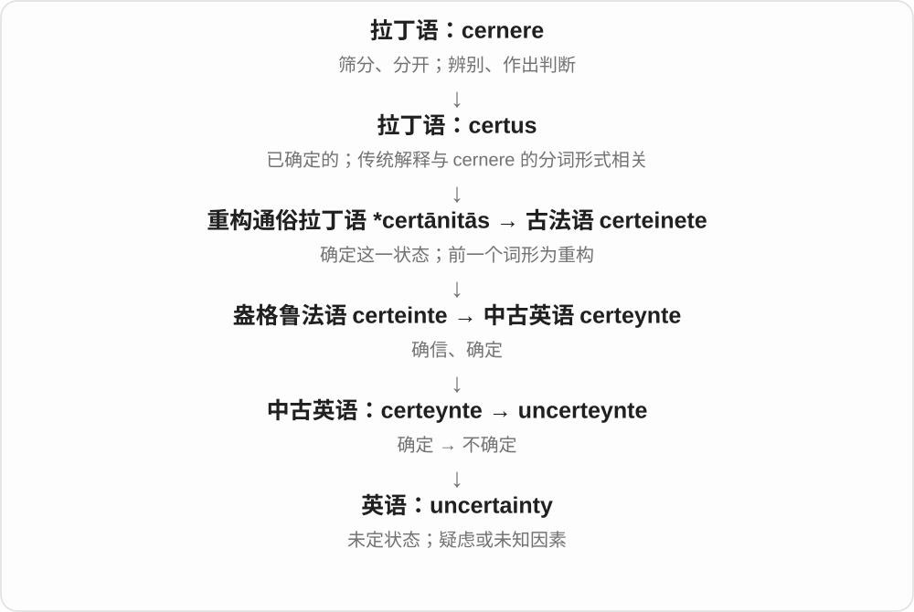

a period of uncertainty 是局面未定的一段时期；uncertainties 常指多个未知因素。测量中的 uncertainty 有特定技术含义，并不只是操作者粗心。

**常见搭配与例句**

uncertainty about；reduce uncertainty；a period of uncertainty。

> The announcement ended weeks of uncertainty.

公告结束了持续数周的不确定局面。

> There is still uncertainty about the opening date.

开业日期仍未确定。

**别混淆**

risk 常关注不利结果的可能；uncertainty 更广，连可能出现哪些结果或概率都未必清楚。

### 6. secrete — 分泌；把东西藏起来

**音标**：/sɪˈkriːt/

**先抓住这个画面**

secrete 有两个画面：细胞把某种物质制备并释放出来；人把某件东西单独藏到不显眼的地方。两义都远连“分开”，但进入英语的路线不同。

**怎么拆**

分泌义与拉丁 sēcrētus 及英语 secretion 的逆构有关；藏匿义是旧动词 secret 的改形，不是“分泌”后来变成“藏东西”。

**怎么变成今天的意思**

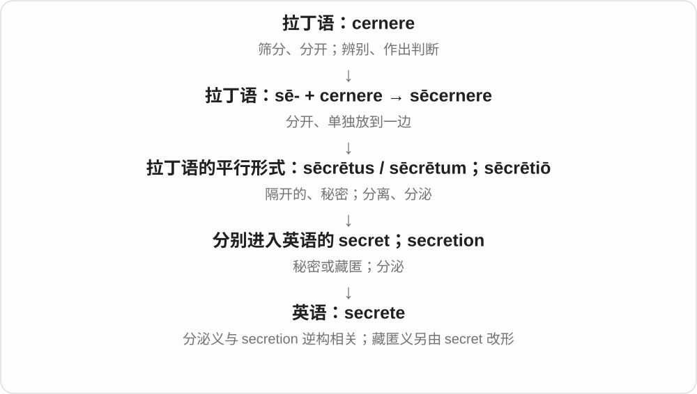

glands secrete hormones 是腺体分泌激素；secrete a letter in a drawer 是把信藏在抽屉里，后一义较书面。生理分泌可以进入体内或外部，不等于都排成废物。

**常见搭配与例句**

secrete hormones；secrete mucus；secrete something away。

> The glands secrete substances that help digestion.

这些腺体分泌帮助消化的物质。

> She had secreted the letter inside the book’s cover.

她把信藏在了书的封皮里面。

**别混淆**

secret 重音在前，是秘密；secrete 常见读音重音在后。excrete 强调排出体外的过程，secrete 强调细胞或腺体释放其产物。

### 7. secretary — 秘书；干事；书记；某些部门的部长

**音标**：英 /ˈsekrətəri/；美 /ˈsekrəteri/

**先抓住这个画面**

secretary 的历史起点是能被托付私人、机密事务的人，后来成为负责文书、联系、组织工作的人或主管头衔。

**怎么拆**

来自中古拉丁 sēcrētārius，与 sēcrētum“秘密、私人事务”相关；不是今天做秘书的人都在替谁保守秘密。

**怎么变成今天的意思**

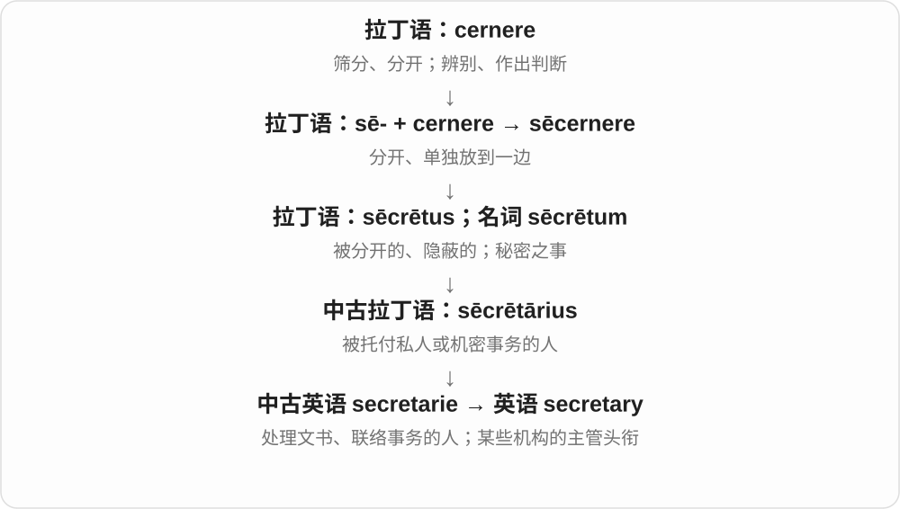

a club secretary 常负责协会记录与事务；a personal secretary 是私人秘书；Secretary of State 等是高级官职名称，不能一律翻译成办公室秘书。

**常见搭配与例句**

a personal secretary；the club secretary；the general secretary。

> Please send the agenda to the club secretary.

请把议程发给俱乐部秘书。

> The secretary arranged the appointments and prepared the letters.

秘书安排了预约并准备了信件。

**别混淆**

assistant 泛指协助工作的人；secretary 往往是具体行政岗位或制度化头衔，其职责须看机构。

### 8. secretarial — 秘书工作的；文秘的

**音标**：英 /ˌsekrəˈteəriəl/；美 /ˌsekrəˈteriəl/

**先抓住这个画面**

secretarial 像把视线移到安排日程、处理信件、整理文件这一组工作上。

**怎么拆**

现代对应 secretary + -al，并采用拉丁式 -arial 形式；所谓 *sēcrētāriālis 是构词分析中的重构形式，不能当作已证实的古代借词节点。

**怎么变成今天的意思**

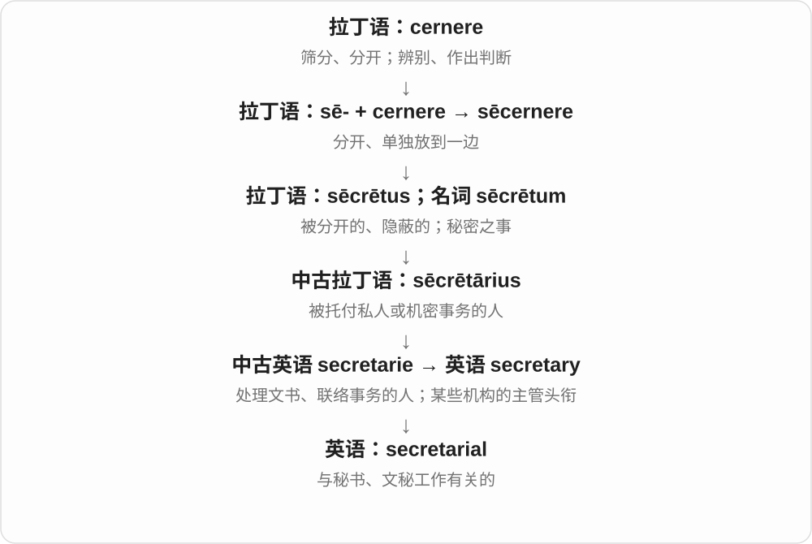

secretarial duties 是文秘职责；secretarial support 是提供文件、日程、联络等协助。这个形容词不是“秘密的”。

**常见搭配与例句**

secretarial support；secretarial duties；secretarial skills。

> The department provides secretarial support for the committee.

部门为委员会提供文秘支持。

> Her responsibilities include both research and secretarial duties.

她的职责既包括研究，也包括文秘工作。

**别混淆**

secret 是秘密的；secretarial 是文秘工作的，不能因为共享 secret 字样而混用。

### 9. secretion — 分泌；分泌物

**音标**：/sɪˈkriːʃən/

**先抓住这个画面**

secretion 可以是细胞把产物释放出来这件事，也可以是释放出来的那份物质，像从内部单独送出一份成品。

**怎么拆**

经法语 sécrétion 来自拉丁 sēcrētiō“分离”；它在英语里的记录早于现代 secrete 分泌义，不能画成那个英语动词先造出此名词。

**怎么变成今天的意思**

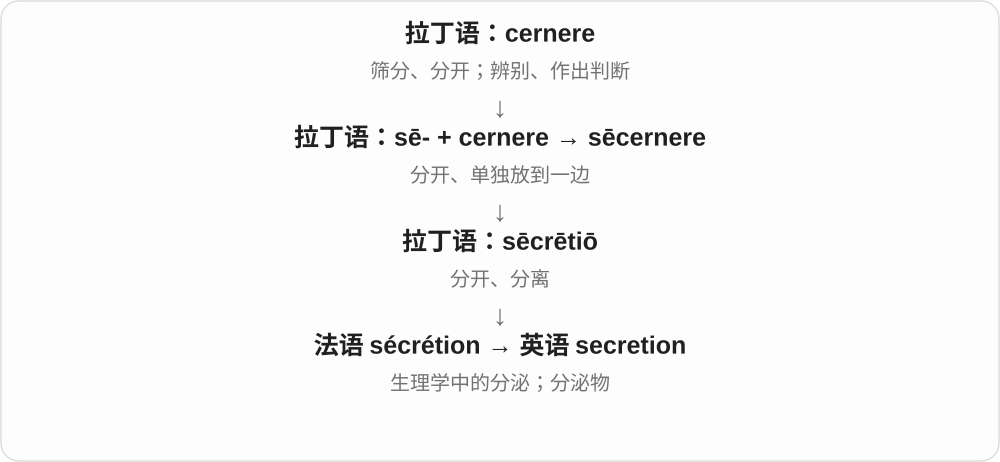

hormone secretion 是激素分泌；secretions 可指黏液等分泌物。重点是生物体产生、释放物质，而不是把任何液体流出都叫分泌。

**常见搭配与例句**

the secretion of hormones；salivary secretion；mucus secretions。

> The diagram shows the secretion of digestive enzymes.

图示展示了消化酶的分泌。

> The surface is protected by a layer of secretion.

表面受到一层分泌物的保护。

**别混淆**

excretion 关注排出废物或多余物质；secretion 关注细胞、腺体的释放功能，具体生理过程可能有联系。

### 10. secret — 秘密；秘密的；诀窍

**音标**：/ˈsiːkrət/

**先抓住这个画面**

secret 像从公开的一堆东西里拿出一件，单独放到别人看不见的抽屉里。

**怎么拆**

拉丁 sē-（分开）+ cernere（分开、筛分）→ sēcernere；分词 sēcrētus“被隔开的、隐蔽的”和名词 sēcrētum 分别通向英语相关用法。

**怎么变成今天的意思**

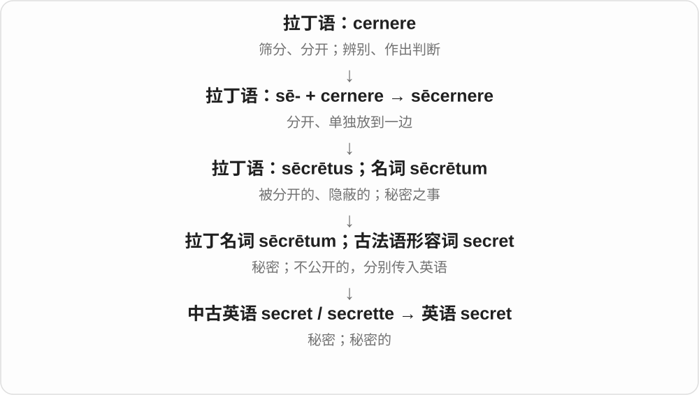

keep a secret 是保密；a secret meeting 是秘密会议；the secret of good bread 是做好面包的诀窍，把不为外人所知的方法当作“秘密”。

**常见搭配与例句**

keep a secret；in secret；a secret passage；the secret to success。

> Can you keep a secret until Friday?

你能把这个秘密保守到周五吗？

> The secret to the recipe is slow cooking.

这道菜的诀窍是慢慢烹煮。

> They discovered a secret passage behind the shelves.

他们在书架后面发现了一条暗道。

**别混淆**

private 只强调私人、不公开的范围；secret 往往更强调别人不知道或不该知道。

### 11. secretly — 秘密地；瞒着别人地；心里暗自

**音标**：/ˈsiːkrətli/

**先抓住这个画面**

secretly 像把一件事放到别人视线之外进行；也可说某种想法只在心里，没有表现出来。

**怎么拆**

secret + -ly，表示不让别人知道的方式。

**怎么变成今天的意思**

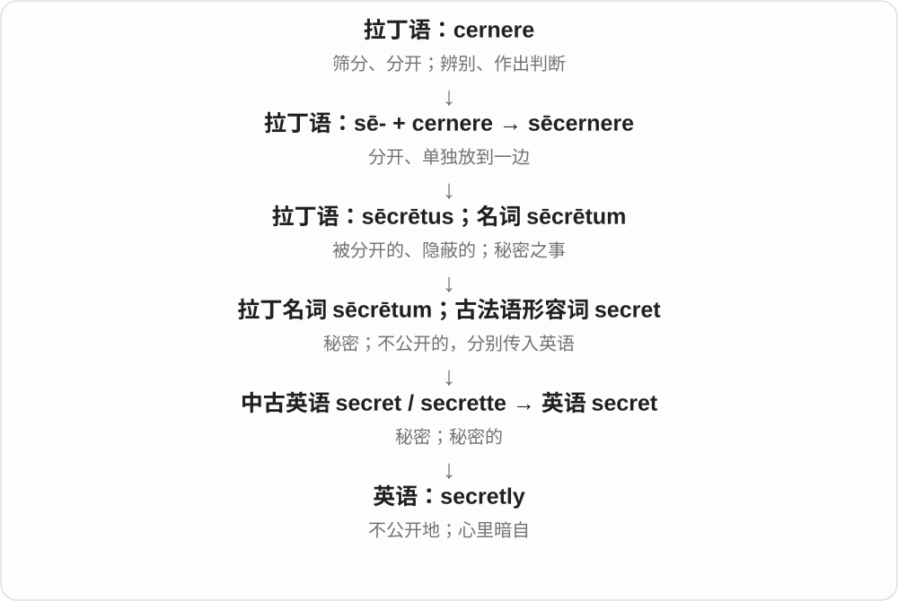

secretly plan a party 是背着别人策划；secretly pleased 是心里暗自高兴，表面不露出来。

**常见搭配与例句**

meet secretly；secretly hope；secretly admire。

> They secretly planned a celebration for their teacher.

他们瞒着老师筹备了一场庆祝活动。

> She was secretly pleased that the meeting had been cancelled.

会议取消了，她心里暗自高兴。

**别混淆**

quietly 是声音轻或不张扬；secretly 是不让别人知道，二者关注点不同。

### 12. secrecy — 保密；隐秘状态

**音标**：/ˈsiːkrəsi/

**先抓住这个画面**

secrecy 像给一件事罩上不透明的罩子，重点是信息被关在里面、不让外人知道的状态。

**怎么拆**

由中古英语较早的 secretee 等形式改造成 -cy 结尾，受 primacy 一类名词形式影响；不能只按现代 secret 去 t 加 -cy 假造历史。

**怎么变成今天的意思**

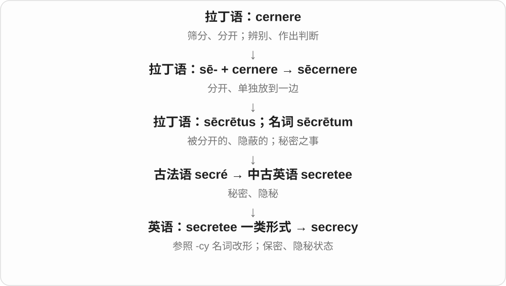

sworn to secrecy 是被要求发誓保密；in secrecy 是在保密状态下；a veil of secrecy 是神秘、保密的外罩。

**常见搭配与例句**

strict secrecy；sworn to secrecy；a veil of secrecy。

> The preparations were carried out in strict secrecy.

准备工作是在严格保密的情况下进行的。

> Everyone involved was sworn to secrecy.

所有参与者都被要求发誓保密。

**别混淆**

secret 通常是那件秘密；secrecy 是保密状态或做法，不说 tell a secrecy 来表示讲一个秘密。

### 13. secretive — 遮遮掩掩的；不愿透露情况的

**音标**：/ˈsiːkrətɪv/

**先抓住这个画面**

secretive 像一个人始终把抽屉关着，别人问到某件事，他也只肯透露一点点。

**怎么拆**

中古英语已有 secretife，现代对应 secret + -ive；这里讲日常“爱保密”的读音与用法。

**怎么变成今天的意思**

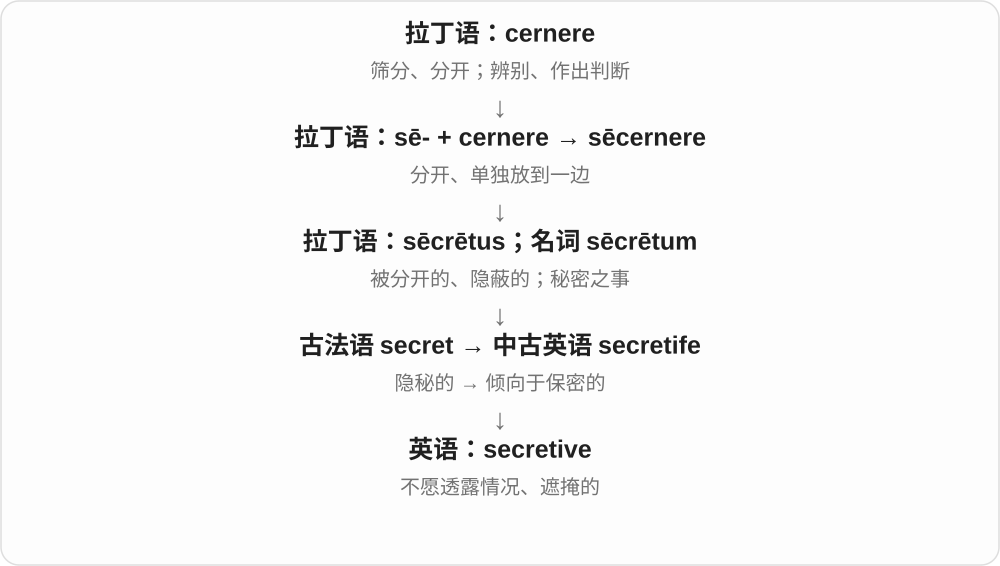

be secretive about plans 是对计划不愿多说。它通常让人感觉过分封闭或引起疑心；不是 secret 的所有用法都能换成它。

**常见搭配与例句**

secretive about；a secretive manner；a secretive organization。

> He has been unusually secretive about his new project.

他最近对新项目格外不愿透露情况。

> Her secretive manner made the others curious.

她遮遮掩掩的样子让其他人很好奇。

**别混淆**

secret meeting 是秘密会议；secretive person 是一个不愿透露情况的人。前者说事情保密，后者说行为倾向。

### 14. concern — 涉及；使担心；关切；问题、事务；企业

**音标**：英 /kənˈsɜːn/；美 /kənˈsɜːrn/

**先抓住这个画面**

concern 的现代共同点是“这件事牵涉到我或影响我”：所以既能说与我有关，也能说让我挂心。

**怎么拆**

拉丁 con- + cernere 原有一起筛、混合之义；中古拉丁 concernere 转到“涉及”，再经法语进入英语。名词由英语动词转用。

**怎么变成今天的意思**

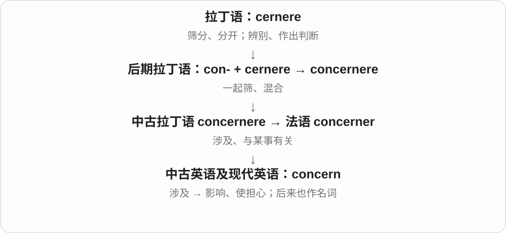

This concerns everyone 是这涉及所有人；The delay concerns me 是延误让我担心；a concern 可是需要关注的问题，也可在正式语言中指企业。

**常见搭配与例句**

concern someone；a matter of concern；raise concerns；a business concern。

> The new rule concerns everyone who uses the building.

新规定涉及所有使用这栋建筑的人。

> The lack of clear information concerns me.

缺乏明确信息让我担心。

> Safety is our main concern during the renovation.

翻修期间，安全是我们最关注的问题。

**别混淆**

worry 主要说担心；concern 还可以只是涉及、相关。This does not concern you 可以是“这与你无关”，不一定在安慰。

### 15. concerned — 担心的；关切的；有关的、涉及的

**音标**：英 /kənˈsɜːnd/；美 /kənˈsɜːrnd/

**先抓住这个画面**

concerned 像被一件事牵动：可能是心里担忧，也可能只是自己确实在这件事的范围里。

**怎么拆**

concern + -ed，分词形容词保留“受影响、被牵涉”的结果。

**怎么变成今天的意思**

concerned about 通常是担心；concerned with 通常是涉及、着眼于；the people concerned 是相关人员。as far as I am concerned 可说就我而言。

**常见搭配与例句**

concerned about；concerned with；all concerned；as far as … is concerned。

> We are concerned about the condition of the bridge.

我们担心桥梁的状况。

> The report is concerned with access to public transport.

报告关注的是公共交通的可及性。

> All concerned will receive a copy of the decision.

所有相关人员都会收到决定的副本。

**别混淆**

worried 主要表示忧虑；concerned 的“有关”义并不要求任何人心情焦虑。

### 16. concerning — 关于；涉及；令人担忧的

**音标**：英 /kənˈsɜːnɪŋ/；美 /kənˈsɜːrnɪŋ/

**先抓住这个画面**

concerning 可以把话题圈出来：“接下来谈的是这件事。”作形容词时，也能说某个迹象让人挂心。

**怎么拆**

concern + -ing；分词进一步用作介词和形容词，两个用法都与 concern 的原有义相连。

**怎么变成今天的意思**

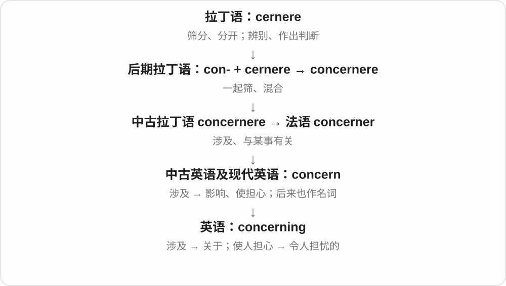

information concerning the trip 是关于行程的信息；a concerning trend 是令人担忧的趋势。通过它后面接名词还是它在修饰名词，可帮助判断。

**常见搭配与例句**

questions concerning；information concerning；a concerning development。

> Please send any questions concerning the schedule by email.

有关日程的问题请通过邮件发送。

> The report identifies a concerning rise in errors.

报告指出错误数量出现了令人担忧的增长。

**别混淆**

concerned 描写人担心或事物相关；concerning 作形容词描写引起担忧的东西。about 作“关于”更日常。

### 17. unconcern — 不在意；漠不关心；从容无忧

**音标**：英 /ˌʌnkənˈsɜːn/；美 /ˌʌnkənˈsɜːrn/

**先抓住这个画面**

unconcern 把“不被这件事牵动”的态度作为名词来谈，既可能从容，也可能冷淡。

**怎么拆**

un-（无、不）+ concern（关切、担忧），英语内部派生。

**怎么变成今天的意思**

with apparent unconcern 是看似若无其事地；unconcern for others 可含不顾他人的批评。词形较正式，不如 not worried 日常。

**常见搭配与例句**

with unconcern；apparent unconcern；unconcern for。

> He listened to the announcement with apparent unconcern.

他听着公告，看上去若无其事。

> Their unconcern for the neighbours caused resentment.

他们对邻居漠不关心，引起了不满。

**别混淆**

indifference 通常强调无兴趣或不在乎；unconcern 也可强调没有焦虑，两者部分重叠。

### 18. unconcerned — 不担心的；不在意的；无关的

**音标**：英 /ˌʌnkənˈsɜːnd/；美 /ˌʌnkənˈsɜːrnd/

**先抓住这个画面**

unconcerned 像旁边已经有些动静，这个人却没有被牵动：可能是镇定，也可能是漠不关心。

**怎么拆**

un-（不）+ concerned；也可联系 unconcern + -ed，是英语内部形成的否定形容词。

**怎么变成今天的意思**

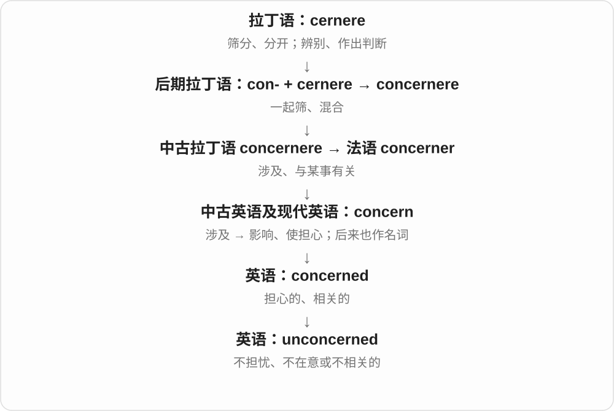

unconcerned about a delay 可表示并不担心；unconcerned with appearances 是不在意外表。褒贬取决于他是否理应关心。

**常见搭配与例句**

seem unconcerned；unconcerned about；unconcerned with。

> She seemed unconcerned about the short delay.

她似乎不在意这次短暂延误。

> The artist was unconcerned with fashionable trends.

这位艺术家不在意流行趋势。

**别混淆**

calm 是镇定；unconcerned 还可能让人觉得根本没把事情放在心上。

### 19. concert — 音乐会；协同、一致；共同商定

**音标**：名词：英 /ˈkɒnsət/；美 /ˈkɑːnsərt/。动词：英 /kənˈsɜːt/；美 /kənˈsɜːrt/

**先抓住这个画面**

concert 可以想成几个人把行动协调到一起：在舞台上成为合奏、音乐会，在一般事务里就是协同行动。

**怎么拆**

名词经法语 concert 来自意大利 concerto；动词另经法语 concerter 或意大利 concertare。更早与拉丁“争论、竞争”的联系及语义变化未完全确定。

**怎么变成今天的意思**

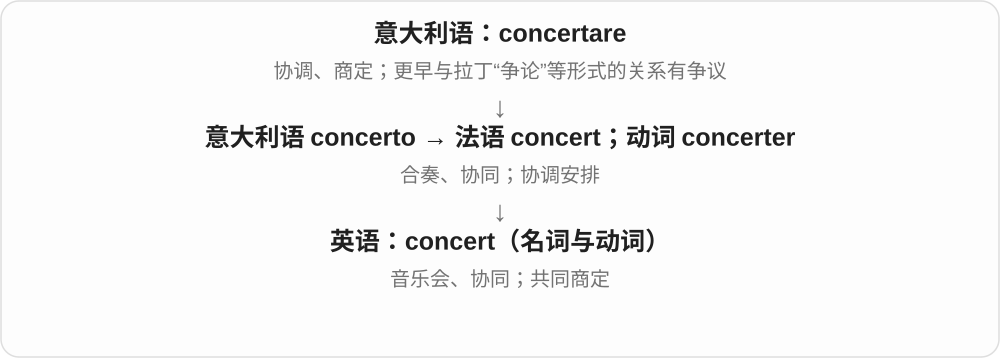

at a concert 是在音乐会；in concert with 是与……共同协作。单独的动词 concert 很正式，现代更常见分词 concerted。

**常见搭配与例句**

give a concert；a live concert；in concert with；concert a plan。

> We went to a concert in the town hall.

我们去市政厅听了一场音乐会。

> The two organizations worked in concert to restore the park.

两个组织协同合作，修复了公园。

**别混淆**

concerto 是协奏曲这种作品；concert 是演出活动或协同状态。把“争执变和谐”当作必然词源故事并不稳妥。

### 20. concerted — 共同协调的；一致的；努力集中的

**音标**：英 /kənˈsɜːtɪd/；美 /kənˈsɜːrtɪd/

**先抓住这个画面**

concerted 像把分散的力气朝同一个方向使：大家有协调，或一个人有计划地集中投入。

**怎么拆**

concert 作为“共同商定、协调”的动词加 -ed；不是“开过音乐会的”。

**怎么变成今天的意思**

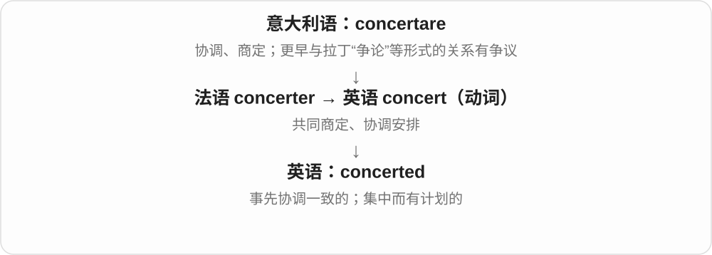

a concerted effort 常是协同努力，也能指个人认真集中力量的努力；concerted action 是协调一致的行动。

**常见搭配与例句**

a concerted effort；concerted action；a concerted campaign。

> A concerted effort by local volunteers reopened the library.

当地志愿者协同努力，让图书馆重新开放。

> She made a concerted effort to improve her handwriting.

她集中精力，认真努力改善自己的字迹。

**别混淆**

simultaneous 只要求同时发生；concerted 还带共同安排、配合或有组织投入的意味。

### 21. concertina — 六角手风琴；像手风琴一样伸缩、折叠

**音标**：英 /ˌkɒnsəˈtiːnə/；美 /ˌkɑːnsərˈtiːnə/

**先抓住这个画面**

concertina 的鲜明画面是两手推拉中间的风箱，让折层一收一放；这个外形又成为其他折叠物的比喻。

**怎么拆**

英语 concert + -ina 形成乐器名；后来依据其可伸缩、折叠的形状转作动词或修饰其他物品。

**怎么变成今天的意思**

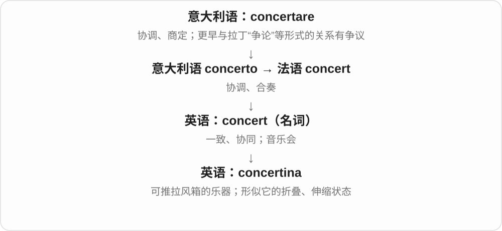

乐器常为多边形两端、按钮与风箱结构，中文常叫六角手风琴；concertina door 是折叠门；concertina wire 是盘卷伸缩状铁丝障碍。

**常见搭配与例句**

play the concertina；a concertina door；concertina folds。

> He played a folk tune on the concertina.

他用六角手风琴演奏了一首民间曲调。

> The map folds into a compact concertina shape.

地图像手风琴一样折成了紧凑的一叠。

**别混淆**

accordion 是手风琴的大类名称及相应乐器；concertina 是特定类型。中文“六角”是常见叫法，不要求所有实例恰好六边。

### 22. concertmaster — 乐队首席；通常指交响乐团第一小提琴首席

**音标**：英 /ˈkɒnsətˌmɑːstə/；美 /ˈkɑːnsərtˌmæstər/

**先抓住这个画面**

concertmaster 像乐队里带领演奏者协调细节的首席成员，通常坐在第一小提琴声部最前面。

**怎么拆**

concert + master，仿译德语 Konzertmeister；德语称号是命名参照，不是英语 master 借去了德国又回来。

**怎么变成今天的意思**

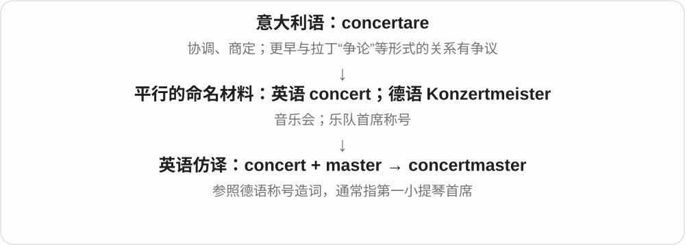

交响乐团中通常承担弦乐演奏协调、独奏段落等职责，与站在台前统领全团的 conductor 不是同一个职位。英式也常称 leader。

**常见搭配与例句**

the orchestra’s concertmaster；serve as concertmaster；the concertmaster’s solo。

> The concertmaster led the strings through the difficult passage.

乐队首席带领弦乐声部演奏了那个困难片段。

> The solo was played by the orchestra’s concertmaster.

这段独奏由乐团首席演奏。

**别混淆**

conductor 是指挥；concertmaster 通常是实际参加演奏的第一小提琴首席。

### 23. disconcert — 使慌乱；使不知所措；扰乱镇定

**音标**：英 /ˌdɪskənˈsɜːt/；美 /ˌdɪskənˈsɜːrt/

**先抓住这个画面**

disconcert 像谈话原本很顺，一个意外问题突然插进来，把人的节奏打乱，让他一时不知道怎么应对。

**怎么拆**

借法语 disconcerter，dis- 表示逆转，加 concerter“协调”；它比英语动词 concert 的已知记录更早，不能画成英语动词先造出法语形式。

**怎么变成今天的意思**

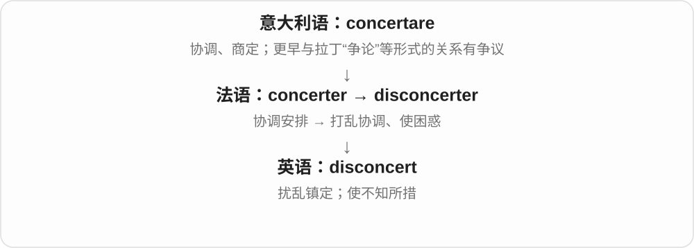

可以是 unexpected silence、a direct question 等让人不自在或失去镇定，通常不需要达到极度恐惧。

**常见搭配与例句**

disconcert someone；be disconcerted by；a question that disconcerts。

> Her direct question seemed to disconcert the speaker.

她直接的问题似乎让发言者有点措手不及。

> The sudden silence did not disconcert him.

突然的沉默没有让他慌乱。

**别混淆**

confuse 主要使人搞不明白；disconcert 更突出镇定、自信或应对节奏被打乱。

### 24. disconcerting — 令人不安、尴尬或不知所措的

**音标**：英 /ˌdɪskənˈsɜːtɪŋ/；美 /ˌdɪskənˈsɜːrtɪŋ/

**先抓住这个画面**

disconcerting 像突然出现的一件不对劲的事，让人原来的镇定轻轻晃了一下。

**怎么拆**

disconcert + -ing，分词形容词表示会引起不自在、慌乱的性质。

**怎么变成今天的意思**

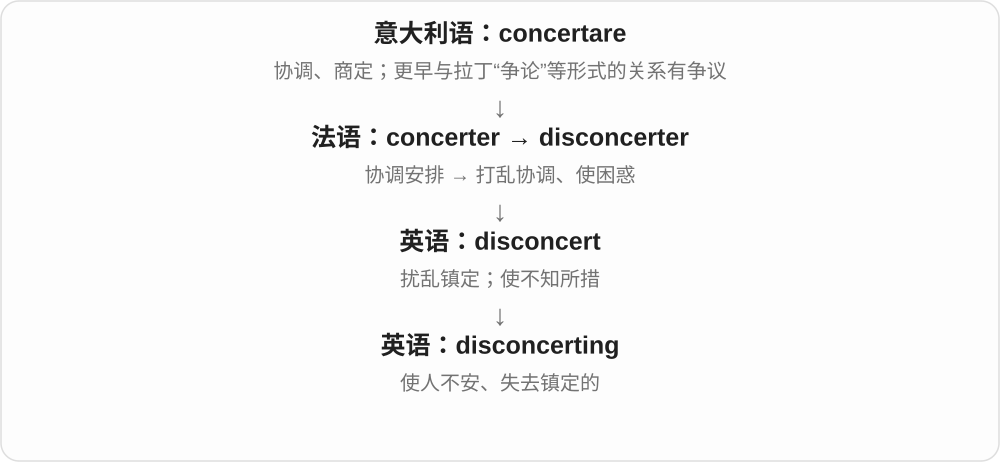

a disconcerting silence 是令人不自在的沉默；a disconcerting habit 是让人不安或难应付的习惯。语气常比 terrifying 温和。

**常见搭配与例句**

a disconcerting silence；find it disconcerting；a disconcerting habit。

> The room fell into a disconcerting silence.

房间陷入了令人不自在的沉默。

> It was disconcerting to hear my own voice played back.

听到自己的声音被回放出来，让我有点不自在。

**别混淆**

alarming 通常更强调危险信号、惊慌；disconcerting 也能只是打乱社交节奏或让人感到异样。

### 25. disconcerted — 不知所措的；失去镇定的；感到不自在的

**音标**：英 /ˌdɪskənˈsɜːtɪd/；美 /ˌdɪskənˈsɜːrtɪd/

**先抓住这个画面**

disconcerted 像原先准备好的反应被突然打断，表情里露出“这下我该怎么接”的迟疑。

**怎么拆**

disconcert + -ed，过去分词作形容词，焦点是受到影响的人。

**怎么变成今天的意思**

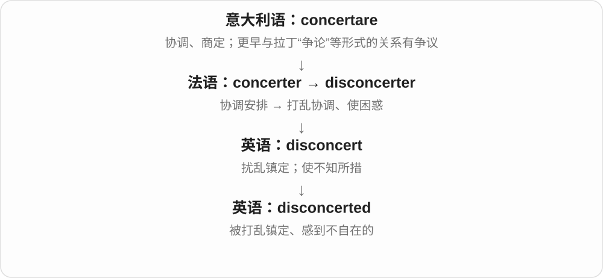

常说 look disconcerted 或 be disconcerted by something。它不一定表示生气，更多是意外带来的慌乱、窘迫或不自在。

**常见搭配与例句**

look disconcerted；feel disconcerted；disconcerted by。

> She looked disconcerted when nobody answered.

没人回应时，她显得有些不知所措。

> I was disconcerted by the unexpected change of plan.

计划意外改变，让我有些乱了阵脚。

**别混淆**

disconcerting 形容引发这种感觉的事；disconcerted 形容感到这种感觉的人。

### 26. certificate — 证书；证明文件；发证认证

**音标**：名词：英 /səˈtɪfɪkət/；美 /sərˈtɪfɪkət/。动词：英 /səˈtɪfɪkeɪt/；美 /sərˈtɪfɪkeɪt/

**先抓住这个画面**

certificate 像把正式确认的结果写在一张可保存、出示的纸上，今天也可以是电子凭证。

**怎么拆**

名词经法语 certificat，来自中古拉丁 certificātum“被证明的事物”；动词由英语名词转用。不是英语 certify 加 -cate。

**怎么变成今天的意思**

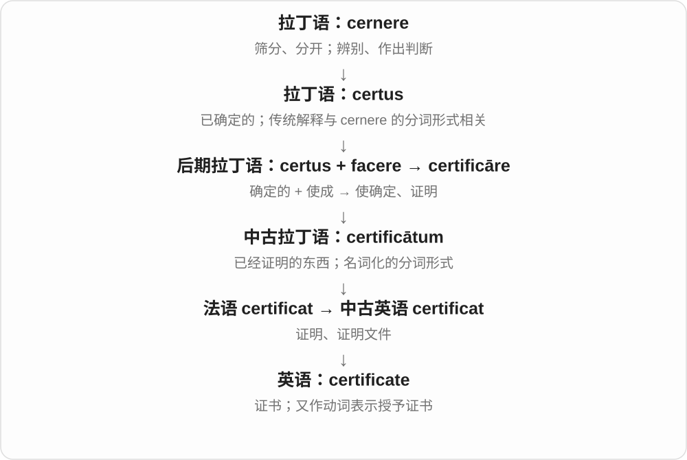

a birth certificate 是出生证明；a course certificate 是课程证书；a digital certificate 是数字证书。拿到证书可能证明完成、资格或身份，要看证书内容。

**常见搭配与例句**

a birth certificate；a certificate of completion；issue a certificate。

> She received a certificate after completing the course.

完成课程后，她获得了一张证书。

> The website uses a digital certificate to help establish its identity.

网站使用数字证书帮助证明自己的身份。

**别混淆**

certification 是认证过程或资格状态；certificate 更具体地指证明文件，纸本或电子都可以。

### 27. certification — 认证；资格认证；正式证明

**音标**：英 /ˌsɜːtɪfɪˈkeɪʃən/；美 /ˌsɜːrtɪfɪˈkeɪʃən/

**先抓住这个画面**

certification 像从检查到认可的一整套认证过程，也可指通过后拥有的资格。

**怎么拆**

中古拉丁 certificātiō 经中古英语 certificacioun 等形式而来，与 certificāre“证明”同支；名词有独立借入链。

**怎么变成今天的意思**

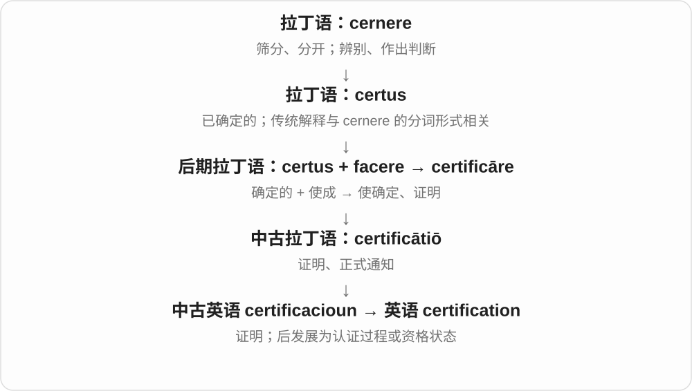

apply for certification 是申请认证；maintain certification 是维持认证资格；certification requirements 是认证要求。

**常见搭配与例句**

professional certification；obtain certification；certification requirements。

> The programme prepares students for professional certification.

这个项目帮助学生准备职业资格认证。

> The product must meet the certification requirements.

产品必须满足认证要求。

**别混淆**

certificate 通常是证明文件；certification 可涵盖审核过程及其结果，不能全都译成一张证书。

### 28. certify — 正式证明；认证；确认符合要求

**音标**：英 /ˈsɜːtɪfaɪ/；美 /ˈsɜːrtɪfaɪ/

**先抓住这个画面**

certify 像有资格的人在文件上盖一个章：“我正式证明这件事属实，或它符合这套标准。”

**怎么拆**

拉丁 certus“确定的”+ facere“使、做”形成后期拉丁 certificāre，经古法语 certefier 等形式进入英语。

**怎么变成今天的意思**

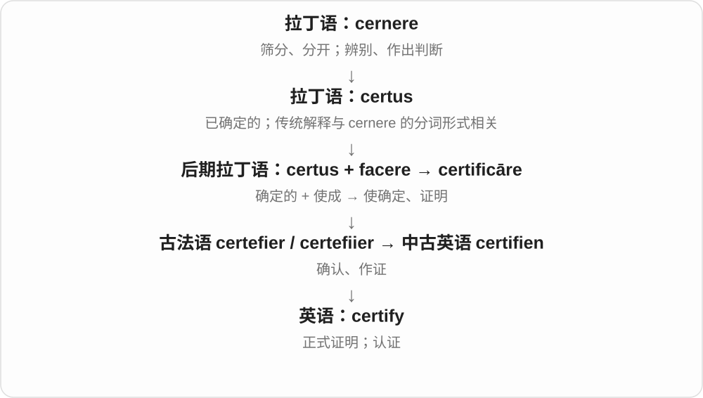

certify a copy 是证明副本真实；certify someone as qualified 是认证资质；certify that 引出正式证明的内容。

**常见搭配与例句**

certify that；certify as；certify a copy；certify a product。

> The officer certified that the copy matched the original.

工作人员证明该副本与原件一致。

> The organization certifies instructors who complete the training.

该机构为完成培训的教练进行资质认证。

**别混淆**

check 只是检查；certify 进一步作出正式证明，通常有身份、标准或程序作背景。

### 29. certified — 经认证的；有资格证明的；经核证的

**音标**：英 /ˈsɜːtɪfaɪd/；美 /ˈsɜːrtɪfaɪd/

**先抓住这个画面**

certified 像资格或真实性已经盖过章，表示某种正式确认已经完成。

**怎么拆**

certify 的过去分词，-y 在 -ed 前改为 -i-；也作形容词。

**怎么变成今天的意思**

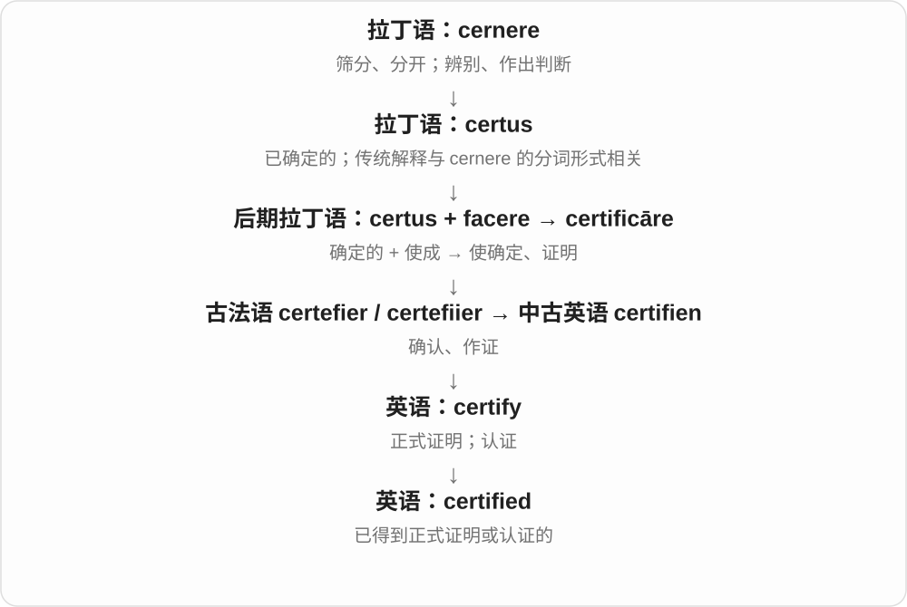

a certified instructor 是经认证的教练；a certified copy 是经核证的副本。certified 描述认证状态，认证具体保证什么由标准决定。

**常见搭配与例句**

a certified copy；a certified instructor；certified organic。

> Please attach a certified copy of the document.

请附上这份文件的经核证副本。

> The course is taught by certified instructors.

这门课由持有认证资格的教练授课。

**别混淆**

qualified 强调具备资格或能力；certified 强调获得了正式认证，两者有重叠但不完全相同。

### 30. certifiable — 可正式证明、可认证的；口语也可讥称疯狂的

**音标**：英 /ˈsɜːtɪfaɪəbəl/；美 /ˈsɜːrtɪfaɪəbəl/

**先抓住这个画面**

certifiable 最直接是“能够获得正式证明”的。它另有旧制度留下的口语义：夸张地说某人简直疯了。

**怎么拆**

certify + -able；-y 改 -i-。口语贬义来自过去正式认定精神失常的 certify 用法，与普通产品认证要分开。

**怎么变成今天的意思**

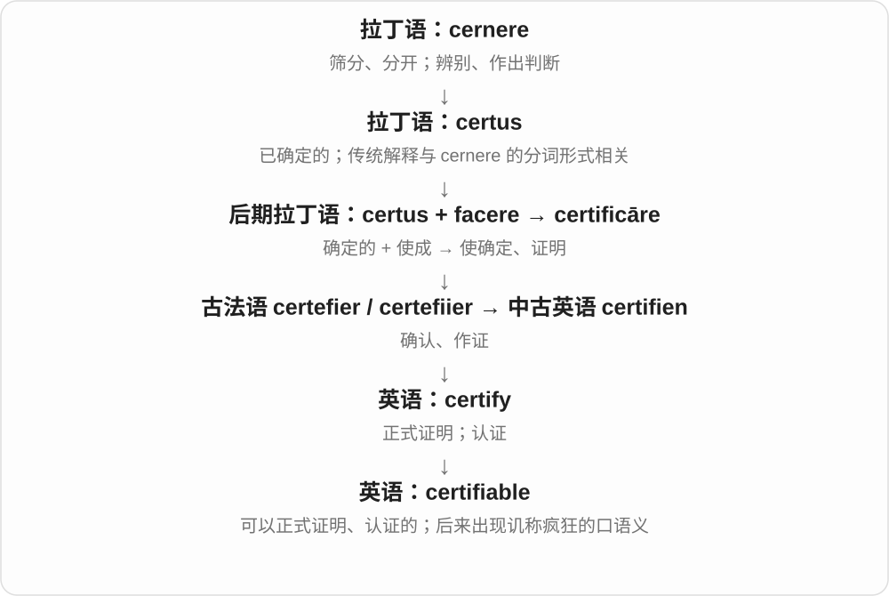

技术语境常说 certifiable skills。说 a certifiable genius 等则带夸张的“可谓公认”意味；形容人疯狂的用法可能冒犯，并非医学判断。

**常见搭配与例句**

certifiable skills；certifiable evidence；certifiable as。

> The training develops skills that are certifiable under the scheme.

培训培养的技能可按该方案获得认证。

> The statement must be supported by certifiable evidence.

这项陈述必须有可正式核证的证据支持。

**别混淆**

certified 是已经认证；certifiable 是可以认证，-able 不表示手续已经完成。

### 31. discreet — 谨慎得体的；能守秘密的；不张扬的

**音标**：/dɪˈskriːt/

**先抓住这个画面**

discreet 像知道什么该说、什么该留在心里，做事不让别人尴尬，也不引起多余注意。

**怎么拆**

同出拉丁 discrētus，意义从“能分辨”转为“判断得当、言行谨慎”；经古法语 discret、中古英语进入英语。

**怎么变成今天的意思**

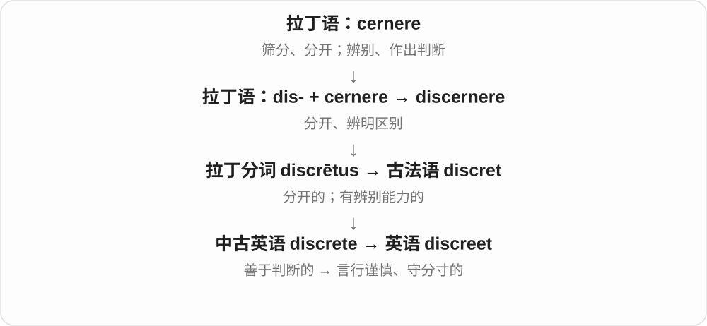

a discreet friend 是能守分寸、守秘密的朋友；a discreet entrance 是不显眼的入口；a discreet inquiry 是不张扬地打听。

**常见搭配与例句**

be discreet about；a discreet inquiry；a discreet sign。

> Please be discreet about the surprise party.

请对惊喜聚会的事保密，别张扬。

> A discreet sign marked the entrance to the studio.

一个不显眼的标牌标出了工作室入口。

**别混淆**

secretive 常让人觉得刻意隐瞒、不愿透露；discreet 通常肯定谨慎得体。discrete 则完全是另一个现代用法。

### 32. discretion — 审慎；保密分寸；自行决定的权力

**音标**：/dɪˈskreʃən/

**先抓住这个画面**

discretion 像把判断权交到一个懂分寸的人手里：他知道哪些该说，也能判断该怎样办。

**怎么拆**

拉丁 discrētiō“区分、判断”经法语和中古英语借入；与 discreet 同族，但不是后来英语形容词才加 -ion。

**怎么变成今天的意思**

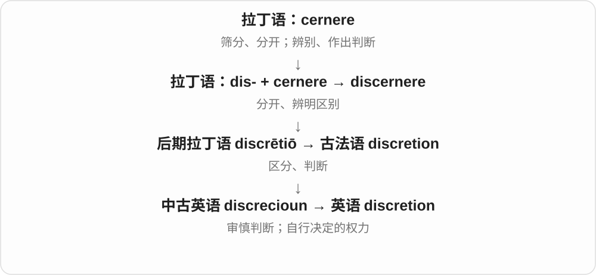

use discretion 是审慎判断；at your discretion 是由你酌情决定；thank you for your discretion 可是感谢守口如瓶、处理得体。

**常见搭配与例句**

at someone’s discretion；exercise discretion；use your discretion。

> Refunds may be offered at the manager’s discretion.

经理可酌情决定是否退款。

> Thank you for handling the matter with discretion.

谢谢你谨慎得体地处理这件事。

**别混淆**

permission 是获得允许；discretion 是在一定范围内自己判断怎么做的空间。它也可指谨慎品质，要看搭配。

### 33. discretionary — 可酌情决定的；非必需的

**音标**：英 /dɪˈskreʃənəri/；美 /dɪˈskreʃəneri/

**先抓住这个画面**

discretionary 像预算里留了一块可自己决定怎么花的钱，不是每一笔都被固定义务锁死。

**怎么拆**

discretion + -ary，表示属于自行判断、酌情决定范围的。

**怎么变成今天的意思**

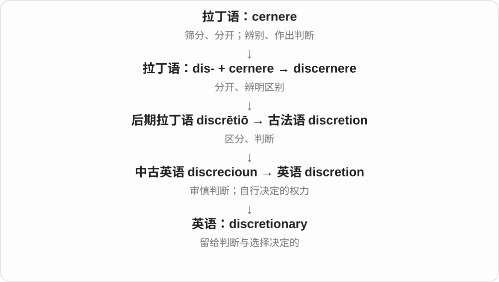

a discretionary bonus 是是否发放、发多少有酌情空间的奖金；discretionary spending 常指非必要开销，也可有特定预算制度含义。

**常见搭配与例句**

discretionary spending；a discretionary bonus；discretionary powers。

> The bonus is discretionary and is reviewed each year.

奖金是否发放由公司酌情决定，每年评议。

> We reduced discretionary spending to save for the move.

我们减少了非必要开支，为搬家存钱。

**别混淆**

mandatory 是必须执行；discretionary 表示存在选择、裁量空间，不等于可以无视一切规则。

### 34. indiscretion — 失言、失检点；不谨慎；不慎之举

**音标**：/ˌɪndɪˈskreʃən/

**先抓住这个画面**

indiscretion 像越过分寸的一句话或一个举动，事后才发现本该收住。

**怎么拆**

后期拉丁 indiscrētiō 经古法语 indiscrecion 借入；in- 否定加 discrētiō“判断”，名词有独立历史。

**怎么变成今天的意思**

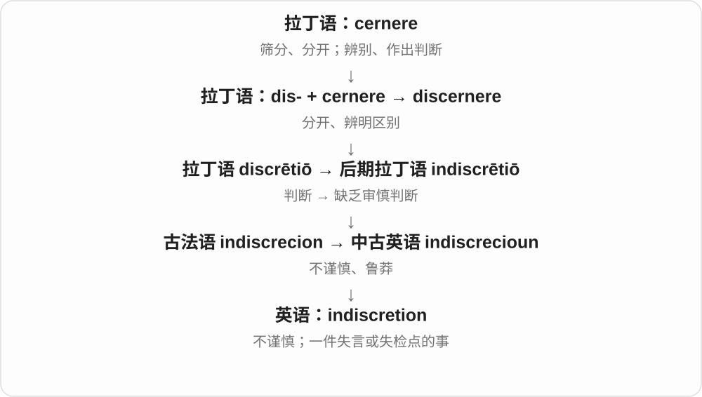

不可数时可说不慎；an indiscretion 可指一次失言或不检点行为，有时是含蓄指感情、性行为方面的越轨，需看上下文。

**常见搭配与例句**

a youthful indiscretion；an act of indiscretion；forgive an indiscretion。

> He apologized for his indiscretion at the meeting.

他为自己在会上失言道了歉。

> The biography mentions a few youthful indiscretions.

传记提到了他年轻时几件不够检点的事。

**别混淆**

mistake 是错误总称；indiscretion 更突出当时没守住分寸或欠缺判断。

### 35. discreetly — 谨慎得体地；不引人注意地

**音标**：/dɪˈskriːtli/

**先抓住这个画面**

discreetly 像悄悄递一张纸条，既把事办了，又不让整个房间都盯过来。

**怎么拆**

discreet + -ly；两个 e 相邻，属于谨慎、得体这一支。

**怎么变成今天的意思**

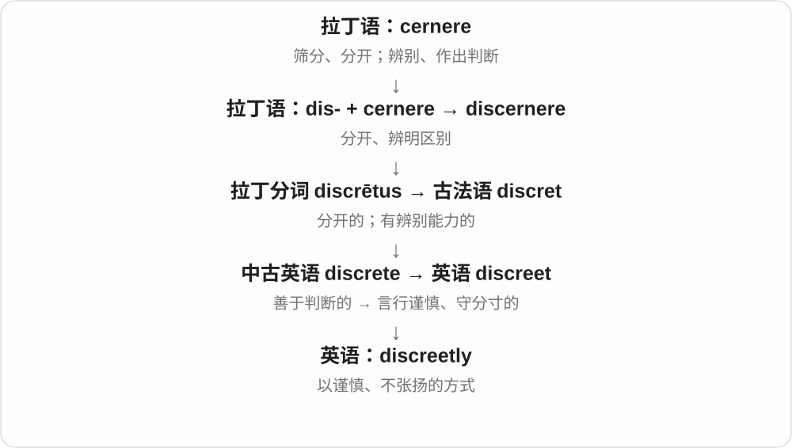

可以 discreetly check something、discreetly leave。它常表示顾及场合、隐私或他人感受，不一定有欺骗。

**常见搭配与例句**

ask discreetly；discreetly withdraw；check discreetly。

> She discreetly reminded him that his microphone was still on.

她不动声色地提醒他，麦克风还开着。

> He discreetly left before the speeches began.

演讲开始前，他悄悄离开，没有引人注意。

**别混淆**

secretly 只说不让人知道；discreetly 更突出分寸和不引人注意。

### 36. indiscreet — 言行不谨慎的；泄露隐私的；失分寸的

**音标**：/ˌɪndɪˈskriːt/

**先抓住这个画面**

indiscreet 像把本该私下说的话当众说了，或没有想过一句话会给别人带来什么麻烦。

**怎么拆**

现代可拆 in-（不）+ discreet；历史也追到中古拉丁 indiscrētus“不善判断的”，不是只能视为现代英语新加前缀。

**怎么变成今天的意思**

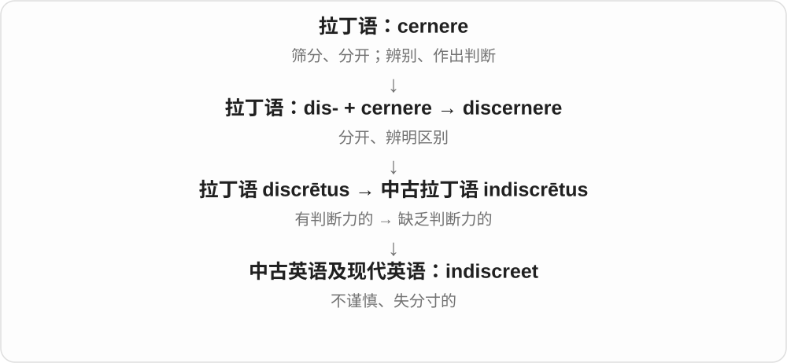

an indiscreet remark 是不该说却说出口的话；an indiscreet question 可能刺探隐私。重点是判断和分寸失当。

**常见搭配与例句**

an indiscreet remark；be indiscreet about；an indiscreet question。

> An indiscreet remark revealed the plan too early.

一句不谨慎的话过早泄露了计划。

> It would be indiscreet to discuss her private affairs here.

在这里谈她的私事会很失分寸。

**别混淆**

careless 泛指粗心；indiscreet 特别容易涉及言语、隐私、关系或场合分寸。

### 37. decree — 法令；正式裁决；颁令、裁定

**音标**：/dɪˈkriː/

**先抓住这个画面**

decree 像负责决断的权威把几种可能划清，正式宣布：“现在就按这一条办。”

**怎么拆**

拉丁 dēcernere“判定”由 dē- + cernere 构成，名词 dēcrētum 经古法语 decre 借入；英语动词后来由名词转用。

**怎么变成今天的意思**

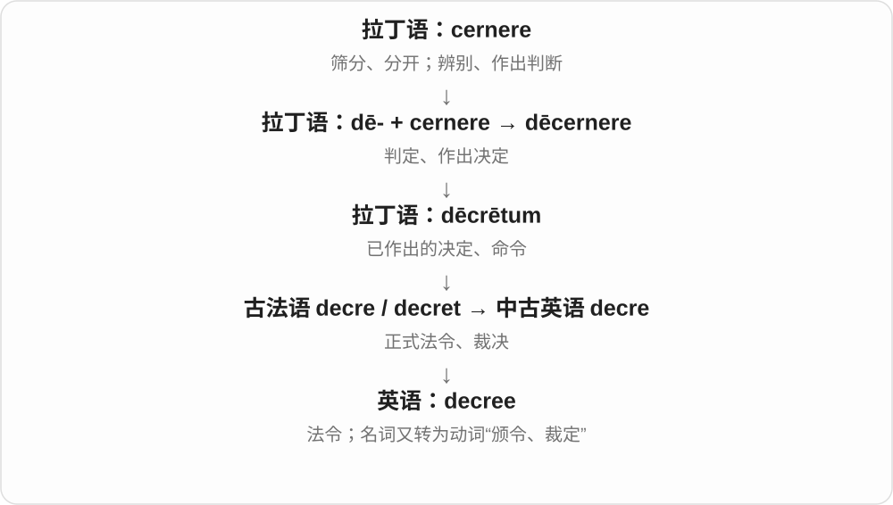

issue a decree 是颁布法令；decree that 是正式规定。旧时教会、君主与法院语境都常见。具体法律效力随制度而变。

**常见搭配与例句**

issue a decree；a royal decree；rule by decree；decree that。

> The decree established a new public holiday.

这项法令设立了一个新的公共假日。

> The council decreed that the historic gate should be preserved.

议会正式决定保留这座历史城门。

**别混淆**

decision 可是普通决定；decree 通常是由某种权威正式发布的命令或裁决。

### 38. discrete — 分开的；各自独立的；离散的

**音标**：/dɪˈskriːt/

**先抓住这个画面**

discrete 像把东西放进一个个独立盒子：盒子之间有界线，不是连成一片。

**怎么拆**

来自拉丁 discrētus“已分开的”，经法语等路线进入英语；与 discreet 原为同一词的拼写、意义分化。

**怎么变成今天的意思**

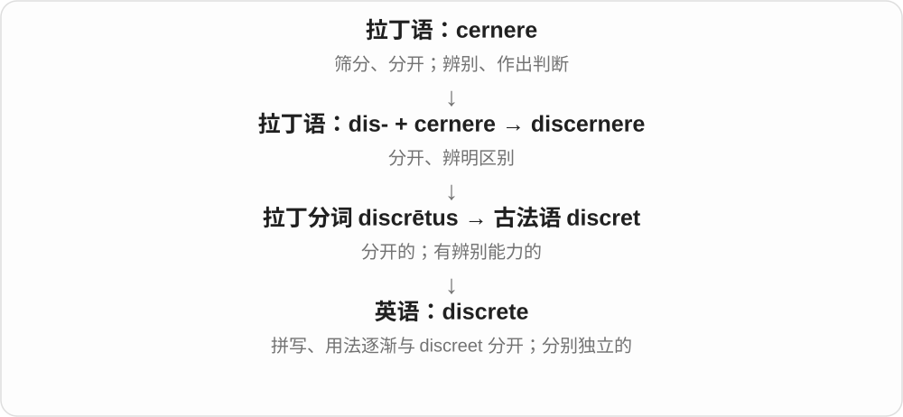

three discrete stages 是三个分开的阶段；discrete values 是一项项可分开的取值，比如人数的 0、1、2，而非任意连续变化。

**常见搭配与例句**

discrete units；discrete stages；discrete values；discrete mathematics。

> The course is divided into five discrete modules.

课程分成五个独立模块。

> The model treats the population as a set of discrete individuals.

这个模型把种群视为一组彼此独立的个体。

**别混淆**

discreet 是谨慎、不张扬，读音相同；discrete 强调各部分彼此分开。可用末尾的 t 把两个 e 隔开作拼写记忆，但这只是记忆法。

### 39. discretely — 分别地；离散地；作为独立部分地

**音标**：/dɪˈskriːtli/

**先抓住这个画面**

discretely 像逐格记录数值，一格是一格，而不是画一条没有间断的连续线。

**怎么拆**

discrete + -ly；这里是“分开”的 discrete，不能与 discreetly 的谨慎义混写。

**怎么变成今天的意思**

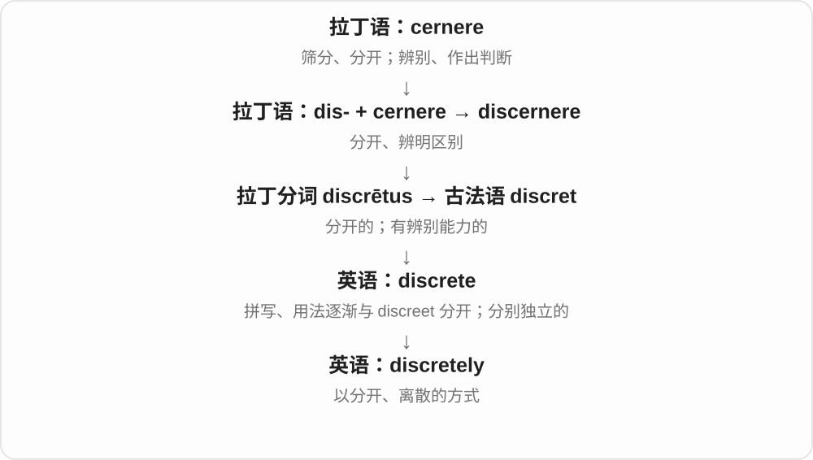

多用于技术、学术表达，比如 discretely sampled data。日常说 separately 往往更自然。

**常见搭配与例句**

discretely sampled；vary discretely；discretely represented。

> The system records temperature at discretely spaced time points.

系统在一个个间隔开的时间点记录温度。

> The variable changes discretely rather than continuously.

这个变量以离散方式变化，而不是连续变化。

**别混淆**

discreetly 与 discretely 同音；前者看做事是否得体，后者看部分或取值是否分开。

### 40. secretariat — 秘书处；书记处；负责行政协调的机构

**音标**：英 /ˌsekrəˈteəriət/；美 /ˌsekrəˈteriət/

**先抓住这个画面**

secretariat 像把若干秘书和行政协调人员组成一个办事机构，不再只是单个人。

**怎么拆**

借法语 secrétariat，与 secrétaire“秘书”相关，远源中古拉丁 sēcrētārius。

**怎么变成今天的意思**

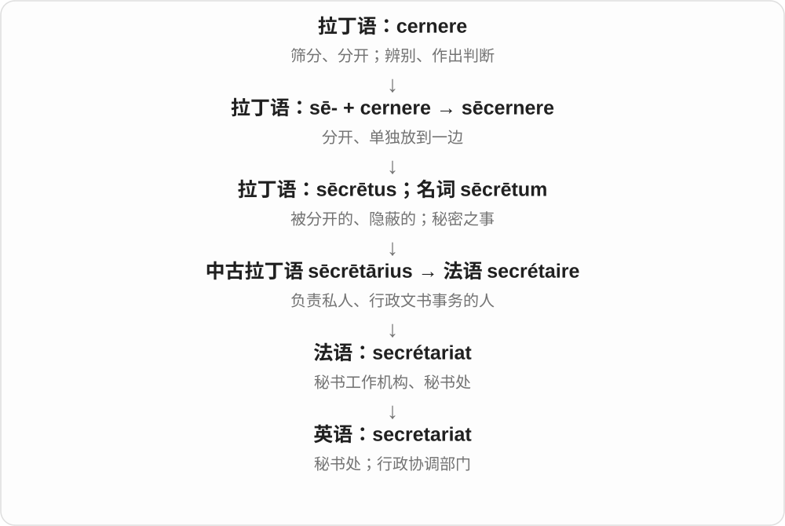

常见于国际组织、会议、协会的常设办事机构。规模可大可小，名称本身不能说明级别。

**常见搭配与例句**

a permanent secretariat；the conference secretariat；contact the secretariat。

> The conference secretariat will handle registration.

会议秘书处将负责登记报名。

> The organization established a permanent secretariat.

该组织设立了常设秘书处。

**别混淆**

secretary 通常是个人或岗位；secretariat 是机构、部门或其工作人员整体。

### 41. ascertain — 查明；弄清；确认

**音标**：英 /ˌæsəˈteɪn/；美 /ˌæsərˈteɪn/

**先抓住这个画面**

ascertain 像把模糊的一件事拿去查证，最后让它从“可能”变成“已弄清”。

**怎么拆**

古法语 a- + certener“使明确”形成 acertener，经中古英语 acerteynen 而来；与 certain 同族，不是把现代 certain 前面随意加 as。

**怎么变成今天的意思**

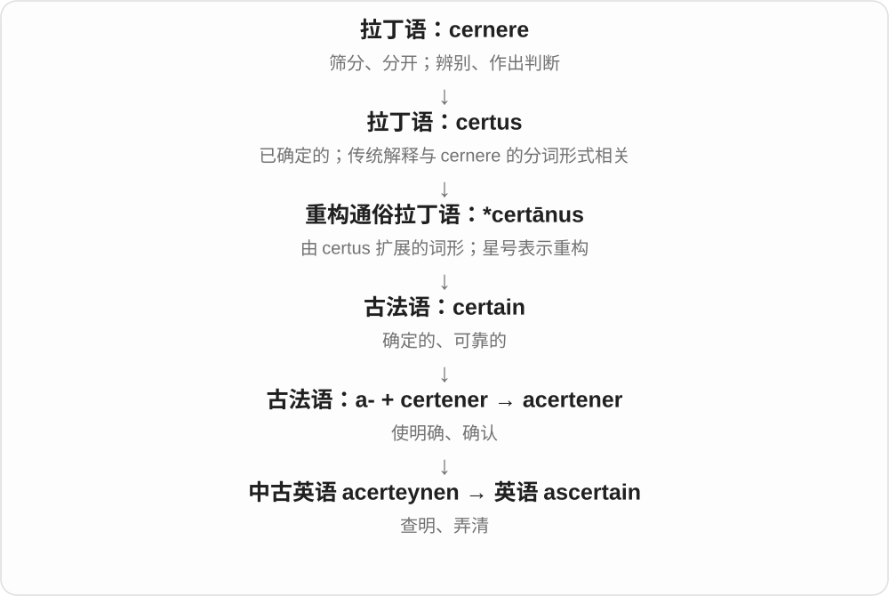

常接 ascertain whether、ascertain the cause。这个词较正式，强调通过查询、观察等弄清事实。

**常见搭配与例句**

ascertain the facts；ascertain whether；ascertain the cause。

> We need to ascertain whether the file is complete.

我们需要查明文件是否完整。

> The investigators tried to ascertain the cause of the failure.

调查人员试图查明故障原因。

**别混淆**

assume 是先作假定；ascertain 是设法查明，方向正好不同。

### 42. ascertainment — 查明；确认的过程

**音标**：英 /ˌæsəˈteɪnmənt/；美 /ˌæsərˈteɪnmənt/

**先抓住这个画面**

ascertainment 把“查到明确答案”整个过程作为名词来谈，像从找线索一直走到事实落定。

**怎么拆**

ascertain + -ment，表示查明的行动或结果。

**怎么变成今天的意思**

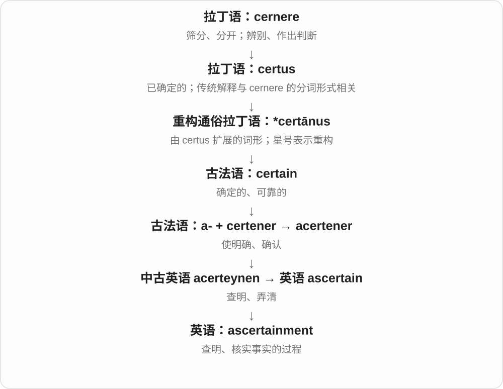

用于正式研究、调查等语境；日常表达 finding out 更自然。case ascertainment 是按研究方法识别、确认病例或案例，不能只译成泛泛的发现。

**常见搭配与例句**

ascertainment of facts；case ascertainment；accurate ascertainment。

> The investigation focused on the ascertainment of basic facts.

调查着重于查明基本事实。

> The report explains how case ascertainment was carried out.

报告说明了案例是如何被识别和确认的。

**别混淆**

certainty 是确定的状态；ascertainment 是把事实查清楚的过程。

### 43. concerto — 协奏曲

**音标**：英 /kənˈtʃeətəʊ/；美 /kənˈtʃertoʊ/

**先抓住这个画面**

concerto 像独奏乐器和乐队之间展开一场音乐对话：独奏声部突出，乐队与它配合、回应。

**怎么拆**

直接借意大利 concerto，与经法语借来的 concert 是同源异形词；不能拆成现代英语 concert 加 o。

**怎么变成今天的意思**

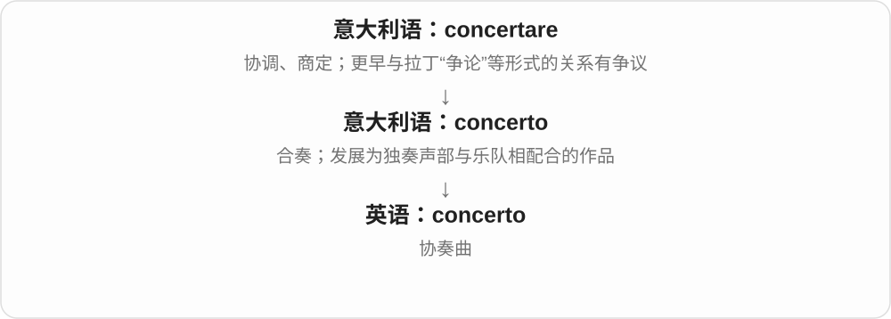

a piano concerto 是钢琴协奏曲；常见形式有一件主要独奏乐器，也有多件独奏乐器或其他编制，具体看作品。

**常见搭配与例句**

a violin concerto；a piano concerto；perform a concerto。

> The pianist performed a concerto with the youth orchestra.

钢琴家与青年乐团合作演奏了一首协奏曲。

> The programme includes a violin concerto and a symphony.

节目包括一首小提琴协奏曲和一首交响曲。

**别混淆**

concert 是音乐会，可以演很多作品；concerto 是作品类型，一场 concert 可以包括一首 concerto。

### 44. discern — 辨认出；看出；察觉

**音标**：英 /dɪˈsɜːn/；美 /dɪˈsɜːrn/

**先抓住这个画面**

discern 像在薄雾里把一座桥的轮廓认出来，也像在一堆细节里看出真正的区别。

**怎么拆**

拉丁 dis-（分开）+ cernere（筛分、辨别）→ discernere，经法语和中古英语进入英语。

**怎么变成今天的意思**

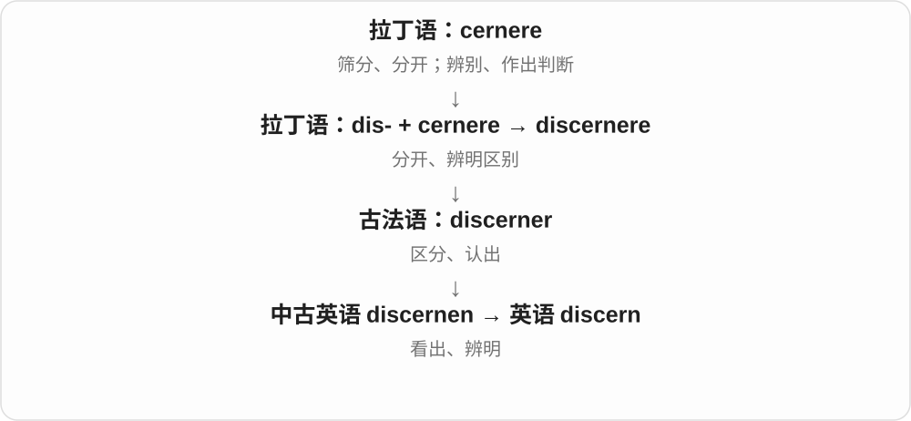

可以用眼睛 discern a shape，也可以用判断力 discern a pattern。重点常是原来不明显，需要细看或想一想。

**常见搭配与例句**

discern a difference；discern a pattern；discern between；barely discern。

> We could barely discern the tower through the mist.

我们透过薄雾勉强辨认出塔楼。

> She discerned a pattern in the apparently random errors.

她从看似随机的错误里看出了规律。

**别混淆**

see 可以是普通看见；discern 强调从模糊、复杂之中辨认出来。

### 45. discerning — 有眼力的；善于辨别的

**音标**：英 /dɪˈsɜːnɪŋ/；美 /dɪˈsɜːrnɪŋ/

**先抓住这个画面**

discerning 像挑东西时不是只看亮眼包装，而是能认出细微差别和真正品质。

**怎么拆**

discern + -ing，分词形容词描写善于辨别、判断的特点。

**怎么变成今天的意思**

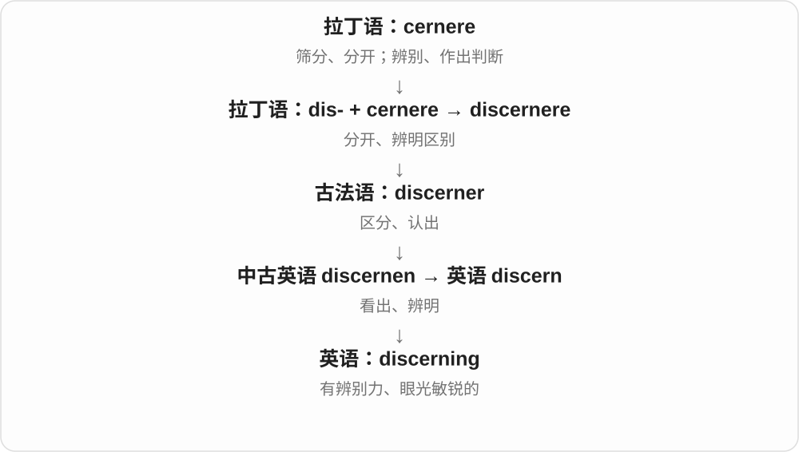

常形容 reader、customer、listener。广告也爱说 for the discerning buyer，意思是给懂得挑选的人。

**常见搭配与例句**

a discerning reader；a discerning customer；a discerning eye。

> A discerning reader will notice the change in tone.

有眼力的读者会注意到语气的变化。

> The shop attracts discerning customers who value craftsmanship.

这家店吸引了重视工艺、懂得挑选的顾客。

**别混淆**

picky 可能只是难伺候；discerning 通常称赞选择有眼光、有判断依据。

### 46. discernible — 能辨认的；察觉得到的

**音标**：英 /dɪˈsɜːnəbəl/；美 /dɪˈsɜːrnəbəl/

**先抓住这个画面**

discernible 像远处的灯虽然微弱，但你已经能把它从黑暗里认出来。

**怎么拆**

经中古法语 discernable 借入，后来参照拉丁 discernibilis 把 -a- 改成 -i-；现代可分析 discern + -ible。

**怎么变成今天的意思**

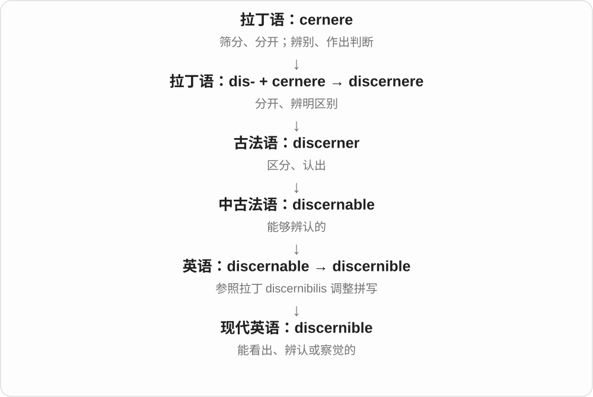

a discernible difference 是察觉得到的差别；no discernible effect 是没看出效果，不等于证明效果绝对为零。

**常见搭配与例句**

a discernible pattern；barely discernible；no discernible difference。

> There was a small but discernible improvement.

有一点虽小但能察觉到的改善。

> The lettering is barely discernible in this light.

在这样的光线下，字迹几乎辨认不清。

**别混淆**

obvious 是明显；discernible 只要求能辨认，差别可能很细微。

### 47. discernment — 辨别力；判断力；眼力

**音标**：英 /dɪˈsɜːnmənt/；美 /dɪˈsɜːrnmənt/

**先抓住这个画面**

discernment 像有一双不容易被表面骗过的眼睛，能把真正重要、可靠或优质的东西挑出来。

**怎么拆**

现代可拆 discern + -ment；也有从中古法语 discernement 借入的分析，二者同出 discerner 这一支。

**怎么变成今天的意思**

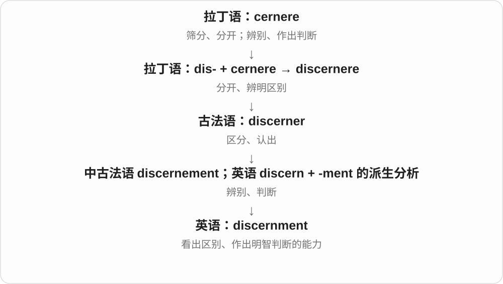

a person of discernment 是有判断力的人；show discernment 是表现出眼力。它不仅是眼睛看得清，还常是评价事物看得准。

**常见搭配与例句**

show discernment；exercise discernment；a reader of discernment。

> Choosing reliable sources requires discernment.

选择可靠来源需要判断力。

> The collection reflects her taste and discernment.

这批收藏体现了她的品位和眼力。

**别混淆**

knowledge 是知道很多；discernment 是能从知道的东西里判断轻重、真伪或好坏。

### 48. indiscernible — 无法辨认的；难以分辨的

**音标**：英 /ˌɪndɪˈsɜːnəbəl/；美 /ˌɪndɪˈsɜːrnəbəl/

**先抓住这个画面**

indiscernible 像两种颜色贴得太近，或者物体远得只剩模糊一团，你已经分辨不出。

**怎么拆**

in-（不）+ discern + -ible；现代也可把它看作 discernible 的否定形式。

**怎么变成今天的意思**

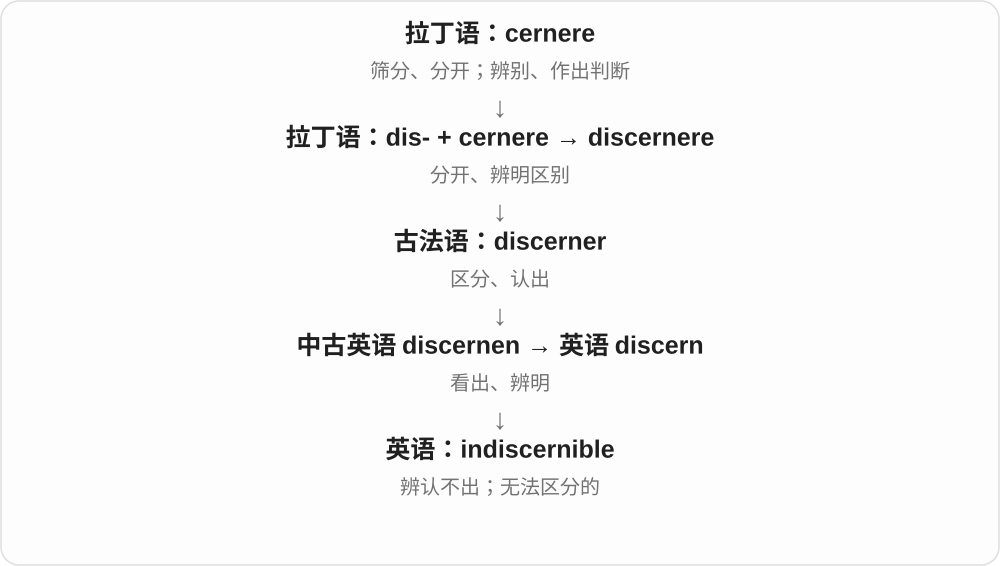

常说细节、差异、图案无法看清，也可说理由或变化难以察觉。哲学中的 indiscernibles 可指在相关性质上无法区分的对象。

**常见搭配与例句**

almost indiscernible；indiscernible from；an indiscernible difference。

> The distant figures were almost indiscernible in the rain.

远处的人影在雨中几乎无法辨认。

> The copy was indiscernible from the original at that distance.

在那个距离上，副本与原件无法分辨。

**别混淆**

invisible 偏看不见；indiscernible 更广，还可以是看得见两个对象却无法分清差别。

### 49. excrement — 粪便；排泄物

**音标**：/ˈekskrəmənt/

**先抓住这个画面**

excrement 是已经排出来的那份东西，现代通常就是粪便，重点在物质本身。

**怎么拆**

此义借自拉丁 excrēmentum，来自 excernere“排出”；历史还有一个同形旧义指身体长出的毛发等，来自 excrēscere“长出”，属于另一来源。

**怎么变成今天的意思**

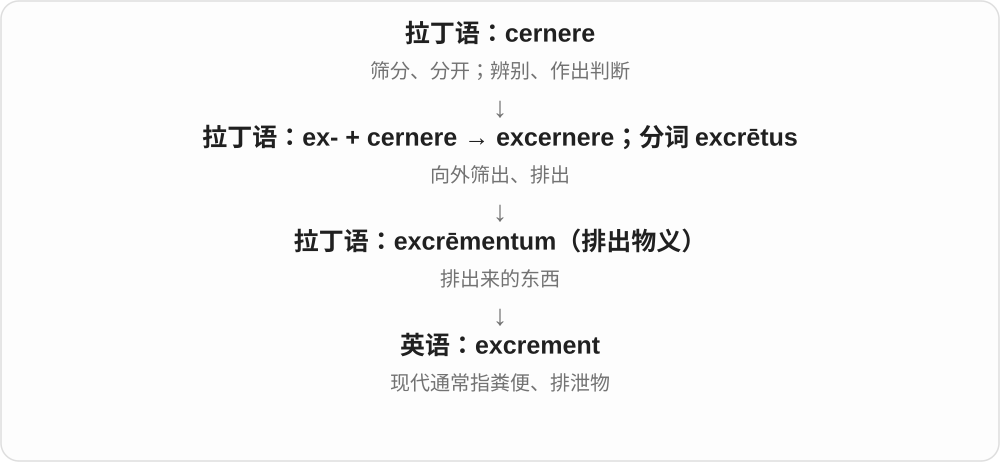

比较正式、客观，可用在清洁、环境和生物描述中。旧书的毛发、指甲等“长出物”义不要硬用“排泄”去解释。

**常见搭配与例句**

animal excrement；bird excrement；traces of excrement。

> The path was covered with animal excrement.

小路上遍布动物粪便。

> The researchers examined the excrement for seeds.

研究者检查了粪便中是否有种子。

**别混淆**

excretion 是排出过程或排出物的泛称；excrement 在现代使用中更具体，通常不指整个过程。

### 50. excrete — 排泄；把废物或多余物质排出体外

**音标**：/ɪkˈskriːt/

**先抓住这个画面**

excrete 像把体内不再需要的一部分单独分出去，送到体外。

**怎么拆**

拉丁 ex-（向外）+ cernere（筛分）→ excernere；英语 excrete 借自它的分词词干 excrēt-。

**怎么变成今天的意思**

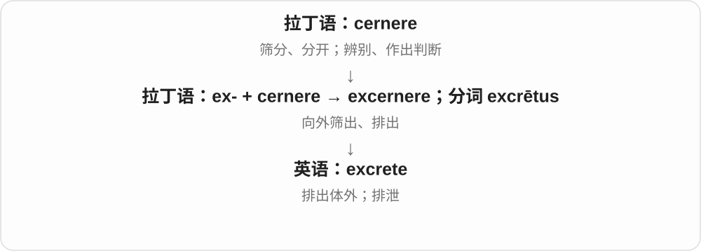

尿液中排出某些物质可以用 excrete；生物学里也可以谈动物或其他生物排出产物，不只等于排便。

**常见搭配与例句**

excrete waste；excrete excess salts；be excreted in urine。

> The kidneys excrete waste products in urine.

肾脏通过尿液排出废物。

> The animals excrete excess salt through specialized glands.

这些动物通过专门的腺体排出多余盐分。

**别混淆**

secrete 强调细胞、腺体制备并释放产物；excrete 强调向体外排出废物或多余物质，某些过程可以同时涉及两者。

### 51. excretion — 排泄；排出；排泄物

**音标**：/ɪkˈskriːʃən/

**先抓住这个画面**

excretion 把体内向外清除的过程当作一个整体来看，也可指这个过程排出的东西。

**怎么拆**

来自法语 excrétion 或后期拉丁 excrētiō，源于 excernere；与 excrete 共享拉丁祖先，名词有独立借入路线。

**怎么变成今天的意思**

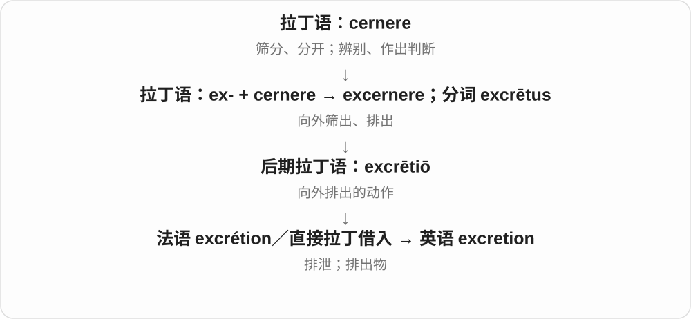

urinary excretion 是通过尿液排出；the excretion of salt 是盐的排出。生理学上的排泄比日常说“上厕所”更具体，也更广。

**常见搭配与例句**

urinary excretion；the excretion of waste；an excretion rate。

> The experiment measured the excretion of salt over time.

实验测量了盐分排出量随时间的变化。

> Excretion helps remove unwanted substances from the body.

排泄有助于清除体内不需要的物质。

**别混淆**

excrement 现代通常具体指粪便；excretion 可以是过程，不限定粪便。

### 52. secretory — 分泌的；有分泌功能的

**音标**：英 /sɪˈkriːtəri/；美 /ˈsiːkrətɔːri/

**先抓住这个画面**

secretory 像给细胞或组织贴一张功能标签：“这里负责产生并放出某种物质。”

**怎么拆**

secret- 来自拉丁 sēcrēt- 词干，-ory 表示功能或相关性质；可联系 secrete，但英语 secretory 的现存早例更早，不能确定只由现代动词派生。

**怎么变成今天的意思**

secretory cells 是分泌细胞；secretory activity 是分泌活动；secretory products 是分泌产物。英美常见重音位置不同。

**常见搭配与例句**

secretory cells；secretory glands；secretory activity。

> The tissue contains several types of secretory cells.

这种组织含有几类分泌细胞。

> The researchers measured changes in secretory activity.

研究者测量了分泌活动的变化。

**别混淆**

secretive 是爱隐瞒的；secretory 是分泌相关的，不能给腺体的行为套上人的保密性格。

### 53. certitude — 确信；坚定的确定感

**音标**：英 /ˈsɜːtɪtjuːd/；美 /ˈsɜːrtɪtuːd/

**先抓住这个画面**

certitude 像一个人心里的答案已经凝固，不再摇摆；常用来描写很强、很坚定的确信。

**怎么拆**

经中古法语 certitude 来自后期拉丁 certitūdō，形成于 certus“确定的”；与 certainty 是不同借入形式。

**怎么变成今天的意思**

偏正式、书面，常见 moral certitude 或 speak with certitude。它可以描述人的确信程度，不等于结论客观上必然正确。

**常见搭配与例句**

moral certitude；absolute certitude；speak with certitude。

> She spoke with a certitude that surprised the others.

她说话时那种笃定让其他人吃惊。

> The novel questions the narrator’s moral certitude.

小说对叙述者坚定的道德确信提出了质疑。

**别混淆**

certainty 更通用；certitude 常突出坚定的主观确信，但两词的实际用法有重叠。

### 54. excretory — 排泄的；有排泄功能的

**音标**：/ɪkˈskriːtəri/，也 /ˈekskrətɔːri/

**先抓住这个画面**

excretory 像给器官或通路标明职责：“把不需要的东西送出身体。”

**怎么拆**

excrete + -ory，表示与排泄有关或承担排泄功能；医学英语中形成的形容词。

**怎么变成今天的意思**

excretory organs 是排泄器官；excretory system 是排泄系统。它描述功能，不是某一种具体排泄物的名字。

**常见搭配与例句**

the excretory system；excretory organs；excretory function。

> The lesson compares the excretory organs of different animals.

这节课比较了不同动物的排泄器官。

> The diagram traces the main excretory pathways.

这幅图描绘了主要的排泄通路。

**别混淆**

secretory 关注分泌；excretory 关注向体外排出，不能只因为都与液体有关就互换。

### 55. decretal — 教皇教令；法令的、裁决的

**音标**：/dɪˈkriːtəl/，也 /ˈdekrɪtəl/

**先抓住这个画面**

decretal 把一般的正式决定收窄到教会史中特定的权威文件，常是教皇就教会法问题给出的书面裁决。

**怎么拆**

后期拉丁 dēcrētālis“法令的”来自 dēcrētum，经盎格鲁法语和中古英语借入；名词由相关文件名称省略、名词化。

**怎么变成今天的意思**

主要在教会史、法律史阅读中遇到。the decretals 可指一组此类教令，不是所有政府法令的日常总称。

**常见搭配与例句**

a papal decretal；a collection of decretals；a decretal letter。

> The manuscript contains a collection of papal decretals.

手稿收录了一组教皇教令。

> The scholar compared two versions of the decretal letter.

学者比较了这封教令书信的两个版本。

**别混淆**

decree 范围广；decretal 作为名词通常有明确的教会法历史语境。

### 56. secern — 分开；辨别；旧用法也指分泌

**音标**：英 /sɪˈsɜːn/；美 /səˈsɜːrn/

**先抓住这个画面**

secern 像把混在一起的材料挑开，让原来掺杂的部分分出边界。这个词今天很少见。

**怎么拆**

直接借拉丁 sēcernere，由 sē-（分开）+ cernere（筛分、辨别）构成；比 secret 更明显保留原来的动词轮廓。

**怎么变成今天的意思**

阅读旧文时可能遇到“区分、分离”，也可能是旧的分泌义；现代一般用 separate、distinguish 或 secrete。

**常见搭配与例句**

secern one thing from another；secern the parts。

> The old treatise attempts to secern knowledge from mere opinion.

那部旧论著试图区分知识与单纯意见。

> In this passage, “secern” refers to the release of fluid by a gland.

在这段文字里，secern 指腺体分泌液体。

**别混淆**

discern 常是看出区别；secern 的旧用法还可指实际把东西分开，使用范围与现代常用度不同。

## 这一组要分清什么

discrete 与 discreet 同音、同源，但现代已经分工：前者是一格格分开的，后者是言行守分寸的。相应副词是 discretely 与 discreetly。

certainty 是确定状态；ascertainment 是把事实查清的过程；certification 是正式认证；certificate 是证明文件。

secret 是秘密，secretary 是行政岗位或头衔；secretive 是不愿透露，secretory 是分泌相关。

secrete 既有分泌义，也有另路发展的藏匿义；excrete 强调向体外排出。两者的生理过程可能相关，不能简单用“有用、没用”二分所有情况。

concerned about 常说担心，concerned with 常说涉及。concerning 可作“关于”，也可形容令人担忧的情况。

concert 是音乐会；concerto 是协奏曲；concerted effort 是协调、集中的努力，不要求舞台或乐器。

## 串起来练习

用 discrete sections 与 a discreet question 各造一句，用“有界线”和“有分寸”分别解释。

找一张课程证书，区分 certificate 这份文件、certification 这项认证、certified 这个已获认证状态。

先把一封信藏进抽屉，再想象腺体释放产物：同一个 secrete 在两幅画面里如何翻译？

用 concern 写两句：一句只表示涉及，一句表示使人担忧。

把 concert、concerto、concertmaster 放进同一场演出说明，分别说明活动、作品和职位。
