# 0137 · trah-, tract- — 拉；拖；由拉动发展出的处理和引导

[逐词精讲目录](../00_逐词精讲目录.md) · [总目录](../00_总目录_按常用程度.md)

## 核心词根与来源

**trah-、tract-** 来自拉丁语 **trahere**“拉、拖”。向自己拉是 attract，拉出来是 extract，向不同方向拉是 distract，拉回来是 retract。再远一点，“用手拉动、处理”发展出 tractāre“处理、管理”，经法语形成 treat。这组词不要只背“拉”，还要看拉向哪里、拉的是什么。

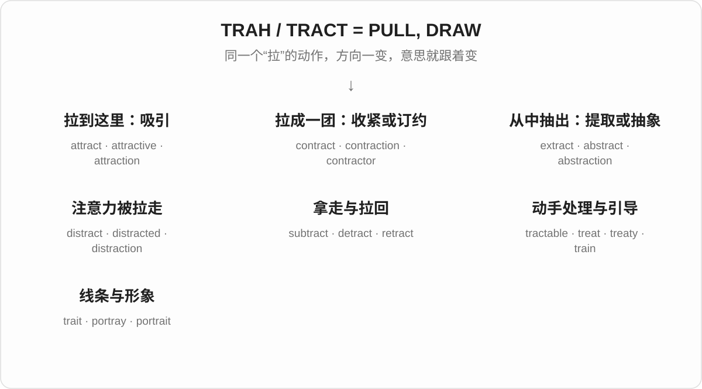

## 词形与演化规律

**trahere** 的相关分词形式有 **tractus**，所以许多英语词保留 tract-；这不是英语里 h 可以随意换成 ct。**tractāre** 则是由这个词干形成的反复动作动词，发展出处理、管理的意思。法语路径会让词形变化更大，如 treat、trait、train、portray；它们的现代拼写不能硬切回同一个模板。

## 单词速览（按词族由简到繁）

同一基础词的相关扩展放在一起，先读基础形式，再读扩展；各组之间优先读常用的。具体词源关系见各词讲解。

| 单词 | 音标 | 核心意思 |
|---|---|---|
| [train](#w-3) | /treɪn/ | 火车；一列；训练；培养 |
| [training](#w-1) | /ˈtreɪnɪŋ/ | 训练；培训 |
| [treat](#w-5) | /triːt/ | 对待；处理；治疗；款待；乐事 |
| [treatment](#w-2) | /ˈtriːtmənt/ | 对待；治疗；处理方式 |
| [treaty](#w-7) | /ˈtriːti/ | 条约；国家等之间的正式协定 |
| [treatise](#w-24) | /ˈtriːtɪs/；也读 /ˈtriːtɪz/ | 专著；专题论述 |
| [contract](#w-4) | 名词：英 /ˈkɒntrækt/，美 /ˈkɑːntrækt/；动词 /kənˈtrækt/ | 合同；收缩；订约；感染 |
| [contractor](#w-12) | 英 /kənˈtræktə/；美 /ˈkɑːntræktər/ | 承包商；签约提供服务的人或公司 |
| [contraction](#w-22) | /kənˈtrækʃən/ | 收缩；缩减；缩约形式 |
| [contractual](#w-23) | /kənˈtræktʃuəl/ | 合同规定的；合同上的 |
| [attract](#w-9) | /əˈtrækt/ | 吸引；引来 |
| [attractive](#w-6) | /əˈtræktɪv/ | 有吸引力的；好看的；诱人的 |
| [attractiveness](#w-27) | /əˈtræktɪvnəs/ | 吸引力；吸引人的程度 |
| [attraction](#w-11) | /əˈtrækʃən/ | 吸引力；吸引人的事物；景点 |
| [portrait](#w-8) | 英 /ˈpɔːtrɪt/；美 /ˈpɔːrtrət/ | 肖像；对人物或事物的刻画 |
| [abstract](#w-10) | 名词、形容词 /ˈæbstrækt/；动词 /əbˈstrækt/ | 抽象的；摘要；抽取 |
| [abstraction](#w-25) | /əbˈstrækʃən/ | 抽象；抽象概念；提炼共同点 |
| [abstracted](#w-34) | /əbˈstræktɪd/ | 心不在焉的；走神的 |
| [abstractly](#w-35) | /æbˈstræktli/ | 抽象地；离开具体情况地 |
| [extract](#w-13) | 动词 /ɪkˈstrækt/；名词 /ˈekstrækt/ | 提取；拔出；摘录；提取物 |
| [extraction](#w-15) | /ɪkˈstrækʃən/ | 提取；取出；出身 |
| [distract](#w-19) | /dɪˈstrækt/ | 使分心；转移注意力 |
| [distracted](#w-14) | /dɪˈstræktɪd/ | 分心的；心神不宁的 |
| [distraction](#w-16) | /dɪˈstrækʃən/ | 分心；干扰；消遣 |
| [traction](#w-17) | /ˈtrækʃən/ | 牵引力；抓地力；逐渐获得的支持或进展 |
| [tractor](#w-18) | 英 /ˈtræktə/；美 /ˈtræktər/ | 拖拉机；牵引车 |
| [trait](#w-20) | /treɪt/ | 特点；特征 |
| [portray](#w-21) | 英 /pɔːˈtreɪ/；美 /pɔːrˈtreɪ/ | 描绘；塑造；扮演 |
| [protracted](#w-26) | 英 /prəˈtræktɪd/；美 /proʊˈtræktɪd/ | 拖延很久的；持续过长的 |
| [subtract](#w-28) | /səbˈtrækt/ | 减去；扣除 |
| [subtraction](#w-31) | /səbˈtrækʃən/ | 减法；减去；扣除 |
| [subtractive](#w-37) | /səbˈtræktɪv/ | 通过减去实现的；减法的 |
| [retract](#w-29) | /rɪˈtrækt/ | 缩回；收回言论；撤回 |
| [retraction](#w-33) | /rɪˈtrækʃən/ | 收回；撤回声明；缩回 |
| [detract](#w-30) | /dɪˈtrækt/ | 减损；贬低 |
| [tractable](#w-36) | /ˈtræktəbəl/ | 容易处理的；易管理的；可求解的 |
| [intractable](#w-32) | /ɪnˈtræktəbəl/ | 难以处理的；棘手的；难以改变的 |
| [subtrahend](#w-38) | /ˈsʌbtrəhend/ | 减数 |

## 逐词讲解

### 1. train — 火车；一列；训练；培养

**音标**：/treɪn/

**先抓住这个画面**

名词 train 可以先想“一串被带着往前走的东西”：车厢成列。动词则是把人或能力持续带向某个目标。

**怎么拆**

经古法语 train“拖带的一列”和 traïner“拖、牵引”追溯到拉丁语 trahere；中间还涉及重建的通俗拉丁语形式。英语动词由名词发展而来。

**怎么变成今天的意思**

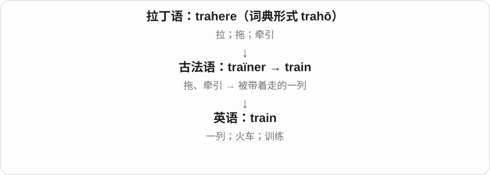

列车义来自一列连续相接的东西，早于现代铁路还有拖尾、随从等用法。训练义沿引导、使形成习惯发展；不能把火车速度快当作训练义的词源。

**常见搭配与例句**

catch a train；a train of thought；train someone to do…；train for a race；train a dog。

> I missed the train and had to wait for the next one.

我错过了火车，只好等下一班。

> She trains new staff to handle customer complaints.

她培训新员工处理顾客投诉。

**别混淆**

teach 常突出教授知识或方法；train 常突出反复练习、形成技能或习惯。两者经常一起发生。

### 2. training — 训练；培训

**音标**：/ˈtreɪnɪŋ/

**先抓住这个画面**

training 是把“知道怎么做”练成“实际做得出来”的过程，可能包括讲解、演练、反馈和反复尝试。

**怎么拆**

train + -ing，在这里作为动作或活动名词。不要把它当作 train“火车”的复数。

**怎么变成今天的意思**

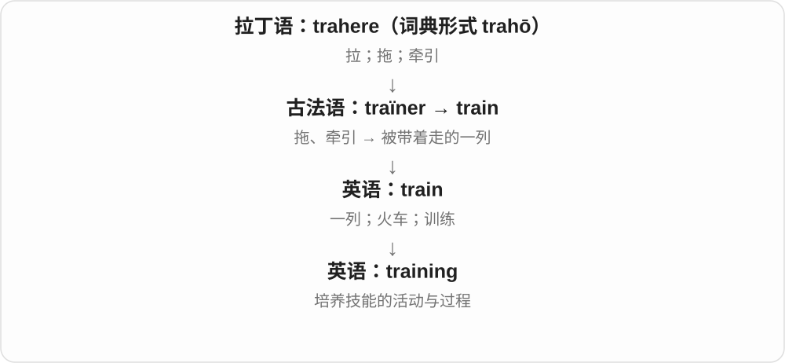

它沿 train 的指导和练习义发展。体育训练、岗位培训和模型训练对象不同，但都着眼于经过过程形成能力。

**常见搭配与例句**

staff training；receive training；a training session；training in first aid；training for a marathon。

> All new employees receive safety training.

所有新员工都要接受安全培训。

> Regular training helped her run farther without tiring.

规律训练让她能跑得更远而不容易疲劳。

**别混淆**

training 常作不可数名词；一次培训通常说 a training session 或 a training course，而不必说 a training。

### 3. treat — 对待；处理；治疗；款待；乐事

**音标**：/triːt/

**先抓住这个画面**

treat 先抓住“怎样处理、怎样对待”：对人友好、处理问题、治疗疾病、请人吃点好的，都是对不同对象采取做法。

**怎么拆**

来自古法语 tretier / traitier，追溯到拉丁语 tractāre“处理、管理”，再往前是 trahere“拉”。现代 treat 已不能按字母硬切。

**怎么变成今天的意思**

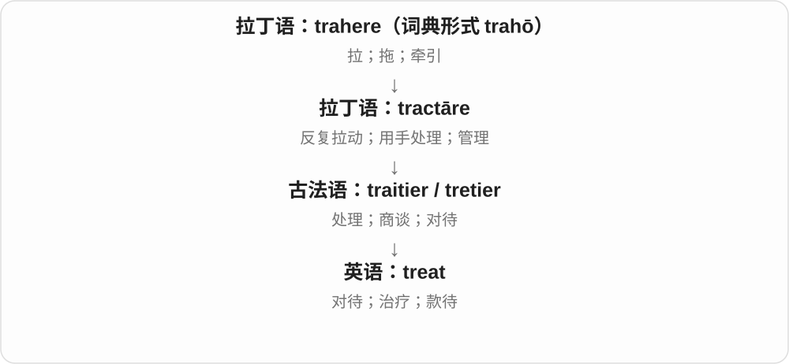

历史从动手处理扩展到商谈、对待和照料。治疗是对疾病作处理；款待是给人好的招待，名词 a treat 又可指带来快乐的食物或经历。

**常见搭配与例句**

treat someone with respect；treat A as B；treat a disease；treat someone to lunch；a special treat。

> She treats every customer with respect.

她尊重每一位顾客。

> Let me treat you to lunch; it is my birthday.

让我请你吃午饭吧，今天是我生日。

**别混淆**

treat a disease 是治疗，并不保证治好；cure 更强调治愈。treat someone to dinner 是请客，不能省略 to 后直接照搬“治疗某人”。

### 4. treatment — 对待；治疗；处理方式

**音标**：/ˈtriːtmənt/

**先抓住这个画面**

treatment 把“怎样对待”变成可讨论的一整套做法：病人接受什么治疗，员工受到怎样的待遇，材料经过什么处理。

**怎么拆**

treat + -ment；-ment 形成动作、过程或结果名词，也可与法语 traitement 对照。

**怎么变成今天的意思**

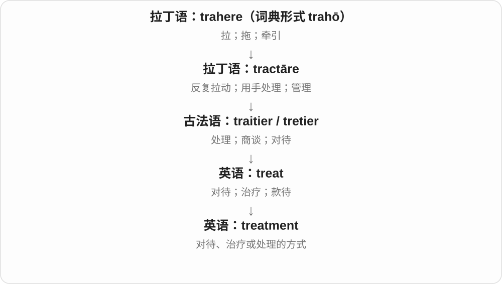

核心始终是对象被怎样处理。medical treatment 只是一支；equal treatment 说一视同仁，water treatment 说水处理。

**常见搭配与例句**

receive treatment；equal treatment；the treatment of…；water treatment；special treatment。

> All applicants should receive equal treatment.

所有申请者都应受到平等对待。

> The water passes through several stages of treatment.

这些水会经过几个处理阶段。

**别混淆**

treatment 可以指治疗过程；medicine 可以指药物或医学。一次治疗未必只靠吃药。

### 5. treaty — 条约；国家等之间的正式协定

**音标**：/ˈtriːti/

**先抓住这个画面**

treaty 像把长时间商谈的结果落成一份正式文本，参与方据此承担约定。

**怎么拆**

经古法语 traité / traitié 进入英语，与 traiter“处理、商谈”的分词名词化有关；更远属于拉丁语 tractāre。不是 treat + 普通后缀 y 随意造出来。

**怎么变成今天的意思**

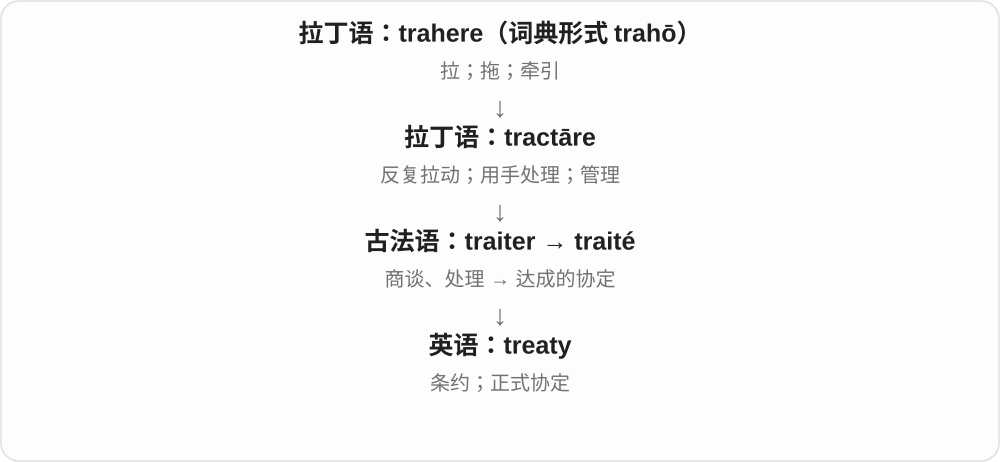

同一个“商谈、处理”词族，一条支路形成对待和治疗，另一条留下正式协商的成果。现代 treaty 常见于国家或政治实体之间。

**常见搭配与例句**

sign a treaty；a peace treaty；a trade treaty；treaty obligations。

> The two countries signed a treaty to protect the river.

两国签署了一项保护这条河流的条约。

> The treaty sets out how the resources will be shared.

条约规定了这些资源如何共享。

**别混淆**

agreement 很宽泛；treaty 常是正式国际条约。朋友约好周末吃饭通常不是 treaty。

### 6. treatise — 专著；专题论述

**音标**：/ˈtriːtɪs/；也读 /ˈtriːtɪz/

**先抓住这个画面**

treatise 是把一个主题认真讲透的一篇或一部作品：有体系地展开，不只是随手写几句看法。

**怎么拆**

来自盎格鲁诺曼语 tretiz、古法语 traitis，与 traitier“处理、论述”有关；最终属于 tractāre 词族。

**怎么变成今天的意思**

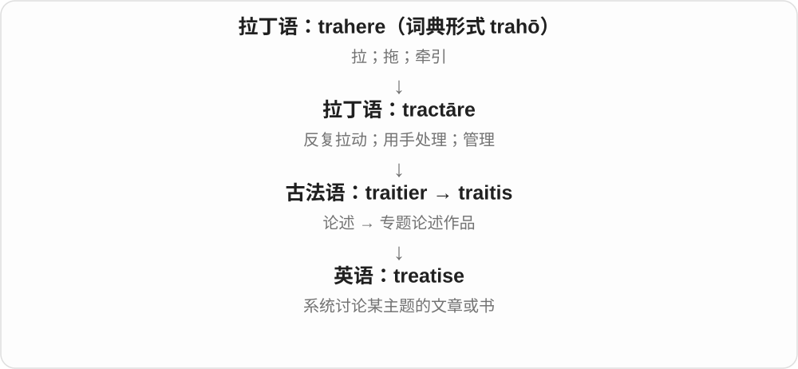

这里“处理”的对象是知识主题：把问题拿出来逐层论述。它与 treaty 同源，但一个留下研究论著，一个留下协定。

**常见搭配与例句**

a treatise on ethics；write a treatise；a philosophical treatise。

> She wrote a treatise on the ethics of scientific research.

她写了一部讨论科研伦理的专著。

> The old treatise includes detailed drawings of bridges.

那部旧论著中有桥梁的详细图示。

**别混淆**

essay 可以较短、较个人化；treatise 常给人系统、正式、充分展开的感觉。篇幅不是唯一判断标准。

### 7. contract — 合同；收缩；订约；感染

**音标**：名词：英 /ˈkɒntrækt/，美 /ˈkɑːntrækt/；动词 /kənˈtrækt/

**先抓住这个画面**

contract 有两幅常用画面：把东西拉紧，体积就缩小；把双方的承诺定在一起，就有了合同。

**怎么拆**

con-（一起）+ trahere（拉）形成拉丁语 contrahere。名词和动词经相关拉丁、法语形式传入，不能把 contract 拆成 contra-。

**怎么变成今天的意思**

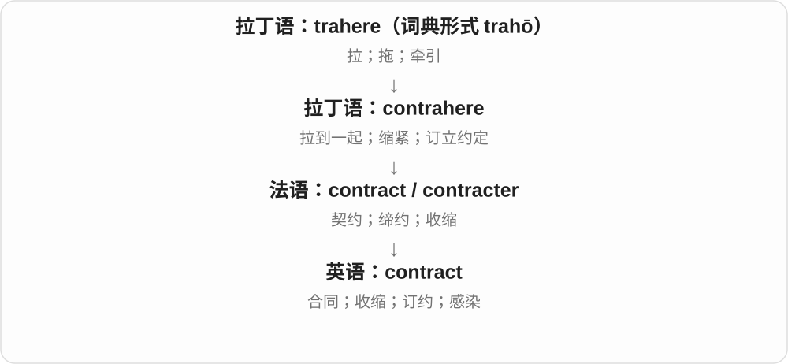

“拉到一起”在身体上是收缩，在交易中是达成约定。contract a disease 的“感染”来自获得、招致这一用法，不能硬想成把病菌捏小。

**常见搭配与例句**

sign a contract；contract with a supplier；muscles contract；contract a disease。名词重音在前，动词在后。

> We signed a contract for six months of maintenance.

我们签了一份为期六个月的维护合同。

> The metal contracts as it cools.

金属冷却时会收缩。

**别混淆**

contract 作名词通常比 agreement 更强调有约束力的约定；作动词也可能只说收缩，与合同无关。

### 8. contractor — 承包商；签约提供服务的人或公司

**音标**：英 /kənˈtræktə/；美 /ˈkɑːntræktər/

**先抓住这个画面**

contractor 是按合同接下一项工作的人或公司：修屋顶、建房子、维护系统，都可能交给它。

**怎么拆**

来自晚期拉丁语 contractor；现代可用 contract + -or“承担合同工作的一方”帮助理解。英美常见重音不同。

**怎么变成今天的意思**

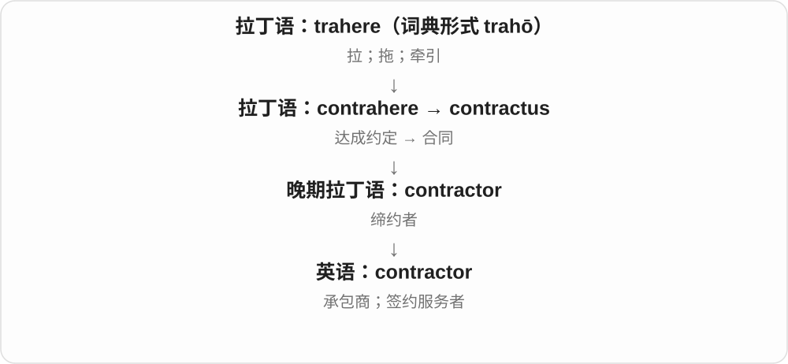

焦点由那份约定转到承担工作的一方。它可以是个人，也可以是公司，不是只指建筑工人。

**常见搭配与例句**

hire a contractor；a building contractor；an independent contractor；the main contractor。

> We hired a contractor to repair the roof.

我们请了一家承包商修屋顶。

> The contractor must finish the work by June.

承包商必须在六月前完成工作。

**别混淆**

contractor 强调合同下提供服务的角色；employee 是雇员。具体法律身份不能只看当事人用了哪个称呼。

### 9. contraction — 收缩；缩减；缩约形式

**音标**：/kənˈtrækʃən/

**先抓住这个画面**

contraction 是从展开变紧凑：肌肉缩紧，经济规模变小，或者 do not 缩成 don’t。

**怎么拆**

来自拉丁语 contractiō，经法语传入；现代可对照 contract + -ion。

**怎么变成今天的意思**

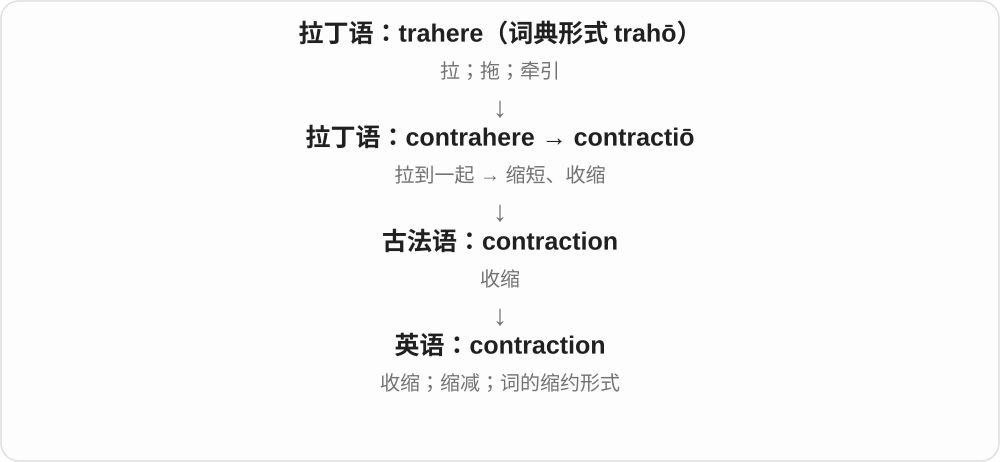

几种意义共享“变短、变小、变紧”的结果。分娩语境的 contractions 特指子宫收缩，语言里的 contraction 则是压缩后的词形。

**常见搭配与例句**

muscle contraction；economic contraction；a contraction of…；the contraction don’t。

> The device measures muscle contractions.

这台设备测量肌肉的收缩。

> “Can’t” is a contraction of “cannot.”

can’t 是 cannot 的缩约形式。

**别混淆**

contraction 不等于 contract“合同”的数量变化。abbreviation 泛指缩写，contraction 常涉及删去中间音或字母并缩合。

### 10. contractual — 合同规定的；合同上的

**音标**：/kənˈtræktʃuəl/

**先抓住这个画面**

contractual 指“写在合同关系里、因此需要履行的”：不能只说自己不想做，还得看当初答应了什么。

**怎么拆**

contract + -ual，形成“与合同有关的”形容词，历史基础仍是拉丁语 contractus。

**怎么变成今天的意思**

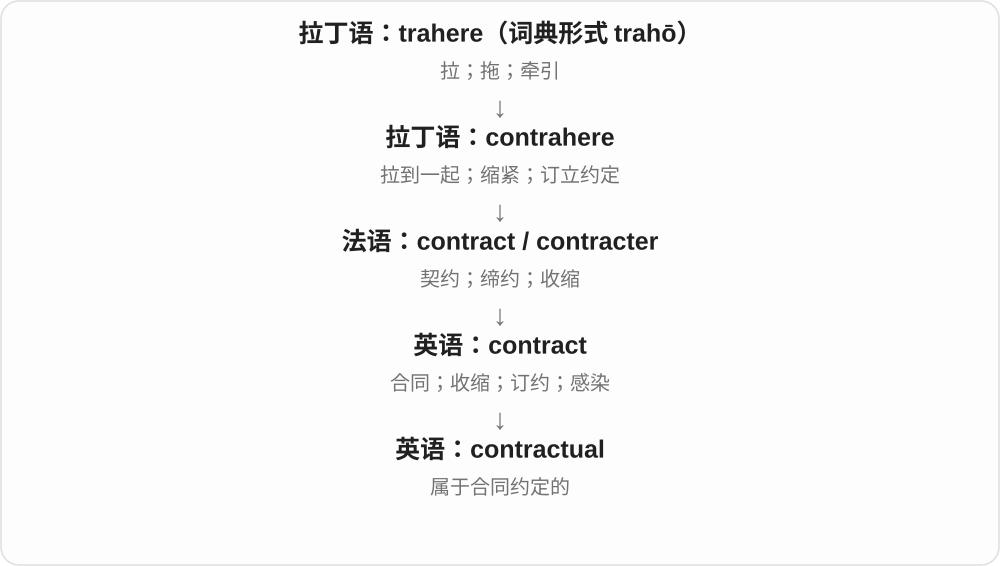

contract 表示约定本身；contractual 把这种关系加到责任、权利和条件上。它不表示所有相关事项都已经没有争议。

**常见搭配与例句**

contractual obligations；contractual rights；a contractual requirement；contractual terms。

> The company met all its contractual obligations.

公司履行了所有合同义务。

> The extra service is not a contractual requirement.

这项额外服务不是合同规定的要求。

**别混淆**

contractual 是来自合同的；voluntary 是自愿提供的。两者不一定冲突：自愿签约之后，也可能承担合同义务。

### 11. attract — 吸引；引来

**音标**：/əˈtrækt/

**先抓住这个画面**

attract 像有一股看不见的力，把目光、人或物拉向这里：磁铁吸铁，香味吸引顾客，异常举动引起注意。

**怎么拆**

ad-（朝向）+ trahere（拉）；ad- 遇到 t 同化成 at-，形成 attrahere。

**怎么变成今天的意思**

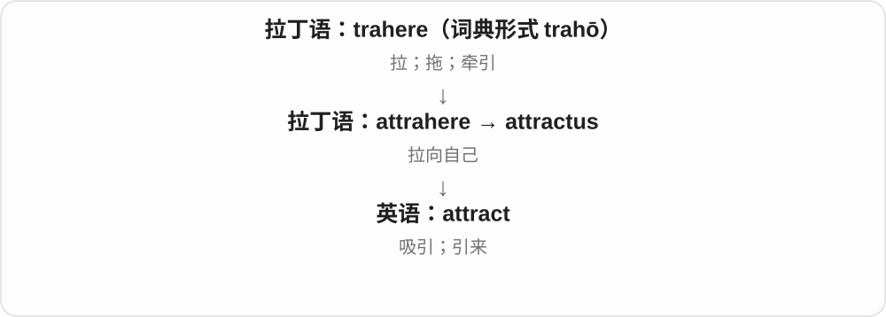

具体的拉力扩展到注意力、兴趣和好感。attract criticism 也成立，因为引来的不一定是好东西。

**常见搭配与例句**

attract attention；attract visitors；attract criticism；be attracted to… 。

> The bright display attracted a crowd.

明亮的陈列吸引了一群人。

> The proposal attracted criticism from several groups.

这项提案招来了几个团体的批评。

**别混淆**

attract 说产生吸引力；invite 是发出邀请。商店可以靠橱窗 attract customers，不必逐个邀请。

### 12. attractive — 有吸引力的；好看的；诱人的

**音标**：/əˈtræktɪv/

**先抓住这个画面**

attractive 让人愿意靠近、选择或多看一眼。人可以好看，价格可以划算，工作机会可以很值得考虑。

**怎么拆**

经法语 attractif，来自拉丁语 attractīvus；现代对照 attract + -ive。

**怎么变成今天的意思**

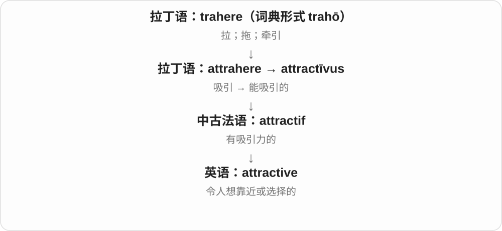

它把“吸引”变成对象的特点。attractive salary 通常是薪资条件不错，绝不是说数字长得漂亮。

**常见搭配与例句**

an attractive offer；an attractive price；look attractive；attractive to buyers。

> The apartment is attractive to people who work downtown.

这套公寓对在市中心工作的人很有吸引力。

> They offered her an attractive salary.

他们给她开出了诱人的薪资。

**别混淆**

beautiful 更直接评价美；attractive 的范围更广，能包括实惠、便利和机会。

### 13. attractiveness — 吸引力；吸引人的程度

**音标**：/əˈtræktɪvnəs/

**先抓住这个画面**

attractiveness 问“为什么人愿意选它、它有多吸引人”。它可以来自外貌，也可以来自地段、价格或方便程度。

**怎么拆**

attractive + -ness，表示“有吸引力”这种性质。

**怎么变成今天的意思**

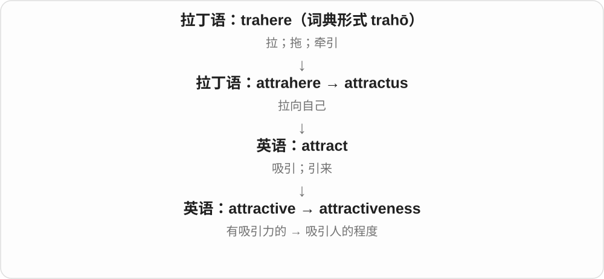

形容词夸这个对象有吸引力，名词让你进一步分析或比较这种吸引力。不是只用于外貌打分。

**常见搭配与例句**

the attractiveness of…；increase attractiveness；commercial attractiveness；physical attractiveness。

> Better transport increased the attractiveness of the area.

交通改善提高了这个地区的吸引力。

> The study examined the attractiveness of different job offers.

研究考察了不同工作机会的吸引力。

**别混淆**

attractiveness 评价吸引人的程度；attraction 还可以数具体的景点。三个景点是 three attractions，不是 three attractivenesses。

### 14. attraction — 吸引力；吸引人的事物；景点

**音标**：/əˈtrækʃən/

**先抓住这个画面**

attraction 既可以是把人拉过去的力量，也可以是那个值得去看的东西。

**怎么拆**

经古法语 attraction，来自拉丁语 attractiō；现代可对照 attract + -ion。

**怎么变成今天的意思**

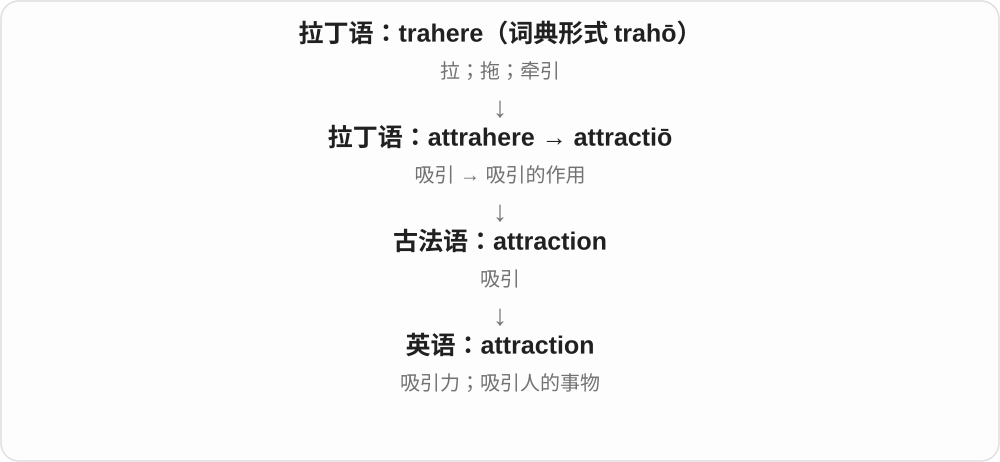

“它有吸引力”容易进一步变成“它就是一个吸引人的去处”，于是有 tourist attraction。人与人之间的 attraction 也不一定已经发展成爱情。

**常见搭配与例句**

a tourist attraction；the main attraction；physical attraction；an attraction to… 。

> The old castle is the town’s main attraction.

那座古堡是镇上最吸引游客的地方。

> She felt an immediate attraction to his sense of humor.

他的幽默感一下就吸引了她。

**别混淆**

attraction 可以指吸引本身；destination 只是目的地。不是所有旅行目的地都叫 tourist attraction。

### 15. portrait — 肖像；对人物或事物的刻画

**音标**：英 /ˈpɔːtrɪt/；美 /ˈpɔːrtrət/

**先抓住这个画面**

portrait 是留下来的那幅形象：可以是人的肖像照，也可以是文字中对一个家庭或时代的描写。

**怎么拆**

来自法语 portraict / pourtraict，是 portraire“描绘”的分词用作名词；不是从现代英语 portray 直接加一个 t。

**怎么变成今天的意思**

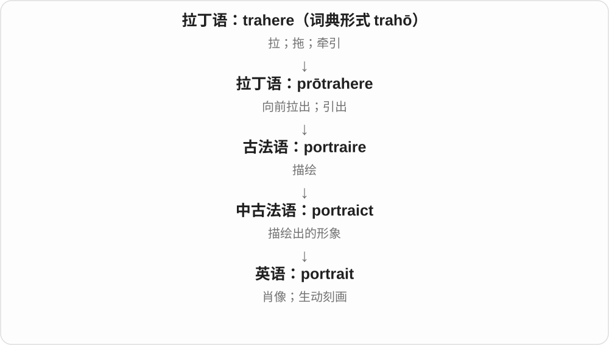

portray 看描绘的动作，portrait 看描绘出来的形象。设备界面里的 portrait orientation 又借肖像常见的竖向构图表示竖屏方向。

**常见搭配与例句**

paint a portrait；a family portrait；a vivid portrait of…；portrait orientation。

> A portrait of her grandfather hung above the desk.

桌子上方挂着她祖父的肖像。

> The book offers a vivid portrait of life in the city.

这本书生动地描绘了这座城市的生活。

**别混淆**

portrait 通常聚焦人物形象或某对象的整体面貌；landscape 常指风景，在页面方向里则表示横向。

### 16. abstract — 抽象的；摘要；抽取

**音标**：名词、形容词 /ˈæbstrækt/；动词 /əbˈstrækt/

**先抓住这个画面**

abstract 像从许多具体东西里抽出共同点：不再讨论这把椅子的颜色，而是讨论“家具”这个概念。

**怎么拆**

abs-（离开）+ trahere（拉）形成 abstrahere；其分词 abstractus 进入英语。abstract 的词尾不是英语 act“行动”。

**怎么变成今天的意思**

抽象思考是离开具体个体，保留关系或概念；论文摘要则从长文抽取要点。抽象画也不以照搬可辨认的具体物象为主要目标。

**常见搭配与例句**

an abstract idea；abstract art；read the abstract；abstract information from… 。

> The teacher used coins to explain an abstract idea.

老师用硬币来解释一个抽象概念。

> Read the abstract before deciding whether to study the full paper.

先读摘要，再决定是否研究整篇论文。

**别混淆**

abstract 是脱离具体个体或形象；vague 是说不清楚。一个抽象概念仍然可以定义得很清楚。

### 17. abstraction — 抽象；抽象概念；提炼共同点

**音标**：/əbˈstrækʃən/

**先抓住这个画面**

abstraction 就是把不需要的细节暂时拿走，留下你眼下要研究的那一层。

**怎么拆**

来自中古法语 abstraction 或中世纪拉丁语 abstrāctiō“分离”，现代可对照 abstract + -ion。

**怎么变成今天的意思**

它可以指抽离细节的过程，也可以指得到的概念。地图省掉每棵树，保留道路关系，就是容易理解的抽象画面。

**常见搭配与例句**

a level of abstraction；an abstract concept / an abstraction；abstraction from detail。

> A subway map is a useful abstraction of the city’s transport network.

地铁图是对城市交通网络的一种有用抽象。

> The discussion stayed at a high level of abstraction.

讨论一直停留在很抽象的层面。

**别混淆**

abstraction 是有选择地忽略细节；oversimplification 是省略得过头，导致判断失真。抽象并不必然错误。

### 18. abstracted — 心不在焉的；走神的

**音标**：/əbˈstræktɪd/

**先抓住这个画面**

abstracted 像人的身体还在这里，心思已经被抽到别处，别人说话都没听进去。

**怎么拆**

abstract + -ed。作形容词时，“被抽离”落在注意力上；也可按动词分词理解为已经提取的。

**怎么变成今天的意思**

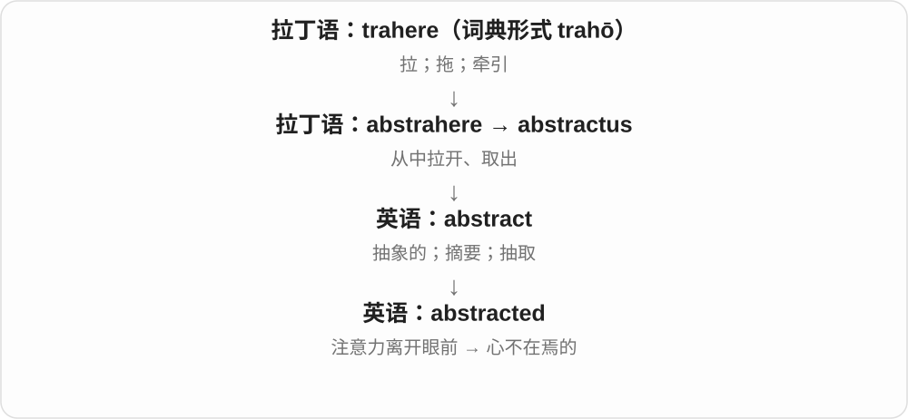

这是比 abstract“抽象的”更具体的人物状态。文学描写常用 an abstracted look：眼睛看着前方，人却在想别的事。

**常见搭配与例句**

an abstracted look；an abstracted smile；seem abstracted。

> He gave an abstracted smile and returned to his calculations.

他心不在焉地笑了笑，又继续计算。

> She seemed abstracted during dinner, barely hearing the conversation.

吃晚饭时她显得心不在焉，几乎没听到大家在说什么。

**别混淆**

abstract 描述概念；abstracted 常描述人的神情。distracted 更常见，abstracted 比较书面。

### 19. abstractly — 抽象地；离开具体情况地

**音标**：/æbˈstræktli/

**先抓住这个画面**

abstractly 是只讨论概念和原则，暂时不落到某个具体的人、数字或现场。

**怎么拆**

abstract + -ly，把形容词变成说明思考、讨论方式的副词。

**怎么变成今天的意思**

它并不等于“随便说说”。你可以严密地讨论一个模型，只是还没有给它具体实例。

**常见搭配与例句**

think abstractly；speak abstractly；discuss something abstractly。

> Children gradually learn to think abstractly.

孩子们逐渐学会抽象思考。

> We discussed fairness abstractly before examining a real case.

我们先从抽象层面讨论公平，再分析一个真实案例。

**别混淆**

abstractly 是不依附具体实例；theoretically 常强调按理论推演，或与实际情况作比较。两者有交集，但不完全相同。

### 20. extract — 提取；拔出；摘录；提取物

**音标**：动词 /ɪkˈstrækt/；名词 /ˈekstrækt/

**先抓住这个画面**

extract 是从里面把目标拿出来：从牙床拔牙，从植物提取物质，从长文摘出一段。

**怎么拆**

ex-（向外）+ trahere（拉）形成 extrahere，相关形式 extractum 进入英语。

**怎么变成今天的意思**

动作未必真要用力拉；现代数据处理中，extract 也能说把需要的数据取出来。名词可以指取出的物质或文章片段。

**常见搭配与例句**

extract data from…；extract a tooth；vanilla extract；an extract from a novel。

> The program extracts dates from the documents.

这个程序从文档中提取日期。

> We read an extract from her latest novel.

我们读了她最新小说中的一个片段。

**别混淆**

extract 常强调从更大整体中取出某部分；remove 只说移走。名词重音在前，动词在后。

### 21. extraction — 提取；取出；出身

**音标**：/ɪkˈstrækʃən/

**先抓住这个画面**

extraction 把“从某个来源取出来”变成一个过程：提取数据、开采资源、拔出牙齿。

**怎么拆**

经古法语 estraction，来自中世纪拉丁语 extractiō；现代可对照 extract + -ion。

**怎么变成今天的意思**

它通常谈取出过程；较正式的 of Irish extraction 则谈祖先来自哪里，是“来源”这一支，不是在说把谁从土地里拔出来。

**常见搭配与例句**

data extraction；oil extraction；tooth extraction；of mixed extraction。

> The team automated the extraction of names from the records.

团队把从记录中提取姓名的工作自动化了。

> Her grandparents were of Italian extraction.

她的祖父母具有意大利血统。

**别混淆**

extract 可以是得到的提取物；extraction 通常是提取过程。两者一个常看结果，一个常看动作。

### 22. distract — 使分心；转移注意力

**音标**：/dɪˈstrækt/

**先抓住这个画面**

distract 像把聚在书本上的注意力拉到手机上。东西可能没移动，心思却换了方向。

**怎么拆**

dis-（分开、向不同方向）+ trahere（拉），形成拉丁语 distrahere。这里不是“不能拉”。

**怎么变成今天的意思**

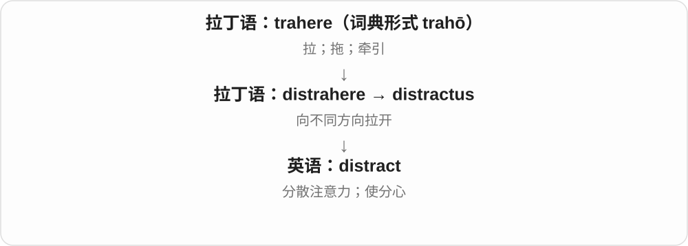

“拉开”在心理上变成分散注意。它可以妨碍工作，也可以帮助暂时忘记痛苦，所以不总是负面的。

**常见搭配与例句**

distract someone from…；be easily distracted；distract attention from… 。

> The noise distracted me from my reading.

噪声让我无法专心阅读。

> A short walk helped distract her from her worries.

散步一会儿帮助她暂时放下烦恼。

**别混淆**

attract 把注意力拉过来；distract 把注意力从原目标拉走。同一个手机通知可能同时做到这两件事。

### 23. distracted — 分心的；心神不宁的

**音标**：/dɪˈstræktɪd/

**先抓住这个画面**

distracted 描述人已经不在专注状态：手在翻页，脑子却在想另一件事。

**怎么拆**

distract + -ed，表示注意力受到转移后的状态。

**怎么变成今天的意思**

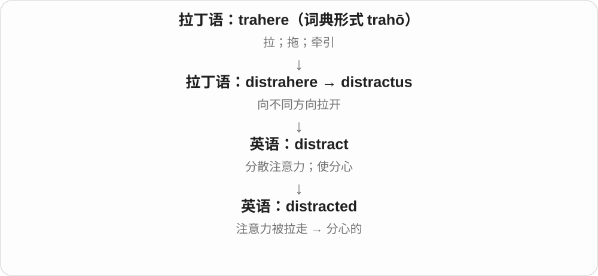

有时是外界打扰，有时是心里有事。较强的语境里它也可表示因忧虑而心烦意乱。

**常见搭配与例句**

look distracted；seem distracted；get distracted by…；distracted driving。

> He looked distracted and answered the wrong question.

他看起来心不在焉，答非所问。

> I get distracted whenever messages appear on the screen.

屏幕上一弹出消息，我就会分心。

**别混淆**

distracted 是自己分心；distracting 是会让别人分心。一个 distracted reader 可能正在受 distracting noise 影响。

### 24. distraction — 分心；干扰；消遣

**音标**：/dɪˈstrækʃən/

**先抓住这个画面**

distraction 可以是注意力被拉走的状态，也可以是那个拉走你的东西，比如响个不停的通知。

**怎么拆**

经法语 distraction，来自拉丁语 distractiō；现代可对照 distract + -ion。

**怎么变成今天的意思**

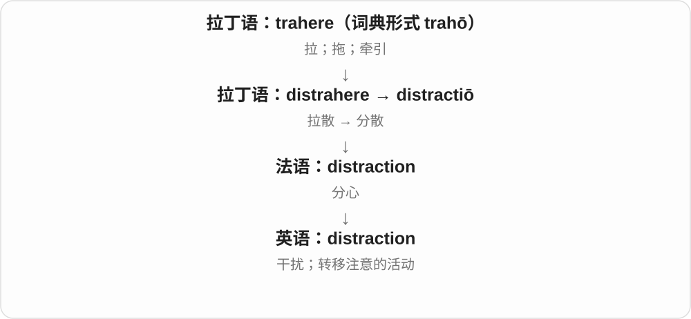

离开原来的关注点，有时是干扰，有时是休息。a welcome distraction 常是让人暂时不再忧虑的好事。

**常见搭配与例句**

avoid distractions；a distraction from…；a welcome distraction；work without distraction。

> I turned off notifications to reduce distractions.

我关闭了通知，以减少干扰。

> The children’s laughter was a welcome distraction from the long wait.

孩子们的笑声让漫长的等待不那么难熬，是一种令人愉快的消遣。

**别混淆**

interruption 强调活动被打断；distraction 强调注意力转移。人还在工作，脑子却飘走，也算 distraction。

### 25. traction — 牵引力；抓地力；逐渐获得的支持或进展

**音标**：/ˈtrækʃən/

**先抓住这个画面**

traction 先想轮胎抓住地面，车才能向前。引申到计划，就是终于有了能让它推进的支持和响应。

**怎么拆**

来自中世纪拉丁语 tractiō，基础是 trahere 的相关词干 tract-，加动作名词结尾。

**怎么变成今天的意思**

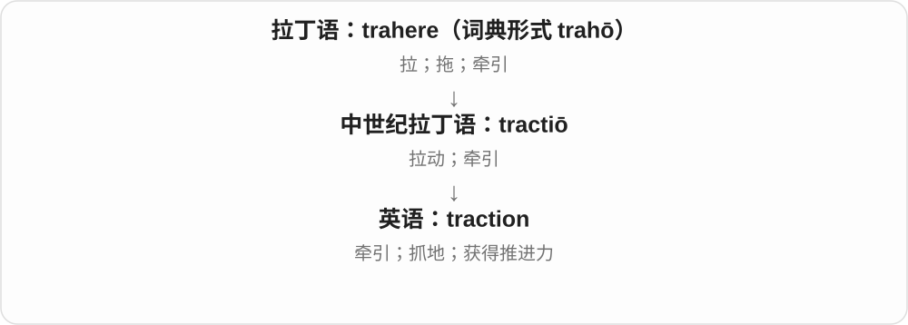

汽车语境关注轮胎是否能把动力传到地面；get traction 则借这个画面形容主意开始被接受、产品开始有人用。

**常见搭配与例句**

lose traction；improve traction；gain traction；a proposal that gets traction。

> The tires lost traction on the icy road.

轮胎在结冰的路面上失去了抓地力。

> The idea began to gain traction among local businesses.

这个想法开始得到当地企业的支持。

**别混淆**

traction 与 speed 不同：有抓地力才容易加速，但抓地力本身不是速度。抽象义也强调起作用、有人响应，不保证已经成功。

### 26. tractor — 拖拉机；牵引车

**音标**：英 /ˈtræktə/；美 /ˈtræktər/

**先抓住这个画面**

tractor 是能把其他东西拖着走的机器：在农田里拉犁，在其他场景也可牵引重物。

**怎么拆**

以拉丁语 tract-“拉”的相关词干加 -or 形成；-or 在这里指执行动作的机器。

**怎么变成今天的意思**

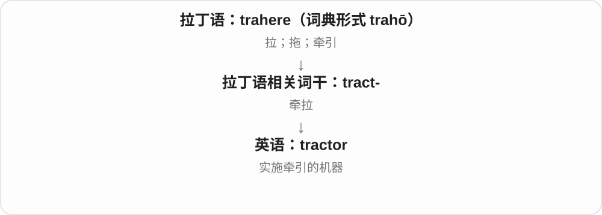

它的名称首先来自工作方式，而不只是使用地点。农用拖拉机最熟悉，但“牵引车辆”的范围更广。

**常见搭配与例句**

drive a tractor；a farm tractor；a tractor pulling a plough。

> The tractor pulled a plough across the field.

拖拉机拉着犁穿过田地。

> A small tractor moved the heavy equipment into position.

一辆小型牵引车把重型设备拉到了指定位置。

**别混淆**

tractor 强调牵引；trailer 通常是被拖着走的拖车。一个负责拉，一个被拉。

### 27. trait — 特点；特征

**音标**：/treɪt/

**先抓住这个画面**

trait 像画像里一笔让人认出对象的线条：耐心、爱冒险，或某种遗传特征，都是能描述它的特点。

**怎么拆**

来自法语 trait“线条、特征”，追溯到拉丁语 tractus“拉、画出的线”，属于 trahere。

**怎么变成今天的意思**

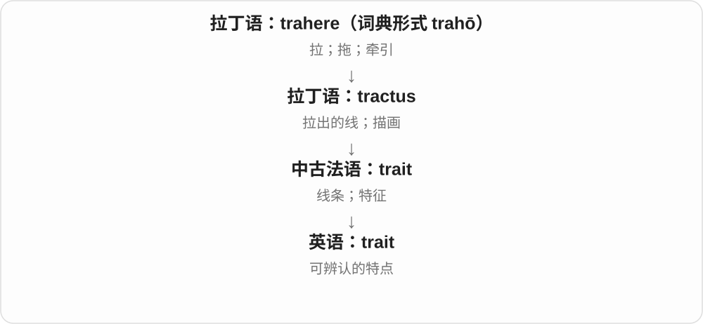

从画面上的线条发展到人物的特征，再扩展到性格、生物等方面。这是有词源根据的联系，但不是说性格真的由一根线决定。

**常见搭配与例句**

a personality trait；a genetic trait；share a trait；an inherited trait。

> Patience is one of her strongest traits.

耐心是她最突出的性格特点之一。

> The researchers studied how the trait passed between generations.

研究人员考察了这一特征如何在代际之间传递。

**别混淆**

trait 是一个特点；character 常指整体性格，也可以指人物。trait 和 traitor“叛徒”不能因拼写接近就合成同一来源。

### 28. portray — 描绘；塑造；扮演

**音标**：英 /pɔːˈtreɪ/；美 /pɔːrˈtreɪ/

**先抓住这个画面**

portray 是把某个人或事物呈现成一个形象，可以用画笔、文字、镜头，也可以用表演。

**怎么拆**

来自法语 portraire；其 por- 与拉丁语 prō- 有关，traire 来自 trahere。不要把现代拼写拆成 port“港口”与 ray“光线”。

**怎么变成今天的意思**

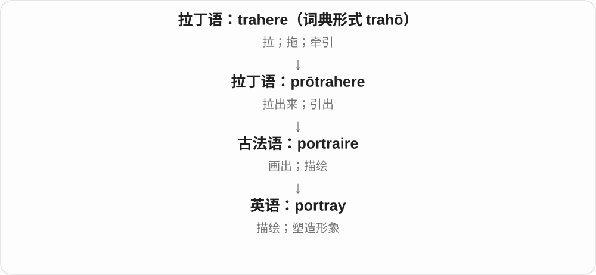

拉丁语“引出、拉出”在法语这一支发展为描画。现代既能描绘外貌，也能让读者形成某种看法，所以 portray A as B 很常见。

**常见搭配与例句**

portray someone as…；portray a character；portray daily life；accurately portray。

> The novel portrays life in a small fishing village.

小说描绘了一个小渔村的生活。

> The actor portrays a teacher who refuses to give up.

这位演员扮演一名不肯放弃的教师。

**别混淆**

portray 强调呈现出来的形象，不保证完全客观。某电影把人 portray as a hero，不等于他在现实中必然是英雄。

### 29. protracted — 拖延很久的；持续过长的

**音标**：英 /prəˈtræktɪd/；美 /proʊˈtræktɪd/

**先抓住这个画面**

protracted 像一条本该很短的时间线，被一直向后拉，迟迟没有结束。

**怎么拆**

protract + -ed；protract 的来源包括拉丁语 prōtrahere“向前拉出、延长”的相关形式，也有从 protraction 逆构的历史。

**怎么变成今天的意思**

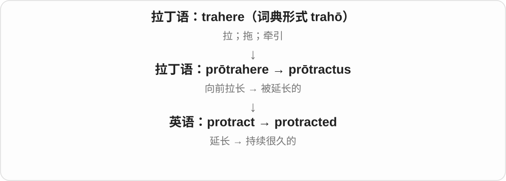

它把拉长的对象换成时间，常用于谈判、争执和困难过程。一般暗示比预期或希望的更久。

**常见搭配与例句**

protracted negotiations；a protracted dispute；a protracted struggle；a protracted delay。

> After protracted negotiations, the two sides reached an agreement.

经过长时间的谈判，双方终于达成一致。

> The repair turned into a protracted and expensive project.

这次维修变成了一个拖延很久、费用高昂的项目。

**别混淆**

long 只说长；protracted 常让人感觉事情被拖着，结束得太慢。不是所有长久的幸福都适合用它。

### 30. subtract — 减去；扣除

**音标**：/səbˈtrækt/

**先抓住这个画面**

subtract 像从一堆筹码里拿走几枚：总量因此变少。

**怎么拆**

sub-（在下）+ trahere（拉）形成 subtrahere，历史意思包括从下面抽走、移除；相关形式 subtractus 进入英语。

**怎么变成今天的意思**

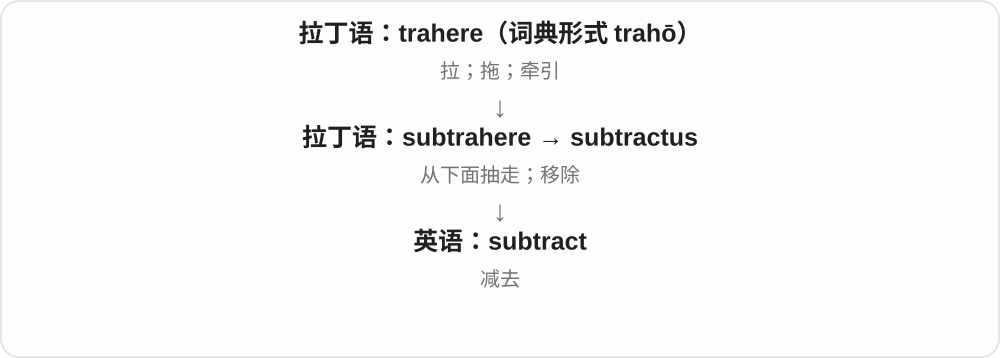

具体的“拿走”很容易进入算术：从原数移除一部分。现代不必真从下面抽，sub- 只是历史构词线索。

**常见搭配与例句**

subtract A from B（从 B 中减去 A）；subtract the cost；subtract five from twelve。

> Subtract seven from twenty to get thirteen.

二十减七，得到十三。

> We subtracted the delivery charge from the total.

我们从总额中扣除了运费。

**别混淆**

subtract A from B 的计算顺序是 B − A，不是 A − B。deduct 更常用于从应付金额或税额中扣除。

### 31. subtraction — 减法；减去；扣除

**音标**：/səbˈtrækʃən/

**先抓住这个画面**

subtraction 讨论的是“从原数拿走一部分”这个运算，而不是被拿走的那个数字。

**怎么拆**

来自晚期拉丁语 subtractiō；现代可拆解理解为 subtract + -ion。

**怎么变成今天的意思**

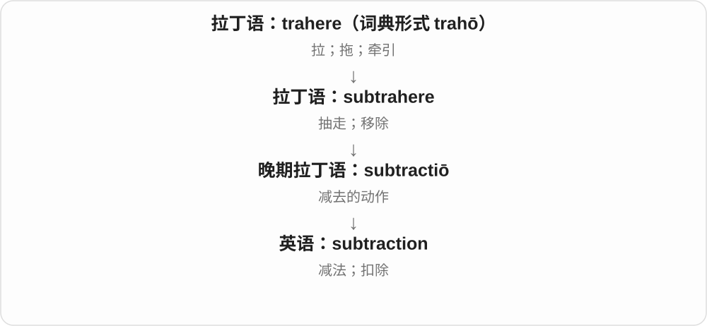

subtract 是动词“减去”，subtraction 是名词“减法或减去过程”。它也能用于材料、数量的减少，不只用于课本。

**常见搭配与例句**

addition and subtraction；a subtraction problem；subtraction of expenses。

> The children practiced subtraction with small blocks.

孩子们用小积木练习减法。

> The final amount is calculated by subtraction of the expenses.

最后的金额通过扣除各项支出来计算。

**别混淆**

subtraction 是减去的操作；difference 可以是相减后的差。做减法和所得结果要分开。

### 32. subtractive — 通过减去实现的；减法的

**音标**：/səbˈtræktɪv/

**先抓住这个画面**

subtractive 像从一块木头里刻出雕像：结果靠拿掉材料得到，不靠不断往上加。

**怎么拆**

subtract + -ive，表示与减去有关、通过减去来实现的。

**怎么变成今天的意思**

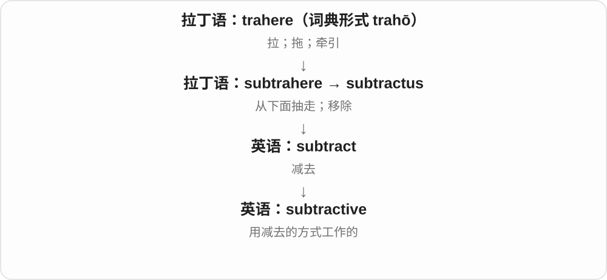

这个思路可用于加工，也可用于颜色：颜料会吸收一部分光，混色涉及从反射光中减掉某些成分，因此叫 subtractive mixing。

**常见搭配与例句**

subtractive manufacturing；subtractive color mixing；a subtractive process。

> Carving is a subtractive process because material is removed.

雕刻是一种减材过程，因为它通过去除材料成形。

> The class compared additive and subtractive color mixing.

课堂比较了加色混合与减色混合。

**别混淆**

additive 是不断增加；subtractive 是不断拿走。3D 打印常是前者，切削一整块材料常是后者。

### 33. retract — 缩回；收回言论；撤回

**音标**：/rɪˈtrækt/

**先抓住这个画面**

retract 是把已经伸出去的东西拉回来：猫收起爪子，人收回先前说过的话。

**怎么拆**

re-（回）+ trahere（拉）形成 retrahere；言论撤回义也联系到拉丁语 retractāre，经法语 rétracter 传入。两条路线同属“拉”的词族。

**怎么变成今天的意思**

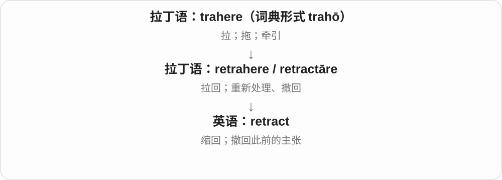

物理缩回和撤回主张共享“收回”的画面。撤回不等于自动修复后果，只是表示不再维持原来的说法。

**常见搭配与例句**

retract a statement；retract a claim；retract the landing gear；retract one’s claws。

> The newspaper retracted its claim after checking the records.

报纸核对记录后撤回了原来的说法。

> The aircraft retracted its landing gear after takeoff.

飞机起飞后收起了起落架。

**别混淆**

retract 是收回；deny 是否认。一个人可以 deny making a statement，声称自己根本没说过，并非 retract 已承认说过的话。

### 34. retraction — 收回；撤回声明；缩回

**音标**：/rɪˈtrækʃən/

**先抓住这个画面**

retraction 是收回这个动作，也可以是正式说明“先前那段内容不再成立”的声明。

**怎么拆**

现代可对照 retract + -ion；也可见 re- 与 traction 的结构联系。实际用法要沿 retract“收回”理解。

**怎么变成今天的意思**

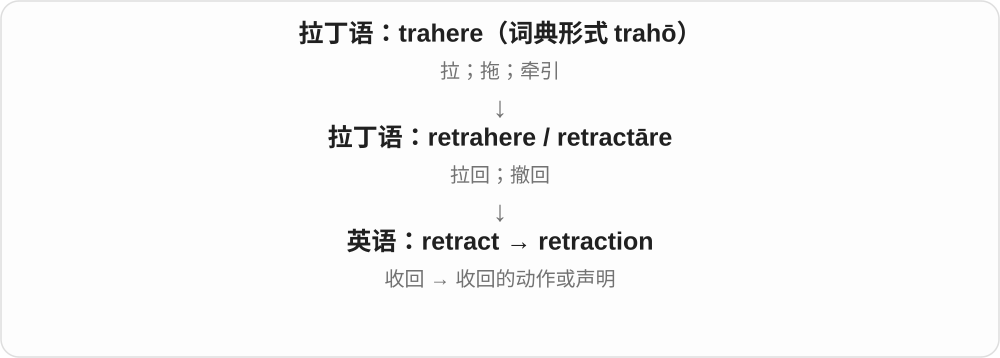

在机构、媒体和学术场景里，它常指纠正已公开内容的撤回。机械里的 retraction 则仍是很直接的缩回。

**常见搭配与例句**

issue a retraction；publish a retraction；demand a retraction；retraction of the landing gear。

> The journal published a retraction of the article.

期刊发表声明，撤回了那篇文章。

> The mechanism allows smooth retraction of the cable.

这个机构能让电缆平稳地收回。

**别混淆**

correction 可以只修改错误部分；retraction 通常意味着撤回相关内容。是否撤回全文，要看具体声明。

### 35. detract — 减损；贬低

**音标**：/dɪˈtrækt/

**先抓住这个画面**

detract 常像从一个优点上拿走一点分数：小瑕疵没有毁掉整件事，却让它没那么好。

**怎么拆**

de-（向下、离开）+ trahere 形成拉丁语 detrahere“拉走、减少”；经法语 détracter 传来。

**怎么变成今天的意思**

现代最常见 detract from：某事使总体价值或效果有所下降。早期的“拉走”不必理解成实际拿走一块物体。

**常见搭配与例句**

detract from the value；detract from the achievement；nothing to detract from… 。

> A few scratches do not detract from the table’s beauty.

几道划痕并不减损这张桌子的美。

> The delay should not detract from what the team achieved.

这次延误不应掩盖或贬低团队取得的成果。

**别混淆**

detract from 是减损价值；distract from 是转移注意力。噪声可以 distract you，也可能 detract from an otherwise enjoyable visit。

### 36. tractable — 容易处理的；易管理的；可求解的

**音标**：/ˈtræktəbəl/

**先抓住这个画面**

tractable 像一个能理顺的结：找到办法后，就能操作、解决或控制。

**怎么拆**

来自拉丁语 tractābilis，基础 tractāre 有处理、管理的意思。不是“能被拖着走”就涵盖所有现代义。

**怎么变成今天的意思**

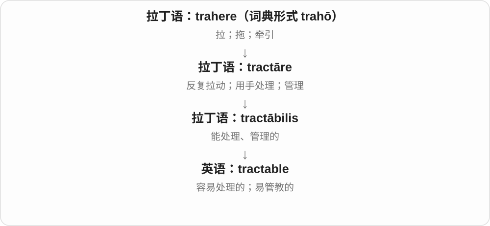

从用手处理东西，到管理人和解决问题，词义逐渐抽象。现代技术语境常说问题在计算或推理上可以处理。

**常见搭配与例句**

a tractable problem；make a problem tractable；a tractable model；a tractable child（较书面）。

> Breaking the task into smaller parts made it tractable.

把任务拆成小部分后，它就容易处理了。

> The new method produces a mathematically tractable model.

新方法得到一个在数学上便于分析的模型。

**别混淆**

tractable 是便于处理；trivial 是太简单或不重要。一个 tractable problem 仍可能需要认真工作。

### 37. intractable — 难以处理的；棘手的；难以改变的

**音标**：/ɪnˈtræktəbəl/

**先抓住这个画面**

intractable 像怎么拉都理不开的结：换了几种办法，问题仍然不动。

**怎么拆**

in-（不）+ tractable（容易处理的）。这次 in- 是否定，和 inflict 那种方向前缀不同。

**怎么变成今天的意思**

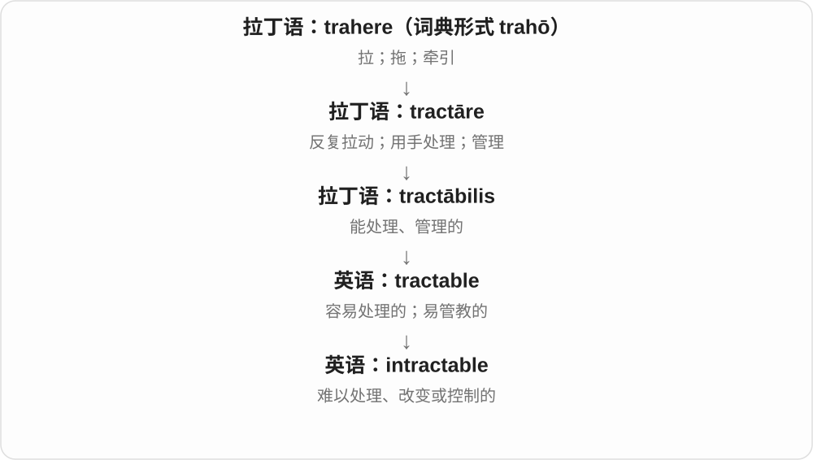

它常说长期棘手的问题、难以控制的疼痛或固执的人。重点是处理困难，不是在严格证明永远没有解。

**常见搭配与例句**

an intractable problem；intractable pain；an intractable dispute；remain intractable。

> The talks stalled over several intractable issues.

谈判因几个难解的问题陷入停滞。

> The project turned a seemingly intractable problem into a manageable one.

这个项目把一个看似无从下手的问题变成了可以处理的问题。

**别混淆**

difficult 的范围很广；intractable 更突出多次努力也难以解决。unsolvable 才更直接说不可解决。

### 38. subtrahend — 减数

**音标**：/ˈsʌbtrəhend/

**先抓住这个画面**

在 12 − 5 = 7 里，subtrahend 是 5：它就是准备从原数中拿走的那一份。

**怎么拆**

来自拉丁语 subtrahendus numerus“要被减去的数”。词尾保留拉丁语“应被做某事”的形式，不是英语单词 end。

**怎么变成今天的意思**

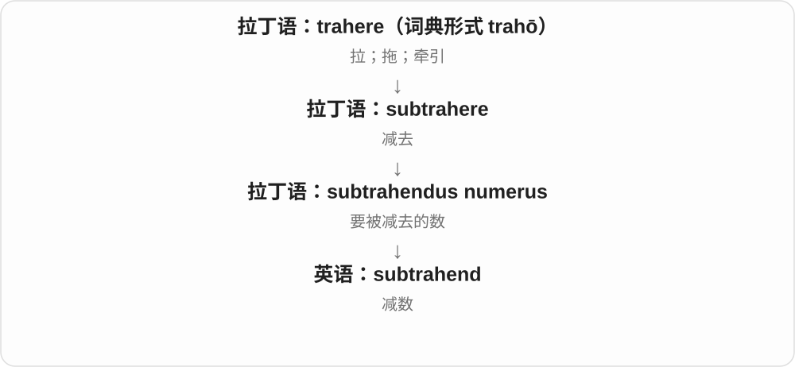

它给减法中的一个角色命名。原来的数是 minuend“被减数”，拿走的是 subtrahend“减数”，余下的是 difference“差”。

**常见搭配与例句**

the minuend and the subtrahend；identify the subtrahend；subtract the subtrahend from the minuend。

> In twelve minus five, five is the subtrahend.

在十二减五中，五是减数。

> Keep the minuend fixed and increase the subtrahend by one.

保持被减数不变，把减数加一。

**别混淆**

中文“被减数”容易造成方向误会：被减数是起点，减数才是要扣掉的那部分。

## 这一组要分清什么

**attract / distract / detract**：attract 把注意力拉过来；distract 把注意力从原目标拉走；detract from 则说减损价值或效果。

**abstract / extract**：abstract 常抽离细节、留下概念；extract 常从整体取出目标部分。两者都含“抽出”，实际任务不同。

**treat / treaty / treatise** 同属历史上的处理、商谈词族，但今天分别常说对待或治疗、条约、专题论著。

**trait 与 traitor** 不要按拼写归在一起；traitor 属于“交出、背叛”的另一条来源。

## 串起来练习

**The app extracts useful information without distracting the reader.**

这个应用提取有用的信息，又不会让读者分心。extract 是把需要的部分取出，distract 是把注意力从原本的任务拉走。
