# 0141 · fund-, fus- — 倾倒、流出；熔化后浇铸

[逐词精讲目录](../00_逐词精讲目录.md) · [总目录](../00_总目录_按常用程度.md)

## 核心词根与来源

拉丁语 **fundere** 的核心画面是“倾倒、流出”，也包括把熔化的金属浇铸出来。其分词 **fūsus** 留下 **fus-**。两杯液体倒在一起，就能帮助理解 **confuse** 的混乱；向里注入，是 **infuse**；往四周散开，是 **diffuse**；退回去，是 **refund**。这些画面帮助理解，逐词历史仍要看各自的借入路线。

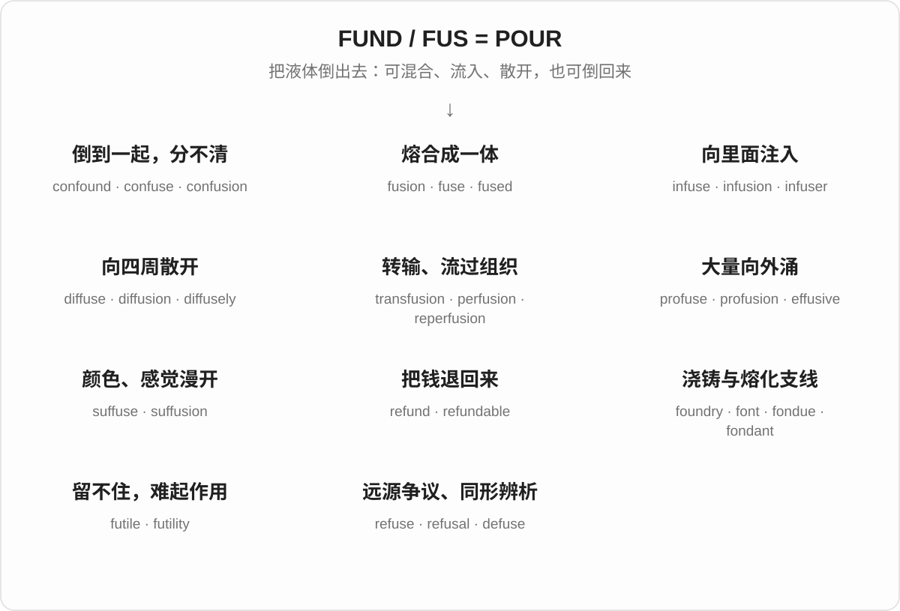

## 词形与演化规律

**fundere → fūsus** 是拉丁语自身的词形变化，不是英语把 nd 随便换成 s。**confound / confuse** 分别保留了较像动词原形与分词词干的外形。

法语 **fondre** 保留了熔化、铸造义，因此 **foundry、font〔字体〕、fondue、fondant** 虽不都显出 fus，仍有可靠的同源关系。

**confused** 比现代常用动词 **confuse** 更早；**fusion** 也早于常用动词 **fuse**。不能总画成英语动词先变出名词或分词。**diffusion、infusion、transfusion、effusion、suffusion** 各有拉丁名词借入支线。

另一个 **fundus** 是“底部”，产生 fund〔资金〕、foundation〔基础〕；它和本页 fundere 不同。**found** 的找到、创办、铸造，以及 **font** 的字体、洗礼盆，要分别读。**refuse** 的远源有分歧；**defuse** 属于引信支线，作为易混辨析说明。

## 单词速览（常用到不常用）

| 单词 | 音标 | 核心意思 |
|---|---|---|
| [found](#w-1) | /faʊnd/ | 创办；建立；另有 find 的过去式及铸造义 |
| [confused](#w-2) | /kənˈfjuːzd/ | 困惑的；混乱的；不清楚的 |
| [founder](#w-3) | 英 /ˈfaʊndə/；美 /ˈfaʊndər/ | 创办人；沉没、失败；铸工〔另一来源〕 |
| [refuse](#w-4) | 动词 /rɪˈfjuːz/；名词 /ˈrefjuːs/ | 拒绝；废弃物、垃圾 |
| [confusion](#w-5) | /kənˈfjuːʒən/ | 困惑；混乱；混淆 |
| [confusing](#w-6) | /kənˈfjuːzɪŋ/ | 令人困惑的；容易弄混的 |
| [fusion](#w-7) | /ˈfjuːʒən/ | 融合；熔融；核聚变 |
| [refund](#w-8) | 动词 /rɪˈfʌnd/；名词 /ˈriːfʌnd/ | 退款；退还已付的钱 |
| [refusal](#w-9) | /rɪˈfjuːzəl/ | 拒绝；拒不接受 |
| [font](#w-10) | 英 /fɒnt/；美 /fɑːnt/ | 字体；一套字形；洗礼盆；源泉〔另一来源〕 |
| [confuse](#w-11) | /kənˈfjuːz/ | 弄糊涂；混淆；认错 |
| [fuse](#w-12) | /fjuːz/ | 熔合；融合；保险丝；引信 |
| [funnel](#w-13) | /ˈfʌnəl/ | 漏斗；使汇集通过；输送 |
| [diffusion](#w-14) | /dɪˈfjuːʒən/ | 扩散；传播；散布 |
| [fused](#w-15) | /fjuːzd/ | 熔合的；融合为一体的 |
| [futile](#w-16) | 英 /ˈfjuːtaɪl/；美 /ˈfjuːtəl/、/ˈfjuːtaɪl/ | 徒劳的；不起作用的 |
| [foundry](#w-17) | /ˈfaʊndri/ | 铸造厂；铸造作业；代工厂〔特定行业〕 |
| [infusion](#w-18) | /ɪnˈfjuːʒən/ | 注入；浸泡液；输注 |
| [diffuse](#w-19) | 动词 /dɪˈfjuːz/；形容词 /dɪˈfjuːs/ | 扩散；传播；分散的；漫射的；冗长散漫的 |
| [transfusion](#w-20) | /trænsˈfjuːʒən/，也读 /trænzˈfjuːʒən/ | 输血；转输 |
| [profusely](#w-21) | /prəˈfjuːsli/ | 大量地；再三地；充分地 |
| [futility](#w-22) | 英 /fjuːˈtɪləti/；美 /fjuːˈtɪləti/ | 徒劳；无效；白费力气 |
| [defuse](#w-23) | /ˌdiːˈfjuːz/ | 拆除引信；化解紧张或危险 |
| [confounding](#w-24) | /kənˈfaʊndɪŋ/ | 令人困惑的；起混杂作用的 |
| [confounded](#w-25) | /kənˈfaʊndɪd/ | 困惑不解的；讨厌的〔旧式口气〕 |
| [infuse](#w-26) | /ɪnˈfjuːz/ | 注入；使充满；浸泡以提取味道 |
| [refundable](#w-27) | /rɪˈfʌndəbəl/ | 可退款的；可退还的 |
| [perfusion](#w-28) | 英 /pəˈfjuːʒən/；美 /pərˈfjuːʒən/ | 灌流；组织中的血流供应 |
| [confound](#w-29) | /kənˈfaʊnd/ | 使困惑；挫败预期；混淆 |
| [fondue](#w-30) | 英 /fɒnˈduː/；美 /fɑːnˈduː/ | 奶酪火锅；巧克力等蘸食锅 |
| [fondant](#w-31) | 英 /ˈfɒndənt/；美 /ˈfɑːndənt/ | 翻糖；软糖膏；软糖心 |
| [confusingly](#w-32) | /kənˈfjuːzɪŋli/ | 令人困惑地；容易混淆的是 |
| [profusion](#w-33) | 英 /prəˈfjuːʒən/；美 /prəˈfjuːʒən/、/proʊˈfjuːʒən/ | 大量；丰富；纷繁 |
| [effusive](#w-34) | /ɪˈfjuːsɪv/ | 热情洋溢的；感情流露过多的；溢流式的 |
| [effusion](#w-35) | /ɪˈfjuːʒən/ | 流出；感情倾吐；积液 |
| [profuse](#w-36) | /prəˈfjuːs/ | 大量的；丰富的；不吝惜的 |
| [reperfusion](#w-37) | 英 /ˌriːpəˈfjuːʒən/；美 /ˌriːpərˈfjuːʒən/ | 再灌注；血流恢复 |
| [nonrefundable](#w-38) | /ˌnɒnrɪˈfʌndəbəl/；美 /ˌnɑːnrɪˈfʌndəbəl/ | 不予退款的 |
| [infuser](#w-39) | 英 /ɪnˈfjuːzə/；美 /ɪnˈfjuːzər/ | 浸泡器；茶滤器；注入装置 |
| [fusible](#w-40) | /ˈfjuːzəbəl/ | 可熔化的；可熔接的 |
| [diffusely](#w-41) | /dɪˈfjuːsli/ | 分散地；弥漫地；冗长散漫地 |
| [effusively](#w-42) | /ɪˈfjuːsɪvli/ | 热情洋溢地；感情外露地 |
| [transfuse](#w-43) | /trænsˈfjuːz/，也读 /trænzˈfjuːz/ | 输血；使转移、注入 |
| [suffusion](#w-44) | /səˈfjuːʒən/ | 弥漫；一层淡色；充满的感觉 |
| [suffuse](#w-45) | /səˈfjuːz/ | 使弥漫；使充满；使遍布 |
| [effuse](#w-46) | 动词 /ɪˈfjuːz/；形容词 /ɪˈfjuːs/ | 流出；倾吐感情；铺展的〔较少见〕 |
| [perfuse](#w-47) | 英 /pəˈfjuːz/；美 /pərˈfjuːz/ | 灌流；使液体流过组织 |
| [fusibility](#w-48) | /ˌfjuːzəˈbɪləti/ | 可熔性；熔化的难易程度 |

## 逐词讲解

### 1. found — 创办；建立；另有 find 的过去式及铸造义

**音标**：/faʊnd/

**先抓住这个画面**

found 有三张不同的面孔：把学校、公司建起来；找到东西；把熔化金属浇铸成形。要靠句子分清。

**怎么拆**

“建立”来自拉丁语 fundāre，经法语传入。find 的过去式 found 来自日耳曼词族；“铸造”的 found 来自另一拉丁动词 fundere“倾倒”。

**怎么变成今天的意思**

创办义是给组织或制度打基础，过去式 founded；I found my keys 中的 found 已是 find 的过去式。铸造义今天偏行业或旧式用语，普通表达更常用 cast。

**常见搭配与例句**

found a company；be founded on evidence；found metal；find–found–found。

> They founded the school in a rented house.

他们最初在一栋租来的房子里创办了学校。

> Her argument is founded on careful observation.

她的论证建立在细致观察之上。

> The old manual describes how to found bronze bells.

这本旧手册介绍怎样铸造铜钟。

> I found the missing key under the desk.

我在桌子底下找到了丢失的钥匙。

**别混淆**

find–found–found 是找到；found–founded–founded 是创办。不要把 founded 当成 find 的过去式。

### 2. confused — 困惑的；混乱的；不清楚的

**音标**：/kənˈfjuːzd/

**先抓住这个画面**

信息进来了，但脑子里没有排好，暂时拼不出一个清楚的答案。

**怎么拆**

中古英语已有 confused，由法语 confus 或拉丁语 confūsus 加 -ed 形成；今天可按 confuse + -ed 理解，历史方向却并非如此。

**怎么变成今天的意思**

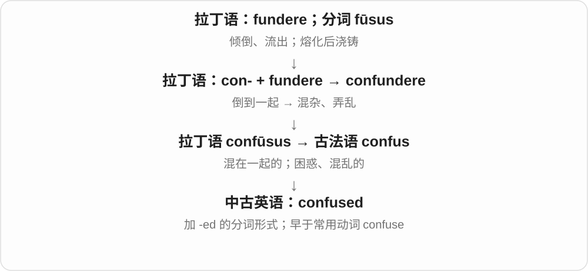

a confused person 是人没弄懂；a confused explanation 则是说明本身乱。be confused about 表示对某事困惑。

**常见搭配与例句**

confused about；a confused expression；a confused account。

> I am still confused about which form to complete.

我还是没弄清该填哪张表。

> He gave a confused account of the meeting.

他把会议经过讲得颠三倒四。

**别混淆**

confused 是接收信息后乱了，或叙述本身乱；confusing 是让别人感到乱。

### 3. founder — 创办人；沉没、失败；铸工〔另一来源〕

**音标**：英 /ˈfaʊndə/；美 /ˈfaʊndər/

**先抓住这个画面**

常见名词是最初把事情建起来的人；动词像船沉下去，计划也会失败；铸造行业另有“铸工”的名词。

**怎么拆**

创办人义经法语来自拉丁语 fundātor，与 found 相连；沉没义经法语 fondrer 来自 fundus“底部”。另有铸工义来自 fundere“倾倒”，属于另一支。

**怎么变成今天的意思**

创办人与沉没走“底部”词族的不同路线，不能把动词解释成成为创办人。铸工义来自 fundere，常见于 bell founder“铸钟师”等行业或历史表达。

**常见搭配与例句**

the founder of a company；the project foundered；a bell founder。

> The founder still visits the workshop every week.

创办人现在仍每周到车间来。

> The negotiations foundered on a disagreement over costs.

谈判因费用分歧而失败了。

> The bell founder inspected the mould before casting.

铸钟师在浇铸前检查了模具。

> The ship foundered during the storm.

那艘船在暴风雨中沉没了。

**别混淆**

founder 作动词是沉没或失败；flounder 常是挣扎、手忙脚乱。它们相像，却不能一概互换。

### 4. refuse — 拒绝；废弃物、垃圾

**音标**：动词 /rɪˈfjuːz/；名词 /ˈrefjuːs/

**先抓住这个画面**

把递来的请求挡回去，就是动词“拒绝”；被弃置、不要的东西，就可以是名词“废弃物”。

**怎么拆**

拒绝义来自古法语 refuser。其更早来源有分歧：有联系 refundere“倒回”的分析，也有 refūtāre 与 recūsāre 混合的分析。普通“拒绝”不是 re- 再 + fuse 融合；另有少用的 re-fuse 概念。

**怎么变成今天的意思**

refuse to answer 是拒绝回答；refuse an offer 是拒绝提议。household refuse 是生活垃圾，名词较正式，通常不可数。

**常见搭配与例句**

refuse to do；refuse an invitation；refuse collection。

> She refused to sign a document she had not read.

她拒绝签署一份自己没有读过的文件。

> Household refuse is collected on Tuesdays.

生活垃圾在星期二收运。

**别混淆**

refuse 与 refund 不能简单当成同义。前者不接受，后者退钱；两词是否有共同深层路线，词源学中有不同解释。

### 5. confusion — 困惑；混乱；混淆

**音标**：/kənˈfjuːʒən/

**先抓住这个画面**

几件事缠在一起，大家不知道哪个是真的、该去哪、该怎么做。

**怎么拆**

经古法语 confusion 来自拉丁语 confūsiō，与 confundere 同族；是独立借入的名词，不是现代 confuse 才加 -ion。

**怎么变成今天的意思**

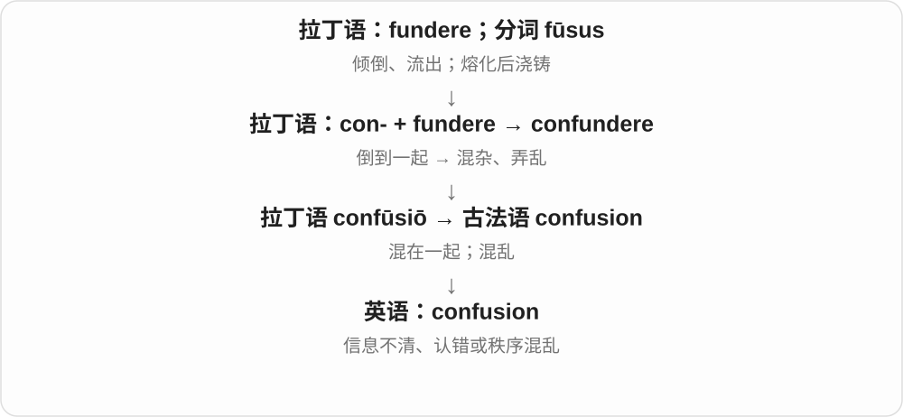

cause confusion 是造成混乱；confusion between A and B 是把二者搞混；in confusion 可说现场乱成一团。

**常见搭配与例句**

cause confusion；clear up the confusion；confusion over dates。

> The changed date caused confusion among the guests.

日期变动让客人们弄不清楚了。

> Let us clear up the confusion before we continue.

我们先把混淆的地方理清，再继续。

**别混淆**

confusion 是状态或问题；a mistake 是某个具体错误。没有犯错也可能先感到 confusion。

### 6. confusing — 令人困惑的；容易弄混的

**音标**：/kənˈfjuːzɪŋ/

**先抓住这个画面**

标牌、规则或说法让人看完以后更难判断该怎么办。

**怎么拆**

confuse + -ing；现在分词形容造成困惑的事物。

**怎么变成今天的意思**

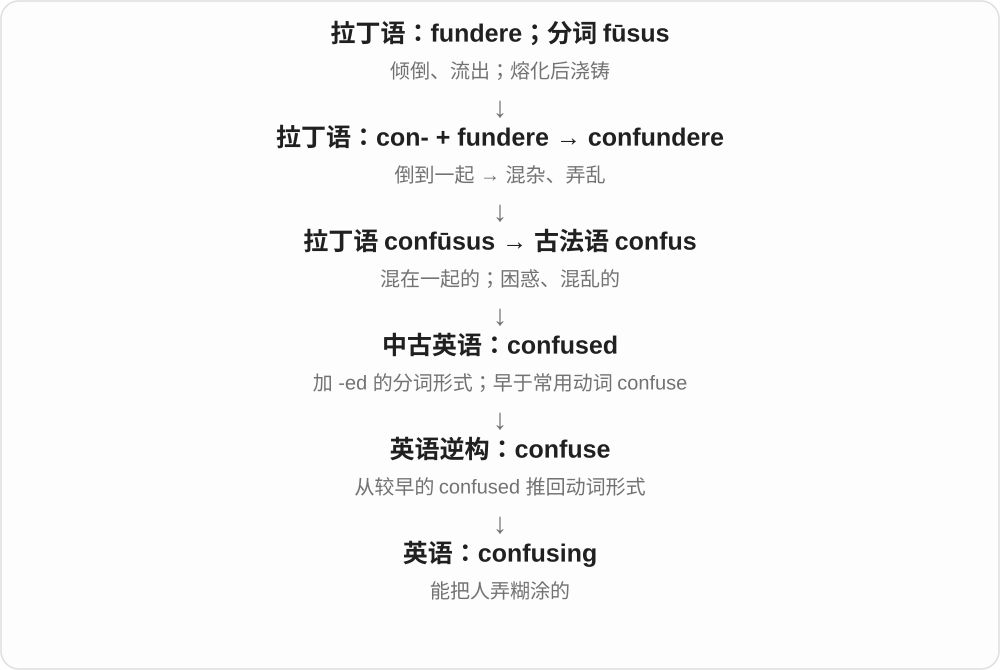

The instructions are confusing 是说明让人糊涂；It is confusing when… 后面可解释具体困惑点。

**常见搭配与例句**

confusing instructions；a confusing situation；confusing for beginners。

> The map is confusing because several paths have the same colour.

地图把几条路画成同一种颜色，容易让人弄混。

> The rules may be confusing for beginners.

这些规则可能让初学者感到困惑。

**别混淆**

complicated 是复杂；confusing 是使人理解困难。步骤多但讲得清楚，也未必 confusing。

### 7. fusion — 融合；熔融；核聚变

**音标**：/ˈfjuːʒən/

**先抓住这个画面**

两样东西合到一起，原来清楚的边界消失，形成一个整体。

**怎么拆**

来自法语 fusion、拉丁语 fūsiō“倾倒、熔化”。英语名词早于常用动词 fuse；后者有从 fusion 逆构的历史。

**怎么变成今天的意思**

音乐、菜式可以 fusion：把不同风格融合起来。物理中的 nuclear fusion 是轻原子核结合形成较重原子核，不是普通材料在锅里熔化。

**常见搭配与例句**

a fusion of styles；fusion cuisine；nuclear fusion。

> The album is a fusion of jazz and folk music.

这张专辑融合了爵士乐和民间音乐。

> The lesson explains how nuclear fusion differs from nuclear fission.

这节课解释核聚变与核裂变有何不同。

**别混淆**

fusion 是结合；fission 是分裂。混合音乐不一定把原风格完全抹掉，融合强调组合后的整体。

### 8. refund — 退款；退还已付的钱

**音标**：动词 /rɪˈfʌnd/；名词 /ˈriːfʌnd/

**先抓住这个画面**

钱已经付出去了，现在沿着原路流回来。

**怎么拆**

经法语来自拉丁语 refundere：re- 回 + fundere 倾倒。本来的“倒回去”发展为归还；别误认成现代 fund“基金”加 re-。

**怎么变成今天的意思**

动词 refund the money 是把钱退回；名词 get a refund 是得到退款。过去付了款才谈退款，给人补偿但不是退原款时常用 compensation。

**常见搭配与例句**

a full refund；request a refund；refund the cost。

> The shop refunded the full price of the damaged lamp.

商店退还了那盏损坏台灯的全款。

> I asked for a refund after the concert was cancelled.

音乐会取消后，我要求退款。

**别混淆**

refund 名词前重音、动词后重音。refuse 是拒绝，虽然长得像，常用意义和发音不同。

### 9. refusal — 拒绝；拒不接受

**音标**：/rɪˈfjuːzəl/

**先抓住这个画面**

对方期待你答应，你明确说“不”；这个不接受的动作或答复就是 refusal。

**怎么拆**

refuse + 名词后缀 -al，对应中古英语 refusell 等形式。更深来源的争议与 refuse 相同，图从可靠的法语节点开始。

**怎么变成今天的意思**

a refusal to cooperate 是拒绝合作；meet with a refusal 是遭到拒绝。right of first refusal 是特定“优先决定是否接受”的权利说法，不能逐字翻成“首先拒绝”。

**常见搭配与例句**

a firm refusal；refusal to answer；meet with refusal。

> His refusal to explain made the situation worse.

他拒不解释，使情况变得更糟。

> The request met with a polite but firm refusal.

这个请求遭到了礼貌但坚决的拒绝。

**别混淆**

refusal 是做出了不接受的表示；silence 只是沉默，未必已拒绝。

### 10. font — 字体；一套字形；洗礼盆；源泉〔另一来源〕

**音标**：英 /fɒnt/；美 /fɑːnt/

**先抓住这个画面**

字体义可以想象早期印刷的一整套金属字：它们按统一风格铸造，拿来排版。

**怎么拆**

字体义来自法语 fonte“铸造”，源自 fondre / fundere。洗礼盆、源泉义另来自拉丁语 fōns、词干 font-，不要把两个同形词强接在一起。

**怎么变成今天的意思**

电脑里常说 change the font 换字体；传统排印严格区分 typeface 的设计与具体 font，日常用法常重叠。教堂的 stone font 通常是石制洗礼盆。

**常见搭配与例句**

choose a font；font size；a baptismal font。

> Choose a font that is easy to read on a small screen.

选一种在小屏幕上也容易阅读的字体。

> A stone font stands near the church entrance.

教堂入口附近立着一个石制洗礼盆。

**别混淆**

font 的字体义与 foundry“铸字作坊”有关；fountain“喷泉”的直接来源是另一条 fōns 支线。

### 11. confuse — 弄糊涂；混淆；认错

**音标**：/kənˈfjuːz/

**先抓住这个画面**

脑子里原本有两个清楚的格子，现在内容混到一起：不知道怎么做，或把甲认成乙。

**怎么拆**

现代与 confused 对应，但历史上 confused 更早，来自法语 confus / 拉丁语 confūsus；动词 confuse 是后来逆构出的形式。

**怎么变成今天的意思**

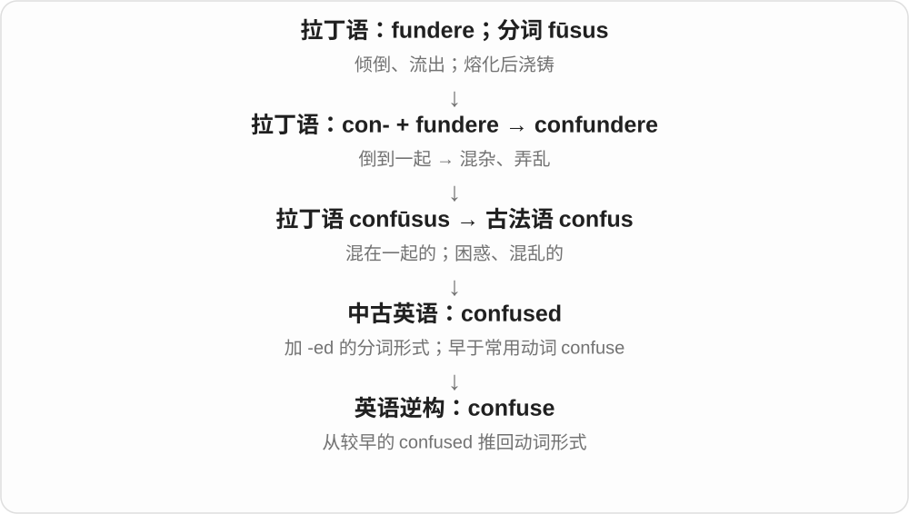

confuse someone 是让人糊涂；confuse A with B 是把 A 与 B 混淆。日常的 confused 不必指疾病，只可能是说明没看懂。

**常见搭配与例句**

confuse A with B；confuse the issue；easily confuse。

> The extra instructions only confused me.

额外的说明反而把我弄糊涂了。

> People often confuse the two sisters because they look alike.

这对姐妹长得像，人们经常把她们认错。

**别混淆**

confusing 说东西让人糊涂；confused 说人已经糊涂。不能用 I am confusing 来表达“我没懂”。

### 12. fuse — 熔合；融合；保险丝；引信

**音标**：/fjuːz/

**先抓住这个画面**

动词像两块材料受热后接成一体；名词还可以是断开电路的保险丝，或引燃装置的引信。

**怎么拆**

融合动词通常分析为由 fusion 逆构。引信名词经意大利语 fuso 等来自拉丁语 fūsus“纺锤”，与 fundere 的分词同形却不能直接认作同一个来源。保险丝名词的归源，词典有不同处理。

**怎么变成今天的意思**

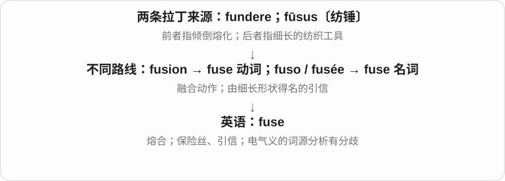

fuse A with B 是把两样东西融合；a blown fuse 是已熔断的保险丝。a short fuse 还可比喻脾气急，容易突然发火。

**常见搭配与例句**

fuse together；fuse tradition with innovation；blow a fuse；have a short fuse。

> Heat fused the two pieces of glass together.

热量使两块玻璃熔合在一起。

> The electrician found a blown fuse.

电工发现有一根保险丝熔断了。

> He has a short fuse when he is tired.

他累的时候很容易发火。

**别混淆**

fuse 的几个义不能只用“融合”硬套。安全装置叫 fuse，不叫 fusion；diffuse 是向外散开。

### 13. funnel — 漏斗；使汇集通过；输送

**音标**：/ˈfʌnəl/

**先抓住这个画面**

大口接住很多东西，慢慢收窄到一个小出口；人群、信息和资金也能这样汇集。

**怎么拆**

经法语相关形式来自后期拉丁语 fundibulum，是 infundibulum“漏斗”的缩短；后者来自 infundere“倒进去”。法语中间形式有重构分析，不硬写成完全确定的链。

**怎么变成今天的意思**

用漏斗倒油是名词用法；funnel money into a project 是把钱集中导入项目；funnel through a narrow gate 是从窄门汇集通过。

**常见搭配与例句**

use a funnel；funnel through；funnel resources into。

> Use a funnel to pour the oil into the bottle.

用漏斗把油倒进瓶子里。

> The new entrance funnels visitors into the main hall.

新入口把来访者引向主大厅。

**别混淆**

funnel 强调从宽到窄、向某处汇集；channel 广泛说通过通道引导，未必有收窄的形状。

### 14. diffusion — 扩散；传播；散布

**音标**：/dɪˈfjuːʒən/

**先抓住这个画面**

原来集中在一处的东西，逐渐分散到更大范围，像颜色在水里慢慢晕开。

**怎么拆**

借自拉丁语 diffūsiō，与 diffundere“倒开、散开”同族；现代对应 diffuse，但不是只有英语加 -ion 一条来源。

**怎么变成今天的意思**

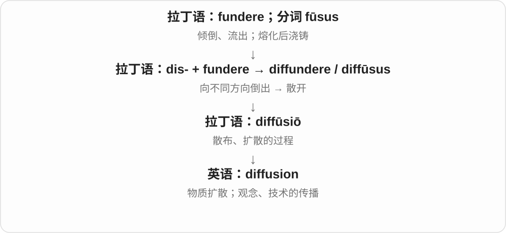

科学里的 diffusion 常涉及粒子随机运动造成的总体扩散；文化或技术的 diffusion 则是比喻性的传播。并非所有向外流动都叫扩散。

**常见搭配与例句**

diffusion of gases；diffusion of ideas；the rate of diffusion。

> The experiment demonstrates the diffusion of dye in water.

这个实验展示染料在水中的扩散。

> The book traces the diffusion of printing technology.

这本书追溯了印刷技术的传播。

**别混淆**

diffusion 是散开过程；fusion 是合成一体，不能因为都含 fus- 就混为一谈。

### 15. fused — 熔合的；融合为一体的

**音标**：/fjuːzd/

**先抓住这个画面**

原本分开的部分已经接上，变成一个难以分开的整体。

**怎么拆**

fuse + -ed；在融合义中来自 fusion 逆构出的动词。

**怎么变成今天的意思**

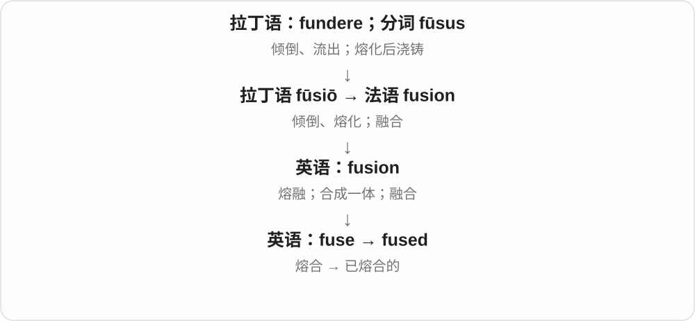

可形容玻璃、金属、骨骼或抽象元素。fused glass 是用热加工熔合的玻璃，不只是把碎片放在一起。

**常见搭配与例句**

fused glass；fused together；fused into a single unit。

> The artist made a bowl from layers of fused glass.

艺术家用熔合的多层玻璃做了一个碗。

> The two sounds became fused in her memory.

这两种声音在她的记忆中融成了一体。

**别混淆**

mixed 是混合；fused 往往更突出接成一体，原来的界线不再明显。

### 16. futile — 徒劳的；不起作用的

**音标**：英 /ˈfjuːtaɪl/；美 /ˈfjuːtəl/、/ˈfjuːtaɪl/

**先抓住这个画面**

像往留不住水的容器里倒水，忙了半天却达不到目的。这是帮助理解“白费力气”的画面。

**怎么拆**

经法语或直接来自拉丁语 fūtilis / futtilis“无用、不可靠”。传统词源把它联系到 fundere“倾倒”、易漏出的容器；不要把现代英语硬拆成 fu + tile。

**怎么变成今天的意思**

a futile attempt 是没有效果的尝试；It is futile to argue 是争论也没有用。评价的是达不到目的，不一定说人没有付出努力。

**常见搭配与例句**

a futile attempt；a futile exercise；it is futile to…。

> It was futile to repair the file without a backup.

没有备份，想修复那个文件也是徒劳。

> They made a futile attempt to keep the rain out with paper.

他们试图用纸挡雨，结果白费力气。

**别混淆**

difficult 是困难但可能做到；futile 认为这种做法不会产生所需效果。

### 17. foundry — 铸造厂；铸造作业；代工厂〔特定行业〕

**音标**：/ˈfaʊndri/

**先抓住这个画面**

把金属熔成液体，倒进模具，冷却后得到指定形状；做这种工作的地方就是传统 foundry。

**怎么拆**

借自法语 fonderie，与 fondre“熔化、铸造”相连，远源是 fundere；不是 found“创办”加 -ry。

**怎么变成今天的意思**

现代也说 semiconductor foundry 芯片代工厂，不表示芯片靠把金属倒进模具制造。type foundry 原为铸造活字的作坊，今天可指字体设计发行机构。

**常见搭配与例句**

an iron foundry；a type foundry；a semiconductor foundry。

> The old foundry once produced iron bells.

这家老铸造厂以前生产铁钟。

> The type foundry released a new family of digital fonts.

这家字体设计机构发布了一个新的数字字体家族。

**别混淆**

factory 泛指工厂；foundry 有铸造起点及行业扩展义，不是任何工厂都叫 foundry。

### 18. infusion — 注入；浸泡液；输注

**音标**：/ɪnˈfjuːʒən/

**先抓住这个画面**

一种东西进入另一种东西之中：味道进入水，资金进入项目，液体通过相应途径输入身体。

**怎么拆**

经古法语 infusion 来自拉丁语 infūsiō，是 infundere 的动作名词；有独立借入历史，不是现代 infuse 才造出它。

**怎么变成今天的意思**

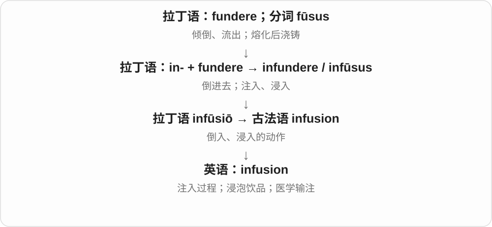

an infusion of cash 是资金注入；an herbal infusion 是草本浸泡饮品。医学里常指将液体或药物送入血液的输注，具体含义由语境限定。

**常见搭配与例句**

an infusion of cash；an herbal infusion；intravenous infusion。

> The project needs a fresh infusion of cash.

这个项目需要新一笔资金注入。

> She ordered a warm infusion of mint and lemon.

她点了一杯温热的薄荷柠檬浸泡饮品。

> The nurse recorded the start time of the infusion.

护士记录了输注开始的时间。

**别混淆**

infusion 不都指输液；transfusion 在医疗中通常特指输血或血液成分的输入。

### 19. diffuse — 扩散；传播；分散的；漫射的；冗长散漫的

**音标**：动词 /dɪˈfjuːz/；形容词 /dɪˈfjuːs/

**先抓住这个画面**

一滴颜色进入水里，逐渐往四周散开；说话时意思到处铺开、抓不住重点，也能叫 diffuse。

**怎么拆**

形容词来自拉丁语 diffūsus；动词另经法语 diffuser 或相关借入形式。dis- 分开 + fundere 倾倒，形成 diffundere。

**怎么变成今天的意思**

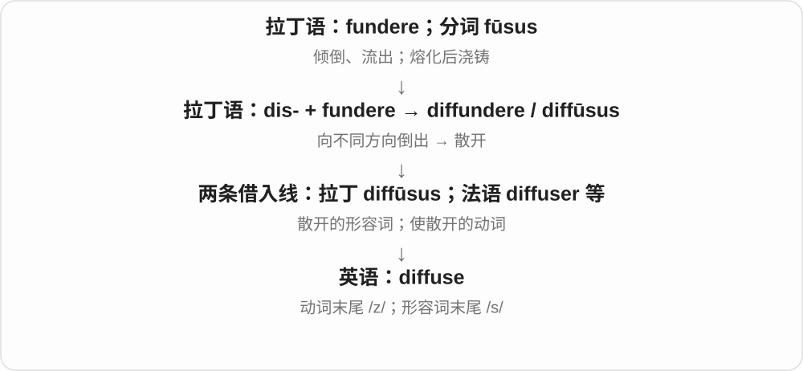

Light diffuses 是光散开；diffuse light 是柔和、分散的光；a diffuse essay 可能批评文章散漫。颜色扩散只是帮助理解的画面，各学科有自己的定义。

**常见搭配与例句**

diffuse through；diffuse light；diffuse responsibility。

> The scent slowly diffused through the room.

香味慢慢在房间里散开。

> The curtain creates a soft, diffuse light.

窗帘让光线变得柔和分散。

> The essay was informative but too diffuse.

这篇文章信息丰富，却写得太散。

**别混淆**

diffuse 是扩散；defuse 是拆除引信或化解紧张。形容词与动词的尾音也要分。

### 20. transfusion — 输血；转输

**音标**：/trænsˈfjuːʒən/，也读 /trænzˈfjuːʒən/

**先抓住这个画面**

血液或血液成分被送入另一人体内，这整个输入过程就是医疗中的 transfusion。

**怎么拆**

来自拉丁语 transfūsiō，与 transfundere 同族；英语名词有独立借入历史。

**怎么变成今天的意思**

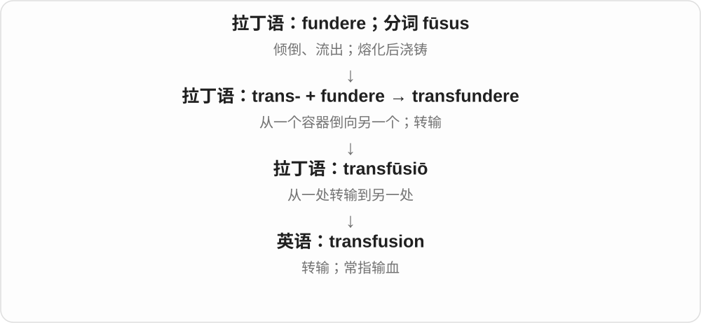

常见 a blood transfusion；可数地说一次输血。阅读医疗报道时，它说过程，不直接说明治疗结果。

**常见搭配与例句**

a blood transfusion；receive a transfusion；a transfusion service。

> The hospital keeps a record of every blood transfusion.

医院保存每次输血的记录。

> The leaflet explains what happens during a transfusion.

这份说明介绍了输血过程中会发生什么。

**别混淆**

infusion 范围较广，可以输注不同液体；transfusion 常专指血液或血液成分。

### 21. profusely — 大量地；再三地；充分地

**音标**：/prəˈfjuːsli/

**先抓住这个画面**

不是一点点往外给，而是不停地流出、说出或表达出来。

**怎么拆**

profuse + -ly，保留形容词的 /s/。

**怎么变成今天的意思**

apologize profusely 是一再道歉；thank someone profusely 是再三感谢；sweat profusely 是汗出得很多。

**常见搭配与例句**

apologize profusely；thank profusely；sweat profusely。

> He thanked the volunteers profusely.

他再三感谢志愿者。

> After carrying the boxes upstairs, she was sweating profusely.

把箱子搬上楼后，她出了很多汗。

**别混淆**

profusely 说量或表达程度；sincerely 说真诚程度，话很多不自动等于真诚。

### 22. futility — 徒劳；无效；白费力气

**音标**：英 /fjuːˈtɪləti/；美 /fjuːˈtɪləti/

**先抓住这个画面**

努力不断投进去，却始终换不来想要的结果；这种“做了也没用”的状态。

**怎么拆**

经法语 futilité 或直接来自拉丁语 fūtilitās；与 fūtilis 同族，现代可对应 futile + -ity，但不是只在英语内造出来。

**怎么变成今天的意思**

the futility of doing something 说做某事没有效果；a sense of futility 是觉得努力白费的感受。

**常见搭配与例句**

an exercise in futility；a sense of futility；recognize the futility of…。

> The broken lock showed the futility of using the same key again.

锁已经坏了，再用同一把钥匙试也没有意义。

> A sense of futility spread through the exhausted team.

疲惫的队员们渐渐感到努力都是徒劳。

**别混淆**

failure 是某次失败的结果；futility 更强调做法本身难以奏效，或持续感到白费力气。

### 23. defuse — 拆除引信；化解紧张或危险

**音标**：/ˌdiːˈfjuːz/

**先抓住这个画面**

想象把快要引发爆发的“导火索”拿掉，让冲突暂时炸不起来。

**怎么拆**

de- 去除 + fuse“引信”。这里属于 fuse 的引信名词支线，深层来自“纺锤”名称，作为易混辨析保留，不算 fundere“倾倒”的确定后代。

**怎么变成今天的意思**

日常最常用的是比喻义 defuse tension、defuse a situation，表示及时降低冲突升级的可能。它不保证所有根本矛盾已经解决。

**常见搭配与例句**

defuse tension；defuse an argument；defuse a crisis。

> A gentle joke helped defuse the tension.

一个温和的玩笑帮助缓和了紧张气氛。

> The mediator tried to defuse the argument before it escalated.

调解者试图在争论升级前将其化解。

**别混淆**

defuse 是化解潜在爆发；diffuse 是扩散。正确的常见搭配是 defuse tension。

### 24. confounding — 令人困惑的；起混杂作用的

**音标**：/kənˈfaʊndɪŋ/

**先抓住这个画面**

本来想看清 A 和 B 的关系，却有另一个因素同时掺进来，让结论难以分辨。

**怎么拆**

confound + -ing；研究中可作名词“混杂”，也可作形容词。

**怎么变成今天的意思**

a confounding factor 是可能搅乱关系判断的因素。日常或文学里也能说 a confounding puzzle，表示难以弄明白。

**常见搭配与例句**

a confounding factor；potential confounding；a confounding puzzle。

> The researchers considered age as a possible confounding factor.

研究者把年龄视为一个可能的混杂因素。

> The letter presented a confounding puzzle.

这封信带来了一个令人费解的谜。

**别混淆**

confounding 不等于某个变量只是存在；研究中要看它怎样影响所分析的关系。

### 25. confounded — 困惑不解的；讨厌的〔旧式口气〕

**音标**：/kənˈfaʊndɪd/

**先抓住这个画面**

碰到怎么也解释不通的事情，脑子一下卡住；也能带着恼火骂一句“这该死的……”。

**怎么拆**

confound + -ed。作为感叹性的形容词，还保留了 confound 旧时诅咒、使遭殃的意味。

**怎么变成今天的意思**

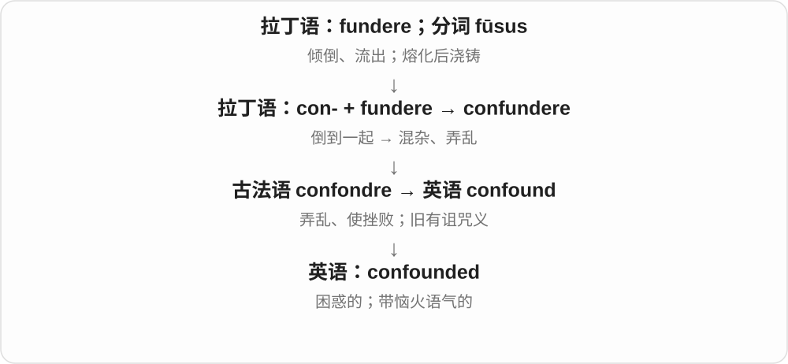

I was confounded 是我感到困惑；that confounded noise 是那讨厌的噪声，后一种带旧式或戏剧化语气。

**常见搭配与例句**

be confounded by；that confounded thing。

> I was confounded by the sudden change in his story.

他的说法突然改变，让我困惑不解。

> That confounded alarm kept ringing all afternoon.

那讨厌的警报整下午响个不停。

**别混淆**

confounded 不只等于 confused；置于名词前时可能只是恼火，不是在说那个物件迷糊。

### 26. infuse — 注入；使充满；浸泡以提取味道

**音标**：/ɪnˈfjuːz/

**先抓住这个画面**

把一种成分慢慢送进另一件东西：茶味进入水，活力进入团队。

**怎么拆**

借自拉丁语 infūsus，infundere 的分词：in- 进入 + fundere 倾倒。

**怎么变成今天的意思**

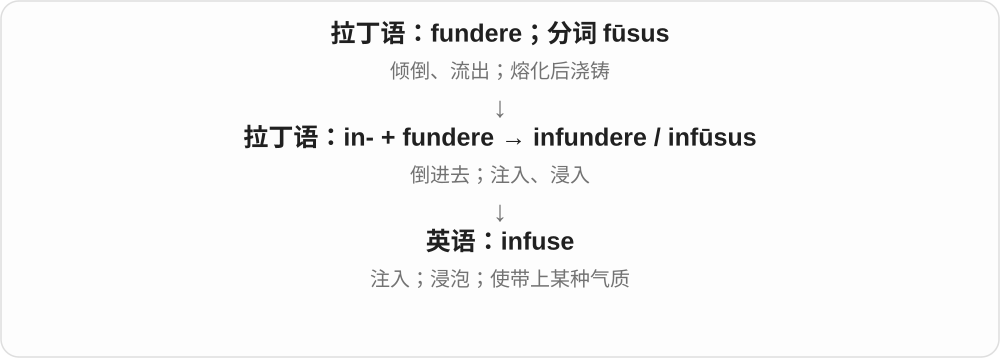

infuse A with B 是让 A 充满 B；也可说 infuse B into A。Tea leaves infuse 是茶叶在水中释放味道。

**常见搭配与例句**

infuse with energy；infuse confidence into；leave the tea to infuse。

> The new coach infused the team with confidence.

新教练给队伍注入了信心。

> Leave the mint to infuse in the hot water.

让薄荷在热水中浸出味道。

**别混淆**

infuse 强调某种东西进入并影响整体；suffuse 更容易让人想到颜色、光或情绪铺满。

### 27. refundable — 可退款的；可退还的

**音标**：/rɪˈfʌndəbəl/

**先抓住这个画面**

这笔钱虽然先付出去了，但在规定情形下还有退回来的可能。

**怎么拆**

refund + -able，表示可以被退还。

**怎么变成今天的意思**

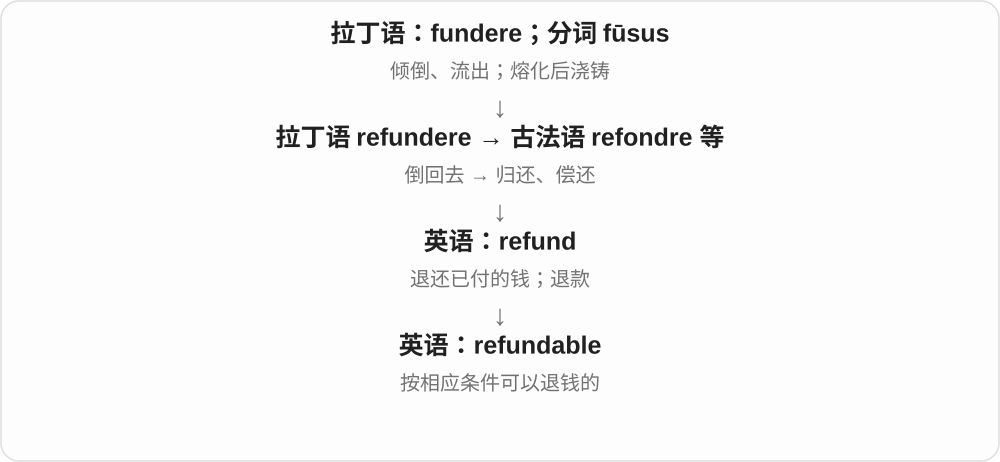

a refundable ticket 是可以退票款的票；a refundable deposit 是可以退还的押金。是否全退、何时能退，要看具体条件。

**常见搭配与例句**

a refundable deposit；fully refundable；refundable tickets。

> The booking requires a refundable deposit.

这次预订需要交一笔可退押金。

> We chose refundable tickets because our plans might change.

因为行程可能变化，我们选择了可退款的票。

**别混淆**

refundable 说能退钱；returnable 说商品等能退回，两者不必在每种交易中完全相同。

### 28. perfusion — 灌流；组织中的血流供应

**音标**：英 /pəˈfjuːʒən/；美 /pərˈfjuːʒən/

**先抓住这个画面**

看液体有没有真正流进、流过组织，像看水有没有送到一片区域里的细小通路。

**怎么拆**

经法语或直接来自拉丁语 perfūsiō，与 perfundere 相连；不是现代 perfuse 才加 -ion。

**怎么变成今天的意思**

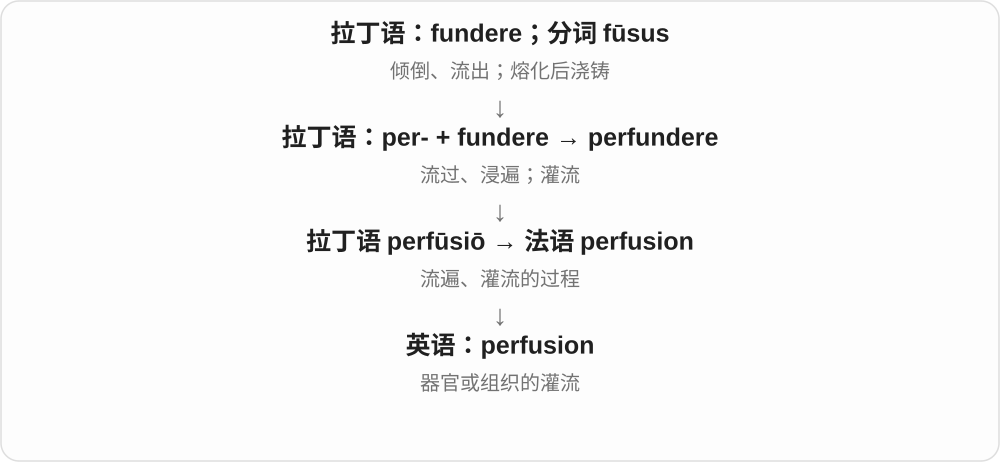

常谈 tissue perfusion、blood perfusion；特定治疗或实验里也可以是其他液体的灌流。不是看到血液就一定在说一次输血。

**常见搭配与例句**

tissue perfusion；blood perfusion；perfusion imaging。

> The scan provides information about tissue perfusion.

这次扫描提供了组织灌流方面的信息。

> The researchers compared perfusion in two regions.

研究者比较了两个区域的灌流情况。

**别混淆**

perfusion 是组织得到流经的液体；transfusion 是把血液等输入人体的过程，观察角度不同。

### 29. confound — 使困惑；挫败预期；混淆

**音标**：/kənˈfaʊnd/

**先抓住这个画面**

几股东西搅到一起，原本能分清的关系乱了；人想不明白，预测也可能被结果打乱。

**怎么拆**

经古法语 confondre、盎格鲁法语相关形式来自拉丁语 confundere：con- 一起 + fundere 倾倒。

**怎么变成今天的意思**

confound expectations 常说结果出乎预料。研究中的 confound 还可指另一个因素混进来，妨碍判断观察到的关系。

**常见搭配与例句**

confound expectations；confound the critics；confound A with B。

> The team’s victory confounded the experts.

这支队伍的胜利让专家们大感意外。

> The similar names continued to confound new readers.

这些相似的名字仍让新读者摸不着头脑。

**别混淆**

confuse 更常用于日常“弄糊涂”；confound 较正式，常有难倒、打乱预期的感觉。

### 30. fondue — 奶酪火锅；巧克力等蘸食锅

**音标**：英 /fɒnˈduː/；美 /fɑːnˈduː/

**先抓住这个画面**

一锅化开的奶酪，大家拿面包蘸着吃；词的起点就是“融化的东西”。

**怎么拆**

借自法语 fondue，是 fondre“熔化”的过去分词阴性形式作名词；追到拉丁语 fundere。

**怎么变成今天的意思**

cheese fondue 通常指奶酪蘸锅；chocolate fondue 用融化巧克力蘸水果等。不能把所有中国火锅都直接叫 fondue。

**常见搭配与例句**

cheese fondue；chocolate fondue；a fondue pot。

> We shared a cheese fondue after the walk.

散步后，我们一起吃了奶酪火锅。

> She dipped a strawberry into the chocolate fondue.

她拿一颗草莓蘸了蘸巧克力锅。

**别混淆**

fondue 是一道蘸食；fondant 常是蛋糕糖膏或软糖心。两者都与熔化同族，但不是同一种食物。

### 31. fondant — 翻糖；软糖膏；软糖心

**音标**：英 /ˈfɒndənt/；美 /ˈfɑːndənt/

**先抓住这个画面**

蛋糕外面那层能铺平、塑形的甜糖膏，或糖果里柔软细滑的糖心。

**怎么拆**

来自法语 fondant，“正在融化、入口易化的”，是 fondre 的现在分词作名词；远源 fundere。

**怎么变成今天的意思**

rolled fondant 可以擀开盖在蛋糕上，也能塑成花；另有可浇淋的 fondant。名称抓的是柔滑、融化的联想，不保证每种成品都一样软。

**常见搭配与例句**

rolled fondant；fondant icing；a fondant centre。

> She covered the cake with white fondant.

她用白色翻糖盖住蛋糕。

> Each chocolate had a soft fondant centre.

每块巧克力里都有柔软的糖心。

**别混淆**

fondant 不是一般的奶油；奶油霜常用 buttercream。不同装饰材料的口感和做法不同。

### 32. confusingly — 令人困惑地；容易混淆的是

**音标**：/kənˈfjuːzɪŋli/

**先抓住这个画面**

在描述一件事时顺便指出：这里会让人不容易弄清楚。

**怎么拆**

confusing + -ly。

**怎么变成今天的意思**

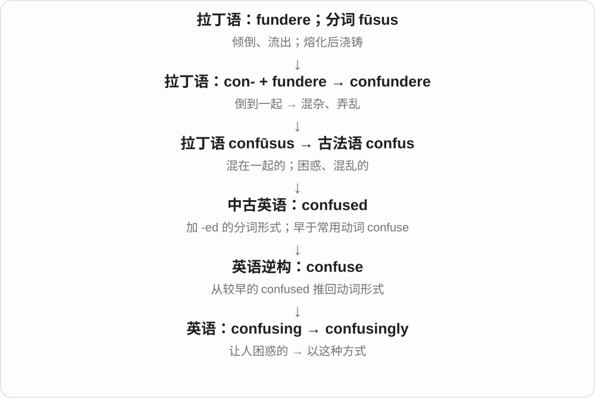

可修饰 similar、named 等，也可放句首评论整件事：Confusingly, both buttons are labelled Save.。

**常见搭配与例句**

confusingly similar；confusingly named。

> The two apps have confusingly similar names.

这两个应用的名字相似得很容易弄混。

> Confusingly, the entrance is marked as an exit on the old map.

让人困惑的是，旧地图把入口标成了出口。

**别混淆**

confusingly 说这件事造成困惑；confusedly 说某人自己在迷糊状态下行动。

### 33. profusion — 大量；丰富；纷繁

**音标**：英 /prəˈfjuːʒən/；美 /prəˈfjuːʒən/、/proʊˈfjuːʒən/

**先抓住这个画面**

东西一下铺满眼前，多得不只是几件，而是一大片、一大堆。

**怎么拆**

经法语 profusion 或直接来自后期拉丁语 profūsiō，与 profundere 相连；有自己的名词借入链。

**怎么变成今天的意思**

a profusion of flowers 是一大片繁花；in profusion 是大量地。可赞美丰富，也可嫌多而杂乱。

**常见搭配与例句**

a profusion of colour；flowers in profusion。

> The garden was filled with a profusion of spring flowers.

花园里开满了各色春花。

> The dashboard offered a confusing profusion of options.

仪表板提供了多得让人眼花缭乱的选项。

**别混淆**

profusion 是数量丰富；profundity 是思想深度，二者来源支线和读音都不同。

### 34. effusive — 热情洋溢的；感情流露过多的；溢流式的

**音标**：/ɪˈfjuːsɪv/

**先抓住这个画面**

情感像水一样往外涌：握手、赞美、感谢一股脑儿表达出来。

**怎么拆**

借自中世纪拉丁语 effūsīvus，与 effundere 相连；不是现代英语 effuse 才加 -ive。

**怎么变成今天的意思**

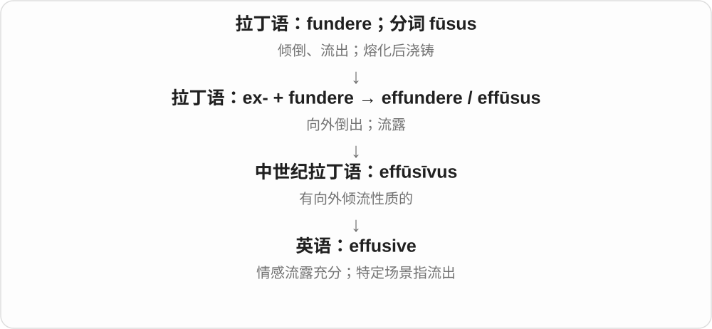

effusive praise 是热烈、甚至有点过头的赞美。火山学中的 effusive eruption 则指熔岩流出为主的喷发，仍保留具体的流出义。

**常见搭配与例句**

an effusive welcome；effusive praise；an effusive eruption。

> The visitors received an effusive welcome.

来访者受到了格外热情的欢迎。

> His effusive praise made her a little embarrassed.

他热情过头的赞美让她有点不好意思。

**别混淆**

enthusiastic 是热情；effusive 更让人看到大量情感外露，有时带“太热情了”的感觉。

### 35. effusion — 流出；感情倾吐；积液

**音标**：/ɪˈfjuːʒən/

**先抓住这个画面**

东西从原处往外流；在身体里，流出的液体还可能积在某个空间。

**怎么拆**

经法语 effusion 来自拉丁语 effūsiō，与 effundere 相连；是独立名词借词。

**怎么变成今天的意思**

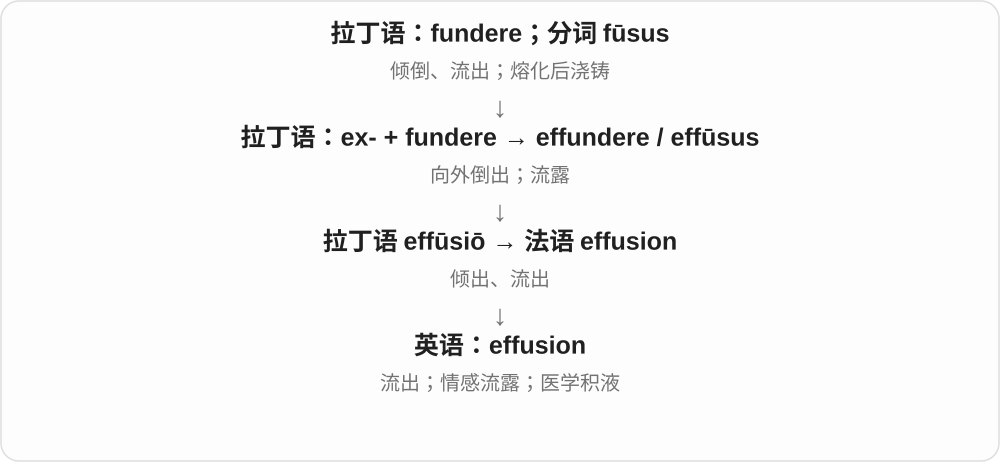

an effusion of gratitude 是一番热烈的感激表达。医学的 pleural effusion 是胸膜腔积液；物理里的气体 effusion 则说穿过微小孔口的逸出。

**常见搭配与例句**

an effusion of feeling；pleural effusion；gas effusion。

> The speech ended in an effusion of gratitude.

演讲以一番热烈的感谢收尾。

> The report describes a small pleural effusion.

报告描述了少量胸膜腔积液。

**别混淆**

effusion 不都表示一般扩散；医学中还可指积下来的液体，不能只照“往外流”直译。

### 36. profuse — 大量的；丰富的；不吝惜的

**音标**：/prəˈfjuːs/

**先抓住这个画面**

像打开闸口，东西不断往外涌；汗水、花朵、道歉或感谢都可以多得让人注意。

**怎么拆**

借自拉丁语 profūsus，是 profundere“向外倾出”的分词；prō- 向前、向外 + fundere。

**怎么变成今天的意思**

profuse sweating 是大量出汗；profuse apologies 是一再、充分表达的道歉。形容人时常用 be profuse in one’s thanks。

**常见搭配与例句**

profuse thanks；profuse apologies；profuse sweating。

> She offered profuse apologies for the delay.

她为延误一再表示歉意。

> The plant produces profuse flowers in summer.

这种植物夏天开花很多。

**别混淆**

profuse 强调量大，尾音 /s/；profound 是深刻，来自 fundus“底部”另一族。

### 37. reperfusion — 再灌注；血流恢复

**音标**：英 /ˌriːpəˈfjuːʒən/；美 /ˌriːpərˈfjuːʒən/

**先抓住这个画面**

原先缺血的地方，血流又重新进入、流过。re- 把重点放在“重新”。

**怎么拆**

re- 再 + perfusion 灌流，是现代医学构词。

**怎么变成今天的意思**

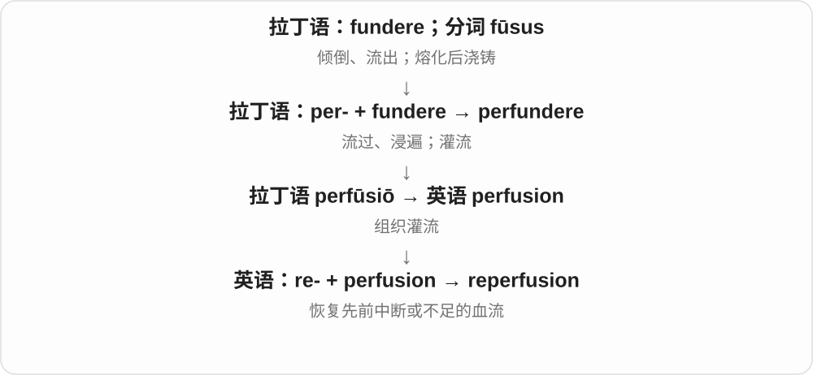

这个词只说明血流恢复，不能直接等同于已经痊愈。专业文章还会讨论 reperfusion injury，即恢复血流时可能出现的损伤。

**常见搭配与例句**

reperfusion of tissue；reperfusion injury。

> The study measured changes before and after reperfusion.

这项研究测量了再灌注前后的变化。

> The article discusses reperfusion injury in damaged tissue.

这篇文章讨论受损组织中的再灌注损伤。

**别混淆**

perfusion 说灌流本身；reperfusion 加上之前曾中断或不足、现在恢复的时间关系。

### 38. nonrefundable — 不予退款的

**音标**：/ˌnɒnrɪˈfʌndəbəl/；美 /ˌnɑːnrɪˈfʌndəbəl/

**先抓住这个画面**

按所说明的条款，这笔款付出后通常不能因为改变主意再拿回来。

**怎么拆**

non- 不 + refundable；此处保留无连字符拼写。

**怎么变成今天的意思**

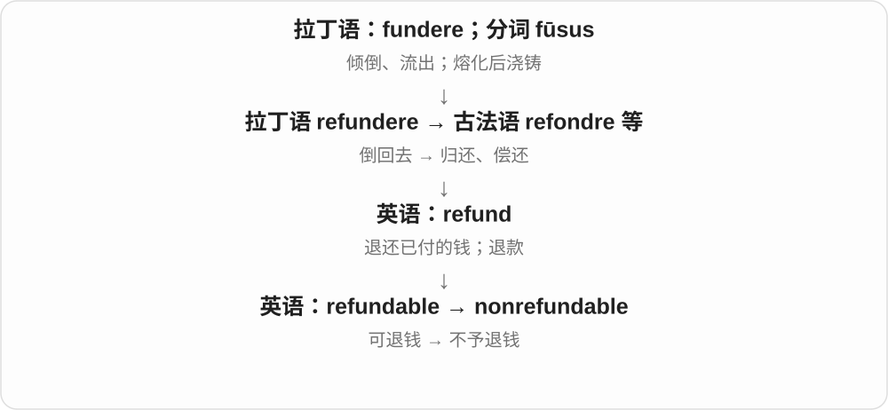

常见于票务、预订或手续费说明。它是一个条款用词，遇到特殊情况仍需结合实际规则，词本身不替代具体条件。

**常见搭配与例句**

a nonrefundable fee；a nonrefundable ticket。

> The form states that the application fee is nonrefundable.

表格说明申请费不予退还。

> She read the conditions before buying the nonrefundable ticket.

买不可退款的票之前，她读了相关条款。

**别混淆**

nonrefundable 不是 nonreturnable“不能退回物品”；不能退款也不等于服务已经完成。

### 39. infuser — 浸泡器；茶滤器；注入装置

**音标**：英 /ɪnˈfjuːzə/；美 /ɪnˈfjuːzər/

**先抓住这个画面**

把茶叶装在里面，让水能穿过、味道能出来，同时把叶子留住的小工具。

**怎么拆**

infuse + -er，表示执行这种作用的人或器具；日常最常见的是 tea infuser。

**怎么变成今天的意思**

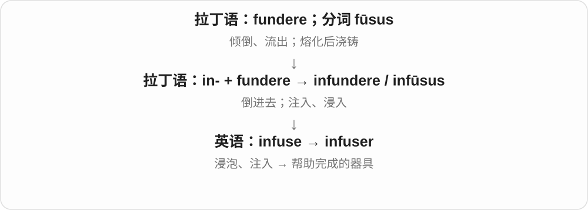

茶具商店里的 infuser 通常是带孔的茶滤器。技术语境中也可指别种注入设备，不能见到 -er 就都译成人。

**常见搭配与例句**

a tea infuser；a mesh infuser。

> She filled the infuser with loose tea leaves.

她把散茶叶装进茶滤器。

> The infuser kept the leaves out of the cup.

茶滤器把叶子拦住，没有让它们散进杯中。

**别混淆**

an infuser 是器具；an infusion 是浸泡过程或泡出的液体。

### 40. fusible — 可熔化的；可熔接的

**音标**：/ˈfjuːzəbəl/

**先抓住这个画面**

材料受热后能化开，或能利用热与别的材料接起来。

**怎么拆**

借自中世纪拉丁语 fūsibilis，来自 fūs- 与表示“可被……”的 -ibilis。英语 fusible 早于动词 fuse，不能把现代拼法当唯一历史。

**怎么变成今天的意思**

常见 fusible alloy 可熔合金；缝纫中的 fusible interfacing 指受热可粘合的衬布，具体读义看材料场景。

**常见搭配与例句**

a fusible alloy；fusible interfacing；a fusible link。

> The device contains a link made from a fusible alloy.

这个装置中有一段用可熔合金制成的连接件。

> She chose fusible interfacing for the collar.

她为领子选用了可热粘合的衬布。

**别混淆**

fusible 是能熔化或热接合；flammable 是容易燃烧，熔化与燃烧不是一回事。

### 41. diffusely — 分散地；弥漫地；冗长散漫地

**音标**：/dɪˈfjuːsli/

**先抓住这个画面**

不是集中在一个点，而是铺得很开；文章也可能东一句西一句，拉得很长。

**怎么拆**

diffuse 形容词 + -ly，保留形容词的 /s/，不是动词 /z/。

**怎么变成今天的意思**

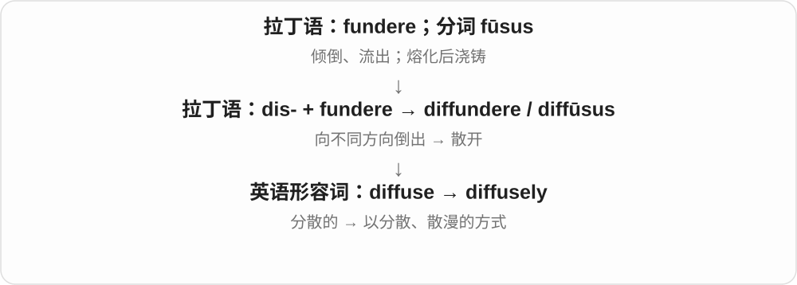

可描述光、颜色、分布，也能评价说话写作不集中。相应语境决定它是中性描写还是批评。

**常见搭配与例句**

diffusely scattered；write diffusely。

> Light was reflected diffusely from the rough surface.

光从粗糙表面向不同方向散射。

> He wrote diffusely about a fairly simple question.

他围绕一个相当简单的问题写得冗长散漫。

**别混淆**

diffusely 修饰动作或分布方式；diffusion 是名词“扩散”。

### 42. effusively — 热情洋溢地；感情外露地

**音标**：/ɪˈfjuːsɪvli/

**先抓住这个画面**

道谢、欢迎或夸奖时，把内心的热情明显地全倒出来。

**怎么拆**

effusive + -ly。

**怎么变成今天的意思**

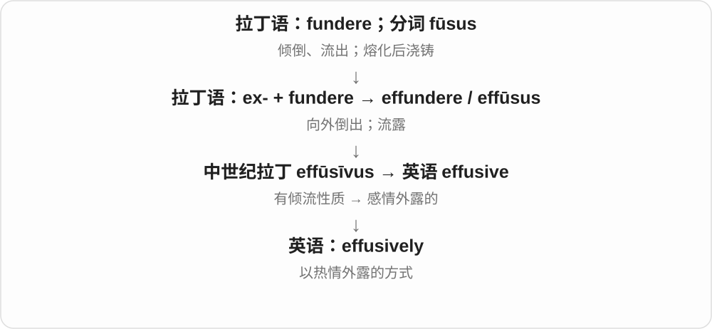

常修饰 greet、thank、praise。可赞扬热情，也可暗示表达得太多，具体语气看上下文。

**常见搭配与例句**

greet effusively；praise effusively；thank effusively。

> She greeted her old teacher effusively.

她热情洋溢地迎接了以前的老师。

> The reviewer praised the performance effusively.

评论者满怀热情地大加赞赏这场演出。

**别混淆**

profusely 更重数量、程度；effusively 更重热情外露。再三道谢可能同时符合两者。

### 43. transfuse — 输血；使转移、注入

**音标**：/trænsˈfjuːz/，也读 /trænzˈfjuːz/

**先抓住这个画面**

把液体从一处送到另一处；现代常见场景是把血液或血液成分输入患者体内。

**怎么拆**

来自拉丁语 transfūsus，是 transfundere 的分词：trans- 横过、转到另一边 + fundere 倾倒。

**怎么变成今天的意思**

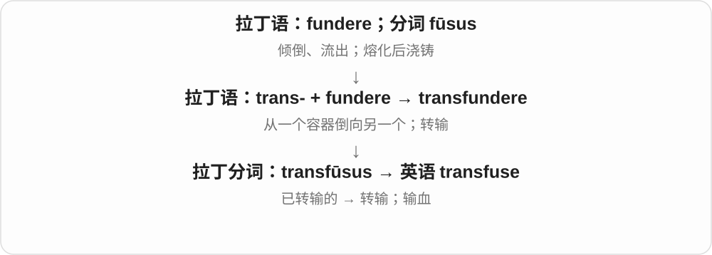

医学里可说 transfuse blood 或 transfuse a patient；较旧或文学语境也能说把情绪、力量传入别处。

**常见搭配与例句**

transfuse blood；be transfused with…。

> The report records how much blood was transfused.

报告记录了输入的血量。

> The patient was transfused with donated blood.

患者接受了捐献血液的输注。

**别混淆**

transfuse 不是普通地把饮料倒进杯子；那样通常说 pour。这里日常最常见的是医疗词义。

### 44. suffusion — 弥漫；一层淡色；充满的感觉

**音标**：/səˈfjuːʒən/

**先抓住这个画面**

像薄薄一层光、颜色或情绪铺开，给整片景象染上一种气氛。

**怎么拆**

来自拉丁语 suffūsiō，英语早有这一名词；现代对应 suffuse + -ion，但历史上不是先有现代动词。

**怎么变成今天的意思**

较文学，a suffusion of pink 是一层粉色；也可描述情绪充盈。旧医学意义需按历史语境读，不拿旧说法解释今天的疾病。

**常见搭配与例句**

a suffusion of colour；a warm suffusion of light。

> A faint suffusion of pink appeared in the eastern sky.

东方天空浮现出一层淡淡的粉红色。

> There was a suffusion of sadness in the final scene.

最后一幕弥漫着一丝悲伤。

**别混淆**

suffusion 多描写颜色或感觉的铺展；profusion 多说数量丰富。

### 45. suffuse — 使弥漫；使充满；使遍布

**音标**：/səˈfjuːz/

**先抓住这个画面**

一层颜色或感觉慢慢铺满：红晕漫上脸，温柔的光洒满房间。

**怎么拆**

来自拉丁语 suffūsus，suffundere 的分词；sub- 在 f 前同化为 suf-。其拉丁语意思已包括漫过、铺满，别只机械译成“往下面倒”。

**怎么变成今天的意思**

常用被动 be suffused with，也可让光、颜色或情绪作主语。偏文学、描写性。

**常见搭配与例句**

be suffused with light；warmth suffuses a room。

> The evening light suffused the empty studio.

傍晚的光洒满了空荡的工作室。

> Her letter was suffused with quiet optimism.

她的信里透着一种平静的乐观。

**别混淆**

infuse 可强调加入某种成分；suffuse 更突出这种颜色、情绪已经铺满整体。

### 46. effuse — 流出；倾吐感情；铺展的〔较少见〕

**音标**：动词 /ɪˈfjuːz/；形容词 /ɪˈfjuːs/

**先抓住这个画面**

原先在里面的液体或情感往外流，不再留在原处。

**怎么拆**

经法语 effuser 或直接来自拉丁语 effūsus，属于 ex- 向外 + fundere 倾倒。

**怎么变成今天的意思**

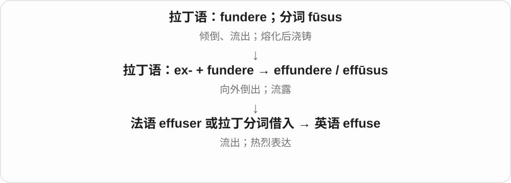

较少见。动词可写液体流出或情感流露；普通交谈中，多用 flow out、express enthusiastically。形容词在专业描述里可表示铺展。

**常见搭配与例句**

effuse through；effuse praise；an effuse growth。

> Gas effused slowly through the tiny opening.

气体慢慢从极小的开口逸出。

> The letter effused gratitude and affection.

信中洋溢着感激和爱意。

**别混淆**

effuse 作动词末尾 /z/，形容词 /s/；常见形容词 effusive 则通常形容情感外露。

### 47. perfuse — 灌流；使液体流过组织

**音标**：英 /pəˈfjuːz/；美 /pərˈfjuːz/

**先抓住这个画面**

液体不只是到达入口，而是流经器官或组织，让其中许多部位得到液体供应。

**怎么拆**

来自拉丁语 perfūsus，perfundere 的分词；per- 穿过、遍及 + fundere 倾倒。

**怎么变成今天的意思**

医学、生理和实验语境中的专业词，常见 perfuse tissue 或 well perfused。重点是流过组织，而不是普通给杯子添水。

**常见搭配与例句**

perfuse an organ；well perfused tissue。

> The diagram shows how blood perfuses the tissue.

图示说明血液怎样流经组织。

> The laboratory uses a pump to perfuse the isolated organ.

实验室用泵对离体器官进行灌流。

**别混淆**

infuse 重注入；perfuse 重流经组织。两词不能只因都译过“灌注”就随意互换。

### 48. fusibility — 可熔性；熔化的难易程度

**音标**：/ˌfjuːzəˈbɪləti/

**先抓住这个画面**

不再指某块材料，而是在问：这种材料多容易被熔化？

**怎么拆**

fusible + -ity，-ible 变为 -ibility，重音落在 bil 上。

**怎么变成今天的意思**

多用于材料、冶金等技术描述。比较 fusibility 时还要考虑条件，词本身没有规定一个统一的熔点。

**常见搭配与例句**

fusibility of an alloy；high fusibility。

> The study compares the fusibility of several alloys.

这项研究比较了几种合金的可熔性。

> Fusibility was one factor in the choice of material.

可熔性是选择材料时考虑的一个因素。

**别混淆**

fusibility 是材料性质；fusion 是熔融或融合过程。

## 这一组要分清什么

**confused / confusing**：人或叙述已经乱了 / 东西让别人弄不清。

**infuse / diffuse / suffuse**：注入某种成分 / 向外散开 / 铺满整体。**diffuse** 动词末尾 /z/，形容词末尾 /s/；**defuse** 则是化解紧张。

**profuse / effusive**：前者强调量大，后者多强调热情外露。**profusion** 是大量，**profound** 是深刻，不同源。

**refund / refuse**：退还款项 / 拒绝。refund 名词前重音、动词后重音；refuse 还要分动词 /z/ 与垃圾名词 /s/。

## 串起来练习

**The confusing notice caused confusion, so the manager offered a refund and tried to defuse the argument.**

通知写得让人看不懂，造成了混乱；于是经理提出退款，并试图化解争论。confusing 说通知的效果，confusion 是出现的状态，refund 是退钱，defuse 是缓和冲突。
