# 0146 · cal- — 呼叫、宣布；召集、命名

[逐词精讲目录](../00_逐词精讲目录.md) · [总目录](../00_总目录_按常用程度.md)

## 核心词根与来源

拉丁语 calāre 的本质是“呼叫、正式宣布”。同源的 clāmāre 更突出喊、宣告，形成 claim 一大支。classis“分组、等级”传统上也联系召集而来的人群，但这条更深的解释并非完全确定，所以 class 的图从有记录的 classis 开始。各支之间是家族关系，不是所有英语词都从同一个短字母块直接拼出来。

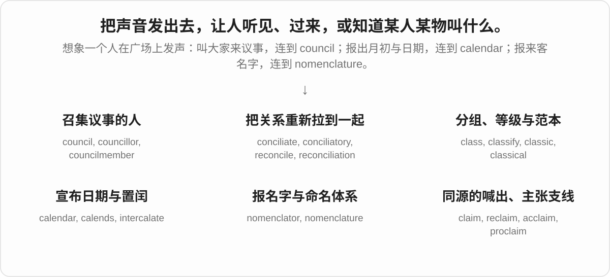

## 词形与演化规律

cal- 见于 calendar、intercalate；concilium“会议”走到 council、conciliate、reconcile；classis 走到 class、classic、classify；clāmāre 的 clam-/claim- 分支另有专题。拉丁语和法语的旧变化解释了不同词形，现代英语不把这些拼写自由互换。

## 单词速览（常用到不常用）

| 单词 | 音标 | 核心意思 |
|---|---|---|
| [class](#w-1) | 英 /klɑːs/；美 /klæs/ | 班级、课；类别；社会阶层；风度；把……归类 |
| [council](#w-2) | 英、美 /ˈkaʊnsəl/ | 议会；委员会；理事会 |
| [claim](#w-3) | 英、美 /kleɪm/ | 声称；主张、要求；认领、索赔；夺去生命；说法、权利要求 |
| [classic](#w-4) | 英、美 /ˈklæsɪk/ | 经典的、典范的；典型的；经典作品 |
| [calendar](#w-5) | 英 /ˈkæləndə/；美 /ˈkæləndər/ | 日历；历法；日程表 |
| [classical](#w-6) | 英、美 /ˈklæsɪkəl/ | 古典的；古希腊罗马的；传统体系的 |
| [classified](#w-7) | 英 /ˈklæsɪfaɪd/；美 /ˈklæsəfaɪd/ | 已分类的；保密的；分类广告 |
| [classification](#w-8) | 英、美 /ˌklæsɪfɪˈkeɪʃən/ | 分类；分类体系；所归的类别、等级 |
| [classroom](#w-9) | 英 /ˈklɑːsruːm/、/ˈklɑːsrʊm/；美 /ˈklæsruːm/ | 教室 |
| [classics](#w-10) | 英、美 /ˈklæsɪks/ | 经典作品；古典学〔古希腊罗马研究〕 |
| [classy](#w-11) | 英 /ˈklɑːsi/、/ˈklæsi/；美 /ˈklæsi/ | 有品位的；有风度的；上档次的 |
| [reconciliation](#w-12) | 英、美 /ˌrekənsɪliˈeɪʃən/ | 和解；调和；核对、对账 |
| [acclaimed](#w-13) | 英、美 /əˈkleɪmd/ | 广受赞誉的；备受好评的 |
| [councillor](#w-14) | 英 /ˈkaʊnsələ/；美 /ˈkaʊnsələr/ | 地方议员；委员会成员〔英式常用拼写〕 |
| [reconcile](#w-15) | 英、美 /ˈrekənsaɪl/ | 使和好；使相容、核对一致；使接受现实 |
| [disclaimer](#w-16) | 英 /dɪsˈkleɪmə/；美 /dɪsˈkleɪmər/ | 免责声明；否认某种责任、关联或主张的声明 |
| [proclamation](#w-17) | 英 /ˌprɒkləˈmeɪʃən/；美 /ˌprɑːkləˈmeɪʃən/ | 公告；宣言；正式宣布 |
| [reclaim](#w-18) | 英、美 /rɪˈkleɪm/ | 取回、夺回；使土地可用；回收再利用 |
| [classify](#w-19) | 英 /ˈklæsɪfaɪ/；美 /ˈklæsəfaɪ/ | 分类；把信息列为保密资料 |
| [classmate](#w-20) | 英 /ˈklɑːsmeɪt/；美 /ˈklæsmeɪt/ | 同班同学 |
| [acclaim](#w-21) | 英、美 /əˈkleɪm/ | 公开赞扬；高度赞誉 |
| [proclaim](#w-22) | 英 /prəʊˈkleɪm/；美 /proʊˈkleɪm/ | 公开宣布；郑重宣称；明显表明 |
| [nomenclature](#w-23) | 英 /nəʊˈmeŋklətʃə/；美 /ˈnoʊmənˌkleɪtʃər/ | 命名法；名称体系；专门术语 |
| [councilman](#w-24) | 英、美 /ˈkaʊnsəlmən/ | 男性议员、委员会成员〔主要美式〕 |
| [claimant](#w-25) | 英、美 /ˈkleɪmənt/ | 申请领取者；索赔人；提出权利要求的人 |
| [reclamation](#w-26) | 英、美 /ˌrekləˈmeɪʃən/ | 土地开垦、整治或填海；回收利用；收回 |
| [exclamation](#w-27) | 英、美 /ˌekskləˈmeɪʃən/ | 感叹、惊呼；感叹语 |
| [subclass](#w-28) | 英 /ˈsʌbklɑːs/；美 /ˈsʌbklæs/ | 子类；亚纲；创建子类 |
| [classically](#w-29) | 英、美 /ˈklæsɪkəli/ | 按古典传统；典型地 |
| [unclaimed](#w-30) | 英、美 /ʌnˈkleɪmd/ | 无人认领的；尚未申领的 |
| [councilor](#w-31) | 美 /ˈkaʊnsələr/；英 /ˈkaʊnsələ/ | 议员；委员会成员〔美式拼写〕 |
| [exclaim](#w-32) | 英、美 /ɪkˈskleɪm/ | 惊呼；激动地说 |
| [neoclassical](#w-33) | 英 /ˌniːəʊˈklæsɪkəl/；美 /ˌniːoʊˈklæsɪkəl/ | 新古典主义的；新古典学派的 |
| [unclassified](#w-34) | 英 /ʌnˈklæsɪfaɪd/；美 /ʌnˈklæsəfaɪd/ | 尚未分类的；非保密的 |
| [conciliatory](#w-35) | 英 /kənˈsɪliətəri/、/kənˈsɪliətri/；美 /kənˈsɪliətɔːri/ | 愿意和解的；意在缓和关系的 |
| [conciliation](#w-36) | 英、美 /kənˌsɪliˈeɪʃən/ | 调解；和解努力；缓和敌意 |
| [irreconcilable](#w-37) | 英、美 /ɪˌrekənˈsaɪləbəl/ | 无法调和的；不能和解的 |
| [classifier](#w-38) | 英 /ˈklæsɪfaɪə/；美 /ˈklæsɪfaɪər/ | 分类器；进行分类的人或系统；量词、分类词〔语言学〕 |
| [clamor](#w-39) | 美 /ˈklæmər/；英 /ˈklæmə/ | 喧闹声；强烈呼声；大声要求〔美式拼写〕 |
| [classless](#w-40) | 英 /ˈklɑːsləs/；美 /ˈklæsləs/ | 没有阶级区分的；没品位、没风度的 |
| [underclass](#w-41) | 英 /ˈʌndəklɑːs/；美 /ˈʌndərklæs/ | 社会最弱势、长期被排斥的群体 |
| [clamour](#w-42) | 英 /ˈklæmə/；美 /ˈklæmər/ | 喧闹；强烈呼声；大声要求〔英式拼写〕 |
| [councilwoman](#w-43) | 英、美 /ˈkaʊnsəlwʊmən/ | 女性议员、委员会成员〔主要美式〕 |
| [classicism](#w-44) | 英、美 /ˈklæsɪsɪzəm/ | 古典主义；遵循古典规范的风格 |
| [reclassification](#w-45) | 英、美 /ˌriːklæsɪfɪˈkeɪʃən/ | 重新分类；类别调整 |
| [disclaim](#w-46) | 英、美 /dɪsˈkleɪm/ | 否认自己与某事有关；声明不承担；放弃权利要求 |
| [acclamation](#w-47) | 英、美 /ˌækləˈmeɪʃən/ | 欢呼赞同；公开拥护；以一致口头赞同作决定 |
| [declassification](#w-48) | 英、美 /ˌdiːklæsɪfɪˈkeɪʃən/ | 解除保密等级；解密过程 |
| [councilmember](#w-49) | 美 /ˈkaʊnsəlˌmembər/ | 议员；理事会、委员会成员 |
| [declassify](#w-50) | 英 /ˌdiːˈklæsɪfaɪ/；美 /ˌdiːˈklæsəfaɪ/ | 解除保密等级；将……解密 |
| [reclassify](#w-51) | 英 /ˌriːˈklæsɪfaɪ/；美 /ˌriːˈklæsəfaɪ/ | 重新分类；调整类别 |
| [counterclaim](#w-52) | 英 /ˈkaʊntəkleɪm/；美 /ˈkaʊntərkleɪm/ | 反主张；反诉；提出反诉 |
| [classism](#w-53) | 英 /ˈklɑːsɪzəm/；美 /ˈklæsɪzəm/ | 阶级偏见；按社会阶层歧视人的做法 |
| [classicist](#w-54) | 英、美 /ˈklæsɪsɪst/ | 古典学者；古典主义者 |
| [classwork](#w-55) | 英 /ˈklɑːswɜːk/；美 /ˈklæswɜːrk/ | 课堂作业；课堂学习任务 |
| [classist](#w-56) | 英 /ˈklɑːsɪst/；美 /ˈklæsɪst/ | 带阶级偏见的；持阶级偏见的人 |
| [intercalation](#w-57) | 英 /ɪnˌtɜːkəˈleɪʃən/ | 插入；置闰；层间嵌入 |
| [declamation](#w-58) | 英、美 /ˌdekləˈmeɪʃən/ | 慷慨陈词；朗诵；演说练习或演说词 |
| [clamorous](#w-59) | 英 /ˈklæmərəs/；美 /ˈklæmərəs/ | 喧闹的；大声要求、抱怨的 |
| [conciliator](#w-60) | 美 /kənˈsɪlieɪtər/ | 调解人；促成和解的人 |
| [neoclassicism](#w-61) | 英 /ˌniːəʊˈklæsɪsɪzəm/；美 /ˌniːoʊˈklæsɪsɪzəm/ | 新古典主义 |
| [conciliate](#w-62) | 英、美 /kənˈsɪlieɪt/ | 安抚；争取好感；使和解 |
| [classifiable](#w-63) | 英 /ˈklæsɪfaɪəbəl/；美 /ˈklæsəfaɪəbəl/ | 可以分类的；能归入某一类的 |
| [intercalary](#w-64) | 英 /ɪnˈtɜːkələri/；美 /ɪnˈtɜːrkəleri/ | 插入的；闰日或闰月的；居间的 |
| [declamatory](#w-65) | 英 /dɪˈklæmətəri/；美 /dɪˈklæmətɔːri/ | 演说式的；慷慨激昂的；空泛而夸张的 |
| [declaim](#w-66) | 英、美 /dɪˈkleɪm/ | 慷慨陈词；有声有色地朗诵；大声抨击 |
| [exclamatory](#w-67) | 英 /ɪkˈsklæmətəri/；美 /ɪkˈsklæmətɔːri/ | 感叹的；带惊叹语气的 |
| [intercalate](#w-68) | 英 /ɪnˈtɜːkəleɪt/；美 /ɪnˈtɜːrkəleɪt/ | 插入；在历法中加闰日或闰月；使嵌入层间 |
| [nomenclator](#w-69) | 英 /ˈnəʊmenˌkleɪtə/；美 /ˈnoʊmənˌkleɪtər/ | 命名者；报姓名者〔古代用法〕 |
| [calends](#w-70) | 英 /ˈkælɪndz/；美 /ˈkæləndz/ | 古罗马历每月的第一天 |

## 逐词讲解

### 1. class — 班级、课；类别；社会阶层；风度；把……归类

**音标**：英 /klɑːs/；美 /klæs/

**先抓住这个画面**

把一些人或东西划在同一组：学校里是一班学生，社会里是一个阶层，资料里是一种类别。

**怎么拆**

经法语 classe 来自拉丁语 classis。传统词源解释联系“被召集起来的人”，但不能把 calāre → classis 当成已确定的逐步变形。

**怎么变成今天的意思**

a class 可以是一班人，也可以是他们上的一节课。后来“等级高”还带出“有品位、有风度”：She has class。动词 class 则是把某物放进某一类。

**常见搭配与例句**

attend a class；a class of animals；the working class；class something as…。

> Our class has twenty students.

我们班有二十名学生。

> The museum classes this object as a ceremonial tool.

博物馆把这件物品归为仪式用具。

> She accepted defeat with real class.

她很有风度地接受了失败。

**别混淆**

class 是一组或一类；course 常是一整门课程。一门 course 可以包含很多次 class。

### 2. council — 议会；委员会；理事会

**音标**：英、美 /ˈkaʊnsəl/

**先抓住这个画面**

一群被召集起来、代表某个群体讨论和决定事情的人，逐渐成为一个固定机构。

**怎么拆**

经古法语 concile、盎格鲁法语 cuncile 来自拉丁语 concilium“聚会、会议”。它与 counsel“建议”的直接拉丁词源不同。

**怎么变成今天的意思**

a city council 是市议会；a student council 是学生代表组成的议事机构。具体权限要看所在组织，不能只凭这个词认定它一定是国家立法机关。

**常见搭配与例句**

the city council；a council meeting；serve on a council。

> The council voted to repair the public library.

议会投票决定修缮公共图书馆。

> She represents her class on the student council.

她代表班级参加学生议事会。

**别混淆**

council 是议事机构；counsel 是建议或法律顾问。两词同音，拼写和直接来源不同。

### 3. claim — 声称；主张、要求；认领、索赔；夺去生命；说法、权利要求

**音标**：英、美 /kleɪm/

**先抓住这个画面**

把自己的话或要求摆出来：“这是事实”“这是我的”“这笔钱我有权领”。现代说话不必真的大喊，但仍保留公开提出的感觉。

**怎么拆**

来自拉丁语 clāmāre，经古法语 clamer〔动词〕、claime〔名词〕等进入英语；名词与动词有平行借入线。

**怎么变成今天的意思**

claim that 是声称；claim a bag 是认领行李；make a claim 是提出索赔或权利要求。报道里 the fire claimed lives 把灾难写成“夺走”生命。声称本身不证明真假。

**常见搭配与例句**

claim that…；claim ownership；claim compensation；make a claim。

> She claims that the idea was originally hers.

她声称这个想法最初是她提出的。

> Please show your ticket when you claim your bag.

认领行李时请出示票据。

> The family made an insurance claim after the storm.

风暴过后，这家人提出了保险索赔。

> The avalanche claimed three lives.

雪崩夺去了三个人的生命。

**别混淆**

claim 强调某人提出的说法或权利；prove 才表示已用证据证明。

### 4. classic — 经典的、典范的；典型的；经典作品

**音标**：英、美 /ˈklæsɪk/

**先抓住这个画面**

本来是“排在最高等级”，后来成为“值得当范本”。但 a classic mistake 只是“典型错误”，不是夸错误好。

**怎么拆**

历史上是拉丁语 classicus 经法语 classique 借入。今天能看成 class + -ic，不能因此抹掉借词路线。

**怎么变成今天的意思**

a classic novel 通常是经得住时间考验的作品；a classic example 则是非常典型、很能说明问题的例子。名词 a classic 可以指电影、书或其他经典。

**常见搭配与例句**

a classic novel；a classic example of；an instant classic。

> The film became a classic that several generations grew up watching.

这部电影成了几代人从小看到大的经典。

> Leaving the key inside is a classic mistake.

把钥匙落在里面是个典型错误。

**别混淆**

classic 常强调经典或典型；classical 常指古希腊罗马、古典音乐或某种传统体系。

### 5. calendar — 日历；历法；日程表

**音标**：英 /ˈkæləndə/；美 /ˈkæləndər/

**先抓住这个画面**

把一年里的日子排好，告诉你今天在哪里、下一件事落在哪天。它背后有一条“宣布月初 → 按月记账 → 日期表”的老路线。

**怎么拆**

古法语 calendier 来自拉丁语 calendārium“账簿”，再往前是 calendae“月初第一天”，与 calāre“宣布”相连。

**怎么变成今天的意思**

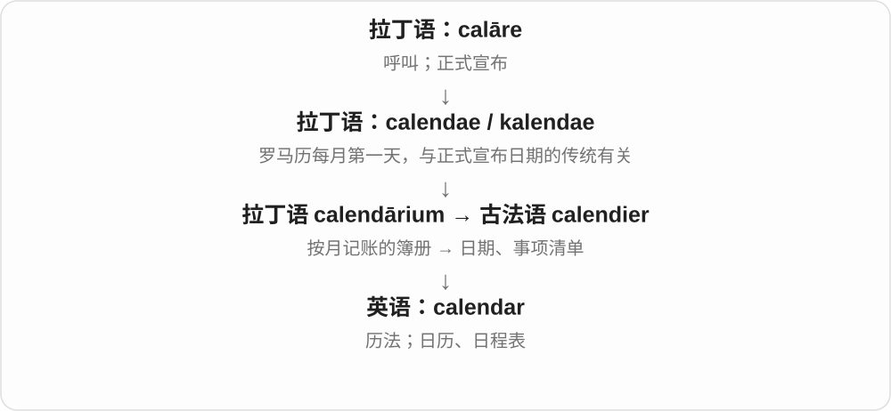

月初与债务结算有关，所以账簿走到了日历。现代 calendar 可以是墙上的日历，也可以是手机里的日程安排；历法义还包括 Gregorian calendar 等。

**常见搭配与例句**

check the calendar；a calendar year；add an event to the calendar。

> I marked the interview date on my calendar.

我在日历上标出了面试日期。

> The exhibition compares several traditional calendars.

展览比较了几种传统历法。

**别混淆**

calendar 展示日期和安排；schedule 更强调活动的时间次序，不一定覆盖一个月或一年。

### 6. classical — 古典的；古希腊罗马的；传统体系的

**音标**：英、美 /ˈklæsɪkəl/

**先抓住这个画面**

它常给事物标出所属传统：古希腊罗马文化、古典音乐，或相对现代新理论而言的传统方法。

**怎么拆**

以拉丁语 classicus 的词干形成 -al 形容词；现代可联系 classic + -al。不同词典对英语早期造词细节有不同处理，不必假设现代 classic 一定先出现。

**怎么变成今天的意思**

classical music 日常可统称西方古典音乐，也可在音乐史中特指古典主义时期。classical physics 通常与量子物理相对；谈 classical mechanics 时常指牛顿力学体系，具体范围看语境。

**常见搭配与例句**

classical music；classical architecture；classical mechanics。

> She plays classical music but also enjoys jazz.

她演奏古典音乐，也喜欢爵士乐。

> The museum has a gallery devoted to classical sculpture.

博物馆有一间专门展示古希腊罗马雕塑的展厅。

**别混淆**

a classic song 是一首经典歌曲，可能是摇滚；classical music 才是古典音乐这一传统。

### 7. classified — 已分类的；保密的；分类广告

**音标**：英 /ˈklæsɪfaɪd/；美 /ˈklæsəfaɪd/

**先抓住这个画面**

资料被放进某一类；如果这个“类”是保密等级，classified 就让人想到不能随便公开的材料。

**怎么拆**

classify 的过去分词作形容词；classifieds 是 classified advertisements 的缩短说法。

**怎么变成今天的意思**

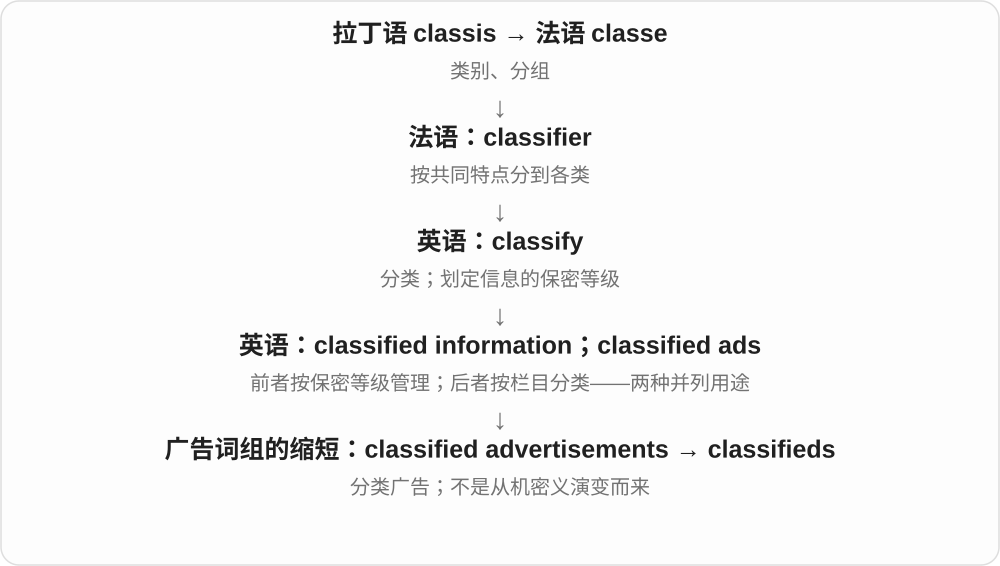

classified information 通常指保密信息；classified ads 则是分类广告，广告并不保密。要看后面的名词，别只记“机密”一个中文。

**常见搭配与例句**

classified information；a classified document；the classifieds。

> Only authorized staff may read the classified report.

只有获授权的员工可以阅读这份机密报告。

> She found a used bicycle in the classified ads.

她在分类广告中找到了一辆二手自行车。

**别混淆**

classified 不等于已公开；declassified 才表示已撤销保密等级。

### 8. classification — 分类；分类体系；所归的类别、等级

**音标**：英、美 /ˌklæsɪfɪˈkeɪʃən/

**先抓住这个画面**

不仅是把东西分开，还说明“按什么分、分成哪几类、这个东西落在哪一类”。

**怎么拆**

借自法语 classification；现代与 classify 对应，-fication 这部分反映使成某类的名词形式。

**怎么变成今天的意思**

既可指过程，也可指结果或体系。a classification system 是一整套分类规则；a film classification 可指影片的适龄等级。

**常见搭配与例句**

a classification system；the classification of species；a new classification。

> The library uses a standard classification system.

图书馆使用一套标准分类体系。

> New evidence may change the classification of this animal.

新证据可能改变这种动物的分类。

**别混淆**

category 是某一个格子；classification 可以是整个分格办法，也可以是归类结果。

### 9. classroom — 教室

**音标**：英 /ˈklɑːsruːm/、/ˈklɑːsrʊm/；美 /ˈklæsruːm/

**先抓住这个画面**

把一班人上课的地方直接说成“班级的房间”。

**怎么拆**

英语 class + room，两个现成名词组成复合词。

**怎么变成今天的意思**

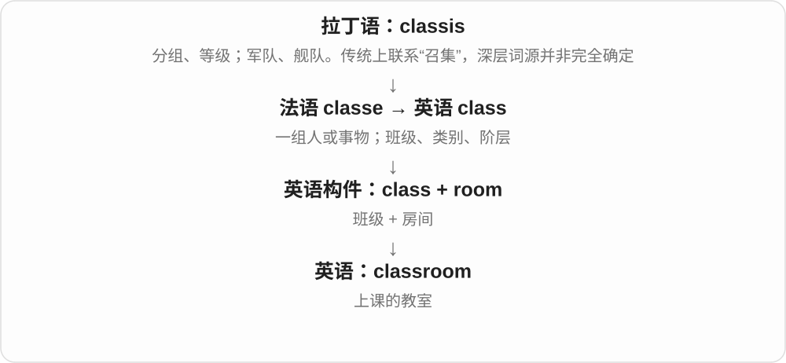

通常指教学空间；online classroom 可以借指线上教学环境。classroom experience 既可能是课堂学习经历，也可能是教师的课堂经验。

**常见搭配与例句**

in the classroom；classroom activities；classroom management。

> The classroom overlooks a quiet courtyard.

教室朝向一个安静的庭院。

> The teacher moved the desks to make the classroom more flexible.

老师移动了课桌，让教室布置更灵活。

**别混淆**

class 是班级或课；classroom 是上课的空间。

### 10. classics — 经典作品；古典学〔古希腊罗马研究〕

**音标**：英、美 /ˈklæsɪks/

**先抓住这个画面**

一层是“一批经典”；另一层已经成为学科名，研究古希腊和古罗马的语言、文学、历史与文化。

**怎么拆**

classic 的复数形式，后来固定用于学科名称。

**怎么变成今天的意思**

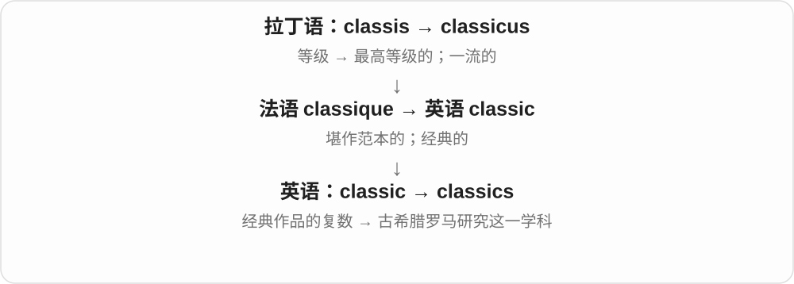

read the classics 是读经典；study classics 常是学习古典学。后者不是笼统地研究所有国家的古书。学科名虽有 s，通常按单数学科看。

**常见搭配与例句**

study classics；a classics department；read the classics。

> She studied classics before becoming a journalist.

她在成为记者之前学过古典学。

> The library keeps modern fiction beside the classics.

图书馆把现代小说和经典作品放在相邻区域。

**别混淆**

classics 是作品集合或学科；classical 是形容词，不能说 study classical 来代替学科名称。

### 11. classy — 有品位的；有风度的；上档次的

**音标**：英 /ˈklɑːsi/、/ˈklæsi/；美 /ˈklæsi/

**先抓住这个画面**

让人觉得讲究、体面，又不是靠大声炫耀来显眼。也可以夸一个人处理事情很有风度。

**怎么拆**

class 的“高品质、风度”义 + -y，英语内部派生。

**怎么变成今天的意思**

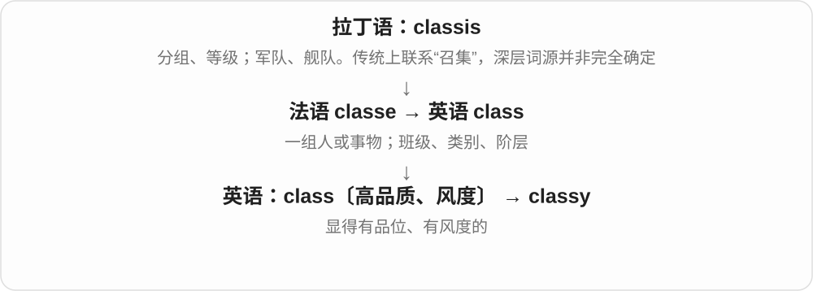

可以形容餐厅、衣着，也可以形容尊重对手的做法。钱花得多不自动等于 classy。口语里还可能反讽，要看语气。

**常见搭配与例句**

a classy restaurant；a classy outfit；a classy gesture。

> The small hotel feels classy without being flashy.

这家小旅馆很有品位，又不浮夸。

> Thanking her opponent was a classy gesture.

向对手致谢是个很有风度的举动。

**别混淆**

expensive 只是价格贵；classy 评价品位或风度。

### 12. reconciliation — 和解；调和；核对、对账

**音标**：英、美 /ˌrekənsɪliˈeɪʃən/

**先抓住这个画面**

把原本分开的关系或对不上的数字，重新整理到能够一致的位置。

**怎么拆**

经法语 reconciliation 等形式及拉丁语 reconciliātiō 借入；不应把英语动词加词尾当成唯一历史。

**怎么变成今天的意思**

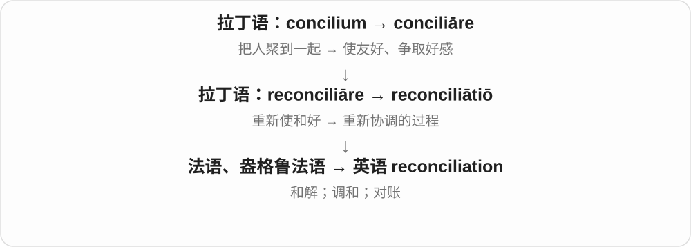

家庭或公共冲突中谈关系修复；bank reconciliation 则是比较账簿与银行记录、解释差额。数字一致不必然意味着人际关系和好了。

**常见搭配与例句**

reconciliation between；national reconciliation；bank reconciliation。

> The letter opened the door to reconciliation between the sisters.

这封信为姐妹俩和解创造了机会。

> The monthly reconciliation revealed a payment recorded twice.

月度对账发现一笔付款被重复记录了。

**别混淆**

reconciliation 是过程或结果；reconciliatory 是表现出缓和意愿的，意愿未必已实现。

### 13. acclaimed — 广受赞誉的；备受好评的

**音标**：英、美 /əˈkleɪmd/

**先抓住这个画面**

已经有不少有分量的赞扬落在这个人或作品身上。

**怎么拆**

acclaim + -ed，过去分词作形容词。

**怎么变成今天的意思**

常见 critically acclaimed，意思是评论界给予高度评价，不是“被严重批评”。acclaimed 本身没有说所有人都喜欢。

**常见搭配与例句**

an acclaimed writer；a critically acclaimed film；internationally acclaimed。

> The festival invited an acclaimed documentary filmmaker.

电影节邀请了一位广受赞誉的纪录片导演。

> Her acclaimed debut was followed by a very different second album.

她备受好评的首张专辑之后，是一张风格很不同的第二张专辑。

**别混淆**

famous 是很多人知道；acclaimed 是受到赞扬，一个人也可能因坏事而 famous。

### 14. councillor — 地方议员；委员会成员〔英式常用拼写〕

**音标**：英 /ˈkaʊnsələ/；美 /ˈkaʊnsələr/

**先抓住这个画面**

坐在 council 里议事的成员。记住中间是 cil，就能与提供建议的 counsellor 区分。

**怎么拆**

现代可看作 council + -or；历史上由 counsellor/counselor 的拼写受 council 影响而分化，不是从假设的拉丁语“议员词”直接借来。

**怎么变成今天的意思**

英国常写 councillor，美国也用 councilor。既可指男性也可指女性；Councillor 放在姓前可作头衔。

**常见搭配与例句**

a local councillor；elect a councillor；Councillor Patel。

> Our local councillor helped arrange a meeting about road safety.

我们当地的议员帮助安排了一场道路安全会议。

> Councillor Patel asked for a more detailed explanation.

帕特尔议员要求作更详细的解释。

**别混淆**

councillor/councilor 是议员；counsellor/counselor 是辅导员、顾问等。

### 15. reconcile — 使和好；使相容、核对一致；使接受现实

**音标**：英、美 /ˈrekənsaɪl/

**先抓住这个画面**

原本两边合不到一起，现在把它们重新对上：可以是两个人、两套说法，也可以是愿望与现实。

**怎么拆**

拉丁语 re-“重新” + conciliāre，经古法语及拉丁语借入英语；不是现代 re- + 一个英语 concile 才新造出来。

**怎么变成今天的意思**

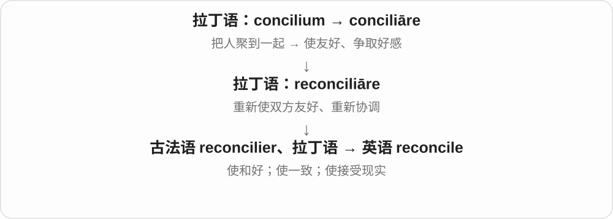

reconcile A with B 是让两者相容；reconcile bank records 是核对账目差异。reconcile yourself to something 则是慢慢接受一个不愿接受的事实。

**常见搭配与例句**

reconcile with a friend；reconcile A with B；reconcile oneself to…。

> The brothers reconciled after years of silence.

兄弟俩多年不来往后终于和好了。

> I cannot reconcile this explanation with the evidence.

我无法让这个解释与证据相吻合。

> She gradually reconciled herself to the change of plan.

她逐渐接受了计划的改变。

**别混淆**

reconcile 不只是“道歉”；两套数据核对一致也能用。resign yourself to 常更突出无奈认命。

### 16. disclaimer — 免责声明；否认某种责任、关联或主张的声明

**音标**：英 /dɪsˈkleɪmə/；美 /dɪsˈkleɪmər/

**先抓住这个画面**

在正文旁边划清一句边界：“这不代表本机构观点”“我不声称自己是专家”。

**怎么拆**

声明义来自盎格鲁法语 disclaimer 的不定式名词用法；不是看到 -er 就理解成“负责否认的人”。英语也有由 disclaim 派生的人物义。

**怎么变成今天的意思**

常见于网站、书籍和讲话开头。它说明发布者想划的边界，实际法律效果不能单靠“有一句 disclaimer”判断。

**常见搭配与例句**

include a disclaimer；a brief disclaimer；a disclaimer of responsibility。

> The article includes a disclaimer that the views are the author’s own.

文章附有声明，说明观点仅代表作者本人。

> He began with a disclaimer: he had never used the software himself.

他开头先说明了一点：自己从未使用过这款软件。

**别混淆**

warning 提醒危险或问题；disclaimer 重点是声明不承担、不同意或不主张某种关联。

### 17. proclamation — 公告；宣言；正式宣布

**音标**：英 /ˌprɒkləˈmeɪʃən/；美 /ˌprɑːkləˈmeɪʃən/

**先抓住这个画面**

把公开宣布做成一个正式动作或一份让公众知晓的文告。

**怎么拆**

经古法语 proclamacion 及后期拉丁语 prōclāmātiō 借入；与 proclaim 是共同拉丁词族的不同路径。

**怎么变成今天的意思**

a proclamation 是一份文告；the proclamation of independence 是宣布独立这一行为。它是否具有法律效力，要看发布者和制度，词本身没有统一答案。

**常见搭配与例句**

issue a proclamation；a public proclamation；the proclamation of…。

> The mayor issued a proclamation recognizing the volunteers’ work.

市长发布公告，表彰志愿者的工作。

> A copy of the proclamation was displayed at the entrance.

入口处展示了一份公告副本。

**别混淆**

announcement 可以只是普通通知；proclamation 通常更正式、面向公众。

### 18. reclaim — 取回、夺回；使土地可用；回收再利用

**音标**：英、美 /rɪˈkleɪm/

**先抓住这个画面**

现代常见画面是把东西拿回来。但它还走过“把猎鹰叫回、驯服”的路，所以能说把荒地变得可用，不一定真是恢复旧主权。

**怎么拆**

经古法语 reclamer 来自拉丁语 reclāmāre“喊着反对”。今天可拆 re- + claim，但各历史义项不能都机械套成“再次索要”。

**怎么变成今天的意思**

reclaim a bag 是取回行李；reclaim land 可指整理荒地或造出可用土地；reclaimed wood 则是回收利用的木料。也可说 reclaim your confidence。

**常见搭配与例句**

reclaim property；reclaim land；reclaimed materials。

> She returned to the desk to reclaim her passport.

她回到服务台取回护照。

> The table was made from wood reclaimed from an old barn.

桌子用从旧谷仓回收的木料制成。

> The project reclaimed damaged land for public use.

项目整治了受损土地，使其能够供公众使用。

**别混淆**

recover 强调找回或恢复；reclaim 常带主动取回、恢复用途的动作。land reclamation 不一定意味着回到原状。

### 19. classify — 分类；把信息列为保密资料

**音标**：英 /ˈklæsɪfaɪ/；美 /ˈklæsəfaɪ/

**先抓住这个画面**

看共同特点，把东西放进合适的格子。给文件划保密等级，也是把它放进某一种信息类别。

**怎么拆**

借自法语 classifier，法语中是 classe + -fier；现代英语可分析为 class + -ify。

**怎么变成今天的意思**

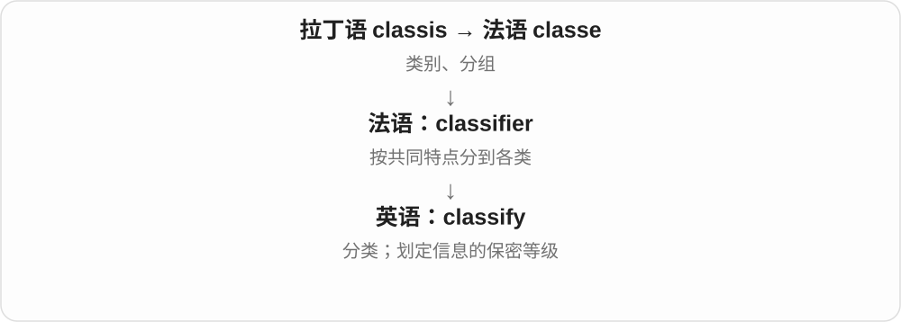

classify A as B 是把 A 归作 B；classify things by size 是按大小分类。保密义不等于“所有分类都保密”，只是某一用途固定下来的意思。

**常见搭配与例句**

classify as；classify according to；classify documents。

> The app classifies photographs by subject.

应用按主题给照片分类。

> The agency classified the report as confidential.

该机构将报告列为机密文件。

**别混淆**

identify 是认出它是什么；classify 是决定它属于哪一类。

### 20. classmate — 同班同学

**音标**：英 /ˈklɑːsmeɪt/；美 /ˈklæsmeɪt/

**先抓住这个画面**

和你被分在同一班、一起上这门课的人。

**怎么拆**

class + mate“伙伴”。

**怎么变成今天的意思**

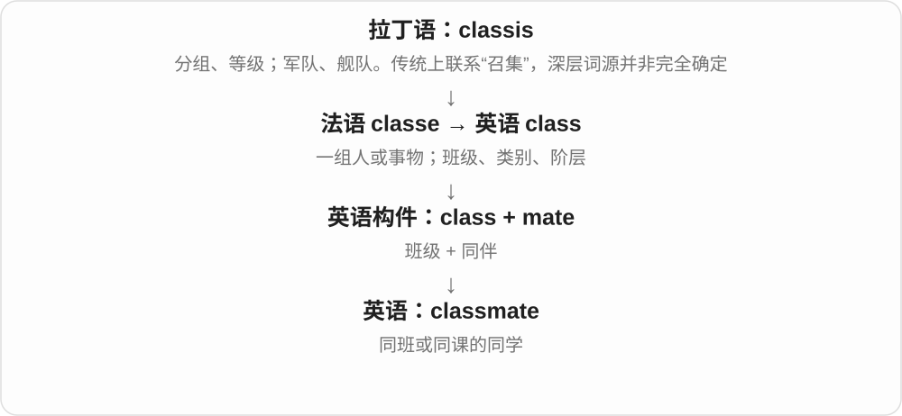

范围通常比 schoolmate 窄：在同一所学校不一定是同班同学。可以说 a former classmate“以前的同班同学”。

**常见搭配与例句**

a former classmate；help a classmate；classmates at school。

> A classmate lent me her notes after I missed the lesson.

我缺课后，一位同学把笔记借给了我。

> He recognized an old classmate at the station.

他在车站认出了一位老同学。

**别混淆**

classmate 强调同班、同课；roommate 强调同住。

### 21. acclaim — 公开赞扬；高度赞誉

**音标**：英、美 /əˈkleɪm/

**先抓住这个画面**

人们把赞同喊出来，后来不一定有欢呼声，也能指评论家和公众一致给出的高度评价。

**怎么拆**

拉丁语 ad-“朝向” + clāmāre，d 在 c 前同化成 c，形成 acclāmāre；借入后拼写受 claim 影响。

**怎么变成今天的意思**

动词常用 be acclaimed as；名词通常不可数：win critical acclaim。获好评不等于一定卖得好，评价和销量是两个维度。

**常见搭配与例句**

critical acclaim；win acclaim；be acclaimed as…。

> The novel won critical acclaim but sold slowly at first.

小说获得评论界好评，但最初销量增长缓慢。

> The pianist was acclaimed as one of the festival’s finest performers.

这位钢琴家被誉为音乐节最出色的演奏者之一。

**别混淆**

praise 是普遍的赞扬；acclaim 常突出公开、广泛或很高的评价。

### 22. proclaim — 公开宣布；郑重宣称；明显表明

**音标**：英 /prəʊˈkleɪm/；美 /proʊˈkleɪm/

**先抓住这个画面**

把消息朝公众放出来，让大家都知道，常带正式或强烈的姿态。

**怎么拆**

拉丁语 prō-“向前、向外” + clāmāre → prōclāmāre，经法语或直接由拉丁语进入英语；拼写受 claim 影响。

**怎么变成今天的意思**

可以由政府正式宣布，也可形容个人高调表达观点；某种外观也能 proclaim wealth“明显显出财富”。不表示说出来就必然真实。

**常见搭配与例句**

proclaim independence；proclaim that…；proclaim someone the winner。

> The judges proclaimed her the winner.

评委宣布她为获胜者。

> The sign proudly proclaims that the bakery uses local flour.

招牌醒目而自豪地宣称，这家面包店使用本地面粉。

**别混淆**

announce 是一般宣布；proclaim 通常更公开、正式，或带高调强调。

### 23. nomenclature — 命名法；名称体系；专门术语

**音标**：英 /nəʊˈmeŋklətʃə/；美 /ˈnoʊmənˌkleɪtʃər/

**先抓住这个画面**

一堆东西如果人人随口起名，就很难交流。nomenclature 是大家按某套办法给它们取名、使用名称的体系。

**怎么拆**

拉丁语 nōmen“名字” + calāre“呼叫”这一组构件，形成 nōmenclātor“报名字的人”和 nōmenclātūra；经法语或直接由拉丁语借入。

**怎么变成今天的意思**

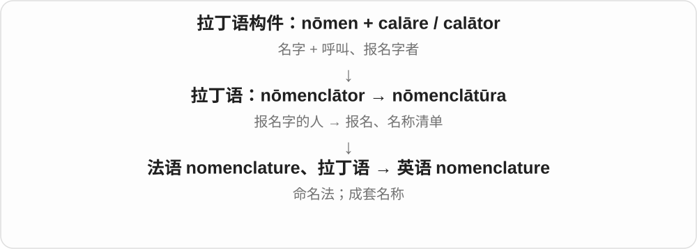

科学命名法会规定名称怎样构成。这个词也能泛指一个领域的专业名称，不一定每次都在讨论正式规则。不要把 nōmen 一支理解成“数字”。

**常见搭配与例句**

chemical nomenclature；a system of nomenclature；standard nomenclature。

> The handbook explains the nomenclature used for these compounds.

手册解释了这些化合物采用的命名法。

> The teams agreed on a common nomenclature for the parts.

各团队为零件名称达成了一套统一约定。

**别混淆**

terminology 侧重领域使用的术语；nomenclature 尤其突出名字及命名体系。

### 24. councilman — 男性议员、委员会成员〔主要美式〕

**音标**：英、美 /ˈkaʊnsəlmən/

**先抓住这个画面**

在 council 里担任成员的男性；词尾直接说明人。

**怎么拆**

council + man。复数 councilmen。

**怎么变成今天的意思**

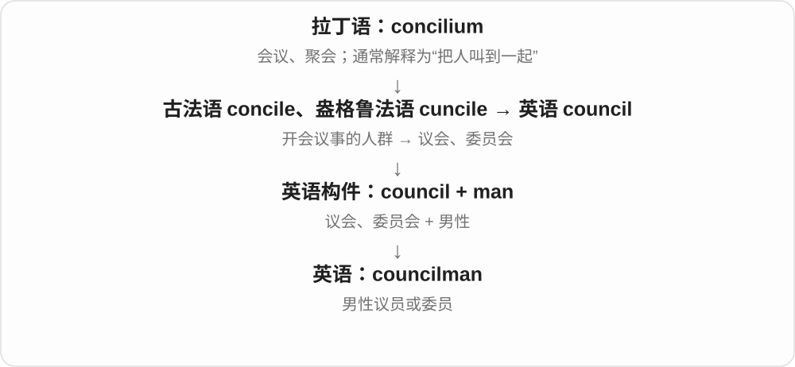

常指市镇议员；作姓氏前的头衔可写 Councilman。这个词本身不表示议长或市长。

**常见搭配与例句**

a city councilman；Councilman Harris；elect a councilman。

> The councilman asked residents about the bus service.

这位市议员询问居民对公交服务的看法。

> Councilman Harris voted against the proposal.

哈里斯议员投了反对票。

**别混淆**

councilman 是成员；chair 是主持该机构的人；councilmember 不限定性别。

### 25. claimant — 申请领取者；索赔人；提出权利要求的人

**音标**：英、美 /ˈkleɪmənt/

**先抓住这个画面**

站出来说“我有资格领这笔钱”或“这项权利属于我”的那个人。是否最终获准，是另一回事。

**怎么拆**

现代可拆 claim + -ant。历史解释包括英语按其他 -ant 人物词类推，以及法语 clamer 的分词名词用法，两条分析不强行串成一条。

**怎么变成今天的意思**

常见于福利申请、财产争议和诉讼语境。a claimant to the throne 是声称有继承王位权利的人；不等于已经被承认为君主。

**常见搭配与例句**

a benefit claimant；a successful claimant；a claimant to the throne。

> Each claimant must provide proof of ownership.

每位认领者都必须提供所有权证明。

> The report records the number of benefit claimants.

报告记录了申请领取福利金的人数。

**别混淆**

applicant 泛指申请人；claimant 特别强调主张自己有某项权利或资格。

### 26. reclamation — 土地开垦、整治或填海；回收利用；收回

**音标**：英、美 /ˌrekləˈmeɪʃən/

**先抓住这个画面**

把原先难以利用、已经废弃或失去控制的东西，经过处理重新纳入使用。

**怎么拆**

经古法语 réclamacion 及拉丁语 reclāmātiō 借入。它与 reclaim 同族，历史上不是英语先有 reclaim 再简单加 -ation。

**怎么变成今天的意思**

land reclamation 可以是土地整治或填海造地，译法要看场景；water reclamation 是处理废水以便再用。核心是变得可用，不保证恢复成历史原貌。

**常见搭配与例句**

land reclamation；water reclamation；a reclamation project。

> The reclamation project turned the former mine into a park.

这项土地整治工程把旧矿区改成了公园。

> Water reclamation reduces the amount of fresh water the factory needs.

废水回用减少了工厂对新鲜水的需求。

**别混淆**

restoration 偏向恢复原貌或功能；reclamation 可以为新用途创造可用条件。

### 27. exclamation — 感叹、惊呼；感叹语

**音标**：英、美 /ˌekskləˈmeɪʃən/

**先抓住这个画面**

情绪一下冲到嘴边形成的一声或一句话。写下来时，人们常用感叹号提示这种语气。

**怎么拆**

来自拉丁语 exclāmātiō，也有法语传入路线；英语名词早于 exclaim 的现存记录，不能只画 exclaim + -ation。

**怎么变成今天的意思**

an exclamation of surprise 是一声惊呼；exclamation mark〔英〕、exclamation point〔美〕是感叹号。一个感叹句是否必须写叹号，还要看文体。

**常见搭配与例句**

an exclamation of delight；an exclamation mark；utter an exclamation。

> An exclamation of surprise came from the back of the room.

房间后面传来一声惊呼。

> The editor removed three unnecessary exclamation marks.

编辑删去了三个不必要的感叹号。

**别混淆**

explanation 是解释；exclamation 是感叹，词中有 clam“喊”的支线。

### 28. subclass — 子类；亚纲；创建子类

**音标**：英 /ˈsʌbklɑːs/；美 /ˈsʌbklæs/

**先抓住这个画面**

先有一个大分类，再在它下面分出更小的一组。

**怎么拆**

sub-“在下面、次一级” + class。

**怎么变成今天的意思**

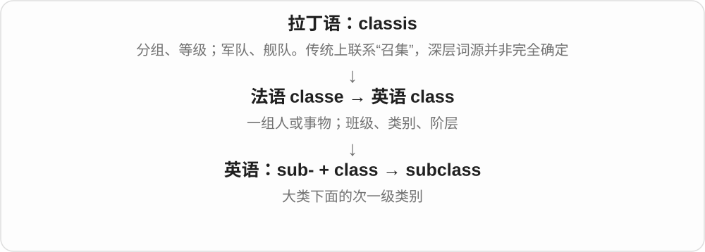

生物分类中可指纲下面的亚纲；程序设计中指继承某个类的子类。两种场景都保留“下一级分类”的关系，但各自规则不同。

**常见搭配与例句**

a subclass of；create a subclass；subclass a base class。

> The program uses a subclass to handle image files.

程序用一个子类处理图像文件。

> The researcher divided the broad class into two subclasses.

研究者把这个大类分成了两个子类。

**别混淆**

subset 只说明集合包含；subclass 常有类别、分类等级或继承关系。

### 29. classically — 按古典传统；典型地

**音标**：英、美 /ˈklæsɪkəli/

**先抓住这个画面**

看训练或风格是不是沿着古典传统走；也可以说某个特征正是人们通常想到的样子。

**怎么拆**

classical + -ly。

**怎么变成今天的意思**

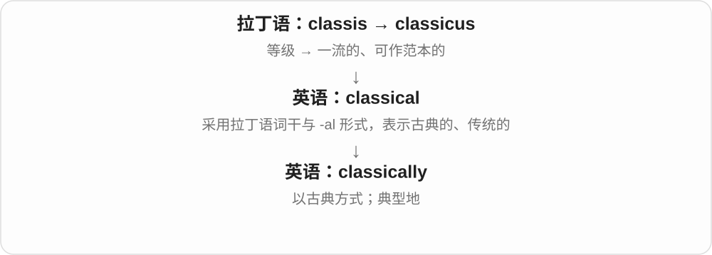

classically trained 常形容接受过系统古典训练的音乐家、演员等；不是说这个人只能演旧作品。

**常见搭配与例句**

classically trained；classically proportioned；classically elegant。

> The singer is classically trained but performs mainly pop songs.

这位歌手受过古典声乐训练，但主要演唱流行歌曲。

> The building has a classically proportioned façade.

这栋建筑的正面采用了古典式的协调比例。

**别混淆**

classically trained 说明训练背景；naturally talented 说明天赋，二者可以同时成立。

### 30. unclaimed — 无人认领的；尚未申领的

**音标**：英、美 /ʌnˈkleɪmd/

**先抓住这个画面**

东西或款项还在那里，却没有人站出来说“这属于我”，或还没有完成领取。

**怎么拆**

un-“未” + claimed，后者是 claim 的过去分词。

**怎么变成今天的意思**

常修饰 baggage、property、prize、money。unclaimed 不等于没有主人，也不等于别人可以随意拿走。

**常见搭配与例句**

unclaimed baggage；an unclaimed prize；remain unclaimed。

> The suitcase remained unclaimed at the station.

那只手提箱一直留在车站无人认领。

> Several prizes are still unclaimed.

还有几份奖品尚未有人领取。

**别混淆**

unowned 是没有所有者；unclaimed 是没有人认领或申领，仍可能有明确的所有者。

### 31. councilor — 议员；委员会成员〔美式拼写〕

**音标**：美 /ˈkaʊnsələr/；英 /ˈkaʊnsələ/

**先抓住这个画面**

与 councillor 是同一个职位词，只是这种拼写少一个 l。

**怎么拆**

councillor 的美式常见拼写；历史同样涉及 counselor 受 council 影响后的分化。

**怎么变成今天的意思**

读音不会因为少一个 l 就发生对应的改变。阅读美国地方新闻时，city councilor 很常见。

**常见搭配与例句**

a city councilor；a town councilor；run for councilor。

> The councilor supported the new cycle route.

这位议员支持新自行车路线。

> Residents sent their questions to the town councilor.

居民把问题发给了镇议员。

**别混淆**

councilor 与 counselor 只差一个字母，前者是议员，后者是顾问、辅导员。

### 32. exclaim — 惊呼；激动地说

**音标**：英、美 /ɪkˈskleɪm/

**先抓住这个画面**

一句话被惊讶、喜悦或愤怒推了出来，语气明显比平常强。

**怎么拆**

来自拉丁语 ex- + clāmāre 的词族；可能由英语 exclamation 反构，也可能经法语 exclamer 借入，图中保留这两条解释。

**怎么变成今天的意思**

常出现在小说引语后。它不一定是恐惧尖叫，也不一定要求很大音量，重点是带强烈情绪地说出。

**常见搭配与例句**

exclaim in surprise；exclaim with delight；exclaim that…。

> “There it is!” she exclaimed when the island came into view.

小岛出现在视野里时，她惊喜地说：“就在那儿！”

> He exclaimed that the result was impossible.

他激动地说这个结果不可能。

**别混淆**

shout 侧重音量；exclaim 侧重突出的情绪和话语。

### 33. neoclassical — 新古典主义的；新古典学派的

**音标**：英 /ˌniːəʊˈklæsɪkəl/；美 /ˌniːoʊˈklæsɪkəl/

**先抓住这个画面**

不是第一次出现古典形式，而是在后来的时代重新取用、改造它。

**怎么拆**

neo-“新的、复兴的” + classical。

**怎么变成今天的意思**

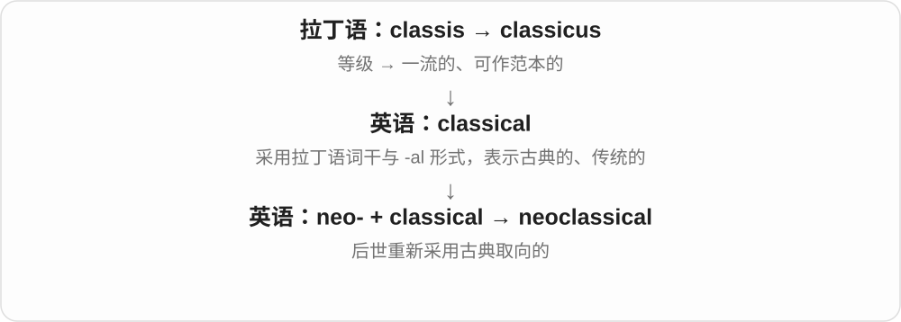

艺术里常指重新重视古典形式的风格；neoclassical economics 则是经济学中另有特定含义的学派名称，不能按建筑风格去理解。

**常见搭配与例句**

neoclassical architecture；a neoclassical façade；neoclassical economics。

> The museum occupies a neoclassical building with tall columns.

博物馆坐落在一栋有高大立柱的新古典主义建筑中。

> The course introduces the basic assumptions of neoclassical economics.

课程介绍新古典经济学的基本假设。

**别混淆**

classical 可指古典传统本身；neoclassical 强调后世的再采用或特定新学派。

### 34. unclassified — 尚未分类的；非保密的

**音标**：英 /ʌnˈklæsɪfaɪd/；美 /ʌnˈklæsəfaɪd/

**先抓住这个画面**

一种情况是还没放进类别，另一种情况是文件没有被划为保密级别。

**怎么拆**

un-“不、未” + classified。

**怎么变成今天的意思**

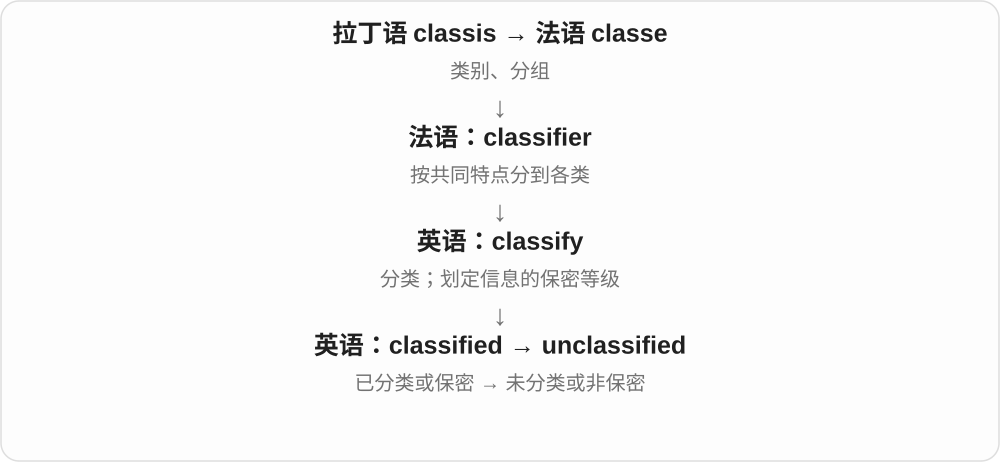

unclassified documents 可以不是国家保密文件，但仍可能受隐私、版权或内部管理限制；这个词本身不承诺任何人都能随意发布。

**常见搭配与例句**

unclassified information；unclassified material；remain unclassified。

> The folder contains several unclassified photographs.

文件夹中有几张尚未分类的照片。

> The briefing was based entirely on unclassified information.

这份简报完全依据非保密信息写成。

**别混淆**

unclassified 没有保密等级；declassified 表示原先有等级，后来取消了。

### 35. conciliatory — 愿意和解的；意在缓和关系的

**音标**：英 /kənˈsɪliətəri/、/kənˈsɪliətri/；美 /kənˈsɪliətɔːri/

**先抓住这个画面**

话还是那件事，但语气放软了，给对方留出坐下来谈的空间。

**怎么拆**

conciliate 词族 + -ory，表示有促成和解作用的。

**怎么变成今天的意思**

常形容 tone、gesture、approach。a conciliatory tone 是缓和的语气，不等于已经同意对方所有条件。

**常见搭配与例句**

a conciliatory tone；a conciliatory gesture；take a conciliatory approach。

> Her conciliatory tone helped the discussion continue.

她缓和的语气让讨论得以继续。

> He offered a conciliatory gesture by inviting both groups to lunch.

他邀请两组人一起吃午饭，表达了和解的意愿。

**别混淆**

apologetic 强调歉意；conciliatory 强调愿意缓和关系，可以包含道歉，也可以不道歉。

### 36. conciliation — 调解；和解努力；缓和敌意

**音标**：英、美 /kənˌsɪliˈeɪʃən/

**先抓住这个画面**

不让双方继续隔空吵，设法把他们拉到能够谈条件的位置。

**怎么拆**

经法语 conciliation 来自拉丁语 conciliātiō；与 conciliate 是同族的不同借入形式。

**怎么变成今天的意思**

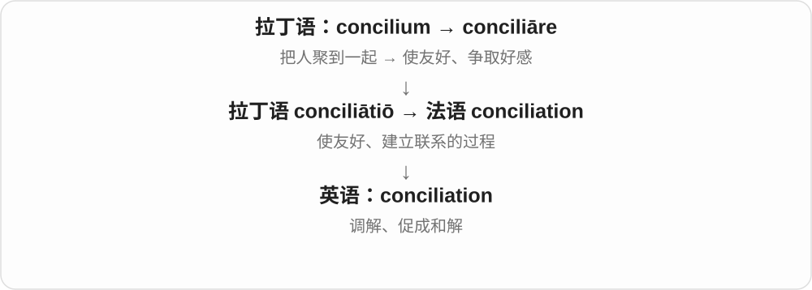

通常不可数，既可泛指缓和关系，也能指正式争议处理程序。具体程序中调解人的权限因制度而异，不能只凭词名认定能强制裁决。

**常见搭配与例句**

conciliation talks；attempts at conciliation；a conciliation service。

> Both sides agreed to try conciliation before taking further action.

双方同意在进一步行动前先尝试调解。

> Her efforts at conciliation brought the two teams back to the table.

她促成和解的努力让两支团队重新回到谈判桌前。

**别混淆**

conciliation 常强调促成双方协议；arbitration 常由仲裁者作出裁决，具体效力看规则。

### 37. irreconcilable — 无法调和的；不能和解的

**音标**：英、美 /ɪˌrekənˈsaɪləbəl/

**先抓住这个画面**

两边的核心要求撞在一起：接受这一边，就必须否定另一边，怎么拼都拼不上。

**怎么拆**

现代可拆 ir-“不” + reconcilable“可调和的”；历史词典也追到法语 irréconciliable、后期拉丁语 irreconciliābilis，不把英语内部派生当成唯一来源。

**怎么变成今天的意思**

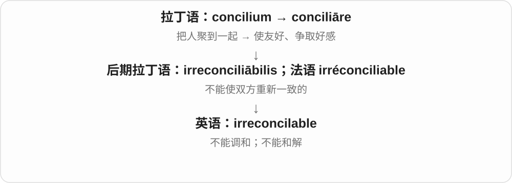

常见 irreconcilable differences、irreconcilable with。既能说人与人冲突，也能说两个理论的基础假设不能同时成立。

**常见搭配与例句**

irreconcilable differences；irreconcilable demands；irreconcilable with…。

> The two accounts contain irreconcilable differences.

这两份叙述存在无法调和的差异。

> His promise of complete secrecy was irreconcilable with his duty to report the incident.

他承诺完全保密，却又有报告此事的责任，两者无法相容。

**别混淆**

different 只是不同；irreconcilable 更强，强调无法协调共存。

### 38. classifier — 分类器；进行分类的人或系统；量词、分类词〔语言学〕

**音标**：英 /ˈklæsɪfaɪə/；美 /ˈklæsɪfaɪər/

**先抓住这个画面**

负责回答“这个该放哪一类”的人、工具或模型。语言学里的 classifier 则把名词归入某种计量、形状等类别。

**怎么拆**

classify + -er，y 改成 i 后形成 classifier。

**怎么变成今天的意思**

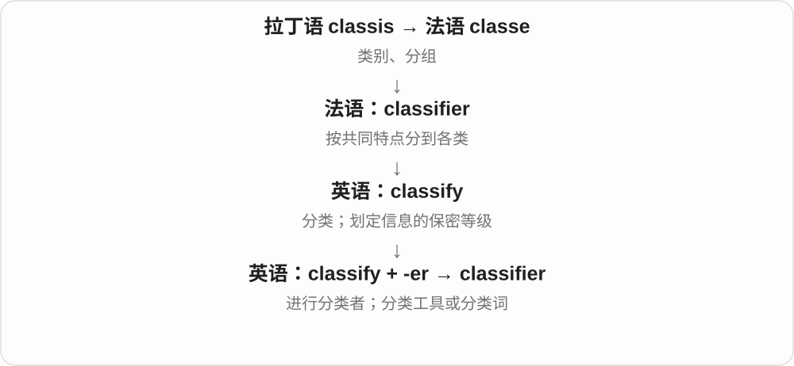

垃圾邮件分类器根据输入判断邮件属于哪一类；汉语“三本书”的“本”可作为名词分类词的例子。两种专业用法都不是“机密人员”。

**常见搭配与例句**

a spam classifier；train a classifier；a noun classifier。

> The classifier marked the message as spam.

分类器把这封邮件判为垃圾邮件。

> The lesson explains why Chinese uses different classifiers for books and animals.

这节课解释汉语为什么给书和动物使用不同的量词。

**别混淆**

classification 是任务或结果；classifier 是执行分类的角色或机制。

### 39. clamor — 喧闹声；强烈呼声；大声要求〔美式拼写〕

**音标**：美 /ˈklæmər/；英 /ˈklæmə/

**先抓住这个画面**

许多声音挤在一起，吵得不能忽略；也可以是公众持续要求某件事的强烈呼声。

**怎么拆**

拉丁语 clāmor 来自 clāmāre，经古法语 clamor 进入英语。clamor 是现代美式常用拼写，clamour 常见于英式。

**怎么变成今天的意思**

名词常用 a clamor for；动词可用 clamor for、clamor to do。呼声可以支持也可以反对，不能把它一律理解成抱怨。

**常见搭配与例句**

a clamor for change；clamor for attention；clamor to get in。

> The clamor from the crowd drowned out the announcement.

人群的喧闹声盖过了广播通知。

> Residents are clamoring for a safer crossing.

居民强烈要求设置更安全的过街设施。

**别混淆**

noise 是任何噪声；clamor 常让人想到众人的声音或强烈诉求。

### 40. classless — 没有阶级区分的；没品位、没风度的

**音标**：英 /ˈklɑːsləs/；美 /ˈklæsləs/

**先抓住这个画面**

同一个 -less 把 class 的两种意思都否定了：没有社会阶级，或者没有风度。

**怎么拆**

class + -less“没有”。

**怎么变成今天的意思**

a classless society 是讨论社会组织；a classless remark 是批评一句话很没品。后者较口语，不能混成“没有阶级立场的话”。

**常见搭配与例句**

a classless society；classless behaviour；a classless remark。

> The essay asks whether a classless society is possible.

这篇文章讨论无阶级社会是否可能。

> Mocking the losing team was a classless thing to do.

嘲笑输球的队伍是一件很没风度的事。

**别混淆**

classless“没风度”与 classy 相反；“无阶级”则不涉及个人穿着是否优雅。

### 41. underclass — 社会最弱势、长期被排斥的群体

**音标**：英 /ˈʌndəklɑːs/；美 /ˈʌndərklæs/

**先抓住这个画面**

这个社会学标签把某些人放在社会阶层结构的最底部，强调长期贫困或难以进入主要机会体系。

**怎么拆**

under-“在下面” + class“阶层”。

**怎么变成今天的意思**

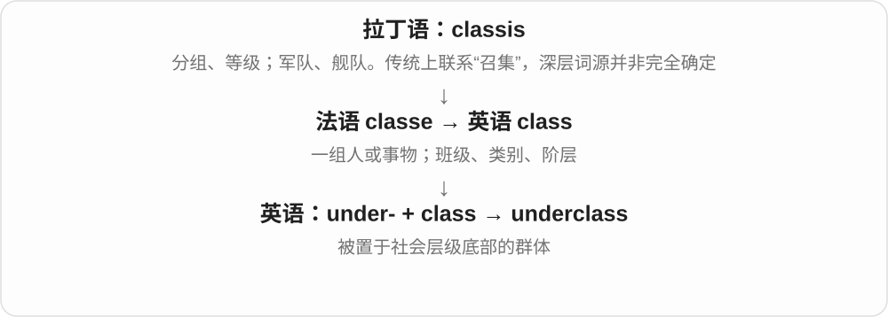

常见 the underclass、an urban underclass。这个词有时把处境不同的人一概贴标签，因此作者是否认可这种分类，要看上下文。

**常见搭配与例句**

the urban underclass；a permanent underclass；the concept of an underclass。

> The historian examines how the term underclass was used in public debate.

这位历史学者研究公共讨论中如何使用“社会底层群体”这一说法。

> The policy was criticized for creating a permanent underclass.

这项政策被批评为制造了一个长期被排斥在外的底层群体。

**别混淆**

underclass 不是 underclassman“低年级学生”；也不等于所有收入不高的 working class。

### 42. clamour — 喧闹；强烈呼声；大声要求〔英式拼写〕

**音标**：英 /ˈklæmə/；美 /ˈklæmər/

**先抓住这个画面**

把人群的吵闹，或反复要求被听见的声音，汇成一个词。

**怎么拆**

与 clamor 同源同义，保留英语历史上常见的 -our 拼写；不是加了 -our 就多出一个义项。

**怎么变成今天的意思**

可以写 public clamour“公众的强烈呼声”。词尾的 -our 在这里不等于英语 our，也不用按字母逐个读。

**常见搭配与例句**

a clamour for reform；the clamour of voices；clamour for a response。

> There was a growing clamour for an explanation.

要求作出解释的呼声越来越高。

> The children clamoured to see the new puppy.

孩子们嚷着要看新来的小狗。

**别混淆**

clamour 与 clamor 只是常见区域拼写差别；glamour 是“魅力”，来源不同。

### 43. councilwoman — 女性议员、委员会成员〔主要美式〕

**音标**：英、美 /ˈkaʊnsəlwʊmən/

**先抓住这个画面**

把 council 的成员具体说成女性，常见于地方议会新闻。

**怎么拆**

council + woman；复数 councilwomen，后半读音随 women 改变。

**怎么变成今天的意思**

可以作职位名，也能放在姓氏前作头衔。与 councilman 一样，它说明成员身份，不说明其政治立场。

**常见搭配与例句**

a city councilwoman；Councilwoman Lee；a newly elected councilwoman。

> The councilwoman proposed a new pedestrian crossing.

这位女议员提议增设一处人行横道。

> Councilwoman Lee met local shop owners on Monday.

李议员周一会见了当地店主。

**别混淆**

councilwoman 明确指女性；councillor、councilmember 可以不说明性别。

### 44. classicism — 古典主义；遵循古典规范的风格

**音标**：英、美 /ˈklæsɪsɪzəm/

**先抓住这个画面**

创作时把古典范本当尺子，重视秩序、比例、节制与清楚的形式。

**怎么拆**

classic + -ism。

**怎么变成今天的意思**

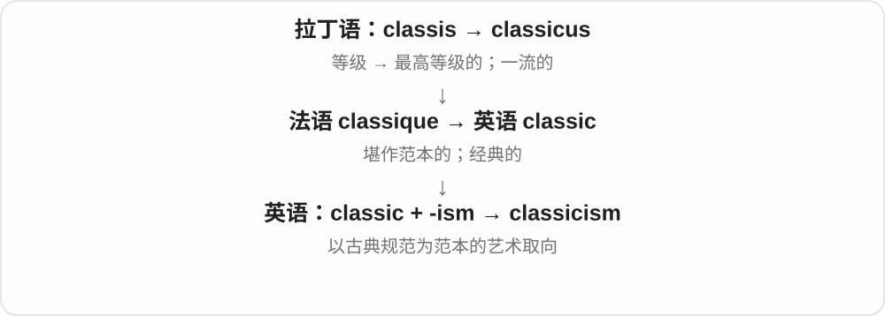

可以讨论文学、建筑、绘画等领域的 classicism。它是一种审美取向，不是“所有年代很久的艺术”的总称。

**常见搭配与例句**

classicism in architecture；the ideals of classicism；a return to classicism。

> The façade reflects the symmetry associated with classicism.

建筑正面体现了古典主义重视的对称性。

> Her essay compares classicism with more experimental styles.

她的文章比较了古典主义与更富实验性的风格。

**别混淆**

classics 是经典作品或古典学；classicism 是古典主义这一取向。

### 45. reclassification — 重新分类；类别调整

**音标**：英、美 /ˌriːklæsɪfɪˈkeɪʃən/

**先抓住这个画面**

把“换一个分类位置”这件事作为一个过程或决定来谈。

**怎么拆**

re- + classification；与 reclassify 配套。

**怎么变成今天的意思**

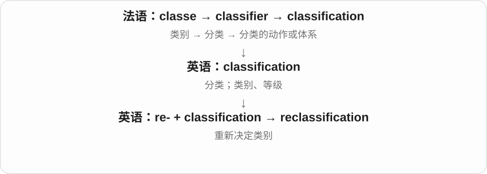

a reclassification 可以是一项具体调整；不加冠词时也能泛指重新分类过程。常用于研究报告或正式管理文件。

**常见搭配与例句**

the reclassification of；a proposed reclassification；undergo reclassification。

> The reclassification places the species in a different genus.

重新分类后，这个物种被划入另一个属。

> Staff were informed of the proposed job reclassification.

员工已获知拟议中的岗位重新分类方案。

**别混淆**

reclassification 改分类；reorganization 改组织方式，范围更广。

### 46. disclaim — 否认自己与某事有关；声明不承担；放弃权利要求

**音标**：英、美 /dɪsˈkleɪm/

**先抓住这个画面**

把“这是我的、由我负责”这条关系划掉：“这不是我做的主张，我也不认这项责任。”

**怎么拆**

古法语 des-“否定、解除” + clamer“主张”，经盎格鲁法语 disclaimer 进入英语；现代可看成 dis- + claim。

**怎么变成今天的意思**

常用 disclaim responsibility、disclaim ownership。说话者这样声明，不自动决定责任实际上是否存在。也可谦逊地说 disclaim any expertise。

**常见搭配与例句**

disclaim responsibility；disclaim ownership；disclaim any knowledge of…。

> The author disclaimed any intention to offend readers.

作者声明自己无意冒犯读者。

> She disclaimed all credit for the discovery.

她表示这项发现的功劳不应归于自己。

**别混淆**

deny 更广，可否认事实；disclaim 常是否认自己的权利、责任、身份或关联。

### 47. acclamation — 欢呼赞同；公开拥护；以一致口头赞同作决定

**音标**：英、美 /ˌækləˈmeɪʃən/

**先抓住这个画面**

大家不是悄悄点头，而是把赞同一起表达出来。会议里的 by acclamation 由此有了不用逐一计票、以一致赞同确认的意思。

**怎么拆**

借自拉丁语 acclāmātiō，来自 acclāmāre；与 acclaim 是同族名词支线。

**怎么变成今天的意思**

可以描述欢呼，也常出现在 elected/approved by acclamation。具体会议是否需要无人反对、是否投票，要按该组织规则理解。

**常见搭配与例句**

by acclamation；public acclamation；a chorus of acclamation。

> The committee elected her chair by acclamation.

委员会以一致赞同的方式选她为主席。

> The returning team was greeted with loud acclamation.

归来的队伍受到热烈欢呼。

**别混淆**

acclaim 常是持续的好评；acclamation 更突出一次集体表达赞同的行为。

### 48. declassification — 解除保密等级；解密过程

**音标**：英、美 /ˌdiːklæsɪfɪˈkeɪʃən/

**先抓住这个画面**

重点看撤下保密标签的整套过程、决定或结果。

**怎么拆**

de- + classification；与 declassify 配套的名词。

**怎么变成今天的意思**

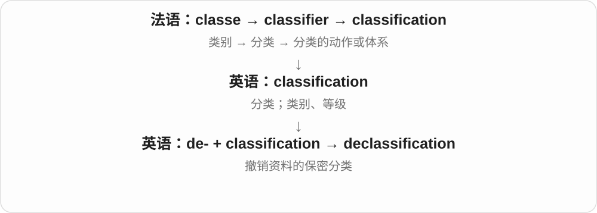

可以有 declassification review“解密审查”；审查可能只同意解密部分内容。不要把它理解为密码破解技术。

**常见搭配与例句**

a declassification review；the declassification of records；declassification policy。

> Declassification allowed historians to examine the old correspondence.

档案解密让历史学者得以研究这些旧信件。

> The review resulted in the partial declassification of the report.

审查后，报告被部分解密。

**别混淆**

declassification 是行政或制度上的解密；decryption 是技术上的解密。

### 49. councilmember — 议员；理事会、委员会成员

**音标**：美 /ˈkaʊnsəlˌmembər/

**先抓住这个画面**

直说“这个议事机构的一名成员”，不在职位名里说明性别。

**怎么拆**

council + member，英语复合词；也常分写 council member。

**怎么变成今天的意思**

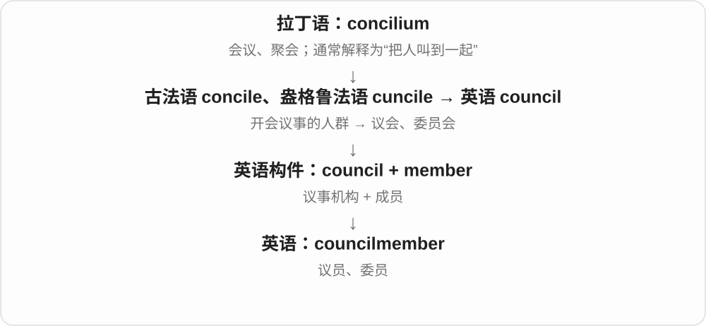

连写形式尤其常见于美式地方政府语境。复数 councilmembers；若采用分写形式，复数是 council members。

**常见搭配与例句**

a city councilmember；an elected councilmember；Councilmember Smith。

> Each councilmember received a copy of the budget.

每位议员都收到了一份预算。

> The councilmember held an open meeting for residents.

这位议员为居民举行了一场公开会议。

**别混淆**

councilmember 说的是机构成员；counselor 通常是顾问或辅导员。

### 50. declassify — 解除保密等级；将……解密

**音标**：英 /ˌdiːˈklæsɪfaɪ/；美 /ˌdiːˈklæsəfaɪ/

**先抓住这个画面**

原先贴着“保密”的标签，现在经过程序把这个标签撤掉。

**怎么拆**

de-“撤销、去掉” + classify。

**怎么变成今天的意思**

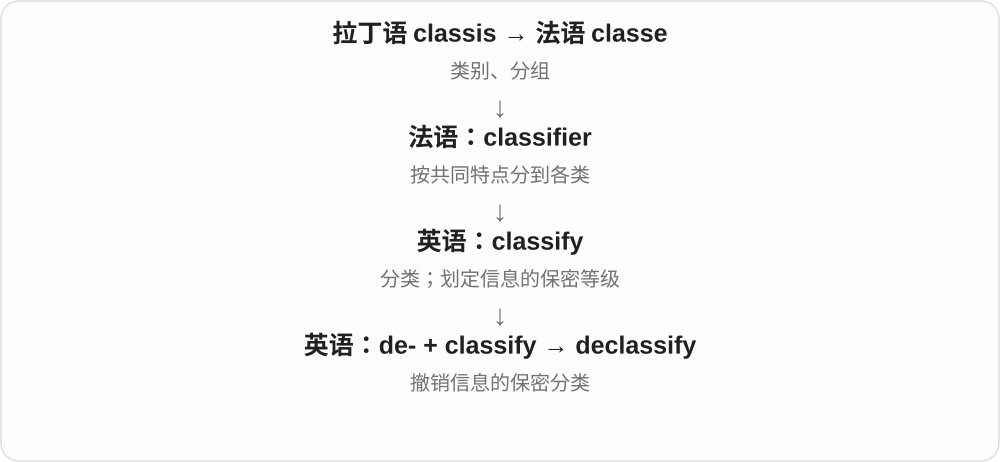

常用于政府档案与报告。解除保密等级和实际把每份材料公布到网上，是有关联但不同的动作。

**常见搭配与例句**

declassify documents；declassify a report；newly declassified files。

> The government declassified the files after several decades.

政府在几十年后解除了这些档案的保密等级。

> The request asks the agency to declassify part of the report.

这份申请要求该机构将报告的一部分解密。

**别混淆**

decrypt 是用密钥等手段解开加密数据；declassify 是改变资料的保密身份。

### 51. reclassify — 重新分类；调整类别

**音标**：英 /ˌriːˈklæsɪfaɪ/；美 /ˌriːˈklæsəfaɪ/

**先抓住这个画面**

发现原先那个格子放错了，或分类规则变了，于是重新决定它该属于哪里。

**怎么拆**

re-“重新” + classify。

**怎么变成今天的意思**

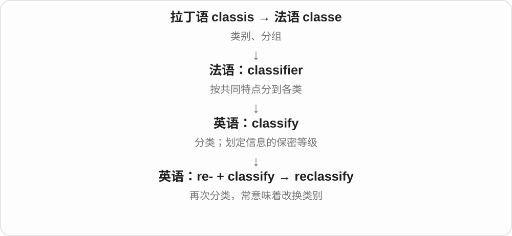

常用 reclassify A as B。研究、行政和信息管理都能用，并不只表示把资料重新列为保密。

**常见搭配与例句**

reclassify as；reclassify a species；reclassify a position。

> The discovery led scientists to reclassify the species.

这项发现使科学家重新对该物种进行分类。

> The organization reclassified the role as a technical position.

该组织把这个岗位重新划为技术岗位。

**别混淆**

reclassify 改变类别；rename 只改名字，类别可能不变。

### 52. counterclaim — 反主张；反诉；提出反诉

**音标**：英 /ˈkaʊntəkleɪm/；美 /ˈkaʊntərkleɪm/

**先抓住这个画面**

对方说“你欠我”，你不只回答“不欠”，还反过来提出“其实你欠我”的独立要求。

**怎么拆**

counter-“相对、反向” + claim，英语内部构词。

**怎么变成今天的意思**

法律语境常指被告向原告提出的独立请求；一般讨论中也能指反向主张。这里只用来理解词义，具体程序随制度而异。

**常见搭配与例句**

file a counterclaim；a claim and counterclaim；bring a counterclaim。

> The company denied the allegation and filed a counterclaim.

公司否认指控，并提起反诉。

> The debate became a series of claims and counterclaims.

辩论变成了一连串主张和反主张。

**别混淆**

denial 只是否认；counterclaim 还提出了自己的相反要求或主张。

### 53. classism — 阶级偏见；按社会阶层歧视人的做法

**音标**：英 /ˈklɑːsɪzəm/；美 /ˈklæsɪzəm/

**先抓住这个画面**

还没看这个人做得怎样，就因为口音、家庭收入或出身把他看低一等。

**怎么拆**

class“社会阶层” + -ism，表示围绕阶层形成的偏见或不公平制度。

**怎么变成今天的意思**

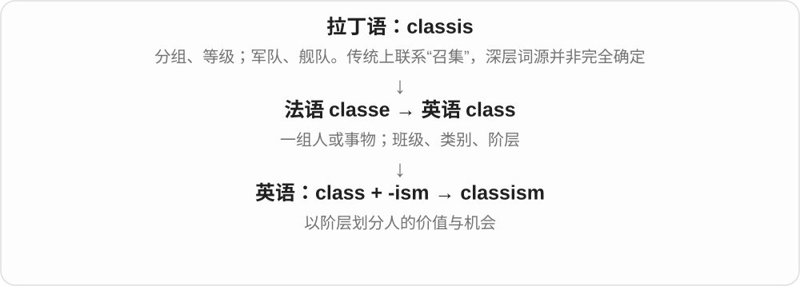

既可以谈个人言行，也可以谈制度怎样持续偏向某些阶层。不是只要谈到阶层差异就叫 classism。

**常见搭配与例句**

challenge classism；classism in education；a form of classism。

> The essay discusses classism in university admissions.

文章讨论大学招生中的阶层歧视。

> Assuming that a poor applicant is less capable can reflect classism.

认定贫困申请者能力较差，可能反映阶层偏见。

**别混淆**

classification 是分类；classism 这里是阶级偏见，不是“分类主义”。

### 54. classicist — 古典学者；古典主义者

**音标**：英、美 /ˈklæsɪsɪst/

**先抓住这个画面**

可以是专门研究古希腊罗马的人，也可以是创作上坚持古典形式的人。

**怎么拆**

classic + -ist，表示相关研究者或追随者。

**怎么变成今天的意思**

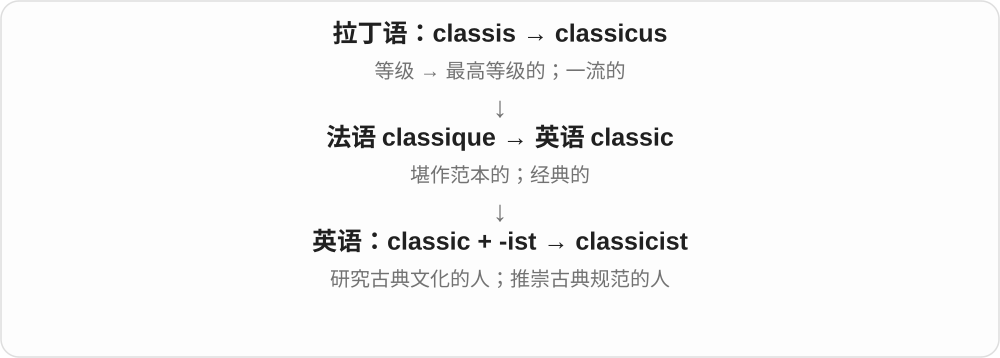

研究古希腊碑文的学者可叫 classicist；评价建筑师时，这个词也可能说明其风格。由上下文决定是职业研究还是艺术取向。

**常见搭配与例句**

a distinguished classicist；a trained classicist；a committed classicist。

> A classicist helped the museum translate the inscription.

一位古典学者帮助博物馆翻译了这段铭文。

> As an architect, he remained a classicist throughout his career.

作为建筑师，他整个职业生涯都坚持古典主义风格。

**别混淆**

classicist 是古典学或古典主义相关；classist 是带阶层偏见的，拼写少一个 ic。

### 55. classwork — 课堂作业；课堂学习任务

**音标**：英 /ˈklɑːswɜːk/；美 /ˈklæswɜːrk/

**先抓住这个画面**

在上课时做的练习、讨论或任务，装进一个总称里。

**怎么拆**

class + work。

**怎么变成今天的意思**

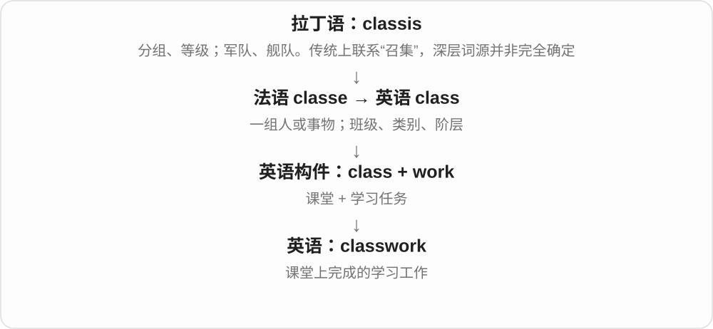

通常不可数。既可以指课堂书面练习，也能概括学生在课内完成的任务；不一定是考试。

**常见搭配与例句**

complete the classwork；assess classwork；classwork and homework。

> Please finish the classwork before you pack your bag.

收书包前请完成课堂作业。

> Her classwork shows a better understanding of fractions.

她的课堂作业表明，她对分数理解得更好了。

**别混淆**

homework 通常课后完成；classwork 重点在课内完成。

### 56. classist — 带阶级偏见的；持阶级偏见的人

**音标**：英 /ˈklɑːsɪst/；美 /ˈklæsɪst/

**先抓住这个画面**

因为一个人的社会出身，就认定他不配被认真对待；classist 可以形容这种想法，也能指抱这种想法的人。

**怎么拆**

class + -ist；名词和形容词都存在。

**怎么变成今天的意思**

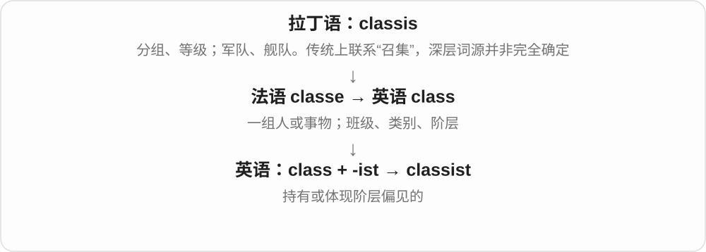

常见 classist assumptions、classist attitudes。它评价的是偏见，不只是说明某个人属于某一阶层。

**常见搭配与例句**

a classist remark；classist assumptions；classist attitudes。

> The joke relied on a classist stereotype about accents.

这个笑话依赖一种关于口音的阶层刻板印象。

> She challenged the classist assumption that expensive schools always produce better students.

她质疑了那种带阶层偏见的看法：昂贵学校培养的学生总是更好。

**别混淆**

classicist 多了一个 ic，是古典学者或古典主义者；classist 是阶层偏见相关词。

### 57. intercalation — 插入；置闰；层间嵌入

**音标**：英 /ɪnˌtɜːkəˈleɪʃən/

**先抓住这个画面**

把“在原有序列或层间加进去”这件事单独拿出来说。

**怎么拆**

来自拉丁语 intercalātiō；名词在英语中的记录早于 intercalate，不能画成现代英语动词先产生名词。

**怎么变成今天的意思**

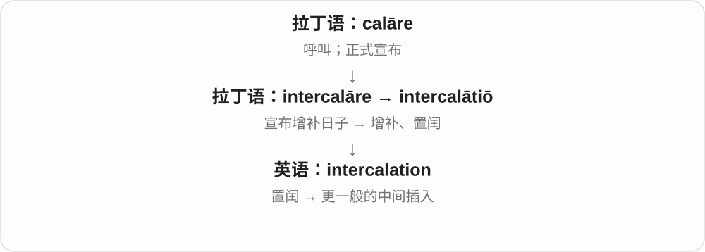

历法用置闰来调整日期与天文周期的关系；在材料研究中，它可以描述客体进入主体结构的空隙或层间。具体机制需看材料，不是所有插入都完全可逆。

**常见搭配与例句**

intercalation of a month；ion intercalation；an intercalation process。

> Intercalation keeps this calendar aligned with the seasons.

置闰使这种历法与季节保持协调。

> The experiment measured how intercalation changed the spacing between layers.

实验测量了嵌入过程怎样改变层间距离。

**别混淆**

intercalation 强调插到已有结构中；addition 只说明增加，没限定放在哪里。

### 58. declamation — 慷慨陈词；朗诵；演说练习或演说词

**音标**：英、美 /ˌdekləˈmeɪʃən/

**先抓住这个画面**

把声调、节奏和情绪都拿出来，用公开演说的方式讲一段话。

**怎么拆**

借自拉丁语 dēclāmātiō，来自 dēclāmāre；名词在拉丁语中已经形成，不只是现代英语 declaim 加 -ation。

**怎么变成今天的意思**

可以谈演说训练的技巧，也可以批评空有气势、缺少实质内容的陈词。是否贬义取决于上下文。

**常见搭配与例句**

the art of declamation；a dramatic declamation；empty declamation。

> The drama class included exercises in declamation.

戏剧课包含了朗诵训练。

> Her speech offered evidence instead of empty declamation.

她的演讲提供了证据，而不是空洞的慷慨陈词。

**别混淆**

declaration 是声明内容或行为；declamation 突出演说方式、朗诵或修辞气势。

### 59. clamorous — 喧闹的；大声要求、抱怨的

**音标**：英 /ˈklæmərəs/；美 /ˈklæmərəs/

**先抓住这个画面**

声音接连涌来，让人很难安静地想事情；用在人群上，还常带“非让你回应不可”的强烈要求。

**怎么拆**

来自中世纪拉丁语 clāmōrōsus，基于 clāmor“喊声”；现代能联系 clamor + -ous。

**怎么变成今天的意思**

这是偏书面、文学的形容词。clamorous voices 可以是吵闹声音，也可以代表公开要求。英式也通常写 clamorous，而不是必须把 clamour 的 u 保留。

**常见搭配与例句**

a clamorous crowd；clamorous voices；clamorous demands。

> A clamorous crowd gathered outside the hall.

一群喧闹的人聚集在大厅外。

> The quiet proposal was lost among more clamorous demands.

这项平和提出的建议淹没在更响亮的诉求中。

**别混淆**

loud 只说明响；clamorous 还常带嘈杂、众声并起或催促要求的感觉。

### 60. conciliator — 调解人；促成和解的人

**音标**：美 /kənˈsɪlieɪtər/

**先抓住这个画面**

在两边之间来回沟通，帮助他们降低敌意、找到能接受的方案的人。

**怎么拆**

借自拉丁语 conciliātor，来自 conciliāre + 表示施事者的 -tor；现代对应 conciliate 的“做这事的人”。

**怎么变成今天的意思**

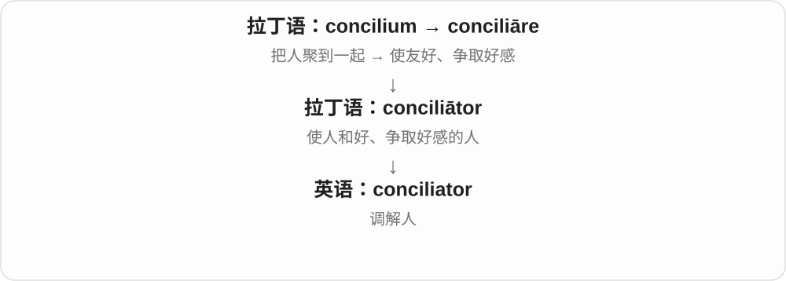

既可作为正式角色，也可形容善于化解矛盾的人。词本身不保证这个人有权替双方作决定。

**常见搭配与例句**

act as a conciliator；an independent conciliator；appoint a conciliator。

> An independent conciliator met each side separately.

一位独立调解人分别会见了双方。

> She often acts as a conciliator when the team disagrees.

团队有分歧时，她常常充当调解者。

**别混淆**

conciliator 促成理解和协议；judge 的主要任务是依法裁判。

### 61. neoclassicism — 新古典主义

**音标**：英 /ˌniːəʊˈklæsɪsɪzəm/；美 /ˌniːoʊˈklæsɪsɪzəm/

**先抓住这个画面**

后来的人回头看古典范本，从中重新选择简洁、秩序、比例等原则，形成新的创作运动或风格。

**怎么拆**

neo- + classicism；与 neoclassical 配套的名词。

**怎么变成今天的意思**

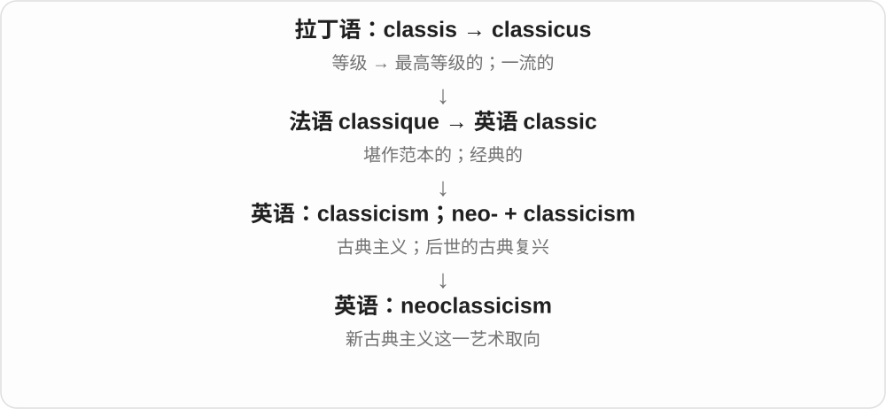

这个名称可用于不同艺术领域和时期，具体内容要结合文学、建筑或音乐等上下文。它不等于把古代作品原样复制一遍。

**常见搭配与例句**

the rise of neoclassicism；neoclassicism in art；a study of neoclassicism。

> The exhibition traces the influence of neoclassicism on public buildings.

展览追溯新古典主义对公共建筑的影响。

> The composer’s interest in neoclassicism did not prevent experimentation.

作曲家对新古典主义的兴趣并没有阻碍他的实验探索。

**别混淆**

neoclassicism 是风格或思潮名词；neoclassical 用来修饰建筑、作品等。

### 62. conciliate — 安抚；争取好感；使和解

**音标**：英、美 /kənˈsɪlieɪt/

**先抓住这个画面**

对方原本警惕或生气，你做一点让步、认真听他说话，让双方重新能坐在一起。

**怎么拆**

借自拉丁语 conciliāre 的分词 conciliātus；concil- 来自 concilium“聚会”，不是现代 council 加 -iate。

**怎么变成今天的意思**

这个正式动词强调缓和敌意、赢得善意。可以 conciliate opponents；不表示把自己的每个要求都放弃。

**常见搭配与例句**

conciliate opponents；conciliate an angry crowd；seek to conciliate。

> The manager tried to conciliate the angry customers with an apology.

经理试图通过道歉安抚愤怒的顾客。

> The offer was intended to conciliate opponents of the plan.

这项提议是为了缓和反对者对计划的敌意。

**别混淆**

conciliate 偏向缓和对方敌意；reconcile 更常表示双方恢复关系，或让矛盾内容相容。

### 63. classifiable — 可以分类的；能归入某一类的

**音标**：英 /ˈklæsɪfaɪəbəl/；美 /ˈklæsəfaɪəbəl/

**先抓住这个画面**

拿来一件东西，现有分类表里能找到适合它的位置。

**怎么拆**

classify + -able，y 在这个形式中变为 i。

**怎么变成今天的意思**

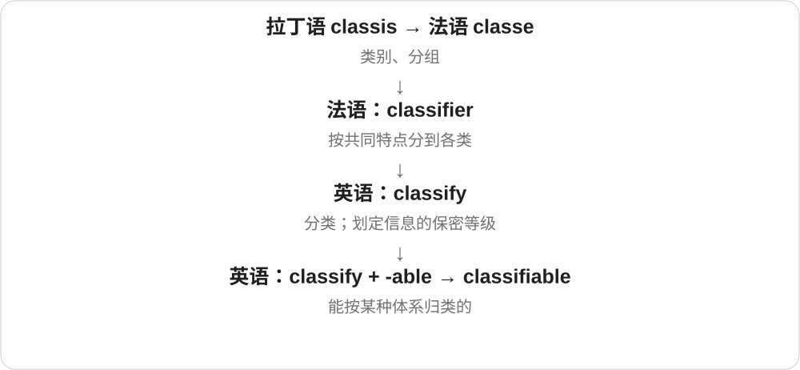

常用 readily/easily classifiable。无法轻易分类，可能是类别设计不合适，也可能是对象混合了不同特点。

**常见搭配与例句**

easily classifiable；classifiable as；classifiable by…。

> Some of her songs are not easily classifiable by genre.

她有些歌很难按曲风归类。

> The samples are classifiable by their surface texture.

这些样本可以按表面纹理分类。

**别混淆**

classified 是已经分类；classifiable 只是能够分类。

### 64. intercalary — 插入的；闰日或闰月的；居间的

**音标**：英 /ɪnˈtɜːkələri/；美 /ɪnˈtɜːrkəleri/

**先抓住这个画面**

本来按顺序排着，额外插进来的那一天、那个月，就有了 intercalary 这个属性。

**怎么拆**

来自拉丁语 intercalārius，与 intercalāre“插入、宣布置闰”相连；现代对应 intercalate 词族的形容词。

**怎么变成今天的意思**

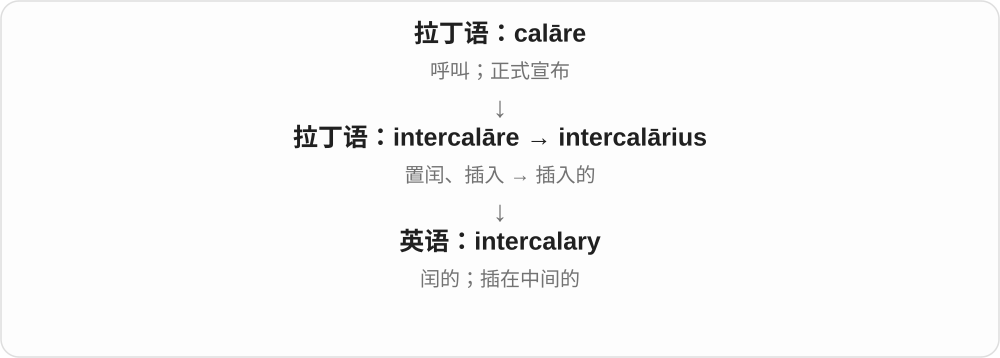

最容易遇到 intercalary day 和 intercalary month。较专业的文学或生物学语境也可借用“居间插入”义，不能都译成闰。

**常见搭配与例句**

an intercalary day；an intercalary month；an intercalary chapter。

> February 29 is an intercalary day in the Gregorian calendar.

2月29日是公历中的闰日。

> Some calendars add an intercalary month instead of a single day.

有些历法加的是一个闰月，而不是单独一天。

**别混淆**

intercalary 是形容词；intercalation 是插入的过程名词。

### 65. declamatory — 演说式的；慷慨激昂的；空泛而夸张的

**音标**：英 /dɪˈklæmətəri/；美 /dɪˈklæmətɔːri/

**先抓住这个画面**

声音和措辞像对着满场观众发表宣言，有力、夸张，有时也显得太做作。

**怎么拆**

来自拉丁语 dēclāmātōrius，属于 dēclāmāre“练习演说”的词族；与 declamation 配套。

**怎么变成今天的意思**

常形容 style、tone、speech。戏剧表演中可以只是风格说明；日常论证中则可能批评它气势大于内容。

**常见搭配与例句**

a declamatory style；a declamatory tone；declamatory rhetoric。

> The director asked for a less declamatory style of acting.

导演要求表演少一点慷慨陈词的腔调。

> The article’s declamatory tone obscures its main argument.

文章慷慨激昂的语气反而掩盖了主要论点。

**别混淆**

exclamatory 突出感叹语气；declamatory 更像整段正式、戏剧化的陈词。

### 66. declaim — 慷慨陈词；有声有色地朗诵；大声抨击

**音标**：英、美 /dɪˈkleɪm/

**先抓住这个画面**

像站在舞台上发表演说一样，把话讲得响亮、有节奏、很有戏剧性。

**怎么拆**

拉丁语 dēclāmāre 来自 dē- 与 clāmāre；此处 dē- 常被解释为加强语气，经法语及拉丁语借入。它不是“取消 claim”。

**怎么变成今天的意思**

可以中性地说朗诵诗，也能略带讽刺地说某人把普通谈话说成大演讲。declaim against 是大声抨击。

**常见搭配与例句**

declaim a poem；declaim against injustice；declaim in a grand voice。

> The actor declaimed the opening lines from the balcony.

演员站在阳台上慷慨朗诵了开场台词。

> He preferred to declaim against the plan rather than discuss its details.

他更愿意高声抨击计划，而不愿讨论细节。

**别混淆**

recite 强调背诵或朗诵内容；declaim 进一步突出夸张、响亮的演说方式。

### 67. exclamatory — 感叹的；带惊叹语气的

**音标**：英 /ɪkˈsklæmətəri/；美 /ɪkˈsklæmətɔːri/

**先抓住这个画面**

一句话的作用是把强烈感受表达出来，而不只是平静地报一个事实。

**怎么拆**

用拉丁语 exclāmāt- 分词词干 + -ory 形成，属于 exclaim / exclamation 词族。

**怎么变成今天的意思**

常用于语法和文体讨论。What a beautiful day! 是感叹句；但标了感叹号的命令仍可能是命令句，形式与语气不要混为一谈。

**常见搭配与例句**

an exclamatory sentence；an exclamatory phrase；an exclamatory tone。

> “What a wonderful surprise!” is an exclamatory sentence.

“真是个美妙的惊喜！”是一个感叹句。

> The narrator’s exclamatory tone makes the scene feel urgent.

叙述者的感叹语气让场景显得紧迫。

**别混淆**

exclamatory 是表达强烈感受；interrogative 是提问的，不能只看声音是否高亢。

### 68. intercalate — 插入；在历法中加闰日或闰月；使嵌入层间

**音标**：英 /ɪnˈtɜːkəleɪt/；美 /ɪnˈtɜːrkəleɪt/

**先抓住这个画面**

不是在队伍末尾再添一个，而是在原有顺序或层次中间插进去。最早的画面是正式宣布在日历里增补日子。

**怎么拆**

拉丁语 inter-“在中间” + calāre“宣布” → intercalāre，其分词 intercalātus 进入英语。

**怎么变成今天的意思**

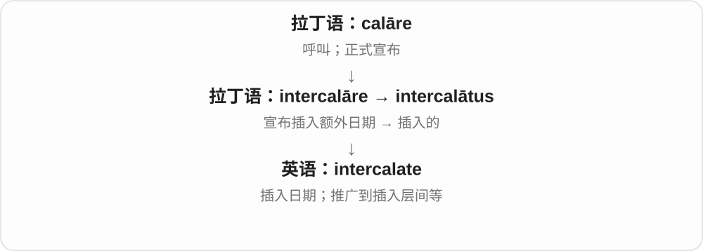

历法中把额外日期插入固定安排；材料科学中可描述离子或分子进入层状材料的层间。日常只说插一张纸，用 insert 通常更自然。

**常见搭配与例句**

intercalate a day；intercalate between layers；intercalated material。

> The calendar intercalates an extra month in certain years.

这种历法在某些年份加入一个闰月。

> Lithium ions can intercalate between layers of graphite.

锂离子可以嵌入石墨层间。

**别混淆**

insert 是通用“插入”；intercalate 常用于历法、材料等技术语境。

### 69. nomenclator — 命名者；报姓名者〔古代用法〕

**音标**：英 /ˈnəʊmenˌkleɪtə/；美 /ˈnoʊmənˌkleɪtər/

**先抓住这个画面**

先想象古罗马主人身边那个提醒“这位来客叫什么”的人；后来也可以指给事物起名称的人。

**怎么拆**

借自拉丁语 nōmenclātor，由 nōmen“名字”与 calātor“呼叫者”相连，后者来自 calāre。

**怎么变成今天的意思**

这是少见书面词，常出现在古代社会或命名史讨论里。日常介绍负责命名的同事，不必特意用这个生僻头衔。

**常见搭配与例句**

a Roman nomenclator；act as a nomenclator；a scientific nomenclator。

> The Roman official relied on a nomenclator to remind him of visitors’ names.

那位罗马官员依靠报姓名的侍从提醒他来客的名字。

> The article describes the botanist as an inventive nomenclator.

文章把这位植物学家描述成一个善于起名字的人。

**别混淆**

nomenclator 是人；nomenclature 是命名法或名称体系。

### 70. calends — 古罗马历每月的第一天

**音标**：英 /ˈkælɪndz/；美 /ˈkæləndz/

**先抓住这个画面**

罗马人给每个月第一天的专门名称。它不是十二个月的总称，也不是普通英语里“第一天”的通用词。

**怎么拆**

来自拉丁语 kalendae / calendae，与 calāre“宣布”有关；古英语 calend、中古英语 calendes 已有相关形式。

**怎么变成今天的意思**

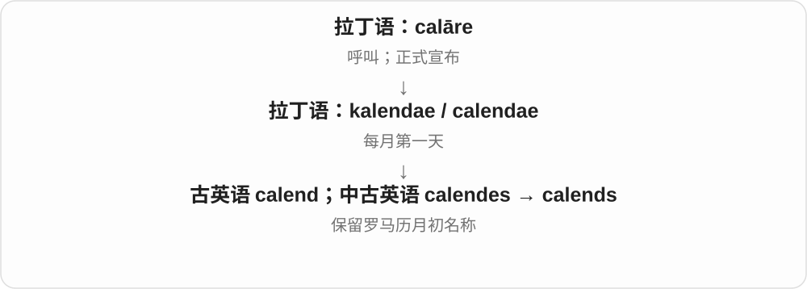

这是历史用语，常写 the calends of March。形式有 -s，却可以指某个月单独那一天。kalends 是另一拼写。

**常见搭配与例句**

the calends of March；before the calends；the Roman calends。

> The contract required payment on the calends of March.

合同规定在罗马历三月的第一天付款。

> The lecturer explained how Romans counted days before the calends.

讲师解释了罗马人怎样倒数距月初还有多少天。

**别混淆**

calends 是罗马月初日名；calendar 是日历或历法，不是 calends 的简单复数。

## 这一组要分清什么

council 来自 concilium“会议”；counsel 的直接来源是 consilium“意见、计划”，更深来历有不同解释，本页不把两者画成一条确定的祖先链。callous、callus 来自“硬皮、胼胝”的另一支；calorie 的 cal- 是“热”，不能按字母混归。classical 不是“课堂的”；classroom 才直接以现代 class“班级”组成。

## 串起来练习

先学三个场景：The council meets today，议员被聚到一起；Check your calendar，看安排在哪天；Reconcile the two accounts，把两套说法或账目对上。再把 classic“典范”与 class“类别、等级”联系起来，理解它们为何既相近又不能处处互换。
