# 0153 · soci- — 同伴；共同生活；把人或事联系起来

[逐词精讲目录](../00_逐词精讲目录.md) · [总目录](../00_总目录_按常用程度.md)

## 核心词根与来源

**soci-** 的起点是拉丁语 **socius**“同伴、伙伴、盟友”。结伴生活留下 social、society；把人或想法联系起来是 associate；把已经连着的关系解开是 dissociate。先记住“伙伴之间的一条线”，很多抽象义就有了落点。

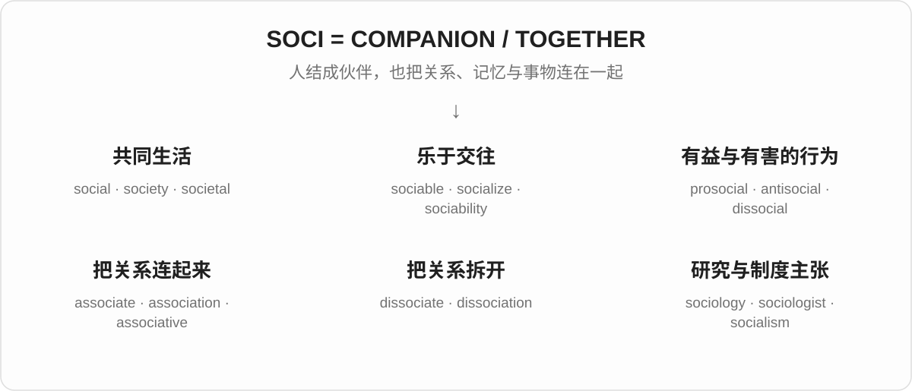

## 词形与演化规律

**society** 经过拉丁语 societās 与法语 societé；**social** 经过 sociālis；**sociable** 经过 sociābilis。它们不是都由现代英语 social 随便加后缀形成。

**associate** 的 ad- 遇到 s 同化成 as-；动词词尾读 /eɪt/，名词、形容词词尾常读 /ət/。**dissociate** 与 **disassociate** 意思接近，历史构词路线不同。soci- 的 /si/ 与 /ʃi/ 在一些词里都有常见读法，不能把整族强迫读成一个声音。

## 单词速览（按词族由简到繁）

同一基础词的相关扩展放在一起，先读基础形式，再读扩展；各组之间优先读常用的。具体词源关系见各词讲解。

| 单词 | 音标 | 核心意思 |
|---|---|---|
| [social](#w-1) | 英 /ˈsəʊʃəl/；美 /ˈsoʊʃəl/ | 社会的；社交的；群居的 |
| [socially](#w-6) | 英 /ˈsəʊʃəli/；美 /ˈsoʊʃəli/ | 在社交方面；从社会角度 |
| [socialism](#w-7) | 英 /ˈsəʊʃəlɪzəm/；美 /ˈsoʊʃəlɪzəm/ | 社会主义 |
| [socialist](#w-5) | 英 /ˈsəʊʃəlɪst/；美 /ˈsoʊʃəlɪst/ | 社会主义者；社会主义的 |
| [socialize](#w-11) | 英 /ˈsəʊʃəlaɪz/；美 /ˈsoʊʃəlaɪz/ | 与人交往；使学会群体生活；使社会化 |
| [socialization](#w-14) | 英 /ˌsəʊʃəlaɪˈzeɪʃən/；美 /ˌsoʊʃələˈzeɪʃən/ | 社会化；学习社会规范的过程；社交活动 |
| [socialite](#w-16) | 英 /ˈsəʊʃəlaɪt/；美 /ˈsoʊʃəlaɪt/ | 社交名流 |
| [sociality](#w-27) | 英 /ˌsəʊʃiˈæləti/；美 /ˌsoʊʃiˈæləti/ | 社会性；群体交往或共同生活的特征 |
| [antisocial](#w-12) | 英 /ˌæntiˈsəʊʃəl/；美 /ˌæntiˈsoʊʃəl/ | 妨害他人的；反社会的；不愿交往的 |
| [psychosocial](#w-17) | 英 /ˌsaɪkəʊˈsəʊʃəl/；美 /ˌsaɪkoʊˈsoʊʃəl/ | 心理社会的；涉及心理与社会环境相互影响的 |
| [prosocial](#w-24) | 英 /ˌprəʊˈsəʊʃəl/；美 /ˌproʊˈsoʊʃəl/ | 亲社会的；有助于他人的 |
| [dissocial](#w-32) | 英 /dɪˈsəʊʃəl/；美 /dɪˈsoʊʃəl/ | 不利于社会交往的；反社会的（少用） |
| [society](#w-2) | 英 /səˈsaɪəti/；美 /səˈsaɪəti/ | 社会；社团；交往圈子 |
| [societal](#w-9) | 英 /səˈsaɪətəl/；美 /səˈsaɪətəl/ | 社会整体层面的 |
| [associate](#w-4) | 动词：英 /əˈsəʊsieɪt/、美 /əˈsoʊsieɪt/；名词、形容词词尾 /ət/；/si/ 也常读 /ʃi/ | 联系；联想；交往；伙伴；副职的 |
| [association](#w-3) | 英 /əˌsəʊsiˈeɪʃən/；美 /əˌsoʊsiˈeɪʃən/；/si/ 也常读 /ʃi/ | 协会；关联；联想；交往 |
| [interassociation](#w-33) | 按 inter- 与 association 的常规读法：英 /ˌɪntərəˌsəʊsiˈeɪʃən/；美 /ˌɪntərəˌsoʊsiˈeɪʃən/ | 相互联系；多个对象之间的关联（少用） |
| [associative](#w-19) | 英 /əˈsəʊsiətɪv/；美 /əˈsoʊsiətɪv/；/si/ 也常读 /ʃi/ | 联想的；关联的；满足结合律的 |
| [nonassociative](#w-34) | 英 /ˌnɒnəˈsəʊsiətɪv/；美 /ˌnɑːnəˈsoʊsiətɪv/ | 非联结的；不满足或不预设结合律的 |
| [disassociate](#w-22) | 英 /ˌdɪsəˈsəʊsieɪt/；美 /ˌdɪsəˈsoʊsieɪt/ | 使脱离；断绝联系 |
| [disassociation](#w-26) | 英 /ˌdɪsəˌsəʊsiˈeɪʃən/；美 /ˌdɪsəˌsoʊsiˈeɪʃən/ | 解除关联；脱离关系 |
| [sociology](#w-8) | 英 /ˌsəʊsiˈɒlədʒi/；美 /ˌsoʊsiˈɑːlədʒi/ | 社会学 |
| [sociological](#w-10) | 英 /ˌsəʊsiəˈlɒdʒɪkəl/；美 /ˌsoʊsiəˈlɑːdʒɪkəl/ | 社会学的；从社会学角度分析的 |
| [sociologist](#w-13) | 英 /ˌsəʊsiˈɒlədʒɪst/；美 /ˌsoʊsiˈɑːlədʒɪst/ | 社会学家；社会学研究者 |
| [sociable](#w-15) | 英 /ˈsəʊʃəbəl/；美 /ˈsoʊʃəbəl/ | 合群的；乐于交往的 |
| [sociability](#w-23) | 英 /ˌsəʊʃəˈbɪləti/；美 /ˌsoʊʃəˈbɪləti/ | 合群性；乐于交往的特质 |
| [unsociable](#w-25) | 英 /ʌnˈsəʊʃəbəl/；美 /ʌnˈsoʊʃəbəl/ | 不爱交际的；不合群的 |
| [dissociable](#w-28) | 英 /dɪˈsəʊsiəbəl/；美 /dɪˈsoʊsiəbəl/；/si/ 也常读 /ʃi/ | 可分离的；可区分开的 |
| [dissociate](#w-21) | 英 /dɪˈsəʊsieɪt/；美 /dɪˈsoʊsieɪt/；/si/ 也常读 /ʃi/ | 使脱离联系；分离；解离 |
| [dissociation](#w-18) | 英 /dɪˌsəʊsiˈeɪʃən/；美 /dɪˌsoʊsiˈeɪʃən/；/si/ 也常读 /ʃi/ | 脱离联系；分离；解离 |
| [dissociative](#w-20) | 英 /dɪˈsəʊsiətɪv/；美 /dɪˈsoʊsiətɪv/；/si/ 也常读 /ʃi/ | 解离的；涉及分离的 |
| [consociate](#w-29) | 动词：英 /kənˈsəʊsieɪt/、美 /kənˈsoʊsieɪt/；名词词尾 /ət/；/si/ 也可读 /ʃi/ | 联合；结盟；伙伴（旧式） |
| [consociation](#w-30) | 英 /kənˌsəʊsiˈeɪʃən/；美 /kənˌsoʊsiˈeɪʃən/ | 联合；联合组织；特定生态群落 |
| [consociational](#w-31) | 英 /kənˌsəʊsiˈeɪʃənəl/；美 /kənˌsoʊsiˈeɪʃənəl/ | 协和式的；群体协商分享权力的 |

## 逐词讲解

### 1. social — 社会的；社交的；群居的

**音标**：英 /ˈsəʊʃəl/；美 /ˈsoʊʃəl/

**先抓住这个画面**

一个人之外，还有同伴、群体和大家共同生活的规则。social 把镜头从单个人转向人与人的关系。

**怎么拆**

来自法语 social、拉丁语 sociālis，根是 socius“同伴”。更远处通常联系印欧语“跟随”的词根，但不是从英语 follow 变来。

**怎么变成今天的意思**

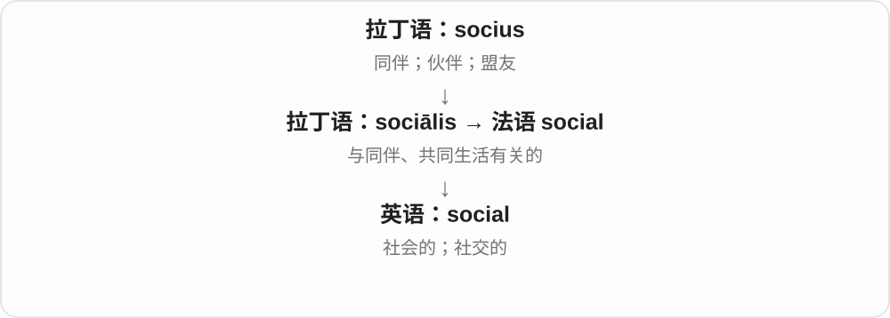

social problems 是社会问题；social life 是社交生活；social animals 是群居动物。它不只表示爱聊天。

**常见搭配与例句**

social change；social skills；social media；a social event。

> The report examines social changes in the city.

报告研究了城市中的社会变化。

> She enjoys the social side of working in a team.

她喜欢团队工作中与人交往的部分。

**别混淆**

social 可谈整个社会，也可谈交往；sociable 更专门说一个人乐于交往。

### 2. socially — 在社交方面；从社会角度

**音标**：英 /ˈsəʊʃəli/；美 /ˈsoʊʃəli/

**先抓住这个画面**

给一句话加一个观察角度：这说的是人与人的交往，或者社会关系这一面。

**怎么拆**

social + -ly。

**怎么变成今天的意思**

meet socially 是出于私人社交而见面；socially acceptable 是社会上被接受的，不等于已经证明正确。

**常见搭配与例句**

socially active；socially isolated；socially acceptable；meet socially。

> We know each other professionally but rarely meet socially.

我们工作上认识，但很少私下聚会。

> What is socially acceptable can change over time.

社会上能接受什么，可能随时间而变。

**别混淆**

socially 可以讨论社会背景，不能每次都译成“合群地”。

### 3. socialism — 社会主义

**音标**：英 /ˈsəʊʃəlɪzəm/；美 /ˈsoʊʃəlɪzəm/

**先抓住这个画面**

把经济中的重要资源怎样归社会共同掌握、怎样组织生产与分配，当作核心问题的一组思想和制度主张。

**怎么拆**

十九世纪形成的词，可能来自法语 socialisme，也可由 social + -ism 分析；不是拉丁时代已有的政治名词。

**怎么变成今天的意思**

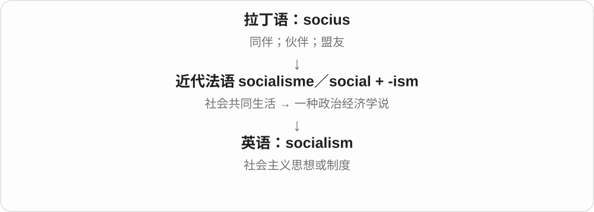

不同社会主义流派对所有权、市场、国家和民主有不同主张。它不等于“喜欢社交”，也不能只凭某项公共服务就给整套制度定性。

**常见搭配与例句**

democratic socialism；the history of socialism；socialist and capitalist ideas。

> The course compares different traditions of socialism.

课程比较不同的社会主义思想传统。

> The book examines debates about ownership under socialism.

这本书考察社会主义讨论中的所有权争论。

**别混淆**

social 是广义社会相关；socialism 是具体政治经济思想范围，不能见到 social 就译成社会主义。

### 4. socialist — 社会主义者；社会主义的

**音标**：英 /ˈsəʊʃəlɪst/；美 /ˈsoʊʃəlɪst/

**先抓住这个画面**

把社会主义作为支持的思想立场，或用这个词形容相关理论、组织与政策。

**怎么拆**

social + -ist，与近代 socialism 同一政治词族；-ist 表示持某种立场的人。

**怎么变成今天的意思**

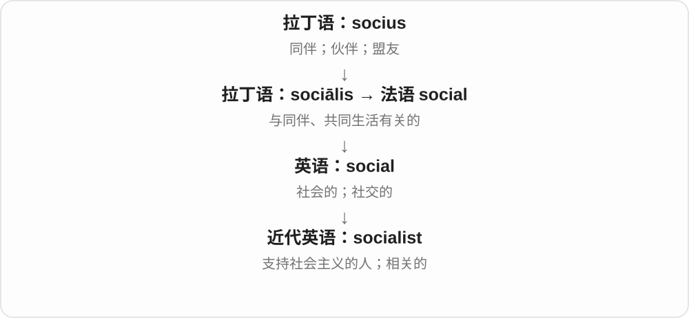

名词说人，形容词修饰 party、theory 等。不同地方、时期的具体主张不能仅凭这个标签推断完全一致。

**常见搭配与例句**

a socialist thinker；socialist theory；a socialist party。

> The essay discusses the work of a socialist thinker.

文章讨论一位社会主义思想家的著作。

> She studies the history of socialist movements.

她研究社会主义运动史。

**别混淆**

socialist 是思想立场；socialite 是社交名流；sociologist 是社会学研究者。

### 5. socialize — 与人交往；使学会群体生活；使社会化

**音标**：英 /ˈsəʊʃəlaɪz/；美 /ˈsoʊʃəlaɪz/

**先抓住这个画面**

走进人群一起聊天活动；更宽地说，是逐渐学会与别人共同生活的规则。

**怎么拆**

social + -ize；英式常也写 socialise。

**怎么变成今天的意思**

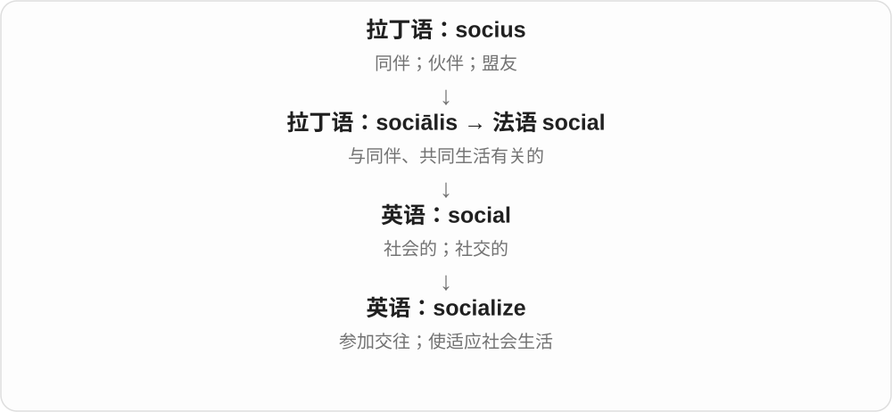

socialize with friends 是与朋友交往；children are socialized… 可谈儿童如何学到行为规范。政治经济语境还可说使共同拥有或社会化管理。

**常见搭配与例句**

socialize with；socialize after work；socialize children into…。

> We sometimes socialize after work.

我们有时下班后一起聚聚。

> Children are socialized into the habits of their community.

儿童在成长中学会所在社群的习惯。

**别混淆**

socialize with someone 是交往；通常不用 socialize someone 表示跟他聊天，后者是使某人社会化。

### 6. socialization — 社会化；学习社会规范的过程；社交活动

**音标**：英 /ˌsəʊʃəlaɪˈzeɪʃən/；美 /ˌsoʊʃələˈzeɪʃən/

**先抓住这个画面**

一个人不断从家庭、学校和同伴那里学会“大家怎么一起生活”，这是 socialization 的核心画面。

**怎么拆**

socialize + -ation，也可从 social 与 -ization 理解。

**怎么变成今天的意思**

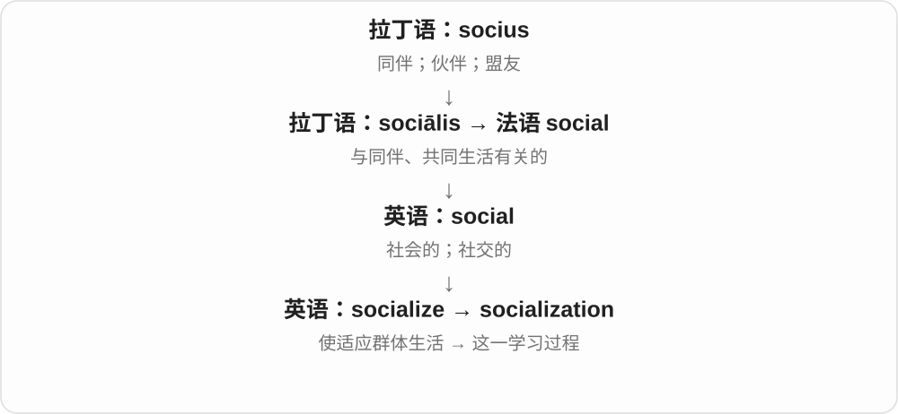

社会学语境强调学习规范、角色与习惯，不只练习聊天。日常用法也可宽泛指人际接触。

**常见搭配与例句**

childhood socialization；peer socialization；opportunities for socialization。

> Peers play a part in children’s socialization.

同伴在儿童社会化过程中发挥作用。

> The club provides opportunities for socialization.

俱乐部提供与人交往的机会。

**别混淆**

education 可以是正式教学；socialization 包含大量没人专门上课、却在生活中学会的规则。

### 7. socialite — 社交名流

**音标**：英 /ˈsəʊʃəlaɪt/；美 /ˈsoʊʃəlaɪt/

**先抓住这个画面**

经常出现在知名聚会和社交圈中，因这种社交生活而广为人知的人。

**怎么拆**

social 的上流社交圈义 + -ite 人；有资料提到可能带 social light 的文字游戏，不必把它当确定拆解。

**怎么变成今天的意思**

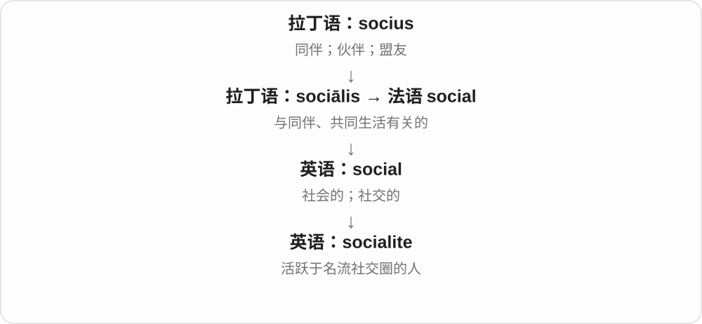

强调身份、圈子和公众知名度，通常带财富或上流生活背景。不是每个爱聚会的人都叫 socialite。

**常见搭配与例句**

a well-known socialite；a local socialite；a socialite’s party。

> The socialite hosted a charity dinner.

这位社交名流举办了一场慈善晚宴。

> The magazine interviewed several artists and socialites.

杂志采访了几位艺术家和社交名流。

**别混淆**

sociable person 是合群的人；socialite 是社交名流，指的不是普通性格。

### 8. sociality — 社会性；群体交往或共同生活的特征

**音标**：英 /ˌsəʊʃiˈæləti/；美 /ˌsoʊʃiˈæləti/

**先抓住这个画面**

把镜头拉远，不看某个人是不是爱聊天，而看一个物种或群体怎样共同生活。

**怎么拆**

来自 social 词族，可追到法语 socialité、拉丁语 sociālitās；现代可分析 social + -ity。

**怎么变成今天的意思**

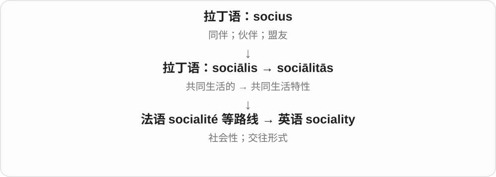

较学术，常用于动物行为、社会理论等。既可谈交往倾向，也可谈共同生活的组织方式。

**常见搭配与例句**

animal sociality；human sociality；forms of sociality。

> The article explores sociality in primates.

文章探讨灵长类动物的社会性。

> Shared meals can create new forms of sociality.

一起吃饭能产生新的交往形式。

**别混淆**

sociability 更常说个体乐于交往的倾向；sociality 更容易谈共同生活这一整体特征。

### 9. antisocial — 妨害他人的；反社会的；不愿交往的

**音标**：英 /ˌæntiˈsəʊʃəl/；美 /ˌæntiˈsoʊʃəl/

**先抓住这个画面**

一种情况是行为伤害共同生活，比如深夜故意吵邻居；口语里也有人用它说不想见人。

**怎么拆**

anti- 表反对、逆着，接 social。

**怎么变成今天的意思**

日常行为描述、口语不合群、临床术语不能混成一个意思。单凭喜欢独处，不能给人下心理诊断。

**常见搭配与例句**

antisocial behaviour；antisocial noise；feel antisocial。

> The residents complained about antisocial noise late at night.

居民投诉了深夜扰民的噪声。

> I am not being antisocial; I just need a quiet evening.

我不是故意不合群，只是想安静地过一晚。

**别混淆**

要准确说不爱交际，unsociable 常更清楚；antisocial behaviour 通常比“安静内向”严重得多。

### 10. psychosocial — 心理社会的；涉及心理与社会环境相互影响的

**音标**：英 /ˌsaɪkəʊˈsəʊʃəl/；美 /ˌsaɪkoʊˈsoʊʃəl/

**先抓住这个画面**

一个人的感受会受家庭、同伴、工作环境影响，反过来这些感受也影响与人的关系。

**怎么拆**

psycho- 心理 + social 社会的；两个成分并列结合，不是社会先变成心理。

**怎么变成今天的意思**

用于研究或支持服务时，提醒读者同时看内在感受和外部关系，而不是把问题全归给个人。

**常见搭配与例句**

psychosocial factors；psychosocial support；psychosocial development。

> The study considers both economic and psychosocial factors.

研究同时考虑经济因素和心理社会因素。

> The programme offers psychosocial support to families.

项目为家庭提供心理及社会支持。

**别混淆**

psychological 主要从心理角度看；psychosocial 明确把社会关系和环境也带进来。

### 11. prosocial — 亲社会的；有助于他人的

**音标**：英 /ˌprəʊˈsəʊʃəl/；美 /ˌproʊˈsoʊʃəl/

**先抓住这个画面**

别人需要帮助时伸手，愿意分享、合作，让共同生活变得更好。

**怎么拆**

pro- 表支持、促进，接 social。

**怎么变成今天的意思**

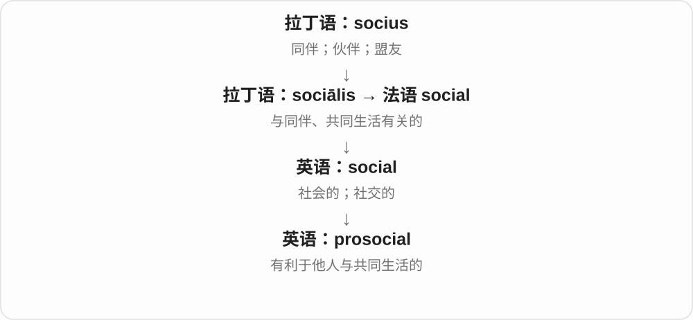

多见于心理学、教育研究，描述帮助、分享、合作等行为。它说行为对他人的积极方向，不只是爱参加聚会。

**常见搭配与例句**

prosocial behaviour；prosocial actions；encourage prosocial habits。

> Sharing supplies is one example of prosocial behaviour.

分享用品是亲社会行为的一个例子。

> The activity encourages cooperation and other prosocial actions.

这项活动鼓励合作及其他有助于他人的行动。

**别混淆**

sociable 是爱与人交往；prosocial 是行为有助于他人。安静的人也可以非常乐于助人。

### 12. dissocial — 不利于社会交往的；反社会的（少用）

**音标**：英 /dɪˈsəʊʃəl/；美 /dɪˈsoʊʃəl/

**先抓住这个画面**

行为背离与他人共同生活的要求，表现出对他人利益或社会联系的漠视。

**怎么拆**

dis- + social，表示偏离或不具备社会交往中的相应性质。

**怎么变成今天的意思**

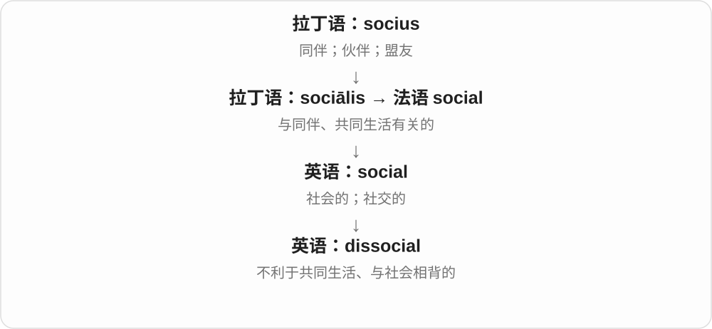

日常少用，旧文和某些专业分类会出现。不能只凭一个人不爱说话就用这个词给他定性。

**常见搭配与例句**

dissocial behaviour；dissocial attitudes；the term dissocial。

> The author uses dissocial to describe conduct that disregards others.

作者用 dissocial 描述漠视他人的行为。

> The glossary distinguishes dissocial from merely unsociable.

词汇表把 dissocial 与单纯不爱交际区分开。

**别混淆**

unsociable 主要是不爱交往；dissocial 往往含更强的负面社会评价，专业语境还有限定含义。

### 13. society — 社会；社团；交往圈子

**音标**：英 /səˈsaɪəti/；美 /səˈsaɪəti/

**先抓住这个画面**

人们长期生活在一起，形成制度、关系和习惯，这个大整体是 society；为某个目的聚起来的小团体也可以是一个 society。

**怎么拆**

经法语 societé 来自拉丁语 societās“伙伴关系、联合”，基础是 socius。

**怎么变成今天的意思**

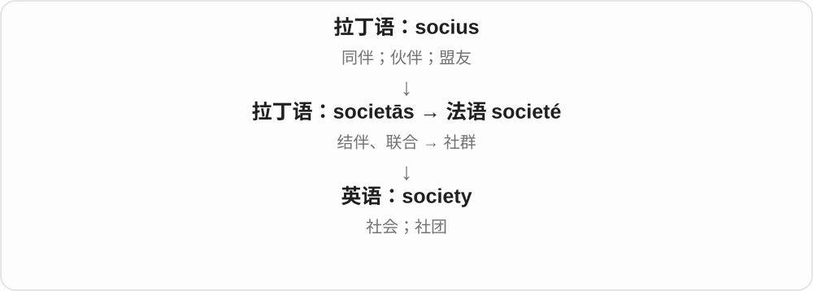

society 作社会整体常不加 a；a society 可以是一个社团。high society 则指上流社交圈。

**常见搭配与例句**

modern society；a historical society；society as a whole。

> Education plays an important role in society.

教育在社会中发挥重要作用。

> She joined the local historical society.

她加入了当地历史学会。

**别混淆**

society 不是只有政府，也不只是网上社交圈，而是共同生活所形成的人群与关系整体。

### 14. societal — 社会整体层面的

**音标**：英 /səˈsaɪətəl/；美 /səˈsaɪətəl/

**先抓住这个画面**

不只问一个人的选择，而是问制度、习惯和许多人共同受到的影响。

**怎么拆**

society + -al，形成与社会整体有关的形容词；不是 social 的随意长写。

**怎么变成今天的意思**

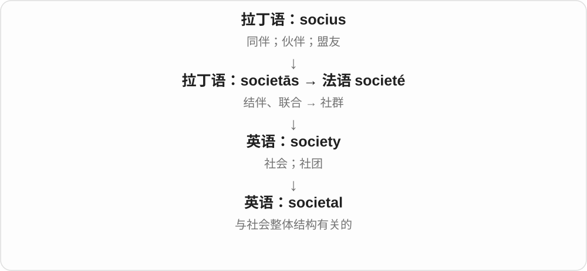

较正式，多见于研究和政策讨论。societal change 说社会整体变化，通常不表示朋友间多聚了几次会。

**常见搭配与例句**

societal change；societal expectations；societal impact。

> The study explores the societal impact of new technology.

研究探讨新技术对社会整体的影响。

> Attitudes changed alongside wider societal changes.

观念随着更广泛的社会变化而改变。

**别混淆**

social 范围更广；societal 通常把意思收窄到社会整体，避开普通社交义。

### 15. associate — 联系；联想；交往；伙伴；副职的

**音标**：动词：英 /əˈsəʊsieɪt/、美 /əˈsoʊsieɪt/；名词、形容词词尾 /ət/；/si/ 也常读 /ʃi/

**先抓住这个画面**

把两个原本分开的东西放进同一关系里：人结成伙伴，脑中把一种气味与一段记忆连起来。

**怎么拆**

拉丁语 ad- 向 + sociāre 联合，d 同化成 s，形成 associāre；分词 associātus 进入英语后发展出不同词性。

**怎么变成今天的意思**

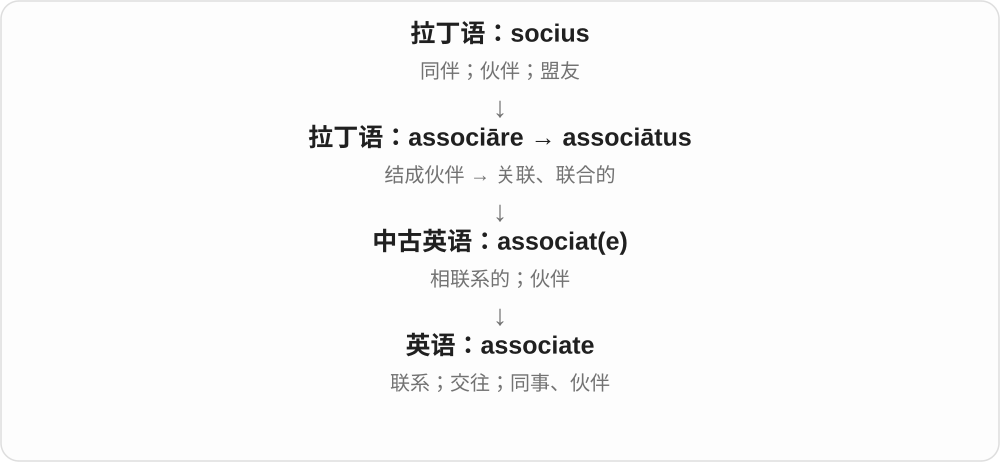

associate A with B 是把 A 与 B 联系；an associate 是同事或合作伙伴。associate professor 等职位名称有各自制度含义。动词词尾读 /eɪt/，名词和形容词读 /ət/。

**常见搭配与例句**

associate A with B；associate with someone；a business associate。

> I associate this smell with my grandmother’s kitchen.

这个气味让我想起祖母的厨房。

> She introduced me to a business associate.

她把我介绍给一位生意伙伴。

**别混淆**

associate 不一定亲密到朋友程度，也不表示相关的两件事存在因果关系。

### 16. association — 协会；关联；联想；交往

**音标**：英 /əˌsəʊsiˈeɪʃən/；美 /əˌsoʊsiˈeɪʃən/；/si/ 也常读 /ʃi/

**先抓住这个画面**

人连在一起可以组成协会；脑中两个东西连起来是联想；数据里两个变化相关也是 association。

**怎么拆**

来自拉丁语 associātiō，可能经法语 association；现代对应 associate + -ion，但名词有自己的借入历史。

**怎么变成今天的意思**

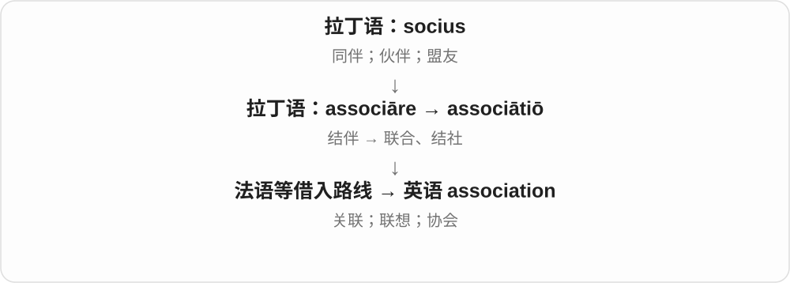

同一个核心“联系”在不同场合变成不同对象。association between A and B 只先说存在关联，不自动说明谁造成谁。

**常见搭配与例句**

a professional association；in association with；an association between…。

> She joined a professional association for translators.

她加入了一个译者专业协会。

> The smell has a strong association with childhood for me.

对我来说，这种气味和童年有很强的联系。

**别混淆**

association 是关系或组织；associate 可指其中的人或建立联系的动作。

### 17. interassociation — 相互联系；多个对象之间的关联（少用）

**音标**：按 inter- 与 association 的常规读法：英 /ˌɪntərəˌsəʊsiˈeɪʃən/；美 /ˌɪntərəˌsoʊsiˈeɪʃən/

**先抓住这个画面**

不只画一个对象的内部结构，而是画几个对象之间互相牵连的线。

**怎么拆**

inter- 在……之间 + association 关联，英语复合派生。

**怎么变成今天的意思**

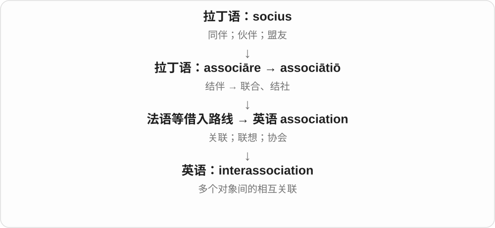

少见的正式名词，普通写作多用 interrelationship 或 mutual association。它不一定说协会之间，而是更宽的对象之间关系。

**常见搭配与例句**

interassociation among groups；the interassociation of factors。

> The study examines the interassociation of several social factors.

研究考察几个社会因素之间的相互关联。

> The diagram shows the interassociation among the groups.

图示展示这些群体之间的相互联系。

**别混淆**

不要见到 association 就只想协会；这里常用的是关联义。

### 18. associative — 联想的；关联的；满足结合律的

**音标**：英 /əˈsəʊsiətɪv/；美 /əˈsoʊsiətɪv/；/si/ 也常读 /ʃi/

**先抓住这个画面**

一个念头牵出另一个念头；数学里则是几个数连接运算时，先把哪一对括起来都不改变结果。

**怎么拆**

associate + -ive。数学术语把“组合、联系”的意思专门化。

**怎么变成今天的意思**

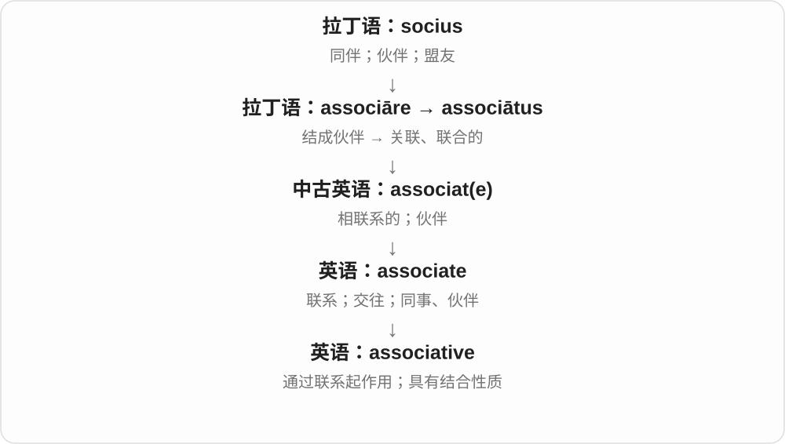

associative memory 是靠联系回忆；associative operation 满足 (a·b)·c = a·(b·c)。这里变的是括号，不是元素顺序。

**常见搭配与例句**

associative learning；associative memory；an associative operation。

> The exercise uses associative learning to link sounds with pictures.

练习通过联结学习，把声音与图片对应起来。

> Addition is associative, so changing the grouping does not change the sum.

加法满足结合律，因此改变分组不改变总和。

**别混淆**

associative 是换括号；commutative 是交换顺序。加法两者都有，但两个性质不是一回事。

### 19. nonassociative — 非联结的；不满足或不预设结合律的

**音标**：英 /ˌnɒnəˈsəʊsiətɪv/；美 /ˌnɑːnəˈsoʊsiətɪv/

**先抓住这个画面**

数学里，先算哪一组可能影响答案；学习研究里，则可能是不靠两种刺激相互联结的学习。

**怎么拆**

non- 否定 associative。

**怎么变成今天的意思**

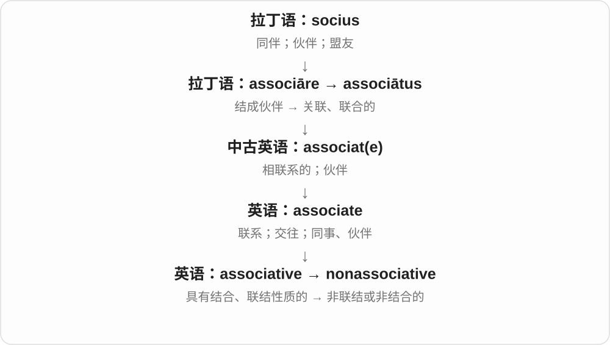

减法可以直观看：先算 (5−3)−1 得 1，先算 5−(3−1) 得 3。在代数类别名中，nonassociative 也可表示不要求普遍满足结合律。

**常见搭配与例句**

nonassociative learning；nonassociative algebra；a nonassociative operation。

> Subtraction is nonassociative: the grouping can change the answer.

减法不满足结合律：分组方式可能改变答案。

> The course introduces nonassociative algebras.

课程介绍非结合代数。

**别混淆**

不是在说运算没有规则；只是结合律不成立，或定义没有把它设为必要条件。

### 20. disassociate — 使脱离；断绝联系

**音标**：英 /ˌdɪsəˈsəʊsieɪt/；美 /ˌdɪsəˈsoʊsieɪt/

**先抓住这个画面**

别人把你和某个组织、做法联系起来，你把这条线明确拆开。

**怎么拆**

dis- + associate，英语内加否定、分离前缀；与较直接借自拉丁语的 dissociate 路线不同。

**怎么变成今天的意思**

常见于声明划清界限，也可用于技术上解除对象之间的关联。与 dissociate 的普通义非常接近。

**常见搭配与例句**

disassociate oneself from；disassociate A from B。

> The organization disassociated itself from the misleading advertisement.

该组织声明自己与这则误导性广告无关。

> You can disassociate the device from the account.

你可以解除该设备与账号的关联。

**别混淆**

dissociate 通常更简短、适用更广；disassociate 不是必须纠正的拼写错误，但专业术语常固定用 dissociate。

### 21. disassociation — 解除关联；脱离关系

**音标**：英 /ˌdɪsəˌsəʊsiˈeɪʃən/；美 /ˌdɪsəˌsoʊsiˈeɪʃən/

**先抓住这个画面**

把“断开关系”这个动作或结果变成名词，强调原来的联系已经拆开。

**怎么拆**

dis- + association；也与动词 disassociate 在现代用法中对应。

**怎么变成今天的意思**

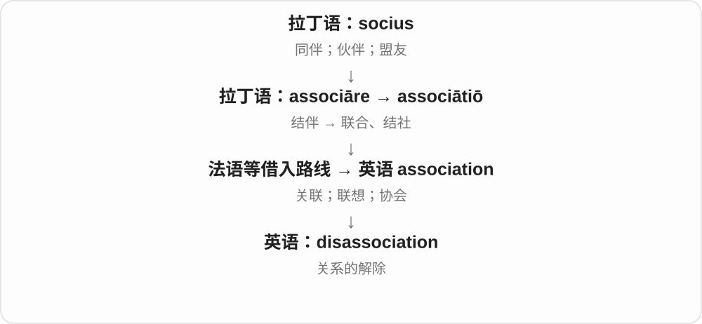

多见于正式说明、组织关系和技术操作。一般写作常用 dissociation 或 separation 更简洁。

**常见搭配与例句**

disassociation from a group；disassociation of a device；formal disassociation。

> The letter announced her disassociation from the campaign.

信中宣布她退出并与该宣传活动划清关系。

> The settings page confirms the device’s disassociation from the account.

设置页面确认设备已解除与账号的关联。

**别混淆**

临床或化学中的固定名词一般用 dissociation，不必为了表面对应 disassociate 而换成更长的词。

### 22. sociology — 社会学

**音标**：英 /ˌsəʊsiˈɒlədʒi/；美 /ˌsoʊsiˈɑːlədʒi/

**先抓住这个画面**

不只问一个人为什么这样做，还问家庭、学校、阶层、制度和关系怎样影响许多人的生活。

**怎么拆**

来自近代法语 sociologie，拉丁语 socius 与希腊来源的 -logie 组合，是跨语言构词。

**怎么变成今天的意思**

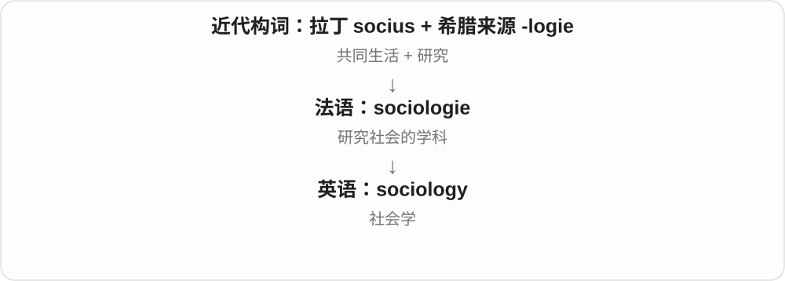

研究社会关系、制度和群体行为。它不是教人应酬的课程，而是用理论与资料理解共同生活。

**常见搭配与例句**

study sociology；a sociology course；the sociology of education。

> She studies sociology at university.

她在大学学习社会学。

> The sociology of education examines how schools relate to society.

教育社会学研究学校与社会之间的关系。

**别混淆**

psychology 常关注心理过程与行为；sociology 更聚焦社会关系与结构，两者研究范围会重叠。

### 23. sociological — 社会学的；从社会学角度分析的

**音标**：英 /ˌsəʊsiəˈlɒdʒɪkəl/；美 /ˌsoʊsiəˈlɑːdʒɪkəl/

**先抓住这个画面**

看一件个人经历时，把它放回社会关系和制度环境里解释，这是 sociological 的观察角度。

**怎么拆**

由 sociology 词族形成，-logy 对应 -logical，表示这门研究相关的。

**怎么变成今天的意思**

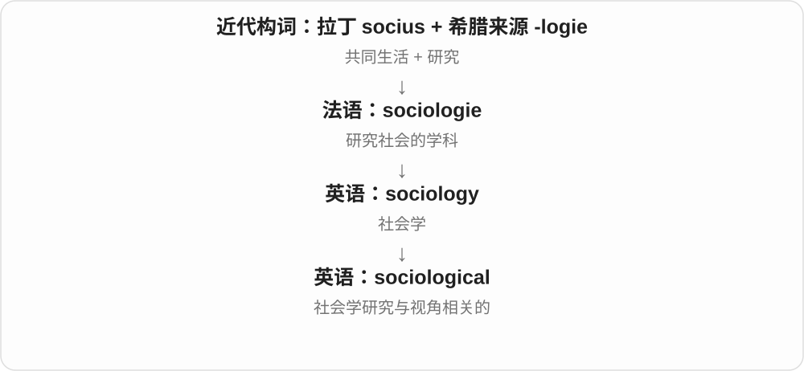

例如不只问一个人为何搬家，还研究住房、工作机会和家庭结构怎样影响迁移。

**常见搭配与例句**

a sociological study；a sociological perspective；sociological research。

> The book offers a sociological perspective on urban life.

这本书从社会学角度看城市生活。

> They conducted a sociological study of changing family patterns.

他们对家庭模式变化进行了社会学研究。

**别混淆**

societal 是社会整体层面的；sociological 是用社会学这门学科来分析。

### 24. sociologist — 社会学家；社会学研究者

**音标**：英 /ˌsəʊsiˈɒlədʒɪst/；美 /ˌsoʊsiˈɑːlədʒɪst/

**先抓住这个画面**

把人群、关系和制度作为研究对象，用访谈、调查或其他资料寻找其中的规律。

**怎么拆**

sociology 的 -logy 对应 -logist，表示研究这门学科的人。

**怎么变成今天的意思**

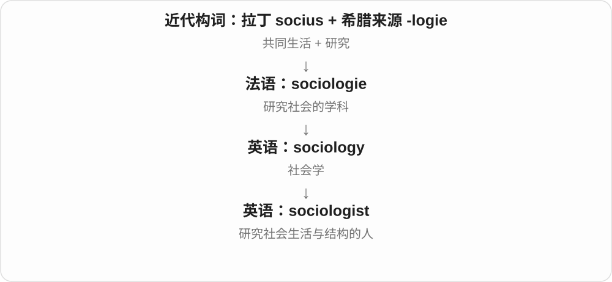

不是只凭会聊天或认识人多就成为 sociologist；这是学科与职业身份。

**常见搭配与例句**

a sociologist of work；urban sociologists；a sociologist’s research。

> The sociologist interviewed workers in several factories.

这位社会学研究者采访了几家工厂的工人。

> Sociologists study how institutions shape everyday life.

社会学家研究制度怎样塑造日常生活。

**别混淆**

social worker 是社会工作者；sociologist 是社会学研究者，工作目标和训练不完全相同。

### 25. sociable — 合群的；乐于交往的

**音标**：英 /ˈsəʊʃəbəl/；美 /ˈsoʊʃəbəl/

**先抓住这个画面**

有朋友来了愿意聊几句，见到新人也乐于接近，跟人相处让他愉快。

**怎么拆**

经法语 sociable 来自拉丁语 sociābilis，与 socius“同伴”相关；不是英语 social 直接加 -able。

**怎么变成今天的意思**

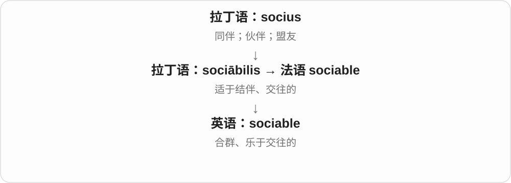

多形容人的交往倾向，也可说活动让人容易交流。一个人不必非常健谈才算 sociable。

**常见搭配与例句**

a sociable person；a sociable atmosphere；friendly and sociable。

> She is sociable and enjoys meeting new people.

她很合群，喜欢结识新朋友。

> Cooking together made the evening more sociable.

一起做饭让那个晚上多了些交流的乐趣。

**别混淆**

social 是社会或社交相关；sociable 是愿意、适合与人交往。social problem 不能改成 sociable problem。

### 26. sociability — 合群性；乐于交往的特质

**音标**：英 /ˌsəʊʃəˈbɪləti/；美 /ˌsoʊʃəˈbɪləti/

**先抓住这个画面**

把一个人愿意亲近人群、能与人愉快相处的倾向，作为一种特质来说。

**怎么拆**

经法语 sociabilité 来自 sociābilis 词族；现代对应 sociable 与 -ity，并出现 -ability 形式。

**怎么变成今天的意思**

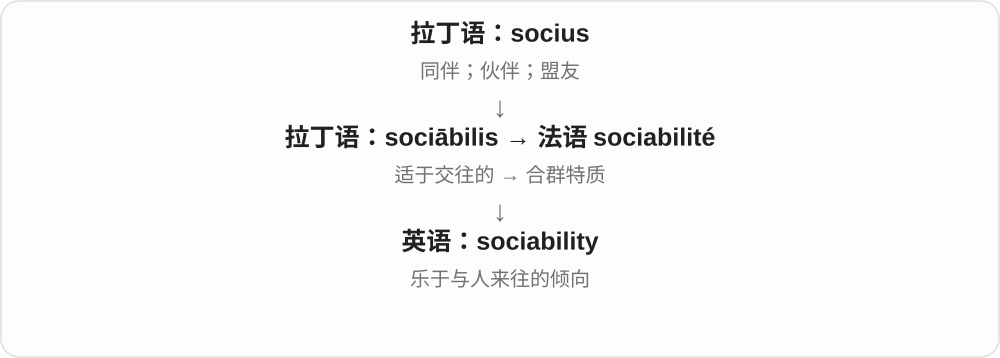

它可以指人，也可用于研究某些动物的群体交往倾向。不是社交活动次数的简单计数。

**常见搭配与例句**

a reputation for sociability；warmth and sociability；individual differences in sociability。

> Her warmth and sociability helped the new members feel welcome.

她的热情和合群让新成员感到受欢迎。

> The study compared differences in sociability among the animals.

研究比较了这些动物在群体交往倾向上的差异。

**别混淆**

sociability 是倾向；social skills 是具体交往技能。愿意交往与擅长每一种社交场面并非一回事。

### 27. unsociable — 不爱交际的；不合群的

**音标**：英 /ʌnˈsəʊʃəbəl/；美 /ʌnˈsoʊʃəbəl/

**先抓住这个画面**

别人想围坐聊天，他更想自己待着；也可能只是今天没有交往的心情。

**怎么拆**

un- 否定 sociable。

**怎么变成今天的意思**

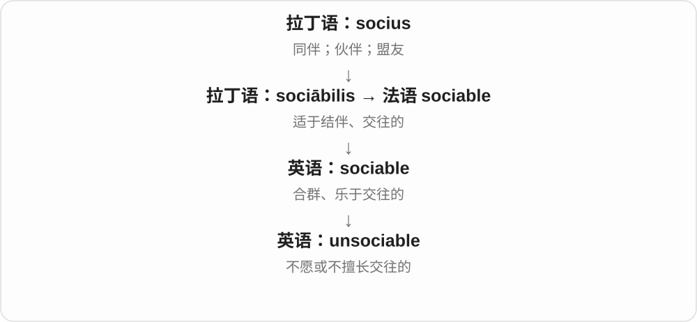

可以形容长期性格，也可以是某次表现。说自己暂时不想社交，用这个词比把自己说成反社会更直接。

**常见搭配与例句**

feel unsociable；an unsociable manner；be rather unsociable。

> I feel a little unsociable tonight and would rather stay home.

我今晚有点不想应酬，宁愿待在家里。

> He may seem unsociable, but he is simply quiet.

他看起来也许不合群，其实只是话少。

**别混淆**

unsociable 主要是不想交往；antisocial 还常指妨害他人或社会秩序，强度和含义不同。

### 28. dissociable — 可分离的；可区分开的

**音标**：英 /dɪˈsəʊsiəbəl/；美 /dɪˈsoʊsiəbəl/；/si/ 也常读 /ʃi/

**先抓住这个画面**

两件事总一起出现，但仔细设计比较后，发现可以让其中一个变化而另一个不变，说明它们能分开。

**怎么拆**

来自拉丁语 dissociābilis，与 dissociāre“分离”相连；现代可联系 dissociate + -able。

**怎么变成今天的意思**

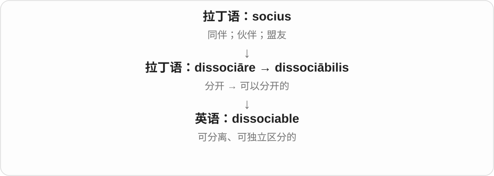

较正式，研究文章中可指机制、成分或能力能够分开分析。旧用法还有不合群义，现代学习先掌握可分离。

**常见搭配与例句**

dissociable components；two dissociable processes；dissociable from…。

> The task involves two dissociable mental processes.

这项任务涉及两个可区分的心理过程。

> The researchers treated accuracy and speed as dissociable measures.

研究者把准确度和速度视为可以分别考察的指标。

**别混淆**

dissociable 是能分离；dissociative 是具有或涉及解离性质。

### 29. dissociate — 使脱离联系；分离；解离

**音标**：英 /dɪˈsəʊsieɪt/；美 /dɪˈsoʊsieɪt/；/si/ 也常读 /ʃi/

**先抓住这个画面**

原来绑在一起的关系被解开：可以是人与某个观点划清界限，也可以是物质分成较小部分。

**怎么拆**

拉丁语 dis- 分开 + sociāre 联合，形成 dissociāre；英语由相应拉丁词干形成 dissociate。

**怎么变成今天的意思**

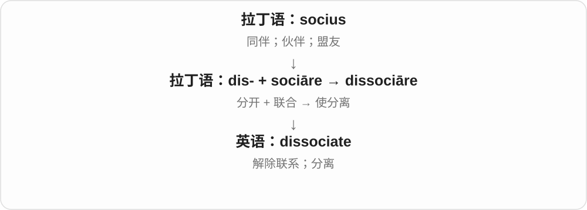

dissociate oneself from 是声明自己不支持或不涉及某事；化学语境说解离。心理学语境另有体验连接中断的专门含义，不是普通“不想社交”。

**常见搭配与例句**

dissociate A from B；dissociate oneself from；dissociate into ions。

> She dissociated herself from the group’s statement.

她声明自己不赞同该团体的声明。

> The compound dissociates into ions in water.

这种化合物在水中解离成离子。

**别混淆**

dissociate 是把联系分开；dislike 只是讨厌。可以不喜欢一个观点却仍被别人联系到它。

### 30. dissociation — 脱离联系；分离；解离

**音标**：英 /dɪˌsəʊsiˈeɪʃən/；美 /dɪˌsoʊsiˈeɪʃən/；/si/ 也常读 /ʃi/

**先抓住这个画面**

把原来连着的部分分开来看：关系能拆开，化合物能解离；心理学也借这个词描述体验之间的连接出了中断。

**怎么拆**

借自法语 dissociation，源于拉丁语 dissociātiō；现代对应 dissociate 与 -ion。

**怎么变成今天的意思**

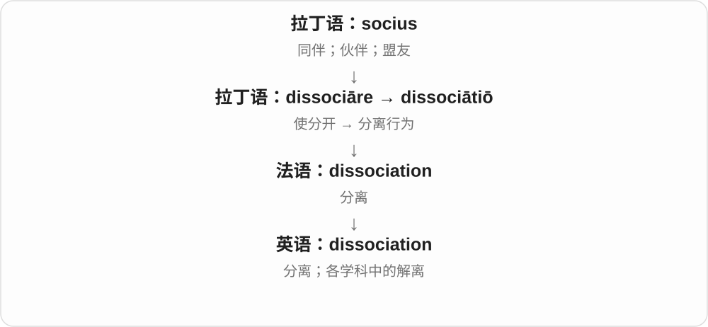

化学与心理学用的是不同专业义。心理学中的 dissociation 不等于“有多个人格”，也不能用它概括所有走神或独处。

**常见搭配与例句**

dissociation of a compound；a dissociation between two processes；dissociation from…。

> The experiment measured the dissociation of the compound.

实验测量了这种化合物的解离。

> The results suggest a dissociation between the two processes.

结果提示这两个过程可以彼此分离。

**别混淆**

dissociation 与 association 方向相反：一个看连接，一个看连接被分开；专业语境再确定具体含义。

### 31. dissociative — 解离的；涉及分离的

**音标**：英 /dɪˈsəʊsiətɪv/；美 /dɪˈsoʊsiətɪv/；/si/ 也常读 /ʃi/

**先抓住这个画面**

形容某个过程具有把相连部分分开的性质；在不同学科里，被分开的东西并不一样。

**怎么拆**

dissociate + -ive。

**怎么变成今天的意思**

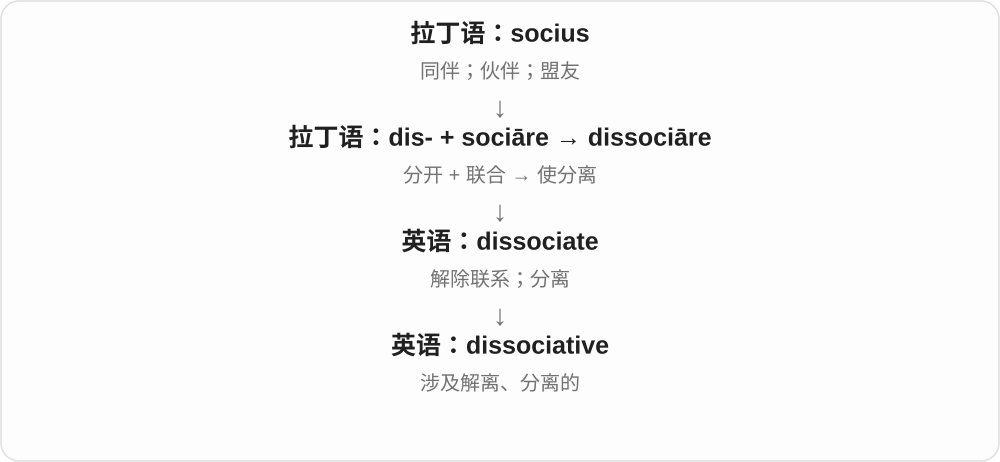

化学可以形容解离过程；心理学中形容相关体验或障碍。它不是一个人的普通性格标签，也不是“不合群”的替换词。

**常见搭配与例句**

a dissociative process；dissociative symptoms；a dissociative reaction。

> The chapter describes a dissociative chemical process.

这一章描述一种发生解离的化学过程。

> The textbook discusses dissociative experiences in a separate section.

教材在单独一节讨论解离体验。

**别混淆**

dissociative 描述解离相关性质；unsociable 描述不爱交往。两个词不能按汉字里的“离群”混用。

### 32. consociate — 联合；结盟；伙伴（旧式）

**音标**：动词：英 /kənˈsəʊsieɪt/、美 /kənˈsoʊsieɪt/；名词词尾 /ət/；/si/ 也可读 /ʃi/

**先抓住这个画面**

让原来分开的伙伴或团体聚在一起，形成联合关系。

**怎么拆**

拉丁语 con- 一起 + sociāre 联合，形成 cōnsociāre；其分词 cōnsociātus 与英语词形相连。

**怎么变成今天的意思**

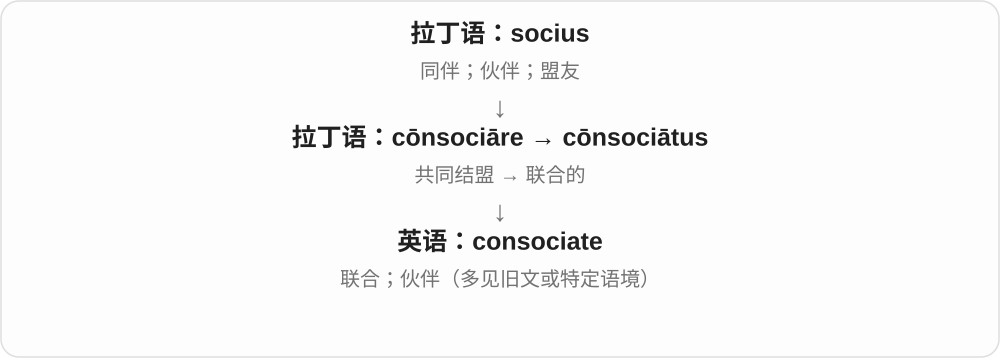

现代很少用，阅读历史文献时认识即可。部分教会语境保留联合之意；日常通常用 associate、unite 或 join。

**常见搭配与例句**

consociate with；consociate several groups；a consociate（旧式伙伴）。

> The churches agreed to consociate for mutual support.

这些教会同意联合起来相互支持。

> In the old account, he is described as her consociate.

在那份旧记述中，他被称为她的同伴。

**别混淆**

consociate 不必比 associate 关系更亲密；主要区别是使用范围和年代感。

### 33. consociation — 联合；联合组织；特定生态群落

**音标**：英 /kənˌsəʊsiˈeɪʃən/；美 /kənˌsoʊsiˈeɪʃən/

**先抓住这个画面**

多个单位仍各有身份，但聚在一起互相联系、协作；历史上常见于教会之间的联合。

**怎么拆**

借自拉丁语 cōnsociātiō，来自 cōnsociāre 联合；名词有自己的借入路线，不画成英语 consociate 才生出它。

**怎么变成今天的意思**

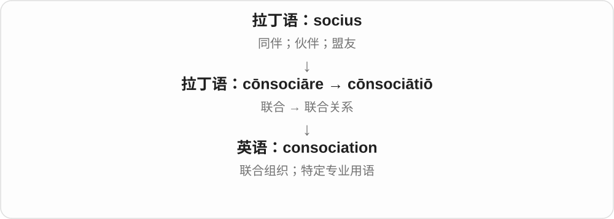

宗教史中可以是一组教会；生态学里另有一个优势种占主要地位的群落义。两种专业语境不可互译。

**常见搭配与例句**

a consociation of churches；ecological consociation；form a consociation。

> The churches formed a consociation to discuss shared concerns.

这些教会组成联合组织，讨论共同关切。

> The ecology text uses consociation for a community dominated by one species.

生态学教材用 consociation 指一个物种占优势的群落。

**别混淆**

association 更日常、范围更宽；consociation 常有历史或专业色彩。

### 34. consociational — 协和式的；群体协商分享权力的

**音标**：英 /kənˌsəʊsiˈeɪʃənəl/；美 /kənˌsoʊsiˈeɪʃənəl/

**先抓住这个画面**

社会里有几个差异明显的群体，制度让它们的代表坐到一起分享权力、协商，而不只由一个群体包办。

**怎么拆**

consociation + -al；政治学把联合、结盟的意思发展成一种权力分享安排。

**怎么变成今天的意思**

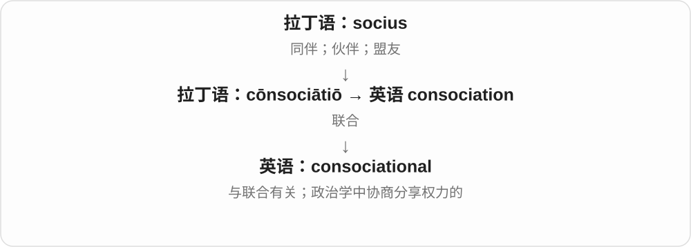

常见于 consociational democracy。它描述一种制度安排，不保证所有参与方意见一致，也不保证制度一定稳定。

**常见搭配与例句**

consociational democracy；consociational arrangements；a consociational system。

> The course compares majoritarian and consociational systems.

课程比较多数制与协和式制度。

> The agreement introduced consociational arrangements for sharing power.

协议引入了群体协商分享权力的安排。

**别混淆**

consensus 是形成共识；consociational 是制度怎样让不同群体合作，两者有关但不是同一个概念。

## 这一组要分清什么

**social / sociable / societal / sociological**：社会或社交的 / 乐于交往的 / 社会整体层面的 / 社会学角度的。

**unsociable / antisocial / prosocial**：不爱交际 / 常指妨害共同生活，也有口语不合群义 / 有助于他人。

**socialite / socialist / sociologist**：社交名流 / 社会主义者 / 社会学研究者。

**associative / commutative**：数学中换分组与换顺序是两件事。

**association** 可以是关联，但关联本身不等于因果。

## 串起来练习

**The sociologist joined a local association to study how social activities encourage prosocial behaviour.**

这位社会学研究者加入当地一个协会，研究社交活动怎样促进有助于他人的行为。sociologist 做研究，association 把人组织起来，social 谈交往，prosocial 强调帮助他人。
