# 0155 · par- — 准备、备办、安排；修复、分开与命令支线

[逐词精讲目录](../00_逐词精讲目录.md) · [总目录](../00_总目录_按常用程度.md)

## 核心词根与来源

从**出发前把东西一件件备好**开始理解。拉丁语 parāre 表示准备、安排、置办。prepare 是预先备好；repair 把损坏的东西重新恢复到可用状态；separate 则沿着“分开安排”发展成分离。imperāre 走向安排、命令，由它又有统治权 imperium 和帝国 empire。学这一族，抓住“备好、安排”的动作，再分别看它在哪条历史路线上变化。

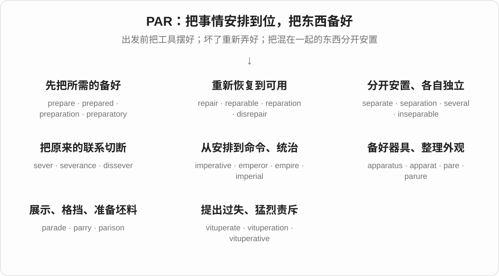

## 词形与演化规律

本页的 **par- 来自拉丁 parāre（词典第一人称 parō）**，不是见到 par 就能套用。“生育”的 **parere（pariō）** 是另一个拉丁动词；即使讨论更远的词源联系，也不能把两者当成同一现代词根用法。“相等”的 **par** 也另有一族。**imper- / emper-** 反映 imperāre、imperium 及法语传播的变化；**sever-** 经法语 sevrer 发展，已经看不见原来的 par。**repair to**“前往”另走 patria“家乡”一路；**parison** 的修辞义另来自希腊语。本页在相应单词中分别画清。

## 单词速览（常用到不常用）

| 单词 | 音标 | 核心意思 |
|---|---|---|
| [several](#w-1) | /ˈsevərəl/ | 几个；若干；各自的 |
| [separate](#w-2) | 形容词 /ˈsepərət/；动词 /ˈsepəreɪt/ | 分开的；单独的；把……分开 |
| [prepared](#w-3) | 英 /prɪˈpeəd/；美 /prɪˈperd/ | 准备好的；愿意并打算做的 |
| [prepare](#w-4) | 英 /prɪˈpeə/；美 /prɪˈper/ | 准备；使做好准备；制作、备好 |
| [empire](#w-5) | 英 /ˈempaɪə/；美 /ˈempaɪər/ | 帝国；庞大的经营或控制网络 |
| [repair](#w-6) | 英 /rɪˈpeə/；美 /rɪˈper/ | 修理；修复；正式旧用：前往 |
| [preparation](#w-7) | /ˌprepəˈreɪʃən/ | 准备；准备工作；配制品 |
| [emperor](#w-8) | 英 /ˈempərə/；美 /ˈempərər/ | 皇帝 |
| [imperial](#w-9) | 英 /ɪmˈpɪəriəl/；美 /ɪmˈpɪriəl/ | 帝国的；皇帝的；英制的 |
| [parade](#w-10) | /pəˈreɪd/ | 游行；阅兵式；列队行进；招摇展示 |
| [separation](#w-11) | /ˌsepəˈreɪʃən/ | 分开；分离；隔离距离；分居 |
| [separately](#w-12) | /ˈsepərətli/ | 分别地；单独地 |
| [prep](#w-13) | /prep/ | 准备；准备工作；预备学校、预习作业等的简称 |
| [apparatus](#w-14) | /ˌæpəˈreɪtəs/；也 /ˌæpəˈrætəs/ | 一套设备；器械；组织机构 |
| [imperative](#w-15) | /ɪmˈperətɪv/ | 极其必要的；必须做到的事；祈使语气 |
| [empress](#w-16) | /ˈemprəs/ | 女皇；皇后 |
| [parry](#w-17) | /ˈpæri/ | 挡开攻击；避开难以回答的问题 |
| [preparatory](#w-18) | 英 /prɪˈpærətəri/；美 /prɪˈperətɔːri/；也首音节重读 | 预备的；为后续作准备的 |
| [imperialism](#w-19) | 英 /ɪmˈpɪəriəlɪzəm/；美 /ɪmˈpɪriəˌlɪzəm/ | 帝国主义；扩张支配的政策或做法 |
| [preparedness](#w-20) | 英 /prɪˈpeərɪdnəs/；美 /prɪˈperdnəs/ | 准备就绪的状态；应变准备；愿意做的态度 |
| [unprepared](#w-21) | 英 /ˌʌnprɪˈpeəd/；美 /ˌʌnprɪˈperd/ | 没有准备好的；措手不及的 |
| [disparate](#w-22) | /ˈdɪspərət/ | 差异很大的；来源、性质很不一样的 |
| [severance](#w-23) | /ˈsevərəns/ | 断绝；分离；离职解约相关补偿 |
| [sever](#w-24) | 英 /ˈsevə/；美 /ˈsevər/ | 切断；割断；断绝 |
| [imperialist](#w-25) | 英 /ɪmˈpɪəriəlɪst/；美 /ɪmˈpɪriəlɪst/ | 帝国主义者；帝国主义的 |
| [inseparable](#w-26) | /ɪnˈsepərəbəl/ | 形影不离的；无法分开的 |
| [separatist](#w-27) | /ˈsepərətɪst/ | 分离主义者；主张独立或分离的 |
| [separator](#w-28) | 英 /ˈsepəreɪtə/；美 /ˈsepəreɪtər/ | 分离装置；分隔符；分隔物 |
| [irreparable](#w-29) | /ɪˈrepərəbəl/ | 无法修复的；无法挽回的 |
| [disrepair](#w-30) | 英 /ˌdɪsrɪˈpeə/；美 /ˌdɪsrɪˈper/ | 失修；破损失养状态 |
| [pare](#w-31) | 英 /peə/；美 /per/ | 削去外皮；修剪；逐步削减 |
| [separatism](#w-32) | /ˈsepərətɪzəm/ | 分离主义；主张分开、独立的立场 |
| [imperious](#w-33) | 英 /ɪmˈpɪəriəs/；美 /ɪmˈpɪriəs/ | 专横的；盛气凌人的 |
| [reparation](#w-34) | /ˌrepəˈreɪʃən/ | 赔偿；补偿；弥补过错 |
| [separable](#w-35) | /ˈsepərəbəl/ | 可分开的；可独立处理的 |
| [irreparably](#w-36) | /ɪˈrepərəbli/ | 无法挽回地；不可修复地 |
| [imperator](#w-37) | 英 /ˌɪmpəˈreɪtə/；美 /ˌɪmpəˈreɪtər/；也 /ˌɪmpəˈrɑːtər/ | 古罗马统帅、凯旋将军称号；皇帝称号的一部分 |
| [preparer](#w-38) | 英 /prɪˈpeərə/；美 /prɪˈperər/ | 准备者；编制者 |
| [repairable](#w-39) | 英 /rɪˈpeərəbəl/；美 /rɪˈperəbəl/ | 可以修理的；可以修复的 |
| [severally](#w-40) | /ˈsevərəli/ | 分别地；各自地 |
| [reparative](#w-41) | 英 /rɪˈpærətɪv/；美也 /rɪˈperətɪv/ | 修复性的；弥补损害的 |
| [inseparably](#w-42) | /ɪnˈsepərəbli/ | 不可分离地；紧密相连地 |
| [severable](#w-43) | 英 /ˈsevərəbəl/；美 /ˈsevərəbəl/ | 可分割的；可以拆开仍分别成立的 |
| [severability](#w-44) | /ˌsevərəˈbɪləti/ | 可分割性；部分可独立处理的性质 |
| [imperiously](#w-45) | 英 /ɪmˈpɪəriəsli/；美 /ɪmˈpɪriəsli/ | 专横地；盛气凌人地 |
| [vituperative](#w-46) | 英 /vɪˈtjuːpərətɪv/；美 /vaɪˈtuːpərətɪv/ | 辱骂性的；尖刻谩骂的 |
| [separability](#w-47) | /ˌsepərəˈbɪləti/ | 可分离性；可分开处理的性质 |
| [preparative](#w-48) | /prɪˈpærətɪv/ | 准备性的；制备性的 |
| [apparat](#w-49) | 英 /ˌæpəˈrɑːt/；美 /ˌæpəˈræt/ 或 /ˌɑːpəˈrɑːt/ | 党政机构；行政机器 |
| [parison](#w-50) | 坯料义 /ˈpærɪsən/，美 /ˈperəsən/；修辞义美 /ˈperəˌsɑːn/ | 玻璃或塑料预制坯；修辞中对称平衡的句式 |
| [vituperation](#w-51) | 英 /vɪˌtjuːpəˈreɪʃən/；美 /vaɪˌtuːpəˈreɪʃən/ | 痛骂；恶毒责斥；尖刻的言辞攻击 |
| [parure](#w-52) | 英 /pəˈrʊə/；美 /pəˈrʊr/ | 成套珠宝首饰 |
| [reparable](#w-53) | /ˈrepərəbəl/ | 可修复的；可弥补的 |
| [comprador](#w-54) | 英 /ˌkɒmprəˈdɔː/；美 /ˌkɑːmprəˈdɔːr/ | 买办；为外商经营提供本地中介服务的人 |
| [separative](#w-55) | /ˈsepərətɪv/；也 /ˈsepəreɪtɪv/ | 起分离作用的；倾向于分开的 |
| [empery](#w-56) | /ˈempəri/ | 帝国；帝权；统治权 |
| [dissever](#w-57) | 英 /dɪˈsevə/；美 /dɪˈsevər/ | 分开；割裂；切断 |
| [disseverance](#w-58) | /dɪˈsevərəns/（依 dissever 与 -ance 构词读法） | 分离；割裂；断绝 |
| [imperant](#w-59) | /ˈɪmpərənt/（依旧词典首音节重音与构词转写） | 发号施令的；居于指挥地位的 |
| [separatory](#w-60) | 英 /ˈsepərətəri/；美 /ˈsepərəˌtɔːri/ | 用于分离的 |
| [separatrix](#w-61) | /ˌsepəˈreɪtrɪks/ | 分界曲线；分隔线或分隔记号 |
| [vituperate](#w-62) | 英 /vɪˈtjuːpəreɪt/；美 /vaɪˈtuːpəreɪt/ | 痛骂；尖刻地责斥 |

## 逐词讲解

### 1. several — 几个；若干；各自的

**音标**：/ˈsevərəl/

**先抓住这个画面**

several 最常见的画面是一个、两个之外还有一些，但没有强调很多：几个问题、若干天。

**怎么拆**

经盎格鲁法语 several、拉丁 sēparālis / sēpar，追到 sēparāre“分开”。不是 seven“七”或 severe“严厉”的派生词。

**怎么变成今天的意思**

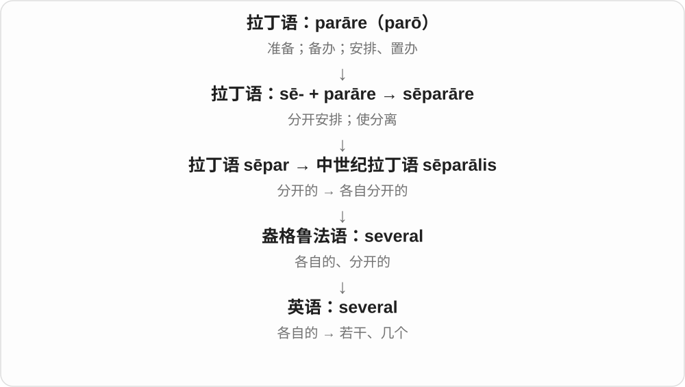

从分开、各自，到不同的几项，再发展出模糊的数量词。several 不规定精确个数；went their several ways 仍保留“各自”的正式用法。

**常见搭配与例句**

several times；several of us；their several ways。

> I have read the article several times.

这篇文章我已经读过好几遍。

> After lunch, the guests went their several ways.

午饭后，客人们各自离开了。

**别混淆**

a couple of 常指两个、也可泛指少数；several 通常比两个多，但不能机械等于某个固定范围。

### 2. separate — 分开的；单独的；把……分开

**音标**：形容词 /ˈsepərət/；动词 /ˈsepəreɪt/

**先抓住这个画面**

separate 像把混在一起的两堆东西放到两边；作形容词则说它们已经各占一个位置。

**怎么拆**

拉丁 sē-（分开）+ parāre（安排）→ sēparāre，分词 sēparātus 进入中古英语形成相应形容词和动词。

**怎么变成今天的意思**

形容词末尾弱读 /ət/，动词末尾 /eɪt/。separate rooms 是不同房间；separate A from B 是把两者分开。

**常见搭配与例句**

a separate room；separate from；separate fact from opinion。

> We booked two separate rooms.

我们订了两个单独的房间。

> Please separate the clean towels from the used ones.

请把干净毛巾与用过的分开。

**别混淆**

different 说性质不同；separate 说分开、独立，两个 separate rooms 完全可以布置一样。

### 3. prepared — 准备好的；愿意并打算做的

**音标**：英 /prɪˈpeəd/；美 /prɪˈperd/

**先抓住这个画面**

prepared 像出门前把该带的东西都放好；也可表示心里已接受将要面对的行动。

**怎么拆**

prepare + -ed，过去分词进一步作形容词。

**怎么变成今天的意思**

prepared for an exam 是备好考试；prepared to compromise 常是愿意作出妥协，不只指完成准备动作。

**常见搭配与例句**

be prepared for；be prepared to do；prepared food。

> She came prepared with a list of questions.

她带着问题清单，有备而来。

> We are prepared to change the date.

我们愿意更改日期。

**别混淆**

prepared 强调事先准备或意愿；ready 强调此刻已能开始，来源与用法不必完全相同。

### 4. prepare — 准备；使做好准备；制作、备好

**音标**：英 /prɪˈpeə/；美 /prɪˈper/

**先抓住这个画面**

prepare 是在事情开始前，把工具、材料、步骤或心态安排到能用的状态。

**怎么拆**

拉丁 prae-（预先）+ parāre（备好）→ praeparāre；英语既有法语 preparer 的借入，也受到 preparation 逆构影响。

**怎么变成今天的意思**

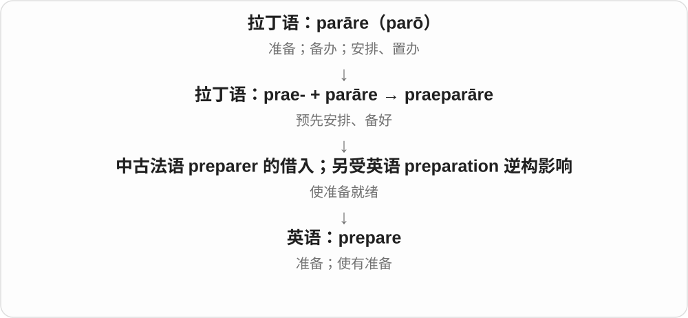

prepare dinner 是做饭、备餐；prepare for an exam 是为考试准备；prepare someone for bad news 是让对方先有心理准备。

**常见搭配与例句**

prepare a meal；prepare for a meeting；prepare someone for something。

> I will prepare dinner while you set the table.

你摆餐桌时，我来准备晚饭。

> Nothing had prepared her for the sudden change.

她完全没有料到会出现这样的突然变化。

**别混淆**

plan 主要安排以后怎样做；prepare 还包括真正备材料、练习、收拾等行动。

### 5. empire — 帝国；庞大的经营或控制网络

**音标**：英 /ˈempaɪə/；美 /ˈempaɪər/

**先抓住这个画面**

empire 像一个中心把许多地区或业务纳入自己的控制之下。

**怎么拆**

来自法语 empire，上接拉丁 imperium“统治权、统治范围”，而 imperāre 是发号施令。

**怎么变成今天的意思**

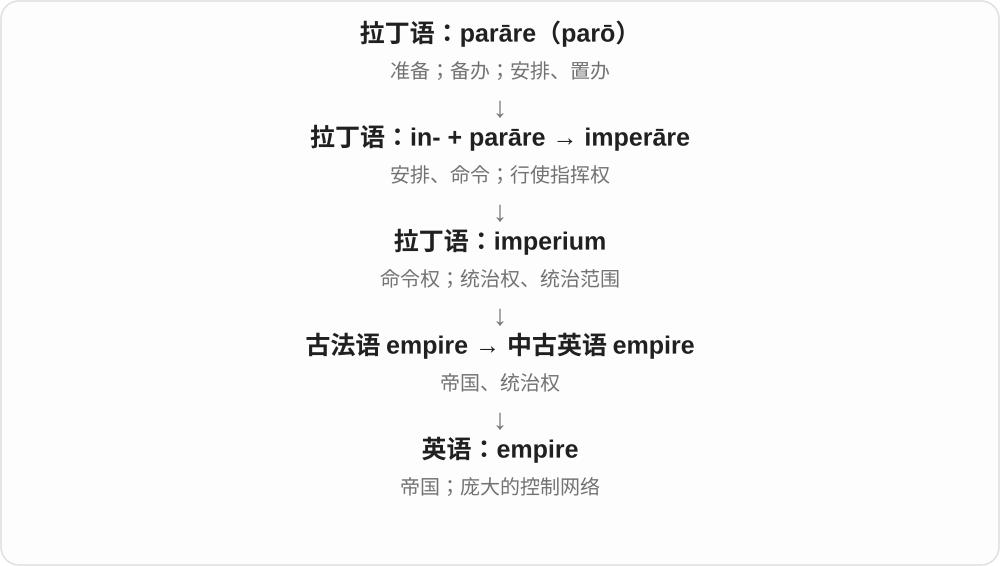

历史上可指帝国；a business empire 是规模庞大、彼此受同一集团控制的业务，不是说企业真的有皇帝。

**常见搭配与例句**

an ancient empire；build an empire；a media empire。

> The map shows the empire at its greatest extent.

地图显示了这个帝国疆域最广时的范围。

> She built a publishing empire from a small magazine.

她从一本小杂志起步，建立起一个出版业大集团。

**别混淆**

empire 侧重庞大的统治范围；emperor 是统治者称号。两词分别借入，不能把一个英语词当成另一个的来源。

### 6. repair — 修理；修复；正式旧用：前往

**音标**：英 /rɪˈpeə/；美 /rɪˈper/

**先抓住这个画面**

repair 最常用的意思是把损坏的东西重新弄到能用：补好屋顶，也修复受损的关系。

**怎么拆**

修复义来自 re- + parāre → reparāre；repair to“前往”另来自 repatriāre“返回故乡”，与 patria 相连。

**怎么变成今天的意思**

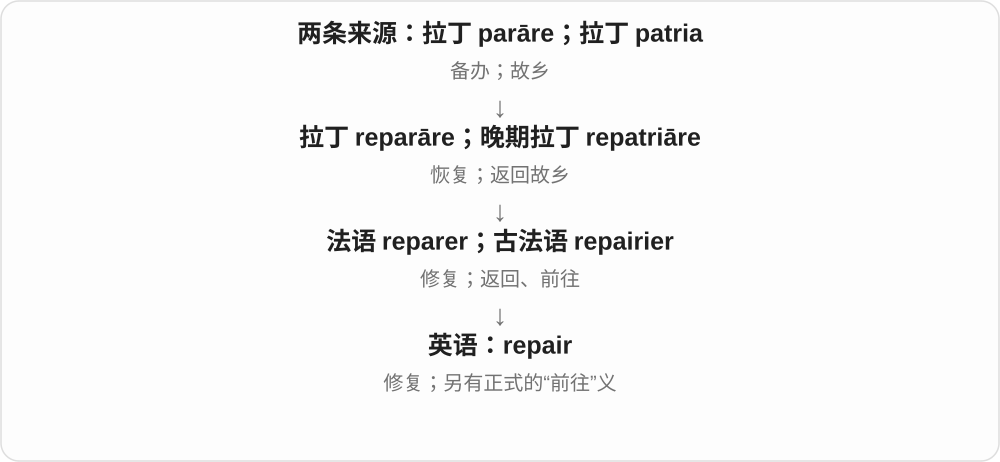

in good repair 是保养状态良好。After dinner we repaired to the lounge 里的 repair 是前往，完全没有修东西的意思。

**常见搭配与例句**

repair a roof；repair the damage；in good repair；repair to the lounge。

> The technician repaired the broken switch.

技术员修好了坏掉的开关。

> It took time to repair their relationship.

修复他们的关系需要时间。

> After dinner, we repaired to the lounge.

晚饭后，我们移步休息室。（正式语体）

**别混淆**

repair 恢复原有功能；replace 是换上另一个。repair to 的旧义不能按“重新准备”硬解释。

### 7. preparation — 准备；准备工作；配制品

**音标**：/ˌprepəˈreɪʃən/

**先抓住这个画面**

preparation 是正式开始之前做的那些功课：找材料、练习、排时间，让事情不至于临时抓瞎。

**怎么拆**

来自拉丁 praeparātiō，经法语 preparacion 借入；现代对应 prepare + -ation，但这个名词在英语中还影响了 prepare 的形成。

**怎么变成今天的意思**

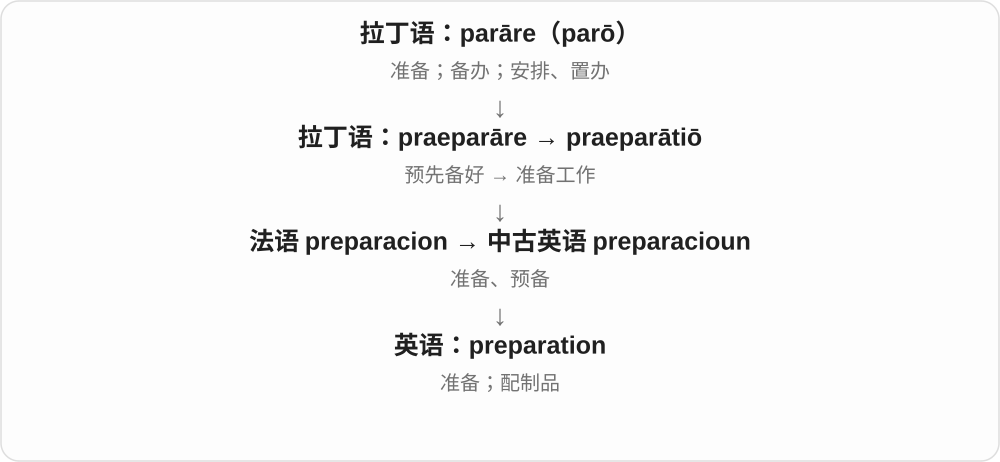

不可数时说准备过程；make preparations 用复数说具体筹备工作。a skin preparation 可以是已经配制好的护肤制剂。

**常见搭配与例句**

in preparation for；make preparations；careful preparation。

> Careful preparation made the presentation easier.

充分准备让这次演示轻松了许多。

> We are making preparations for the move.

我们正在为搬家作准备。

**别混淆**

preparation 是前期准备；performance 是实际执行或表现。准备充分并不自动保证结果。

### 8. emperor — 皇帝

**音标**：英 /ˈempərə/；美 /ˈempərər/

**先抓住这个画面**

emperor 是帝国统治者的称号，词的早期根脉连着“发号施令的人”。

**怎么拆**

拉丁 imperāre“命令”→ imperātor“统帅”，经盎格鲁法语 emperour、中古英语 emperour 进入现代英语。

**怎么变成今天的意思**

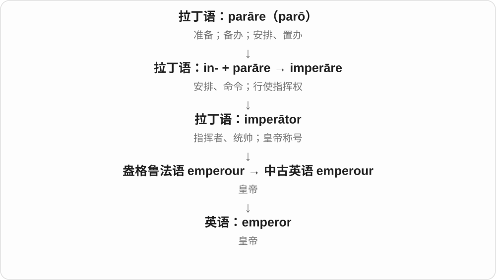

不同历史制度中皇帝的实际权力并不相同。这个词首先是称号，不能凭称号推断所有具体制度。

**常见搭配与例句**

an emperor’s reign；the emperor’s court；a Roman emperor。

> The coin bears the portrait of an emperor.

硬币上铸着一位皇帝的肖像。

> The biography describes the emperor’s early years.

传记讲述了这位皇帝的早年经历。

**别混淆**

king 通常译国王；emperor 通常译皇帝，区别涉及历史称号与国家结构，不只是“更厉害的国王”。

### 9. imperial — 帝国的；皇帝的；英制的

**音标**：英 /ɪmˈpɪəriəl/；美 /ɪmˈpɪriəl/

**先抓住这个画面**

imperial 把事物放进“皇帝、帝国”这个范围：宫廷、统治制度、扩张；在计量里则指英制单位体系。

**怎么拆**

经古法语 imperial 进入英语，来自拉丁 imperiālis，由 imperium“统治权、帝国”派生。不要把词首 im- 当否定。

**怎么变成今天的意思**

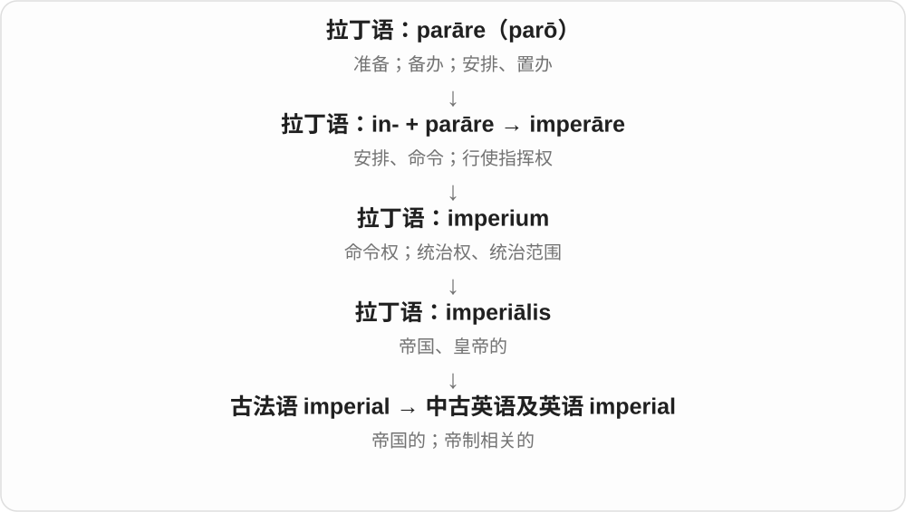

imperial palace 是皇宫；imperial units 是英制单位。计量义来自英国的制度名称，不等于某个皇帝亲自发明了这些单位。

**常见搭配与例句**

an imperial palace；imperial rule；imperial units。

> The former imperial palace is now a museum.

昔日的皇宫现在是一座博物馆。

> The chart lists both metric and imperial measurements.

这张表同时列出公制和英制的测量值。

**别混淆**

imperial 表示帝国相关；imperious 描写人的态度专横。英国英制与美国常用单位也并非处处数值相同。

### 10. parade — 游行；阅兵式；列队行进；招摇展示

**音标**：/pəˈreɪd/

**先抓住这个画面**

parade 像把人或东西安排整齐，再让大家看见：街上的游行，也包括故意炫耀。

**怎么拆**

经法语 parade，联系 parer“准备、装饰”和意大利 parata；更上游是拉丁 parāre。

**怎么变成今天的意思**

a parade 是一场列队行进或展示；parade one’s wealth 是把财富拿出来显摆。少见的击剑借词 parade /pəˈrɑːd/ 指挡击，与常用游行义读法不同。

**常见搭配与例句**

a street parade；a military parade；parade something in front of others。

> Crowds gathered to watch the parade.

人群聚集起来观看游行。

> He disliked people who paraded their wealth.

他不喜欢那些四处炫富的人。

**别混淆**

procession 强调队伍有序前进；parade 往往还有庆祝、检阅或公开展示的目的。

### 11. separation — 分开；分离；隔离距离；分居

**音标**：/ˌsepəˈreɪʃən/

**先抓住这个画面**

separation 像把原来连着、混着或一起生活的东西拉开，让两边不再贴在一起。

**怎么拆**

来自拉丁 sēparātiō，经法语 separacion；现代可联系 separate 与 -ion。

**怎么变成今天的意思**

可以是物理分离，也可以是职能划分或伴侣分居。separation 本身不等于已经完成 divorce“离婚”。

**常见搭配与例句**

separation of powers；separation from family；a period of separation。

> The filter allows the separation of solids from the liquid.

过滤器能把固体从液体中分离出来。

> They remained in contact during the separation.

分居期间，他们仍保持联系。

**别混淆**

division 常把一个整体分成部分；separation 更突出让两方分开、不混在一起。

### 12. separately — 分别地；单独地

**音标**：/ˈsepərətli/

**先抓住这个画面**

separately 像结账时各付各的，或把两项资料分开处理：事情没有混到同一次行动里。

**怎么拆**

separate 的形容词形式 + -ly；末尾保留弱读 /ət/，不是动词 separate 的 /eɪt/。

**怎么变成今天的意思**

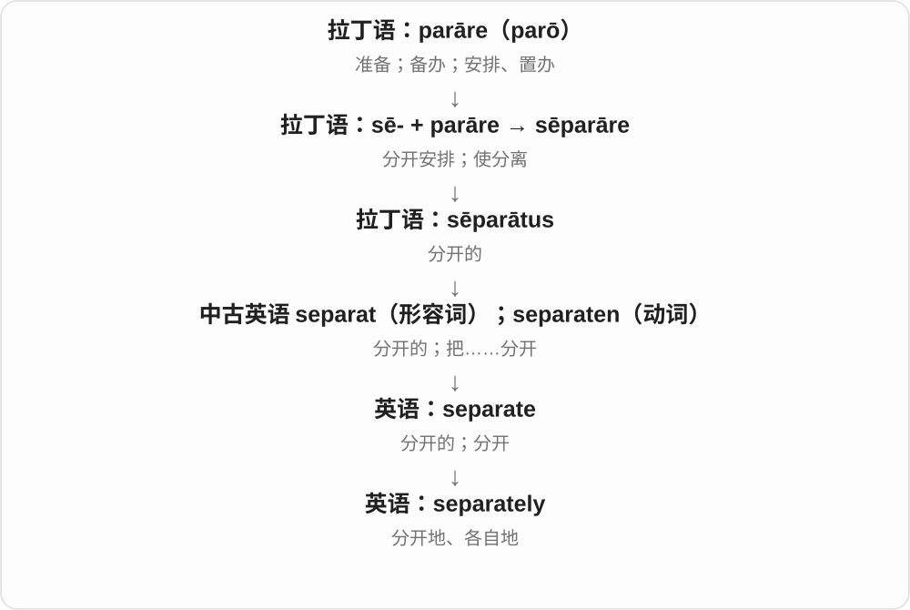

可以分开时间、空间、账目或处理步骤。sold separately 说明某个配件不包含在当前那件商品之中。

**常见搭配与例句**

pay separately；discuss separately；sold separately。

> We arrived separately but left together.

我们分头到达，但一起离开。

> The batteries are sold separately.

电池需要另行购买。

**别混淆**

individually 强调一个一个；separately 强调彼此分开。两组一起行动，但和第三组分开，也可以说 separately。

### 13. prep — 准备；准备工作；预备学校、预习作业等的简称

**音标**：/prep/

**先抓住这个画面**

prep 像厨房里先洗菜、切菜，或开会前先把材料排好：把长词缩短，也把语气变得更日常。

**怎么拆**

准备工作义是 preparation 的缩略；动词是 prepare 的缩略；prep school 中 prep 又缩自 preparatory。三条近亲路线在同一短词里碰头。

**怎么变成今天的意思**

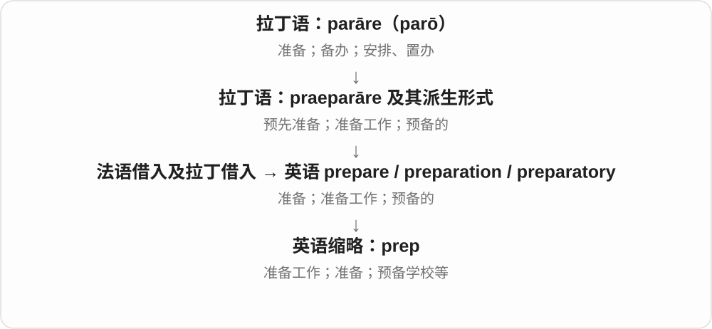

meal prep 是备餐，prep for an exam 是备考。某些学校把课外作业或做作业的时段叫 prep；prep school 的学段随地区不同。词典标签 prep. 则缩自 preposition“介词”，不能算作本族。

**常见搭配与例句**

meal prep；test prep；prep the vegetables；prep for a meeting。

> We do most of our meal prep on Sunday.

我们大部分备餐工作都在星期天做。

> I need an hour to prep for the interview.

我需要一个小时准备面试。

**别混淆**

prep 比 prepare、preparation 更口语。prepped、prepping 要双写末尾 p；它不是把所有 pre- 开头的词都随意截短。

### 14. apparatus — 一套设备；器械；组织机构

**音标**：/ˌæpəˈreɪtəs/；也 /ˌæpəˈrætəs/

**先抓住这个画面**

apparatus 像把完成某个任务所需的器材都备齐，组成一套能工作的装置。

**怎么拆**

ad- + parāre → apparāre“备好”，其名词 apparātus 表准备和器具，整体借入英语。

**怎么变成今天的意思**

实验 apparatus 是仪器装置；state apparatus 是维持国家运作的机构系统。后者借用了“各部分配合工作”的画面。

**常见搭配与例句**

laboratory apparatus；breathing apparatus；the state apparatus。

> The students assembled the apparatus before the experiment.

学生们在实验前组装好了装置。

> The book examines the state apparatus of that period.

这本书研究了那个时期的国家机构。

**别混淆**

equipment 泛指设备；apparatus 常让人想到为特定用途组成的一整套装置或机构。

### 15. imperative — 极其必要的；必须做到的事；祈使语气

**音标**：/ɪmˈperətɪv/

**先抓住这个画面**

imperative 像一句不能轻描淡写带过的要求：“这件事必须办。”

**怎么拆**

来自拉丁 imperātīvus“命令的”，上接 imperāre“命令”；不是 im- 表“不”的否定词。

**怎么变成今天的意思**

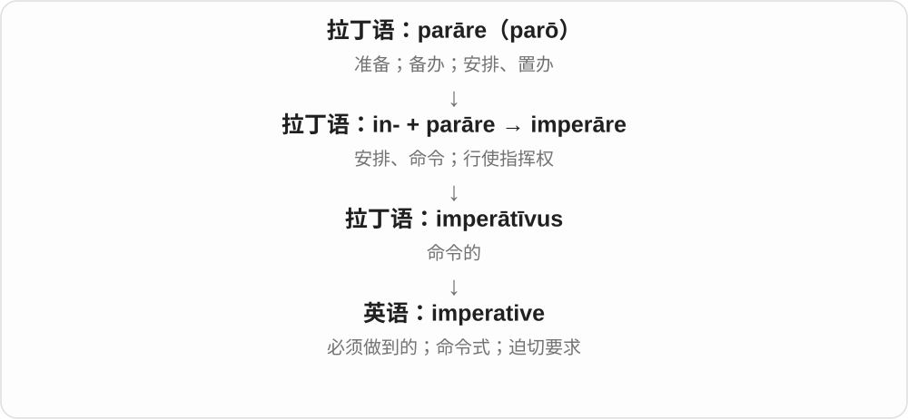

It is imperative that… 表示必须；语法中的 the imperative 是命令、请求等祈使表达；a moral imperative 是道义上必须履行的要求。

**常见搭配与例句**

it is imperative to do；a moral imperative；an imperative sentence。

> It is imperative that we check the figures before publication.

我们必须在发表前核对这些数字。

> “Close the door” is an imperative sentence.

Close the door 是一个祈使句。

> For her, protecting the archive was a moral imperative.

对她来说，保护档案是道义上必须履行的责任。

**别混淆**

important 只是重要；imperative 把必要性推到必须行动的程度。imperial 则说帝国或皇室。

### 16. empress — 女皇；皇后

**音标**：/ˈemprəs/

**先抓住这个画面**

empress 可以是亲自担任统治者的女性，也可以是皇帝的配偶；先看她在历史中的身份。

**怎么拆**

经古法语、盎格鲁法语 empereriz，来自拉丁 imperātrīx；现代可联系 emperor + -ess，但历史已有独立借入链。

**怎么变成今天的意思**

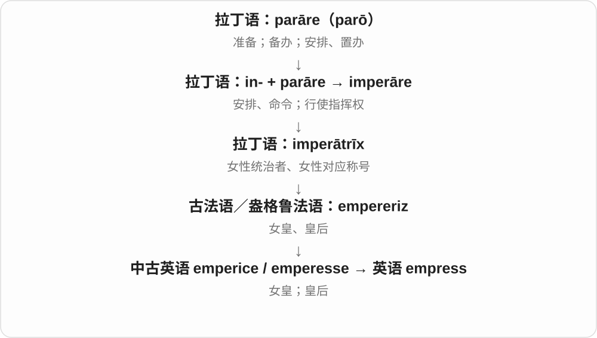

empress regnant 可明确说在位女皇；empress consort 明确说皇帝配偶。普通 empress 需要上下文帮助区分。

**常见搭配与例句**

an empress regnant；the empress’s portrait；an empress consort。

> The exhibition includes a portrait of the empress.

展览中有一幅这位女皇的肖像。

> The guide explains that she was an empress consort.

导览说明，她的身份是皇帝的配偶。

**别混淆**

queen 常译女王或王后；empress 对应帝国体系中的女性皇位或皇后称号。

### 17. parry — 挡开攻击；避开难以回答的问题

**音标**：/ˈpæri/

**先抓住这个画面**

parry 像用剑把迎面一击拨到旁边；面对追问，也可以把问题巧妙挡开。

**怎么拆**

通常联系法语 parer / parez“挡住”，经意大利 parare 上溯拉丁 parāre。也有从早期名词 parree 等形式分析的路线。

**怎么变成今天的意思**

parry a question 常表示有技巧地回避，没有正面回答。动词也能转为名词，说一次挡击。

**常见搭配与例句**

parry a blow；parry a question；a quick parry。

> She parried the blow and stepped back.

她挡开那一击，向后退了一步。

> The spokesperson parried the question with a joke.

发言人用一句玩笑避开了那个问题。

**别混淆**

dodge 常是自己躲开；parry 更像把来势拨开、挡回去。

### 18. preparatory — 预备的；为后续作准备的

**音标**：英 /prɪˈpærətəri/；美 /prɪˈperətɔːri/；也首音节重读

**先抓住这个画面**

preparatory 像正式登台前的排练：这一步是为了下一步能够顺利开始。

**怎么拆**

来自晚期拉丁 praeparātōrius，联系 praeparāre“预先准备”；不是只在现代英语 prepare 后临时加后缀。

**怎么变成今天的意思**

preparatory work 是前期工作；preparatory to 是较正式的“作为……的准备”。preparatory school 的具体学段因地区而异。

**常见搭配与例句**

preparatory work；a preparatory course；preparatory to the meeting。

> The team completed the preparatory work in April.

团队在四月完成了前期准备工作。

> She took a preparatory course before entering the programme.

她在进入这个项目之前修读了一门预备课程。

**别混淆**

preliminary 是前期、初步；preparatory 更明确强调为后续任务备好条件。

### 19. imperialism — 帝国主义；扩张支配的政策或做法

**音标**：英 /ɪmˈpɪəriəlɪzəm/；美 /ɪmˈpɪriəˌlɪzəm/

**先抓住这个画面**

imperialism 的画面是把本国的控制伸到别国：可以直接占领，也可以通过政治、经济等力量取得支配地位。

**怎么拆**

imperial + -ism，从“帝国的”形成指思想、政策或做法的名词。

**怎么变成今天的意思**

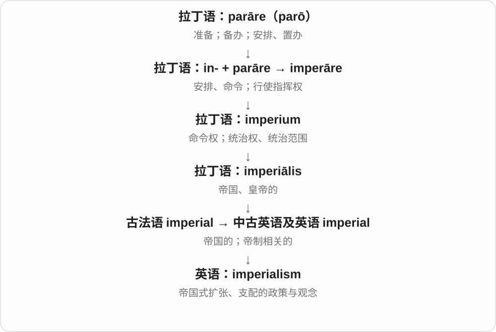

历史上有拥护帝国统治的用法；今天更常用来讨论对外扩张和支配。cultural imperialism 则谈强势文化向外压过其他文化的现象或批评。

**常见搭配与例句**

economic imperialism；cultural imperialism；the history of imperialism。

> The course examines the economic motives behind imperialism.

这门课考察帝国主义背后的经济动机。

> The essay asks whether global entertainment can become a form of cultural imperialism.

文章探讨全球娱乐业是否可能成为一种文化帝国主义。

**别混淆**

colonialism 更集中于殖民地及殖民控制；imperialism 的范围可更广，不一定依靠正式殖民地。

### 20. preparedness — 准备就绪的状态；应变准备；愿意做的态度

**音标**：英 /prɪˈpeərɪdnəs/；美 /prɪˈperdnəs/

**先抓住这个画面**

preparedness 像把手电、计划、分工都放到位之后的那份底气：真有事情发生，知道该怎么应对。

**怎么拆**

prepared + -ness，是英语中从“备好的”形成表示状态的名词。

**怎么变成今天的意思**

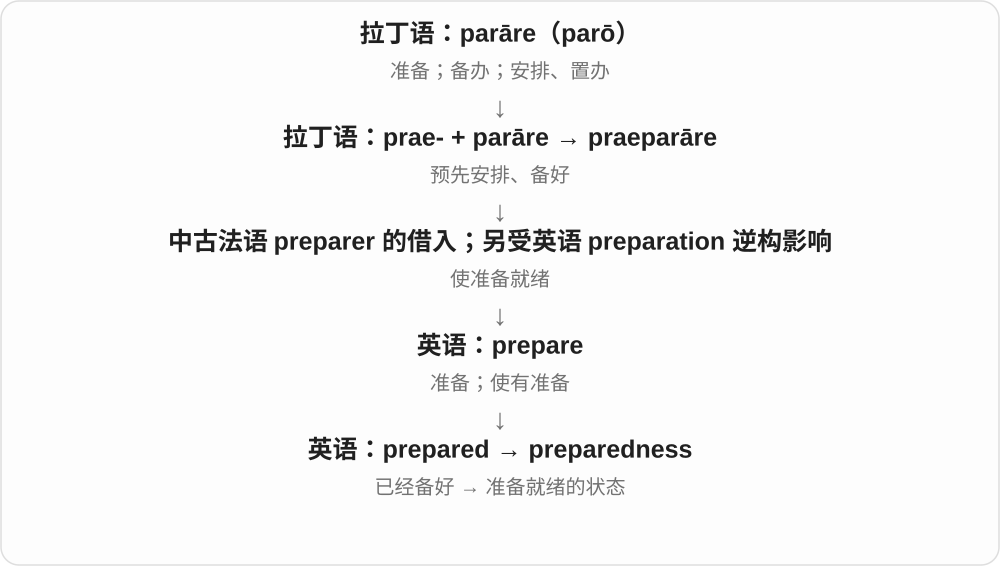

常说 emergency preparedness，涉及面对突发事件时是否备好人员、物资和安排。preparedness to do 还可以表示愿意采取某种行动。英式读法常在 d 前保留一个 /ɪ/。

**常见搭配与例句**

emergency preparedness；a state of preparedness；preparedness to cooperate。

> The exercise tested the team’s emergency preparedness.

这次演练检验了团队的应急准备情况。

> Her preparedness to listen made the discussion easier.

她愿意倾听的态度让讨论顺畅了许多。

**别混淆**

preparation 偏向准备过程和具体工作；preparedness 偏向准备达到的状态、应对能力或意愿。

### 21. unprepared — 没有准备好的；措手不及的

**音标**：英 /ˌʌnprɪˈpeəd/；美 /ˌʌnprɪˈperd/

**先抓住这个画面**

unprepared 像突然被点名发言，脑中的材料还没排好，手里也没有要用的东西。

**怎么拆**

un-（不）+ prepared（备好的），是英语中的否定派生。

**怎么变成今天的意思**

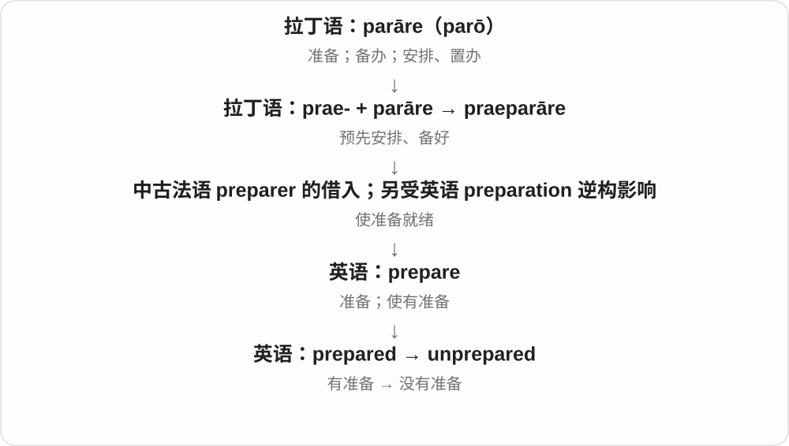

既可说没做实际准备，也可说没想到事情会那么难、那么震撼。unprepared for the news 常指心理上毫无准备。

**常见搭配与例句**

unprepared for；unprepared to do；catch someone unprepared。

> I was unprepared for the sudden change in the weather.

我没有料到天气会突然变化。

> She admitted that she was unprepared to answer such a detailed question.

她承认自己还没准备好回答这么具体的问题。

**别混淆**

unwilling 是不愿意；unprepared 是没有做好准备，可能很愿意但条件还不够。

### 22. disparate — 差异很大的；来源、性质很不一样的

**音标**：/ˈdɪspərət/

**先抓住这个画面**

disparate 像把一堆原本属于不同抽屉的东西放到桌上：彼此差别很大，缺少明显共同点。

**怎么拆**

来自拉丁 disparātus“分开的”，上接 dis- + parāre；语义还受 dispar“不等、不同”影响，后者属于 par“相等”一支。

**怎么变成今天的意思**

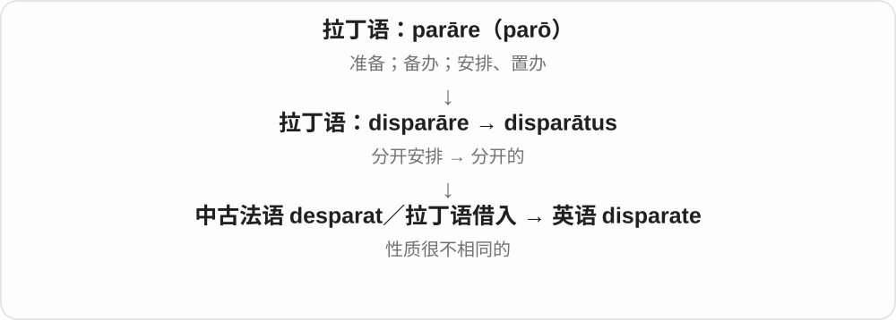

常形容材料、观点、群体或经历跨度很大。它主要说性质差异，不只是数字上的高低差。

**常见搭配与例句**

disparate sources；disparate groups；bring disparate ideas together。

> The report combines data from disparate sources.

报告汇集了来自差异很大来源的数据。

> The course connects several disparate fields.

课程把几个很不相同的领域联系起来。

**别混淆**

disparate 是不同类别、性质相差很远；desperate 是绝望或拼命的。disparity 的直接来源则是“不等”支线。

### 23. severance — 断绝；分离；离职解约相关补偿

**音标**：/ˈsevərəns/

**先抓住这个画面**

severance 像把一条连着双方的线正式切断：可以断绝关系，也可以结束雇佣关系。

**怎么拆**

经古法语 sevrance、中古英语 severaunce，联系 sevrer“分开”；现代可对应 sever + -ance。

**怎么变成今天的意思**

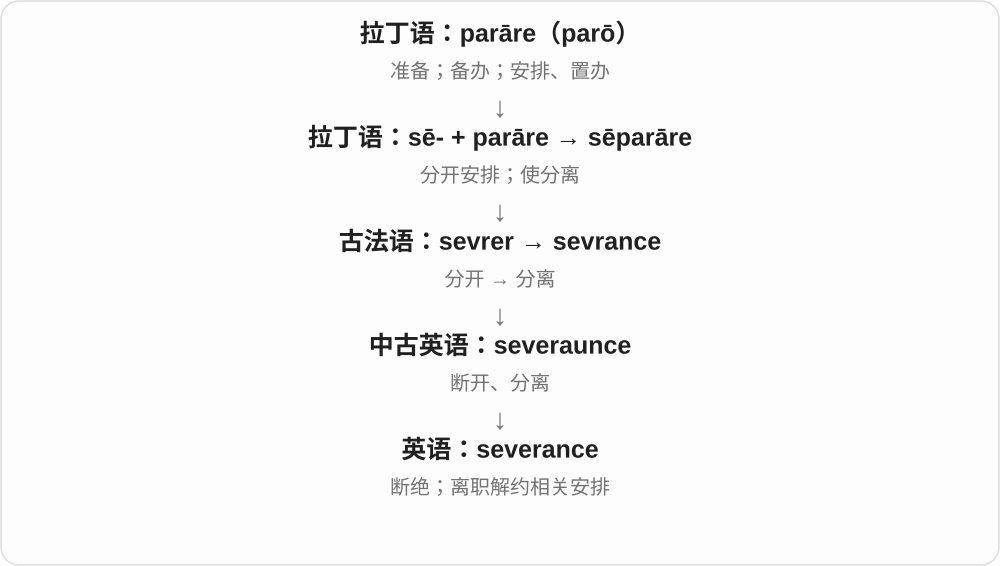

severance pay 是因结束雇佣关系而给付的补偿用语，具体是否有、怎么算取决于安排。severance 也能指与旧关系的切断。

**常见搭配与例句**

severance pay；a severance package；severance of ties。

> The agreement includes a severance package.

协议中包含一套离职补偿安排。

> The dispute led to a complete severance of ties.

这场争端导致双方关系彻底断绝。

**别混淆**

severance 着重断开关系；resignation 是员工主动辞职，两者不是同一个动作。

### 24. sever — 切断；割断；断绝

**音标**：英 /ˈsevə/；美 /ˈsevər/

**先抓住这个画面**

sever 像刀一下把相连部分切开，断了之后两边不再连着。

**怎么拆**

拉丁 sēparāre 经古法语 sevrer、中古英语 severen 变成较短的词形；与 separate 同源。

**怎么变成今天的意思**

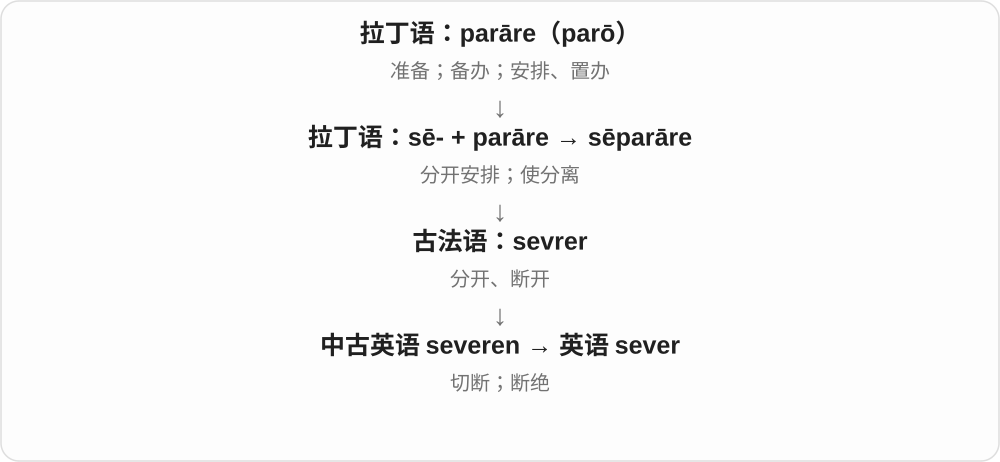

可说电缆、神经等实际被切断，也可说外交、家庭或商业关系被断绝。语气通常比简单 separate 更决绝。

**常见搭配与例句**

sever a cable；sever ties；sever relations with。

> The falling branch severed the power cable.

落下的树枝扯断了电缆。

> The company severed its ties with the supplier.

公司断绝了与这家供应商的合作关系。

**别混淆**

separate 可以只是分开放；sever 更强调连接被切断，往往难以立即接回。

### 25. imperialist — 帝国主义者；帝国主义的

**音标**：英 /ɪmˈpɪəriəlɪst/；美 /ɪmˈpɪriəlɪst/

**先抓住这个画面**

imperialist 把 imperialism 的政策或观念落到人和行动上：谁支持扩张支配，哪种做法体现这种方向。

**怎么拆**

imperial + -ist，受法语 impérialiste 的影响形成；作名词指支持者，作形容词修饰政策等。

**怎么变成今天的意思**

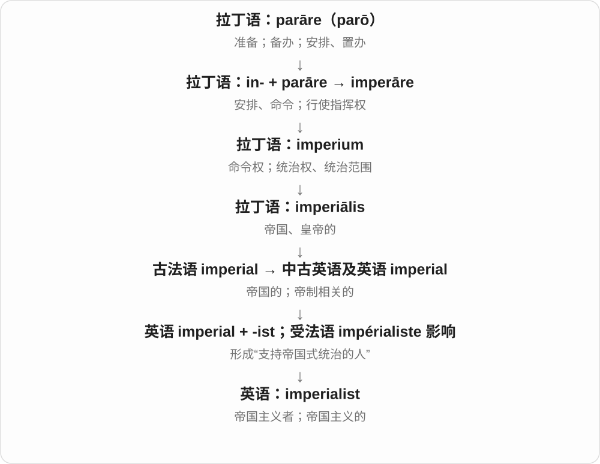

它是有明确政治历史含义的词。描述某人、某政策时，需要看作者用的是当时的自我认同，还是后来的批评性分类。

**常见搭配与例句**

an imperialist politician；imperialist expansion；an outspoken imperialist。

> The historian describes him as an imperialist who supported overseas expansion.

历史学者把他描述为支持海外扩张的帝国主义者。

> The article criticizes the imperialist ambitions of the government.

文章批评了该政府扩张支配他国的野心。

**别混淆**

imperialist 侧重立场和扩张政策；imperial 可以只是中性的“皇帝或帝国相关”。

### 26. inseparable — 形影不离的；无法分开的

**音标**：/ɪnˈsepərəbəl/

**先抓住这个画面**

inseparable 像两件事牢牢长在一起；说朋友时，就是走到哪几乎都一起。

**怎么拆**

来自拉丁 īnsēparābilis，经法语 inséparable；in-（不）+ sēparābilis（可分离）。

**怎么变成今天的意思**

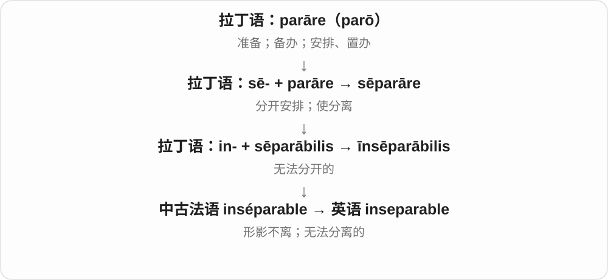

人可以是亲密得不愿分开；抽象事物则常说彼此联系太紧，不能单独理解。

**常见搭配与例句**

inseparable friends；inseparable from；an inseparable part of。

> The two sisters were inseparable as children.

这对姐妹小时候形影不离。

> The music is inseparable from the film’s atmosphere.

音乐与这部电影的氛围密不可分。

**别混淆**

inseparable 强调不能拆开；similar 只说相似，相似的两件事完全可以独立存在。

### 27. separatist — 分离主义者；主张独立或分离的

**音标**：/ˈsepərətɪst/

**先抓住这个画面**

separatist 是推动“从现有整体中分出来”的人，也可用来形容这种运动、组织或诉求。

**怎么拆**

separate + -ist；英语中由分开的动作形成表示立场及其支持者的词。

**怎么变成今天的意思**

早期常用于脱离既有教会的群体；政治语境则常涉及领土或国家归属。这个词本身没有说明所用手段。

**常见搭配与例句**

a separatist movement；separatist demands；religious separatists。

> The historian studies a small community of religious separatists.

这位历史学者研究一个小型宗教分离派社群。

> The separatist party called for a referendum on independence.

这个主张分离的政党要求就独立举行公投。

**别混淆**

autonomist 主张自治时未必要求彻底独立；separatist 的重点是脱离现有整体。

### 28. separator — 分离装置；分隔符；分隔物

**音标**：英 /ˈsepəreɪtə/；美 /ˈsepəreɪtər/

**先抓住这个画面**

separator 就是负责把两边隔开、把混合物分开的东西，可以是机器，也可以是文本中的一个符号。

**怎么拆**

借自拉丁 sēparātor“分开者”，上接 sēparāre；现代可见 separate + -or 的对应结构。

**怎么变成今天的意思**

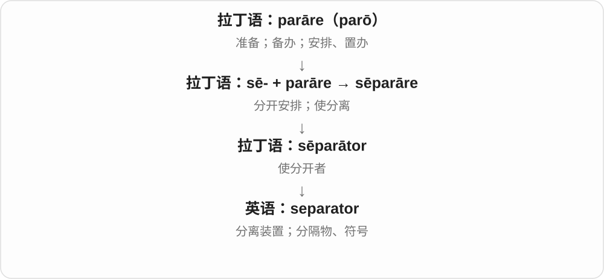

decimal separator 是小数分隔符，常见点或逗号；机器中的 separator 可能把气、液、固不同成分分开。

**常见搭配与例句**

a decimal separator；a field separator；an oil separator。

> Use a comma as the field separator.

用逗号作为字段分隔符。

> The separator removes water from the oil.

这个分离器把油中的水分分离出来。

**别混淆**

separator 是起分隔作用的东西；separation 是分隔动作或状态。

### 29. irreparable — 无法修复的；无法挽回的

**音标**：/ɪˈrepərəbəl/

**先抓住这个画面**

irreparable 像碎到拼不回去的东西，或一句话已经造成、难以挽回的关系裂痕。

**怎么拆**

拉丁 in- 在 r 前同化为 ir-，接 reparābilis“可修复”，经法语借入。

**怎么变成今天的意思**

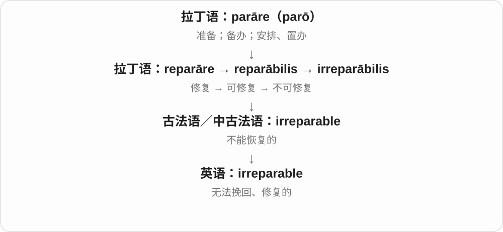

常与 damage、harm、loss 搭配，强调修补也无法恢复原状；重音在 rep，不按 repair 的重音读。

**常见搭配与例句**

irreparable damage；irreparable harm；an irreparable loss。

> The fire caused irreparable damage to the manuscript.

大火给手稿造成了无法修复的损坏。

> The accusation did irreparable harm to their friendship.

这项指责给他们的友谊带来了无法挽回的伤害。

**别混淆**

irreparable 是无法修复；irreversible 是无法逆转，两者有重叠，但过程不可逆不一定就是损坏。

### 30. disrepair — 失修；破损失养状态

**音标**：英 /ˌdɪsrɪˈpeə/；美 /ˌdɪsrɪˈper/

**先抓住这个画面**

disrepair 像一栋长期没人维护的房子：门坏了、墙裂了，问题一处处积累起来。

**怎么拆**

dis-（缺少、相反）+ repair；这里 repair 是修缮、保养状态。

**怎么变成今天的意思**

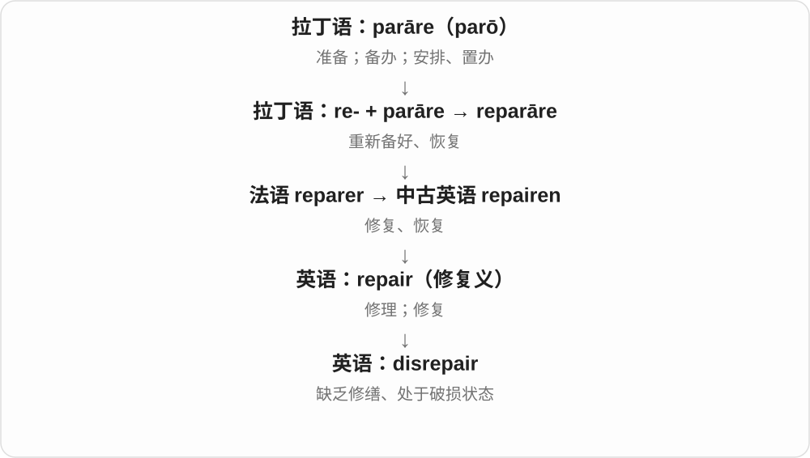

常用 fall into disrepair、be in disrepair。它描述东西的状态，通常不是一次修理失败。

**常见搭配与例句**

fall into disrepair；a state of disrepair；in serious disrepair。

> The empty house gradually fell into disrepair.

那栋空房子逐渐失修破败。

> The playground equipment was in serious disrepair.

游乐场设备严重失修。

**别混淆**

damage 可以由突然事件造成；disrepair 通常使人想到长期缺少维修保养。

### 31. pare — 削去外皮；修剪；逐步削减

**音标**：英 /peə/；美 /per/

**先抓住这个画面**

pare 像拿小刀一层层削掉苹果皮，只去掉外面的部分，让留下的东西更合用。

**怎么拆**

经古法语 parer“整理、修剪”，来自拉丁 parāre“备好”。修去多余部分，是把东西准备好的一种办法。

**怎么变成今天的意思**

pare an apple 是削皮；pare down a report 是删减文字。常暗含仔细去掉不需要的部分。

**常见搭配与例句**

pare an apple；pare down costs；pare away excess material。

> She pared the apple with a small knife.

她用小刀削掉苹果皮。

> We pared the report down to ten pages.

我们把报告精简到了十页。

**别混淆**

peel 侧重剥掉外皮；pare 常带用刀削薄、修整的动作，也常用于抽象削减。

### 32. separatism — 分离主义；主张分开、独立的立场

**音标**：/ˈsepərətɪzəm/

**先抓住这个画面**

separatism 把“分开”变成一种主张：某个群体希望脱离既有国家、教会或组织，自己独立运作。

**怎么拆**

separate + -ism，在英语中形成表示立场、思潮的名词。

**怎么变成今天的意思**

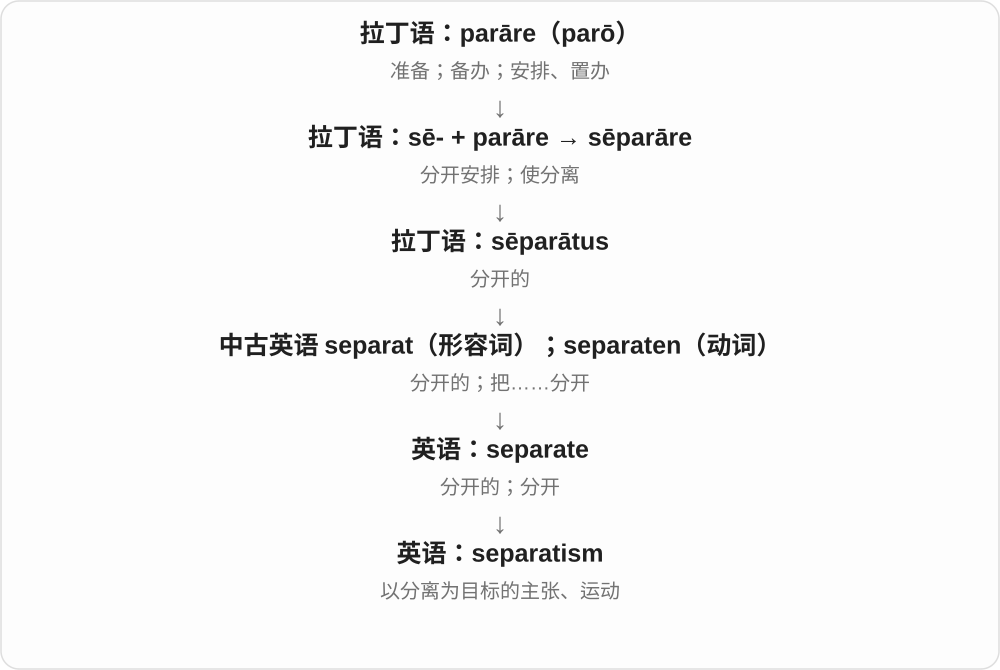

它不等于一切独处，也不必然指暴力行动。究竟是宗教组织的分离，还是政治上的独立诉求，要看上下文。

**常见搭配与例句**

religious separatism；political separatism；a movement toward separatism。

> The book traces the history of religious separatism.

这本书追溯了宗教分离主义的历史。

> The debate focused on the causes of political separatism.

讨论集中在政治分离主义产生的原因上。

**别混淆**

separation 是分开的事实或过程；separatism 是把分开作为目标或原则的立场。

### 33. imperious — 专横的；盛气凌人的

**音标**：英 /ɪmˈpɪəriəs/；美 /ɪmˈpɪriəs/

**先抓住这个画面**

imperious 像一个人一开口就把别人当下属，默认自己的话必须照办。

**怎么拆**

来自拉丁 imperiōsus，联系 imperium“权力、统治权”，更上游是 imperāre“命令”。

**怎么变成今天的意思**

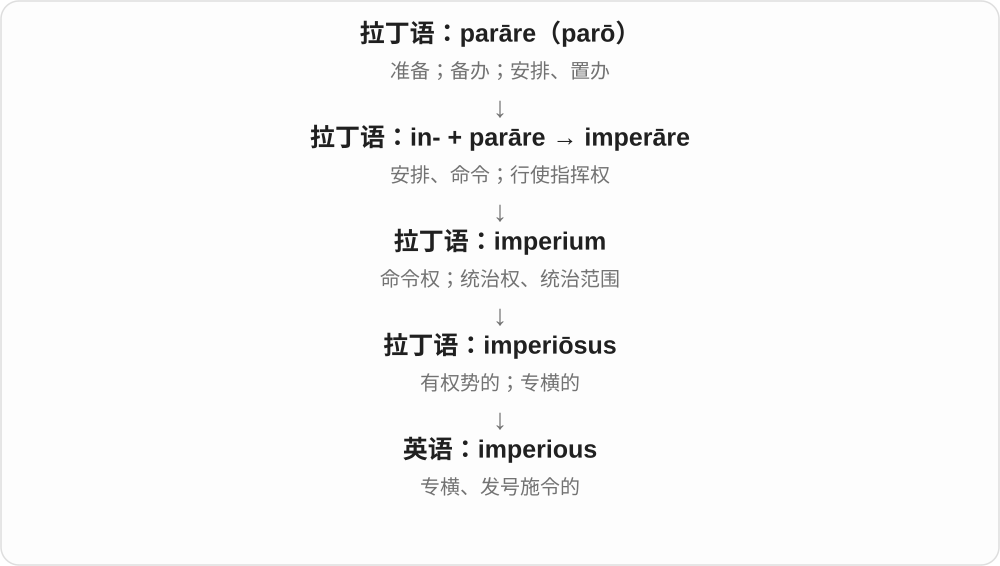

它评价人的语气、姿态或作风，通常含批评；不要求这个人真的有官职。

**常见搭配与例句**

an imperious tone；an imperious gesture；an imperious demand。

> She dismissed the suggestion with an imperious wave.

她傲慢地一挥手，否决了那个建议。

> His imperious tone irritated the team.

他盛气凌人的语气让团队很不舒服。

**别混淆**

imperial 是帝国、皇室相关；imperious 是摆出高高在上的命令姿态。

### 34. reparation — 赔偿；补偿；弥补过错

**音标**：/ˌrepəˈreɪʃən/

**先抓住这个画面**

reparation 像在造成伤害之后，把失去的东西尽可能补回去，承担修复后果的责任。

**怎么拆**

来自拉丁 reparātiō“修复”，经法语或直接借入；与 repair 同源，却有自己的名词传入链。

**怎么变成今天的意思**

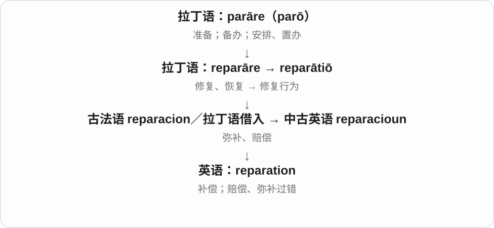

复数 reparations 常用于对战争或历史伤害的赔偿安排。补偿可以涉及钱，也可涉及返还、修复等行动。

**常见搭配与例句**

make reparation for；pay reparations；a reparation programme。

> The agreement provided for reparation of the damage.

协议规定了对损害的赔偿安排。

> The museum returned the objects as an act of reparation.

博物馆归还了这些物品，作为弥补过错的行动。

**别混淆**

compensation 泛指补偿损失；reparation 更容易带“造成了不公或伤害，必须弥补”的意味。

### 35. separable — 可分开的；可独立处理的

**音标**：/ˈsepərəbəl/

**先抓住这个画面**

separable 像两块能拆开的积木：连在一起使用，但需要时可以分开。

**怎么拆**

来自拉丁 sēparābilis，经法语和中古英语传入；现代可联系 separate 与 -able。

**怎么变成今天的意思**

可以说物件、问题或想法。The issues are separable 表示可以分别处理，不等于它们完全无关。

**常见搭配与例句**

separable parts；separable from；a separable problem。

> The device has two easily separable sections.

这个装置有两个容易拆开的部分。

> The question of cost is not separable from the question of quality.

成本问题无法与质量问题分开考虑。

**别混淆**

separate 说已经分开或独立；separable 说具备分开的可能。

### 36. irreparably — 无法挽回地；不可修复地

**音标**：/ɪˈrepərəbli/

**先抓住这个画面**

irreparably 常在损坏动作后面加重分量：坏到了再修也回不到原来的程度。

**怎么拆**

irreparable + -ly，词尾 -ble 变为 -bly。

**怎么变成今天的意思**

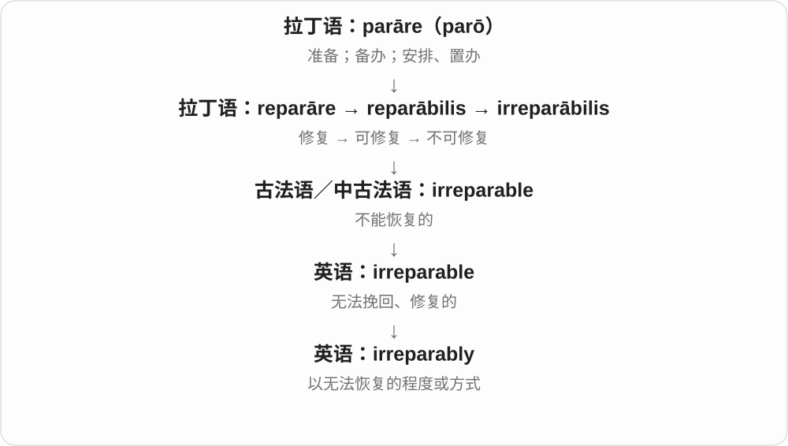

最常见 irreparably damaged，也可说关系、信誉遭到无法挽回的损害。

**常见搭配与例句**

irreparably damaged；irreparably harmed；irreparably broken。

> Moisture had irreparably damaged the photograph.

潮气已经把照片损坏到无法修复。

> Their trust was irreparably broken.

他们之间的信任彻底破裂，无法挽回。

**别混淆**

badly damaged 仍可能修好；irreparably damaged 明确否定修复的可能。

### 37. imperator — 古罗马统帅、凯旋将军称号；皇帝称号的一部分

**音标**：英 /ˌɪmpəˈreɪtə/；美 /ˌɪmpəˈreɪtər/；也 /ˌɪmpəˈrɑːtər/

**先抓住这个画面**

imperator 先让人想到掌握军事指挥权的人；在罗马历史中，它后来进入皇帝称号体系。

**怎么拆**

直接学术借用拉丁 imperātor，来自 imperāre“命令”；emperor 则经过法语传播，词形变短。

**怎么变成今天的意思**

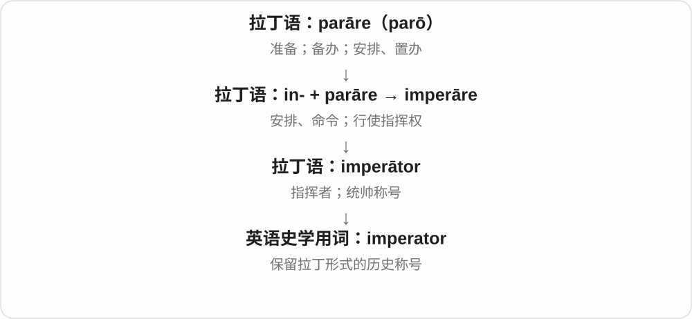

遇到这个词要看年代：共和国时期的军事称号，不能无条件译作后来的皇帝。

**常见搭配与例句**

the title imperator；acclaimed as imperator；the Roman imperator。

> The soldiers acclaimed their commander as imperator.

士兵们向统帅欢呼，称他为 imperator。

> The inscription includes the title imperator.

铭文中包含 imperator 这一称号。

**别混淆**

imperator 保留特定历史称号；emperor 是现代英语的一般皇帝称谓。

### 38. preparer — 准备者；编制者

**音标**：英 /prɪˈpeərə/；美 /prɪˈperər/

**先抓住这个画面**

preparer 是把材料整理好、把事项办到可以提交或使用的人。

**怎么拆**

prepare + -er。

**怎么变成今天的意思**

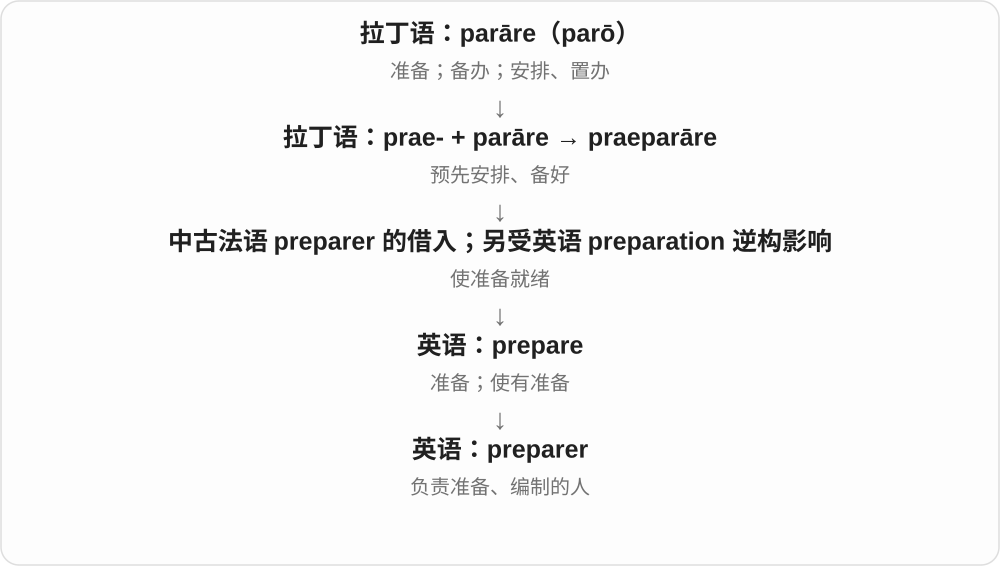

a tax preparer 帮人准备报税材料；document preparer 是文件编制者。名称说明做什么，不自动说明执照或专业资格。

**常见搭配与例句**

a tax preparer；a document preparer；the preparer of the report。

> The form asks for the preparer’s name.

表格要求填写编制者的姓名。

> The report’s preparer checked every reference.

报告编制者核对了每一条参考资料。

**别混淆**

preparer 是实际准备的人；reviewer 是检查成果的人，两种职责可以由不同人承担。

### 39. repairable — 可以修理的；可以修复的

**音标**：英 /rɪˈpeərəbəl/；美 /rɪˈperəbəl/

**先抓住这个画面**

repairable 像摔坏的手机：虽然现在不能正常用，但换件、维修后仍有机会恢复。

**怎么拆**

repair + -able，是英语中可直接拆出的派生词；重音随 repair 保留在后面的音节。

**怎么变成今天的意思**

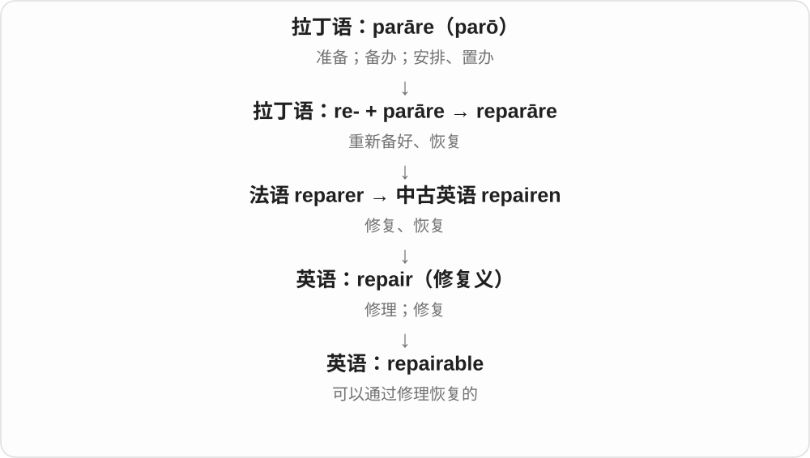

它说存在修复的可能，不保证修起来便宜、方便或值得。有的东西 technically repairable，却不经济。

**常见搭配与例句**

a repairable fault；repairable damage；easily repairable。

> The technician confirmed that the screen was repairable.

技术员确认这块屏幕可以修好。

> The damage is repairable, but the work will take time.

损坏可以修复，但需要花些时间。

**别混淆**

reparable 更书面，也常谈抽象损害；repairable 特别自然地用于机器、物品和故障。

### 40. severally — 分别地；各自地

**音标**：/ˈsevərəli/

**先抓住这个画面**

severally 回到 several 的老意思“各自”：一群人一起出现，但责任或行动逐个算。

**怎么拆**

several + -ly，承接 several“各自的、分开的”义，而不是简单把“几个”变副词。

**怎么变成今天的意思**

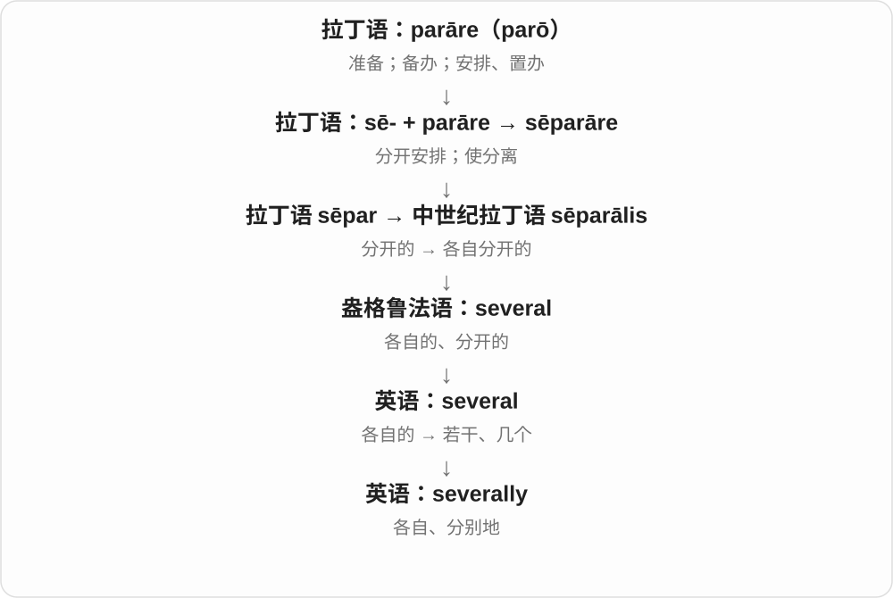

jointly and severally 是法律文件里常见的并列用语，涉及共同与个别承担；具体效力应由文件和制度解释。普通写作常用 separately。

**常见搭配与例句**

jointly and severally；severally responsible；considered severally。

> The members signed the document severally.

成员们各自签署了文件。

> The agreement describes the parties as jointly and severally liable.

协议写明各方共同并分别承担责任。

**别混淆**

several times 是几次；severally 通常是各自地，不能直接互换。

### 41. reparative — 修复性的；弥补损害的

**音标**：英 /rɪˈpærətɪv/；美也 /rɪˈperətɪv/

**先抓住这个画面**

reparative 像一项工作的方向指向“把已经伤到的地方补好”，而不是只把问题盖住。

**怎么拆**

来自晚期拉丁 reparātīvus，上接 reparāre“修复”；现代可与 repair、reparation 对照。

**怎么变成今天的意思**

可用于修复组织、物件，也可用于弥补社会伤害的行动。说某措施具有 reparative 目的，不等于已经证明效果。

**常见搭配与例句**

reparative work；a reparative process；reparative justice。

> The project includes reparative work on the damaged stonework.

项目包括对受损石构部分的修复。

> The discussion focused on reparative measures after the conflict.

讨论聚焦冲突发生后的补偿和修复措施。

**别混淆**

reparative 强调修补已发生的损害；preventive 强调预防损害发生。

### 42. inseparably — 不可分离地；紧密相连地

**音标**：/ɪnˈsepərəbli/

**先抓住这个画面**

inseparably 像两股绳子拧在一起：谈一股时，另一股也必然跟着出现。

**怎么拆**

inseparable + -ly，词尾 -able 转成 -ably；否定成分 in- 已存在于形容词的拉丁来源中。

**怎么变成今天的意思**

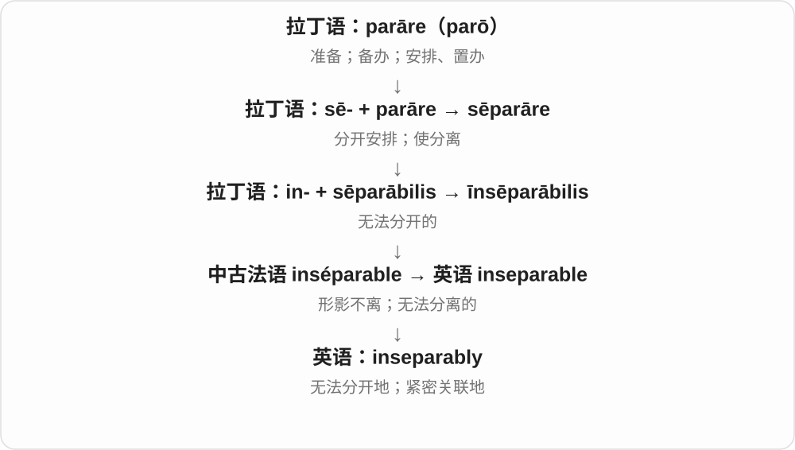

最常见的抽象用法是 inseparably linked：两件事的关系密切到不能妥当地分开理解。未必指物理上永远拆不开。

**常见搭配与例句**

inseparably linked；inseparably connected；inseparably bound。

> The history of the town is inseparably linked to the river.

这座城镇的历史与这条河密不可分。

> For her, music and childhood are inseparably connected.

对她而言，音乐与童年紧紧相连，无法分开。

**别混淆**

closely linked 是关系密切；inseparably linked 进一步强调难以分开理解或存在。

### 43. severable — 可分割的；可以拆开仍分别成立的

**音标**：英 /ˈsevərəbəl/；美 /ˈsevərəbəl/

**先抓住这个画面**

severable 像合同中的一小段可以拿掉，而其余部分还能继续保留，不必整份作废。

**怎么拆**

sever + -able。

**怎么变成今天的意思**

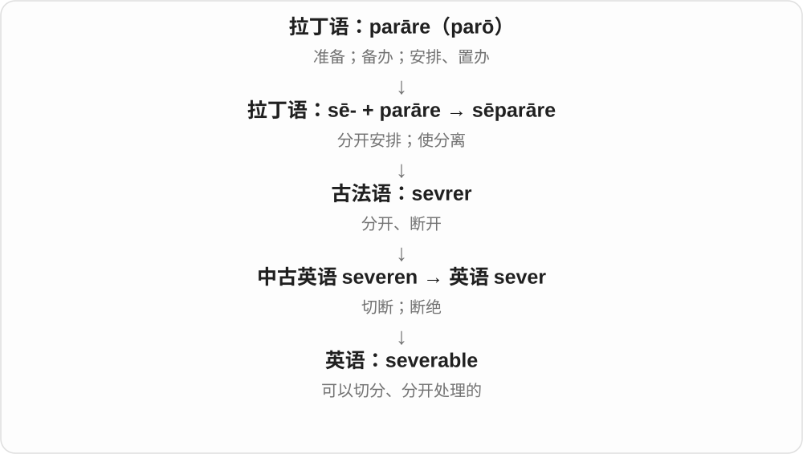

法律文本常用来描述条款、权利或义务是否可独立处理；也可以有一般的可分割义。

**常见搭配与例句**

a severable clause；severable obligations；severable from the rest。

> The contract states that its provisions are severable.

合同写明各条款可以分别处理。

> The disputed section was treated as severable from the rest.

有争议的部分被视为可以与其余部分分开处理。

**别混淆**

separable 泛指能分开；severable 在合同等场景常多一层“分开后其余部分仍可独立”的意味。

### 44. severability — 可分割性；部分可独立处理的性质

**音标**：/ˌsevərəˈbɪləti/

**先抓住这个画面**

severability 像在问：坏了一小块，能不能只移走这块，让剩下的部分继续站得住？

**怎么拆**

severable + -ity，-able 转为 -ability。

**怎么变成今天的意思**

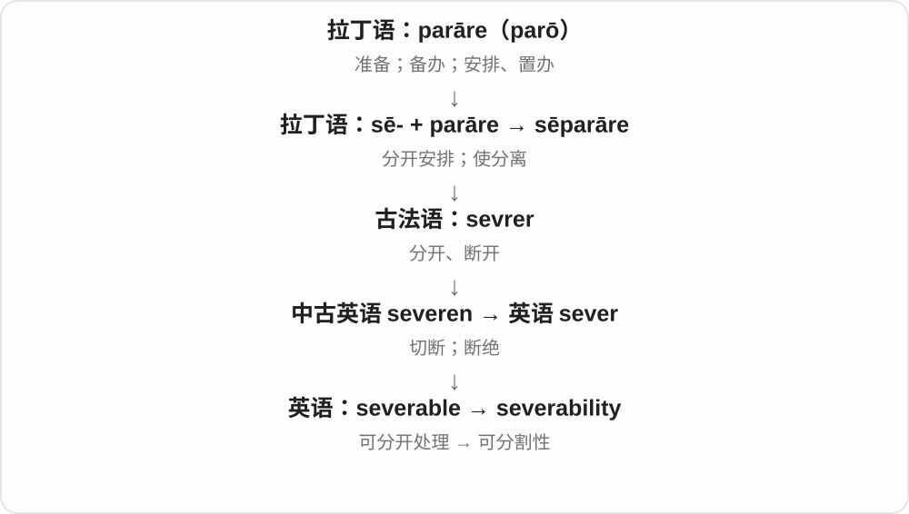

合同常设 severability clause，说明某部分无效时其余部分如何处理；这是条款名称，不能代替对具体法律效果的判断。

**常见搭配与例句**

a severability clause；the question of severability；severability of provisions。

> The agreement contains a severability clause.

协议中有一条可分割性条款。

> The analysis considers the severability of the disputed provision.

分析讨论了争议条款能否被单独分割处理。

**别混淆**

severance 是断开的动作或安排；severability 是能否分开处理的性质。

### 45. imperiously — 专横地；盛气凌人地

**音标**：英 /ɪmˈpɪəriəsli/；美 /ɪmˈpɪriəsli/

**先抓住这个画面**

imperiously 像把每一句话都说成命令，默认别人应该立刻照办。

**怎么拆**

imperious + -ly，描写动作或说话方式；更早来自拉丁 imperiōsus“有权势、专横”。

**怎么变成今天的意思**

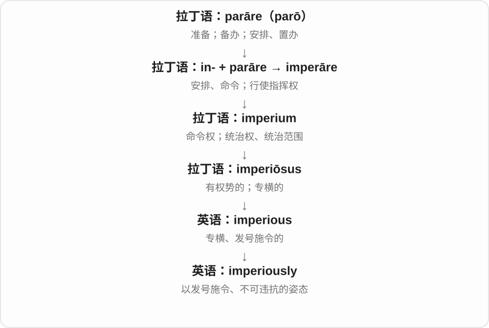

常描写说话、挥手、打断或要求别人做事的姿态。通常含批评意味，强调不给对方商量余地。

**常见搭配与例句**

speak imperiously；demand imperiously；wave imperiously。

> She waved imperiously for the waiter to come over.

她盛气凌人地挥手叫服务员过来。

> He imperiously demanded that everyone leave the room.

他专横地要求所有人离开房间。

**别混淆**

firmly 是坚定地，并不必然失礼；imperiously 带居高临下、命令人服从的味道。

### 46. vituperative — 辱骂性的；尖刻谩骂的

**音标**：英 /vɪˈtjuːpərətɪv/；美 /vaɪˈtuːpərətɪv/

**先抓住这个画面**

vituperative 形容话里的攻击味很重，像每一句都在刺对方，而不只是在不同意对方。

**怎么拆**

vituperate + -ive，形成描写言辞、态度或人的形容词。它继承 vituperate 的责骂义。

**怎么变成今天的意思**

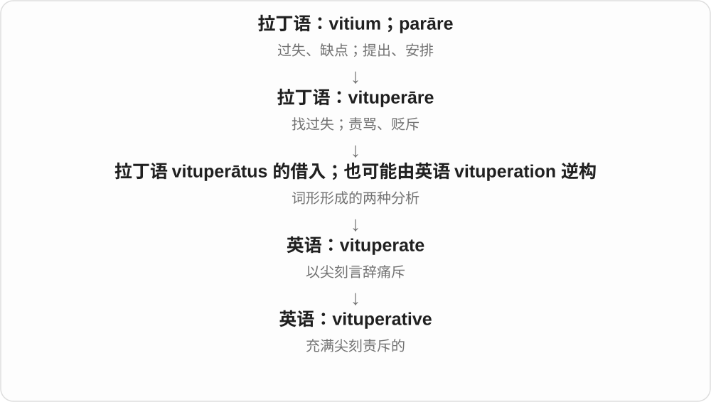

常修饰 attack、remarks、language、tone，也能形容经常尖刻责骂的人。不是所有强烈批评都是 vituperative。

**常见搭配与例句**

a vituperative attack；vituperative language；a vituperative tone。

> The editor removed the most vituperative passages from the letter.

编辑删去了信中谩骂最尖刻的几段。

> His reply was so vituperative that the conversation ended.

他的回复充满恶言，谈话因此结束了。

**别混淆**

forceful 可以有力且讲道理；vituperative 把重点放在辱骂和贬斥上。

### 47. separability — 可分离性；可分开处理的性质

**音标**：/ˌsepərəˈbɪləti/

**先抓住这个画面**

separability 关心两部分能不能拆开看、拆开做，就像一个问题能否分成两个独立小问题。

**怎么拆**

separable + -ity；词尾 -able 对应 -ability。

**怎么变成今天的意思**

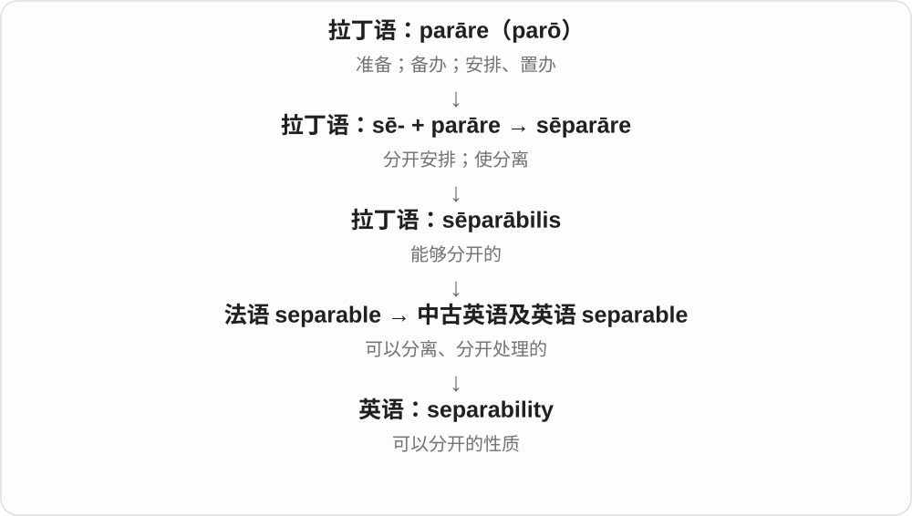

普通义是能否分离；数学、物理中会有精确定义。读技术文章时，先看作者按什么规则判定“可以分开”，不要只凭两部分距离远近来判断。

**常见搭配与例句**

separability of components；a separability condition；test separability。

> The design relies on the separability of the two modules.

这种设计依赖两个模块可以分开处理。

> The paper states the separability condition before applying it.

论文在应用可分性条件之前，先说明了它的定义。

**别混淆**

separation 是实际分开；separability 是能否按所用规则分开的性质。

### 48. preparative — 准备性的；制备性的

**音标**：/prɪˈpærətɪv/

**先抓住这个画面**

preparative 像先把后面要用的东西做出来、备起来；在实验中常强调制备出可收集的材料。

**怎么拆**

来自中世纪拉丁 praeparātīvus，经中古法语 preparatif、中古英语传入；与 preparatory 是旁支。

**怎么变成今天的意思**

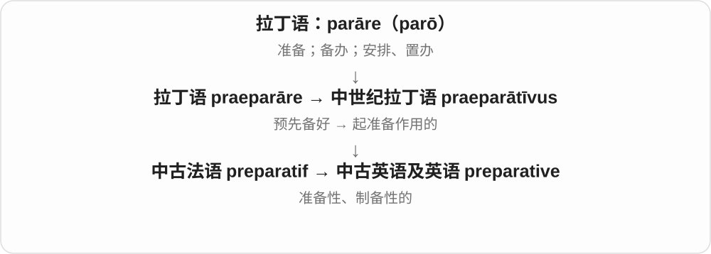

preparative chromatography 的目的通常包括分离并收集所需物质；analytical chromatography 更侧重分析成分或数量。

**常见搭配与例句**

preparative work；a preparative method；preparative chromatography。

> The laboratory developed a preparative method for the compound.

实验室开发了一种制备这种化合物的方法。

> The team used preparative chromatography to collect the desired fraction.

团队用制备色谱收集了所需的组分。

**别混淆**

preparatory 在普通准备工作中更常见；preparative 常见于技术性的制备语境。

### 49. apparat — 党政机构；行政机器

**音标**：英 /ˌæpəˈrɑːt/；美 /ˌæpəˈræt/ 或 /ˌɑːpəˈrɑːt/

**先抓住这个画面**

apparat 把政治组织看成一套运转的机器：层层部门、岗位和办事程序一起推动事务。

**怎么拆**

经俄语 аппарат 借入，联系德语 Apparat；远源是拉丁 apparātus“设备、准备”。

**怎么变成今天的意思**

常见于苏联历史和组织政治的讨论；有时带官僚系统庞大、层层运转的意味。

**常见搭配与例句**

the party apparat；the state apparat；a bureaucratic apparat。

> The historian studied the party apparat of that period.

历史学者研究了那个时期的党务机构。

> The novel portrays an apparat slow to respond to change.

小说描绘了一套对变化反应迟缓的行政机器。

**别混淆**

apparatus 可以是实验仪器或一般机构；apparat 更带特定政治、行政语境。

### 50. parison — 玻璃或塑料预制坯；修辞中对称平衡的句式

**音标**：坯料义 /ˈpærɪsən/，美 /ˈperəsən/；修辞义美 /ˈperəˌsɑːn/

**先抓住这个画面**

制造业里的 parison 像瓶子的毛坯：先准备一团或一管材料，再进一步吹制、成形。

**怎么拆**

坯料义经法语 paraison，来自 parer“准备”。修辞义另借希腊 parison，来自 parisos“相等、平衡”，不是玻璃坯义的比喻。

**怎么变成今天的意思**

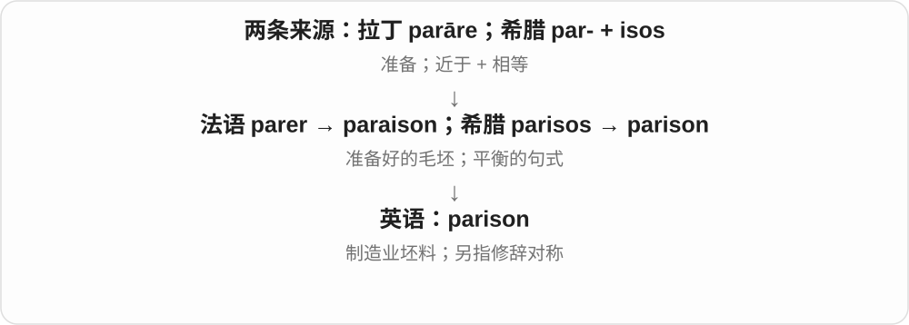

玻璃坯可先初步定形；吹塑中常见管状塑料坯。修辞义关注句子两边形式匀称，像“先认真观察，再谨慎判断”的平衡结构。

**常见搭配与例句**

a glass parison；a plastic parison；parison in rhetoric。

> The machine shapes the hot parison into a bottle.

机器把热的坯料成形成瓶子。

> The critic noted the parison in the balanced clauses.

评论者指出了这些平衡分句中的对称结构。

**别混淆**

preform 是更一般的预成形件名称；parison 是特定成形工艺中的坯料词。修辞义则完全属于另一来源。

### 51. vituperation — 痛骂；恶毒责斥；尖刻的言辞攻击

**音标**：英 /vɪˌtjuːpəˈreɪʃən/；美 /vaɪˌtuːpəˈreɪʃən/

**先抓住这个画面**

vituperation 像一连串冲人而来的狠话，听到的不是耐心讲理，而是持续的贬斥。

**怎么拆**

来自拉丁 vituperātiō，可经古法语 vituperacion 传入。英语名词出现较早，不能只把历史画成 vituperate + -ion。

**怎么变成今天的意思**

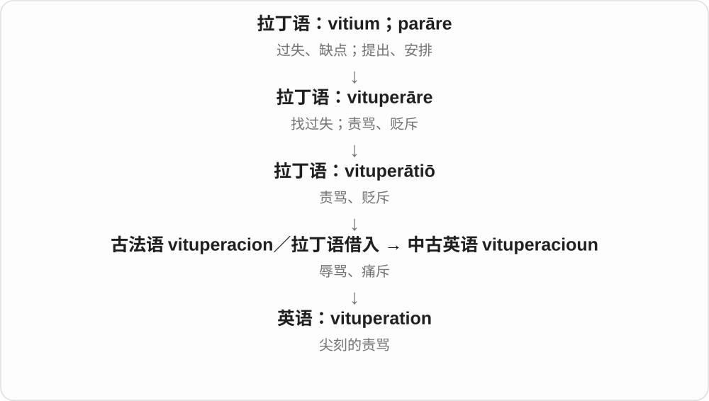

形式上与 vituperate 对应，历史却可能先有名词，再逆构动词。通常是不可数名词；表达一次具体痛斥时也可以可数。

**常见搭配与例句**

a torrent of vituperation；public vituperation；vituperation directed at someone。

> The discussion descended into personal vituperation.

讨论最后变成了针对个人的痛骂。

> She answered the torrent of vituperation with a brief factual statement.

面对一连串尖刻责骂，她只作了简短的事实说明。

**别混淆**

criticism 可以有证据、有建设性；vituperation 强调话语的恶意或激烈程度。

### 52. parure — 成套珠宝首饰

**音标**：英 /pəˈrʊə/；美 /pəˈrʊr/

**先抓住这个画面**

parure 像项链、耳环、胸针按同一风格配成一套，戴上去彼此呼应。

**怎么拆**

借自法语 parure，早期形式 pareure，联系 parer“装饰、准备”，上接拉丁 parāre。

**怎么变成今天的意思**

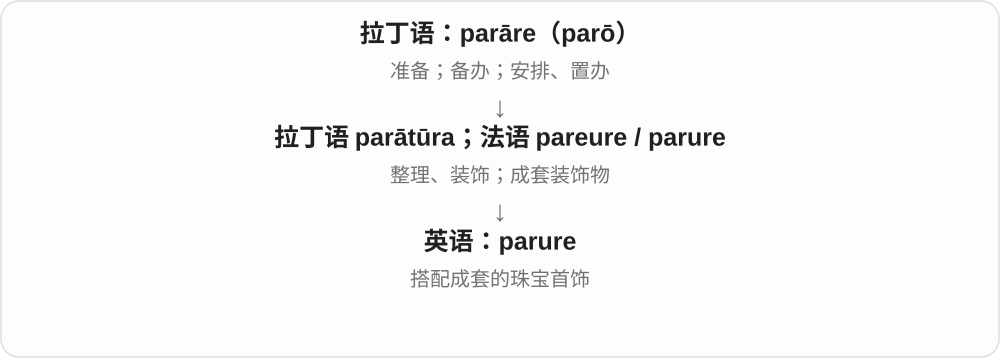

珠宝史、拍卖目录和博物馆说明中较常见。套装可以有不同件数，不规定一定有几件。

**常见搭配与例句**

a diamond parure；a matching parure；a nineteenth-century parure。

> The necklace belongs to a matching sapphire parure.

这条项链属于一套配套的蓝宝石首饰。

> The museum displayed the complete parure in one case.

博物馆把整套首饰放在同一个展柜里展示。

**别混淆**

jewellery 泛指首饰；parure 特别指风格匹配的一套。

### 53. reparable — 可修复的；可弥补的

**音标**：/ˈrepərəbəl/

**先抓住这个画面**

reparable 表示损坏虽然发生了，但还没有走到无法补救的地步。

**怎么拆**

经法语 réparable 借自拉丁 reparābilis；现代可以和 repairable 对照，却不是同一条英语构词路线。

**怎么变成今天的意思**

常说 damage、harm 或关系裂痕，语气较正式。重音在开头 rep，与 repairable 的后重音不同。

**常见搭配与例句**

reparable damage；a reparable loss；reparable harm。

> Fortunately, the damage was reparable.

幸运的是，损坏还可以修复。

> The disagreement caused a reparable breach in their friendship.

这次分歧在他们的友谊中造成了一道仍可修补的裂痕。

**别混淆**

repairable 常用于设备、物件能修；reparable 也常用于损害能否挽回。二者有大量重叠。

### 54. comprador — 买办；为外商经营提供本地中介服务的人

**音标**：英 /ˌkɒmprəˈdɔː/；美 /ˌkɑːmprəˈdɔːr/

**先抓住这个画面**

comprador 的历史画面是连接外来商人与本地市场的中间人，负责采购、联系、管理等事务。

**怎么拆**

借自葡萄牙语 comprador“购买者”，上接 comprar；其拉丁来源 comparāre 在这里是 con- + parāre“置办”，不是“比较”的同形支线。

**怎么变成今天的意思**

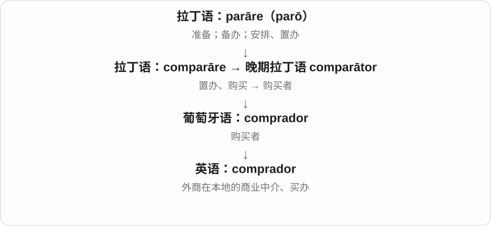

多用于近代贸易史。政治经济论述中的 comprador 也会带批评性，不能不看语境就替换成所有普通采购员。

**常见搭配与例句**

a comprador merchant；the comprador system；a comprador elite。

> The archive contains letters from a comprador employed by the firm.

档案中保存着该商行雇用的一位买办的来信。

> The chapter examines the role of compradors in coastal trade.

这一章考察了买办在沿海贸易中的作用。

**别混淆**

buyer 是普通购买者；comprador 带特定历史贸易关系与政治经济语境。

### 55. separative — 起分离作用的；倾向于分开的

**音标**：/ˈsepərətɪv/；也 /ˈsepəreɪtɪv/

**先抓住这个画面**

separative 像一个筛子，把原本混在一起的东西分成不同部分。

**怎么拆**

借自晚期拉丁 sēparātīvus，来自 sēparāre“分开”；与 separate 的英语词形可以相互帮助记忆。

**怎么变成今天的意思**

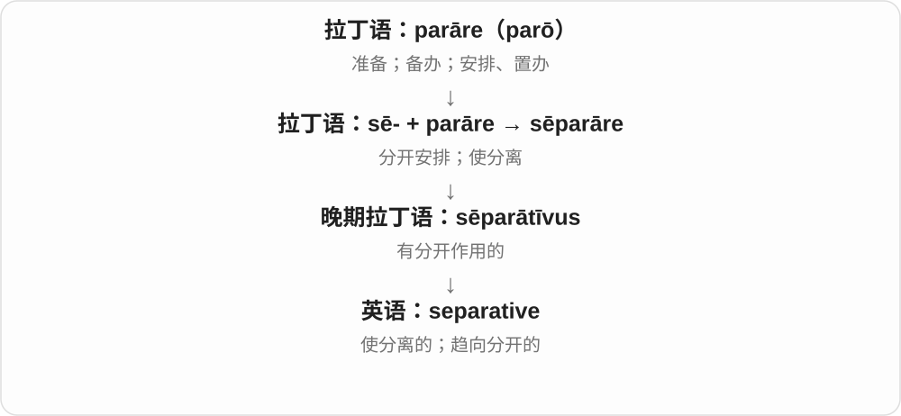

它说某种作用或倾向会把东西分开。用于社会关系时，可指使人分隔的力量；技术文章中则可以是分离过程的性质。

**常见搭配与例句**

a separative process；a separative effect；separative tendencies。

> The filter has a useful separative effect on the mixture.

这个滤器能有效地分开混合物中的成分。

> The essay examines the separative effects of social prejudice.

这篇文章考察了社会偏见如何使人彼此隔离。

**别混淆**

separate 强调已经分开或分开这个动作；separative 强调具有分开作用，语体较正式。

### 56. empery — 帝国；帝权；统治权

**音标**：/ˈempəri/

**先抓住这个画面**

empery 像诗歌里的“帝王江山”：既可以看见疆域，也可以感到支配这片疆域的权力。

**怎么拆**

经古法语 emperie、中古英语 emperie，来自拉丁 imperium；与 empire 是不同借入形式，不是 emperor 去掉 -or 后造出的词。

**怎么变成今天的意思**

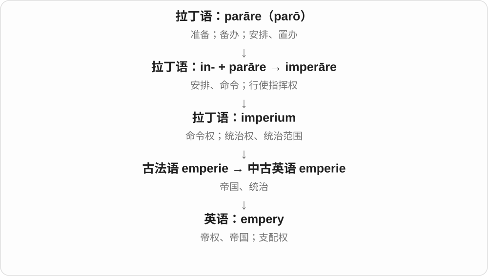

这是古旧、文学性的词。读诗歌或早期散文时识别即可，日常说帝国通常用 empire。

**常见搭配与例句**

an ancient empery；the bounds of an empery；claim empery over。

> The poem mourns the fall of a mighty empery.

这首诗哀叹一个强大帝国的衰亡。

> In the tale, the king claims empery over the surrounding lands.

在这个故事中，国王声称自己对周围土地拥有统治权。

**别混淆**

empire 通用；empery 带古典文学色彩。emperor 指人，两者不能直接互换。

### 57. dissever — 分开；割裂；切断

**音标**：英 /dɪˈsevə/；美 /dɪˈsevər/

**先抓住这个画面**

dissever 把原来连着的东西拉开、切开，常用于强调联系被断掉的文学表达。

**怎么拆**

经中古英语 disseveren、盎格鲁法语 desevrer／古法语 dessevrer；可上溯重构通俗拉丁 *disseparāre，即 dis- 加 sēparāre。

**怎么变成今天的意思**

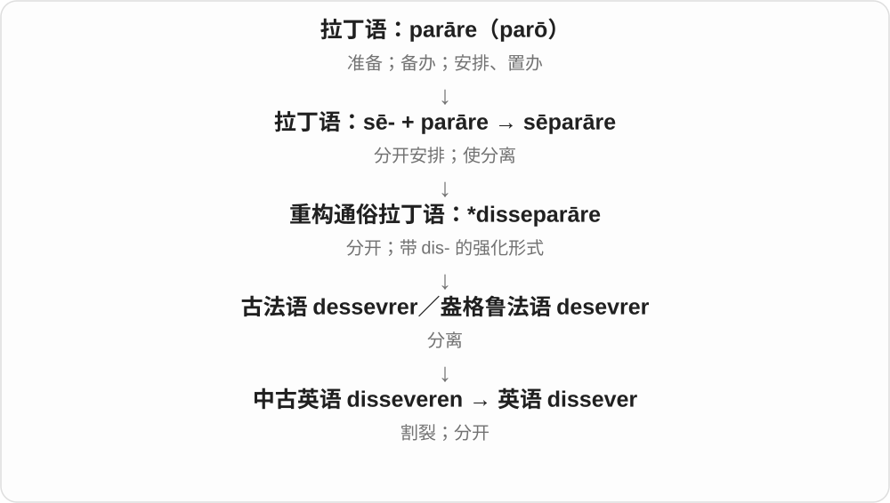

词首 dis- 在这里帮助表达分离，不是把 sever“切断”否定掉。现代日常用 sever 或 separate 更自然。

**常见搭配与例句**

dissever A from B；dissever a bond；dissever the parts。

> No quarrel could dissever their long friendship.

任何争吵都无法割断他们长久的友谊。

> The narrator refuses to dissever the artist from the age in which she lived.

叙述者不愿把这位艺术家与她所处的时代割裂开来。

**别混淆**

dissever 与 sever 意义接近，前者更古雅、更有刻意切开的语气。

### 58. disseverance — 分离；割裂；断绝

**音标**：/dɪˈsevərəns/（依 dissever 与 -ance 构词读法）

**先抓住这个画面**

disseverance 是联系被切开这件事：原本属于一体的部分，现在各在一边。

**怎么拆**

dissever + -ance，把“割裂”的动作转成名词；词源随 dissever 上溯 sēparāre。

**怎么变成今天的意思**

古旧、书面，常在旧文学或思想论述中出现。普通交流说 separation；谈联系断绝可以说 severance。

**常见搭配与例句**

disseverance from；the disseverance of a bond；a complete disseverance。

> The novel describes her painful disseverance from her homeland.

小说描写了她与故土分离的痛苦。

> The critic rejects a complete disseverance of form from meaning.

评论家反对把形式与意义完全割裂。

**别混淆**

disseverance 强调断开，disagreement 只是意见不一致，并不必然导致关系断裂。

### 59. imperant — 发号施令的；居于指挥地位的

**音标**：/ˈɪmpərənt/（依旧词典首音节重音与构词转写）

**先抓住这个画面**

imperant 的人处在下命令的位置，别人要听他的调度；这是古旧英语里的说法。

**怎么拆**

借自拉丁 imperāns，词干 imperant-，是 imperāre“命令”的现在分词，不是 im- 加某个 perant。

**怎么变成今天的意思**

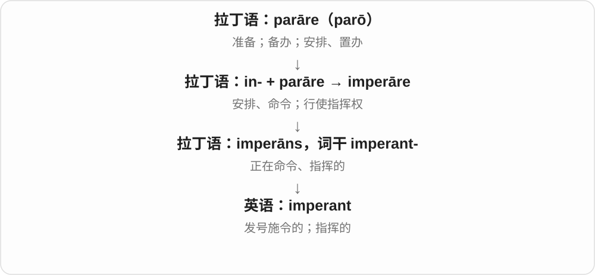

旧文献可用它区分指挥者与服从者。作为现代写作用词非常罕见，理解后通常改用 commanding 或 in command。

**常见搭配与例句**

an imperant authority；imperant and subject（指挥的与受支配的）；an imperant role。

> In the old treatise, the council is described as imperant.

在那篇旧论著中，议会被描述为居于指挥地位。

> The author contrasts the imperant ruler with the obedient subject.

作者把发号施令的统治者与服从的臣民作了对比。

**别混淆**

imperative 可说某事必须做；imperant 侧重行使命令权的人或地位。

### 60. separatory — 用于分离的

**音标**：英 /ˈsepərətəri/；美 /ˈsepərəˌtɔːri/

**先抓住这个画面**

separatory 最容易抓住的画面是分液漏斗：把互不混溶的液体静置分层，再分别放出。

**怎么拆**

借自新拉丁 sēparātōrius，上接 sēparāre“分开”；现代可看成 separat- + -ory，但不必假定首次造词发生在英语中。

**怎么变成今天的意思**

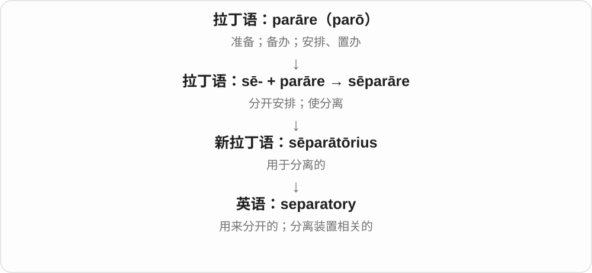

今天最值得认识的是 separatory funnel，尤其见于美式实验室用语；英式也常说 separating funnel。

**常见搭配与例句**

a separatory funnel；a separatory vessel；separatory equipment。

> The two liquid layers were visible in the separatory funnel.

分液漏斗里可以看见两层液体。

> The technician checked the valve on the separatory funnel before use.

技术员使用前检查了分液漏斗上的阀门。

**别混淆**

普通 funnel 只帮助把液体倒入小口容器；separatory funnel 带阀门，便于把分层液体分开。

### 61. separatrix — 分界曲线；分隔线或分隔记号

**音标**：/ˌsepəˈreɪtrɪks/

**先抓住这个画面**

separatrix 像地图上的分水岭：线的两侧，系统会走出性质不同的运动轨迹。

**怎么拆**

作为学术词借自拉丁 sēparātrīx，是 sēparātor 的阴性形式；用于“线”时配合阴性 līnea。英语表面可认出 separat- 与 -trix。

**怎么变成今天的意思**

在相图中，它分隔两类行为；例如理想单摆在一定能量下从来回摆动过渡到连续转动，边界轨迹就是一条 separatrix。旧数学、校对中也用这个词称分隔符号。

**常见搭配与例句**

a separatrix in a phase portrait；the separatrix of a pendulum；plural separatrices。

> The separatrix divides the phase portrait into regions with different types of motion.

这条分界轨迹把相图划成运动类型不同的区域。

> The diagram shows a pendulum separatrix between oscillation and rotation.

图中画出了单摆来回摆动与连续转动之间的分界轨迹。

**别混淆**

boundary 是一般边界；动力系统中的 separatrix 有特定的轨迹与运动行为含义，不能把任意画线都叫它。

### 62. vituperate — 痛骂；尖刻地责斥

**音标**：英 /vɪˈtjuːpəreɪt/；美 /vaɪˈtuːpəreɪt/

**先抓住这个画面**

vituperate 像抓着对方的缺点一顿猛烈责骂，言语的攻击性比冷静指出错误强得多。

**怎么拆**

拉丁 vituperāre 通常分析为 vitium“过失”与 parāre 的结合；英语或借其分词 vituperātus，或由较早的 vituperation 逆构。

**怎么变成今天的意思**

正式词，实际描写的行为往往很不客气。可以直接接被骂的人，也可以说 vituperate against someone。词源里的“过失”并不保证指责一定有事实依据。

**常见搭配与例句**

vituperate a rival；vituperate against；vituperate someone for a decision。

> The columnist vituperated his critics instead of answering their arguments.

那位专栏作者没有回应批评者的论点，反而痛骂他们。

> She refused to vituperate against a colleague in public.

她不愿在公开场合痛骂同事。

**别混淆**

criticize 可以客观、中性；vituperate 突出猛烈、尖刻的言语攻击。

## 这一组要分清什么

**prepare / repair**：预先备好 / 损坏后恢复；repair to a place 的“前往”是另一个来源。

**separate / sever / several**：分开 / 切断 / 几个、若干。several 的“各自”旧义仍可在 their several ways 中见到。severe“严厉”不属于这条词源线。

**reparable / repairable / irreparable**：可弥补或修复 / 可修理 / 无法挽回。reparable 重音在开头，repairable 随 repair 后重。

**imperial / imperious / imperative**：帝国、皇帝相关 / 专横的 / 必须做的，或语法上的命令式。不要把三个词都记成“帝国的”。

**disparate / separate**：性质很不一样 / 彼此分开。disparate 的历史还受到 dispar“不同等”的影响；不能因此把它和所有 par“相等”词族合并。

**separation / separatism / separatist**：分开的事实 / 主张分开的立场 / 支持这种立场的人，或相关形容词。

**apparatus / apparat**：一套器具或机构 / 更带政治历史色彩的党政机器。

## 串起来练习

**We prepared several examples separately and repaired the damaged model before the parade.**

我们分别准备了几个例子，并在游行前修好了损坏的模型。prepared 是事先备好，several 表示若干，separately 表示分开处理，repaired 是恢复可用，parade 是公开的列队展示。相同远源已经发展成不同用途，理解画面后仍要按各词的现代搭配来用。
