# 0156 · cap-, -cip-, capt-, -cept- — 抓住；拿到；容纳；在头脑中掌握

[逐词精讲目录](../00_逐词精讲目录.md) · [总目录](../00_总目录_按常用程度.md)

## 核心词根与来源

这一组来自拉丁语 **capere / capiō**“拿、抓、容纳”。先想一只伸出去的手：接到自己这边是 receive，拿出去是 except，在中途截住是 intercept。手抓住实物，头脑也能“抓住”信息，于是又有 perceive、conceive。

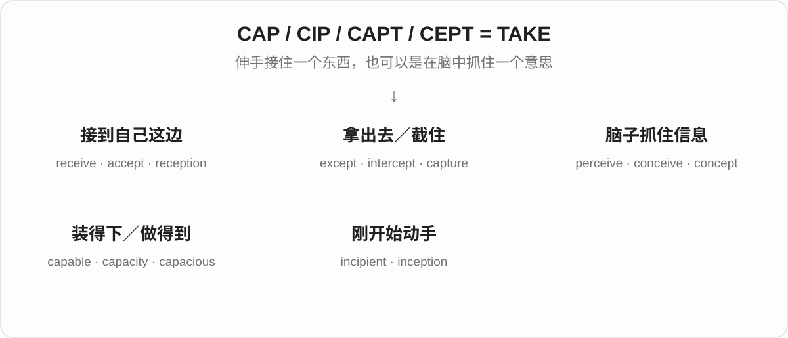

## 词形与演化规律

**cap-、cip-、capt-、cept- 是同一词族的不同历史词干。** 拉丁语复合环境里的元音变化和分词构词，留下了这些形式；法语借入又让一部分词出现 -ceive。所以 receive / reception、conceive / conception 有联系，但不能把任意英语词的 -ceive 换成 -ception 来造词。

现代派生如 receive → receiver、capable → capability，与古代词形变化是两回事。下图只画每个词实际有关的路径；“伸手抓东西”的画面帮助理解，不代替历史证据。

## 单词速览（常用到不常用）

| 单词 | 音标 | 核心意思 |
|---|---|---|
| [except](#w-1) | /ɪkˈsept/ | 除了；除外 |
| [accept](#w-2) | /əkˈsept/ | 接受；认可 |
| [receive](#w-3) | /rɪˈsiːv/ | 收到；接收 |
| [concept](#w-4) | 英 /ˈkɒnsept/；美 /ˈkɑːnsept/ | 概念；构想 |
| [capacity](#w-5) | /kəˈpæsəti/ | 容量；处理能力；身份 |
| [capable](#w-6) | /ˈkeɪpəbəl/ | 有能力的；能干的 |
| [capture](#w-7) | 英 /ˈkæptʃə/；美 /ˈkæptʃər/ | 捕获；抓住；记录 |
| [exception](#w-8) | /ɪkˈsepʃən/ | 例外 |
| [acceptable](#w-9) | /əkˈseptəbəl/ | 可以接受的；达标的 |
| [reception](#w-10) | /rɪˈsepʃən/ | 接待；接收；反响 |
| [recipe](#w-11) | /ˈresəpi/ | 食谱；做事的方法 |
| [perception](#w-12) | /pəˈsepʃən/ | 感知；看法 |
| [acceptance](#w-13) | /əkˈseptəns/ | 接受；认可；接纳 |
| [receiver](#w-14) | 英 /rɪˈsiːvə/；美 /rɪˈsiːvər/ | 接收者；接收器；听筒 |
| [capability](#w-15) | /ˌkeɪpəˈbɪləti/ | 能力；可实现的功能 |
| [recipient](#w-16) | /rɪˈsɪpiənt/ | 接受者；获得者 |
| [conception](#w-17) | /kənˈsepʃən/ | 构想；观念；受孕 |
| [caption](#w-18) | /ˈkæpʃən/ | 图片说明；字幕 |
| [incapable](#w-19) | /ɪnˈkeɪpəbəl/ | 做不到的；无能力的 |
| [perceive](#w-20) | /pəˈsiːv/ | 察觉；理解；把……看作 |
| [captive](#w-21) | /ˈkæptɪv/ | 被俘的；受控制的；俘虏 |
| [susceptible](#w-22) | /səˈseptəbəl/ | 容易受影响的；易感的 |
| [deception](#w-23) | /dɪˈsepʃən/ | 欺骗；骗局 |
| [inception](#w-24) | /ɪnˈsepʃən/ | 开始；创立之初 |
| [intercept](#w-25) | 动词 /ˌɪntəˈsept/ | 拦截；截获 |
| [conceive](#w-26) | /kənˈsiːv/ | 构想；设想；怀孕 |
| [deceive](#w-27) | /dɪˈsiːv/ | 欺骗；使误信 |
| [receptionist](#w-28) | /rɪˈsepʃənɪst/ | 接待员；前台人员 |
| [misconception](#w-29) | /ˌmɪskənˈsepʃən/ | 错误观念；误解 |
| [recapture](#w-30) | /ˌriːˈkæptʃər/ | 重新抓住；夺回；重现 |
| [conceivable](#w-31) | /kənˈsiːvəbəl/ | 想象得到的；可能的 |
| [interceptor](#w-32) | 英 /ˌɪntəˈseptə/；美 /ˌɪntərˈseptər/ | 拦截者；拦截装置；截击机 |
| [forceps](#w-33) | 英 /ˈfɔːseps/；美 /ˈfɔːrseps/ | 钳子；镊状钳 |
| [incipient](#w-34) | /ɪnˈsɪpiənt/ | 刚开始的；初起的 |
| [captivate](#w-35) | /ˈkæptɪveɪt/ | 迷住；使入迷 |
| [capacious](#w-36) | /kəˈpeɪʃəs/ | 宽敞的；容量大的 |
| [misperception](#w-37) | /ˌmɪspəˈsepʃən/ | 错误感知；误判 |
| [capably](#w-38) | /ˈkeɪpəbli/ | 能干地；熟练地 |
| [preconception](#w-39) | /ˌpriːkənˈsepʃən/ | 先入之见；预先形成的看法 |
| [proprioception](#w-40) | /ˌprəʊpriəˈsepʃən/ | 本体感觉 |
| [perceivable](#w-41) | /pəˈsiːvəbəl/ | 能察觉到的 |

## 逐词讲解

### 1. except — 除了；除外

**音标**：/ɪkˈsept/

**先抓住这个画面**

先摆出一整组东西，再从中拿走一个：剩下的都算，拿走的那个不算。这是 except 的画面。

**怎么拆**

ex-（向外）+ capere（拿）→ excipere；except- 来自相关分词词干。历史构词表达的正是“拿出去”。

**怎么变成今天的意思**

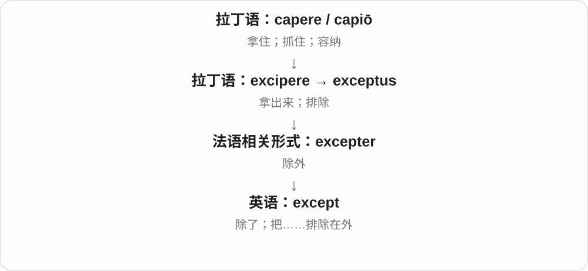

物理上从一堆里拿出一个，抽象后就是从规则、范围或判断里排除一个。英语中它常作介词，也可在正式用法中作动词。

**常见搭配与例句**

everyone except…；except for…；except that…（只是……这一点除外）。

> Everyone except Tom arrived on time.

除汤姆外，所有人都准时到了。

> The room was empty except for a single chair.

房间里除了一把椅子，什么也没有。

**别混淆**

except 排除，besides 往往表示“除此之外还包括”。Everyone except Tom came 是汤姆没来。

### 2. accept — 接受；认可

**音标**：/əkˈsept/

**先抓住这个画面**

别人递来一个东西或说法，你不只是接到，还点头说“好，我收下”。礼物、工作机会、解释和现实都可以 accept。

**怎么拆**

历史上 ad-（朝向）+ capere（拿）形成 accipere，ad- 的辅音同化；accept 与其 accept- 分词词干相关。

**怎么变成今天的意思**

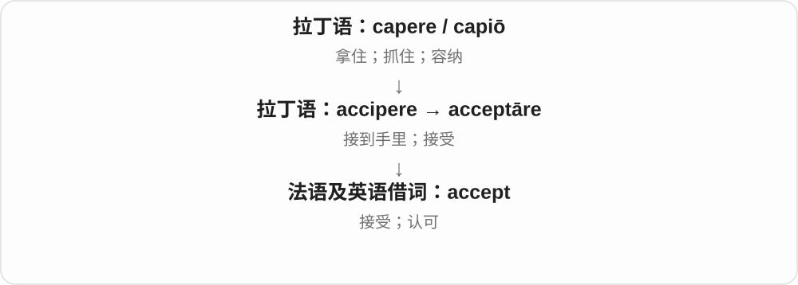

从“拿到身边”发展为“接纳”。接纳的不一定让人开心：accept a difficult truth 是承认一个难以接受的事实，不是喜欢它。

**常见搭配与例句**

accept an offer（接受提议）；accept responsibility（承担责任）；accept that…（承认……）。

> She accepted the job offer after a week of thought.

考虑一周后，她接受了那份工作。

> We need to accept that the first plan did not work.

我们需要承认，第一个方案没有奏效。

**别混淆**

accept 与 except 不同：accept 是接纳，except 是排除。发音接近，首字母和意思都要分清。

### 3. receive — 收到；接收

**音标**：/rɪˈsiːv/

**先抓住这个画面**

想象别人把东西递过来，你把它接到自己这边。包裹、消息、帮助和信号都能这样“到你这里”。receive 先说收到，未必说你赞同。

**怎么拆**

历史上 re-（回、向回）+ capere（拿）形成 recipere；再经法语变成 receive。这里的 -ceive 不是现代英语里可单独使用的单词。

**怎么变成今天的意思**

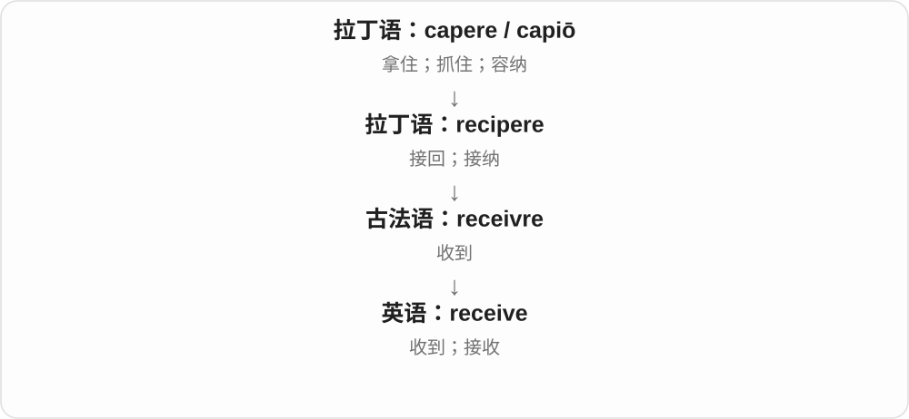

“拿到自己这边”扩展到各种看不见的东西：接到电话、得到支持、接收信号。reception 保留的是同一拉丁词族的 -cept- 形式，不是把 receive 任意换几个字母。

**常见搭配与例句**

receive a message / a package / support；receive something from someone。

> I received your email this morning.

我今天早上收到了你的邮件。

> The proposal received strong support from the team.

这项提议得到了团队的大力支持。

**别混淆**

receive 是“到手了”；accept 常是“愿意收下或认可”。收到邀请，不等于答应参加。

### 4. concept — 概念；构想

**音标**：英 /ˈkɒnsept/；美 /ˈkɑːnsept/

**先抓住这个画面**

把一组零散认识抓到一起，在脑子里形成一个清楚的整体，这个整体就是 concept，比如“公平”“能量”或一个产品构想。

**怎么拆**

来自拉丁语 conceptus，与 concipere“收集、构想”同源。concept 和 conceive 是历史词形不同的亲戚，不能仅凭结尾判断互不相关。

**怎么变成今天的意思**

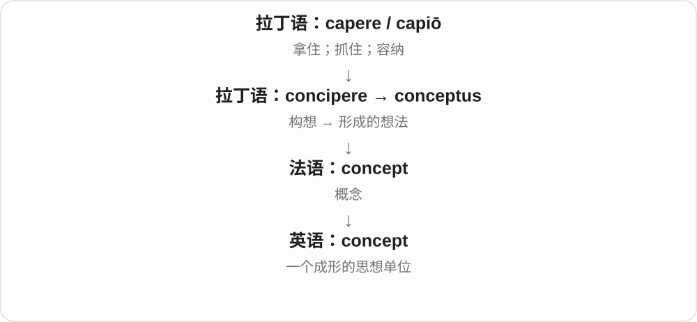

词义重点落在构想的结果上。a design concept 是设计背后的基本想法，还不一定是可直接生产的详细方案。

**常见搭配与例句**

a basic concept；the concept of…；a design concept。

> The teacher explained the concept of gravity with a simple experiment.

老师用一个简单实验解释了重力的概念。

> We liked the design concept but changed the details.

我们喜欢这个设计构想，但修改了细节。

**别混淆**

idea 很宽泛，随手想到的点子也算；concept 往往是可以说明、组织或反复使用的一套概念。

### 5. capacity — 容量；处理能力；身份

**音标**：/kəˈpæsəti/

**先抓住这个画面**

先想一个容器最多装多少，再想一个人或系统最多能承担多少。capacity 常在说这种“能装、能处理的量”。

**怎么拆**

来自拉丁语 capāx“能容纳的”及名词 capācitās，经法语进入英语。cap- 仍与 capere 有关。

**怎么变成今天的意思**

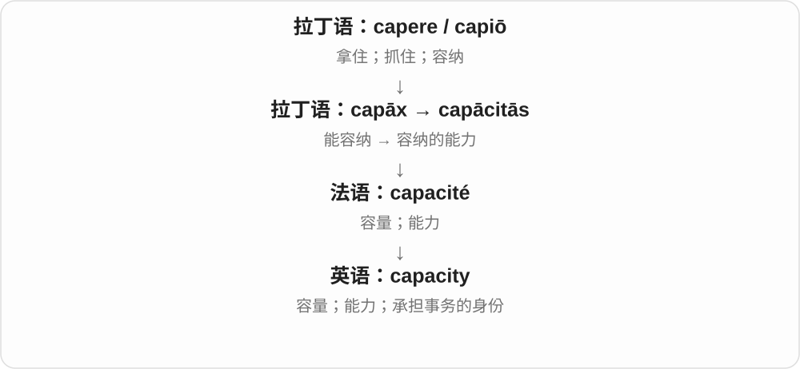

杯子的容积、工厂的产能、人的学习能力，都能从“装得下或应付得了多少”理解。in my capacity as manager 则指“以经理这个身份”，是另一个固定用法。

**常见搭配与例句**

at full capacity（满负荷）；a capacity for…；in one’s capacity as…。

> The theater has a capacity of five hundred people.

这家剧院可容纳五百人。

> I am writing in my capacity as team leader.

我以团队负责人的身份写这封信。

**别混淆**

capacity 与 capability 都谈能力，但 capacity 更常涉及数量、潜力或承受上限。capacity 不能一律译成容积。

### 6. capable — 有能力的；能干的

**音标**：/ˈkeɪpəbəl/

**先抓住这个画面**

把任务想成一个要接住的东西：你的能力装得下、扛得住，就 capable。它可以说能做到某件事，也可以直接夸一个人能干。

**怎么拆**

来自晚期拉丁语 capābilis，与 capere“拿、容纳”相关；经法语进入英语。可认出 cap- 和形容词性结尾，不能拆成 cap“帽子”+ able。

**怎么变成今天的意思**

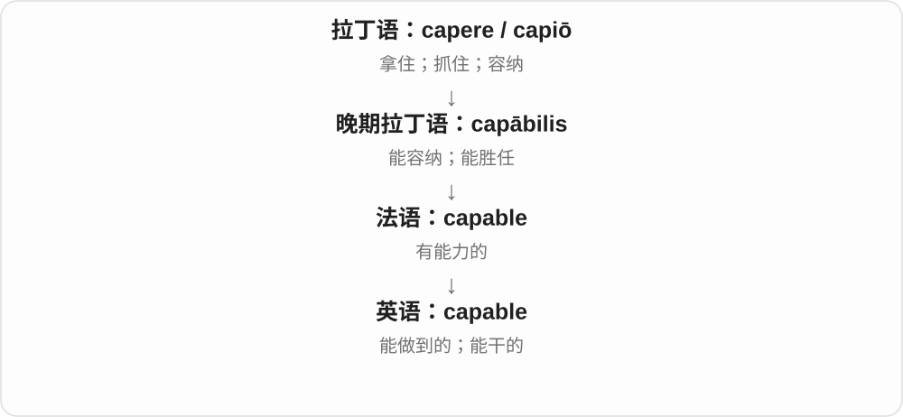

从“容纳得下”到“具备承受和完成的本领”，是理解能力义的好线索。现代用法中 capable of doing 既能说好事，也能说某人做得出坏事。

**常见搭配与例句**

be capable of doing…；a capable manager；perfectly capable。

> She is capable of solving the problem on her own.

她有能力独立解决这个问题。

> We need a capable person to lead the project.

我们需要一个能干的人来领导这个项目。

**别混淆**

capable of doing，不通常说 capable to do；able 则常跟 to do。

### 7. capture — 捕获；抓住；记录

**音标**：英 /ˈkæptʃə/；美 /ˈkæptʃər/

**先抓住这个画面**

伸手抓住一个原本会跑掉的东西。抓到动物是 capture，抓住稍纵即逝的表情、画面和注意力，也可以是 capture。

**怎么拆**

来自拉丁语 captūra，经法语进入英语。capt- 与 capere“抓”有关，后面的部分把动作形成名词；现代英语又用作动词。

**怎么变成今天的意思**

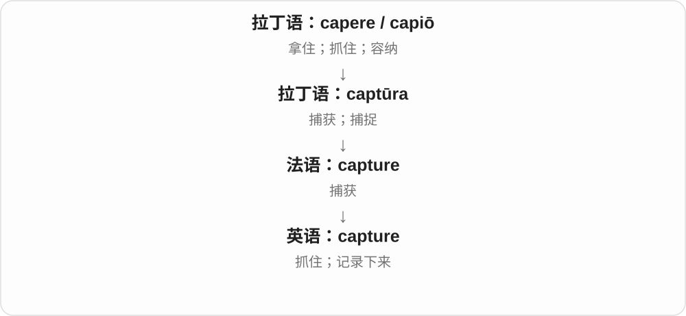

物理上的抓捕扩展到把画面、声音和感觉留住，所以摄像机能 capture a moment，故事能 capture attention。这里的“抓”不一定伤害对象。

**常见搭配与例句**

capture an image；capture someone’s attention；capture the mood。

> The camera captured the exact moment the bird took off.

相机捕捉到了鸟起飞的那一刻。

> Her opening sentence captured everyone’s attention.

她开场的第一句话吸引了所有人的注意。

**别混淆**

catch 很日常、用途很广；capture 常强调成功抓住、控制住或保存下来。

### 8. exception — 例外

**音标**：/ɪkˈsepʃən/

**先抓住这个画面**

规则把大多数情况圈进来，exception 是被单独拿出来、不能照常处理的那个情况。

**怎么拆**

属于 except 的名词词族，历史上经法语来自拉丁语 exceptiō。现代可用 except + -ion 对照记忆。

**怎么变成今天的意思**

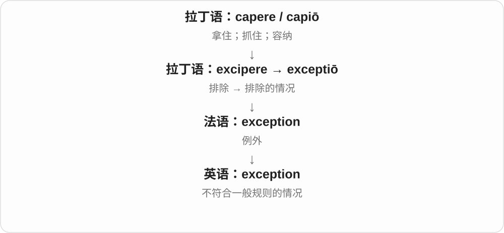

“拿出去”的不是必须讨厌的东西，也可能是被特别允许的情况。所以 make an exception 是破例，而不是制造一个错误。

**常见搭配与例句**

make an exception；with the exception of…；an exception to the rule。

> We do not usually allow pets, but we made an exception this time.

我们通常不允许带宠物，但这次破了例。

> Her case is an exception to the general rule.

她的情况是一般规则之外的一个例外。

**别混淆**

exception 不等于 mistake。程序中的 exception 是需要另行处理的异常情况，也不必然等于程序员写错代码。

### 9. acceptable — 可以接受的；达标的

**音标**：/əkˈseptəbəl/

**先抓住这个画面**

想象给东西设一条最低标准：过了这条线，虽然未必出色，但能接受。这就是 acceptable。

**怎么拆**

现代分析是 accept + -able“可以被接受的”；英语词形也承接法语和晚期拉丁语 acceptābilis。

**怎么变成今天的意思**

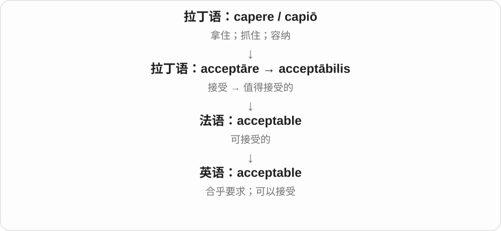

它常用于质量、价格、行为和方案。acceptable 不自动等于 excellent：一个方案可以只是够用，但仍达到了你设定的条件。

**常见搭配与例句**

an acceptable solution；acceptable to someone；an acceptable standard。

> We need to find a solution that is acceptable to both sides.

我们需要找到双方都能接受的方案。

> The room was small, but the price was acceptable.

房间很小，但价格可以接受。

**别混淆**

acceptable 是能否接受；accepted 是已经被接受。一个尚无人采用的方案，也可能本身很合理、可接受。

### 10. reception — 接待；接收；反响

**音标**：/rɪˈsepʃən/

**先抓住这个画面**

receive 是把人或信息接过来；reception 可以是怎么接待、接收得好不好，以及接到以后有什么反应。

**怎么拆**

来自拉丁语 receptiō，经法语进入英语，与 receive 同族。recept- 对应拉丁语的相关词干。

**怎么变成今天的意思**

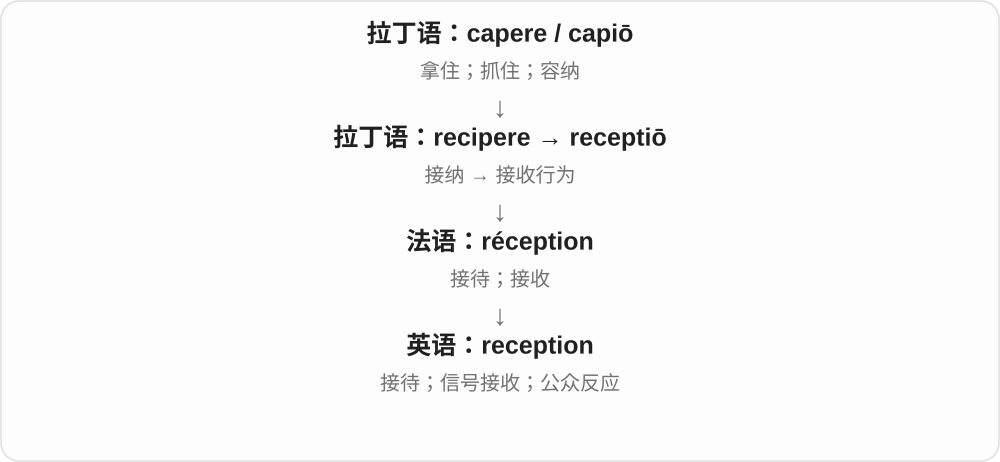

接人形成“接待、招待会”，接信号形成“接收效果”，接到作品或建议后的态度形成“反响”。这几义都能回到接收这件事。

**常见搭配与例句**

at reception（在前台）；a warm reception；poor phone reception。

> Please leave your key at reception.

请把钥匙留在前台。

> The film received a warm reception from audiences.

这部电影受到了观众的热烈欢迎。

**别混淆**

reception 是接待或接收，不是 receipt“收据”。它也能指前台区域，而 receptionist 是在那里接待的人。

### 11. recipe — 食谱；做事的方法

**音标**：/ˈresəpi/

**先抓住这个画面**

食谱最像一串指令：“拿这些材料，照这些步骤做。”recipe 的来源里，还真有一个“拿”的命令。

**怎么拆**

拉丁语 recipe 是 recipere“拿、接受”的命令式，相当于“你拿……”。经法语进入英语；末尾 e 要发音，整词三个音节。

**怎么变成今天的意思**

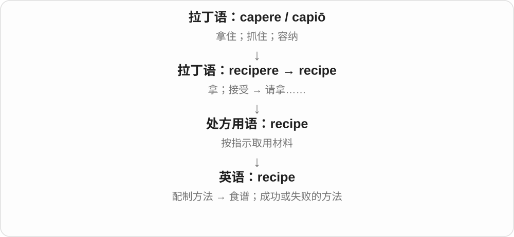

早期配药指示用“取用……”开头，后来这种配方和步骤的意思进入烹饪。a recipe for disaster 则把做菜的方法比喻成容易招来灾难的一套做法。

**常见搭配与例句**

a recipe for soup；follow a recipe；a recipe for success / disaster。

> Could you send me the recipe for this cake?

你能把这个蛋糕的食谱发给我吗？

> Rushing without a plan is a recipe for mistakes.

没有计划就匆忙行动，很容易出错。

**别混淆**

recipe 是做法，receipt 通常是收据。两个词历史上有关，但现代用途与读音明显不同。

### 12. perception — 感知；看法

**音标**：/pəˈsepʃən/

**先抓住这个画面**

同一件事进入不同人的脑中，会形成不同的“画面”。这种感知过程或形成的看法，就是 perception。

**怎么拆**

与 perceive 同源；拉丁语 perceptiō 来自 percipere 的相关词干。-ceive 与 -ception 的对应有历史依据，不是随意拼写变形。

**怎么变成今天的意思**

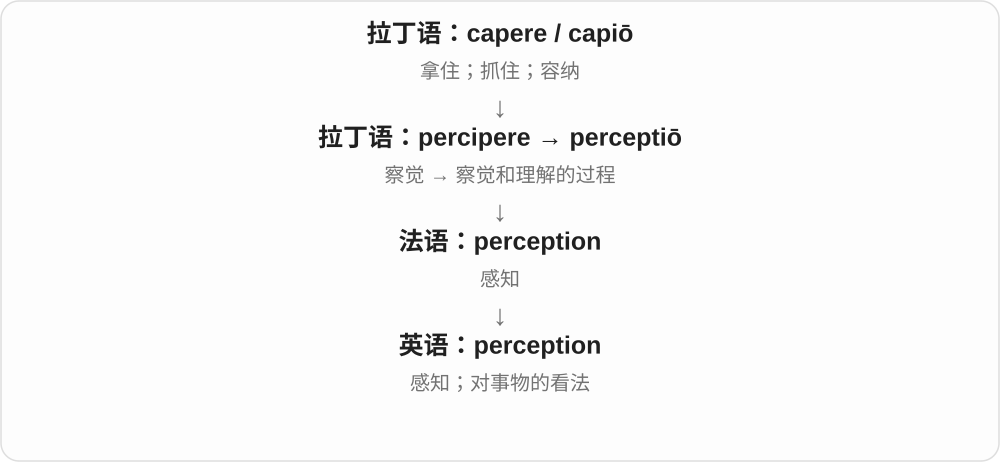

从接收感觉信息，到解释这些信息，便连接了“感知”和“观念”两个常见义。public perception 是公众怎么看，并不是公众掌握的全部事实。

**常见搭配与例句**

public perception；a perception of…；change someone’s perception。

> The campaign changed public perception of the product.

这次宣传改变了公众对该产品的看法。

> Poor lighting can affect our perception of color.

光线不足会影响我们对颜色的感知。

**别混淆**

perception 是感知和看法，perspective 是观察角度；两者有关，但“看法”不能总靠一个中文词机械互换。

### 13. acceptance — 接受；认可；接纳

**音标**：/əkˈseptəns/

**先抓住这个画面**

accept 是点头接受这个动作，acceptance 是点头之后形成的认可。一个新想法慢慢被大家接受，就是 gaining acceptance。

**怎么拆**

现代可拆 accept + -ance；-ance 把动作变成名词。不要因为结尾相同，就把它与 alliance 归成同一词根。

**怎么变成今天的意思**

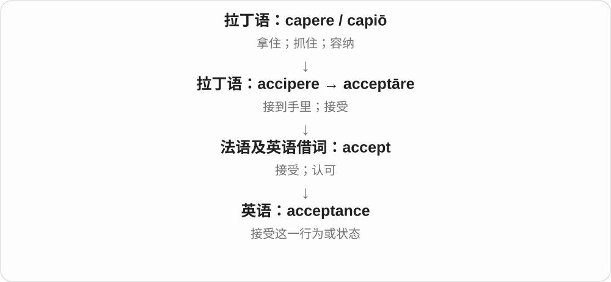

它可以指接受邀请，也可以指接纳某种差异、承认某个现实。重点是“原本可能拒绝，现在允许它进入自己的判断或关系”。

**常见搭配与例句**

gain acceptance（获得认可）；acceptance of…；an acceptance letter（录取或接受函）。

> The idea gradually gained acceptance among teachers.

这个想法逐渐获得了教师们的认可。

> Her family’s acceptance gave her confidence.

家人的接纳给了她信心。

**别混淆**

acceptance 不是 approval 的完全同义词：你可以接受某个现实，却并不赞成它。

### 14. receiver — 接收者；接收器；听筒

**音标**：英 /rɪˈsiːvə/；美 /rɪˈsiːvər/

**先抓住这个画面**

东西从一端发出，另一端负责接住，那一端就是 receiver。它可以是人，也可以是一台设备。

**怎么拆**

现代可拆 receive + -er“接收的人或物”；英语也继承了早期法语的相应名词形式。

**怎么变成今天的意思**

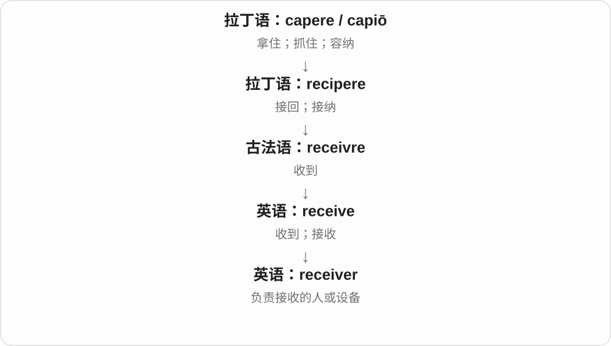

-er 不只造职业名，也能造工具名。收音机接收器接无线电信号，电话听筒让你接收声音；某些体育项目里也用它指接球者。

**常见搭配与例句**

a radio receiver；the sender and receiver；pick up the receiver。

> The receiver converts the signal into sound.

接收器把信号转换成声音。

> She picked up the receiver and dialed the number.

她拿起听筒，拨了那个号码。

**别混淆**

receiver 常涉及设备或信息传递角色；recipient 更常指礼物、邮件、帮助或奖项的获得者。

### 15. capability — 能力；可实现的功能

**音标**：/ˌkeɪpəˈbɪləti/

**先抓住这个画面**

capable 说“它做得到”，capability 就把“做得到的本领”单独拿出来讨论。软件功能、机器性能和人的技能都能用这个词。

**怎么拆**

capable + -ity；-able 在名词中变为 -ability，重音移到 -bil-。这一步是英语内部派生。

**怎么变成今天的意思**

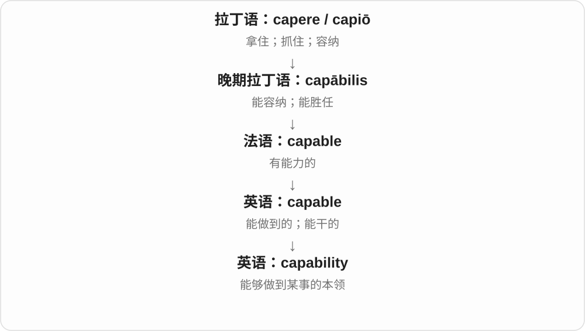

词义没有突然变：只是从描述一个人或设备，转为谈它具有什么本领。复数 capabilities 常强调好几种不同能力。

**常见搭配与例句**

technical capability；develop a capability；the capability to do…。

> The new software has the capability to recognize handwriting.

新软件具备识别手写文字的能力。

> The training helped the team develop new capabilities.

这次培训帮助团队培养了新的能力。

**别混淆**

capability 常问“能做什么”；capacity 还常问“最多能装多少、处理多少”。二者有重叠，但侧重点不同。

### 16. recipient — 接受者；获得者

**音标**：/rɪˈsɪpiənt/

**先抓住这个画面**

想象礼物、邮件或奖项贴着一个名字：那个最终收到它的人，就是 recipient。

**怎么拆**

来自拉丁语 recipiēns“正在接收的”，与 receive 同源。-cip- 是历史词干变化，不表示“剪”。

**怎么变成今天的意思**

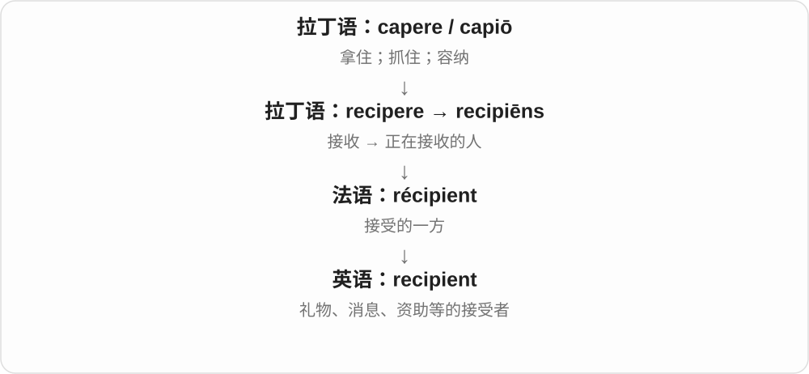

由“接收这个动作的人”变成接受者称呼。常强调谁受益、谁收到，而不是怎样传输。

**常见搭配与例句**

the recipient of an award；email recipients；a grant recipient。

> Each recipient will receive a separate email.

每位收件人都会收到一封单独的邮件。

> She was the first recipient of the new scholarship.

她是这项新奖学金的第一位获得者。

**别混淆**

recipient 是得到东西的人；donor 是给予的一方。receiver 更容易用于设备、通信或体育。

### 17. conception — 构想；观念；受孕

**音标**：/kənˈsepʃən/

**先抓住这个画面**

conception 可以是一个想法刚刚形成，也可以是你脑中已经形成的理解。谈生育时，它指受孕，不是“生孩子”整个过程。

**怎么拆**

来自拉丁语 conceptiō，经法语进入英语，与 conceive 同源。现代可把两者看成动作和名词的对应。

**怎么变成今天的意思**

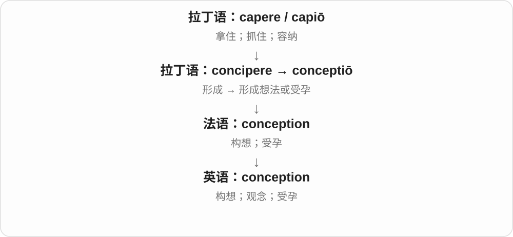

一件事被“收进头脑并形成整体”，就成了你对它的 conception；一个项目从 conception 到完成，则是从最初构想到落地。

**常见搭配与例句**

a conception of…；from conception to completion；the moment of conception。

> Her conception of success has changed over time.

她对成功的理解随着时间发生了变化。

> The project took two years from conception to completion.

这个项目从构想到完成花了两年。

**别混淆**

concept 常指一个具体概念；conception 更容易强调构想过程，或某人对一件事的整体理解。

### 18. caption — 图片说明；字幕

**音标**：/ˈkæpʃən/

**先抓住这个画面**

照片下面那句告诉你“这是什么、发生了什么”的文字，就是 caption。视频里的 captions 则把说话和重要声音变成可读文字。

**怎么拆**

来自拉丁语 captiō“抓取、捕获”的词族。它不是因为“抓住眼球”才叫 caption，那只是容易想到的联想。

**怎么变成今天的意思**

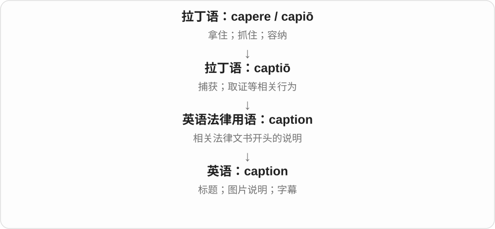

关键中间环节是法律文书开头的说明，后来词义扩展到一般标题，再到图片说明。这个过程比直接说“字幕抓住注意力”更接近真实来源。

**常见搭配与例句**

add a caption；a photo caption；turn on captions。

> The caption explains where the photograph was taken.

图片说明交代了照片在哪里拍摄。

> I turned on the captions so I could follow the dialogue.

我打开了字幕，方便跟上对话。

**别混淆**

caption 可以指图片说明，也可以指字幕；title 通常是作品或文章的名字。视频平台上 captions 与 subtitles 的具体区分还要看其使用习惯。

### 19. incapable — 做不到的；无能力的

**音标**：/ɪnˈkeɪpəbəl/

**先抓住这个画面**

某件事超出了一个人的本领，或他根本做不出某种行为，就是 incapable。它不只用于技能，也能描述性格。

**怎么拆**

in-（否定）+ capable；英语词也承接法语 incapable。这里 in- 不是“在里面”。

**怎么变成今天的意思**

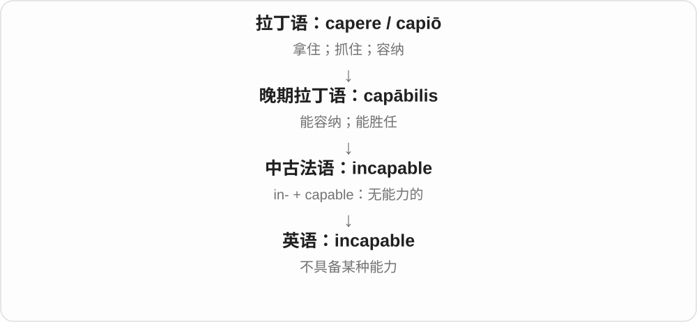

否定“能做到”，就得到“做不到”。incapable of cruelty 可以夸一个人心善，意思是他做不出残忍的事，不是在贬低技能。

**常见搭配与例句**

be incapable of doing…；incapable of change；incapable of cruelty。

> The old computer is incapable of running this program.

这台旧电脑运行不了这个程序。

> He seems incapable of saying anything unkind.

他似乎怎么也说不出刻薄的话。

**别混淆**

unwilling 是不愿意，incapable 是做不到。不能把没有能力和没有意愿混成一件事。

### 20. perceive — 察觉；理解；把……看作

**音标**：/pəˈsiːv/

**先抓住这个画面**

眼睛耳朵把信息带进来，你的脑子“抓住”了它。perceive 不只说看到，也说你怎样理解看到的东西。

**怎么拆**

per-（贯穿、充分）+ capere（拿）形成 percipere。由法语进入英语后出现 -ceive；percept- 是同族的另一历史词干。

**怎么变成今天的意思**

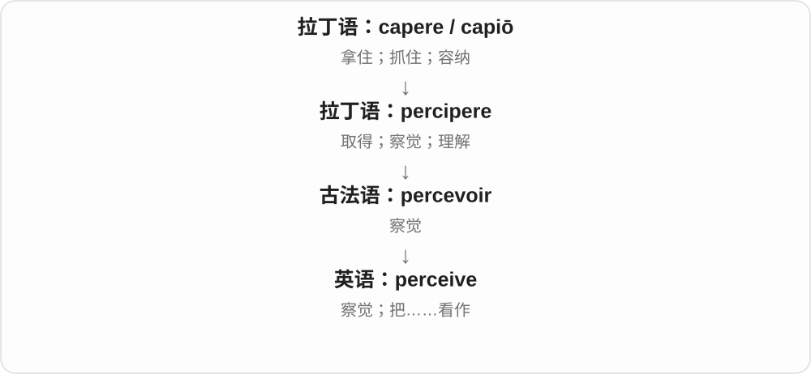

“抓住外面的东西”可以转成“头脑抓住信息”。所以它既能说察觉细微变化，也能说把一个建议看成批评；后一种理解未必正确。

**常见搭配与例句**

perceive a change；perceive A as B；be perceived as…。

> I perceived a slight change in her tone.

我察觉她的语气有一点变化。

> He perceived my question as criticism.

他把我的问题理解成了批评。

**别混淆**

see 偏看到；perceive 更强调察觉或解释。perceive someone as rude 说的是你的看法，不自动证明那个人确实无礼。

### 21. captive — 被俘的；受控制的；俘虏

**音标**：/ˈkæptɪv/

**先抓住这个画面**

capture 是把人抓住，captive 是被抓住、不能自由离开的那个人或状态。它也能描述没有多少选择的顾客或听众。

**怎么拆**

来自拉丁语 captīvus，capt- 与 capere 的分词词干有关。不是先有现代 capture，再简单把 ure 换成 ive。

**怎么变成今天的意思**

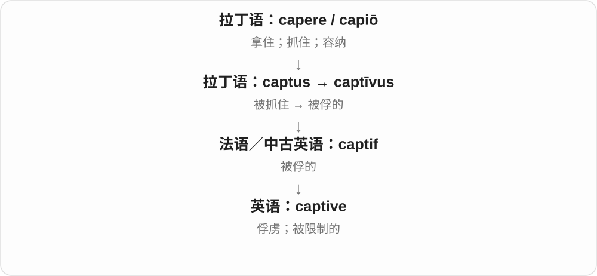

从身体不能离开，扩展到选择受限制。a captive audience 往往指处在某种场合、不得不听下去的人群，不一定是被内容迷住的观众。

**常见搭配与例句**

hold someone captive；a captive animal；a captive audience。

> The captives were released after the negotiations.

谈判后，俘虏们获释了。

> The speaker had a captive audience during the long bus journey.

长途乘车途中，听众们只得一直听那位讲述者说话。

**别混淆**

captive 是受控制、难以离开；captivated 是被吸引得入迷。两个词同源，但说听众时意思可能差很多。

### 22. susceptible — 容易受影响的；易感的

**音标**：/səˈseptəbəl/

**先抓住这个画面**

把某种影响想成从外面进来的东西：这个人或材料容易让它进来，就 susceptible。比如容易生锈、容易被说服、容易受某种疾病影响。

**怎么拆**

来自拉丁语 suscipere“接起、接受”的词族，经 susceptus、susceptibilis 形成。-cept- 仍与 capere 有关；这里不要把 sus- 当成现代独立词。

**怎么变成今天的意思**

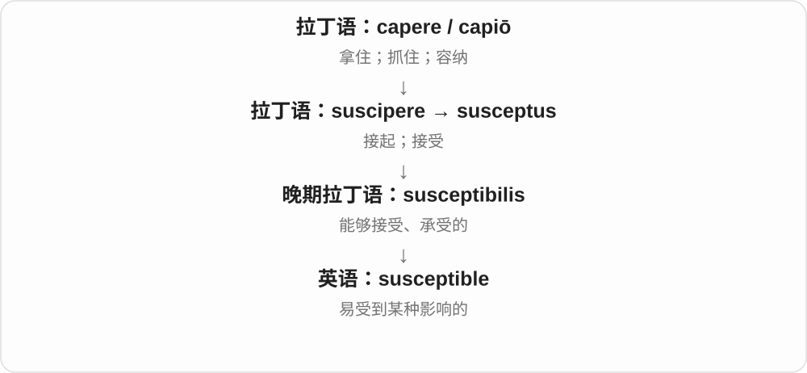

由“可以接收某物”发展到“容易受到某种影响”。现代常跟 to，并偏向不利影响；但 susceptible to persuasion 只是说容易被说服。

**常见搭配与例句**

susceptible to damage；susceptible to disease；susceptible to persuasion。

> The material is susceptible to damage from heat.

这种材料容易受热损坏。

> Children can be susceptible to pressure from their friends.

孩子容易受到朋友施加的压力影响。

**别混淆**

sensitive 偏对刺激反应强；susceptible 偏容易受某影响侵入或改变。不要和 suspicious“怀疑的”混淆。

### 23. deception — 欺骗；骗局

**音标**：/dɪˈsepʃən/

**先抓住这个画面**

deception 是让别人被假象蒙住的行为或手段。它可以是一整套布局，不只是一个谎话。

**怎么拆**

属于 deceive 的名词词族，经法语来自拉丁语 dēceptiō。-cept- 对应的是历史词干，而不是现代英语里随便缩短 deceive。

**怎么变成今天的意思**

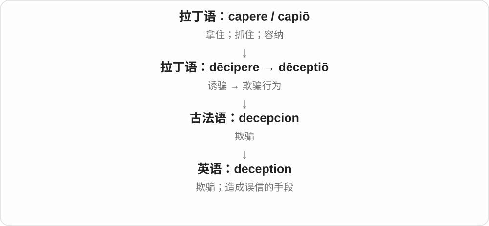

动词说“他骗了我”，名词则把整个过程拿出来讨论。a deception 可以指一项具体骗局，deception 也可泛指欺骗这一行为。

**常见搭配与例句**

deliberate deception（蓄意欺骗）；an act of deception；detect deception。

> The investigation uncovered a pattern of deliberate deception.

调查揭露了一系列蓄意欺骗行为。

> The apparent success was based on deception.

表面上的成功建立在欺骗之上。

**别混淆**

deception 与 misunderstanding 不同：前者通常涉及制造误信，后者可能只是双方理解出了差错。

### 24. inception — 开始；创立之初

**音标**：/ɪnˈsepʃən/

**先抓住这个画面**

把一个项目的时间线往回拉，拉到最初启动的那个点，就是 inception。

**怎么拆**

来自拉丁语 inceptiō，与 incipere“开始”同族。-cip- 和 -cept- 是不同历史词形，不是不同含义的两套词根。

**怎么变成今天的意思**

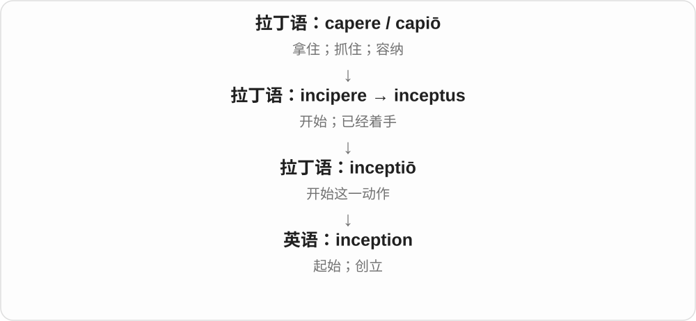

它常把人带回项目、机构或计划的开头。since its inception 就是从它开始存在以来，不必是正式开幕那一天。

**常见搭配与例句**

since its inception；from inception；at the inception of…。

> The program has helped thousands of students since its inception.

这个项目自创立以来已帮助了数千名学生。

> She was involved in the project from its inception.

她从项目一开始就参与其中。

**别混淆**

conception 偏最初想法的形成；inception 偏事物的开始。它们在项目早期可能挨得很近，但不是永远同一时刻。

### 25. intercept — 拦截；截获

**音标**：动词 /ˌɪntəˈsept/

**先抓住这个画面**

东西正从 A 去 B，你在中途伸手把它抓住。拦球、截获消息、拦下车辆，都可以用 intercept。

**怎么拆**

inter-（在……之间）+ capere，形成拉丁语 intercipere；intercept- 来自其分词词干。

**怎么变成今天的意思**

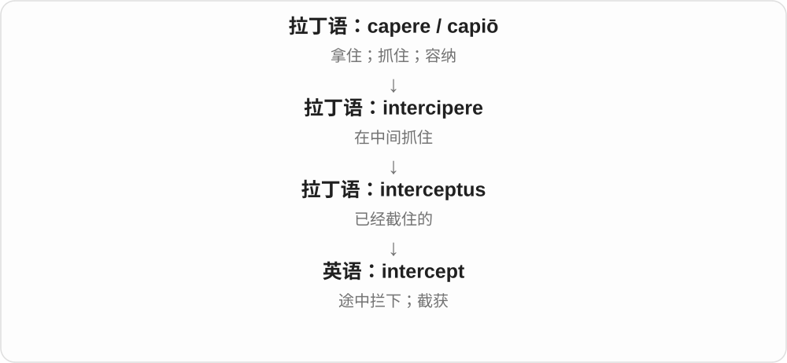

“抓”的位置在中途，因此它强调原本的去向被打断。接到本来就发给你的消息是 receive，途中截住别人的消息才更像 intercept。

**常见搭配与例句**

intercept a pass；intercept a message；intercept a vehicle。

> The defender intercepted the pass.

防守队员截下了那次传球。

> The message was intercepted before it reached its destination.

消息还没到达目的地就被截获了。

**别混淆**

interrupt 是打断进行中的活动；intercept 是在传递或移动途中拦截。

### 26. conceive — 构想；设想；怀孕

**音标**：/kənˈsiːv/

**先抓住这个画面**

把零散材料收进来，在里面形成一个新东西：脑中形成想法，身体里孕育生命。conceive 的两个常见意思可以放在这个画面下理解。

**怎么拆**

con-（一起）+ capere（拿）形成 concipere。它经法语成为 conceive；concept- 是同一拉丁词族的相关词干。

**怎么变成今天的意思**

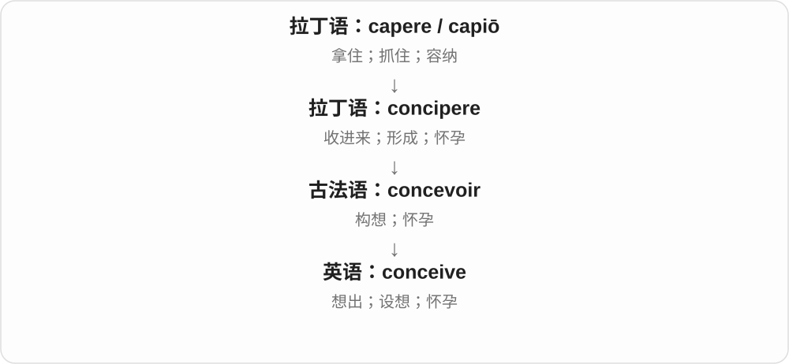

“收进、形成”的历史意义连接了构想和受孕。今天 conceive an idea 是想出一个点子；conceive of something 是想象某种可能；谈生育时则表示怀孕。

**常见搭配与例句**

conceive an idea；conceive of a possibility；be conceived as…（被构想为……）。

> The team conceived a simple way to reduce waste.

团队想出了一个减少浪费的简单办法。

> I cannot conceive of a world without music.

我无法想象一个没有音乐的世界。

**别混淆**

conceive 强调形成想法，consider 强调考虑已有的事情。谈怀孕时要由上下文判断，不能见到 conceive 就译成构思。

### 27. deceive — 欺骗；使误信

**音标**：/dɪˈsiːv/

**先抓住这个画面**

想象一个陷阱把人引进错误判断：你以为是真的，其实不是。deceive 强调让人信了假的东西。

**怎么拆**

来自 dē- + capere 形成的拉丁语 dēcipere，其历史义已有诱捕、蒙骗。现代拼写经法语形成，不能把 de- 一概译成“向下”。

**怎么变成今天的意思**

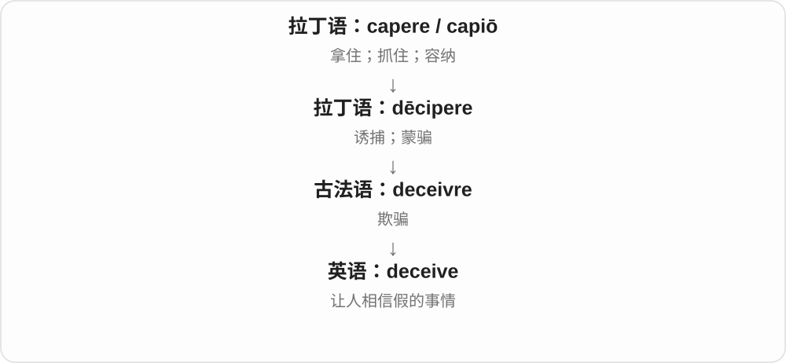

从诱捕到蒙骗，关键在于让对方落入你设好的判断。英语 deceive 并不是先表示“拿走东西”再简单变成欺骗；那样的故事会把词源过度简化。

**常见搭配与例句**

deceive someone；deceive someone into doing…；deceive yourself（自欺）。

> The advertisement deceived customers into paying for a useless service.

这则广告诱骗顾客为无用的服务付费。

> Do not deceive yourself about how much work remains.

别在还剩多少工作这件事上自欺欺人。

**别混淆**

lie 指说谎，deceive 指造成误信；隐瞒关键事实、摆出假象，也可能 deceive，而不一定直接说了假话。

### 28. receptionist — 接待员；前台人员

**音标**：/rɪˈsepʃənɪst/

**先抓住这个画面**

你走进酒店或公司，第一个迎接你、登记信息、指路的人，通常就是 receptionist。

**怎么拆**

reception + -ist；-ist 在这里表示从事某项工作的人，不是“主义”。

**怎么变成今天的意思**

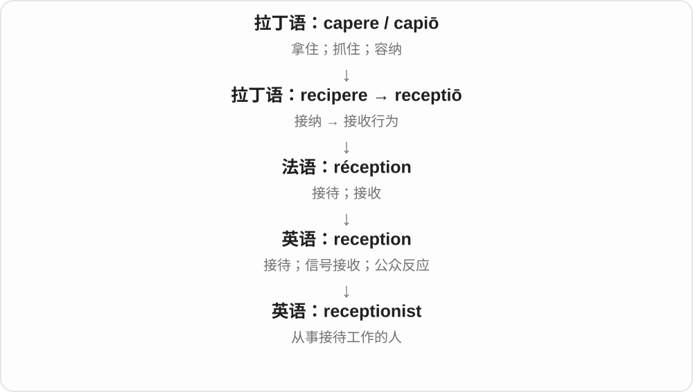

词义从接收人、接待来访者，落到具体岗位。不是所有做 reception 相关工作的设备都能叫 receptionist，这个词通常指人。

**常见搭配与例句**

a hotel receptionist；ask the receptionist；work as a receptionist。

> The receptionist showed us where to wait.

接待员告诉我们在哪里等候。

> He works as a receptionist at a small clinic.

他在一家小诊所做前台接待。

**别混淆**

reception 是接待、前台地点或反响；receptionist 是接待的人。

### 29. misconception — 错误观念；误解

**音标**：/ˌmɪskənˈsepʃən/

**先抓住这个画面**

脑中形成了一张解释世界的图，可惜图画错了。这种错误理解就是 misconception。

**怎么拆**

mis-（错误）+ conception（观念）。不是 miss“想念”加 conception。

**怎么变成今天的意思**

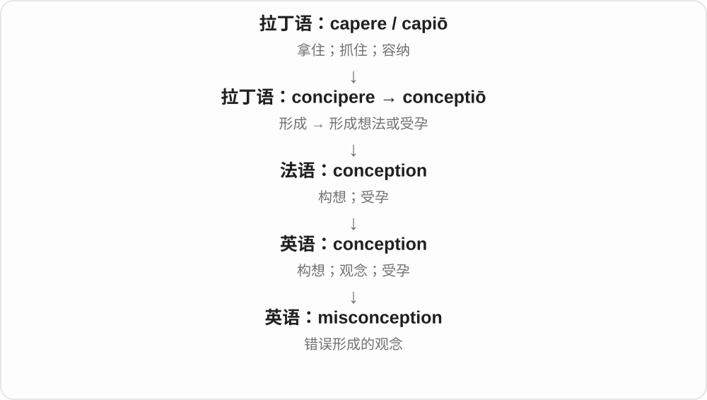

它常指已经成形、甚至广泛流传的错误观念。因此 correct a misconception 是帮人把脑中的错误模型改过来。

**常见搭配与例句**

a common misconception；a misconception about…；correct a misconception。

> It is a common misconception that bats are blind.

认为蝙蝠看不见，是一种常见误解。

> The article corrected my misconception about how the system works.

这篇文章纠正了我对系统工作方式的错误认识。

**别混淆**

misconception 常是一种较稳定的错误观念；misunderstanding 也可以只是某次对话里没听懂。

### 30. recapture — 重新抓住；夺回；重现

**音标**：/ˌriːˈkæptʃər/

**先抓住这个画面**

已经失去或跑掉的东西，再抓回来。可以夺回地点，也可以重新找回过去的感觉。

**怎么拆**

re-（再、重新）+ capture，是清楚的现代英语构词。

**怎么变成今天的意思**

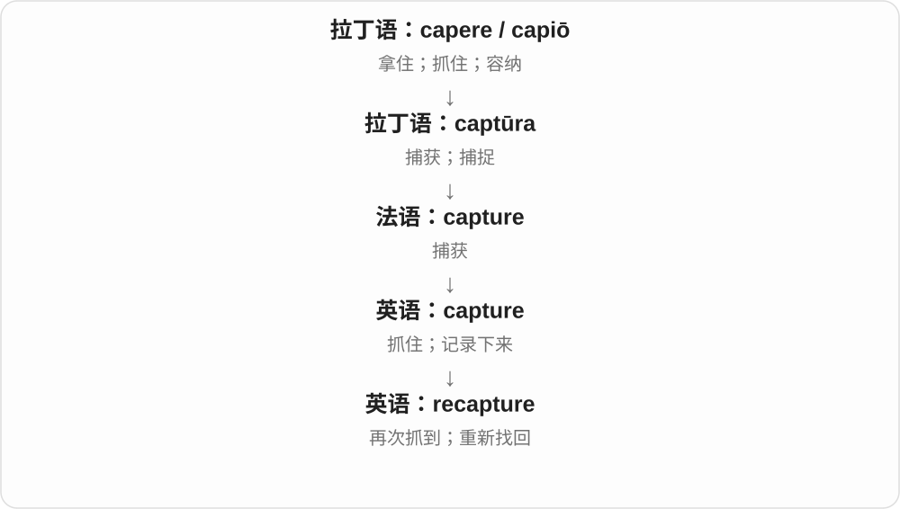

“重新捕获”扩展到恢复曾有的控制、注意力或体验。recapture the excitement 就是找回当时那种激动，不是捕捉新的猎物。

**常见搭配与例句**

recapture control；recapture someone’s attention；recapture the feeling。

> The team quickly recaptured control of the game.

球队很快重新掌控了比赛。

> The photographs helped her recapture the joy of that summer.

这些照片帮助她找回了那个夏天的快乐。

**别混淆**

recover 侧重恢复或找回，范围很广；recapture 更保留重新抓住、夺回或重现的力度。

### 31. conceivable — 想象得到的；可能的

**音标**：/kənˈsiːvəbəl/

**先抓住这个画面**

一件事虽然没发生，但脑中还能画出它怎么发生，就 conceivable。它表示想得到这种可能，不保证它会发生。

**怎么拆**

conceive + -able；去掉不发音的 e，再加 -able，表示可以被设想。

**怎么变成今天的意思**

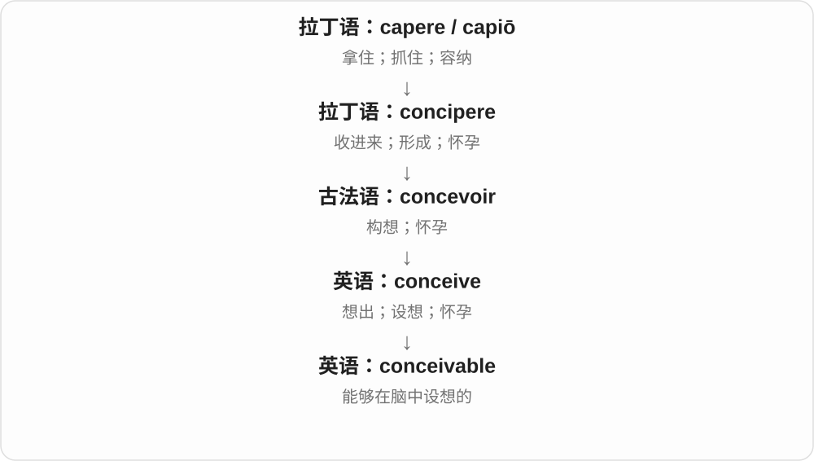

从“构想”变成“可被构想”，进而说某种情况并非不可能。every conceivable way 就是所有想得到的办法。

**常见搭配与例句**

every conceivable…；It is conceivable that…；a conceivable explanation。

> We tried every conceivable way to contact him.

我们尝试了所有想得到的办法联系他。

> It is conceivable that the meeting will be postponed.

会议有可能推迟。

**别混淆**

conceivable 的门槛较低：能设想即可。probable 则说发生的可能性较大。

### 32. interceptor — 拦截者；拦截装置；截击机

**音标**：英 /ˌɪntəˈseptə/；美 /ˌɪntərˈseptər/

**先抓住这个画面**

intercept 是中途拦下，interceptor 就是专门干这件事的人或装置。

**怎么拆**

intercept + -or；-or 指执行动作的一方。它可以是飞机、技术装置，也可以是程序里处理请求的组件。

**怎么变成今天的意思**

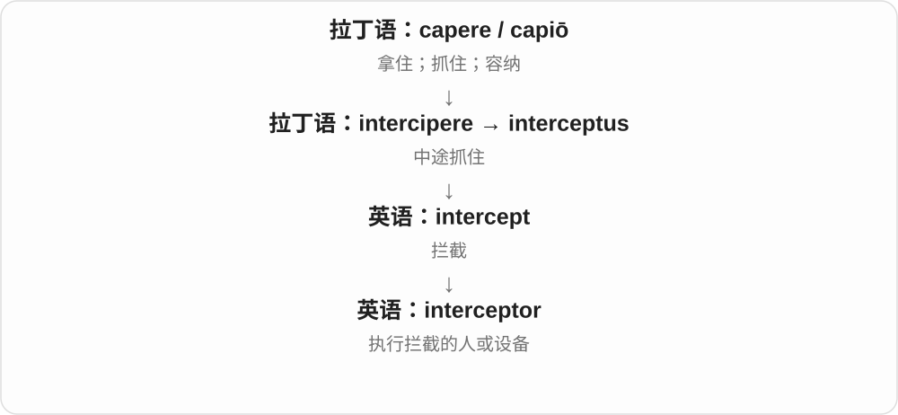

古老的“抓住”在新领域里继续派生。软件 interceptor 常在请求到达目标之前介入，恰好保留“中途接住”的画面。

**常见搭配与例句**

an interceptor aircraft；a request interceptor；install an interceptor。

> The interceptor aircraft approached the unidentified plane.

截击机接近了那架身份不明的飞机。

> The interceptor checks each request before passing it on.

拦截器会检查每个请求，再把它传递下去。

**别混淆**

interceptor 指执行拦截的角色；interception 指拦截行为本身。

### 33. forceps — 钳子；镊状钳

**音标**：英 /ˈfɔːseps/；美 /ˈfɔːrseps/

**先抓住这个画面**

想象两片细长的夹头合起来，稳稳夹住手指不方便拿的小东西。医学中的 forceps 就常是这种夹取工具。

**怎么拆**

直接借自拉丁语 forceps“钳”。常见词源分析把它联系到 formus“热”与 capere“拿”，即用来夹取热物的工具；不是 force + 复数 s。

**怎么变成今天的意思**

工具从夹取东西进入更专门的应用领域，名称仍保留抓取的功能。整词的历史组合较早，现代拼写已经不能逐字母还原。

**常见搭配与例句**

a pair of forceps；surgical forceps；grasp something with forceps。

> The researcher lifted the tiny sample with forceps.

研究人员用镊状钳夹起了那个微小样本。

> A pair of forceps lay beside the other instruments.

一把钳子放在其他器械旁边。

**别混淆**

forceps 不是 force“力量”的规则复数。通常说 a pair of forceps；具体是产钳、组织钳还是镊状工具，要看上下文。

### 34. incipient — 刚开始的；初起的

**音标**：/ɪnˈsɪpiənt/

**先抓住这个画面**

事情刚冒出一点苗头，还没完全发展起来，就是 incipient。

**怎么拆**

来自拉丁语 incipiēns“正在开始的”，其动词 incipere 与 in- + capere 有关，可以联系“着手拿起一件事”。

**怎么变成今天的意思**

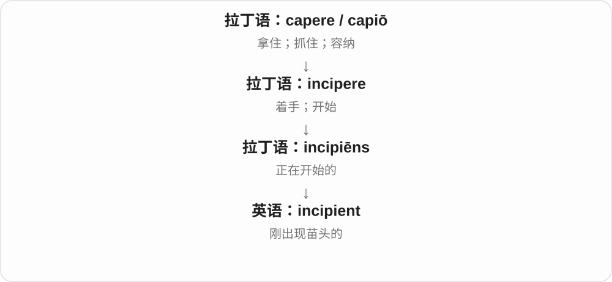

从“开始做”转为形容“刚开始形成”。常用于变化、问题、疾病或趋势的初期，语气比 beginning 更书面。

**常见搭配与例句**

incipient signs；an incipient crisis；incipient growth。

> The survey revealed signs of an incipient recovery.

调查显示出复苏的初步迹象。

> They addressed the incipient problem before it spread.

问题刚出现苗头，他们就采取了措施，防止它扩大。

**别混淆**

incipient 是初起；insipient 是罕见词，表示愚蠢。不要因为拼写相近，把“刚开始”看成“不聪明”。

### 35. captivate — 迷住；使入迷

**音标**：/ˈkæptɪveɪt/

**先抓住这个画面**

没有真的绑住你，却把你的注意力牢牢抓住，让你舍不得移开。这就是 captivate。

**怎么拆**

来自 captīvus“被俘的”这一词族，晚期拉丁语 captīvāre、captīvātus 与英语 captivate 相连。可用 captive + -ate 辅助记忆。

**怎么变成今天的意思**

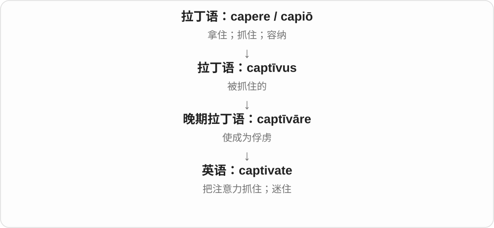

词义从把人控制住转成把人的兴趣吸引住。它常用于音乐、故事、风景或个人魅力，通常带欣赏的语气。

**常见搭配与例句**

captivate an audience；be captivated by…；a captivating story。

> The storyteller captivated the children with her voice.

讲故事的人用她的声音让孩子们听得入迷。

> We were captivated by the view from the mountain.

山上的景色让我们着迷。

**别混淆**

capture attention 可以只是成功引起注意；captivate 往往表示吸引得更深，让人持续投入。

### 36. capacious — 宽敞的；容量大的

**音标**：/kəˈpeɪʃəs/

**先抓住这个画面**

一个包看上去能把很多东西吞进去，房间也宽宽大大、装得下很多东西，就 capacious。

**怎么拆**

拉丁语 capāx“能装、宽大的”相关词干加形容词结尾形成；现代可把 capac- 与 capacity 联系起来。

**怎么变成今天的意思**

capacity 说容量本身，capacious 直接形容东西很能装。也能比喻心胸或记忆力容纳得多，但语体比 big、roomy 更正式。

**常见搭配与例句**

a capacious bag；a capacious room；a capacious memory。

> She carried a capacious bag full of books.

她提着一个能装很多东西的包，里面满是书。

> The house has a capacious kitchen.

这栋房子有一个宽敞的厨房。

**别混淆**

capacious 强调空间或容纳量，不等于 capable“能干的”。一个包很能装，不是在夸它有技能。

### 37. misperception — 错误感知；误判

**音标**：/ˌmɪspəˈsepʃən/

**先抓住这个画面**

眼前的信息进了脑子，你却把它看偏了、读错了。misperception 更贴近这一步“看错”。

**怎么拆**

mis-（错误）+ perception（感知、看法）。结构与 misconception 相近，词基却不同。

**怎么变成今天的意思**

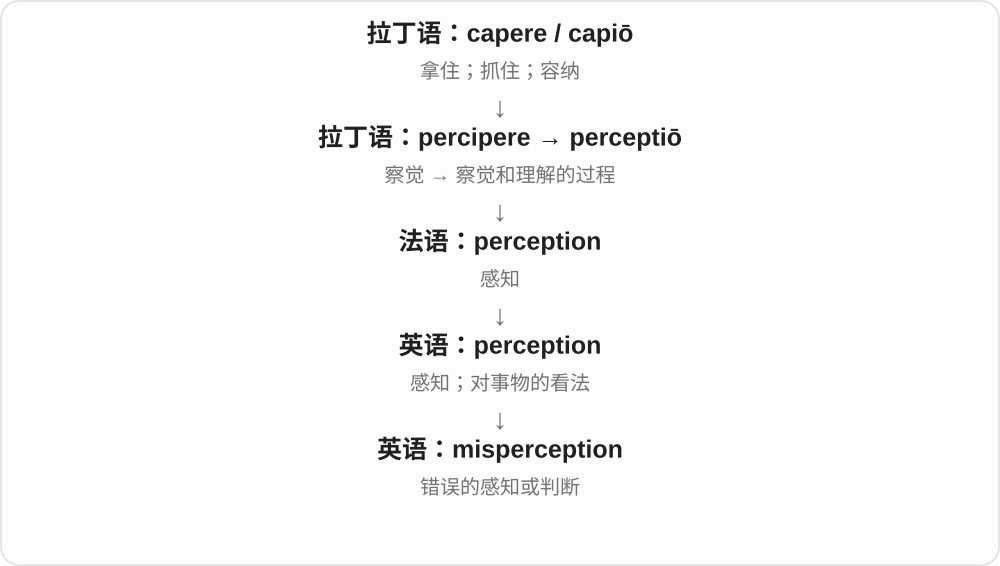

它可以指感官判断，也可以指对人的动机、危险或局面的误判。一个安静的人被当成冷漠，就是可能的 misperception。

**常见搭配与例句**

a misperception of…；correct a misperception；public misperception。

> The silence led to a misperception that nobody cared.

沉默让人误以为没有人在意。

> Better information can reduce misperceptions about the risks.

更充分的信息可以减少对风险的误判。

**别混淆**

misperception 偏看到和判断时出了偏差；misconception 偏脑中形成了错误观念。实际用法会有重叠。

### 38. capably — 能干地；熟练地

**音标**：/ˈkeɪpəbli/

**先抓住这个画面**

事情交到手里，他接得稳、办得好，就可以说 handled it capably。这个词评价做事的方式。

**怎么拆**

capable + -ly；拼写从 -le 变为 -ly，成为副词。

**怎么变成今天的意思**

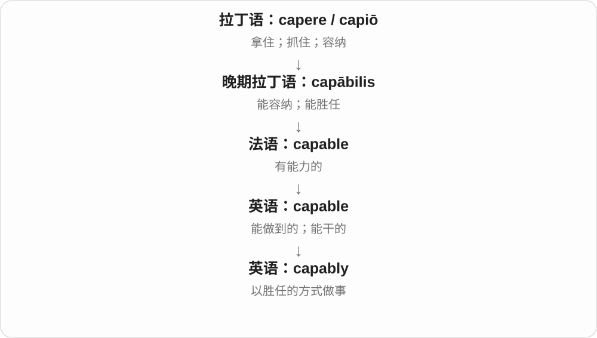

capable 评价人或能力，capably 评价动作。它不只是“做了”，还表示表现得有本领、能应付。

**常见搭配与例句**

handle something capably；capably managed；perform capably。

> She capably handled the unexpected questions.

她熟练地应对了那些意料之外的问题。

> The office was capably managed during his absence.

他不在时，办公室仍被管理得很好。

**别混淆**

capably 强调能胜任；easily 强调不费劲。一个人费了很大力气，也可以把事处理得很出色。

### 39. preconception — 先入之见；预先形成的看法

**音标**：/ˌpriːkənˈsepʃən/

**先抓住这个画面**

还没认真看事实，脑子里的答案已经写好了。这就是 preconception。它未必全错，但容易挡住新信息。

**怎么拆**

pre-（在前）+ conception（观念）。重点是观念形成得比实际了解更早。

**怎么变成今天的意思**

“先形成的想法”在讨论里常带提醒意味：你是否带着旧答案来观察新问题？放下 preconceptions，就是先让证据进来。

**常见搭配与例句**

preconceptions about…；challenge a preconception；without preconceptions。

> Try to approach the problem without preconceptions.

试着放下先入之见来处理这个问题。

> The trip challenged her preconceptions about the country.

这次旅行挑战了她对那个国家原先的看法。

**别混淆**

preconception 强调时间上先入为主；misconception 强调内容上理解错误。先入之见可能碰巧正确，但仍值得检验。

### 40. proprioception — 本体感觉

**音标**：/ˌprəʊpriəˈsepʃən/

**先抓住这个画面**

闭上眼睛，你仍大致知道手放在哪里、膝盖弯了多少。身体对自身位置和运动的这种感觉，就是 proprioception。

**怎么拆**

proprio- 来自拉丁语 proprius“自己的”，后部与 reception 的“接收”有关。它与 proprioceptor“本体感受器”同族，是现代科学用古典成分创造的术语。图中两个成分并列，不是一个演变出另一个。

**怎么变成今天的意思**

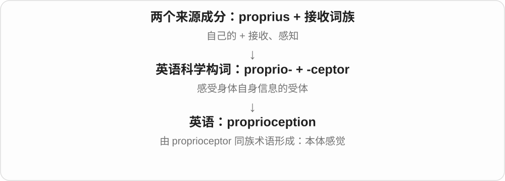

把“自己的”与“接收信息”放在一起，便能理解术语想指出哪一种感觉。它不是用眼睛看自己的身体，而是身体内部提供的位置和运动信息。

**常见搭配与例句**

proprioception and balance；a test of proprioception；proprioceptive information。

> Proprioception helps you know where your hand is without looking.

本体感觉帮助你不看手也知道手在哪里。

> The experiment examined the role of proprioception in movement.

这个实验研究了本体感觉在运动中的作用。

**别混淆**

proprioception 与 vision“视觉”不是同一条信息通道。两者可以一起帮助你控制动作，但闭眼后前者仍在起作用。

### 41. perceivable — 能察觉到的

**音标**：/pəˈsiːvəbəl/

**先抓住这个画面**

变化发生了，而且你的眼睛、耳朵或判断能抓住它，就 perceivable。

**怎么拆**

perceive + -able；去末尾 e，表示可以被察觉。

**怎么变成今天的意思**

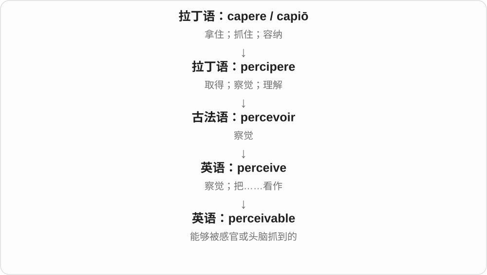

词义从察觉的动作转向对象是否达到察觉门槛。没有 perceivable difference，意思是没有能察觉的差别，不必然说明科学仪器也测不出差别。

**常见搭配与例句**

a perceivable difference；a perceivable change；easily perceivable。

> There was no perceivable difference between the two recordings.

两段录音之间听不出明显差别。

> The change was small but still perceivable.

变化虽小，但仍能察觉。

**别混淆**

perceivable 与 perceptible 都可表示可察觉；perceptible 更常见。visible 则特指能看见，不包括声音等其他感觉。

## 这一组要分清什么

**receive / accept**：前者说收到，后者说接受或认可。

**perception / conception**：前者偏察觉、解读；后者偏形成构想或观念。

**misconception / preconception**：前者是想错了，后者是还没充分了解就先有了看法。

**captive / captivate**：一个是被抓住走不了，一个是注意力被抓住、入了迷。

**caption** 的现代图片说明义经历了法律文书标题这一环节，不能只编一个“抓住注意力”的词源故事。

## 串起来练习

**I received the offer, but I did not accept it.**

我收到了提议，但没有接受。收到与认可不是一回事。

**A common misconception can shape our perception.**

一种常见的错误观念，会影响我们看待事情的方式。
