# 0157 · tend-, tens- — 伸展、拉紧、朝向；留意、意图与试探支线

[逐词精讲目录](../00_逐词精讲目录.md) · [总目录](../00_总目录_按常用程度.md)

## 核心词根与来源

先想象**两只手把一根绳子朝两边拉开**。拉丁语 tendere 可以表示伸展、拉紧、朝某处去。extend 把边界往外推，tension 是绷紧状态，attend 把注意力放过去，intend 把心思指向将要做的事。它们并非每个都保留一根看得见的绳子，但“朝某处用力、伸出”的画面能帮你串起词义。

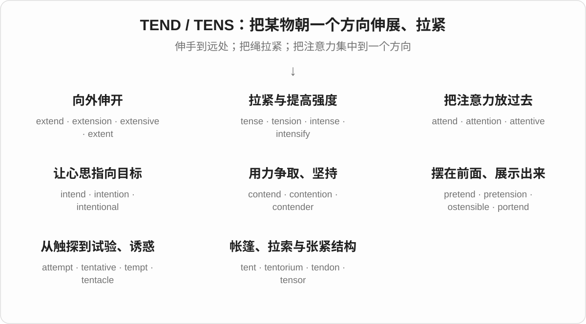

## 词形与演化规律

**tend-、tens-、tent-** 常反映 tendere 及其分词形式 tensus / tentus。别只凭几字母就认亲：**tenere 是“持有”**，在另一组讲；**tender“柔软”来自 tener，tense“时态”来自 tempus“时间”**，本页把同形词的路线分别写清。**attempt、tempt、tentative、tentacle** 可以可靠地追到 tentare / temptare“触探、试验、引诱”；更早是否直接来自 tendere 有不同分析，因此图从这一可靠节点开始。**tendon** 则先来自希腊 ténōn，再在拉丁语等传播中受 tendere 影响，不能倒画成拉丁动词直接生出希腊词。

## 单词速览（常用到不常用）

| 单词 | 音标 | 核心意思 |
|---|---|---|
| [attention](#w-1) | /əˈtenʃən/ | 注意力；关注；照顾 |
| [attempt](#w-2) | /əˈtempt/ | 尝试；试图 |
| [tend](#w-3) | /tend/ | 往往会；倾向于；照料 |
| [attend](#w-4) | /əˈtend/ | 出席；照顾；留意；处理 |
| [extensive](#w-5) | /ɪkˈstensɪv/ | 广泛的；大规模的 |
| [extent](#w-6) | /ɪkˈstent/ | 范围；程度 |
| [extension](#w-7) | /ɪkˈstenʃən/ | 延长；扩建部分；扩展功能；分机 |
| [intense](#w-8) | /ɪnˈtens/ | 强烈的；紧张专注的 |
| [extend](#w-9) | /ɪkˈstend/ | 伸展；延长；扩大；给予 |
| [intention](#w-10) | /ɪnˈtenʃən/ | 意图；打算；目的 |
| [pretend](#w-11) | /prɪˈtend/ | 假装；装作；假想 |
| [attending](#w-12) | /əˈtendɪŋ/ | 出席的；负责诊疗的高年资医师 |
| [intent](#w-13) | /ɪnˈtent/ | 意图；专注的；一心想要的 |
| [tension](#w-14) | /ˈtenʃən/ | 张力；紧张；矛盾关系 |
| [attendance](#w-15) | /əˈtendəns/ | 出席；出席人数；出勤情况 |
| [intensity](#w-16) | /ɪnˈtensəti/ | 强度；强烈程度 |
| [intend](#w-17) | /ɪnˈtend/ | 打算；意在；指定供……使用 |
| [tender](#w-18) | 英 /ˈtendə/；美 /ˈtendər/ | 嫩的；温柔的；一碰就疼的；正式提出；投标；接驳艇 |
| [intensive](#w-19) | /ɪnˈtensɪv/ | 密集的；集中的；强度大的 |
| [tent](#w-20) | /tent/ | 帐篷；搭帐篷；使呈帐篷状 |
| [superintendent](#w-21) | 英 /ˌsuːpərɪnˈtendənt/；美 /ˌsuːpərɪnˈtendənt/ | 主管；监督负责人；某些警衔或教育职衔 |
| [tendency](#w-22) | /ˈtendənsi/ | 倾向；容易出现的趋势 |
| [tense](#w-23) | /tens/ | 紧绷的；紧张的；绷紧；语法时态 |
| [extensively](#w-24) | /ɪkˈstensɪvli/ | 广泛地；大范围地 |
| [intentionally](#w-25) | /ɪnˈtenʃənəli/ | 有意地；故意地 |
| [contention](#w-26) | /kənˈtenʃən/ | 争论；主张；争夺 |
| [intentional](#w-27) | /ɪnˈtenʃənəl/ | 有意的；故意的 |
| [temptation](#w-28) | /tempˈteɪʃən/ | 诱惑；让人心动的事物 |
| [tempting](#w-29) | /ˈtemptɪŋ/ | 诱人的；让人想接受的 |
| [attendant](#w-30) | /əˈtendənt/ | 服务人员；随员；伴随的 |
| [contender](#w-31) | 英 /kənˈtendə/；美 /kənˈtendər/ | 竞争者；有希望获胜的人 |
| [contend](#w-32) | /kənˈtend/ | 竞争；应付困难；坚持主张 |
| [intensely](#w-33) | /ɪnˈtensli/ | 强烈地；极其专注地 |
| [tentative](#w-34) | /ˈtentətɪv/ | 暂定的；试探性的；犹豫谨慎的 |
| [hypertension](#w-35) | 英 /ˌhaɪpəˈtenʃən/；美 /ˌhaɪpərˈtenʃən/ | 高血压 |
| [ostensibly](#w-36) | /ɒˈstensəbli/；美也 /ɑːˈstensəbli/ | 表面上；按所说的理由 |
| [contentious](#w-37) | /kənˈtenʃəs/ | 有争议的；爱争辩的 |
| [tendon](#w-38) | /ˈtendən/ | 肌腱 |
| [attentive](#w-39) | /əˈtentɪv/ | 专心的；体贴周到的 |
| [tempt](#w-40) | /tempt/ | 诱惑；引得人想做 |
| [unintentionally](#w-41) | /ˌʌnɪnˈtenʃənəli/ | 无意中；并非故意地 |
| [unattended](#w-42) | /ˌʌnəˈtendɪd/ | 无人照看、处理或陪同的 |
| [pretentious](#w-43) | /prɪˈtenʃəs/ | 装腔作势的；自命不凡的 |
| [intensify](#w-44) | /ɪnˈtensɪfaɪ/ | 加强；变得更强烈 |
| [tentatively](#w-45) | /ˈtentətɪvli/ | 暂时拟定地；试探着 |
| [unintentional](#w-46) | /ˌʌnɪnˈtenʃənəl/ | 无意的；非故意的 |
| [tensor](#w-47) | 英 /ˈtensə/；美 /ˈtensər/；也读 /ˈtensɔː(r)/ | 张量；使组织张紧的肌肉 |
| [pretense](#w-48) | /prɪˈtens/ | 假装；虚假的借口 |
| [intently](#w-49) | /ɪnˈtentli/ | 专注地；目不转睛地 |
| [tensile](#w-50) | 英 /ˈtensaɪl/；美 /ˈtensəl/ | 拉伸的；受拉力的 |
| [intensively](#w-51) | /ɪnˈtensɪvli/ | 集中而密集地 |
| [intensification](#w-52) | /ɪnˌtensɪfɪˈkeɪʃən/ | 加强；强化；集约化 |
| [pretender](#w-53) | 英 /prɪˈtendə/；美 /prɪˈtendər/ | 冒充者；自称有继承权的人 |
| [pretence](#w-54) | /prɪˈtens/ | 假装；伪装的理由，英式常用拼法 |
| [attendee](#w-55) | /əˌtenˈdiː/ | 出席者；参会者 |
| [extender](#w-56) | 英 /ɪkˈstendə/；美 /ɪkˈstendər/ | 延长装置；扩展器；增量材料 |
| [ostentatious](#w-57) | 英 /ˌɒstenˈteɪʃəs/；美 /ˌɑːstenˈteɪʃəs/ | 炫耀的；刻意显摆的 |
| [tentacle](#w-58) | /ˈtentəkəl/ | 触手；伸出去的势力或控制 |
| [entente](#w-59) | 英 /ɒnˈtɒnt/；美 /ɑːnˈtɑːnt/ | 友好谅解；国家间的协定关系 |
| [extensible](#w-60) | /ɪkˈstensəbəl/ | 可扩展的；可延伸的 |
| [hypotension](#w-61) | 英 /ˌhaɪpəʊˈtenʃən/；美 /ˌhaɪpoʊˈtenʃən/ | 低血压 |
| [attentively](#w-62) | /əˈtentɪvli/ | 专心地；留意周到地 |
| [ostensible](#w-63) | 英 /ɒˈstensəbəl/；美 /ɑːˈstensəbəl/ | 表面上的；对外声称的 |
| [inattentive](#w-64) | /ˌɪnəˈtentɪv/ | 不专心的；疏于留意的 |
| [inattention](#w-65) | /ˌɪnəˈtenʃən/ | 不注意；疏忽 |
| [extendable](#w-66) | /ɪkˈstendəbəl/ | 能够延长、展开的 |
| [attentional](#w-67) | /əˈtenʃənəl/ | 注意力方面的 |
| [entendre](#w-68) | 英 /ɒnˈtɒndrə/；美 /ɑːnˈtɑːndrə/（沿用 double entendre 中的读法） | 话语中的一层含义，尤其暗含的意思 |
| [pretension](#w-69) | /prɪˈtenʃən/ | 自命的身份或能力；野心；做作 |
| [attentiveness](#w-70) | /əˈtentɪvnəs/ | 专注；细心周到 |
| [portent](#w-71) | 英 /ˈpɔːtent/；美 /ˈpɔːrtent/ | 预兆，尤指不祥之兆 |
| [extensor](#w-72) | 英 /ɪkˈstensə/；美 /ɪkˈstensər/ | 伸肌 |
| [portend](#w-73) | 英 /pɔːˈtend/；美 /pɔːrˈtend/ | 预示；成为某事的征兆 |
| [portentous](#w-74) | 英 /pɔːˈtentəs/；美 /pɔːrˈtentəs/ | 预示大事的；煞有介事的 |
| [ostentatiously](#w-75) | 英 /ˌɒstenˈteɪʃəsli/；美 /ˌɑːstenˈteɪʃəsli/ | 炫耀地；故意做给人看地 |
| [ostentation](#w-76) | 英 /ˌɒstenˈteɪʃən/；美 /ˌɑːstenˈteɪʃən/ | 炫耀；卖弄排场 |
| [extensibility](#w-77) | /ɪkˌstensəˈbɪləti/ | 可扩展性；可延伸性 |
| [extensional](#w-78) | /ɪkˈstenʃənəl/ | 外延的；与伸展有关的 |
| [detent](#w-79) | /dɪˈtent/；也 /ˈdiːtent/ | 定位卡扣；制动定位机构 |
| [tendentious](#w-80) | /tenˈdenʃəs/ | 有偏向的；刻意为某种立场服务的 |
| [distension](#w-81) | /dɪˈstenʃən/ | 胀大；鼓起；膨胀 |
| [intension](#w-82) | /ɪnˈtenʃən/ | 内涵；旧用：加强、紧张程度 |
| [coextensive](#w-83) | /ˌkəʊɪkˈstensɪv/；美 /ˌkoʊɪkˈstensɪv/ | 范围相同的；延伸范围一致的 |
| [superintend](#w-84) | /ˌsuːpərɪnˈtend/ | 监督；主管 |
| [superintendency](#w-85) | /ˌsuːpərɪnˈtendənsi/ | 主管职位；主管任期；监督职责 |
| [intensional](#w-86) | /ɪnˈtenʃənəl/ | 内涵的；涉及意义内容的 |
| [tentacular](#w-87) | 英 /tenˈtækjələ/；美 /tenˈtækjələr/ | 触手的；像触手般伸向各处的 |
| [distend](#w-88) | /dɪˈstend/ | 使鼓起；膨胀 |
| [attent](#w-89) | /əˈtent/ | 专心的，古旧用法 |
| [ostensive](#w-90) | 英 /ɒˈstensɪv/；美 /ɑːˈstensɪv/ | 指示展示的；通过实物说明的 |
| [subtend](#w-91) | /sʌbˈtend/ | 对着某点张出一个角 |
| [tentation](#w-92) | /tenˈteɪʃən/ | 反复试调；试验，古旧技术用语 |
| [extensionality](#w-93) | /ɪkˌstenʃəˈnæləti/ | 外延性；外延相同即相等的原则 |
| [tentorium](#w-94) | /tenˈtɔːriəm/ | 小脑幕；节肢动物头内的支撑架 |
| [ambitendency](#w-95) | /ˌæmbɪˈtendənsi/ | 相反行动倾向并存 |
| [coextend](#w-96) | 英 /ˌkəʊɪkˈstend/；美 /ˌkoʊɪkˈstend/ | 延伸到同一范围；具有同样持续范围 |
| [coextension](#w-97) | 英 /ˌkəʊɪkˈstenʃən/；美 /ˌkoʊɪkˈstenʃən/ | 同范围延伸；范围或持续时间相等 |
| [distent](#w-98) | /dɪˈstent/ | 鼓胀的；撑开的，古旧用法 |
| [extensivity](#w-99) | /ˌekstenˈsɪvɪti/（按构词读法） | 广延性；随系统大小而变化的性质 |
| [inextensible](#w-100) | /ˌɪnɪkˈstensəbəl/ | 不可伸长的；不可扩展的 |
| [obtend](#w-101) | /əbˈtend/；也 /ɒbˈtend/ | 摆在前面；提出作借口，古旧词 |
| [obtension](#w-102) | /əbˈtenʃən/（按旧词构成读法） | 提出作借口；摆出理由，废旧词 |
| [ostension](#w-103) | 英 /ɒˈstenʃən/；美 /ɑːˈstenʃən/ | 展示；指示实物来说明 |
| [ostensory](#w-104) | 英 /ɒˈstensəri/；美 /ɑːˈstensəri/ | 圣体光座；用于展示圣体的礼仪器具 |
| [ostent](#w-105) | 展示名词 /ɒˈstent/；预兆名词、动词 /ˈɒstent/；美 /ɑː/ 代英 /ɒ/ | 炫示；预兆；炫耀，均属古旧用法 |
| [portension](#w-106) | 英 /pɔːˈtenʃən/；美 /pɔːrˈtenʃən/（依旧词典重音） | 预示；预兆，废旧词 |
| [subtense](#w-107) | /sʌbˈtens/ | 所对的弦或线段；所张角；测角求距的 |
| [tendential](#w-108) | /tenˈdentʃəl/ | 倾向性的；表现趋势的；带偏向的 |
| [tensible](#w-109) | /ˈtensəbəl/ | 可拉长、可延展的 |
| [tensility](#w-110) | /tenˈsɪlɪti/ | 可拉伸性；与张紧、拉伸有关的性质 |
| [tensure](#w-111) | 英 /ˈtenʃə/；美 /ˈtenʃər/（按旧词构成读法） | 张紧；张力，废旧词 |
| [tentage](#w-112) | /ˈtentɪdʒ/ | 帐篷总称；帐篷装备及供给 |
| [tentiginous](#w-113) | /tenˈtɪdʒɪnəs/（依旧词典第二音节重音） | 绷紧僵硬的；好色的，均为废旧用法 |

## 逐词讲解

### 1. attention — 注意力；关注；照顾

**音标**：/əˈtenʃən/

**先抓住这个画面**

attention 像把心里的镜头转向某个对象，让它进入清晰画面。

**怎么拆**

现代可联系 attend 与 -tion；历史来自拉丁语 attentiō，名词有独立借入链。

**怎么变成今天的意思**

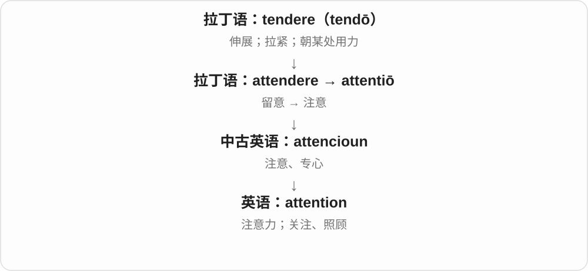

pay attention to 是把注意力放过去；need attention 可以是需要照料、处理，不只是想被看见。

**常见搭配与例句**

pay attention to；draw attention to；medical attention。

> Please pay attention to the last instruction.

请注意最后一条说明。

> The damaged roof needs immediate attention.

受损的屋顶需要马上处理。

**别混淆**

attention 是关注；intention 是打算。注意到一件事不等于打算做它。

### 2. attempt — 尝试；试图

**音标**：/əˈtempt/

**先抓住这个画面**

attempt 是把想法推到实际行动这一步：去试了，但词本身没说成功。

**怎么拆**

来自拉丁语 ad- + temptāre → attemptāre，经古法语 atempter；不能把英语 attempt 当作 attend 的变形。

**怎么变成今天的意思**

attempt to do 较正式，名词用 an attempt to do / at something。试探词族更早是否直接来自 tendere 有不同分析，图从可靠的 tentāre / temptāre 开始。

**常见搭配与例句**

attempt to escape；make an attempt；at the first attempt。

> She attempted to repair the lamp herself.

她试着自己修灯。

> He passed the test on his second attempt.

他第二次尝试时通过了测试。

**别混淆**

attempt 强调尝试；achievement 才表示已经取得的成果。

### 3. tend — 往往会；倾向于；照料

**音标**：/tend/

**先抓住这个画面**

tend to do 像事情自然朝某个方向走；tend a garden 则是留心照看花园。

**怎么拆**

倾向义经法语 tendre 来自 tendere；照料义是 attend 等词缩短后的形式。同形的古旧“点燃”义另来自古英语 tendan。

**怎么变成今天的意思**

I tend to forget 表示经常如此，不是一次打算；tend to a customer 中的 to 接对象，说照应顾客。

**常见搭配与例句**

tend to do；tend towards；tend a garden；tend to someone。

> I tend to work better in the morning.

我往往在上午工作效率更高。

> She tends the plants on her balcony.

她照料阳台上的植物。

**别混淆**

tend to do 是倾向；intend to do 是有意打算。

### 4. attend — 出席；照顾；留意；处理

**音标**：/əˈtend/

**先抓住这个画面**

attend 的共同画面是把人和注意力放到某件事上：到场参加，或专心照应。

**怎么拆**

ad-（朝向）+ tendere，经 attendere 和法语 atendre 传入。

**怎么变成今天的意思**

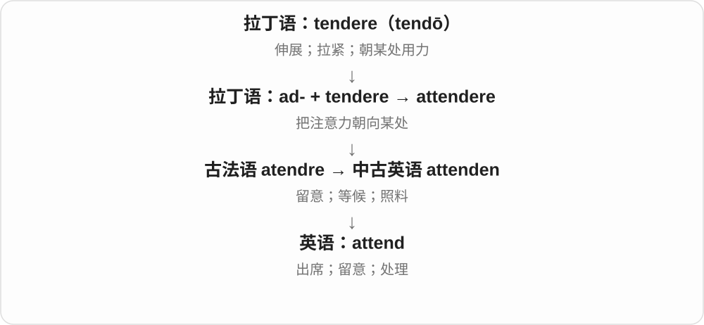

attend a meeting 直接接会议；attend to a problem 用 to 表示处理问题。这两个搭配不要混。

**常见搭配与例句**

attend school；attend a meeting；attend to a request。

> More than fifty people attended the meeting.

五十多人出席了会议。

> I need to attend to a few urgent emails.

我需要处理几封紧急邮件。

**别混淆**

attend 是到场；join 可是加入组织或一起做，join a club 不等于只参加一次活动。

### 5. extensive — 广泛的；大规模的

**音标**：/ɪkˈstensɪv/

**先抓住这个画面**

extensive 像把地图摊开，覆盖的地方很多：研究范围广，损坏面积大。

**怎么拆**

来自晚期拉丁语 extēnsīvus；现代可联系 extend 的 extēns- 词干与 -ive。

**怎么变成今天的意思**

强调覆盖范围或数量，不自动说明每个细节研究得多深。

**常见搭配与例句**

extensive research；extensive damage；an extensive network。

> The storm caused extensive damage.

暴风雨造成了大范围破坏。

> She has extensive experience in teaching adults.

她有丰富的成人教学经验。

**别混淆**

extensive 看范围广；intensive 看投入密、强度大。

### 6. extent — 范围；程度

**音标**：/ɪkˈstent/

**先抓住这个画面**

extent 像在问：这件事伸到哪里、到底有多大？

**怎么拆**

经古法语 estente、盎格鲁诺曼语 extente，联系 extendere；早期也用于土地范围与估值。

**怎么变成今天的意思**

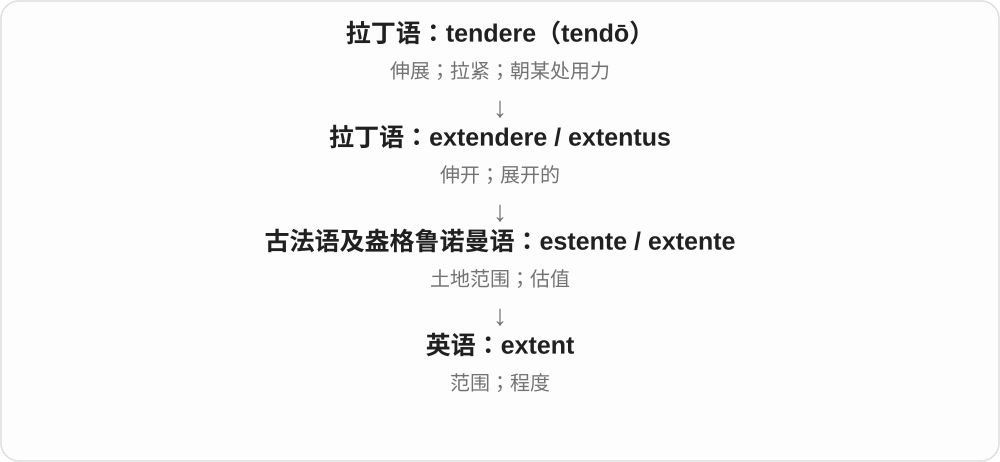

to some extent 是在某种程度上；the extent of the damage 问受损范围和程度，不是延长动作。

**常见搭配与例句**

to a large extent；the full extent of；to what extent。

> We do not yet know the full extent of the damage.

我们还不知道损坏究竟有多严重。

> I agree with you to some extent.

我在一定程度上同意你的看法。

**别混淆**

extent 是有多大；extension 是延伸、扩建或增加的一段。

### 7. extension — 延长；扩建部分；扩展功能；分机

**音标**：/ɪkˈstenʃən/

**先抓住这个画面**

extension 像给原来的一段接上新的一段：时间往后延，房屋多出一间，软件多出功能。

**怎么拆**

现代对应 extend + -sion；来自拉丁语 extēnsiō，经古法语借入。

**怎么变成今天的意思**

申请 deadline extension 是延长时限；browser extension 是浏览器扩展；extension 204 可能是电话分机号。

**常见搭配与例句**

an extension of time；a house extension；a browser extension。

> The teacher granted a two-day extension.

老师把期限延长了两天。

> This browser extension blocks unwanted pop-ups.

这个浏览器扩展会拦截不需要的弹窗。

**别混淆**

extension 常在原有东西上延长；replacement 是换掉原来的东西。

### 8. intense — 强烈的；紧张专注的

**音标**：/ɪnˈtens/

**先抓住这个画面**

intense 像把音量旋钮拧得很高：热、情绪、竞争或目光都很强。

**怎么拆**

来自拉丁语 intēnsus“拉紧的”，是 intendere 的分词形式；经法语或直接借入。

**怎么变成今天的意思**

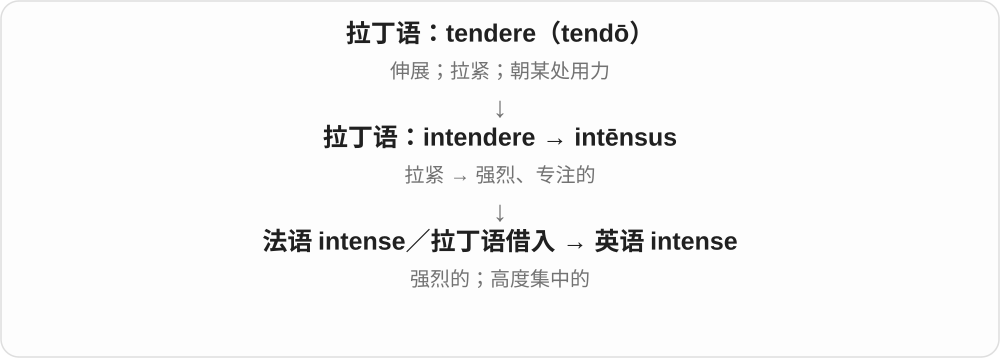

intense heat 强调热得厉害；an intense person 常说人非常投入，给人紧绷感，不是单纯严肃。

**常见搭配与例句**

intense heat；intense competition；an intense gaze。

> The intense heat forced us indoors.

酷热迫使我们躲进室内。

> She listened with intense concentration.

她全神贯注地听着。

**别混淆**

intense 描写强烈感受或状态；intensive 更常描写集中安排和大量投入。

### 9. extend — 伸展；延长；扩大；给予

**音标**：/ɪkˈstend/

**先抓住这个画面**

extend 是让原来的边界往外走：伸出手，拉长时间，把服务送到更远。

**怎么拆**

ex-（向外）+ tendere，经拉丁 extendere、法语 estendre 等形式。

**怎么变成今天的意思**

也可把抽象东西“送出去”：extend an invitation 是发出邀请，不是把邀请函拉长。

**常见搭配与例句**

extend a deadline；extend a hand；extend an invitation。

> We need to extend the deadline by a week.

我们需要把截止日期延后一周。

> The hotel extended a warm welcome to the guests.

酒店向宾客表示热烈欢迎。

**别混淆**

expand 常强调整体变大；extend 更容易突出长度、范围或期限向外延伸。

### 10. intention — 意图；打算；目的

**音标**：/ɪnˈtenʃən/

**先抓住这个画面**

intention 是行动前心里指向的目标：你本来想让什么发生。

**怎么拆**

来自拉丁语 intentiō，经古法语 entencion；现代可与 intend / intent 对照，但不是英语 intent 生出所有历史形式。

**怎么变成今天的意思**

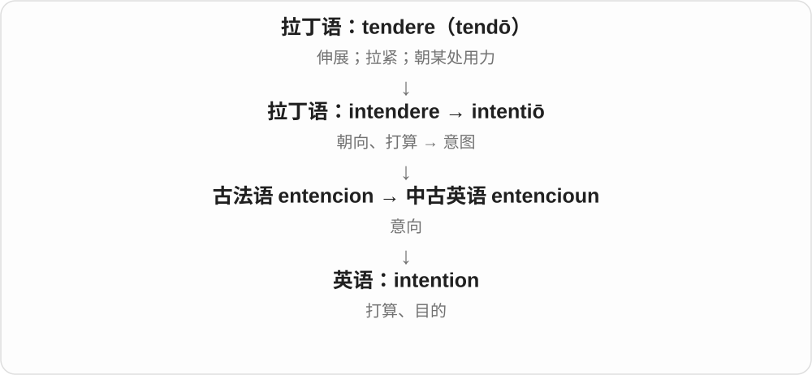

have no intention of doing 是完全不打算做；good intentions 不保证最后效果好。

**常见搭配与例句**

with the intention of；have every intention of；good intentions。

> My intention was to help, not to interrupt.

我原本是想帮忙，不是打断。

> She has no intention of leaving the team.

她完全没有离开团队的打算。

**别混淆**

intention 是想达到的目的；result 是实际发生的结果。

### 11. pretend — 假装；装作；假想

**音标**：/prɪˈtend/

**先抓住这个画面**

pretend 像把一个不是真的角色或情形摆到面前，让人暂时按它是真的来理解。

**怎么拆**

prae-（在前）+ tendere → praetendere，经过法语“声称、提出”的路线。

**怎么变成今天的意思**

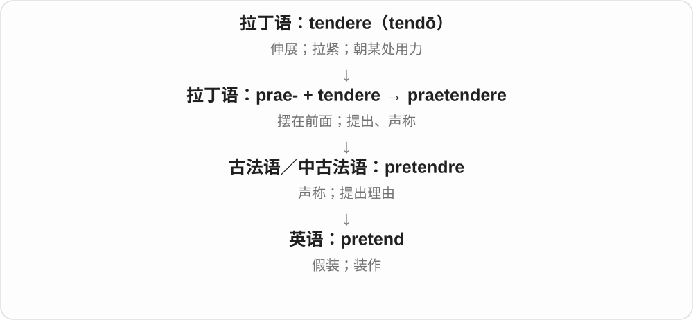

可以是骗人，也可以是孩子玩角色游戏。pretend to do、pretend that 都常用。

**常见搭配与例句**

pretend to be asleep；pretend that；let’s pretend。

> He pretended not to hear the question.

他装作没听见问题。

> Let’s pretend this box is a spaceship.

我们假装这个箱子是宇宙飞船吧。

**别混淆**

pretend 本身不保证恶意；deceive 明确强调使人受骗。

### 12. attending — 出席的；负责诊疗的高年资医师

**音标**：/əˈtendɪŋ/

**先抓住这个画面**

普通 attending 是正在参加；医院里的 an attending 则是承担诊疗与监督责任的医生角色。

**怎么拆**

attend + -ing；医师名词由 attending physician 缩短而来。

**怎么变成今天的意思**

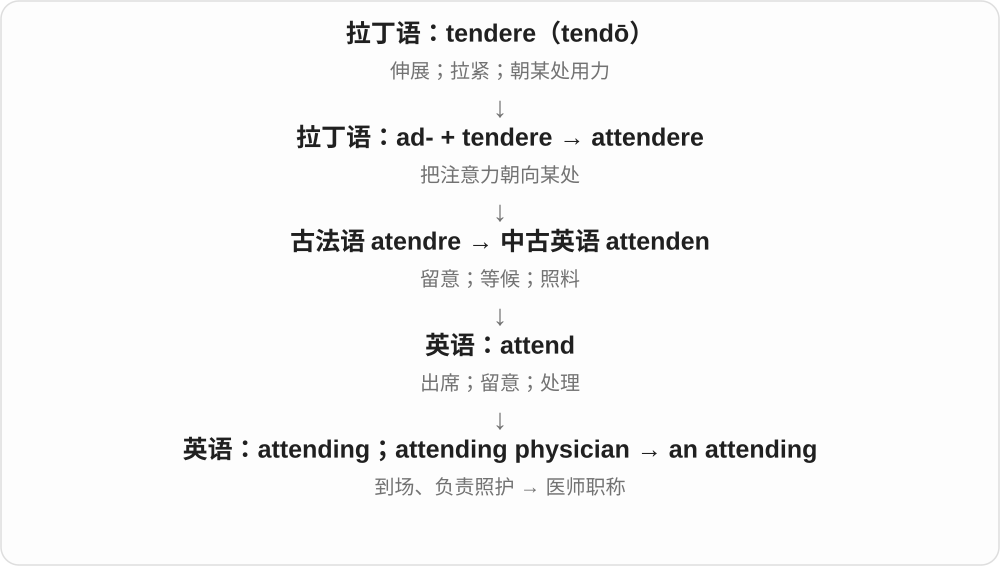

美国医疗语境尤常见，不能一律译作中国职称体系中的“主治医师”。

**常见搭配与例句**

students attending the course；an attending physician；the attending on duty。

> The students attending the workshop received a handbook.

参加工作坊的学生领到了一本手册。

> The resident discussed the case with the attending.

住院医师和负责的高年资医师讨论了病情。

**别混淆**

attendee 是活动参加者；an attending 在医院通常指医生，不是观众。

### 13. intent — 意图；专注的；一心想要的

**音标**：/ɪnˈtent/

**先抓住这个画面**

名词 intent 是心里瞄准的目的；形容词 intent 像视线和心思都锁定在一处。

**怎么拆**

名词经盎格鲁法语 entent / entente，形容词直接借拉丁 intentus；两条路线同属 intendere 词族，读音相同。

**怎么变成今天的意思**

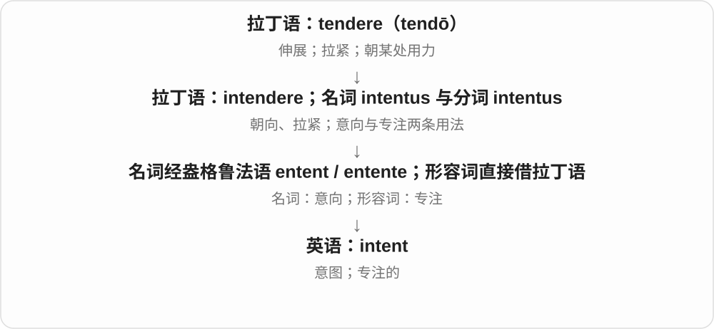

intent on doing 是一心要做；with intent 在正式文体中强调有意而为。

**常见搭配与例句**

with good intent；intent on winning；an intent expression。

> The letter made her intent clear.

这封信清楚表明了她的意图。

> He was intent on finishing before sunset.

他一心要在日落前完成。

**别混淆**

intent 可作名词也可作形容词；intention 通常是名词。

### 14. tension — 张力；紧张；矛盾关系

**音标**：/ˈtenʃən/

**先抓住这个画面**

想象一根被拉紧的绳子：物理上有拉力，人际上也可能绷着、随时要起冲突。

**怎么拆**

拉丁 tēnsus“绷紧的”形成 tēnsiō，经法语 tension 借入。

**怎么变成今天的意思**

绳索的 tension、肌肉紧绷和双方紧张关系要按对象区分；不是所有 pressure 都能直接换成 tension。

**常见搭配与例句**

under tension；muscle tension；tension between two groups。

> The cable must remain under tension.

这根缆索必须保持绷紧。

> A joke helped ease the tension in the room.

一个笑话缓和了屋里的紧张气氛。

**别混淆**

物理上 tension 多指拉伸中的力；compression 指挤压，方向相反。

### 15. attendance — 出席；出席人数；出勤情况

**音标**：/əˈtendəns/

**先抓住这个画面**

attendance 像活动签到表：有没有来，来了多少人，平时出勤怎么样。

**怎么拆**

借自古法语 atendance，来自 atendre；现代可与 attend + -ance 对照。从陪侍、到场发展到出勤及人数。

**怎么变成今天的意思**

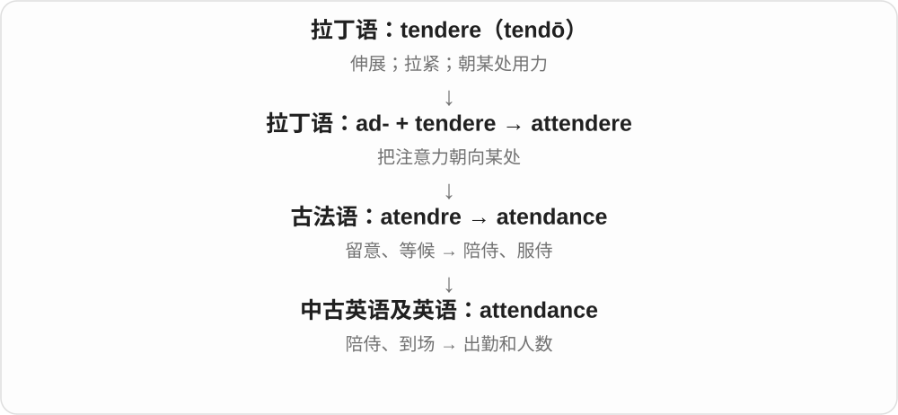

attendance is compulsory 是必须参加；an attendance of 200 是到场人数 200；school attendance 是上学出勤情况。

**常见搭配与例句**

attendance record；take attendance；in attendance。

> Attendance at the workshop is optional.

这次工作坊可自愿参加。

> The teacher took attendance before the lesson.

老师上课前点了名。

**别混淆**

attendee 是具体出席者；attendance 是出席这件事、人数或记录。

### 16. intensity — 强度；强烈程度

**音标**：/ɪnˈtensəti/

**先抓住这个画面**

intensity 像给强烈程度配一把尺：灯有多亮，训练有多猛，情绪有多强。

**怎么拆**

intense + -ity；也有中世纪拉丁语 intensitās 的对应形式。

**怎么变成今天的意思**

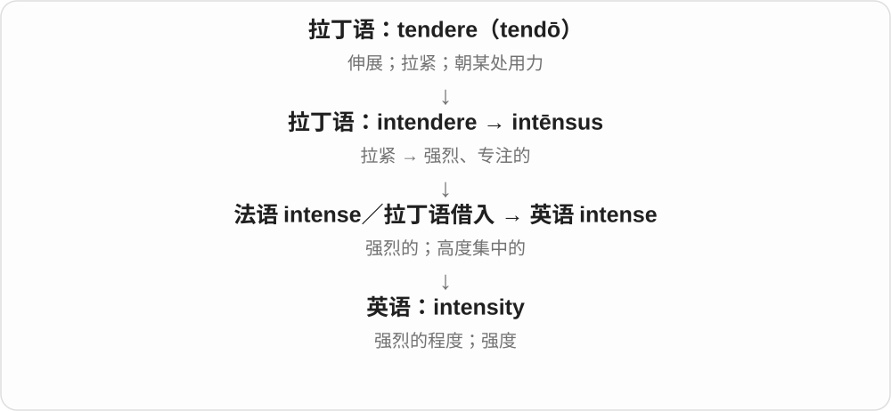

不同学科的具体量和单位不一样；日常只说某种作用或感受的强弱。

**常见搭配与例句**

light intensity；high intensity；the intensity of feeling。

> The light gradually increased in intensity.

光线强度逐渐增加。

> I was surprised by the intensity of her reaction.

她反应那么强烈，让我吃了一惊。

**别混淆**

intensity 强度；duration 时长。短暂的声音也可以非常强。

### 17. intend — 打算；意在；指定供……使用

**音标**：/ɪnˈtend/

**先抓住这个画面**

intend 是把心思朝某个目标指去：还没做，也已经有了打算。

**怎么拆**

in-（朝向）+ tendere → intendere，经法语 entendre 传入。

**怎么变成今天的意思**

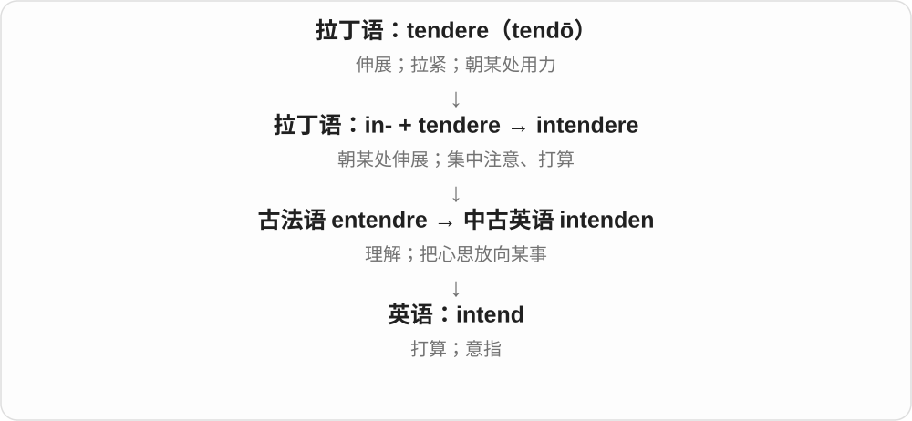

intend to do 是打算做；be intended for 是原本为某人、某用途准备。

**常见搭配与例句**

intend to return；intend someone to do；be intended for beginners。

> We intend to reopen the shop in June.

我们打算六月重新开店。

> This guide is intended for beginners.

这份指南是为初学者准备的。

**别混淆**

intend 是意愿；tend to 是倾向。The book is intended for children 说目标读者。

### 18. tender — 嫩的；温柔的；一碰就疼的；正式提出；投标；接驳艇

**音标**：英 /ˈtendə/；美 /ˈtendər/

**先抓住这个画面**

tender 有几条不同身世：嫩肉和温柔走“柔软”线，提交方案走“伸出去”线，接驳艇走“照料服务”线。

**怎么拆**

柔软义来自拉丁 tener，经法语 tendre；提出义来自 tendere，经法语动词 tendre；服务者、接驳艇是 tend（照料）+ -er。

**怎么变成今天的意思**

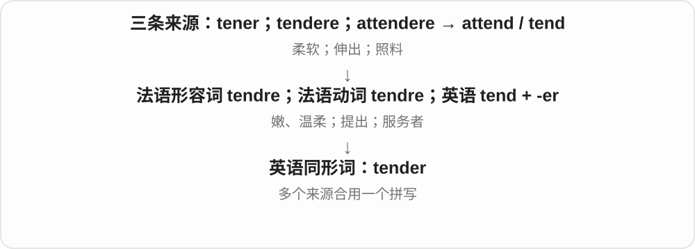

tender meat 容易嚼，a tender shoulder 一碰就痛，tender a resignation 是正式递交辞呈。a tender 可指投标书，也可指为大船服务的小艇。

**常见搭配与例句**

tender meat；a tender smile；submit a tender；tender a resignation。

> The meat was tender and easy to cut.

肉很嫩，很容易切开。

> She tendered her resignation on Monday.

她在星期一正式递交了辞呈。

> A tender carried the passengers ashore.

一艘接驳艇把乘客送上岸。

**别混淆**

柔软的 tender 不能画成 tendere 的直接后代；更不能与 tenere“持有”混为同一个拉丁词。

### 19. intensive — 密集的；集中的；强度大的

**音标**：/ɪnˈtensɪv/

**先抓住这个画面**

intensive 像把很多时间、精力或资源集中投入到一小段过程里。

**怎么拆**

经法语 intensif 来自中世纪拉丁 intēnsīvus，与 intēnsus 同族。

**怎么变成今天的意思**

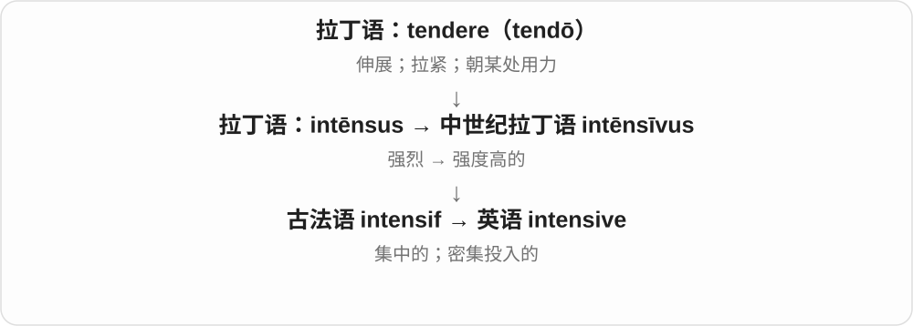

intensive course 是安排紧凑、学习投入多的课程。物理里的 intensive property 则指不随体系大小直接成比例变化的性质，如温度。

**常见搭配与例句**

intensive training；an intensive course；intensive care。

> She completed an intensive language course.

她完成了一门密集语言课程。

> The project required intensive preparation.

这个项目需要大量集中的准备工作。

**别混淆**

extensive 强调广度；intensive 强调集中投入。技术上的强度量也与广延量 extensive property 对照。

### 20. tent — 帐篷；搭帐篷；使呈帐篷状

**音标**：/tent/

**先抓住这个画面**

tent 的日常画面是一块布被支架拉开、撑起，里面出现可遮风雨的空间。

**怎么拆**

帐篷义经法语 tente 来自与 tendere 分词 tentus 有关的形式。旧文另有“留意”“探条”和红酒同形词，不能全按帐篷解释。

**怎么变成今天的意思**

pitch a tent 是把帐篷搭起来。旧 red wine 的 tent 来自西班牙 tinto“深色的”，与伸展不同源。

**常见搭配与例句**

pitch a tent；a camping tent；sleep in a tent。

> We pitched our tent beside the lake.

我们在湖边搭起帐篷。

> The children slept in a tent in the garden.

孩子们睡在花园里的帐篷中。

**别混淆**

tent 是可携带的遮蔽结构；canopy 更强调上面的遮盖，不一定围成可住空间。

### 21. superintendent — 主管；监督负责人；某些警衔或教育职衔

**音标**：英 /ˌsuːpərɪnˈtendənt/；美 /ˌsuːpərɪnˈtendənt/

**先抓住这个画面**

superintendent 像从整体上盯着一项工作的人，负责人员、安排和运行。

**怎么拆**

借自教会拉丁语 superintendēns，联系 superintendere；不是所有职衔都可套用同一中文级别。

**怎么变成今天的意思**

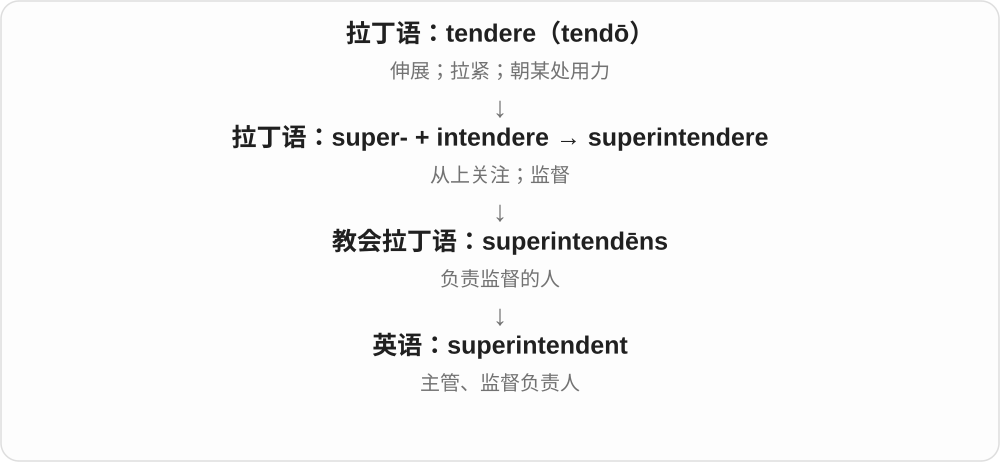

学校系统、楼宇管理和警务中都可能出现，职责和级别随地区变化。

**常见搭配与例句**

a school superintendent；the building superintendent；a police superintendent。

> The superintendent oversees several schools.

这位主管负责管理几所学校。

> Report the broken lift to the building superintendent.

请把电梯故障报告给楼宇管理员。

**别混淆**

superintendent 是具体管理职称；supervisor 是更宽泛的监督者称呼。

### 22. tendency — 倾向；容易出现的趋势

**音标**：/ˈtendənsi/

**先抓住这个画面**

tendency 像没有人推也常朝某个方向偏：人爱拖延，材料受热会变形。

**怎么拆**

中世纪拉丁 tendentia 来自 tendēns“朝向、趋于”；不是“必须如此”的意思。

**怎么变成今天的意思**

have a tendency to do 说常出现的倾向；并不表示每次一定这样。

**常见搭配与例句**

a tendency to exaggerate；a tendency towards；a growing tendency。

> He has a tendency to speak too quickly.

他讲话容易太快。

> The material shows a tendency to crack in cold weather.

这种材料在寒冷天气里容易开裂。

**别混淆**

tendency 是倾向；certainty 是确定性。

### 23. tense — 紧绷的；紧张的；绷紧；语法时态

**音标**：/tens/

**先抓住这个画面**

紧张的 tense 像绳子拉得很紧；语法里的 tense 则是另一条“时间”来源。

**怎么拆**

形容词来自拉丁 tēnsus，属 tendere；时态名词经古法语 tens 来自 tempus“时间”。

**怎么变成今天的意思**

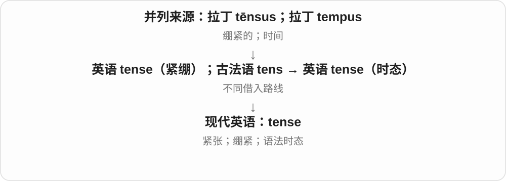

tense muscles 是绷紧的肌肉；past tense 是过去时。两种用法同音同形，不要编成“时间被拉紧”。

**常见搭配与例句**

a tense atmosphere；tense your shoulders；the past tense。

> The room fell silent during a tense discussion.

紧张的讨论中，屋里安静了下来。

> Put the verb in the past tense.

把动词改为过去时。

**别混淆**

tense 描写紧绷状态；tension 是紧绷、紧张这一名词。时态义与 tension 无直接派生关系。

### 24. extensively — 广泛地；大范围地

**音标**：/ɪkˈstensɪvli/

**先抓住这个画面**

extensively 说事情铺得很开：游历很多地方，采访许多人，修改很多部分。

**怎么拆**

extensive + -ly。

**怎么变成今天的意思**

travel extensively 不一定每处住很久，但去的地方通常多。

**常见搭配与例句**

travel extensively；write extensively about；extensively revised。

> She has travelled extensively in Asia.

她游历过亚洲许多地方。

> The report was extensively revised before publication.

报告在发表前作了大幅修改。

**别混淆**

extensively 看范围；intensively 看密度或投入强度。

### 25. intentionally — 有意地；故意地

**音标**：/ɪnˈtenʃənəli/

**先抓住这个画面**

intentionally 像在行动旁加一句：“我是有意这样安排的。”

**怎么拆**

intentional + -ly。

**怎么变成今天的意思**

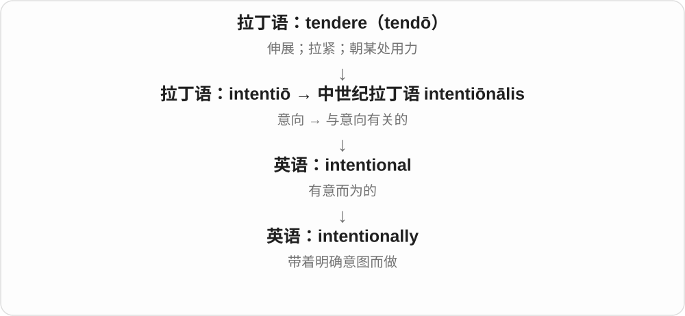

可以解释设计选择，也可以说明行为不是失误。它本身不说明这个目的好还是坏。

**常见搭配与例句**

intentionally left blank；intentionally vague；act intentionally。

> This page has been intentionally left blank.

这一页是特意留白的。

> She intentionally chose a simple example.

她特意选了一个简单的例子。

**别混淆**

intently 是专注地；intentionally 是有意地，认真看不等于故意安排。

### 26. contention — 争论；主张；争夺

**音标**：/kənˈtenʃən/

**先抓住这个画面**

contention 可以是双方在一个问题上拉扯，也可以是你拿出来坚持的那个观点。

**怎么拆**

来自拉丁 contentiō，经古法语 contencion；与 contend 平行借入。

**怎么变成今天的意思**

a point of contention 是争议点；her contention that… 是她提出的主张；in contention 说仍有竞争机会。

**常见搭配与例句**

a bone of contention；the contention that；in contention for。

> Cost remains the main point of contention.

费用仍是主要争议点。

> Her contention is that the rule treats applicants unfairly.

她主张这条规定对申请者不公平。

**别混淆**

contention“主张”不代表已经证明；evidence 才是支持它的证据。

### 27. intentional — 有意的；故意的

**音标**：/ɪnˈtenʃənəl/

**先抓住这个画面**

intentional 表示这件事是心里先有方向、然后照着做的，而不是碰巧发生。

**怎么拆**

与 intention + -al 对应；历史联系中世纪拉丁 intentiōnālis。

**怎么变成今天的意思**

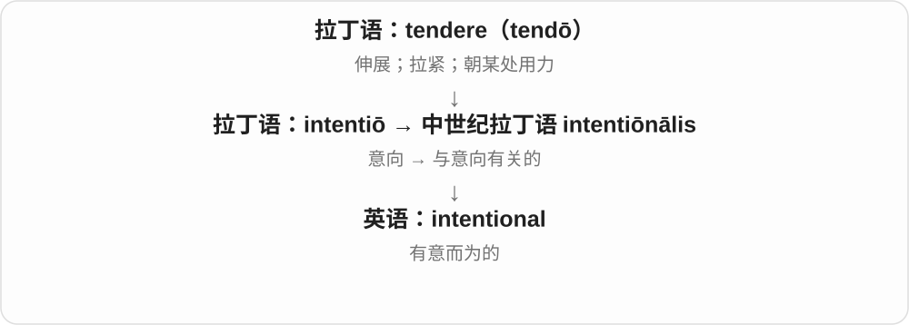

并不总带恶意：intentional design 是有目的的设计；intentional damage 才按语境说故意破坏。

**常见搭配与例句**

an intentional act；intentional design；intentional damage。

> The unusual spacing is intentional.

这种不寻常的间距是特意设计的。

> The investigation found no evidence of intentional damage.

调查没有发现故意破坏的证据。

**别混淆**

intentional 是有意；intensional 是逻辑学中的内涵，两者同音而不同义。

### 28. temptation — 诱惑；让人心动的事物

**音标**：/tempˈteɪʃən/

**先抓住这个画面**

temptation 像某件事向你招手，让你想偏离原本的计划或原则。

**怎么拆**

来自拉丁 temptātiō，经古法语 temptacion；现代可联系 tempt + -ation。

**怎么变成今天的意思**

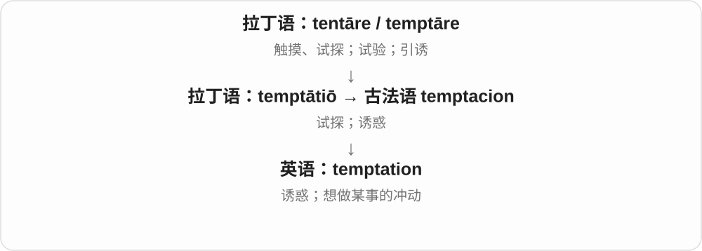

有时只是多吃一块蛋糕的小诱惑，不必每次都涉及严重过错。

**常见搭配与例句**

resist temptation；give in to temptation；the temptation to do。

> I resisted the temptation to check my phone.

我忍住了查看手机的冲动。

> The extra cake was a real temptation.

多出来的那块蛋糕实在让人心动。

**别混淆**

temptation 是吸引你去做的冲动或东西；attempt 是已经作出的尝试。

### 29. tempting — 诱人的；让人想接受的

**音标**：/ˈtemptɪŋ/

**先抓住这个画面**

tempting 像路边刚出炉的面包或突然空出的假期，让你忍不住想说“好吧”。

**怎么拆**

来自 tempt 的 -ing 形式，进一步作形容词，描述引起诱惑的东西。

**怎么变成今天的意思**

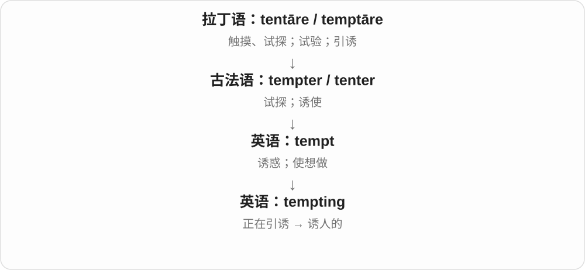

可以修饰食物、价格、机会或建议。It is tempting to think… 常提醒某个想法很吸引人，但可能过于简单。

**常见搭配与例句**

a tempting offer；a tempting smell；it is tempting to assume。

> The offer was tempting, but I needed more time.

那个提议很诱人，但我需要更多时间考虑。

> It is tempting to blame one person for the failure.

把失败归咎于一个人是个很容易让人接受的想法。

**别混淆**

attractive 比较中性；tempting 更像正在拉动你的欲望、让你想采取行动。

### 30. attendant — 服务人员；随员；伴随的

**音标**：/əˈtendənt/

**先抓住这个画面**

attendant 作名词是留在附近照应的人；作形容词则是随某件事一同到来的情况。

**怎么拆**

借自法语 attendant“等候、随侍的”，上接 attendre 和拉丁 attendere；现代可联系 attend + -ant。

**怎么变成今天的意思**

flight attendant 是机舱服务人员；attendant risks 是随之而来的风险，不是“风险服务员”。

**常见搭配与例句**

a flight attendant；a parking attendant；attendant difficulties。

> The attendant showed us where to park.

工作人员告诉我们把车停在哪里。

> Expansion brings attendant costs and risks.

扩张会带来相应的成本和风险。

**别混淆**

attendee 是参加活动的人；attendant 常是工作、服务或随侍人员。

### 31. contender — 竞争者；有希望获胜的人

**音标**：英 /kənˈtendə/；美 /kənˈtendər/

**先抓住这个画面**

contender 是站在比赛或评选场里，真正有机会争取那个位置的人。

**怎么拆**

contend + -er。

**怎么变成今天的意思**

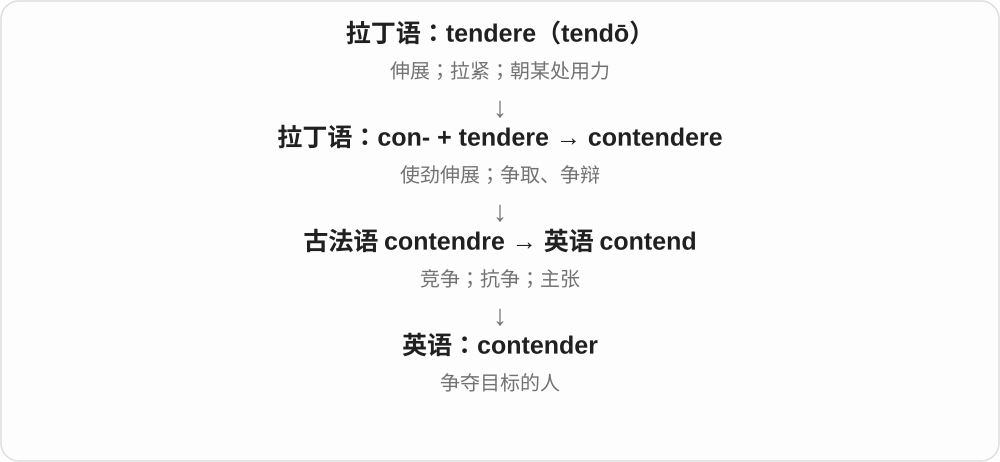

常与 for 或 to win 搭配，尤其谈冠军、职位或奖项。

**常见搭配与例句**

a serious contender；a contender for the title；a leading contender。

> She is a strong contender for the award.

她是这个奖项的有力竞争者。

> Three teams remain serious contenders for the title.

仍有三支球队有实力争夺冠军。

**别混淆**

participant 只说明参与；contender 往往带竞争资格或胜算的意味。

### 32. contend — 竞争；应付困难；坚持主张

**音标**：/kənˈtend/

**先抓住这个画面**

contend 像朝一个目标使劲：与人争冠军，与困难周旋，或坚持一个观点。

**怎么拆**

con- 加 tendere 形成 contendere，经法语 contendre 传入。

**怎么变成今天的意思**

contend for 是争夺；contend with 是应付；contend that 是主张。介词决定画面。

**常见搭配与例句**

contend for a prize；contend with delays；contend that…。

> Small firms must contend with rising costs.

小公司必须应对不断上涨的成本。

> The authors contend that the policy needs revision.

作者们认为这项政策需要修订。

**别混淆**

contend that 较正式，表示提出论点；并不表示大家已经同意。

### 33. intensely — 强烈地；极其专注地

**音标**：/ɪnˈtensli/

**先抓住这个画面**

intensely 像把感受或注意力开到很强：十分好奇，紧盯一个细节。

**怎么拆**

intense + -ly。

**怎么变成今天的意思**

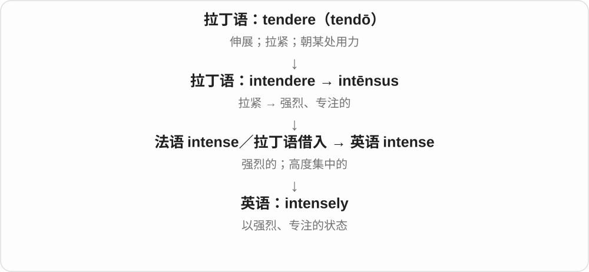

可以修饰情感、感受或投入程度，常与 personal、curious、competitive 搭配。

**常见搭配与例句**

intensely curious；intensely personal；stare intensely。

> She was intensely curious about how the machine worked.

她极想知道这台机器怎样工作。

> He stared intensely at the final line of the letter.

他紧紧盯着信的最后一行。

**别混淆**

intensely 强调状态很强；intensively 常说密集训练、研究等安排。

### 34. tentative — 暂定的；试探性的；犹豫谨慎的

**音标**：/ˈtentətɪv/

**先抓住这个画面**

tentative 像先轻轻探一步，还没把脚踩实：计划可以改，结论仍待确认。

**怎么拆**

来自中世纪拉丁 tentātīvus“试验的”，上接 tentāre“试探”；不是从 tent“帐篷”造出来。

**怎么变成今天的意思**

a tentative date 是暂定日期；a tentative smile 是试探、略犹豫的微笑。

**常见搭配与例句**

a tentative agreement；a tentative conclusion；tentative steps。

> We have set a tentative date for the meeting.

我们暂定了会议日期。

> She gave a tentative smile before speaking.

她开口前试探性地笑了笑。

**别混淆**

tentative 是尚未定死或不够确定；temporary 主要是持续时间短。

### 35. hypertension — 高血压

**音标**：英 /ˌhaɪpəˈtenʃən/；美 /ˌhaɪpərˈtenʃən/

**先抓住这个画面**

hypertension 说的是血管里的压力偏高，像管道里承受的压力超过正常范围。

**怎么拆**

hyper-（过高）+ tension；这里 tension 采用压力的医学用法，不是情绪紧张。

**怎么变成今天的意思**

这是医学术语。紧张情绪可以影响某次测量，但 hypertension 本身不能翻译成“过于紧张”。

**常见搭配与例句**

hypertension research；a diagnosis of hypertension；pulmonary hypertension。

> The study followed adults with hypertension.

这项研究追踪了患有高血压的成年人。

> Her doctor explained what the diagnosis of hypertension meant.

医生向她解释了高血压这一诊断的含义。

**别混淆**

hypertension 是高血压；hypotension 是低血压。hyper- 高，hypo- 低。

### 36. ostensibly — 表面上；按所说的理由

**音标**：/ɒˈstensəbli/；美也 /ɑːˈstensəbli/

**先抓住这个画面**

ostensibly 像把“对外公开的说法”举起来，同时让读者知道真实情况可能另有一层。

**怎么拆**

ostensible + -ly；上接拉丁 ostendere“展示”。

**怎么变成今天的意思**

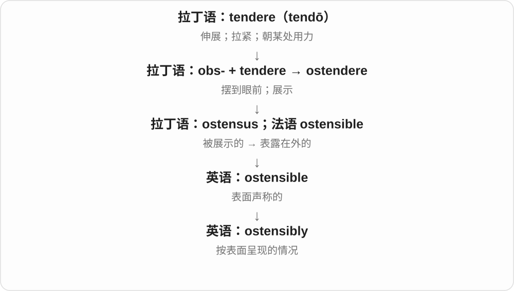

He came ostensibly to help 暗示他的到来可能还有别的目的，但并不直接证明他在撒谎。

**常见搭配与例句**

ostensibly to help；ostensibly neutral；ostensibly independent。

> He visited ostensibly to return a book.

他名义上是来还书的。

> The committee is ostensibly independent.

这个委员会表面上是独立的。

**别混淆**

apparently 常表示据所见推测；ostensibly 更强调名义、表面理由与可能的实际情况有距离。

### 37. contentious — 有争议的；爱争辩的

**音标**：/kənˈtenʃəs/

**先抓住这个画面**

contentious 像一个话题刚摆上桌，大家就开始争；形容人则是特别容易跟人争辩。

**怎么拆**

来自古法语 contencios，上接拉丁 contentiōsus；现代能联系 contention 与 -ous。

**怎么变成今天的意思**

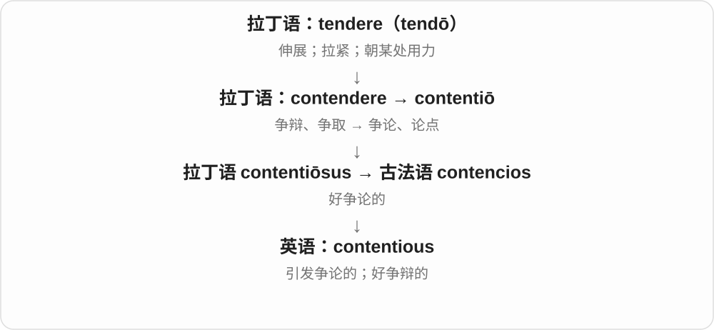

a contentious issue 是意见冲突大的问题；a contentious person 是人的相处风格。

**常见搭配与例句**

a contentious issue；contentious negotiations；a contentious remark。

> Funding became the most contentious issue.

资金问题成了争议最大的问题。

> His contentious tone made compromise difficult.

他咄咄争辩的语气让妥协变得困难。

**别混淆**

controversial 常说公众看法分裂；contentious 也突出争执性，且能形容好争辩的人。

### 38. tendon — 肌腱

**音标**：/ˈtendən/

**先抓住这个画面**

把 tendon 想成肌肉接到骨骼等结构上的结实拉索：肌肉收缩，拉力就通过它传过去。

**怎么拆**

经中古拉丁 tendō、法语 tendon 等形式借入，源自希腊 ténōn“筋、肌腱”；字形受到拉丁 tendere 的影响。

**怎么变成今天的意思**

这里讲身体组织。餐单上的日语借词 tendon“天丼”另来自天妇罗盖饭的简称，与筋腱无关。

**常见搭配与例句**

an Achilles tendon；a tendon injury；a tendon attached to bone。

> The model shows the tendon connecting muscle to bone.

模型展示了连接肌肉与骨骼的肌腱。

> The scan revealed damage to the tendon.

扫描发现了肌腱损伤。

**别混淆**

ligament 通常连接骨与骨、稳定关节；tendon 主要把肌肉的拉力传到附着部位。

### 39. attentive — 专心的；体贴周到的

**音标**：/əˈtentɪv/

**先抓住这个画面**

attentive 像把注意力一直放在对方身上：听得认真，也留意到对方需要什么。

**怎么拆**

来自晚期拉丁 attentīvus，经法语 attentif；现代可联系 attend、attention。

**怎么变成今天的意思**

对讲课 attentive 是专心；对顾客 attentive 是服务周到。共同点是留心。

**常见搭配与例句**

an attentive listener；attentive service；attentive to detail。

> The students were attentive throughout the talk.

学生们整场讲座都听得很专心。

> The staff were attentive without being intrusive.

工作人员照应得很周到，又不会过分打扰。

**别混淆**

attentive 是留意、照应；attending 常是正在参加，或特定职业称谓中的任职状态。

### 40. tempt — 诱惑；引得人想做

**音标**：/tempt/

**先抓住这个画面**

东西诱人到让你心里冒出“要不试试”，这就是 tempt。

**怎么拆**

经古法语 tempter / tenter，来自拉丁 temptāre / tentāre“试探、引诱”。

**怎么变成今天的意思**

tempt someone to do 是使人想做某事；be tempted to do 常只是“有点想”，未必真的做了。

**常见搭配与例句**

be tempted to buy；tempt someone with food；tempt fate。

> The smell of fresh bread tempted me to go inside.

新鲜面包的香味诱得我想进去。

> I was tempted to stay another day.

我当时有点想再待一天。

**别混淆**

persuade 强调说服；tempt 可以只靠美食、价格或机会产生吸引。

### 41. unintentionally — 无意中；并非故意地

**音标**：/ˌʌnɪnˈtenʃənəli/

**先抓住这个画面**

unintentionally 是事情不小心发生之后的一句解释：“那不是我的本意。”

**怎么拆**

unintentional + -ly，也可直接联系 un- + intentionally。

**怎么变成今天的意思**

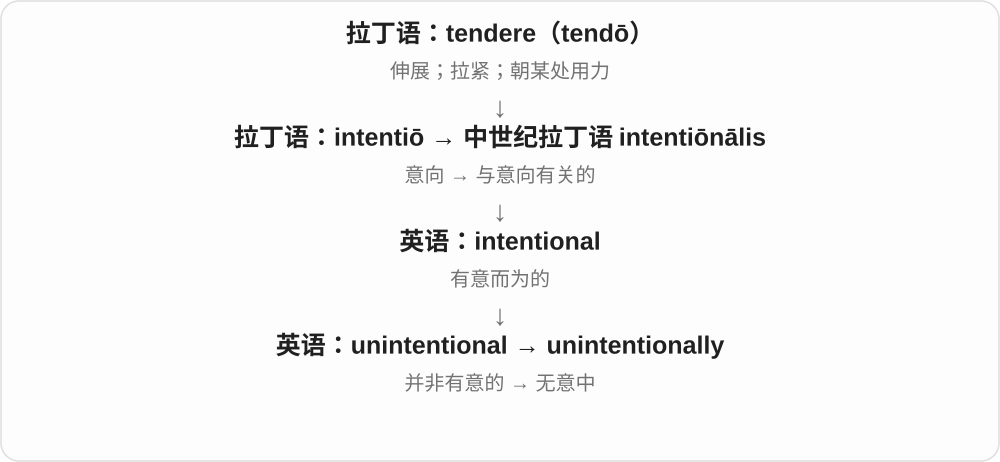

常修饰遗漏、打断、泄露等动作，也可说行为产生了未预料的效果。

**常见搭配与例句**

unintentionally reveal；unintentionally offend；unintentionally exclude。

> I unintentionally interrupted her explanation.

我无意中打断了她的解释。

> The rule may unintentionally exclude smaller groups.

这条规则可能无意中把较小的群体排除在外。

**别混淆**

unconsciously 强调没有意识到；unintentionally 强调没有这个目的，两者不完全相同。

### 42. unattended — 无人照看、处理或陪同的

**音标**：/ˌʌnəˈtendɪd/

**先抓住这个画面**

unattended 像一只放在大厅里却无人看管的包，或者一台自己运行、旁边没人照看的机器。

**怎么拆**

un-（没有）+ attended（有人照料、陪同的），来自 attend。

**怎么变成今天的意思**

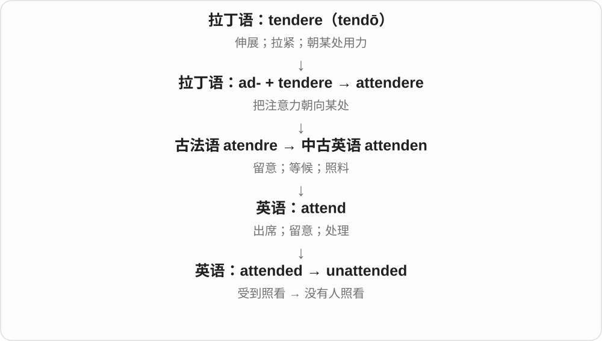

可用于行李、儿童、机器或尚未处理的问题。unattended operation 常指允许自动运行的设备状态。

**常见搭配与例句**

unattended luggage；leave something unattended；unattended operation。

> Please do not leave your luggage unattended.

请不要让行李处于无人看管的状态。

> The system can run unattended overnight.

这个系统可以整夜自动运行，无需人员值守。

**别混淆**

inattentive 是人在却不专心；unattended 是没有人照看、照应或处理。

### 43. pretentious — 装腔作势的；自命不凡的

**音标**：/prɪˈtenʃəs/

**先抓住这个画面**

pretentious 像一个简单意思偏要堆满大词，好让别人觉得自己高深、有品位。

**怎么拆**

借自法语 prétentieux，来自 prétention；更上游是中世纪拉丁 praetentiō 和拉丁 praetendere“声称”。

**怎么变成今天的意思**

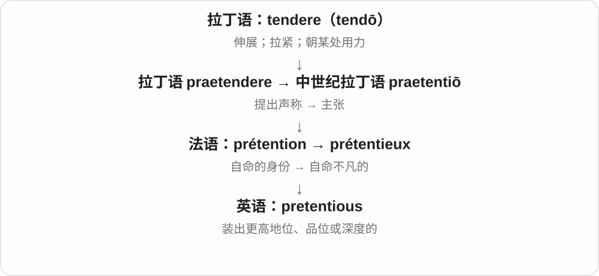

常批评作品、措辞、场所或人显得做作。它不是对一切复杂表达的客观判决，而是说话人的评价。

**常见搭配与例句**

pretentious language；a pretentious film；sound pretentious。

> The review called the dialogue pretentious.

评论认为那些对白装腔作势。

> We wanted a warm restaurant rather than a pretentious one.

我们想找一家温馨、不故作高雅的餐馆。

**别混淆**

ostentatious 常侧重显摆财富、排场；pretentious 还常指假装艺术、高深或聪明。

### 44. intensify — 加强；变得更强烈

**音标**：/ɪnˈtensɪfaɪ/

**先抓住这个画面**

intensify 像继续拧高强度旋钮：雨更猛、争论更激烈、努力更集中。

**怎么拆**

intense + -ify（使成为）；是在英语中从形容词造出的动词。

**怎么变成今天的意思**

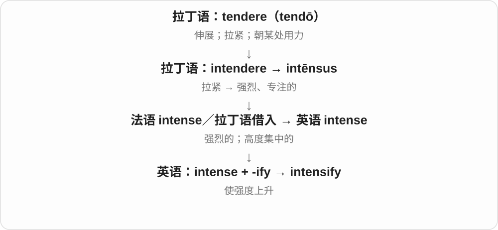

既能不带宾语说 The storm intensified，也能说 intensify the search，主动加大搜寻力度。

**常见搭配与例句**

intensify efforts；intensify pressure；competition intensifies。

> The rain intensified after sunset.

日落后雨下得更猛了。

> The team intensified its search for the missing files.

团队加紧寻找丢失的文件。

**别混淆**

increase 可增加数量、长度等；intensify 特别指强度、程度上升。

### 45. tentatively — 暂时拟定地；试探着

**音标**：/ˈtentətɪvli/

**先抓住这个画面**

tentatively 像先用铅笔写一个安排，保留擦改的余地；也像试探着开口。

**怎么拆**

tentative + -ly。

**怎么变成今天的意思**

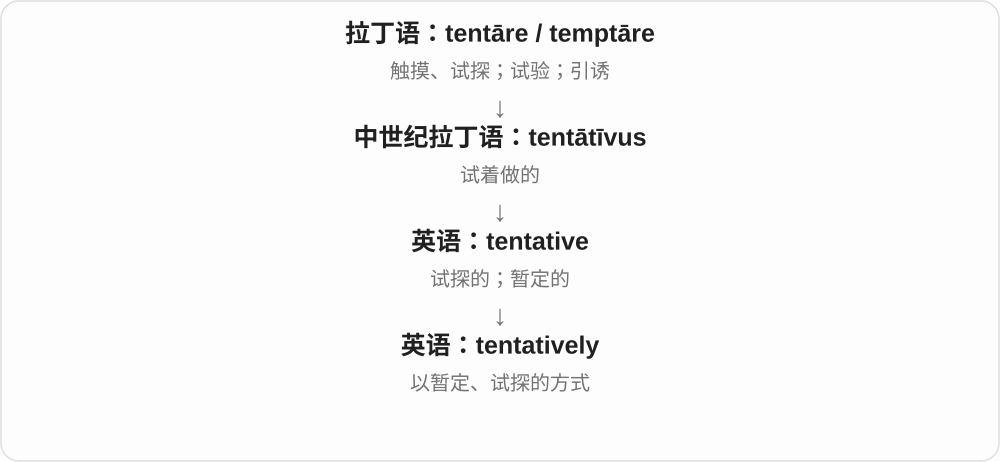

用于日期是暂定；用于人的动作、回答则带谨慎、尚不确定的感觉。

**常见搭配与例句**

tentatively scheduled；tentatively agree；ask tentatively。

> The launch is tentatively scheduled for June.

发布暂定在六月。

> She tentatively suggested a different route.

她试探着提出了另一条路线。

**别混淆**

tentatively accepted 仍可能要复核；definitively accepted 表示已经明确接受。

### 46. unintentional — 无意的；非故意的

**音标**：/ˌʌnɪnˈtenʃənəl/

**先抓住这个画面**

unintentional 像手滑碰倒杯子：事情发生了，但不是原本想做的。

**怎么拆**

un-（不）+ intentional。

**怎么变成今天的意思**

可评价失误、后果或冒犯；不故意并不等于没有造成影响。

**常见搭配与例句**

an unintentional error；unintentional harm；an unintentional consequence。

> The omission was unintentional.

这处遗漏并非有意为之。

> Even unintentional remarks can hurt someone.

即使是无心的话，也可能伤到别人。

**别混淆**

accidental 常突出偶发事件；unintentional 明确谈人的意图是否存在。

### 47. tensor — 张量；使组织张紧的肌肉

**音标**：英 /ˈtensə/；美 /ˈtensər/；也读 /ˈtensɔː(r)/

**先抓住这个画面**

tensor 最直观的老意思是“把某处拉紧的肌肉”。数学中的张量则是一种能在换坐标后仍一致地描述同一对象的工具。

**怎么拆**

新拉丁 tensor“拉伸者”，由拉丁 tēns- 词干与 -or 构成。后来用于数学；早期数学同名术语与现代概念不能完全等同。

**怎么变成今天的意思**

可以把分量暂时想成一组有组织的数字，但数学张量还带换基时的变换规则，不等于随意的数字方块。机器学习框架中 tensor 常直接指多维数组，这是常见的计算机用法。

**常见搭配与例句**

a stress tensor；a tensor field；an input tensor；a tensor muscle。

> The stress tensor describes forces acting across different planes.

应力张量描述了作用在不同截面上的力。

> The program stores the image batch in a tensor.

程序把这一批图像存进一个张量数组。

**别混淆**

matrix 是二维数表；某些张量可用矩阵表示，但 tensor 并不是专指“三维矩阵”。

### 48. pretense — 假装；虚假的借口

**音标**：/prɪˈtens/

**先抓住这个画面**

pretense 像在真实动机前挂上一块招牌，让别人先看到你想让他相信的说法。

**怎么拆**

美式常拼 pretense，英式常拼 pretence；来自中古法语 pretensse，上接 praetendere“摆在前面、声称”。

**怎么变成今天的意思**

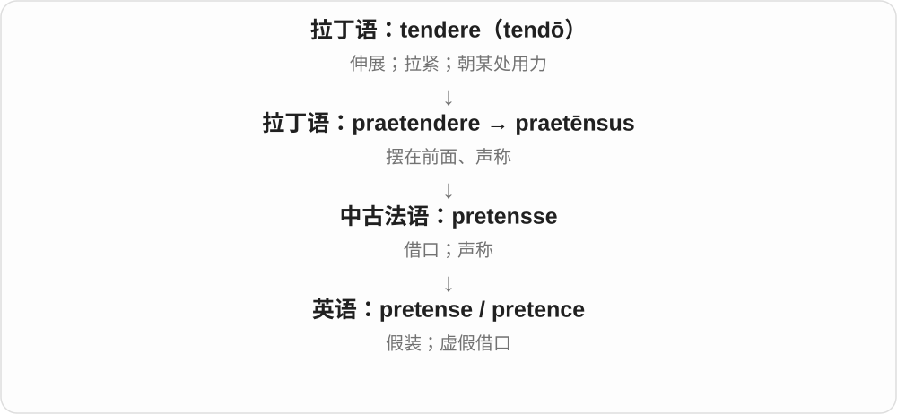

under the pretense of 是借某种说法作掩护；make no pretense of 是不装作自己具备某种能力或身份。

**常见搭配与例句**

under the pretense of；a thin pretense；make no pretense of。

> He entered under the pretense of checking the meter.

他借查看仪表之名进了屋。

> I make no pretense of being an expert.

我并不装作自己是专家。

**别混淆**

pretense 常是虚假的外表；pretension 还可说自命的地位、野心或做作。

### 49. intently — 专注地；目不转睛地

**音标**：/ɪnˈtentli/

**先抓住这个画面**

intently 像把心里的光束聚在一个小点上，旁边的事情暂时都退到背景里。

**怎么拆**

intent 的形容词义“专注的”+ -ly。

**怎么变成今天的意思**

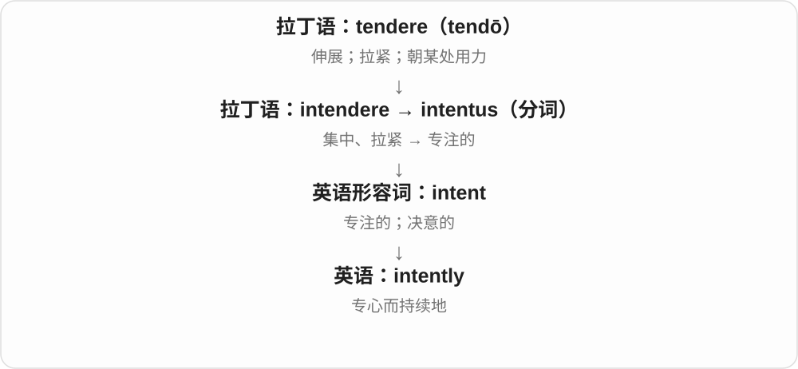

特别常修饰 look、watch、listen，突出注意力集中，不是“故意地”。

**常见搭配与例句**

listen intently；watch intently；stare intently。

> The child watched the magician intently.

孩子目不转睛地看着魔术师。

> We listened intently for the faint signal.

我们凝神细听那个微弱的信号。

**别混淆**

intently 是专心地；intentionally 才是有意地、故意地。

### 50. tensile — 拉伸的；受拉力的

**音标**：英 /ˈtensaɪl/；美 /ˈtensəl/

**先抓住这个画面**

tensile 常把你带到两头被拉住的材料：它能承受多大的拉力，怎样被拉长。

**怎么拆**

来自新拉丁 tēnsilis，上接拉丁 tēnsus“拉紧的”；不要读成 tension 的三个音节。

**怎么变成今天的意思**

tensile strength 是抗拉强度，重点是拉到什么程度会破坏，不等于材料有多容易拉长。

**常见搭配与例句**

tensile strength；tensile stress；a tensile test。

> The engineers measured the cable’s tensile strength.

工程师测量了电缆的抗拉强度。

> The sample broke during the tensile test.

样品在拉伸试验中断裂了。

**别混淆**

elastic 说变形后能恢复；tensile 说承受拉伸或与拉伸有关。

### 51. intensively — 集中而密集地

**音标**：/ɪnˈtensɪvli/

**先抓住这个画面**

intensively 像在有限时间或面积里投入很多工作：密集训练、集中研究、集约耕作。

**怎么拆**

intensive + -ly。

**怎么变成今天的意思**

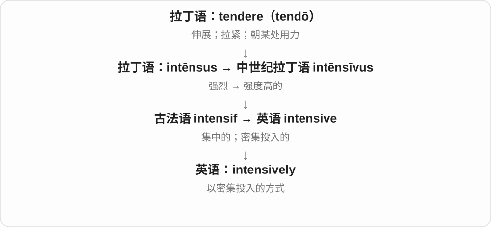

它通常评价工作安排与投入密度，而不是情绪强不强。

**常见搭配与例句**

study intensively；train intensively；intensively farmed land。

> We studied the problem intensively for six weeks.

我们集中研究这个问题长达六周。

> The team trained intensively before the tournament.

球队在比赛前进行了密集训练。

**别混淆**

intensely curious 是非常好奇；study intensively 是密集学习。

### 52. intensification — 加强；强化；集约化

**音标**：/ɪnˌtensɪfɪˈkeɪʃən/

**先抓住这个画面**

intensification 是强度一步步升高的过程，像颜色加深或竞争升温。

**怎么拆**

intensify 的名词形式，-ify 转成 -ification；表示加强的过程或结果。

**怎么变成今天的意思**

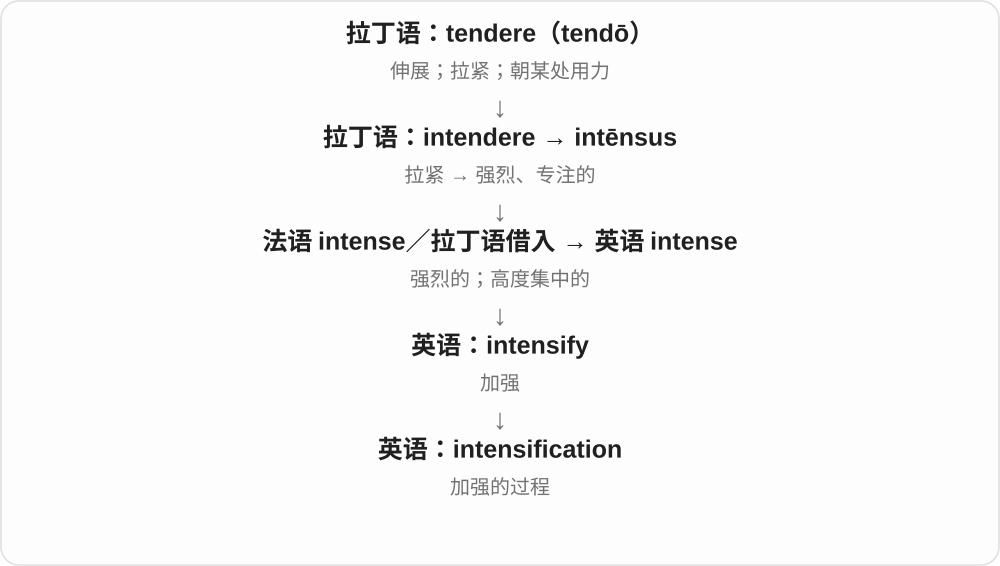

agricultural intensification 常指在同样土地上增加投入、提高产出；不只是扩大土地面积。

**常见搭配与例句**

an intensification of competition；agricultural intensification；rapid intensification。

> The report notes an intensification of competition.

报告指出竞争正在加剧。

> The study examines agricultural intensification in the region.

研究考察了该地区农业的集约化。

**别混淆**

expansion 常是规模扩大；intensification 是已有活动变得更密集、更强。

### 53. pretender — 冒充者；自称有继承权的人

**音标**：英 /prɪˈtendə/；美 /prɪˈtendər/

**先抓住这个画面**

pretender 是提出“我有这个身份或资格”的人；有时是假冒，有时是王位争夺中的自称继承者。

**怎么拆**

pretend + -er。历史 pretend 也有提出权利主张的意思，并非始终只指装假。

**怎么变成今天的意思**

王位语境中 a pretender to the throne 是提出王位继承要求的人；这个名称本身不完成法律真假判断。

**常见搭配与例句**

a pretender to the throne；expose a pretender；a mere pretender。

> Several pretenders claimed the vacant throne.

几名自称有继承权的人争夺空缺的王位。

> The supposed expert turned out to be a pretender.

那个所谓的专家原来是个冒牌货。

**别混淆**

pretender 强调声称某种身份；contender 强调正在竞争并有胜算。

### 54. pretence — 假装；伪装的理由，英式常用拼法

**音标**：/prɪˈtens/

**先抓住这个画面**

pretence 像把“我没事”挂在脸上，心里的感受却完全不同。

**怎么拆**

与 pretense 是同一个词的拼写变体；英式偏 pretence，美式偏 pretense。

**怎么变成今天的意思**

keep up a pretence 是把这层假象继续维持；drop the pretence 是不再装下去。

**常见搭配与例句**

keep up the pretence；drop all pretence；under false pretences。

> She kept up the pretence that everything was fine.

她继续装作一切都好。

> They finally dropped all pretence of agreement.

他们终于不再假装意见一致。

**别混淆**

pretence 不一定是精心骗局，也可以是社交中强撑出的样子；pretension 常偏自命的身份与做作。

### 55. attendee — 出席者；参会者

**音标**：/əˌtenˈdiː/

**先抓住这个画面**

attendee 就是来到活动现场或线上会场的人；它记录“谁来参加了”。

**怎么拆**

attend + -ee。虽然 -ee 常指动作承受者，这里已经固定表示参加者。

**怎么变成今天的意思**

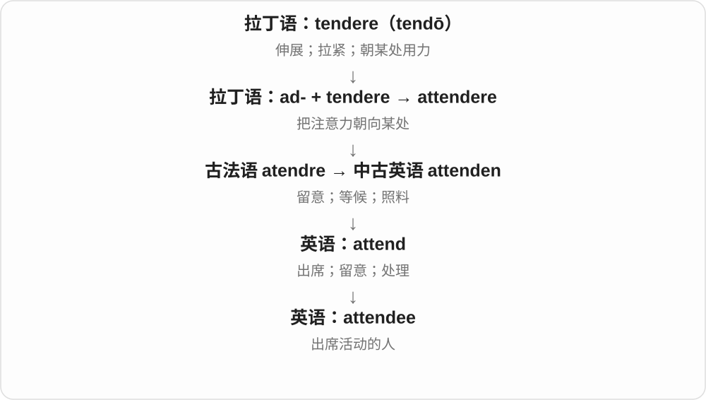

会议、培训、展览常用；attendees 不一定都是演讲者或正式会员。

**常见搭配与例句**

conference attendees；registered attendees；an attendee list。

> Every attendee received a name badge.

每位参会者都领到了一枚姓名牌。

> Online attendees can submit questions in the chat.

线上参会者可以在聊天区提交问题。

**别混淆**

attendee 是来参加的人；attendant 常是负责服务照料的人，也可作形容词。

### 56. extender — 延长装置；扩展器；增量材料

**音标**：英 /ɪkˈstendə/；美 /ɪkˈstendər/

**先抓住这个画面**

extender 是帮原来东西伸得更远、用得更多的配件或材料。

**怎么拆**

extend + -er。

**怎么变成今天的意思**

a range extender 扩大覆盖或续航范围；食品、涂料中的 extender 可以是增加体积或延展用量的材料。

**常见搭配与例句**

a range extender；a belt extender；a signal extender。

> A belt extender made the strap long enough.

一个腰带延长扣让带子足够长了。

> We installed a wireless range extender upstairs.

我们在楼上安装了无线信号扩展器。

**别混淆**

extension 常是延长的结果或新增部分；extender 更突出起延长作用的物件。

### 57. ostentatious — 炫耀的；刻意显摆的

**音标**：英 /ˌɒstenˈteɪʃəs/；美 /ˌɑːstenˈteɪʃəs/

**先抓住这个画面**

ostentatious 像把最贵的东西摆在最显眼的位置，等着别人注意到自己有多有钱、多重要。

**怎么拆**

上接拉丁 ostentāre“反复展示”、ostentātus，加 -ious 类形容词形式。

**怎么变成今天的意思**

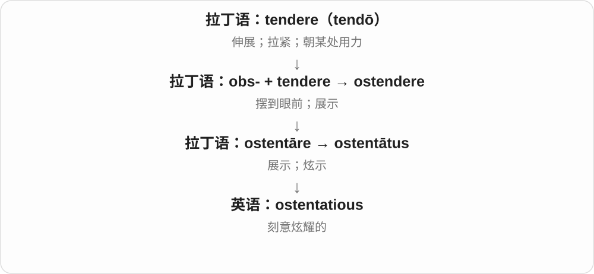

不只是东西华丽，还带“刻意让人看见、借此抬高自己”的意味，常含批评。

**常见搭配与例句**

ostentatious wealth；an ostentatious display；ostentatious generosity。

> He avoided ostentatious displays of wealth.

他避免张扬地炫富。

> The huge gold sign seemed unnecessarily ostentatious.

那块巨大的金色招牌显得过分招摇。

**别混淆**

elegant 可以简洁优雅；ostentatious 强调显摆，未必有品位。

### 58. tentacle — 触手；伸出去的势力或控制

**音标**：/ˈtentəkəl/

**先抓住这个画面**

tentacle 像一条伸出去探路、抓取的柔软手臂，能触到身体以外的地方。

**怎么拆**

来自新拉丁 tentāculum，联系拉丁 tentāre“摸索、触探”；不是 tent + 一个能表示手的后缀。

**怎么变成今天的意思**

常说海葵、水母或乌贼的触手；比喻用法中，一个组织的 tentacles 是伸到各处的影响。动物学里 arm 与 tentacle 有具体区别。

**常见搭配与例句**

jellyfish tentacles；a feeding tentacle；the tentacles of an organization。

> The anemone spread its tentacles in the current.

海葵在水流中展开了触手。

> The company’s tentacles reached into many industries.

这家公司的势力伸向了许多行业。

**别混淆**

arm 日常可泛指手臂；动物解剖描述中不能把所有 arm 都随意改成 tentacle。

### 59. entente — 友好谅解；国家间的协定关系

**音标**：英 /ɒnˈtɒnt/；美 /ɑːnˈtɑːnt/

**先抓住这个画面**

entente 像两个国家先达成“我们在这些事情上相互理解、配合”的默契。

**怎么拆**

借自法语 entente“理解、协议”，来自 entendre，上接拉丁 intendere。

**怎么变成今天的意思**

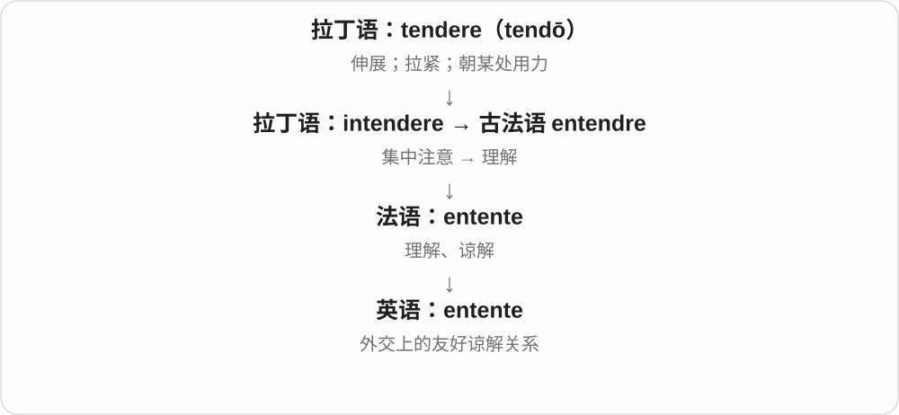

常用于外交与历史；不必然等同于条约规定的正式军事同盟。

**常见搭配与例句**

an entente between states；a diplomatic entente；the Entente Cordiale。

> The two countries gradually developed an entente.

两国逐渐形成了友好谅解关系。

> The agreement strengthened the existing entente.

这份协议巩固了现有的合作谅解。

**别混淆**

alliance 往往是明确的结盟关系；entente 更突出谅解与合作安排。

### 60. extensible — 可扩展的；可延伸的

**音标**：/ɪkˈstensəbəl/

**先抓住这个画面**

extensible 像一套预留了接口的积木，之后还能接上新的功能。

**怎么拆**

来自拉丁 extēnsibilis；现代联系 extens- 与 -ible（能够）。

**怎么变成今天的意思**

软件中常指可以加入模块、规则或能力；材料中也可以说可被拉伸。

**常见搭配与例句**

an extensible system；an extensible language；extensible architecture。

> The framework is extensible through plugins.

这个框架可以通过插件扩展。

> We chose an extensible design for future features.

我们选用了便于日后增加功能的设计。

**别混淆**

extensible 常强调设计允许扩展；extensive 是已经覆盖很广。

### 61. hypotension — 低血压

**音标**：英 /ˌhaɪpəʊˈtenʃən/；美 /ˌhaɪpoʊˈtenʃən/

**先抓住这个画面**

hypotension 说血压偏低，记住 hypo- 是低，别和 hyper- 的高混在一起。

**怎么拆**

hypo-（低于正常）+ tension；医学中 tension 用于压力。

**怎么变成今天的意思**

orthostatic hypotension 是体位变化相关的低血压术语。这里只需掌握词义，不能用“性格平静”去理解它。

**常见搭配与例句**

orthostatic hypotension；symptoms of hypotension；a study of hypotension。

> The article explains the term orthostatic hypotension.

这篇文章解释了体位性低血压这个术语。

> The researchers recorded episodes of hypotension.

研究人员记录了低血压发作的情况。

**别混淆**

hypotension 是低血压；hypothermia 是体温过低，后半部分不同。

### 62. attentively — 专心地；留意周到地

**音标**：/əˈtentɪvli/

**先抓住这个画面**

attentively 像听人说话时真的跟着对方的意思走，也留意语气和需要。

**怎么拆**

attentive + -ly。

**怎么变成今天的意思**

既用于认真听，也可用于细心服务，重点是注意力没有敷衍地飘开。

**常见搭配与例句**

listen attentively；watch attentively；attend attentively to needs。

> She listened attentively to each suggestion.

她认真听取了每一条建议。

> The nurse watched the monitor attentively.

护士专心观察监测屏。

**别混淆**

attentively 强调留心；intently 往往更突出紧紧盯住一个对象的集中感。

### 63. ostensible — 表面上的；对外声称的

**音标**：英 /ɒˈstensəbəl/；美 /ɑːˈstensəbəl/

**先抓住这个画面**

ostensible 是摆给别人看的那一层理由或身份，真实情况可能不同。

**怎么拆**

借自法语 ostensible，上接拉丁 ostensus“被展示的”和 ostendere“展示”。

**怎么变成今天的意思**

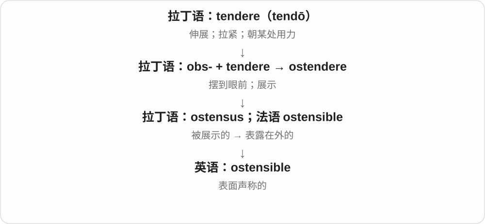

an ostensible reason 是公开给出的理由。说话人常保留怀疑，但不一定已经掌握隐情。

**常见搭配与例句**

an ostensible purpose；an ostensible reason；the ostensible owner。

> The ostensible purpose of the visit was to discuss repairs.

这次来访的表面目的是商谈维修。

> The ostensible owner rarely appeared at the shop.

名义上的店主很少在店里出现。

**别混淆**

ostensible 是表面声称；ostentatious 是刻意炫耀，后者评价作风。

### 64. inattentive — 不专心的；疏于留意的

**音标**：/ˌɪnəˈtentɪv/

**先抓住这个画面**

inattentive 像人在场，注意力却飘到别处，于是漏听、漏看了该留意的事。

**怎么拆**

in-（不）+ attentive；与 attention 的词族相连。

**怎么变成今天的意思**

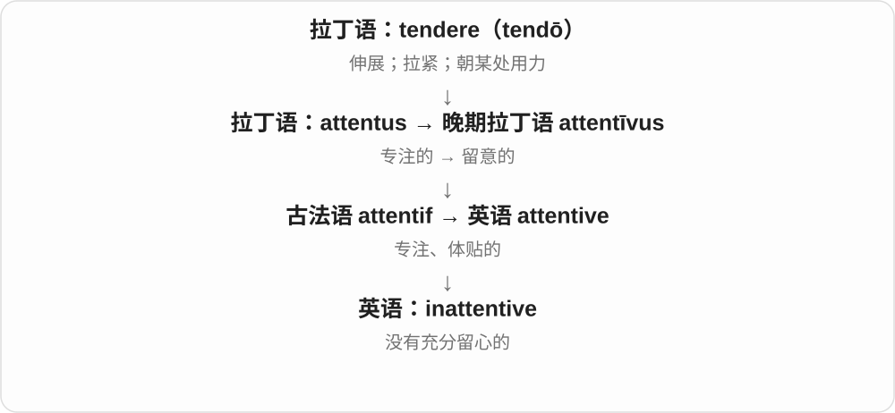

可以说听众走神，也可说服务没有注意到客人需求；通常并不推断一个人永远如此。

**常见搭配与例句**

an inattentive listener；inattentive to detail；inattentive service。

> I missed the instruction because I was inattentive.

我当时不专心，所以漏听了说明。

> The reviewer was inattentive to small inconsistencies.

审阅者没有留意那些细小的不一致。

**别混淆**

absent 是不在场；inattentive 可能就在现场，却不专心。

### 65. inattention — 不注意；疏忽

**音标**：/ˌɪnəˈtenʃən/

**先抓住这个画面**

inattention 是注意力没有放到该放的地方；一个小细节就这样滑了过去。

**怎么拆**

in-（不、缺少）+ attention。

**怎么变成今天的意思**

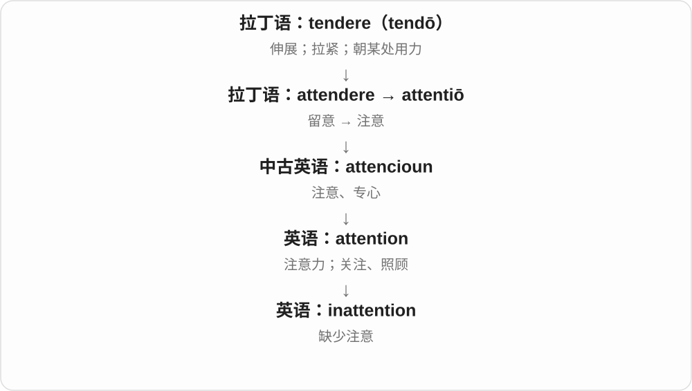

多作不可数名词，可用 a moment of inattention 表示一时走神。

**常见搭配与例句**

a moment of inattention；inattention to detail；due to inattention。

> A moment of inattention caused him to miss the turn.

他一时走神，错过了转弯处。

> The errors resulted from inattention to detail.

这些错误源于对细节的疏忽。

**别混淆**

inattention 说注意不足；intention 说心中的目的，字母相近但意思完全不同。

### 66. extendable — 能够延长、展开的

**音标**：/ɪkˈstendəbəl/

**先抓住这个画面**

extendable 像一张平时收着、来客时还能拉长的桌子。

**怎么拆**

extend + -able；也有 extendible 拼法。

**怎么变成今天的意思**

可说物件长度，也可说合同、期限能否续长。

**常见搭配与例句**

an extendable table；an extendable handle；an extendable contract。

> The table has an extendable top.

这张桌子的桌面可以拉长。

> The permit is extendable for another month.

这份许可可以再延长一个月。

**别混淆**

extendable 与 extensible 有重叠；前者日常物件和期限更常见，后者常见于技术设计。

### 67. attentional — 注意力方面的

**音标**：/əˈtenʃənəl/

**先抓住这个画面**

attentional 用来给研究对象贴上“这和注意力如何分配有关”的标签。

**怎么拆**

attention + -al。

**怎么变成今天的意思**

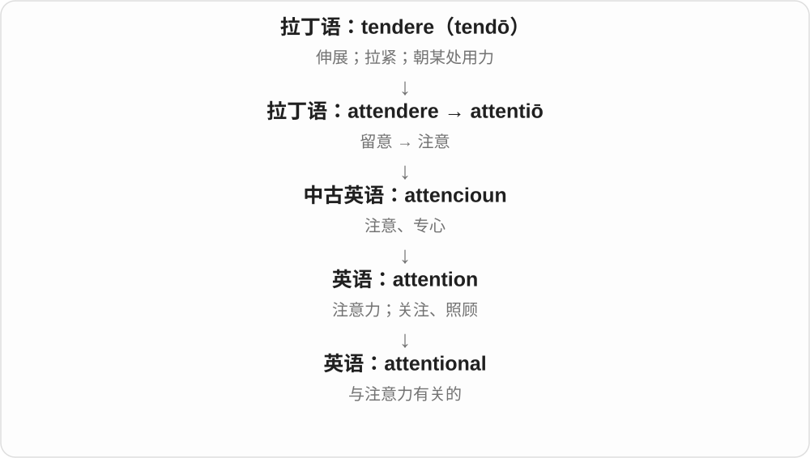

常见于心理学和认知研究，例如 attentional focus 是注意焦点，attentional bias 是注意偏向。

**常见搭配与例句**

attentional control；attentional resources；attentional bias。

> The task places demands on attentional control.

这项任务对注意力控制提出了要求。

> The experiment measured attentional bias toward familiar faces.

实验测量了注意力对熟悉面孔的偏向。

**别混淆**

attentional 是中性的领域说明；attentive 才直接形容一个人专心、体贴。

### 68. entendre — 话语中的一层含义，尤其暗含的意思

**音标**：英 /ɒnˈtɒndrə/；美 /ɑːnˈtɑːndrə/（沿用 double entendre 中的读法）

**先抓住这个画面**

entendre 在英语里主要藏在 double entendre 中：一句话表面说一层，听者还能会意另一层。

**怎么拆**

从 double entendre 中截出；短语借自旧法语“理解、含义”的表达。法语 entendre 上接拉丁 intendere。

**怎么变成今天的意思**

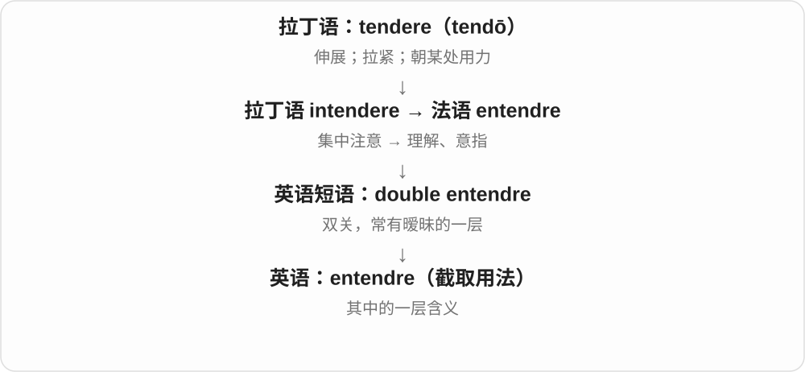

单独使用很少见。正常写作优先掌握 double entendre；第二层常带性暗示，但不需要说得露骨。

**常见搭配与例句**

a double entendre；a second entendre；a playful double entendre。

> The title contains a playful double entendre.

标题里藏着一个俏皮的双关。

> Some readers missed the second entendre in the joke.

一些读者没听出笑话中的第二层意思。

**别混淆**

pun 常靠同音或多义制造笑点；double entendre 关注一句话可作两种理解。

### 69. pretension — 自命的身份或能力；野心；做作

**音标**：/prɪˈtenʃən/

**先抓住这个画面**

pretension 像给自己贴了一张过大的标签，声称有某种地位、品位或能力。

**怎么拆**

名词来自中世纪拉丁 praetēnsiō，联系 praetendere“声称”。工程动词 pre+tension 则另指预先张拉。

**怎么变成今天的意思**

pretensions to expertise 常带“实际未必配得上”的怀疑。have no pretensions to 是不自称具备。工程中 pretension a cable 只是事先施加张力，不是虚荣。

**常见搭配与例句**

literary pretensions；pretensions to greatness；without pretension。

> He has no pretensions to being a professional chef.

他并不自称是专业厨师。

> The restaurant serves good food without pretension.

这家餐馆做菜好吃，也不故作高雅。

> The crew will pretension the cables before the test.

工作人员将在试验前预先张拉缆索。

**别混淆**

pretense 侧重假装、借口；pretension 常侧重自命不凡或声称的资格。

### 70. attentiveness — 专注；细心周到

**音标**：/əˈtentɪvnəs/

**先抓住这个画面**

attentiveness 是能把别人的话听进去、把细微需要注意到的那份留心。

**怎么拆**

attentive + -ness。

**怎么变成今天的意思**

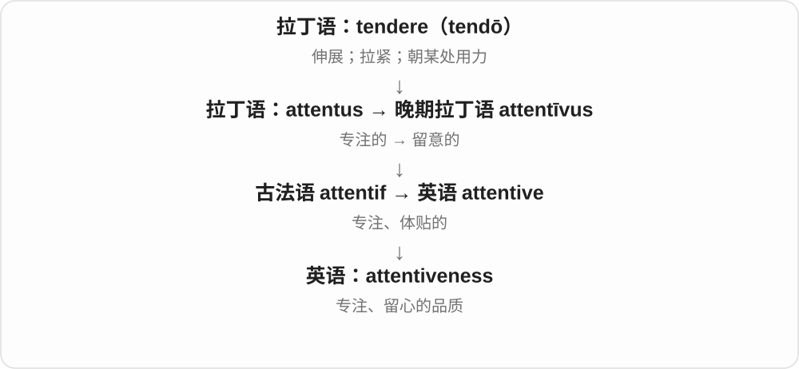

课堂里强调专注程度；服务、照护中强调关心到位。

**常见搭配与例句**

attentiveness to detail；customer attentiveness；show attentiveness。

> Her attentiveness to detail prevented several errors.

她对细节的留心避免了好几处错误。

> Guests appreciated the staff’s attentiveness.

客人很欣赏工作人员的周到照应。

**别混淆**

attention 可以是一时投入的注意；attentiveness 更常评价持续留心的表现或品质。

### 71. portent — 预兆，尤指不祥之兆

**音标**：英 /ˈpɔːtent/；美 /ˈpɔːrtent/

**先抓住这个画面**

portent 像未来在门缝里先露出的影子，让人担心坏事快要发生。

**怎么拆**

借自拉丁 portentum“征兆”，来自 portendere“向前展示、预示”。

**怎么变成今天的意思**

常见于文学和较正式的评论。它是被解释为预兆的现象，不能保证预测真的会发生。

**常见搭配与例句**

a portent of disaster；an ominous portent；take something as a portent。

> The sudden silence seemed a portent of trouble.

突如其来的沉默仿佛预示着麻烦。

> They treated the failed harvest as a portent of harder times.

他们把歉收看作日子将更加艰难的预兆。

**别混淆**

sign 很中性；portent 常带重大、神秘或不祥的气氛。

### 72. extensor — 伸肌

**音标**：英 /ɪkˈstensə/；美 /ɪkˈstensər/

**先抓住这个画面**

extensor 是帮助关节伸展的肌肉，像把原本弯着的手指或膝盖打开。

**怎么拆**

借自新拉丁 extensor，上接 extendere“伸展”；现代可联系 extens- 与表示作用者的 -or。

**怎么变成今天的意思**

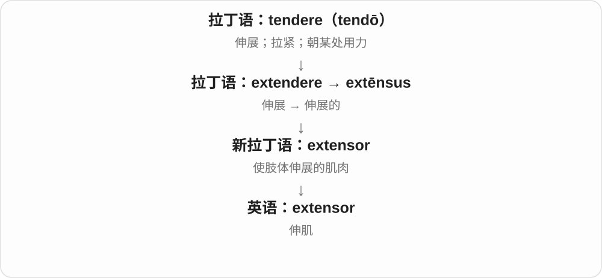

名称描述肌肉的主要动作。具体动作要看是哪一个关节，不能简单当作全身所有“拉长的肌肉”。

**常见搭配与例句**

an extensor muscle；finger extensors；the extensor tendon。

> The diagram identifies the extensor muscles of the forearm.

图中标出了前臂的伸肌。

> An extensor tendon helps straighten the finger.

伸肌腱帮助把手指伸直。

**别混淆**

flexor 常使关节弯曲；extensor 常使关节伸展。

### 73. portend — 预示；成为某事的征兆

**音标**：英 /pɔːˈtend/；美 /pɔːrˈtend/

**先抓住这个画面**

portend 是眼前出现一个迹象，好像把后面将发生的事提前展示出来。

**怎么拆**

拉丁 por-（向前）+ tendere → portendere；整体借入英语。

**怎么变成今天的意思**

通常接可能发生的事情，尤其变化、危险或重大后果。语气正式。

**常见搭配与例句**

portend trouble；portend a change；what this portends。

> The sudden price rise may portend further shortages.

价格突然上涨可能预示供应将进一步短缺。

> No one knew what the announcement would portend.

没人知道这项公告会预示什么变化。

**别混淆**

predict 是人或模型作预测；portend 通常是某种迹象本身预示后果。

### 74. portentous — 预示大事的；煞有介事的

**音标**：英 /pɔːˈtentəs/；美 /pɔːrˈtentəs/

**先抓住这个画面**

portentous 有两张脸：一种让人觉得大事将临；另一种是说话故意端着重大、庄严的架子。

**怎么拆**

来自拉丁 portentōsus，上接 portentum“征兆”；现代联系 portent + -ous。

**怎么变成今天的意思**

a portentous silence 可营造不祥气氛；a portentous speech 可以批评发言者装得深不可测。

**常见搭配与例句**

a portentous silence；a portentous tone；portentous warnings。

> A portentous silence followed the announcement.

公告之后是一阵令人不安的沉默。

> He introduced a simple idea in a portentous voice.

他用煞有介事的腔调介绍了一个简单想法。

**别混淆**

portentous 偏预示大事、不祥或故作重大；pretentious 偏装出并不具备的品位或成就。

### 75. ostentatiously — 炫耀地；故意做给人看地

**音标**：英 /ˌɒstenˈteɪʃəsli/；美 /ˌɑːstenˈteɪʃəsli/

**先抓住这个画面**

ostentatiously 像做一个动作时特意放大幅度，生怕别人没注意到。

**怎么拆**

ostentatious + -ly。

**怎么变成今天的意思**

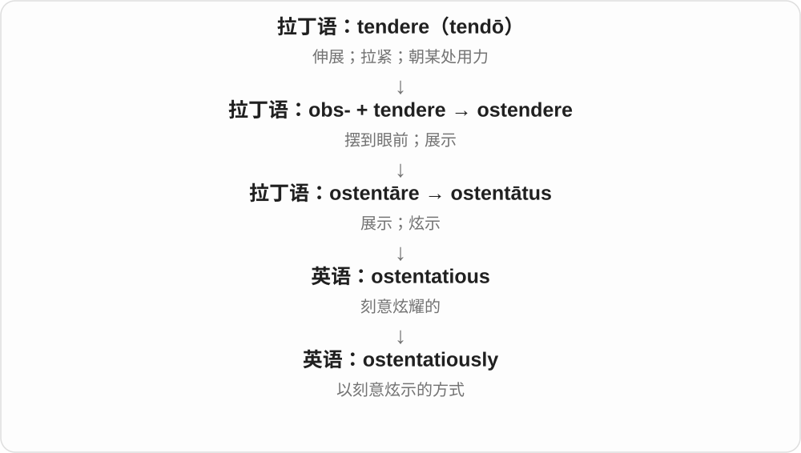

不只用于财富；故意大声叹气、摆出无所谓的态度，也可以是做给人看的表演。

**常见搭配与例句**

ostentatiously display；ostentatiously ignore；ostentatiously generous。

> He ostentatiously checked his expensive watch.

他故意抬手看那块昂贵手表，显摆给人看。

> She ostentatiously ignored the invitation.

她摆出姿态，故意对那份邀请不理不睬。

**别混淆**

publicly 只是公开地；ostentatiously 还带刻意吸引别人注意的意味。

### 76. ostentation — 炫耀；卖弄排场

**音标**：英 /ˌɒstenˈteɪʃən/；美 /ˌɑːstenˈteɪʃən/

**先抓住这个画面**

ostentation 是把财富、身份或某种优点大张旗鼓地摆出来，想让别人惊叹。

**怎么拆**

来自拉丁 ostentātiō，经中古法语；上接 ostentāre“展示”。

**怎么变成今天的意思**

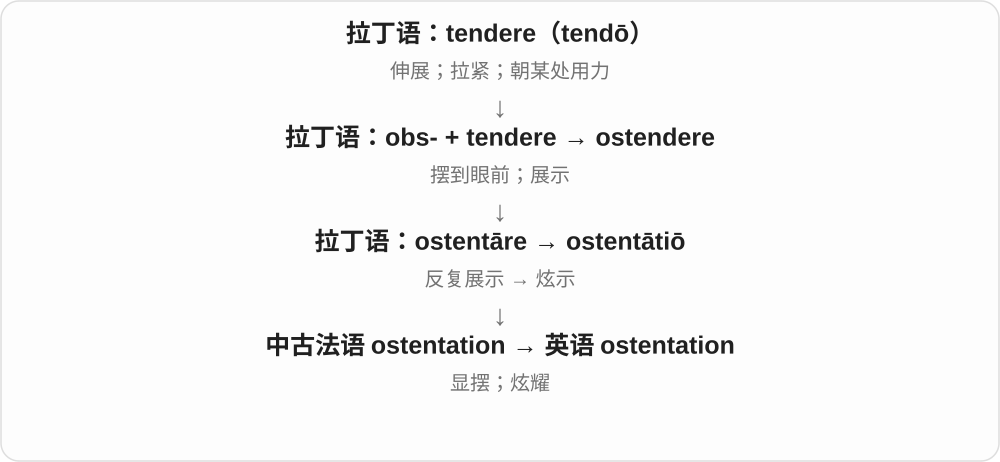

通常不可数，含批评色彩；without ostentation 是做得体面而不显摆。

**常见搭配与例句**

a display of ostentation；without ostentation；wealth and ostentation。

> The ceremony was dignified but free of ostentation.

仪式庄重，却没有铺张炫耀。

> He preferred comfort to ostentation.

比起摆排场，他更重视舒适。

**别混淆**

display 可以只是展示；ostentation 特别强调摆排场、求关注。

### 77. extensibility — 可扩展性；可延伸性

**音标**：/ɪkˌstensəˈbɪləti/

**先抓住这个画面**

extensibility 关心一件东西以后还能不能顺畅地长出新部分，像系统能不能方便地加模块。

**怎么拆**

extensible + -ity，词尾 -ible 变为 -ibility。

**怎么变成今天的意思**

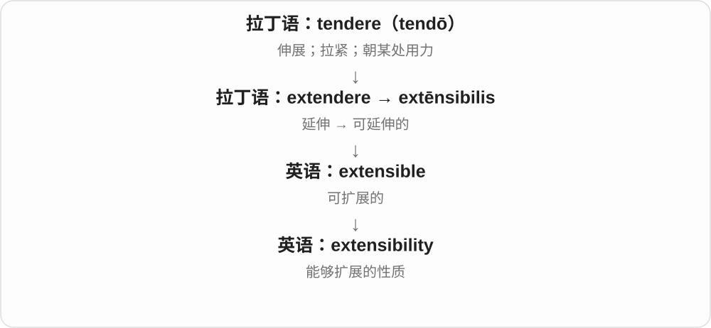

软件设计中重视功能如何增加；材料描述中则可说可伸展程度。

**常见搭配与例句**

software extensibility；improve extensibility；an extensibility mechanism。

> The plugin system improves extensibility.

插件系统提高了可扩展性。

> Extensibility was a major goal of the new design.

便于扩展是新设计的一个主要目标。

**别混淆**

scalability 常问负载增加后能否撑住；extensibility 常问能否增加新能力。

### 78. extensional — 外延的；与伸展有关的

**音标**：/ɪkˈstenʃənəl/

**先抓住这个画面**

extensional 在逻辑里像直接看名单：这个词实际包含哪些对象，而不先问它是怎样描述这些对象的。

**怎么拆**

extension + -al。extension 的逻辑义是一个表达式适用的对象范围。

**怎么变成今天的意思**

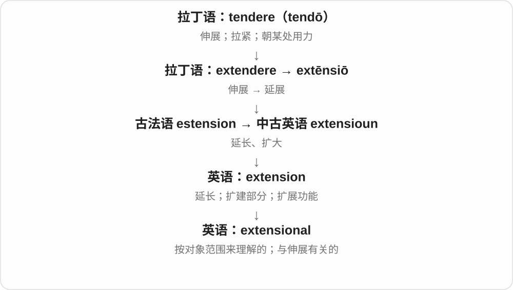

例如用“2、4、6”直接列出集合成员，是外延式描述。地学中的 extensional deformation 则回到拉伸、伸展。

**常见搭配与例句**

an extensional definition；extensional equivalence；extensional deformation。

> The book gives an extensional definition by listing the members.

书中通过列出成员给出了外延式定义。

> The two descriptions are extensionally equivalent in this example.

在这个例子中，这两种描述指向同一范围的对象。

**别混淆**

intensional 看概念内容或判断条件；extensional 看实际指到哪些对象。

### 79. detent — 定位卡扣；制动定位机构

**音标**：/dɪˈtent/；也 /ˈdiːtent/

**先抓住这个画面**

detent 像旋钮转到某一档时“咔嗒”一下卡住的装置，让它不会随便滑到别处。

**怎么拆**

借自法语 détente，联系 détendre“放松、松开”，上接拉丁 dētendere。名称与释放、控制运动的机构有关。

**怎么变成今天的意思**

可让机构停在设定位置，也可在操作时释放它；不是所有 detent 都完全禁止运动。

**常见搭配与例句**

a spring detent；a detent mechanism；a detent position。

> A spring detent holds the lever in place.

一个弹簧定位卡扣把拨杆保持在原位。

> Turn the knob until it reaches the next detent.

转动旋钮，直到它卡入下一档。

**别混淆**

detent 是机械机构；détente 常说外交关系缓和。不要跟 detain“拘留”混作同一直接词源。

### 80. tendentious — 有偏向的；刻意为某种立场服务的

**音标**：/tenˈdenʃəs/

**先抓住这个画面**

tendentious 像一篇文章暗中把所有材料都往同一个结论推，想显得客观却处处带着立场。

**怎么拆**

联系 tendency 与 -ious，并受德语 tendenziös 影响；不是单纯“有趋势”。

**怎么变成今天的意思**

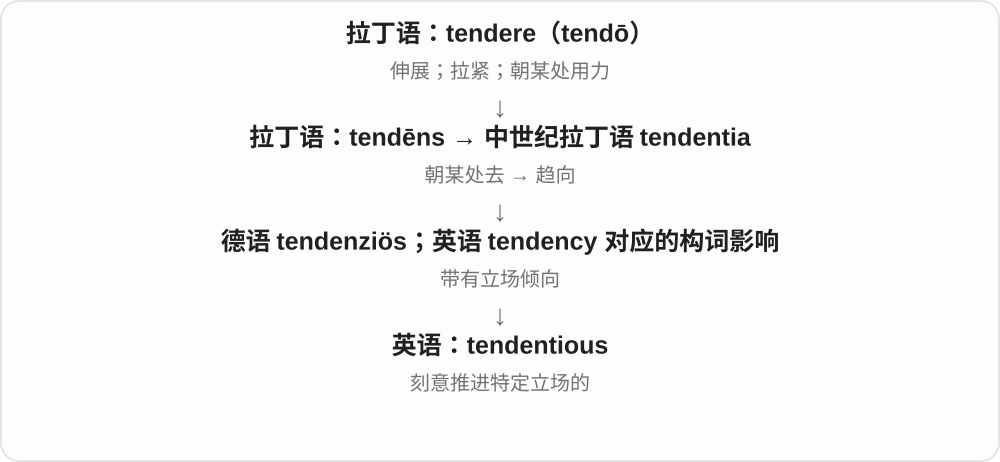

通常用于批评报道、论证、叙述片面或带偏见。

**常见搭配与例句**

a tendentious argument；tendentious reporting；a tendentious interpretation。

> The review criticized the book’s tendentious account of events.

评论批评这本书对事件的叙述带有强烈偏向。

> Several questions were phrased in a tendentious way.

几个问题的措辞带着明显的倾向性。

**别混淆**

biased 泛指偏向；tendentious 特别突出表达内容正在推动某个立场。

### 81. distension — 胀大；鼓起；膨胀

**音标**：/dɪˈstenʃən/

**先抓住这个画面**

distension 像一只囊袋从里面被撑开，体积鼓起来，表面也被拉紧。

**怎么拆**

来自拉丁 distēnsiō，联系 distendere“向各方向撑开”；现代对应 distend。

**怎么变成今天的意思**

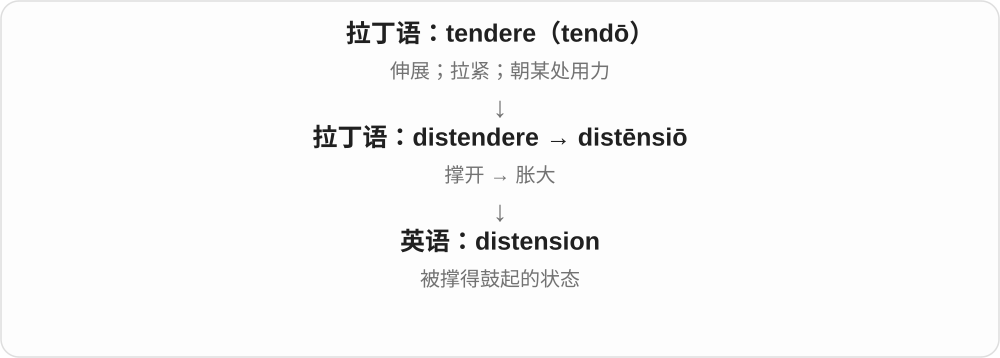

常见于医学描述腹部、器官的胀大；词本身只描述状态，不指定具体原因。

**常见搭配与例句**

abdominal distension；gastric distension；visible distension。

> The report described visible abdominal distension.

报告描述了肉眼可见的腹部胀大。

> The experiment measured distension of the flexible chamber.

实验测量了柔性腔室的胀大程度。

**别混淆**

extension 常是延长、伸展；distension 更像内部压力把容器或组织鼓起来。

### 82. intension — 内涵；旧用：加强、紧张程度

**音标**：/ɪnˈtenʃən/

**先抓住这个画面**

intension 在逻辑里像一个概念的“入选条件”：满足怎样的条件，才算是它。

**怎么拆**

来自拉丁 intēnsiō“拉紧、加强”，上接 intendere、intēnsus；不是 intention 的拼写错误。

**怎么变成今天的意思**

例如“偶素数”的内涵是既为偶数又为素数；它在正整数中的外延只有 2。这个例子帮助区分内容和对象，不是词义的历史故事。

**常见搭配与例句**

the intension of a term；intension and extension；a concept’s intension。

> The lesson distinguishes a term’s intension from its extension.

这节课区分了词语的内涵与外延。

> The intension of the term specifies the conditions for membership.

这个词的内涵规定了对象归入其中的条件。

**别混淆**

intension 与 intention 同音；前者谈概念内容，后者谈人的意图。

### 83. coextensive — 范围相同的；延伸范围一致的

**音标**：/ˌkəʊɪkˈstensɪv/；美 /ˌkoʊɪkˈstensɪv/

**先抓住这个画面**

coextensive 像两层地图边界正好重合：覆盖一样大的地方、时段或对象范围。

**怎么拆**

co-（共同）+ extensive。

**怎么变成今天的意思**

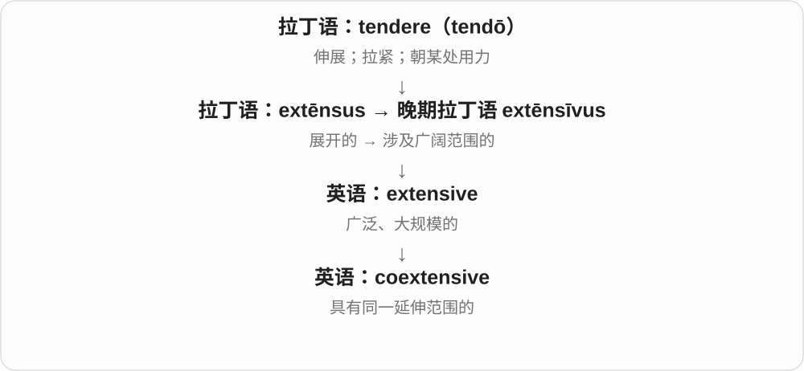

常用 coextensive with；逻辑里两概念可包含相同对象，却不一定有同一含义。

**常见搭配与例句**

coextensive with；coextensive boundaries；coextensive categories。

> The park is coextensive with the protected island.

公园的范围与受保护的岛屿范围一致。

> The two categories are coextensive in this dataset.

在这份数据中，这两个类别覆盖完全相同的对象。

**别混淆**

overlapping 只是部分重叠；coextensive 要求讨论中的范围相同。

### 84. superintend — 监督；主管

**音标**：/ˌsuːpərɪnˈtend/

**先抓住这个画面**

superintend 像站在能看见全局的位置，盯住一项工作是否按要求进行。

**怎么拆**

借自拉丁 superintendere：super-（在上、从整体）+ intendere（留心）。

**怎么变成今天的意思**

比 supervise 更正式，也更少见；常用于工程、机构管理或历史叙述。

**常见搭配与例句**

superintend construction；superintend a project；superintend repairs。

> An experienced engineer will superintend the repairs.

一位经验丰富的工程师将监督维修工作。

> She was appointed to superintend the new institution.

她受命主管这所新机构。

**别混淆**

manage 包含安排资源和作决定；superintend 更突出监督整个过程。

### 85. superintendency — 主管职位；主管任期；监督职责

**音标**：/ˌsuːpərɪnˈtendənsi/

**先抓住这个画面**

superintendency 说的是坐在 superintendent 那个位置上的职务或任职期间。

**怎么拆**

superintendent 对应的 -ency 名词形式，表示职位、职责或在任状态。

**怎么变成今天的意思**

常见于教育管理、宗教机构或历史行政安排，具体职位随机构而变。

**常见搭配与例句**

hold the superintendency；during her superintendency；the school superintendency。

> She accepted the superintendency of the school district.

她接受了该学区主管的职位。

> Several reforms began during his superintendency.

几项改革在他任主管期间启动。

**别混淆**

superintendent 是人；superintendency 是职位、职责或这一段任期。

### 86. intensional — 内涵的；涉及意义内容的

**音标**：/ɪnˈtenʃənəl/

**先抓住这个画面**

intensional 像在问一句描述究竟怎么界定对象，而不只把对象名单列出来。

**怎么拆**

intension + -al；与 intentional“有意的”不同，尽管读音相同。

**怎么变成今天的意思**

内涵逻辑会关注信念、可能性等语境中表达式的意义差别。两个名称指同一对象，也不一定能在“某人相信……”里任意替换。

**常见搭配与例句**

intensional logic；an intensional definition；an intensional context。

> The author gives an intensional definition using two conditions.

作者用两个条件给出了一个内涵式定义。

> The course introduces intensional logic through examples of belief.

课程通过信念的例子介绍内涵逻辑。

**别混淆**

extensional 看实际所指；intensional 看表达所携带的内容。

### 87. tentacular — 触手的；像触手般伸向各处的

**音标**：英 /tenˈtækjələ/；美 /tenˈtækjələr/

**先抓住这个画面**

tentacular 像从一个中心伸出许多细长分支，用来抓取、接触或影响各处。

**怎么拆**

借自新拉丁 tentāculāris，由 tentāculum“触手”+ -āris 构成；现代可联系 tentacle 与 -ar，但不把英语名词画成借词的祖先。

**怎么变成今天的意思**

既可用于动物形态，也可用于比喻一个机构到处伸出的影响，后者常带负面色彩。

**常见搭配与例句**

tentacular organs；tentacular branches；a tentacular network。

> The illustration shows the animal’s tentacular organs.

插图展示了这种动物的触手器官。

> The novel portrays a tentacular network of influence.

小说描绘了一张像触手一样伸向各处的势力网。

**别混淆**

branched 只说有分支；tentacular 还使人想到伸出、抓住的触手。

### 88. distend — 使鼓起；膨胀

**音标**：/dɪˈstend/

**先抓住这个画面**

distend 像往柔软的袋子里充气，里面把外壁往外顶，袋子鼓起来。

**怎么拆**

dis-（向不同方向）+ tendere，经拉丁 distendere 借入。

**怎么变成今天的意思**

常描写器官、柔性容器被气体、液体等撑开。比日常说 swell 更技术化。

**常见搭配与例句**

distend the chamber；a distended abdomen；distend with gas。

> Air caused the flexible chamber to distend.

空气使柔性腔室鼓了起来。

> The experiment shows how pressure can distend the membrane.

实验展示了压力怎样把薄膜撑鼓。

**别混淆**

extend 可以伸长一只手臂；distend 更常是从里面撑鼓，不适合随便替换。

### 89. attent — 专心的，古旧用法

**音标**：/əˈtent/

**先抓住这个画面**

attent 是 attentive 的古旧近义形式，像老文章里说一个人凝神留意。

**怎么拆**

来自拉丁 attentus“专注的”，是 attendere 的分词；本条保留可确认的拉丁来源。

**怎么变成今天的意思**

如今常规表达用 attentive。这里保留它是为了读旧文，并不建议把它当更高级的现代替换词。

**常见搭配与例句**

an attent listener（古旧）；stand attent（古旧）。

> The audience remained attent to the speaker’s words.

听众一直留心听演讲者的话。（古旧语体）

> An attent reader would notice the change in tone.

细心的读者会注意到语气的变化。（古旧语体）

**别混淆**

attent 的古旧形容词义与 intent“专注的”相近；不是 attempt 的漏字。

### 90. ostensive — 指示展示的；通过实物说明的

**音标**：英 /ɒˈstensɪv/；美 /ɑːˈstensɪv/

**先抓住这个画面**

ostensive 像不解释“红色”的长定义，而是指着一块红色样片说：“就是这种。”

**怎么拆**

来自中古法语 ostensif 及晚期拉丁 ostēnsīvus，上接 ostendere“展示”。

**怎么变成今天的意思**

ostensive definition 通过指出实例帮助说明词义。旧用也可近于 ostensible，但学习时优先区分现代常用语境。

**常见搭配与例句**

an ostensive definition；ostensive teaching；an ostensive gesture。

> The teacher gave an ostensive definition by pointing to the object.

老师指着那个物体，给出了一种实物指示式定义。

> The child learned the word through ostensive gestures.

孩子通过指示实物的手势学会了这个词。

**别混淆**

ostensive 强调指给你看；ostensible 强调表面呈现、声称如此。

### 91. subtend — 对着某点张出一个角

**音标**：/sʌbˈtend/

**先抓住这个画面**

subtend 像你站在一个点看一根杆，两端分别连向你，便在你这里张出一个角。

**怎么拆**

拉丁 sub-（下面）+ tendere → subtendere；几何义强调边或弧与角的对应关系。

**怎么变成今天的意思**

说 AB subtends an angle at O，角的顶点在 O，边或弧是 AB。不要把图形上的上下位置当成必要条件。

**常见搭配与例句**

subtend an angle；subtend an angle at the centre；the angle subtended by an arc。

> The chord subtends a right angle at the centre.

这条弦在圆心所对的角是直角。

> A larger object can subtend a smaller angle if it is farther away.

较大的物体如果更远，看上去也可能张出更小的角。

**别混淆**

subtend 说边、弧在某点所张的角；bisect 是把一个角或线段分成相等两份。

### 92. tentation — 反复试调；试验，古旧技术用语

**音标**：/tenˈteɪʃən/

**先抓住这个画面**

tentation 像调机器时拧一点、看结果，再拧一点，靠反复试验找准合适位置。

**怎么拆**

来自拉丁 tentātiō“试验、试探”，上接 tentāre；与 temptation 同属试探词族，但现代用途不同。

**怎么变成今天的意思**

这是罕见旧词，特别可见于机械试调的旧文献。日常通常说 trial and error 或 adjustment。

**常见搭配与例句**

adjustment by tentation；a process of tentation。

> The old manual recommends adjustment by tentation.

那本旧手册建议通过反复试调来调整。

> The mechanism was balanced through repeated tentation.

这个机构经过反复试调才达到平衡。

**别混淆**

temptation 是诱惑；tentation 的技术用法是试着调到正确状态。

### 93. extensionality — 外延性；外延相同即相等的原则

**音标**：/ɪkˌstenʃəˈnæləti/

**先抓住这个画面**

extensionality 像检查两个袋子里的成员：只要成员完全一样，集合就算同一个，不看你怎样给它起名。

**怎么拆**

extensional + -ity；从 extension 的逻辑、数学用法继续派生。

**怎么变成今天的意思**

集合论的外延公理说，具有相同成员的集合相等。例子中 {1,2} 与 {2,1} 是同一集合；这里不是说任何容器都忽略顺序。

**常见搭配与例句**

axiom of extensionality；function extensionality；the principle of extensionality。

> The axiom of extensionality identifies sets with exactly the same members.

外延公理把成员完全相同的集合判作同一个集合。

> Function extensionality lets us compare functions by their outputs on every input.

函数外延性让我们通过逐个输入对应的输出比较函数。

**别混淆**

equality 是相等关系；extensionality 规定在某种理论里可以按哪些外部内容判断相等。

### 94. tentorium — 小脑幕；节肢动物头内的支撑架

**音标**：/tenˈtɔːriəm/

**先抓住这个画面**

把 tentorium 想成身体内部一块撑起来的帐篷。人体小脑幕是一层硬脑膜褶，位于小脑上方。

**怎么拆**

直接借用拉丁 tentōrium“帐篷”，它来自 tendere“撑开”；不是英语 tent 后随意加一串字母。

**怎么变成今天的意思**

人体中常指 tentorium cerebelli，隔在小脑与上方的大脑部分之间。昆虫等节肢动物的 tentorium 是头部内支架，两者不是同一组织。

**常见搭配与例句**

the tentorium cerebelli；the cerebellar tentorium；the insect tentorium。

> The diagram shows the tentorium above the cerebellum.

图中画出了位于小脑上方的小脑幕。

> The insect’s tentorium supports structures inside its head.

这种昆虫的幕骨支撑着头内结构。

**别混淆**

tentorium 是具体解剖结构；tent 是日常帐篷。名字来自形状联想，不是人体里真的有布帐篷。

### 95. ambitendency — 相反行动倾向并存

**音标**：/ˌæmbɪˈtendənsi/

**先抓住这个画面**

ambitendency 像一只手想伸出去，又同时想缩回来：两股相反的行动冲动把动作拉住。

**怎么拆**

ambi-（两边）+ tendency，仿德语 Ambitendenz 的术语构成。

**怎么变成今天的意思**

这是心理、精神医学语境中的专门词，侧重行为倾向的冲突。不能把任何日常犹豫都自动当成临床症状。

**常见搭配与例句**

conflicting impulses and ambitendency；an example of ambitendency。

> The lecture distinguished ambivalence from ambitendency.

讲座区分了矛盾情感与相反行动倾向并存。

> The case description used ambitendency for opposing impulses to act.

这份个案描述用 ambitendency 指相互对立的行动冲动。

**别混淆**

ambivalence 常指矛盾的感受或态度；ambitendency 更突出相反的行动倾向。

### 96. coextend — 延伸到同一范围；具有同样持续范围

**音标**：英 /ˌkəʊɪkˈstend/；美 /ˌkoʊɪkˈstend/

**先抓住这个画面**

coextend 像两条透明带重叠着铺开，覆盖相同的一段空间或时间。

**怎么拆**

co-（共同、同样）+ extend；英语内部构词。

**怎么变成今天的意思**

这是正式而少见的词，常在讨论范围、空间或持续时间时出现。coextend with 比泛指“一起存在”更准确。

**常见搭配与例句**

coextend with；coextend in space；coextend in time。

> In the model, the field coextends with the region.

在模型中，该场的覆盖范围与这个区域一致。

> The agreement was designed to coextend with the lease.

这份协议被设计为与租约持续同样长的时间。

**别混淆**

coexist 只要同时存在；coextend 还谈延伸范围或时段是否相同。

### 97. coextension — 同范围延伸；范围或持续时间相等

**音标**：英 /ˌkəʊɪkˈstenʃən/；美 /ˌkoʊɪkˈstenʃən/

**先抓住这个画面**

coextension 是把两个范围叠起来看，发现它们伸到同样的边界或持续同样久。

**怎么拆**

co- + extension；与动词 coextend 对应。

**怎么变成今天的意思**

罕见的正式名词，可谈空间、时间，也可谈两个概念的外延相同。

**常见搭配与例句**

coextension in space；coextension of terms；spatial coextension。

> The argument assumes the coextension of the two categories.

这一论证假定两个类别的外延相同。

> The diagram illustrates their coextension in space.

示意图展示了它们在空间中的覆盖范围一致。

**别混淆**

connection 只表示有联系；coextension 要求所谈的范围重合。

### 98. distent — 鼓胀的；撑开的，古旧用法

**音标**：/dɪˈstent/

**先抓住这个画面**

distent 像一个被充满的袋子，外壁已经鼓起来、绷开了。

**怎么拆**

来自拉丁 distentus，是 distendere“撑开”的分词；不是 distant“遥远的”。

**怎么变成今天的意思**

作为形容词很少见，旧文也有相关动词用法。现代一般用 distended。

**常见搭配与例句**

distent with air（古旧）；a distent sail（古旧）。

> The sail was distent with the evening wind.

帆被晚风撑得鼓起。（古旧语体）

> The bladder lay distent with air.

气囊充满空气，鼓胀着。（古旧语体）

**别混淆**

distent 说胀开；distant 说距离远，两者只差一个元音却不能互换。

### 99. extensivity — 广延性；随系统大小而变化的性质

**音标**：/ˌekstenˈsɪvɪti/（按构词读法）

**先抓住这个画面**

extensivity 在物理里像把两份相同的水并在一起：质量和体积跟着增大，因为这些量随系统规模变化。

**怎么拆**

extensive + -ity，形成说明其性质的名词。

**怎么变成今天的意思**

热力学中的 extensive 量如质量、体积，常用整体等比例放大时也同比例增大来理解；温度通常不这样变化。一般语境也可指广泛性。

**常见搭配与例句**

extensivity of a quantity；the extensivity of energy；test extensivity。

> The lecture explained extensivity using mass and volume.

讲座用质量与体积解释了广延性。

> The model assumes the extensivity of the relevant energy term.

模型假定有关的能量项具有广延性。

**别混淆**

intensity 看强度；extensivity 在此看量与系统规模的关系，并非“影响力更强”。

### 100. inextensible — 不可伸长的；不可扩展的

**音标**：/ˌɪnɪkˈstensəbəl/

**先抓住这个画面**

inextensible 像一根理想绳子：可以弯过来，却不会被拉得更长。

**怎么拆**

in-（不）+ extensible。

**怎么变成今天的意思**

力学题中的 inextensible string 是忽略伸长的理想化设定，不意味着绳子必须像铁棍一样直硬。

**常见搭配与例句**

an inextensible string；an inextensible cable；an inextensible surface。

> Assume that the string is light and inextensible.

假定绳子质量可忽略，且不可伸长。

> The flexible strip is treated as inextensible in the model.

模型把这条柔性薄带视为不可伸长。

**别混淆**

inextensible 限制长度变化；rigid 限制形状改变，物体可以柔软却几乎不可伸长。

### 101. obtend — 摆在前面；提出作借口，古旧词

**音标**：/əbˈtend/；也 /ɒbˈtend/

**先抓住这个画面**

obtend 像把一个理由举到面前当挡板，用它阻挡追问或为行为辩解。

**怎么拆**

来自拉丁 obtendere：ob-（在前、对着）+ tendere（伸展、摆出）。

**怎么变成今天的意思**

在旧文中可以是实际挡在前面，也可以是提出理由。今天通常说 put forward、plead 或 use as a pretext。

**常见搭配与例句**

obtend an excuse（古旧）；obtend a reason（古旧）。

> He could obtend no convincing excuse for the delay.

他提不出有说服力的借口解释拖延。（古旧语体）

> They obtended necessity as a defence of their actions.

他们以情势所迫为自己的行为辩解。（古旧语体）

**别混淆**

obtain 是得到，直接来自 tenere“持有”一支；obtend 是把东西摆出，不能按拼写相近混用。

### 102. obtension — 提出作借口；摆出理由，废旧词

**音标**：/əbˈtenʃən/（按旧词构成读法）

**先抓住这个画面**

obtension 是把某种理由摆到前面来遮挡或辩解这个动作，像举起一块“我这样做有原因”的牌子。

**怎么拆**

旧词典联系拉丁 obtentiō 与 obtendere；本条讲“提出在前”的支线，不把它接到 obtain“得到”。

**怎么变成今天的意思**

这是阅读历史文献才可能遇到的废旧名词。现代可直接说 putting forward a pretext。

**常见搭配与例句**

obtension of an excuse（废旧）；by obtension of necessity（废旧）。

> The writer condemned the obtension of duty as an excuse.

作者谴责拿职责作借口的做法。（仿古语体）

> The passage describes an obtension of necessity.

这段文字描述了提出“迫于必要”作为理由的做法。（仿古语体）

**别混淆**

obtention 是获取、取得的罕见名词；本条 obtension 关注摆出借口，旧词资料中应特别留意拼写。

### 103. ostension — 展示；指示实物来说明

**音标**：英 /ɒˈstenʃən/；美 /ɑːˈstenʃən/

**先抓住这个画面**

ostension 像把一个对象直接指给别人看，让“那个词指什么”变得眼前可见。

**怎么拆**

借自中古法语 ostension，上接拉丁 ostēnsiō，来自 ostendere“展示”。

**怎么变成今天的意思**

哲学、语言学习中常说通过 ostension 介绍词义；宗教语境也可指公开展示圣物。

**常见搭配与例句**

definition by ostension；learning by ostension；an act of ostension。

> The word was introduced by ostension: the teacher pointed to a cup.

老师通过指示实物来介绍这个词：她指向一个杯子。

> The discussion asks what can be learned through ostension alone.

讨论追问，只靠指给人看能学到什么。

**别混淆**

ostentation 是带显摆意味的炫耀；ostension 可以是中性的指给人看。

### 104. ostensory — 圣体光座；用于展示圣体的礼仪器具

**音标**：英 /ɒˈstensəri/；美 /ɑːˈstensəri/

**先抓住这个画面**

ostensory 是一种让圣体可以被看见的礼仪器具，常见金属座和中央透明容器。

**怎么拆**

联系中世纪拉丁 ostensorium“展示用器具”，也有法语 ostensoir 的传入关系；都上接 ostendere“展示”。

**怎么变成今天的意思**

常见于天主教礼仪、艺术史和博物馆说明。透明的中央部分用于展示已经祝圣的圣饼。

**常见搭配与例句**

a silver ostensory；an ornate ostensory；the central chamber of an ostensory。

> The museum displays a silver ostensory from the chapel.

博物馆展出了一件来自礼拜堂的银制圣体光座。

> The conservator examined the glass at the centre of the ostensory.

文物修复师检查了圣体光座中央的玻璃。

**别混淆**

monstrance 是更常见的同义词；chalice 是圣爵，用途与形制不同。

### 105. ostent — 炫示；预兆；炫耀，均属古旧用法

**音标**：展示名词 /ɒˈstent/；预兆名词、动词 /ˈɒstent/；美 /ɑː/ 代英 /ɒ/

**先抓住这个画面**

ostent 的老用法围着“展示在眼前”转：可以是显摆出的排场，也可以是被看作预兆的异象。

**怎么拆**

展示名词来自拉丁 ostentus；预兆名词经法语 ostente 或直接来自 ostentum；动词经 ostenter 或 ostentāre。它们是 ostendere 的不同支线。

**怎么变成今天的意思**

展示义名词重音在后；预兆名词及炫耀动词常重音在前。现代写作分别用 display、portent、show off 会更自然。

**常见搭配与例句**

empty ostent（古旧：空洞炫示）；an ominous ostent（古旧：不祥预兆）。

> The feast was arranged for ostent rather than hospitality.

宴席是为了摆排场，而非真心待客。（古旧语体）

> The unusual darkness was taken as an ostent of disaster.

那反常的黑暗被看作灾难的预兆。（古旧语体）

**别混淆**

ostent 不等于现代常见 ostensible 的缩写。遇到旧文时先看它指排场还是征兆。

### 106. portension — 预示；预兆，废旧词

**音标**：英 /pɔːˈtenʃən/；美 /pɔːrˈtenʃən/（依旧词典重音）

**先抓住这个画面**

portension 像旧文章在说某个征兆把未来的灾祸提前透露出来。

**怎么拆**

旧词典解释为 portend 对应的名词，采用 portens- + -ion 的形式；不据此虚构一个未核实的拉丁中间词。

**怎么变成今天的意思**

早期词典已经标为不常用。现代一般用 portent、forewarning 或 foreshadowing。

**常见搭配与例句**

a portension of disaster（废旧）；an ominous portension（废旧）。

> The chronicler read the comet as a portension of war.

编年史作者把彗星解读为战争的先兆。（仿古语体）

> The passage is filled with portensions of approaching ruin.

这段文字充满了衰败将临的预兆。（仿古语体）

**别混淆**

portension 是预示；pretension 是自命的身份或主张，字母顺序不同。

### 107. subtense — 所对的弦或线段；所张角；测角求距的

**音标**：/sʌbˈtens/

**先抓住这个画面**

subtense 围绕同一幅图：你在一点看一段已知长度的杆，两端在眼前张开一个角。

**怎么拆**

来自拉丁 subtēnsus，是 subtendere“伸在下面、与角相对”的分词。

**怎么变成今天的意思**

旧几何名词可指弦，也可指所张的角，要看上下文。测量术中 subtense bar 是用来观测角度、计算距离的已知长度标尺。

**常见搭配与例句**

a subtense bar；the subtense method；angular subtense。

> The surveyor positioned a subtense bar across the line of sight.

测量员把视距尺横向放在视线前方。

> The angular subtense decreases as the object moves farther away.

物体越远，它所张的角就越小。

**别混淆**

subtend 是动词“张出角”；subtense 是名词或定语形式，不能把角与弦不加区分。

### 108. tendential — 倾向性的；表现趋势的；带偏向的

**音标**：/tenˈdentʃəl/

**先抓住这个画面**

tendential 像看一条有上下波动的线，却关注它大体往哪个方向走。

**怎么拆**

中世纪拉丁 tendentia“倾向”加英语 -al；与英语 tendency 同族，但不必经英语名词才形成。

**怎么变成今天的意思**

较少见，可用于经济、社会理论中的趋势判断。并不保证每个时点、每个个体都完全符合。

**常见搭配与例句**

a tendential decline；a tendential movement；a tendential pattern。

> The paper describes a tendential decline rather than a uniform fall.

论文描述的是总体下降趋势，而非始终均匀下跌。

> The reviewer called the account tendential.

评论者认为这份叙述带着明显偏向。

**别混淆**

tendential 可以描述总体趋势，也有与 tendentious 相同的“带偏向”义；后者在批评论述片面时更常见。

### 109. tensible — 可拉长、可延展的

**音标**：/ˈtensəbəl/

**先抓住这个画面**

tensible 像一段材料两头一拉，还能延长一些，而不是立刻断开。

**怎么拆**

来自新拉丁 tēnsibilis，联系拉丁 tēnsus“拉伸的”和表示可行性的成分。

**怎么变成今天的意思**

很少见，现代材料描述更常直接用 stretchable、extensible 或具体性能名称。

**常见搭配与例句**

a tensible material；tensible fibres；tensible tissue。

> The old report describes the fibres as tensible.

旧报告把这些纤维描述为可拉伸的。

> A tensible strip lengthens when pulled.

可拉伸的薄带受到拉力时会变长。

**别混淆**

可拉长并不保证松手后恢复；因此 tensible 不能简单等于 elastic“有弹性的”。

### 110. tensility — 可拉伸性；与张紧、拉伸有关的性质

**音标**：/tenˈsɪlɪti/

**先抓住这个画面**

用 tensility 时，视线落在材料或组织被拉时的表现：能否拉长，呈现怎样的张紧性质。

**怎么拆**

tensile + -ity，重音转到第二音节。

**怎么变成今天的意思**

这个名词较少见，具体技术文章可能采用伸长率、抗拉强度等更明确的量；不要把所有这些量一律当成 tensility。

**常见搭配与例句**

the tensility of fibres；changes in tensility；material tensility。

> The historical text discusses the tensility of muscles.

这份历史文本讨论了肌肉的可伸展性质。

> The comparison focuses on the fibres’ tensility.

比较的重点是这些纤维受拉伸时的性质。

**别混淆**

tensile strength 明确指抗拉强度；tensility 的词义范围更宽，需看作者具体用法。

### 111. tensure — 张紧；张力，废旧词

**音标**：英 /ˈtenʃə/；美 /ˈtenʃər/（按旧词构成读法）

**先抓住这个画面**

看到 tensure，可以先想一根绳子被拉紧的状态；在旧词典中它相当于 tension。

**怎么拆**

来自拉丁 tēnsūra“拉伸、张紧”，上接 tendere 的 tēns- 形式。

**怎么变成今天的意思**

这个词已经退出日常英语。今天谈物理张力或心理紧张，直接用 tension。

**常见搭配与例句**

under tensure（废旧）；the tensure of a cord（废旧）。

> The cord was kept under tensure.

绳子保持张紧状态。（仿古语体）

> The old description notes the tensure of the stretched skin.

旧描述提到了绷开皮面的张紧状态。（仿古语体）

**别混淆**

tensure 不是 tenure“任职、保有”的变体，也不是 ensure“确保”。

### 112. tentage — 帐篷总称；帐篷装备及供给

**音标**：/ˈtentɪdʒ/

**先抓住这个画面**

tentage 像后勤清单里的“帐篷这一整项装备”，关心够不够住、要运多少。

**怎么拆**

tent + -age；这里 -age 把许多帐篷作为一类装备来概括。

**怎么变成今天的意思**

常作不可数名词，多用于军队、营地或救援物资。不是一顶帐篷的年龄。

**常见搭配与例句**

adequate tentage；emergency tentage；a supply of tentage。

> The camp needs additional tentage before winter.

营地需要在冬天前增加帐篷装备。

> Emergency tentage was delivered to the site.

应急帐篷物资运到了现场。

**别混淆**

tents 是一顶顶帐篷的复数；tentage 更像整类帐篷装备和容量。

### 113. tentiginous — 绷紧僵硬的；好色的，均为废旧用法

**音标**：/tenˈtɪdʒɪnəs/（依旧词典第二音节重音）

**先抓住这个画面**

tentiginous 的旧用法从身体绷紧、伸张的状态出发，既可说僵硬，也曾用来贬斥色情欲念。

**怎么拆**

拉丁 tentīgō 的词干 tentīgin- 加 -ous；tentīgō 与 tendere“伸张”有关。

**怎么变成今天的意思**

只需在历史或讽刺文学中认得。部分现代网络资料重音标记不一致，这里依传统词典第二音节重音；不推荐日常套用。

**常见搭配与例句**

a tentiginous posture（废旧）；a tentiginous character（废旧贬义）。

> The old satire gives the official a tentiginous posture.

那篇旧讽刺作品把官员写得姿态僵硬。（仿古语体）

> The dramatist portrays him as a tentiginous old man.

剧作家把他描写成一个好色的老人。（仿古语体）

**别混淆**

stiff 是现代常用“僵硬”；lecherous 是现代可理解的“好色”，语境须分开。

## 这一组要分清什么

**tend / attend / intend**：事情往往朝某方向发展 / 人或注意力到场 / 心里打算做。

**attention / intention / intension**：注意力 / 意图 / 逻辑中的内涵。intention 和 intension 同音，拼写与用途要分清。

**extensive / intensive / intense**：覆盖范围广 / 投入密集 / 感受或状态强烈。

**attendee / attendant / attending**：来参加活动的人 / 负责照应的人或“伴随的” / 正在参加，医疗语境还有特定任职含义。

**ostensible / ostensive / ostentatious**：表面声称的 / 直接指给你看的 / 刻意显摆的。

**pretend / pretense（pretence）/ pretension / pretentious**：假装 / 假装或借口 / 自命的资格、做作 / 自命不凡的。

**tensile / elastic / inextensible**：关于受拉伸的 / 变形后能恢复的 / 不能伸长的。这几种材料性质不能互相顶替。

## 串起来练习

**We intend to extend the course and provide more intensive practice. Pay attention to the tentative schedule.**

我们打算延长课程，并安排更密集的练习。请留意暂定时间表。intend 是打算，extend 是延长，intensive 是密集投入，attention 是留意，tentative 提醒你安排还可能调整。
