# 0159 · ven-, vent- — 来、到来；从来到某处延伸出发生、相合、发现与干预

[逐词精讲目录](../00_逐词精讲目录.md) · [总目录](../00_总目录_按常用程度.md)

## 核心词根与来源

**先记一个动作：来到。** 拉丁语 venīre 表示来。往这里来，是 advent“到来”；一起到来、碰到一起，是 convene“集会”，再发展出相合、方便；来到中间，是 intervene“介入”；抢先来到、先一步挡住，是 prevent“防止”。同一个动作，方向和上下文一换，就能长出很不一样的意思。

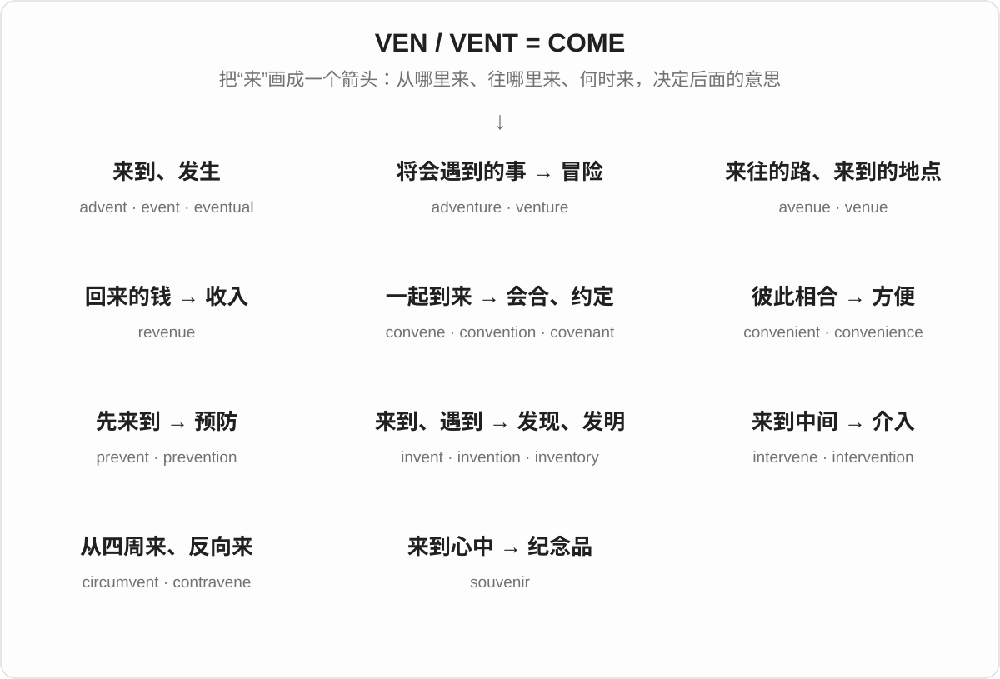

## 词形与演化规律

ven- 与 vent- 常分别出现在拉丁动词及其分词、名词等构词中。不要把 vent 当成永远能独立翻译为“来”的英语部件：vent“通风口、发泄”主要走的是拉丁语 ventus“风”这一条线。avenue、revenue、souvenir 等经过法语，字形已变；venture 是 adventure 的截短词。现代能看出相似部分，不等于每个词都是在英语里现拼出来的。

## 单词速览（按词族由简到繁）

同一基础词的相关扩展放在一起，先读基础形式，再读扩展；各组之间优先读常用的。具体词源关系见各词讲解。

| 单词 | 音标 | 核心意思 |
|---|---|---|
| [event](#w-1) | /ɪˈvent/ | 事件；活动；比赛项目 |
| [eventual](#w-18) | /ɪˈventʃuəl/ | 最终的；最后发生的 |
| [eventually](#w-2) | /ɪˈventʃuəli/ | 最后；终于；最终 |
| [eventful](#w-37) | /ɪˈventfəl/ | 多事的；经历丰富的；充满波折的 |
| [prevent](#w-3) | /prɪˈvent/ | 防止；阻止发生 |
| [prevention](#w-8) | /prɪˈvenʃən/ | 预防；防止发生 |
| [preventive](#w-25) | /prɪˈventɪv/ | 预防性的；用于防止问题的 |
| [preventable](#w-34) | /prɪˈventəbəl/ | 可以预防的；本可避免的 |
| [preventer](#w-47) | 英 /prɪˈventə/；美 /prɪˈventər/ | 防止某事的装置或人；防荡索 |
| [venue](#w-12) | 英 /ˈvenjuː/；美 /ˈvenjuː/ | 活动场地；举办地点；审判地点 |
| [revenue](#w-4) | 英 /ˈrevənjuː/；美 /ˈrevənuː/ | 收入；营收；财政收入 |
| [convene](#w-36) | /kənˈviːn/ | 召集；集会；开会 |
| [convention](#w-5) | /kənˈvenʃən/ | 大会；惯例；约定；公约 |
| [conventional](#w-11) | /kənˈvenʃənəl/ | 常规的；传统的；遵循惯例的 |
| [unconventional](#w-29) | /ˌʌnkənˈvenʃənəl/ | 不循常规的；非传统的 |
| [convener](#w-41) | 英 /kənˈviːnə/；美 /kənˈviːnər/ | 召集人；会议组织者 |
| [convenor](#w-44) | 英 /kənˈviːnə/；美 /kənˈviːnər/ | 召集人；组织者（convener 的另一拼法） |
| [reconvene](#w-42) | /ˌriːkənˈviːn/ | 重新召集；再次开会 |
| [advent](#w-20) | /ˈædvent/ | 到来；出现；基督降临期 |
| [adventure](#w-6) | 英 /ədˈventʃə/；美 /ədˈventʃər/ | 冒险；新奇刺激的经历 |
| [adventurous](#w-26) | /ədˈventʃərəs/ | 爱冒险的；敢尝新的；有探索性的 |
| [adventurer](#w-32) | 英 /ədˈventʃərə/；美 /ədˈventʃərər/ | 冒险家；爱冒险的人；投机者 |
| [avenue](#w-7) | 英 /ˈævənjuː/；美 /ˈævənuː/ | 大街；林荫道；途径 |
| [venture](#w-10) | 英 /ˈventʃə/；美 /ˈventʃər/ | 冒险尝试；风险事业；敢于说、敢于去 |
| [intervene](#w-21) | 英 /ˌɪntəˈviːn/；美 /ˌɪntərˈviːn/ | 介入；出面干预；发生而打断 |
| [intervention](#w-9) | 英 /ˌɪntəˈvenʃən/；美 /ˌɪntərˈvenʃən/ | 干预；介入；干预措施 |
| [interventionist](#w-40) | 英 /ˌɪntəˈvenʃənɪst/；美 /ˌɪntərˈvenʃənɪst/ | 主张干预的人；主张干预的 |
| [interventional](#w-43) | 英 /ˌɪntəˈvenʃənəl/；美 /ˌɪntərˈvenʃənəl/ | 干预性的；介入性的 |
| [convenient](#w-13) | 英 /kənˈviːniənt/；美 /kənˈviːnjənt/ | 方便的；合适的；省事的 |
| [convenience](#w-16) | 英 /kənˈviːniəns/；美 /kənˈviːnjəns/ | 方便；便利；便利设施 |
| [conveniently](#w-23) | 英 /kənˈviːniəntli/；美 /kənˈviːnjəntli/ | 方便地；在便利的位置；恰好合意地 |
| [inconvenient](#w-28) | 英 /ˌɪnkənˈviːniənt/；美 /ˌɪnkənˈviːnjənt/ | 不方便的；造成麻烦的 |
| [inconvenience](#w-19) | 英 /ˌɪnkənˈviːniəns/；美 /ˌɪnkənˈviːnjəns/ | 不便；麻烦；给……造成不便 |
| [invent](#w-24) | /ɪnˈvent/ | 发明；想出；编造 |
| [invention](#w-15) | /ɪnˈvenʃən/ | 发明；发明物；虚构的东西 |
| [inventor](#w-22) | 英 /ɪnˈventə/；美 /ɪnˈventər/ | 发明者；创造新器物或方法的人 |
| [inventory](#w-14) | 英 /ˈɪnvəntri/；美 /ˈɪnvəntɔːri/ | 物品清单；库存；清点 |
| [inventive](#w-31) | /ɪnˈventɪv/ | 富有创造力的；善于想办法的 |
| [reinvent](#w-35) | /ˌriːɪnˈvent/ | 重新发明；彻底改造；重新塑造 |
| [reinvention](#w-39) | /ˌriːɪnˈvenʃən/ | 重新创造；重新塑造；转型 |
| [covenant](#w-17) | /ˈkʌvənənt/ | 正式约定；契约；盟约 |
| [convent](#w-27) | 英 /ˈkɒnvent/；美 /ˈkɑːnvent/ | 女修道院；修道团体 |
| [souvenir](#w-30) | 英 /ˌsuːvəˈnɪə/；美 /ˌsuːvəˈnɪr/ | 纪念品 |
| [circumvent](#w-33) | 英 /ˌsɜːkəmˈvent/；美 /ˌsɜːrkəmˈvent/ | 设法规避；绕过；绕开障碍 |
| [circumvention](#w-45) | 英 /ˌsɜːkəmˈvenʃən/；美 /ˌsɜːrkəmˈvenʃən/ | 规避；绕过；设法避开限制 |
| [contravention](#w-38) | 英 /ˌkɒntrəˈvenʃən/；美 /ˌkɑːntrəˈvenʃən/ | 违反；违背 |
| [contravene](#w-46) | 英 /ˌkɒntrəˈviːn/；美 /ˌkɑːntrəˈviːn/ | 违反；违背；与……相冲突 |
| [supervene](#w-48) | 英 /ˌsuːpəˈviːn/；美 /ˌsuːpərˈviːn/ | 接着发生；额外出现；随附于 |

## 逐词讲解

### 1. event — 事件；活动；比赛项目

**音标**：/ɪˈvent/

**先抓住这个画面**

一件事真正发生了，进入事情的发展过程，可以叫 event；有组织安排的演出、庆典或比赛也可以是 event。

**怎么拆**

来自法语 event，根在拉丁语 ēventus；ēvenīre 由 ē- / ex-（出来）+ venīre（来）构成。不是 even“偶数的”加 t。

**怎么变成今天的意思**

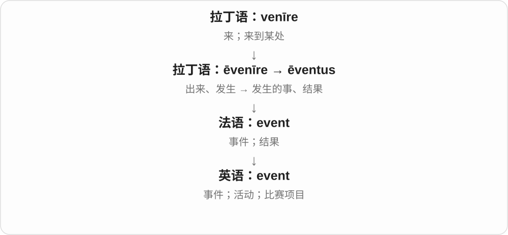

“出来、发生”发展出发生的事和结果。现代 event 可以是意外事件，也可以是提前安排的活动；体育语境还指一个具体比赛项目。

**常见搭配与例句**

a major event；organize an event；the course of events；a swimming event。

> The storm was the most dramatic event of the week.

这场暴风雨是本周最引人注目的事件。

> The school is organizing a fundraising event.

学校正在筹办募款活动。

> She competed in three swimming events.

她参加了三个游泳项目。

**别混淆**

incident 常指一次具体、尤其不愉快的事件；event 范围更广。event 不等于只指大型庆典。

### 2. eventual — 最终的；最后发生的

**音标**：/ɪˈventʃuəl/

**先抓住这个画面**

过程里还有很多变化，但把时间往后推，最终落定的那个结果，可以用 eventual 修饰。

**怎么拆**

词形与 event + -ual 对应，也与法语 éventuel 相联系；最初谈事件、结果，后来形成最终发生的常用义。

**怎么变成今天的意思**

不是现在立刻出现，而是经过一段过程终于成为结果。the eventual winner 是后来最终胜出的人，刚开始时未必领先。

**常见搭配与例句**

an eventual outcome；the eventual winner；eventual success。

> The eventual winner was not the early favorite.

最终获胜者并不是最初被看好的人。

> Their patience contributed to the project’s eventual success.

他们的耐心帮助项目最终取得了成功。

**别混淆**

eventual 是最终的；possible 是可能的。别受一些欧洲语言同形词影响，把 eventual 当成日常英语的“也许会有的”。

### 3. eventually — 最后；终于；最终

**音标**：/ɪˈventʃuəli/

**先抓住这个画面**

尝试、等待或变化了一阵，事情终于到了那个结果，用 eventually。

**怎么拆**

eventual + -ly。

**怎么变成今天的意思**

它常带出时间和过程，但不必意味着很遥远。说 eventually agreed，暗示前面有过等待、讨论或不同意见。

**常见搭配与例句**

eventually arrive；eventually realize；will eventually…。

> We took several wrong turns but eventually found the hotel.

我们拐错了几次路，但最后找到了酒店。

> She eventually agreed to join the team.

她最后同意加入团队。

**别混淆**

finally 也可表示终于，还能标记清单的最后一点；eventually 通常说事情经历过程后的结果，不用来列举“最后一点”。

### 4. eventful — 多事的；经历丰富的；充满波折的

**音标**：/ɪˈventfəl/

**先抓住这个画面**

一天里接连发生许多值得一说的事，回想起来内容很多，就是 eventful。

**怎么拆**

event + -ful，表示充满事件或重要经历。

**怎么变成今天的意思**

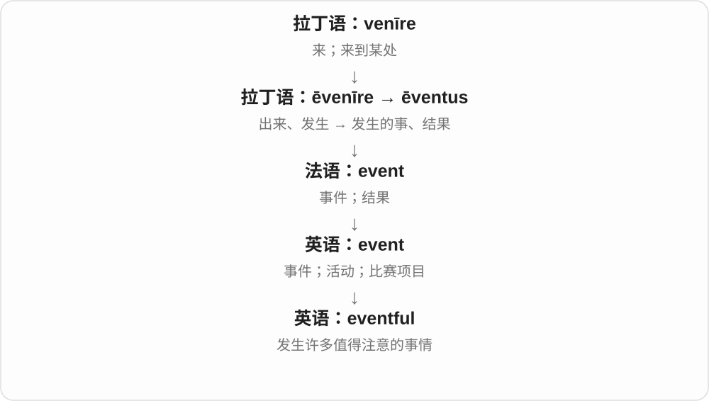

这里的事可以好也可以坏。an eventful journey 可能很精彩，也可能一路延误、意外不断，要看上下文。

**常见搭配与例句**

an eventful day；an eventful journey；an eventful life。

> It was an eventful day, with a new job offer and a surprise visit.

这是经历丰富的一天：既收到了新工作的录用通知，又迎来意外到访。

> After an eventful journey, we were glad to be home.

经历一路波折后，回到家让我们很高兴。

**别混淆**

exciting 强调令人兴奋；eventful 强调事情多、变化多。忙得平淡的一天不一定 eventful。

### 5. prevent — 防止；阻止发生

**音标**：/prɪˈvent/

**先抓住这个画面**

问题还没发生，先把条件挡住；或者有人想行动，你让它无法实现，这就是 prevent。

**怎么拆**

来自拉丁语 praeventus，属于 praevenīre：prae-（在前）+ venīre（来），先有走在前面、抢先的意思。

**怎么变成今天的意思**

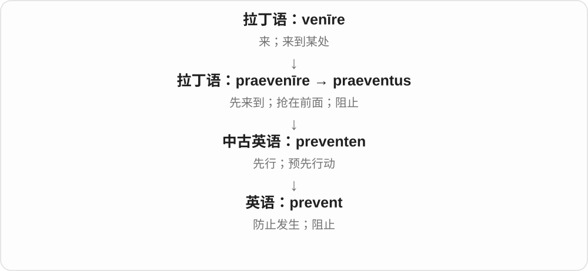

抢先到达 → 预先行动 → 让某事不能发生。这个词今天不再只是“提前”，而是突出阻止的结果；读旧文时才可能遇到先行的旧义。

**常见搭配与例句**

prevent an accident；prevent damage；prevent someone from doing…。

> The cover prevents dust from entering the machine.

盖子可以防止灰尘进入机器。

> Heavy snow prevented us from reaching the village.

大雪使我们无法到达村庄。

**别混淆**

prevent 是防止发生；protect 是保护对象免受伤害。说 prevent someone from doing，不是 prevent someone to do。

### 6. prevention — 预防；防止发生

**音标**：/prɪˈvenʃən/

**先抓住这个画面**

把精力放在问题出现之前：检查、消除隐患、减少发生机会，这类工作统称 prevention。

**怎么拆**

借自中世纪拉丁语 praeventiō，源于 praevenīre“先行、预先行动”；现代与 prevent 配对。

**怎么变成今天的意思**

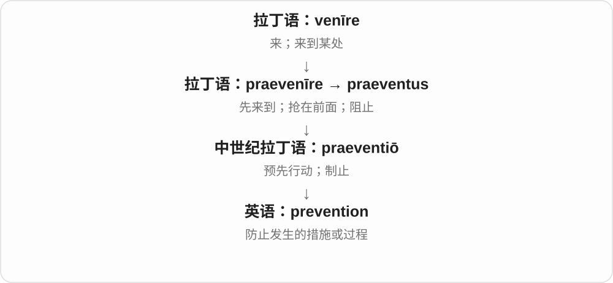

从抢在前面发展成预防。常见 crime prevention、fire prevention，不只用于疾病。prevention 本身通常不可数。

**常见搭配与例句**

fire prevention；accident prevention；the prevention of damage。

> The training focuses on fire prevention.

培训重点是预防火灾。

> Early maintenance is essential to the prevention of major faults.

及早维护对防止重大故障很重要。

**别混淆**

prevention 在事情发生前降低或阻止风险；response 是事后或事中应对，repair 则是修复损坏。

### 7. preventive — 预防性的；用于防止问题的

**音标**：/prɪˈventɪv/

**先抓住这个画面**

机器还没坏就保养，木头还没腐朽就做保护，这些措施目的在于防患于未然，是 preventive。

**怎么拆**

与新拉丁语 praeventīvus 相连；现代可按 prevent + -ive 理解，表示有预防作用的。

**怎么变成今天的意思**

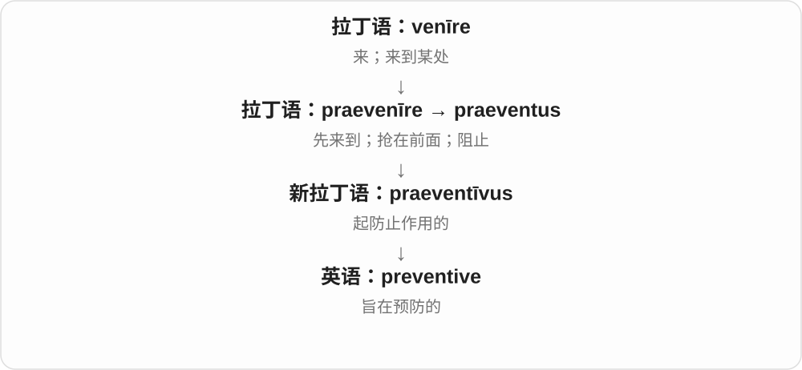

它说明行动的目的，不表示所有风险已经归零。preventive maintenance 是为了避免故障而进行的维护。

**常见搭配与例句**

preventive measures；preventive maintenance；preventive action。

> The factory schedules preventive maintenance every month.

工厂每个月安排预防性维护。

> Simple preventive measures can reduce avoidable damage.

简单的预防措施可以减少本可避免的损坏。

**别混淆**

preventive 是预先防止；corrective 是纠正已经出现的问题。preventative 是同义的另一常见形式。

### 8. preventable — 可以预防的；本可避免的

**音标**：/prɪˈventəbəl/

**先抓住这个画面**

如果提前采取合适行动，这件坏事原本不必发生，它就可以说是 preventable。

**怎么拆**

prevent + -able，表示能够被防止的。

**怎么变成今天的意思**

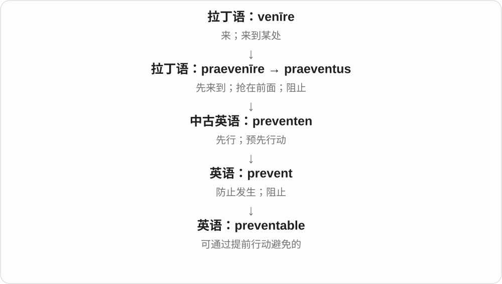

它讨论可避免性；不能仅凭词义就认定某个人必然有过错。a preventable error 强调有办法减少或避免错误。

**常见搭配与例句**

a preventable accident；preventable damage；largely preventable。

> The review found that several errors were preventable.

复盘发现，几个错误本来可以避免。

> The guide explains how to reduce preventable damage during transport.

指南介绍如何减少运输中本可避免的损坏。

**别混淆**

preventable 是能防止；preventive 是用来防止的。事故可以 preventable，措施则是 preventive。

### 9. preventer — 防止某事的装置或人；防荡索

**音标**：英 /prɪˈventə/；美 /prɪˈventər/

**先抓住这个画面**

专门拦住某种不想发生的情况的东西，可以叫 preventer；航海里也用它指限制帆桁意外摆动的索具。

**怎么拆**

prevent + -er，表示起防止作用的人或物，不一定是人。

**怎么变成今天的意思**

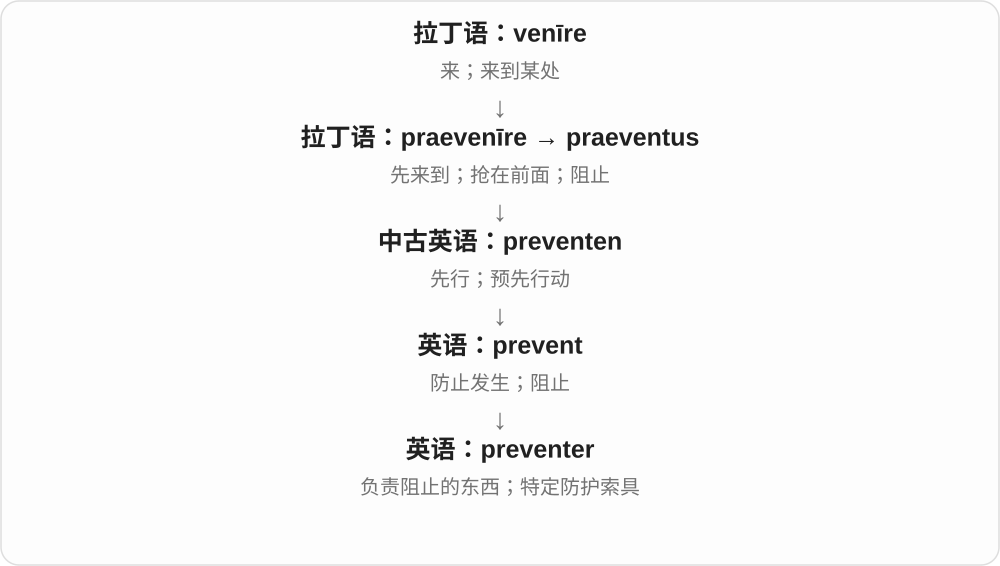

它通常需要语境交代防什么。复合术语里常见 backflow preventer“防倒流装置”；航海义把功能名称固定成了设备名称。

**常见搭配与例句**

a backflow preventer；a preventer line；a blowout preventer。

> The plumber inspected the backflow preventer.

管道工检查了防倒流装置。

> The sailing manual identifies the line as a preventer.

航海手册将这根绳索标作防荡索。

**别混淆**

preventer 是装置或角色；prevention 是防止的过程。一般“安保人员”不随意称 preventer。

### 10. venue — 活动场地；举办地点；审判地点

**音标**：英 /ˈvenjuː/；美 /ˈvenjuː/

**先抓住这个画面**

订婚礼大厅、演唱会场馆，问的是“活动在哪里办”，那个地点就是 venue。

**怎么拆**

来自古法语 venue“到来”，是 venir“来”的阴性过去分词。英语曾表示来到，后来有法律上的审判地点义，再扩展到活动场地。

**怎么变成今天的意思**

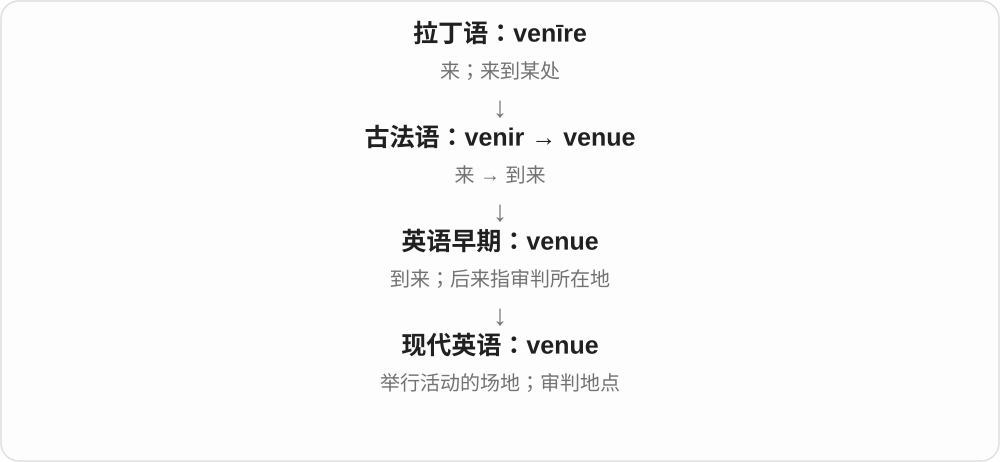

这里有一段法律用法的历史，不能简单把它编成“大家一来就是场地”。现代 venue 重在承载某场活动，不一定是一栋建筑，也可以是户外地点。

**常见搭配与例句**

a concert venue；book a venue；the wedding venue；a change of venue。

> We booked a small venue for the concert.

我们为音乐会订了一处小场地。

> The organizers announced a change of venue.

主办方宣布更换活动地点。

**别混淆**

location 是广义地点；venue 通常与活动或诉讼发生在哪里相连。avenue 则是道路、途径。

### 11. revenue — 收入；营收；财政收入

**音标**：英 /ˈrevənjuː/；美 /ˈrevənuː/

**先抓住这个画面**

东西卖出去、服务提供出去，钱回到经营者手里，这笔流入的收入可以叫 revenue。

**怎么拆**

经法语 revenue 来自 revenir“回来”，根在拉丁语 revenīre：re-（回来）+ venīre（来）。

**怎么变成今天的意思**

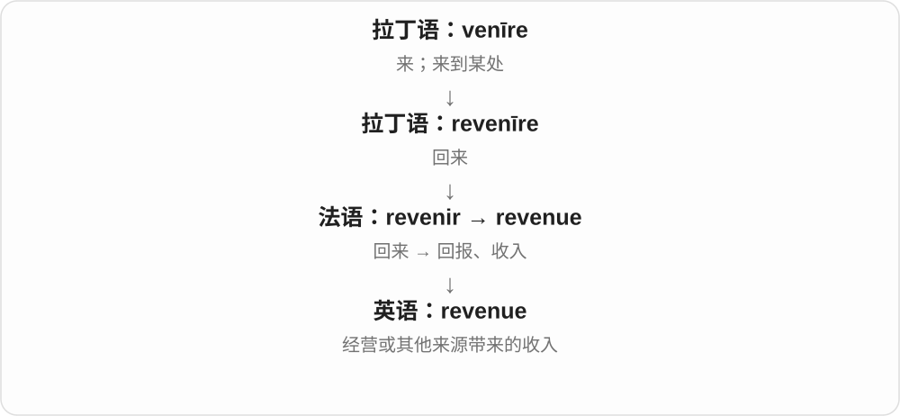

历史上的回来、回报发展成收入。商业语境常说销售和服务产生的营收，政府语境常说税费等收入；不能看到 revenue 就当成净赚的钱。

**常见搭配与例句**

annual revenue；sales revenue；tax revenue；generate revenue。

> The company reported higher revenue but lower profit.

公司报告营收增加，但利润下降。

> Ticket sales provide most of the museum’s revenue.

门票销售构成这家博物馆收入的大部分。

**别混淆**

revenue 通常尚未扣除相关成本费用；profit 是扣除成本费用后所谈的利润。两者可能一高一低。

### 12. convene — 召集；集会；开会

**音标**：/kənˈviːn/

**先抓住这个画面**

把分散的人叫到一起，让会议正式开始，就是 convene；人们自己聚齐开会，也可用这个动词。

**怎么拆**

经中古法语 convenir 来自拉丁语 convenīre：con-（一起）+ venīre（来）。

**怎么变成今天的意思**

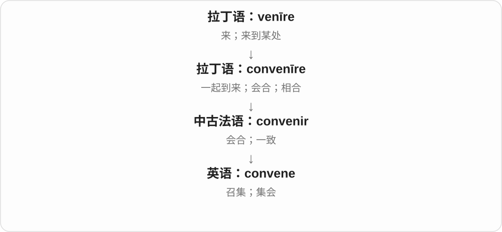

一起到来 → 会合、集会。既能说 convene a meeting“召集会议”，也能说 the committee convenes“委员会开会”。

**常见搭配与例句**

convene a meeting；convene a committee；convene at noon。

> The chair convened an emergency meeting.

主席召集了一次紧急会议。

> The committee will convene again on Tuesday.

委员会将在星期二再次开会。

**别混淆**

gather 是广义聚集；convene 通常是带目的的正式集会。convene the meeting 不是表示说服大家同意。

### 13. convention — 大会；惯例；约定；公约

**音标**：/kənˈvenʃən/

**先抓住这个画面**

人聚到一起，可以开大会；人达成共同做法，可以形成约定。这两条都抓住“聚到一处、达成一致”。

**怎么拆**

经法语 convention 来自拉丁语 conventiō“聚集、协议”，源于 convenīre；现代能看出与 convene 的对应关系，但名词本身是借入的。

**怎么变成今天的意思**

会议义保留实际聚集；惯例是群体习惯遵循的做法；公约是正式共同约定。并不是每一种 convention 都有签署的文件。

**常见搭配与例句**

attend a convention；social conventions；a naming convention；an international convention。

> Thousands of teachers attended the annual convention.

数千名教师参加了年会。

> The team agreed on a clear naming convention.

团队约定了一套清晰的命名规则。

> The ceremony follows local convention.

仪式遵循当地惯例。

**别混淆**

conference 偏围绕议题交流的会议；convention 也常是协会或群体大会。convention 作惯例时不等于法律强制规定。

### 14. conventional — 常规的；传统的；遵循惯例的

**音标**：/kənˈvenʃənəl/

**先抓住这个画面**

大家通常就这么做，这个方案也沿着熟悉的路走，就是 conventional。

**怎么拆**

借自晚期拉丁语 conventiōnālis“与约定有关的”；现代可按 convention（惯例、约定）+ -al 理解。

**怎么变成今天的意思**

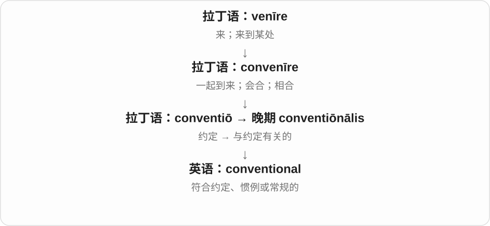

可以是中性的常规技术，也可暗示想法守旧、不新颖。conventional wisdom 是普遍接受的看法，不保证它一定正确。

**常见搭配与例句**

a conventional approach；conventional wisdom；conventional methods。

> The team chose a conventional design that was easy to maintain.

团队选择了便于维护的常规设计。

> Her findings challenged conventional wisdom.

她的研究结果挑战了普遍接受的看法。

**别混淆**

common 强调常见；conventional 强调符合习惯、通行模式。traditional 更突出历史传承。

### 15. unconventional — 不循常规的；非传统的

**音标**：/ˌʌnkənˈvenʃənəl/

**先抓住这个画面**

别人都按一条熟悉的路线走，你用了另一套做法，这就可以是 unconventional。

**怎么拆**

un-（不）+ conventional（按惯例的）。

**怎么变成今天的意思**

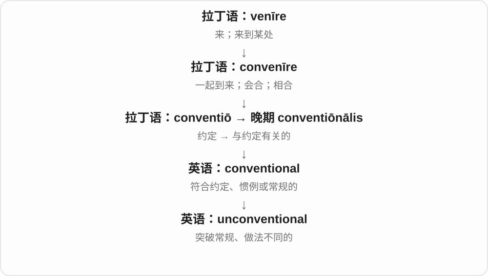

它先说明与常规不同，可以赞赏创新，也可以仅作客观分类。做法新奇不自动证明有效。

**常见搭配与例句**

an unconventional solution；unconventional methods；an unconventional career。

> She found an unconventional way to teach fractions.

她找到了一种不循常规的分数教学方法。

> His career followed an unconventional path.

他的职业经历走了一条不寻常的道路。

**别混淆**

unconventional 是不走常规；illegal 是违法。与众不同并不等于违反法律。

### 16. convener — 召集人；会议组织者

**音标**：英 /kənˈviːnə/；美 /kənˈviːnər/

**先抓住这个画面**

负责把人联系起来、安排大家一起讨论的人，就是 convener。

**怎么拆**

convene 去掉词尾 e + -er，表示召集会议的人。

**怎么变成今天的意思**

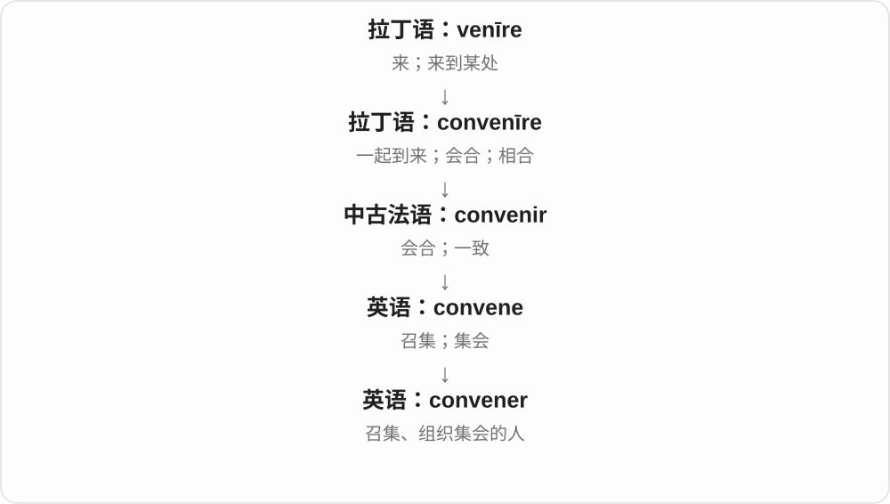

有些机构把它当作正式职务，有些只是一次会议的角色。是否同时主持会议，要看组织安排。

**常见搭配与例句**

a meeting convener；the convener of a working group；appoint a convener。

> The convener sent the agenda to all members.

召集人把议程发给了所有成员。

> She became the convener of the new working group.

她担任了新工作组的召集人。

**别混淆**

chair 主要强调主持会议或担任主席；convener 主要强调把人召集起来。两项职责可以由同一个人承担。

### 17. convenor — 召集人；组织者（convener 的另一拼法）

**音标**：英 /kənˈviːnə/；美 /kənˈviːnər/

**先抓住这个画面**

看见会议通知上写 convenor，指的也是把参会者组织到一起的人。

**怎么拆**

convene + -or，与 convener 形成并存的拼写形式；读音和基本意义相同。

**怎么变成今天的意思**

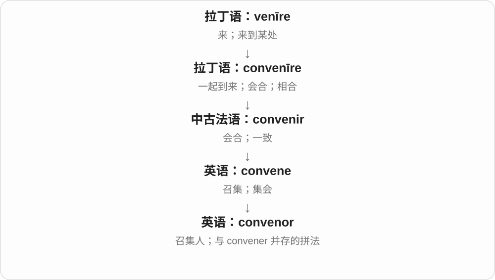

不同组织或地区会固定采用其中一种拼法。它不是比 convener 更高一级的职务，也不能仅凭词尾判断职责不同。

**常见搭配与例句**

conference convenor；the convenor of the committee。

> Please send your questions to the conference convenor.

请把问题发给会议召集人。

> The committee’s convenor welcomed the new members.

委员会召集人欢迎了新成员。

**别混淆**

convenor 与 convener 通常是拼写选择；coordinator 更宽泛地说协调事务的人，不一定负责召集会议。

### 18. reconvene — 重新召集；再次开会

**音标**：/ˌriːkənˈviːn/

**先抓住这个画面**

会议休息了一会儿，或上次没讨论完，大家再回来继续，就叫 reconvene。

**怎么拆**

re-（再次）+ convene（聚集开会）。

**怎么变成今天的意思**

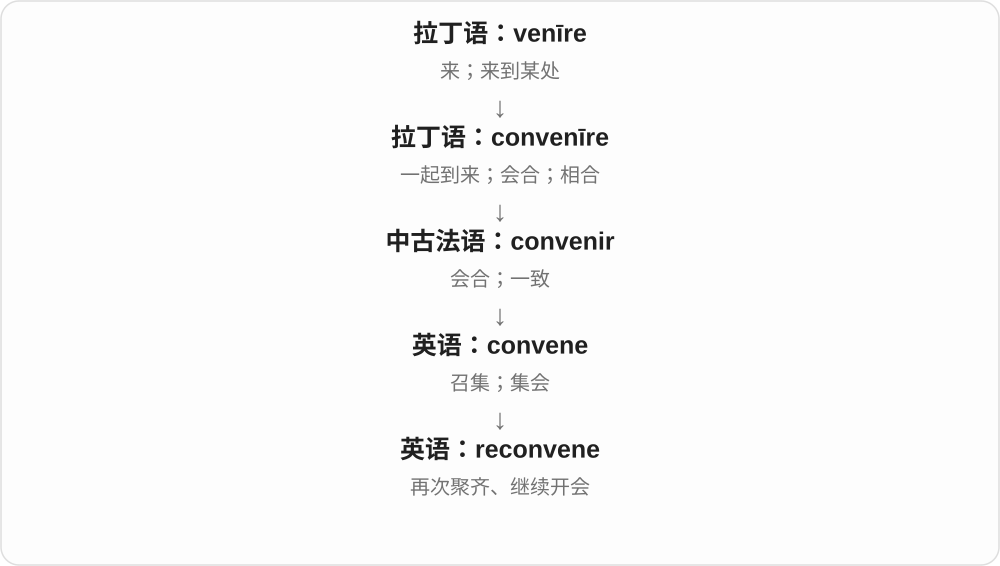

通常接续此前已有的会议或委员会活动。既可表示召集别人，也可以表示会议成员重新集合。

**常见搭配与例句**

reconvene after lunch；reconvene the panel；reconvene tomorrow。

> We will reconvene after a short break.

短暂休息后，我们再继续开会。

> The chair decided to reconvene the panel the following week.

主席决定下一周再次召集评审组。

**别混淆**

resume 可以说恢复工作、旅程等；reconvene 专门突出人们再聚到一起开会。

### 19. advent — 到来；出现；基督降临期

**音标**：/ˈædvent/

**先抓住这个画面**

一种新技术、新时代终于来到，原来的生活随之改变，这种带分量的出现常叫 advent。

**怎么拆**

来自拉丁语 adventus“到来”，源于 advenīre：ad-（朝向）+ venīre（来）。

**怎么变成今天的意思**

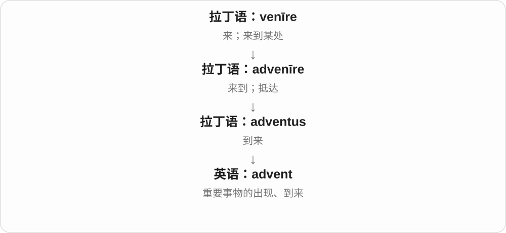

普通用法常见 the advent of…，语气比 arrival 更正式。大写 Advent 在基督教语境指圣诞节前的降临期，词义仍围绕等待到来。

**常见搭配与例句**

with the advent of…；the advent of the internet；an Advent calendar。

> The advent of online banking changed how people manage money.

网上银行的出现改变了人们管理资金的方式。

> The family opens one window of the Advent calendar each day.

这家人每天打开降临期日历上的一个小窗口。

**别混淆**

arrival 可说一班火车到站；advent 通常说重要发展、新阶段或宗教上的来临。

### 20. adventure — 冒险；新奇刺激的经历

**音标**：英 /ədˈventʃə/；美 /ədˈventʃər/

**先抓住这个画面**

踏进没经历过的世界，不知道接下来会发生什么，这种带不确定性和新鲜感的经历是 adventure。

**怎么拆**

经古法语 aventure 来自拉丁语“将要发生之事”一支，根在 advenīre“来到”。英语后来补回 d 以对应拉丁语字形。

**怎么变成今天的意思**

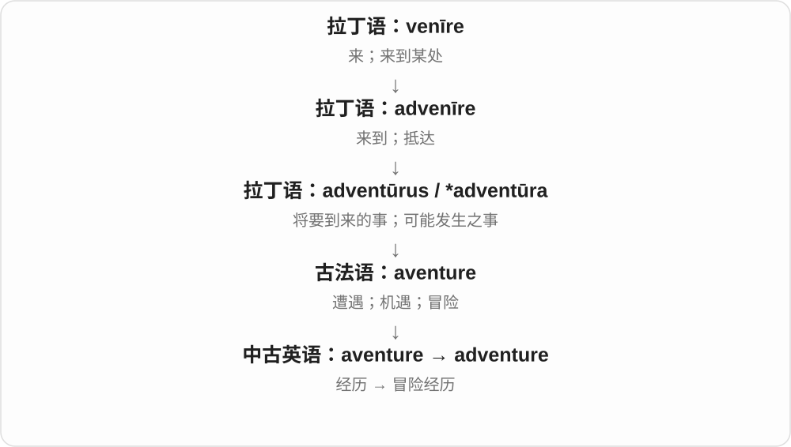

将要遇到的事 → 偶然遭遇、风险 → 冒险经历。它可以是真实远行，也可以是第一次搬家、独自生活等带探索感的经历。

**常见搭配与例句**

go on an adventure；a sense of adventure；an adventure story。

> Camping alone for the first time felt like a real adventure.

第一次独自露营，让我觉得真是在冒险。

> The children invented an adventure story about a lost island.

孩子们编了一个关于失落岛屿的冒险故事。

**别混淆**

journey 是旅程；adventure 强调未知、新奇或风险。普通通勤通常不称 adventure，除非刻意打趣。

### 21. adventurous — 爱冒险的；敢尝新的；有探索性的

**音标**：/ədˈventʃərəs/

**先抓住这个画面**

菜单上有从没吃过的菜，路线也有没走过的选择，你愿意试试，这种开放、敢探索的态度就是 adventurous。

**怎么拆**

经古法语 aventuros 进入中古英语；现代对应 adventure + -ous 的关系，不是英语里才从零拼出的词。

**怎么变成今天的意思**

不必每次都关乎危险。adventurous cooking 可以只是大胆尝试新食材，adventurous design 则是不拘常规的设计。

**常见搭配与例句**

an adventurous traveler；an adventurous spirit；adventurous cooking。

> She became more adventurous with food while traveling.

旅行让她更敢尝试陌生食物。

> The building has an adventurous design.

这栋建筑的设计大胆新颖。

**别混淆**

brave 强调面对恐惧仍有勇气；adventurous 强调愿意尝试未知。reckless 则是鲁莽、不顾后果。

### 22. adventurer — 冒险家；爱冒险的人；投机者

**音标**：英 /ədˈventʃərə/；美 /ədˈventʃərər/

**先抓住这个画面**

愿意走进未知环境、尝试有风险经历的人，可以是 adventurer；旧式政治语境有时带投机逐利的贬义。

**怎么拆**

adventure 作动词时表示冒险，接 -er 形成施事名词；后来常指寻求冒险经历的人。

**怎么变成今天的意思**

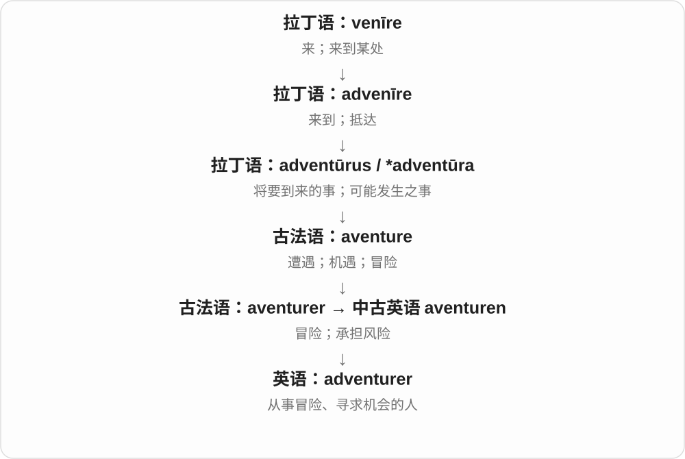

从经历冒险的人发展到以冒险、机会为生活方式的人。它不自动等于专业探险科学家，是否值得赞赏要看语境。

**常见搭配与例句**

a fearless adventurer；a young adventurer；a political adventurer。

> The adventurer crossed the desert with a small team.

这位冒险家带着一支小队穿越了沙漠。

> The novel follows a young adventurer searching for a new life.

小说讲述一位年轻冒险者寻找新生活的经历。

**别混淆**

explorer 强调探索、调查陌生地区；adventurer 更强调风险和经历。opportunist 则明确偏投机。

### 23. avenue — 大街；林荫道；途径

**音标**：英 /ˈævənjuː/；美 /ˈævənuː/

**先抓住这个画面**

一条把人引向某处的宽阔道路是 avenue；一个把问题引向解决办法的路径，也可以这样说。

**怎么拆**

来自法语 avenue，原为 avenir“来到、接近”的阴性过去分词，更早是拉丁语 advenīre。

**怎么变成今天的意思**

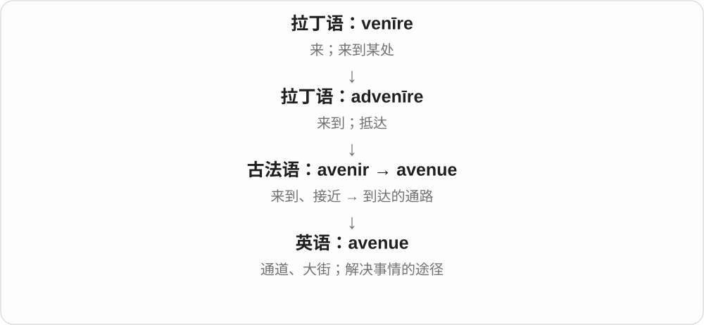

从通往某处的道路发展为街道名，再把“走一条路达到目的”用于抽象办法。街名中的 Avenue 不保证一定种着树。

**常见搭配与例句**

a tree-lined avenue；an avenue of research；explore every avenue。

> They walked along the avenue toward the museum.

他们沿着大街走向博物馆。

> The discovery opened a new avenue of research.

这一发现开辟了新的研究方向。

**别混淆**

venue 是活动场地；avenue 是道路或方法。两个词同属“来”的远亲，现代用途却不同。

### 24. venture — 冒险尝试；风险事业；敢于说、敢于去

**音标**：英 /ˈventʃə/；美 /ˈventʃər/

**先抓住这个画面**

前面未必成功，你还是带着一点风险迈出去；这一步尝试或投入的事业可以叫 venture。

**怎么拆**

adventure 的截短词，先有较长的 adventure，再省去开头形成 venture。

**怎么变成今天的意思**

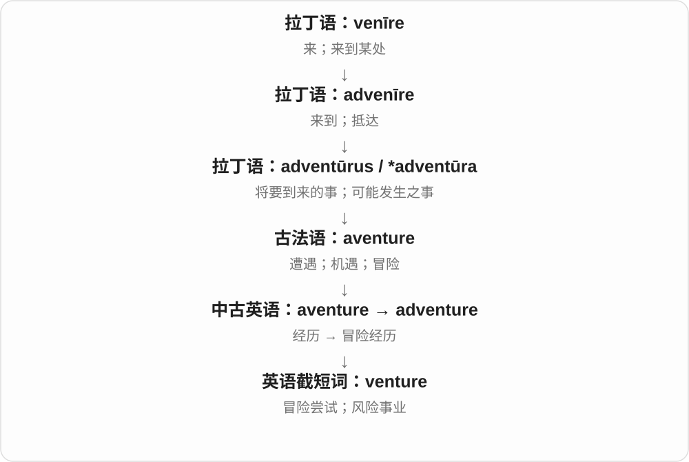

名词常指新生意、新项目；动词可以是冒险去某处，也可以是小心地提出看法。venture a guess 有“我大胆猜一下”的语气。

**常见搭配与例句**

a business venture；a joint venture；venture into…；venture a guess。

> Their first business venture was a small bakery.

他们第一次创业开了一家小面包店。

> I would venture to suggest a simpler solution.

我想冒昧提出一个更简单的办法。

**别混淆**

adventure 偏经历的刺激与探索；venture 常强调承担风险的行动或项目，尤其商业语境。

### 25. intervene — 介入；出面干预；发生而打断

**音标**：英 /ˌɪntəˈviːn/；美 /ˌɪntərˈviːn/

**先抓住这个画面**

两边发生争执，你走到中间，让事情换一个方向，这就是 intervene；有时不是人介入，而是意外把计划打断。

**怎么拆**

根在拉丁语 intervenīre：inter-（在中间）+ venīre（来）。英语可能从较早的 intervention 反构，也可能直接承接拉丁语动词。

**怎么变成今天的意思**

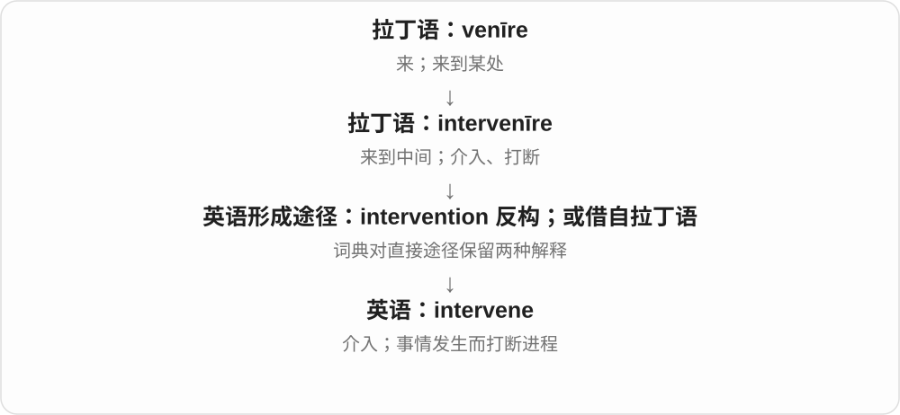

A third person intervened 是有人插手或出面。Then illness intervened 是疾病突然加入原有进程，影响了安排；不是说疾病有意调解。它通常是不及物动词。

**常见搭配与例句**

intervene in a dispute；intervene to help；intervene between two sides；unless something intervenes。

> A neighbor intervened before the disagreement became a fight.

争执演变成打架之前，一位邻居出面劝阻了。

> We planned to travel in June, but a family emergency intervened.

我们原计划六月出游，但家里的突发状况打乱了安排。

**别混淆**

interrupt 常只表示打断话语或活动；intervene 更强调进入一件事情的发展过程并产生影响。

### 26. intervention — 干预；介入；干预措施

**音标**：英 /ˌɪntəˈvenʃən/；美 /ˌɪntərˈvenʃən/

**先抓住这个画面**

事情正在自行发展，第三方进来改变进程：调解冲突、支持学生或处理危机，这种介入叫 intervention。

**怎么拆**

来自拉丁语 interventiō，可经法语 intervention 借入；inter-（在……之间）+ venīre（来）先组成 intervenīre。英语名词的记录早于 intervene，不能简单画成英语动词加 -tion。

**怎么变成今天的意思**

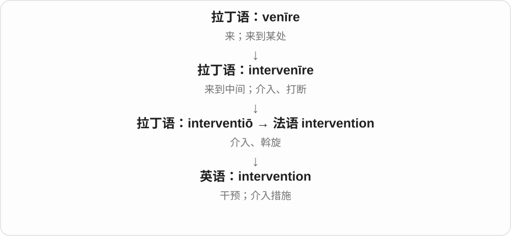

“来到中间”可以是劝架，也可以是把一项帮助放进事情的发展过程。它本身不保证干预有效或受欢迎。医疗语境里也指为改善健康而采取的措施，范围比手术广。

**常见搭配与例句**

early intervention；government intervention；an intervention in a dispute；without intervention。

> The teacher’s intervention prevented the argument from getting worse.

老师的介入使争吵没有进一步恶化。

> The report evaluates an early intervention designed to support struggling readers.

报告评估了一项帮助阅读困难学生的早期干预措施。

**别混淆**

interference 常带不受欢迎的干涉意味；intervention 比较中性，需看具体介入的目的和结果。

### 27. interventionist — 主张干预的人；主张干预的

**音标**：英 /ˌɪntəˈvenʃənɪst/；美 /ˌɪntərˈvenʃənɪst/

**先抓住这个画面**

面对问题，有人认为政府应该主动进场改变局面，而不只是旁观；这种立场或持这种立场的人可称 interventionist。

**怎么拆**

与法语 interventionniste 相连，现代对应 intervention + -ist，表示支持干预的人或倾向。

**怎么变成今天的意思**

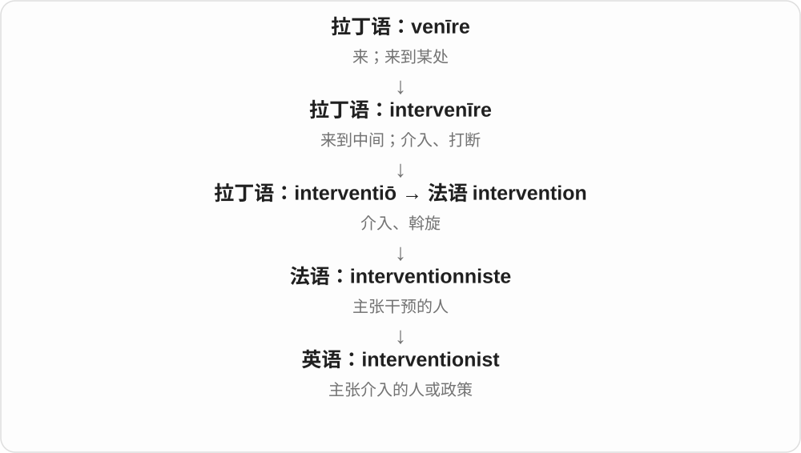

它可以谈经济管理，也可以谈对外政策。不能看到这个词就认定在支持战争；政府调控市场也属于可能的讨论范围。形容词用法常修饰 approach、policy。

**常见搭配与例句**

an interventionist policy；an interventionist government；economic interventionists。

> The economist favors a more interventionist approach to housing policy.

这位经济学家支持政府更主动介入住房政策。

> Interventionists argued that the government should help stabilize the market.

主张干预的人认为，政府应该帮助稳定市场。

**别混淆**

intervention 是一次干预或干预措施；interventionist 常说赞成干预的政策倾向，并不只指某次参与行动的人。

### 28. interventional — 干预性的；介入性的

**音标**：英 /ˌɪntəˈvenʃənəl/；美 /ˌɪntərˈvenʃənəl/

**先抓住这个画面**

用来说明一项检查、治疗或研究包含实际介入，而不是只在一旁看情况。

**怎么拆**

intervention + -al，把“干预、介入”变成修饰其他名词的形容词。

**怎么变成今天的意思**

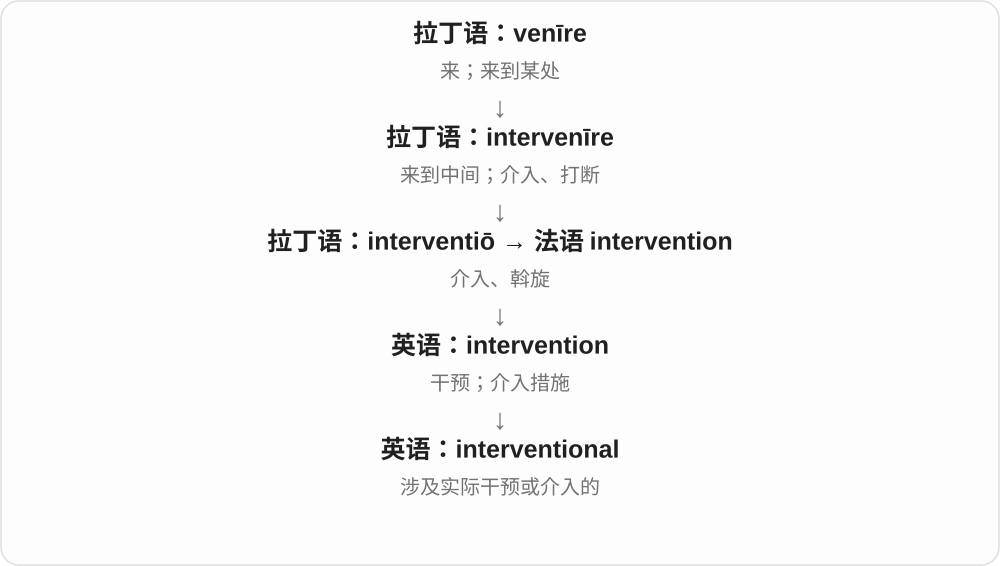

常见于医学。interventional radiology 是介入放射学：借影像看清位置，再用导管等器械进行治疗。这里的 interventional 说的是参与改变情况，不是指“发生在两个房间之间”。

**常见搭配与例句**

interventional radiology；an interventional procedure；an interventional study。

> The hospital has opened a new interventional radiology unit.

医院新设了一个介入放射科部门。

> The article compares diagnostic imaging with interventional procedures.

文章比较了诊断影像检查与介入操作。

**别混淆**

interventional 说明有介入行为；interventionist 多说支持干预的立场。描述一种医疗技术通常用前者。

### 29. convenient — 方便的；合适的；省事的

**音标**：英 /kənˈviːniənt/；美 /kənˈviːnjənt/

**先抓住这个画面**

时间、地点或方式刚好配合你的需要，不用多绕路、多费力，就是 convenient。

**怎么拆**

来自拉丁语 conveniēns“相合、合适的”，是 convenīre 的分词；con-（一起）+ venīre（来）先形成合到一起、相配的意思。

**怎么变成今天的意思**

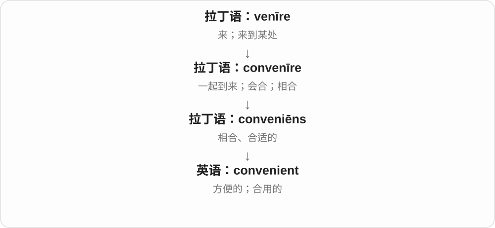

重点不只是东西容易，而是它和人的安排、需要合得来。a convenient excuse 还可暗示借口正好替自己省去麻烦。

**常见搭配与例句**

a convenient time；convenient for travelers；convenient to use；if it is convenient。

> Would Friday afternoon be convenient for you?

星期五下午你方便吗？

> The hotel is convenient for the station.

从这家旅馆去车站很方便。

**别混淆**

通常说 a time is convenient for me，不说 I am convenient。comfortable 是舒适，convenient 是省事、合用。

### 30. convenience — 方便；便利；便利设施

**音标**：英 /kənˈviːniəns/；美 /kənˈviːnjəns/

**先抓住这个画面**

不用额外跑一趟、不必花太多时间，一件东西或一种安排带来的这种省事感就是 convenience。

**怎么拆**

借自拉丁语 convenientia“相合、适宜”，与 conveniēns 相连；现代是 convenient 对应的名词。

**怎么变成今天的意思**

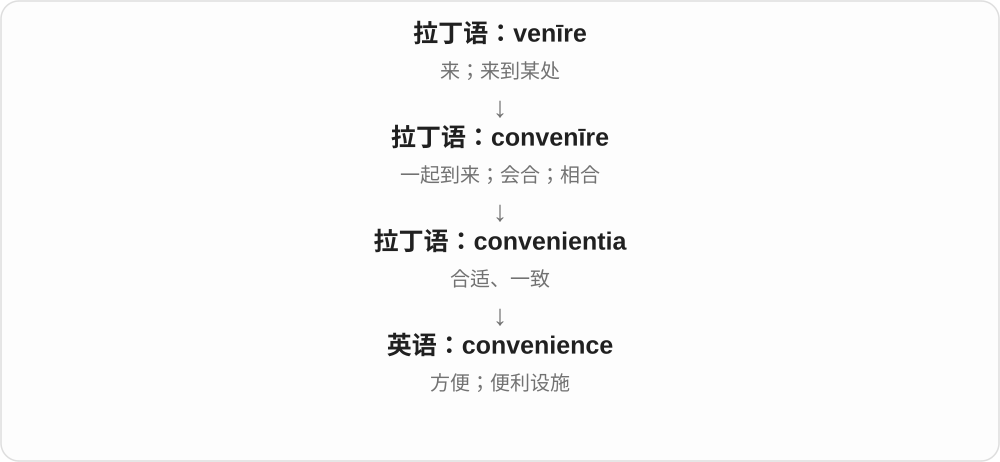

for convenience 是为了方便。复数 conveniences 可指让生活省事的设备；convenience store 是提供便利购物的小商店。

**常见搭配与例句**

for your convenience；at your convenience；a convenience store；modern conveniences。

> The form can be completed online for your convenience.

为方便你办理，表格可以在线填写。

> Please call me at your convenience.

请在方便时给我打电话。

**别混淆**

convenience 是方便这一性质；convenient 是形容词。at your convenience 是在你方便时，语气不表示必须立刻。

### 31. conveniently — 方便地；在便利的位置；恰好合意地

**音标**：英 /kənˈviːniəntli/；美 /kənˈviːnjəntli/

**先抓住这个画面**

商店就在路口，办事顺路，不用多折腾，可以说 conveniently located。

**怎么拆**

convenient + -ly。

**怎么变成今天的意思**

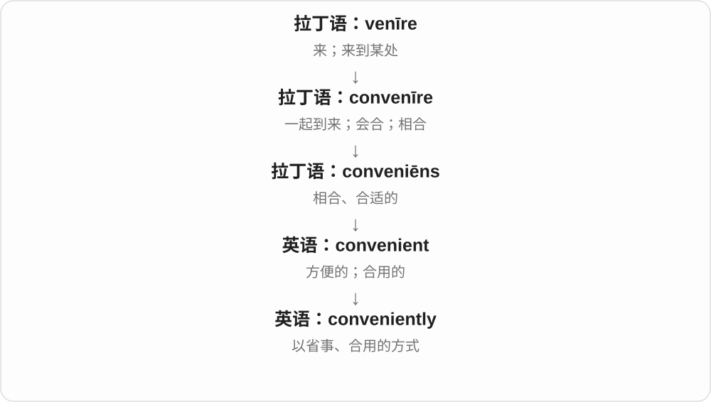

既可赞位置便利，也能带讽刺：conveniently forgot 指恰好忘了对自己不利的事，暗示可能是在装忘。

**常见搭配与例句**

conveniently located；conveniently close；conveniently forget。

> The apartment is conveniently located near two bus routes.

公寓的位置很方便，附近有两条公交线路。

> He conveniently forgot to mention his own mistake.

他偏偏忘了提自己犯的错。

**别混淆**

easily 强调难度低；conveniently 强调安排省事或有利。后者在某些句子里会有怀疑语气。

### 32. inconvenient — 不方便的；造成麻烦的

**音标**：英 /ˌɪnkənˈviːniənt/；美 /ˌɪnkənˈviːnjənt/

**先抓住这个画面**

开会时间撞上接孩子，车站又远得要绕路，安排和需要合不上，就是 inconvenient。

**怎么拆**

经法语 inconvenient 来自拉丁语 inconveniēns“不能相合的”；现代可按 in-（不）+ convenient 理解。

**怎么变成今天的意思**

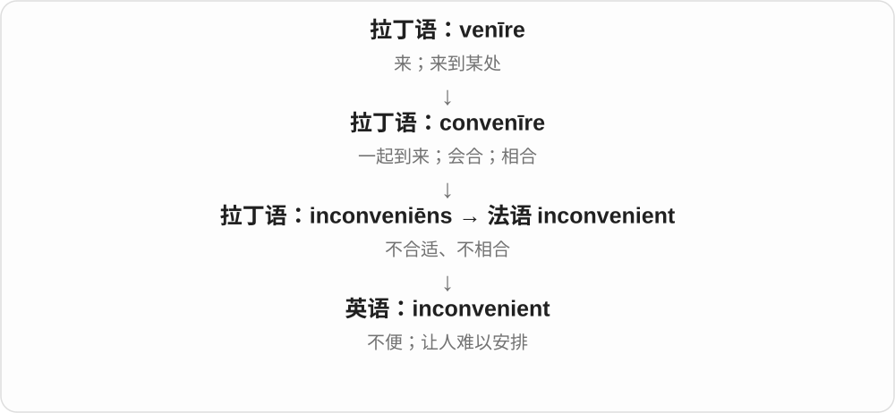

它不必严重到做不成，只是添了麻烦。an inconvenient fact 也可以是让某人的说法难以成立、不想面对的事实。

**常见搭配与例句**

an inconvenient time；inconvenient for…；an inconvenient truth。

> The meeting was scheduled for an inconvenient time.

会议安排在一个不太方便的时间。

> The report includes some inconvenient facts for the company.

报告中有些事实让这家公司难以应对。

**别混淆**

impossible 是不可能；inconvenient 是不方便。许多不便的事情仍可以办到，只是代价较高。

### 33. inconvenience — 不便；麻烦；给……造成不便

**音标**：英 /ˌɪnkənˈviːniəns/；美 /ˌɪnkənˈviːnjəns/

**先抓住这个画面**

因为改时间、停水或绕路，你得额外花力气，这种麻烦叫 inconvenience；它也能直接作动词。

**怎么拆**

经古法语 inconvenience 来自晚期拉丁语 inconvenientia“不相合”；不是英语里先有 convenience 才简单加 in- 的唯一历史路线。

**怎么变成今天的意思**

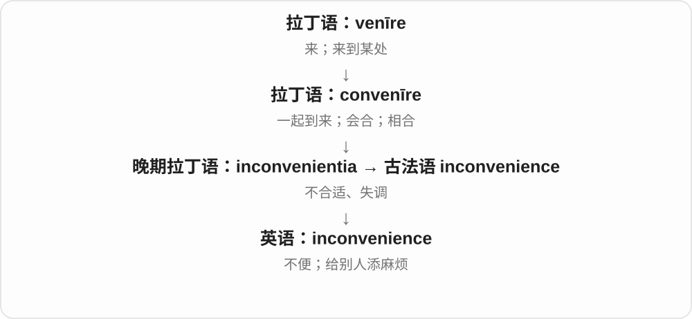

从不相合发展成实际生活中的不便。正式道歉常说 sorry for the inconvenience；可数时 a minor inconvenience 是一件小麻烦。

**常见搭配与例句**

cause inconvenience；a minor inconvenience；sorry to inconvenience you。

> We apologize for any inconvenience caused by the closure.

对于关闭带来的不便，我们深表歉意。

> I hope the change will not inconvenience you.

希望这项变更不会给你带来麻烦。

**别混淆**

inconvenience 通常比 disaster“灾难”轻；但实际影响大小仍看事情本身。作动词时直接接受到影响的人。

### 34. invent — 发明；想出；编造

**音标**：/ɪnˈvent/

**先抓住这个画面**

原来没有这个办法或器具，你把它想出来、做出来，就是 invent；把不存在的故事编出来，也可用它。

**怎么拆**

经古法语 inventer 来自拉丁语 inventus，属于 invenīre：in-（朝向、遇上）+ venīre（来），早期是来到、遇到、发现。

**怎么变成今天的意思**

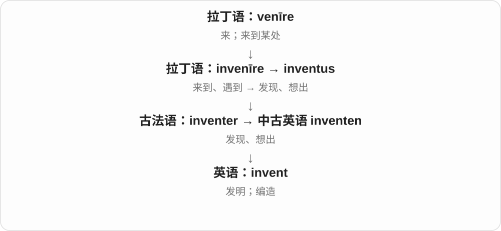

发现、想出 → 创造一种新东西。现代区别于发现现存事物：invent a tool 是发明工具；invent an excuse 则是编一个借口。

**常见搭配与例句**

invent a device；invent a method；invent an excuse；invent a story。

> She invented a tool that made the task easier.

她发明了一种让这项工作更轻松的工具。

> He invented an excuse for missing the meeting.

他为缺席会议编了个借口。

**别混淆**

discover 通常发现本来存在的东西；invent 通常创造原本没有的东西。两者的历史词义有交叠，现代用法仍要区分。

### 35. invention — 发明；发明物；虚构的东西

**音标**：/ɪnˈvenʃən/

**先抓住这个画面**

把一个新东西从想法做成现实，是 invention；那个新东西本身也叫 an invention。

**怎么拆**

来自拉丁语 inventiō，可经法语 invencion 传入；与 invenīre“发现、想出”对应，现代可看作 invent 的名词。

**怎么变成今天的意思**

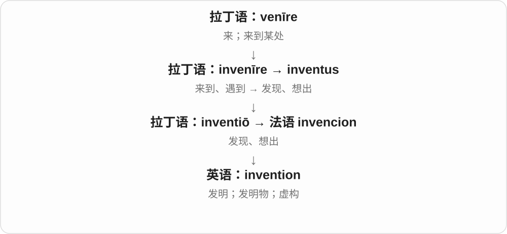

既能谈发明这件事，也能数具体发明。说 a pure invention 时，还可能强调一个说法完全是编出来的。

**常见搭配与例句**

a useful invention；the invention of…；a work of invention；a complete invention。

> The invention of the printing press transformed communication.

印刷机的发明改变了信息传播。

> The rumor was a complete invention.

这个传闻完全是编造的。

**别混淆**

invention 是新想出的东西或创造行为；innovation 常强调把新方法有效引入实践，范围可以比单项发明更广。

### 36. inventor — 发明者；创造新器物或方法的人

**音标**：英 /ɪnˈventə/；美 /ɪnˈventər/

**先抓住这个画面**

谁把那种新装置或新方法想出来，谁就是它的 inventor。

**怎么拆**

借自拉丁语 inventor“发现者、发明者”，源于 invenīre；现代字形也对应 invent + -or。

**怎么变成今天的意思**

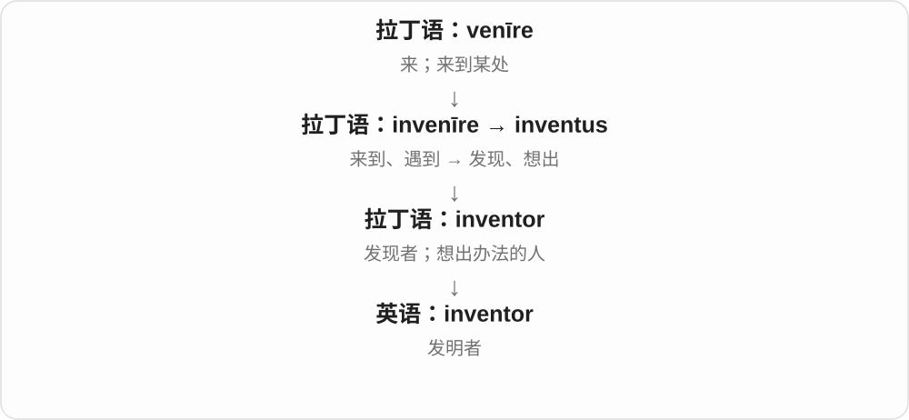

它强调创造这项东西的角色，而不是拥有、出售或资助它的人。实际发明也可能是多人协作，不能只靠产品名称判断归属。

**常见搭配与例句**

the inventor of…；an independent inventor；a young inventor。

> The inventor demonstrated the device at the fair.

发明者在展会上演示了这台装置。

> The award recognizes inventors who solve everyday problems.

这个奖项表彰解决日常问题的发明者。

**别混淆**

founder 是组织的创立者；inventor 是发明者。创办公司的人不一定就是产品的发明者。

### 37. inventory — 物品清单；库存；清点

**音标**：英 /ˈɪnvəntri/；美 /ˈɪnvəntɔːri/

**先抓住这个画面**

打开仓库，一件件看看实际有什么、各有多少，并把它们列下来，这便是 inventory 的核心。

**怎么拆**

经古法语 inventoire 传来，或直接连到中世纪拉丁语 inventōrium，后者改自晚期拉丁语 inventārium“所发现物品的清单”，根在 invenīre“发现”。

**怎么变成今天的意思**

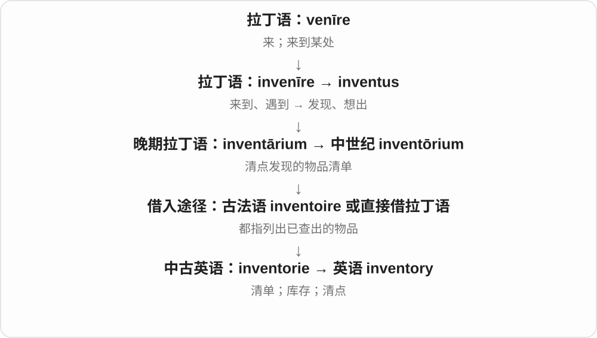

这里保留的是发现、查出已有东西，不是发明新东西。清单义又延伸到列在清单上的存货；作动词是盘点、登记。

**常见搭配与例句**

make an inventory；take inventory；inventory levels；inventory the equipment。

> We made an inventory of the equipment in the laboratory.

我们列出了实验室设备清单。

> The store reduced its inventory before moving.

商店搬迁前减少了库存。

**别混淆**

invention 是发明；inventory 是清单或库存。stock 可说库存本身，inventory 也很常强调管理与盘点。

### 38. inventive — 富有创造力的；善于想办法的

**音标**：/ɪnˈventɪv/

**先抓住这个画面**

材料不多，条件有限，他仍能想出新的做法，这种脑子活、点子新的特点就是 inventive。

**怎么拆**

经古法语 inventif 来自中世纪拉丁语 inventīvus，与“发现、想出”的 invenīre 词族相连；现代对应 invent + -ive。

**怎么变成今天的意思**

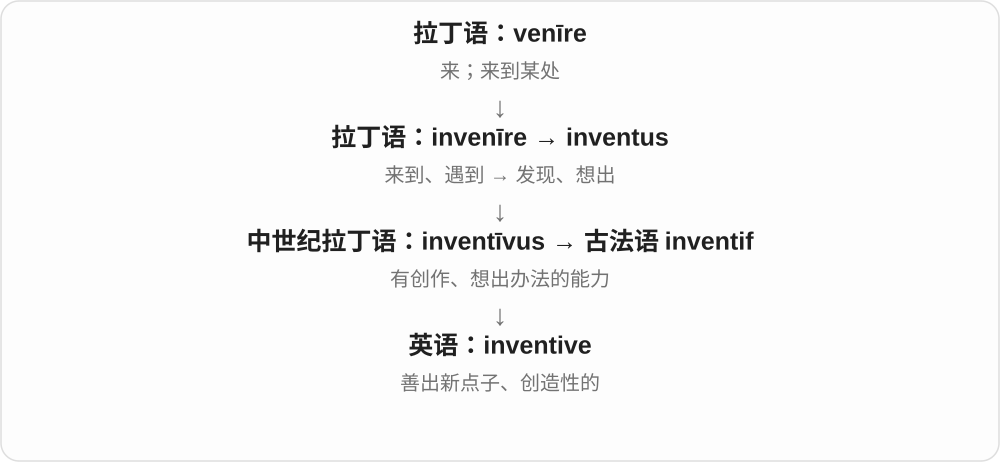

不必真有专利发明才称 inventive。厨师搭配食材、老师设计课堂、孩子编玩法，都能表现这种创造性。

**常见搭配与例句**

an inventive solution；an inventive mind；inventive use of materials。

> The team found an inventive solution using recycled materials.

团队用回收材料想出了一个有创意的解决办法。

> She is an inventive cook who rarely follows a recipe exactly.

她是个很有创意的厨师，很少完全照着菜谱做。

**别混淆**

inventive 强调新点子和巧办法；invented 只是已经被发明或编造。an invented story 不一定写得 inventive。

### 39. reinvent — 重新发明；彻底改造；重新塑造

**音标**：/ˌriːɪnˈvent/

**先抓住这个画面**

把已有东西换一种根本做法，让它重新有用、有吸引力，叫 reinvent；也可能是无谓地重复别人早做过的事。

**怎么拆**

re-（重新）+ invent（发明、想出）。

**怎么变成今天的意思**

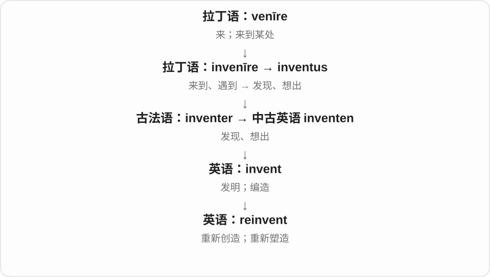

reinvent yourself 是改变自己的角色、形象或工作方向。reinvent the wheel 则是重新发明轮子，比喻重复做已有的成果。

**常见搭配与例句**

reinvent a business；reinvent yourself；reinvent the wheel。

> The theater reinvented itself as a community arts center.

这家剧院转型为社区艺术中心。

> We can use an existing tool instead of reinventing the wheel.

我们可以用现有工具，不必重复造轮子。

**别混淆**

improve 是改进，可只是小调整；reinvent 常暗示较大幅度地重做、重新定位，不保证所有部分都全新。

### 40. reinvention — 重新创造；重新塑造；转型

**音标**：/ˌriːɪnˈvenʃən/

**先抓住这个画面**

从旧身份、旧模式走出，重新形成一种做法或形象，这个转变过程叫 reinvention。

**怎么拆**

re- + invention，现代也与 reinvent 对应。

**怎么变成今天的意思**

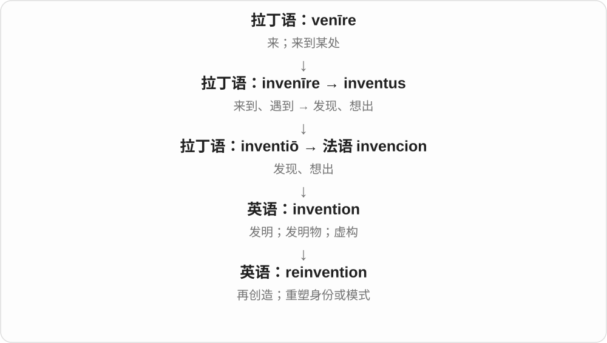

常说职业、品牌或艺术风格的重新塑造。它比简单换个名字更强调表达方式、作用或结构的变化。

**常见搭配与例句**

personal reinvention；a period of reinvention；the reinvention of a brand。

> Her move abroad marked a period of personal reinvention.

移居国外标志着她进入了重新塑造自我的阶段。

> The book traces the city’s reinvention after the factories closed.

这本书追踪了工厂关闭后城市的转型过程。

**别混淆**

renovation 常说修缮建筑；reinvention 强调重新定义怎么做、是什么。翻新店面不一定等于品牌转型。

### 41. covenant — 正式约定；契约；盟约

**音标**：/ˈkʌvənənt/

**先抓住这个画面**

双方不只是随口答应，而是郑重约定各自应做什么，这种有分量的承诺可以叫 covenant。

**怎么拆**

经古法语 covenant“协议”来自拉丁语 conveniēns“相合、同意的”，与 convenīre“会合、同意”相关。

**怎么变成今天的意思**

人们在立场或承诺上合到一起，形成约定。它常见于法律、宗教和正式誓约，也可作动词表示郑重承诺。

**常见搭配与例句**

enter into a covenant；a covenant between…；covenant to do…；a restrictive covenant。

> The two groups entered into a covenant of mutual support.

两个团体订立了相互支持的盟约。

> The document contains a covenant to maintain the garden.

文件中包含维护花园的约定。

**别混淆**

promise 是广泛的承诺；covenant 更正式、庄重，常强调持续的约束关系。不要把它与 convent“修道院”混淆。

### 42. convent — 女修道院；修道团体

**音标**：英 /ˈkɒnvent/；美 /ˈkɑːnvent/

**先抓住这个画面**

修道者聚在一起生活、修行，形成一个团体及其住所，convent 就来自这个聚集的画面。

**怎么拆**

经古法语 covent 来自拉丁语 conventus“聚会、团体”，源于 convenīre“会合”；英语后来恢复了字母 n。

**怎么变成今天的意思**

词源的聚会发展成宗教共同生活。现代普通英语常指女修道院，但历史及特定宗派用法并不只限女性团体。

**常见搭配与例句**

enter a convent；a convent school；live in a convent。

> The old convent now houses a small museum.

这座旧女修道院现在设有一间小博物馆。

> She taught at a convent school for many years.

她在一所修道院学校教了很多年书。

**别混淆**

convent 常与修女有关；monastery 常与修士有关，但实际宗教名称有传统差异。convention 则不是修道院。

### 43. souvenir — 纪念品

**音标**：英 /ˌsuːvəˈnɪə/；美 /ˌsuːvəˈnɪr/

**先抓住这个画面**

旅行结束，把一件小东西带回家；再看到它，那段经历就回到脑海中。这件帮助记住经历的东西就是 souvenir。

**怎么拆**

借自法语 souvenir“记忆、纪念物”，与动词“记起”同形，往上连到拉丁语 subvenīre“来到心中”；sub- 可有从下向上之意，venīre 是来。

**怎么变成今天的意思**

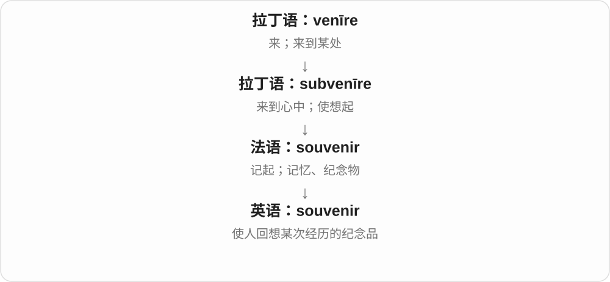

这条线的重点是回忆涌上心头，最后落到能唤起回忆的实物。它不一定贵，也不一定是商店专门出售的商品；一张保存的门票也可以有这种作用。

**常见搭配与例句**

a souvenir of a trip；buy a souvenir；a souvenir shop；keep something as a souvenir。

> I kept the concert ticket as a souvenir of that evening.

我把演唱会门票留下，纪念那个夜晚。

> She bought a small bowl as a souvenir of her visit.

她买了一只小碗，作为这次到访的纪念品。

**别混淆**

gift 关注送给别人；souvenir 关注留下纪念。买来的杯子可以同时是送人的 gift 和旅行的 souvenir。

### 44. circumvent — 设法规避；绕过；绕开障碍

**音标**：英 /ˌsɜːkəmˈvent/；美 /ˌsɜːrkəmˈvent/

**先抓住这个画面**

前面有一道限制，你找到旁边的路，让它挡不住自己，这幅画面很适合记 circumvent。

**怎么拆**

拉丁语 circumvenīre 由 circum-（周围）+ venīre（来）构成；先有包围、设计对付的意思，经分词词干 circumvent- 进入英语。

**怎么变成今天的意思**

现代常说绕过障碍、规则或手续，可能是聪明解决问题，也可能带钻空子的批评。记忆时可以想绕路，但早期英语已有包围、算计人的含义，不能虚构成英语先有日常走路义、后来才有抽象义。

**常见搭配与例句**

circumvent a restriction；circumvent the rules；circumvent a technical limitation。

> The new design circumvents a limitation of the older equipment.

新设计绕开了旧设备的一项限制。

> The audit found that several firms had circumvented the rules.

审计发现，几家公司曾设法规避规定。

**别混淆**

overcome 是克服障碍本身；circumvent 更像换一条路绕过去。contravene 是违反规定，不特别强调用了什么绕行办法。

### 45. circumvention — 规避；绕过；设法避开限制

**音标**：英 /ˌsɜːkəmˈvenʃən/；美 /ˌsɜːrkəmˈvenʃən/

**先抓住这个画面**

把“找一条旁路避开限制”这件事作为一个过程或问题来讨论，用 circumvention。

**怎么拆**

来自拉丁语 circumventionem，是 circumventiō 的宾格，根在 circumvenīre；现代与 circumvent + -ion 对应。英语名词的早期记录还早于动词，历史不能只按词尾反推。

**怎么变成今天的意思**

常见于规则、监管和技术讨论，语气比 get around 正式。重点是限制原本在那里，却被一条旁路避开；并不自动说明行为合法或非法。

**常见搭配与例句**

circumvention of the rules；prevent circumvention；a means of circumvention。

> The new policy aims to prevent circumvention of the reporting rules.

新政策旨在防止人们规避申报规定。

> The engineers discussed whether circumvention of the limitation was worth the extra cost.

工程师们讨论了绕开这项限制是否值得付出额外成本。

**别混淆**

evasion 也可指逃避，强调躲开责任或要求；circumvention 更容易让人想到绕开某个具体机制。

### 46. contravention — 违反；违背

**音标**：英 /ˌkɒntrəˈvenʃən/；美 /ˌkɑːntrəˈvenʃən/

**先抓住这个画面**

某个行为和规定对着来，讨论这种违反的行为或事实时，用 contravention。

**怎么拆**

与中古法语 contravention / contrevention 相连；现代可对应 contravene + -tion，e 去掉，读音变为 /venʃən/。

**怎么变成今天的意思**

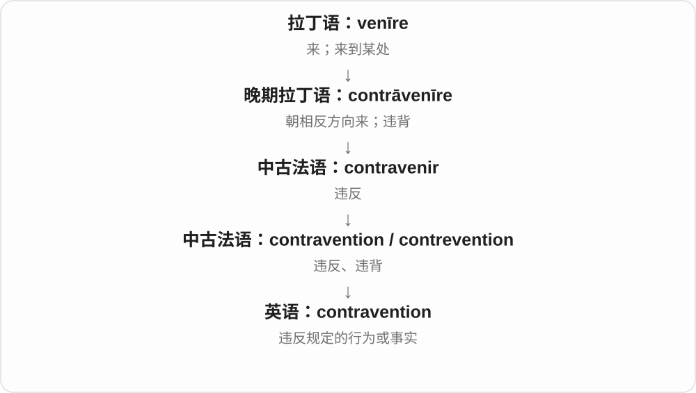

最常见的整块表达是 in contravention of，直接理解为“违反……”。词尾不是 /ventʃən/，不要在 sh 前额外读一个 t。

**常见搭配与例句**

in contravention of the rules；a contravention of the agreement；a clear contravention。

> The equipment was installed in contravention of the safety rules.

这些设备的安装违反了安全规定。

> The committee regarded the payment as a contravention of the agreement.

委员会认为这笔付款违反了协议。

**别混淆**

convention 是惯例、大会或公约；contravention 是违反。两者不能只盯住中间的 vent 就混在一起。

### 47. contravene — 违反；违背；与……相冲突

**音标**：英 /ˌkɒntrəˈviːn/；美 /ˌkɑːntrəˈviːn/

**先抓住这个画面**

规定把方向画在这里，而实际做法朝相反方向走，这就是 contravene。

**怎么拆**

经中古法语 contravenir 来自晚期拉丁语 contrāvenīre：contrā-（反对、相反）+ venīre（来）。

**怎么变成今天的意思**

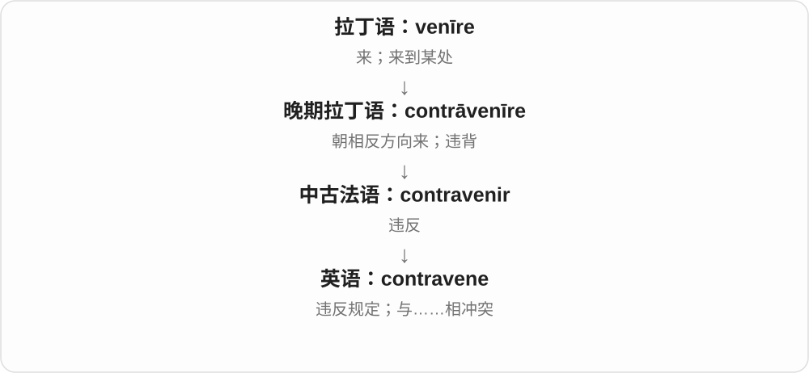

主要搭配规则、法律、协议或原则，语气正式。它说做法与要求发生冲突，不只是口头上表示不同意见。

**常见搭配与例句**

contravene a rule；contravene an agreement；contravene the terms of a contract。

> Publishing those details would contravene the confidentiality agreement.

公布那些细节会违反保密协议。

> The proposed design contravenes the building’s height restrictions.

拟议设计违反了这栋建筑的高度限制。

**别混淆**

contravene 直接接宾语，不加 against。circumvent 强调想办法绕开限制；contravene 强调已经违背要求。

### 48. supervene — 接着发生；额外出现；随附于

**音标**：英 /ˌsuːpəˈviːn/；美 /ˌsuːpərˈviːn/

**先抓住这个画面**

原来的情况还在进行，另一件事又压了上来、改变局面，正式英语可说它 supervenes。

**怎么拆**

来自拉丁语 supervenīre：super-（在上面、另外）+ venīre（来），就是另外来到、随后发生。

**怎么变成今天的意思**

普通用法常带突然后来又发生之意。哲学里的 supervene on 是专门关系：底层情况完全一样，上层性质就不能不同；上层若有变化，底层必有某种变化。这里不是说时间上先后发生，也不直接等于因果关系。

**常见搭配与例句**

unless something supervenes；complications supervene；A supervenes on B。

> The work continued until unexpected difficulties supervened.

工作一直在推进，直到意想不到的困难接连出现。

> In this model, the image’s pattern supervenes on the arrangement of its pixels.

在这个模型里，图像的图案随附于像素的排列：像素排列完全一样，图案就不会不同。

**别混淆**

intervene 强调进入现有进程并影响它；supervene 强调另外发生、叠加上来。哲学用法须单独理解，不能仅靠“随后”猜。

## 这一组要分清什么

**event / invent / prevent**：事情发生；发现、想出新东西；提前行动让事情不发生。

**convenient / conventional**：使用或安排起来方便；符合惯例、传统做法。方便与传统是两回事。

**adventure / venture**：冒险经历；带风险的尝试或事业。创业可以是 venture，也可能成为一段 adventure。

**circumvent / contravene**：设法绕开限制；行为违反要求。绕开是否构成违反，还要看具体规定。

**intervene / intervention**：现代是动词与名词的搭配，但英语名词出现得更早；不应把词尾较长的一律画成短词的后代。

## 串起来练习

The organizers **convened** a meeting to choose a **convenient venue** for the **event**. Their early **intervention** helped **prevent** confusion.

组织者召集会议，为活动选择一个方便的场地。他们及时介入，帮助避免了混乱。

一起聚来 → convene；安排起来合适 → convenient；活动举办处 → venue；发生的活动 → event；进入进程帮忙 → intervention；提前挡住问题 → prevent。
