# 0160 · fund- — 底部；地基；由财产、储备发展出的资金

[逐词精讲目录](../00_逐词精讲目录.md) · [总目录](../00_总目录_按常用程度.md)

## 核心词根与来源

**fund-** 这一页从拉丁语 **fundus**“底部、地基、地产”出发。found 是打基础、建立；foundation 是托住后续东西的底层；fundamental 是抽掉就站不住的根本。财产与储备的支线留下 fund，而 profound 则把“底部”带到很深的程度。

**FUND = BOTTOM / FOUNDATION**

楼有地基，事业有资金，深刻则一路触到底

- **奠基与创办**：found · founder · foundation
- **根本的支撑**：fundamental · fundamentally · foundational
- **资金与出资**：fund · funding · funder
- **募集与撤资**：fundraise · fundraiser · crowdfund · defund
- **深入底层**：profound · profoundly · profundity
- **严守基本教义**：fundamentalism · fundamentalist
- **fund 与 funds：作为支撑的可用资金**：fund · funds
- **found → founded：打基础与建立**：found · founded
- **fund → funded：财产底子到提供资金**：fund · funded
- **foundation → foundations：在最下面撑住整体的基础**：foundation · foundations
- **found → founding：打基础、建立；同形铸造另分**：found · founding
- **奠定基础 → founder → founders**：founders

## 词形与演化规律

**fundāre**“建立”经法语留下 found，名词路线留下 foundation。**fundāmentum** 留下 fundament 及 fundamental。**profundus** 留下 profound，相关名词 profundity 的读音会改变。注意同形：find 的过去式 found 不属于这一支；铸造义 found 来自 **fundere**“倾倒”，另列在 fund-/fus- 中。

fund 接底、基础的拉丁和法语材料；funds 常统称可用资金，也可说多个基金或作资助动词的形式。

本组讲拉丁 fundare 建立；与 find 的过去式 found、铸造动词分开。

拉丁底部、地产词经法语等发展为储备、资金，英语动词后转用。

拉丁 fundatio 经法语 fondacion，接 fundare 奠基、建立。

建立接拉丁 fundare 经法语；founding member 是创立时就参与的成员。

创立者 founder 经法语接拉丁 fundator、fundare 奠基；现代可按 found 创立 + -er 人理解。founder 沉没、失败的动词另经法语 fondrer，和创立者分支分别讲。

## 单词速览（按词族由简到繁）

同一基础词的相关扩展放在一起，先读基础形式，再读扩展；各组之间优先读常用的。具体词源关系见各词讲解。

| 单词 | 音标 | 核心意思 |
|---|---|---|
| [found](#w-1) | /faʊnd/ | 创办；建立；另有 find 的过去式及铸造义 |
| [foundation](#w-3) | /faʊnˈdeɪʃən/ | 地基；基础；基金会；粉底 |
| [foundations](#w-25) | /faʊnˈdeɪʃənz/ | 地基；基础、根基；基金会〔复数〕 |
| [foundational](#w-13) | /faʊnˈdeɪʃənəl/ | 奠基的；作为基础的 |
| [founded](#w-23) | /ˈfaʊndɪd/ | 建立、创办；以……为基础〔found 的过去式、过去分词〕 |
| [founder](#w-5) | 英 /ˈfaʊndə/；美 /ˈfaʊndər/ | 创办人；沉没、失败；铸工〔另一来源〕 |
| [founders](#w-27) | 英 /ˈfaʊndəz/；美 /ˈfaʊndɚz/ | 创立者；奠基人〔复数〕；沉没、失败〔第三人称〕 |
| [founding](#w-26) | /ˈfaʊndɪŋ/ | 创立、建立；创立时就参与的；铸造〔另支〕 |
| [fund](#w-2) | /fʌnd/ | 基金；专用资金；资助 |
| [funds](#w-22) | /fʌndz/ | 资金、经费；基金〔复数〕；fund 的第三人称形式 |
| [funding](#w-4) | /ˈfʌndɪŋ/ | 经费；资金支持；提供资金 |
| [funded](#w-24) | /ˈfʌndɪd/ | 资助了；有资金支持的〔过去式、过去分词〕 |
| [fundraiser](#w-10) | 英 /ˈfʌndreɪzə/；美 /ˈfʌndreɪzər/ | 筹款人；筹款活动 |
| [funder](#w-16) | 英 /ˈfʌndə/；美 /ˈfʌndər/ | 出资者；资助机构 |
| [fundraise](#w-18) | /ˈfʌndreɪz/ | 筹款 |
| [fundraising](#w-8) | /ˈfʌndreɪzɪŋ/ | 筹款；募资活动 |
| [superfund](#w-15) | /ˈsuːpəfʌnd/；美 /ˈsuːpərfʌnd/ | 大型基金；澳式退休金基金；美式特定环境治理基金名称 |
| [defund](#w-17) | /diːˈfʌnd/ | 撤回或削减经费 |
| [crowdfund](#w-20) | /ˈkraʊdfʌnd/ | 众筹；向众多人募集资金 |
| [fundament](#w-21) | /ˈfʌndəmənt/ | 基础；根基；旧式臀部义 |
| [fundamental](#w-6) | /ˌfʌndəˈmentəl/ | 根本的；基础的；基本原则 |
| [fundamentally](#w-9) | /ˌfʌndəˈmentəli/ | 从根本上；在本质上 |
| [fundamentalism](#w-14) | /ˌfʌndəˈmentəlɪzəm/ | 原教旨主义；严格坚持基本教义的立场 |
| [fundamentalist](#w-12) | /ˌfʌndəˈmentəlɪst/ | 原教旨主义者；坚持相应教义的 |
| [profound](#w-7) | /prəˈfaʊnd/ | 深刻的；深厚的；极强的 |
| [profoundly](#w-11) | /prəˈfaʊndli/ | 深深地；极其；深刻地 |
| [profundity](#w-19) | /prəˈfʌndəti/ | 深刻；深奥；深刻见解 |

## 逐词讲解

### 1. found — 创办；建立；另有 find 的过去式及铸造义

**音标**：/faʊnd/

**先抓住这个画面**

found 有三张不同的面孔：把学校、公司建起来；找到东西；把熔化金属浇铸成形。要靠句子分清。

**怎么拆**

“建立”来自拉丁语 fundāre，经法语传入。find 的过去式 found 来自日耳曼词族；“铸造”的 found 来自另一拉丁动词 fundere“倾倒”。

**怎么变成今天的意思**

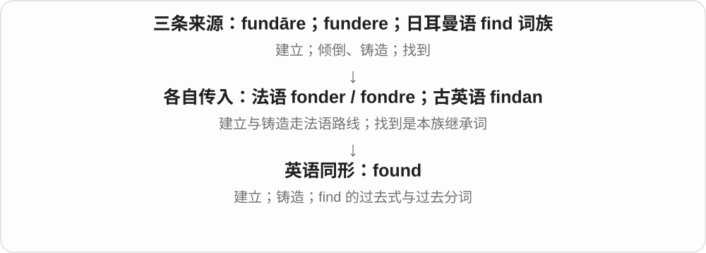

创办义是给组织或制度打基础，过去式 founded；I found my keys 中的 found 已是 find 的过去式。铸造义今天偏行业或旧式用语，普通表达更常用 cast。

**常见搭配与例句**

found a company；be founded on evidence；found metal；find–found–found。

> They founded the school in a rented house.

他们最初在一栋租来的房子里创办了学校。

> Her argument is founded on careful observation.

她的论证建立在细致观察之上。

> The old manual describes how to found bronze bells.

这本旧手册介绍怎样铸造铜钟。

> I found the missing key under the desk.

我在桌子底下找到了丢失的钥匙。

**别混淆**

find–found–found 是找到；found–founded–founded 是创办。不要把 founded 当成 find 的过去式。

### 2. foundation — 地基；基础；基金会；粉底

**音标**：/faʊnˈdeɪʃən/

**先抓住这个画面**

想象建筑底下承住整栋楼的部分。把这个画面搬到知识、组织或化妆中，就是后续东西赖以铺开的底层。

**怎么拆**

来自拉丁语 fundātiō，经古法语 fondacion 进入英语，属于 fundāre“建立”词族。不是先有英语 found 再随意添 -ation。

**怎么变成今天的意思**

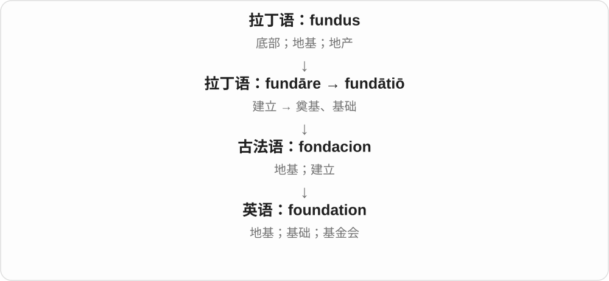

实体建筑有地基，学习有基础；出资设立并持续支持某种事业的组织可叫 foundation。粉底则是后续妆容下的一层底。

**常见搭配与例句**

lay the foundations；a solid foundation；a charitable foundation；apply foundation。

> Daily practice gives learners a solid foundation.

每天练习能帮助学习者打牢基础。

> The foundation supports local arts projects.

这家基金会资助当地的艺术项目。

**别混淆**

foundation 更突出支撑后续发展的底层；fund 重点是一笔资金。慈善 foundation 管理资金，但二者不是同义词。

### 3. foundations — 地基；基础、根基；基金会〔复数〕

**音标**：/faʊnˈdeɪʃənz/

**先抓住这个画面**

最下面那层撑得住，上面才立得稳，就是 foundations。建筑有地基，学习、制度也有支撑后续发展的基础。

**怎么拆**

foundation + -s，/n/ 后读 /z/。foundation 经法语 fondacion 接拉丁 fundatio，来自 fundare 奠基、建立，根在 fundus 底部、地产。

**怎么变成今天的意思**

**拉丁 fundus、fundare → fundatio → 法语 → foundation**  
底部、奠基 → 地基、基础，后有基金会等义

↓

**foundation + -s → foundations**  
多处地基、若干基础条件；多家基金会

lay the foundations 奠定基础；building foundations 建筑地基；charitable foundations 慈善基金会。

**常见搭配与例句**

foundations for further study 深入学习的基础；solid foundations 扎实基础。

> The builders checked the foundations.

建筑工检查了地基。

> The course lays the foundations for further study.

课程为进一步学习打下基础。

**别混淆**

foundations 的地基可用复数指一栋建筑的整体基础。它连建立义 found，不是 find 的过去式 found；基金会则是相应建立、资助机构的固定名词义。

### 4. foundational — 奠基的；作为基础的

**音标**：/faʊnˈdeɪʃənəl/

**先抓住这个画面**

后来的一连串学习或建设，都踩在这一步上继续向前，这一步就是 foundational。

**怎么拆**

foundation + -al，把“基础”变成“充当基础的”。

**怎么变成今天的意思**

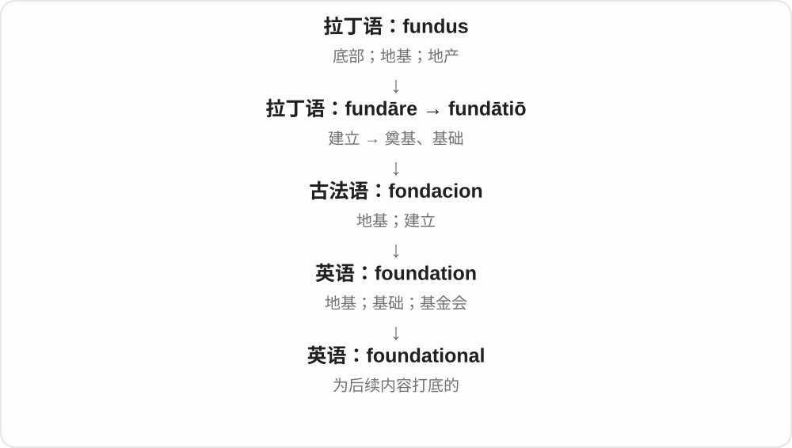

常形容技能、文本、研究或原则。它强调作为后续工作的起点和支撑，而不一定说它最简单。

**常见搭配与例句**

foundational skills；a foundational text；foundational research。

> Reading and writing are foundational skills.

阅读和写作是基础技能。

> This study became a foundational text in the field.

这项研究成了该领域的奠基性文献。

**别混淆**

foundational 强调打底的角色；fundamental 强调根本重要性。二者常接近，但 foundational research 更容易让人想到后来的研究建立其上。

### 5. founded — 建立、创办；以……为基础〔found 的过去式、过去分词〕

**音标**：/ˈfaʊndɪd/

**先抓住这个画面**

先打好基础，再把组织、学校等建立起来，是 founded；一个判断有依据，也可以说 founded on evidence。

**怎么拆**

建立义 found + -ed，/d/ 后读 /ɪd/。拉丁 fundāre 打基础、建立，经法语借入。find 的过去式 found 是另一条日耳曼历史，其过去分词仍是 found；铸造 found 又另接 fundere。

**怎么变成今天的意思**

**拉丁 fundāre → 法语 → 建立义 found**  
打基础 → 建立、创办

↓

**found + -ed → founded**  
创办了；建立在某依据之上

founded a school 创办学校；founded in 1990 创办于 1990 年；founded on evidence 以证据为基础。

**常见搭配与例句**

an organisation founded by teachers；a view founded on experience。

> The school was founded by local teachers.

这所学校由当地教师创办。

> Her view was founded on years of practical experience.

她的看法建立在多年的实践经验之上。

**别混淆**

find—found—found 是找到；found—founded—founded 是建立。be founded on something 说判断、组织原则等以什么为基础。

### 6. founder — 创办人；沉没、失败；铸工〔另一来源〕

**音标**：英 /ˈfaʊndə/；美 /ˈfaʊndər/

**先抓住这个画面**

常见名词是最初把事情建起来的人；动词像船沉下去，计划也会失败；铸造行业另有“铸工”的名词。

**怎么拆**

创办人义经法语来自拉丁语 fundātor，与 found 相连；沉没义经法语 fondrer 来自 fundus“底部”。另有铸工义来自 fundere“倾倒”，属于另一支。

**怎么变成今天的意思**

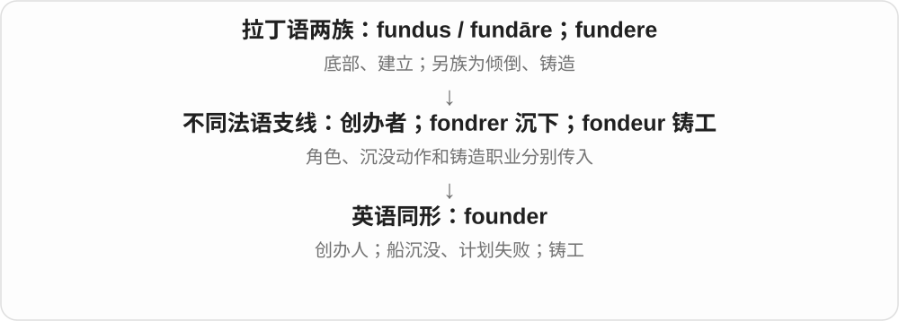

创办人与沉没走“底部”词族的不同路线，不能把动词解释成成为创办人。铸工义来自 fundere，常见于 bell founder“铸钟师”等行业或历史表达。

**常见搭配与例句**

the founder of a company；the project foundered；a bell founder。

> The founder still visits the workshop every week.

创办人现在仍每周到车间来。

> The negotiations foundered on a disagreement over costs.

谈判因费用分歧而失败了。

> The bell founder inspected the mould before casting.

铸钟师在浇铸前检查了模具。

> The ship foundered during the storm.

那艘船在暴风雨中沉没了。

**别混淆**

founder 作动词是沉没或失败；flounder 常是挣扎、手忙脚乱。它们相像，却不能一概互换。

### 7. founders — 创立者；奠基人〔复数〕；沉没、失败〔第三人称〕

**音标**：英 /ˈfaʊndəz/；美 /ˈfaʊndɚz/

**先抓住这个画面**

把组织从无到有建起来的人，是 founders；但 the plan founders 是计划受挫。一个是人名词，一个是动词，先看句子结构。

**怎么拆**

founder + -s → founders。创立者义可按 found 创立 + -er 人理解，历史经法语接拉丁 fundator、fundare 奠基；沉没动词另经法语 fondrer。

**怎么变成今天的意思**

**拉丁 fundare 奠基 → fundator → 法语、英语 founder 创立者**  
像给事业打下基础的人

↓

**拉丁 fundus 底部 → 法语 fondrer 下沉、倒塌 → founder 动词**  
现代可比喻计划失败，与创立者分支分别看

↓

**founder + -s → founders**  
可作名词复数、动词第三人称

the founders of a school 是学校创立者；founders on a difficulty 是受某个困难阻碍而失败。铸造行业另有 founder，接另一条铸造词史。

**常见搭配与例句**

the founders of a school；the original founders；a plan founders。

> The founders of the school wanted smaller classes.

学校的创立者希望实行小班教学。

> The plan founders whenever the team discusses the cost.

团队每次讨论费用时，这个计划就受阻。

**别混淆**

创立的 found 不是 find 的过去式 found；founders 的 founders 也不是把找到的人叫作 founder。

### 8. founding — 创立、建立；创立时就参与的；铸造〔另支〕

**音标**：/ˈfaʊndɪŋ/

**先抓住这个画面**

把组织从无到有建起来，是 founding；founding member 是在它创立时就参与的人。这里的 found 是建立，不是 find 找到的过去式。

**怎么拆**

建立义 found 接拉丁 fundare 打地基，经法语传入，现代直接加 -ing。铸造义 found 接另一拉丁动词 fundere 倾倒，也能有 founding 形式；两条词源分开。

**怎么变成今天的意思**

**拉丁 fundare → 法语 fonder → 英语 found**  
打基础 → 创立组织、建立机构

↓

**found + -ing → founding**  
创立的过程；创立时的；铸造同形支另接 fundere

the founding of the school 学校的创立；a founding member 创始成员；the founding principles 创立时确立的原则。

**常见搭配与例句**

a founding partner 创始合伙人；since its founding 自创立以来。

> She was a founding member of the club.

她是俱乐部的创始成员。

> The book describes the founding of the school.

这本书讲述了学校的创立过程。

**别混淆**

find 的现在分词是 finding。founding 用于组织时讲的是建立；founding member 不等于任何后来加入的普通成员。

### 9. fund — 基金；专用资金；资助

**音标**：/fʌnd/

**先抓住这个画面**

想象一个专门的钱池：需要做某件事时，就从这个池子里支取。fund 也可以作动词，表示给这个项目供钱。

**怎么拆**

来自拉丁语 fundus“底部、地产”。资金像支撑活动的底子；词义经历从财产、储备到资金的扩展。

**怎么变成今天的意思**

a fund 常是为某用途汇集的一笔钱或管理它的机构。复数 funds 常泛指可用资金；动词 fund 说明谁负担费用。

**常见搭配与例句**

an emergency fund；raise funds；fund a project；public funds。

> We set up a fund to repair the village hall.

我们设立了一笔专项资金，用来修缮村里的会堂。

> The university will fund the research for two years.

大学将为这项研究提供两年的经费。

**别混淆**

fund 是资金或资金安排；foundation 可以指基金会这个组织。每个 fund 都不一定是独立机构。

### 10. funds — 资金、经费；基金〔复数〕；fund 的第三人称形式

**音标**：/fʌndz/

**先抓住这个画面**

项目能不能做起来，底下要有一笔可动用的钱来托住。funds 常直接指这些可用资金，不要求分成几个独立基金。

**怎么拆**

fund 经法语 fond，接拉丁 fundus 底、基础、土地等，由支撑的资本发展为可用钱款。funds 后固定统称财力、资金，也可为规则名词复数或资助动词形式。

**怎么变成今天的意思**

**拉丁 fundus → 法语 fond → fund**  
底、基础 → 可用资本、储备

↓

**fund + -s → funds**  
资金；多个基金；某方资助

raise funds 筹资；lack of funds 缺乏经费；public funds 公共资金；the charity funds the project 慈善机构为项目提供资金。

**常见搭配与例句**

available funds；funds for the library。

> The school raised funds for a new library.

学校为新图书馆筹集了经费。

> We had to delay the repairs because of a lack of funds.

由于缺少资金，我们只好推迟维修。

**别混淆**

funds 常是钱款统称，a fund 可是一笔专项资金或基金。money 很宽泛，funds 常放在为特定目的提供、安排资金的语境。

### 11. funding — 经费；资金支持；提供资金

**音标**：/ˈfʌndɪŋ/

**先抓住这个画面**

一个项目要运转，需要有人持续把钱送到位。funding 就是这份资金支持，或筹措后实际可用的经费。

**怎么拆**

fund + -ing，既可表示提供资金的动作，也常成为表示经费的名词。

**怎么变成今天的意思**

谈 funding 常是在问项目有没有钱做下去、钱来自哪里，而不是某张钞票。通常作不可数名词。

**常见搭配与例句**

secure funding；government funding；a lack of funding；funding for research。

> The project stopped when its funding ran out.

经费用完后，这个项目停了下来。

> They are seeking funding for a new community centre.

他们正在为新社区中心寻求资金支持。

**别混淆**

fund 可以是一个独立基金；funding 更常说资金支持这一整体。three funds 不等于 three funding。

### 12. funded — 资助了；有资金支持的〔过去式、过去分词〕

**音标**：/ˈfʌndɪd/

**先抓住这个画面**

给一件事垫上能运转的资金底子，就是 funded。项目、研究、修缮都要有人或机构提供经费。

**怎么拆**

fund + -ed，/d/ 后读 /ɪd/。fund 名词经法语等接拉丁 fundus 底部、地产，后有财产、储备、资金义；英语动词再表示提供资金。

**怎么变成今天的意思**

**拉丁 fundus → 法语等 → fund 名词、动词**  
底部、财产 → 资金储备、提供资金

↓

**fund + -ed → funded**  
已经出资；得到经费支持

funded by donations 由捐款资助；a funded project 有经费的项目；publicly funded 公共资金支持的。

**常见搭配与例句**

fully funded 经费全部落实的；funded the repairs 出资维修。

> The library project was funded by local donations.

图书馆项目由当地捐款资助。

> The grant funded repairs to the old building.

这笔资助金支付了老建筑维修费用。

**别混淆**

funded 来自 fund 资助；founded 来自 found 建立，这两个过去形式不同。funded a school 可以是资助学校，founded a school 是创办学校。

### 13. fundraiser — 筹款人；筹款活动

**音标**：英 /ˈfʌndreɪzə/；美 /ˈfʌndreɪzər/

**先抓住这个画面**

这个词可以指“替项目筹钱的人”，也可以指“专门用来筹钱的那场活动”，要看句子里它是人还是事件。

**怎么拆**

fund + raiser，由 raise“筹集”加 -er 形成实施者名称，再扩展到活动。

**怎么变成今天的意思**

hire a fundraiser 是雇人；hold a fundraiser 是办活动。不能每次看到 -er 都只翻译成人。

**常见搭配与例句**

a professional fundraiser；hold a fundraiser；a charity fundraiser。

> The charity hired an experienced fundraiser.

这家慈善机构雇了一位有经验的筹款人员。

> We held a fundraiser in the school hall.

我们在学校礼堂举办了一场筹款活动。

**别混淆**

donor 是捐钱的人；fundraiser 是组织筹款的人或活动。一个人可以同时担当两种角色。

### 14. funder — 出资者；资助机构

**音标**：英 /ˈfʌndə/；美 /ˈfʌndər/

**先抓住这个画面**

项目后面实际把钱提供出来的人或机构，就是 funder。

**怎么拆**

fund（提供资金）+ -er（做这件事的人或机构）。

**怎么变成今天的意思**

它强调资金来自谁，不一定指创办者，也不保证一定是无偿捐赠，须看资助安排。

**常见搭配与例句**

a major funder；a research funder；public and private funders。

> The museum thanked its principal funder.

博物馆向主要出资方表示感谢。

> The report must be submitted to the research funder.

报告必须交给研究资助机构。

**别混淆**

funder 出钱；founder 创办。两词只差一个字母，却可能是两个不同的人。

### 15. fundraise — 筹款

**音标**：/ˈfʌndreɪz/

**先抓住这个画面**

钱还没到位，于是去发动捐赠、组织活动，让资金一点点聚起来。

**怎么拆**

fund（资金）+ raise（筹集），也与 fundraising、fundraiser 的使用发展相联系。

**怎么变成今天的意思**

常用于公益、社区或项目的筹资活动。raise 在这里是筹起资金，不是把纸币物理举高。

**常见搭配与例句**

fundraise for a charity；fundraise online；fundraise for repairs。

> We are fundraising for the school library.

我们正在为学校图书馆筹款。

> The group plans to fundraise through a series of concerts.

这个团体计划举办一系列音乐会来筹款。

**别混淆**

fund 是直接提供经费；fundraise 是设法筹到经费。筹款人不一定自己出全部的钱。

### 16. fundraising — 筹款；募资活动

**音标**：/ˈfʌndreɪzɪŋ/

**先抓住这个画面**

把各种募款行动放在一起看：卖票、发起捐赠、办义卖，这整项工作叫 fundraising。

**怎么拆**

fund + raising，把筹集资金的活动命名。与 fundraise 同族，但不必假定所有现代名词都是动词之后才出现。

**怎么变成今天的意思**

它可以作名词，也常放在名词前说明活动用途。a fundraising dinner 的晚宴目的是募集资金。

**常见搭配与例句**

a fundraising campaign；fundraising activities；a fundraising target。

> The fundraising campaign reached its target in a week.

筹款活动一周就达到了目标。

> Volunteers organized a fundraising dinner.

志愿者组织了一场筹款晚宴。

**别混淆**

funding 是得到或提供的资金支持；fundraising 是筹这笔钱的过程。

### 17. superfund — 大型基金；澳式退休金基金；美式特定环境治理基金名称

**音标**：/ˈsuːpəfʌnd/；美 /ˈsuːpərfʌnd/

**先抓住这个画面**

先看地区：澳大利亚日常的 super fund 常是退休金基金；美国大写 Superfund 则是特定环境清理制度的名称。

**怎么拆**

有两种组合：superannuation（退休金）的缩略 super + fund；或 super-（大、超出一般）+ fund。不能把两条来源混成一个。

**怎么变成今天的意思**

相同字母在不同制度环境里指向不同对象。这里学识别词义，不把一个国家的专名解释套到另一个国家。

**常见搭配与例句**

an Australian superfund；a superfund account；a Superfund site（美国专名用法）。

> She checked the balance of her Australian superfund.

她查看了自己澳大利亚退休金基金账户的余额。

> The article explains why some American cleanup locations are called Superfund sites.

这篇文章解释了为什么美国一些清理地点被称为 Superfund 场址。

**别混淆**

superfund 不必是收益“超级好”的基金，super 在澳式用法里主要是 superannuation 的缩写。

### 18. defund — 撤回或削减经费

**音标**：/diːˈfʌnd/

**先抓住这个画面**

原来接着项目的钱管被关小或切断，项目不再获得原来的资金支持。

**怎么拆**

de-（撤去）+ fund（提供资金）。

**怎么变成今天的意思**

具体可以是停止全部拨款，也可以是在某种政策语境下减少、转移拨款；必须看实际方案，词本身不交代金额。

**常见搭配与例句**

defund a programme；a proposal to defund；defund an agency。

> The council voted to defund the unused programme.

议会投票决定停止给这个无人使用的项目拨款。

> Critics opposed the proposal to defund the arts centre.

批评者反对削减艺术中心经费的提案。

**别混淆**

defund 是改变经费；abolish 是废除机构或制度。撤资可能导致关闭，但两个动作不是同一个词。

### 19. crowdfund — 众筹；向众多人募集资金

**音标**：/ˈkraʊdfʌnd/

**先抓住这个画面**

不是只等一个大出资方，而是让许多人各出一份，把小钱汇成够启动项目的一笔钱。

**怎么拆**

crowd（一群人）+ fund（资助），现代英语组合。

**怎么变成今天的意思**

常通过网络平台完成，但核心是资金来源分散到许多人。回报、捐赠或其他安排要看具体众筹类型。

**常见搭配与例句**

crowdfund a film；crowdfund online；a crowdfunded project。

> The filmmakers decided to crowdfund their next documentary.

电影制作人决定为下一部纪录片众筹。

> Residents crowdfunded the repairs to the old fountain.

居民通过众筹支付了旧喷泉的修复费用。

**别混淆**

crowdsource 是向众人征集工作、意见或资源；crowdfund 特别说资金。

### 20. fundament — 基础；根基；旧式臀部义

**音标**：/ˈfʌndəmənt/

**先抓住这个画面**

fundament 直接把注意力落在“最底下、托住上面”的地方，是 fundamental 背后的名词亲戚。

**怎么拆**

拉丁语 fundāmentum 经法语 fundement、fondement 进入英语，与 fundāre“奠基”有关。

**怎么变成今天的意思**

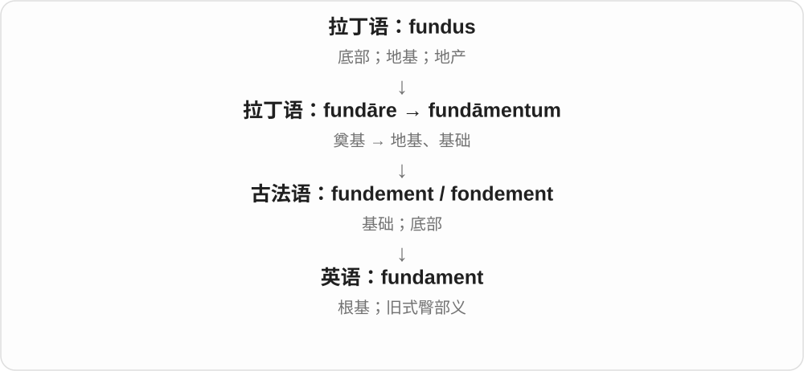

现代日常较少使用，谈理论根基通常说 foundation 或 basis。身体底部义多见旧文或诙谐表达，阅读时认识即可。

**常见搭配与例句**

the fundament of a theory；a theoretical fundament。

> The essay questions the fundament of the theory.

这篇文章质疑了该理论的根基。

> In the old comic tale, the character lands painfully on his fundament.

在那则旧时笑话里，人物摔了个屁股墩，疼得不轻。

**别混淆**

fundament 是少见名词，fundamental 是常见形容词及名词。不要用 fundament 直接形容 skills。

### 21. fundamental — 根本的；基础的；基本原则

**音标**：/ˌfʌndəˈmentəl/

**先抓住这个画面**

抽掉这块砖，上面的东西就站不住：fundamental 指决定整体能否成立的基础部分。

**怎么拆**

拉丁语 fundāmentum“基础”形成 fundāmentālis，进入英语。词形可以联系 fundament + -al。

**怎么变成今天的意思**

它既可说初学要掌握的基本知识，也可说影响事情本质的根本问题。fundamental change 不是小修补，而是底层做法变了。

**常见搭配与例句**

a fundamental principle；fundamental differences；the fundamentals of physics。

> Trust is fundamental to a lasting friendship.

信任是长久友谊的根本。

> The course introduces the fundamentals of photography.

这门课介绍摄影的基础知识。

**别混淆**

basic 常说入门或简单；fundamental 更强调根本重要性。基础原则可能很深，并不一定容易。

### 22. fundamentally — 从根本上；在本质上

**音标**：/ˌfʌndəˈmentəli/

**先抓住这个画面**

先把表面装饰拿掉，直接看底层结构；fundamentally 说明问题出在那一层。

**怎么拆**

fundamental + -ly，把根本性质变成描述判断或变化的副词。

**怎么变成今天的意思**

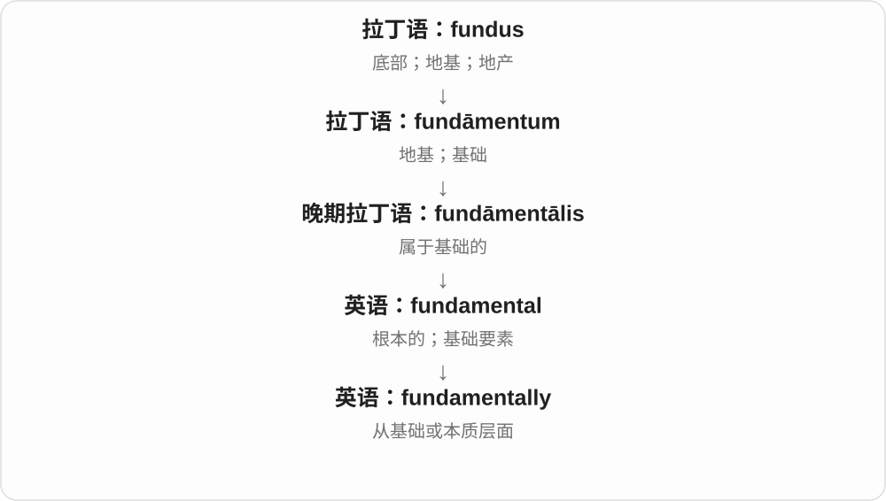

fundamentally different 不是几个细节不同，而是运作原则或本质有区别；有时也用来概括最重要的一点。

**常见搭配与例句**

fundamentally different；fundamentally change；fundamentally flawed。

> The two systems work in fundamentally different ways.

这两套系统的运作方式从根本上不同。

> The discovery fundamentally changed our understanding of the process.

这项发现从根本上改变了我们对这一过程的理解。

**别混淆**

completely 表示程度彻底；fundamentally 表示涉及根本。根本不同并不要求每个小细节都不同。

### 23. fundamentalism — 原教旨主义；严格坚持基本教义的立场

**音标**：/ˌfʌndəˈmentəlɪzəm/

**先抓住这个画面**

把一组基本教义当作不能改动的地基，要求其他理解都必须服从它：这是 fundamentalism 主要表达的立场。

**怎么拆**

现代能看出 fundamental 与 -ism；名称历史上接在 fundamentalist“坚持基本信条者”之后，起于二十世纪初的基督教运动，后来扩展到其他宗教和比喻用法。

**怎么变成今天的意思**

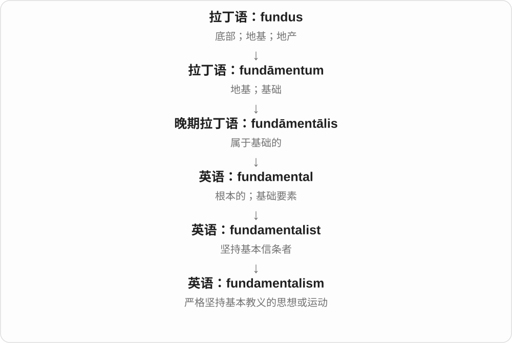

这个词不仅仅是“重视基础”。它通常说对某组核心信条的严格坚守；不同场景下含义和评价需要结合对象理解。

**常见搭配与例句**

religious fundamentalism；the history of fundamentalism；market fundamentalism。

> The historian studies the rise of religious fundamentalism.

这位历史学家研究宗教原教旨主义的兴起。

> The article criticizes market fundamentalism.

这篇文章批评了市场原教旨主义。

**别混淆**

fundamental 是普通形容词“根本的”；fundamentalism 是特定思想立场，不能见到坚持基本原则就随意套用。

### 24. fundamentalist — 原教旨主义者；坚持相应教义的

**音标**：/ˌfʌndəˈmentəlɪst/

**先抓住这个画面**

fundamentalist 是以严格坚持基本教义为立场的人，也能作形容词描述相关运动。

**怎么拆**

fundamental + -ist，与 fundamentalism 同族；-ist 标记持某种立场的人。

**怎么变成今天的意思**

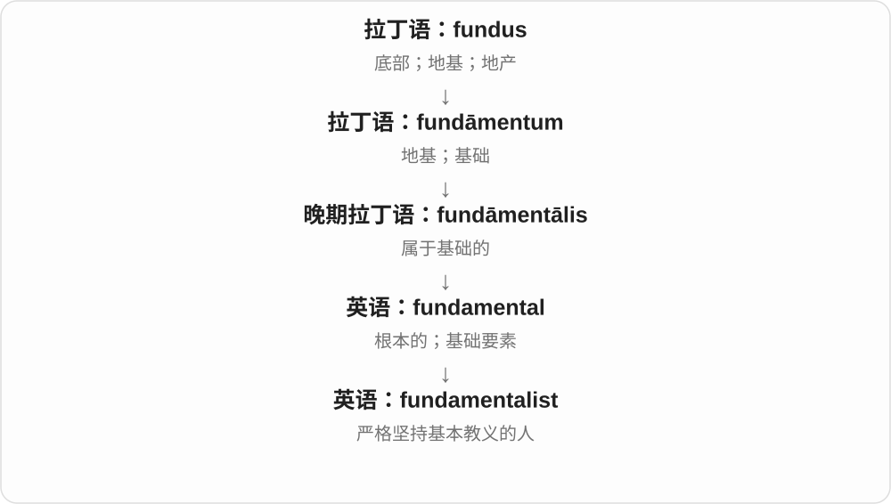

这里说的是思想或宗教立场，而不是一个人是不是初学者，也不能凭这个词就推断其具体行为。

**常见搭配与例句**

a fundamentalist movement；fundamentalist beliefs；religious fundamentalists。

> The book examines a fundamentalist movement in its historical setting.

这本书把一个原教旨主义运动放在历史背景中考察。

> She interviewed people who described themselves as fundamentalists.

她采访了几位自称原教旨主义者的人。

**别混淆**

beginner 是初学者；fundamentalist 绝不是“学基础的人”。形容基础课程用 fundamental 或 foundational。

### 25. profound — 深刻的；深厚的；极强的

**音标**：/prəˈfaʊnd/

**先抓住这个画面**

不只在水面上划一下，而是一路深入到底：思想看得深，影响触到深处，悲伤也深得难以摆脱。

**怎么拆**

拉丁语 prō- 与 fundus“底部”相关组合形成 profundus“深的”，经法语传入。

**怎么变成今天的意思**

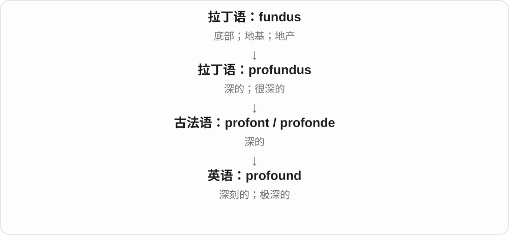

物理深度的画面扩展到思想、感情与影响。a profound change 是影响深入根本的变化，不只是声势大。

**常见搭配与例句**

a profound effect；profound sadness；a profound insight。

> The experience had a profound effect on her.

这段经历对她产生了深远影响。

> His simple question revealed a profound understanding of the problem.

他一个简单的问题显出了对问题的深刻理解。

**别混淆**

deep 使用很广；profound 更正式，常强调深度或程度格外大。不是所有 deep water 都需要说 profound water。

### 26. profoundly — 深深地；极其；深刻地

**音标**：/prəˈfaʊndli/

**先抓住这个画面**

某件事碰到了人的深处，而不是短暂擦过表面；profoundly 常表达这种强烈程度。

**怎么拆**

profound + -ly。

**怎么变成今天的意思**

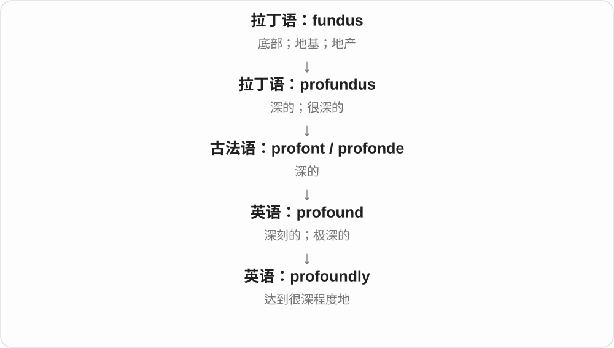

可修饰感受，也能修饰差异或影响。profoundly different 强调区别深刻，不是只看外观。

**常见搭配与例句**

profoundly moved；profoundly grateful；profoundly different。

> I was profoundly moved by her letter.

她的信让我深受触动。

> The new evidence profoundly altered the debate.

新证据深刻地改变了这场讨论。

**别混淆**

profoundly 常显得郑重、强烈；very 很中性。日常小事每次都用 profoundly 会显得过重。

### 27. profundity — 深刻；深奥；深刻见解

**音标**：/prəˈfʌndəti/

**先抓住这个画面**

不是句子用了多少难词，而是它有没有真正触到问题深处；这种深度叫 profundity。

**怎么拆**

来自拉丁语 profunditās，经法语等途径传入。与 profound 同族，但元音和重音变化，不能按 profound 原音直接拼读。

**怎么变成今天的意思**

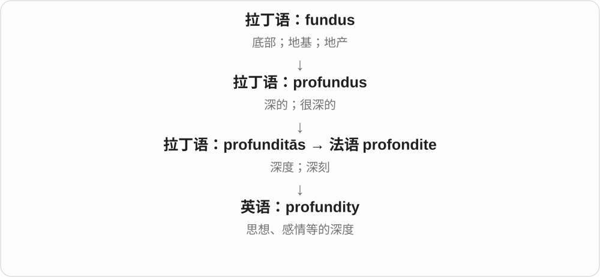

可以指深刻这一性质，也可以可数地说一句“深刻见解”；可数用法有时带讽刺，指装深沉的话。

**常见搭配与例句**

the profundity of an idea；emotional profundity；utter profundities。

> We were struck by the profundity of her observations.

她观察得如此深刻，让我们印象很深。

> The novel combines humour with emotional profundity.

这部小说把幽默与深厚情感结合在一起。

**别混淆**

complexity 是复杂；profundity 是深度。简单的一句话也可能有 profundity，复杂行话未必有。

## 这一组要分清什么

**found / find**：创办的过去式 founded；找到的过去式 found。

**founder / funder**：创办人 / 出资方，不一定同一人。founder 作动词还可指沉没、失败。

**funding / fundraising**：资金支持 / 筹集资金的活动。

**fundamental / fundamentalist**：根本的 / 坚持特定基本教义的人，不能把后者当作“初学者”。

## 串起来练习

**The founder secured funding from a new funder and laid a firm foundation for the project.**

创办人从新的出资方那里获得资金，为项目打下牢固基础。founder 建立，funder 出钱，funding 是支持，foundation 是基础。
