# 0160 · plac-, plea- — 使人满意、愉快；觉得合意、愿意接受

[逐词精讲目录](../00_逐词精讲目录.md) · [总目录](../00_总目录_按常用程度.md)

## 核心词根与来源

**placēre** 的核心不是某一种大笑，而是“让人觉得合意”。东西合意，让人 **pleased**；体验合意，带来 **pleasure**；对自己满意过头，就可能 **complacent**；总想顺着别人，则是 **complaisant**。这些是一组意义联系，各词的真实历史路线分别见逐词图。

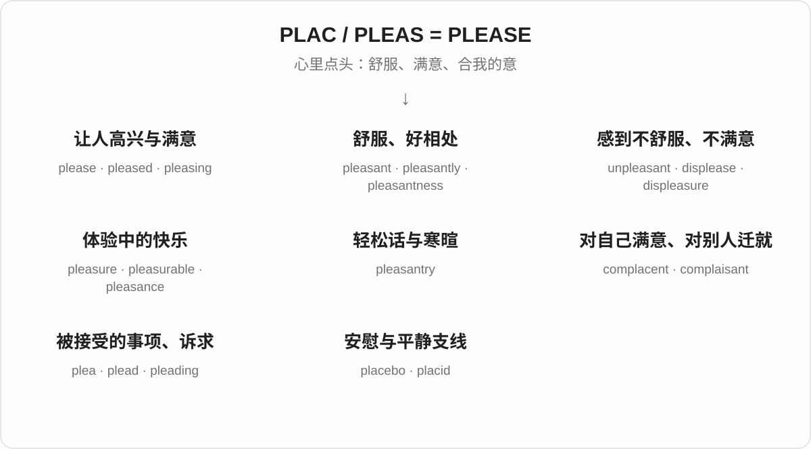

## 词形与演化规律

拉丁语 **placēre** 经法语出现 **plais- / pleas-** 等形式。**please、pleasant、pleasure、pleasantry** 并不是在现代英语里按同一套后缀依次造出来的，各有借入形式。

**complacent / complaisant** 同源，前者更直接保留拉丁外形，后者经过法语；今天通常分别说“自满”和“愿意迁就他人”。

**plea / plead** 经拉丁语 placitum“所议定、认可的事项”走向法律主张与恳求；不是 please 直接删字母。**placebo** 是拉丁语“我将使满意”的完整动词形式，不是 place + bo。

**placid** 属于 placidus 的平静支线。英语 **place** 则来自希腊语“宽阔的路”那一族，不能仅因外形接近混进来。

## 单词速览（常用到不常用）

| 单词 | 音标 | 核心意思 |
|---|---|---|
| [please](#w-1) | 英 /pliːz/；美 /pliːz/ | 使高兴、满意；请；随自己愿意 |
| [pleasure](#w-2) | 英 /ˈpleʒə/；美 /ˈpleʒər/ | 快乐；乐趣；令人高兴的事 |
| [pleased](#w-3) | 英 /pliːzd/；美 /pliːzd/ | 高兴的；满意的 |
| [pleasant](#w-4) | 英 /ˈplezənt/；美 /ˈplezənt/ | 愉快的；舒适的；和气的 |
| [plea](#w-5) | 英 /pliː/；美 /pliː/ | 恳求；诉求；答辩；辩解理由 |
| [unpleasant](#w-6) | 英 /ʌnˈplezənt/；美 /ʌnˈplezənt/ | 令人不快的；难受的；不友善的 |
| [pleasing](#w-7) | 英 /ˈpliːzɪŋ/；美 /ˈpliːzɪŋ/ | 令人愉快的；令人满意的 |
| [plead](#w-8) | 英 /pliːd/；美 /pliːd/ | 恳求；作答辩；提出某种理由 |
| [pleading](#w-9) | 英 /ˈpliːdɪŋ/；美 /ˈpliːdɪŋ/ | 恳求；带恳求意味的；诉讼书状 |
| [placebo](#w-10) | 英 /pləˈsiːbəʊ/；美 /pləˈsiːboʊ/ | 安慰剂；安慰性措施 |
| [pleasantly](#w-11) | 英 /ˈplezəntli/；美 /ˈplezəntli/ | 愉快地；和气地；令人舒服地 |
| [complacent](#w-12) | 英 /kəmˈpleɪsənt/；美 /kəmˈpleɪsənt/ | 自满的；安于现状而掉以轻心的 |
| [displeasure](#w-13) | 英 /dɪsˈpleʒə/；美 /dɪsˈpleʒər/ | 不悦；不满 |
| [pleasurable](#w-14) | 英 /ˈpleʒərəbəl/；美 /ˈpleʒərəbəl/ | 令人享受的；带来乐趣的 |
| [complacency](#w-15) | 英 /kəmˈpleɪsənsi/；美 /kəmˈpleɪsənsi/ | 自满；掉以轻心 |
| [placid](#w-16) | 英 /ˈplæsɪd/；美 /ˈplæsɪd/、/ˈplæsəd/ | 平静的；温和的；不易激动的 |
| [displeased](#w-17) | 英 /dɪsˈpliːzd/；美 /dɪsˈpliːzd/ | 不悦的；不满意的 |
| [unpleasantly](#w-18) | 英 /ʌnˈplezəntli/；美 /ʌnˈplezəntli/ | 令人不快地；不友善地 |
| [displease](#w-19) | 英 /dɪsˈpliːz/；美 /dɪsˈpliːz/ | 使不悦；让人不满意 |
| [displeasing](#w-20) | 英 /dɪsˈpliːzɪŋ/；美 /dɪsˈpliːzɪŋ/ | 令人不悦的；不合意的 |
| [pleasance](#w-21) | 英 /ˈplezəns/；美 /ˈplezəns/ | 乐趣、愉悦（旧用）；游憩花园或园地 |
| [complacently](#w-22) | 英 /kəmˈpleɪsəntli/；美 /kəmˈpleɪsəntli/ | 自满地；掉以轻心地 |
| [pleasantness](#w-23) | 英 /ˈplezəntnəs/；美 /ˈplezəntnəs/ | 愉快、舒适的特质；和气 |
| [placidly](#w-24) | 英 /ˈplæsɪdli/；美 /ˈplæsɪdli/、/ˈplæsədli/ | 平静地；温和地；不慌不忙地 |
| [pleader](#w-25) | 英 /ˈpliːdə/；美 /ˈpliːdər/ | 恳求者；辩护者；诉状撰写人或出庭代理人（特定用法） |
| [pleasantry](#w-26) | 英 /ˈplezəntri/；美 /ˈplezəntri/ | 寒暄；客套话；轻松的玩笑话 |
| [pleadingly](#w-27) | 英 /ˈpliːdɪŋli/；美 /ˈpliːdɪŋli/ | 恳求地；哀求地 |
| [complaisant](#w-28) | 英 /kəmˈpleɪzənt/，也读 /kəmˈpleɪsənt/；美 /kəmˈpleɪsənt/，也读 /kəmˈpleɪzənt/ | 乐于顺从的；迁就他人的；殷勤随和的 |
| [placidity](#w-29) | 英 /pləˈsɪdɪti/；美 /pləˈsɪdəti/ | 平静；温和沉着 |
| [complaisance](#w-30) | 英 /kəmˈpleɪzəns/，也读 /kəmˈpleɪsəns/；美 /kəmˈpleɪsəns/，也读 /kəmˈpleɪzəns/ | 随和迁就；乐于满足他人 |
| [complaisantly](#w-31) | 英 /kəmˈpleɪzəntli/；美 /kəmˈpleɪsəntli/，也读 /kəmˈpleɪzəntli/ | 顺从地；迁就地；殷勤配合地 |

## 逐词讲解

### 1. please — 使高兴、满意；请；随自己愿意

**音标**：英 /pliːz/；美 /pliːz/

**先抓住这个画面**

让对方觉得“这样合我的意”；请求别人做事时，就变成了较礼貌的“如果你愿意，请……”。

**怎么拆**

经古法语 plaisir / plaire 来自拉丁语 placēre。请求中的 please 与 if it please you 一类旧表达有关，不是一个毫无来历的礼貌小词。

**怎么变成今天的意思**

The result pleased her 是结果让她满意；Please sit down 是请坐；Do as you please 是随你喜欢怎么做。

**常见搭配与例句**

please someone；hard to please；if you please；as you please。

> The good news pleased everyone in the room.

好消息让屋里每个人都很高兴。

> Please leave the door open.

请把门留开。

> You can arrange the furniture as you please.

你可以按自己喜欢的方式摆放家具。

**别混淆**

please 是使人高兴的动作；pleased 是感到高兴；pleasant 是事物或人令人相处舒服。

### 2. pleasure — 快乐；乐趣；令人高兴的事

**音标**：英 /ˈpleʒə/；美 /ˈpleʒər/

**先抓住这个画面**

某件事让你觉得享受，于是那份舒服、满足或开心本身就叫 pleasure。

**怎么拆**

来自古法语 plaisir 的名词用法，英语中词尾按 -ure 调整；与 please 同源，但不是直接把现代 please 加 -ure。

**怎么变成今天的意思**

read for pleasure 是为乐趣阅读；take pleasure in 是从中得到快乐；My pleasure 是礼貌地说很乐意。

**常见搭配与例句**

for pleasure；take pleasure in；a pleasure to meet you；simple pleasures。

> She reads poetry for pleasure, not for an exam.

她读诗是为了享受，不是为了考试。

> It was a pleasure to work with such a thoughtful team.

和这样周到的团队合作很愉快。

**别混淆**

pleasure 是名词，pleasant 是形容词。It was a pleasure 与 It was pleasant 都可表达愉快，但句法不同。

### 3. pleased — 高兴的；满意的

**音标**：英 /pliːzd/；美 /pliːzd/

**先抓住这个画面**

事情发生后，心里觉得“不错，这正合我的意”。

**怎么拆**

please + -ed，过去分词形容接受愉快感受的一方。

**怎么变成今天的意思**

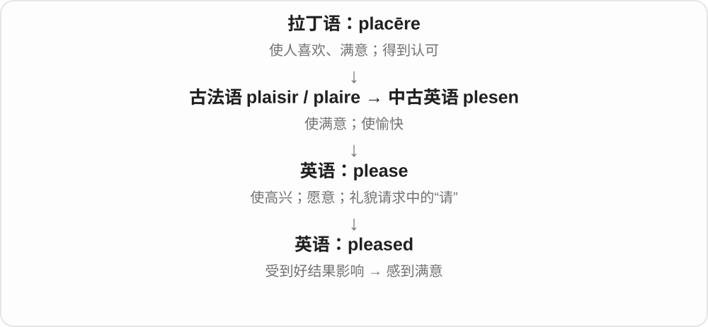

常说 pleased with the result、pleased to hear that、pleased that…。Very pleased 很自然，不必说 very pleasure。

**常见搭配与例句**

pleased with；pleased to do；pleased to meet you。

> She was pleased with the progress her students had made.

她对学生取得的进步很满意。

> I was pleased to hear that you arrived safely.

听说你平安抵达，我很高兴。

**别混淆**

I am pleased 是我高兴；The news is pleasing 是消息令人高兴。体验者与带来体验的东西不同。

### 4. pleasant — 愉快的；舒适的；和气的

**音标**：英 /ˈplezənt/；美 /ˈplezənt/

**先抓住这个画面**

天气不折腾人，地方待着舒服，人也好相处，没有让你紧绷的不适。

**怎么拆**

来自古法语 plaisant，是 plaisir 的分词形式；历史上不是先有现代英语 please 再加 -ant。

**怎么变成今天的意思**

a pleasant afternoon 是舒服的一下午；a pleasant person 是和气好相处的人；a pleasant surprise 是令人高兴的意外。

**常见搭配与例句**

pleasant weather；a pleasant surprise；pleasant to talk to。

> We spent a pleasant afternoon by the river.

我们在河边度过了愉快的一下午。

> She was pleasant to everyone, even when the shop was busy.

即使店里很忙，她对每个人也都和和气气。

**别混淆**

pleasant 是让人舒服愉快；pleased 是人已经感到高兴，不能说 I am pleasant 来表示“我很高兴”。

### 5. plea — 恳求；诉求；答辩；辩解理由

**音标**：英 /pliː/；美 /pliː/

**先抓住这个画面**

把自己的请求或主张认真摆出来，希望对方接受；法庭上则有正式答辩这一专门用法。

**怎么拆**

来自古法语 plait / plaid，远源是拉丁语 placitum“所认可、议定的事情”，后来发展出裁定、案件、诉讼主张。不是现代 please 去掉 se。

**怎么变成今天的意思**

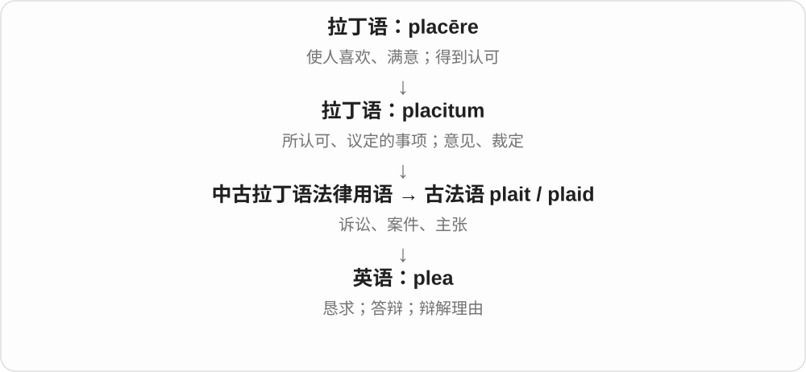

a plea for help 是求助；enter a plea 是作出正式答辩；a plea of ignorance 是拿“不知情”作理由。法律表达的具体效果取决于上下文。

**常见搭配与例句**

a plea for help；make a plea；a guilty plea；a plea of ignorance。

> The letter was a heartfelt plea for help.

这封信发出了真诚恳切的求助。

> The report records the defendant’s plea of not guilty.

报告记载了被告所作的不认罪答辩。

**别混淆**

plea 常比 request 更恳切，法律义又更专门；它的单数没有词尾 d，动词是 plead。

### 6. unpleasant — 令人不快的；难受的；不友善的

**音标**：英 /ʌnˈplezənt/；美 /ʌnˈplezənt/

**先抓住这个画面**

让人想躲开、皱眉，或者相处起来感到不舒服。

**怎么拆**

un- 否定 + pleasant。

**怎么变成今天的意思**

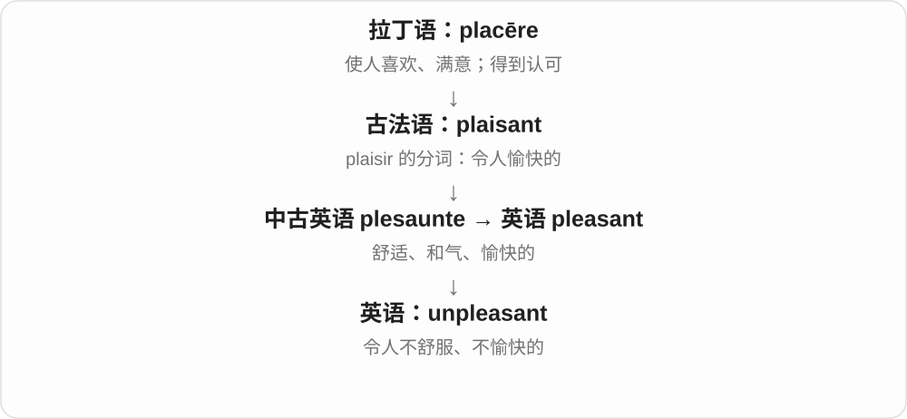

可说 unpleasant smell、unpleasant experience、unpleasant person。强度很宽，从不舒服到讨厌都可能。

**常见搭配与例句**

an unpleasant smell；an unpleasant surprise；unpleasant to deal with。

> An unpleasant smell came from the drain.

排水口传来一股难闻的气味。

> The conversation became unpleasant after the accusation.

指责出现后，谈话变得令人不快。

**别混淆**

unpleasant 评价体验让人不舒服；dangerous 说有危险，二者不必同时成立。

### 7. pleasing — 令人愉快的；令人满意的

**音标**：英 /ˈpliːzɪŋ/；美 /ˈpliːzɪŋ/

**先抓住这个画面**

一个颜色、声音或结果进入眼耳或心里，给人一种“舒服、不错”的反应。

**怎么拆**

please + -ing，分词形容能带来愉快或满意的事物。

**怎么变成今天的意思**

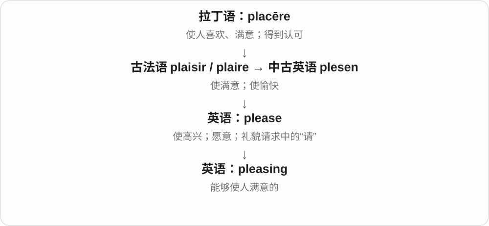

常形容外观、声音、效果；a pleasing result 是令人满意的结果。比 nice 更书面一些。

**常见搭配与例句**

pleasing to the eye；a pleasing result；a pleasing design。

> The room has a pleasing balance of light and colour.

房间的光线和色彩搭配得很舒服。

> It was pleasing to see the team work so well together.

看到团队配合得这么好，令人高兴。

**别混淆**

pleasing 强调带来满意的效果；pleased 强调接收这个效果的人已经感到满意。

### 8. plead — 恳求；作答辩；提出某种理由

**音标**：英 /pliːd/；美 /pliːd/

**先抓住这个画面**

不只是随口问一下，而是带着急切、理由或正式身份，为某个请求或立场争取接受。

**怎么拆**

来自古法语 plaider，后者与 plait 案件、主张相连；深层回到拉丁语 placitum。不是先有现代英语 plea 再随意加 d。

**怎么变成今天的意思**

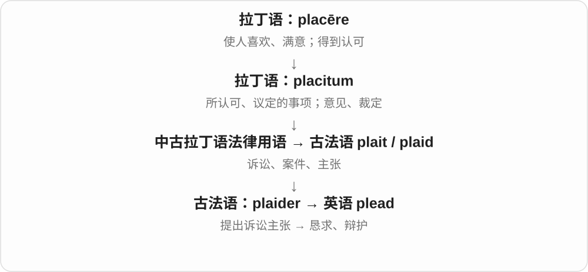

plead with someone to do something 是恳求某人；plead guilty / not guilty 是作认罪或不认罪答辩；plead ignorance 是以不知情作理由。过去式有 pleaded /ˈpliːdɪd/，也用 pled /pled/。

**常见搭配与例句**

plead with；plead for；plead guilty；plead ignorance。

> She pleaded with him to stay a little longer.

她恳求他再多留一会儿。

> He pleaded ignorance of the new rule.

他以不知道新规则为由作解释。

**别混淆**

plead 一般比 ask 更迫切或正式；不能在所有日常询问里替代 ask。

### 9. pleading — 恳求；带恳求意味的；诉讼书状

**音标**：英 /ˈpliːdɪŋ/；美 /ˈpliːdɪŋ/

**先抓住这个画面**

声音或眼神在说“求你了”；在法律文字里，也可指正式把主张和答辩写出来的材料。

**怎么拆**

plead + -ing；从行为名词发展出法律文书用法，分词也可形容恳求的神情。

**怎么变成今天的意思**

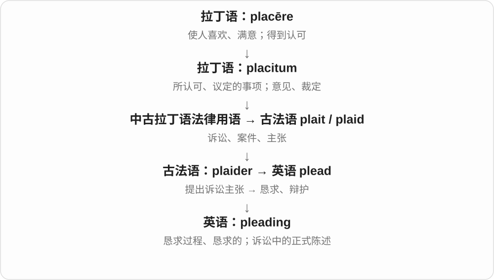

pleading eyes 是恳求的眼神；the pleadings 常指诉讼中的正式书面主张和答辩，不等于情绪激动地哀求。

**常见搭配与例句**

a pleading voice；pleading eyes；the written pleadings。

> There was a pleading note in his voice.

他的声音里带着恳求。

> The researcher compared the arguments in the written pleadings.

研究者比较了书面诉讼材料中的论点。

**别混淆**

pleading 的日常义重情绪，法律复数义重程序文书，不能靠一个中文“恳求”套完。

### 10. placebo — 安慰剂；安慰性措施

**音标**：英 /pləˈsiːbəʊ/；美 /pləˈsiːboʊ/

**先抓住这个画面**

研究中给一份外观、使用方式相似，却没有被研究的特定活性成分或作用的对照，让人能比较治疗本身的效果。

**怎么拆**

拉丁语 placēbō 本义“我将使人满意”，是 placēre 的将来时第一人称形式。英语早期用作宗教仪式名称；医学用法较晚借用“使满意、安慰”的意味。

**怎么变成今天的意思**

placebo 不一定是糖丸，也可以是其他对照措施；placebo effect 指与期待和治疗情境等相关的效应，不能粗暴理解成病人装病。比喻用法可说某措施只有安抚作用。

**常见搭配与例句**

a placebo group；receive a placebo；the placebo effect。

> The study compared the new treatment with a placebo.

研究把新治疗与安慰剂对照作了比较。

> The report describes how the placebo group was selected.

报告说明了安慰剂组如何选取。

**别混淆**

placebo 是研究对照或安慰性处理，不等于所有情况下绝无任何感受变化；名称与 place“地方”没有这条同源关系。

### 11. pleasantly — 愉快地；和气地；令人舒服地

**音标**：英 /ˈplezəntli/；美 /ˈplezəntli/

**先抓住这个画面**

把一种舒服、友善的感觉放进动作或程度里。

**怎么拆**

pleasant + -ly。

**怎么变成今天的意思**

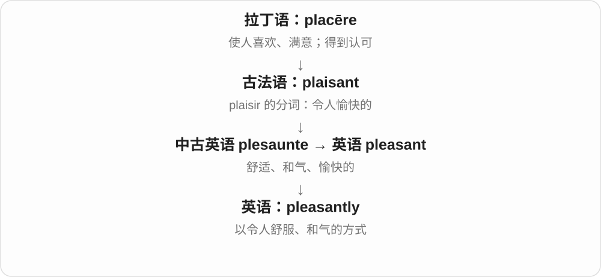

pleasantly surprised 是惊喜；pleasantly warm 是暖得舒服；smile pleasantly 是和气地微笑。

**常见搭配与例句**

pleasantly surprised；pleasantly warm；speak pleasantly。

> We were pleasantly surprised by the quiet garden.

那座安静的花园让我们感到惊喜。

> The room was pleasantly warm when we arrived.

我们到时，房间里暖暖的，很舒服。

**别混淆**

pleasantly warm 不是越热越好，而是热度刚好让人舒服。

### 12. complacent — 自满的；安于现状而掉以轻心的

**音标**：英 /kəmˈpleɪsənt/；美 /kəmˈpleɪsənt/

**先抓住这个画面**

觉得“我们已经很好了，不用担心”，结果该注意的问题也不再认真看。

**怎么拆**

借自拉丁语 complacēns，是 complacēre“使很满意”的分词；com- 在这里常解释为加强意味。英语从满意转向对自己过度满意。

**怎么变成今天的意思**

常说 complacent about safety 或 become complacent after success。现代常用义带批评，不只是心情开心。

**常见搭配与例句**

become complacent；complacent about risks。

> Early success made the team complacent.

早期成功让团队变得自满。

> We cannot afford to be complacent about data quality.

我们不能对数据质量掉以轻心。

**别混淆**

complacent 对自己太满意；complaisant 倾向让别人满意。两词同源、读音相近，现代重心不同。

### 13. displeasure — 不悦；不满

**音标**：英 /dɪsˈpleʒə/；美 /dɪsˈpleʒər/

**先抓住这个画面**

把那种“不合我意”的情绪本身拿出来说。

**怎么拆**

来自古法语 desplaisir 的名词用法，与 displease 同源；现代可分析成 dis- + pleasure，但有独立借入历史。

**怎么变成今天的意思**

常用于 express displeasure、show displeasure，语气正式。可以只是一句冷淡回应，也可以公开表态。

**常见搭配与例句**

express displeasure；show displeasure；to someone’s displeasure。

> She made no attempt to hide her displeasure.

她丝毫没有掩饰自己的不满。

> The neighbours expressed their displeasure at the late-night noise.

邻居们对深夜噪声表达了不满。

**别混淆**

displeasure 是不愉快情绪；disapproval 是不认可的判断，两者可能同时出现。

### 14. pleasurable — 令人享受的；带来乐趣的

**音标**：英 /ˈpleʒərəbəl/；美 /ˈpleʒərəbəl/

**先抓住这个画面**

做这件事的过程本身有滋味，你愿意继续体会。

**怎么拆**

pleasure + -able，表示能够带来 pleasure。

**怎么变成今天的意思**

常形容 experience、activity、sensation。比 pleasant 更容易突出享受的感受，而不仅是没有不舒服。

**常见搭配与例句**

a pleasurable experience；a pleasurable activity。

> Cooking became a pleasurable part of her evening routine.

做饭成了她晚间日常里一件享受的事。

> The warm bath was especially pleasurable after the long walk.

长途步行之后，泡个温水澡格外舒服。

**别混淆**

pleasant 可以是温和舒服；pleasurable 更直接强调乐趣与享受，实际语境有重叠。

### 15. complacency — 自满；掉以轻心

**音标**：英 /kəmˈpleɪsənsi/；美 /kəmˈpleɪsənsi/

**先抓住这个画面**

问题可能还在，但心里那句“已经够好了”让检查和改进停了下来。

**怎么拆**

与拉丁语 complacentia“满意”及较早英语 complacence 同源，英语采用 -cy 词尾形式；不能只把历史画成现代 complacent 加后缀。

**怎么变成今天的意思**

常用 guard against complacency，强调成功之后仍要保持注意。不是所有满足感都叫 complacency，这个词通常含“过头”的评价。

**常见搭配与例句**

a sense of complacency；guard against complacency。

> The coach warned the players against complacency.

教练提醒队员不要自满。

> The error exposed a culture of complacency in the office.

这次失误暴露了办公室里普遍存在的掉以轻心。

**别混淆**

confidence 是有信心；complacency 往往是不再认真看待不足或风险。

### 16. placid — 平静的；温和的；不易激动的

**音标**：英 /ˈplæsɪd/；美 /ˈplæsɪd/、/ˈplæsəd/

**先抓住这个画面**

像没有大波浪的湖面，也像不容易被小事激怒的人。

**怎么拆**

来自拉丁语 placidus，与 placēre 相连；有法语 placide 和直接拉丁借入的分析。

**怎么变成今天的意思**

可说 placid lake、placid child、placid expression。强调安稳、不起波澜，不必表示环境完全没有声音。

**常见搭配与例句**

a placid lake；a placid temperament；a placid expression。

> The boat moved slowly across the placid lake.

小船缓缓驶过平静的湖面。

> The child remained placid despite the noise around her.

尽管周围很吵，孩子仍很安静平和。

**别混淆**

placid 是平静的状态；placating 是努力让别人平静；complacent 是自满到忽略问题。

### 17. displeased — 不悦的；不满意的

**音标**：英 /dɪsˈpliːzd/；美 /dɪsˈpliːzd/

**先抓住这个画面**

心里已经对这件事打了一个叉，态度或表情可能显露出不满。

**怎么拆**

displease + -ed，表示受到不愉快影响后的状态。

**怎么变成今天的意思**

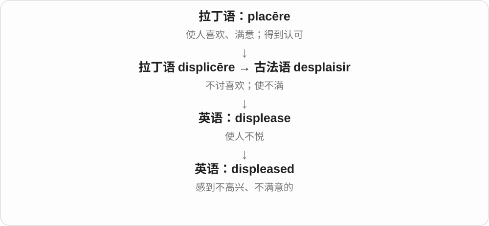

常接 with、at、about，说明对什么不满。较 pleased 的反面更正式一些。

**常见搭配与例句**

displeased with the result；clearly displeased。

> The client was displeased with the late delivery.

客户对延迟送货很不满意。

> She looked displeased when the meeting was interrupted.

会议被打断时，她显得很不高兴。

**别混淆**

displeased 说体验者不高兴；displeasing 说某事让人不高兴。

### 18. unpleasantly — 令人不快地；不友善地

**音标**：英 /ʌnˈplezəntli/；美 /ʌnˈplezəntli/

**先抓住这个画面**

动作的方式或某种程度已经越过舒服的界线。

**怎么拆**

unpleasant + -ly。

**怎么变成今天的意思**

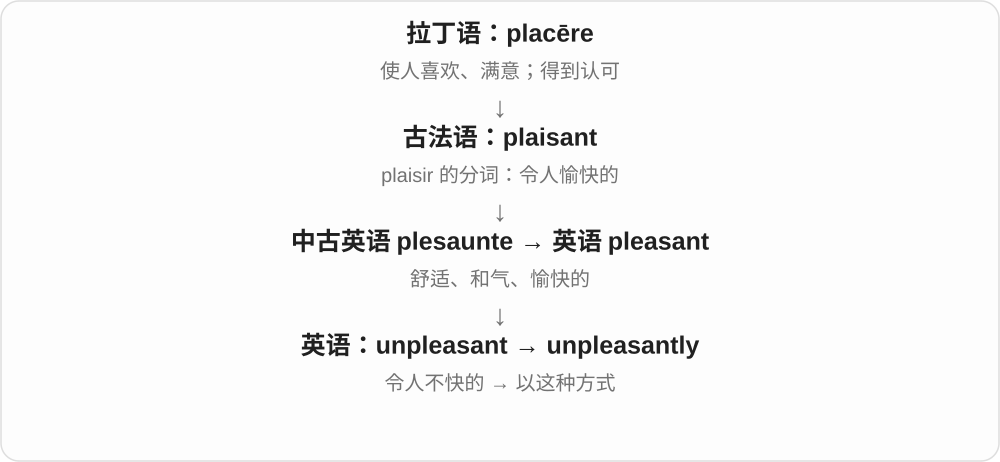

unpleasantly cold 是冷得难受；answer unpleasantly 是很不友善地回答。

**常见搭配与例句**

unpleasantly cold；unpleasantly surprised；speak unpleasantly。

> The water was unpleasantly cold.

水冷得让人难受。

> He answered unpleasantly and turned away.

他很不友善地回答了一句，就转过身去。

**别混淆**

unpleasantly 修饰动作或程度；unpleasant 修饰人、物或状态。

### 19. displease — 使不悦；让人不满意

**音标**：英 /dɪsˈpliːz/；美 /dɪsˈpliːz/

**先抓住这个画面**

本来期待一件事顺心，结果却让人皱眉或失望。

**怎么拆**

经古法语 desplaisir 来自拉丁语 displicēre，属于 dis- 否定 + placēre 的历史组合；现代可直接看出 dis- + please。

**怎么变成今天的意思**

较书面，常以消息、决定或行为作主语。The delay displeased her 就是延误让她不高兴。

**常见搭配与例句**

displease someone；greatly displease。

> The sudden change displeased several members of the team.

突然的变动让几名团队成员不满。

> He knew that the answer would displease his manager.

他知道这个回答会让经理不高兴。

**别混淆**

displease 说让人不满意；disappoint 通常更强调没有达到期待，二者可以重叠。

### 20. displeasing — 令人不悦的；不合意的

**音标**：英 /dɪsˈpliːzɪŋ/；美 /dɪsˈpliːzɪŋ/

**先抓住这个画面**

某个效果落到眼里或心里，让人觉得不舒服、不喜欢。

**怎么拆**

displease + -ing，分词用作形容词。

**怎么变成今天的意思**

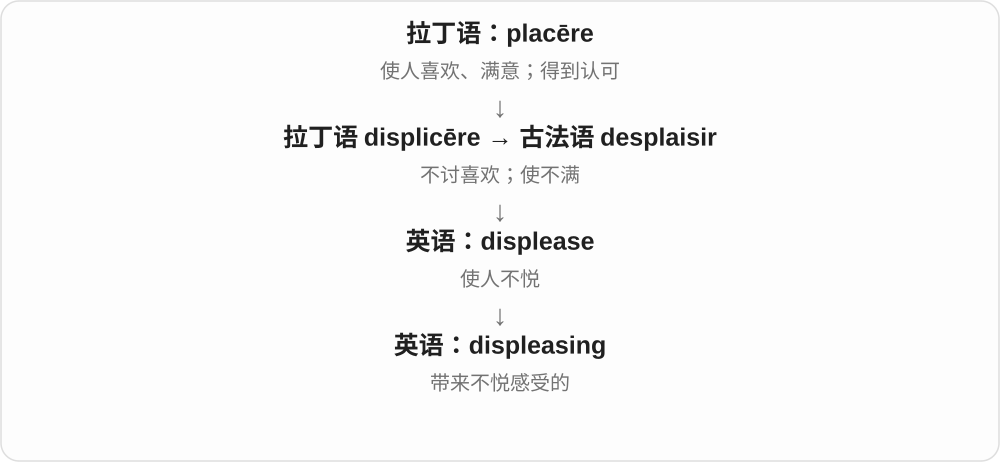

可用于外观、声音、做法或结果；比 unpleasant 更书面。displeasing to the eye 指视觉上不舒服。

**常见搭配与例句**

displeasing to the eye；a displeasing effect。

> The harsh lighting created a displeasing effect.

刺眼的照明造成了不舒服的视觉效果。

> The arrangement was displeasing to several committee members.

这个安排让几位委员会成员不满意。

**别混淆**

displeasing 形容造成不满的因素；displeased 形容已有不满的感受。

### 21. pleasance — 乐趣、愉悦（旧用）；游憩花园或园地

**音标**：英 /ˈplezəns/；美 /ˈplezəns/

**先抓住这个画面**

先是令人愉快的感觉，也能把供人散步、游玩的好地方直接叫作“愉悦之地”。

**怎么拆**

经古法语 plaisance 进入中古英语；表面可联系 please + -ance，但实际是历史借词。

**怎么变成今天的意思**

现代较少见，阅读旧文学、地名或园林说明时更可能遇到。普通“乐趣”用 pleasure，自家花园通常说 garden。

**常见搭配与例句**

a secluded pleasance；a garden pleasance。

> A narrow path led into the castle’s secluded pleasance.

一条窄路通向城堡幽静的游园。

> The guide explained that the old word pleasance could mean a pleasure garden.

向导解释说，旧词 pleasance 可以指供游憩的花园。

**别混淆**

pleasance 是旧词或特定园地名；pleasantry 是寒暄、玩笑，不能因词头相同就互换。

### 22. complacently — 自满地；掉以轻心地

**音标**：英 /kəmˈpleɪsəntli/；美 /kəmˈpleɪsəntli/

**先抓住这个画面**

做事时带着“没问题，我们已经很行了”的松懈态度。

**怎么拆**

complacent + -ly。

**怎么变成今天的意思**

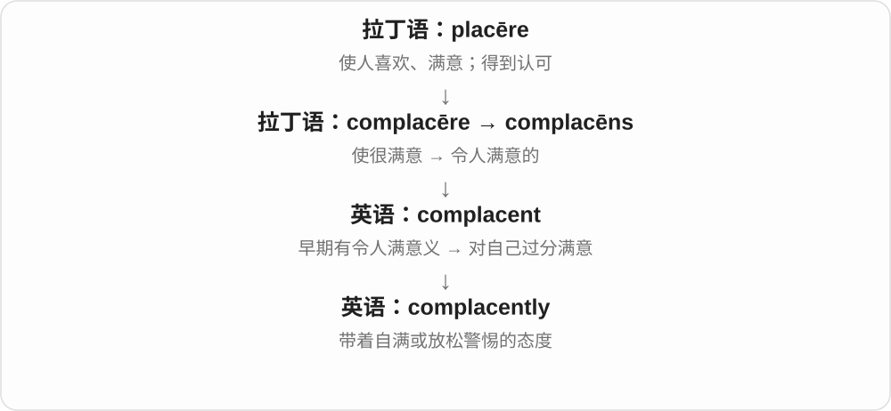

可修饰 assume、smile、accept 等动作，通常是说话人对这种态度的批评。

**常见搭配与例句**

complacently assume；smile complacently。

> They complacently assumed that customers would never leave.

他们想当然地以为客户永远不会离开。

> He smiled complacently at the early results.

看到初步结果，他自满地笑了。

**别混淆**

calmly 是平静地，未必失去警惕；complacently 往往已经低估了问题。

### 23. pleasantness — 愉快、舒适的特质；和气

**音标**：英 /ˈplezəntnəs/；美 /ˈplezəntnəs/

**先抓住这个画面**

把“和这人相处舒服”或“待在这里舒服”这种特点单独拿出来说。

**怎么拆**

pleasant + -ness，表示性质或状态。

**怎么变成今天的意思**

可描述人的态度、环境或体验，较抽象。the pleasantness of the room 不是房间里的某一个具体物件。

**常见搭配与例句**

outward pleasantness；the pleasantness of a place。

> Her pleasantness helped put the nervous visitors at ease.

她和气的态度让紧张的来访者放松了下来。

> The pleasantness of the walk came from its quiet surroundings.

这段散步之所以舒服，是因为四周安静。

**别混淆**

pleasantness 是温和舒适；excitement 是兴奋刺激，舒服不必很刺激。

### 24. placidly — 平静地；温和地；不慌不忙地

**音标**：英 /ˈplæsɪdli/；美 /ˈplæsɪdli/、/ˈplæsədli/

**先抓住这个画面**

周围有变化，自己的动作和情绪却没有被带得起起伏伏。

**怎么拆**

placid + -ly。

**怎么变成今天的意思**

可描写人说话、动物吃草或船漂着的样子。语气常比 calmly 更有画面感。

**常见搭配与例句**

sit placidly；graze placidly；reply placidly。

> The cows grazed placidly beside the road.

牛群在路边安静地吃草。

> She listened placidly while the others argued.

别人争论时，她平静地听着。

**别混淆**

placidly 是不激动；complacently 还加入了自满和低估问题的负面判断。

### 25. pleader — 恳求者；辩护者；诉状撰写人或出庭代理人（特定用法）

**音标**：英 /ˈpliːdə/；美 /ˈpliːdər/

**先抓住这个画面**

站出来为一个请求、案件或立场争取接受的人。

**怎么拆**

现代可拆为 plead + -er。历史上还合流了盎格鲁诺曼语 plaidur、古法语 plaidëor 一类“诉讼代理人”名词，不全是现代英语加后缀。

**怎么变成今天的意思**

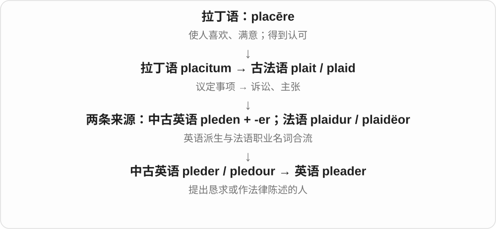

普通语境可指恳求者；历史或特定司法体系里有专业称谓，不能把它当成各地所有律师的通用名称。

**常见搭配与例句**

an eloquent pleader；a pleader for reform。

> The biography describes her as an eloquent pleader for reform.

传记把她描写成一位善于为改革发声的人。

> The old record names the pleader who presented the case.

旧记录列出了陈述该案的诉讼代理人的姓名。

**别混淆**

pleader 强调为请求或主张说话的角色；lawyer 是更广泛的职业名称。

### 26. pleasantry — 寒暄；客套话；轻松的玩笑话

**音标**：英 /ˈplezəntri/；美 /ˈplezəntri/

**先抓住这个画面**

先聊两句天气、问候或轻松话，让交谈舒服起来，再进入正题。

**怎么拆**

借自法语 plaisanterie，与 plaisant“令人愉快、诙谐的”同族；并非现代英语 pleasant 加 -ry 才造出来。

**怎么变成今天的意思**

今天常用复数 exchange pleasantries，表示互相寒暄。单数也可指一句玩笑或礼貌闲谈。

**常见搭配与例句**

exchange pleasantries；a few pleasantries。

> We exchanged a few pleasantries before discussing the contract.

我们寒暄了几句，然后讨论合同。

> His gentle pleasantry eased the tension in the room.

他一句温和的玩笑话缓和了屋里的紧张气氛。

**别混淆**

pleasantries 是具体的话；pleasantness 是相处舒服的性质，不是可数的一句句寒暄。

### 27. pleadingly — 恳求地；哀求地

**音标**：英 /ˈpliːdɪŋli/；美 /ˈpliːdɪŋli/

**先抓住这个画面**

语气或眼神特别急切，希望对方别拒绝。

**怎么拆**

pleading + -ly。

**怎么变成今天的意思**

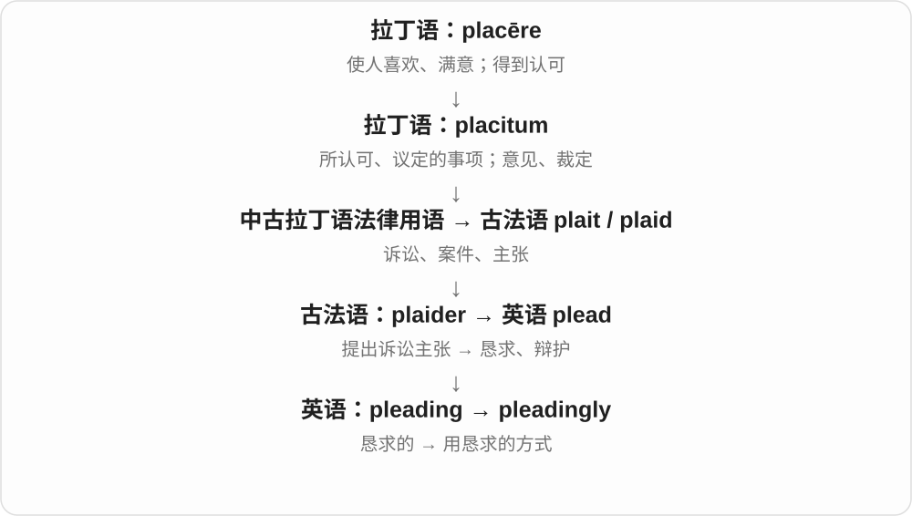

常和 look、say、ask 搭配，用来描写说话方式。它不规定对方最终会不会答应。

**常见搭配与例句**

look pleadingly at someone；ask pleadingly。

> The child looked pleadingly at her father.

孩子用恳求的眼神看着父亲。

> “Just give me another chance,” he said pleadingly.

“再给我一次机会吧。”他恳求道。

**别混淆**

politely 是礼貌地；pleadingly 加入了急切请求的情绪，二者可以同时出现。

### 28. complaisant — 乐于顺从的；迁就他人的；殷勤随和的

**音标**：英 /kəmˈpleɪzənt/，也读 /kəmˈpleɪsənt/；美 /kəmˈpleɪsənt/，也读 /kəmˈpleɪzənt/

**先抓住这个画面**

别人提出想法，你愿意配合、少起冲突，让对方舒服。

**怎么拆**

借自法语 complaisant，来自 complaire，再追到拉丁语 complacēre；与 complacent 是沿不同路线形成的同源词。

**怎么变成今天的意思**

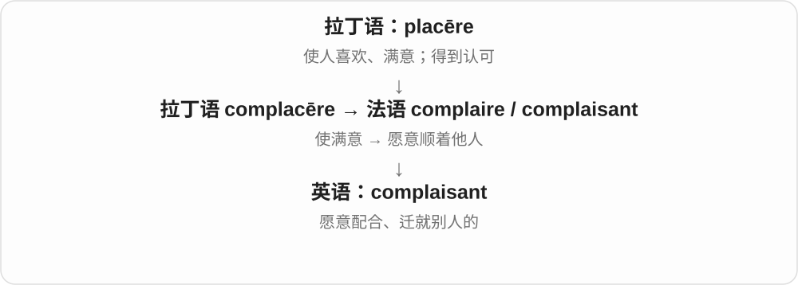

正式且较少见。可以赞扬随和体贴，也可能批评过度迁就、缺少自己的坚持。

**常见搭配与例句**

a complaisant manner；a complaisant host。

> The complaisant host changed the seating plan at their request.

好说话的主人应他们要求调整了座位安排。

> She was too complaisant to challenge the unfair rule.

她太迁就别人，不愿质疑那条不公平的规则。

**别混淆**

complaisant 顺着别人；complacent 满足于自己。不要把前者直接译成自满。

### 29. placidity — 平静；温和沉着

**音标**：英 /pləˈsɪdɪti/；美 /pləˈsɪdəti/

**先抓住这个画面**

把平和、不起波澜这一状态看作整体，就像观察湖面的安静或人的稳定性情。

**怎么拆**

与拉丁语 placiditās“温和平静”相连；现代可分析 placid + -ity，重音移到第二音节。

**怎么变成今天的意思**

较书面，常描述神情、性情、环境。它不必表示毫无感受，只是外在或整体比较安稳。

**常见搭配与例句**

an air of placidity；outward placidity。

> The placidity of the lake contrasted with the busy road nearby.

湖面的平静与附近繁忙的道路形成对比。

> Her outward placidity concealed a firm decision.

她平静的外表下藏着一个坚定的决定。

**别混淆**

placidity 是平静；passivity 是被动不行动，平静的人也可以果断行动。

### 30. complaisance — 随和迁就；乐于满足他人

**音标**：英 /kəmˈpleɪzəns/，也读 /kəmˈpleɪsəns/；美 /kəmˈpleɪsəns/，也读 /kəmˈpleɪzəns/

**先抓住这个画面**

把“愿意顺着别人”的态度单独拿出来说；过度时就会牺牲自己的判断。

**怎么拆**

借自法语 complaisance，深层来自中世纪拉丁语 complacentia；与 complacency 有共同历史，但英语用义分开。

**怎么变成今天的意思**

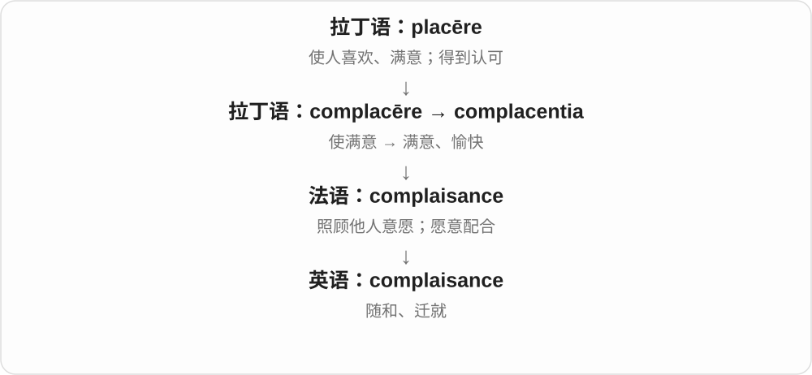

较书面，常讨论礼貌、社交习惯或服从态度。不能把所有友善都理解成毫无原则。

**常见搭配与例句**

excessive complaisance；a manner of complaisance。

> Her complaisance made her a considerate host.

她愿意体谅客人的性格，使她成为周到的主人。

> Excessive complaisance prevented him from expressing his own view.

过度迁就别人，让他没能表达自己的看法。

**别混淆**

complaisance 是顺着人；compliance 是遵守要求，后者来自 comply，历史不能直接当作同一个词。

### 31. complaisantly — 顺从地；迁就地；殷勤配合地

**音标**：英 /kəmˈpleɪzəntli/；美 /kəmˈpleɪsəntli/，也读 /kəmˈpleɪzəntli/

**先抓住这个画面**

行动时照顾对方的意愿，尽量让对方觉得顺心。

**怎么拆**

complaisant + -ly；跟随形容词保留 /s/、/z/ 的读音变体。

**怎么变成今天的意思**

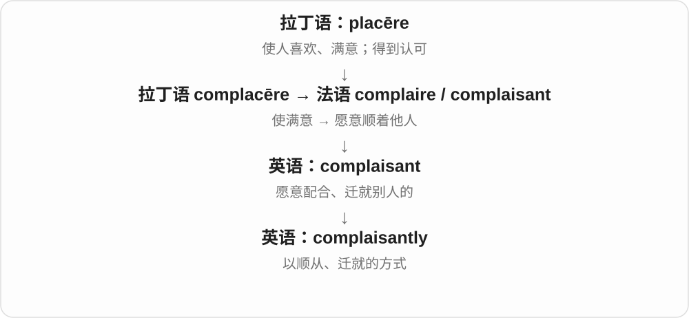

较少见，可用于叙事中的 agree、smile、accept。读到时先识别对他人的顺从，而不是对自己的得意。

**常见搭配与例句**

agree complaisantly；smile complaisantly。

> He complaisantly agreed to move the meeting to Friday.

他顺着大家的意思，同意把会议改到星期五。

> She smiled complaisantly and let the guest choose the music.

她殷勤地笑了笑，让客人选择音乐。

**别混淆**

complaisantly 是顺着别人；complacently 是对自己满足过头。

## 这一组要分清什么

**pleased / pleasing / pleasant**：人感到满意 / 事物带来满意 / 事物或人令人舒服。

**pleasure / pleasantry / pleasantness**：快乐、乐趣 / 寒暄或轻松话 / 舒适、和气的性质。

**complacent / complaisant**：自满而疏忽 / 顺着别人、愿意迁就。**complacency / complaisance** 是相应的名词区别。

**plea / plead**：请求、答辩等名词 / 提出请求、答辩等动词。**placebo** 的字母 c 读 /s/，别按 place“地方”去猜意思。

## 串起来练习

**I was pleased with the pleasant room, but I did not want the staff to become complacent about service.**

房间很舒服，我很满意，但我不希望员工因此对服务掉以轻心。pleased 是我的感受，pleasant 是房间带来的体验，complacent 是过度自满的态度。
