# 0171 · prem-, -prim-, press- — 按、压、挤；留下印痕；把表现压住或放出来

[逐词精讲目录](../00_逐词精讲目录.md) · [总目录](../00_总目录_按常用程度.md)

## 核心词根与来源

**prem- / -prim- / press-** 来自拉丁语 **premere**“按、压、挤”。先想象把手按到软泥上：东西被压低，是 depress；被挤紧，是 compress；留下印痕，是 impress、print。再把画面搬到心理和交往里：留在心里的痕迹是 impression，压住不让显露是 suppress，把意思表现出来是 express。

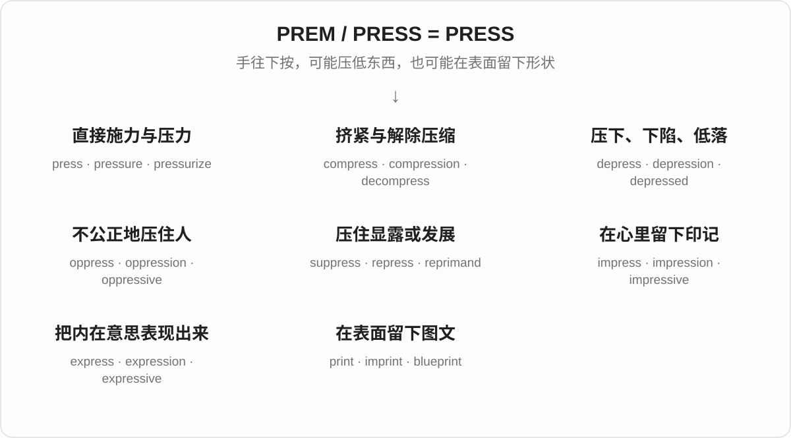

## 词形与演化规律

**premere → pressus** 是拉丁语动词与过去分词的形式变化；**-primere** 常出现在带前缀的复合动词中，例如 imprimere、exprimere、deprimere。这里的 prim- 不等于 primus“第一”。

**com-** 一起压 → compress；**de-** 向下压 → depress；**in-** 向内压 → impress；**ex-** 向外 → express；**sub-** 向下压住 → suppress；**re-** 向回按 → repress。这些是理解方向的入口，不代表现代词义只等于字面相加。

**print** 经过法语的语音和词形变化，保留了“压出印记”的意思。**impression、expression、compression、depression** 等名词各有拉丁语或法语借入路线，不能全画成英语动词先出现、再加后缀。

## 单词速览（按词族由简到繁）

同一基础词的相关扩展放在一起，先读基础形式，再读扩展；各组之间优先读常用的。具体词源关系见各词讲解。

| 单词 | 音标 | 核心意思 |
|---|---|---|
| [press](#w-1) | 英 /pres/；美 /pres/ | 按压；催促；印刷机；新闻界 |
| [pressure](#w-2) | 英 /ˈpreʃə/；美 /ˈpreʃər/ | 压力；施加压力 |
| [pressurize](#w-74) | 英 /ˈpreʃəraɪz/；美 /ˈpreʃəraɪz/ | 给……加压；使承受压力 |
| [pressurization](#w-62) | 英 /ˌpreʃəraɪˈzeɪʃən/；美 /ˌpreʃərəˈzeɪʃən/ | 加压；增压过程或系统 |
| [depressurize](#w-79) | 英 /ˌdiːˈpreʃəraɪz/；美 /ˌdiːˈpreʃəraɪz/ | 使减压；解除内部压力 |
| [overpressure](#w-75) | 英 /ˌəʊvəˈpreʃə/；美 /ˌoʊvərˈpreʃər/ | 超压；高于参照压力的部分 |
| [pressing](#w-12) | 英 /ˈpresɪŋ/；美 /ˈpresɪŋ/ | 紧迫的；压制、压印；一批压制的唱片 |
| [impress](#w-13) | 英 /ɪmˈpres/；美 /ɪmˈpres/ | 使印象深刻；使赞叹；使铭记 |
| [impressive](#w-7) | 英 /ɪmˈpresɪv/；美 /ɪmˈpresɪv/ | 令人赞叹的；给人深刻印象的 |
| [impressively](#w-35) | 英 /ɪmˈpresɪvli/；美 /ɪmˈpresɪvli/ | 出色地；令人赞叹地 |
| [unimpressive](#w-54) | 英 /ˌʌnɪmˈpresɪv/；美 /ˌʌnɪmˈpresɪv/ | 平平的；不出色的 |
| [impression](#w-8) | 英 /ɪmˈpreʃən/；美 /ɪmˈpreʃən/ | 印象；印痕；模仿表演 |
| [impressionable](#w-44) | 英 /ɪmˈpreʃənəbəl/；美 /ɪmˈpreʃənəbəl/ | 容易受影响的；易受感染的 |
| [impressionism](#w-48) | 英 /ɪmˈpreʃənɪzəm/；美 /ɪmˈpreʃənɪzəm/ | 印象主义；印象派艺术 |
| [impressionist](#w-45) | 英 /ɪmˈpreʃənɪst/；美 /ɪmˈpreʃənɪst/ | 印象派艺术家；模仿表演者；印象派的 |
| [impressionistic](#w-58) | 英 /ɪmˌpreʃəˈnɪstɪk/；美 /ɪmˌpreʃəˈnɪstɪk/ | 印象派风格的；凭总体感受描绘的 |
| [impressed](#w-9) | 英 /ɪmˈprest/；美 /ɪmˈprest/ | 印象深刻的；赞叹的 |
| [unimpressed](#w-40) | 英 /ˌʌnɪmˈprest/；美 /ˌʌnɪmˈprest/ | 不以为然的；没有被打动的 |
| [depress](#w-43) | 英 /dɪˈpres/；美 /dɪˈpres/ | 压下；降低；使沮丧 |
| [depression](#w-4) | 英 /dɪˈpreʃən/；美 /dɪˈpreʃən/ | 凹陷；低气压；经济萧条；抑郁 |
| [depressed](#w-11) | 英 /dɪˈprest/；美 /dɪˈprest/ | 情绪低落的；低迷的；凹下的 |
| [depressing](#w-15) | 英 /dɪˈpresɪŋ/；美 /dɪˈpresɪŋ/ | 令人沮丧的；让人心情低落的 |
| [depressive](#w-31) | 英 /dɪˈpresɪv/；美 /dɪˈpresɪv/ | 抑郁相关的；有抑郁特征的 |
| [depressant](#w-50) | 英 /dɪˈpresənt/；美 /dɪˈpresənt/ | 抑制剂；降低某种活动的物质；抑制性的 |
| [antidepressant](#w-37) | 英 /ˌæntidɪˈpresənt/；美 /ˌæntidɪˈpresənt/ | 抗抑郁药；抗抑郁的 |
| [repress](#w-46) | 英 /rɪˈpres/；美 /rɪˈpres/ | 压抑；压制；遏制 |
| [repression](#w-21) | 英 /rɪˈpreʃən/；美 /rɪˈpreʃən/ | 压制；压抑 |
| [repressive](#w-33) | 英 /rɪˈpresɪv/；美 /rɪˈpresɪv/ | 压制性的；限制自由的 |
| [irrepressible](#w-53) | 英 /ˌɪrɪˈpresəbəl/；美 /ˌɪrɪˈpresəbəl/ | 压不住的；抑制不住的 |
| [express](#w-3) | 英 /ɪkˈspres/；美 /ɪkˈspres/ | 表达；挤出；明确的；特快的 |
| [expression](#w-5) | 英 /ɪkˈspreʃən/；美 /ɪkˈspreʃən/ | 表达；说法；表情；表达式；基因表达 |
| [expressionism](#w-51) | 英 /ɪkˈspreʃənɪzəm/；美 /ɪkˈspreʃənɪzəm/ | 表现主义 |
| [expressionist](#w-55) | 英 /ɪkˈspreʃənɪst/；美 /ɪkˈspreʃənɪst/ | 表现主义艺术家；表现主义的 |
| [expressionless](#w-63) | 英 /ɪkˈspreʃənləs/；美 /ɪkˈspreʃənləs/ | 面无表情的 |
| [overexpression](#w-60) | 英 /ˌəʊvərɪkˈspreʃən/；美 /ˌoʊvərɪkˈspreʃən/ | 过度表达；基因过表达 |
| [expressly](#w-24) | 英 /ɪkˈspresli/；美 /ɪkˈspresli/ | 明确地；专门地 |
| [expressive](#w-26) | 英 /ɪkˈspresɪv/；美 /ɪkˈspresɪv/ | 富有表现力的；能表现某种感受的 |
| [expressiveness](#w-61) | 英 /ɪkˈspresɪvnəs/；美 /ɪkˈspresɪvnəs/ | 表现力；传达情感的能力 |
| [expressway](#w-32) | 英 /ɪkˈspresweɪ/；美 /ɪkˈspresweɪ/ | 快速公路；高速通行道路 |
| [inexpressible](#w-76) | 英 /ˌɪnɪkˈspresəbəl/；美 /ˌɪnɪkˈspresəbəl/ | 难以言表的 |
| [print](#w-6) | 英 /prɪnt/；美 /prɪnt/ | 打印；印刷；印痕；印刷字体 |
| [printing](#w-10) | 英 /ˈprɪntɪŋ/；美 /ˈprɪntɪŋ/ | 印刷；打印；一次印次 |
| [printer](#w-14) | 英 /ˈprɪntə/；美 /ˈprɪntər/ | 打印机；印刷工；印刷商 |
| [printable](#w-39) | 英 /ˈprɪntəbəl/；美 /ˈprɪntəbəl/ | 可打印的；适宜刊印的 |
| [printmaking](#w-52) | 英 /ˈprɪntmeɪkɪŋ/；美 /ˈprɪntmeɪkɪŋ/ | 版画制作；版画艺术 |
| [printmaker](#w-73) | 英 /ˈprɪntmeɪkə/；美 /ˈprɪntmeɪkər/ | 版画家；版画制作艺术家 |
| [unprintable](#w-78) | 英 /ʌnˈprɪntəbəl/；美 /ʌnˈprɪntəbəl/ | 不宜刊登的；无法打印的 |
| [footprint](#w-20) | 英 /ˈfʊtprɪnt/；美 /ˈfʊtprɪnt/ | 脚印；占地；留下的影响 |
| [fingerprint](#w-22) | 英 /ˈfɪŋɡəprɪnt/；美 /ˈfɪŋɡərprɪnt/ | 指纹；识别特征；采集指纹 |
| [blueprint](#w-23) | 英 /ˈbluːprɪnt/；美 /ˈbluːprɪnt/ | 蓝图；详细方案 |
| [reprint](#w-28) | 名词：英、美 /ˈriːprɪnt/；动词：英、美 /ˌriːˈprɪnt/ | 重印；再版印本；转载 |
| [imprint](#w-30) | 名词：英、美 /ˈɪmprɪnt/；动词：英、美 /ɪmˈprɪnt/ | 印痕；深刻影响；印上；出版品牌 |
| [newsprint](#w-56) | 英 /ˈnjuːzprɪnt/；美 /ˈnuːzprɪnt/ | 新闻纸；用于印报纸的纸 |
| [misprint](#w-66) | 名词：英、美 /ˈmɪsprɪnt/；动词：英、美 /mɪsˈprɪnt/ | 印刷错误；误印 |
| [preprint](#w-67) | 英 /ˈpriːprɪnt/；美 /ˈpriːprɪnt/ | 预印本；正式发表前流通的论文稿 |
| [thumbprint](#w-68) | 英 /ˈθʌmprɪnt/；美 /ˈθʌmprɪnt/ | 拇指印 |
| [handprint](#w-72) | 英 /ˈhændprɪnt/；美 /ˈhændprɪnt/ | 手印；掌印 |
| [compress](#w-34) | 动词：英、美 /kəmˈpres/；名词：英 /ˈkɒmpres/、美 /ˈkɑːmpres/ | 压缩；挤紧；压敷布 |
| [compression](#w-16) | 英 /kəmˈpreʃən/；美 /kəmˈpreʃən/ | 压缩；挤压 |
| [compressor](#w-29) | 英 /kəmˈpresə/；美 /kəmˈpresər/ | 压缩机；压缩工具；音频压缩器 |
| [compressible](#w-65) | 英 /kəmˈpresəbəl/；美 /kəmˈpresəbəl/ | 可压缩的 |
| [incompressible](#w-71) | 英 /ˌɪnkəmˈpresəbəl/；美 /ˌɪnkəmˈpresəbəl/ | 不可压缩的；近似体积不变的 |
| [decompress](#w-57) | 英 /ˌdiːkəmˈpres/；美 /ˌdiːkəmˈpres/ | 解压；减压；放松下来 |
| [decompression](#w-38) | 英 /ˌdiːkəmˈpreʃən/；美 /ˌdiːkəmˈpreʃən/ | 减压；解压缩 |
| [oppress](#w-42) | 英 /əˈpres/；美 /əˈpres/ | 压迫；使沉重难受 |
| [oppression](#w-17) | 英 /əˈpreʃən/；美 /əˈpreʃən/ | 压迫；沉重压抑感 |
| [oppressive](#w-25) | 英 /əˈpresɪv/；美 /əˈpresɪv/ | 压迫性的；令人压抑的；闷热难耐的 |
| [oppressor](#w-47) | 英 /əˈpresə/；美 /əˈpresər/ | 压迫者 |
| [suppress](#w-19) | 英 /səˈpres/；美 /səˈpres/ | 抑制；压下；封锁传播 |
| [suppression](#w-18) | 英 /səˈpreʃən/；美 /səˈpreʃən/ | 抑制；压制；阻止传播 |
| [immunosuppression](#w-70) | 英 /ɪˌmjuːnəʊsəˈpreʃən/；美 /ɪˌmjuːnoʊsəˈpreʃən/ | 免疫抑制 |
| [suppressor](#w-36) | 英 /səˈpresə/；美 /səˈpresər/ | 抑制器；抑制因素 |
| [suppressive](#w-59) | 英 /səˈpresɪv/；美 /səˈpresɪv/ | 有抑制作用的；压制性的 |
| [suppressant](#w-69) | 英 /səˈpresənt/；美 /səˈpresənt/ | 抑制剂；起抑制作用的物质 |
| [espresso](#w-27) | 英 /eˈspresəʊ/、/ɪˈspresəʊ/；美 /eˈspresoʊ/、/ɪˈspresoʊ/ | 意式浓缩咖啡 |
| [reprimand](#w-41) | 名词、动词常见：英 /ˈreprɪmɑːnd/；美 /ˈreprɪmænd/，也有末音节重读 | 正式斥责；训诫 |
| [printout](#w-49) | 英 /ˈprɪntaʊt/；美 /ˈprɪntaʊt/ | 打印件；打印输出 |
| [imprimatur](#w-64) | 英 /ˌɪmprɪˈmeɪtə/、/ˌɪmprɪˈmɑːtə/；美 /ˌɪmprɪˈmɑːtər/ | 准予出版；正式认可 |
| [immunosuppressant](#w-77) | 英 /ɪˌmjuːnəʊsəˈpresənt/；美 /ɪˌmjuːnoʊsəˈpresənt/ | 免疫抑制药 |

## 逐词讲解

### 1. press — 按压；催促；印刷机；新闻界

**音标**：英 /pres/；美 /pres/

**先抓住这个画面**

手指往按钮上施力是 press；把一件事不断推到别人面前，也像在施压催办。

**怎么拆**

动词经古法语 presser 来自拉丁语 pressāre，根是 premere。印刷机靠压印工作，机器名又扩展到报刊、记者。

**怎么变成今天的意思**

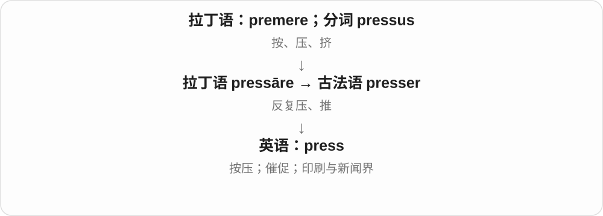

press a button 是按按钮；press someone for an answer 是追问。the press 常指新闻界；a press 可以是压力机或印刷机。

**常见搭配与例句**

press against；press for change；freedom of the press。

> Press the green button to start the machine.

按绿色按钮启动机器。

> Reporters pressed the mayor for a clear answer.

记者们追问市长，希望得到明确答复。

**别混淆**

press into service 常说临时征用；历史“强征入伍”的 press 还有 prest“预付招募金”的另一来源，不能全靠按压解释。

### 2. pressure — 压力；施加压力

**音标**：英 /ˈpreʃə/；美 /ˈpreʃər/

**先抓住这个画面**

外面的力量压过来：可以压在物体表面，也可以是期限、期待、责任压在心上。

**怎么拆**

来自拉丁语 pressūra“挤压、压迫”，不是把英语 press 随意补上几个字母。

**怎么变成今天的意思**

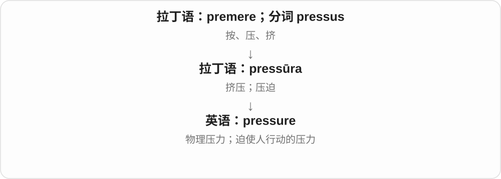

物理里的 pressure 是单位面积上承受的法向力；日常是迫使人行动的处境。它也能作动词：pressure someone into doing something。

**常见搭配与例句**

under pressure；put pressure on；air pressure。

> She stayed calm under pressure.

她在压力下仍保持冷静。

> The smaller contact area produces greater pressure for the same force.

力相同时，接触面积越小，压强越大。

**别混淆**

pressure 是逼迫感或物理量；stress 常说紧张反应，也有自己的力学含义。两者不能在所有专业场合互换。

### 3. pressurize — 给……加压；使承受压力

**音标**：英 /ˈpreʃəraɪz/；美 /ˈpreʃəraɪz/

**先抓住这个画面**

把某个空间的内部压力建立起来或提高；英式日常还可说给人施压。

**怎么拆**

pressure 去掉末尾 e + -ize；英式也写 pressurise。

**怎么变成今天的意思**

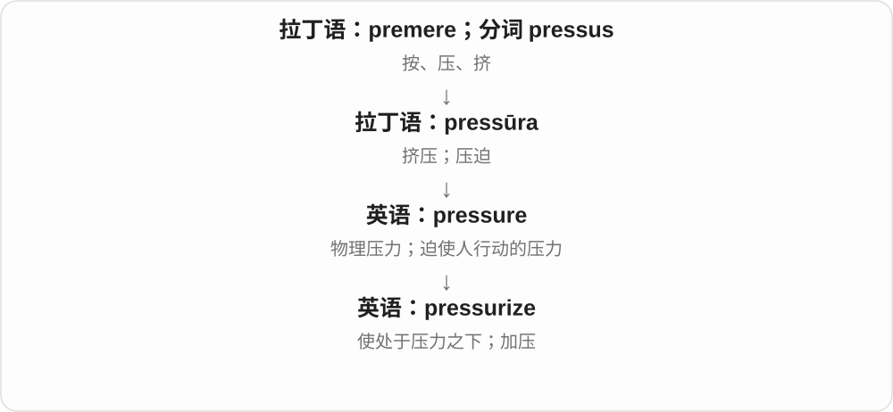

飞机客舱需要维持合适气压；pressurize someone into doing something 则是逼人做事，美式更常直接用 pressure。

**常见搭配与例句**

a pressurized cabin；pressurize a chamber。

> The aircraft has a pressurized cabin.

这架飞机的客舱经过增压。

> The chamber was pressurized during the test.

测试中对舱室进行了加压。

**别混淆**

pressurize a cabin 不表示把乘客挤到一起，而是在控制舱内气压。

### 4. pressurization — 加压；增压过程或系统

**音标**：英 /ˌpreʃəraɪˈzeɪʃən/；美 /ˌpreʃərəˈzeɪʃən/

**先抓住这个画面**

不是只把空气装进去，而是让一个空间维持需要的压力水平。

**怎么拆**

pressurize + -ation，-ize 对应 -ization；英式也写 pressurisation。

**怎么变成今天的意思**

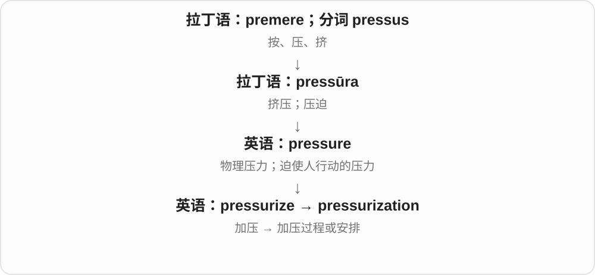

常见于航空和工程。cabin pressurization 说客舱增压，不只是空调调温。

**常见搭配与例句**

a pressurization system；cabin pressurization；loss of pressurization。

> The crew checked the cabin pressurization system.

机组检查了客舱增压系统。

> The diagram explains how pressurization works.

图示解释了加压如何进行。

**别混淆**

pressurization 管压力；ventilation 管通风换气，相关但不是同义。

### 5. depressurize — 使减压；解除内部压力

**音标**：英 /ˌdiːˈpreʃəraɪz/；美 /ˌdiːˈpreʃəraɪz/

**先抓住这个画面**

原本把压力维持在较高水平，现在把它降下来。

**怎么拆**

de- 解除 + pressurize 加压；英式也写 depressurise。

**怎么变成今天的意思**

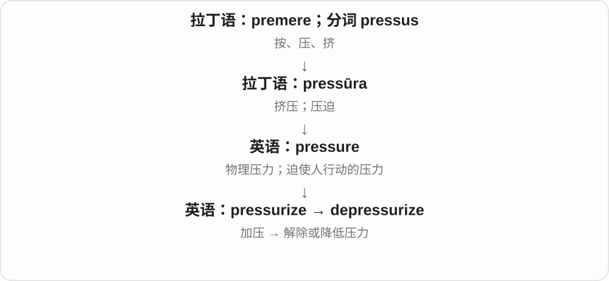

重点是容器、舱室等内部压力的降低。与 decompress 有重叠，但通常不用来指计算机文件解压。

**常见搭配与例句**

depressurize a chamber；the cabin depressurizes。

> The chamber slowly depressurized after the test.

测试结束后，舱室缓慢减压。

> The manual explains when the system must be depressurized.

手册说明了系统什么时候必须解除压力。

**别混淆**

depressurize 不等于 depress：前者解除压力，后者常是向下压、使低落。

### 6. overpressure — 超压；高于参照压力的部分

**音标**：英 /ˌəʊvəˈpreʃə/；美 /ˌoʊvərˈpreʃər/

**先抓住这个画面**

把正常或环境压力当作基准，超过它的那一段压力就是 overpressure。

**怎么拆**

over- 超过 + pressure。

**怎么变成今天的意思**

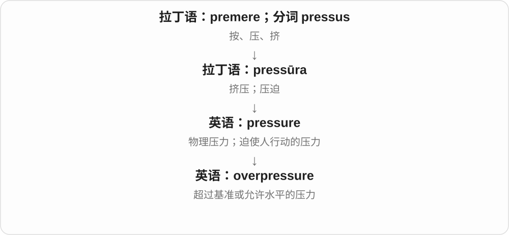

工程中可能指超过允许值；冲击波语境常指高于周围环境压力的部分。具体基准须看上下文。

**常见搭配与例句**

overpressure protection；a rise in overpressure。

> The valve protects the tank from overpressure.

阀门保护储罐，避免发生超压。

> The sensor recorded pressure above the ambient level as overpressure.

传感器把高于环境压力的部分记录为超压。

**别混淆**

overpressure 不只是“压力很大”的随口说法，专业使用通常隐含一个比较基准。

### 7. pressing — 紧迫的；压制、压印；一批压制的唱片

**音标**：英 /ˈpresɪŋ/；美 /ˈpresɪŋ/

**先抓住这个画面**

一件事像持续按着你的肩膀，催你马上处理。

**怎么拆**

press + -ing；动作分词成为形容词，也成为压制过程或产品批次的名词。

**怎么变成今天的意思**

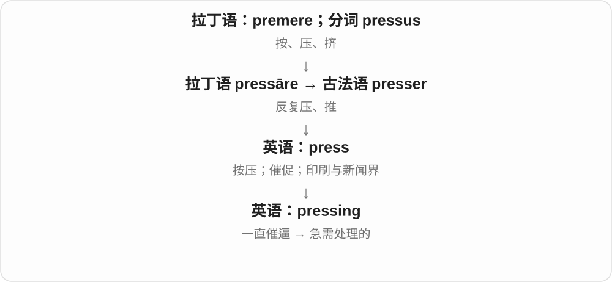

a pressing problem 是不能拖的问题。a first pressing of a record 是唱片首次压制的一批，不是第一首歌。

**常见搭配与例句**

a pressing need；pressing concerns；the first pressing。

> We have a pressing need for more classroom space.

我们急需更多教室空间。

> This record is from the first pressing.

这张唱片出自首批压制版本。

**别混淆**

pressing 强调急迫；important 只强调重要，有些重要的事并不急。

### 8. impress — 使印象深刻；使赞叹；使铭记

**音标**：英 /ɪmˈpres/；美 /ɪmˈpres/

**先抓住这个画面**

像印章压进软泥，一次表现也能在别人脑中留下清楚的印记。

**怎么拆**

拉丁语 in- 向内 + premere，形成 imprimere，分词 impressus 进入英语词族。

**怎么变成今天的意思**

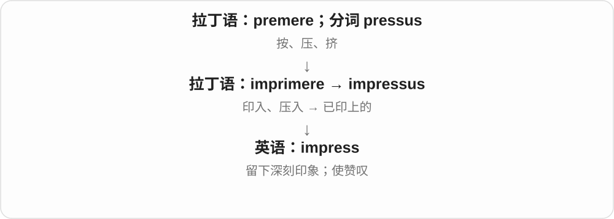

impress someone 常带赞赏；impress something on someone 是使对方牢记，未必是讨好或炫耀。

**常见搭配与例句**

impress the audience；impress on someone the importance of…。

> Her clear explanation impressed the whole team.

她清楚的解释给整个团队留下了深刻印象。

> The teacher impressed on us the need to check our sources.

老师让我们牢牢记住核对来源的重要性。

**别混淆**

历史上的 impress sailors“强征水手”主要来自另一条 prest 路线；留印象这一支才直接属于这里的 premere。

### 9. impressive — 令人赞叹的；给人深刻印象的

**音标**：英 /ɪmˈpresɪv/；美 /ɪmˈpresɪv/

**先抓住这个画面**

规模、能力或成果大到让人停下来认真看一眼。

**怎么拆**

impress + -ive，表示能够产生深刻印象的。

**怎么变成今天的意思**

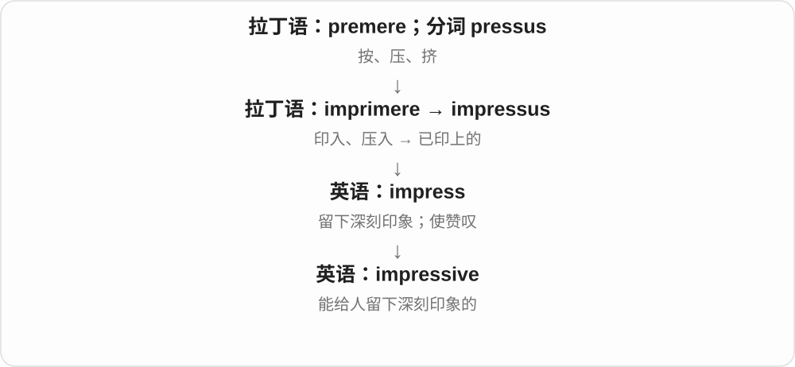

可以赞技术、成绩、建筑，也能说 impressive evidence，强调证据有分量。

**常见搭配与例句**

an impressive achievement；an impressive collection；look impressive。

> The students made impressive progress in six weeks.

学生们六周内取得了令人赞叹的进步。

> The bridge is an impressive piece of engineering.

这座桥是一项令人赞叹的工程。

**别混淆**

impressive 不等于 expensive：昂贵的东西未必出色，简单的解决办法也能令人赞叹。

### 10. impressively — 出色地；令人赞叹地

**音标**：英 /ɪmˈpresɪvli/；美 /ɪmˈpresɪvli/

**先抓住这个画面**

不是只说做了，而是说做得让人服气。

**怎么拆**

impressive + -ly。

**怎么变成今天的意思**

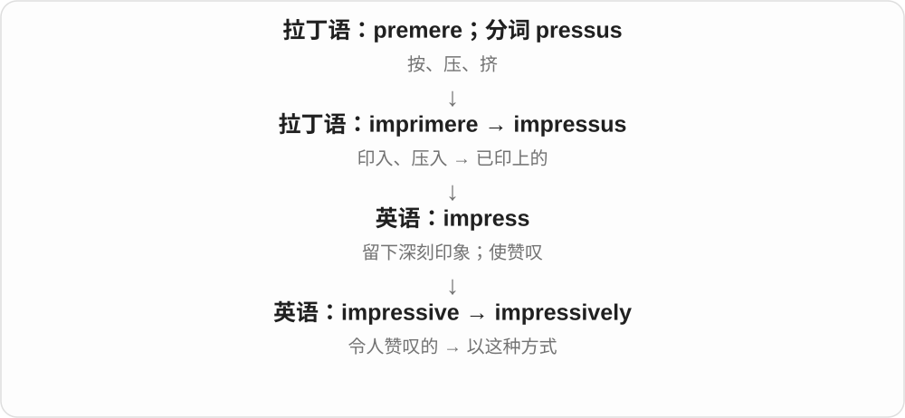

可以修饰动作，也可修饰形容词：impressively detailed 表示细致得令人赞叹。

**常见搭配与例句**

perform impressively；impressively clear；impressively large。

> The team performed impressively despite the difficult conditions.

尽管条件困难，团队仍表现出色。

> Her answer was impressively clear and concise.

她的回答清楚简洁，令人赞叹。

**别混淆**

impressively 强调旁观者的赞叹；impressionistically 是凭整体印象来描写，意思不同。

### 11. unimpressive — 平平的；不出色的

**音标**：英 /ˌʌnɪmˈpresɪv/；美 /ˌʌnɪmˈpresɪv/

**先抓住这个画面**

看完后没有留下特别的分量，表现达不到令人赞叹的程度。

**怎么拆**

un- 否定 impressive。

**怎么变成今天的意思**

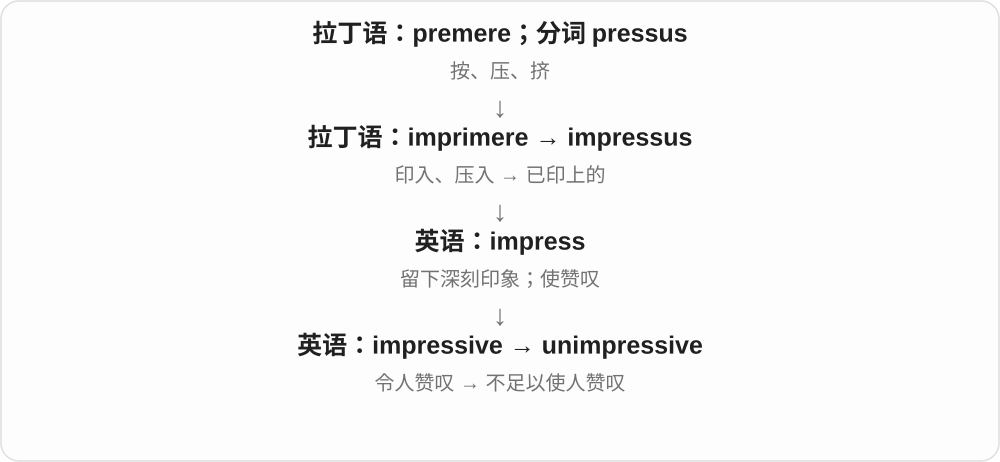

评价成绩、外观、规模时常用，语气通常是低于期待，并不一定是彻底失败。

**常见搭配与例句**

unimpressive results；an unimpressive start；look unimpressive。

> The building looks unimpressive from the street but has a beautiful interior.

这栋楼从街上看很普通，内部却很漂亮。

> The project had an unimpressive start.

这个项目起步表现平平。

**别混淆**

unimpressive 描述被评价的东西；unimpressed 描述评价者的感受。

### 12. impression — 印象；印痕；模仿表演

**音标**：英 /ɪmˈpreʃən/；美 /ɪmˈpreʃən/

**先抓住这个画面**

印章在泥上留下痕迹；一个人的举止，也在你脑中留下大致感觉。

**怎么拆**

来自拉丁语 impressiō，经法语 impression 借入；现代能看出 impress 与 -ion 的关系，历史上名词有自己的借入路线。

**怎么变成今天的意思**

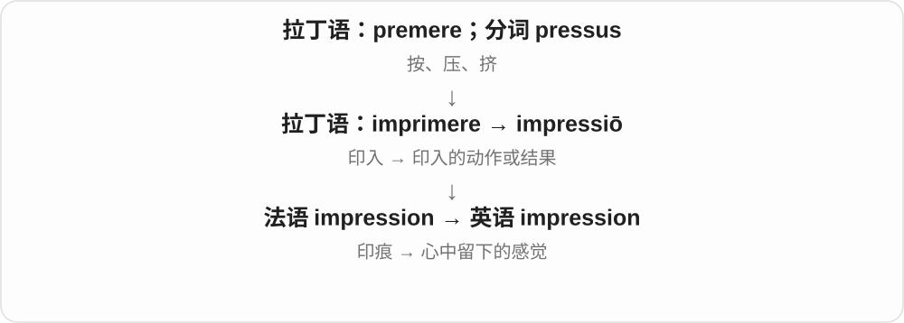

a first impression 是初印象；be under the impression that 是一直以为，可能误解。do an impression of someone 是模仿他的声音或举止。

**常见搭配与例句**

make an impression；give the impression；a convincing impression。

> My first impression was that the office was very welcoming.

我的第一印象是这间办公室让人感到很亲切。

> He does a funny impression of our old teacher.

他模仿我们以前的老师，十分有趣。

**别混淆**

impression 是主观印象，不自动等于事实；expression 更强调内在意思怎样表现出来。

### 13. impressionable — 容易受影响的；易受感染的

**音标**：英 /ɪmˈpreʃənəbəl/；美 /ɪmˈpreʃənəbəl/

**先抓住这个画面**

像还软的泥，别人的言行很容易在心里留下形状。

**怎么拆**

来自法语 impressionnable，与 impression 词族相关；现代可看作 impression + -able。

**怎么变成今天的意思**

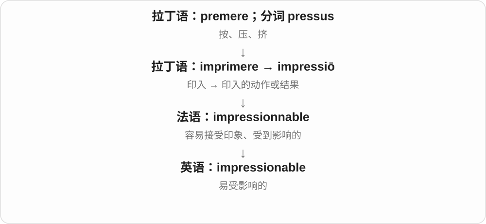

常形容年轻人或容易被强烈体验影响的人。并非称赞对方特别值得留下印象。

**常见搭配与例句**

an impressionable child；at an impressionable age。

> The story made a strong impact on me at an impressionable age.

在我容易受影响的年纪，那个故事给了我很大触动。

> The teacher was aware of her influence on impressionable students.

老师知道自己会影响那些容易受感染的学生。

**别混淆**

impressive 是让别人受影响；impressionable 是自己容易受影响。

### 14. impressionism — 印象主义；印象派艺术

**音标**：英 /ɪmˈpreʃənɪzəm/；美 /ɪmˈpreʃənɪzəm/

**先抓住这个画面**

画家不一定把每条轮廓都描得清清楚楚，而是抓住光线、色彩和眼前一瞬间的观感。

**怎么拆**

借自法语 impressionnisme；名称与莫奈画作 Impression, soleil levant 及当时评论中的称呼有关。

**怎么变成今天的意思**

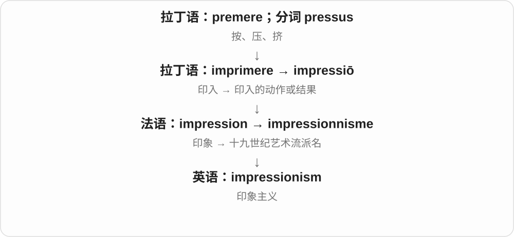

最熟悉的是绘画，也可用于音乐等艺术的相关风格。不是把所有画得模糊的画都叫印象派。

**常见搭配与例句**

French impressionism；the development of impressionism。

> The exhibition traces the development of impressionism.

展览追溯印象主义的发展。

> Her course focuses on light and colour in impressionism.

她的课程着重讲印象派中的光与色。

**别混淆**

impressionism 侧重观看世界时的光色感受；expressionism 更强调用形式表现内在情绪。

### 15. impressionist — 印象派艺术家；模仿表演者；印象派的

**音标**：英 /ɪmˈpreʃənɪst/；美 /ɪmˈpreʃənɪst/

**先抓住这个画面**

艺术里是抓光色印象的人；舞台上也可指抓住某人标志性声音、神态来模仿的人。

**怎么拆**

艺术名词借自法语 impressionniste；表演者义则与英语 impression“模仿”加 -ist 相联系。

**怎么变成今天的意思**

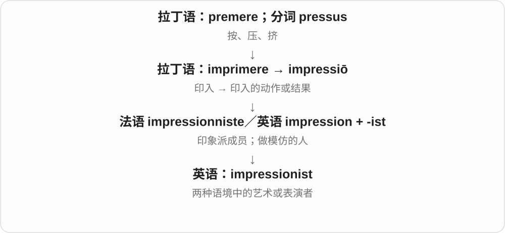

看搭配：an impressionist painter 是印象派画家；a celebrity impressionist 是模仿名人的艺人。

**常见搭配与例句**

impressionist painting；an impressionist comedian。

> The museum owns several impressionist paintings.

博物馆藏有几幅印象派画作。

> The impressionist copied the presenter’s voice perfectly.

那位模仿艺人把主持人的声音学得惟妙惟肖。

**别混淆**

impressionist 不一定是画家，碰到喜剧舞台时应想到模仿表演。

### 16. impressionistic — 印象派风格的；凭总体感受描绘的

**音标**：英 /ɪmˌpreʃəˈnɪstɪk/；美 /ɪmˌpreʃəˈnɪstɪk/

**先抓住这个画面**

不给你完整测量表，而是用几笔把当时的氛围、光色和感受带出来。

**怎么拆**

impressionist + -ic，或 impression + -istic；艺术风格义扩展到一般叙述方式。

**怎么变成今天的意思**

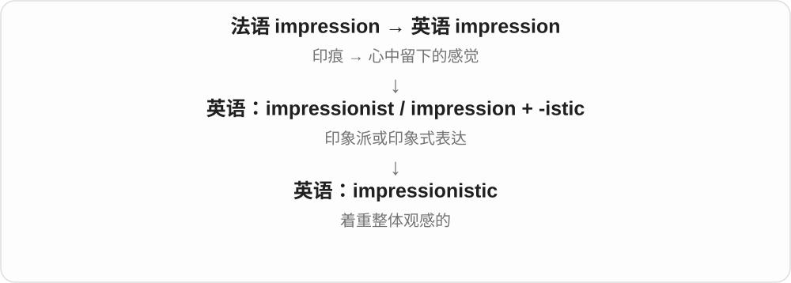

an impressionistic account 可能生动，却未必系统、全面。用于批评研究时，常暗示缺少扎实资料。

**常见搭配与例句**

an impressionistic sketch；an impressionistic account。

> The essay gives an impressionistic account of life in the city.

这篇文章以印象式笔法描绘城市生活。

> Her use of light gives the scene an impressionistic quality.

她对光线的处理让画面带有印象派的味道。

**别混淆**

impressionistic 强调印象式描绘；impressive 只是令人赞叹，没有相同的艺术含义。

### 17. impressed — 印象深刻的；赞叹的

**音标**：英 /ɪmˈprest/；美 /ɪmˈprest/

**先抓住这个画面**

别人做出的东西已经在你心里留下分量，你觉得“这确实不错”。

**怎么拆**

impress + -ed；过去分词描述接受影响后的状态。

**怎么变成今天的意思**

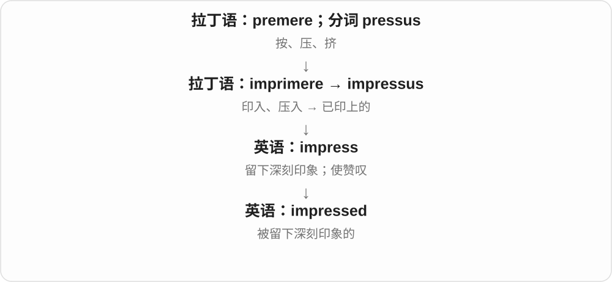

常说 be impressed by/with；用于人时通常带欣赏，不只是记得某件事。

**常见搭配与例句**

impressed by the results；impressed with her work。

> I was impressed by how calmly she handled the problem.

她处理问题时那么冷静，让我很佩服。

> The visitors were impressed with the new library.

参观者对新图书馆赞叹不已。

**别混淆**

impressed 是感受的一方；impressive 是产生这种感受的一方。

### 18. unimpressed — 不以为然的；没有被打动的

**音标**：英 /ˌʌnɪmˈprest/；美 /ˌʌnɪmˈprest/

**先抓住这个画面**

对方拿出了自以为很厉害的东西，你看完却觉得“也就这样”。

**怎么拆**

un- 否定 impressed。

**怎么变成今天的意思**

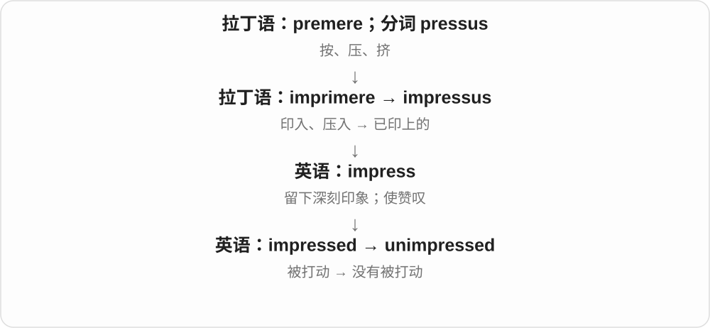

可以明确表示评价不高，也可以只是没有表现出赞赏。并不一定完全没注意到。

**常见搭配与例句**

remain unimpressed；look unimpressed；unimpressed by the excuse。

> The manager remained unimpressed by the vague promises.

经理对这些空泛的承诺仍不以为然。

> She looked unimpressed when I showed her the expensive gadget.

我给她看那个昂贵的小装置时，她看起来没被打动。

**别混淆**

unimpressed 说人的反应；unimpressive 说事物本身不出色。

### 19. depress — 压下；降低；使沮丧

**音标**：英 /dɪˈpres/；美 /dɪˈpres/

**先抓住这个画面**

原来在较高的位置，被往下按：按钮下去，价格下降，心情也像沉了下去。

**怎么拆**

拉丁语 de- 向下 + premere → deprimere、depressus，经法语等路线进入英语。

**怎么变成今天的意思**

depress a pedal 是踩下踏板；depress prices 是压低价格；depress someone 是让人情绪低落。具体对象决定含义。

**常见搭配与例句**

depress the pedal；depress demand；depress morale。

> The bad news depressed everyone in the room.

坏消息让房间里的每个人都心情低落。

> An oversupply can depress prices.

供应过多可能压低价格。

**别混淆**

depress 是使低下；oppress 常说不公正地压迫人；suppress 是把显露或发展压住。

### 20. depression — 凹陷；低气压；经济萧条；抑郁

**音标**：英 /dɪˈpreʃən/；美 /dɪˈpreʃən/

**先抓住这个画面**

把“往下沉”放到不同场景：地面低一块，经济活动低迷，情绪与生活功能也可能长期受影响。

**怎么拆**

经法语 depression 来自拉丁语 depressiō，与 deprimere 同族；名词不是在现代英语里临时拼出来的。

**怎么变成今天的意思**

a depression in the ground 是洼地；an economic depression 是严重经济萧条。医学里的 depression 是抑郁症相关用语，不能与一次普通失落直接画等号。

**常见搭配与例句**

a shallow depression；an economic depression；clinical depression。

> Rainwater collected in a shallow depression in the ground.

雨水积在地面一处浅浅的凹陷里。

> The book describes everyday life during the Great Depression.

这本书描写大萧条时期的日常生活。

**别混淆**

recession 通常指经济衰退；depression 一般表示更严重、持续更久的萧条，但没有各机构通用的唯一数值界线。

### 21. depressed — 情绪低落的；低迷的；凹下的

**音标**：英 /dɪˈprest/；美 /dɪˈprest/

**先抓住这个画面**

从平常状态往下沉了一截，可以是心情、市场，也可以是表面的位置。

**怎么拆**

depress + -ed，过去分词描述被压低后的状态。

**怎么变成今天的意思**

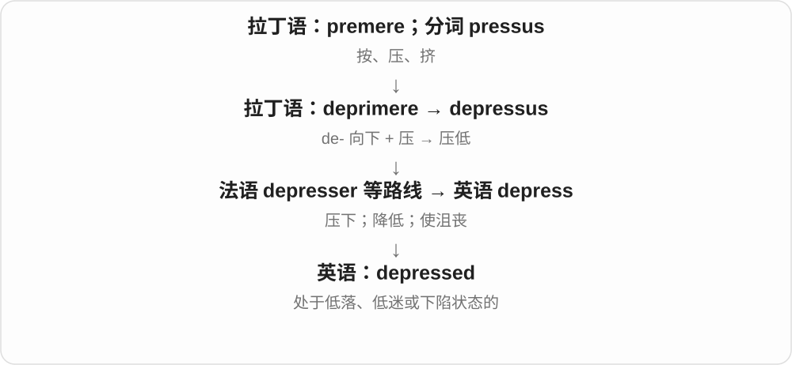

feel depressed 在日常可能只是非常沮丧；医学语境另有具体含义。a depressed area 可以指经济困难地区。

**常见搭配与例句**

feel depressed；a depressed market；depressed prices。

> She felt depressed after several unsuccessful interviews.

几次面试失利后，她感到很沮丧。

> House prices remained depressed for several years.

房价持续低迷了好几年。

**别混淆**

depressed 常描述承受结果的一方；depressing 描述造成低落的事物。

### 22. depressing — 令人沮丧的；让人心情低落的

**音标**：英 /dɪˈpresɪŋ/；美 /dɪˈpresɪŋ/

**先抓住这个画面**

这件事使人心里一沉，提不起劲来。

**怎么拆**

depress + -ing，分词形容词表示造成低落的作用。

**怎么变成今天的意思**

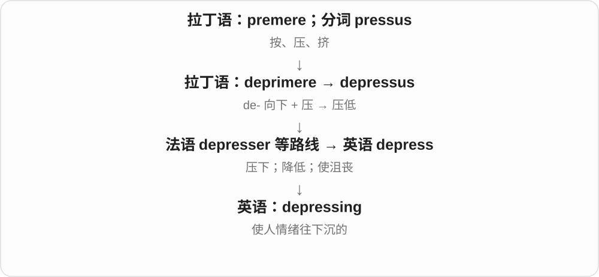

可以形容新闻、天气、环境或前景。说一件事 depressing，并不等于在作医学诊断。

**常见搭配与例句**

depressing news；a depressing thought；find something depressing。

> It is depressing to see the old theatre standing empty.

看到老剧院空着不用，真让人失落。

> The report paints a depressing picture of the local economy.

报告描绘出的当地经济状况令人沮丧。

**别混淆**

The news is depressing，听新闻的人可能 feel depressed：一个是原因，一个是感受。

### 23. depressive — 抑郁相关的；有抑郁特征的

**音标**：英 /dɪˈpresɪv/；美 /dɪˈpresɪv/

**先抓住这个画面**

把注意力放到持续的抑郁状态或相关表现，而不是只说某件事让人扫兴。

**怎么拆**

来自法语 dépressif 或中世纪拉丁语 depressivus，与 depressus 同族；现代可看出 depress + -ive。

**怎么变成今天的意思**

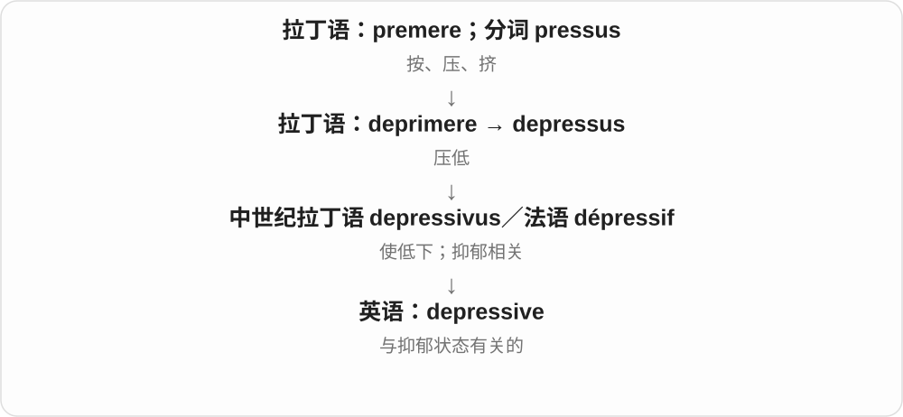

最常见于 depressive symptoms、depressive episode 等专业搭配。名词指人也见于旧文，但通常用形容词描述状态更清楚。

**常见搭配与例句**

depressive symptoms；a depressive episode；depressive illness。

> The questionnaire asked about depressive symptoms.

问卷询问了抑郁相关症状。

> The article distinguishes a depressive episode from a brief period of sadness.

文章区分了抑郁发作与短暂的难过。

**别混淆**

depressing news 是令人沮丧的消息；depressive symptoms 是抑郁相关症状，不能随便互换。

### 24. depressant — 抑制剂；降低某种活动的物质；抑制性的

**音标**：英 /dɪˈpresənt/；美 /dɪˈpresənt/

**先抓住这个画面**

把某种身体活动的“转速”往下调。这里的压低，通常不是指把人的情绪变坏。

**怎么拆**

depress 降低 + -ant 执行作用的事物。

**怎么变成今天的意思**

central nervous system depressant 指抑制中枢神经系统活动的物质。这个分类按作用说，不是“让人抑郁的药”。

**常见搭配与例句**

a nervous system depressant；depressant effects。

> The textbook describes alcohol as a central nervous system depressant.

教科书把酒精描述为一种中枢神经系统抑制物质。

> The glossary explains the term depressant in its pharmacological sense.

词汇表解释了 depressant 在药理学中的含义。

**别混淆**

depressant 与 antidepressant 不是简单的正反药物：前者强调降低神经等活动，后者按用于治疗抑郁来命名。

### 25. antidepressant — 抗抑郁药；抗抑郁的

**音标**：英 /ˌæntidɪˈpresənt/；美 /ˌæntidɪˈpresənt/

**先抓住这个画面**

名字按用途说：用于对抗、治疗抑郁，而不是单纯把人的神经活动调快。

**怎么拆**

anti- 对抗 + depressant 词形；这里整体成为治疗抑郁的药物类别名称，不能按每段字面推出全部药理。

**怎么变成今天的意思**

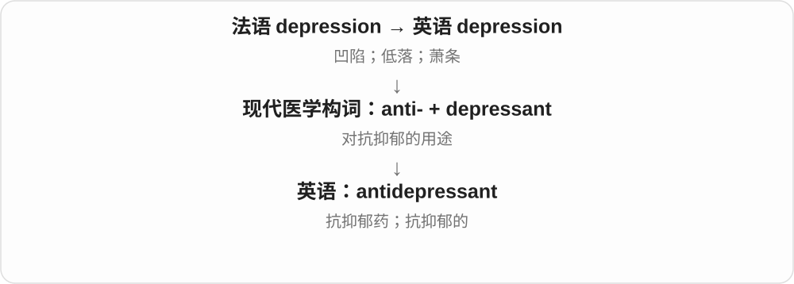

既可作药物名词，也可修饰 treatment 等名词。分类名称说明一类用途，不代表所有具体药物机制相同。

**常见搭配与例句**

an antidepressant；antidepressant medication；antidepressant treatment。

> The study compared two antidepressant treatments.

研究比较了两种抗抑郁治疗。

> The glossary lists antidepressant as both a noun and an adjective.

词汇表把 antidepressant 同时列为名词和形容词。

**别混淆**

antidepressant 不是简单等于 stimulant“兴奋剂”，也不是 depressant“抑制剂”的机械反义词。

### 26. repress — 压抑；压制；遏制

**音标**：英 /rɪˈpres/；美 /rɪˈpres/

**先抓住这个画面**

某种感受或行动想冒出来，又被按回去。

**怎么拆**

拉丁语 re- 向回 + premere → reprimere，分词 repressus 借入英语。

**怎么变成今天的意思**

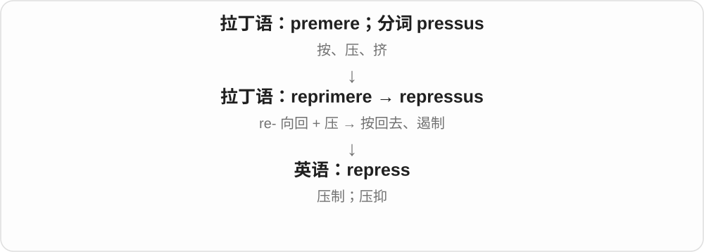

日常可说 repress anger 或 repress a movement。精神分析里的术语义专指把令人不安的内容挡在意识之外，不能把所有日常“忍住”都当这一理论术语。

**常见搭配与例句**

repress feelings；repress dissent；repressed anger。

> He had learned to repress his anger rather than talk about it.

他学会了把愤怒压在心里，而不是谈出来。

> The government tried to repress the growing movement.

政府试图压制日益扩大的运动。

**别混淆**

心理学术语常把 repression 的无意识过程与 suppression 的有意识控制区分；一般英语中的两词范围会重叠。

### 27. repression — 压制；压抑

**音标**：英 /rɪˈpreʃən/；美 /rɪˈpreʃən/

**先抓住这个画面**

把某种表达、活动或心理内容按回去，这种持续的控制就是 repression。

**怎么拆**

可能由英语 repress 派生，也可能借自中世纪拉丁语 repressiō；不能确定地画成先有英语动词、再有法语名词。

**怎么变成今天的意思**

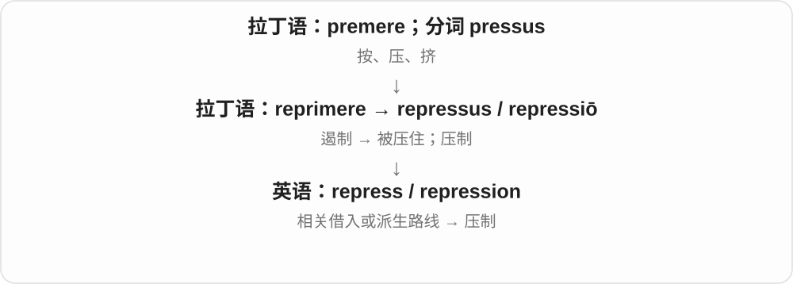

political repression 是政治压制；emotional repression 是情感压抑。精神分析中的专门含义属于特定理论框架。

**常见搭配与例句**

political repression；repression of dissent；emotional repression。

> The memoir describes years of censorship and repression.

回忆录描写了多年审查与压制的生活。

> The chapter compares repression with conscious emotional control.

这一章比较了压抑与有意识的情绪控制。

**别混淆**

repression 是压抑或压制；depression 是低落、凹陷等状态。相近拼写并不等于相同概念。

### 28. repressive — 压制性的；限制自由的

**音标**：英 /rɪˈpresɪv/；美 /rɪˈpresɪv/

**先抓住这个画面**

不让声音出来、不让人自由行动，靠持续压制维持控制。

**怎么拆**

经古法语 repressif 或直接借自中世纪拉丁语 repressivus，根在 reprimere“遏制”的分词词干 repress-；现代可对照 repress + -ive。

**怎么变成今天的意思**

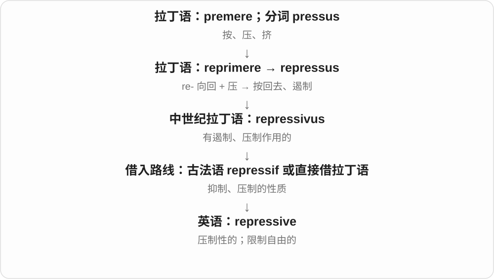

常修饰 laws、regime、measures，带明显负面评价；不是任何严格要求都自然叫 repressive。

**常见搭配与例句**

repressive laws；a repressive regime；repressive measures。

> The report criticized the country’s repressive laws.

报告批评了该国压制自由的法律。

> The novel explores life under a repressive regime.

小说探讨了压制性政权下的生活。

**别混淆**

repressive 着重限制表达和自由；oppressive 更宽地说沉重、不公正的压迫。

### 29. irrepressible — 压不住的；抑制不住的

**音标**：英 /ˌɪrɪˈpresəbəl/；美 /ˌɪrɪˈpresəbəl/

**先抓住这个画面**

像弹性很强的东西，刚按下去又弹起来：热情、好奇心、笑意都能这样。

**怎么拆**

in- 否定在 r 前同化成 ir-，接 repressible“可压抑的”；不是 re- 表“再一次”的重复。

**怎么变成今天的意思**

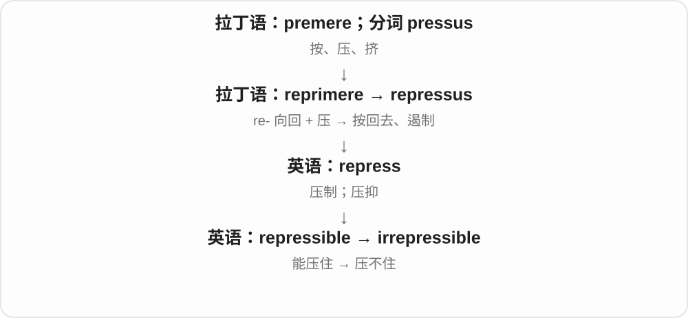

常带欣赏语气，形容旺盛活力、热情或幽默感。也可以说抑制不住的冲动。

**常见搭配与例句**

irrepressible enthusiasm；irrepressible curiosity；an irrepressible grin。

> Her irrepressible enthusiasm lifted everyone’s spirits.

她那压不住的热情让大家都振作起来。

> He answered with an irrepressible grin.

他回答时，忍不住咧嘴笑了。

**别混淆**

irrepressible 是压不住；irresponsible 是不负责任，两词只是在开头看起来有点像。

### 30. express — 表达；挤出；明确的；特快的

**音标**：英 /ɪkˈspres/；美 /ɪkˈspres/

**先抓住这个画面**

把里面的东西带到外面：把汁液挤出来，也把想法、情绪表现出来。

**怎么拆**

动词经法语等路线来自拉丁语 exprimere，ex- 向外 + premere。形容词来自其分词 expressus，经法语 expres。

**怎么变成今天的意思**

express an opinion 是表达意见。express permission 是明确许可；express delivery 的快递义经过“专门、直接运送”发展，不能简单解释成“挤得快”。

**常见搭配与例句**

express concern；express yourself；express permission；an express train。

> She found it difficult to express her feelings in words.

她发现很难用语言表达自己的感受。

> We took an express train to the airport.

我们乘特快列车去了机场。

**别混淆**

express 不保证情绪激烈：平静地说一句感谢，也是在 express thanks。

### 31. expression — 表达；说法；表情；表达式；基因表达

**音标**：英 /ɪkˈspreʃən/；美 /ɪkˈspreʃən/

**先抓住这个画面**

心里的内容找到了一个外面的样子：一句话、一张脸上的神情，或一串表示关系的符号。

**怎么拆**

经法语 expression 来自拉丁语 expressiō，与 exprimere 同族；不是只有英语 express 加 -ion 这一层历史。

**怎么变成今天的意思**

an expression of gratitude 是表达感谢；a puzzled expression 是疑惑的表情；数学 expression 可为 2x + 3，不一定含等号。生物学里指基因信息被用于产生 RNA 或蛋白质等产物的过程。

**常见搭配与例句**

facial expression；freedom of expression；a mathematical expression。

> Her expression changed when she heard the news.

她听到消息时，表情变了。

> The expression “a piece of cake” means that something is easy.

“a piece of cake”这个说法表示某件事很容易。

**别混淆**

expression 是表现出来的样子；impression 是它在别人心中留下的感觉。

### 32. expressionism — 表现主义

**音标**：英 /ɪkˈspreʃənɪzəm/；美 /ɪkˈspreʃənɪzəm/

**先抓住这个画面**

画面可以故意变形、颜色可以不自然，因为艺术家想让你感到内心的焦虑、冲动或强烈情绪。

**怎么拆**

近代艺术名词，来自法语 expressionnisme 等欧洲艺术语境；现代结构是 expression + -ism。

**怎么变成今天的意思**

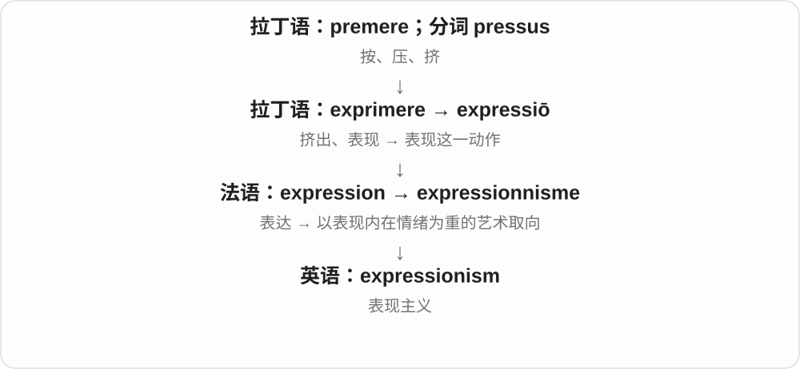

用于绘画、戏剧、电影等艺术。关键是主观感受对形式的塑造，不是只要“有表达”就算表现主义。

**常见搭配与例句**

German expressionism；expressionism in film。

> The course explores expressionism in painting and film.

课程探讨绘画和电影中的表现主义。

> Distorted shapes can convey intense emotion in expressionism.

在表现主义中，变形的形状可以传达强烈情绪。

**别混淆**

impressionism 常关注眼前光色印象；expressionism 更强调把内在感受推到画面或舞台上。

### 33. expressionist — 表现主义艺术家；表现主义的

**音标**：英 /ɪkˈspreʃənɪst/；美 /ɪkˈspreʃənɪst/

**先抓住这个画面**

把内心的感受变成强烈形式的人，或具有这种艺术风格的作品。

**怎么拆**

expression + -ist，与 expressionism 同属近代艺术用语，-ist 表示参与者或相关风格。

**怎么变成今天的意思**

可以作名词，也能修饰 painter、film、drama。不是泛指善于说话、表情丰富的人。

**常见搭配与例句**

an expressionist painter；expressionist drama。

> She wrote an essay on an expressionist painter.

她写了一篇关于一位表现主义画家的文章。

> The film uses expressionist sets to create unease.

影片运用表现主义布景营造不安感。

**别混淆**

expressive 是有表现力；expressionist 是与特定艺术取向有关。

### 34. expressionless — 面无表情的

**音标**：英 /ɪkˈspreʃənləs/；美 /ɪkˈspreʃənləs/

**先抓住这个画面**

你看着他的脸，却找不到明显的高兴、难过或惊讶的信号。

**怎么拆**

expression 表情 + -less 没有。

**怎么变成今天的意思**

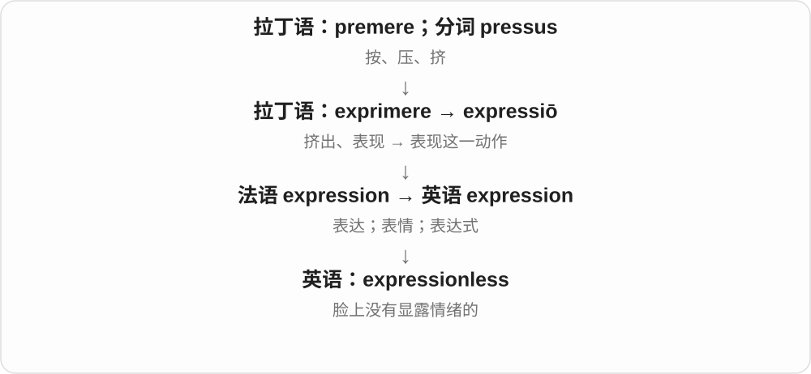

形容可见的表情，而不是断言对方心里没有感受。可故意保持，也可因疲劳或震惊出现。

**常见搭配与例句**

an expressionless face；remain expressionless。

> She listened with an expressionless face.

她面无表情地听着。

> His face remained expressionless throughout the interview.

整个访谈中，他脸上都没有显露明显情绪。

**别混淆**

expressionless 是脸上没显出来；emotionless 更像在说没有情感或显得冷漠，判断更强。

### 35. overexpression — 过度表达；基因过表达

**音标**：英 /ˌəʊvərɪkˈspreʃən/；美 /ˌoʊvərɪkˈspreʃən/

**先抓住这个画面**

把“表达量”这个旋钮转得比参照水平更高，产生了更多相应产物。

**怎么拆**

over- 过量 + expression 表达；生物学将它用于基因表达量偏高。

**怎么变成今天的意思**

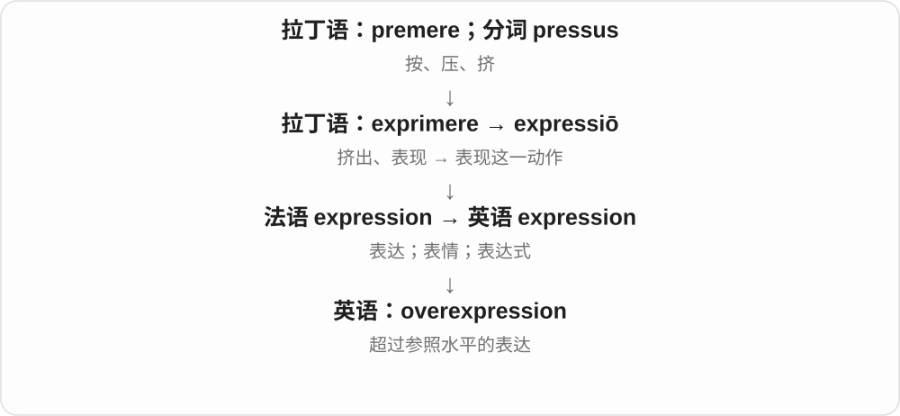

研究中常指某基因产生的 RNA 或蛋白质较多。比较对象和测量方法要看具体实验；不是说 DNA 的字母被读错。

**常见搭配与例句**

gene overexpression；overexpression of a protein。

> The study measured overexpression of the gene in these cells.

研究测量了这些细胞中该基因的过表达情况。

> The researchers compared normal expression with overexpression.

研究者比较了正常表达与过表达。

**别混淆**

overexpression 是表达量多；mutation 是遗传序列发生变化，不是同一件事。

### 36. expressly — 明确地；专门地

**音标**：英 /ɪkˈspresli/；美 /ɪkˈspresli/

**先抓住这个画面**

要么把话说得明明白白，要么说明某件事就是专门为这个目的安排的。

**怎么拆**

express 的“明确、专门”形容词义 + -ly，不是由特快义推出“快速地”。

**怎么变成今天的意思**

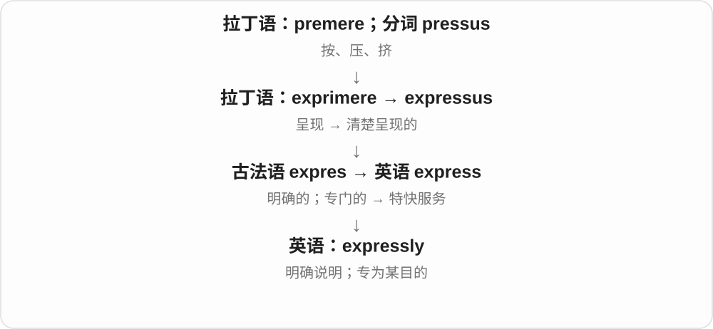

expressly forbidden 是明令禁止；made expressly for children 是专门为儿童制作。

**常见搭配与例句**

expressly stated；expressly prohibited；expressly for…。

> The rules expressly forbid smoking in the building.

规定明确禁止在楼内吸烟。

> This game was designed expressly for young children.

这个游戏是专为幼儿设计的。

**别混淆**

expressly 不等于 quickly。He came expressly to see you 是他专程来看你。

### 37. expressive — 富有表现力的；能表现某种感受的

**音标**：英 /ɪkˈspresɪv/；美 /ɪkˈspresɪv/

**先抓住这个画面**

还没解释很多，你的眼神、声音或动作已经把意思传达出来。

**怎么拆**

来自法语 expressif，与拉丁语 exprimere、expressus 同族；现代可看出 express + -ive。

**怎么变成今天的意思**

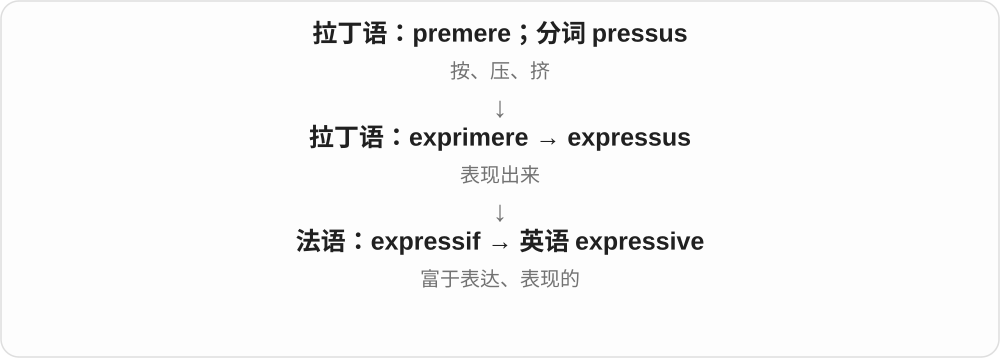

expressive eyes 是会传情的眼睛；expressive of joy 是表现出喜悦。也可形容音乐或艺术，而不只形容外向的人。

**常见搭配与例句**

an expressive face；expressive language；expressive of…。

> The actor has a remarkably expressive face.

那位演员的面部表情非常丰富。

> Her gestures were expressive of relief.

她的动作显出如释重负的感觉。

**别混淆**

expressive 强调表达得出来；impressive 强调使别人赞叹，表达丰富未必等于效果出色。

### 38. expressiveness — 表现力；传达情感的能力

**音标**：英 /ɪkˈspresɪvnəs/；美 /ɪkˈspresɪvnəs/

**先抓住这个画面**

同样一句话，有的人能让你听见温柔、愤怒或犹豫；这种传达出来的力量就是 expressiveness。

**怎么拆**

expressive + -ness，把性质变为名词。

**怎么变成今天的意思**

可谈声音、动作、绘画和音乐。有表现力不一定声音大、动作多，细微的停顿也能做到。

**常见搭配与例句**

the expressiveness of her voice；emotional expressiveness。

> The singer is admired for the expressiveness of her voice.

这位歌手因声音富有表现力而受到欣赏。

> A small change in posture can add expressiveness to a drawing.

姿势上的一点变化就能让画面更有表现力。

**别混淆**

expression 可以是一种具体表情或说法；expressiveness 是表达能力这一性质。

### 39. expressway — 快速公路；高速通行道路

**音标**：英 /ɪkˈspresweɪ/；美 /ɪkˈspresweɪ/

**先抓住这个画面**

减少普通街道上的频繁停停走走，让车流更直接地通过。

**怎么拆**

express 快速、直达 + way 道路，是英语复合词。

**怎么变成今天的意思**

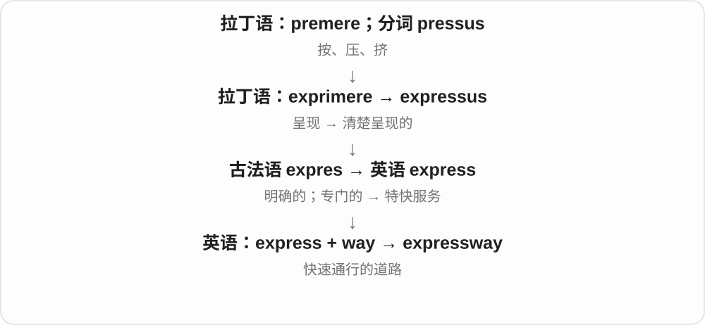

常见于北美、亚洲等地的道路名称。具体是否完全封闭、出入口如何设计，要看当地道路制度。

**常见搭配与例句**

an elevated expressway；take the expressway。

> We took the expressway to avoid the city centre.

我们走快速公路，绕开了市中心。

> Traffic slowed on the expressway during the evening rush.

晚高峰时，快速公路上的车流慢了下来。

**别混淆**

expressway、freeway、motorway 在不同地区的命名不完全一一对应，不能只靠汉译判断道路标准。

### 40. inexpressible — 难以言表的

**音标**：英 /ˌɪnɪkˈspresəbəl/；美 /ˌɪnɪkˈspresəbəl/

**先抓住这个画面**

感受已经有了，但找不到足够准确、有分量的话把它说出来。

**怎么拆**

in- 否定 + expressible 可表达的；expressible 属 express + -ible 词族。

**怎么变成今天的意思**

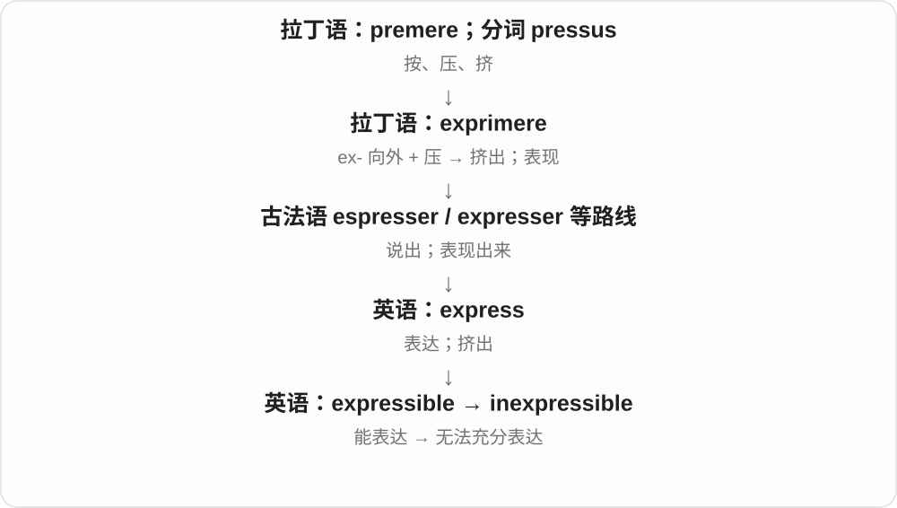

常修饰 joy、relief、grief 等强烈感受，语气较书面。通常是“语言说不尽”，而非真的不能发声。

**常见搭配与例句**

inexpressible joy；inexpressible relief。

> She felt inexpressible relief when the child was found safe.

得知孩子平安找到后，她感到难以言表的宽慰。

> The music gave shape to an otherwise inexpressible sadness.

音乐让一种原本难以言说的悲伤有了形状。

**别混淆**

inexpressible 强调表达不尽；expressionless 是脸上没显出情绪。

### 41. print — 打印；印刷；印痕；印刷字体

**音标**：英 /prɪnt/；美 /prɪnt/

**先抓住这个画面**

把有颜色或形状的东西按到另一个表面上，留下可见的痕迹。后来用机器输出文字图片，也叫 print。

**怎么拆**

名词经古法语 preinte“压出的印记”来自 premere；动词与名词及 emprinten 的缩短形式有关，历史并非只有一条简单后缀路线。

**怎么变成今天的意思**

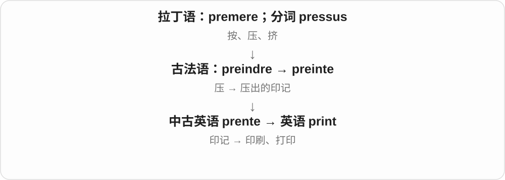

print a document 是打印文件；a print 可以是一张版画或照片。Please print your name 要求用清楚、分开的字母填写，不是必须用打印机。

**常见搭配与例句**

in print；out of print；small print；print your name。

> Please print your name clearly at the top of the form.

请在表格顶部用清楚的印刷体填写姓名。

> The book is still in print after fifty years.

五十年后，这本书仍在出版发行。

**别混淆**

print 是留下或输出可见内容；publish 是公开发表。一本书能打印出来，却还没有出版。

### 42. printing — 印刷；打印；一次印次

**音标**：英 /ˈprɪntɪŋ/；美 /ˈprɪntɪŋ/

**先抓住这个画面**

把文字图像批量复制到纸上，这项工作或这一轮生产就是 printing。

**怎么拆**

print + -ing，动作名词化；具体的一次印刷又发展出印次义。

**怎么变成今天的意思**

printing costs 是印刷费用；the third printing 是第三次印刷，不保证内容已经修订。

**常见搭配与例句**

printing costs；digital printing；a second printing。

> The publisher reduced printing costs by changing the paper.

出版社通过更换纸张降低了印刷成本。

> The novel reached its third printing within a month.

这部小说一个月内就印到了第三次。

**别混淆**

printing 是印次；edition 是版本。重新印一批，可以仍是同一版本。

### 43. printer — 打印机；印刷工；印刷商

**音标**：英 /ˈprɪntə/；美 /ˈprɪntər/

**先抓住这个画面**

负责把内容印出来的，可以是人、公司，也可以是桌上的机器。

**怎么拆**

print + -er；先可指从事印刷的人，后来也指执行打印的设备。

**怎么变成今天的意思**

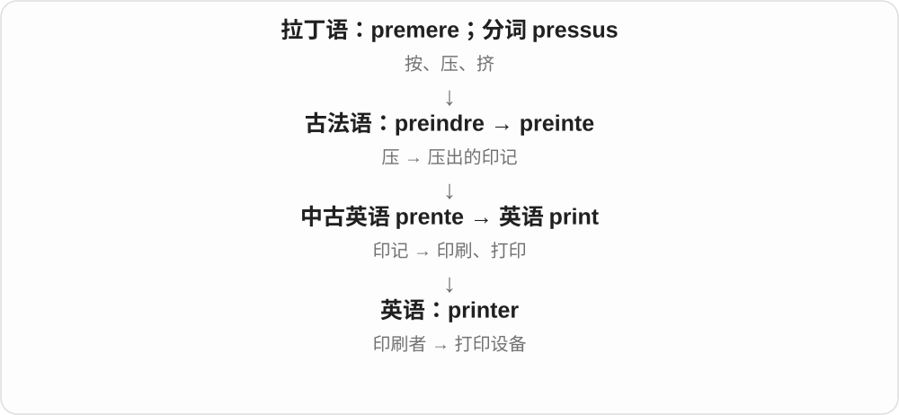

现代日常最常见的是打印机；a commercial printer 也可能指商业印刷商，要看是否在谈人、公司或机器。

**常见搭配与例句**

an inkjet printer；a laser printer；send files to the printer。

> The printer has run out of paper.

打印机没纸了。

> The publisher sent the final files to the printer.

出版社把定稿文件交给了印刷商。

**别混淆**

printer 负责印制，publisher 负责出版业务；两者可能合作，但职责不同。

### 44. printable — 可打印的；适宜刊印的

**音标**：英 /ˈprɪntəbəl/；美 /ˈprɪntəbəl/

**先抓住这个画面**

内容已经准备好，能够或适合被印出来。

**怎么拆**

print + -able 可……的。

**怎么变成今天的意思**

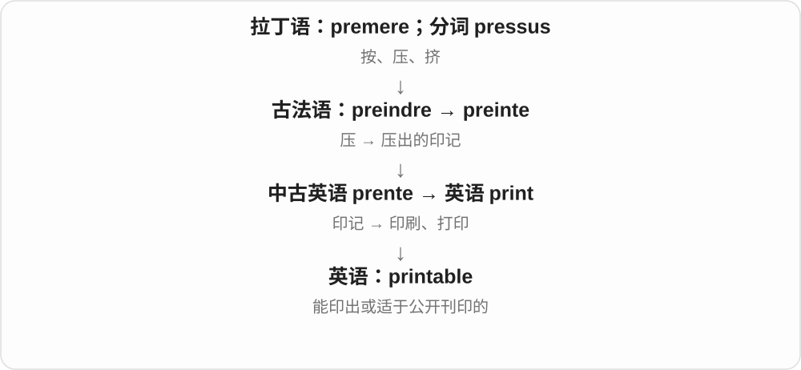

a printable worksheet 是可打印练习纸；a printable character 是能显示为可见符号的字符。语境也可讨论内容是否适合公开。

**常见搭配与例句**

a printable version；printable characters；a printable worksheet。

> The website provides a printable version of the timetable.

网站提供了可打印的时间表版本。

> The form accepts only printable characters.

这个表单只接受可显示的字符。

**别混淆**

printable 只说能否、是否适合打印；printed 是已经印出来。

### 45. printmaking — 版画制作；版画艺术

**音标**：英 /ˈprɪntmeɪkɪŋ/；美 /ˈprɪntmeɪkɪŋ/

**先抓住这个画面**

先在木板、金属板或其他载体上做图，再把图像转印到纸等表面上。

**怎么拆**

print 版画、印制图像 + making 制作，现代英语组合。

**怎么变成今天的意思**

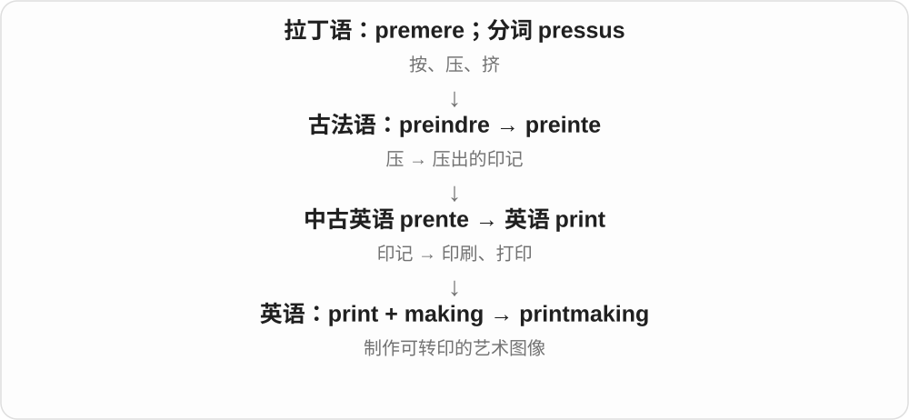

包含木刻、蚀刻、丝网等不同方法。重点是作为艺术制作的媒介与过程，不只是在办公室按打印按钮。

**常见搭配与例句**

a printmaking workshop；traditional printmaking techniques。

> She learned printmaking at art school.

她在艺术学校学习了版画制作。

> The workshop introduces several printmaking techniques.

工作坊介绍几种版画技法。

**别混淆**

printing 泛指印刷；printmaking 通常指版画艺术的创作。

### 46. printmaker — 版画家；版画制作艺术家

**音标**：英 /ˈprɪntmeɪkə/；美 /ˈprɪntmeɪkər/

**先抓住这个画面**

通过制版和转印创作图像的人，而不是泛指开打印店的人。

**怎么拆**

print 版画 + maker 制作者，与 printmaking 成对。

**怎么变成今天的意思**

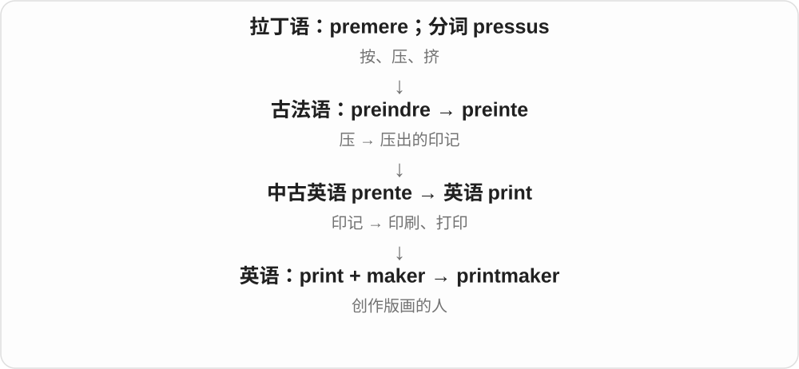

艺术职业名称，既可以设计图像，也可以探索材料与印制方式。

**常见搭配与例句**

an accomplished printmaker；a painter and printmaker。

> The exhibition features work by local printmakers.

展览展出了当地版画家的作品。

> She is both a painter and a printmaker.

她既是画家，也是版画家。

**别混淆**

printer 常指印刷工、印刷商或打印机；printmaker 强调艺术创作者。

### 47. unprintable — 不宜刊登的；无法打印的

**音标**：英 /ʌnˈprɪntəbəl/；美 /ʌnˈprɪntəbəl/

**先抓住这个画面**

一种是技术上印不出来，另一种是话太粗俗或冒犯，不适合原样刊出来。

**怎么拆**

un- 否定 printable。

**怎么变成今天的意思**

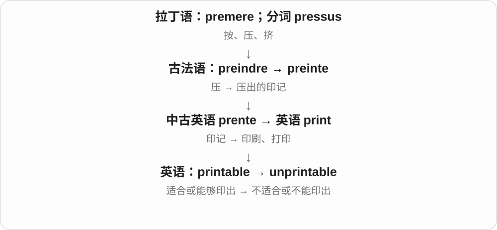

日常说 an unprintable remark，通常委婉表示一句不便照写的粗话；不是说打印机坏了。

**常见搭配与例句**

an unprintable comment；unprintable language。

> His reply was brief and unprintable.

他的回答很短，但粗俗得不便照登。

> The damaged font made some symbols unprintable.

损坏的字体使某些符号无法打印。

**别混淆**

unprintable 常说内容不宜公开；illegible 是字迹看不清，问题不同。

### 48. footprint — 脚印；占地；留下的影响

**音标**：英 /ˈfʊtprɪnt/；美 /ˈfʊtprɪnt/

**先抓住这个画面**

脚离开后，地上的印子还在。于是一个物体占多少地方、一种活动留下多大影响，也借这个画面来讲。

**怎么拆**

foot 脚 + print 印痕，英语复合词；由实在脚印扩展出空间和影响义。

**怎么变成今天的意思**

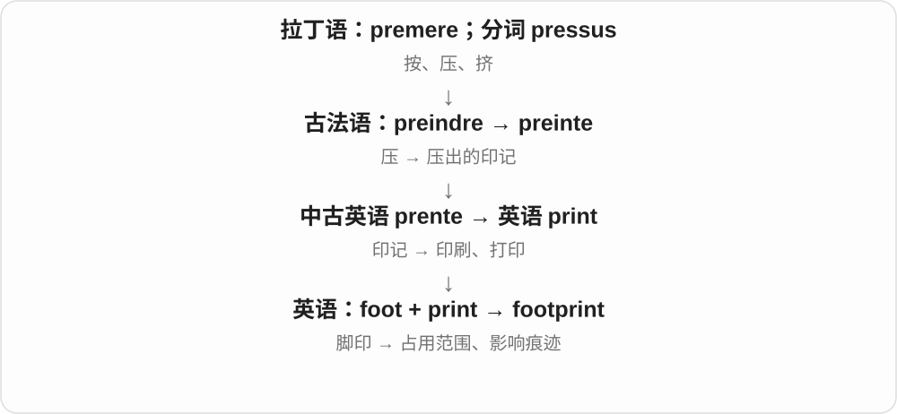

a building’s footprint 是建筑占地轮廓；carbon footprint 是碳足迹；digital footprint 是数字活动留下的记录与痕迹。

**常见搭配与例句**

leave footprints；a small footprint；a digital footprint。

> We followed the footprints across the snow.

我们沿着雪地上的脚印走。

> The new machine has a smaller footprint than the old one.

新机器比旧机器占地更小。

**别混淆**

footprint 不一定有脚：软件的 memory footprint 是内存占用。

### 49. fingerprint — 指纹；识别特征；采集指纹

**音标**：英 /ˈfɪŋɡəprɪnt/；美 /ˈfɪŋɡərprɪnt/

**先抓住这个画面**

手指留下的纹路像一组特征，也使这个词能比喻辨认某个来源的独特模式。

**怎么拆**

finger 手指 + print 印痕；名词后来也转为动词。

**怎么变成今天的意思**

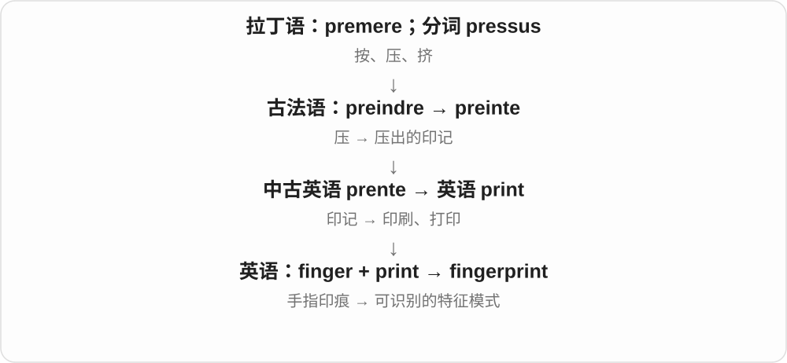

实际指纹是皮肤纹路留下的图样；digital fingerprint 等技术表达强调用于识别的一组特征，不是电脑真有手指。

**常见搭配与例句**

fingerprint recognition；leave fingerprints；a chemical fingerprint。

> The glass was covered with fingerprints.

玻璃上满是指纹。

> The laboratory compared the samples’ chemical fingerprints.

实验室比较了这些样品的化学特征图谱。

**别混淆**

fingermark 常泛指手指留下的污迹；fingerprint 更强调纹路或识别特征。

### 50. blueprint — 蓝图；详细方案

**音标**：英 /ˈbluːprɪnt/；美 /ˈbluːprɪnt/

**先抓住这个画面**

先把要建的东西画清楚，别人照着做；于是任何指导后续行动的详细方案都能叫 blueprint。

**怎么拆**

blue 蓝色 + print 印制图样，原指与蓝色图像或底色有关的复制图纸，后来比喻整体方案。

**怎么变成今天的意思**

a blueprint for reform 是改革的详细方案。现代工程图即使不是蓝底，也可能仍被这样称呼。

**常见搭配与例句**

a blueprint for change；draw up a blueprint；architectural blueprints。

> The architect spread the blueprints across the table.

建筑师把图纸摊在桌上。

> The report offers a blueprint for improving public transport.

报告提出了改善公共交通的详细方案。

**别混淆**

blueprint 比 a vague idea 更具体，但拿到蓝图不等于方案已实现。

### 51. reprint — 重印；再版印本；转载

**音标**：名词：英、美 /ˈriːprɪnt/；动词：英、美 /ˌriːˈprɪnt/

**先抓住这个画面**

已经印过或发表过的内容，再印出一批，或在另一个地方重新刊登。

**怎么拆**

re- 再一次 + print。

**怎么变成今天的意思**

可以说 reprint a book 或 a reprint of an article。重印通常不意味着内容全面修订；名词常重读前部，动词常重读 print。

**常见搭配与例句**

a paperback reprint；reprint an article；permission to reprint。

> The publisher decided to reprint the book.

出版社决定重印这本书。

> This is a reprint of an essay first published in 1980.

这是最初发表于一九八〇年的一篇文章的重印本。

**别混淆**

reprint 重在重新印出；rewrite 是重写内容。

### 52. imprint — 印痕；深刻影响；印上；出版品牌

**音标**：名词：英、美 /ˈɪmprɪnt/；动词：英、美 /ɪmˈprɪnt/

**先抓住这个画面**

物体拿走了，留下的形状还在；人经历过一件事，影响也会长期留在心里。

**怎么拆**

经古法语 empreindre、empreinte 来自拉丁语 imprimere。名词和动词在英语里通常重音不同。

**怎么变成今天的意思**

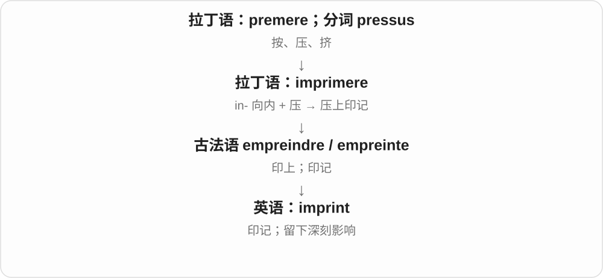

imprint a design on cloth 是把图案印上布；leave an imprint on someone’s life 是留下长久影响。出版业的 imprint 是出版社旗下的出版名称或品牌。

**常见搭配与例句**

leave an imprint；imprinted on memory；a publishing imprint。

> The wet sand held the imprint of a small hand.

湿沙上留着一只小手的印痕。

> The experience left a lasting imprint on her work.

这段经历对她的作品产生了持久影响。

**别混淆**

impression 可是初步感觉；imprint 常更像清楚而持久的痕迹。

### 53. newsprint — 新闻纸；用于印报纸的纸

**音标**：英 /ˈnjuːzprɪnt/；美 /ˈnuːzprɪnt/

**先抓住这个画面**

不是某条新闻的内容，而是那种适合大量印报纸的纸张。

**怎么拆**

news 新闻 + print 印刷，组合词专门指印报纸使用的纸。

**怎么变成今天的意思**

通常作不可数名词，谈纸的种类、消耗量或供应。艺术课也常用这种便宜纸练习。

**常见搭配与例句**

a roll of newsprint；newsprint prices；draw on newsprint。

> The students practised drawing on sheets of newsprint.

学生们在新闻纸上练习绘画。

> The printing company bought several rolls of newsprint.

印刷公司买了几卷新闻纸。

**别混淆**

newspaper 是报纸这一出版物；newsprint 主要是它用的材料。

### 54. misprint — 印刷错误；误印

**音标**：名词：英、美 /ˈmɪsprɪnt/；动词：英、美 /mɪsˈprɪnt/

**先抓住这个画面**

内容在印出来时出了错，可能是一个字母、数字或标点不对。

**怎么拆**

mis- 错误 + print；可作印错的动作，也可指印出的错误。

**怎么变成今天的意思**

a misprint in the date 是日期印错。与 typo 的范围重叠，但 misprint 更贴近出版、印制的结果。

**常见搭配与例句**

correct a misprint；a misprint on page ten。

> A misprint changed the price from fifteen dollars to fifty.

一个印刷错误把价格从十五美元变成了五十美元。

> The publisher corrected several misprints in the next printing.

出版社在下次印刷时改正了几处印错。

**别混淆**

misprint 常是文字技术性错误；factual error 是事实错误，两者不必相同。

### 55. preprint — 预印本；正式发表前流通的论文稿

**音标**：英 /ˈpriːprɪnt/；美 /ˈpriːprɪnt/

**先抓住这个画面**

研究文章还没走完正式期刊发表流程，作者先把稿件拿出来供人阅读讨论。

**怎么拆**

pre- 在前 + print；名词表示正式出版之前的印本，后来延伸到电子稿。

**怎么变成今天的意思**

现代科研常指尚未正式同行评审发表的公开论文版本；是否经过哪些检查，应看平台和具体版本。

**常见搭配与例句**

upload a preprint；a preprint server；the latest preprint。

> The researchers uploaded a preprint before submitting the paper to a journal.

研究者在向期刊投稿前上传了预印本。

> The preprint was later revised after receiving feedback.

预印本后来根据反馈作了修改。

**别混淆**

preprint 是发表阶段或稿件版本，不是“先打印一份”的任何文件，也不能直接当作已通过同行评审。

### 56. thumbprint — 拇指印

**音标**：英 /ˈθʌmprɪnt/；美 /ˈθʌmprɪnt/

**先抓住这个画面**

把范围从所有手指收窄到拇指，它按下后留下的印痕就是 thumbprint。

**怎么拆**

thumb 拇指 + print 印痕。

**怎么变成今天的意思**

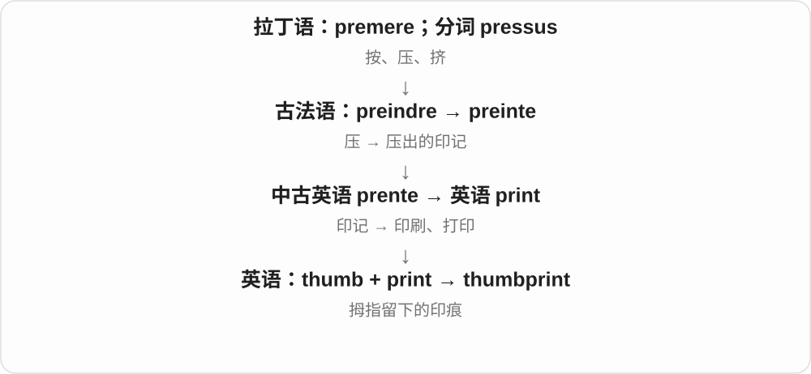

可以指识别用的拇指纹，也可指颜料、软泥上的拇指印。thumb 中的 b 不发音。

**常见搭配与例句**

leave a thumbprint；an inked thumbprint。

> A thumbprint remained in the soft clay.

软泥上留着一个拇指印。

> The artist made a pattern using coloured thumbprints.

艺术家用彩色拇指印做出了图案。

**别混淆**

fingerprint 是手指纹的总称；thumbprint 明确是哪根手指。

### 57. handprint — 手印；掌印

**音标**：英 /ˈhændprɪnt/；美 /ˈhændprɪnt/

**先抓住这个画面**

整只手按在一个表面上，留下手掌和手指的大致形状。

**怎么拆**

hand 手 + print 印痕。

**怎么变成今天的意思**

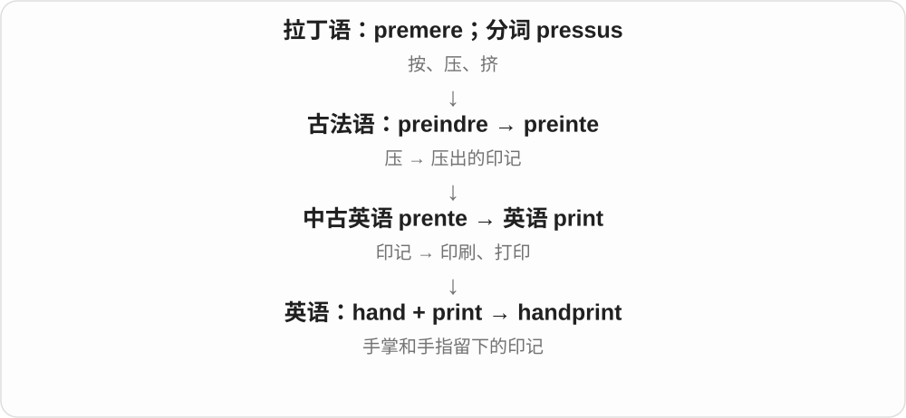

常见于儿童画、湿水泥或泥土中的手形印记；不一定清楚到能够辨识细微指纹。

**常见搭配与例句**

a muddy handprint；leave a handprint。

> The children left painted handprints on the paper.

孩子们在纸上留下了彩色手印。

> There was a muddy handprint beside the door.

门旁有一个带泥的手印。

**别混淆**

handprint 强调整只手的印记；fingerprint 强调手指的纹路。

### 58. compress — 压缩；挤紧；压敷布

**音标**：动词：英、美 /kəmˈpres/；名词：英 /ˈkɒmpres/、美 /ˈkɑːmpres/

**先抓住这个画面**

把松散的空间挤小：行李压紧，文字缩短，文件也换成占空间更少的表示。

**怎么拆**

拉丁语 com- 一起 + premere → comprimere；后经 compressus、compressāre、法语 compresser 等形式进入英语。

**怎么变成今天的意思**

compress a file 是压缩文件；compress a report into two pages 是把报告缩至两页。名词 a cold compress 指冷敷用的布或敷垫，重音在前。

**常见搭配与例句**

compress into；compress data；a cold compress。

> The software can compress the images without changing their dimensions.

软件可以压缩这些图片的数据，而不改变像素尺寸。

> She compressed a long explanation into three sentences.

她把一大段解释浓缩成了三句话。

**别混淆**

compress 强调变得紧凑、体积或篇幅减小；suppress 强调把表现或发展压住。

### 59. compression — 压缩；挤压

**音标**：英 /kəmˈpreʃən/；美 /kəmˈpreʃən/

**先抓住这个画面**

本来占很大一块，现在挤得更紧、更小；这个过程和程度就是 compression。

**怎么拆**

来自法语 compression、拉丁语 compressiō；与 compress 对应，名词具有自己的借入历史。

**怎么变成今天的意思**

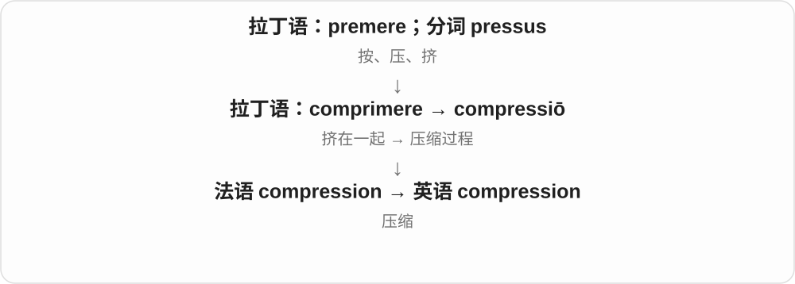

可谈物理体积、数据大小或声音动态范围。数据压缩有无损和有损，不能把所有压缩都理解为删掉信息。

**常见搭配与例句**

data compression；compression ratio；under compression。

> Lossless compression allows the original data to be recovered exactly.

无损压缩允许原始数据被精确恢复。

> The material changes shape under compression.

这种材料受压时会变形。

**别混淆**

compression 是过程或状态；compressor 是执行它的设备或工具。

### 60. compressor — 压缩机；压缩工具；音频压缩器

**音标**：英 /kəmˈpresə/；美 /kəmˈpresər/

**先抓住这个画面**

负责把东西“压紧”的那台设备或那个程序。

**怎么拆**

compress + -or，也与近代拉丁语 compressor 形式相联系；-or 表执行者。

**怎么变成今天的意思**

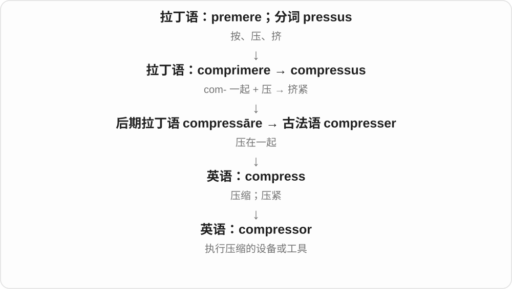

air compressor 压缩空气；音频 compressor 缩小声音强弱之间的动态范围；文件压缩器减少数据占用。

**常见搭配与例句**

an air compressor；an audio compressor；a file compressor。

> The workshop uses an air compressor to power several tools.

车间用空气压缩机为几种工具提供动力。

> The engineer used a compressor to control the recording’s dynamic range.

录音师用压缩器控制录音的动态范围。

**别混淆**

三种 compressor 的对象不同：空气、声音动态、数据表示。音频压缩器不必让文件更小。

### 61. compressible — 可压缩的

**音标**：英 /kəmˈpresəbəl/；美 /kəmˈpresəbəl/

**先抓住这个画面**

外力一挤，体积能明显缩小；在数据里，则是还能换成更省空间的表示。

**怎么拆**

借自拉丁语 compressibilis“可压缩的”，根在 comprimere“挤紧”；现代可按 compress + -ible 理解，借入历史与今天的拆分要分开。

**怎么变成今天的意思**

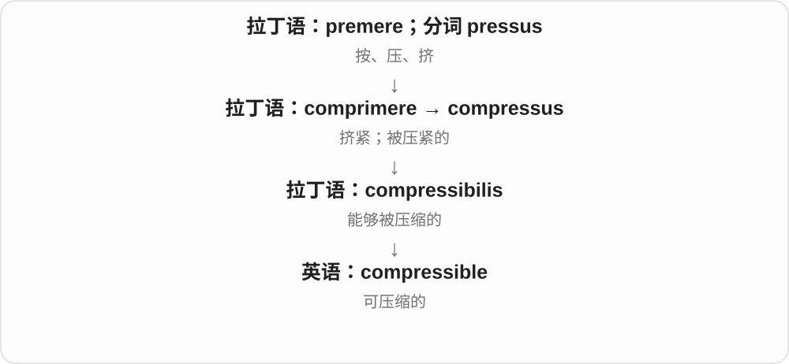

气体通常比液体容易压缩。文件是否容易压缩，取决于内容和已有编码，不取决于文件名长短。

**常见搭配与例句**

a compressible gas；compressible material；highly compressible data。

> Air is much more compressible than water under ordinary conditions.

在通常条件下，空气比水容易压缩得多。

> Repeated text is often highly compressible.

重复文本通常很容易压缩。

**别混淆**

compressible 是有可能缩小体积；flexible 是容易弯，两者不是同一种性质。

### 62. incompressible — 不可压缩的；近似体积不变的

**音标**：英 /ˌɪnkəmˈpresəbəl/；美 /ˌɪnkəmˈpresəbəl/

**先抓住这个画面**

你继续施压，它的体积却几乎不缩小；计算时便可把这点变化忽略。

**怎么拆**

in- 否定 + compressible；法语也有 incompressible。

**怎么变成今天的意思**

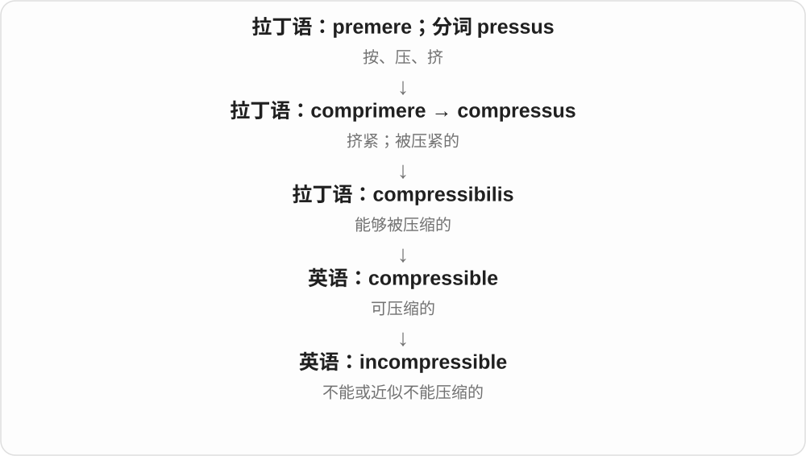

流体力学里常是模型假设，并不是断言真实材料在任何压力下体积绝不改变。数据语境则指难以再压小。

**常见搭配与例句**

an incompressible fluid；treat water as incompressible。

> The model treats the liquid as incompressible.

这个模型把液体视为不可压缩。

> The file is effectively incompressible because it already contains compressed data.

这个文件已经装着压缩过的数据，实际上很难再压小。

**别混淆**

incompressible 不等于坚硬：水能流动，但在许多计算中可以近似看作不可压缩。

### 63. decompress — 解压；减压；放松下来

**音标**：英 /ˌdiːkəmˈpres/；美 /ˌdiːkəmˈpres/

**先抓住这个画面**

把压紧的状态解除：压缩包展开，压力降下来，人也从紧绷中松一口气。

**怎么拆**

de- 表解除 + compress。

**怎么变成今天的意思**

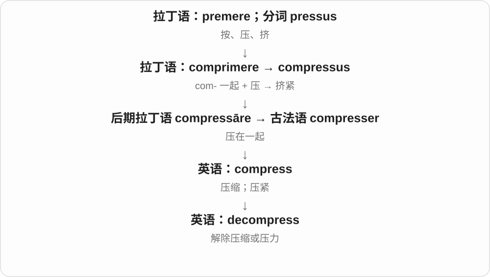

可用于文件、气压以及日常心理感受。I need to decompress 是说忙完后想缓一缓。

**常见搭配与例句**

decompress a file；time to decompress；decompress after work。

> You need to decompress the archive before opening the files.

打开里面的文件前，需要先解压这个压缩包。

> I took a short walk to decompress after the meeting.

会后我散了一小会儿步，让自己放松下来。

**别混淆**

decompress a file 是还原压缩数据，不是删除文件；depress 则是压低，方向不同。

### 64. decompression — 减压；解压缩

**音标**：英 /ˌdiːkəmˈpreʃən/；美 /ˌdiːkəmˈpreʃən/

**先抓住这个画面**

原先被压着的状态逐渐解除，这一过程就是 decompression。

**怎么拆**

de- 解除 + compression，或对应 decompress 的名词形式。

**怎么变成今天的意思**

技术语境必须看对象：文件解压、舱室失压、潜水减压不是同一种实际操作，只共享解除压力或压缩的概念。

**常见搭配与例句**

file decompression；cabin decompression；rapid decompression。

> File decompression took less than a minute.

文件解压用了不到一分钟。

> The report describes a sudden decompression of the cabin.

报告描述了机舱突然失压的情况。

**别混淆**

decompression 重点在压力或压缩状态的解除；depression 常是已经压低、凹下去的状态。

### 65. oppress — 压迫；使沉重难受

**音标**：英 /əˈpres/；美 /əˈpres/

**先抓住这个画面**

力量长期压在一个人或一群人身上，让他们难以自由生活、表达和行动。

**怎么拆**

拉丁语 ob- 压向 + premere，b 遇 p 同化成 p，形成 opprimere；经 oppressāre、古法语 opresser 等形式进入英语。

**怎么变成今天的意思**

常说权力被不公正地使用，也可较文学地说沉重的忧虑、闷热使人难受。

**常见搭配与例句**

oppress a people；oppress minorities；oppressed by fear。

> The novel tells the story of people oppressed by a cruel ruler.

小说讲述了受到残暴统治者压迫的人们的故事。

> A sense of guilt oppressed him for years.

负罪感沉重地压在他心头，持续了多年。

**别混淆**

普通压力 pressure 未必不公正；oppress 通常带明显的压迫、侵害意味。

### 66. oppression — 压迫；沉重压抑感

**音标**：英 /əˈpreʃən/；美 /əˈpreʃən/

**先抓住这个画面**

一个人不是偶尔被催一下，而是长期被不公正的力量压住；这种处境就是 oppression。

**怎么拆**

经法语 oppression 来自拉丁语 oppressiō，与 opprimere 同族；名词独立借入。

**怎么变成今天的意思**

多用于社会政治与群体处境，也可指沉重的精神感受。描述压迫时通常含负面评价。

**常见搭配与例句**

political oppression；resist oppression；freedom from oppression。

> The poem speaks of resistance to oppression.

这首诗讲述了对压迫的反抗。

> The exhibition documents years of political oppression.

展览记录了多年的政治压迫。

**别混淆**

oppression 是压迫本身；oppressor 是施加压迫的人或势力。

### 67. oppressive — 压迫性的；令人压抑的；闷热难耐的

**音标**：英 /əˈpresɪv/；美 /əˈpresɪv/

**先抓住这个画面**

像一层沉重的东西盖下来，人的活动空间或呼吸的轻松感都被挤掉。

**怎么拆**

来自中世纪拉丁语 oppressivus，与 opprimere、oppressus 同族；现代可分析为 oppress + -ive。

**怎么变成今天的意思**

oppressive laws 是压迫性法律；oppressive heat 是闷热；an oppressive silence 是让人难受的沉默。

**常见搭配与例句**

an oppressive regime；oppressive heat；an oppressive atmosphere。

> The heat became oppressive by midday.

到中午时，天气已经闷热得让人难受。

> An oppressive silence filled the room.

房间里弥漫着令人压抑的沉默。

**别混淆**

oppressive 强调沉重、受压；depressing 强调令人沮丧。天气可以同时令人感到两者。

### 68. oppressor — 压迫者

**音标**：英 /əˈpresə/；美 /əˈpresər/

**先抓住这个画面**

不是承受重量的人，而是把不公正的力量长期压在别人身上的一方。

**怎么拆**

来自拉丁语 oppressor，也可经法语相关形式；现代与 oppress + -or 对应。

**怎么变成今天的意思**

可指个人、集团或被拟人化的制度力量，是带强烈负面评价的称呼。

**常见搭配与例句**

resist an oppressor；victims and oppressors。

> The story follows a village that stands up to its oppressor.

故事讲述一个村庄奋起反抗压迫者的经历。

> The speaker distinguished the oppressors from the people they controlled.

演讲者把压迫者与被其控制的民众区分开。

**别混淆**

oppressor 是施压的一方；the oppressed 是受压迫者，注意方向。

### 69. suppress — 抑制；压下；封锁传播

**音标**：英 /səˈpres/；美 /səˈpres/

**先抓住这个画面**

某种东西正要冒出来、扩大或传播，你把它压住：笑意、消息、活动都可以是对象。

**怎么拆**

拉丁语 sub- 向下 + premere → supprimere，b 同化为 p；分词 suppressus 进入英语。

**怎么变成今天的意思**

suppress a laugh 是忍住笑；suppress information 是不让消息传播；技术上也可说抑制噪声或某种反应。

**常见搭配与例句**

suppress laughter；suppress evidence；suppress noise。

> She tried to suppress a smile during the serious meeting.

严肃的会议上，她努力忍住笑意。

> The officials were accused of suppressing the report.

那些官员被指控压下报告，不让它公开。

**别混淆**

suppress 可用于中性的技术抑制，也可用于不公正封锁；oppress 更直接强调压迫人。

### 70. suppression — 抑制；压制；阻止传播

**音标**：英 /səˈpreʃən/；美 /səˈpreʃən/

**先抓住这个画面**

把冒出来的东西按住，这个动作、过程或安排就是 suppression。

**怎么拆**

来自拉丁语 suppressiō，与 supprimere 同族；现代与 suppress + -ion 对应。

**怎么变成今天的意思**

noise suppression 是抑制噪声；suppression of evidence 是压下证据。词本身并不保证彻底消除。

**常见搭配与例句**

noise suppression；suppression of dissent；fire suppression。

> The headphones include a noise suppression feature.

这副耳机带有噪声抑制功能。

> The article criticizes the suppression of opposing views.

文章批评了对不同意见的压制。

**别混淆**

suppression 常强调阻止表现、发展；deletion 是删掉，结果和手段不完全相同。

### 71. immunosuppression — 免疫抑制

**音标**：英 /ɪˌmjuːnəʊsəˈpreʃən/；美 /ɪˌmjuːnoʊsəˈpreʃən/

**先抓住这个画面**

把身体免疫反应的强度调低；这是作用或状态，不是某一个具体药名。

**怎么拆**

immuno- 免疫 + suppression 抑制，现代医学组合词。

**怎么变成今天的意思**

可由治疗造成，也可与其他状况有关。词义只告诉我们免疫反应受到抑制，原因和程度仍需上下文。

**常见搭配与例句**

drug-induced immunosuppression；the degree of immunosuppression。

> The lecture explains the meaning of immunosuppression.

讲座解释了免疫抑制的含义。

> The paper discusses immunosuppression after organ transplantation.

论文讨论器官移植后的免疫抑制。

**别混淆**

immunosuppression 是过程或状态；immunosuppressant 是用于抑制免疫反应的药物。

### 72. suppressor — 抑制器；抑制因素

**音标**：英 /səˈpresə/；美 /səˈpresər/

**先抓住这个画面**

某个装置或因素专门把不希望出现的活动压低，它就是 suppressor。

**怎么拆**

suppress + -or，表示执行抑制作用的人、装置或因素。

**怎么变成今天的意思**

可见于 surge suppressor 浪涌抑制器、tumor suppressor 肿瘤抑制相关因素等搭配。具体抑制什么，要看前面的限定词。

**常见搭配与例句**

a surge suppressor；a noise suppressor；a tumor suppressor gene。

> The equipment includes a surge suppressor.

设备配有浪涌抑制器。

> The diagram shows where the noise suppressor sits in the circuit.

图示标出了噪声抑制器在电路中的位置。

**别混淆**

suppressor 常指装置或因素；suppressant 更常指起抑制作用的物质，二者在个别领域会重叠。

### 73. suppressive — 有抑制作用的；压制性的

**音标**：英 /səˈpresɪv/；美 /səˈpresɪv/

**先抓住这个画面**

描述一种作用方向：让某种活动难以继续、扩大或显露。

**怎么拆**

suppress + -ive，形成描述作用性质的形容词。

**怎么变成今天的意思**

技术语境可能只是说抑制效应；社会政治语境则常含压制的负面意思。

**常见搭配与例句**

a suppressive effect；suppressive measures；suppressive policies。

> The study found a suppressive effect on cell growth.

研究发现了一种抑制细胞生长的效应。

> The essay examines the consequences of suppressive policies.

文章考察压制性政策的后果。

**别混淆**

suppressive 说有抑制作用；suppressed 说已经受到抑制的状态。

### 74. suppressant — 抑制剂；起抑制作用的物质

**音标**：英 /səˈpresənt/；美 /səˈpresənt/

**先抓住这个画面**

把某种反应或活动往下压的物质，名称重点落在它的作用上。

**怎么拆**

suppress + -ant，形成表示作用物的名词或形容词。

**怎么变成今天的意思**

在 cough suppressant、fire suppressant 等搭配里，抑制对象不同。看到词尾不能直接推断它是哪一种药或化学物。

**常见搭配与例句**

a cough suppressant；a fire suppressant；suppressant effects。

> The label identifies the substance as a fire suppressant.

标签把这种物质标为灭火剂。

> The lecture compared cough suppressants with expectorants.

讲座比较了镇咳药与祛痰药。

**别混淆**

suppressant 多指物质；suppression 是抑制这一过程。

### 75. espresso — 意式浓缩咖啡

**音标**：英 /eˈspresəʊ/、/ɪˈspresəʊ/；美 /eˈspresoʊ/、/ɪˈspresoʊ/

**先抓住这个画面**

热水在压力下穿过细咖啡粉，得到一小杯浓郁的咖啡。

**怎么拆**

借自意大利语 caffè espresso；espresso 与拉丁语 exprimere、expressus 同族。具体命名动机有“压出”和“专为顾客现做”等解释，资料并不一致。

**怎么变成今天的意思**

用“压力萃取”记制作方式很直观，但不能因此断言这就是唯一确定的命名原因。espresso 是标准常见拼写，读音中没有 /ks/。

**常见搭配与例句**

a shot of espresso；a double espresso；an espresso machine。

> She ordered a double espresso after lunch.

她午饭后点了一杯双份意式浓缩咖啡。

> The café uses espresso as the base for its lattes.

这家咖啡店用意式浓缩咖啡作为拿铁的基底。

**别混淆**

espresso 是咖啡类别；express 是英语的表达、明确或特快，不是把后者随手加 o。

### 76. reprimand — 正式斥责；训诫

**音标**：名词、动词常见：英 /ˈreprɪmɑːnd/；美 /ˈreprɪmænd/，也有末音节重读

**先抓住这个画面**

有权负责的人明确告诉你：“这件事做错了，必须收住。”比普通抱怨更正式。

**怎么拆**

法语 réprimande 来自拉丁语 reprimenda“应当制止的事”，属于 reprimere“按回、遏制”的词族；拼写中的 -mand 不是英语 command 的缩写。

**怎么变成今天的意思**

可以作名词或动词：receive a reprimand；reprimand someone for something。常见于学校、组织或工作场合。

**常见搭配与例句**

a formal reprimand；a written reprimand；reprimand someone for…。

> The employee received a written reprimand for repeated lateness.

这名员工因多次迟到受到书面训诫。

> The teacher reprimanded him for interrupting the lesson.

老师因他打断课堂而训斥了他。

**别混淆**

criticize 可以只是批评观点；reprimand 通常针对过错，由有权负责的人作出正式责备。

### 77. printout — 打印件；打印输出

**音标**：英 /ˈprɪntaʊt/；美 /ˈprɪntaʊt/

**先抓住这个画面**

原来在电脑里的内容，经打印机出来后，手里拿着的那几页就是 printout。

**怎么拆**

由动词短语 print out 名词化而来，连写成一个名词。

**怎么变成今天的意思**

a printout of the results 是结果的打印件，可以一页也可以多页。

**常见搭配与例句**

a computer printout；a printout of the schedule。

> She handed me a printout of the meeting schedule.

她递给我一份会议日程打印件。

> The printout contains all the test results.

打印件上有全部测试结果。

**别混淆**

print out 是动作，通常分写；printout 是结果，通常连写。

### 78. imprimatur — 准予出版；正式认可

**音标**：英 /ˌɪmprɪˈmeɪtə/、/ˌɪmprɪˈmɑːtə/；美 /ˌɪmprɪˈmɑːtər/

**先抓住这个画面**

有人在稿件上盖下一种权威性的许可：“可以印了。”后来也就能指给一个计划正式背书。

**怎么拆**

直接借用拉丁语 imprimātur“让它被印出”，是 imprimere 的第三人称单数现在时虚拟式被动态；不是英语常见名词后缀 -tur。

**怎么变成今天的意思**

历史上常用于教会出版许可；一般书面语可说 give something one’s imprimatur，表示正式认可。

**常见搭配与例句**

official imprimatur；give the plan one’s imprimatur。

> The old book carries an ecclesiastical imprimatur.

这本旧书载有教会的出版许可。

> The proposal received the committee’s imprimatur.

这项提案得到了委员会的正式认可。

**别混淆**

imprimatur 是许可或认可；imprint 是印痕或出版品牌，不能混同。

### 79. immunosuppressant — 免疫抑制药

**音标**：英 /ɪˌmjuːnəʊsəˈpresənt/；美 /ɪˌmjuːnoʊsəˈpresənt/

**先抓住这个画面**

把免疫反应的强度调低的药物；名字直接告诉你它抑制的对象是免疫系统。

**怎么拆**

immuno- 免疫 + suppressant 抑制剂，现代专业组合词。

**怎么变成今天的意思**

常见于器官移植等医学材料。词形说明作用类别，不等于所有这类药物机制都相同。

**常见搭配与例句**

an immunosuppressant drug；immunosuppressant therapy。

> The textbook lists several classes of immunosuppressants.

教科书列出了几类免疫抑制药。

> The article explains why an immunosuppressant may be used after a transplant.

文章解释了移植后为何可能使用免疫抑制药。

**别混淆**

immunosuppressant 是药物类别；immunosuppression 是免疫抑制状态，不要混淆物与过程。

## 这一组要分清什么

**impressed / impressive / impressionable**：自己被打动 / 让别人赞叹 / 容易受影响。

**impression / expression**：在别人心里留下的印象 / 自己表现出来的内容或表情。

**depress / oppress / suppress / repress**：压低 / 不公正地压迫 / 按住不让显露或发展 / 按回去、压抑。词义有交叉，但对象和语气不同。

**depressant / antidepressant**：前者强调抑制某种生理活动，后者按治疗抑郁的用途命名，并不是两种药理作用的简单反义。

**express 的特快义** 经“专门、直接的服务”发展，不是把“向外挤压”直接翻译成快。**espresso** 与 express 同族，但咖啡名称的具体命名动机有不同解释。

## 串起来练习

**Her expressive explanation impressed the team, but she felt under pressure to compress the report into two pages.**

她生动的解释让团队印象深刻，但她感到压力，因为必须把报告压缩到两页。expressive 是表达有力，impressed 是听者被打动，pressure 是外部要求带来的压力，compress 是把篇幅压短。
