# 0172 · ten-, -tin-, tent- — 握住；持有；留住；保持

[逐词精讲目录](../00_逐词精讲目录.md) · [总目录](../00_总目录_按常用程度.md)

## 核心词根与来源

**这一族先记一个动作：握住，不让它离开或散掉。** 来源是拉丁语 **tenēre**“持有、保持”；在复合词里常出现 **-tin-**，分词词干可见 **tent-**。经过法语进入英语后，还会有 contain、retain、maintain 中的 **-tain**。

握住的可以是物品、职位、记忆，也可以是某种状态。contain 把东西留在里面，retain 把已经得到的继续留住，maintain 用手撑住状态，sustain 从下面托住。continue 则把一段接到下一段，让前后保持相连。

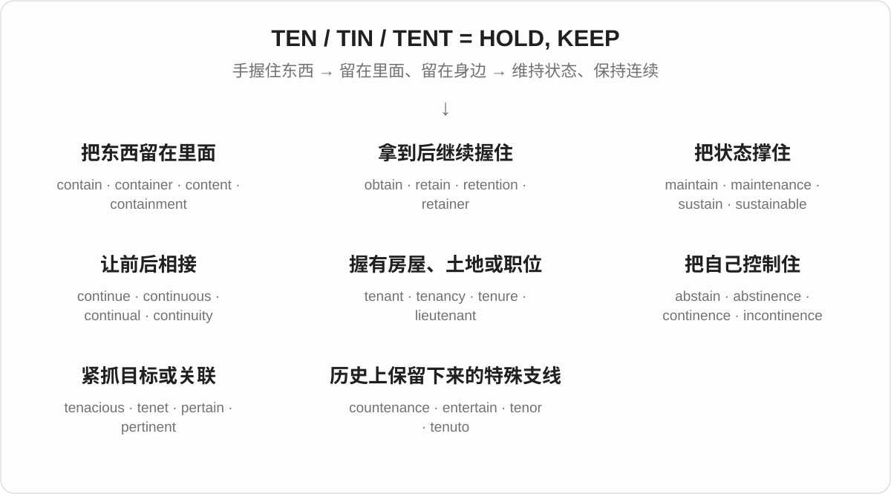

## 词形与演化规律

**tenere“持有”和 tendere“伸展”要分开看。** 英语常见的十 ten、帐篷 tent、时态 tense，也不能只因拼写相近就塞进本页。每个词的实际历史来源决定归属。

**-tain / -tent / -tin- 是历史变化，不是可以任意替换的积木。** retain 和 retention 有各自的英语借入路线；maintenance、continuity、contentment 也并非全是先有现代英语动词再临时加后缀。图里保留法语、拉丁语的真实节点。

**同源不等于同义。** content 的“内容”与“满足”重音不同；continent 的“大陆”与“自制、能控制排泄”走不同语义支线。把这些岔路分清，词根才会帮忙。

## 单词速览（常用到不常用）

| 单词 | 音标 | 核心意思 |
|---|---|---|
| [continue](#w-1) | /kənˈtɪnjuː/ | 继续；接着做；持续 |
| [content](#w-2) | 内容：英 /ˈkɒntent/、美 /ˈkɑːntent/；满足：/kənˈtent/ | 内容；所含物；含量；满足的 |
| [maintain](#w-3) | /meɪnˈteɪn/ | 维持；维护；保养；坚持说 |
| [entertainment](#w-4) | 英 /ˌentəˈteɪnmənt/；美 /ˌentərˈteɪnmənt/ | 娱乐；文娱活动；招待 |
| [maintenance](#w-5) | /ˈmeɪntənəns/ | 维护；保养；生活供养 |
| [contain](#w-6) | /kənˈteɪn/ | 容纳；包含；控制住 |
| [lieutenant](#w-7) | 英 /lefˈtenənt/；美 /luːˈtenənt/ | 尉官；副手；代理人 |
| [obtain](#w-8) | /əbˈteɪn/ | 获得；取得；适用、存在（正式） |
| [continuous](#w-9) | /kənˈtɪnjuəs/ | 连续的；不间断的 |
| [sustainable](#w-10) | /səˈsteɪnəbəl/ | 可持续的；能够长期维持的 |
| [sustained](#w-11) | /səˈsteɪnd/ | 持续的；保持了一段时间的 |
| [retain](#w-12) | /rɪˈteɪn/ | 保留；保持；记住；留用 |
| [entertaining](#w-13) | 英 /ˌentəˈteɪnɪŋ/；美 /ˌentərˈteɪnɪŋ/ | 有趣的；令人愉快的 |
| [continent](#w-14) | 英 /ˈkɒntɪnənt/；美 /ˈkɑːntɪnənt/ | 大陆；洲；能自制的；能控制排泄的 |
| [container](#w-15) | 英 /kənˈteɪnə/；美 /kənˈteɪnər/ | 容器；集装箱 |
| [continental](#w-16) | 英 /ˌkɒntɪˈnentəl/；美 /ˌkɑːntɪˈnentəl/ | 大陆的；洲的；欧洲大陆的 |
| [continuously](#w-17) | /kənˈtɪnjuəsli/ | 连续不断地 |
| [detention](#w-18) | /dɪˈtenʃən/ | 拘留；扣留；课后留校 |
| [sustain](#w-19) | /səˈsteɪn/ | 维持；支撑；承受；遭受 |
| [tenure](#w-20) | 英 /ˈtenjə/；美 /ˈtenjər/ | 任期；职位持有；终身教职保障；土地保有 |
| [continually](#w-21) | /kənˈtɪnjuəli/ | 不断地；频繁反复地 |
| [entertain](#w-22) | 英 /ˌentəˈteɪn/；美 /ˌentərˈteɪn/ | 使有趣、使愉快；招待；考虑 |
| [retention](#w-23) | /rɪˈtenʃən/ | 保留；留存；记忆保持 |
| [tenant](#w-24) | /ˈtenənt/ | 房客；承租人；空间使用者 |
| [continuity](#w-25) | 英 /ˌkɒntɪˈnjuːəti/；美 /ˌkɑːntɪˈnuːəti/ | 连续性；连贯；前后一致 |
| [sustainability](#w-26) | /səˌsteɪnəˈbɪləti/ | 可持续性；长期维持能力 |
| [continuation](#w-27) | /kənˌtɪnjuˈeɪʃən/ | 继续；延续；续接部分 |
| [containment](#w-28) | /kənˈteɪnmənt/ | 控制；遏制；围堵；容纳设施 |
| [entertainer](#w-29) | 英 /ˌentəˈteɪnə/；美 /ˌentərˈteɪnər/ | 演艺人员；表演者；娱乐大众的人 |
| [continuum](#w-30) | /kənˈtɪnjuəm/ | 连续体；渐变的整体 |
| [tenor](#w-31) | 英 /ˈtenə/；美 /ˈtenər/ | 男高音；男高音声部；总体基调 |
| [discontent](#w-32) | /ˌdɪskənˈtent/ | 不满；不满足 |
| [pertinent](#w-33) | 英 /ˈpɜːtɪnənt/；美 /ˈpɜːrtɪnənt/ | 切题的；相关而有用的 |
| [continual](#w-34) | /kənˈtɪnjuəl/ | 不断的；频繁反复的 |
| [detain](#w-35) | /dɪˈteɪn/ | 扣留；拘留；耽搁 |
| [abstinence](#w-36) | /ˈæbstɪnəns/ | 戒除；节制；禁欲 |
| [intercontinental](#w-37) | 英 /ˌɪntəkɒntɪˈnentəl/；美 /ˌɪntərkɑːntɪˈnentəl/ | 洲际的；跨洲之间的 |
| [unsustainable](#w-38) | /ˌʌnsəˈsteɪnəbəl/ | 无法长期维持的；不可持续的 |
| [retainer](#w-39) | 英 /rɪˈteɪnə/；美 /rɪˈteɪnər/ | 预付聘用费；牙齿保持器；随从 |
| [discontinue](#w-40) | /ˌdɪskənˈtɪnjuː/ | 停止；不再生产、提供或进行 |
| [tenacity](#w-41) | /təˈnæsəti/ | 坚韧；顽强；不轻易放弃 |
| [abstain](#w-42) | /əbˈsteɪn/ | 克制不做；戒除；弃权 |
| [obtainable](#w-43) | /əbˈteɪnəbəl/ | 可以获得的；拿得到的 |
| [tenancy](#w-44) | /ˈtenənsi/ | 租赁关系；租期；租用权 |
| [contentment](#w-45) | /kənˈtentmənt/ | 满足；知足；安然满意 |
| [tenacious](#w-46) | /təˈneɪʃəs/ | 顽强的；抓得牢的；不轻易放弃的 |
| [untenable](#w-47) | /ʌnˈtenəbəl/ | 站不住脚的；无法维持的 |
| [tenet](#w-48) | /ˈtenɪt/，也读 /ˈtenət/ | 信条；基本原则 |
| [sustenance](#w-49) | /ˈsʌstənəns/ | 食物；营养；维生、精神支撑 |
| [contented](#w-50) | /kənˈtentɪd/ | 满足的；心满意足的 |
| [incontinence](#w-51) | 英 /ɪnˈkɒntɪnəns/；美 /ɪnˈkɑːntɪnəns/ | 失禁；缺乏自制（旧或正式义） |
| [countenance](#w-52) | /ˈkaʊntənəns/ | 面容；神情；容许、支持 |
| [pertain](#w-53) | 英 /pəˈteɪn/；美 /pərˈteɪn/ | 与……有关；属于；适用于 |
| [tenement](#w-54) | /ˈtenɪmənt/ | 公寓楼；分户出租住宅；不动产（历史法律义） |
| [detainee](#w-55) | /ˌdiːteɪˈniː/ | 被拘留者；被扣留者 |
| [tenured](#w-56) | 英 /ˈtenjəd/；美 /ˈtenjərd/ | 获得长期教职保障的；有稳定任职资格的 |
| [transcontinental](#w-57) | 英 /ˌtrænzkɒntɪˈnentəl/；美 /ˌtrænzkɑːntɪˈnentəl/ | 横贯大陆的；跨越大陆的 |
| [continuance](#w-58) | /kənˈtɪnjuəns/ | 继续；延续；延期审理 |
| [discontinuous](#w-59) | /ˌdɪskənˈtɪnjuəs/ | 不连续的；有间断的 |
| [discontinuation](#w-60) | /ˌdɪskənˌtɪnjuˈeɪʃən/ | 停止；停产；终止供应 |
| [retinue](#w-61) | 英 /ˈretɪnjuː/；美 /ˈretɪnuː/ | 随从；随行人员 |
| [impertinent](#w-62) | 英 /ɪmˈpɜːtɪnənt/；美 /ɪmˈpɜːrtɪnənt/ | 无礼的；放肆的；不相干的（旧义） |
| [abstention](#w-63) | /əbˈstenʃən/ | 弃权；不参与；克制不做 |
| [discontinuity](#w-64) | 英 /ˌdɪskɒntɪˈnjuːəti/；美 /ˌdɪskɑːntɪˈnuːəti/ | 不连续；断裂；突变点 |
| [discontented](#w-65) | /ˌdɪskənˈtentɪd/ | 不满的；对现状不满意的 |
| [tenable](#w-66) | /ˈtenəbəl/ | 站得住脚的；可维持的；可守住的 |
| [unobtainable](#w-67) | /ˌʌnəbˈteɪnəbəl/ | 无法获得的；拿不到的 |
| [maintainer](#w-68) | 英 /meɪnˈteɪnə/；美 /meɪnˈteɪnər/ | 维护者；维持运作的人 |
| [incontinent](#w-69) | 英 /ɪnˈkɒntɪnənt/；美 /ɪnˈkɑːntɪnənt/ | 失禁的；不能自制的（旧义） |
| [detainment](#w-70) | /dɪˈteɪnmənt/ | 扣留；被留住的状态 |
| [impertinence](#w-71) | 英 /ɪmˈpɜːtɪnəns/；美 /ɪmˈpɜːrtɪnəns/ | 无礼；放肆；无礼的话或行为 |
| [retentive](#w-72) | /rɪˈtentɪv/ | 善于保留的；记性好的；保水的 |
| [contentedly](#w-73) | /kənˈtentɪdli/ | 满足地；安然地 |
| [maintainable](#w-74) | /meɪnˈteɪnəbəl/ | 能够维持的；便于维护的 |
| [tenaciously](#w-75) | /təˈneɪʃəsli/ | 顽强地；紧紧抓住地 |
| [maintainability](#w-76) | /meɪnˌteɪnəˈbɪləti/ | 可维护性；维护难易程度 |
| [continence](#w-77) | 英 /ˈkɒntɪnəns/；美 /ˈkɑːntɪnəns/ | 控制排泄的能力；克制、自制 |
| [abstinent](#w-78) | /ˈæbstɪnənt/ | 戒除某种行为的；自我节制的 |
| [discontinuance](#w-79) | /ˌdɪskənˈtɪnjuəns/ | 停止；终止；中止持续安排 |
| [malcontent](#w-80) | 名词常读 /ˈmælkəntent/；形容词也读 /ˌmælkənˈtent/ | 不满者；牢骚者；不满现状的 |
| [detainer](#w-81) | 英 /dɪˈteɪnə/；美 /dɪˈteɪnər/ | 拘留文书、请求；扣留；扣留者 |
| [countertenor](#w-82) | 英 /ˌkaʊntəˈtenə/；美 /ˈkaʊntərˌtenər/ | 高男声；假声男高音歌手 |
| [discontentment](#w-83) | /ˌdɪskənˈtentmənt/ | 不满足；不满情绪 |
| [pertinence](#w-84) | 英 /ˈpɜːtɪnəns/；美 /ˈpɜːrtɪnəns/ | 切题性；相关性 |
| [appurtenant](#w-85) | 英 /əˈpɜːtɪnənt/；美 /əˈpɜːrtɪnənt/ | 附属的；从属于主要事物的 |
| [obtainment](#w-86) | /əbˈteɪnmənt/ | 取得；获得 |
| [continuant](#w-87) | /kənˈtɪnjuənt/ | 连续音；持续的；持续存在物（哲学） |
| [tenuto](#w-88) | 英 /teˈnuːtəʊ/；美 /teˈnuːtoʊ/ | 保持音值地；充分保持的（音乐） |
| [appurtenance](#w-89) | 英 /əˈpɜːtɪnəns/；美 /əˈpɜːrtɪnəns/ | 附属物；配套设备；附随权利 |
| [appertain](#w-90) | 英 /ˌæpəˈteɪn/；美 /ˌæpərˈteɪn/ | 附属于；归属于；与……有关 |
| [continuative](#w-91) | 英 /kənˈtɪnjʊətɪv/ | 表示持续的；延续性的 |
| [pertinacity](#w-92) | 英 /ˌpɜːtɪˈnæsəti/；美 /ˌpɜːrtɪˈnæsəti/ | 顽强坚持；执拗 |
| [detinue](#w-93) | 英 /ˈdetɪnjuː/；美 /ˈdetɪnuː/ | 返还被扣动产之诉（历史法律用语） |
| [pertinacious](#w-94) | 英 /ˌpɜːtɪˈneɪʃəs/；美 /ˌpɜːrtɪˈneɪʃəs/ | 顽强的；执拗坚持的 |
| [tenace](#w-95) | /ˈteneɪs/ | 间张大牌组合（桥牌等） |
| [appertinent](#w-96) | 英 /əˈpɜːtɪnənt/；美 /əˈpɜːrtɪnənt/ | 附属的；所属物（古旧） |
| [contentive](#w-97) | /kənˈtentɪv/ | 实义词；内容词；容纳的（旧义） |
| [contratenor](#w-98) | 英 /ˌkɒntrəˈtenə/；美 /ˌkɑːntrəˈtenər/ | 对置于 tenor 的声部；高男声相关旧称 |
| [detainder](#w-99) | 英 /dɪˈteɪndə/；美 /dɪˈteɪndər/ | 旧式令状名；与追索被扣财物有关 |
| [equicontinuity](#w-100) | 英 /ˌiːkwɪkɒntɪˈnjuːəti/ | 等度连续性 |
| [equicontinuous](#w-101) | /ˌiːkwɪkənˈtɪnjuəs/ | 等度连续的 |
| [intenible](#w-102) | /ɪnˈtenəbəl/ | 留不住东西的；不能容纳的（废旧） |
| [irretentive](#w-103) | /ˌɪrɪˈtentɪv/ | 不善保留的；记不牢的 |
| [obtention](#w-104) | /əbˈtenʃən/ | 取得；获得（少用） |
| [purtenance](#w-105) | 英 /ˈpɜːtɪnəns/；美 /ˈpɜːrtɪnəns/ | 所属物；家畜内脏（古旧） |
| [reobtain](#w-106) | /ˌriːəbˈteɪn/ | 重新获得 |
| [retainment](#w-107) | /rɪˈteɪnmənt/ | 保留；留存（少用） |
| [sustentacular](#w-108) | 英 /ˌsʌstənˈtækjʊlə/；美 /ˌsʌstənˈtækjələr/ | 支持的；起支撑作用的（解剖） |
| [sustentaculum](#w-109) | 英 /ˌsʌstenˈtækjʊləm/；美 /ˌsʌstenˈtækjələm/ | 支持结构；支撑突起（解剖） |
| [sustentation](#w-110) | /ˌsʌstənˈteɪʃən/ | 支撑；维持；供养（正式或旧用） |
| [sustention](#w-111) | /səˈstenʃən/ | 维持；持续支撑（罕用） |
| [tenurial](#w-112) | 英 /tenˈjʊəriəl/；美 /tenˈjʊriəl/ | 土地保有制的；任职权有关的 |

## 逐词讲解

### 1. continue — 继续；接着做；持续

**音标**：/kənˈtɪnjuː/

**先抓住这个画面**

continue 像把一段线接下去：事情可以一直在做，也可以暂停后接着做。

**怎么拆**

经古法语 continuer 来自拉丁语 continuāre，联系 continuus“连在一起的”；远源是 continēre“保持在一起”。

**怎么变成今天的意思**

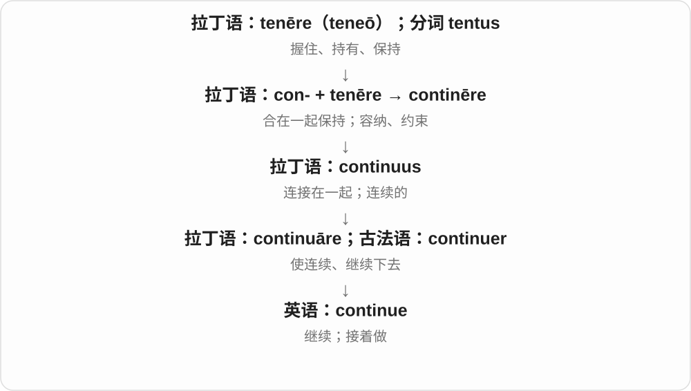

要看语境区分“没停”和“停后再来”。We continued after lunch 就明显有一段午饭间隔。

**常见搭配与例句**

continue doing / to do；continue with the work；continue for two hours。

> Please continue reading from the next paragraph.

请从下一段接着读。

> The rain continued throughout the night.

雨持续下了一整夜。

**别混淆**

continue 强调接下去；restart 强调从停止状态重新启动，可能从头开始。

### 2. content — 内容；所含物；含量；满足的

**音标**：内容：英 /ˈkɒntent/、美 /ˈkɑːntent/；满足：/kənˈtent/

**先抓住这个画面**

content 有两个画面：书里装着什么，是“内容”；觉得眼前拥有的已经够了，是“满足”。同源，但重音不同。

**怎么拆**

来自拉丁语 contentus，是 continēre“容纳、保持”的分词。内容义指被装在里面的东西；满足义联系自足、安于现状。

**怎么变成今天的意思**

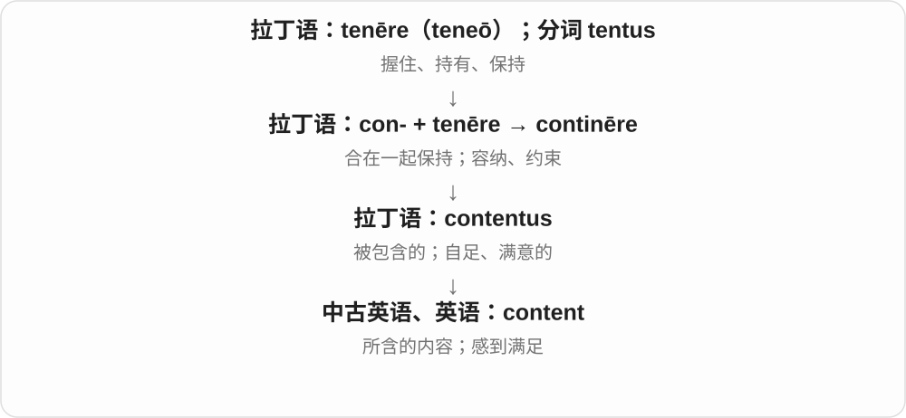

内容名词重音在前；满足形容词、使满足的动词重音在后。a table of contents 是目录；the contents of a bag 是包里的东西。

**常见搭配与例句**

online content；sugar content；be content with…；be content to do… 。

> The course focuses on the content of the argument.

课程关注论证的内容。

> She is content with a quiet evening at home.

在家安静地度过一个晚上，她就很满足。

> Check the sugar content on the label.

查看标签上的含糖量。

**别混淆**

happy 可指开心的情绪；content 更像平静地觉得“这样就够了”，不必兴高采烈。

### 3. maintain — 维持；维护；保养；坚持说

**音标**：/meɪnˈteɪn/

**先抓住这个画面**

maintain 像用手扶着一个状态，不让它垮下去：让机器好用、让联系不断，也可以坚持一个说法不松口。

**怎么拆**

古法语 maintenir 来自晚期拉丁语 manūtenēre，包含 manū“用手”和 tenēre“握住”。

**怎么变成今天的意思**

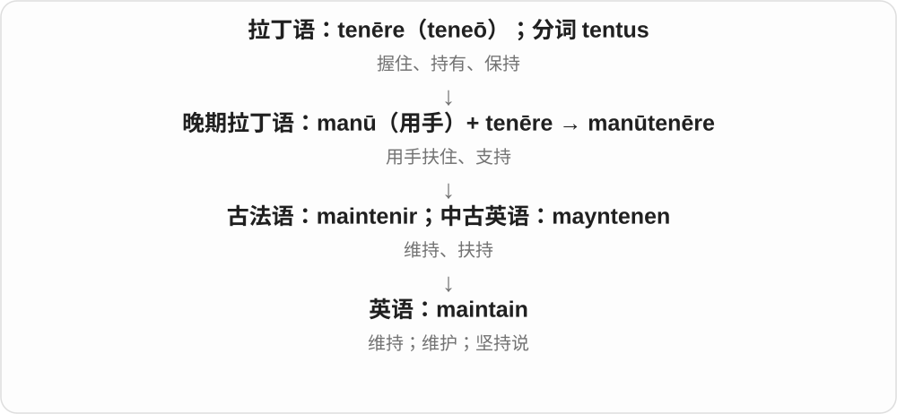

物品需要维护，关系需要维持，观点也可被坚持。maintain that… 通常是“坚持声称”，不是修理某物。

**常见搭配与例句**

maintain contact；maintain a balance；maintain equipment；maintain that… 。

> Regular checks help maintain the equipment in good condition.

定期检查有助于让设备保持良好状态。

> She maintains that the original plan is still workable.

她坚持认为原计划仍然可行。

**别混淆**

repair 是坏了之后修复；maintain 常是持续照料，让它保持良好状态。

### 4. entertainment — 娱乐；文娱活动；招待

**音标**：英 /ˌentəˈteɪnmənt/；美 /ˌentərˈteɪnmənt/

**先抓住这个画面**

entertainment 像有人安排节目、游戏或表演，把大家的注意力留在愉快的事情上。

**怎么拆**

经中古英语 entretenement 借自古法语 entretenement，早有维持、供养、接待义；不是仅在现代英语 entertain 后加 -ment 才出现。

**怎么变成今天的意思**

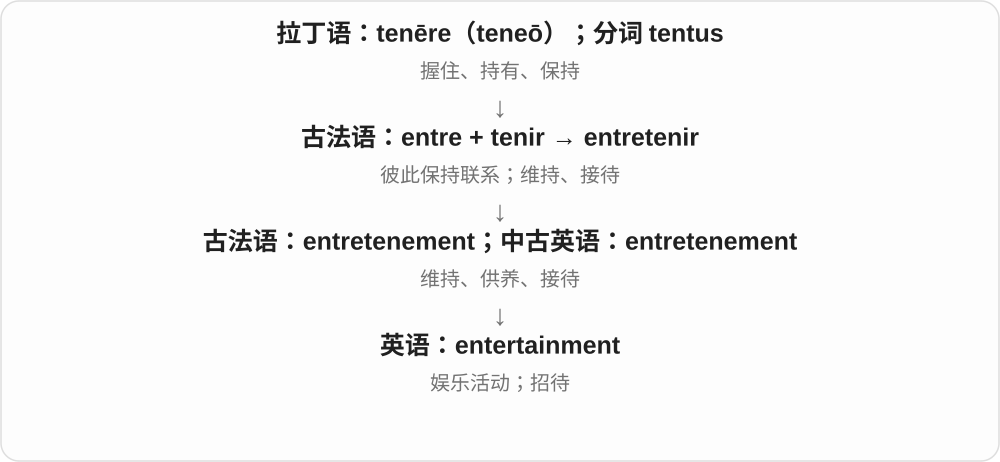

从维持、接待发展到使人愉快的活动。现在多说娱乐内容或节目，不只是招待客人的饭菜。

**常见搭配与例句**

live entertainment；the entertainment industry；provide entertainment。

> The festival offers live entertainment for all ages.

节庆活动为各年龄的人提供现场演出。

> We brought a few board games for entertainment on the trip.

我们带了几款桌游，在旅途中消遣。

**别混淆**

entertainment 是供人欣赏、消遣的活动；amusement 更常说被逗乐、觉得有趣的感受。

### 5. maintenance — 维护；保养；生活供养

**音标**：/ˈmeɪntənəns/

**先抓住这个画面**

maintenance 像隔一段时间给机器检查、清洁、调整，让它继续好好工作；对人的供养也是持续把生活撑住。

**怎么拆**

借自古法语 maintenance，与 maintenir 同族。它保留 -ten-，英语 maintain 的拼写和发音后来走了不同变化。

**怎么变成今天的意思**

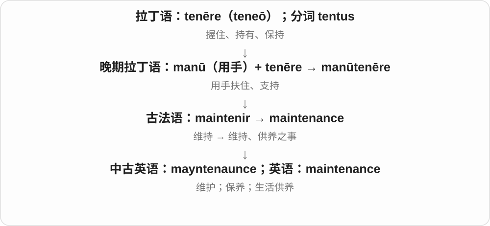

一般说的是维持状态所需的一系列工作或费用，未必有东西已经损坏。语境中也可指家庭生活供养。

**常见搭配与例句**

routine maintenance；maintenance costs；building maintenance；maintenance payments。

> The lift is closed for routine maintenance.

电梯因例行维护暂停使用。

> The budget includes the maintenance of the garden.

预算包括花园的维护费用。

**别混淆**

maintenance 是保养维护；repair 是修复具体损坏。保养得好，可能少做 repair。

### 6. contain — 容纳；包含；控制住

**音标**：/kənˈteɪn/

**先抓住这个画面**

contain 像盒子把东西留在里面；再抽象一点，就是把情绪、火势或问题限制在某个范围内。

**怎么拆**

con-（一起）+ tenēre（保持）在拉丁语中形成 continēre，经古法语 contenir 进入英语。

**怎么变成今天的意思**

既可以描述内部有什么，也可以强调“不让它跑出去”。contain excitement 是努力控制兴奋。

**常见搭配与例句**

contain water；contain information；contain a fire；contain one’s excitement。

> This bottle contains enough water for the walk.

这只瓶子装着足够这次步行喝的水。

> She could hardly contain her excitement.

她几乎控制不住自己的兴奋。

**别混淆**

include 强调作为组成部分；contain 常强调内部有某物或把扩散控制住，二者部分重叠。

### 7. lieutenant — 尉官；副手；代理人

**音标**：英 /lefˈtenənt/；美 /luːˈtenənt/

**先抓住这个画面**

lieutenant 的老画面是替别人站住那个位置、代行职责的人，后来发展为军衔，也能比喻得力副手。

**怎么拆**

古法语 lieu“位置”+ tenant“持有者”，经盎格鲁法语进入英语；tenant 远源是 tenēre。

**怎么变成今天的意思**

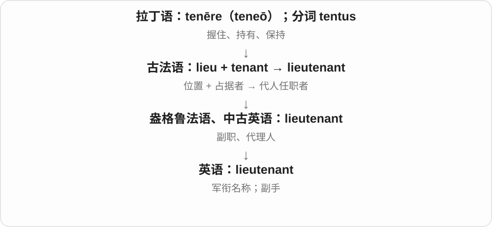

英美读音明显不同，英国常有 /f/，美国常以 /luː/ 开头。不同军种制度的具体级别并不完全一致。

**常见搭配与例句**

a lieutenant in the army；a trusted lieutenant；lieutenant colonel。

> The lieutenant briefed the team before the exercise.

这位尉官在演练前向队伍作了简报。

> She became the director’s most trusted lieutenant.

她成了主任最信任的副手。

**别混淆**

deputy 直接表示副职、代理；lieutenant 既是特定军衔，也可借指领导者的亲信副手。

### 8. obtain — 获得；取得；适用、存在（正式）

**音标**：/əbˈteɪn/

**先抓住这个画面**

obtain 像经过申请、寻找或安排，终于把需要的东西拿到手。

**怎么拆**

经法语 obtenir 来自拉丁语 obtinēre，包含 ob- 与 tenēre“持有”；历史有取得、占有、实现义。

**怎么变成今天的意思**

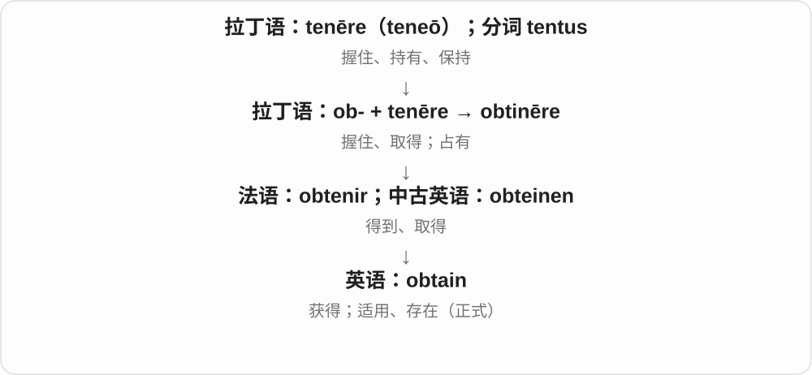

比 get 正式，常接许可、资料、结果。旧式或学术语境里 conditions obtain 表示这些条件仍成立、存在。

**常见搭配与例句**

obtain permission；obtain information；obtain a copy；conditions that obtain。

> You can obtain a copy from the front desk.

你可以在前台领取一份副本。

> We obtained permission to use the photographs.

我们取得了使用这些照片的许可。

**别混淆**

earn 强调凭劳动或表现赢得；obtain 只说成功得到，不规定通过哪种方式。

### 9. continuous — 连续的；不间断的

**音标**：/kənˈtɪnjuəs/

**先抓住这个画面**

continuous 像一条没有断开的线，强调在所说的时间或范围内中间没有停顿、缺口。

**怎么拆**

来自拉丁语 continuus“连续、相接的”，与 continēre“保持在一起”相连；不是先有英语 continue 才造出所有同族形容词。

**怎么变成今天的意思**

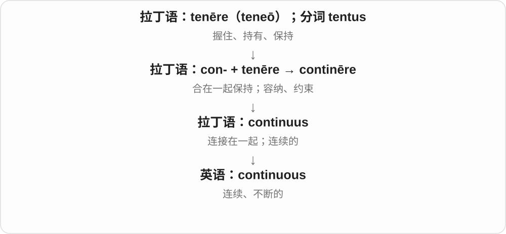

可以说机器连续运行，也可以说连续分布。数学中的连续有严格定义，直观上是输入微小变化不会在该点造成突跳。

**常见搭配与例句**

continuous operation；a continuous line；continuous improvement；a continuous function。

> The machine ran for twelve hours of continuous operation.

机器连续运行了十二个小时。

> Draw a continuous line around the shape.

沿着这个形状画一条不断开的线。

**别混淆**

continual 常强调反复发生；continuous 通常强调没有中断。实际词义有交叠，但这一区分最实用。

### 10. sustainable — 可持续的；能够长期维持的

**音标**：/səˈsteɪnəbəl/

**先抓住这个画面**

sustainable 像一种生活或生产方式，今天能运转，明天也不至于把维持它的资源和条件耗光。

**怎么拆**

sustain + -able。

**怎么变成今天的意思**

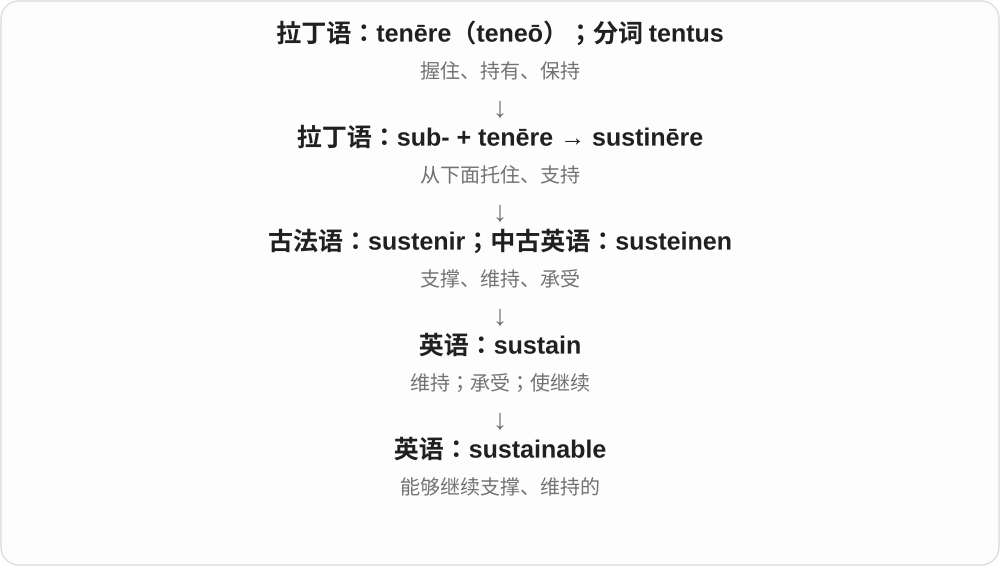

环境话题最常见，但也能说工作强度、财务模式、增长速度。不能只翻成绿色或环保而丢掉持续的含义。

**常见搭配与例句**

sustainable development；a sustainable pace；a sustainable business model。

> We need a sustainable pace of work, not constant overtime.

我们需要能长期维持的工作节奏，而不是持续加班。

> The project explores more sustainable ways to use local resources.

项目探索更可持续地使用本地资源的方法。

**别混淆**

renewable 是资源可再生；sustainable 是整体做法能否长期维持，两者相关但不完全相同。

### 11. sustained — 持续的；保持了一段时间的

**音标**：/səˈsteɪnd/

**先抓住这个画面**

sustained 像力量没有只闪一下，而是在一段时间里一直保持着。

**怎么拆**

sustain + -ed，由过去分词发展为形容词。

**怎么变成今天的意思**

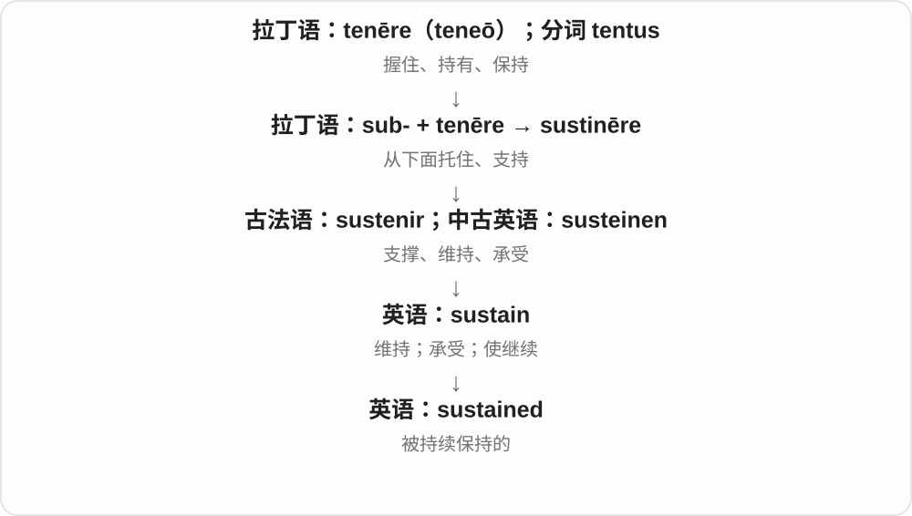

常修饰 effort、attention、growth、applause。它说实际持续，而 sustainable 说是否能够继续维持。

**常见搭配与例句**

sustained effort；sustained attention；sustained applause。

> The task requires sustained attention.

这项任务需要持续专注。

> The audience responded with sustained applause.

观众报以经久不息的掌声。

**别混淆**

sudden 强调突然发生；sustained 强调维持时间。sustained 增长未必自动 sustainable。

### 12. retain — 保留；保持；记住；留用

**音标**：/rɪˈteɪn/

**先抓住这个画面**

retain 像本来已经在你手里的东西，你继续把它留住：资料不丢、员工不走、学过的内容还记得。

**怎么拆**

经法语 retenir 来自拉丁语 retinēre，含 re- 与 tenēre“保持”；词根重点是留住。

**怎么变成今天的意思**

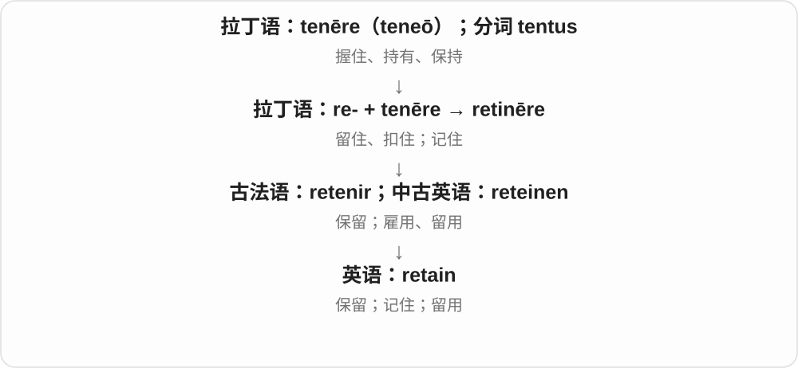

不是第一次得到，而是获得之后继续保存或拥有。retain a lawyer 还可以说聘用、留用法律服务。

**常见搭配与例句**

retain information；retain control；retain staff；retain its original shape。

> The fabric retains its shape after washing.

这种布料清洗后仍保持原来的形状。

> Short review sessions help me retain new vocabulary.

短时间的复习有助于我记住所学的新词。

**别混淆**

obtain 是拿到；retain 是拿到以后仍留着。remember 更常用于具体记起，retain information 强调保存记忆。

### 13. entertaining — 有趣的；令人愉快的

**音标**：英 /ˌentəˈteɪnɪŋ/；美 /ˌentərˈteɪnɪŋ/

**先抓住这个画面**

entertaining 像一段故事把你的注意力留住，让你愿意继续听，过程也觉得有意思。

**怎么拆**

entertain + -ing，形容词描述能给人带来娱乐的性质。

**怎么变成今天的意思**

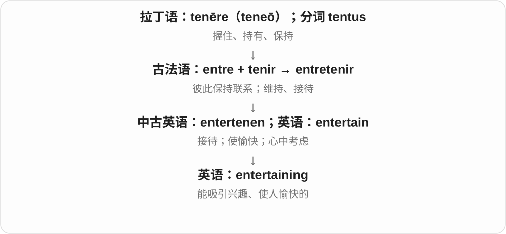

不必让人笑出声；精彩的比赛或生动的讲解也可以 entertaining。

**常见搭配与例句**

an entertaining story；an entertaining speaker；highly entertaining。

> The guide gave an entertaining account of the town’s history.

导游生动有趣地讲述了小镇的历史。

> The match was entertaining despite the low score.

虽然得分不高，这场比赛仍很好看。

**别混淆**

funny 常强调好笑；entertaining 强调有趣好看，可以包含悬念、惊奇或表演。

### 14. continent — 大陆；洲；能自制的；能控制排泄的

**音标**：英 /ˈkɒntɪnənt/；美 /ˈkɑːntɪnənt/

**先抓住这个画面**

continent 的大陆义像一整片连在一起的陆地；形容词义则像把自己的身体冲动控制在内。

**怎么拆**

都联系拉丁语 continēns“连在一起的、克制的”，是 continēre 的分词。大陆和自制是不同语义支线。

**怎么变成今天的意思**

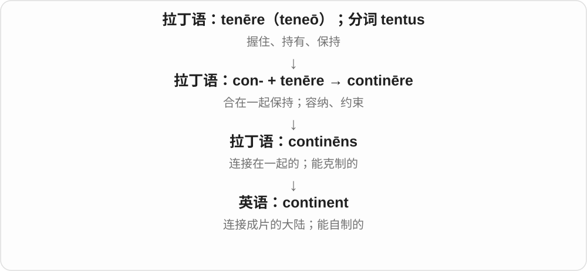

地理名词最常见；医学里 continent 可说能自主控制排尿或排便，不能理解成与洲有关的。

**常见搭配与例句**

the African continent；continental land；remain continent（身体控制义）。

> The exhibition features artists from several continents.

展览汇集了来自几个洲的艺术家。

> The report records whether the patient is continent.

报告记录了患者是否能自主控制排泄。

**别混淆**

continent 是大陆、洲；country 是国家，边界和划分依据不同。continental 才是通常的“大陆的”。

### 15. container — 容器；集装箱

**音标**：英 /kənˈteɪnə/；美 /kənˈteɪnər/

**先抓住这个画面**

container 像给东西一个能待住的外壳：饭盒、罐子是容器，运输货物的大箱子是集装箱。

**怎么拆**

contain + -er，表示用来容纳的东西。

**怎么变成今天的意思**

它按功能命名，不限定材料和形状。计算机容器借用了把应用及环境打包隔开的意象，具体机制另外学习。

**常见搭配与例句**

a plastic container；an airtight container；a shipping container。

> Store the biscuits in an airtight container.

把饼干放在密封容器中。

> The ship carried hundreds of steel containers.

船上载着数百个钢制集装箱。

**别混淆**

package 更强调包装好的一件物品或包裹；container 强调装东西的载体。

### 16. continental — 大陆的；洲的；欧洲大陆的

**音标**：英 /ˌkɒntɪˈnentəl/；美 /ˌkɑːntɪˈnentəl/

**先抓住这个画面**

continental 把注意力放到一整片大陆上，或者在英国语境里特指欧洲大陆。

**怎么拆**

continent + -al。

**怎么变成今天的意思**

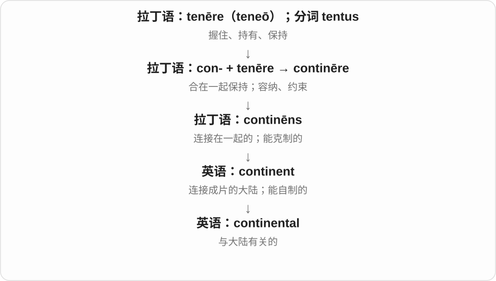

continental climate 说大陆性气候；continental breakfast 是习惯性餐饮名称，常指面包、饮料等较简单早餐，不按大陆面积理解。

**常见搭配与例句**

continental climate；continental Europe；a continental breakfast。

> The region has a continental climate with cold winters.

这个地区属大陆性气候，冬季寒冷。

> The hotel serves a continental breakfast.

酒店供应欧陆式早餐。

**别混淆**

intercontinental 是跨洲之间；continental 只是与大陆有关，没有自动包含跨越的意思。

### 17. continuously — 连续不断地

**音标**：/kənˈtɪnjuəsli/

**先抓住这个画面**

continuously 像把计时器打开后，这件事从头到尾一直进行，没有中途停下来。

**怎么拆**

continuous + -ly。

**怎么变成今天的意思**

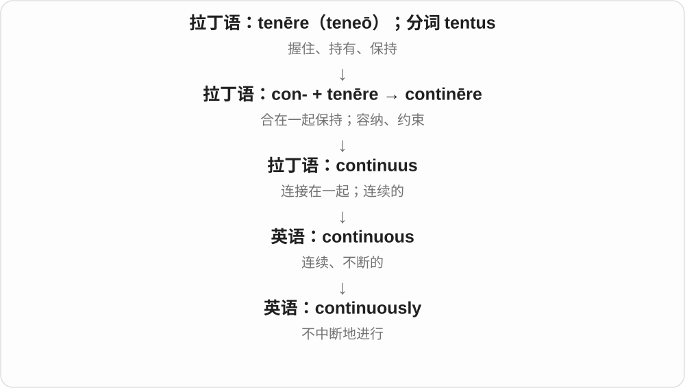

常用于运行、记录、变化等过程。即使数值在变化，只要过程没有停，也能 continuously。

**常见搭配与例句**

run continuously；record continuously；change continuously。

> The camera recorded continuously for six hours.

摄像机连续录了六个小时。

> Water flowed continuously through the pipe.

水不断地流过管道。

**别混淆**

continually 可以是一再发生；continuously 通常是持续无间断。每天响几次的铃不是全天 continuously ringing。

### 18. detention — 拘留；扣留；课后留校

**音标**：/dɪˈtenʃən/

**先抓住这个画面**

detention 像别人不让你按原计划离开，把你暂时留在某个地方；学校里也可指违纪后的留校。

**怎么拆**

经法语 détention 来自拉丁语 dētentiō，与 dētinēre“扣住”同族；不是仅按英语 detain 加后缀形成的历史。

**怎么变成今天的意思**

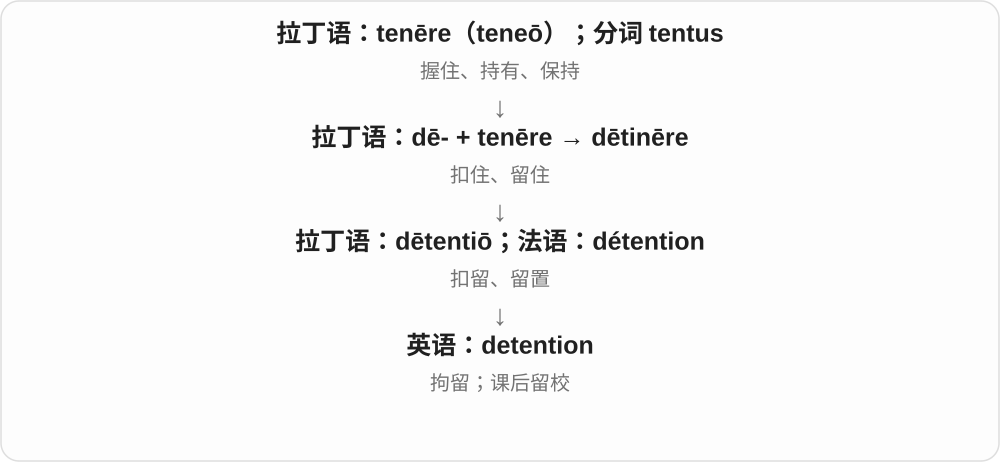

不同语境的权力和程序不同。学校 detention 与警方拘留共享留住的核心意思，但不能当成同一种处置。

**常见搭配与例句**

in detention；a detention centre；after-school detention；serve a detention。

> The report describes the conditions in the detention centre.

报告描述了拘留中心的条件。

> He received detention for repeatedly disrupting the class.

他因一再扰乱课堂而被罚课后留校。

**别混淆**

arrest 是逮捕这一行动；detention 强调被扣留的状态或一段时间，具体关系取决于语境。

### 19. sustain — 维持；支撑；承受；遭受

**音标**：/səˈsteɪn/

**先抓住这个画面**

sustain 像从下面一直托着，让某种状态继续：维持生活、保持努力、把一个音拉住；承受伤害则是身体接住了不好的影响。

**怎么拆**

经古法语 sustenir 来自拉丁语 sustinēre，sub-（从下面）+ tenēre（保持）发生词形变化。

**怎么变成今天的意思**

sustain an effort 是让努力持续；sustain injuries 是遭受伤害。不是所有搭配都能译为支持某个观点。

**常见搭配与例句**

sustain growth；sustain an effort；sustain an injury；sustain a note。

> The small business could not sustain such high costs.

这家小企业无法持续承担这么高的成本。

> Several passengers sustained minor injuries.

几名乘客受了轻伤。

> The singer sustained the final note.

歌手延长保持了最后一个音。

**别混淆**

support 可以在某一刻提供帮助；sustain 往往强调把它托住并维持一段时间。

### 20. tenure — 任期；职位持有；终身教职保障；土地保有

**音标**：英 /ˈtenjə/；美 /ˈtenjər/

**先抓住这个画面**

tenure 像一个人把某个职位或土地持有在手中，既能说这段持有期，也能说拥有它的制度安排。

**怎么拆**

经古法语、盎格鲁法语 tenure 来到英语，远源是 tenēre“持有”；不是 ten“十”加后缀。

**怎么变成今天的意思**

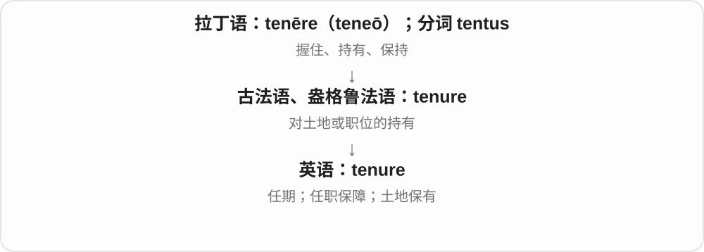

during her tenure 是她任职期间；academic tenure 是较稳定的教职保障，不等于无论发生什么都绝对不会失去职位。

**常见搭配与例句**

during someone’s tenure；academic tenure；land tenure；grant tenure。

> The library expanded during her tenure as director.

在她担任馆长期间，图书馆扩大了规模。

> He was awarded tenure after the university’s review.

大学评审后授予了他长期教职保障。

**别混淆**

term 常指预先规定的任期长度；tenure 可指实际在任时间，也可指任职资格、保障。

### 21. continually — 不断地；频繁反复地

**音标**：/kənˈtɪnjuəli/

**先抓住这个画面**

continually 像手机一会儿响一下、一会儿又响一下，事情不断回来发生，未必每秒都在进行。

**怎么拆**

continual + -ly。

**怎么变成今天的意思**

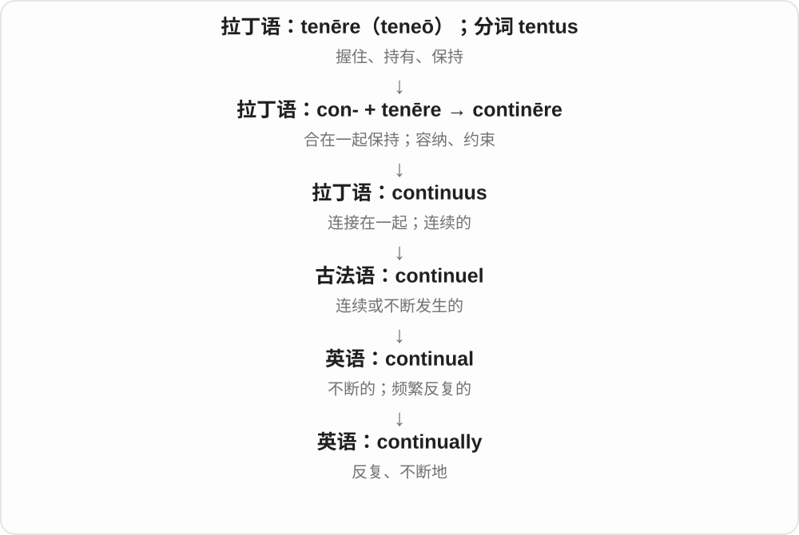

常与烦扰、更新、提问等反复行为搭配。也有不停的用法，因此遇到真实文本要结合上下文。

**常见搭配与例句**

continually ask；continually change；continually interrupt。

> He continually checked his phone during dinner.

吃晚饭时他一再查看手机。

> The website is continually updated with new examples.

网站不断补充新的例子。

**别混淆**

continuously 更突出没有停顿；continually 常突出一再发生。两词不是在所有句子里都绝对互斥。

### 22. entertain — 使有趣、使愉快；招待；考虑

**音标**：英 /ˌentəˈteɪn/；美 /ˌentərˈteɪn/

**先抓住这个画面**

entertain 像把客人、注意力或一个想法留在自己这里：招待客人，吸引观众，也把想法暂时放在心里考虑。

**怎么拆**

经法语 entretenir 来自 entre“彼此、之间”+ tenir“保持”；tenir 远源是 tenēre。

**怎么变成今天的意思**

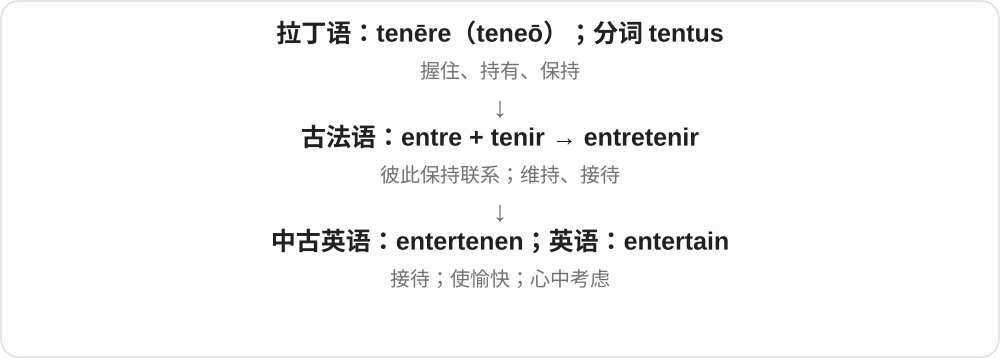

娱乐、接待与考虑之间有保持、容纳的联系。entertain an idea 是愿意考虑，不是已经赞同。

**常见搭配与例句**

entertain guests；entertain an audience；entertain an idea；entertain doubts。

> The storyteller entertained the children for an hour.

讲故事的人让孩子们听得开心，一个小时都没有厌倦。

> We are willing to entertain alternative proposals.

我们愿意考虑其他方案。

> They often entertain friends at home.

他们常在家招待朋友。

**别混淆**

consider 是普通考虑；entertain an idea 常强调允许这个可能性进入考虑范围。

### 23. retention — 保留；留存；记忆保持

**音标**：/rɪˈtenʃən/

**先抓住这个画面**

retention 是看本来已经得到的人或东西，还能留下多少、多久：员工留任、用户留存、知识记住都能这样说。

**怎么拆**

来自拉丁语 retentiō，经中古英语 retencioun 发展；与 retain 同族而有独立名词借入链。

**怎么变成今天的意思**

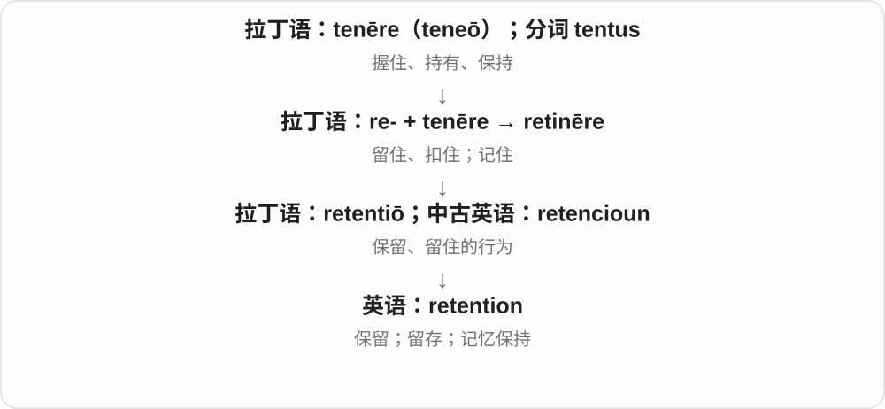

常是一个过程或衡量性质，不仅指把文件放进柜子。water retention 是水分被留在体内或材料里，需看领域。

**常见搭配与例句**

employee retention；customer retention；memory retention；data retention。

> The company is trying to improve employee retention.

公司正努力提高员工留任率。

> Regular practice improves long-term retention of new words.

经常练习能帮助长期记住新单词。

**别混淆**

acquisition 关注新增、获得；retention 关注已经得到以后还能留住。

### 24. tenant — 房客；承租人；空间使用者

**音标**：/ˈtenənt/

**先抓住这个画面**

tenant 是实际住着、用着某个地方的人，现代最常见的是租房或租用商铺的一方。

**怎么拆**

来自法语 tenant，原为 tenir“持有”的现在分词；经盎格鲁法语进入英语。

**怎么变成今天的意思**

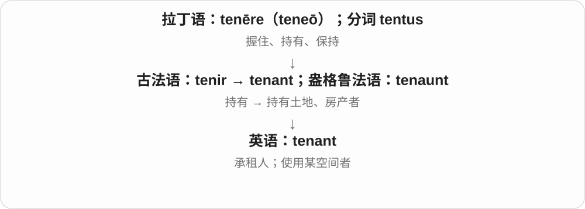

老意思是土地或空间的持有者，现代并不因此等于房产所有者。软件里的 tenant 借指共享系统中的一组独立客户。

**常见搭配与例句**

a tenant of the building；a commercial tenant；landlord and tenant。

> The tenant reported a leak in the kitchen.

房客报告厨房有漏水。

> The shop has had the same tenant for ten years.

这间店铺已经由同一位租户租用了十年。

**别混淆**

landlord 出租房产；tenant 租用房产。resident 只说居住者，不一定存在租赁关系。

### 25. continuity — 连续性；连贯；前后一致

**音标**：英 /ˌkɒntɪˈnjuːəti/；美 /ˌkɑːntɪˈnuːəti/

**先抓住这个画面**

continuity 像把几个阶段接起来，看中间有没有断口、前后是否对得上。

**怎么拆**

经法语 continuité 来自拉丁语 continuitās，联系 continuus“连续的”；不是单纯从英语 continue 临时加 -ity。

**怎么变成今天的意思**

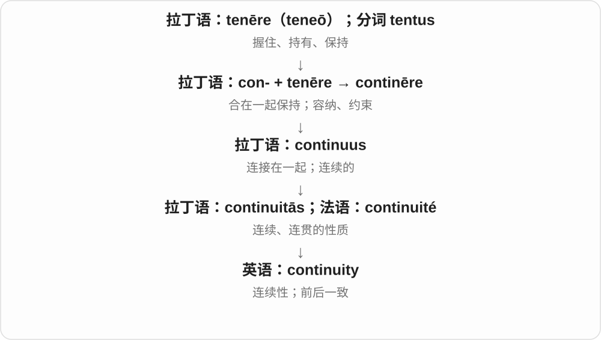

既可说服务不中断，也可说故事和电影镜头前后一致。镜头间杯子忽然换了位置，就可能有 continuity error。

**常见搭配与例句**

continuity of service；ensure continuity；a continuity error；continuity between… 。

> The handover plan ensures continuity of service.

交接计划确保服务不中断。

> A misplaced cup created a continuity error between the two shots.

一个放错位置的杯子让两个镜头之间出现了穿帮。

**别混淆**

continuation 是继续这一行为或续接部分；continuity 是各部分连续、相互接得上的性质。

### 26. sustainability — 可持续性；长期维持能力

**音标**：/səˌsteɪnəˈbɪləti/

**先抓住这个画面**

sustainability 是追问“这样一直做下去，还撑不撑得住”，要把资源、成本和长期影响一起考虑。

**怎么拆**

sustain + -ability，或从 sustainable 的名词形式理解。

**怎么变成今天的意思**

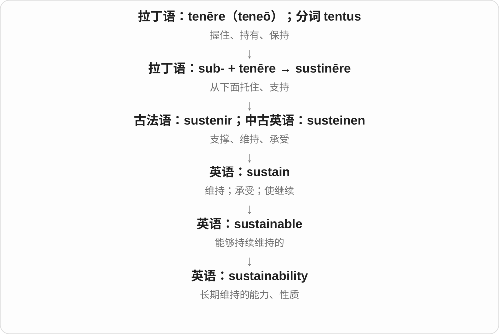

可以讨论生态，也可以讨论项目经费、工作安排。单词不是给任何新产品自动盖环保认证章。

**常见搭配与例句**

environmental sustainability；financial sustainability；long-term sustainability。

> The review questioned the financial sustainability of the programme.

评审对项目的财务可持续性提出了疑问。

> Sustainability was considered from the beginning of the design process.

设计过程从一开始就考虑了可持续性。

**别混淆**

efficiency 看投入与产出如何；sustainability 看这种做法能否持续。短期高效的做法未必长期撑得住。

### 27. continuation — 继续；延续；续接部分

**音标**：/kənˌtɪnjuˈeɪʃən/

**先抓住这个画面**

continuation 像故事下一章把上一章接着讲，既可以说接着进行，也可以指接上来的那一段。

**怎么拆**

经古法语 continuation 来自拉丁语 continuātiō，与 continuāre“使继续”同族。

**怎么变成今天的意思**

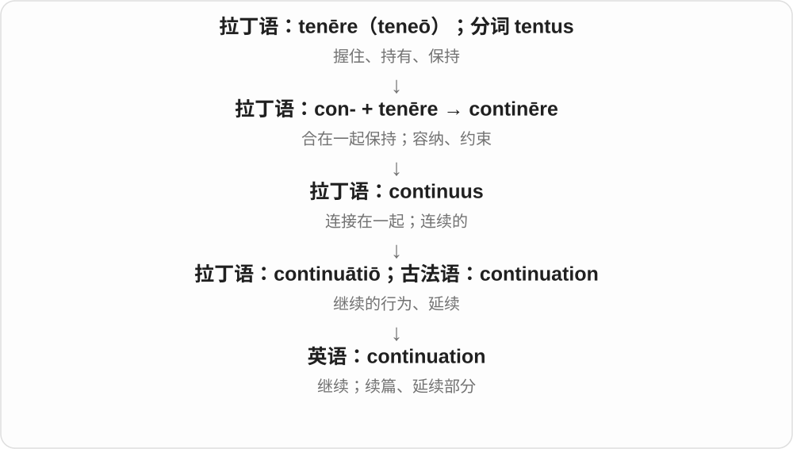

常用于工作、谈判、故事或路线的延续。不是所有 continuation 都从头重新来，通常保留前面的进展。

**常见搭配与例句**

a continuation of…；the continuation of talks；a direct continuation。

> The second book is a continuation of the first story.

第二本书接着讲第一本的故事。

> Both sides agreed to the continuation of the talks.

双方同意继续谈判。

**别混淆**

continuity 强调前后不断、相连的性质；continuation 强调继续做或接续的部分。

### 28. containment — 控制；遏制；围堵；容纳设施

**音标**：/kənˈteɪnmənt/

**先抓住这个画面**

containment 像给溢出的东西加一道边界，目标是让它别继续向外扩散。

**怎么拆**

contain + -ment。

**怎么变成今天的意思**

可以是实际围住泄漏物，也可以是阻止问题扩大。政治中的遏制也借用这个方向，但具体政策另有历史。

**常见搭配与例句**

spill containment；containment measures；a containment system。

> The team set up barriers for spill containment.

团队设置了围挡来控制泄漏物扩散。

> The first goal was containment of the problem.

最初的目标是控制问题，不让它扩大。

**别混淆**

elimination 是消除；containment 是控制在范围内，东西可能仍然存在。

### 29. entertainer — 演艺人员；表演者；娱乐大众的人

**音标**：英 /ˌentəˈteɪnə/；美 /ˌentərˈteɪnər/

**先抓住这个画面**

entertainer 像靠表演把观众留住的人，可以唱歌、变魔术、讲笑话，不只限于演员。

**怎么拆**

entertain + -er。

**怎么变成今天的意思**

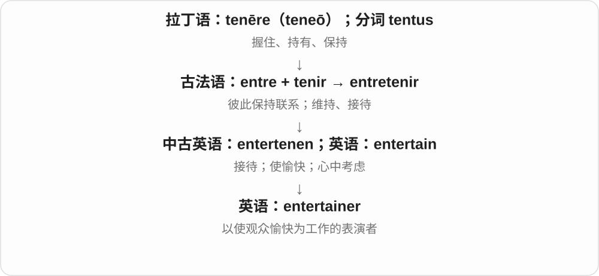

这个名称按表演的目的概括职业，不规定具体艺术形式。

**常见搭配与例句**

a professional entertainer；a children’s entertainer；a talented entertainer。

> The entertainer kept the children engaged with simple magic tricks.

表演者用简单的魔术吸引住了孩子们。

> She worked as an entertainer on a passenger ship.

她曾在客船上担任演艺人员。

**别混淆**

actor 主要表演角色；entertainer 范围更广，主持人、歌手、魔术师都可能属于它。

### 30. continuum — 连续体；渐变的整体

**音标**：/kənˈtɪnjuəm/

**先抓住这个画面**

continuum 像从浅到深的一条色带，相邻两点变化很小，但最左和最右可以很不一样。

**怎么拆**

借自拉丁语 continuum，是 continuus“连续的”的中性形式。

**怎么变成今天的意思**

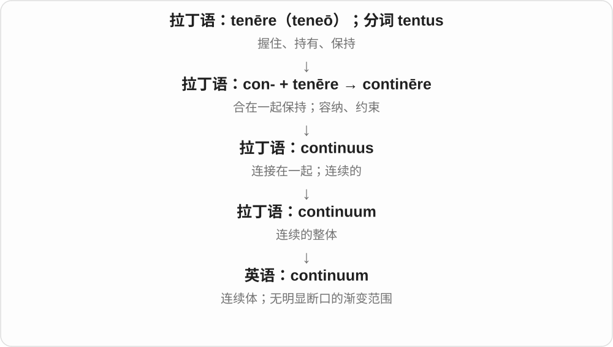

常用来提醒我们：有些事不适合只分成两个盒子，中间还有很多逐渐过渡的状态。数学中另有严格用法。

**常见搭配与例句**

a continuum of abilities；on a continuum；a spectrum or continuum。

> Confidence exists on a continuum rather than in two fixed states.

自信程度是逐渐变化的，并非只有两种固定状态。

> The colours form a continuum from pale yellow to deep orange.

这些颜色从浅黄色逐渐过渡到深橙色，构成一个连续范围。

**别混淆**

category 是一类一类划开；continuum 强调相邻状态可以平滑过渡，边界不一定清楚。

### 31. tenor — 男高音；男高音声部；总体基调

**音标**：英 /ˈtenə/；美 /ˈtenər/

**先抓住这个画面**

tenor 在音乐中原来联系“托住旋律”的声部，现代常指男高音；谈一段话的 tenor，则是在抓它贯穿始终的基调。

**怎么拆**

经法语 tenor / tenour 来自拉丁语 tenor“延续、保持的进程”，与 tenēre 同族。

**怎么变成今天的意思**

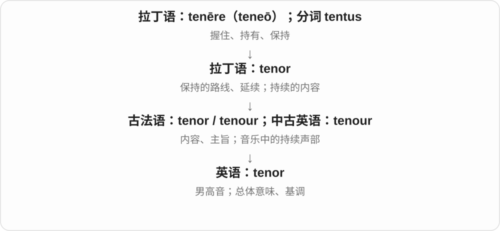

音乐历史中的声部安排逐步变化，不能把所有时代的 tenor 都套成今天的固定音域。日常书面语 general tenor 是总体意味。

**常见搭配与例句**

a tenor voice；sing tenor；the general tenor of the speech。

> The choir needs another tenor for the concert.

合唱团需要再增加一位男高音参加音乐会。

> The general tenor of the meeting was cautiously optimistic.

会议的总体基调是谨慎乐观。

**别混淆**

tone 常说当下语气、情绪；tenor 更常说整段言论贯穿的方向或总体基调。

### 32. discontent — 不满；不满足

**音标**：/ˌdɪskənˈtent/

**先抓住这个画面**

discontent 像看着现状，心里觉得“这样还不行”，希望事情有所改变。

**怎么拆**

dis-（否定、相反）+ content（满足）。

**怎么变成今天的意思**

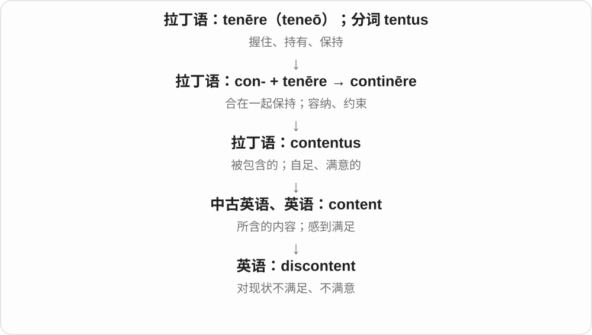

名词最常见，常说一群人对待遇、安排或生活状况的不满；并不一定已经发脾气或公开抗议。

**常见搭配与例句**

discontent with…；growing discontent；express discontent。

> There was growing discontent with the new timetable.

人们对新时间表的不满日益增加。

> The survey revealed widespread discontent among staff.

调查显示员工中普遍存在不满。

**别混淆**

anger 是愤怒；discontent 是不满意的状态，可以很安静，也可能积累成愤怒。

### 33. pertinent — 切题的；相关而有用的

**音标**：英 /ˈpɜːtɪnənt/；美 /ˈpɜːrtɪnənt/

**先抓住这个画面**

pertinent 像一句话刚好落在讨论的要点上，确实与当前问题有关系。

**怎么拆**

来自拉丁语 pertinēns，经法语等进入英语；对应 pertinēre“关系到、属于”的分词。

**怎么变成今天的意思**

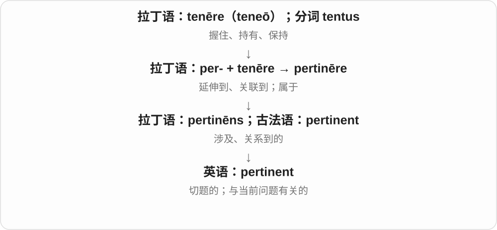

它常比“多少有关”更强调切中问题。pertinent question 是该在此刻问的、有帮助的问题。

**常见搭配与例句**

pertinent to…；a pertinent question；pertinent information。

> She asked a pertinent question about the deadline.

她问了一个切题的问题，涉及截止日期。

> Please include only information pertinent to the application.

请只提供与申请相关的信息。

**别混淆**

relevant 强调相关；pertinent 常进一步让人觉得切题、适用于眼前问题，二者经常重叠。

### 34. continual — 不断的；频繁反复的

**音标**：/kənˈtɪnjuəl/

**先抓住这个画面**

continual 像一件事隔不了多久又来一次，让人感觉总在发生。

**怎么拆**

经古法语 continuel 来自拉丁语 continuus“连续的”，历史上与 continuous 很接近。

**怎么变成今天的意思**

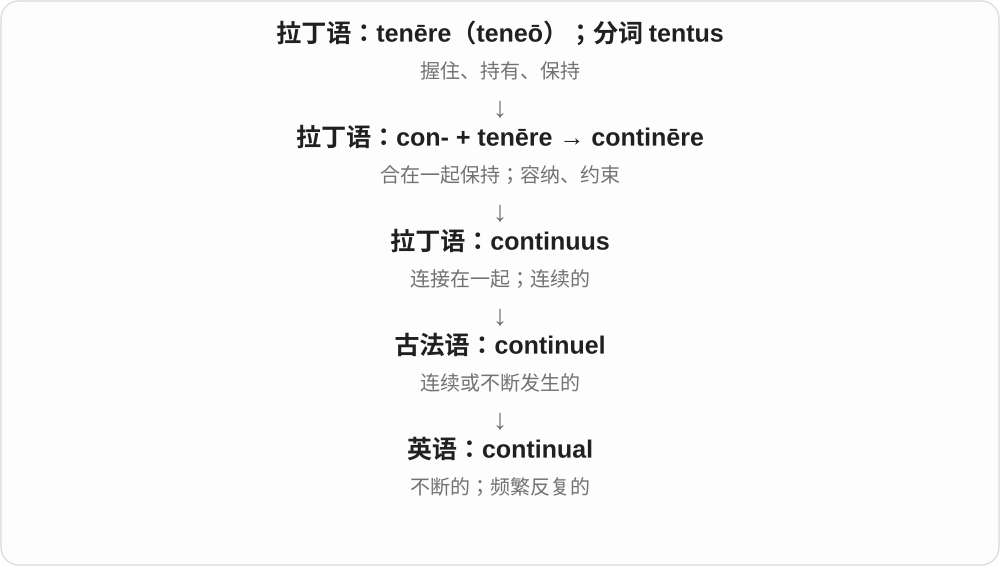

现代常用来描述持续反复的干扰、变化或要求。它也能表示连续，不必把实用辨析当成永远没有例外的规则。

**常见搭配与例句**

continual interruptions；continual change；a continual source of… 。

> Continual interruptions made it hard to finish the report.

接连不断的打扰让人难以写完报告。

> The garden is a continual source of new ideas for her paintings.

这座花园不断为她的绘画带来新想法。

**别混淆**

continuous 一般强调没有间断；continual 常强调反复不断。电话一再打来可以 continual，通话从不挂断才典型是 continuous。

### 35. detain — 扣留；拘留；耽搁

**音标**：/dɪˈteɪn/

**先抓住这个画面**

detain 像拉住一个本来要离开的人，不让他继续走。可能是正式扣留，也可能只是谈话把人耽误了。

**怎么拆**

经古法语 detenir 来自拉丁语 dētinēre“留住、扣住”，包含 dē- 与 tenēre。

**怎么变成今天的意思**

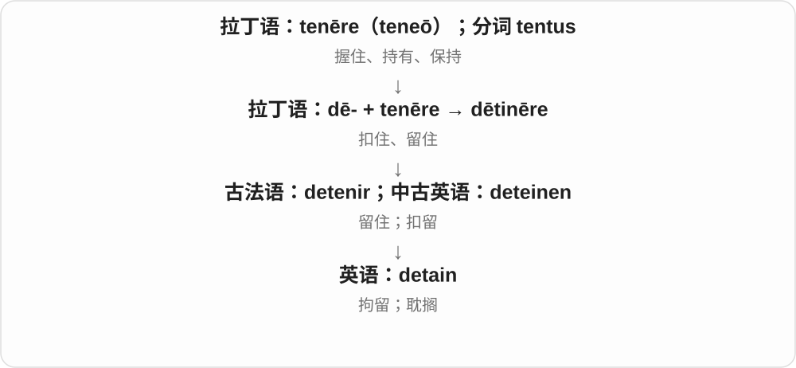

I won’t detain you 是礼貌地说“不耽误你了”，不涉及拘留。正式扣留义则要看机构与语境。

**常见搭配与例句**

detain a suspect；be detained for questioning；not detain someone long。

> The police detained a man for questioning.

警方扣留了一名男子进行询问。

> I will not detain you any longer.

我不再耽误你了。

**别混淆**

delay 可以由交通、天气等造成；detain 更突出某人或某种事务把人留住。

### 36. abstinence — 戒除；节制；禁欲

**音标**：/ˈæbstɪnəns/

**先抓住这个画面**

abstinence 像面对想做的事，持续给自己设一道“不做”的边界，常说不喝酒、禁食某物或不发生性行为。

**怎么拆**

经古法语 abstinence 来自拉丁语 abstinentia，联系 abstinēre“把自己克制住”。

**怎么变成今天的意思**

不是简单少一点，而常指在所说的范围或期间内不做。具体戒除什么，要看 from 后面的内容。

**常见搭配与例句**

abstinence from alcohol；a period of abstinence；total abstinence。

> He chose a month of abstinence from alcohol.

他决定一个月不喝酒。

> The article discusses voluntary abstinence from certain foods.

文章讨论了自愿不吃某些食物的做法。

**别混淆**

moderation 是适量、有节制地做；abstinence 通常是在某个范围内完全不做。

### 37. intercontinental — 洲际的；跨洲之间的

**音标**：英 /ˌɪntəkɒntɪˈnentəl/；美 /ˌɪntərkɑːntɪˈnentəl/

**先抓住这个画面**

intercontinental 像航线把一个洲和另一个洲连起来，重点是大陆之间的往来。

**怎么拆**

inter-（在……之间）+ continental。

**怎么变成今天的意思**

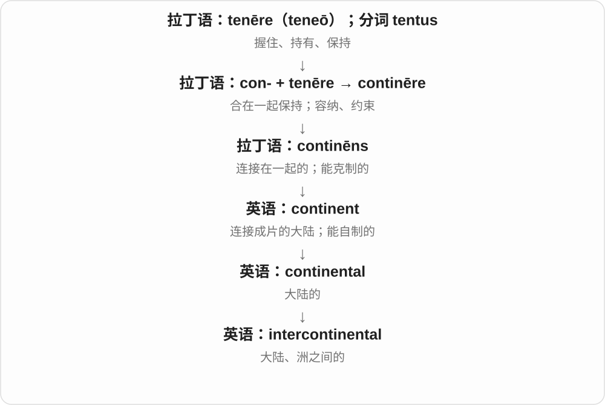

常形容航班、交通、贸易等。不是只在一个大陆内部横穿很长距离。

**常见搭配与例句**

an intercontinental flight；intercontinental travel；intercontinental trade。

> The airport added a new intercontinental route.

机场新开了一条洲际航线。

> Intercontinental travel requires careful planning across time zones.

跨洲旅行需要仔细规划跨时区的安排。

**别混淆**

transcontinental 通常横穿一个大陆；intercontinental 通常连接不同大陆。

### 38. unsustainable — 无法长期维持的；不可持续的

**音标**：/ˌʌnsəˈsteɪnəbəl/

**先抓住这个画面**

unsustainable 像支出一直大于收入，暂时还能撑一阵，但按同样方式继续迟早会出问题。

**怎么拆**

un-（不）+ sustainable。

**怎么变成今天的意思**

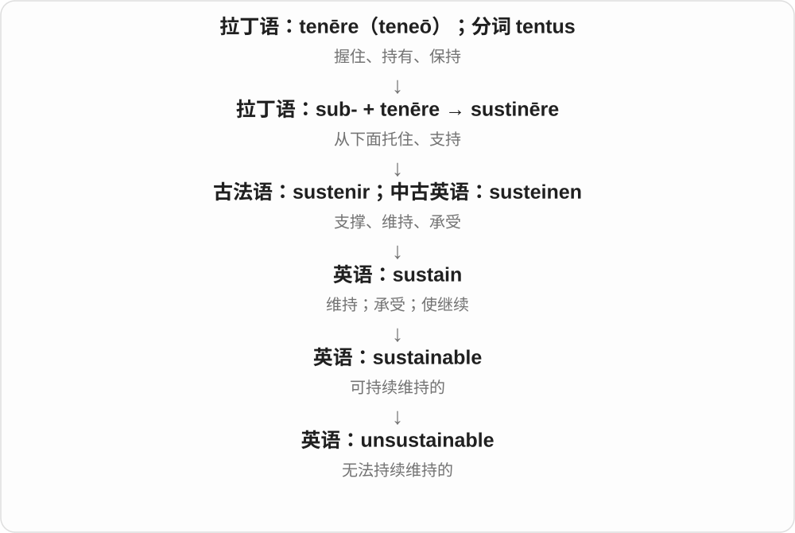

不一定表示当下马上崩溃，而是维持所需条件会被耗尽，或现有负担长期承受不了。

**常见搭配与例句**

an unsustainable workload；unsustainable costs；an unsustainable practice。

> The team’s workload had become unsustainable.

团队的工作负担已经到了无法长期维持的程度。

> Relying on emergency funds every month is unsustainable.

每个月都依靠应急资金是无法长久维持的。

**别混淆**

impossible 是无法做到；unsustainable 可以短期做到，只是无法长期照这样继续。

### 39. retainer — 预付聘用费；牙齿保持器；随从

**音标**：英 /rɪˈteɪnə/；美 /rɪˈteɪnər/

**先抓住这个画面**

retainer 都在帮忙“留住”：预付聘用费留住专业服务，牙齿保持器留住矫正后的位置，旧时随从则被长期留在主人身边。

**怎么拆**

retain + -er。

**怎么变成今天的意思**

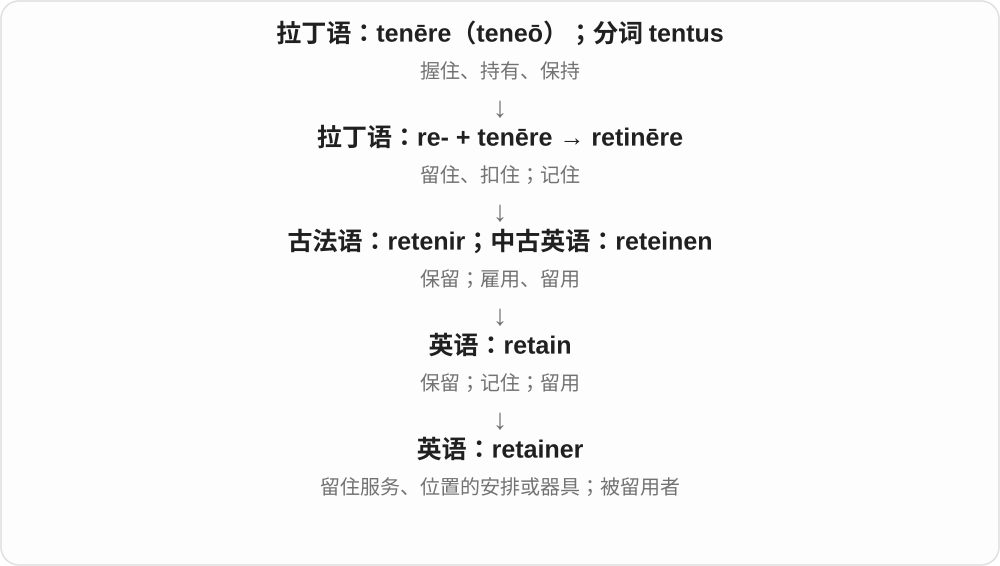

几个义项按搭配分开学。pay a retainer 多是费用；wear a retainer 多是牙齿保持器。

**常见搭配与例句**

pay a retainer；on retainer；wear a retainer；a loyal retainer。

> The firm pays the consultant a monthly retainer.

公司每月向顾问支付一笔预付聘用费。

> She keeps her retainer in a small case.

她把牙齿保持器放在一个小盒子里。

**别混淆**

deposit 是多种场合的预付款、押金；retainer 特别常用于保留专业人员服务的费用。

### 40. discontinue — 停止；不再生产、提供或进行

**音标**：/ˌdɪskənˈtɪnjuː/

**先抓住这个画面**

discontinue 像把原先一直供应的产品或服务这条线切断，从此不再接着做。

**怎么拆**

来自古法语 descontinuer，现代可拆成 dis- + continue；否定、停止的构词在借入前已有。

**怎么变成今天的意思**

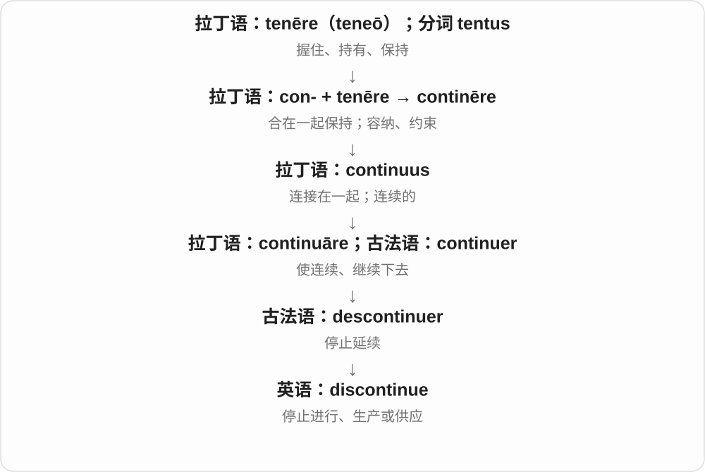

常见于产品、服务、惯例。比 pause 更容易表示某项安排正式结束，不只是短暂停一会儿。

**常见搭配与例句**

discontinue a product；discontinue a service；be discontinued。

> The company will discontinue the older model next year.

公司明年将停止生产旧型号。

> The library discontinued the service because few people used it.

图书馆因使用者很少而停止了这项服务。

**别混淆**

pause 是暂时停顿；discontinue 通常停止原有安排，是否以后恢复另说。

### 41. tenacity — 坚韧；顽强；不轻易放弃

**音标**：/təˈnæsəti/

**先抓住这个画面**

tenacity 像手已经很累，仍牢牢抓住目标不松开，着重说坚持到底的劲头。

**怎么拆**

经法语 ténacité 来自拉丁语 tenācitās，后者与 tenāx“紧抓不放”同族。

**怎么变成今天的意思**

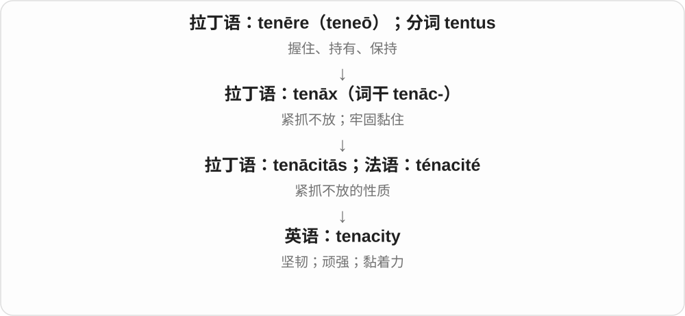

可以赞一个人克服困难的韧劲，也可说材料黏住、保持结合的能力。不是只要执拗就一定值得称赞。

**常见搭配与例句**

show tenacity；remarkable tenacity；the tenacity to keep trying。

> Her tenacity helped the team finish the difficult project.

她的坚韧帮助团队完成了这个困难的项目。

> He pursued the missing records with remarkable tenacity.

他以非凡的韧劲持续寻找那些遗失的记录。

**别混淆**

stubbornness 常批评不肯改变；tenacity 常赞面对困难仍坚持，但具体褒贬仍要看坚持的事情。

### 42. abstain — 克制不做；戒除；弃权

**音标**：/əbˈsteɪn/

**先抓住这个画面**

abstain 像主动把自己的手收回来：不拿酒杯、不参加某个行为，或者投票时不投赞成也不投反对。

**怎么拆**

经古法语 abstenir 来自拉丁语 abstinēre，abs- 表离开，tenēre 表保持、克制。

**怎么变成今天的意思**

通常是有意识不做。弃权不等于投反对票，也不一定表示人没有到场。

**常见搭配与例句**

abstain from alcohol；abstain from doing…；abstain from voting。

> She decided to abstain from alcohol during the trip.

她决定旅行期间不喝酒。

> Two members abstained from voting.

两名成员投票时弃权。

**别混淆**

refrain 也说克制不做，范围广；abstain 特别常用于酒食、投票等明确的选择。

### 43. obtainable — 可以获得的；拿得到的

**音标**：/əbˈteɪnəbəl/

**先抓住这个画面**

obtainable 像你确实有路可以找到或拿到某样东西，不是只能想想。

**怎么拆**

obtain + -able。

**怎么变成今天的意思**

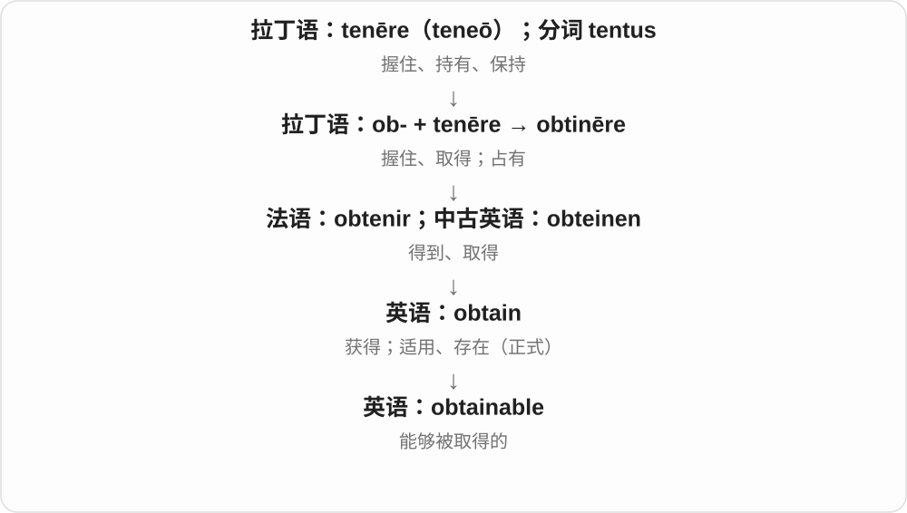

强调可取得性，不必表示免费、便宜或随处都有。

**常见搭配与例句**

readily obtainable；obtainable from…；easily obtainable information。

> Copies are obtainable from the university archive.

可以从大学档案馆获取副本。

> The materials are inexpensive and readily obtainable.

这些材料不贵，而且容易买到。

**别混淆**

available 常说可用、可供应；obtainable 更强调通过某种方式能成功取得。

### 44. tenancy — 租赁关系；租期；租用权

**音标**：/ˈtenənsi/

**先抓住这个画面**

tenancy 像 tenant 与房屋之间那段被允许租用的关系，既包括租用资格，也常指这段租期。

**怎么拆**

tenant + -cy，表示承租者的状态、关系。

**怎么变成今天的意思**

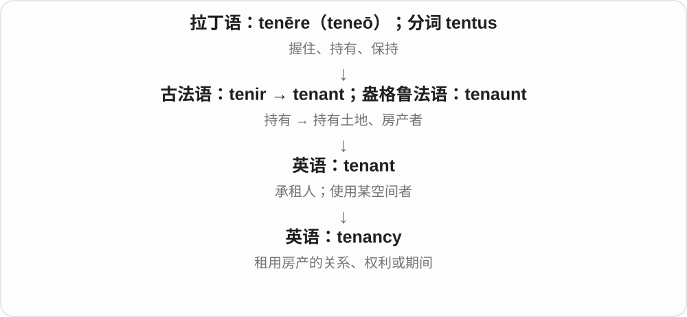

用在租房和商用物业话题中。单词本身不规定合同长度、续租办法或任何地区的具体法律。

**常见搭配与例句**

a tenancy agreement；a fixed-term tenancy；end a tenancy。

> The tenancy begins on the first of June.

租期从六月一日开始。

> Both parties signed the tenancy agreement.

双方签署了租赁协议。

**别混淆**

tenant 是人；tenancy 是关系或期间；rent 常是租金或租用动作。

### 45. contentment — 满足；知足；安然满意

**音标**：/kənˈtentmənt/

**先抓住这个画面**

contentment 像坐下来觉得“我现在这样就很好”，是一种平静的够了，不一定是兴奋的快乐。

**怎么拆**

借自法语 contentement，与 content“满足”同族；现代可见 content + -ment 的结构。

**怎么变成今天的意思**

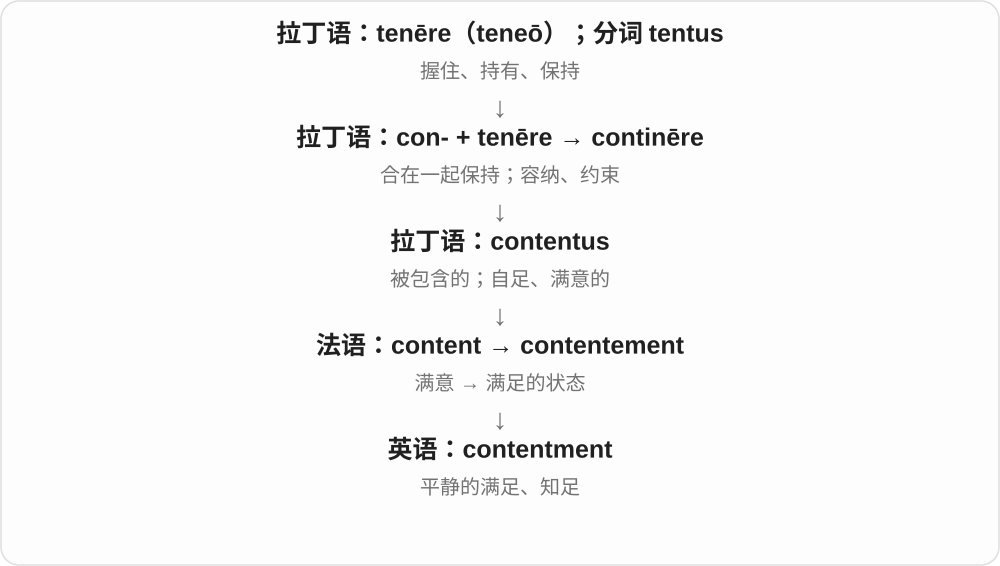

可以来自简单生活，也可以来自完成重要事情。重点是内心觉得当前所拥有的足够。

**常见搭配与例句**

a sense of contentment；quiet contentment；find contentment in… 。

> She felt a quiet contentment after finishing the garden.

收拾好花园后，她感到一种平静的满足。

> He finds contentment in simple daily routines.

他从简单的日常生活中获得满足。

**别混淆**

excitement 是兴奋、刺激；contentment 通常安静而稳定，不需要强烈情绪。

### 46. tenacious — 顽强的；抓得牢的；不轻易放弃的

**音标**：/təˈneɪʃəs/

**先抓住这个画面**

tenacious 像牢牢抓着树枝不松手：人会坚持目标，藤蔓或黏性物质也会紧紧附着。

**怎么拆**

来自拉丁语 tenāx“紧抓不放”，词干 tenāc- 与英语 -ious 形式结合；远源是 tenēre。

**怎么变成今天的意思**

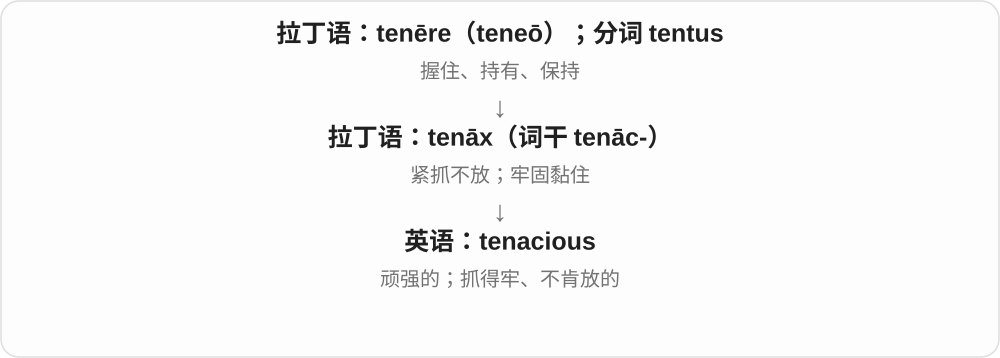

常赞坚定、有韧劲，也可描述难以消除的观念、气味等。是否褒义，要看它抓住的是什么。

**常见搭配与例句**

a tenacious competitor；a tenacious grip；tenacious beliefs。

> She is a tenacious researcher who follows every lead.

她是一位有韧劲的研究者，会追查每一条线索。

> The ivy kept a tenacious grip on the old wall.

常春藤牢牢攀附着旧墙。

**别混淆**

persistent 强调持续努力或反复出现；tenacious 更有抓住目标、不肯松手的感觉。

### 47. untenable — 站不住脚的；无法维持的

**音标**：/ʌnˈtenəbəl/

**先抓住这个画面**

untenable 像一座已经撑不住的桥，拿来形容观点没有依据，或某个处境再也无法继续维持。

**怎么拆**

un-（不）+ tenable（可以守住、维持的）。

**怎么变成今天的意思**

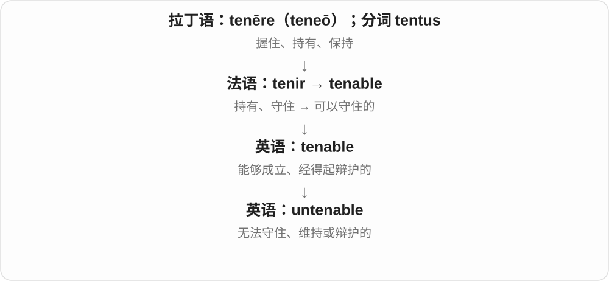

常修饰 argument、position、situation。不是仅仅不舒服，而是已经缺少继续成立的支撑。

**常见搭配与例句**

an untenable argument；an untenable position；become untenable。

> The new evidence made that explanation untenable.

新证据使那种解释站不住脚了。

> Without funding, the project’s position became untenable.

没有资金，项目变得无法维持。

**别混淆**

unpopular 只是不得人心；untenable 说缺少支撑、无法维持，一个不受欢迎的观点仍可能有依据。

### 48. tenet — 信条；基本原则

**音标**：/ˈtenɪt/，也读 /ˈtenət/

**先抓住这个画面**

tenet 像某个群体一直握在手里的核心信念，遇事会以它为判断依据。

**怎么拆**

直接借自拉丁语 tenet：“他、她或它持有”，是 tenēre 的第三人称单数形式。

**怎么变成今天的意思**

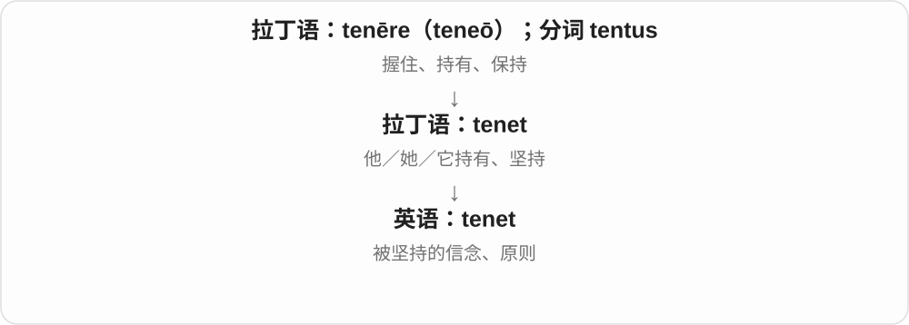

常用于思想体系、宗教、学派或组织理念。这个词说明有人奉为原则，不替它担保绝对正确。

**常见搭配与例句**

a central tenet；a basic tenet of…；challenge a tenet。

> Open discussion is a central tenet of the group.

公开讨论是这个团体的核心原则。

> The essay challenges a familiar tenet of the theory.

文章质疑了该理论中一个熟悉的基本观点。

**别混淆**

opinion 可以是随时变化的个人看法；tenet 通常是较核心、长期坚持的原则。

### 49. sustenance — 食物；营养；维生、精神支撑

**音标**：/ˈsʌstənəns/

**先抓住这个画面**

sustenance 像让人继续活下去的那一份支撑，具体是食物，也可以是情感或精神上的滋养。

**怎么拆**

经古法语 sustenance 来自 sustenir“支撑、供养”，远源为拉丁语 sustinēre。

**怎么变成今天的意思**

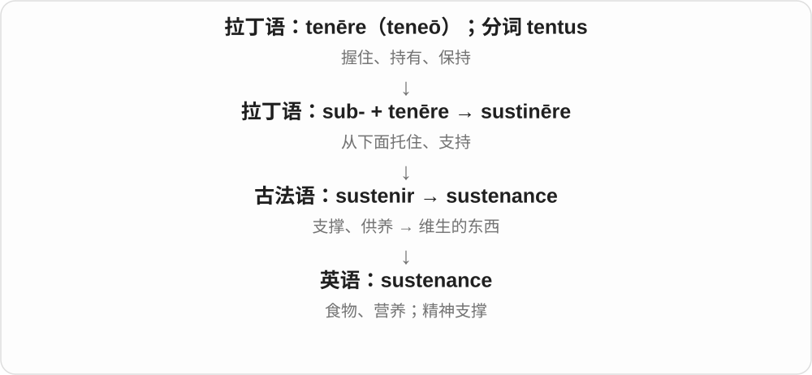

语气比 food 更书面，着重食物维持生命的作用。spiritual sustenance 不是给思想真的喂饭，而是能让人撑下去。

**常见搭配与例句**

provide sustenance；basic sustenance；emotional sustenance。

> The small farm provided sustenance for the family.

这个小农场为一家人提供维生食物。

> She drew emotional sustenance from her friends.

她从朋友那里获得了情感上的支撑。

**别混淆**

nutrition 侧重营养摄入或营养学；sustenance 侧重维生、支撑所需的东西，也可比喻使用。

### 50. contented — 满足的；心满意足的

**音标**：/kənˈtentɪd/

**先抓住这个画面**

contented 像饭后坐在窗边，神态安稳，觉得当前生活或处境已经足够好。

**怎么拆**

content（使满足）+ -ed，形容满足的状态。

**怎么变成今天的意思**

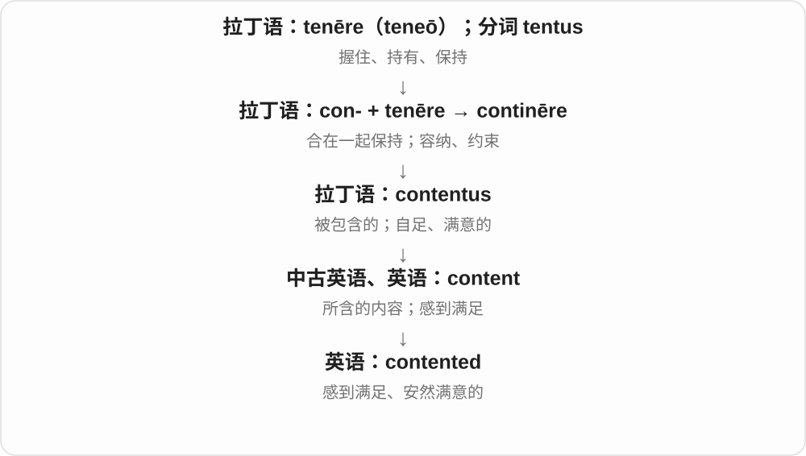

既可说人，也可修饰 smile、sigh 等表现。通常是平静满意，不必表现得很热烈。

**常见搭配与例句**

a contented smile；a contented life；look contented。

> The cat slept with a contented expression.

猫安然满足地睡着。

> She gave a contented sigh after a long walk.

长时间散步后，她满足地叹了一口气。

**别混淆**

content 常说 be content with…；contented 很自然地放在名词前，如 a contented child，两者意思接近。

### 51. incontinence — 失禁；缺乏自制（旧或正式义）

**音标**：英 /ɪnˈkɒntɪnəns/；美 /ɪnˈkɑːntɪnəns/

**先抓住这个画面**

incontinence 的医学画面是身体没能把本应留住的排泄物控制住，通常说尿液或粪便不由自主排出。

**怎么拆**

经法语 incontinence 来自拉丁语 incontinentia；in-（不）与 continentia“自制、控制”结合。

**怎么变成今天的意思**

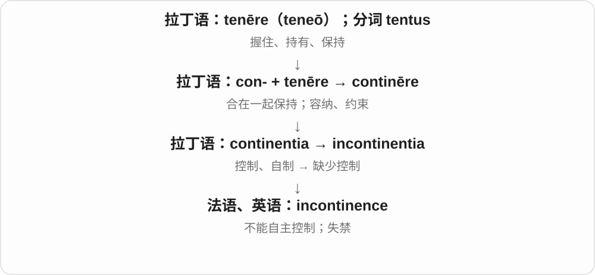

现代医疗义最常见，是身体功能问题，不应把它理解成态度懒散或品行问题。另有缺少自制的历史义。

**常见搭配与例句**

urinary incontinence；bowel incontinence；care for someone with incontinence。

> The leaflet explains urinary incontinence in clear language.

这份宣传册用清楚的语言解释尿失禁。

> The care plan includes support for a person with incontinence.

护理计划包括对失禁者的支持。

**别混淆**

retention 是本应排出的东西被留住；incontinence 是不能控制排出，方向不同。

### 52. countenance — 面容；神情；容许、支持

**音标**：/ˈkaʊntənəns/

**先抓住这个画面**

countenance 作名词像你脸上呈现出来的神态；作动词像对一件事点头默许、允许它继续存在。

**怎么拆**

经古法语 contenance、盎格鲁法语 countenance 发展，远源与 continēre“保持、约束”和 continentia 同族。

**怎么变成今天的意思**

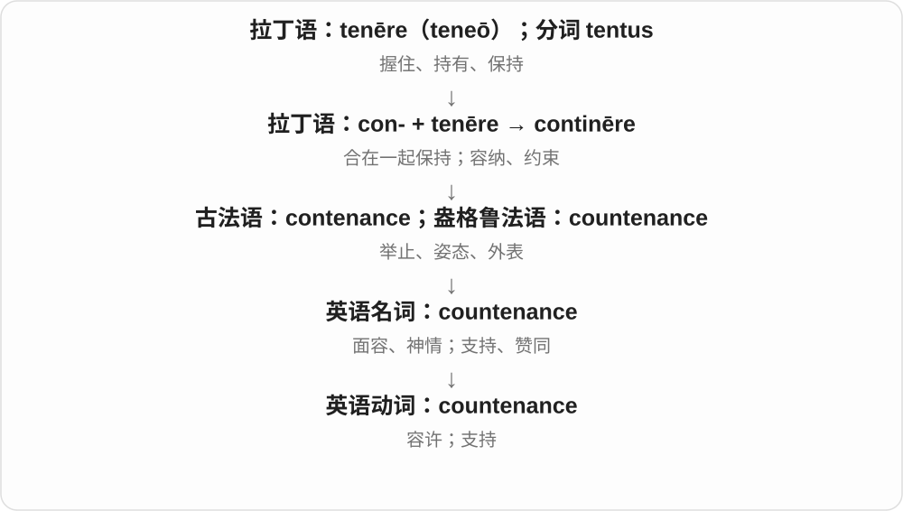

从如何保持自身、表现举止，发展到外在神情；动词承接支持、认可的用法。现代日常说脸通常用 face。

**常见搭配与例句**

a calm countenance；a cheerful countenance；refuse to countenance… 。

> A smile softened her serious countenance.

一个微笑让她严肃的面容柔和下来。

> The manager would not countenance deliberate dishonesty.

经理绝不容许故意欺骗。

**别混淆**

face 是一般的脸；countenance 更书面，常强调神情。动词不等于只是“看见”，而是认可或容许。

### 53. pertain — 与……有关；属于；适用于

**音标**：英 /pəˈteɪn/；美 /pərˈteɪn/

**先抓住这个画面**

pertain 像一根关系线把某件事连到当前话题：这份材料、职责或规则到底归哪一边。

**怎么拆**

经古法语 partenir / pertenir 来自拉丁语 pertinēre，原有延伸到、关系到、属于等义。

**怎么变成今天的意思**

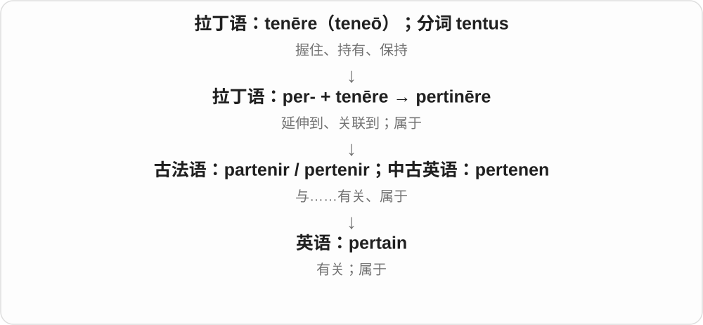

通常接 to。questions pertaining to the course 就是有关课程的问题，语气比 about 正式。

**常见搭配与例句**

pertain to…；rules pertaining to…；duties that pertain to an office。

> These documents pertain to the original agreement.

这些文件与原来的协议有关。

> The training covers duties pertaining to the role.

培训涵盖这个岗位相关的职责。

**别混淆**

belong to 常说归属、所有；pertain to 很常用于话题或规则上的关联，不一定涉及拥有。

### 54. tenement — 公寓楼；分户出租住宅；不动产（历史法律义）

**音标**：/ˈtenɪmənt/

**先抓住这个画面**

tenement 现在常让人想到一栋分给许多人家住的出租公寓楼；老意思更广，是被持有的房屋、土地等不动产。

**怎么拆**

经法语 tenement 来自中古拉丁语 tenimentum，与 tenēre“持有”同族。

**怎么变成今天的意思**

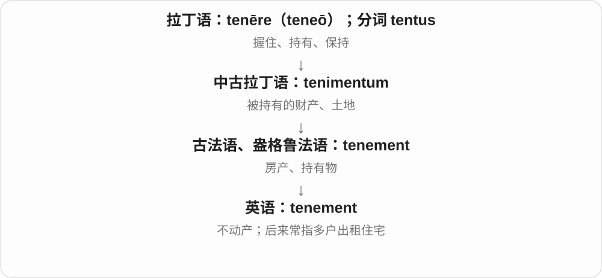

在不同地区，居住条件的暗示不同；美国历史语境常带拥挤旧住宅的意味，不能断言所有 tenement 都破败。

**常见搭配与例句**

a tenement building；a tenement flat；a row of tenements。

> Several families lived in the old tenement.

几户人家住在那栋老公寓楼里。

> The museum recreates a room in a nineteenth-century tenement.

博物馆复原了十九世纪出租公寓楼中的一个房间。

**别混淆**

apartment 是一套公寓；tenement 常指分户居住的整栋楼或这种住宅类型，历史法律义则更广。

### 55. detainee — 被拘留者；被扣留者

**音标**：/ˌdiːteɪˈniː/

**先抓住这个画面**

detainee 是那个被留住、不获准自由离开的人，重点在其被扣留的状态。

**怎么拆**

detain + -ee，-ee 表示承受动作的一方。

**怎么变成今天的意思**

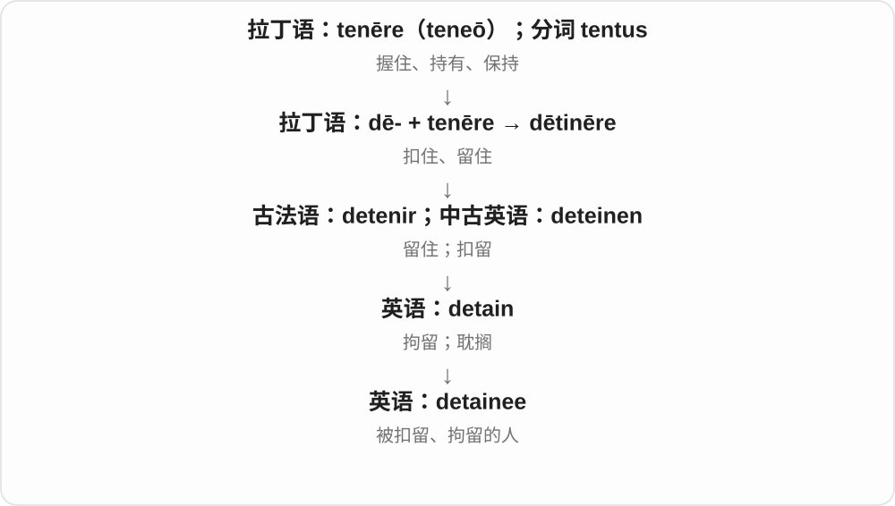

这个称呼本身不等于已经定罪。具体拘留背景、期限和法律身份要从上下文判断。

**常见搭配与例句**

a detained person / detainee；release a detainee；a former detainee。

> The report includes interviews with former detainees.

报告包括对曾被拘留者的访谈。

> Each detainee received a copy of the notice.

每名被拘留者都收到了一份通知。

**别混淆**

prisoner 可指监禁或被俘者；detainee 强调被扣留，不能单凭词形判断是否有罪。

### 56. tenured — 获得长期教职保障的；有稳定任职资格的

**音标**：英 /ˈtenjəd/；美 /ˈtenjərd/

**先抓住这个画面**

tenured 像经过任用评审后，职位有了较强的长期保障，不是每次短期合同到期都重新竞争。

**怎么拆**

tenure + -ed。

**怎么变成今天的意思**

最常见于大学教职。具体保障和条件由制度决定，不能简单理解为任意情况下都永远不能被解雇。

**常见搭配与例句**

a tenured professor；tenured faculty；become tenured。

> She became a tenured professor after several years of teaching and research.

经过几年的教学研究，她获得了有长期保障的教授职位。

> The policy applies to both tenured and temporary faculty.

这项政策同时适用于有长期教职保障和临时聘用的教师。

**别混淆**

permanent 说永久或长期；tenured 特指 tenure 这种任职资格、保障，含制度背景。

### 57. transcontinental — 横贯大陆的；跨越大陆的

**音标**：英 /ˌtrænzkɒntɪˈnentəl/；美 /ˌtrænzkɑːntɪˈnentəl/

**先抓住这个画面**

transcontinental 像铁路从一个大陆的一侧铺到另一侧，重点是横跨这整片陆地。

**怎么拆**

trans-（横越）+ continental。

**怎么变成今天的意思**

可以描述铁路、道路、航线或旅程。它不必跨越两个洲，而可能完全在同一大陆内。

**常见搭配与例句**

a transcontinental railway；a transcontinental journey；transcontinental travel。

> The railway made transcontinental travel much faster.

这条铁路让横贯大陆的旅行快了许多。

> They planned a transcontinental journey by train.

他们计划乘火车横穿大陆。

**别混淆**

intercontinental 通常是洲与洲之间；transcontinental 通常是横贯大陆。

### 58. continuance — 继续；延续；延期审理

**音标**：/kənˈtɪnjuəns/

**先抓住这个画面**

continuance 像让某个状态继续维持下去；法律里的专义却是把程序移到以后，让案件保持未完成状态。

**怎么拆**

经古法语 continuance 来自 continuer，早于现代英语随意的 continue + -ance 拆分。

**怎么变成今天的意思**

一般义与 continuation 接近；法庭语境常是获准延期，不应误译成马上继续开庭。

**常见搭配与例句**

the continuance of a practice；request a continuance；grant a continuance。

> The committee supported the continuance of the programme.

委员会支持继续开展该项目。

> The judge granted a continuance until the following week.

法官同意延期到下一周。

**别混淆**

continuation 通常说继续；continuance 在法律语境里常专指延期，不能只凭词根直译。

### 59. discontinuous — 不连续的；有间断的

**音标**：/ˌdɪskənˈtɪnjuəs/

**先抓住这个画面**

discontinuous 像虚线，中间一段一段留有空隙；也可以是过程突然跳变或停过几次。

**怎么拆**

dis-（分开、不）+ continuous。

**怎么变成今天的意思**

是描述实际连续性，不只是视觉上不够整齐。数学里函数在某点不连续，也不能只用图画好不好看来判断。

**常见搭配与例句**

a discontinuous line；discontinuous data；a discontinuous function。

> The map uses a discontinuous line to mark the proposed route.

地图用一条断续线标出拟议路线。

> The record is discontinuous because several pages are missing.

由于缺了几页，记录不是连续完整的。

**别混淆**

discontinued 是被停掉的；discontinuous 是存在间断，未必已经永久停止。

### 60. discontinuation — 停止；停产；终止供应

**音标**：/ˌdɪskənˌtɪnjuˈeɪʃən/

**先抓住这个画面**

discontinuation 像正式宣布“这条线到这里为止”，不再继续原来的产品、服务或安排。

**怎么拆**

discontinue + -ation；与 discontinue 停止延续的用法相连。

**怎么变成今天的意思**

常用于公告、服务说明和项目报告。重点是有意识停止某项原先持续的安排。

**常见搭配与例句**

discontinuation of a service；product discontinuation；announce discontinuation。

> The company announced the discontinuation of the old service.

公司宣布停止提供旧服务。

> Customers received notice before the product’s discontinuation.

产品停产前，客户收到了通知。

**别混淆**

interruption 是中途被打断，通常仍可能恢复；discontinuation 更常表示正式结束。

### 61. retinue — 随从；随行人员

**音标**：英 /ˈretɪnjuː/；美 /ˈretɪnuː/

**先抓住这个画面**

retinue 像一位重要人物身边总有一群跟随、照料或协助的人，他们组成随行队伍。

**怎么拆**

来自古法语 retenue，是 retenir“留用、保持”的分词名词化形式；远源为 retinēre。

**怎么变成今天的意思**

常带地位、排场或历史色彩。现代也可以带一点调侃，说某人走到哪都跟着一群人。

**常见搭配与例句**

a large retinue；a retinue of advisers；arrive with a retinue。

> The ambassador arrived with a small retinue.

大使带着一小队随行人员到达。

> The painting shows the ruler surrounded by a retinue of attendants.

画中统治者身边围着一群侍从。

**别混淆**

team 强调共同做事；retinue 更强调围绕某位人物随行、服务的关系。

### 62. impertinent — 无礼的；放肆的；不相干的（旧义）

**音标**：英 /ɪmˈpɜːtɪnənt/；美 /ɪmˈpɜːrtɪnənt/

**先抓住这个画面**

impertinent 像在不该插嘴、追问的地方越过分寸，听起来让人觉得无礼。

**怎么拆**

经法语 impertinent 来自拉丁语 impertinēns，原是 in-（不）+ pertinēns（相关的）。

**怎么变成今天的意思**

“与此事无关”逐步发展出“不合适、不合分寸”，再到无礼。现代不能只按 not pertinent 翻译，否则会漏掉态度。

**常见搭配与例句**

an impertinent question；an impertinent remark；be impertinent to… 。

> He apologized for the impertinent remark.

他为那句无礼的话道了歉。

> She thought the question about her salary was impertinent.

她觉得询问自己工资的问题很没分寸。

**别混淆**

irrelevant 只是与题目无关；impertinent 现代常带冒犯、没分寸的评价。

### 63. abstention — 弃权；不参与；克制不做

**音标**：/əbˈstenʃən/

**先抓住这个画面**

abstention 像投票表格里留出的第三种选择：这次不投赞成，也不投反对。

**怎么拆**

经法语 abstention 来自晚期拉丁语 abstentiō，与 abstinēre 同族；不是只能由英语 abstain 临时加后缀解释。

**怎么变成今天的意思**

在会议、表决中非常常见。它可以是有意不投票，不能一律理解成没有出席。

**常见搭配与例句**

three abstentions；record an abstention；abstention from voting。

> The motion passed with two abstentions.

这项动议获得通过，有两人弃权。

> Her abstention did not count as a vote against the proposal.

她的弃权不算作反对该提案的一票。

**别混淆**

abstinence 更常是持续戒除某类行为；abstention 常是某次不参与或弃权。

### 64. discontinuity — 不连续；断裂；突变点

**音标**：英 /ˌdɪskɒntɪˈnjuːəti/；美 /ˌdɪskɑːntɪˈnuːəti/

**先抓住这个画面**

discontinuity 像连续线上的断口，前后没有平顺地接上。

**怎么拆**

来自晚期拉丁语 discontinuitās，与 discontinuus“不连续的”相连；现代可拆 dis- + continuity。

**怎么变成今天的意思**

可说历史记录缺环，也可说函数在某处发生突跳。地质学中另指性质突然变化的界面。

**常见搭配与例句**

a discontinuity in the record；a point of discontinuity；cultural discontinuity。

> The missing years create a discontinuity in the historical record.

缺失的几年使历史记录出现断档。

> The graph shows a discontinuity at zero.

图像显示函数在零点处不连续。

**别混淆**

discontinuation 是停止某项活动的行为；discontinuity 是前后不连续的性质、断口或突变。

### 65. discontented — 不满的；对现状不满意的

**音标**：/ˌdɪskənˈtentɪd/

**先抓住这个画面**

discontented 像觉得眼前安排不合心意，总希望换个更好的状况。

**怎么拆**

dis-（不）+ contented。

**怎么变成今天的意思**

形容的是不满足，不一定已经公开反对。可接 with 说明不满对象。

**常见搭配与例句**

discontented with…；discontented workers；a discontented expression。

> Several staff members were discontented with the new arrangement.

几位员工对新安排不满意。

> He grew discontented despite his comfortable circumstances.

虽然生活舒适，他却越来越不满足。

**别混淆**

disappointed 常因具体期待落空；discontented 可是对长期现状的不满，没有一次明确落空也能发生。

### 66. tenable — 站得住脚的；可维持的；可守住的

**音标**：/ˈtenəbəl/

**先抓住这个画面**

tenable 像一个有支撑的立场，经得起追问和反驳，还能继续守住。

**怎么拆**

借自法语 tenable，来自 tenir“持有、守住”；-able 表能够。

**怎么变成今天的意思**

现代常形容解释、论点和立场。意思是能够合理辩护，不等于已经被证明是唯一正确答案。

**常见搭配与例句**

a tenable position；a tenable explanation；remain tenable。

> We need a tenable explanation for the difference.

我们需要一个说得通、站得住脚的解释来说明差异。

> That position is no longer tenable after the new findings.

新发现出现后，那种立场已无法维持。

**别混淆**

true 是真实；tenable 是现有理由下可以站得住脚，侧重点是能否维护。

### 67. unobtainable — 无法获得的；拿不到的

**音标**：/ˌʌnəbˈteɪnəbəl/

**先抓住这个画面**

unobtainable 像已经四处寻找，却没有可行渠道取得某件东西；可以是缺货，也可以是权限限制。

**怎么拆**

un-（不）+ obtainable。

**怎么变成今天的意思**

语境可能只限定某地、某时或某种条件下拿不到，不一定表示全世界永远不存在。

**常见搭配与例句**

currently unobtainable；unobtainable elsewhere；an unobtainable document。

> The replacement part is currently unobtainable.

这种替换零件目前买不到。

> The original document remained unobtainable during the investigation.

调查期间一直无法取得原始文件。

**别混淆**

unavailable 可以是暂不可用；unobtainable 更侧重无法成功取得，不一定是东西没有生产。

### 68. maintainer — 维护者；维持运作的人

**音标**：英 /meɪnˈteɪnə/；美 /meɪnˈteɪnər/

**先抓住这个画面**

maintainer 像持续照看一个项目或系统的人，处理问题、更新内容，让它不至于无人打理。

**怎么拆**

经法语 mainteneor、盎格鲁法语 maintenour 发展，英语词尾后来按 -er 调整；现代可分析为 maintain + -er。

**怎么变成今天的意思**

软件项目中很常见，通常包括审查变更、安排版本、维护项目方向等工作，不只会修一个错误。

**常见搭配与例句**

a project maintainer；a package maintainer；the current maintainer。

> The package maintainer reviewed the proposed change.

软件包维护者审查了提出的改动。

> The project is looking for a new maintainer.

这个项目正在寻找新的维护者。

**别混淆**

creator 是最初创建者；maintainer 是持续维护者，两者可能是同一人，也可能不同。

### 69. incontinent — 失禁的；不能自制的（旧义）

**音标**：英 /ɪnˈkɒntɪnənt/；美 /ɪnˈkɑːntɪnənt/

**先抓住这个画面**

incontinent 描述身体不能自主留住尿液或粪便；旧文也可能用它说欲望、言行不受控制。

**怎么拆**

经法语 incontinent 来自拉丁语 incontinēns，即 in-（不）+ continēns（自制的、能控制的）。

**怎么变成今天的意思**

现代医疗语境不带道德评价。若指人，可写 a person who is incontinent，以人的需要为中心理解。

**常见搭配与例句**

be incontinent；an incontinent patient；incontinent speech（旧式比喻）。

> The care team helped a patient who was incontinent.

护理团队帮助了一位有失禁情况的患者。

> In the old essay, “incontinent speech” means uncontrolled talking.

在这篇旧文章里，incontinent speech 指不加控制地说话。

**别混淆**

continent 可指能控制排泄；incontinent 是否定这项控制能力，不是“没有大陆”。

### 70. detainment — 扣留；被留住的状态

**音标**：/dɪˈteɪnmənt/

**先抓住这个画面**

detainment 把 detain 留住人的动作变成名词，关注这次扣留或被耽搁的状态。

**怎么拆**

detain + -ment。

**怎么变成今天的意思**

它与 detention 大量重叠，但常用程度较低；普通制度、设施名称更常用 detention。

**常见搭配与例句**

temporary detainment；the period of detainment；detainment for questioning。

> The report gives the date and length of the detainment.

报告给出了扣留的日期和时长。

> She described the events that led to her brief detainment.

她描述了导致自己被短暂扣留的经过。

**别混淆**

detention 是更常见的标准词，且常指学校留校；detainment 不自动带学校惩罚义。

### 71. impertinence — 无礼；放肆；无礼的话或行为

**音标**：英 /ɪmˈpɜːtɪnəns/；美 /ɪmˈpɜːrtɪnəns/

**先抓住这个画面**

impertinence 是让人觉得“你越过分寸了”的那种无礼，也可以指某一次具体的冒犯。

**怎么拆**

借自法语 impertinence，与 impertinent 同族；现代可联系 impertinent 的名词形式理解。

**怎么变成今天的意思**

不可数时说态度，有时也可数，指一句放肆的话或一件无礼的事。旧义不相关要依文境区分。

**常见搭配与例句**

have the impertinence to…；an act of impertinence；tolerate impertinence。

> She was surprised by the impertinence of the question.

那个问题太没分寸，让她感到惊讶。

> He had the impertinence to blame her for his own mistake.

他竟然无礼地把自己的错误怪到她头上。

**别混淆**

rudeness 是普通的粗鲁；impertinence 常特别带不合身份、场合或个人边界的冒犯感。

### 72. retentive — 善于保留的；记性好的；保水的

**音标**：/rɪˈtentɪv/

**先抓住这个画面**

retentive 像海绵把水留住，或大脑把学到的东西记住，强调具有留存能力。

**怎么拆**

经法语 rétentif / retentif 来自中古拉丁语 retentīvus，与 retinēre“留住”的 retent- 词干相连。

**怎么变成今天的意思**

最常见的学习搭配是 a retentive memory。描述土壤时要说清保留水分，不能都翻成记忆好。

**常见搭配与例句**

a retentive memory；water-retentive soil；retentive capacity。

> She has a retentive memory for names.

她很能记住人的名字。

> The soil is retentive enough to stay moist between waterings.

这种土壤保水性足够好，在两次浇水之间仍能保持湿润。

**别混淆**

retained 是已经被保留；retentive 是有保留能力，描述性质而非一次结果。

### 73. contentedly — 满足地；安然地

**音标**：/kənˈtentɪdli/

**先抓住这个画面**

contentedly 像做着眼前这件简单的事，心里没有催促自己追更多，神态很满足。

**怎么拆**

contented + -ly。

**怎么变成今天的意思**

常修饰坐着、吃着、微笑等动作，描述做事时的心情。

**常见搭配与例句**

smile contentedly；sit contentedly；eat contentedly。

> He sat contentedly by the fire with a book.

他拿着一本书，满足地坐在炉火旁。

> The children ate their lunch contentedly in the garden.

孩子们在花园里满足地吃着午餐。

**别混淆**

happily 可以兴奋快乐；contentedly 更带安稳、知足、不再要求更多的感觉。

### 74. maintainable — 能够维持的；便于维护的

**音标**：/meɪnˈteɪnəbəl/

**先抓住这个画面**

maintainable 像一台零件容易找到、结构看得明白的机器，出了问题能照料、修改，长期用下去也撑得住。

**怎么拆**

maintain + -able。

**怎么变成今天的意思**

在软件和工程中常特别强调容易维护；在其他语境也可说某个水平或状态能持续保持。

**常见搭配与例句**

maintainable software；a maintainable system；a maintainable level。

> Clear naming makes the code more maintainable.

清楚的命名让代码更容易维护。

> The team chose a design that would remain maintainable for years.

团队选择了一种多年后仍能维护的设计。

**别混淆**

reliable 是运行可靠；maintainable 是便于维护。一个系统暂时可靠，也可能很难修改。

### 75. tenaciously — 顽强地；紧紧抓住地

**音标**：/təˈneɪʃəsli/

**先抓住这个画面**

tenaciously 像用力咬住目标，遇到阻力也不松口，说明坚持的方式很顽强。

**怎么拆**

tenacious + -ly。

**怎么变成今天的意思**

可以修饰争取、坚持或实际附着。不同语境里，这种不放手可能可敬，也可能僵化。

**常见搭配与例句**

fight tenaciously；cling tenaciously to…；work tenaciously。

> She worked tenaciously to recover the lost data.

她坚持不懈地努力恢复丢失的数据。

> The old paint clung tenaciously to the surface.

旧油漆牢牢附着在表面上。

**别混淆**

carefully 是小心仔细；tenaciously 是不轻易放弃，两种特点可以同时出现。

### 76. maintainability — 可维护性；维护难易程度

**音标**：/meɪnˌteɪnəˈbɪləti/

**先抓住这个画面**

maintainability 是问“以后修、改、检查它费不费劲”，不是只看今天能不能运行。

**怎么拆**

maintain + -ability；也可联系 maintainable 对应的名词形式。

**怎么变成今天的意思**

常用于设备、软件和工程设计。零件可更换、结构清晰、文档好，通常都能帮助维护。

**常见搭配与例句**

improve maintainability；design for maintainability；software maintainability。

> The redesign improved the maintainability of the engine.

重新设计提高了发动机的可维护性。

> The review considered readability and maintainability, not just speed.

评审考虑了可读性和可维护性，而不只看速度。

**别混淆**

availability 看此刻或一段时间是否可用；maintainability 看需要维护时容易不容易。

### 77. continence — 控制排泄的能力；克制、自制

**音标**：英 /ˈkɒntɪnəns/；美 /ˈkɑːntɪnəns/

**先抓住这个画面**

continence 像身体把该留住的东西稳稳控制在内，现代护理话题中常指自主控制排尿、排便。

**怎么拆**

经古法语 continence 来自拉丁语 continentia，联系 continēre“控制、约束”。

**怎么变成今天的意思**

历史上也说自我克制，尤其对欲望的节制。现代身体功能义要与道德评价分开。

**常见搭配与例句**

bladder continence；continence care；restore continence；sexual continence（正式、旧义）。

> The assessment included questions about bladder continence.

评估包括有关膀胱控制能力的问题。

> The old text praises continence as a form of self-restraint.

旧文把自制赞为克制欲望的一种表现。

**别混淆**

continence 是控制能力；abstinence 通常是有意识选择不进行某行为，二者不是任何场景都相同。

### 78. abstinent — 戒除某种行为的；自我节制的

**音标**：/ˈæbstɪnənt/

**先抓住这个画面**

abstinent 描述一个人正在守住“不做”的界限，例如不喝酒，而不是仅仅喝得少。

**怎么拆**

经古法语 abstinent 来自拉丁语 abstinēns，即 abstinēre 的现在分词。

**怎么变成今天的意思**

常与 from 说明戒除对象。不要只看到这个词就默认是所有欲望都已戒除。

**常见搭配与例句**

abstinent from alcohol；remain abstinent；an abstinent period。

> He remained abstinent from alcohol throughout the month.

整个月他都没有喝酒。

> The study distinguishes abstinent participants from occasional drinkers.

研究把不饮酒的参与者与偶尔饮酒者区分开。

**别混淆**

abstemious 常指饮食有节制；abstinent 常指在所说范围内不参与、完全戒除。

### 79. discontinuance — 停止；终止；中止持续安排

**音标**：/ˌdɪskənˈtɪnjuəns/

**先抓住这个画面**

discontinuance 像把原来持续进行的惯例或程序收起来，不再照原样继续。

**怎么拆**

经盎格鲁法语、古法语 descontinuer 这一支线进入英语；现代可联系 discontinue 与 -ance。

**怎么变成今天的意思**

与 discontinuation 高度接近，较常见于正式、行政或法律文字；具体制度效果由语境决定。

**常见搭配与例句**

discontinuance of a service；notice of discontinuance；discontinuance of proceedings。

> Residents objected to the discontinuance of the bus service.

居民反对取消这条公交服务。

> The file contains a notice of discontinuance.

档案中有一份终止程序的通知。

**别混淆**

discontinuity 是不连续或断口；discontinuance 是把一项安排停掉。

### 80. malcontent — 不满者；牢骚者；不满现状的

**音标**：名词常读 /ˈmælkəntent/；形容词也读 /ˌmælkənˈtent/

**先抓住这个画面**

malcontent 像一个对当前安排总不满意、经常表达不满的人；这个称呼往往带说话者的贬意。

**怎么拆**

借自法语 malcontent，包含 mal-（不佳）与 content（满足），并非英语 mal- 随意组合的新词。

**怎么变成今天的意思**

称别人 malcontent，常把对方看作爱抱怨的人。因此既要理解词义，也要听出是谁在评价谁。

**常见搭配与例句**

a group of malcontents；a political malcontent；malcontent workers。

> The manager dismissed the critics as a few malcontents.

经理把批评者说成几个爱发牢骚的人，便不予理会。

> The novel follows a malcontent who gradually learns to take action.

小说描写一个不满现状的人逐渐学会采取行动。

**别混淆**

critic 可以基于理由提出批评；malcontent 更强调不满情绪，带标签意味。

### 81. detainer — 拘留文书、请求；扣留；扣留者

**音标**：英 /dɪˈteɪnə/；美 /dɪˈteɪnər/

**先抓住这个画面**

detainer 在法律文字中常像一张要求继续留住某人的文书或通知；按普通构词，也可以指留住别人的人。

**怎么拆**

法律名词经盎格鲁法语 detener、古法语 detenir 进入英语；表示施事者的用法则可由 detain + -er 形成。

**怎么变成今天的意思**

不同制度下可能指命令、请求、文书或扣留关系，不能看见 detainer 就假定某种固定法律效力。

**常见搭配与例句**

a detainer request；a detainer notice；lodge a detainer。

> The file includes a copy of the detainer notice.

档案中包括一份扣留通知的副本。

> The article explains how the detainer request was handled.

文章解释了该扣留请求如何被处理。

**别混淆**

detainee 是被扣留的人；detainer 可指扣留者，但现代法律中更常见的是相关文书、请求或安排。

### 82. countertenor — 高男声；假声男高音歌手

**音标**：英 /ˌkaʊntəˈtenə/；美 /ˈkaʊntərˌtenər/

**先抓住这个画面**

countertenor 今天常指能演唱女低音或相近高音区的成年男声歌手，常使用经过训练的假声或头声机制。

**怎么拆**

经古法语 contreteneur、中古英语 countretenour 传入，联系中古拉丁语 contratenor；现代可看出 counter- 与 tenor，不能据此认定是在英语里首次拼合。

**怎么变成今天的意思**

历史声部名和现代发声分类不完全一样。高男声不等于阉人歌手，也不能单靠音域推断人的说话声或身份。

**常见搭配与例句**

a countertenor soloist；the countertenor voice；a role for countertenor。

> The countertenor sang an aria from a Baroque opera.

这位高男声歌手演唱了一首巴洛克歌剧咏叹调。

> The ensemble invited a countertenor for the concert.

乐团邀请了一位高男声歌手参加音乐会。

**别混淆**

tenor 通常是男高音声部；countertenor 现代通常在更高音区演唱，来源中的 counter- 不是音量更大。

### 83. discontentment — 不满足；不满情绪

**音标**：/ˌdɪskənˈtentmənt/

**先抓住这个画面**

discontentment 像心里一直有个“还不够、不是我想要的”空缺，强调持续不满意的感受。

**怎么拆**

dis- + contentment。

**怎么变成今天的意思**

常说个人对生活、工作或处境的不满足，也可描述群体。比“愤怒”更强调满意感缺失。

**常见搭配与例句**

discontentment with…；a sense of discontentment；growing discontentment。

> She could not explain her growing discontentment with the job.

她说不清自己为什么对这份工作越来越不满意。

> The letter expresses discontentment without blaming anyone.

信中表达了不满，却没有责怪任何人。

**别混淆**

discontent 与它非常接近；discontentment 更容易突出内心状态，而 discontent 也常用于群体、社会不满。

### 84. pertinence — 切题性；相关性

**音标**：英 /ˈpɜːtɪnəns/；美 /ˈpɜːrtɪnəns/

**先抓住这个画面**

pertinence 是问“这句话对眼前讨论究竟有没有帮助”，强调与问题接得上。

**怎么拆**

借自法语 pertinence，与 pertinent“相关、切题”同族。

**怎么变成今天的意思**

这是正式名词。评价材料的 pertinence，看的不是它本身多精彩，而是对这个问题是否合适。

**常见搭配与例句**

the pertinence of a question；of direct pertinence to…；question the pertinence。

> The chair questioned the pertinence of the remark.

主席质疑那句话是否切题。

> The report explains the evidence’s pertinence to the case.

报告解释了这项证据与该事项的关联。

**别混淆**

importance 是重要性；pertinence 是切题性。重要的信息也可能与当前讨论无关。

### 85. appurtenant — 附属的；从属于主要事物的

**音标**：英 /əˈpɜːtɪnənt/；美 /əˈpɜːrtɪnənt/

**先抓住这个画面**

appurtenant 像房子旁边配套的通道或设施，自己不是主体，却是随主体一起使用、享有的部分。

**怎么拆**

经古法语 apurtenant 来到英语，同族于 appertain“附属于”。

**怎么变成今天的意思**

在房产等正式文字中常见。它不仅能说实物，还可说附随的权利；具体法律关系须看文书。

**常见搭配与例句**

appurtenant to…；appurtenant rights；appurtenant structures。

> The plan shows the buildings and their appurtenant structures.

规划图显示了建筑及其附属结构。

> The document lists rights appurtenant to the property.

文件列明了附属于该物业的权利。

**别混淆**

adjacent 只是位置挨着；appurtenant 强调附属关系，附近的东西不一定归属主体。

### 86. obtainment — 取得；获得

**音标**：/əbˈteɪnmənt/

**先抓住这个画面**

obtainment 把“最终拿到”这一步作为一件事来谈，像项目完成前先取得许可。

**怎么拆**

obtain + -ment。

**怎么变成今天的意思**

较正式、较少用，日常多直接说 obtaining something。不是专指挣到钱或买东西。

**常见搭配与例句**

the obtainment of permission；obtainment of information；successful obtainment。

> The next stage depends on the obtainment of permission.

下一阶段取决于是否取得许可。

> The report describes the obtainment of the missing records.

报告描述了获取遗失记录的过程。

**别混淆**

acquisition 常用范围更广，也可指所获得的东西；obtainment 更直接强调获得这一动作。

### 87. continuant — 连续音；持续的；持续存在物（哲学）

**音标**：/kənˈtɪnjuənt/

**先抓住这个画面**

continuant 的语言学画面是气流能够继续通过、声音可以延长，例如 /s/；它不像 /p/ 那样先完全堵住再放开。

**怎么拆**

continue + -ant，表示延续的性质或相应事物。

**怎么变成今天的意思**

声音分类的细分标准会随理论而有差别。哲学里也可指在时间中保持自身身份的事物，不能把所有义都当成发音术语。

**常见搭配与例句**

a continuant sound；continuant consonants；a continuant entity。

> The teacher used /s/ as an example of a continuant.

老师用 /s/ 举例说明连续音。

> The exercise contrasts continuant sounds with stops.

练习把连续音与塞音作了对比。

**别混淆**

stop 指发音时气流曾被完全阻断的塞音；continuant 强调可保持的气流、声音。

### 88. tenuto — 保持音值地；充分保持的（音乐）

**音标**：英 /teˈnuːtəʊ/；美 /teˈnuːtoʊ/

**先抓住这个画面**

tenuto 像提醒演奏者“把这个音托住”，通常奏足应有时值，依上下文也可能给予适当强调。

**怎么拆**

借自意大利语 tenuto，是 tenere“保持”的过去分词；意大利语 tenere 承接拉丁语 tenēre。

**怎么变成今天的意思**

它可以作演奏指示，也可指相应标记。不是一见 tenuto 就任意拉长到超过节拍，需结合乐谱与风格。

**常见搭配与例句**

a tenuto mark；play the note tenuto；a tenuto passage。

> The pianist played the final note tenuto.

钢琴家充分保持了最后一个音的时值。

> A short horizontal line above the note indicates tenuto here.

这里音符上方的短横线表示保持音。

**别混淆**

staccato 强调短促分离；tenuto 强调保持。legato 是音与音连贯，不完全等同于单个音奏足。

### 89. appurtenance — 附属物；配套设备；附随权利

**音标**：英 /əˈpɜːtɪnəns/；美 /əˈpɜːrtɪnəns/

**先抓住这个画面**

appurtenance 像某个主体旁边“随它一起算”的东西，可以是房屋设施，也可以是某种身份附带的物品。

**怎么拆**

经盎格鲁法语 apurtenance、古法语 apartenance 进入英语，联系 apartenir“附属于”。

**怎么变成今天的意思**

常用复数 appurtenances，语气正式，有时带轻微调侃，说豪华生活的一堆配套物品。

**常见搭配与例句**

the appurtenances of a house；all necessary appurtenances；rights and appurtenances。

> The inventory lists the cottage and its appurtenances.

清单列出了小屋及其附属物。

> He arrived with all the appurtenances of a professional photographer.

他带着专业摄影师整套配套装备到达。

**别混淆**

accessory 通常指附件、配饰；appurtenance 更强调附属在主体之下，也可包含非实物权利。

### 90. appertain — 附属于；归属于；与……有关

**音标**：英 /ˌæpəˈteɪn/；美 /ˌæpərˈteɪn/

**先抓住这个画面**

appertain 像从一个主要事物伸出附属关系线，说明某项权利、职责或物品跟它一起。

**怎么拆**

晚期拉丁语 appertinēre 由 ad- 与 pertinēre 结合，经古法语 apartenir 进入英语。

**怎么变成今天的意思**

语气正式或古旧，通常接 to。它不强调实际站得近，而强调归属、相连。

**常见搭配与例句**

appertain to an office；rights appertaining to…；duties that appertain to… 。

> The document sets out the duties appertaining to the office.

文件列明了该职务所附带的职责。

> These privileges appertain to the position rather than to the individual.

这些特权属于职位，而不是某个个人。

**别混淆**

pertain 常表示话题相关；appertain 更常带附属、随某身份而有的意思，二者有重叠。

### 91. continuative — 表示持续的；延续性的

**音标**：英 /kənˈtɪnjʊətɪv/

**先抓住这个画面**

continuative 像在动作旁边加一个“还在继续”的标记，尤其用于分析语言怎样表达过程延续。

**怎么拆**

借自晚期拉丁语 continuātīvus，与 continuāre“使连续”相连；现代可看出 continuat- 与 -ive。

**怎么变成今天的意思**

语法里既可说动作持续，也可说从句接着叙述后来发生的事。它并不总等于单一的时态名称。

**常见搭配与例句**

a continuative form；continuative aspect；a continuative construction。

> The grammar describes this ending as continuative.

语法书把这个词尾解释为表示持续。

> In “We met a guide, who showed us the path,” the relative clause is continuative.

在 We met a guide, who showed us the path（我们遇见一位向导，他随后给我们指了路）中，关系从句接着叙述后续事件。

**别混淆**

continuous 是一般连续；continuative 常在专业分析里说某个形式表达继续这一作用。

### 92. pertinacity — 顽强坚持；执拗

**音标**：英 /ˌpɜːtɪˈnæsəti/；美 /ˌpɜːrtɪˈnæsəti/

**先抓住这个画面**

pertinacity 像认准一个问题就追着问到底，突出不肯放松、不肯改变目标的劲头。

**怎么拆**

经法语 pertinacité、pertinace 这一支线发展，远源为拉丁语 pertināx：per-（加强）+ tenāx（抓得牢）。

**怎么变成今天的意思**

是较少用的书面词，可以赞韧劲，也可批评纠缠。不是 pertinence“切题性”的另一个拼法。

**常见搭配与例句**

remarkable pertinacity；pursue with pertinacity；the pertinacity of a questioner。

> The journalist pursued the question with unusual pertinacity.

记者以不寻常的坚持劲头追问这个问题。

> His pertinacity finally brought the forgotten issue back into discussion.

他的坚持终于使那个被遗忘的问题重新进入讨论。

**别混淆**

tenacity 更常用，常说坚韧；pertinacity 往往多一点不肯让步、反复追究的色彩。

### 93. detinue — 返还被扣动产之诉（历史法律用语）

**音标**：英 /ˈdetɪnjuː/；美 /ˈdetɪnuː/

**先抓住这个画面**

detinue 的画面是“我的东西被别人留着不还”，于是通过特定诉讼要求交还。

**怎么拆**

来自中古英语 detenue、古法语 detenue，后者是 detenir“扣留”的阴性分词形式。

**怎么变成今天的意思**

这是历史及特定法域中的程序名称，不是当代英语里所有索赔的一般叫法。读史料时抓住“留着不还”。

**常见搭配与例句**

an action of detinue；bring an action in detinue；a claim in detinue。

> The old record describes an action of detinue for a borrowed chest.

旧记录描述了一起要求归还借出箱子的返还动产诉讼。

> The lecturer used detinue to illustrate an earlier form of legal remedy.

讲师用 detinue 说明一种较早的法律救济形式。

**别混淆**

detainee 是被扣留的人；detinue 的典型法律义围绕被扣留的物品，不要按相似字母混用。

### 94. pertinacious — 顽强的；执拗坚持的

**音标**：英 /ˌpɜːtɪˈneɪʃəs/；美 /ˌpɜːrtɪˈneɪʃəs/

**先抓住这个画面**

pertinacious 像把一个目标紧紧抓住，一次次追下去，不肯轻易退让。

**怎么拆**

经法语 pertinace 这一支线发展，远源是拉丁语 pertināx：per-（加强）+ tenāx（紧握的）；英语形成 -acious 词尾。

**怎么变成今天的意思**

比 tenacious 少用、更书面。可以说努力可敬，也可以说固执纠缠，不能只背一个褒义词。

**常见搭配与例句**

a pertinacious questioner；pertinacious efforts；a pertinacious belief。

> The pertinacious interviewer returned to the unanswered question.

这位不肯放弃的采访者又回到那个尚未回答的问题。

> Her pertinacious efforts eventually uncovered the missing document.

她坚持不懈的努力最终找出了那份遗失的文件。

**别混淆**

pertinent 是相关、切题；pertinacious 是坚持不放。相似词形并不等于同一种性格或性质。

### 95. tenace — 间张大牌组合（桥牌等）

**音标**：/ˈteneɪs/

**先抓住这个画面**

tenace 像两只钳口夹着中间缺的一张牌，例如同花色的 A 和 Q 之间缺 K：你握着两张较大的牌，但它们不连续。

**怎么拆**

经法语 tenace 联系西班牙语 tenaza / tenazas“钳子”，远源是拉丁语 tenāx、tenācēs“抓得牢的、钳具”。

**怎么变成今天的意思**

钳子的画面帮助理解牌形，不代表这个组合无论怎样出牌都能获胜。实际效果取决于牌位和出牌次序。

**常见搭配与例句**

an ace-queen tenace；lead into a tenace；hold a tenace。

> She held an ace-queen tenace in hearts.

她手里有红桃 A、Q 组成的间张大牌组合。

> The lesson explains why leading into a tenace can matter.

这节课解释了为什么向间张大牌组合所在方向出牌会影响结果。

**别混淆**

sequence 是连续牌序；tenace 的典型特点恰好是大牌中间有缺档。

### 96. appertinent — 附属的；所属物（古旧）

**音标**：英 /əˈpɜːtɪnənt/；美 /əˈpɜːrtɪnənt/

**先抓住这个画面**

appertinent 像一个主体带着的附属部分，旧文中既可说“属于它的”，也可以指这件附属物。

**怎么拆**

同族于 appertain“附属于”和 appurtenant；现代阅读时按 appertain 的附属关系理解，不能把相似拼写当成另一种专门制度。

**怎么变成今天的意思**

现代极少用，更常见 appurtenant 或 belonging to。旧契据里见到它时，可以先找它依附的房屋、土地或职位是什么。

**常见搭配与例句**

lands and things appertinent；an appertinent right（旧式）。

> The old deed lists the house and the rights appertinent to it.

旧契据列明了房屋及其附属权利。

> The glossary explains appertinent as something that belongs to another thing.

词汇表把 appertinent 解释为附属于另一事物的东西。

**别混淆**

pertinent 通常是切题；appertinent 的老用法更侧重附属、归属。

### 97. contentive — 实义词；内容词；容纳的（旧义）

**音标**：/kənˈtentɪv/

**先抓住这个画面**

contentive 在语言学里像句子中装着主要画面、动作和性质的词，例如 cat、run、green，区别于主要承担语法连接的词。

**怎么拆**

content（内容）+ -ive；另有容纳、令人满意等旧形容词用法，联系 content 的不同支线。

**怎么变成今天的意思**

名词可与 content word 对照，强调词汇意义。不要理解为只有实义词有意思，功能词同样表达重要关系。

**常见搭配与例句**

a contentive word；contentives and function words；a contentive morpheme。

> In this example, “garden” is a contentive.

在这个例子中，garden 是一个实义词。

> The exercise asks students to distinguish contentives from function words.

练习要求学生把实义词与功能词区分开来。

**别混淆**

function word 常组织语法关系，如冠词；contentive 常提供事物、动作、性质等主要词汇内容。

### 98. contratenor — 对置于 tenor 的声部；高男声相关旧称

**音标**：英 /ˌkɒntrəˈtenə/；美 /ˌkɑːntrəˈtenər/

**先抓住这个画面**

contratenor 的历史画面是已经有一条 tenor 旋律，再加一条与它相对运行的声部，而不是简单把男高音唱得更响。

**怎么拆**

历史音乐术语见中古拉丁语 contra“相对”+ tenor；英语也经意大利语 contratenore 借入，tenor 的远源是 tenēre“保持”。

**怎么变成今天的意思**

历史 contratenor 可在 tenor 附近、上方或下方活动，不能一律按今天高男声的固定音域来画。后来的 altus、bassus 区分很重要。

**常见搭配与例句**

a contratenor part；contratenor altus；contratenor bassus。

> The edition prints the contratenor below the tenor on the page.

这个版本在页面上把 contratenor 声部排在 tenor 下方。

> The scholar compared the tenor and contratenor parts in the manuscript.

学者比较了手稿中的 tenor 与 contratenor 声部。

**别混淆**

countertenor 今天常指高男声歌手；contratenor 在早期音乐研究中更常指声部功能，两者不可跨时代直接等同。

### 99. detainder — 旧式令状名；与追索被扣财物有关

**音标**：英 /dɪˈteɪndə/；美 /dɪˈteɪndər/

**先抓住这个画面**

detainder 是旧词典中的令状名称，词典把它指向 detinue：自己的东西被别人留着不还，需要追索。

**怎么拆**

与 detain、detinue 同族，远源相连于拉丁语 dētinēre“扣住”；旧词典用 detinue 对读这个罕见名称。

**怎么变成今天的意思**

这里被扣住的是财物，不要直接理解成对人的拘留命令。读旧档案时仍要结合原文件判断这张令状的具体作用。

**常见搭配与例句**

a writ of detainder；the word detainder in an old glossary。

> The catalogue describes the document as a writ of detainder.

目录把这份文件描述为一种旧式追索财物令状。

> The editor explains the rare word detainder in a footnote.

编辑在脚注中解释了罕见词 detainder。

**别混淆**

detainee 是人；detainder 旧词指文书。现代常见法律形式还应与 detainer 具体区分。

### 100. equicontinuity — 等度连续性

**音标**：英 /ˌiːkwɪkɒntɪˈnjuːəti/

**先抓住这个画面**

equicontinuity 像给一整组函数订同一条“变化别太猛”的限制：在同一点附近，不必换一个函数就重新选一套距离标准。

**怎么拆**

equi-（相等、一致）+ continuity。这里的一致说变化控制可以共同使用，不是所有函数值相等。

**怎么变成今天的意思**

给定输出误差范围，在该点能选一个输入邻域，让这一族所有函数都满足要求。邻域可以随点和误差变，但不能随具体函数换。

**常见搭配与例句**

equicontinuity at a point；establish equicontinuity；an equicontinuity condition。

> The proof establishes equicontinuity of the family at each point.

证明确立了这族函数在每一点的等度连续性。

> Pointwise continuity alone does not guarantee equicontinuity.

仅有各函数逐点连续，并不能保证等度连续性。

**别混淆**

continuity 可以每个函数各选自己的邻域；equicontinuity 要求对整族共用。它也不意味着函数必须一致有界。

### 101. equicontinuous — 等度连续的

**音标**：/ˌiːkwɪkənˈtɪnjuəs/

**先抓住这个画面**

equicontinuous 描述一族函数能一起遵守同一套局部变化限制，像一组车都受同一个速度上限约束。

**怎么拆**

equi-（共同一致）+ continuous；数学义针对函数族，而非某一条线看起来平滑。

**怎么变成今天的意思**

例如斜率绝对值都不超过 1 的直线族，输入变化多少，输出最多变化多少，能用同一个控制。这里只用直线帮助理解，不把等度连续等同于有导数。

**常见搭配与例句**

an equicontinuous family；equicontinuous at zero；uniformly equicontinuous。

> The family of lines with slopes between zero and one is equicontinuous.

斜率介于零和一之间的这族直线是等度连续的。

> The lecturer gave a family that was continuous term by term but not equicontinuous.

讲师举了一族每个函数都连续、整体却不等度连续的例子。

**别混淆**

each function is continuous 只逐个成立；the family is equicontinuous 还要求能统一照顾该族所有成员。

### 102. intenible — 留不住东西的；不能容纳的（废旧）

**音标**：/ɪnˈtenəbəl/

**先抓住这个画面**

intenible 像漏水的筛子，东西进来却留不住；旧文也能借此说记不住。

**怎么拆**

联系 in-（不）与 tenēre“容纳、保持”，可与拉丁语 intenibilis 对照；是非常罕见的旧形容词。

**怎么变成今天的意思**

学习这词要抓“容器留不住”的方向。不要看到词尾相近，就一概按 untenable 的“观点站不住脚”来译。

**常见搭配与例句**

an intenible sieve；an intenible memory（旧式比喻）。

> The poet compares memory to an intenible sieve.

诗人把记忆比作留不住东西的筛子。

> The glossary defines intenible as unable to hold what is put into it.

词汇表把 intenible 解释为留不住放进去的东西。

**别混淆**

untenable 常说立场无法维持；intenible 的旧义着重不能容纳或保留。

### 103. irretentive — 不善保留的；记不牢的

**音标**：/ˌɪrɪˈtentɪv/

**先抓住这个画面**

irretentive 像学习内容从脑中漏走，或材料不容易把水分留住，描述保留能力弱。

**怎么拆**

ir-（不，in- 在 r 前的形式）+ retentive。

**怎么变成今天的意思**

这是少用书面词。说记忆时，普通表达更常用 poor memory；说材料时要看留不住的对象。

**常见搭配与例句**

an irretentive memory；irretentive soil；irretentive of details。

> He described his memory for dates as irretentive.

他形容自己很难记住日期。

> The old manual calls the sandy soil irretentive of water.

旧手册说这种沙土不易保水。

**别混淆**

forgetful 常形容容易忘事；irretentive 更突出内容难以保存，未必是注意力不集中。

### 104. obtention — 取得；获得（少用）

**音标**：/əbˈtenʃən/

**先抓住这个画面**

obtention 与 obtainment 都在说“拿到这件东西”，只是它沿拉丁语名词的路线来到英语。

**怎么拆**

借自拉丁语 obtentiō，与 obtinēre“获得、持有”的分词词干 obtent- 相连。

**怎么变成今天的意思**

常见于正式或技术文字，普通英语通常说 obtaining 或 acquisition。它不等于 attention，也不是反对某事。

**常见搭配与例句**

the obtention of a permit；obtention of a result；conditions for obtention。

> The agreement was subject to the obtention of the necessary permits.

协议以取得所需许可为条件。

> The paper describes the obtention of a stable result.

论文描述了取得稳定结果的过程。

**别混淆**

obtainment 是英语 obtain + -ment；obtention 有拉丁语借入路线，现代意思相近。

### 105. purtenance — 所属物；家畜内脏（古旧）

**音标**：英 /ˈpɜːtɪnəns/；美 /ˈpɜːrtɪnəns/

**先抓住这个画面**

purtenance 在旧文里可以是某人或某物的所属物；旧食谱中特别可指动物的心、肝、肺等一组内脏。

**怎么拆**

是 appurtenance 的截短形式，保留附属、所属的核心意思。

**怎么变成今天的意思**

遇到历史食谱，不能只译成“配件”。现在一般按具体器官名称或 offal 表达，不用这个旧词。

**常见搭配与例句**

the purtenance of an animal；purtenances（旧时所属物）。

> The old recipe lists the animal’s purtenance among the ingredients.

旧食谱把动物的心肝肺等内脏列为配料。

> The editor explains that purtenance can also mean a possession.

编辑解释说，purtenance 也可以表示所属物。

**别混淆**

appurtenance 是广泛的附属物；purtenance 的烹饪旧义已具体化为内脏，不是所有附属物都能互换。

### 106. reobtain — 重新获得

**音标**：/ˌriːəbˈteɪn/

**先抓住这个画面**

reobtain 像一份许可或一件东西失去以后，你又走了一遍流程把它拿回来。

**怎么拆**

re-（再次）+ obtain。

**怎么变成今天的意思**

重点是重新获得；先前是否由你拥有、怎样失去，需要由上下文补足。

**常见搭配与例句**

reobtain permission；reobtain access；reobtain a document。

> She had to reobtain permission after the agreement expired.

协议到期后，她需要重新取得许可。

> We were able to reobtain the missing document from the archive.

我们成功从档案馆再次获得了那份遗失文件。

**别混淆**

retain 是始终留住；reobtain 是失去、到期或不再拥有后，再次取得。

### 107. retainment — 保留；留存（少用）

**音标**：/rɪˈteɪnmənt/

**先抓住这个画面**

retainment 是继续把东西留在手里的行为，意思与常见的 retention 接近。

**怎么拆**

retain + -ment。

**怎么变成今天的意思**

虽然构词透明，但日常和专业固定搭配中 retention 通常更自然。遇见时理解即可，不必到处替换。

**常见搭配与例句**

retainment of records；retainment of rights；retainment of information。

> The policy addresses the retainment of historical records.

政策涉及历史记录的保留。

> The agreement provided for the retainment of certain rights.

协议规定保留某些权利。

**别混淆**

retention 是更常见的同义名词；retainment 不是专指另一种保留机制。

### 108. sustentacular — 支持的；起支撑作用的（解剖）

**音标**：英 /ˌsʌstənˈtækjʊlə/；美 /ˌsʌstənˈtækjələr/

**先抓住这个画面**

sustentacular 像组织内部的小支架，支撑、照料周围其他结构，而不是自己承担所有主要功能。

**怎么拆**

与拉丁语 sustentāre“支撑”、sustentāculum“支撑物”同族，-ar 表相关性质。

**怎么变成今天的意思**

常见搭配 sustentacular cells 是支持细胞，具体形态和作用要看组织，不能把不同器官的支持细胞当成完全同一种。

**常见搭配与例句**

sustentacular cells；a sustentacular structure；sustentacular tissue。

> The diagram labels the sustentacular cells beside the sensory cells.

图中标出了感觉细胞旁边的支持细胞。

> The lecture describes the sustentacular role of the surrounding tissue.

讲座描述了周围组织的支撑作用。

**别混淆**

structural 是广义结构上的；sustentacular 更特指支持、支撑周围组织的作用。

### 109. sustentaculum — 支持结构；支撑突起（解剖）

**音标**：英 /ˌsʌstenˈtækjʊləm/；美 /ˌsʌstenˈtækjələm/

**先抓住这个画面**

sustentaculum 像骨头上伸出的小托台，或其他用来承托结构的身体部分。

**怎么拆**

直接借自拉丁语 sustentāculum“支撑物”，来自 sustentāre“支撑”，远源属于 sustinēre。

**怎么变成今天的意思**

它是结构名称，常见 sustentaculum tali 是跟骨上承托距骨的部分。不要把它当成任何骨突的通称。

**常见搭配与例句**

sustentaculum tali；a supporting sustentaculum；identify the sustentaculum。

> The student identified the sustentaculum tali on the bone model.

学生在骨骼模型上辨认出了载距突。

> The drawing shows how the sustentaculum supports the adjacent structure.

图示说明了这个支持结构如何承托相邻部分。

**别混淆**

sustentacular 是支持的形容词；sustentaculum 是支持结构本身。

### 110. sustentation — 支撑；维持；供养（正式或旧用）

**音标**：/ˌsʌstənˈteɪʃən/

**先抓住这个画面**

sustentation 像一直在下面托着，让生命、机构或某项活动继续存在。

**怎么拆**

经古法语 sustentacion 来自拉丁语 sustentātiō，后者来自 sustentāre“持续支撑”。

**怎么变成今天的意思**

是较正式、少见名词。历史中的 sustentation fund 可指供养宗教职员的基金，具体制度依时代和团体不同。

**常见搭配与例句**

the sustentation of life；a sustentation fund；financial sustentation。

> The passage discusses the sustentation of life in a harsh climate.

这段文字讨论了在严酷气候下如何维持生命。

> The records describe contributions to a sustentation fund.

记录描述了对一项供养基金的捐款。

**别混淆**

sustenance 常指维生的食物、支撑来源；sustentation 更突出供养、维持的行动或安排。

### 111. sustention — 维持；持续支撑（罕用）

**音标**：/səˈstenʃən/

**先抓住这个画面**

sustention 像把一个音、一股情绪或一种力量继续托住，不让它立刻消散。

**怎么拆**

英语以 sustain 为基础，仿照 retain → retention 等词形关系形成；不是另一个直接借入的拉丁语名词。

**怎么变成今天的意思**

它与 sustentation 意义接近，但形成路线不同。现代通常直接用 sustaining、support 或 maintenance。

**常见搭配与例句**

the sustention of a note；sustention of an effort；sustention of emotion（旧式）。

> The old treatise discusses the sustention of a musical note.

旧论著讨论了一个音的持续保持。

> The critic praised the actor’s sustention of emotion throughout the scene.

评论者称赞演员在整场戏中持续保持了情感强度。

**别混淆**

sustentation 经拉丁语、法语借入；sustention 是较晚的英语类推构词，不能画成前者删几个字母。

### 112. tenurial — 土地保有制的；任职权有关的

**音标**：英 /tenˈjʊəriəl/；美 /tenˈjʊriəl/

**先抓住这个画面**

tenurial 把注意力放到“凭什么、以什么条件持有土地或职位”上，常出现在历史土地制度研究。

**怎么拆**

tenure + -ial。

**怎么变成今天的意思**

多修饰 rights、arrangements、system 等，不只是说一个人工作了多久。

**常见搭配与例句**

tenurial rights；tenurial arrangements；a tenurial system。

> The historian studied tenurial arrangements in the village.

历史学家研究了村庄的土地保有安排。

> The document records changes in tenurial rights.

文件记录了土地保有权利的变化。

**别混淆**

territorial 说领土、区域；tenurial 说持有关系和制度，一片土地可同时涉及两种角度。

## 这一组要分清什么

**obtain / retain / maintain / sustain**：obtain 是取得；retain 是留住已有的；maintain 是维持状态；sustain 是支撑其继续。取得客户、留住客户、维持联系、支撑长期经营，分别体现四个方向。

**continuous / continual**：continuous 通常是一段时间里不中断；continual 常是一再发生。这是实用侧重点，不是声称两词的所有历史和现实用法绝不重叠。continuation 是继续或续接部分，continuity 是连续、前后一致的性质。

**content / contented / contentment / contents**：内容名词 content 重音在前；满足形容词 content 重音在后。contented 是满足的，contentment 是满足感；contents 常说容器里的一组东西或目录。

**tenant / tenure / tenet**：tenant 是持有、租用空间的人；tenure 是职位或土地的持有关系、期间；tenet 是人心中坚持的信条。不要把三者都译成租房。

**pertinent / impertinent / pertinacious**：pertinent 切题；impertinent 现代常是无礼、不合分寸；pertinacious 是执着不放。后两者不能只靠机械加“不”或“形容词后缀”猜。

**abstinence / abstention**：abstinence 常说持续戒除某种行为；abstention 常说一次不参与、尤其表决弃权。

**tenor / contratenor / countertenor**：tenor 的音乐旧义联系托住旋律；contratenor 是历史上与它相对配置的声部；countertenor 今天常指演唱较高音区的男声歌手，不能把不同时代一概当成同一音域。

## 串起来练习

把一个项目想成手里需要长期握住的东西：**We obtained permission, retained the original team, maintained regular contact, and sustained the effort until the work was complete.**

我们取得许可，保留原团队，维持定期联系，并持续努力直到工作完成。再试着把 retain 换成 obtain：意思会从“留住原有的”变成“第一次拿到或取得”，这就是词根搭配不同前缀后要注意的方向。
